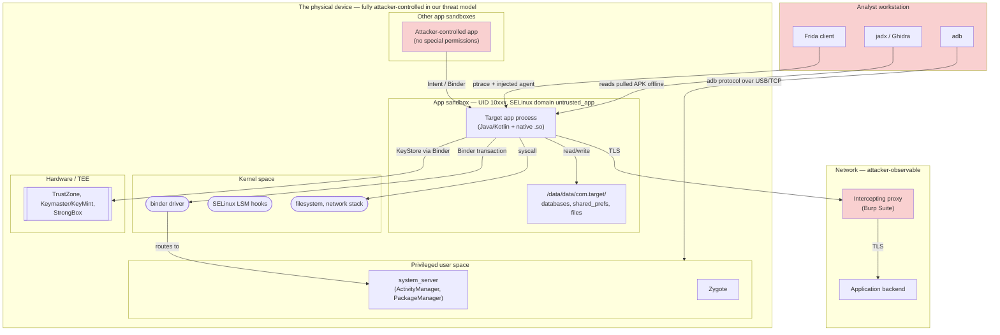
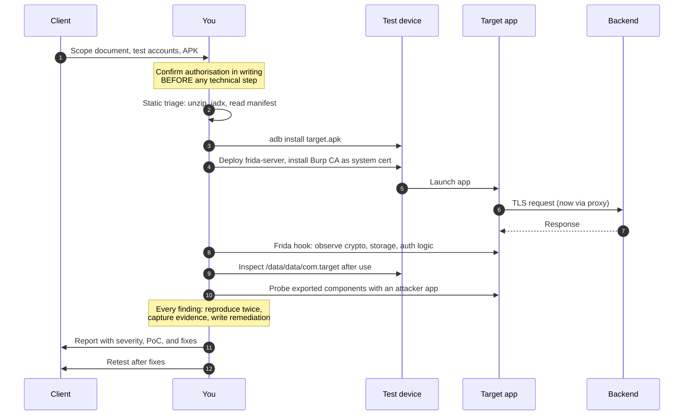
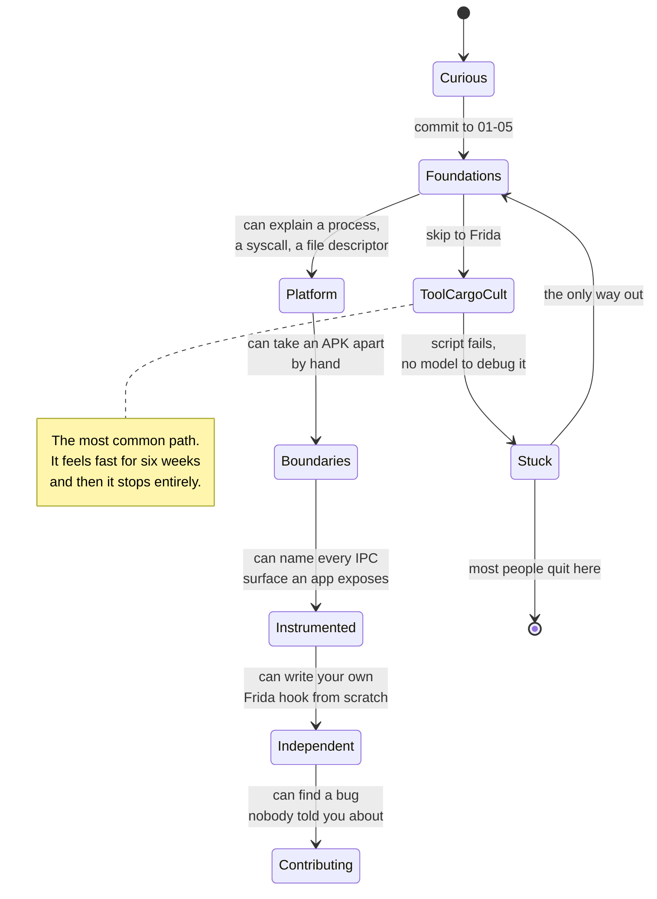
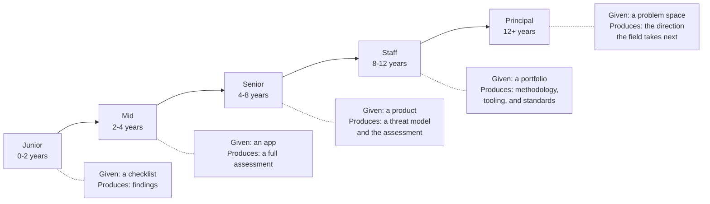
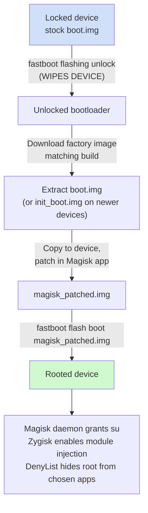
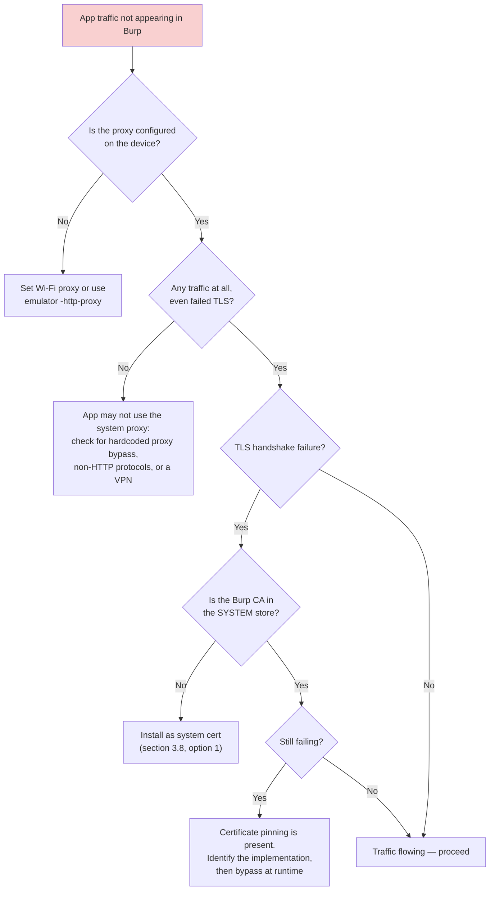
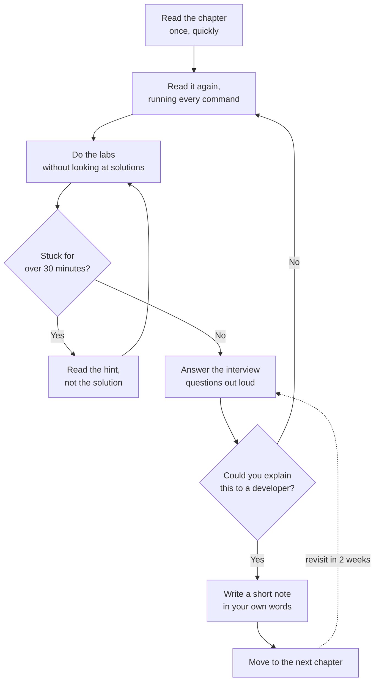
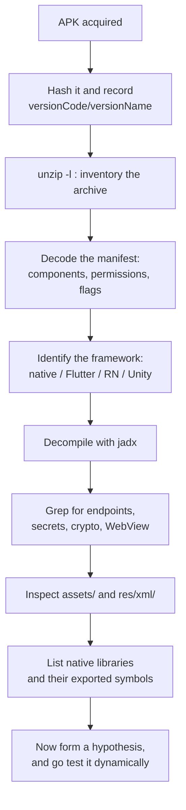
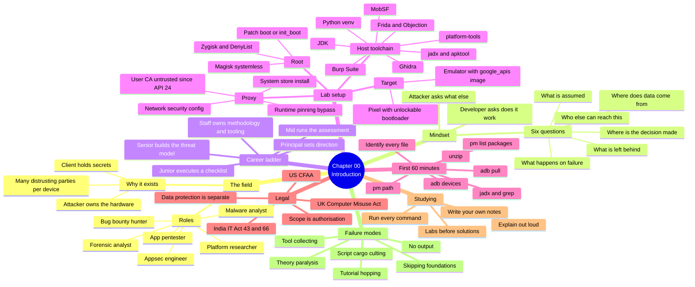

# 00 — Introduction: What Android Security Research Actually Is

> After this chapter you will know what the job is, what each seniority level is expected to know, why
> this repository teaches tools last, and you will have a working analysis workstation on which you
> have already pulled a real APK off a real device and looked inside it.

**Prerequisites:** None. This is chapter zero. You do not need to have written code, opened a
terminal, or owned an Android device.
**Applies to:** Android 5.0 (API 21) through Android 16 (API 36). Lab setup instructions are written
against Android 13–16 (API 33–36) and current tool releases; where a step changed at a specific
Android version, a Version Matrix says so.

---

> **📌 "I have two hours. Where do I start?"**
> Go straight to **[§3.9 — Your first sixty minutes](#39-your-first-sixty-minutes)**. It takes an
> application apart end to end — connect to a device, find an app, pull the APK, read its manifest,
> read its Java, find the native code — explaining every command as it goes, and it is the shortest
> honest answer to "what does this job actually feel like?" Everything else in this repository is
> depth on those four moves.
>
> You need a working device and toolchain first, which is [§3.6](#36-building-the-workstation) — budget
> an hour or two the first time, and read the four-word vocabulary box at the top of it before you
> type anything. If you have never opened a terminal, spend ten minutes in
> [02 — Linux Basics §1.3](../02-Linux-Basics/README.md#13-what-a-shell-is-before-any-commands) first.
> If a word in this chapter is not defined where you meet it, the [glossary](../79-Glossary/README.md)
> is a lookup table you can use from day one.

---

## Table of Contents

1. [Introduction](#1-introduction)
2. [High-Level Architecture](#2-high-level-architecture)
3. [Deep Internal Working](#3-deep-internal-working)
   - 3.1 [What the job actually is, hour by hour](#31-what-the-job-actually-is-hour-by-hour)
   - 3.2 [The career ladder](#32-the-career-ladder)
   - 3.3 [The developer mindset versus the attacker mindset](#33-the-developer-mindset-versus-the-attacker-mindset)
   - 3.4 [Why tools are taught last](#34-why-tools-are-taught-last)
   - 3.5 [Choosing your target hardware](#35-choosing-your-target-hardware)
   - 3.6 [Building the workstation](#36-building-the-workstation)
   - 3.7 [Rooting strategy](#37-rooting-strategy)
   - 3.8 [The Burp CA certificate problem](#38-the-burp-ca-certificate-problem)
   - 3.9 [Your first sixty minutes](#39-your-first-sixty-minutes) — **start here if you only have one sitting**
4. [Source Code Walkthrough (AOSP)](#4-source-code-walkthrough-aosp)
5. [Security Perspective](#5-security-perspective)
6. [Reverse Engineering Perspective](#6-reverse-engineering-perspective)
7. [Dynamic Analysis](#7-dynamic-analysis)
8. [Static Analysis](#8-static-analysis)
9. [Examples](#9-examples)
10. [Common Interview Questions](#10-common-interview-questions)
11. [Common Mistakes](#11-common-mistakes)
12. [Hands-on Labs](#12-hands-on-labs)
13. [Summary](#13-summary)
14. [References](#14-references)

---

## 1. Introduction

### 1.1 A locked building with a badge reader

Imagine a large office building. It has a front door with a badge reader, a receptionist, internal
doors that only certain badges open, a server room with a separate lock, a loading bay at the back,
and windows on the ground floor.

The people who built the building are architects and contractors. Their job was to make a building
that works: the lifts must go up and down, the lights must come on, the badge reader must let staff
in quickly on a Monday morning. They are measured on whether the building functions.

Your job is different. Your job is to walk around that building and ask a question the architects
never had time to ask: **"What is the complete list of ways a person who is not supposed to be
inside can get inside?"** Not "does the front door work" — the front door works, that is not
interesting. The interesting questions are: does the loading bay door close properly at night? If I
badge in at the front and then hold the internal door open, does the system notice? If the fire alarm
goes off, do all the internal doors unlock at once, and can I set off the fire alarm from outside?
Is the server room key kept in an unlocked drawer at reception because someone got tired of walking
back for it?

An Android application is that building. The developers built something that works. You are looking
for the loading bay door.

> **🧠 Mental Model**
> A developer asks *"does it work?"* An attacker asks *"what else does it do?"* Every security bug
> you will ever find lives in the gap between those two questions. The developer tested the path
> they intended. You test every path that exists.

### 1.2 What "Android security research" means concretely

The phrase covers several genuinely different jobs that share a body of knowledge. It helps to name
them, because job adverts use the terms loosely and you should know which one you are applying for.

| Job | What you are handed | What you produce | Typical employer |
|---|---|---|---|
| **Mobile application penetration tester** | An APK, sometimes a test account, sometimes source | A report of findings in a client's app, with severity, proof, and remediation | Consultancy, in-house security team |
| **Mobile appsec engineer** | The company's own apps, plus the CI pipeline | Fixes, secure defaults, lint rules, threat models, developer training | Product company (bank, fintech, health, gaming) |
| **Bug bounty hunter** | A public scope document | Individual vulnerability reports, paid per finding | Self-employed, paid by the program |
| **Platform / OS security researcher** | AOSP source, a device, a kernel | Bugs in Android itself: privilege escalation, sandbox escape, driver flaws | Google, Project Zero, offensive research firms, exploit brokers |
| **Malware analyst** | A suspicious APK | A behavioural report, indicators of compromise, detection signatures | Antivirus vendor, threat intelligence, CERT |
| **Mobile forensic analyst** | A seized or imaged device | An evidentiary timeline of what happened on the device | Law enforcement, incident response, DFIR firm |

These roles overlap heavily in their foundations. All six require you to know what a process is, how
Android isolates applications, how a `.dex` file is laid out, and what happens when an app talks to
the operating system. That shared foundation is what chapters 01 through 33 of this repository build.
Only afterwards do the roles diverge into their specialisms.

> **📖 Definition — APK**
> An **APK** (Android Package Kit) is the file format Android uses to distribute and install an
> application. Despite the extension, it is an ordinary ZIP archive with a mandated internal layout:
> compiled code in `classes.dex`, a binary-encoded `AndroidManifest.xml`, compiled resources in
> `resources.arsc`, native shared libraries under `lib/`, and cryptographic signatures under
> `META-INF/`. Chapter [10 — APK Internals](../10-APK-Internals/README.md) dissects it byte by byte.
> In section 3.9 of this chapter you will open one with nothing but `unzip`.

### 1.3 The problem that created this field

For the first thirty years of commercial software, the interesting security boundary was the network.
Your data lived on a server; the server was the thing worth attacking; the client was a dumb terminal
or a browser that mostly rendered what it was told.

Mobile broke that model in three ways at once.

**First, the client became a real computer holding real secrets.** A modern banking app on a phone
holds session tokens, cached account data, biometric-gated cryptographic keys, device-binding
identifiers, and increasingly, business logic that decides what the user is allowed to do. If any of
that is stored badly, the attacker does not need the server at all.

**Second, the attacker gained physical control of the machine the code runs on.** This is the single
most important sentence in mobile security. On the web, the attacker controls the HTTP request but
not the server. On mobile, the attacker owns the CPU, the memory, the storage, the clock, the network
stack, and the operating system if they choose to root the device. Every check the app performs, it
performs on hardware belonging to the person it is checking. This is why "the app validates the
input" is not a defence, why client-side root detection is a speed bump rather than a wall, and why
`if (user.isPremium)` on the client is a business logic vulnerability rather than a feature.

**Third, one device runs code from hundreds of mutually distrusting parties.** Your phone runs your
bank's code, a game studio's code, six advertising SDKs you did not choose, and the operating system,
all on the same hardware, all at once. Android's entire security architecture is a response to that
one fact: it must keep those parties apart. Chapters [20](../20-Security-Architecture/README.md)
through [23](../23-Permissions/README.md) are about the mechanisms Android uses to do it, and every
one of them is a boundary you will learn to probe.

> **🔍 Pentester's Note**
> When a developer says "but the attacker would need a rooted phone for that," they have usually
> misunderstood the threat model. The relevant question is not "would a normal user root their
> phone." It is "would a *motivated attacker* root a phone in order to extract the algorithm that
> generates transaction signatures for every user of this app." The answer is always yes, and it
> costs them one phone.

### 1.4 What would happen without this field

Suppose nobody looked. Suppose apps shipped and the only feedback loop was customer complaints.

The concrete outcomes are not hypothetical, because we have watched them happen repeatedly across
the industry as classes of failure:

- Applications that store authentication tokens in world-readable locations, so that any other app on
  the device can read them and impersonate the user. This class of bug is why chapter
  [33 — Storage](../33-Storage/README.md) exists.
- Applications that accept any TLS certificate because a developer disabled validation to make a
  staging server work and never re-enabled it, so anyone on the same coffee-shop Wi-Fi can read and
  modify traffic. This class of bug is why chapters [35](../35-SSL/README.md) and
  [36](../36-CertificatePinning/README.md) exist.
- Applications that export a component to the whole system without meaning to, so that a malicious
  app installed from anywhere can invoke privileged functionality in the victim app without any
  permission at all. This is why chapters [26](../26-Intent/README.md) through
  [32](../32-Manifest/README.md) exist.
- Applications that encrypt data with a key hardcoded in the binary, giving the appearance of
  encryption with none of the property. This is why chapter [34](../34-Cryptography/README.md) exists.

Every chapter in this repository exists because a category of real damage exists. The chapter ordering
is the order in which the underlying machinery must be understood, not the order of glamour.

### 1.5 What this chapter gives you

By the end of this chapter you will have done four things.

1. Understood what the job is at each level of seniority, so you can aim at a specific rung rather
   than "getting into mobile security."
2. Internalised the mindset shift that separates a developer reading code from an attacker reading
   the same code.
3. Built a complete, working analysis environment on Windows, macOS, or Linux — with every command
   given explicitly and every failure mode listed.
4. Pulled a real APK off a real (or virtual) device, opened it, and identified every file inside it,
   with no prior knowledge assumed.

That last item matters more than it looks. Most people who fail to get into this field fail because
they read for six months and never touch a device. You will touch a device in section 3.9 of chapter
zero.

---

## 2. High-Level Architecture

### 2.1 The map of the whole field

```mermaid
flowchart TD
    subgraph Foundations["Layer 0 — Machine foundations (chapters 01-05)"]
        F1["Computer science:<br/>CPU, memory, processes, syscalls"]
        F2["Linux: filesystem,<br/>permissions, /proc, signals"]
        F3["Programming:<br/>Java, Kotlin, C basics"]
    end

    subgraph Platform["Layer 1 — The Android platform (chapters 06-19)"]
        P1["Architecture, AOSP,<br/>boot, Zygote, system_server"]
        P2["APK and DEX formats"]
        P3["ART runtime,<br/>JNI, native code, ARM"]
    end

    subgraph Model["Layer 2 — The security model (chapters 20-23)"]
        M1["Sandbox: UID isolation"]
        M2["SELinux: mandatory access control"]
        M3["Permissions: install-time,<br/>runtime, signature"]
    end

    subgraph Surface["Layer 3 — The attack surface (chapters 24-50)"]
        S1["IPC: Binder, Intents,<br/>Providers, Services, Receivers"]
        S2["Data: storage, crypto,<br/>TLS, pinning"]
        S3["Identity: OAuth, tokens,<br/>biometrics, KeyStore"]
        S4["Hardening: root/tamper/<br/>emulator detection, obfuscation"]
    end

    subgraph Craft["Layer 4 — Applied craft (chapters 51-70)"]
        C1["Tools: Frida, jadx,<br/>Ghidra, Burp, Magisk"]
        C2["Methodology: hooking,<br/>bypassing, RE, VR"]
    end

    subgraph Practice["Layer 5 — Professional practice (chapters 71-80)"]
        R1["OWASP MASVS / MASTG"]
        R2["Findings, reports,<br/>case studies, interviews"]
    end

    Foundations --> Platform --> Model --> Surface --> Craft --> Practice
```



What you are looking at is a dependency graph, not a menu. Each layer is only comprehensible once the
layer beneath it is in place. You cannot meaningfully understand why a `ContentProvider` needs a
permission until you understand that it is reached over Binder; you cannot understand Binder until you
understand what a process is and what a system call does; and you cannot understand a system call
until you know what a kernel is. That is why the foundations layer is chapters 01 through 05 and not
an appendix.

The single most common way to fail at this field is to start at Layer 4 — install Frida, run someone
else's root-detection bypass script, watch it work, and conclude you have learned something. You have
learned a command. When the script fails on the next app, and it will, you have nothing.

### 2.2 Where the attacker sits relative to the app



This diagram is the entire rest of the repository in one picture, so it is worth reading slowly.

The **target app** runs inside a sandbox. That sandbox is enforced by two independent mechanisms:
a unique Linux UID that gives the app its own private directory under `/data/data/`, and an SELinux
domain (`untrusted_app`) that restricts what the app may do even if it somehow became root. Chapters
[21](../21-App-Sandbox/README.md) and [22](../22-SELinux/README.md) cover each in detail.

The app talks to the rest of the system almost exclusively through **Binder**, a kernel driver that
implements remote procedure calls between processes. When the app asks "what is my location" or
"start this activity," that request becomes a Binder transaction routed by the kernel to
`system_server`. Chapter [25](../25-Binder/README.md) covers the driver; chapter
[24](../24-IPC/README.md) covers the surrounding IPC landscape.

Three attack positions are drawn in red because they are attacker-controlled.

The **attacker-controlled app** is another application on the same device with no special permissions,
which represents the malicious-app threat model. If the target app exports a component carelessly,
this app can reach it. This is the single richest source of real-world findings in commercial mobile
assessments.

The **intercepting proxy** sits between the app and its backend. Getting an app's TLS traffic to route
through your proxy, and getting the app to accept your proxy's certificate, is the recurring practical
problem of chapters [35](../35-SSL/README.md), [36](../36-CertificatePinning/README.md), and
[44](../44-NetworkSecurityConfig/README.md), and section 3.8 of this chapter is your first encounter
with it.

The **analyst workstation** is where you sit. Note carefully what it can and cannot do. `adb` gives
you a shell on the device with the privileges of the `shell` user — which is more than an app has and
far less than root. Frida attaches to the app process and injects an agent, which requires either a
rooted device or a repackaged app. `jadx` and Ghidra work entirely offline on a copy of the APK. Those
three access paths have completely different prerequisites, and knowing which one you need for a given
question is a large part of the practical skill.

### 2.3 What a typical engagement looks like as a sequence



The sequence is deliberately mundane. Real engagements are not a montage of exploits; they are a
methodical sweep across a checklist you have internalised, punctuated by the occasional moment where
something does not look right and you pull the thread for three hours.

Notice that the first technical action is **static triage**, not tooling. You read the manifest and
skim the decompiled code before you ever launch the app, because that reading tells you what to look
for at runtime. Notice also that authorisation is confirmed before step one, in writing. Section 5 of
this chapter explains why that is not a formality.

### 2.4 The learning state machine



This state machine describes real careers. The branch labelled `ToolCargoCult` is not a strawman: it
is the modal outcome for people who enter mobile security through YouTube tutorials. The failure is
not moral, it is structural. A person who has only ever run other people's scripts has no internal
model to debug with when a script fails, and scripts fail constantly because apps change.

The recovery edge from `Stuck` back to `Foundations` exists and is well-travelled. If you are reading
this having already spent a year running `objection --gadget com.target explore`, you have not wasted
that year — you have context that a total beginner lacks. You just need to go back and build the layer
you skipped.

---

## 3. Deep Internal Working

### 3.1 What the job actually is, hour by hour

The romantic version of this job is finding a remote code execution bug at 3 a.m. The actual version,
measured in hours over a year, breaks down roughly as follows for a working application pentester.

| Activity | Share of time | What it looks like |
|---|---|---|
| Reading decompiled code | 25% | jadx open, tracing a call chain from an exported component to a database query |
| Writing and debugging instrumentation | 15% | A Frida script that logs every call to a crypto API, then fixing it when the class is obfuscated |
| Configuring the environment | 15% | Making the proxy work, defeating pinning, re-flashing a device that bootlooped |
| Manual probing | 15% | Sending crafted Intents, manipulating requests, tampering with local files |
| Writing the report | 20% | Turning "this is broken" into a severity, a reproduction, and a fix a developer can apply |
| Meetings, scoping, retests | 10% | Explaining to a product manager why an issue is not a false positive |

Two things surprise newcomers. The first is that **report writing is a fifth of the job** and is
usually what distinguishes a well-paid consultant from a poorly-paid one. A finding that a developer
cannot reproduce and does not know how to fix has produced zero security value. The second is that
**environment configuration is a sixth of the job** — a large share of your practical skill is being
the person who can get traffic flowing through a proxy on a hardened app in twenty minutes instead of
two days.

> **⚠️ Warning**
> If your entire preparation is "learn to find bugs," you will be slower than a competent peer who also
> knows how to write, how to estimate severity honestly, and how to fix a bootlooped test device. Those
> are not soft skills bolted on to the real work. They *are* a large part of the real work.

### 3.2 The career ladder

Titles vary by company, but the underlying expectations are remarkably consistent across the industry.
The distinguishing axis is not "knows more commands." It is **scope of ambiguity you can absorb**.



#### Junior mobile security engineer / analyst (0–2 years)

**What you are given:** a specific application, a methodology checklist, and a senior person to ask.

**What you are expected to know:**

| Area | Expected depth |
|---|---|
| Android basics | What an Activity, Service, Receiver and Provider are; what the manifest declares |
| APK structure | Can unzip an APK and name every file inside it |
| Tooling | Comfortable with `adb`, jadx, apktool, Burp Suite, MobSF |
| Common issues | Can find hardcoded secrets, cleartext traffic, exported components, insecure storage |
| Traffic interception | Can configure a proxy and install a CA certificate; can recognise pinning when it blocks you |
| Reporting | Can write a finding with reproduction steps that a developer can follow |
| OWASP | Knows MASVS exists and can map a finding to a control |

**What you are not yet expected to do:** defeat non-trivial hardening alone, read native ARM
disassembly, or judge whether an unusual architectural pattern is dangerous.

**The trap at this level** is becoming a MobSF operator: running an automated scanner and transcribing
its output. Automated tools produce a high volume of low-severity and false-positive findings. A
junior who submits them unfiltered damages their credibility.

#### Mid-level (2–4 years)

**What you are given:** an application and a deadline. You run the assessment.

**Newly expected:**

| Area | Expected depth |
|---|---|
| Frida | Writes their own hooks from scratch, including on obfuscated code, not just running published scripts |
| Smali | Can read Smali, patch a method, rebuild and re-sign an APK |
| Pinning | Can identify which pinning implementation is in use (OkHttp, TrustManager, Conscrypt, native) and defeat each |
| Root detection | Treats it as a class of problem, not a script; can locate and neutralise checks they have not seen before |
| Crypto review | Can identify ECB mode, static IVs, hardcoded keys, and misuse of `SecureRandom` |
| Deep links & IPC | Systematically enumerates and tests every exported surface |
| Backend awareness | Recognises that most high-severity mobile findings are actually server-side authorisation bugs reached through the mobile API |

**The trap at this level** is plateau. A mid-level tester who is comfortable can coast for years,
because the top 80% of commercial app assessments genuinely can be done with Frida, jadx, and Burp.
The step to senior requires deliberately going after the things you cannot currently do.

#### Senior (4–8 years)

**What you are given:** a product, not an app. Possibly source access, a backend, a hardware
component, and a set of stakeholders who disagree with each other.

**Newly expected:**

| Area | Expected depth |
|---|---|
| Threat modelling | Produces the threat model rather than consuming one; can say what *should* be tested and why |
| Native RE | Reads AArch64 disassembly, works in Ghidra or IDA, understands JNI boundaries and native hooking |
| Platform internals | Can explain Binder, Zygote, `system_server`, SELinux policy and ART well enough to reason about novel issues |
| KeyStore & TEE | Understands hardware-backed keys, key attestation, `setUserAuthenticationRequired`, and where the trust actually terminates |
| False positives | Can explain, precisely, why an automated finding is wrong — and is trusted when they say so |
| Remediation | Writes the fix as code, in the language and framework the client uses |
| Mentoring | Reviews juniors' findings and raises the standard of the team's output |
| Communication | Can defend a severity rating to an engineering director who wants it downgraded |

> **🧠 Mental Model**
> The junior-to-senior transition is the transition from *"I can find bugs of the kinds I have been
> taught"* to *"I can determine what kinds of bugs this specific system is capable of having."* The
> second requires an internal model of the platform. That model is what chapters 06 through 33 build.

#### Staff (8–12 years)

**What you are given:** a portfolio, an organisation, or a research direction.

**Newly expected:**

| Area | Expected depth |
|---|---|
| Methodology ownership | Defines how the team tests, not just how they test one app |
| Tooling | Builds internal tooling: custom Frida instrumentation frameworks, static analysis rules, CI integrations |
| Scale | Solves problems across dozens of apps rather than one, e.g. "how do we ensure no app in the estate ships a cleartext endpoint" |
| Standards influence | Contributes to MASVS/MASTG, internal secure coding standards, or open source tooling |
| Novel research | Finds bug classes rather than bugs; publishes or presents |
| Cross-domain | Comfortable spanning mobile, backend, cloud, and hardware in one assessment |
| Business judgement | Can say "this is technically a finding and commercially irrelevant, here is what actually matters" |

#### Principal / Distinguished (12+ years)

**What you are given:** a problem space, and often the mandate to decide what the problem space is.

**Newly expected:**

| Area | Expected depth |
|---|---|
| Direction setting | Decides which security investments an organisation makes over years |
| Platform-level research | Works at the level of Android itself: sandbox escapes, kernel and driver bugs, TEE, Verified Boot, exploit chains |
| Ecosystem influence | Shapes how the industry works via standards bodies, disclosure norms, upstream AOSP contributions, or vendor relationships |
| Deep specialisation plus breadth | World-class in something specific (say, ART internals or Keymaster), competent across everything adjacent |
| Force multiplication | Value is measured by what other people are able to do because of them |

> **🔍 Pentester's Note**
> Do not read this ladder as a timetable. The years are the median, not the requirement. People move
> faster with focused, deliberate practice on things they cannot yet do, and slower when they spend
> five years doing the same assessment repeatedly. Time served is not the variable. Range of problems
> confronted is.

#### The knowledge matrix

| Topic | Junior | Mid | Senior | Staff | Principal |
|---|---|---|---|---|---|
| APK structure | Full | Full | Full | Full | Full |
| Manifest analysis | Full | Full | Full | Full | Full |
| Java/Kotlin reading | Working | Full | Full | Full | Full |
| Smali reading/patching | Aware | Working | Full | Full | Full |
| Frida scripting | Aware | Working | Full | Full | Full |
| Burp / traffic analysis | Working | Full | Full | Full | Full |
| Pinning bypass | Aware | Working | Full | Full | Full |
| Native ARM RE | — | Aware | Working | Full | Full |
| Binder internals | — | Aware | Working | Full | Full |
| SELinux policy | — | Aware | Working | Full | Full |
| ART / DEX internals | — | Aware | Working | Full | Full |
| KeyStore / TEE | Aware | Working | Full | Full | Full |
| Kernel / driver bugs | — | — | Aware | Working | Full |
| Exploit development | — | — | Aware | Working | Full |
| Threat modelling | Aware | Working | Full | Full | Full |
| Report writing | Working | Full | Full | Full | Full |
| Tool building | — | Aware | Working | Full | Full |

Read the legend as: *Aware* means you know it exists and can describe it in a sentence. *Working*
means you can do it with references open. *Full* means you can do it unaided and teach it.

### 3.3 The developer mindset versus the attacker mindset

This section is the philosophical core of the chapter. Everything technical follows from it.

#### The same code, read two ways

Consider this Kotlin fragment, of a kind you will see constantly in real apps.

```kotlin
// Target application source — a typical premium-feature gate
class SubscriptionManager(private val prefs: SharedPreferences) {

    fun isPremiumUser(): Boolean {
        return prefs.getBoolean("is_premium", false)
    }

    fun unlockPremiumFeature(feature: Feature) {
        if (isPremiumUser()) {
            feature.enable()
        } else {
            showUpgradeDialog()
        }
    }
}
```

**The developer reads:** a subscription check. It reads a stored flag, and if the flag is true the
feature is enabled. It defaults to `false`, which is the safe default. The code is clean, testable,
and does what the ticket asked. It works.

**The attacker reads:** an authorisation decision made entirely on hardware I control, using state I
can write. Specifically:

1. `SharedPreferences` is an XML file at `/data/data/<pkg>/shared_prefs/<name>.xml`. On a rooted
   device I can edit that file directly. The check becomes: `<boolean name="is_premium" value="true" />`.
2. Even without root, `isPremiumUser()` is a Java method returning a boolean. Frida can replace its
   implementation with one that returns `true`, in three lines, without touching storage at all.
3. Even without Frida, I can decompile the app to Smali, change the `const/4 v0, 0x0` to
   `const/4 v0, 0x1`, rebuild, re-sign, and install the patched app.
4. The real question is not any of the above. The real question is: **when the app calls the server
   for premium content, does the server check entitlement independently?** If it does, all three
   attacks above give me a cosmetically unlocked UI and nothing of value. If it does not, I have free
   access to a paid product and so does everyone I tell.

That fourth point is the senior-level observation. A junior reports "premium check is client-side,
bypassable with Frida" as a High. A senior reports it accurately: if the server enforces, it is an
Informational note about client-side enforcement; if the server does not, it is a High-severity
broken access control finding in the API, and the mobile bypass is merely how you demonstrated it.

> **🧠 Mental Model**
> **Anything the client decides, the client's owner decides.** Write it on a sticky note. Client-side
> checks are UX, not security. The only security boundary is one where the enforcement happens
> somewhere the attacker does not control — a server, or a hardware-backed key inside the TEE.

#### The six questions that constitute the mindset

When an attacker looks at any component, feature, or line of code, six questions run automatically.
They are learnable. Practising them deliberately for a few months makes them reflexive.

| # | Question | Why it finds bugs |
|---|---|---|
| 1 | **Where does the data come from?** | If it crosses a trust boundary and is not validated, it is an input you control |
| 2 | **Who else can reach this?** | Exported components, deep links, and Providers are reachable by any app on the device |
| 3 | **Where is the decision made?** | A decision made on the client is a decision made by the attacker |
| 4 | **What is assumed and never checked?** | "This can only be called after login" is an assumption unless a check enforces it |
| 5 | **What happens on the unhappy path?** | Errors, timeouts, cancellations and retries are where developers stop thinking |
| 6 | **What is left behind?** | Logs, caches, backups, screenshots, clipboard, temp files, crash reports |

Question 5 deserves emphasis because it is the least intuitive and the most productive. Developers
design the happy path carefully and handle errors as an afterthought. Ask what happens if the network
call that validates the session times out. Does the app fail closed (deny access) or fail open (allow
it, because "the user is probably fine")? A striking number of authentication bugs are exactly this.

#### An exercise you can do today

Take any app on your own phone. Do not attack it — just observe, and answer these:

- What does it do offline? Whatever works offline is decided locally and therefore decided by you.
- What happens if you turn on airplane mode mid-transaction?
- What does the app show in the recent-apps switcher when backgrounded? Sensitive data on screen?
- Does it let you screenshot the sensitive screens?
- If you clear the app's data, what do you have to re-enter, and what did it remember anyway?

None of that requires a single tool. It requires the questions. That is the mindset.

### 3.4 Why tools are taught last

Chapters 53 through 64 of this repository cover Frida, Objection, MobSF, jadx, Ghidra, IDA, radare2,
adb, fastboot, Magisk, LSPosed and Xposed. They are numbered in the fifties and sixties for a reason,
and it is worth stating the reason precisely because it is counter-intuitive and because you will be
tempted to skip ahead.

#### The argument

Consider one command that almost every mobile security tutorial teaches in its first ten minutes:

```bash
# host — the command every tutorial starts with
frida -U -f com.target.app -l bypass.js
```

To use that command with any understanding, you must already know:

| The command implies | Which requires understanding | Covered in |
|---|---|---|
| `-U` connects over USB | The adb protocol and how a host talks to a device | [60 — ADB](../60-ADB/README.md) |
| `-f` spawns the app | Zygote forking, process creation, and app startup | [06](../06-Android-Architecture/README.md), [09](../09-Android-App-Internals/README.md) |
| Frida attaches to a process | `ptrace`, process memory, and why root is needed | [01](../01-Computer-Science-Basics/README.md), [02](../02-Linux-Basics/README.md) |
| An agent is injected | Shared library injection, `mmap`, `mprotect`, executable memory | [01](../01-Computer-Science-Basics/README.md), [19](../19-Memory/README.md) |
| `Java.perform` works | ART internals, the JNI environment, how methods are represented at runtime | [13](../13-ART/README.md), [16](../16-JNI/README.md) |
| Replacing a method implementation | Method entry points, ArtMethod structures, inline caches | [13](../13-ART/README.md) |
| The script bypasses a check | What the check was, where it lives, and why it exists | [37](../37-RootDetection/README.md) |

Without that stack, the command is an incantation. Incantations work until they do not. When
`Java.perform` throws because the app has not loaded its class loader yet, when the hook applies but
the check still fires because it is duplicated in native code, when Frida cannot attach because the
app installed a `ptrace` self-attach guard — a person who learned the incantation has no next step. A
person who learned the machine has five.

#### The counter-argument, stated fairly

There is a real argument for teaching tools early: motivation. Seeing a root check fall over in thirty
seconds is exciting, and excitement sustains study. Studying page tables for two months with no
visible payoff is how people quit.

This repository's answer is not "suffer through theory." It is that **every foundational chapter
connects immediately to a security consequence.** Chapter 01 does not teach you virtual memory as an
academic topic; it teaches you virtual memory and then shows you why `mprotect` is the reason Frida
can write executable code into a running process. You get the payoff, but you get it with the model
attached.

You are also not forbidden from playing. Install the tools in this chapter, run them on a deliberately
vulnerable app, enjoy it. Just do not mistake that for the curriculum.

> **⚠️ Warning**
> The strongest predictor of a stalled mobile security career is a person whose skill is a collection
> of scripts. Scripts rot. Android ships a new version every year, apps ship a new build every
> fortnight, and every published bypass is eventually detected and countered. Models do not rot: a
> process is still a process.

### 3.5 Choosing your target hardware

Before installing anything, decide what you are going to attack. This decision shapes every later
step, and the wrong choice wastes weeks.

#### Emulator versus physical device

| Dimension | Android Emulator (AVD) | Physical device |
|---|---|---|
| Cost | Free | £80–£600 |
| Root access | Trivial: use a non-Google-Play system image and `adb root` | Requires unlocking the bootloader and flashing Magisk |
| Speed | Fast on x86-64 hosts with hardware acceleration | Native speed |
| CPU architecture | Usually x86-64 (ARM images exist but are slower) | ARM64 — the real thing |
| Native library support | Many apps ship only ARM `.so` files, which x86 images may fail to load | Always correct |
| Play Integrity / SafetyNet | Almost always fails; many banking apps refuse to run | Can sometimes be worked around |
| Sensors, camera, telephony, NFC, biometrics | Simulated or absent | Real |
| Snapshots / rollback | Excellent — snapshot before every experiment | Requires re-flashing |
| Risk of bricking | Zero | Real |
| Realism of findings | Adequate for logic bugs; poor for hardware-backed crypto | Full |

**The honest recommendation: use both, and start with the emulator.**

Start with the emulator because you cannot brick it, because snapshots let you experiment fearlessly,
because it costs nothing, and because for learning the fundamentals — manifest analysis, IPC probing,
storage inspection, basic Frida hooking — it is entirely sufficient.

Add a physical device when you hit the emulator's limits, which you will: an app that only ships
`arm64-v8a` native libraries, an app that checks Play Integrity, anything involving the hardware
KeyStore or biometrics, anything involving Bluetooth, NFC, or the camera.

> **📖 Definition — AVD**
> An **AVD** (Android Virtual Device) is a configuration describing a virtual phone: system image,
> screen size, RAM, storage, and hardware features. The Android Emulator runs an AVD. An AVD using a
> **Google APIs** image (not **Google Play**) allows `adb root`, which is what you want; a **Google
> Play** image blocks `adb root` because it must satisfy Play's integrity requirements.

#### Which physical device

If you are buying one device for Android security work, the answer is almost always a **Google Pixel**.
The reasons are practical rather than brand loyalty.

| Requirement | Why Pixel satisfies it |
|---|---|
| Unlockable bootloader | Pixels allow `fastboot flashing unlock` on retail units bought unlocked (carrier-locked units may not) |
| Official factory images | Google publishes full factory and OTA images for every Pixel and Android version, so you can always recover a bricked device |
| Reference AOSP target | AOSP builds and boots on Pixels; kernel sources are published |
| Magisk support | The best-tested root path in the ecosystem |
| Custom kernels / GKI | Available if you need `ptrace` behaviour changes, kprobes, or a modified SELinux policy |
| Long update support | Recent Pixels receive many years of OS and security updates, letting you test old and new behaviour on one device |

| Alternative | Verdict |
|---|---|
| Older Pixel (a generation or two behind) | Excellent value. A used Pixel is the cheapest way into physical-device testing. |
| OnePlus | Historically bootloader-friendly; policy varies by model and region. Verify before buying. |
| Xiaomi | Unlocking requires an account-bound request and a waiting period. Workable but slow. |
| Samsung | Unlocking trips the Knox e-fuse permanently, which irreversibly disables Samsung Pay, Secure Folder and Knox-dependent features. Only buy a Samsung as a *target* if you specifically need to test Knox behaviour, and expect the fuse to blow. |
| Any carrier-locked device | Avoid. Carrier-locked bootloaders often cannot be unlocked at all. |

> **⚠️ Warning**
> Unlocking the bootloader **wipes the device completely** and, on many devices, sets a permanent flag.
> On Samsung devices it burns the Knox e-fuse and that is irreversible: features that depend on Knox
> will never work again on that unit. Never do this to your daily phone. Buy a dedicated test device.

#### Which Android version

| Android version | API | Why you might test on it |
|---|---|---|
| 7.0–7.1 (Nougat) | 24–25 | The version where user-installed CA certificates stopped being trusted by default. Useful for understanding why proxying is hard. |
| 10 | 29 | Scoped storage introduced. Many storage findings behave differently before and after. |
| 11 | 30 | Package visibility restrictions; scoped storage enforced. |
| 12 | 31 | `PendingIntent` mutability must be declared explicitly; `exported` must be declared explicitly for components with intent filters. |
| 13 | 33 | Runtime notification permission; granular media permissions. |
| 14 | 34 | Foreground service types; restrictions on implicit intents to internal components. |
| 15–16 | 35–36 | Current baseline for this repository. |

For a first device, target the **most recent version your device supports**, because that is what your
clients ship against. Keep an older emulator image around for comparing behaviour across versions.

### 3.6 Building the workstation

Everything in this section is a command you type. Run them in order. After each block there is a
verification command; if verification fails, do not continue until it passes.

Lab [lab-01-build-your-lab.md](labs/lab-01-build-your-lab.md) walks through the same material as a
guided exercise with a troubleshooting table.

> **📌 If you have never used a terminal, read this first**
> This section is the first place in the repository that assumes you can open a shell and type into
> it. If that sentence is not obviously true of you, read
> [02 — Linux Basics §1.3 "What a shell is, before any commands"](../02-Linux-Basics/README.md#13-what-a-shell-is-before-any-commands)
> and [§3.1 "The shell: what it actually is"](../02-Linux-Basics/README.md#31-the-shell-what-it-actually-is)
> **now**, then come back here. Ten minutes there saves an hour of confusion here. Everything else in
> chapter 02 can wait.

#### Four words every command below uses without warning

Four words appear in almost every install command below, and none of them are obvious. They are
covered properly in
[02 — Linux Basics §3.19 Environment variables](../02-Linux-Basics/README.md#319-environment-variables-ld_preload-and-ld_library_path);
these one-liners are enough to get through §3.6.

> **📖 Definition — `PATH`**
> `PATH` is an **environment variable**: a `NAME=value` string your shell hands to every program it
> starts. Its value is a list of directories. When you type `adb`, the shell does not search your
> whole disk — it looks in each `PATH` directory in order and runs the first `adb` it finds. "Command
> not found" almost always means *the program is installed but its directory is not in `PATH`*, not
> that the program is missing. Print yours with `echo $PATH` (`$env:Path` in PowerShell).

> **📖 Definition — `export`**
> `export NAME=value` sets an environment variable **and** marks it to be inherited by programs the
> shell starts. Without `export`, the variable exists only inside that one shell and the tools you
> launch never see it. `export PATH="/some/dir:$PATH"` means "put `/some/dir` at the front of the
> existing `PATH`" — `$PATH` on the right is the old value, which is why the rest of your commands
> keep working.

> **📖 Definition — `~/.bashrc` (and `~/.zshrc`)**
> `~` is your home directory. `~/.bashrc` is a plain text file of shell commands that Bash runs
> automatically every time it starts an interactive shell; zsh reads `~/.zshrc` instead. Appending an
> `export` line to it (`echo '...' >> ~/.bashrc`) is how a setting **survives closing the terminal**.
> Run `echo $SHELL` to see which one you have. On macOS the default is zsh, so use `~/.zshrc`
> wherever the commands below say `~/.bashrc`.

> **📖 Definition — `source`**
> `source ~/.bashrc` re-runs that file in your **current** shell, applying the lines you just
> appended without opening a new terminal. Running `bash ~/.bashrc` instead would start a *child*
> shell, set the variables inside it, and then exit — taking them with it. That is exactly the
> mistake `source` exists to prevent. Closing and reopening the terminal has the same effect as
> `source`. `.` is a synonym: `. ~/.bashrc`.

#### 3.6.0 The pieces and why each exists

| Tool | What it is | Why you need it | Chapter |
|---|---|---|---|
| **JDK** | Java Development Kit — the Java compiler and runtime | jadx, apktool, Burp Suite and the Android build tools are Java programs | [04](../04-Java/README.md) |
| **Android SDK platform-tools** | `adb`, `fastboot` | The only way to talk to a device | [60](../60-ADB/README.md), [61](../61-Fastboot/README.md) |
| **Android SDK cmdline-tools** | `sdkmanager`, `avdmanager` | Create and manage emulators without Android Studio | — |
| **Android Emulator** | The virtual device runtime | Your first target | — |
| **Python 3** | Scripting language | Frida's client, Objection, MobSF, and most of your own tooling | [03](../03-Programming-Fundamentals/README.md) |
| **Frida** | Dynamic instrumentation framework | Observe and modify a running app | [53](../53-Frida/README.md) |
| **Objection** | Frida-based toolkit | Common tasks without writing a script | [54](../54-Objection/README.md) |
| **jadx** | DEX-to-Java decompiler | Read an app's code as readable Java | [56](../56-JADX/README.md) |
| **apktool** | APK disassembler/rebuilder | Decode resources and manifest; produce Smali; rebuild patched APKs | [10](../10-APK-Internals/README.md) |
| **Burp Suite** | Intercepting HTTP proxy | See and modify network traffic | [35](../35-SSL/README.md) |
| **MobSF** | Automated mobile analysis framework | Fast first-pass triage | [55](../55-MobSF/README.md) |
| **Ghidra** | Reverse engineering suite | Analyse native `.so` libraries | [57](../57-Ghidra/README.md) |
| **Magisk** | Systemless root solution | Root a physical device without modifying `/system` | [62](../62-Magisk/README.md) |

#### How the installs below are written: package managers and `sudo`

Every install step gives several alternatives that look nothing like each other. That is because each
operating system has a different **package manager**, and you use exactly one of them — whichever
matches your machine. Find your row, ignore the others.

> **📖 Definition — package manager (desktop)**
> A **package manager** is a program that installs other programs for you. Instead of hunting a
> website, downloading an installer, and clicking Next, you name the software and the tool fetches a
> signed archive from a curated repository, verifies its signature, installs any other software it
> depends on, unpacks the files into the right directories, and records everything so it can be
> uninstalled cleanly. That signature check is the security point: it is why installing from a package
> manager is safer than downloading a random `.exe`. Chapter
> [02 §3.16](../02-Linux-Basics/README.md#316-package-managers-versus-androids-packagemanager) covers
> them properly.

| Your machine | Package manager | Where it comes from | Test that it exists |
|---|---|---|---|
| Windows 10 (1809+) / 11 | `winget` | Built into Windows | `winget --version` |
| Windows, if you already use it | `choco` (Chocolatey) | Installed separately from `chocolatey.org` | `choco --version` |
| macOS | `brew` (Homebrew) | Installed separately from `brew.sh` | `brew --version` |
| Linux — Debian, Ubuntu, Mint, Kali | `apt` | Built in | `apt --version` |
| Linux — Fedora, RHEL, Rocky | `dnf` | Built in | `dnf --version` |
| Linux — Arch, Manjaro | `pacman` | Built in | `pacman --version` |

If none of the three Windows/macOS tools is present, install it once from the vendor site above, or
skip the package-manager option entirely and use the direct-download instructions where they are
given.

> **📖 Definition — `sudo`**
> On Linux and macOS, installing software system-wide requires administrator privilege, which your
> normal login does **not** have. `sudo` ("substitute user do") runs a single command as `root`, the
> all-powerful administrator account, after asking for **your own** password. It is the reason the
> Linux commands below start with `sudo apt`, `sudo dnf`, `sudo pacman` while the Windows and macOS
> ones do not. Type `sudo` only in front of commands you understand; it removes every guard rail the
> system has. Chapter [02 §3.5](../02-Linux-Basics/README.md#35-users-groups-uid-and-gid) explains
> what `root` actually is, and chapter [02 §3.7](../02-Linux-Basics/README.md#37-permission-bits-octal-notation-and-the-special-bits)
> explains the mechanism `sudo` uses.

> **⚠️ Warning — two unrelated things are called "package manager"**
> The tool described above installs software **on your computer**. Later in this chapter
> ([§3.9](#39-your-first-sixty-minutes)) you will meet `pm`, Android's *own* "package manager"
> command, which lists and installs apps **on the device**. They share a name and nothing else:
> different machine, different software, different format, no dependency resolution on the Android
> side at all. Chapter [02 §3.16](../02-Linux-Basics/README.md#316-package-managers-versus-androids-packagemanager)
> puts the two side by side deliberately, because the collision confuses people for months.

#### 3.6.1 Java Development Kit

You need a JDK, not just a JRE, and version 17 or later is the safe modern choice.

```powershell
# Windows — PowerShell, run as your normal user
# Option A: winget (built into Windows 10 1809+ and Windows 11)
winget install --id EclipseAdoptium.Temurin.21.JDK -e

# Option B: Chocolatey, if you already use it
choco install temurin21 -y
```

```bash
# macOS — Terminal
brew install --cask temurin@21
```

```bash
# Linux (Debian/Ubuntu) — Terminal
sudo apt update
sudo apt install -y openjdk-21-jdk
```

```bash
# Linux (Fedora/RHEL) — Terminal
sudo dnf install -y java-21-openjdk-devel
```

```bash
# Linux (Arch) — Terminal
sudo pacman -S --needed jdk21-openjdk
```

Verify:

```bash
# any host
java -version
javac -version
```

You should see version 21 (or whatever you installed). If `java` is not found on Windows, close and
reopen your terminal — installers modify `PATH` and existing shells do not see the change.

Some tools want `JAVA_HOME` set explicitly.

```powershell
# Windows — PowerShell, sets JAVA_HOME permanently for your user
$jdk = (Get-ChildItem "C:\Program Files\Eclipse Adoptium" -Directory | Where-Object Name -like "jdk-21*" | Select-Object -First 1).FullName
[Environment]::SetEnvironmentVariable("JAVA_HOME", $jdk, "User")
# Reopen the terminal, then confirm:
$env:JAVA_HOME
```

```bash
# macOS / Linux — add to ~/.zshrc or ~/.bashrc
export JAVA_HOME="$(dirname "$(dirname "$(readlink -f "$(which java)")")")"
export PATH="$JAVA_HOME/bin:$PATH"
```

#### 3.6.2 Android SDK platform-tools

This gives you `adb` and `fastboot`. You do not need Android Studio for it.

```powershell
# Windows — PowerShell
# Download the current platform-tools zip from Google and extract to C:\Android
New-Item -ItemType Directory -Force "C:\Android" | Out-Null
Invoke-WebRequest -Uri "https://dl.google.com/android/repository/platform-tools-latest-windows.zip" -OutFile "$env:TEMP\platform-tools.zip"
Expand-Archive -Path "$env:TEMP\platform-tools.zip" -DestinationPath "C:\Android" -Force
# Add to PATH permanently for the current user
$old = [Environment]::GetEnvironmentVariable("Path", "User")
[Environment]::SetEnvironmentVariable("Path", "$old;C:\Android\platform-tools", "User")
```

```bash
# macOS — Terminal
brew install --cask android-platform-tools
```

```bash
# Linux (Debian/Ubuntu) — Terminal
sudo apt install -y android-sdk-platform-tools
# Or, for the newest version, download Google's zip:
cd ~ && curl -LO https://dl.google.com/android/repository/platform-tools-latest-linux.zip
unzip -q platform-tools-latest-linux.zip -d ~/Android
echo 'export PATH="$HOME/Android/platform-tools:$PATH"' >> ~/.bashrc
source ~/.bashrc
```

Verify:

```bash
# any host
adb version
fastboot --version
```

On Linux you also need udev rules so that a non-root user can talk to a USB device.

```bash
# Linux — Terminal, requires sudo
sudo apt install -y android-sdk-platform-tools-common   # ships a maintained 51-android.rules
sudo usermod -aG plugdev "$USER"
sudo udevadm control --reload-rules && sudo udevadm trigger
# Log out and back in for the group change to apply
```

On Windows you may need an OEM USB driver for a physical device. Google publishes a generic USB driver
for Pixels; other vendors publish their own. If `adb devices` shows nothing with a Pixel attached,
install the Google USB driver and re-check Device Manager.

#### 3.6.3 Command-line tools, SDK packages, and an emulator

```bash
# Linux/macOS — Terminal. Set a home for the SDK.
export ANDROID_HOME="$HOME/Android/Sdk"
mkdir -p "$ANDROID_HOME/cmdline-tools"
# Download commandlinetools for your OS from developer.android.com, then:
unzip -q commandlinetools-*.zip -d "$ANDROID_HOME/cmdline-tools"
mv "$ANDROID_HOME/cmdline-tools/cmdline-tools" "$ANDROID_HOME/cmdline-tools/latest"
echo 'export ANDROID_HOME="$HOME/Android/Sdk"' >> ~/.bashrc
echo 'export PATH="$ANDROID_HOME/cmdline-tools/latest/bin:$ANDROID_HOME/platform-tools:$ANDROID_HOME/emulator:$PATH"' >> ~/.bashrc
source ~/.bashrc
```

```powershell
# Windows — PowerShell. Assumes you extracted commandlinetools to C:\Android\Sdk\cmdline-tools\latest
[Environment]::SetEnvironmentVariable("ANDROID_HOME", "C:\Android\Sdk", "User")
$old = [Environment]::GetEnvironmentVariable("Path", "User")
[Environment]::SetEnvironmentVariable("Path", "$old;C:\Android\Sdk\cmdline-tools\latest\bin;C:\Android\Sdk\emulator", "User")
```

Now install the packages and create an AVD. **Note the image choice carefully.**

Build the AVD on **API 35 (Android 15)**. Every measured output quoted anywhere in this repository was
produced on an API 35 image (`sdk_gphone16k_x86_64`); matching it is how your output matches the book.

```bash
# any host — accept licences first
sdkmanager --licenses

# Install platform tools, the API 35 platform, and a rootable system image.
# "google_apis" (NOT "google_apis_playstore") is what allows `adb root`.
sdkmanager "platform-tools" "platforms;android-35" "emulator" \
           "system-images;android-35;google_apis;x86_64"

# Create the AVD
avdmanager create avd -n pentest-35 \
    -k "system-images;android-35;google_apis;x86_64" \
    -d "pixel_6"

# Launch it, with writable system and a proxy-friendly configuration
emulator -avd pentest-35 -writable-system -no-snapshot-load
```

| Emulator flag | Effect | Why you want it |
|---|---|---|
| `-writable-system` | Mounts `/system` read-write | Required to install a CA as a system certificate on older images |
| `-no-snapshot-load` | Cold boot | Avoids stale state from a previous session |
| `-http-proxy http://127.0.0.1:8080` | Routes emulator traffic through a proxy | An alternative to configuring the Wi-Fi proxy in Settings |
| `-writable-system -selinux permissive` | Also disables SELinux enforcement | Useful for debugging; **remember you are no longer testing a realistic configuration** |

Verify:

```bash
# any host
adb devices
# Expected output:
# List of devices attached
# emulator-5554   device

adb shell getprop ro.build.version.release
adb shell getprop ro.build.version.sdk
adb root            # should print "restarting adbd as root" on a google_apis image
adb shell id        # should now show uid=0(root)
```

> **⚠️ Warning**
> If `adb root` returns `adbd cannot run as root in production builds`, you created the AVD with a
> **Google Play** image. Delete it and recreate with `google_apis`. This is the single most common
> emulator setup mistake.

#### 3.6.4 Python and a virtual environment

```powershell
# Windows — PowerShell
winget install --id Python.Python.3.12 -e
```

```bash
# macOS
brew install python@3.12
```

```bash
# Linux (Debian/Ubuntu)
sudo apt install -y python3 python3-pip python3-venv
```

Always work inside a virtual environment. Frida, Objection and MobSF have conflicting dependency
requirements and installing them globally will eventually break something.

```bash
# macOS / Linux — Terminal
python3 -m venv ~/venvs/android
source ~/venvs/android/bin/activate
python -m pip install --upgrade pip
```

```powershell
# Windows — PowerShell
python -m venv $HOME\venvs\android
& $HOME\venvs\android\Scripts\Activate.ps1
python -m pip install --upgrade pip
```

> **📖 Definition — virtual environment**
> A Python **virtual environment** is a self-contained directory holding its own copy of the Python
> interpreter's package directory. Packages installed while it is active are visible only inside it.
> This prevents one project's dependency versions from breaking another's. You must "activate" it in
> each new terminal session.

#### 3.6.5 Frida

Frida has two halves that must match in version: a **client** on your host, and a **server** on the
device.

```bash
# host — inside the activated virtual environment
pip install frida-tools objection
frida --version
```

Now the device side. The server is a native binary, so you must download the build matching the
device's CPU architecture and the client's version.

```bash
# host — find the architecture of the target device
adb shell getprop ro.product.cpu.abi
# arm64-v8a   → download frida-server-<version>-android-arm64
# x86_64      → download frida-server-<version>-android-x86_64
# armeabi-v7a → download frida-server-<version>-android-arm

# host — after downloading and decompressing the matching frida-server:
adb push frida-server /data/local/tmp/frida-server
adb shell "chmod 755 /data/local/tmp/frida-server"
adb shell "su -c '/data/local/tmp/frida-server &'"     # rooted physical device
# or, on an emulator where you already ran `adb root`:
adb shell "/data/local/tmp/frida-server &"
```

Verify:

```bash
# host
frida-ps -U
# Should list running processes on the device.
```

| Symptom | Cause | Fix |
|---|---|---|
| `Failed to enumerate processes: unable to connect to remote frida-server` | Server not running, or not running as root | Re-launch it; confirm with `adb shell ps -A \| grep frida` |
| `unable to connect ... closed` | Client/server version mismatch | Match versions exactly: `pip install frida-tools==<version>` |
| `Failed to spawn: unable to find process with name` | App not installed, or wrong package name | `adb shell pm list packages \| grep <fragment>` |
| Server dies immediately | Wrong ABI binary | Re-check `ro.product.cpu.abi` and download the matching build |

> **🔬 Under the Hood**
> `frida-server` listens on TCP port 27042 on the device. `frida -U` does not connect to that port
> directly over the network; it asks `adb` to forward a local port to it, then speaks Frida's own
> protocol across that forward. When Frida attaches to an app it uses `ptrace` to stop the process,
> maps a small bootstrap into the target's address space with `mmap`, makes it executable with
> `mprotect`, and has the target load the agent library. Every noun in that sentence — `ptrace`,
> address space, `mmap`, `mprotect` — is defined in chapter
> [01](../01-Computer-Science-Basics/README.md). This is precisely why chapter 01 comes before
> chapter 53.

#### 3.6.6 jadx

```powershell
# Windows — PowerShell
choco install jadx -y
# or download the release zip from github.com/skylot/jadx and add its bin/ to PATH
```

```bash
# macOS
brew install jadx
```

```bash
# Linux — Debian/Ubuntu may package an old version; the release zip is safer
cd ~ && curl -L -o jadx.zip https://github.com/skylot/jadx/releases/latest/download/jadx-1.5.0.zip
mkdir -p ~/tools/jadx && unzip -q jadx.zip -d ~/tools/jadx
echo 'export PATH="$HOME/tools/jadx/bin:$PATH"' >> ~/.bashrc && source ~/.bashrc
```

Verify:

```bash
# host
jadx --version
jadx-gui --help        # the graphical version; the one you will actually live in
```

#### 3.6.7 apktool

apktool needs Java and is distributed as a JAR plus a wrapper script.

> **⚠️ Warning**
> apktool ships with **no** operating system and is **not** part of the Android SDK — if you skip this
> step, [§3.9](#39-your-first-sixty-minutes) will stop at `apktool: command not found` when it decodes
> the manifest. There is a substitute (`aapt2 dump xmltree`, noted there), but installing apktool now
> is the cheaper choice, and chapters [10](../10-APK-Internals/README.md) and
> [67](../67-BypassingProtections/README.md) assume you have it.

```bash
# macOS
brew install apktool
```

```bash
# Linux — manual install of the current version
sudo curl -L -o /usr/local/bin/apktool https://raw.githubusercontent.com/iBotPeaches/Apktool/master/scripts/linux/apktool
sudo curl -L -o /usr/local/bin/apktool.jar https://github.com/iBotPeaches/Apktool/releases/latest/download/apktool_2.9.3.jar
sudo chmod +x /usr/local/bin/apktool /usr/local/bin/apktool.jar
```

```powershell
# Windows — PowerShell
choco install apktool -y
```

Verify:

```bash
# host
apktool --version
```

You will also want `apksigner` and `zipalign` from the Android build tools, because a rebuilt APK must
be re-signed before Android will install it.

```bash
# any host
sdkmanager "build-tools;35.0.1"
# The binaries land in $ANDROID_HOME/build-tools/35.0.1/
```

#### 3.6.8 Burp Suite

Burp Suite Community Edition is free and sufficient for learning. Professional adds the active scanner
and, importantly, the ability to save projects — worth it once you work professionally.

Download from PortSwigger and install. On Linux the `.sh` installer is easiest; on macOS and Windows
use the native installer. Burp bundles its own JRE, so it does not depend on your JDK.

Verify by launching Burp, going to **Proxy → Proxy settings**, and confirming a listener on
`127.0.0.1:8080`. For device testing you must add a listener bound to your host's LAN address, because
the device cannot reach your loopback interface:

1. **Proxy → Proxy settings → Add**
2. Bind port `8080`, bind to **All interfaces** (or specifically your LAN IP)
3. On the device: **Settings → Wi-Fi → (your network) → Modify → Advanced → Proxy → Manual**, hostname
   is your host's LAN IP, port `8080`.

```bash
# host — find your LAN IP
# Linux / macOS
ip addr show | grep "inet " | grep -v 127.0.0.1
# Windows PowerShell
Get-NetIPAddress -AddressFamily IPv4 | Where-Object { $_.IPAddress -notlike "127.*" } | Select-Object IPAddress, InterfaceAlias
```

For an emulator, an alternative that avoids Wi-Fi settings entirely:

```bash
# host — route all emulator traffic through the host proxy
emulator -avd pentest-35 -writable-system -http-proxy http://127.0.0.1:8080
```

#### 3.6.9 MobSF

MobSF is easiest to run in Docker, which avoids a long list of Python and Java dependency problems.

```bash
# host — Docker
docker pull opensecurity/mobile-security-framework-mobsf:latest
docker run -it --rm -p 8000:8000 opensecurity/mobile-security-framework-mobsf:latest
# Then open http://127.0.0.1:8000 in a browser
```

```bash
# host — native install, if you prefer
git clone https://github.com/MobSF/Mobile-Security-Framework-MobSF.git
cd Mobile-Security-Framework-MobSF
./setup.sh          # or setup.bat on Windows
./run.sh            # serves on 127.0.0.1:8000
```

> **⚠️ Warning**
> MobSF is a triage tool, not an assessment. It produces findings with a meaningful false-positive
> rate: it will flag every `Cipher.getInstance("AES")` regardless of context, report every exported
> component as an issue regardless of whether it is protected by a signature permission, and miss
> anything requiring reasoning about program flow. Use it to build a map in five minutes. Never paste
> its output into a report. Chapter [55](../55-MobSF/README.md) is largely about which of its findings
> to believe.

#### 3.6.10 Ghidra

Ghidra is a Java application published by the NSA; it needs your JDK.

```bash
# Linux / macOS
cd ~/tools
curl -LO https://github.com/NationalSecurityAgency/ghidra/releases/download/Ghidra_11.1.2_build/ghidra_11.1.2_PUBLIC_20240709.zip
unzip -q ghidra_*.zip
cd ghidra_11.1.2_PUBLIC && ./ghidraRun
```

```powershell
# Windows — download the release zip from the GitHub releases page, extract, then:
& "C:\tools\ghidra_11.1.2_PUBLIC\ghidraRun.bat"
```

You will not use Ghidra until chapter [57](../57-Ghidra/README.md), but installing it now means the
tool is ready when the chapter arrives.

#### 3.6.11 The complete verification checklist

```bash
# host — run every one of these. All must succeed before you continue.
java -version
adb version
fastboot --version
python --version
frida --version
objection version
jadx --version
apktool --version
unzip -v | head -1
```

The script [scripts/verify-toolchain.sh](scripts/verify-toolchain.sh) automates this and prints a
pass/fail table with install hints for anything missing.

### 3.7 Rooting strategy

#### Why root at all

> **📖 Definition — root**
> **Root** is the Unix superuser, UID 0. A root process bypasses all discretionary access control
> (file permissions), which on Android means it can read and write any app's private data directory,
> attach to any process, and modify system files. It does **not** automatically bypass SELinux, which
> is a separate mandatory access control layer — see chapter [22](../22-SELinux/README.md).

Root gives you four capabilities you cannot get otherwise, and each one maps to a category of testing.

| Capability | What it enables | Without root you must instead |
|---|---|---|
| Read `/data/data/<pkg>/` | Inspect databases, SharedPreferences, cached tokens, key material | Use `run-as` on a debuggable app, or repackage the target as debuggable |
| `ptrace` any process | Attach Frida to an app you did not build | Repackage the app with the Frida gadget embedded |
| Write to `/system` (or overlay it) | Install a system CA certificate so pinning-free apps trust your proxy | Patch the app's network security config and re-sign |
| Load kernel modules, change SELinux | Deep platform research | Not possible |

Every one of the "without root" alternatives is viable and worth knowing, because you will meet
targets where rooting is not an option. Chapter [67](../67-BypassingProtections/README.md) covers the
repackaging path in depth. But root is faster and is the default for a lab device.

#### Magisk: the systemless approach

Historically, rooting meant copying an `su` binary into `/system/bin/` and modifying system files
permanently. That approach is dead for two reasons: **dm-verity** cryptographically verifies the
system partition at boot and refuses to boot if it was modified, and **SafetyNet/Play Integrity**
attestation notices the modification.

> **📖 Definition — systemless root**
> **Systemless root** means gaining superuser capability without modifying the read-only system
> partitions. Magisk achieves this by patching the **boot image** (which contains the kernel and the
> `ramdisk` holding `init`) so that its own `init` runs first, sets up an **overlay filesystem** that
> makes modified files *appear* to exist at system paths while the real partition is untouched, and
> starts a daemon that grants root on request. Because `/system` on disk is unchanged, dm-verity is
> satisfied.

That definition is dense, and on a first read it is seven unfamiliar nouns in one paragraph. Here is
each of them, in order of appearance. You do not need to master any of them to follow the procedure
below — you need to know they are not magic.

| Noun | What it actually is | Read properly in |
|---|---|---|
| **boot image** (`boot.img`) | A partition on the device's flash storage — a file, essentially — holding the Linux kernel plus the small filesystem the kernel mounts first. "Flashing" it means overwriting that partition. On recent Pixels the ramdisk half lives in a separate `init_boot` partition. | [61 — Fastboot](../61-Fastboot/README.md) |
| **ramdisk** | A tiny filesystem carried *inside* the boot image and unpacked into RAM at boot. It exists to hold just enough to mount the real partitions. Because it lives in RAM, changes to it vanish at power-off; because it lives in the boot image, changes to the *image* persist. | [06 — Android Architecture](../06-Android-Architecture/README.md) |
| **`init`** | The first user-space program the kernel starts, always process ID 1. It reads `.rc` script files and starts everything else, including Zygote. Every other process on the device descends from it. Magisk's trick is to be `init` first, do its own setup, then hand over to the real one. | [02 — Linux Basics §3.9](../02-Linux-Basics/README.md#39-processes) |
| **overlay filesystem** | A kernel feature that stacks one directory on top of another and shows you the merged result: files in the upper layer hide same-named files in the lower one, and the lower one is never written to. This is how a modified file can *appear* at a system path while the real partition is byte-for-byte untouched. | [02 — Linux Basics §3.22](../02-Linux-Basics/README.md#322-mount-namespaces-and-bind-mounts) |
| **daemon** | A program that runs continuously in the background with no user interface, waiting to service requests. `adbd` (which `adb` talks to) is one; Magisk's `magiskd` is another; on Linux the trailing `d` conventionally marks them. | [02 — Linux Basics §3.9](../02-Linux-Basics/README.md#39-processes) |
| **dm-verity** | The kernel feature that hashes every block of the system partition and checks each one against a signed hash tree as it is read. Change one byte of `/system` on disk and the device refuses to boot. It is the reason the old "copy `su` into `/system/bin`" approach is dead. | [20 — Security Architecture](../20-Security-Architecture/README.md) |
| **`/system`** | The read-only partition holding the Android framework, the system apps and the platform binaries — the OS itself, as opposed to `/data`, which holds your apps and their data. It is mounted read-only and verified by dm-verity precisely so it cannot be tampered with. | [02 — Linux Basics §3.3](../02-Linux-Basics/README.md#33-the-android-filesystem-layout) |

All seven also have one-line entries in the [glossary](../79-Glossary/README.md), which is the right
place to look the next time one of them appears without warning.



The flow above is the standard Magisk installation for a Pixel. Reading it carefully: you never flash
a modified system partition. You flash a modified **boot** partition (or `init_boot` on devices that
split it out, which is the case for recent Pixels). The Magisk app itself performs the patching on
the device, using the stock image you supply, so the patch matches your exact build.

#### The procedure, step by step

> **⚠️ Warning**
> Step 2 **erases everything on the device**, including internal storage. It is not reversible without
> restoring from a backup you made beforehand. Do this only on a device you have designated as a test
> device. Flashing a boot image from the wrong build will bootloop the device; recovery means flashing
> the correct full factory image, which erases it again.

```bash
# host — Step 1: enable Developer Options and OEM unlocking ON THE DEVICE
# Settings → About phone → tap "Build number" seven times
# Settings → System → Developer options → enable "OEM unlocking" and "USB debugging"
# If "OEM unlocking" is greyed out, the device is carrier-locked and cannot be unlocked.

# host — Step 2: unlock the bootloader (DESTRUCTIVE)
adb reboot bootloader
fastboot flashing unlock
# Confirm on the device screen with the volume/power keys. The device wipes and reboots.

# host — Step 3: identify the exact build so you download the matching factory image
adb shell getprop ro.build.fingerprint
adb shell getprop ro.build.id
# Download the matching factory image from Google's Pixel factory images page.
# Extract the archive; inside is image-<device>-<build>.zip containing boot.img / init_boot.img.

# host — Step 4: put the stock image on the device and patch it
adb install Magisk-v27.0.apk         # from github.com/topjohnwu/Magisk/releases
adb push init_boot.img /sdcard/Download/
# On the device: open Magisk → Install → Select and Patch a File → choose init_boot.img
# Magisk writes magisk_patched-<random>.img into /sdcard/Download/

# host — Step 5: pull the patched image back and flash it
adb pull /sdcard/Download/magisk_patched-XXXXX.img .
adb reboot bootloader
fastboot flash init_boot magisk_patched-XXXXX.img
# On older devices without a separate init_boot partition, use:
#   fastboot flash boot magisk_patched-XXXXX.img
fastboot reboot
```

Verify:

```bash
# host — the outer quotes are load-bearing: adb shell joins its arguments with
# spaces, so an unquoted `su -c ...` arrives at the device already split apart
adb shell "su -c id"
# On an AOSP emulator whose `su` takes a uid instead: adb shell "su 0 id"
# Expected: uid=0(root) gid=0(root) ...
# The device will show a Magisk permission prompt the first time; approve it.
```

| Magisk feature | What it does | When you use it |
|---|---|---|
| **MagiskSU** | The `su` implementation and permission daemon | Always |
| **Zygisk** | Injects Magisk into every Zygote-forked app process | Required by many modules, including root-hiding ones |
| **DenyList** | Unmounts Magisk's overlays in chosen app processes so they cannot see them | Testing an app that refuses to run on rooted devices — as a *baseline*, not as your finding |
| **Modules** | Systemless overlay packages | Installing a system CA certificate, custom hosts files, LSPosed |

> **🔍 Pentester's Note**
> DenyList and root-hiding modules are an arms race you should participate in but not depend on. If
> a client's app detects root, that detection is a *control you are assessing*, not an obstacle to
> route around silently. Document what the detection does, document how you defeated it, and rate the
> control honestly. "Root detection defeated in eleven minutes using publicly available tooling" is a
> finding. Quietly bypassing it and never mentioning it is a disservice.

#### Alternatives when you cannot root

| Situation | Approach | Trade-off |
|---|---|---|
| App is `debuggable` | `adb shell run-as com.target` gives you a shell as that app's UID | Almost no production app is debuggable |
| You may modify the APK | Repackage with the Frida **gadget** `.so` and a config file; re-sign and install | Breaks signature-based integrity checks; changes the signing key |
| You may modify the APK | Set `android:debuggable="true"` in the manifest and rebuild | Same signature caveat |
| Emulator available | Use a `google_apis` AVD with `adb root` | May fail Play Integrity or lack ARM libraries |
| Nothing above works | Static analysis plus network-layer testing only | Substantially weaker coverage; say so in the report |

### 3.8 The Burp CA certificate problem

This is the first genuinely subtle thing in the chapter, and it teaches a real lesson about trust.

#### Why your proxy does not work by default

When an app makes an HTTPS request, it validates the server's certificate against a set of trusted
certificate authorities. Burp performs a man-in-the-middle: it terminates the app's TLS connection
using a certificate that **Burp generated and signed with Burp's own CA**, then makes its own
connection onwards. For the app to accept that, the app must trust Burp's CA.

> **📖 Definition — certificate authority (CA)**
> A **certificate authority** is an entity whose signature on a certificate is taken as proof that the
> certificate legitimately belongs to the named server. A device ships with a **trust store**: a set of
> CA certificates it accepts. Android has two: the **system** store at
> `/system/etc/security/cacerts/` (and on newer versions, an APEX-provided store), and the **user**
> store, which holds CAs the user installed manually.

Here is the version matrix that causes almost all proxy frustration:

| Android version | API | Behaviour for user-installed CAs |
|---|---|---|
| 6.0 and earlier | ≤23 | Apps trust user-installed CAs by default. Proxying just works. |
| 7.0 and later | ≥24 | Apps **do not** trust user-installed CAs unless the app's network security config explicitly opts in. Proxying fails with a TLS error. |
| 10+ | ≥29 | Same, plus cleartext HTTP blocked by default |
| 14+ | ≥34 | System CA store increasingly delivered via an updatable APEX module, changing where the files live |

Since Android 7 (2016), the default is that user-installed CAs are ignored by apps. This was a
deliberate, correct security decision by Google: it means a user tricked into installing a malicious
CA cannot have their app traffic intercepted. It also means your Burp CA in the user store is useless
against a default-configured app.

You therefore have three options.

#### Option 1: Install the CA into the system store (requires root)

Android's system trust store identifies certificates by filename: the file must be named
`<subject_hash_old>.0`, where the hash is computed by OpenSSL.

```bash
# host — export Burp's CA
# In Burp: Proxy → Proxy settings → Import / export CA certificate → Certificate in DER format
# Save as burp.der, then:
openssl x509 -inform DER -in burp.der -out burp.pem
openssl x509 -inform PEM -subject_hash_old -in burp.pem | head -1
# Example output: 9a5ba580
mv burp.pem 9a5ba580.0
```

```bash
# host — push it, on an emulator started with -writable-system
adb root
adb remount
adb push 9a5ba580.0 /system/etc/security/cacerts/
adb shell chmod 644 /system/etc/security/cacerts/9a5ba580.0
adb shell chown root:root /system/etc/security/cacerts/9a5ba580.0
adb reboot
```

On a Magisk-rooted physical device you cannot write to `/system` directly, but you can achieve the
same effect with a bind mount at runtime or with a Magisk module that overlays the directory.

```bash
# adb shell as root — temporary approach, lost on reboot
# Copy the existing system store into a tmpfs, add our cert, then mount over the original.
su
mkdir -p /data/local/tmp/cacerts
cp /system/etc/security/cacerts/* /data/local/tmp/cacerts/
cp /data/local/tmp/9a5ba580.0 /data/local/tmp/cacerts/
chmod 644 /data/local/tmp/cacerts/*
chown root:root /data/local/tmp/cacerts/*
mount -t tmpfs tmpfs /system/etc/security/cacerts
cp /data/local/tmp/cacerts/* /system/etc/security/cacerts/
chmod 644 /system/etc/security/cacerts/*
chcon u:object_r:system_file:s0 /system/etc/security/cacerts/*
```

The last line is easy to miss and matters: SELinux labels the file, and a file with the wrong label
will be ignored even though the permissions look right. Chapter [22](../22-SELinux/README.md) explains
`chcon` and security contexts properly.

For a persistent solution on a Magisk device, a **module** that supplies the certificate through
Magisk's overlay is cleaner than a manual mount, because Magisk re-applies it at every boot. Chapter
[62](../62-Magisk/README.md) covers writing one.

> **⚠️ Warning**
> A system CA that you can intercept with is, by definition, a device-wide man-in-the-middle
> capability. Never install your Burp CA on a device you use for personal email, banking, or anything
> else. Test devices are test devices.

#### Option 2: Modify the app's network security config (no root, changes the APK)

If you are permitted to repackage, you can make the app trust user CAs.

```bash
# host
apktool d target.apk -o target_decoded
```

Create or edit `target_decoded/res/xml/network_security_config.xml`:

```xml
<?xml version="1.0" encoding="utf-8"?>
<!-- Placed at res/xml/network_security_config.xml and referenced from the manifest -->
<network-security-config>
    <base-config cleartextTrafficPermitted="true">
        <trust-anchors>
            <certificates src="system" />
            <certificates src="user" />   <!-- this line is what makes Burp work -->
        </trust-anchors>
    </base-config>
</network-security-config>
```

Then reference it in `AndroidManifest.xml` on the `<application>` element:

```xml
<application
    android:networkSecurityConfig="@xml/network_security_config"
    ... >
```

Rebuild and sign:

```bash
# host
apktool b target_decoded -o target_patched.apk
# Create a debug keystore once:
keytool -genkey -v -keystore debug.keystore -alias androiddebugkey \
        -keyalg RSA -keysize 2048 -validity 10000 \
        -storepass android -keypass android \
        -dname "CN=Android Debug,O=Android,C=US"
# Align and sign
$ANDROID_HOME/build-tools/35.0.1/zipalign -p -f 4 target_patched.apk target_aligned.apk
$ANDROID_HOME/build-tools/35.0.1/apksigner sign \
    --ks debug.keystore --ks-pass pass:android \
    --out target_signed.apk target_aligned.apk
adb install -r target_signed.apk
```

> **⚠️ Warning**
> Re-signing changes the APK's signing certificate. Any check the app performs on its own signature —
> and any server that pins the app's signing certificate, and Google Play licensing — will now fail.
> Chapter [38](../38-TamperDetection/README.md) is about exactly this.

#### Option 3: Defeat pinning at runtime with Frida (no APK changes)

If the app additionally pins certificates — meaning it does not merely check the CA chain but requires
a specific certificate or public key — options 1 and 2 both fail. That is a runtime problem solved at
runtime. Chapter [36](../36-CertificatePinning/README.md) is devoted to it; here is the shape of the
answer so the map is complete:

```javascript
// frida script — conceptual outline only; chapter 36 gives production-quality versions
// Run with: frida -U -f com.target -l pinning.js
Java.perform(function () {
    // Most Android apps use OkHttp. Its pinning lives in CertificatePinner.check().
    try {
        var CertificatePinner = Java.use("okhttp3.CertificatePinner");
        CertificatePinner.check.overload("java.lang.String", "java.util.List")
            .implementation = function (hostname, peerCertificates) {
                console.log("[+] Suppressed OkHttp pin check for: " + hostname);
                return;   // returning normally means "pin satisfied"
            };
    } catch (e) {
        console.log("[-] okhttp3.CertificatePinner not present: " + e);
    }
});
```

Read that script and notice what it assumes: that the app uses OkHttp, that the class name has not
been obfuscated, that pinning is not also implemented in a native library, and that the method
signature matches. Each assumption is a place it will fail on a real target, and each failure is
diagnosable only if you understand what the code is doing. That is the argument of section 3.4 in
concrete form.

#### Decision flow



This flowchart is worth memorising, because "my proxy is not working" is the single most common
practical problem in mobile testing and the resolution is almost always one of these five branches.

### 3.9 Your first sixty minutes

Everything so far has been preparation. Now you take an application apart. No prior knowledge is
assumed; every command is explained.

Lab [lab-02-first-60-minutes.md](labs/lab-02-first-60-minutes.md) is the extended version of this walk-through with
checkpoints. What follows is the narrative version.

**Check you have the tools before the clock starts.** Two of the commands in this walk-through are
the ones most likely to be missing, and both fail in a way that looks like *you* did something wrong:

```bash
# host — each line should print a path, or "not found"
command -v adb || echo "adb NOT FOUND — see §3.6.2"
command -v jadx || echo "jadx NOT FOUND — see §3.6.6"
command -v apktool || echo "apktool NOT FOUND — see §3.6.7 (a substitute is given at minute 20–35)"
command -v file || echo "file NOT FOUND"
command -v strings || echo "strings NOT FOUND"
command -v nm || echo "nm NOT FOUND — see the note at minute 50–60"
```

| If missing | Consequence | What to do |
|---|---|---|
| `apktool` | Minute 20–35 cannot decode the binary manifest | Install it (§3.6.7), or use the `aapt2 dump xmltree` command given alongside it — it reads the same manifest |
| `nm` | The last command of minute 50–60 prints nothing | Use `readelf --dyn-syms` or `llvm-nm` instead — see the note there |

Both belong to larger packages that a minimal install leaves out. On **Git Bash for Windows in
particular**, `file` and `strings` are present but `nm` is **not** — so this walk-through gets to the
final command and then fails, which is confusing precisely because everything before it worked.

#### Minute 0–5: connect to a device

```bash
# host
adb devices
```

`adb` is the **Android Debug Bridge**. It is a program on your computer that talks to a daemon
(`adbd`) running on the device, over USB or TCP. The `devices` subcommand lists everything it can
currently talk to.

```
List of devices attached
emulator-5554	device
```

If the list is empty: for a physical device, confirm USB debugging is enabled in Developer Options and
accept the RSA fingerprint prompt on the device screen. For an emulator, confirm it is running.

```bash
# host — what are we actually connected to?
adb shell getprop ro.product.model
adb shell getprop ro.build.version.release
adb shell getprop ro.build.version.sdk
adb shell getprop ro.product.cpu.abi
```

`getprop` reads the device's **property system**, a key-value store the platform uses for
configuration. `ro.` prefixed properties are read-only and set at boot.

#### Minute 5–15: find an application

```bash
# host — list every installed package
adb shell pm list packages
```

`pm` is the **package manager** command-line interface. It talks to the `PackageManagerService`
running inside `system_server`, which is the process that knows about every installed application.

That output is long, so narrow it:

```bash
# host — only third-party (user-installed) packages, not system ones
adb shell pm list packages -3

# host — search for something specific
adb shell pm list packages | grep -i calculator
```

> **📖 Definition — package name**
> A **package name** such as `com.example.calculator` is an application's unique identity on the
> device and in the Play Store. It is declared in the manifest and, once published, effectively
> permanent. Two apps cannot share a package name. It is *not* the display name the user sees.

Now find where the APK actually lives on disk:

```bash
# host
adb shell pm path com.android.calculator2
```

```
package:/system/app/Calculator/Calculator.apk
```

For a user-installed app the path will look different:

```
package:/data/app/~~kR3n1Q==/com.example.app-9Zx7Yw==/base.apk
```

Those random-looking strings are not obfuscation. They are directory names chosen at install time to
make the install path unpredictable, which prevents one app from guessing another's path. Some apps
return several paths — `base.apk` plus `split_config.arm64_v8a.apk` and similar. Those are **split
APKs**, a feature where an app is delivered as a base plus per-configuration pieces so a user
downloads only the resources and native libraries their device needs.

#### Minute 15–20: pull it to your machine

```bash
# host
mkdir -p ~/analysis/firstapp && cd ~/analysis/firstapp
adb pull /data/app/~~kR3n1Q==/com.example.app-9Zx7Yw==/base.apk ./target.apk
ls -lh target.apk
```

`adb pull` copies a file from the device to your host. You now have a complete copy of the
application's compiled code and resources, sitting on your disk, entirely under your control. Pause
on that: **the entire client is now yours.** Every secret in it is a secret you have.

Take a hash so you can prove later which build you tested:

```bash
# host
sha256sum target.apk        # Linux
shasum -a 256 target.apk    # macOS
Get-FileHash target.apk -Algorithm SHA256   # Windows PowerShell
```

The script [scripts/pull-apk.sh](scripts/pull-apk.sh) automates package-name-to-hashed-APK in one command,
including split APKs.

#### Minute 20–35: open it

An APK is a ZIP file. That is not a trick or a workaround; it is the format.

```bash
# host
cp target.apk target.zip
unzip -l target.zip | head -40
```

```
Archive:  target.zip
  Length      Date    Time    Name
---------  ---------- -----   ----
    12408  1981-01-01 01:01   AndroidManifest.xml
  4829172  1981-01-01 01:01   classes.dex
  2104880  1981-01-01 01:01   classes2.dex
   918276  1981-01-01 01:01   resources.arsc
   204800  1981-01-01 01:01   lib/arm64-v8a/libnative.so
      812  1981-01-01 01:01   res/layout/activity_main.xml
     1024  1981-01-01 01:01   res/drawable-xhdpi/icon.png
    16384  1981-01-01 01:01   assets/config.json
     1802  1981-01-01 01:01   META-INF/CERT.RSA
     1729  1981-01-01 01:01   META-INF/CERT.SF
     1596  1981-01-01 01:01   META-INF/MANIFEST.MF
```

Now extract and look at each piece:

```bash
# host
mkdir extracted && cd extracted && unzip -q ../target.zip
find . -maxdepth 2 -type d | sort
```

Here is what every one of those files is. This table is the most important thing in this chapter for a
complete beginner.

| Path | What it is | Why an attacker cares |
|---|---|---|
| `AndroidManifest.xml` | The app's declaration of itself: package name, version, permissions, and every component with its export status. Stored in Android's **binary XML** format, not text. | This is the app's attack surface listing. Every exported component is reachable by other apps. |
| `classes.dex`, `classes2.dex`, … | The compiled application code, in **Dalvik Executable** format. Multiple files appear when the app exceeds the 65536-method limit per DEX. | This is the code. jadx turns it into readable Java. |
| `resources.arsc` | A compiled binary table of all resources: strings, colours, dimensions, and their per-locale and per-density variants. | Hardcoded strings, endpoints and keys often hide here rather than in code. |
| `res/` | Non-compiled resources: layouts, drawables, XML files. Layout XML is also in binary form. | `res/xml/network_security_config.xml` decides whether your proxy works. |
| `assets/` | Arbitrary files bundled verbatim, with no compilation and no processing. | Developers put configuration, private keys, models, and embedded databases here. Always look. |
| `lib/<abi>/*.so` | Native shared libraries compiled for each supported CPU architecture (`arm64-v8a`, `armeabi-v7a`, `x86_64`). | Code that jadx cannot decompile. Crypto, integrity checks and anti-tamper logic move here. |
| `META-INF/MANIFEST.MF` | A list of every file in the APK with its SHA digest. Part of **v1 (JAR) signing**. | Its presence tells you v1 signing was used. |
| `META-INF/CERT.SF` | A signed digest of `MANIFEST.MF`. | Part of the v1 signature chain. |
| `META-INF/CERT.RSA` | The signing certificate and the signature over `CERT.SF`. | Contains the developer's public certificate — you can extract and inspect it. |
| `kotlin/`, `DebugProbesKt.bin` | Kotlin metadata | Tells you the app is written in Kotlin, which affects what decompiled output looks like. |

> **📖 Definition — DEX**
> **DEX** (Dalvik Executable) is Android's compiled-code format, analogous to a `.class` file in
> desktop Java but register-based rather than stack-based, and packing all classes into one file.
> Chapter [12](../12-DEX-Internals/README.md) reads it byte by byte.

Try reading the manifest directly and see what happens:

```bash
# host
head -c 200 AndroidManifest.xml | xxd | head -10
```

You will see binary data, not text. This is Android's binary XML encoding, chosen for parsing speed
and size. To read it, you need a decoder:

```bash
# host — apktool decodes binary XML back to text
cd ..
apktool d target.apk -o decoded
cat decoded/AndroidManifest.xml
```

> **⚠️ Warning — `apktool: command not found`**
> `apktool` is **not installed by default on any operating system**, and it is not part of the Android
> SDK. If you skipped [§3.6.7](#367-apktool), install it now, or use the `aapt2` command immediately
> below — `aapt2` ships with the SDK build-tools you already installed and reads the same binary
> manifest. The output looks different (a tree dump rather than XML) but contains the same facts, and
> for the six things you are about to look for it is entirely sufficient.

```bash
# host — or, without apktool, use aapt2 from the build tools.
# Adjust the version to whatever `ls $ANDROID_HOME/build-tools/` shows.
$ANDROID_HOME/build-tools/35.0.1/aapt2 dump xmltree target.apk --file AndroidManifest.xml | head -50
```

Read the decoded manifest and find, at minimum:

- The `package` attribute — the app's identity.
- Every `<uses-permission>` — what the app asks the user for.
- Every `<activity>`, `<service>`, `<receiver>`, `<provider>` — the components.
- Which of those have `android:exported="true"` — the ones any other app can reach.
- Whether `android:debuggable="true"` is present (it should not be, in a release build).
- Whether `android:allowBackup="true"` is present (it means `adb backup` may extract app data on
  older versions).
- Any `android:networkSecurityConfig` reference.

That list is your first attack surface map, produced with two commands and no automated tool.

#### Minute 35–50: read the code

```bash
# host — decompile the whole app to Java source
jadx -d jadx-out target.apk

# host — or open the interactive GUI, which is what you will normally use
jadx-gui target.apk &
```

In `jadx-gui`, do these four things:

1. Press **Ctrl+Shift+F** and search for the string `http` to find every hardcoded URL.
2. Search for `password`, `secret`, `token`, `api_key` — case-insensitively.
3. Open the class named in the manifest as the launcher Activity and read its `onCreate`.
4. Look at the class list and note whether names look meaningful (`LoginActivity`) or mangled
   (`a.b.c.d`). Mangled names mean the app was processed by ProGuard or R8; chapters
   [41](../41-ProGuard/README.md) and [42](../42-R8/README.md) explain what survives and what does not.

```bash
# host — the same searches from the command line, on jadx's output
grep -rn "https\?://" jadx-out/sources/ | head -40
grep -rniE "(password|secret|api[_-]?key|token|bearer)" jadx-out/sources/ | head -40
```

> **🔍 Pentester's Note**
> Grepping for secrets finds real findings surprisingly often, but it also finds noise: variable names
> called `token` that hold nothing sensitive, library constants, and test fixtures. A finding is not
> "the string `api_key` appears." A finding is "this specific value is a live credential for this
> specific service, and here is a request I made with it." Always verify before you report.

#### Minute 50–60: look at what you cannot read

```bash
# host — what native libraries ship, and for which architectures?
unzip -l target.apk | grep "\.so$"

# host — what does one of them export?
mkdir -p native && unzip -j target.apk "lib/arm64-v8a/*.so" -d native/
file native/libnative.so
strings -n 8 native/libnative.so | head -50
```

`file` identifies the format — you will see something like `ELF 64-bit LSB shared object, ARM aarch64`.
**ELF** is the executable format Linux and therefore Android use for native code; chapters
[15](../15-Native-Code/README.md) and [01](../01-Computer-Science-Basics/README.md) cover it.
`strings` prints every run of printable characters, which frequently reveals URLs, error messages,
and function names even in a stripped binary.

```bash
# host — the JNI functions this library exposes to Java
nm -D --defined-only native/libnative.so 2>/dev/null | grep -i "Java_" | head -20
```

> **⚠️ Warning — `nm` is the one tool this section does not tell you to install**
> `nm` is part of the GNU binutils. It is present by default on most Linux distributions, and on macOS
> with the Xcode command-line tools — but it is **not present in Git Bash on Windows**, where `file`
> and `strings` *are*. So on Windows this walk-through works right up to this final command and then
> quietly produces nothing, which reads like your APK has no JNI rather than like a missing tool.
> Note the `2>/dev/null` above: it hides the error too. Run `command -v nm` to settle it.
>
> Any of these gets you the same list:
>
> ```bash
> # host — same output, from tools you are more likely to already have
> readelf --dyn-syms native/libnative.so | grep -i "Java_" | head -20   # binutils, but often installed separately
> llvm-nm -D --defined-only native/libnative.so | grep -i "Java_"       # ships in the Android NDK
> strings -n 8 native/libnative.so | grep "^Java_" | head -20           # crude, but works everywhere
> ```
>
> The `strings` fallback is not equivalent — it finds the symbol *names* in the string table without
> confirming they are defined, exported symbols — but for "does this library expose JNI methods, and
> what are they called?" it answers the question. Chapters [15](../15-Native-Code/README.md) and
> [16](../16-JNI/README.md) use the real tools properly.

Every symbol beginning `Java_` is a native method callable from Java code via **JNI**, the Java Native
Interface. The rest of the symbol name encodes the Java package, class, and method. Chapter
[16](../16-JNI/README.md) explains the mangling rules.

You have now, in under an hour and with no prior knowledge, obtained an application's complete client
code, enumerated its attack surface from the manifest, read its Java, and identified the boundary
where it drops into native code. Everything else in this repository is depth on those four moves.

---

## 4. Source Code Walkthrough (AOSP)

This chapter is orientation rather than a specific Android mechanism, so instead of tracing one API
call to the kernel, this section teaches you **how to navigate AOSP**, which is a skill you will use
in every subsequent chapter.

> **📖 Definition — AOSP**
> **AOSP** (Android Open Source Project) is the publicly available source code for the Android
> platform, published by Google. It contains the kernel configuration, the native libraries, the ART
> runtime, the Java framework, the system services, and the default applications. It does **not**
> contain Google Play Services, the Play Store, or most Google apps, which are proprietary.

### 4.1 The tree you need to know

You do not need to download AOSP to benefit from knowing its layout. Reading it online at
`cs.android.com` is faster and is what most researchers actually do.

| Path | Contents | You will read it when |
|---|---|---|
| `frameworks/base/core/java/android/` | The public Java API: `Activity`, `Intent`, `Context`, `ContentProvider` | Understanding what an API really does |
| `frameworks/base/services/core/java/com/android/server/` | `system_server`'s services: `ActivityManagerService`, `PackageManagerService` | Understanding where a permission is actually enforced |
| `frameworks/base/core/jni/` | JNI glue between the Java framework and native code | Tracing a Java call into native |
| `art/` | The Android Runtime: interpreter, JIT, AOT compiler, garbage collector | Chapters 11–14 |
| `bionic/` | Android's C library and dynamic linker | Chapters 15, 17 |
| `system/core/` | `init`, `logd`, `libcutils`, and low-level daemons | Boot process, logging |
| `system/sepolicy/` | The SELinux policy source | Chapter 22 |
| `packages/apps/` | The stock applications | Examples of correct (and occasionally incorrect) framework usage |
| `hardware/interfaces/` | HAL definitions in HIDL/AIDL | Hardware-adjacent research |
| `external/` | Third-party code Android bundles: BoringSSL, Conscrypt, zlib | Crypto and TLS chapters |

### 4.2 Reading AOSP effectively

```bash
# host — searching AOSP without downloading it
# Use https://cs.android.com/ — Google's code search over the Android source.
# It supports:
#   symbol:ActivityManagerService
#   file:PackageManagerService.java
#   "checkCallingPermission" case:yes
#   lang:java content:enforceCallingPermission
```

If you do want a local copy, be aware that a full AOSP checkout is well over 100 GB and a build needs
substantially more. For reading purposes, a shallow clone of just the frameworks repository is often
enough:

```bash
# host — a single project, shallow, for reading only
git clone --depth 1 https://android.googlesource.com/platform/frameworks/base
```

### 4.3 A worked example of the reading skill

Suppose you want to know what actually happens when an app calls `Context.startActivity()`. The
reading path is:

1. Find the public API declaration in
   `frameworks/base/core/java/android/content/Context.java`. It is abstract.
2. Find the implementation in `frameworks/base/core/java/android/app/ContextImpl.java`, which
   delegates to `Instrumentation.execStartActivity()`.
3. `frameworks/base/core/java/android/app/Instrumentation.java` obtains the `ActivityTaskManager`
   Binder proxy and calls `startActivity` on it.
4. That crosses a process boundary via Binder into `system_server`, landing in
   `frameworks/base/services/core/java/com/android/server/wm/ActivityTaskManagerService.java`.
5. Inside `system_server`, permission and visibility checks run before the target activity is
   resolved and launched.

Notice the shape of that trace: a public API, a local implementation, a Binder proxy, a jump into a
privileged process, and a permission check on the far side. **Almost every Android API has that
shape.** Once you have traced one, you can trace any of them. Chapter [25](../25-Binder/README.md)
makes the Binder hop explicit, and chapter [26](../26-Intent/README.md) follows this exact path in
full detail.

> **🔬 Under the Hood**
> The single most valuable habit in this trace is finding the **enforcement point** — the line in
> `system_server` that calls `enforceCallingPermission` or `checkCallingPermission`. That line is
> where the security decision genuinely happens, and it is on the far side of a process boundary,
> which is why it cannot be bypassed by an app. Any check on the *near* side of the Binder call is
> merely advisory, because the app controls its own process. That distinction — near side versus far
> side of a trust boundary — is the whole game.

---

## 5. Security Perspective

### 5.1 The legal framework, and why it is not optional

Everything in this repository describes techniques that are lawful when applied to systems you are
authorised to test and criminal when applied to systems you are not. The technique does not change.
Only the authorisation does.

> **⚠️ Warning**
> Curiosity is not a legal defence. "I did not cause any damage" is not a legal defence. "The bug was
> obvious" is not a legal defence. "I was going to report it" is not a legal defence, and in several
> jurisdictions people have been prosecuted after reporting in good faith. Get authorisation in
> writing, in advance, and stay inside it.

#### United States — Computer Fraud and Abuse Act

The **CFAA**, codified at 18 U.S.C. §1030, criminalises accessing a computer "without authorization"
or "exceeding authorized access." The statute's key weakness for researchers has always been that
"authorization" is not precisely defined.

Two developments matter for you. First, in *Van Buren v. United States* (2021) the Supreme Court
narrowed "exceeds authorized access" to mean obtaining information from areas of a computer that are
off-limits to you, rather than obtaining information you are allowed to access but for an improper
purpose. This removed the theory that violating a terms-of-service agreement is automatically a
federal crime. Second, the Department of Justice announced a charging policy directing federal
prosecutors not to charge good-faith security research under the CFAA.

Neither of those is a licence. A DOJ charging policy binds federal prosecutors, not state prosecutors,
and does not prevent civil litigation by the company whose systems you touched. *Van Buren* narrowed
one theory of liability, not all of them.

#### United Kingdom — Computer Misuse Act 1990

The **CMA** is broader than the CFAA in a way that matters enormously to researchers.

| Section | Offence | Notes |
|---|---|---|
| §1 | Unauthorised access to computer material | The offence is *access itself*. No damage, no data theft, and no further intent is required. |
| §2 | Unauthorised access with intent to commit a further offence | Aggravated form of §1 |
| §3 | Unauthorised acts with intent to impair operation | Covers denial of service and data modification |
| §3ZA | Unauthorised acts causing serious damage | Added later; carries very severe penalties |
| §3A | Making, supplying or obtaining articles for use in offences | Can implicate tool development and distribution |

The UK has no statutory public-interest defence for security research. There is an active reform
campaign on precisely this point, but as things stand, unauthorised access is an offence in the UK
even if you were trying to help. The practical implication: in the UK, "I found it and reported it"
does not protect you, and §3A means even writing and publishing tooling carries theoretical risk.

#### India — Information Technology Act 2000

| Provision | Substance |
|---|---|
| **§43** | Civil liability for accessing, downloading, damaging, disrupting, or introducing contaminants into a computer resource without the owner's permission. Liability is for compensation to the affected person. |
| **§66** | Where an act under §43 is done dishonestly or fraudulently, it becomes a criminal offence, punishable by imprisonment and/or fine. |
| **§66C** | Identity theft — fraudulent use of another person's electronic signature, password, or unique identification feature. |
| **§66D** | Cheating by personation using a computer resource. |
| **§43A** | Obligation on a body corporate handling sensitive personal data to maintain reasonable security practices; failure creates liability. |

The structure is important: §43 creates civil liability for unauthorised access with no requirement of
dishonest intent, and §66 escalates it to criminal where dishonesty or fraud is present. As with the
UK, permission from the owner of the computer resource is the operative element.

#### The general principle across jurisdictions

| Jurisdiction | Core instrument | Is unauthorised access alone an offence? | Research defence? |
|---|---|---|---|
| United States | 18 U.S.C. §1030 (CFAA) | Yes, though narrowed by *Van Buren* | DOJ charging policy; no statutory defence |
| United Kingdom | Computer Misuse Act 1990 | Yes, §1 | None statutory |
| India | IT Act 2000 §43 / §66 | Civil under §43; criminal under §66 with dishonest intent | None statutory |
| EU member states | National implementations of Directive 2013/40/EU | Generally yes | Varies by member state |
| Singapore | Computer Misuse Act | Yes | None statutory |

The variation between jurisdictions is real but the operative question is identical everywhere:
**did the owner of the system authorise this?**

#### Bug bounty scope as authorisation

> **📖 Definition — scope**
> A bug bounty or vulnerability disclosure programme's **scope** document lists the assets you are
> permitted to test, the techniques you are permitted to use, and the things you must not do. It is
> the programme owner's grant of authorisation. Anything outside it is unauthorised.

Read a scope document as a legal instrument, because that is what it is. Specifically check:

| Question | Why it matters |
|---|---|
| Which exact domains, apps and package names are in scope? | `com.example.app` being in scope does not put `com.example.app.beta` in scope |
| Which are explicitly out of scope? | Out-of-scope assets often belong to third parties who did not authorise anything |
| Are third-party services in scope? | Testing the payment provider's API through the app usually is **not** authorised by the app's programme |
| Is automated scanning permitted? | Many programmes forbid it; violating this can void your safe harbour |
| Is social engineering permitted? | Almost always forbidden |
| Is denial of service permitted? | Almost always forbidden |
| What is the safe harbour clause? | This is the sentence that says they will not pursue legal action for good-faith research within scope |
| Must you use a test account? | Testing against real users' data is almost never authorised, and may breach data protection law independently |
| What are the disclosure terms? | Publishing before the agreed window can void safe harbour |

> **🔍 Pentester's Note**
> Screenshot the scope page, with its date, before you begin. Programmes edit their scope. If a
> dispute arises six months later about whether an asset was in scope when you tested it, the archived
> page is your evidence. Keep it with your engagement notes.

#### Data protection as a separate obligation

Even with perfect authorisation to test, accessing personal data creates obligations under GDPR (EU
and UK), India's DPDP Act, and equivalent laws. If a vulnerability lets you read other users' data,
**stop as soon as you have proven it**. Retrieve one record, redact it in your report, do not download
the database, and do not retain the data. "I exfiltrated 40,000 records to demonstrate impact" turns
a researcher into a defendant.

### 5.2 How practitioners in each role use this material

| Role | How they use chapter zero's material |
|---|---|
| **Attacker (criminal)** | Same lab setup, same tools, no authorisation. The technical content is identical; only the legal posture differs. This is why the field's ethics are enforced socially and legally rather than technically. |
| **Developer** | Reads it to understand why their client-side checks do not constitute security, and where to move enforcement. |
| **Pentester** | Uses the lab setup as their daily working environment, and the legal section to structure a pre-engagement checklist. |
| **Malware author** | Uses root, Frida and repackaging to understand and subvert legitimate apps; studies detection to evade it. |
| **Malware analyst** | Uses the same environment in reverse: an isolated device, network capture, and instrumentation to characterise a hostile sample. |
| **Forensic analyst** | Uses `adb`, filesystem knowledge and APK structure to reconstruct what an app did and when, usually on an image rather than a live device. |

> **⚠️ Warning**
> If you analyse malware, do it on a dedicated device with no personal accounts, ideally with no SIM,
> on an isolated network. Malware samples are live. Chapter [69](../69-MalwareAnalysis/README.md)
> covers isolation properly.

### 5.3 OWASP MASVS and MASTG orientation

> **📖 Definition — MASVS and MASTG**
> The **Mobile Application Security Verification Standard (MASVS)** is OWASP's list of security
> requirements a mobile app should meet, organised into control groups. The **Mobile Application
> Security Testing Guide (MASTG)** is the companion document describing how to test each requirement.
> Together they are the closest thing the field has to an agreed methodology.

The MASVS control groups, at the level you need for orientation:

| Group | Concern | Repository chapters |
|---|---|---|
| **MASVS-STORAGE** | Sensitive data storage and leakage | [33](../33-Storage/README.md) |
| **MASVS-CRYPTO** | Cryptographic correctness and key management | [34](../34-Cryptography/README.md), [49](../49-KeyStore/README.md) |
| **MASVS-AUTH** | Authentication and authorisation | [45](../45-OAuth/README.md)–[48](../48-Biometrics/README.md) |
| **MASVS-NETWORK** | Transport security | [35](../35-SSL/README.md), [36](../36-CertificatePinning/README.md), [44](../44-NetworkSecurityConfig/README.md) |
| **MASVS-PLATFORM** | Correct use of platform IPC and WebViews | [24](../24-IPC/README.md)–[32](../32-Manifest/README.md), [43](../43-WebView/README.md) |
| **MASVS-CODE** | Code quality, dependencies, and data validation | [17](../17-Libraries/README.md), [40](../40-Obfuscation/README.md) |
| **MASVS-RESILIENCE** | Resistance to reverse engineering and tampering | [37](../37-RootDetection/README.md)–[42](../42-R8/README.md) |
| **MASVS-PRIVACY** | Handling of user data and consent | [33](../33-Storage/README.md) |

Chapter [71](../71-OWASP-Mobile/README.md) maps every finding type in this repository to a MASVS
control. When you write a report, mapping your finding to a MASVS control tells the client that the
issue is recognised industry-wide rather than your personal opinion.

### 5.4 The failure modes of self-taught learners

These are not hypothetical. They are the observed, repeated ways people spend two years and arrive
nowhere.

| Failure mode | What it looks like | The correction |
|---|---|---|
| **Tutorial hopping** | Fifty half-watched videos, no completed project | Pick one path, finish it, then diversify |
| **Tool collecting** | Every tool installed, none understood | Delete half. Use `adb`, `jadx` and one text editor for a month |
| **Script cargo-culting** | Runs published bypasses; cannot debug them | Write your own hook for something trivial. Then a harder one |
| **Theory paralysis** | Reads for eight months, never opens a device | Do section 3.9 today, before finishing this chapter |
| **Skipping the boring layer** | Skips CS and Linux because they are not "hacking" | Those chapters are the difference between senior and stuck |
| **No output** | Learns constantly, produces nothing | Write up every lab. Public notes are a portfolio and force clarity |
| **Comparison spiral** | Demoralised by people who started five years earlier | Compare with yourself last month |
| **Ignoring the write-up** | Finds real bugs; reports are unusable | Write ten reports on labs. Have someone try to reproduce from them |
| **Legal recklessness** | Tests apps they have not been authorised to test | Read section 5.1 again. One incident ends a career |
| **Avoiding native code** | Stops at "it's in the .so" | Everything hard eventually lives in native code. Chapters 15–18 |
| **No repeatable environment** | Every session begins by fixing the lab | Script the setup. Snapshot the emulator |
| **Never reading source** | Guesses at framework behaviour | Open AOSP. The answer is written down |

> **🧠 Mental Model**
> The self-taught learner's real enemy is not difficulty, it is **the absence of a forcing function**.
> A university course forces you to complete assignments; a job forces you to deliver. Alone, nothing
> forces you to finish anything. Manufacture the forcing function deliberately: publish your lab
> write-ups, join a CTF with a deadline, commit to explaining one chapter a week to another person.

### 5.5 How to actually study this repository



Four specific practices make the difference.

**Run every command.** Reading `adb shell pm list packages` and typing it are different experiences.
The typing is where the learning is, because that is where things fail and you have to understand why.

**Do labs before solutions.** The solution is worth almost nothing if you have not first been stuck.
Being stuck is the mechanism by which the material moves from recognition to recall.

**Explain it aloud.** Take the interview questions in section 10 and answer them out loud, in full
sentences, as if to a colleague. You will discover within thirty seconds which parts you actually
understand. This is the single highest-yield study technique in this document.

**Write your own notes.** Not a copy of this text — a compression of it in your own words, with the
parts you personally found confusing spelled out. Those notes are what you will actually reread.

The suggested pace from the repository README, restated with what each stage unlocks:

| Stage | Chapters | Part-time duration | After this you can |
|---|---|---|---|
| 0–1 | 00–05 | 8–12 weeks | Use a terminal, read Java and Kotlin, explain what a process is |
| 2 | 06–10 | 4 weeks | Take an APK apart and explain Android's architecture |
| 3 | 11–19 | 6–8 weeks | Read DEX, Smali, ELF and AArch64 |
| 4–5 | 20–33 | 6 weeks | Map an app's full attack surface with no automated tool |
| 6–8 | 34–50 | 8 weeks | Audit crypto, TLS, authentication and key storage |
| 9–10 | 51–70 | 8 weeks | Instrument, hook, bypass and reverse anything given to you |
| 11 | 71–80 | ongoing | Deliver professional engagements |

---

## 6. Reverse Engineering Perspective

Chapter zero has no single construct to recognise, so this section teaches you the **recognition
vocabulary**: what the artefacts you just extracted look like, so that later chapters can assume you
know.

### 6.1 The same code at four levels of representation

Take a trivial premium check and follow it down.

**Level 1 — original Kotlin (which you almost never see):**

```kotlin
class LicenseCheck {
    fun isLicensed(): Boolean = false
}
```

**Level 2 — jadx decompiled output (what you usually see):**

```java
/* Decompiled by jadx from classes.dex */
public final class LicenseCheck {
    public final boolean isLicensed() {
        return false;
    }
}
```

jadx reconstructs Java-like source from DEX bytecode. It is a reconstruction, not the original: comments
are gone, local variable names are usually gone unless debug info survived, and generics may be
approximate. When jadx fails — on heavily obfuscated or deliberately malformed DEX — it emits partial
code and error comments, and you fall back to Smali.

**Level 3 — Smali (the assembly-like text form of DEX):**

```smali
# From apktool output: smali/com/example/LicenseCheck.smali
.class public final Lcom/example/LicenseCheck;
.super Ljava/lang/Object;

.method public final isLicensed()Z
    .registers 2

    const/4 v0, 0x0        # load the integer 0 (false) into register v0

    return v0              # return the contents of v0
.end method
```

Read that carefully because it is your first Smali. `Lcom/example/LicenseCheck;` is a **type
descriptor**: `L` means "class", the path uses slashes, and the semicolon terminates it. `()Z` is a
**method signature**: empty parameter list, returning `Z`, which means `boolean`. `.registers 2`
declares how many registers the method uses. `const/4 v0, 0x0` puts a 4-bit constant into register
`v0`. `return v0` returns it.

To make this method return `true`, you change exactly one character: `0x0` becomes `0x1`. That is the
entire basis of static patching, and chapter [12](../12-DEX-Internals/README.md) explains why it is
that simple.

| Descriptor | Java type |
|---|---|
| `V` | `void` |
| `Z` | `boolean` |
| `B` | `byte` |
| `S` | `short` |
| `C` | `char` |
| `I` | `int` |
| `J` | `long` |
| `F` | `float` |
| `D` | `double` |
| `Lpkg/Name;` | Object of class `pkg.Name` |
| `[I` | `int[]` |
| `[[Ljava/lang/String;` | `String[][]` |

**Level 4 — the raw DEX bytes:**

```bash
# host — the first 8 bytes of any classes.dex
xxd -l 16 decoded/classes.dex
```

```
00000000: 6465 780a 3033 3500 1f7a ...   dex.035..z..
```

`64 65 78 0a` is the ASCII `dex\n`, `30 33 35 00` is the version string `035` and a null terminator.
That eight-byte magic identifies a DEX file. Chapter [12](../12-DEX-Internals/README.md) walks the
rest of the header field by field.

### 6.2 What obfuscation does to all of this

```java
/* The same class after R8 with obfuscation enabled */
public final class a {
    public final boolean a() {
        return false;
    }
}
```

The logic is identical; only the names changed. This is the crucial point about name obfuscation: it
increases the *effort* of understanding, not the *possibility*. The bytecode must still be valid,
still executable by ART, and still call the same framework APIs — and framework API names cannot be
obfuscated, because the framework is not being rebuilt. So `Cipher.getInstance` is still
`Cipher.getInstance` even in the most obfuscated app, which is exactly why hooking framework APIs is
such a productive technique.

| Protection | What it changes | What it cannot change |
|---|---|---|
| Name obfuscation (ProGuard/R8) | Class, method and field names | Framework API names, control flow, strings |
| String encryption | Literal strings become decrypt calls | The strings still exist in memory at use time |
| Control-flow flattening | The shape of the code | What it computes |
| Native migration | Moves logic into a `.so` | The JNI boundary is still visible |
| Packing | The DEX is decrypted at runtime | The real DEX must exist in memory to run |

Every row's right-hand column is an attack. Chapter [40](../40-Obfuscation/README.md) develops each.

### 6.3 Recognising the artefacts on sight

| You see | It means |
|---|---|
| `PK\x03\x04` as the first bytes | ZIP archive, therefore possibly an APK, JAR or AAB |
| `dex\n035\x00` | A DEX file, format version 035 |
| `\x7FELF` | An ELF binary — a `.so` library or an executable |
| `META-INF/*.SF` present | v1 (JAR) signing was used |
| `META-INF/BNDLTOOL.SF` | Built with bundletool — likely extracted from an App Bundle |
| Classes named `a`, `b`, `aa`, `ab` | Name obfuscation applied |
| `proguard.txt` in `META-INF/` | The app shipped consumer ProGuard rules — a library artefact |
| `lib/arm64-v8a/libflutter.so` | A Flutter application; the Dart code is in `assets/flutter_assets/` |
| `assets/index.android.bundle` | A React Native application; the JavaScript bundle is that file |
| `lib/*/libil2cpp.so` plus `assets/bin/Data` | A Unity game compiled with IL2CPP |
| `classes2.dex`, `classes3.dex` | Multidex — the app exceeded 65536 methods in one DEX |

That table is worth memorising. Identifying the app's framework in the first two minutes determines
your entire approach: a Flutter app is not attacked the way a native Kotlin app is, because its logic
is in a Dart snapshot rather than in DEX at all.

---

## 7. Dynamic Analysis

Chapter zero's dynamic analysis is deliberately simple: prove your environment works.

### 7.1 ADB: your primary instrument

```bash
# host — connectivity and identity
adb devices -l                                  # list devices with model info
adb shell getprop | grep -E "ro.build|ro.product"   # device fingerprint

# host — package inspection
adb shell pm list packages -3                   # third-party packages only
adb shell pm list packages -f | grep target     # packages with their APK paths
adb shell pm path com.example.app               # where the APK lives
adb shell dumpsys package com.example.app       # permissions, components, signatures, install source

# host — file transfer
adb pull /data/local/tmp/file ./                # device to host
adb push ./file /data/local/tmp/                # host to device

# host — installation
adb install -r app.apk                          # reinstall keeping data
adb install-multiple base.apk split1.apk        # split APKs must be installed together
adb uninstall com.example.app

# host — logs
adb logcat                                      # everything
adb logcat -c                                   # clear the buffer first
adb logcat --pid=$(adb shell pidof com.example.app)   # only this app
adb logcat *:E                                  # errors only
adb logcat | grep -iE "token|password|key"      # a genuinely productive grep
```

> **🔍 Pentester's Note**
> `adb logcat | grep -i token` finds real, reportable findings with startling regularity. Developers
> add debug logging during development, forget to remove it, and ship it. Before Android 4.1 any app
> with `READ_LOGS` could read the whole system log; that is now restricted to privileged apps, which
> reduces but does not eliminate the impact — anyone with `adb` access, including malware on a
> compromised or debug-enabled device, still reads it. Always check the logs, always report what you
> find there.

### 7.2 The `dumpsys` starting point

```bash
# host — a comprehensive view of one package
adb shell dumpsys package com.example.app > package-info.txt
```

Inside that output, find:

| Section | What it tells you |
|---|---|
| `versionCode` / `versionName` | Exactly which build you are testing — put this in the report |
| `codePath` | Where the APK is installed |
| `dataDir` | The app's private data directory |
| `userId` | The Linux UID assigned to this app — the basis of the sandbox |
| `installerPackageName` | Whether it came from Play, sideload, or elsewhere |
| `requested permissions` | Everything the manifest asks for |
| `install permissions` / `runtime permissions` | What was actually granted |
| `signatures` | The signing certificate digest |
| Component listings | Activities, services, receivers and providers with their filters |

### 7.3 Your first Frida script

This does nothing clever. It proves the pipeline works end to end, which is the correct first
milestone.

```javascript
// frida script — save as hello.js
// Run with:  frida -U -f com.example.app -l hello.js
//
// This script proves four things at once:
//   1. The Frida client can reach frida-server on the device.
//   2. Frida can spawn and attach to the target process.
//   3. The injected agent can enter the ART runtime via Java.perform.
//   4. We can enumerate loaded classes, which means we can hook them.

console.log("[*] Agent loaded into target process");

Java.perform(function () {
    console.log("[*] Inside the ART runtime");

    // Prove we can reach the framework: read the app's own package name
    // from the ActivityThread's current application context.
    var ActivityThread = Java.use("android.app.ActivityThread");
    var app = ActivityThread.currentApplication();
    if (app !== null) {
        var ctx = app.getApplicationContext();
        console.log("[+] Package name : " + ctx.getPackageName());
        console.log("[+] Data dir     : " + ctx.getFilesDir().getAbsolutePath());
    }

    // Prove we can hook: intercept every call to Log.d and print it ourselves.
    var Log = Java.use("android.util.Log");
    Log.d.overload("java.lang.String", "java.lang.String")
        .implementation = function (tag, msg) {
            console.log("[LOG.d] " + tag + " : " + msg);
            // Call the original so the app behaves normally.
            return this.d(tag, msg);
        };

    console.log("[*] Hook on android.util.Log.d installed");
});
```

Run it:

```bash
# host
frida -U -f com.example.app -l hello.js
```

If you see the package name printed and log lines appearing, your entire toolchain is verified:
`adb` reaches the device, `frida-server` is running with sufficient privilege, the agent injected, and
you successfully replaced a method implementation in a live process. Everything else in this
repository builds on those four facts.

> **🔬 Under the Hood**
> `Java.perform` does not "run Java." It attaches the current native thread to the ART virtual machine
> via JNI's `AttachCurrentThread`, obtains a `JNIEnv`, and executes your callback with that
> environment available. `Java.use("android.util.Log")` performs a class lookup through the app's
> class loader and builds a JavaScript wrapper whose methods proxy to the underlying `ArtMethod`
> entries. Replacing `.implementation` rewrites that method's entry point so ART dispatches into
> Frida's trampoline instead of the original code. Chapters [13](../13-ART/README.md),
> [16](../16-JNI/README.md) and [53](../53-Frida/README.md) unpack every noun in that paragraph.

### 7.4 Objection, and what it hides

```bash
# host
objection -g com.example.app explore

# inside the objection REPL — a few representative commands
android hooking list classes
android hooking search methods checkLicense
android sslpinning disable
android root disable
env
```

Objection is a curated collection of Frida scripts with a REPL around them. It is genuinely useful and
genuinely dangerous to a learner, because `android sslpinning disable` succeeding teaches you nothing
about what pinning is. Use it to move fast on things you already understand; do not use it as a
substitute for understanding. Chapter [54](../54-Objection/README.md) shows what each command actually
does underneath.

---

## 8. Static Analysis

### 8.1 The order of operations



The order matters. Static analysis is cheap and safe; dynamic analysis is expensive and requires a
working environment. Doing the static pass first tells you what to look for dynamically, which turns
a day of aimless hooking into an hour of targeted hooking.

### 8.2 The commands, in order

```bash
# host — 1. inventory
sha256sum target.apk
unzip -l target.apk | sort -k1 -n -r | head -30      # biggest files first

# host — 2. manifest and package metadata
apktool d target.apk -o decoded
$ANDROID_HOME/build-tools/35.0.1/aapt2 dump badging target.apk | head -30

# host — 3. attack surface from the manifest
grep -n "android:exported=\"true\"" decoded/AndroidManifest.xml
grep -n "<uses-permission" decoded/AndroidManifest.xml
grep -nE "android:(debuggable|allowBackup|usesCleartextTraffic|networkSecurityConfig)" decoded/AndroidManifest.xml
grep -n "<data android:scheme" decoded/AndroidManifest.xml     # deep links

# host — 4. network security configuration
find decoded/res/xml -name "*network*" -exec cat {} \;

# host — 5. decompile and search the code
jadx -d jadx-out target.apk 2>/dev/null
grep -rnoE "https?://[a-zA-Z0-9./_-]+" jadx-out/sources/ | sort -u | head -40
grep -rniE "(api[_-]?key|secret|password|passwd|token|bearer|private[_-]?key)" jadx-out/sources/ | head -40
grep -rn "Cipher.getInstance" jadx-out/sources/
grep -rn "addJavascriptInterface\|setJavaScriptEnabled\|setAllowFileAccess" jadx-out/sources/
grep -rn "MODE_WORLD_READABLE\|MODE_WORLD_WRITEABLE" jadx-out/sources/
grep -rn "TrustManager\|HostnameVerifier\|CertificatePinner" jadx-out/sources/

# host — 6. resources and assets
strings decoded/res/values/strings.xml | grep -iE "http|key|secret" | head
ls -la decoded/assets/
file decoded/assets/* | head -20

# host — 7. native libraries
unzip -l target.apk | grep "\.so$"
mkdir -p native && unzip -j -o target.apk "lib/arm64-v8a/*" -d native/
for so in native/*.so; do
  echo "=== $so ==="
  file "$so"
  nm -D --defined-only "$so" 2>/dev/null | grep -i "Java_" | head -10
done

# host — 8. signature
$ANDROID_HOME/build-tools/35.0.1/apksigner verify --print-certs -v target.apk
```

### 8.3 What each search is actually looking for

| Search | The finding it hunts | Chapter |
|---|---|---|
| `android:exported="true"` | Components any app can invoke | [32](../32-Manifest/README.md) |
| `android:debuggable="true"` | A release build shipped debuggable — anyone can attach a debugger and `run-as` | [09](../09-Android-App-Internals/README.md) |
| `android:allowBackup="true"` | App data extractable via `adb backup` on older versions | [33](../33-Storage/README.md) |
| `usesCleartextTraffic="true"` | HTTP permitted | [44](../44-NetworkSecurityConfig/README.md) |
| `<data android:scheme=` | Deep links, an entry point for other apps and for the browser | [26](../26-Intent/README.md), [30](../30-Activities/README.md) |
| `Cipher.getInstance` | Crypto usage — check for ECB, no IV, or a hardcoded key | [34](../34-Cryptography/README.md) |
| `TrustManager` / `HostnameVerifier` | Custom TLS validation, frequently disabled entirely | [35](../35-SSL/README.md) |
| `addJavascriptInterface` | JavaScript-to-Java bridge in a WebView; a classic XSS-to-RCE path | [43](../43-WebView/README.md) |
| `MODE_WORLD_READABLE` | Legacy world-readable files (throws on modern Android but appears in old code) | [33](../33-Storage/README.md) |
| `getExternalStorageDirectory` | Data written outside the sandbox | [33](../33-Storage/README.md) |
| `Log.d` / `Log.v` with variables | Sensitive data written to logcat | [09](../09-Android-App-Internals/README.md) |

### 8.4 Reading the signature

```bash
# host
apksigner verify --print-certs -v target.apk
```

```
Verifies
Verified using v1 scheme (JAR signing): true
Verified using v2 scheme (APK Signature Scheme v2): true
Verified using v3 scheme (APK Signature Scheme v3): true
Signer #1 certificate DN: CN=Example Corp, O=Example, C=GB
Signer #1 certificate SHA-256 digest: 8f3a...c1
```

That output answers several questions at once: which signing schemes are present (v1 only is a red
flag on a modern app), who the signer claims to be, and the certificate digest — which you need if the
app or its backend pins the signing certificate. Chapter [10](../10-APK-Internals/README.md) covers
the four signing schemes and why v2 onwards protect the whole archive rather than individual entries.

---

## 9. Examples

Five graded examples, each a complete piece of work rather than a fragment.

### 9.1 Simple — enumerate a device from scratch

```bash
#!/bin/sh
# host — examples/hello-adb.sh (abridged; full version in examples/)
# Purpose: confirm a device is reachable and describe it.

set -eu

echo "== Devices =="
adb devices -l

echo
echo "== Identity =="
for p in ro.product.model ro.product.manufacturer ro.product.cpu.abi \
         ro.build.version.release ro.build.version.sdk ro.build.type; do
    printf '%-32s %s\n' "$p" "$(adb shell getprop "$p" | tr -d '\r')"
done

echo
echo "== Root available? =="
if adb shell "su -c id" 2>/dev/null | grep -q "uid=0"; then
    echo "root: YES (via su)"
elif adb shell id | grep -q "uid=0"; then
    echo "root: YES (adbd running as root)"
else
    echo "root: NO"
fi

echo
echo "== Third-party packages =="
adb shell pm list packages -3 | sed 's/^package://' | sort
```

The full, heavily commented version is in [examples/hello-adb.sh](examples/hello-adb.sh).

### 9.2 Intermediate — inventory an APK with Python

```python
#!/usr/bin/env python3
# host — examples/apk-anatomy.py (abridged; full version in examples/)
# Purpose: describe an APK's contents without any third-party library.
# Usage:   python3 apk-anatomy.py target.apk

import sys, zipfile, collections

def classify(name: str) -> str:
    if name.endswith(".dex"):            return "dex"
    if name.endswith(".so"):             return "native"
    if name == "resources.arsc":         return "resources"
    if name == "AndroidManifest.xml":    return "manifest"
    if name.startswith("META-INF/"):     return "signature"
    if name.startswith("assets/"):       return "assets"
    if name.startswith("res/"):          return "res"
    return "other"

def main(path: str) -> None:
    with zipfile.ZipFile(path) as z:
        infos = z.infolist()

    buckets = collections.defaultdict(list)
    for info in infos:
        buckets[classify(info.filename)].append(info)

    print(f"{path}: {len(infos)} entries\n")
    print(f"{'category':<12}{'count':>7}{'uncompressed':>16}")
    print("-" * 35)
    for cat in sorted(buckets):
        items = buckets[cat]
        total = sum(i.file_size for i in items)
        print(f"{cat:<12}{len(items):>7}{total:>16,}")

    abis = sorted({i.filename.split("/")[1]
                   for i in buckets["native"]
                   if i.filename.startswith("lib/")})
    print(f"\nNative ABIs present : {', '.join(abis) if abis else 'none'}")

    v1 = any(i.filename.startswith("META-INF/") and i.filename.endswith(".SF")
             for i in infos)
    print(f"v1 (JAR) signature  : {'yes' if v1 else 'no'}")

    dex = [i.filename for i in buckets["dex"]]
    print(f"DEX files           : {len(dex)} ({'multidex' if len(dex) > 1 else 'single'})")

if __name__ == "__main__":
    if len(sys.argv) != 2:
        sys.exit(f"usage: {sys.argv[0]} <apk>")
    main(sys.argv[1])
```

### 9.3 Advanced — a Frida script that maps the crypto surface

```javascript
// frida script — crypto-map.js
// Run with: frida -U -f com.example.app -l crypto-map.js --no-pause
//
// Purpose: build a picture of every cryptographic operation the app performs,
// without knowing anything about the app in advance. This works even on a fully
// obfuscated app, because javax.crypto.* is framework code and cannot be renamed.

function hexdump_bytes(bytes, limit) {
    if (bytes === null) return "<null>";
    var out = [];
    var n = Math.min(bytes.length, limit || 32);
    for (var i = 0; i < n; i++) {
        var b = bytes[i] & 0xff;
        out.push(("0" + b.toString(16)).slice(-2));
    }
    return out.join("") + (bytes.length > n ? "..." : "");
}

Java.perform(function () {

    // --- 1. Every Cipher instantiation tells us the algorithm and mode. ---
    var Cipher = Java.use("javax.crypto.Cipher");
    Cipher.getInstance.overload("java.lang.String").implementation = function (t) {
        console.log("[Cipher] getInstance(\"" + t + "\")");
        if (t.toUpperCase().indexOf("ECB") !== -1 || t.indexOf("/") === -1) {
            console.log("         ^ ECB or default mode: identical plaintext blocks " +
                        "produce identical ciphertext blocks.");
        }
        return this.getInstance(t);
    };

    // --- 2. Every key that is constructed from raw bytes. ---
    var SecretKeySpec = Java.use("javax.crypto.spec.SecretKeySpec");
    SecretKeySpec.$init.overload("[B", "java.lang.String").implementation =
        function (keyBytes, alg) {
            console.log("[Key] SecretKeySpec alg=" + alg +
                        " len=" + keyBytes.length +
                        " bytes=" + hexdump_bytes(keyBytes, 32));
            console.log("      ^ If these bytes are constant across runs and devices,");
            console.log("        the key is hardcoded and the encryption is decorative.");
            return this.$init(keyBytes, alg);
        };

    // --- 3. Every IV. A constant IV defeats CBC's semantic security. ---
    var IvParameterSpec = Java.use("javax.crypto.spec.IvParameterSpec");
    IvParameterSpec.$init.overload("[B").implementation = function (iv) {
        console.log("[IV] len=" + iv.length + " bytes=" + hexdump_bytes(iv, 16));
        return this.$init(iv);
    };

    // --- 4. Message digests, which often reveal a homemade token scheme. ---
    var MessageDigest = Java.use("java.security.MessageDigest");
    MessageDigest.getInstance.overload("java.lang.String").implementation = function (a) {
        console.log("[Digest] getInstance(\"" + a + "\")");
        if (a.toUpperCase() === "MD5" || a.toUpperCase() === "SHA-1") {
            console.log("         ^ Collision-broken algorithm. Check what it protects.");
        }
        return this.getInstance(a);
    };

    // --- 5. The plaintext itself, at the moment of encryption. ---
    Cipher.doFinal.overload("[B").implementation = function (input) {
        var out = this.doFinal(input);
        console.log("[doFinal] in=" + input.length + "B out=" + out.length + "B");
        try {
            console.log("          in(utf8)=" +
                Java.use("java.lang.String").$new(input).toString().substring(0, 120));
        } catch (e) { /* not text */ }
        return out;
    };

    console.log("[*] Crypto surface mapping active.");
});
```

Run this against any app and within a minute you will know which algorithms it uses, whether its keys
are static, whether its IVs are constant, and what plaintext it is protecting. That is a complete
MASVS-CRYPTO first pass, produced by one script that knows nothing about the target.

### 9.4 Real application — triaging an unknown APK in fifteen minutes

```bash
#!/bin/sh
# host — a real triage sequence, run end to end on an unknown APK.

APK="$1"
OUT="triage-$(basename "$APK" .apk)"
mkdir -p "$OUT"

# 1. Provenance. Record exactly what we tested.
sha256sum "$APK" | tee "$OUT/hash.txt"
aapt2 dump badging "$APK" | head -20 | tee "$OUT/badging.txt"

# 2. Archive inventory. Framework identification happens here.
unzip -l "$APK" > "$OUT/listing.txt"
grep -q "assets/index.android.bundle" "$OUT/listing.txt" && echo "FRAMEWORK: React Native"
grep -q "libflutter.so"               "$OUT/listing.txt" && echo "FRAMEWORK: Flutter"
grep -q "libil2cpp.so"                "$OUT/listing.txt" && echo "FRAMEWORK: Unity IL2CPP"
grep -q "classes2.dex"                "$OUT/listing.txt" && echo "NOTE: multidex"

# 3. Manifest — the attack surface.
apktool d -f "$APK" -o "$OUT/decoded" >/dev/null 2>&1
grep -c "exported=\"true\"" "$OUT/decoded/AndroidManifest.xml" \
    | xargs echo "Exported components:"
grep -o 'android:name="[^"]*"' "$OUT/decoded/AndroidManifest.xml" \
    | grep -i permission | sort -u > "$OUT/permissions.txt"

# 4. Code — endpoints and secrets.
jadx -d "$OUT/jadx" "$APK" >/dev/null 2>&1
grep -rhoE "https?://[a-zA-Z0-9._/-]+" "$OUT/jadx/sources" | sort -u > "$OUT/endpoints.txt"
grep -rniE "(api[_-]?key|secret|password|token)[\"']?\s*[:=]" \
    "$OUT/jadx/sources" > "$OUT/possible-secrets.txt"

# 5. Signature.
apksigner verify --print-certs -v "$APK" > "$OUT/signature.txt" 2>&1

echo "Triage written to $OUT/"
wc -l "$OUT"/*.txt
```

Fifteen minutes of automation produces the map. The next four hours are spent on the two or three
things in that map that looked wrong, which is where the actual findings are.

### 9.5 Enterprise — the pre-engagement checklist

At enterprise scale, the technical work is preceded by process work that protects everyone. This is
what a senior consultant actually produces before touching a device.

| Item | Why | Evidence to keep |
|---|---|---|
| Signed statement of work or scope authorisation | Legal authority to test | PDF, countersigned |
| Named technical contact and escalation path | Someone to call when you break the test environment | Email thread |
| Exact package names and version codes in scope | Prevents testing the wrong app | Written confirmation |
| Backend environments in scope (prod vs staging) | Testing production may affect real users | Written confirmation |
| Test accounts provisioned, with roles | Avoids touching real user data | Credentials, delivered securely |
| Data handling agreement | What you may retain, for how long, and how it is destroyed | Signed |
| Testing window and rate limits | Avoids being mistaken for an attack | Written |
| Third-party notification | Their APIs are not covered by your client's authorisation | Confirmation that third parties consented or are excluded |
| Device inventory and disposal plan | Test devices hold client data | Asset register |
| Retest terms | When and how fixes are verified | In the SOW |

> **⚠️ Warning**
> The most common serious mistake made by capable testers is testing **the right technique against the
> wrong asset**: a staging domain that turns out to be shared with another customer, a third-party
> payment API reached through the client's app, or a second app with a similar package name. Confirm
> the target's identity technically — package name, signing certificate digest, and version code — not
> just by its display name.

---

## 10. Common Interview Questions

### 10.1 Beginner

**Q: What is an APK and what is inside it?**
An APK is a ZIP archive containing everything needed to install and run an Android app. Inside are
`AndroidManifest.xml` in binary XML form declaring the package name, permissions and components;
one or more `classes.dex` files containing the compiled code; `resources.arsc` holding compiled
resources; `res/` with layouts and drawables; `assets/` with arbitrary bundled files; `lib/<abi>/`
with native shared libraries per CPU architecture; and `META-INF/` with the signature files.

**Q: What is the difference between an emulator and a physical device for testing?**
An emulator is free, snapshot-able, easy to root, and impossible to brick, but it usually runs x86-64
rather than ARM, so apps shipping only ARM native libraries may not run; it typically fails Play
Integrity checks; and it cannot exercise real hardware such as the TEE, biometric sensors, NFC or the
camera. A physical device gives real ARM execution, real hardware-backed KeyStore behaviour and real
integrity attestation, at the cost of money, effort to root, and the risk of bricking. Serious work
uses both.

**Q: Why does Burp Suite not see an app's traffic even when the proxy is configured?**
Most likely because the app does not trust Burp's CA certificate. Since Android 7.0 (API 24), apps do
not trust user-installed CA certificates by default. The certificate must be installed into the system
trust store, or the app's network security config must opt in to user certificates. If the CA is
correctly trusted and traffic still fails, the app is probably pinning certificates, which is a
separate problem solved at runtime.

**Q: What does `adb` stand for and what is it for?**
Android Debug Bridge. It is a client-server protocol connecting a program on your workstation to the
`adbd` daemon on the device, over USB or TCP. It lets you get a shell, transfer files, install and
uninstall packages, read logs, and forward ports. It is the primary interface between analyst and
device.

**Q: What is root and why would a tester want it?**
Root is UID 0, the Unix superuser, which bypasses filesystem permissions. On a test device it lets you
read any app's private data directory, attach a debugger or Frida to any process, modify the system
trust store, and inspect the platform. Without it you are limited to what the `shell` user can see,
plus whatever you can achieve by repackaging the app.

### 10.2 Intermediate

**Q: An app you are testing fails to launch on your rooted device. Walk me through your approach.**
First, establish whether it is root detection or something unrelated, by checking logcat for the
failure reason and confirming the app runs on an unmodified device. If it is root detection, treat it
as a control to be assessed rather than an obstacle: identify how it detects root — checking for the
`su` binary on `PATH`, looking for Magisk package names, reading `ro.debuggable` or `ro.secure`,
testing whether `/system` is writable, scanning mounts for overlay artefacts, or calling a
native or third-party attestation library. Then choose the least invasive bypass that lets me continue:
Magisk DenyList first, a targeted Frida hook second, and patching the APK last. Whatever I do, the
detection and how easily I defeated it goes in the report as a resilience finding.

**Q: Explain why client-side security controls are fundamentally limited.**
Because the client executes on hardware controlled by the person the control is meant to constrain.
Any check the app performs can be observed, modified, or removed by someone with root or the ability
to repackage. This means client-side controls raise the cost of attack — which is genuinely valuable
against opportunistic attackers — but cannot constitute a security boundary against a motivated one.
The boundary must be somewhere the attacker does not control, which in practice means the server, or
a hardware-backed key inside the TEE where the key material never leaves.

**Q: What is the difference between MASVS and MASTG?**
MASVS is the standard: a list of security requirements a mobile app should satisfy, organised into
control groups such as STORAGE, CRYPTO, AUTH, NETWORK, PLATFORM, CODE, RESILIENCE and PRIVACY. MASTG
is the testing guide: for each requirement, how to verify it, with concrete techniques for Android and
iOS. You use MASVS to define what "secure enough" means for an engagement and MASTG to actually
perform the verification.

**Q: Why is `android:exported` important, and what changed in Android 12?**
`android:exported` controls whether a component can be started by other applications. An exported
component is reachable by any app on the device, including a malicious one with no permissions.
Historically, a component with an `<intent-filter>` defaulted to exported, which caused a great deal
of accidental exposure. From Android 12 (API 31), any component with an intent filter must declare
`android:exported` explicitly, or the app fails to install. This removed the dangerous default but did
not fix existing apps, which frequently declared `exported="true"` to satisfy the build.

### 10.3 Senior

**Q: A client says "we have Frida detection, so runtime attacks are mitigated." How do you respond?**
I would explain that Frida detection is a detection control, not a prevention control, and that it
operates entirely inside the attacker's trust domain. Concretely: the checks themselves are code in
the app, so they can be hooked, patched out of the DEX, or removed from the native library; detection
by scanning memory for Frida's signatures can be defeated by building a modified Frida; detection of
the default TCP port is defeated by changing it; and gadget-mode injection avoids the server entirely.
Then I would reframe the conversation productively: Frida detection has real value in raising the cost
for mass, low-effort attacks and in generating server-side telemetry when it fires — but if any
security decision in the product depends on the client's report that it is un-instrumented, that
decision is unenforced. The correct question is what the server does when it cannot trust the client,
and the answer should involve server-side authorisation and hardware-backed attestation rather than
client-side self-assessment.

**Q: How would you decide whether a finding is a false positive?**
By determining whether an attacker can actually reach it and whether reaching it produces impact. A
hardcoded key is only a finding if it protects something; a key used solely to obfuscate a
non-sensitive local cache is noise. An exported activity is only a finding if invoking it does
something the caller should not be able to do; if it is protected by a signature-level permission, or
it immediately checks the session and redirects to login, it is not exploitable. The test is always:
can I write reproduction steps that a developer can follow and that end in an outcome that should not
be possible? If I cannot, I do not have a finding, and I say so explicitly rather than padding the
report.

**Q: Design a mobile security programme for a company with forty apps and no existing programme.**
I would start by establishing an inventory and a risk tier, because forty apps do not deserve equal
attention: identify which handle payments, personal data, or authentication, and which are marketing
brochures. Then I would fix the systemic problems before the individual ones, because at forty apps
the leverage is in the pipeline: enforce a baseline in CI (no cleartext traffic, no debuggable
release builds, no `allowBackup` on data-handling apps, dependency scanning, secrets scanning), and
provide a hardened shared networking and storage library so that individual teams are not each
implementing TLS validation. Only then would I schedule deep manual assessments, starting with the
highest tier, and use the findings from those to add new automated checks. Alongside that, I would
establish a vulnerability disclosure programme, because external researchers will find things
regardless and it is better that they have a channel. The measure of success is not findings closed;
it is the rate at which new instances of already-known bug classes stop appearing.

### 10.4 Staff Engineer

**Q: How do you scale mobile security testing across a large portfolio without scaling headcount linearly?**
Automate the classes of finding that are decidable statically and enforce them at build time rather
than at test time, so they never reach an assessment. Build shared, correct-by-default libraries for
the things teams get wrong repeatedly — networking, storage, crypto — so that the secure path is the
easy path. Instrument the pipeline so that a regression in a previously fixed control fails the build.
Reserve human effort for what humans are actually needed for: business logic, authorisation models,
novel architectures, and native code. And crucially, measure the bug classes rather than the bugs, so
that you can tell whether the systemic interventions are working.

**Q: How do you evaluate whether a new mobile security tool is worth adopting?**
I ask what question it answers that we currently cannot answer, and at what cost in false positives
and maintenance. A tool that finds a class of issue we already catch in CI adds nothing. A tool that
finds a genuinely new class but produces 200 findings of which 3 are real has a triage cost that may
exceed its value. I would run it against a corpus where I already know the ground truth — apps we have
manually assessed — and measure precision and recall against that. I would also weigh the maintenance
burden: a tool that requires a specialist to operate does not scale, and a closed tool whose analysis
I cannot explain to a developer creates arguments I cannot win.

### 10.5 Principal Engineer

**Q: Where do you think mobile application security is heading, and what should an organisation invest in now?**
The durable trend is that the client is becoming less trusted and simultaneously more capable. On one
side, hardware-backed attestation, Play Integrity, and platform-enforced key storage mean that some
guarantees genuinely can be anchored outside the attacker's control — and organisations should be
moving anything that currently depends on a client-side check onto that anchor, or onto the server.
On the other side, more logic is moving onto the device, driven by privacy regulation and on-device
machine learning, which enlarges the client attack surface at exactly the moment we are trying to
trust it less. The investments that pay off are the ones that reduce the number of places a decision
can be made: consolidated authorisation on the server, a single hardened networking layer, and a
clear, written model of which guarantees are anchored in hardware and which are merely cost-raising.
The investments that do not pay off are point solutions bought to satisfy a compliance checkbox,
because they harden one control while the architecture continues to place trust in the client
everywhere else.

**Q: How do you set the security bar for a product where perfect is unattainable?**
By making the threat model explicit and then being honest about which threats are in it. Every control
has a cost and an adversary class it defeats. Root detection defeats a script-kiddie and a mass fraud
operation running on emulator farms; it does not defeat a targeted attacker, and no amount of
investment will make it do so. The bar is set by naming the adversary you intend to stop, stating what
you are conceding to the adversary above that, and ensuring that what you concede does not include
anything that would be catastrophic. The failure I see most often is not choosing too low a bar; it is
never naming the adversary at all, so nobody can tell whether a control is sufficient, and every
security discussion becomes an argument about vibes.

---

## 11. Common Mistakes

### 11.1 Developer mistakes

| Mistake | Consequence | Correct approach |
|---|---|---|
| Enforcing authorisation on the client | Trivially bypassed with Frida or by editing stored state | Enforce on the server; the client's decision is a UX hint |
| Shipping `android:debuggable="true"` | Anyone can attach a debugger and `run-as` the app | Ensure release builds never set it; check in CI |
| Leaving `android:allowBackup="true"` on a data-handling app | App data extractable via backup on older versions | Set to `false`, or use `dataExtractionRules` to exclude sensitive files |
| Hardcoding API keys and secrets in code or resources | Extracted in minutes by anyone with the APK | Keep secrets server-side; if a key must ship, scope it to the minimum and monitor its use |
| Trusting user-installed CAs to make development easier | Traffic interceptable in production | Use a separate debug build with a debug-only network security config |
| Custom `TrustManager` that accepts everything | Complete loss of transport security | Use platform defaults; if pinning is needed, use the network security config's pin set |
| Logging sensitive values | Tokens and PII in logcat, readable via `adb` and by crash reporters | Strip logging in release builds; never log credentials |
| Exporting components without need | Any app can invoke them | Default to `exported="false"`; use signature permissions where cross-app access is needed |
| Believing obfuscation is a security control | Delays an attacker by hours, not stops them | Treat it as defence in depth only; never place a secret behind it |
| Storing secrets in `SharedPreferences` | Readable with root or via backup | Use the Android KeyStore, ideally with user authentication bound to the key |

### 11.2 Pentester mistakes

| Mistake | Consequence | Correct approach |
|---|---|---|
| Reporting automated scanner output verbatim | Client loses trust; real findings get buried | Verify every finding by hand before it appears in a report |
| Testing outside scope | Legal exposure; engagement terminated | Confirm scope in writing; screenshot it; ask when uncertain |
| Rating everything High | Severity becomes meaningless and the client stops reading | Rate by realistic impact and exploitability |
| Not recording the exact build tested | Findings cannot be reproduced or retested | Record package name, versionCode, versionName and APK SHA-256 |
| Testing only the app, never the API | The highest-severity findings are usually server-side authorisation flaws reached through the app | Treat the mobile app as a client for an API and test the API |
| Giving up at "it's obfuscated" | Missing the actual logic | Hook framework APIs, which cannot be obfuscated; work dynamically |
| Only testing the happy path | Missing error-path authentication bypasses | Deliberately break the network, cancel flows, replay requests |
| Downloading other users' data to prove impact | Data protection violation; potential criminal exposure | Prove access with one record, redact it, stop |
| No remediation advice | Findings do not get fixed | Write the fix as code the developer can paste |
| Losing the environment between sessions | Days lost re-establishing the lab | Script the setup; snapshot the emulator; document device state |

### 11.3 Reverse engineer mistakes

| Mistake | Consequence | Correct approach |
|---|---|---|
| Trusting jadx output as literal truth | Decompilers guess; the guess is sometimes wrong | Check Smali when the decompiled logic looks impossible |
| Reading only DEX and ignoring `.so` files | The important logic is often deliberately native | Enumerate `Java_` exports; move to Ghidra when needed |
| Assuming class names are meaningful after obfuscation | Wasted hours chasing renamed noise | Anchor on framework API calls and string constants, which survive |
| Ignoring `assets/` | Missing embedded configuration, keys and databases | Always list and identify every asset |
| Static analysis only | Missing anything computed at runtime | Combine: static to form hypotheses, dynamic to confirm |
| Not identifying the framework first | Applying native-Android technique to a Flutter or React Native app | Check for `libflutter.so`, `index.android.bundle`, `libil2cpp.so` in the first two minutes |
| Hooking without checking for duplicates | The check is also implemented natively and still fires | Trace all call sites; verify the check is genuinely gone |
| Patching Smali without understanding registers | Rebuilt app crashes | Learn the register model in chapter [12](../12-DEX-Internals/README.md) before patching |

---

## 12. Hands-on Labs

Three labs accompany this chapter. Do them in order.

| Lab | Title | What it proves | Difficulty |
|---|---|---|---|
| 01 | [Build your lab](labs/lab-01-build-your-lab.md) | You have a working, verified analysis environment on your OS | Beginner |
| 02 | [Your first 60 minutes](labs/lab-02-first-60-minutes.md) | You can obtain an APK from a device and identify every file in it | Beginner |
| 03 | [Legal scope triage](labs/lab-03-legal-scope-triage.md) | You can determine whether a given piece of testing is authorised | Beginner (CTF-style) |

### 12.1 Additional self-assessment exercises

Beyond the formal labs, do these. They take minutes each and they build the reflexes.

1. **The offline test.** Put a banking or shopping app in airplane mode and record everything that
   still works. Everything on that list is decided locally.
2. **The manifest race.** Pick three apps from your device, pull them, and see how fast you can list
   their exported components. Target: under five minutes each.
3. **The framework identification drill.** Pull ten apps and identify each one's framework (native
   Java/Kotlin, Flutter, React Native, Unity, Cordova) purely from `unzip -l` output.
4. **The log sweep.** Run `adb logcat` while using five apps normally. Note anything that looks like a
   token, an account number, or a device identifier.
5. **The explain-it test.** Choose one concept from this chapter and explain it out loud for two
   minutes without notes. If you use the word "somehow," you have found the gap.

### 12.2 CTF-style challenge: the sealed envelope

Lab 03 contains the full version. The shape of it: you are given six scenarios describing testing
activity. For each, you must decide whether it is authorised, unauthorised, or requires clarification,
and identify which legal instrument governs. Scoring is deliberately harsh on false "authorised"
answers, because that is the direction in which the real-world consequence is asymmetric.

---

## 13. Summary

### 13.1 Key points

- Android security research is several related jobs — application pentesting, appsec engineering,
  bug bounty, platform research, malware analysis, forensics — that share one body of foundational
  knowledge.
- The field exists because mobile inverted the classic trust model: the client is a real computer
  holding real secrets, and it is under the attacker's physical control.
- The developer asks "does it work?" The attacker asks "what else does it do?" Every finding lives in
  that gap.
- **Anything the client decides, the client's owner decides.** Client-side checks are cost-raising
  measures, not security boundaries. The boundary must be on the server or in hardware.
- The career ladder is defined by the amount of ambiguity you can absorb, not by the number of
  commands you know. Junior executes a checklist; senior produces the threat model; principal decides
  what the field works on.
- Tools are taught last in this repository because a tool command implies a stack of concepts, and a
  practitioner who learned only the command has no next step when the command fails.
- Start with an emulator using a `google_apis` image, because `adb root` works on it and you cannot
  brick it. Add a Pixel when you hit its limits.
- Magisk provides systemless root by patching the boot image rather than the system partition, which
  keeps dm-verity satisfied.
- Since Android 7.0, apps do not trust user-installed CA certificates. This is why your proxy does not
  work, and why the certificate must go into the system store or the app's network security config.
- Authorisation is the only thing separating this work from a crime, in every jurisdiction. Get it in
  writing, archive the scope, and stay inside it.
- An APK is a ZIP file. You can begin real analysis today with `unzip`, `grep`, and a text editor.

### 13.2 Chapter mind map



### 13.3 Condensed cheat sheet

| Need | Command |
|---|---|
| List devices | `adb devices -l` |
| Device Android version | `adb shell getprop ro.build.version.release` |
| Device CPU architecture | `adb shell getprop ro.product.cpu.abi` |
| List third-party apps | `adb shell pm list packages -3` |
| Find an APK's path | `adb shell pm path com.example.app` |
| Pull an APK | `adb pull <path> ./target.apk` |
| Inventory an APK | `unzip -l target.apk` |
| Decode manifest and resources | `apktool d target.apk -o decoded` |
| Decompile to Java | `jadx -d out target.apk` |
| Verify signature | `apksigner verify --print-certs -v target.apk` |
| Package details | `adb shell dumpsys package com.example.app` |
| App-only logs | `adb logcat --pid=$(adb shell pidof com.example.app)` |
| Start frida-server | `adb shell "su -c '/data/local/tmp/frida-server &'"` |
| List device processes | `frida-ps -U` |
| Run a Frida script | `frida -U -f com.example.app -l script.js` |
| Burp CA hash for system store | `openssl x509 -inform PEM -subject_hash_old -in burp.pem` |
| Root check | `adb shell "su -c id"` (AOSP emulator: `adb shell "su 0 id"`) |

The full version is in [cheatsheet.md](cheatsheet.md).

### 13.4 Quick revision prompts

Answer each in one sentence, out loud, without looking.

1. Name the six roles that share this body of knowledge.
2. What are the three ways mobile inverted the classic client-server trust model?
3. State the one-sentence rule about client-side decisions.
4. What distinguishes a senior from a mid-level practitioner?
5. Why are tools taught last here?
6. Which emulator system image lets you run `adb root`, and which does not?
7. What does Magisk patch, and why not the system partition?
8. At which Android API level did apps stop trusting user-installed CAs?
9. Name the three ways to make an app trust your proxy's certificate.
10. What are the eight magic bytes at the start of a DEX file, in ASCII?
11. What does `META-INF/CERT.SF` tell you about the APK?
12. Which UK statute makes unauthorised access alone an offence, and under which section?
13. Under India's IT Act, what turns a §43 civil liability into a §66 criminal offence?
14. What is a bug bounty scope document, legally?
15. Name three failure modes of self-taught learners and their corrections.
16. In Smali, what does the descriptor `()Z` mean?
17. Which file inside an APK tells you the app is React Native?
18. Why can `Cipher.getInstance` be hooked even in a fully obfuscated app?
19. What is the first thing you should do with an APK before analysing it?
20. What is the single question that determines whether your work is lawful?

---

## 14. References

The annotated version of this list, with a description of each link, is in
[references/README.md](references/README.md).

### AOSP source

- Android Open Source Project — <https://source.android.com/>
- AOSP code search — <https://cs.android.com/>
- Android platform Git repositories — <https://android.googlesource.com/>
- Security bulletins — <https://source.android.com/docs/security/bulletin>

### Official Android documentation

- Android Developers — <https://developer.android.com/>
- App security best practices — <https://developer.android.com/privacy-and-security/security-tips>
- Network security configuration — <https://developer.android.com/privacy-and-security/security-config>
- Android Debug Bridge — <https://developer.android.com/tools/adb>
- Android Emulator — <https://developer.android.com/studio/run/emulator>
- APK signing — <https://source.android.com/docs/security/features/apksigning>

### OWASP

- OWASP Mobile Application Security project — <https://mas.owasp.org/>
- MASVS — <https://mas.owasp.org/MASVS/>
- MASTG — <https://mas.owasp.org/MASTG/>
- OWASP Mobile Top 10 — <https://owasp.org/www-project-mobile-top-10/>

### Tooling

- Frida — <https://frida.re/>
- Objection — <https://github.com/sensepost/objection>
- jadx — <https://github.com/skylot/jadx>
- Apktool — <https://apktool.org/>
- MobSF — <https://github.com/MobSF/Mobile-Security-Framework-MobSF>
- Ghidra — <https://ghidra-sre.org/>
- Burp Suite — <https://portswigger.net/burp>
- Magisk — <https://github.com/topjohnwu/Magisk>
- Android Studio — <https://developer.android.com/studio>

### Legal texts

- 18 U.S.C. §1030, Computer Fraud and Abuse Act — <https://www.law.cornell.edu/uscode/text/18/1030>
- Computer Misuse Act 1990 (UK) — <https://www.legislation.gov.uk/ukpga/1990/18/contents>
- Information Technology Act 2000 (India) — <https://www.indiacode.nic.in/handle/123456789/1999>
- *Van Buren v. United States*, 593 U.S. 374 (2021) — Supreme Court opinion narrowing "exceeds
  authorized access" under the CFAA.

### Practice targets

- OWASP MASTG crackmes — <https://mas.owasp.org/crackmes/>
- DIVA (Damn Insecure and Vulnerable App) — <https://github.com/payatu/diva-android>
- InsecureBankv2 — <https://github.com/dineshshetty/Android-InsecureBankv2>
- AndroGoat — <https://github.com/satishpatnayak/AndroGoat>
- InjuredAndroid — <https://github.com/B3nac/InjuredAndroid>
- Frida CodeShare — <https://codeshare.frida.re/>

### Next steps in this repository

- [01 — Computer Science Basics](../01-Computer-Science-Basics/README.md) — the machine underneath
  everything, and the direct prerequisite for chapters 15 through 19 and 53.
- [02 — Linux Basics](../02-Linux-Basics/README.md) — Android is Linux; this is where `/proc`,
  permissions, and processes become concrete.
- [10 — APK Internals](../10-APK-Internals/README.md) — the byte-level version of section 3.9.
- [71 — OWASP Mobile](../71-OWASP-Mobile/README.md) — the methodology this chapter oriented you
  towards.
