# 00 — Introduction · Mind Map

One picture of everything chapter [00-Introduction](README.md) covers: what Android security work
actually is, where it can take you, the mindset it demands, the lab and toolchain you need before
chapter 01, the law you operate under, how to study this material, and the ways beginners stall.

```mermaid
mindmap
  root((Chapter 00<br/>Introduction))
    What the field is
      Two different jobs
        Application security testing
          Assess one app against a threat model
          Client owns the app and pays for the test
          Output is a report with reproducible findings
          Deadline driven and scope bound
        Platform security research
          Find novel bugs in Android itself
          Targets are AOSP and OEM and vendor code
          Output is a CVE or an advisory
          Open ended and curiosity driven
      What you actually touch
        The APK as a file on disk
        The app as a running Linux process
        The network the app talks to
        The device state the app trusts
        The backend the app is a client of
      What it is not
        Not running one scanner and pasting output
        Not memorising Frida snippets
        Not phone hacking in the movie sense
        Not a shortcut around learning to program
    Career ladder
      Level 0 Learner
        Builds a lab that works
        Finishes DIVA and AndroGoat
        Reads Smali slowly but correctly
      Level 1 Junior pentester
        Runs a checklist test with supervision
        Writes a finding another person can reproduce
        Knows the MASTG structure
      Level 2 Mobile pentester
        Owns an engagement end to end
        Defeats pinning and root detection unaided
        Judges exploitability rather than guessing
      Level 3 Senior pentester
        Reverses native libraries
        Chains several weak findings into one real one
        Mentors and reviews other testers
      Level 4 Security researcher
        Attacks the platform not just the app
        Earns acknowledgements and CVEs
        Publishes tooling and technique
      Level 5 Principal or practice lead
        Defines the methodology the team follows
        Decides what is worth testing at all
        Represents the practice publicly
      Adjacent tracks
        Mobile appsec engineer inside a product team
        Malware and threat analysis
        Exploit development on kernel and TEE
        Independent bug bounty hunting
        Mobile forensics and incident response
    Mindset
      Curiosity beats tooling
        Ask why before asking how
        A tool that works but you cannot explain is a trap
        The day the tool fails is the day you find out what you know
      Depth over speed
        One app understood fully beats ten apps skimmed
        Read the source rather than guessing the behaviour
        Reproduce every finding twice before writing it down
      Comfort with being stuck
        Being stuck is the normal working state
        Shrink the problem until something is observable
        Change one variable at a time
      Evidence discipline
        Never report what you did not observe
        Screenshot and log every claim
        Separate what is proven from what is suspected
      Defender empathy
        Understand why the developer wrote it that way
        A finding with no fix is half a finding
        Severity is business impact not technical novelty
      Ethical spine
        Authorisation before curiosity
        Disclose responsibly and on a clock
        Never touch an account that is not yours
    Lab setup
      Host machine
        Any of Windows or macOS or Linux works
        Sixteen gigabytes of RAM is the comfortable floor
        Virtualisation enabled in firmware for a fast emulator
        Plenty of disk for SDK images and APK corpora
      Emulator path
        Free and disposable and snapshot friendly
        Root available with adb root on google_apis images
        Writable system with the writable-system flag
        Avoid playstore images because root is blocked
        Weak for hardware backed keystore and biometrics
        Detected by emulator checks in hardened apps
      Physical device path
        Real hardware behaviour and real sensors
        Pixel devices unlock cleanly and get AOSP images
        Magisk gives systemless root
        Bootloader unlock wipes the device
        Never use your personal daily phone
      Network plumbing
        Host and device on the same network
        Wi-Fi proxy setting points at the host
        adb reverse when there is no shared network
        Burp listener bound to all interfaces
      Trust store work
        User store is untrusted for API 24 and above
        System store install by subject hash old filename
        Magisk module keeps it across reboots
        Runtime patching when nothing else is possible
      Isolation hygiene
        Test accounts only and never personal ones
        Snapshot before each experiment
        Keep target APKs and evidence in one case folder
    Toolchain
      Language and runtime prerequisites
        JDK seventeen for apktool jadx Burp Gradle
        Python three for Frida Objection MobSF
        Git for cloning tools and tracking notes
      Device control
        adb for shell push pull install logcat
        fastboot for bootloader and partitions
        Magisk for systemless root and DenyList
      Static analysis
        jadx for DEX to readable Java
        apktool for Smali and resources and manifest
        Ghidra for native ELF libraries
        grep as the most underrated tool you own
      Dynamic analysis
        Frida for hooking Java and native at runtime
        Objection as a prebuilt Frida agent
        Burp Suite as the intercepting proxy
        MobSF for fast triage not for depth
        Drozer for IPC surface enumeration
      Ports to remember
        adb server on 5037
        Burp proxy on 8080
        frida-server on 27042
        MobSF web interface on 8000
      Sequencing rule of this repository
        Tools come late on purpose
        Learn processes and memory before Frida
        Learn DEX and ART before a decompiler
        Learn TLS before a proxy
    Legal and ethics
      Authorisation is the whole game
        Written scope before any packet is sent
        A bounty scope page is your authorisation
        Save and date the scope you relied on
      Statutes to know by name
        US Computer Fraud and Abuse Act
        US DMCA anti circumvention clause
        UK Computer Misuse Act 1990
        India IT Act 2000 sections 43 and 66
        EU Directive on attacks against information systems
        GDPR when real user data is involved
      Safe ground
        Apps you wrote yourself
        Deliberately vulnerable training apps
        CTF challenges and crackmes
        Programmes that invite testing
      Dangerous ground
        Live apps with no programme and no contract
        Other user accounts even inside scope
        Denial of service testing unless explicitly allowed
        Exfiltrating real production data as proof
      Disclosure practice
        Report to the vendor first
        Agree a timeline and stick to it
        Publish only what helps defenders
    How to study
      Read in dependency order the first time
        Foundations chapters 01 to 05
        Platform chapters 06 to 10
        Execution chapters 11 to 19
        Security model chapters 20 to 23
        Attack surface chapters 24 to 33
      Method per chapter
        Read the introduction for the why
        Draw the architecture from memory afterwards
        Do the labs before reading the answers
        Write your own summary in your own words
        Answer the interview questions out loud
      Practice loop
        Break a vulnerable app
        Explain the bug to an imaginary developer
        Write the patch as code
        Repeat on a harder target
      Keeping notes
        One file per concept not one file per tool
        Record commands with the reason you ran them
        Record dead ends because they repeat
      Realistic pace
        Twelve to eighteen months part time to senior capability
        Eight to twelve weeks just for foundations
        Anyone promising thirty days is selling a tool tutorial
    Failure modes
      Tool first learning
        Symptom is copy paste that stops working
        Fix is to read the chapter under the command
      Tutorial hopping
        Symptom is many started zero finished
        Fix is one vulnerable app taken to completion
      Skipping the boring foundations
        Symptom is confusion at DEX and ART
        Fix is to return to chapters 01 and 02
      Environment rabbit holes
        Symptom is a week lost to emulator problems
        Fix is a known good baseline you can rebuild fast
      Certification chasing
        Symptom is a wall of badges and no findings
        Fix is one written report on a real target
      Reporting weakness
        Symptom is findings nobody acts on
        Fix is impact first writing and a concrete remediation
      Burnout
        Symptom is grinding without progress
        Fix is smaller goals and visible wins
```

**How to read this.** Start at the centre and take one branch at a time; the branches are ordered
roughly the way you should work through them. The first three branches answer *why you are here*,
the middle three answer *what you need before chapter 01*, and the last two answer *how not to waste
the next six months*. Any leaf that you cannot explain in your own words is a signal to reread the
matching section of [README.md](README.md); the branch about tooling maps directly onto
[cheatsheet.md](cheatsheet.md), and the branch about failure modes maps onto [faq.md](faq.md).
