# 01 — Computer Science Basics

> After this chapter you will be able to explain, without hand-waving, what happens between the
> moment you tap an icon and the moment an app's code executes — and you will be able to read a
> `/proc/<pid>/maps` line, an AArch64 function prologue, a `strace` log and an ELF header, and say
> what each one means and why an attacker cares.

**Prerequisites:** [00 — Introduction](../00-Introduction/README.md). Nothing else. This chapter
assumes you have never written a line of code and have never opened a terminal.
**Applies to:** Universal computer science, grounded in AArch64 (`arm64-v8a`) Linux as Android
actually ships it. Android-specific behaviour is stated for Android 5.0 (API 21) through Android 16
(API 36); where a behaviour changed at a specific API level, a Version Matrix says so.

---

## Table of Contents

1. [Introduction](#1-introduction)
2. [High-Level Architecture](#2-high-level-architecture)
3. [Deep Internal Working](#3-deep-internal-working)
   - 3.1 [What a computer is: CPU, RAM, storage, buses](#31-what-a-computer-is-cpu-ram-storage-buses)
   - 3.2 [Bits, bytes, words and hexadecimal](#32-bits-bytes-words-and-hexadecimal)
   - 3.3 [Signed numbers and two's complement](#33-signed-numbers-and-twos-complement)
   - 3.4 [Endianness](#34-endianness)
   - 3.5 [Text: ASCII, UTF-8, UTF-16 and MUTF-8](#35-text-ascii-utf-8-utf-16-and-mutf-8)
   - 3.6 [What a CPU does: fetch, decode, execute](#36-what-a-cpu-does-fetch-decode-execute)
   - 3.7 [Registers](#37-registers)
   - 3.8 [The memory hierarchy and caches](#38-the-memory-hierarchy-and-caches)
   - 3.9 [Machine code versus assembly](#39-machine-code-versus-assembly)
   - 3.10 [What an operating system is and why it exists](#310-what-an-operating-system-is-and-why-it-exists)
   - 3.11 [Kernel space, user space, privilege rings and exception levels](#311-kernel-space-user-space-privilege-rings-and-exception-levels)
   - 3.12 [Processes: address space, PID, and the process control block](#312-processes-address-space-pid-and-the-process-control-block)
   - 3.13 [`fork`, `exec`, and why Zygote exists](#313-fork-exec-and-why-zygote-exists)
   - 3.14 [Threads, scheduling and context switching](#314-threads-scheduling-and-context-switching)
   - 3.15 [Race conditions and TOCTOU](#315-race-conditions-and-toctou)
   - 3.16 [The stack, in full](#316-the-stack-in-full)
   - 3.17 [The heap, in full](#317-the-heap-in-full)
   - 3.18 [Virtual memory and paging](#318-virtual-memory-and-paging)
   - 3.19 [System calls](#319-system-calls)
   - 3.20 [Signals](#320-signals)
   - 3.21 [File descriptors](#321-file-descriptors)
   - 3.22 [Concurrency primitives: mutex, semaphore, futex](#322-concurrency-primitives-mutex-semaphore-futex)
   - 3.23 [ELF: the container for all native code](#323-elf-the-container-for-all-native-code)
   - 3.24 [The compilation pipeline](#324-the-compilation-pipeline)
   - 3.25 [Static versus dynamic linking](#325-static-versus-dynamic-linking)
   - 3.26 [Interpreters, compilers, JIT and AOT](#326-interpreters-compilers-jit-and-aot)
4. [Source Code Walkthrough (AOSP)](#4-source-code-walkthrough-aosp)
5. [Security Perspective](#5-security-perspective)
6. [Reverse Engineering Perspective](#6-reverse-engineering-perspective)
7. [Dynamic Analysis](#7-dynamic-analysis)
8. [Static Analysis](#8-static-analysis)
9. [Examples](#9-examples)
10. [Common Interview Questions](#10-common-interview-questions)
11. [Common Mistakes](#11-common-mistakes)
12. [Hands-on Labs](#12-hands-on-labs)
13. [Summary](#13-summary)
14. [References](#14-references)

---

## 1. Introduction

### 1.1 The chapter you are tempted to skip

You want to test Android applications. You have downloaded Frida, you have JADX open, and someone on
a forum has given you a script that bypasses SSL pinning. Reading a chapter about *bits* feels like a
detour that costs you a week.

Here is the week it saves you. One day the script will not work. The output will be one of these:

```
Failed to attach: unable to access process with pid 12345 due to system restrictions
```

```
Error: expected a pointer
```

```
Process crashed: SIGSEGV (SEGV_ACCERR) at 0x7f4a2c1000
```

Every one of those messages is a sentence about the machine, written in the vocabulary of this
chapter. The first says a kernel security control refused a `ptrace` request. The second says a
JavaScript number was handed to something that wanted a 64-bit virtual address. The third says the
memory management unit refused an access to a page whose permissions forbade it, and the kernel
turned that hardware refusal into a fatal signal.

If those sentences mean nothing, your only remaining move is to search for a different script. If
they mean something, you know exactly which of five things to check next. That difference — between
having a next step and not having one — is what this chapter buys you, and it is why it comes before
Linux, before Java, and long before any tool.

> **Mental Model**
> Every tool you will use is an *opinion* about the machine, encoded by somebody who understood the
> machine. When two tools disagree, or when one fails, only knowledge of the machine breaks the tie.
> Tools are borrowed understanding; this chapter is your own.

### 1.2 A computer is a very fast, very literal clerk

Imagine an office with one clerk, one desk, one filing cabinet, and a warehouse in the basement.

The **clerk** can do only a handful of things: copy a number from one place to another, add two
numbers, compare two numbers, and — crucially — follow an instruction that says "go and read your
next instruction from a different place in the book". The clerk is extraordinarily fast and
absolutely literal. It never infers what you meant. It does exactly what the instruction says, three
billion times a second.

The **desk** is tiny — it holds about thirty-one slips of paper — but the clerk can read from and
write to the desk instantly. This is the CPU's *register file*.

The **filing cabinet** beside the desk is much bigger and a bit slower. The clerk can fetch any
folder from it in a moment, but must walk two steps to do so. This is *RAM*, main memory.

The **warehouse in the basement** holds everything the office has ever owned. It is enormous and very
slow: fetching a box takes a hundred thousand times as long as reaching into the filing cabinet, but
its contents survive when the office closes for the night. This is *storage* — the flash chip in your
phone.

Everything in computing is a consequence of that hierarchy and of the clerk's literalness:

| Office feature | Computing concept | Consequence you will meet |
|---|---|---|
| The clerk follows instructions literally | The CPU executes machine code without judgement | If an attacker controls the "go read from here" instruction, they control the machine |
| The desk is tiny and instant | Registers | Arguments are passed in registers; reading disassembly means reading register roles |
| The cabinet is bigger and slower | RAM and caches | Cache timing differences leak secrets; memory bugs live here |
| The warehouse is huge and glacial | Flash storage | Files must be read into RAM before use, which is what `mmap` and page faults are about |
| Two clerks sharing one cabinet | Threads sharing an address space | Race conditions, and the reason the process — not the thread — is the security boundary |
| An office manager who allocates desks | The operating system kernel | The entire Android sandbox is one manager saying "not your folder" |

### 1.3 What would break if none of this existed

It is easy to treat operating system concepts as bureaucratic overhead. They are not. Each one exists
because something specific broke without it, and the failures are all recognisably security failures.

| Mechanism | What went wrong before it | Android consequence today |
|---|---|---|
| **Virtual memory** | Every program saw the same physical addresses, so any program could read or corrupt any other | An app cannot read your banking app's memory, because it has no address that maps to those pages |
| **Kernel/user privilege split** | Any program could reprogram the disk controller or mask interrupts | An app cannot rewrite the page tables to grant itself access to another app's memory |
| **Processes** | A crash took down the entire machine | A crashing app produces a tombstone; the phone stays up |
| **File permissions and UIDs** | Every file was readable by every program | `/data/data/com.bank/` is readable only by the bank app's UID |
| **The stack discipline** | Functions could not call each other reliably or recursively | Also: the reason stack buffer overflows exist at all |
| **Dynamic linking** | Every program embedded its own copy of every library | One `libc.so` in RAM shared by every app — and one place to hook |
| **System calls** | Programs talked to hardware directly | The syscall boundary is the one place an app cannot lie to you |

Read that last row twice. It is the single most useful fact in dynamic analysis. An app can implement
its own string comparison, its own crypto, its own file format, its own obfuscated control flow — but
if it opens a file, it must eventually execute `openat`, and if it talks to a server it must
eventually execute `connect`. Obfuscation hides source; it cannot hide the syscall.

### 1.4 Six questions this chapter answers

By the end you will be able to answer all of these from memory, and each one is a real question you
will be asked or will need to answer on an engagement:

1. When you run `frida -U -f com.target`, what exactly does Frida do to that process, in terms of
   system calls? *(`ptrace`, `mmap`, `mprotect`, and a written trampoline — section 3.19 and 3.18.)*
2. Why does an Android app start almost instantly, when a JVM program on a desktop takes seconds?
   *(`fork` from Zygote with copy-on-write pages — section 3.13.)*
3. In the disassembly of a native library, why does `stp x29, x30, [sp, #-64]!` tell you the function
   is worth attacking? *(It spills the return address to writable memory — section 3.16.)*
4. Why does a Binder transaction show up in `strace` as `ioctl`? *(Binder is a character device
   reached through a file descriptor — sections 3.19 and 3.21.)*
5. Why does the same address you noted in Ghidra never appear at runtime? *(Position independence and
   ASLR: `runtime = module_base + file_offset` — sections 3.18 and 3.23.)*
6. Why is a use-after-free more dangerous than a null dereference? *(Address zero cannot be primed
   with attacker data; a reused heap chunk can — section 3.17.)*

### 1.5 How to read this chapter

Sections 3.1 to 3.9 are the machine. Sections 3.10 to 3.15 are the operating system. Sections 3.16
to 3.18 are memory, and they are the ones you will return to most often, because almost every native
finding you ever write up is described in their vocabulary. Sections 3.19 to 3.22 are the interface
between programs and the kernel. Sections 3.23 to 3.26 are how source code becomes a running process.

Do not try to memorise the tables on the first pass. Read for the shape of the thing, do
[Lab 01](labs/lab-01-binary-hex-endianness.md) and [Lab 02](labs/lab-02-processes-memory-maps.md),
then come back. The [cheatsheet](cheatsheet.md) exists so that you never have to memorise a constant,
and the [FAQ](faq.md) answers the questions people are embarrassed to ask out loud.

> **Warning**
> This chapter contains a lab that deliberately corrupts a return address ([Lab 03](labs/lab-03-stack-frames-and-overflow.md)).
> It stops at *demonstrating control* and contains no shellcode and no working exploit. Run it on a
> machine you own, against a program you compiled yourself. Everything in this repository assumes you
> are testing systems you are authorised to test.

---

## 2. High-Level Architecture

### 2.1 The stack from transistor to app

Everything below is one tower. Each layer only knows how to talk to the layer directly beneath it,
and each layer exists to hide the layer beneath it from the layer above.

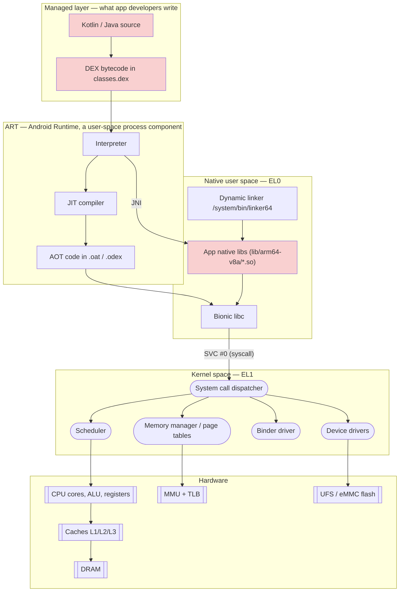

What you are looking at is the complete path a tap takes. The red-tinted boxes are the parts an
attacker most directly influences: the app's own code and its native libraries, because those are
what process attacker-supplied input.

Read it downward. Kotlin source is compiled to DEX bytecode, which is *not* machine code — it is an
instruction set for a virtual machine that does not exist in hardware. ART, which is itself just a
collection of C++ code running in the app's own process, either interprets that bytecode one
instruction at a time, or compiles it to real AArch64 machine code (with the JIT while running, or
with `dex2oat` ahead of time). Whichever path it takes, the code that ultimately executes is native
machine code running at exception level EL0.

Three of those words have not been defined yet, and this chapter promised not to do that. Here they
are; each gets a full treatment later, and none of them is needed to follow the paragraph above.

> **Definition — Bytecode**
> Instructions for a machine that does not physically exist. A real CPU has an instruction set burned
> into silicon; a *virtual* machine has one defined in software, and a program on the real CPU reads
> those instructions and carries them out. Bytecode is the compact binary encoding of that imaginary
> instruction set — DEX is Android's. The point is portability: one DEX file runs on ARM, x86 and
> anything else that has a runtime, because the runtime, not the chip, does the interpreting.
> Chapter [12 — DEX Internals](../12-DEX-Internals/README.md) reads a DEX file byte by byte.

> **Definition — `dex2oat`, and JIT versus AOT**
> `dex2oat` is a program on the device. It reads DEX bytecode and writes out real AArch64 machine
> code, so the CPU can execute it directly instead of ART interpreting it instruction by instruction.
> Doing that in advance — at install time, or overnight while the phone charges — is **AOT**
> (ahead-of-time) compilation. Doing it while the app runs, for the methods that turn out to be hot,
> is **JIT** (just-in-time) compilation. Android uses both. Practical consequence for you: the same
> app on the same device may be executing interpreted bytecode, JIT-compiled code, or AOT-compiled
> code, and which one it is changes what a hook or a memory dump sees.
> [§3.26](#326-interpreters-compilers-jit-and-aot) of this chapter builds the idea up from nothing;
> chapter [13 — ART](../13-ART/README.md) owns the Android specifics.

> **Definition — Exception level (EL0, EL1)**
> AArch64 CPUs run code at one of four privilege levels, numbered EL0 (least privileged) to EL3
> (most). **EL0** is where all ordinary application code runs — your app, and every library it loads.
> **EL1** is where the kernel runs. The level is a hardware state, not a software convention: at EL0
> certain instructions will not execute and certain memory is unreachable, enforced by the
> silicon, and no amount of clever code at EL0 changes that. This is the physical basis of the entire
> Android security model, and
> [§3.11](#311-kernel-space-user-space-privilege-rings-and-exception-levels) of this chapter builds it
> up properly.

When that code needs anything from outside its own address space — a file, a socket, more memory, the
current time, a Binder transaction — it cannot do it. It executes the `SVC #0` instruction,
which is a deliberate hardware exception that switches the CPU to EL1 and enters the kernel at a
fixed address. The kernel checks whether the caller is permitted to do what it asked, does it, and
returns. Everything Android's security model claims rests on the fact that user-space code physically
cannot skip that step.

At the bottom, the memory management unit translates every single address the CPU touches. Two apps
can both use the address `0x7000000000` and reach entirely different physical memory, because the
kernel gave each of them a different translation table. That is process isolation, and it is
implemented in silicon, not in Java.

### 2.2 What one function call actually costs

The distances in the tower are not uniform. This diagram shows the same tower again, but sized by
time rather than by abstraction.

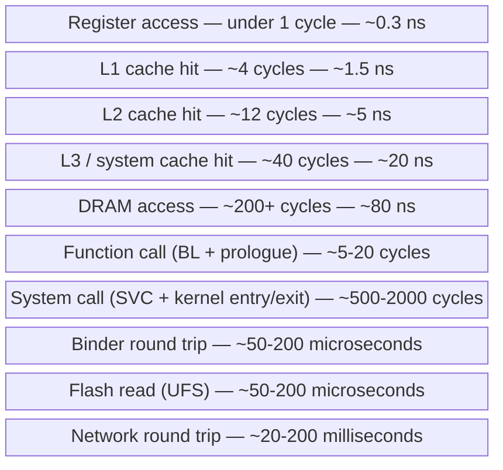

These numbers are order-of-magnitude figures for a typical modern ARM mobile SoC and vary by device,
but the *ratios* are what matter and they are stable. Three consequences follow directly, and all
three appear in real security work.

First, the gap between a register access and a DRAM access is roughly two hundred to one, which is
why caches exist at all — and why *cache timing* is a side channel. If accessing a piece of data is
measurably faster when some secret-dependent access happened earlier, the timing itself leaks the
secret. That is the mechanism behind an entire family of microarchitectural attacks.

Second, the gap between a function call and a system call is roughly a hundred to one. That is why
libraries batch syscalls, why `printf` buffers its output, and why an app doing per-byte `read()`
calls is visibly slow. It is also why tracing at the syscall boundary with `strace` is cheap enough
to be practical while tracing every function call is not.

Third, a Binder round trip is roughly a thousand times a syscall, because it involves a syscall *plus*
scheduling another process and waiting for it. When you see an Android app freeze, the answer is
almost always a Binder call on the main thread.

### 2.3 A process's address space

This is the single picture you will refer back to most. It shows what a 64-bit Android app process
looks like in memory, from the lowest address to the highest.

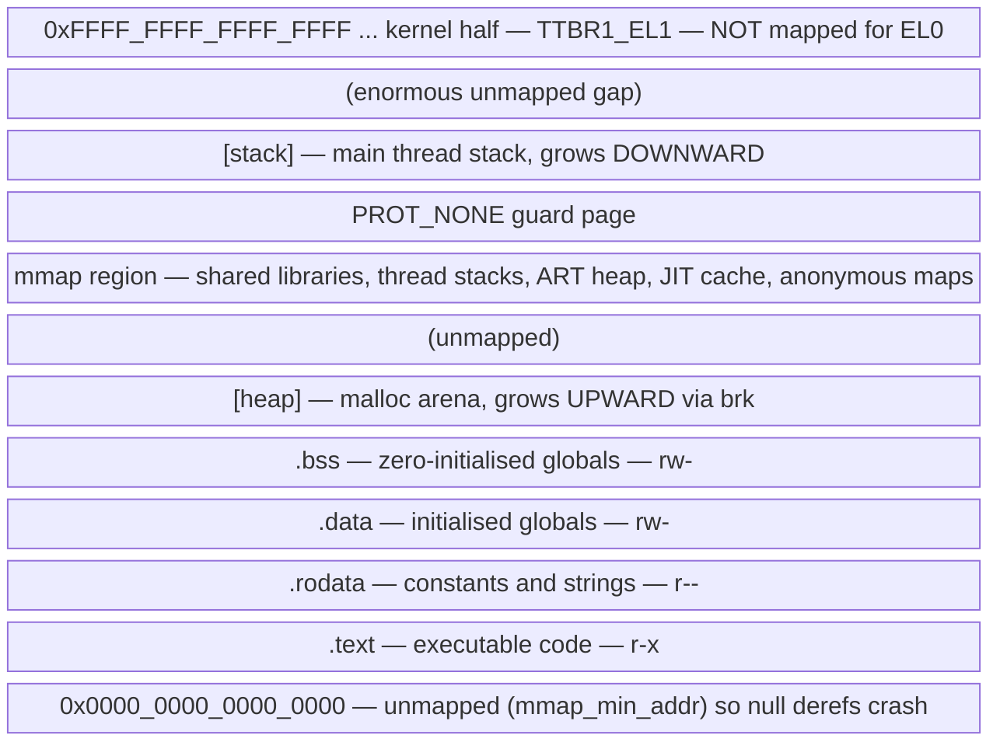

The layout reads from high addresses at the top to low addresses at the bottom, which is the
convention every debugger and every `/proc/<pid>/maps` dump uses.

Start at the bottom. Address zero and the pages above it are deliberately left unmapped. That is why
dereferencing a null pointer crashes instead of silently corrupting something: there is no valid
translation for address `0x0`, so the MMU raises a fault. The kernel enforces a floor on how low a
process may map memory through `/proc/sys/vm/mmap_min_addr`, which is non-zero on every Android
device.

Above that sit the segments of the main executable, mapped directly from the ELF file: executable
code that is readable and executable but not writable, read-only constants, and writable globals.
no normal region is simultaneously writable and executable. When you find one, something
is generating code at runtime — the ART JIT, a packer unpacking itself, or an injected agent.

Then the heap, which historically grew upward from the end of the data segment by moving the "program
break" with the `brk` syscall. On modern systems most large allocations come from `mmap` instead, so
the heap is really a set of arenas scattered through the mapping region.

The mapping region in the middle is where almost everything interesting lives on Android: every
loaded `.so`, every thread's stack, the ART managed heap where your Java objects live, the JIT code
cache, the memory-mapped APK, and every anonymous allocation. It is also where Frida's agent and
trampolines end up.

At the top of the user half is the main thread's stack, which grows *downward* toward lower
addresses. Below it is a `PROT_NONE` guard page — a page with no permissions at all — so that a
runaway recursion walks into it and dies with `SIGSEGV` instead of quietly corrupting the mapping
region. Above the user half is the kernel half, which on AArch64 is translated through a completely
separate table base register (`TTBR1_EL1`) and is not mapped for EL0 at all.

### 2.4 The lifetime of one instruction

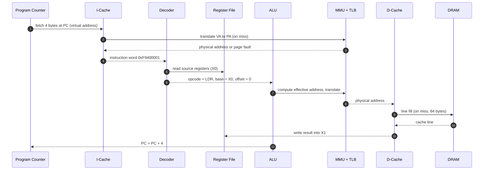

This is one instruction — a single load from memory into a register — traced through the hardware.
The point of showing it is that *every* step is a place where something can go wrong in a way you
will meet during analysis.

The program counter holds a virtual address, so even fetching the instruction requires a translation.
If the page holding the code has been unmapped — which is exactly what happens when a library is
`dlclose`d while a thread is still executing in it — the fetch itself faults and you get `SIGSEGV`
with the faulting address equal to the program counter.

The decode step turns four bytes into an operation. On AArch64 every instruction is exactly four
bytes and must be four-byte aligned, which is why you cannot jump into the middle of an instruction
on ARM the way you can on x86 — a fact that removes an entire class of gadget-finding tricks and is
why ARM ROP looks different from x86 ROP.

The effective address computation and its translation is where the memory permissions are enforced.
Writing to an address whose page is mapped read-only produces `SEGV_ACCERR`, distinct from touching
an address with no mapping at all, which produces `SEGV_MAPERR`. Those two subcodes are printed in
every Android tombstone and they tell you very different stories.

Finally, the cache line fill moves 64 bytes, not the 8 you asked for. That is *spatial locality* in
action, and it is why reading an array forward is far faster than reading it randomly — and why
timing an access can tell an attacker whether a nearby address was touched.

### 2.5 Trust boundaries

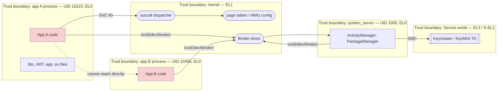

Each `subgraph` is a boundary that something must be *allowed* to cross. The dotted line from app A
to app B is the one that does not exist: there is no mechanism by which app A can read app B's memory
directly, because app A's page tables contain no entry that maps app B's physical pages. This is not
a policy decision that software checks; it is an absence of translation in hardware.

Everything that does cross a boundary goes through a narrow, audited gate. Ordinary kernel services
go through the syscall dispatcher. Inter-process communication goes through the Binder driver, which
is a kernel component precisely because the kernel is the only party both sides can trust to report
the caller's identity honestly — a userspace IPC mechanism could be lied to about who is calling.
Access to hardware-backed key material goes further still, through a secure monitor call into a
separate world that the normal-world kernel cannot inspect.

Your job as a tester is largely to find places where one of these gates is open wider than intended:
an exported component that any app can invoke over Binder, a file descriptor passed across a boundary
that carries more authority than the receiver should have, a Binder interface that does not check the
caller's UID, a kernel driver that trusts a pointer from user space. Chapters
[20 — Security Architecture](../20-Security-Architecture/README.md),
[24 — IPC](../24-IPC/README.md) and [25 — Binder](../25-Binder/README.md) live entirely inside this
diagram.

---
## 3. Deep Internal Working

### 3.1 What a computer is: CPU, RAM, storage, buses

**What.** A computer is four kinds of component connected by wires: a *processor* that executes
instructions, *memory* that holds instructions and data while the machine is on, *storage* that holds
them when it is off, and *buses* — the wires themselves — that move bits between the other three.
Everything else, including the entire Android platform, is built from those four.

**Why it exists in this form.** The design is called the *stored-program computer* and its defining
idea, credited to the 1945 EDVAC report associated with John von Neumann, is that instructions and
data live in the *same* memory and are made of the *same* bits. Earlier machines were rewired to
change what they computed. Storing the program as data means a machine can load a new program, and
means one machine can run any program.

> **Definition — Stored-program computer**
> A machine in which the program is held in the same read/write memory as the data it operates on,
> so that instructions can be loaded, generated, and modified at runtime by other instructions.

That single design decision is the root of most of computer security. If code and data are the same
substance, then data an attacker controls can be executed as code, and code can be rewritten as data.
The entire history of exploit mitigation — non-executable stacks, `W^X`, code signing, control-flow
integrity, pointer authentication — is a series of attempts to put back the distinction that the
stored-program model deliberately erased.

**The components, precisely.**

| Component | What it is | Android example | Failure that matters |
|---|---|---|---|
| **CPU** | Fetches, decodes and executes instructions; contains the ALU, control unit, register file, and caches | Cortex-A / Cortex-X cores in a Snapdragon or Tensor SoC | Speculative execution side channels |
| **RAM** | Volatile array of addressable bytes, holding code and data of every running process | LPDDR5 on the SoC package | Rowhammer bit flips; cold-boot memory recovery |
| **Storage** | Non-volatile block device holding the filesystem | UFS or eMMC flash holding `/data`, `/system` | Data at rest recovery when file-based encryption is misconfigured |
| **Buses** | Wires carrying addresses, data and control signals between components | AMBA/AXI interconnect on ARM SoCs | DMA-capable peripherals reading memory the CPU would refuse |
| **MMU** | Hardware inside the CPU that translates virtual addresses to physical ones | Part of every ARMv8-A core | The entire basis of process isolation |
| **Peripherals** | Modem, GPU, display, sensors, secure element | Reached through device drivers and `/dev` nodes | Vendor driver bugs are a large share of Android kernel CVEs |

**The three buses.** Classically the CPU speaks to memory over three logical bundles of wires. The
*address bus* carries "which location", the *data bus* carries "the contents", and the *control bus*
carries "read or write, and is this valid now". On a modern SoC these are packet-based interconnects
rather than literal parallel wires, but the abstraction holds and it explains one important thing:
the number of address lines determines how much memory can be addressed. Thirty-two address bits
address 4 GiB, which is why 32-bit systems hit a 4 GiB wall, and why every current Android device is
64-bit.

> **Under the Hood**
> Peripherals are not reached with special instructions on ARM. They are *memory-mapped*: the
> hardware designer assigns a range of physical addresses to a device's registers, and writing to
> those addresses configures the device. This is why a kernel driver bug that lets user space control
> a physical address can be catastrophic — it may let an attacker write to a device register instead
> of to RAM. It is also why `/dev/mem` access is restricted to nothing on a production Android build.

**Direct memory access (DMA)** is worth naming because it breaks a comfortable assumption. Some
peripherals can read and write RAM without the CPU's involvement, for speed. A DMA-capable device
therefore bypasses the MMU's protection of the CPU's view of memory, which is why modern SoCs put a
second translation unit — an IOMMU, called an SMMU on ARM — in front of device access. When you read
about a "baseband to application processor" attack, the question being asked is whether the modem can
DMA into kernel memory.

**Where this lands in Android.** When you read a tombstone and see a fault address, that is a
*virtual* address that the MMU could not translate. When you read `dumpsys meminfo` and see PSS
figures, those are *physical* pages attributed proportionally. When an app is killed by the
low-memory killer, it is because physical RAM — the filing cabinet, not the warehouse — ran out.
Keeping the physical/virtual distinction straight is the first discipline of memory work, and
[19 — Memory](../19-Memory/README.md) assumes it.

---

### 3.2 Bits, bytes, words and hexadecimal

**Why this matters before anything else.** Every file you will reverse engineer, every memory dump
you will read, every register value Frida prints, and every instruction you will disassemble is a
number written in hexadecimal. Arithmetic you cannot do in your head becomes friction on every single
command you run.

#### 3.2.1 The bit

A **bit** is one distinguishable physical state, interpreted as one of two symbols written `0` and
`1`. In a CPU it is a voltage held by a transistor arrangement; in flash it is charge trapped on a
floating gate; over a radio link it is a modulation state. The physics changes and the abstraction
does not, which is the entire point of the abstraction.

#### 3.2.2 The byte

Eight bits grouped together form a **byte**, giving 2⁸ = 256 distinct patterns. The byte is the
smallest unit that memory hardware lets you address individually. When you read that a variable is
"at address `0x7f8a1c0000`", that address identifies one byte. There is no pointer to a bit in C.

> **Definition**
> **Bit** — a single binary digit, the smallest unit of information.
> **Nibble** — four bits, exactly one hexadecimal digit.
> **Byte** — eight bits, the smallest individually addressable unit of memory.
> **Word** — the natural operand size of the architecture. *This term is ambiguous and you must
> always ask whose definition is in use.*

#### 3.2.3 The word problem

"Word" means different things in different documents, and misreading it produces size arithmetic that
is wrong by a factor of two or four.

| Document | "word" means | "doubleword" means |
|---|---|---|
| Intel / x86 manuals | 16 bits | 32 bits (and "quadword" is 64) |
| ARM architecture manuals | 32 bits | 64 bits |
| AArch64 assembly (`W` vs `X` registers) | `W` register = 32 bits | `X` register = 64 bits |
| Java Virtual Machine spec | Uses explicit types (`int`, `long`) | — |
| DEX format spec | Uses explicit widths (`uint`, `ushort`) | — |
| GDB `x/` command | `w` = 4 bytes, `g` = 8 bytes | — |

When you read a specification, find its definition of "word" before you trust any size arithmetic in
it. This is not pedantry: a DEX or ELF parser written against the wrong width reads every subsequent
field from the wrong offset.

#### 3.2.4 Positional bases, worked

A base is nothing more than a choice of how many digits exist before a column carries. Decimal 4096
means `4×10³ + 0×10² + 9×10¹ + 6×10⁰`. Binary and hex are the same idea with different column
weights.

**Decimal to binary, by subtraction.** Subtract the largest power of two that fits, write a `1` in
that column, repeat.

```
200 decimal:
  200 - 128 (2^7) = 72   → bit 7 set
   72 -  64 (2^6) =  8   → bit 6 set
    8 -   8 (2^3) =  0   → bit 3 set
  bits set: 7, 6, 3
  = 1100 1000 binary
```

**Binary to hex, by grouping.** Four bits is exactly one hex digit, so split from the right and
translate each group independently. This locality is *why* hex is used and decimal is not: changing
one hex digit changes exactly four bits and nothing else.

```
1100 1000
 C    8      → 0xC8
```

**Hex to decimal, by weight.** `0xC8` is `12×16 + 8` = `192 + 8` = 200. Confirmed.

Work through the full table once by hand; every value in it is one you will actually meet.

| Decimal | Binary | Hex | Where you meet it |
|---|---|---|---|
| 10 | `0000 1010` | `0x0A` | `\n`, the Unix newline, and the second byte of the DEX magic |
| 13 | `0000 1101` | `0x0D` | `\r`, carriage return |
| 32 | `0010 0000` | `0x20` | ASCII space; also the ASCII case bit |
| 48 | `0011 0000` | `0x30` | ASCII `'0'`; digits run `0x30`–`0x39` |
| 65 | `0100 0001` | `0x41` | ASCII `'A'`; the byte your `AAAA` overflow pattern writes |
| 97 | `0110 0001` | `0x61` | ASCII `'a'` |
| 112 | `0111 0000` | `0x70` | DEX `header_size` — 112 bytes |
| 127 | `0111 1111` | `0x7F` | Largest signed byte; first byte of the ELF magic |
| 128 | `1000 0000` | `0x80` | Smallest signed byte (−128); first non-ASCII byte |
| 255 | `1111 1111` | `0xFF` | Largest unsigned byte; −1 as `int8_t` |
| 256 | `1 0000 0000` | `0x100` | Needs a ninth bit — the byte overflow boundary |
| 4096 | — | `0x1000` | The default page size |
| 65535 | — | `0xFFFF` | Largest unsigned 16-bit; largest TCP port |
| 3735928559 | — | `0xDEADBEEF` | The classic joke filler value |

#### 3.2.5 Why hexadecimal wins

Three reasons, in order of importance.

The first is alignment with binary. One hex digit is one nibble, one byte is two hex digits, a 32-bit
value is eight, a 64-bit address is sixteen. You can convert `0xC3` to `1100 0011` in your head
without arithmetic. Try that with 195.

The second is that hardware boundaries are powers of two, and powers of two are round in hex and ugly
in decimal.

| Quantity | Decimal | Hex | What hex makes obvious |
|---|---|---|---|
| Page size | 4096 | `0x1000` | The page offset is the low three hex digits |
| Page mask | 4294963200 | `0xFFFFF000` | It is literally "clear the offset" |
| Max signed 32-bit | 2147483647 | `0x7FFFFFFF` | Sign bit clear, everything else set |
| Min signed 32-bit | −2147483648 | `0x80000000` | Only the sign bit set |

Page-aligning an address is `addr & ~0xFFF` in hex and a division in decimal. Extracting a flag is a
mask you can read off the page.

The third reason is social: `xxd`, `readelf`, `objdump`, `gdb`, `lldb`, Ghidra, IDA, Frida and every
Android tombstone print in hex. Fighting the convention costs you time on every command.

> **Pentester's Note**
> Learn to recognise values on sight. `0x7F454C46` is ELF. `0x504B0304` is a ZIP or APK.
> `0x64657801`-ish starting `64 65 78 0a` is DEX. `0xCAFEBABE` is a Java `.class` file — and also the
> Mach-O fat binary magic, which is a nice reminder that magic numbers are conventions, not
> guarantees. A field full of `0xA5` or `0xCD` bytes is allocator poison, meaning you are looking at
> freed or uninitialised memory.

---

### 3.3 Signed numbers and two's complement

**The problem.** A byte holds 256 patterns. If you want to represent negative numbers, you must give
up half of them. The question is *which* mapping to choose, and the answer determines whether your
hardware needs one adder or two.

**The answer everyone uses.** **Two's complement**: to negate a value, invert every bit and add one.
The most significant bit ends up acting as a sign bit, but it is a *consequence* of the scheme, not a
separate field.

> **Definition — Two's complement**
> A representation of signed integers in which the value of an *n*-bit pattern *b* is
> `b` if the top bit is 0, and `b − 2ⁿ` if the top bit is 1. Negation is bitwise NOT followed by
> adding one.

**Why this scheme and not "sign bit plus magnitude".** Because with two's complement the *same*
addition circuit works for signed and unsigned operands. `0xFF + 0x01 = 0x00` with a carry out, and
that is correct both as `255 + 1 = 256 (wraps to 0)` and as `−1 + 1 = 0`. There is also exactly one
representation of zero, whereas sign-and-magnitude has both `+0` and `−0`. One adder, one zero, no
special cases: the hardware argument was decisive and every architecture you will meet uses it.

**Worked negations, 8-bit.**

| Decimal | Positive form | Invert | Add 1 | Result | Hex | Cross-check (256 − n) |
|---|---|---|---|---|---|---|
| −1 | `0000 0001` | `1111 1110` | +1 | `1111 1111` | `0xFF` | 255 |
| −5 | `0000 0101` | `1111 1010` | +1 | `1111 1011` | `0xFB` | 251 |
| −100 | `0110 0100` | `1001 1011` | +1 | `1001 1100` | `0x9C` | 156 |
| −128 | (no positive form) | — | — | `1000 0000` | `0x80` | 128 |

The shortcut in the last column is that an *n*-bit negative `−x` has the same bit pattern as the
unsigned value `2ⁿ − x`. For 32 bits the constant is 4294967296.

**The asymmetry.** Eight bits give 256 patterns; zero uses one; that leaves 255 to split between
positives and negatives, and the split is 127 positives and 128 negatives. So `−128` exists and
`+128` does not, in eight bits. The practical consequence is that `abs(INT_MIN)` is undefined
behaviour in C and returns `INT_MIN` in practice, and that `-x` where `x` is the minimum value is
still the minimum value. Real bugs have hidden there.

**Ranges you must know.**

| Width | Unsigned range | Signed range | `−1` in hex |
|---|---|---|---|
| 8-bit | 0 … 255 | −128 … 127 | `0xFF` |
| 16-bit | 0 … 65 535 | −32 768 … 32 767 | `0xFFFF` |
| 32-bit | 0 … 4 294 967 295 | −2 147 483 648 … 2 147 483 647 | `0xFFFFFFFF` |
| 64-bit | 0 … 18 446 744 073 709 551 615 | −9 223 372 036 854 775 808 … 9 223 372 036 854 775 807 | `0xFFFFFFFFFFFFFFFF` |

**Sign extension versus zero extension.** When a narrow value is widened, the new high bits must come
from somewhere. *Sign extension* copies the top bit leftwards, preserving the signed value.
*Zero extension* fills with zeros, preserving the unsigned value. On AArch64 these are explicit
instructions (`SXTB`, `SXTH`, `SXTW` versus `UXTB`, `UXTH`), and there is a trap for the unwary:
**any write to a `W` register zeroes the upper 32 bits of the corresponding `X` register.** That
implicit zero-extension surprises people reading disassembly for the first time.

#### 3.3.1 The security consequence, in code

This is the single most productive bug class this section enables you to find.

```c
// VULNERABLE — the length is signed, the copy takes unsigned
int parse_record(const uint8_t *buf, int len) {
    char dest[64];
    if (len > 64) {              // signed comparison
        return -1;               // reject: too long
    }
    memcpy(dest, buf, len);      // len implicitly converts to size_t (unsigned, 64-bit)
    return 0;
}
```

If an attacker supplies `len = -1`, the check `(-1 > 64)` is false, so the function proceeds. Then
`memcpy` takes a `size_t` third argument, and converting `-1` to a 64-bit unsigned value yields
`0xFFFFFFFFFFFFFFFF` — approximately eighteen quintillion. The copy runs until it hits an unmapped
page. The check passed; the code is still catastrophically broken.

```c
// FIXED — unsigned type, and the comparison uses the actual buffer size
int parse_record(const uint8_t *buf, size_t len) {
    char dest[64];
    if (len > sizeof(dest)) {
        return -1;
    }
    memcpy(dest, buf, len);
    return 0;
}
```

A second variant is the **integer overflow in a size computation**:

```c
// VULNERABLE — count * size can wrap
void *p = malloc(count * sizeof(struct item));   // count = 0x20000000, sizeof = 8
// 0x20000000 * 8 = 0x100000000, truncated to 32 bits = 0
// malloc(0) returns a tiny allocation; the following loop writes far past it
```

The disciplined fix is to check for overflow before multiplying, or to use a checked helper such as
`__builtin_mul_overflow`, or to use `calloc`, which is required to detect the overflow itself.

> **Warning**
> When you review decompiled code, the decompiler's type inference is a *guess*. Ghidra frequently
> shows `int` where the source had `size_t`, or `undefined4` where the width matters. Confirm
> signedness by looking at the actual comparison instruction: on AArch64, `B.GT`/`B.LT` are the
> *signed* branches and `B.HI`/`B.LO` are the *unsigned* ones. That one distinction, read straight
> off the disassembly, is often the whole finding.

| Condition code | Signed or unsigned | Meaning |
|---|---|---|
| `EQ` / `NE` | Either | Equal / not equal |
| `GT` / `GE` / `LT` / `LE` | **Signed** | Greater than, etc. |
| `HI` / `HS` (`CS`) / `LO` (`CC`) / `LS` | **Unsigned** | Higher, higher-or-same, lower, lower-or-same |
| `MI` / `PL` | — | Negative (N set) / positive-or-zero |
| `VS` / `VC` | — | Signed overflow set / clear |

---

### 3.4 Endianness

**What.** Endianness is the order in which the bytes of a multi-byte value are laid out in ascending
memory addresses.

**The two conventions.** Take the 32-bit value `0x12345678` stored at address `0x1000`.

| Address | Little-endian byte | Big-endian byte |
|---|---|---|
| `0x1000` | `0x78` | `0x12` |
| `0x1001` | `0x56` | `0x34` |
| `0x1002` | `0x34` | `0x56` |
| `0x1003` | `0x12` | `0x78` |

Little-endian puts the *least significant* byte at the lowest address. Big-endian puts the *most*
significant byte first, which is the order humans write numbers in — hence "network byte order" is
big-endian, because protocol designers wanted packet dumps to be human-readable.

**Why both exist.** Little-endian makes truncation free: the low 8 bits of a 32-bit value are at the
same address as the whole value, so casting a `uint32_t*` to a `uint8_t*` and reading gives the low
byte with no arithmetic. Big-endian makes comparison and printing natural. Neither is correct;
history picked differently in different places and the split never healed.

**What Android does.** Every Android ABI is little-endian: `arm64-v8a`, `armeabi-v7a`, `x86`,
`x86_64`. ARM hardware is technically *bi-endian* — the `SCTLR_ELx.EE` and `SPSR.E` control bits can
select big-endian data accesses — but Android never enables it. This is why `EI_DATA` in every
Android `.so` is `1` (LSB).

**Where you will still meet big-endian, inside a little-endian process.**

| Context | Endianness | Why it bites |
|---|---|---|
| IP, TCP, UDP, TLS record headers | Big-endian | Hand-parsing captured traffic |
| DNS, Kerberos, ASN.1 length fields | Big-endian | Protocol analysis |
| Java `DataOutputStream`, `ByteBuffer` default | **Big-endian** | A Java-written file read by native code is byte-swapped |
| `ByteBuffer.order(ByteOrder.nativeOrder())` | Little-endian on Android | The fix for the row above |
| Java `.class` file format | Big-endian | Reading a JAR by hand |
| DEX file format | Little-endian | `endian_tag` field is literally `0x12345678` |
| ELF | Declared in `e_ident[EI_DATA]` | `1` = LSB, `2` = MSB |
| ZIP / APK structures | Little-endian | Central directory parsing |
| Most cryptographic primitives (SHA-2, AES-GCM counters) | Big-endian internally | Reimplementing a check and getting garbage |

```bash
# host / WSL — see endianness with your own eyes
printf '\x78\x56\x34\x12' > /tmp/le.bin
xxd /tmp/le.bin              # 7856 3412
od -A d -t x4 /tmp/le.bin    # 12345678 — read back as a 32-bit int
```

```python
# host — the packing you will use in every exploit or parsing script
import struct
struct.pack("<I", 0x12345678)   # b'\x78\x56\x34\x12'  little-endian, 32-bit
struct.pack(">I", 0x12345678)   # b'\x12\x34\x56\x78'  big-endian, 32-bit
struct.pack("<Q", 0x7f8a1c0000) # little-endian, 64-bit — the form addresses take
```

> **Pentester's Note**
> When a value from a hex dump "looks reversed", it is not corrupt — it is little-endian. This is the
> single most common false alarm for people new to binary formats. The rule for deciding whether to
> reverse: if the bytes are a multi-byte **number** (a size, an offset, a checksum, an address),
> reverse them. If they are a **string or byte array** (a magic value, a SHA-1 digest, a name),
> do not. The DEX header conveniently contains both kinds side by side, which is why
> [Lab 01](labs/lab-01-binary-hex-endianness.md) uses it as the exercise.

---

### 3.5 Text: ASCII, UTF-8, UTF-16 and MUTF-8

Text is a convention layered on bytes, and Android layers three different conventions in one process.

**ASCII** assigns 128 characters to the values 0–127. The structure is worth knowing because it makes
manual decoding fast: digits are `0x30`–`0x39`, uppercase letters are `0x41`–`0x5A`, lowercase are
`0x61`–`0x7A`, and the difference between the cases is exactly bit 5 (`0x20`). Control characters
occupy 0–31 and `0x7F`.

**UTF-8** encodes the whole Unicode range in one to four bytes, and is designed so that the ASCII
range encodes as itself. A byte below `0x80` is a complete character; a byte from `0xC2` to `0xF4`
starts a multi-byte sequence; bytes from `0x80` to `0xBF` are continuation bytes. This
self-synchronising property is why `strings` works so well on UTF-8 data.

**UTF-16** encodes each character as one or two 16-bit code units. Java and Kotlin `String` objects
hold UTF-16 internally, `char` is a 16-bit UTF-16 code unit, and this is why `String.length()` on an
emoji returns 2.

**Modified UTF-8 (MUTF-8)** is the variant used inside DEX files and by the JNI functions
`GetStringUTFChars` and `NewStringUTF`. It differs from standard UTF-8 in two ways: the NUL character
is encoded as the two bytes `0xC0 0x80` rather than a single zero byte, so that C string functions
never see an embedded terminator; and characters outside the Basic Multilingual Plane are encoded as
a surrogate pair, each surrogate separately encoded in three bytes, giving six bytes total instead of
UTF-8's four.

| Encoding | Unit | Where on Android | Gotcha |
|---|---|---|---|
| ASCII | 1 byte, 0–127 | Log tags, protocol keywords | None |
| UTF-8 | 1–4 bytes | Files, HTTP bodies, most native strings | Multi-byte characters break naive length checks |
| UTF-16 | 2 or 4 bytes | Java/Kotlin `String` in memory | `length()` counts code units, not characters |
| MUTF-8 | 1–6 bytes | DEX string data, `NewStringUTF` | Not valid UTF-8 for supplementary characters |

> **Warning**
> The MUTF-8 distinction is a real source of bugs and a real source of findings. Passing a genuine
> UTF-8 buffer containing an emoji to `NewStringUTF` produces undefined behaviour, and passing a
> string containing an embedded NUL through the JNI boundary can truncate on one side and not the
> other. Where a length or a name is validated on the Java side and used on the native side, the
> encoding difference is exactly the kind of gap where a filter bypass hides.

```bash
# host — extract strings in each encoding from a native library
strings -a -n 8 libnative.so             # default: 7-bit and UTF-8-ish runs
strings -a -e l -n 8 libnative.so        # 16-bit little-endian (UTF-16) runs
strings -a -e b -n 8 libnative.so        # 16-bit big-endian runs
```

---

### 3.6 What a CPU does: fetch, decode, execute

**The whole job.** A CPU repeats one loop forever:

1. **Fetch** the instruction at the address in the program counter.
2. **Decode** it into an operation and a set of operands.
3. **Execute** it, using the arithmetic logic unit or the memory unit.
4. **Write back** any result into a register or memory.
5. **Advance** the program counter — normally by the instruction size, or to a branch target.

That is it. Every program, every app, every kernel is that loop running billions of times.

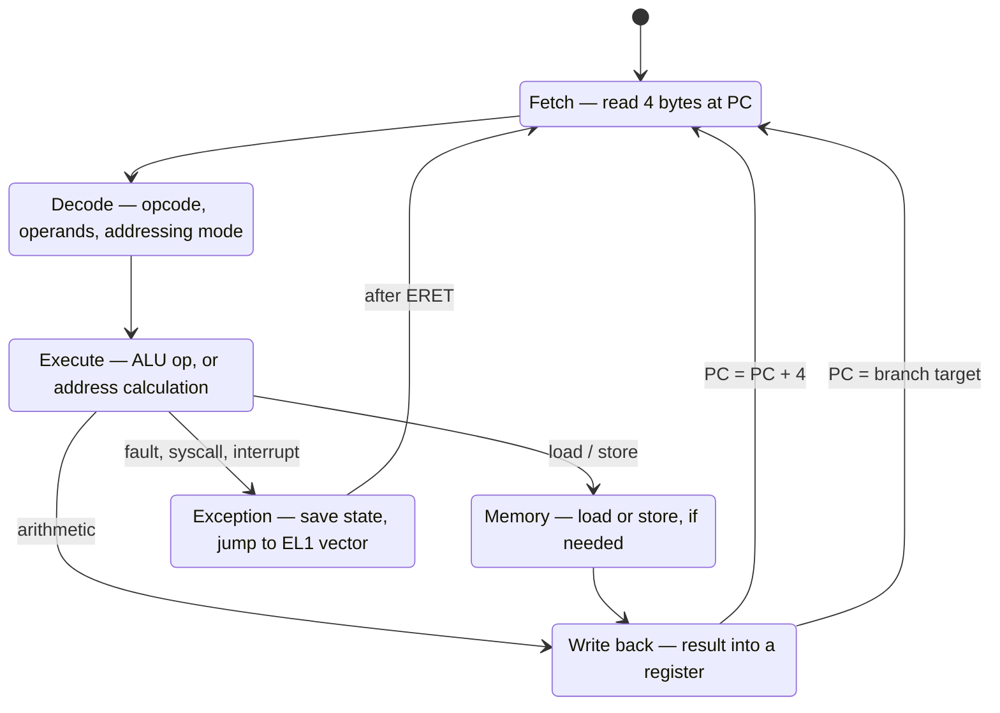

The diagram shows the ordinary loop plus the one escape hatch that matters for security: the
**exception** path. Anything that is not "carry on with the next instruction" — a page fault, an
illegal instruction, a timer interrupt, an `SVC` system call, a breakpoint — takes that path. The CPU
saves the current program counter into `ELR_EL1` and the processor state into `SPSR_EL1`, switches to
EL1, and jumps to a fixed address in the kernel's exception vector table. The kernel handles it and
executes `ERET`, which restores the saved state and resumes. Every system call, every crash, and
every context switch travels this route.

**The clock.** The clock is a square wave that paces the whole design. One clock cycle is the time
budget for one stage of work. A 2.8 GHz core has 2.8 billion cycles per second, so one cycle is about
0.36 nanoseconds. "Instructions per cycle" is greater than one on modern cores because they issue
several instructions simultaneously.

**Pipelining.** Rather than completing one instruction before starting the next, a real core overlaps
them: while instruction *n* executes, instruction *n+1* is decoding and *n+2* is being fetched. This
raises throughput without raising clock speed. It also creates *hazards*: if instruction *n+1* needs
a result *n* has not produced yet, the pipeline must stall or forward the value.

**Branch prediction and speculation.** A branch is a problem for a pipeline, because until the branch
resolves the core does not know which instruction to fetch next. Rather than stall, the core
*predicts* the outcome and speculatively executes down the predicted path, discarding the work if the
prediction was wrong. Architecturally, a mispredicted path leaves no trace. Microarchitecturally, it
does: the caches it warmed stay warm. That gap between the architectural and microarchitectural view
is the mechanism behind the Spectre family of attacks, and it is why "it was never actually executed"
is not a safety argument.

**Out-of-order execution.** Modern cores also reorder independent instructions to keep functional
units busy, then retire the results in program order so the visible behaviour is correct. This is why
concurrent code needs explicit memory barriers: the order in which one core's writes become visible
to another core is not necessarily the order they appear in the source.

| Feature | Purpose | Security relevance |
|---|---|---|
| Pipelining | Throughput | Timing variability |
| Branch prediction | Avoid stalls | Branch predictor state is a covert channel |
| Speculative execution | Avoid stalls | Spectre-class transient execution attacks |
| Out-of-order execution | Utilisation | Requires barriers; relaxed memory model surprises |
| Caches | Latency | Cache timing side channels; Flush+Reload |
| SIMD (NEON/SVE) | Data parallelism | Constant-time crypto implementations rely on it |

> **Under the Hood**
> AArch64 has a *fixed 4-byte instruction encoding* and requires 4-byte alignment for instruction
> fetch. Two consequences follow that you will use. First, you cannot jump into the middle of an
> instruction to reinterpret its bytes as a different instruction — the "unaligned gadget" trick that
> makes x86 ROP so productive does not exist on ARM, so ARM gadget sets are smaller and more
> deliberate. Second, any address that is not a multiple of four cannot be a valid ARM
> code address, which is a fast sanity check when you are staring at a corrupted pointer.

---

### 3.7 Registers

**What.** A register is a storage location inside the CPU itself. It is the fastest storage in the
machine by two orders of magnitude, and it is where arithmetic actually happens.

**Why they exist.** AArch64 is a *load-store architecture*: arithmetic instructions operate only on
registers. To add two numbers in memory you must load each into a register, add the registers, and
store the result back. This is a deliberate simplification that makes the instruction encoding
regular and the pipeline predictable, and it is why disassembly is full of `LDR`/`STR` pairs
surrounding the interesting operation.

**The AArch64 register file.** Thirty-one general-purpose registers, addressable as 64-bit `X0`–`X30`
or as their low 32 bits `W0`–`W30`. Register number 31 is context-dependent: in most instructions it
encodes the zero register `XZR`/`WZR`, which reads as zero and discards writes; in stack-addressing
instructions it encodes `SP`.

What matters far more than the count is that the **ABI assigns each register a role**, and those
roles are how you read disassembly. The procedure call standard for AArch64 is AAPCS64.

| Register | 32-bit alias | AAPCS64 role | Saved by |
|---|---|---|---|
| `X0`–`X7` | `W0`–`W7` | Arguments 1–8; `X0` (and `X1`) also carry the return value | Caller |
| `X8` | `W8` | Indirect result location register (`XR`); **also the Linux syscall number** | Caller |
| `X9`–`X15` | `W9`–`W15` | Temporary / scratch | Caller |
| `X16` | `W16` | `IP0` — intra-procedure-call scratch, used by PLT stubs and linker veneers | Caller |
| `X17` | `W17` | `IP1` — intra-procedure-call scratch | Caller |
| `X18` | `W18` | Platform register. **On Android this is the Shadow Call Stack pointer** — never clobber it | Reserved |
| `X19`–`X28` | `W19`–`W28` | General purpose, preserved across calls | **Callee** |
| `X29` | — | `FP` — frame pointer, head of the frame-record chain | Callee |
| `X30` | — | `LR` — link register; `BL` writes the return address here | Caller |
| `SP` | `WSP` | Stack pointer; must be 16-byte aligned at public interfaces | Special |
| `PC` | — | Program counter; not a general register, read via `ADR`/`ADRP` | Special |
| `XZR` | `WZR` | Zero register — reads 0, writes discarded | Special |
| `V0`–`V7` | `Q/D/S/H/B` views | SIMD and floating-point arguments and results | Caller |
| `V8`–`V15` | — | SIMD/FP; **low 64 bits are callee-saved** | Partly callee |
| `V16`–`V31` | — | SIMD/FP temporaries | Caller |

> **Definition — Caller-saved and callee-saved**
> A **caller-saved** (volatile) register may be freely overwritten by any function you call, so if
> you need its value afterwards you must save it yourself before the call. A **callee-saved**
> (non-volatile) register must be preserved: a function that uses one must save it on entry and
> restore it on exit. This division is a contract, not a hardware rule, and reading a function's
> prologue tells you which callee-saved registers it intends to use.

**The condition flags.** Comparison instructions set four bits in `NZCV`, and conditional branches
test them.

| Flag | Bit | Set when |
|---|---|---|
| `N` | 31 | Result is negative (its top bit is set) |
| `Z` | 30 | Result is zero |
| `C` | 29 | Unsigned carry out, or no borrow |
| `V` | 28 | Signed overflow occurred |

**Reading argument passing off the disassembly.** This is the practical payoff of the table above.

```asm
// AArch64 — reading this tells you the call's arguments without any symbols
    adrp    x0, #0x12000            // x0 = page base of a string literal
    add     x0, x0, #0x340          // x0 = &"/system/xbin/su"      → argument 1
    mov     w1, #0                  // w1 = 0 (F_OK)                → argument 2
    bl      access                  // access("/system/xbin/su", F_OK)
    cbz     w0, root_found          // w0 is the return value; 0 means the file exists
```

Five instructions, no symbols needed beyond the PLT name, and you have identified a root check.
That is the skill [18 — ARM](../18-ARM/README.md) develops in depth.

**x86-64 for comparison**, because emulator images and host tooling use it.

| Concept | AArch64 | x86-64 (System V) |
|---|---|---|
| Argument registers | `X0`–`X7` | `RDI`, `RSI`, `RDX`, `RCX`, `R8`, `R9` |
| Return value | `X0` | `RAX` |
| Return address on call | Written to `X30` (a register) | **Pushed onto the stack** by `CALL` |
| Return instruction | `RET` — branches to `X30` | `RET` — pops `[RSP]` into `RIP` |
| Syscall instruction | `SVC #0` | `SYSCALL` |
| Syscall number | `X8` | `RAX` |
| Syscall arguments | `X0`–`X5` | `RDI`, `RSI`, `RDX`, `R10`, `R8`, `R9` |
| Instruction width | Fixed 4 bytes | Variable 1–15 bytes |
| Stack alignment | 16 bytes | 16 bytes at the `CALL` site |

The row in bold is the most important structural difference in this entire chapter, and section 3.16
explains why.

**Where you see registers in practice.** Frida gives them to you directly in an
`Interceptor.attach` callback as `this.context.x0` and so on. A tombstone prints the full set at
crash time. `gdb`'s `info registers` and `lldb`'s `register read` print them. When a crash report
shows `x0 = 0x4141414141414141`, your input reached a register, and that is the beginning of a
finding.

---

### 3.8 The memory hierarchy and caches

**The problem.** Processor speed has grown far faster than memory speed. A core can execute several
instructions per nanosecond, and a DRAM access takes roughly eighty. Without intervention the core
would spend almost all its time waiting.

**The solution.** A hierarchy of progressively larger and slower stores, in which each level caches
the level below it. This works only because of two empirical properties of real programs:

> **Definition — Locality of reference**
> **Temporal locality**: a memory location accessed once is likely to be accessed again soon (loop
> counters, the top of the stack).
> **Spatial locality**: locations near a recently accessed one are likely to be accessed soon
> (array traversal, sequential instruction fetch).

| Level | Typical size | Typical latency | Notes |
|---|---|---|---|
| Registers | ~248 bytes (31 × 64-bit) | < 1 cycle | Not really a cache; explicitly managed by the compiler |
| L1 instruction cache | 32–64 KiB per core | ~4 cycles | Separate from data cache (Harvard split) |
| L1 data cache | 32–64 KiB per core | ~4 cycles | |
| L2 cache | 256 KiB – 2 MiB per core | ~12–20 cycles | |
| L3 / system-level cache | 2–16 MiB shared | ~40 cycles | Shared across cores — hence cross-core side channels |
| DRAM | 4–16 GiB | ~200+ cycles | Volatile |
| Flash (UFS) | 64 GiB – 1 TiB | ~50–200 µs | Non-volatile |

**Cache lines.** Caches do not store individual bytes; they store fixed-size *lines*, typically 64
bytes on ARM cores. Touching one byte pulls in the whole line. That is spatial locality exploited in
hardware, and it explains a class of performance behaviour: iterating an array of structs by field is
slower than by element, because each access pulls a line and uses eight bytes of it.

**The instruction/data cache split matters for security.** The L1 caches are separate, and on ARM
they are **not coherent with each other by default**. If a program writes new instructions into
memory — which is exactly what a JIT compiler, a packer, or Frida's code generator does — the bytes
land in the data cache, while the instruction cache may still hold the old contents of that address.
Executing without an explicit cache maintenance sequence produces stale, arbitrary behaviour.

```c
// The sequence any runtime code generator must perform on AArch64,
// after writing instructions into a buffer and before executing them.
__builtin___clear_cache((char *)buf, (char *)buf + len);
// This expands to the DC CVAU / DSB ISH / IC IVAU / DSB ISH / ISB sequence.
```

> **Pentester's Note**
> This is a genuinely useful fingerprint. Native code that calls `__builtin___clear_cache`,
> `cacheflush`, or emits `IC IVAU` / `ISB` instructions is generating or patching code at runtime.
> In an app's own `.so` that is a strong indicator of a packer, an obfuscation runtime, or an inline
> hooking engine. Combine it with `mprotect(..., PROT_EXEC)` in the same function and you have found
> the unpacking routine — the place to set a breakpoint and dump the decrypted payload.

**Cache timing as a side channel.** Because a hit and a miss differ by tens of nanoseconds and that
difference is measurable from user space, an attacker who can measure their own access times can
infer which lines another party touched. The general mitigation for cryptographic code is
*constant-time programming*: no branch and no memory index may depend on secret data. When you review
a native crypto implementation and see `if (key_bit) { ... }` or `table[secret_byte]`, that is a
legitimate finding even though nothing crashes.

---

### 3.9 Machine code versus assembly

**Machine code** is the bytes the CPU actually fetches and decodes. On AArch64 every instruction is
exactly four bytes. **Assembly language** is a human-readable text notation for those bytes, with one
line per instruction and symbolic names for registers and addresses. The mapping is essentially
one-to-one: an *assembler* turns text into bytes, and a *disassembler* turns bytes back into text.

```
Machine code (hex, little-endian as stored):   01 00 40 F9
Instruction word (as the CPU sees it):          0xF9400001
Assembly:                                       LDR  X1, [X0]
Meaning:                                        load 8 bytes from the address in X0 into X1
```

Because the relationship is mechanical, disassembly is *lossless with respect to behaviour* and
*lossy with respect to intent*. The bytes tell you exactly what the CPU will do. They do not tell you
what the variable was called, what the programmer meant, or where one source-level statement ended
and the next began. Compilers destroy that information deliberately, and optimisation destroys more
of it.

| Representation | Produced by | Lossless? | Tool |
|---|---|---|---|
| Source (C/C++) | Human | — | — |
| Assembly (`.s`) | `clang -S` | Behaviour preserved | `as` assembles it |
| Object code (`.o`) | `clang -c` | Yes, plus relocations | `objdump -d` |
| Linked ELF (`.so`) | `lld` | Yes | `objdump -d`, Ghidra, IDA |
| Disassembly | Disassembler | Exact | `objdump`, `llvm-objdump`, `r2` |
| Decompilation (pseudo-C) | Decompiler | **A guess** | Ghidra, IDA Hex-Rays |

> **Warning**
> Decompiler output is an inference, not a translation. It invents variable names, guesses types and
> signedness, sometimes drops a check it could not model, and occasionally produces code whose
> behaviour differs from the binary. When the decompiled function is the one your finding depends on,
> read the disassembly. This is the single most common source of false findings in native review.

**Two things a disassembler must guess, and why it matters.** First, *where instructions begin*. On
x86, with variable-length instructions, a disassembler that starts at the wrong offset produces
plausible nonsense; this is the basis of a classic anti-disassembly trick. On AArch64 the fixed width
makes this far less of a problem. Second, *what is code and what is data*. Compilers place jump
tables, constant pools and literal pools inside the `.text` section, and a linear-sweep disassembler
will happily decode a jump table as instructions. When you see a run of impossible instructions in
the middle of a function, you are usually looking at data.

**Do you need to learn assembly?** You need to be able to *read* it; you almost certainly never need
to write it. Reading means that given twenty lines of AArch64 you can say "it compares the length in
`W1` against `0x20`, branches to the error path if greater, and otherwise calls `memcpy` with the
destination in `X0`". That needs the register roles, about thirty mnemonics, the condition codes, and
the prologue/epilogue patterns — a weekend of study, and the highest-value weekend available to
you, because decompilers fail precisely on the code that matters most: obfuscated routines,
hand-written crypto, and anti-tamper checks.

> **Mental Model**
> Assembly is a language you read like a menu in a foreign country, not one you compose poetry in.
> Recognition, not fluency, is the goal.

---
### 3.10 What an operating system is and why it exists

**The problem it solves.** One machine, many programs that do not trust each other, and one set of
hardware. Consider what has to be true on a phone: two apps run at once and neither may read the
other's memory; a malicious app must not read your photos; a buggy app must not hang the device; and
all of them must share one screen, one radio and one flash chip without corrupting each other's data.
Every one of those requirements says that *somebody must arbitrate*, and that the arbitrator must be
more privileged than the programs it arbitrates.

> **Definition — Operating system**
> A body of software that (a) abstracts hardware into portable interfaces, (b) multiplexes limited
> hardware resources between competing programs, and (c) enforces isolation between those programs.
> On Android the operating system is the Linux kernel plus the Android user space around it.

> **Definition — Kernel**
> The single privileged program that is always resident and is the only software permitted to execute
> privileged instructions and touch hardware directly. Everything else runs in *user space* and must
> ask the kernel for anything it wants, through a *system call*.

**The three jobs, concretely.**

| Job | Mechanism | What breaks without it |
|---|---|---|
| **Abstraction** | Files instead of flash blocks; sockets instead of radio frames; processes instead of raw CPU time | Every app would need a driver for every device model |
| **Multiplexing** | Scheduler for CPU, page allocator for RAM, filesystem for storage, network stack for the radio | One app would monopolise the machine |
| **Isolation** | Page tables, UIDs, file permissions, SELinux, seccomp, namespaces | Any app could read any other app's data |

**Monolithic versus microkernel.** Linux is a *monolithic* kernel: filesystems, drivers, the network
stack and the scheduler all run in a single privileged address space. The alternative, a
*microkernel*, keeps only scheduling and IPC in the privileged core and pushes drivers into
unprivileged servers. Monolithic kernels are faster because a filesystem call is a function call
rather than a message; microkernels are safer because a driver bug crashes one server rather than the
machine.

The security consequence for Android is direct and it is why kernel bugs dominate the severity
tables. In a monolithic kernel there is no internal boundary: a bug in a vendor GPU driver runs in
the same privileged address space as the code that enforces app isolation. Compromise any part and
you have compromised the enforcement of everything. Android has spent a decade partially walking this
back — moving drivers to user space via HALs, using hypervisor-level protections such as pKVM,
introducing eBPF sandboxing, and rewriting components in Rust — but the core remains monolithic.

**What Android adds on top of Linux.**

| Android component | What it is | Chapter |
|---|---|---|
| Binder driver | Kernel character device implementing Android's IPC with kernel-attested caller identity | [25 — Binder](../25-Binder/README.md) |
| Zygote | A pre-warmed process that forks to create every app | [09 — App Internals](../09-Android-App-Internals/README.md) |
| `system_server` | The privileged process hosting `ActivityManager`, `PackageManager` and most system services | [06 — Architecture](../06-Android-Architecture/README.md) |
| ART | The managed runtime executing DEX bytecode inside each app process | [13 — ART](../13-ART/README.md) |
| Bionic | Android's C library and dynamic linker, replacing glibc | [15 — Native Code](../15-Native-Code/README.md) |
| SELinux policy | Mandatory access control on every process, enforcing by default | [22 — SELinux](../22-SELinux/README.md) |
| `lmkd` | User-space low-memory killer that terminates background apps under pressure | [19 — Memory](../19-Memory/README.md) |
| APEX modules | Updatable system components shipped independently of the platform image | [07 — AOSP](../07-AOSP/README.md) |

---

### 3.11 Kernel space, user space, privilege rings and exception levels

**What.** The CPU has a notion of *current privilege*, and the instructions available to executing
code depend on it. Code running at low privilege cannot reconfigure the MMU, cannot mask interrupts,
cannot read another privilege level's system registers, and cannot execute the instructions that
would let it grant itself more privilege.

**Why this is the foundation of everything.** Process isolation is not a promise applications make to
each other. It is a property of the address translation hardware, and only code at a higher privilege
level can change that hardware's configuration. Because only the kernel runs at that level, only the
kernel decides which physical memory a process can reach. Applications cannot opt out.

**x86 rings versus ARM exception levels.** On x86 the mechanism is called *protection rings*,
numbered 0 (most privileged) to 3 (least). In practice only rings 0 and 3 are used, for the kernel
and for applications. ARM uses a different and more explicit model.

| ARM Exception Level | Runs | Android example | Can it read EL0 memory? |
|---|---|---|---|
| `EL0` | Unprivileged application code | Every app process, `system_server`, Zygote children | Only its own |
| `EL1` | Operating system kernel | The Linux kernel and every driver, including `binder` | Yes, with explicit accessor functions |
| `EL2` | Hypervisor | KVM, protected KVM (pKVM), Gunyah | Yes |
| `EL3` | Secure monitor firmware | ARM Trusted Firmware; the gateway between Normal and Secure worlds | Yes |

Orthogonally to the exception levels, ARM TrustZone divides the system into a **Normal world** and a
**Secure world**. A trusted OS runs at `S-EL1` in the Secure world and hosts trusted applications such
as the KeyMint implementation that backs the Android Keystore. Normal-world software, *including the
Linux kernel*, cannot read Secure-world memory. This is why a hardware-backed key is meaningfully
different from a key in app memory: even a fully compromised kernel cannot extract it.

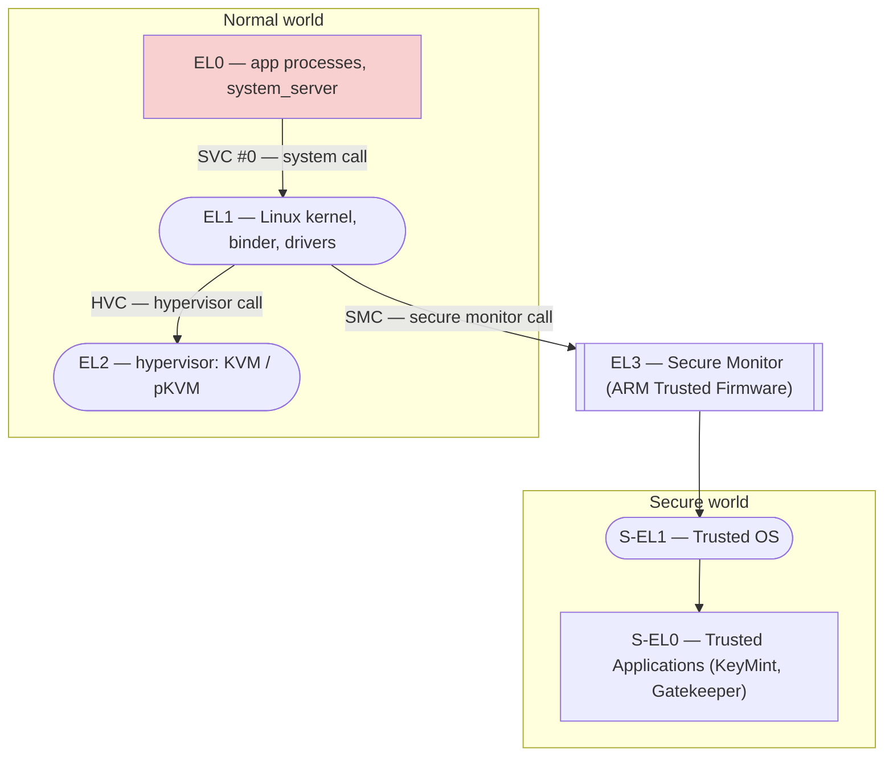

Read the arrows as the only legal ways to move upward. An app at EL0 executes `SVC #0` to enter the
kernel; the kernel executes `HVC` to reach a hypervisor or `SMC` to reach the secure monitor. There
is no instruction an app can execute to reach EL2 or EL3 directly. Each transition saves the caller's
state and jumps to a *fixed* entry point chosen by the more privileged level, which is essential: if
the caller could choose where in the kernel to land, the boundary would be meaningless.

**The kernel cannot trust user pointers.** This is the rule that generates the largest number of real
kernel vulnerabilities. When an app passes a pointer to a syscall, that pointer is just a number the
app chose. The kernel must never dereference it directly; it must use the accessor functions
(`copy_from_user`, `copy_to_user`, `get_user`, `put_user`) which validate that the address lies in
the user half and handle faults gracefully. Modern ARM cores also enforce this in hardware with
**PAN** (Privileged Access Never), which faults if kernel code touches a user address without
explicitly disabling the protection. A driver that dereferences a user pointer directly is a bug that
turns any user-space process into a kernel-memory reader.

| Hardware protection | What it enforces | Android status |
|---|---|---|
| **PAN** (Privileged Access Never) | Kernel cannot accidentally dereference user addresses | Standard on ARMv8.1+ |
| **PXN** (Privileged Execute Never) | Kernel cannot execute user-space pages | Standard; kills the classic `ret2usr` technique |
| **KASLR** | Kernel image base is randomised | Enabled on modern Android kernels |
| **CFI** (Control Flow Integrity) | Indirect calls must match the target's type signature | Enabled in AOSP kernel and much of user space |
| **PAC** (Pointer Authentication) | Return addresses and pointers carry a cryptographic signature | ARMv8.3+; used in Android system binaries on capable hardware |
| **BTI** (Branch Target Identification) | Indirect branches must land on a `BTI` instruction | ARMv8.5+ |
| **MTE** (Memory Tagging Extension) | Allocation and pointer tags must match on access | ARMv8.5+; used for heap safety on supporting devices |
| **Shadow Call Stack** | Return addresses kept in a separate `X18`-based region | Used in AOSP; the reason `X18` is reserved on Android |

> **Pentester's Note**
> When you assess the severity of a native memory-corruption finding, the mitigations active on the
> target device change the honest conclusion. A stack overflow on a binary built with
> `-fstack-protector-strong` and running with PAC and shadow call stack enabled is realistically a
> denial of service plus a possible data-only attack, not a control-flow hijack. Check the binary
> with `readelf` and `checksec`-style analysis before you write the impact paragraph — see
> [15 — Native Code](../15-Native-Code/README.md).

---

### 3.12 Processes: address space, PID, and the process control block

**Program versus process.** A **program** is a file: a passive sequence of bytes on storage, such as
`/system/bin/app_process64` or a DEX inside an APK. Nothing about it is running; it has no memory, no
registers, no identity. A **process** is a program that has been loaded and given the resources it
needs to execute.

> **Definition — Process**
> An executing instance of a program, consisting of a private virtual address space, one or more
> threads of execution, and a set of kernel-held resources: an open file table, signal dispositions,
> credentials, a working directory, and an entry in the kernel's task list.

One program can back many processes — every Chrome renderer runs the same binary — and each process
gets its own copy of everything mutable.

**What the kernel stores about a process.** The kernel's per-task structure is `struct task_struct`,
defined in the Linux source at `include/linux/sched.h`. It is what textbooks call the *process
control block*. The fields that matter to you:

| Field group | Contents | Where you can see it |
|---|---|---|
| Identity | `pid` (really the thread ID), `tgid` (the process ID), `comm` (the 16-byte name) | `/proc/<pid>/status`, `/proc/<pid>/comm` |
| Lineage | Parent pointer, children list, thread group list | `/proc/<pid>/status` (`PPid`), `pstree` |
| Credentials | Real/effective/saved/filesystem UID and GID, supplementary groups, capabilities | `/proc/<pid>/status` (`Uid`, `Gid`, `Groups`, `Cap*`) |
| Memory | `mm_struct` pointer: the VMA list and the page table base | `/proc/<pid>/maps`, `/proc/<pid>/smaps` |
| Files | `files_struct`: the file descriptor table | `/proc/<pid>/fd/` |
| Signals | Pending set, blocked mask, handler dispositions | `/proc/<pid>/status` (`SigQ`, `SigBlk`, `SigCgt`) |
| Scheduling | Policy, priority, nice value, cgroup membership, CPU accounting | `/proc/<pid>/stat`, `/proc/<pid>/sched` |
| Security | SELinux context, seccomp mode, `no_new_privs` | `/proc/<pid>/attr/current`, `status` (`Seccomp`) |
| Namespaces | Mount, PID, network, user namespace pointers | `/proc/<pid>/ns/` |
| Tracing | `TracerPid` — the PID of an attached debugger | `/proc/<pid>/status` |

That last row is worth sitting with. `TracerPid` in `/proc/self/status` is the single most common
anti-debugging check in Android applications, and now you know exactly what it is: a field in the
kernel's task structure, set when a `ptrace` attach succeeds, exposed through a pseudo-filesystem.
It is not a heuristic; it is ground truth from the kernel, which is why bypassing it means either
avoiding `ptrace` entirely or hooking the code that reads the file.

**A process's four UIDs.** Linux tracks several user identities per process, and confusing them
produces wrong conclusions.

| UID | Purpose |
|---|---|
| Real UID | Who started the process |
| Effective UID | Used for most permission checks |
| Saved set-user-ID | Lets a privileged process temporarily drop and regain privilege |
| Filesystem UID | Used specifically for filesystem access checks (a Linux-specific extra) |

On Android these are almost always identical, because Android does not use setuid binaries in app
contexts — the app UID is assigned at fork time by Zygote and never changes. The `Uid:` line of
`/proc/<pid>/status` prints all four in that order.

**The address space.** Every process gets its own translation table, so the same virtual address in
two processes maps to different physical memory. What appears in that space:

```mermaid
flowchart LR
    subgraph P["Process address space (per-process page tables)"]
        T["ELF text — r-x, file-backed, shared physically"]
        R["ELF rodata — r--, file-backed, shared physically"]
        D["ELF data/bss — rw-, private, copy-on-write"]
        H["Heap arenas — rw-, anonymous"]
        L["Shared libraries — mapped from /apex, /system/lib64, the APK"]
        A["ART managed heap — where Java objects live"]
        J["JIT code cache — written RW, executed RX"]
        S["Thread stacks — one per thread, each with a guard page"]
    end
    K(["Kernel — same physical pages in every process, unmapped for EL0"])
    P -.->|"SVC #0 only"| K
```

The important asymmetry the diagram encodes: the read-only, file-backed regions such as `.text` are
*physically shared* between every process that loaded the same library, because there is no reason to
keep multiple copies of identical unchangeable bytes. The writable regions are private, and become
physically distinct on first write through copy-on-write. This is why a hundred running apps do not
need a hundred copies of `libc.so` in RAM, and it is why `dumpsys meminfo` reports both RSS (all
resident pages) and PSS (shared pages divided by the number of sharers).

**Process lifecycle.**

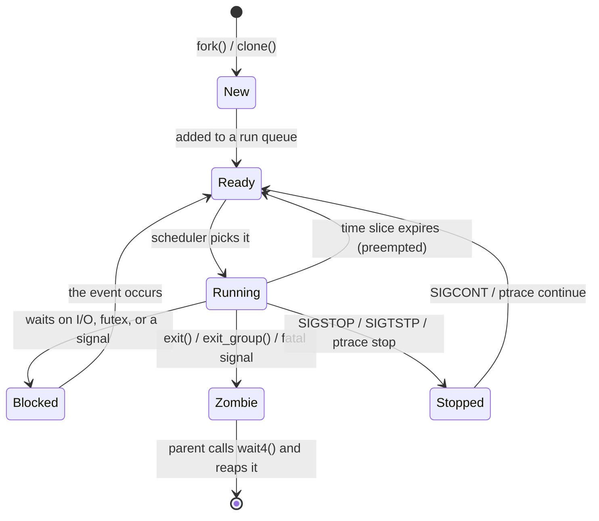

Every state in that diagram is visible in the `State:` line of `/proc/<pid>/status` and in the `STAT`
column of `ps`.

| `ps` code | State | What it means during analysis |
|---|---|---|
| `R` | Running or runnable | Actively using CPU |
| `S` | Interruptible sleep | Waiting on I/O or a lock; the normal idle state |
| `D` | Uninterruptible sleep | Usually blocked in a driver; cannot be killed |
| `T` | Stopped | `SIGSTOP`, or stopped by a debugger |
| `t` | Tracing stop | **A debugger is attached and has stopped it** |
| `Z` | Zombie | Exited but not yet reaped by its parent |
| `+` | Foreground process group | |
| `l` | Multi-threaded | Almost every Android process |

> **Definition — Zombie process**
> A process that has exited but whose exit status has not yet been collected by its parent with
> `wait4()`. It holds no memory and runs no code; only its task structure survives so that the exit
> status can be reported. You cannot kill a zombie — it is already dead. Either the parent reaps it,
> or you kill the parent, at which point `init` adopts and reaps it.

---

### 3.13 `fork`, `exec`, and why Zygote exists

**Two operations, deliberately separate.** Unix creates a new process with `fork()` and runs a new
program with `execve()`. Most systems combine these; Unix does not, and the gap between them is where
almost all of Android's per-app security setup happens.

**`fork()`.** Creates a near-exact duplicate of the calling process. The child gets a copy of the
parent's address space, a copy of the file descriptor table, the same credentials, the same working
directory, and the same signal dispositions. It gets a *new* PID. The call returns **twice**: in the
parent it returns the child's PID, and in the child it returns 0.

```c
pid_t pid = fork();
if (pid == 0) {
    /* child: this code runs in a brand-new process */
} else if (pid > 0) {
    /* parent: pid is the child's PID */
} else {
    /* fork failed; check errno */
}
```

**Copy-on-write is what makes this cheap.** The kernel does not copy the parent's memory. It marks
every writable page in both processes read-only and shares the physical pages. The first time either
side writes to a page, the MMU faults, the kernel allocates a fresh physical page, copies the
contents, marks it writable in the writer's tables, and resumes. Pages that are only ever read — all
of the code, all of the constants, all of the untouched data — are never duplicated at all.

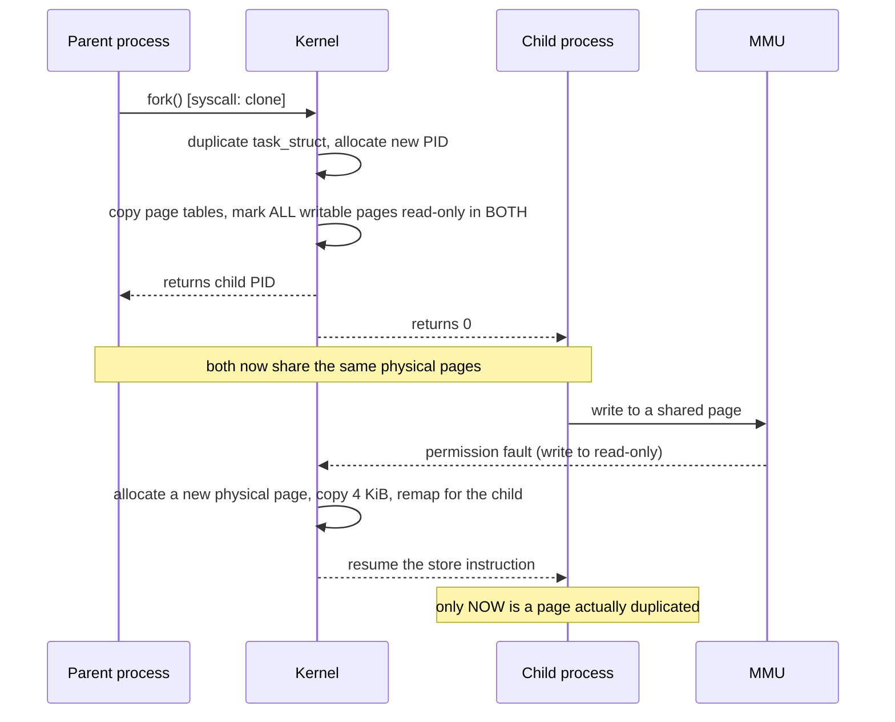

**`execve()`.** Replaces the current process image with a new program. The PID stays the same, but the
address space is torn down and rebuilt from the new ELF file: new text, new data, new stack, new
heap. What survives is the PID, the parent relationship, the working directory, and — unless a
descriptor was opened with `O_CLOEXEC` — the open file descriptors.

| Attribute | Survives `fork()`? | Survives `execve()`? |
|---|---|---|
| PID | No (child gets a new one) | Yes |
| Address space contents | Yes (copy-on-write) | **No — completely replaced** |
| Open file descriptors | Yes | Yes, unless `O_CLOEXEC` |
| Credentials (UID/GID) | Yes | Yes, unless the binary is setuid |
| Signal handlers | Yes | **Reset to default** (the code is gone) |
| Signal mask | Yes | Yes |
| Working directory | Yes | Yes |
| Memory locks, timers | No | No |
| Threads | **No — only the calling thread survives** | N/A |
| `prctl` name, seccomp filter | Yes | Filter survives; `no_new_privs` interacts |

The bolded row about threads is a real trap. `fork()` in a multi-threaded process produces a child
with exactly one thread — the one that called `fork` — but with *all* of the parent's memory,
including mutexes that other threads were holding at the instant of the fork. Those mutexes are now
locked forever and no thread exists to unlock them. This is why the only safe thing to do between
`fork` and `exec` in a threaded program is call async-signal-safe functions.

**Why the split is a security feature.** Because the child exists as a copy of the parent *before*
it becomes the new program, it can adjust its own state first. That window is where privilege is
dropped and sandboxes are applied:

```c
pid_t pid = fork();
if (pid == 0) {
    /* --- the specialisation window: still the parent's code, new process --- */
    setgroups(ngroups, groups);      /* set supplementary groups */
    setresgid(gid, gid, gid);        /* drop group privilege */
    setresuid(uid, uid, uid);        /* drop user privilege — order matters! */
    prctl(PR_SET_NO_NEW_PRIVS, 1);   /* no setuid binary can regain privilege */
    seccomp(SECCOMP_SET_MODE_FILTER, 0, &prog);  /* restrict the syscall surface */
    chdir("/data/data/com.example");
    /* --- only now become the new program --- */
    execve(path, argv, envp);
    _exit(127);                      /* only reached if execve failed */
}
```

Get the ordering wrong — call `setuid` before `setgroups`, for example — and the process fails to
drop the supplementary groups because after `setuid` it no longer has the privilege to change them.
That exact ordering mistake has produced real privilege-escalation vulnerabilities in Unix software
for thirty years.

#### 3.13.1 Zygote: `fork` without `exec`

Android does something unusual, and understanding it explains most of the platform's startup
behaviour.

Starting a JVM-style runtime is expensive: you must load the runtime, load thousands of framework
classes, initialise the class loaders, run static initialisers, and warm up resources. Doing that per
app launch would make every app take seconds to start.

So Android does it **once**, at boot, in a process called **Zygote**. Zygote loads ART, preloads the
framework classes and common resources, opens the shared libraries, and then sits in a loop reading
from a socket. When `ActivityManagerService` needs a new app process, it sends a request over that
socket, and Zygote **forks**. The child is an exact copy of a process that already has the entire
framework loaded — and because of copy-on-write, none of those framework pages are physically
duplicated.

The child then *specialises* itself, in exactly the window described above: it sets the app's UID and
GID, joins the right supplementary groups, applies the SELinux context, installs the seccomp filter,
sets its process name, and finally loads and runs the app's own code. It never calls `execve`.

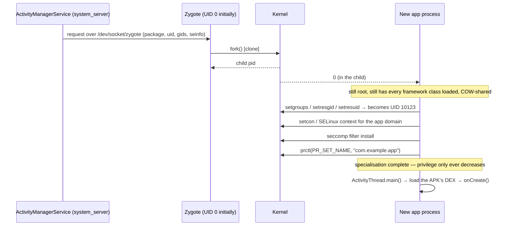

**The security consequences are direct and you will meet all of them.**

First, **address space layout is inherited**. Because the app process is a fork of Zygote rather than
a fresh `execve`, it inherits Zygote's ASLR layout. Every app forked from the same Zygote sees the
preloaded framework libraries at the *same* addresses. That materially weakens ASLR for those regions
and is why an information leak in one app can inform an attack on another. Android mitigates it
partially by re-randomising some mappings in the child, but the structural fact remains.

Second, **`LD_PRELOAD` does not work on app processes**. The dynamic linker consults `LD_PRELOAD` at
`execve` time, and app processes are never `execve`'d. This is precisely why Frida injects with
`ptrace` and why Zygisk/LSPosed modules run inside the forked child instead. See
[63 — LSPosed](../63-LSPosed/README.md) and [53 — Frida](../53-Frida/README.md).

Third, **anything Zygote holds open, every app inherits** unless it is marked `O_CLOEXEC` or
explicitly closed. A descriptor leaked into Zygote would be leaked into every app on the device. AOSP
takes this seriously enough to maintain an explicit file-descriptor table check in the Zygote child
path that aborts the fork if unexpected descriptors are present.

Fourth, **privilege only ever decreases**. The specialisation sequence is one-way: the child starts
privileged and drops. There is no path back. If you find a way to run code in the specialisation
window before the drop, you have found a very serious bug — which is why that code path in
`frameworks/base/core/jni/com_android_internal_os_Zygote.cpp` is among the most heavily reviewed in
AOSP.

> **Under the Hood**
> Both `fork()` and `pthread_create()` are implemented by the *same* syscall, `clone`, differing only
> in flags. `fork` shares almost nothing; `pthread_create` passes `CLONE_VM | CLONE_FS | CLONE_FILES |
> CLONE_SIGHAND | CLONE_THREAD` and friends so the new task shares the address space. The Linux kernel
> does not really have "processes" and "threads" as separate concepts — it has *tasks*, and the flags
> decide how much they share. What you call a process ID is the thread group ID (`Tgid`); the
> individual thread IDs live under `/proc/<pid>/task/`.

---

### 3.14 Threads, scheduling and context switching

**What a thread is.** A schedulable stream of execution. A process contains at least one thread and
may contain hundreds. A typical Android app has thirty to eighty: the main (UI) thread, the render
thread, Binder threads, the ART GC threads, JIT compiler threads, OkHttp connection threads, and
whatever the app itself started.

**What threads share and what they do not.** This table is the whole concept.

| Resource | Private per thread | Shared across the process |
|---|---|---|
| Program counter and registers | Yes | — |
| Stack | Yes (typically ~1 MiB on Android, `mmap`ed with a guard page) | — |
| Thread ID (TID) | Yes | — |
| Signal mask | Yes | — |
| Thread-local storage (`TPIDR_EL0`) | Yes | — |
| `errno` | Yes (it is thread-local in Bionic) | — |
| Virtual address space and page tables | — | Yes |
| Heap | — | Yes |
| Global and static variables | — | Yes |
| Open file descriptors | — | Yes |
| UID, GID, SELinux context | — | Yes |
| Loaded shared libraries | — | Yes |
| Signal *handlers* (dispositions) | — | Yes |

The consequence is the most important sentence in this section: **the process, not the thread, is the
security boundary**. Threads in one process can read and write each other's memory freely, because
they share one address space. Threads in different processes cannot. That is why Android isolates
apps with processes and UIDs, and why "I ran my code in a thread" provides no isolation at all.

**Scheduling.** The kernel decides which runnable thread executes on which core, and for how long.

> **Definition — Preemptive multitasking**
> A scheduling model in which the kernel can suspend a running thread at any point — driven by a
> timer interrupt — and resume a different one, without the thread's cooperation. The alternative,
> cooperative multitasking, requires threads to yield voluntarily, and a single misbehaving thread
> hangs the machine.

| Concept | Meaning | Android specifics |
|---|---|---|
| Time slice / quantum | How long a thread may run before being preempted | Tuned per scheduling class |
| Priority / nice value | Relative claim on CPU; lower nice is higher priority | Foreground apps get better priority than background |
| Scheduling class | `SCHED_OTHER` (normal, fair), `SCHED_FIFO`/`SCHED_RR` (real-time), `SCHED_IDLE` | Audio threads may use real-time classes |
| Fair-share scheduler | Linux CFS, replaced by EEVDF in newer kernels | Aims to give each thread its proportional share |
| cgroups | Kernel groups with resource limits | Android puts foreground and background apps in different cgroups |
| CPU affinity | Which cores a thread may run on | Interacts with big.LITTLE / DynamIQ heterogeneous cores |
| big.LITTLE | Mix of high-performance and high-efficiency cores | A thread migrating between core types changes its timing dramatically |

**Context switching.** When the scheduler moves from one thread to another it must:

1. Save the outgoing thread's general-purpose registers, `SP`, `PC` and processor state.
2. Save floating-point and SIMD state, usually lazily.
3. If switching to a thread in a *different process*, change the page table base register
   (`TTBR0_EL1`) to that process's tables.
4. Restore the incoming thread's saved state.
5. `ERET` back to EL0 at the incoming thread's saved program counter.

Step 3 is the expensive one. Changing the translation tables would ordinarily require invalidating
the TLB, throwing away every cached translation. ARM avoids most of that cost with **ASIDs** (Address
Space Identifiers): each process gets a tag, TLB entries are tagged with it, and entries for other
processes do not match rather than needing to be flushed. Even so, a switch between processes
costs meaningfully more than a switch between threads of the same process, because the caches are now
full of the wrong process's data.

> **Pentester's Note**
> Thread inventory is cheap reconnaissance. `ls /proc/<pid>/task/` lists every thread and
> `cat /proc/<pid>/task/*/comm` names them. An app that normally has 42 threads and now has 45, three
> of them named `gmain`, `gdbus` and `gum-js-loop`, is running a Frida agent — those names come from
> GLib and Frida's Gum engine. This is exactly the check an anti-instrumentation routine performs,
> and knowing it lets you both detect and evade. See [37 — Root Detection](../37-RootDetection/README.md).

---

### 3.15 Race conditions and TOCTOU

**What.** A race condition is a defect where correctness depends on the relative timing of concurrent
operations, and the programmer assumed one ordering while the scheduler is free to produce another.

**The canonical example.** `counter = counter + 1` is not one operation. It compiles to three:

```asm
    ldr   w0, [x1]        // load counter
    add   w0, w0, #1      // increment the loaded copy
    str   w0, [x1]        // store it back
```

Two threads executing those three instructions can interleave so that both load the same value, both
add one, and both store the same result. One increment is silently lost. Nothing crashes, nothing
logs an error, and the bug appears once in ten thousand runs.

**Why it becomes a security bug.** When the racing operations are a *security check* and the *action
the check was protecting*, the window between them is exploitable. This pattern has a name:
**time-of-check to time-of-use**, TOCTOU.

```c
// VULNERABLE — check and use are two separate operations on a name, not a handle
if (access(path, W_OK) == 0) {          // time of check: is this writable by me?
    int fd = open(path, O_WRONLY);      // time of use: an attacker may have swapped
    write(fd, data, len);               // the path for a symlink in between
}
```

The check was true when it ran. It was false when it mattered. The attacker replaced `path` with a
symbolic link pointing at something they should not be able to write, and the privileged process
followed it.

```c
// FIXED — operate on the handle, never on the name; refuse symlinks explicitly
int fd = open(path, O_WRONLY | O_NOFOLLOW | O_CLOEXEC);
if (fd < 0) return -1;
struct stat st;
if (fstat(fd, &st) != 0 || !S_ISREG(st.st_mode)) { close(fd); return -1; }
write(fd, data, len);
```

The principle generalises: **check the object you will use, not the name that currently refers to
it.** Once you hold a file descriptor, the kernel's binding between that descriptor and the
underlying file cannot be changed by anyone else. That is why `openat`, `fstat`, `fchmod`, `fchown`
and `openat2` with `RESOLVE_*` flags exist.

**Where races appear on Android.**

| Location | Shape of the race |
|---|---|
| A privileged helper writing to a path in a directory an app can control | Symlink swap between check and open |
| An app extracting a ZIP into its own data directory | Entry names with `../`, plus symlink entries — the ZipSlip family |
| Two threads sharing a cached "signature verified" boolean | The flag is read after another thread invalidated it |
| A `ContentProvider` that validates a URI then re-resolves it | Different result on the second resolution |
| Kernel drivers with a use-after-free reachable from two threads | The Binder driver has had exactly this class of bug (CVE-2019-2215) |
| An app writing to shared storage and then reading it back | Another app modifies the file in between |

**Proving a race during an assessment.** A single manual attempt proves nothing, because the window
may be microseconds. The technique is to run both sides in tight loops on separate threads or
processes and let the machine find the interleaving for you, then report the *interleaving*
explicitly rather than saying "it sometimes fails".

```bash
# host — the shape of a race harness: hammer both sides and watch for the impossible state
( while :; do ln -sf /tmp/benign  /tmp/target 2>/dev/null;
              ln -sf /etc/passwd  /tmp/target 2>/dev/null; done ) &
( while :; do ./privileged_helper /tmp/target; done )
```

Widening the window deliberately is a standard technique and it belongs in a report as evidence of
practicality: forcing page faults on the data being validated, inflating the file so parsing takes
longer, pinning threads to different cores, or introducing memory pressure all make a "one in ten
thousand" race into a reliable one.

> **Warning**
> "It only happened once" is not evidence that a race is unexploitable, and neither is "we could not
> reproduce it". Races are probabilistic, and an attacker gets unlimited attempts. Report the
> mechanism, not the observed frequency.

**Atomicity is the fix, not locking per se.** The general remedies are: make the operation atomic
(compare-and-swap, `stdatomic.h`, `AtomicInteger`); hold a lock across the whole check-and-act
sequence; or restructure so there is nothing to check — the `open`-then-`fstat` pattern above removes
the race rather than guarding it. Section 3.22 covers the primitives.

---
### 3.16 The stack, in full

**Why a stack exists at all.** A function must be able to call another function, which may call
another, possibly including itself, and each invocation needs its own local variables and its own
memory for the value it should return to. The requirement is exactly last-in-first-out: the most
recently entered function is always the first to leave. A stack is the data structure for that
requirement, and hardware supports it with a dedicated stack pointer register.

> **Definition — Stack frame (activation record)**
> The block of stack memory belonging to one active function call. It typically contains the
> function's local variables, saved copies of callee-saved registers, the saved frame pointer of the
> caller, and — on architectures that spill it — the return address.

**Direction.** The stack grows toward *lower* addresses. This is a convention inherited from
single-address-space layouts where code and data sat at low addresses, the heap grew upward from
above them, and the stack grew downward from the top, so that each could expand into a shared middle.
With 64-bit address spaces the scarcity argument is gone, but the convention is baked into every ABI,
every unwinder and every instruction set's addressing habits.

**The asymmetry that makes overflows exploitable.** The stack grows *down*, but C arrays are indexed
*up*. A local buffer is written from low addresses to high, while the saved frame pointer and saved
return address sit *above* the locals in the same frame. So a buffer overflowed in the natural
direction — the direction `memcpy`, `strcpy` and `sprintf` write — runs straight into the saved
return address. That opposition of directions is not a bug in any one program. It is a structural
property of the architecture, and it is why the stack buffer overflow has been the archetypal
memory-safety bug since Aleph One's 1996 *Phrack* paper.

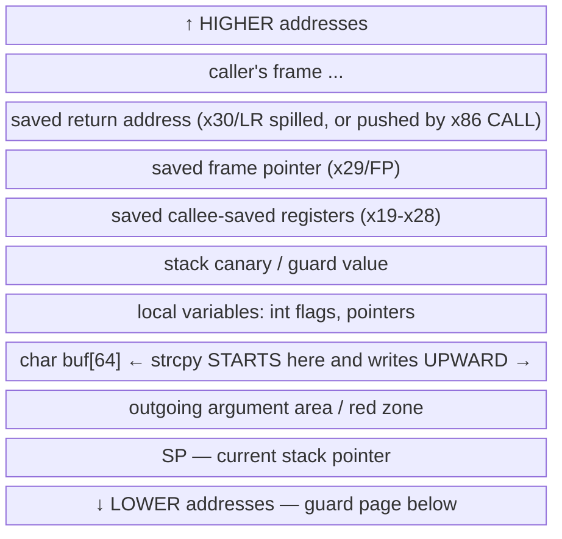

Read the diagram from the bottom. `SP` marks the current top of the stack — top in the sense of "most
recently allocated", which is the *lowest* address. The buffer sits near the bottom of the frame. A
copy that writes past the end of the buffer proceeds upward through the other locals, through the
canary, through the saved registers, through the saved frame pointer, and finally through the saved
return address. Each of those is a distinct thing an attacker might want to corrupt, and each has a
different consequence.

**The AArch64 prologue and epilogue.** These two patterns are the most important things to recognise
in ARM disassembly, and you will see them thousands of times.

```asm
// AArch64 — a typical non-leaf function prologue
    stp     x29, x30, [sp, #-64]!   // pre-index: sp -= 64, then store the PAIR x29,x30 at [sp]
    mov     x29, sp                 // establish this function's frame pointer
    stp     x19, x20, [sp, #16]     // save the callee-saved registers this function will use
    str     x0, [sp, #40]           // spill the first argument into the frame
```

```asm
// AArch64 — the matching epilogue
    ldp     x19, x20, [sp, #16]     // restore callee-saved registers
    ldp     x29, x30, [sp], #64     // post-index: load the PAIR, THEN sp += 64
    ret                             // branch to whatever is now in x30
```

| Element | Meaning | Why you care |
|---|---|---|
| `stp` / `ldp` | Store/load **pair** — two 64-bit registers in one instruction | The signature of a frame record |
| `[sp, #-64]!` | **Pre-index**: update `sp` first, then use it | This is the allocation |
| `[sp], #64` | **Post-index**: use `sp`, then update it | This is the deallocation |
| `x29, x30` | Frame pointer and link register, stored adjacently | The *frame record* — the unwinder walks this chain |
| `mov x29, sp` | Establish the frame pointer | Without it, backtraces need DWARF unwind tables |
| `ret` | Branch to `x30` | No validation of any kind is performed |

**The single most important AArch64/x86 difference.** On x86-64, `CALL` pushes the return address
onto the stack automatically, so the return address is stack data from the instant of the call. On
AArch64, `BL` writes the return address into the **register** `X30`, and it becomes stack data only
if the function needs to make its own calls and therefore must save `X30` first.

The consequence is immediate and practical: **a leaf function on AArch64 has no return address in
memory to overwrite.** If the vulnerable function calls nothing, a stack overflow inside it cannot
corrupt a return address by that route. When you audit ARM code, the first question about any
candidate function is "does it call anything?" — and the answer is visible in one instruction, the
presence or absence of `stp x29, x30`.

> **Mental Model**
> On x86-64 the return address is *data on the stack* from the moment of the call. On AArch64 it
> starts as a *value in a register* and only becomes data when the function is a non-leaf. That
> single design choice is why a great many trivially exploitable x86 stack overflows have no
> equivalent on ARM.

**Calling conventions, precisely.** The AArch64 procedure call standard (AAPCS64) specifies:

| Rule | Detail |
|---|---|
| Integer/pointer arguments 1–8 | `X0`–`X7`, in order |
| Floating-point/SIMD arguments 1–8 | `V0`–`V7` |
| Further arguments | Passed on the stack, at increasing addresses from `SP` |
| Return value | `X0`; 128-bit values use `X0`+`X1`; FP returns in `V0` |
| Large struct return | Caller allocates space, passes the address in `X8` (`XR`) |
| `SP` alignment | Must be 16-byte aligned at every public interface |
| Callee-saved | `X19`–`X28`, `X29`, and the low 64 bits of `V8`–`V15` |
| Caller-saved | `X0`–`X18`, `X30`, `V0`–`V7`, `V16`–`V31` |
| Variadic functions | On Android/Linux AArch64, variadic arguments follow the same register rules; the callee sets up a `va_list` from a saved register area |

The variadic row matters more than it looks. When you hook `printf`-family functions with Frida to
read format strings, you must know that the format string is in `X0` and the first variadic argument
is in `X1`, not on the stack.

**Frame pointers and unwinding.** With `-fno-omit-frame-pointer`, each frame record stores the
caller's `X29`, so `X29` forms a linked list from the innermost frame to the outermost. Walking that
list *is* a backtrace, and it is why Android system libraries are built with frame pointers even
though it costs a register: without them, unwinding requires parsing DWARF `.eh_frame` data, which is
slow and impossible if the tables were stripped. When a tombstone shows a clean backtrace, you are
looking at a frame-pointer walk.

**Stack size and exhaustion.** Each thread gets its own stack, sized at creation. On Android the main
thread's stack is around 8 MiB and additional threads default to roughly 1 MiB, adjustable through
`pthread_attr_setstacksize`. Below each stack mapping sits a `PROT_NONE` guard page. Unbounded
recursion walks `SP` down into that page, the access faults, and the process dies with `SIGSEGV`
instead of silently corrupting whatever mapping lies below. That is a *deliberate* safety property,
and it is why "stack overflow" in the recursion sense is a crash rather than a compromise.

Very large stack allocations can jump *over* the guard page — an attacker-controlled
`char buf[attacker_size]` or `alloca(n)` can move `SP` past the guard entirely and land in the
mapping region. This is the "stack clash" class of bug, and it is why compilers offer
`-fstack-clash-protection` and why variable-length arrays are discouraged in security-relevant code.

**The mitigations, and exactly what each does and does not stop.**

| Mitigation | Mechanism | Stops | Does not stop |
|---|---|---|---|
| **Stack canary** (`-fstack-protector-strong`) | Random value stored between locals and the saved registers, verified before `ret` | Contiguous overflows that cross it | Non-contiguous writes (`buf[i]` with attacker-controlled `i`); overwrites of locals below the canary |
| **NX / XN** (non-executable stack) | `PT_GNU_STACK` without `PF_X`; pages mapped without `PROT_EXEC` | Executing bytes written into the stack | Reusing code already present — which is why ROP exists |
| **ASLR + PIE** | Randomised load base for the executable and every library | Hardcoding a target address | Attacks that first obtain an address leak |
| **Shadow Call Stack** | A second, separate stack holding only return addresses, reached through `X18` | Return-address corruption via a normal buffer overflow | Data-only attacks; corruption of function pointers |
| **PAC** (`paciasp`/`autiasp`) | Cryptographic signature in the unused high bits of `X30`, keyed and context-bound to `SP` | Returning to a forged address | Data-only attacks; signing gadget reuse |
| **BTI** | Indirect branch targets must be a `BTI` instruction | Jumping into the middle of a function | Returns; whole-function reuse |
| **FORTIFY_SOURCE** | Compiler substitutes checked variants when the destination size is known | `strcpy`/`sprintf` into a statically sized buffer | Copies whose destination size is not statically known |
| **CFI** | Indirect calls checked against the target's type signature | Calling a function of the wrong type through a corrupted pointer | Direct return-address corruption |

> **Pentester's Note**
> Recognising `paciasp` at the top of a function and `autiasp`/`retaa` at the bottom tells you PAC is
> active on that binary, which changes your impact statement from "control-flow hijack" to
> "data-only corruption or denial of service". Writing that distinction into a report is the
> difference between a finding a client can act on and one they will dispute. The mechanics are in
> [Lab 03](labs/lab-03-stack-frames-and-overflow.md) and the reading practice is in
> [18 — ARM](../18-ARM/README.md).

**Why this matters on Android specifically.** Java and Kotlin cannot produce a stack buffer overflow,
because array accesses are bounds-checked by ART. But every app of consequence ships native code —
cryptography, media parsing, image decoding, protobuf handling, obfuscation runtimes, DRM, game
engines — all of it C or C++, all of it with frames exactly like the one above, and all of it
reachable from Java through JNI. When you triage an APK, `lib/arm64-v8a/*.so` is where the
memory-safety bugs live.

---

### 3.17 The heap, in full

**Why a heap exists.** The stack can only hold data whose lifetime matches a function call and whose
size the compiler knows. Everything else — an object that outlives the function that created it, a
buffer whose size depends on input, a linked structure that grows — needs memory with an arbitrary
lifetime, requested and released explicitly. That memory is the heap.

> **Definition — Heap**
> A region of a process's memory from which blocks of arbitrary size are allocated on request and
> released in arbitrary order, managed by an *allocator* library rather than by the compiler.

**The API.**

| Call | Meaning | Trap |
|---|---|---|
| `malloc(n)` | Allocate `n` bytes, **uninitialised** | Contents are whatever was there before — an info leak if returned to an attacker |
| `calloc(count, size)` | Allocate `count × size` bytes, zeroed | Required to detect multiplication overflow, unlike `malloc(a*b)` |
| `realloc(p, n)` | Resize; may move the block and return a new pointer | If it returns NULL the original is still valid — `p = realloc(p, n)` leaks on failure |
| `free(p)` | Return the block to the allocator | Does **not** zero the memory, does **not** null your pointer |
| `new` / `delete` (C++) | Allocate plus construct / destruct plus free | Mixing `new[]`/`delete` is undefined behaviour |
| `posix_memalign` | Aligned allocation | |
| `mmap`/`munmap` | Get memory directly from the kernel | What the allocator itself uses for large requests |

**How an allocator actually works.** The allocator asks the kernel for large chunks of memory —
historically by moving the program break with `brk`, now almost always with anonymous `mmap` — and
then carves those chunks into blocks for the program. To do so it must track which blocks are in use
and which are free, which requires *metadata*.

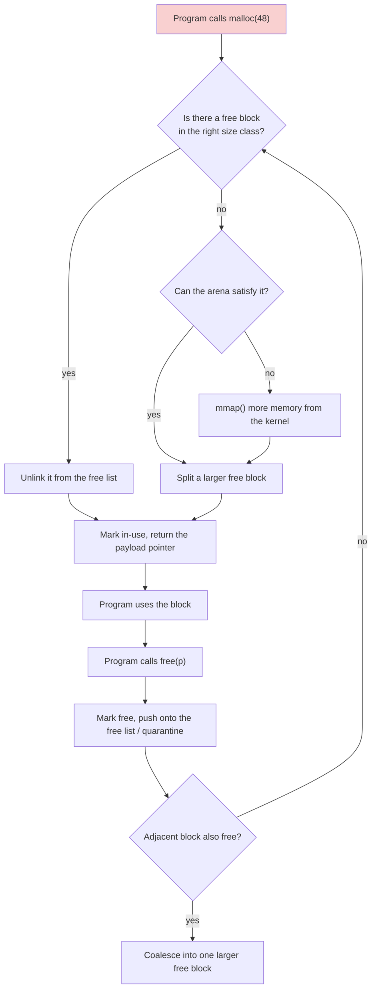

The critical structural fact is in the "Mark in-use" and "push onto the free list" steps: classic
allocators store that bookkeeping **inline, adjacent to the data they describe**. A block's header
sits immediately before the pointer the program received, and a freed block's forward and backward
list pointers are stored *inside the block's own payload area*. Both facts are what turn a heap
overflow into a controlled write: overflow past the end of your block and you are writing the *next*
block's header; write into a freed block and you are writing free-list pointers the allocator will
later dereference.

**Allocators on Android, historically.**

| Period | Allocator | Notes |
|---|---|---|
| Early Android | dlmalloc | Simple, inline metadata, highly exploitable |
| Android 5.0 onward (approximately) | jemalloc | Arena-based, size classes, per-thread caches |
| Android 11 onward | **Scudo** | Hardened by design; the current default for native allocations |
| ART managed objects | ART's own heap (region space, large object space) | Separate from `malloc` entirely; GC-managed |

**Scudo's hardening properties** are worth naming because they change what is exploitable:
out-of-line metadata with checksums so a corrupted header is detected; randomised allocation within
size classes so adjacency is not predictable; a quarantine that delays reuse of freed chunks;
guard pages between larger regions; and integration with MTE on supporting hardware. It is not
unbreakable, but the classic "overwrite the next chunk's size field" techniques from the dlmalloc era
do not transfer.

**Fragmentation.**

> **Definition**
> **External fragmentation**: enough total free memory exists, but it is split into pieces none of
> which is large enough for the request.
> **Internal fragmentation**: the allocator rounds a request up to a size class, so bytes inside the
> allocated block are wasted.

Fragmentation matters to an attacker as much as to a performance engineer, because it is the lever
for **heap grooming**: deliberately allocating and freeing objects so that the allocator places a
chosen victim object immediately after a buffer you can overflow. Heap exploitation write-ups spend
most of their length on grooming and very little on the overflow itself, and this is why.

#### 3.17.1 The four heap bug classes

**Heap buffer overflow.** Writing past the end of an allocated block. Unlike the stack, there is no
fixed interesting target at a fixed offset — what lies after your block depends on allocation order.
The attacker's job is to *arrange* for something valuable to be there: a C++ object with a vtable
pointer at offset zero, a struct with a function pointer, a length field, or another buffer's
metadata.

```c
// The shape of the bug
size_t n = read_length_from_attacker();   // e.g. 0x100
char *buf = malloc(64);
memcpy(buf, attacker_data, n);            // writes 256 bytes into a 64-byte block
```

**Use-after-free.** Using a pointer after the block it refers to has been freed. `free()` does not
erase anything and does not null your pointer; the pointer still holds the same address, and the
bytes there still look plausible. It becomes a security bug when the allocator hands that block to a
different part of the program.

```c
// The shape of the bug
struct session *s = malloc(sizeof *s);
free(s);                    // block returns to the allocator
/* ... other code allocates a same-sized block and fills it with attacker data ... */
s->is_admin = 1;            // writing into somebody else's live object
if (s->callback) s->callback();   // in C++, this is the vtable pointer, and it is now theirs
```

The C++ variant is the dangerous one. In a typical implementation, the first eight bytes of a
polymorphic object are the vtable pointer. Free a `Session`, let the attacker allocate a same-sized
buffer they control, and the next virtual method call on the stale pointer reads a function pointer
from attacker-controlled memory and branches through it.

**Double free.** Calling `free()` twice on the same pointer. The second free pushes the block onto
the free list a second time, so the allocator can hand the same block to two different callers, which
is a use-after-free with extra steps. Classic allocators could also be induced to write attacker-
chosen values through corrupted free-list pointers during the unlink operation. Scudo detects most
double frees and aborts.

**Invalid free and memory leaks.** Freeing a pointer the allocator never returned (a stack address, a
pointer into the middle of a block) corrupts the allocator state. A leak — never freeing — is usually
only a reliability bug, but a leak an attacker can drive at will becomes a denial of service, and on
Android it becomes an out-of-memory kill.

| Bug | Root cause | Primary consequence | Android detection |
|---|---|---|---|
| Heap overflow | Missing or wrong bounds check | Corrupt adjacent object → controlled write | ASan, HWASan, MTE, Scudo header checksum |
| Use-after-free | Lifetime mistake, missing ownership | Type confusion, vtable hijack | HWASan, MTE, GWP-ASan |
| Double free | Two owners, error paths that both free | Allocator state corruption | Scudo abort, ASan |
| Invalid free | Pointer arithmetic mistake | Allocator state corruption | Scudo abort, ASan |
| Uninitialised read | `malloc` contents used before writing | Information disclosure | MSan (host), `-ftrivial-auto-var-init` |
| Leak | Missing `free` on a path | OOM, LMK kill | LeakSanitizer, `dumpsys meminfo` growth |

**Detection tooling you will actually use.**

| Tool | What it is | Where it runs |
|---|---|---|
| **ASan** (AddressSanitizer) | Compile-time instrumentation with redzones and a shadow map; ~2× slowdown, ~3× memory | Host builds and NDK builds with `-fsanitize=address` |
| **HWASan** | ARM64-only tagged-memory variant; far lower memory overhead than ASan | AOSP `userdebug` builds; catches UAF that ASan's quarantine misses |
| **MTE** | Hardware memory tagging on ARMv8.5+; near-zero overhead in async mode | Production-capable on supporting devices |
| **GWP-ASan** | Sampling allocator that guards a small random subset of allocations | Enabled in production Android for some apps — catches rare bugs in the field |
| **Valgrind** | Dynamic binary instrumentation, no recompilation | Host only; conceptually the ancestor of ASan |

> **Pentester's Note**
> When you find a native crash, the *region* the fault address falls in tells you which bug class you
> are looking at. Check it against `/proc/<pid>/maps`. If it is inside `[stack]` or a thread stack,
> you have a stack problem and the corrupted thing is probably a saved register. If it is inside
> `[anon:libc_malloc]` or `[anon:scudo:...]`, you have a heap problem and the corrupted thing is
> allocator metadata or a neighbouring object. If it is a small value like `0x28`, you dereferenced a
> null struct pointer and touched a field at offset 40. That single triage step, done in thirty
> seconds, decides how you spend the next four hours.

**Stack versus heap, side by side.**

| Property | Stack | Heap |
|---|---|---|
| Managed by | Compiler and CPU, via `SP` | An allocator library, on explicit request |
| Allocation cost | One arithmetic instruction | Free-list search, sometimes a syscall |
| Lifetime | Bound to the enclosing call | Whatever the programmer decides |
| Size limit | Small and fixed (~1 MiB per thread on Android) | Large; grows via `mmap` |
| Fragmentation | None | Yes, internal and external |
| Thread relationship | One per thread, private | One per process, shared |
| Interesting target | Fixed offset: the saved `LR` | Variable: whatever the groom placed next door |
| Classic bugs | Buffer overflow, uninitialised locals, exhaustion | Overflow, UAF, double free, leak |

---

### 3.18 Virtual memory and paging

**The problem.** Multiple programs must coexist in one physical memory without being able to reach
each other, none of them knows in advance how much memory it will need or where it will be placed,
and together they may want more memory than physically exists.

**The solution.** Give every process its own private map from the addresses it uses to the physical
memory that actually holds the data, and let the kernel own those maps.

> **Definition**
> A **virtual address** is the address a program uses. A **physical address** is the address of an
> actual location in DRAM. The **memory management unit (MMU)** is hardware inside the CPU that
> translates the first into the second on *every single access*, using per-process tables the kernel
> maintains.

Three properties fall out of this design and all three are load-bearing for Android security:

1. **Isolation.** Two processes can both use the address `0x7000000000` and reach completely
   different physical memory. There is no address app A can form that reaches app B's data, because
   no entry in app A's tables maps to it.
2. **The illusion of contiguity.** A program sees one flat address space even though the physical
   pages behind it are scattered.
3. **Overcommit and demand paging.** Mapping memory does not allocate it. Physical pages are supplied
   on first touch, which is why a process can map far more memory than the device physically has.

#### 3.18.1 Pages and page tables

Memory is managed in fixed-size **pages**, almost always 4 KiB (`0x1000`) on Android. Tracking
permissions per byte would require a table larger than the memory it describes; tracking per page is
tractable. A virtual address therefore splits into a *page number*, which is translated, and an
*offset within the page*, which passes through untouched.

```
48-bit virtual address, 4 KiB granule, 4 levels:

 63      48 47    39 38    30 29    21 20    12 11         0
+----------+--------+--------+--------+--------+------------+
|  sign /  |  L0    |  L1    |  L2    |  L3    |   offset   |
|   tag    | 9 bits | 9 bits | 9 bits | 9 bits |  12 bits   |
+----------+--------+--------+--------+--------+------------+
                                                 4096 bytes
```

Each 9-bit index selects one of 512 entries in a table; four levels of 9 bits plus 12 offset bits
gives 48 bits of addressable virtual space, which is 256 TiB. Each entry either points at the next
level's table or, at the last level, at a physical page frame together with its permission bits.

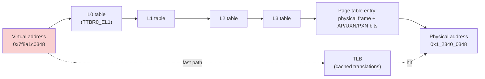

Walking four levels means four memory accesses for every single translation, which would be
catastrophic. The **TLB** (Translation Lookaside Buffer) is a small, very fast cache of recent
translations, and it is why the dotted fast path exists. TLB entries are tagged with an **ASID** so
that a context switch does not require flushing them all.

**Key registers and bits.**

| Item | Purpose |
|---|---|
| `TTBR0_EL1` | Base of the *user* translation tables — changed on every process switch |
| `TTBR1_EL1` | Base of the *kernel* translation tables — the same in every process |
| `TCR_EL1` | Configures granule size, VA size, and cacheability of table walks |
| `AP` bits | Access permissions: read/write, EL0 access allowed or not |
| `UXN` | Unprivileged Execute Never — EL0 cannot execute this page |
| `PXN` | Privileged Execute Never — EL1 cannot execute this page (kills `ret2usr`) |
| `nG` | Non-global — the entry belongs to one ASID |
| `AF` | Access flag — used to track which pages have been touched |

The split between `TTBR0` and `TTBR1` is elegant and important: user addresses are in the low half of
the 64-bit space and kernel addresses in the high half, each with its own table base. Switching
processes changes only `TTBR0_EL1`; the kernel's mapping never changes. And because `TTBR0` is
swapped, an app has no translation for another app's memory.

#### 3.18.2 Page faults

When a translation is missing or the access violates the permission bits, the MMU raises an
exception and the kernel decides what to do.

| Fault type | Kernel's response | Cost |
|---|---|---|
| **Minor fault** | The page is available (page cache, zero page, or a COW copy) — just fix the table | Microseconds |
| **Major fault** | The page must be read from storage or decompressed from zram | Hundreds of microseconds to milliseconds |
| **Copy-on-write fault** | Allocate a new frame, copy 4 KiB, remap writable | Microseconds |
| **Invalid** | No valid mapping and no way to create one → deliver `SIGSEGV` | Process usually dies |

> **Under the Hood**
> A `SIGSEGV` is not an error the kernel invented. It is the kernel's translation of a hardware
> exception it decided not to resolve. The *same* mechanism, when the kernel does resolve it, is
> ordinary demand paging happening millions of times a second without anyone noticing. That is why
> the `si_code` matters: `SEGV_MAPERR` means there was no mapping at all, while `SEGV_ACCERR` means
> there *was* a mapping and the permissions forbade the access. An execute-access `SEGV_ACCERR` means
> control flow already reached an address you may control — a far stronger signal than a read of
> address zero.

#### 3.18.3 `mmap` and `mprotect`

`mmap` asks the kernel to create a mapping in the calling process's address space. You supply a
length, protection bits, flags, and optionally a file descriptor and offset. The kernel installs a
*virtual memory area* (VMA) describing the range and returns the address. It usually does not
allocate any physical memory at that point.

| `prot` flag | Value | Meaning |
|---|---|---|
| `PROT_NONE` | `0x0` | No access at all — guard pages |
| `PROT_READ` | `0x1` | Readable |
| `PROT_WRITE` | `0x2` | Writable |
| `PROT_EXEC` | `0x4` | Executable |

| `flags` | Value | Meaning |
|---|---|---|
| `MAP_SHARED` | `0x01` | Writes visible to other mappers and to the file |
| `MAP_PRIVATE` | `0x02` | Copy-on-write private mapping |
| `MAP_FIXED` | `0x10` | Map exactly at `addr`, silently replacing anything there |
| `MAP_ANONYMOUS` | `0x20` | Zero-filled, no backing file (`fd = -1`) |
| `MAP_FIXED_NOREPLACE` | `0x100000` | Fail with `EEXIST` instead of replacing |
| `MAP_STACK` | `0x20000` | Suitable for a thread stack |

Almost everything is built on `mmap`. Loading a shared library is a sequence of `mmap` calls, one per
`PT_LOAD` segment, with the code segment mapped read-execute from the file and the data segment
mapped read-write private. `malloc` gets its arenas from anonymous `mmap`. Thread stacks are `mmap`
regions with a `PROT_NONE` guard below them. Shared memory between processes is a shared `mmap` of
the same object. The APK itself is mapped so ART can read DEX without copying it.

`mprotect` changes the permissions of an existing range of pages. It is the other half of the pair,
and it is the single most security-relevant memory syscall on Android.

> **Pentester's Note**
> Runtime code generation always shows the same footprint: write instructions into a region while it
> is `PROT_READ|PROT_WRITE`, then call `mprotect(addr, len, PROT_READ|PROT_EXEC)` and flush the
> instruction cache. The ART JIT does it. Packers do it. Frida's Gum engine does it. So the two
> highest-value things to look for in a live process are (a) anonymous regions with `x` set, and
> (b) `mprotect` calls with `PROT_EXEC`.
>
> ```bash
> # adb shell, as root — anonymous executable regions in a running app
> PID=$(pidof com.example.app)
> grep -E 'rwxp|r-xp .*\[anon' /proc/$PID/maps
> ```
>
> An app that scans its *own* maps for exactly this is doing anti-instrumentation. Both sides of that
> fight are reading the same file.

#### 3.18.4 Copy-on-write

When a page is shared between two processes and marked read-only in both, the first write faults and
the kernel makes a private copy for the writer. This makes `fork` cheap, makes Zygote's model viable,
and makes a hundred processes sharing one `libc.so` cost one copy of `libc.so`.

It also has a security dimension. **CVE-2016-5195**, universally known as *Dirty COW*, was a race
condition in the kernel's copy-on-write handling of private read-only file mappings that allowed an
unprivileged process to write to memory it should only have been able to read — and, through the page
cache, to the underlying file. It was weaponised into universal Android rooting tools. **CVE-2022-0847**,
*Dirty Pipe*, achieved a similar outcome in the pipe buffer code on kernel 5.8 and later, affecting
some Android devices. Both are worth studying precisely because the mechanism is the mechanism in
this section.

#### 3.18.5 Swap on Android

Traditional Linux swaps pages to a disk partition. Android does not use a swap partition, because
flash write endurance is finite and latency is poor. It uses **zram**: a compressed block device in
RAM. Pages are compressed and stored in RAM rather than written out, trading CPU for capacity. When
even that is insufficient, the **low-memory killer daemon** (`lmkd`) terminates processes by
`oom_score_adj` priority, which is why background apps disappear.

#### 3.18.6 ASLR

> **Definition — Address Space Layout Randomisation**
> Randomisation of the base addresses of a process's memory regions at creation time, so that an
> attacker who finds a memory-corruption bug cannot know in advance what address to target.

ASLR fixes no bugs. It raises the cost of exploiting every bug, by forcing an attacker to first
*discover* an address through an information leak. For it to cover the main executable as well as
libraries, the executable must be position independent — the PIE flag — and Android has required PIE
since Android 5.0.

Two Android-specific wrinkles matter:

- Processes forked from Zygote inherit Zygote's layout, so preloaded framework libraries sit at the
  same addresses in every app until Zygote restarts.
- ASLR randomises *bases*, not internal layout. The offset of a function within `libc.so` is
  constant, so leaking any single address inside a library gives you every other address in it by
  subtraction. This is exactly how real exploits use an info leak, and why a seemingly harmless
  address disclosure is a genuine finding.

```bash
# adb shell — watch ASLR work
cat /proc/$(pidof com.example.app)/maps | head -5
# force-stop and restart the app, then repeat: every base address differs
adb shell am force-stop com.example.app
```

The practical rule that follows: **never hardcode an address in a Frida script.** Resolve at runtime
with `Module.findBaseAddress("libfoo.so")` and add the offset you found statically. See
[53 — Frida](../53-Frida/README.md).

#### 3.18.7 Page size version matrix

| Android version | Page size support | What changes for you |
|---|---|---|
| ≤ Android 14 | 4 KiB assumed universally | Native libraries aligned to 4 KiB load fine |
| Android 15 (API 35) | 16 KiB page size support introduced for supporting devices | Native libraries whose `PT_LOAD` segments are only 4 KiB-aligned may fail to load |
| Android 16 (API 36) | 16 KiB alignment expectations tighten for new uploads | Check `.so` alignment as a routine compatibility finding |

```bash
# adb shell — confirm the page size on the device under test
getconf PAGE_SIZE

# host — check a library's LOAD segment alignment
readelf -l lib/arm64-v8a/libnative.so | grep -A1 LOAD
```

#### 3.18.8 Reading a maps line

This is the skill the whole section exists to enable.

```
7f8a1c0000-7f8a1e0000 r-xp 00000000 fd:00 1234    /system/lib64/libc.so
└──────┬──────────────┘ └┬─┘ └──┬───┘ └─┬─┘ └┬─┘   └────────┬───────────┘
   address range      perms  file offset dev inode      pathname
```

| Field | Meaning |
|---|---|
| Address range | Start and end virtual addresses, half-open |
| Permissions | `r`, `w`, `x`, then `p` (private/COW) or `s` (shared) |
| File offset | Offset into the backing file where this mapping starts |
| Device | Major:minor of the device holding the file |
| Inode | Inode number; `0` for anonymous mappings |
| Pathname | File path, or a bracketed name like `[stack]`, `[heap]`, `[anon:libc_malloc]` |

| Example line | What it is |
|---|---|
| `... r-xp 00000000 fd:00 1234 /system/lib64/libc.so` | libc's executable code, private, file-backed |
| `... r--p 00020000 fd:00 1234 /system/lib64/libc.so` | The same file's read-only data / RELRO region |
| `... rw-p 00000000 00:00 0 [anon:libc_malloc]` | A malloc arena |
| `... rw-p 00000000 00:00 0 [stack]` | The main thread's stack |
| `... ---p 00000000 00:00 0` | A `PROT_NONE` guard page |
| `... rwxp 00000000 00:00 0 [anon:...]` | **RWX — JIT, packer, or injected code** |
| `... r--s 00000000 fd:03 5678 /data/app/.../base.apk` | The APK mapped shared, read-only, for DEX access |

---
### 3.19 System calls

**What.** A system call is a request for the kernel to perform an operation the calling process is
not permitted to perform itself.

**How it differs from a function call.** A function call is a branch within your own process at the
same privilege level, in the same address space, with access to exactly the same memory. Nothing
about the machine's trust state changes and it costs a handful of cycles. A system call is a
deliberate exception that changes privilege level.

| Aspect | Function call | System call |
|---|---|---|
| Instruction | `BL` / `BLR` | `SVC #0` |
| Privilege change | None | EL0 → EL1 and back |
| Address space | Same | The kernel's, with guarded access to yours |
| Argument passing | `X0`–`X7` per AAPCS64 | `X0`–`X5`, number in `X8` |
| Return | Whatever the API defines | Result, or negative `errno`, in `X0` |
| Cost | Tens of cycles | Hundreds to thousands of cycles |
| Can be filtered | No | Yes, by seccomp |
| Observed with | `ltrace`, PLT hooks | `strace`, seccomp logs |

**The mechanism, step by step on AArch64.**

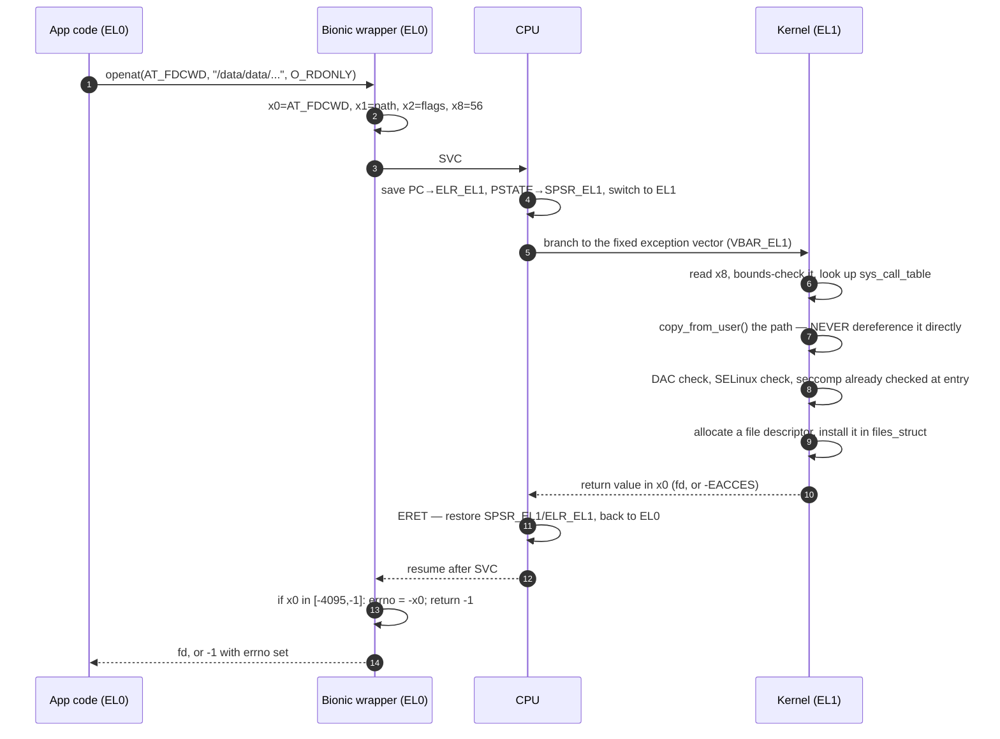

Step 6 is the security-critical one. The kernel receives a *number* from user space and must treat
every pointer in the argument registers as hostile. It validates the syscall number against the table
bounds, and it copies user data in through `copy_from_user`, which checks the address range and
handles faults. A driver that skips this and dereferences the pointer directly is a kernel
vulnerability. Modern ARM hardware backs this up with PAN, which faults if privileged code touches a
user address without explicitly permitting it.

**`errno`.** The kernel returns a negative error code in `X0`. The libc wrapper converts anything in
the range −4095 to −1 into a return of `-1` plus a thread-local `errno`.

| Rule | Detail |
|---|---|
| Where it lives | Thread-local; Bionic exposes it through `__errno()` |
| When valid | **Only after a call that actually failed.** Never test it on success |
| How to decode | `strerror(errno)`, `perror()`, or `strace`, which prints it inline |

| Number | Name | Meaning you will meet |
|---|---|---|
| 1 | `EPERM` | Not permitted — capability, SELinux, or `ptrace_scope` |
| 2 | `ENOENT` | No such file or directory |
| 4 | `EINTR` | Interrupted by a signal — retry the call |
| 9 | `EBADF` | Bad file descriptor |
| 11 | `EAGAIN` | Try again / would block |
| 12 | `ENOMEM` | Out of memory |
| 13 | `EACCES` | Permission denied (DAC or SELinux) |
| 14 | `EFAULT` | Bad address — the kernel refused your pointer |
| 22 | `EINVAL` | Invalid argument |
| 24 | `EMFILE` | Per-process file descriptor limit reached |
| 38 | `ENOSYS` | Not implemented — **or blocked by seccomp** |

The `ENOSYS` row is the useful one during analysis: a syscall that returns `ENOSYS` on a kernel that
certainly implements it means a seccomp filter is denying it.

**The syscall table.** Each syscall has a number, and the numbers differ per architecture. AArch64
uses the generic table in the kernel source at `include/uapi/asm-generic/unistd.h`; 32-bit ARM
processes on a 64-bit kernel use a compatibility table.

| Syscall | arm64 `x8` | x86-64 `rax` | Why it matters here |
|---|---|---|---|
| `ioctl` | 29 | 16 | **Every Binder transaction is this** |
| `faccessat` | 48 | 269 | Root-detection favourite (`access("/system/xbin/su")`) |
| `openat` | 56 | 257 | Opening files — arm64 has no plain `open` |
| `read` / `write` | 63 / 64 | 0 / 1 | I/O |
| `futex` | 98 | 202 | Userspace lock contention |
| `ptrace` | 117 | 101 | **Debuggers, Frida attach, anti-debug** |
| `prctl` | 167 | 157 | `PR_SET_DUMPABLE`, `PR_SET_NO_NEW_PRIVS`, `PR_SET_NAME` |
| `getuid` | 174 | 102 | The app sandbox identity |
| `clone` | 220 | 56 | Backs both `fork()` and `pthread_create()` |
| `execve` | 221 | 59 | Replace the process image |
| `mmap` | 222 | 9 | Map memory or a file |
| `mprotect` | 226 | 10 | **RW→RX for JIT, packers, Frida** |
| `process_vm_readv` / `writev` | 270 / 271 | 310 / 311 | Cross-process memory access |
| `seccomp` | 277 | 317 | Install a syscall filter |
| `memfd_create` | 279 | 319 | An anonymous file living in memory |

**Bionic's role.** Android's libc is Bionic, not glibc. Its syscall wrappers are generated from
`bionic/libc/SYSCALLS.TXT`, and the sanitised kernel headers live under `bionic/libc/kernel/uapi/`.
Some calls — `gettimeofday`, `clock_gettime` — are accelerated through the **vDSO**, a small shared
object the kernel maps into every process containing code that answers the question without entering
the kernel at all. That is why you will not see every `clock_gettime` in `strace`.

**Seccomp.** A seccomp-BPF filter is a program attached to a process that inspects each syscall's
number and arguments and decides to allow it, deny it with an errno, kill the process, or trap.
Android installs a filter on every app process from Zygote, denying syscalls apps have no legitimate
reason to make. Violations that are configured to trap raise `SIGSYS`. The current filter mode is
visible on the `Seccomp:` line of `/proc/<pid>/status`.

> **Pentester's Note**
> The syscall boundary is the one place an app cannot lie to you. It can implement its own file
> access wrapper, its own string comparison, its own crypto, and its own control-flow obfuscation —
> but to open a file it must execute `openat`, and to reach a server it must execute `connect`.
> Tracing there sees through obfuscation that defeats Java-level and source-level analysis entirely.
>
> The counter-move you will meet: sophisticated native code invokes `SVC #0` directly with inline
> assembly instead of calling the libc wrapper, specifically so that
> `Interceptor.attach(Module.getExportByName("libc.so", "openat"))` never fires. The presence of a
> `syscall` import, or of raw `svc` instructions in a `.so`, is a strong anti-hooking signal. Your
> answer is to trace below libc — `strace`, a seccomp-based tracer, or Frida's `Stalker`.

---

### 3.20 Signals

**What.** A signal is an asynchronous notification delivered to a process or a specific thread. It is
the oldest inter-process communication mechanism in Unix and the mechanism by which the kernel tells
a process that something exceptional happened.

**How delivery works.** When a signal becomes pending and is not blocked, the kernel arranges for the
target thread to run a handler the next time it would return to user space. It pushes a *signal
frame* onto the thread's stack containing the saved register state, sets the program counter to the
handler, and lets it run. When the handler returns, a small trampoline invokes `rt_sigreturn`, which
restores the saved state and resumes the interrupted code.

That mechanism has a direct security consequence: the saved register state lives on the user stack,
so a process that can write to its own signal frame and then trigger a return can set every register
at once. This is the *sigreturn-oriented programming* technique, and it is why `rt_sigreturn` is on
every seccomp policy author's mind.

| No. | Name | Default | Catchable | Typical cause |
|---|---|---|---|---|
| 2 | `SIGINT` | Terminate | Yes | Ctrl-C |
| 4 | `SIGILL` | Core | Yes | Illegal instruction; corrupted or misdecoded code page |
| 5 | `SIGTRAP` | Core | Yes | Breakpoint (`BRK #0`), single-step, `ptrace` stop |
| 6 | `SIGABRT` | Core | Yes | `abort()`, failed assert, allocator corruption detected |
| 7 | `SIGBUS` | Core | Yes | Misaligned access, or touching a truncated `mmap` |
| 8 | `SIGFPE` | Core | Yes | Integer divide by zero |
| 9 | `SIGKILL` | Terminate | **No** | `kill -9`, LMK, `ActivityManager` kill |
| 11 | `SIGSEGV` | Core | Yes | Invalid memory access — the crash you will see most |
| 13 | `SIGPIPE` | Terminate | Yes | Write to a closed socket or pipe |
| 15 | `SIGTERM` | Terminate | Yes | Polite kill |
| 17 | `SIGCHLD` | Ignore | Yes | A child exited or stopped |
| 19 | `SIGSTOP` | Stop | **No** | Unconditional suspend |
| 31 | `SIGSYS` | Core | Yes | **seccomp `SECCOMP_RET_TRAP` — a blocked syscall** |

`SIGKILL` and `SIGSTOP` cannot be caught, blocked or ignored, by design: there must always be a way
to stop a process that has installed handlers for everything else.

**Fault signals carry a `si_code` that tells you what happened**, and reading it is a triage skill.

| Signal | `si_code` | Meaning |
|---|---|---|
| `SIGSEGV` | `SEGV_MAPERR` (1) | No mapping at that address — null or wild pointer |
| `SIGSEGV` | `SEGV_ACCERR` (2) | Mapped, but permissions denied the access |
| `SIGSEGV` | `SEGV_MTEAERR` / `SEGV_MTESERR` (8/9) | **ARM MTE tag mismatch** — a memory-safety bug caught by hardware |
| `SIGBUS` | `BUS_ADRALN` (1) | Misaligned access |
| `SIGBUS` | `BUS_ADRERR` (2) | Physical address does not exist — commonly a truncated file mapping |
| `SIGTRAP` | `TRAP_BRKPT` (1) | Breakpoint |

**Async-signal-safety.** A handler can interrupt the main program at *any* instruction, including in
the middle of `malloc` holding an internal lock. If the handler then calls `malloc`, it deadlocks or
corrupts the heap. Only functions on the async-signal-safe list — `write`, `_exit`, `signal`,
`sigaction`, and a short list of others — may be called from a handler. Everything about crash
handlers that "sometimes hang" traces back to this rule being violated.

```c
// The safe idiom: install with sigaction, do almost nothing in the handler.
static volatile sig_atomic_t got_signal = 0;
static void handler(int sig, siginfo_t *info, void *ucontext) {
    got_signal = sig;                 /* sig_atomic_t assignment is safe */
    write(2, "caught\n", 7);          /* write() is async-signal-safe; printf() is NOT */
}
struct sigaction sa = {0};
sa.sa_sigaction = handler;
sa.sa_flags = SA_SIGINFO | SA_RESTART;
sigemptyset(&sa.sa_mask);
sigaction(SIGSEGV, &sa, NULL);
```

**Signals on Android specifically.**

| Use | Mechanism |
|---|---|
| Native crash → tombstone | `debuggerd` installs handlers for the fatal signals; on a crash it writes a full report to `/data/tombstones/` |
| Java thread dump | `kill -3` (`SIGQUIT`) makes ART dump all managed thread stacks to `/data/anr/` and logcat |
| ART internals | ART uses signals for GC checkpoints, implicit null checks and suspend points — which is why a naive `SIGSEGV` handler in an app's own code can break the runtime |
| Anti-debugging | An app installs its own `SIGTRAP` handler so that a debugger's breakpoint is swallowed rather than stopping the process |
| Blocked syscall | `SIGSYS` from a seccomp trap |

```bash
# adb shell — force a Java thread dump from a running app
kill -3 $(pidof com.example.app)
adb logcat -d | sed -n '/----- pid/,/----- end/p'

# adb shell — read the most recent native crash
ls -t /data/tombstones/ | head -1
```

> **Warning**
> An app that installs its own handler for `SIGSEGV` and continues is not "robust", it is
> *hiding memory corruption*. When you see a native crash handler that swallows faults, treat every
> subsequent "it works fine" as unproven: the app may be running on a corrupted heap. Report the
> handler itself, and test with the handler removed (patch the `sigaction` call, or set
> `debug.debuggerd` behaviour on a debuggable build) to see the real crashes.

---

### 3.21 File descriptors

**What.** A file descriptor is a small non-negative integer that a process uses to refer to something
the kernel opened on its behalf. It is an index into a per-process table, and each entry points at a
kernel object with its own offset and access mode.

> **Definition — File descriptor**
> A per-process integer handle to an open kernel object. Descriptors 0, 1 and 2 are conventionally
> standard input, standard output and standard error. The abstraction is deliberately broad.

**"Everything is a file" made concrete.** All of these are reached through descriptors:

| Object | How you get one | Android relevance |
|---|---|---|
| Regular file | `openat` | SharedPreferences, databases, the APK |
| Directory | `openat(O_DIRECTORY)` | `readdir`, `openat` relative operations |
| Pipe | `pipe2` | Shell pipelines, `Runtime.exec` output |
| Socket (TCP/UDP) | `socket` + `connect` | All app networking |
| UNIX domain socket | `socket(AF_UNIX)` | Zygote's command socket, `logd`, vendor daemons |
| `eventfd` | `eventfd` | Cross-thread signalling |
| `memfd` | `memfd_create` | Anonymous in-memory files; used to pass code and data |
| ashmem / dmabuf | `/dev/ashmem`, dma-buf allocator | Shared memory between Android processes |
| **`/dev/binder`** | `openat("/dev/binder")` | **The single fd through which all Binder IPC flows** |
| `inotify` instance | `inotify_init1` | Watching for tampering with one's own files |
| `epoll` instance | `epoll_create1` | The event loop of every Android process (`Looper`) |

The Binder row is the one to internalise. When you attach `strace` to an Android app and see an
endless stream of `ioctl(30, BINDER_WRITE_READ, ...)`, descriptor 30 is the app's open handle to
`/dev/binder`, and every framework API call that crosses into `system_server` becomes one of those
`ioctl` calls. Binder is not a magic Android primitive at the kernel level; it is a character device
driven through a file descriptor. That is why [25 — Binder](../25-Binder/README.md) begins here.

**Two properties make descriptors security-relevant.**

First, **a descriptor carries its access rights with it.** The kernel checks permissions when you
*open* a path, not on every subsequent read. Once you hold the descriptor, holding it *is* the
permission. Revoking the file's permissions afterwards does not revoke your descriptor.

Second, **descriptors can be inherited and transferred.** A child from `fork` gets a copy of the whole
table unless a descriptor was opened with `O_CLOEXEC`. And on Android a descriptor can be sent to a
completely unrelated process over Binder as a `ParcelFileDescriptor`, or over a UNIX domain socket
with `SCM_RIGHTS`.

Put those together and you get the **leaked descriptor** bug class: a privileged process opens a
sensitive file, then passes a descriptor to a less privileged process — or forks a helper that
inherits one it was never meant to have — and the receiving process can now read or write a file its
own UID and SELinux context would never have permitted it to open. The descriptor bypasses the
permission check because the check already happened, in the privileged context.

```c
// The bug: no O_CLOEXEC, so an exec'd child inherits a descriptor to a secret
int fd = open("/data/misc/keys/master", O_RDONLY);       // WRONG
// ...
posix_spawn(&pid, "/system/bin/helper", NULL, NULL, argv, envp);  // helper inherits fd
```

```c
// The fix: close-on-exec by default, always
int fd = open("/data/misc/keys/master", O_RDONLY | O_CLOEXEC);    // RIGHT
```

```bash
# adb shell — enumerate an app's open descriptors; cheap and often productive
PID=$(pidof com.example.app)
ls -l /proc/$PID/fd
# each entry is a symlink: to a path, or to socket:[inode], pipe:[inode], anon_inode:[eventfd]
cat /proc/$PID/fdinfo/30       # offset, flags, and driver-specific info for fd 30
```

| What you find | What it tells you |
|---|---|
| A path under `/data/data/<otherpkg>/` | A cross-sandbox leak — investigate immediately |
| `/dev/binder` | Normal; every Android process has one |
| `socket:[12345]` | Correlate the inode with `/proc/net/tcp` to find the peer |
| A `(deleted)` suffix | The file was unlinked but is still open — recoverable content |
| `/data/local/tmp/...` | Something was pushed to the device; may be your own tooling, may not |
| An unexpected `memfd:` | Code or data loaded without touching the filesystem — common in packers |

---

### 3.22 Concurrency primitives: mutex, semaphore, futex

**The problem.** Threads share memory. Any sequence of operations that must appear atomic to other
threads needs enforcement, or you get the race conditions of section 3.15.

**Mutex** — mutual exclusion lock. Exactly one thread may hold it at a time; others block until it is
released. Ownership matters: only the thread that locked a mutex may unlock it.

**Semaphore** — a counter of permits. `wait` decrements (blocking at zero) and `post` increments. A
semaphore with one permit resembles a mutex but has no owner, so any thread may post it, which makes
it suitable for signalling between threads rather than protecting data.

**Condition variable** — a way to wait for a *predicate* rather than a lock. Always used with a
mutex: the waiter atomically releases the mutex and sleeps, and a signaller wakes it. The mutex
protects the shared state; the condition variable communicates that it changed.

**Read-write lock** — many concurrent readers or one exclusive writer.

**Atomics and memory barriers** — operations the hardware guarantees are indivisible
(compare-and-swap, fetch-and-add) and instructions that constrain the order in which memory effects
become visible to other cores (load-acquire, store-release, `DMB`/`DSB` on ARM). These are what
lock-free code is built from and what makes it so easy to get wrong.

**Futex — the mechanism underneath.**

> **Definition — Futex (fast userspace mutex)**
> A kernel primitive that lets a userspace lock avoid entering the kernel in the uncontended case.
> The lock state is an integer in shared user memory manipulated with atomic instructions. Only when
> a thread must *wait* or *wake* does it call into the kernel with `FUTEX_WAIT` or `FUTEX_WAKE`.

```c
// The conceptual fast path — no syscall at all when uncontended
if (atomic_compare_exchange_strong(&lock, &expected_zero, 1)) {
    /* acquired; zero syscalls executed */
} else {
    syscall(SYS_futex, &lock, FUTEX_WAIT, 1, NULL, NULL, 0);  /* only now the kernel */
}
```

This design is why `strace` on a threaded Android app is full of `futex` calls, and why the *absence*
of futex traffic under load can indicate spinning rather than blocking.

| Primitive | Owner? | Blocks? | Typical use | POSIX API |
|---|---|---|---|---|
| Mutex | Yes | Yes | Protect shared data | `pthread_mutex_lock` |
| Recursive mutex | Yes | Yes | Re-entrant code paths | `PTHREAD_MUTEX_RECURSIVE` |
| Spinlock | Yes | No (busy-waits) | Very short critical sections | `pthread_spin_lock` |
| Semaphore | No | Yes | Resource counting, signalling | `sem_wait` / `sem_post` |
| Condition variable | No | Yes | Wait for a predicate | `pthread_cond_wait` |
| Read-write lock | Partly | Yes | Read-heavy shared data | `pthread_rwlock_rdlock` |
| Atomic | No | No | Counters, flags, lock-free structures | `stdatomic.h`, `__atomic_*` |
| Futex | — | Yes | The kernel primitive underneath all of the above | `syscall(SYS_futex, ...)` |

**At the Java and Kotlin level.** `synchronized` acquires a monitor associated with an object. ART
optimises this with *thin locks* — a compare-and-swap on a word in the object header, with no kernel
involvement — and only inflates to a *fat lock* backed by a real mutex and futex when contention
actually occurs. `java.util.concurrent` locks, `AtomicInteger`, and Kotlin coroutines' mutex all
ultimately reach the same futex.

**Failure modes.**

| Failure | Cause | Symptom |
|---|---|---|
| **Deadlock** | Two threads each hold a lock the other wants | Both threads stuck; `kill -3` shows them blocked |
| **Livelock** | Threads keep reacting to each other without progressing | 100% CPU and no progress |
| **Priority inversion** | A low-priority thread holds a lock a high-priority thread needs | Latency spikes; ANRs |
| **Lost wakeup** | Signalling without holding the mutex, or not re-checking the predicate | A thread sleeps forever |
| **ABA problem** | A compare-and-swap succeeds because the value returned to its old state | Silent corruption in lock-free code |

The discipline that prevents deadlock is a **global lock ordering**: define an order over all locks
and always acquire them in that order. When you read a `kill -3` thread dump and see two threads each
`BLOCKED` on a monitor the other holds, you are looking at an ordering violation.

> **Pentester's Note**
> Locking is a denial-of-service surface. If an exported component takes a lock and then performs an
> operation an attacker can make arbitrarily slow — a huge parse, a network fetch, a giant regular
> expression — any other caller that needs the same lock is stuck. On Android, if that lock is held
> by a thread in `system_server`, you have a system-wide impact from an unprivileged app. Look for
> `synchronized` blocks that contain I/O.

---

### 3.23 ELF: the container for all native code

**What.** ELF, the Executable and Linkable Format, is the container Unix-like systems use for
executables, shared libraries, object files and core dumps. A file is ELF if its first four bytes are
`7F 45 4C 46` — `\x7F` followed by the ASCII letters `E`, `L`, `F`.

**Where Android uses it.** Every `.so` in `lib/arm64-v8a/` inside an APK. Every binary in
`/system/bin/`. The dynamic linker `/system/bin/linker64` itself. And the OAT files ART produces —
those are ELF files with the compiled code and metadata stored in custom sections. What is *not* ELF:
the DEX file, which has its own magic `dex\n035\0`, and the APK, which is a ZIP starting with
`PK\x03\x04`.

**Two tables, two audiences.** This is the split that removes most of the confusion about ELF.

- The **program header table** describes *segments* and is what the **loader** reads. Each `PT_LOAD`
  entry says "map this range of the file at this virtual address with these permissions".
- The **section header table** describes *sections* — `.text`, `.rodata`, `.dynsym`, `.got` — and is
  what **linkers and analysis tools** read.

Sections can be stripped from a shipped library without affecting whether it loads, which is exactly
why release builds are stripped and why your symbol names are missing when you open a library in
Ghidra.

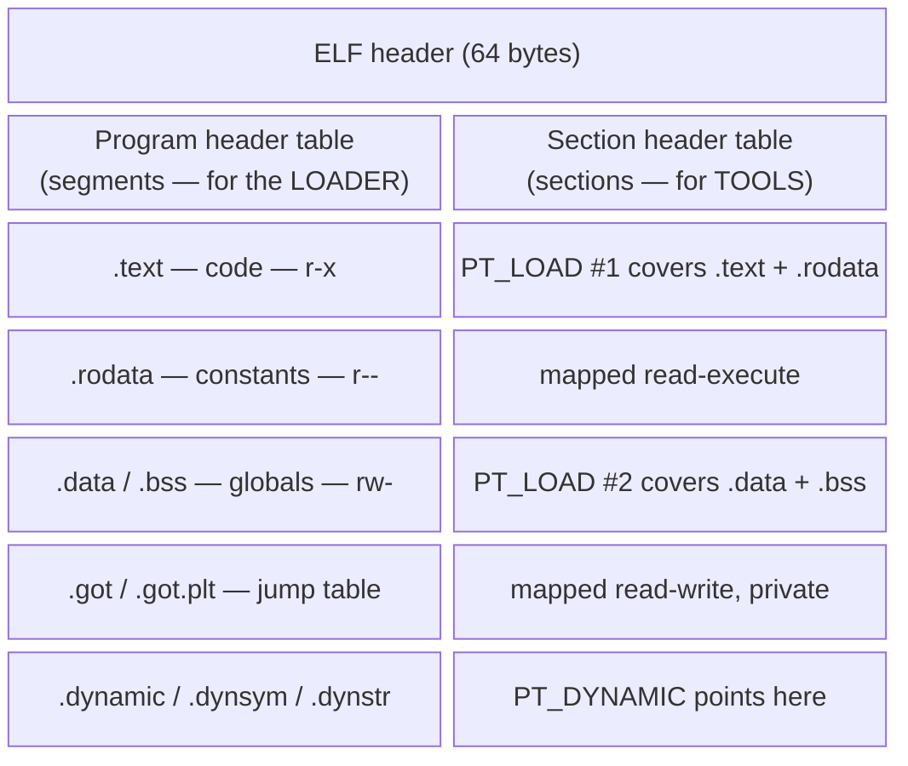

The diagram shows the essential relationship: sections are the fine-grained view and segments are the
coarse-grained view, and one segment typically covers several sections. The loader never looks at
sections at all.

**The ELF header fields you will read by hand.**

| Field | Offset | Size | Contents |
|---|---|---|---|
| `e_ident[EI_MAG0..3]` | 0 | 4 | `7F 45 4C 46` |
| `e_ident[EI_CLASS]` | 4 | 1 | `1` = 32-bit, `2` = 64-bit |
| `e_ident[EI_DATA]` | 5 | 1 | `1` = little-endian, `2` = big-endian |
| `e_ident[EI_OSABI]` | 7 | 1 | `0` = System V, `3` = Linux |
| `e_type` | 16 | 2 | `1` REL, `2` EXEC, **`3` DYN (PIE and `.so`)**, `4` CORE |
| `e_machine` | 18 | 2 | `0x28` ARM, **`0xB7` AArch64**, `0x03` i386, `0x3E` x86-64 |
| `e_entry` | 24 | 8 | Entry point virtual address (relative in a DYN file) |
| `e_phoff` | 32 | 8 | Program header table offset |
| `e_shoff` | 40 | 8 | Section header table offset |
| `e_phnum` / `e_shnum` | 56 / 60 | 2 / 2 | Number of program / section headers |

**Why `e_type` is always `3` on Android.** Since Android 5.0 the linker refuses to load executables
that are not position independent, and every native library is a shared object by construction. A
position-independent executable is an `ET_DYN` file with an entry point, loaded at a randomised base
chosen by ASLR. If `e_type` were `2` the file would demand one fixed address, defeating ASLR
entirely. That single byte is a security decision expressed in the file format.

> **Under the Hood**
> `e_entry` and every address inside an `ET_DYN` file is a *relative* virtual address. At load time
> the linker picks a base `L`, maps the segments there, and the real entry point becomes `L + e_entry`.
> This is exactly why an address you noted in Ghidra (say `0x1a2b4`) never matches what Frida reports
> at runtime (say `0x7f8c0021a2b4`). The relationship is always
> `runtime = module_base + file_virtual_address`, and `Module.findBaseAddress()` exists to give you
> `L`.

**Segments.**

| `p_type` | Value | Role |
|---|---|---|
| `PT_LOAD` | 1 | Mapped into memory by the loader |
| `PT_DYNAMIC` | 2 | Dynamic linking metadata |
| `PT_INTERP` | 3 | Path of the interpreter — `/system/bin/linker64` |
| `PT_NOTE` | 4 | Notes, including the build-id |
| `PT_TLS` | 7 | Thread-local storage template |
| `PT_GNU_EH_FRAME` | `0x6474E550` | Unwind tables |
| `PT_GNU_STACK` | `0x6474E551` | Stack permissions — **must not be executable** |
| `PT_GNU_RELRO` | `0x6474E552` | Region made read-only after relocation |

**Sections you will name in findings.**

| Section | Contents | Permissions | Why it matters |
|---|---|---|---|
| `.text` | Machine code | `r-x` | What you disassemble |
| `.rodata` | Constants and string literals | `r--` | Where hardcoded keys and URLs hide |
| `.data` | Initialised writable globals | `rw-` | Mutable state, function pointers |
| `.bss` | Zero-initialised globals | `rw-` | No bytes in the file |
| `.plt` | Procedure Linkage Table stubs | `r-x` | The call-through-a-table indirection |
| `.got` / `.got.plt` | Global Offset Table | `rw-`, or `r--` with full RELRO | **A classic hooking target** |
| `.dynamic` | `DT_NEEDED`, `DT_SONAME`, `DT_INIT`, `DT_BIND_NOW` | `r--` | Dependencies and hardening flags |
| `.dynsym` / `.dynstr` | Exported and imported symbols | `r--` | Survives stripping — your symbol source |
| `.symtab` / `.strtab` | Full symbol table | not loaded | **Stripped in release builds** |
| `.rela.dyn` / `.rela.plt` | Relocations | `r--` | What the linker patches at load |
| `.init_array` / `.fini_array` | Constructor / destructor pointers | `rw-` then RELRO | **Run before `JNI_OnLoad`** |
| `.note.gnu.build-id` | Unique build hash | `r--` | Matching a stripped `.so` to symbols |

> **Pentester's Note**
> `.init_array` is the most under-examined part of an Android native library. Every function pointer
> in it runs when the library is loaded — before `JNI_OnLoad`, before any Java code calls into it,
> and before most instrumentation is in place. Packers, anti-debug checks and licence validators live
> there precisely for that reason. Dump it before you do anything else:
>
> ```bash
> # host
> readelf -x .init_array lib/arm64-v8a/libnative.so
> objdump -s -j .init_array lib/arm64-v8a/libnative.so
> ```

---

### 3.24 The compilation pipeline

**What.** Turning human-readable source into a running process takes five distinct steps, each with
its own tool, its own input format and its own output format. Knowing them separately means you can
inspect the intermediate result whenever something is unclear.

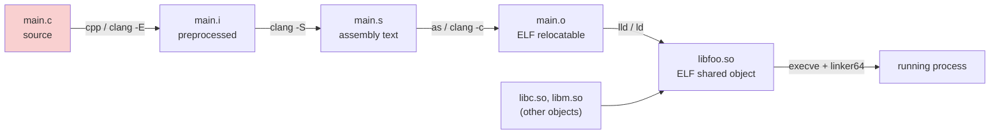

**1. Preprocess.** Text substitution only. `#include` is replaced by the contents of the named file,
`#define` macros are expanded, and `#ifdef` blocks are kept or discarded. The output is still C, just
much larger. Nothing is compiled.

**2. Compile.** The compiler parses the preprocessed C, type-checks it, builds an intermediate
representation, optimises, and emits assembly text for the target architecture. This is where
optimisation destroys the correspondence between source lines and instructions.

**3. Assemble.** The assembler translates assembly mnemonics into machine code bytes and produces an
ELF *relocatable* object file. Addresses of anything external are left as zero, accompanied by a
*relocation* entry saying "patch this location once you know where `printf` is".

**4. Link.** The linker combines object files and libraries, resolves symbols, lays out the final
sections and segments, processes relocations it can resolve statically, and writes the output ELF.

**5. Load.** `execve` parses the ELF, maps the `PT_LOAD` segments, and — if there is a `PT_INTERP` —
hands control to the dynamic linker, which loads the dependencies, processes the remaining
relocations, runs the constructors in `.init_array`, and finally jumps to the entry point.

```bash
# host / WSL — see every intermediate file for yourself
gcc -E main.c -o main.i          # preprocess only
gcc -S main.i -o main.s          # compile to assembly
gcc -c main.s -o main.o          # assemble to an object file
gcc main.o -o prog               # link
gcc -save-temps -O2 main.c -o prog   # keep all intermediates from one command
```

**Flags that change what you will see in the binary.**

| Flag | Effect | Why you care |
|---|---|---|
| `-O0` | No optimisation | Locals stay in memory; the disassembly matches the source |
| `-O2` / `-Os` / `-Oz` | Optimise for speed / size / size harder | Locals vanish into registers; functions get inlined |
| `-g` | Emit DWARF debug info | Source-level debugging; also a rich information leak if shipped |
| `-fPIC` / `-fPIE -pie` | Position independent code / executable | Required on Android; enables ASLR |
| `-shared` | Produce a `.so` | |
| `-static` | Link everything in | No `.so` dependencies; larger; no library ASLR benefit |
| `-fstack-protector-strong` | Insert stack canaries | On by default in the NDK |
| `-D_FORTIFY_SOURCE=2` | Checked variants of `memcpy`, `sprintf` where sizes are known | Turns some overflows into aborts |
| `-Wl,-z,relro -Wl,-z,now` | Full RELRO | Makes the GOT read-only after relocation |
| `-Wl,-z,noexecstack` | Non-executable stack | Sets `PT_GNU_STACK` without `PF_X` |
| `-fsanitize=address` / `hwaddress` | ASan / HWASan | Memory error detection |
| `-fno-omit-frame-pointer` | Keep `X29` chained | Readable backtraces in tombstones |
| `-Wl,--build-id` | Emit a build-id note | Match a stripped `.so` back to symbols |
| `strip --strip-unneeded` | Remove `.symtab`/`.strtab` | What release builds do — and why RE is harder |

**The NDK equivalents**, since that is what Android native code actually uses:

```bash
# host — the NDK toolchain layout
$ANDROID_NDK_HOME/toolchains/llvm/prebuilt/<host>/bin/aarch64-linux-android<API>-clang
$ANDROID_NDK_HOME/toolchains/llvm/prebuilt/<host>/bin/llvm-readelf
$ANDROID_NDK_HOME/toolchains/llvm/prebuilt/<host>/bin/llvm-objdump
$ANDROID_NDK_HOME/toolchains/llvm/prebuilt/<host>/bin/llvm-nm
```

**The parallel Android pipeline for managed code**, which is genuinely different:

| Stage | Tool | Input → output |
|---|---|---|
| Compile Kotlin/Java | `kotlinc` / `javac` | `.kt`/`.java` → `.class` (JVM bytecode) |
| Shrink, optimise, obfuscate | `r8` (or the older `proguard`) | `.class` → optimised `.class` |
| Dex | `d8` (part of R8) | `.class` → `classes.dex` (DEX bytecode) |
| Package | `aapt2` + `zipalign` + `apksigner` | resources + DEX + `.so` → signed `.apk` |
| Compile ahead of time | `dex2oat` | `.dex` → `.odex`/`.oat` (ELF containing native code) |

Both pipelines end in the same place — machine code executing at EL0 — but by completely different
routes, and an app contains artefacts from both simultaneously. See
[08 — Build System](../08-Build-System/README.md) and [12 — DEX Internals](../12-DEX-Internals/README.md).

---

### 3.25 Static versus dynamic linking

**Static linking** copies the machine code of every library function you use directly into your
output binary. The result depends on nothing at runtime.

**Dynamic linking** records only the *name* of each library and each symbol, and defers resolution to
load time, when the dynamic linker maps the libraries and patches the references.

| Property | Static | Dynamic |
|---|---|---|
| Binary size | Large — every used function is copied in | Small |
| Memory across processes | Each process has its own copy | One physical copy of the code shared by all |
| Library update | Requires relinking every consumer | Replace the `.so`; every consumer picks it up |
| Startup cost | Minimal | Symbol resolution and relocation processing |
| Symbol interposition | Impossible | Possible — `LD_PRELOAD`, PLT/GOT hooking |
| Android use | A few `/system/bin` tools; some NDK builds | **Everything else** |
| Hooking difficulty | Hard — you must patch inline | Easy — replace one GOT entry |

**How dynamic calls actually work: PLT and GOT.**

The compiler cannot know the address of `printf` when it compiles your code, so it emits a call to a
local stub in the **Procedure Linkage Table** (`.plt`). That stub loads a function pointer from a slot
in the **Global Offset Table** (`.got.plt`) and branches through it. The dynamic linker fills those
slots with real addresses.

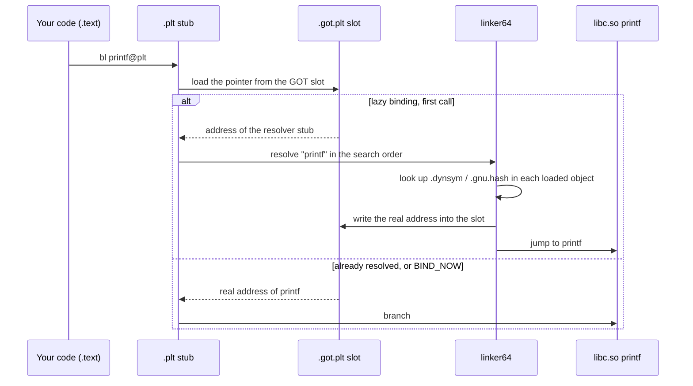

**Lazy versus immediate binding.** With lazy binding, a symbol is resolved on its first call, which
speeds startup. With `-Wl,-z,now` (`DT_BIND_NOW`), everything is resolved at load time. Immediate
binding is a *hardening* measure, because it allows the loader to then make the GOT read-only —
that is **RELRO** (RELocation Read-Only), and full RELRO is immediate binding plus a read-only GOT.

| Hardening state | GOT after startup | Consequence |
|---|---|---|
| No RELRO | Writable | Overwriting a GOT entry redirects every subsequent call |
| Partial RELRO | `.got` read-only, `.got.plt` writable | Lazy binding still needs a writable slot |
| **Full RELRO** (`-z relro -z now`) | Read-only | GOT overwrite is no longer a viable primitive |

> **Pentester's Note**
> GOT and PLT are the standard hooking points, in both directions. Frida's `Interceptor.attach` on an
> imported function, `LD_PRELOAD` on a non-Zygote process, and every classic library-interposition
> technique all work by making a call go somewhere else. Conversely, an app checking that
> `dlsym(RTLD_NEXT, "open")` still equals the address inside `libc.so`'s mapped range is performing
> anti-hooking. Check RELRO status on every `.so` you assess:
>
> ```bash
> # host
> readelf -d lib/arm64-v8a/libnative.so | grep -E 'BIND_NOW|FLAGS'
> readelf -l lib/arm64-v8a/libnative.so | grep RELRO
> ```

**Library search order.** The dynamic linker resolves `DT_NEEDED` names in a defined order, and
Android restricts it far more than desktop Linux does. Bionic implements **linker namespaces**, so an
app can only load libraries from its own APK, from the public NDK library list, and from a small
number of permitted paths. This is why you cannot `dlopen("/system/lib64/libbinder.so")` from
an app: the namespace forbids it. It is also why bundled native dependencies must live inside the
APK's `lib/<abi>/` directory.

---

### 3.26 Interpreters, compilers, JIT and AOT

**The question all four answer: when does source become machine instructions?**

| Model | Translation happens | Example |
|---|---|---|
| **Interpreter** | Never — each instruction is decoded and simulated every time it executes | ART's interpreter for cold methods; CPython |
| **Static (AOT) compiler** | Before the program runs, at build time | NDK `clang` producing `.so` |
| **JIT compiler** | At runtime, for code that proves hot | ART's JIT; the JVM's HotSpot |
| **Managed AOT** | Before execution but after build — at install or idle time | `dex2oat` producing `.oat` |

**Android uses all four simultaneously**, which is the honest and slightly annoying answer.

| Layer | Model | Mechanism |
|---|---|---|
| Kotlin/Java source | Compiled to bytecode | `kotlinc`/`javac`, then `d8`/`r8` → DEX |
| DEX, cold methods | Interpreted | The ART interpreter executes DEX directly |
| DEX, hot methods | JIT | ART compiles them at runtime and records a profile |
| DEX, profiled methods | AOT | `dex2oat` compiles them during device idle into an OAT file |
| NDK C/C++ | Static AOT | `clang` produces `.so`, loaded by `linker64` |

**The historical arc** explains why so much documentation contradicts itself:

| Android version | Runtime | Model |
|---|---|---|
| 2.2 – 4.4 | Dalvik | Interpreter plus a trace JIT |
| 4.4 | Dalvik and ART side by side | ART opt-in |
| 5.0 | ART only | **Full AOT at install time** — long installs, large storage use |
| 7.0 onward | ART | **Profile-guided hybrid**: interpret, JIT, profile, then AOT-compile hot methods when idle |
| 9.0 onward | ART | Cloud profiles shipped with apps to seed the AOT compilation |
| 12 onward | ART | ART shipped as an updatable APEX module |

**The security consequence.** "The code" of an Android app exists in several forms at once, and your
analysis must name which one it is talking about:

| Form | Where it lives | How you analyse it |
|---|---|---|
| DEX bytecode | `classes.dex` inside the APK | `jadx`, `apktool`, Smali |
| DEX in memory | Mapped from the APK, or decrypted by a packer into anonymous memory | Dump from `/proc/<pid>/maps` |
| AOT native code | `.oat`/`.odex` under `/data/app/.../oat/` | `oatdump`, or disassemble the ELF |
| JIT native code | An anonymous RWX-then-RX region in the process | Dump at runtime |
| NDK native code | `lib/<abi>/*.so` in the APK | Ghidra, IDA, `objdump` |

> **Warning**
> Patching `classes.dex` in an APK does not necessarily change what runs, if an AOT artefact exists
> and is considered valid. And dumping DEX from memory can yield a *different* DEX from the one on
> disk, which is exactly what a packer intends. When a static analysis result and a dynamic
> observation disagree, the usual explanation is that you are looking at two different forms of the
> same code. Always say which form your finding refers to.

---
## 4. Source Code Walkthrough (AOSP)

Everything in section 3 is implemented by code you can read. This section names the files, and traces
two complete paths from a public API down to the kernel. Browse AOSP at
<https://cs.android.com/> (Android Code Search) or <https://android.googlesource.com/>.

> **Warning**
> File *paths* in AOSP are stable across releases; line numbers are not. Nothing below cites a line
> number, and neither should your notes. When a path has moved between releases, search for the
> filename rather than assuming.

### 4.1 The map: where each concept lives

| Concept from section 3 | AOSP location | What you will find |
|---|---|---|
| Syscall wrappers | `bionic/libc/SYSCALLS.TXT` | The table from which every Bionic syscall stub is generated |
| Syscall stub generation | `bionic/libc/tools/gensyscalls.py` | The script that turns that table into per-architecture assembly |
| Raw syscall entry | `bionic/libc/arch-arm64/bionic/syscall.S` | The hand-written `syscall()` entry that loads `x8` and executes `svc #0` |
| `errno` | `bionic/libc/bionic/__errno.cpp` | The thread-local accessor `__errno()` |
| `fork` | `bionic/libc/bionic/fork.cpp` | Bionic's `fork`, including the pthread atfork handling |
| Threads | `bionic/libc/bionic/pthread_create.cpp` | Stack allocation with a guard page, TLS setup, and the `clone` flags |
| Mutexes and futexes | `bionic/libc/bionic/pthread_mutex.cpp` | The uncontended fast path and the `futex` slow path |
| Allocator glue | `bionic/libc/bionic/malloc_common.cpp` | Dispatch between the default allocator and the debug/hooked allocators |
| Scudo | `external/scudo/` | The hardened allocator itself |
| Allocator debugging | `bionic/libc/malloc_debug/` | The `libc.debug.malloc.options` machinery: guards, backtraces, fill patterns |
| Dynamic linker | `bionic/linker/linker.cpp`, `linker_main.cpp` | `dlopen`, symbol lookup, namespace enforcement |
| ELF segment mapping | `bionic/linker/linker_phdr.cpp` | The code that reads program headers and calls `mmap` per `PT_LOAD` |
| Linker namespaces | `bionic/linker/linker_namespaces.cpp` | Why an app cannot `dlopen` arbitrary system libraries |
| Kernel UAPI headers | `bionic/libc/kernel/uapi/` | The sanitised constants (`errno`, signals, `mmap` flags) the NDK sees |
| Zygote (native) | `frameworks/base/core/jni/com_android_internal_os_Zygote.cpp` | The specialisation sequence: capabilities, gids, seccomp, SELinux |
| Zygote (Java) | `frameworks/base/core/java/com/android/internal/os/ZygoteInit.java` | Preloading, the command socket, the fork loop |
| App process startup | `frameworks/base/core/java/android/app/ActivityThread.java` | `main()`, the `Looper`, and the bind-application path |
| ART runtime core | `art/runtime/` | Interpreter, object model, thread management |
| ART JIT code cache | `art/runtime/jit/jit_code_cache.cc` | Writable-then-executable code memory on Android, in practice |
| AOT compiler | `art/dex2oat/` | DEX → OAT compilation |
| Java monitors | `art/runtime/monitor.cc` | Thin locks, fat locks, and inflation |
| Crash handling | `system/core/debuggerd/` | The fatal-signal handler that produces tombstones |
| Kernel syscall entry (arm64) | kernel `arch/arm64/kernel/entry.S`, `syscall.c` | The exception vector and the dispatch to the syscall table |
| Kernel syscall numbers | kernel `include/uapi/asm-generic/unistd.h` | The canonical arm64 numbering |
| Kernel fork/clone | kernel `kernel/fork.c` | `copy_process`, and every `CLONE_*` flag's effect |
| Kernel page fault | kernel `arch/arm64/mm/fault.c`, `mm/memory.c` | Where a hardware fault becomes either a fixed mapping or `SIGSEGV` |
| Binder driver | kernel `drivers/android/binder.c` | The `ioctl` handler behind every Binder transaction |

### 4.2 Trace one: `open()` in Java reaches the kernel

This is the complete path from a line of app code to `SVC #0`, and every layer is somewhere you could
hook.

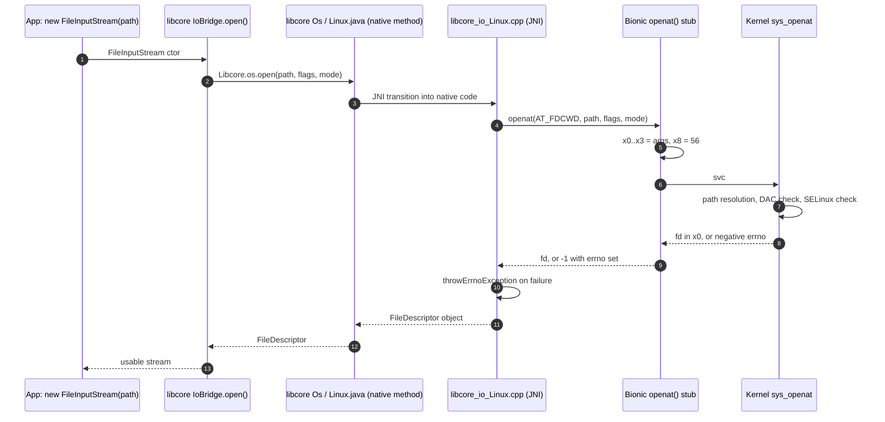

| Layer | AOSP location | Hookable with |
|---|---|---|
| Java API | `libcore/ojluni/src/main/java/java/io/FileInputStream.java` | Frida `Java.use`, Xposed |
| libcore bridge | `libcore/luni/src/main/java/libcore/io/IoBridge.java` | Frida `Java.use` |
| POSIX interface | `libcore/luni/src/main/java/libcore/io/Linux.java` (native methods) | Frida `Java.use` |
| JNI implementation | `libcore/luni/src/main/native/libcore_io_Linux.cpp` | Native `Interceptor.attach` |
| libc | `bionic/libc/` generated `openat` stub | `Interceptor.attach(Module.getExportByName("libc.so","openat"))` |
| Kernel | `fs/open.c` in the kernel | `strace`, seccomp, eBPF |

The practical point: an app that wants to evade a Java-level hook can drop to the JNI layer; one that
wants to evade a libc hook can execute `svc` inline. Each layer you move down costs the app effort
and costs you a different tool. The kernel layer is the only one it cannot skip.

### 4.3 Trace two: an app process is born

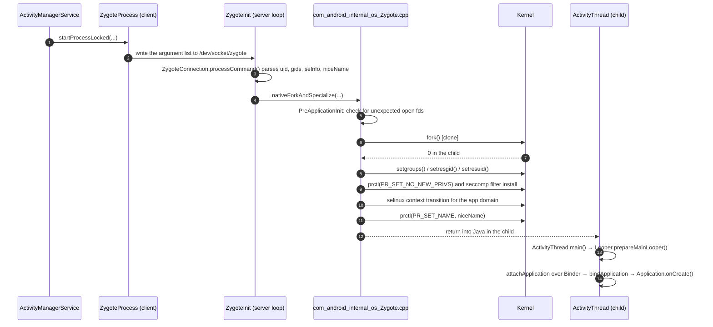

Read the ordering of steps 8 through 11. Privilege is dropped, then `no_new_privs` is set so no
setuid binary can regain it, then the seccomp filter is installed, then the SELinux domain
transition happens. Each step narrows what the process can do and none of them can be undone. This is
the concrete implementation of section 3.13's "specialisation window", and it is the single most
security-critical function in the Android framework's native code.

The Java-side entry points are in
`frameworks/base/core/java/com/android/internal/os/Zygote.java` and
`ZygoteConnection.java`; the native implementation is in
`frameworks/base/core/jni/com_android_internal_os_Zygote.cpp`. Read `SpecializeCommon` in the latter
if you read nothing else in AOSP this month.

### 4.4 Where the JIT writes executable memory

The clearest AOSP example of the RW→RX pattern from section 3.18 is ART's JIT code cache, in
`art/runtime/jit/jit_code_cache.cc` and the memory management around it in
`art/libartbase/base/mem_map.cc`.

The design has evolved specifically for hardening. Rather than keeping one region simultaneously
writable and executable, ART maintains **two mappings of the same underlying memory**: one writable
mapping used by the compiler thread to emit code, and one executable mapping used to run it. That way
no single address is ever both writable and executable, which is the `W^X` property. When you inspect
an app's maps and find an `r-xp` anonymous region alongside an `rw-p` region of the same size, that
is the JIT cache, not an attack.

```bash
# adb shell — the ART JIT cache in a running app
PID=$(pidof com.example.app)
grep -E 'jit|JIT' /proc/$PID/maps
```

Knowing that the *legitimate* pattern looks like this is what lets you recognise the illegitimate
one: a single anonymous `rwxp` region, or an `r-xp` anonymous region whose contents do not correspond
to any file, is the shape of an injected agent or an unpacked payload.

### 4.5 The allocator, from `malloc` to `mmap`

| Step | AOSP location | What happens |
|---|---|---|
| `malloc(n)` | `bionic/libc/bionic/malloc_common.cpp` | Dispatch: normal path, or the debug/hooked path if enabled |
| Allocation | `external/scudo/` | Size class selection, per-thread cache, header with checksum |
| Growth | Scudo's secondary allocator | Large allocations become their own `mmap` regions with guard pages |
| Kernel | `mm/mmap.c` | A new VMA is installed; **no physical pages yet** |
| First touch | `mm/memory.c` | A page fault allocates a zeroed physical page |

The `bionic/libc/malloc_debug/` directory is worth knowing about during an assessment, because it
gives you allocator instrumentation on a debuggable app with no recompilation:

```bash
# adb shell — enable allocation backtraces and guard pages for one app
setprop wrap.com.example.app '"LIBC_DEBUG_MALLOC_OPTIONS=backtrace guard"'
# then start the app; malloc errors are reported with backtraces in logcat
```

This works through the `wrap.<package>` property, which makes Zygote `exec` a wrapper for a
debuggable package — one of the few places Android does use `exec` for an app process, and therefore
one of the few places `LD_PRELOAD` applies.

---

## 5. Security Perspective

### 5.1 How attackers abuse these primitives

| Primitive | Abuse | Where you see it |
|---|---|---|
| Stack frames | Overwrite the saved return address to redirect control flow | Native parsers, JNI boundaries |
| Stack frames, data-only | Overwrite an adjacent flag, length or pointer without touching the return address | Far more common under modern mitigations |
| Heap metadata | Corrupt allocator bookkeeping to gain an arbitrary write | Classic allocators; harder under Scudo |
| Heap layout | Groom the heap so a victim object lands after an overflowable buffer | Every serious heap exploit |
| Use-after-free | Reclaim a freed object with attacker data, then trigger a virtual call | C++ code, media and parsing libraries |
| Integer arithmetic | Signed/unsigned confusion or multiplication overflow to defeat a length check | Length fields in binary formats |
| `mmap` / `mprotect` | Allocate and mark executable memory for injected code | Frida, packers, malware droppers |
| `ptrace` | Read and write another process's memory and registers | Debuggers, Frida attach, memory scrapers |
| Signals | Swallow crashes to hide corruption; SROP to set all registers at once | Anti-analysis, exploitation |
| File descriptors | Inherit or receive a descriptor carrying authority the receiver lacks | Privileged helpers, `ParcelFileDescriptor` |
| Races (TOCTOU) | Swap a path between check and use | Privileged file handlers, unzip routines |
| ASLR gaps | Leak one address to derive every address in a module | Any info-leak primitive |
| Zygote inheritance | Rely on preloaded libraries being at identical addresses across apps | Cross-app exploit reliability |
| Cache timing | Infer secret-dependent memory access patterns | Non-constant-time crypto |

### 5.2 How developers misuse them

**Unbounded copies into fixed buffers.** The single most common native finding.

```c
// WRONG — no length limit anywhere in the chain
void handle(JNIEnv *env, jstring jname) {
    char buf[64];
    const char *name = (*env)->GetStringUTFChars(env, jname, NULL);
    strcpy(buf, name);                      // attacker controls the length
    (*env)->ReleaseStringUTFChars(env, jname, name);
}
```

```c
// RIGHT — bounded, always terminated, and the truncation is detected
void handle(JNIEnv *env, jstring jname) {
    char buf[64];
    const char *name = (*env)->GetStringUTFChars(env, jname, NULL);
    if (!name) return;
    size_t n = strlen(name);
    if (n >= sizeof(buf)) {                 // reject rather than silently truncate
        (*env)->ReleaseStringUTFChars(env, jname, name);
        jclass ex = (*env)->FindClass(env, "java/lang/IllegalArgumentException");
        (*env)->ThrowNew(env, ex, "name too long");
        return;
    }
    memcpy(buf, name, n + 1);
    (*env)->ReleaseStringUTFChars(env, jname, name);
}
```

`strncpy` is *not* the fix: it does not NUL-terminate when the source fills the buffer, so
it converts an overflow into an unterminated string, which the next `strlen` turns back into an
overflow. `strlcpy` (available in Bionic) or an explicit length check is the correct tool.

**Signed length fields.** Covered in 3.3.1 — the check passes because the comparison is signed and
the use is unsigned.

**Uninitialised memory returned to a caller.**

```c
// WRONG — the tail of the buffer is whatever was there before
char *make_response(size_t used) {
    char *out = malloc(256);
    memcpy(out, data, used);       // only `used` bytes written
    return out;                    // caller sends all 256 — leaking heap contents
}
```

```c
// RIGHT
char *make_response(size_t used) {
    char *out = calloc(1, 256);    // zeroed
    if (!out) return NULL;
    memcpy(out, data, used);
    return out;
}
```

**Freeing on some paths and not others.** Error paths are where double-frees and leaks live, because
they are the paths nobody tests. A single cleanup label with a well-defined state, or RAII in C++, is
the structural fix.

**Signal handlers that are not async-signal-safe.** Calling `printf`, `malloc`, or a logging library
from a crash handler produces intermittent hangs that look like unrelated bugs.

**Assuming 4 KiB pages.** Hardcoded `0x1000` arithmetic breaks on 16 KiB-page devices.

**Threads sharing mutable state without synchronisation.** Especially a cached security decision — an
`isVerified` boolean written by one thread and read by another.

### 5.3 Common mistakes, tabulated

| Mistake | Consequence | Correct approach |
|---|---|---|
| `strcpy` / `sprintf` / `strcat` into a fixed buffer | Stack or heap overflow | `snprintf`, `strlcpy`, or an explicit bound |
| `int` length compared, `size_t` used | Signed/unsigned bypass | `size_t` throughout; compare against `sizeof(dest)` |
| `malloc(a * b)` | Multiplication overflow → undersized buffer | `calloc(a, b)` or a checked multiply |
| `free(p)` without `p = NULL` | Double free and use-after-free are easier | Null the pointer, or use a smart pointer |
| No `O_CLOEXEC` | Descriptor leaks to children | Always `O_CLOEXEC` unless inheritance is intended |
| `access()` then `open()` | TOCTOU | `open` with `O_NOFOLLOW`, then `fstat` |
| Own `SIGSEGV` handler that continues | Memory corruption hidden | Let it crash; fix the bug |
| Hardcoded page size | Fails on 16 KiB devices | `sysconf(_SC_PAGESIZE)` |
| `PROT_READ|PROT_WRITE|PROT_EXEC` mapping | An attacker's code becomes executable trivially | Map RW, write, then `mprotect` to RX |
| Recursive parser with no depth limit | Stack exhaustion from crafted input | Explicit depth counter, or an iterative parser |
| `alloca()` or a VLA with attacker-controlled size | Stack clash past the guard page | Fixed maximum, or heap allocation |
| Ignoring a `realloc` failure by reassigning | Leak plus a null dereference | Assign to a temporary and check it |

### 5.4 Real vulnerabilities and vulnerability classes

Only well-documented identifiers are named. Where a class is meant, the class is named rather than an
identifier invented.

| CVE | Mechanism from this chapter | Why it is the canonical example |
|---|---|---|
| **CVE-2016-5195 ("Dirty COW")** | Race in the kernel's copy-on-write handling of private read-only mappings (section 3.18.4) | An unprivileged process could write to memory and files it could only read; weaponised into universal Android rooting |
| **CVE-2022-0847 ("Dirty Pipe")** | Uninitialised pipe buffer flags allowing writes into the read-only page cache | The same outcome as Dirty COW by a different route; affected Android devices on kernel 5.8+ |
| **CVE-2019-2215** | Use-after-free in the Android Binder driver (section 3.17) | A heap lifetime bug in kernel code, reachable from an unprivileged app in some configurations |
| **CVE-2015-1805** | Linux kernel pipe read/write iovec handling flaw | A generic Linux memory-safety bug that became an Android privilege escalation used by public rooting tools |
| **CVE-2015-1538 (Stagefright family)** | Integer overflow and heap corruption in media parsing | The archetypal "attacker-controlled length reaches a native parser" bug on Android |

Beyond named identifiers, the *classes* that come directly out of this chapter and that you will
actually encounter on engagements:

- **Attacker-controlled length reaching a native copy**, usually across the JNI boundary from a Java
  string or byte array whose size was never validated on the native side.
- **Integer overflow in a size or offset computation** inside a binary format parser — image decoders,
  media containers, custom protocol handlers, protobuf-adjacent code.
- **Use-after-free in C++ object graphs**, typically where a callback outlives the object that
  registered it.
- **TOCTOU in privileged file handlers** — backup and restore, log collectors, crash uploaders, OEM
  diagnostic services.
- **Leaked file descriptors across a privilege boundary**, including over Binder as
  `ParcelFileDescriptor`.
- **Information disclosure through uninitialised memory** returned to a less privileged caller.
- **Unbounded recursion in a parser** reachable from untrusted input, causing stack exhaustion.

### 5.5 Bug bounty patterns

| Pattern | Where to look | Typical impact |
|---|---|---|
| Native parser reachable from an exported component | `AndroidManifest.xml` exports → Java → JNI → `.so` | Memory corruption in the app's own sandbox; higher if the app is privileged |
| Length validated in Java, used in native | The JNI method boundary | Overflow, because the two layers disagree on encoding or width |
| `System.loadLibrary` on a path in writable storage | Java source, `strings` on the APK | Code execution by replacing the library |
| A crash with an attacker-controlled fault address | Fuzzing an exported interface, then reading the tombstone | Demonstrable memory corruption; the address proves control |
| Address disclosure in a log or an error message | `logcat` during an error path | Defeats ASLR; enables other bugs |
| An unzip routine without path canonicalisation | Update and DLC downloaders | Arbitrary write inside the sandbox, then code execution |
| `ptrace`-able release build | `android:debuggable`, or `ro.debuggable` | Full memory access to the app from `shell` |

> **Warning**
> A crash on its own is not a vulnerability report. The report needs: the input that triggers it, the
> fault address and whether it is attacker-controlled, the `si_code`, the register state showing your
> data in a register, the mitigations active on the target, and an honest impact statement. A
> tombstone plus three sentences of analysis is worth more than a fuzzer corpus.

### 5.6 OWASP MASVS mapping

| MASVS category | Connection to this chapter |
|---|---|
| **MASVS-CODE** | Memory safety in native libraries; integer handling; unsafe C functions; the JNI boundary; dependency and toolchain hardening flags |
| **MASVS-RESILIENCE** | `TracerPid` and `ptrace` anti-debugging; `/proc/self/maps` scanning for injected libraries; runtime code generation and integrity checks |
| **MASVS-PLATFORM** | File descriptors crossing process boundaries; IPC as `ioctl` on `/dev/binder` |
| **MASVS-STORAGE** | What "the file is closed" actually means; deleted-but-open files; uninitialised memory reaching persisted data |
| **MASVS-CRYPTO** | Constant-time implementation; cache side channels; key material lifetime in memory |
| **MASVS-PRIVACY** | Information disclosure through uninitialised memory and through address leaks |

The MASTG tests that operate at this level are the ones about anti-reversing defences, memory
protections and code quality. See [71 — OWASP Mobile](../71-OWASP-Mobile/README.md).

### 5.7 How a pentester tests all of this

An ordered checklist you can run against any app with native code.

```bash
# 1. Is there native code at all, and for which ABIs?
unzip -l base.apk | grep '\.so$'

# 2. What hardening was it built with?
for so in lib/arm64-v8a/*.so; do
  echo "=== $so"
  readelf -h "$so" | grep -E 'Type|Machine'
  readelf -d "$so" | grep -E 'BIND_NOW|FLAGS'
  readelf -l "$so" | grep -E 'GNU_STACK|GNU_RELRO'
  readelf --dyn-syms "$so" | grep -cE '__stack_chk_fail|__memcpy_chk'
done

# 3. What does it import? (the attack-surface shortlist)
readelf --dyn-syms lib/arm64-v8a/libnative.so | \
  grep -E ' (strcpy|strcat|sprintf|gets|memcpy|system|popen|execve|ptrace|dlopen|mprotect|syscall)$'

# 4. What runs before JNI_OnLoad?
readelf -x .init_array lib/arm64-v8a/libnative.so

# 5. What strings does it carry?
strings -a -n 8 lib/arm64-v8a/libnative.so | grep -Ei '^/|http|token|key|debug'

# 6. Live: what does the process actually look like?
PID=$(adb shell pidof com.example.app)
adb shell cat /proc/$PID/status | grep -E 'Uid|Gid|Threads|Seccomp|TracerPid'
adb shell grep -E 'rwxp' /proc/$PID/maps
adb shell ls -l /proc/$PID/fd | head -40

# 7. Live: what syscalls does it make? (root, userdebug build)
adb shell strace -f -p $PID -e trace=openat,connect,mprotect,ptrace 2>&1 | head -50

# 8. Crash triage
adb shell ls -t /data/tombstones/ | head -3
```

Each step answers a question you would otherwise guess at. Step 2 decides your impact statement.
Step 3 decides where to look first. Step 6 tells you whether something is already injected. Step 7
sees through obfuscation.

### 5.8 How malware abuses these mechanisms

| Behaviour | Mechanism from this chapter |
|---|---|
| Payload hidden from static analysis | Encrypted blob decrypted into an anonymous mapping, `mprotect`ed to RX, then called |
| Code loaded without touching the filesystem | `memfd_create` plus `dlopen` on `/proc/self/fd/<n>` |
| Persistence | A forked, `setsid`-detached watchdog process that restarts the package |
| Hiding from `ps` | `prctl(PR_SET_NAME)` and overwriting `argv[0]` |
| Anti-analysis | `ptrace(PTRACE_TRACEME)` on itself so a debugger cannot attach; polling `TracerPid` |
| Anti-hooking | Inline `svc #0` instead of libc calls; verifying that libc function prologues are unmodified |
| Timing checks | Measuring elapsed cycles across a region; instrumentation makes it far slower |
| Privilege escalation | Bundled public kernel exploits targeting unpatched devices |

### 5.9 How forensic analysts investigate

| Artefact | Location | What it tells you |
|---|---|---|
| Native crash | `/data/tombstones/` | Registers, backtrace, memory near registers, and the full map at crash time |
| ANR trace | `/data/anr/` | Every managed thread's stack — deadlocks and blocked main threads |
| Process memory | `/proc/<pid>/mem` plus `maps` | Decrypted payloads, keys in memory, injected libraries |
| Open descriptors | `/proc/<pid>/fd/` | Deleted-but-open files are recoverable while the process lives |
| Loaded modules | `/proc/<pid>/maps` | Libraries loaded from unexpected paths |
| Command line | `/proc/<pid>/cmdline` | The package name; also, renamed processes |
| Auxiliary vector | `/proc/<pid>/auxv` | `AT_ENTRY`, `AT_PHDR`, `AT_RANDOM` — useful for reconstructing the layout |
| SELinux context | `/proc/<pid>/attr/current` | Which domain the process actually runs in |

> **Warning**
> Volatile evidence must be collected first. `/proc` content, open descriptors, network state and
> process memory disappear the instant the device reboots or the process dies. Files can be pulled
> later; a live process's `maps` and `mem` cannot be recovered afterwards.

---

## 6. Reverse Engineering Perspective

Chapter 01 has no bytecode of its own, but its concepts are what you *recognise* when you read
someone else's. This section teaches the patterns.

### 6.1 A function prologue in AArch64 disassembly

```asm
// objdump -d output for a non-leaf function, symbols stripped
0000000000012340 <sub_12340>:
   12340:  a9bd7bfd    stp     x29, x30, [sp, #-48]!    // non-leaf: LR spilled → attackable
   12344:  910003fd    mov     x29, sp                  // frame pointer established
   12348:  a90153f3    stp     x19, x20, [sp, #16]      // will use two callee-saved registers
   1234c:  aa0003f3    mov     x19, x0                  // stash argument 1
   12350:  aa0103f4    mov     x20, x1                  // stash argument 2
   ...
   123a0:  a94153f3    ldp     x19, x20, [sp, #16]      // restore
   123a4:  a8c37bfd    ldp     x29, x30, [sp], #48      // restore FP and LR, deallocate
   123a8:  d65f03c0    ret                              // branch to x30
```

Four facts you can state without any symbols. The function is a **non-leaf**, because `x30` is
spilled — it calls something, and its return address is in writable memory. Its frame is **48 bytes**,
from the immediate in the `stp`. It uses **two callee-saved registers**, so it has at least two
long-lived local values. And it takes **at least two arguments**, because `x0` and `x1` are both
consumed immediately.

With PAC enabled the prologue gains one instruction and the epilogue changes:

```asm
   12340:  d503233f    paciasp                          // sign x30 using SP as context
   12344:  a9bd7bfd    stp     x29, x30, [sp, #-48]!
   ...
   123a4:  a8c37bfd    ldp     x29, x30, [sp], #48
   123a8:  d50323bf    autiasp                          // verify the signature
   123ac:  d65f03c0    ret
   // or the combined form:
   123a8:  d65f0bff    retaa                            // authenticate and return
```

Seeing `paciasp`/`autiasp`/`retaa` tells you plain return-address overwrite is off the table on that
binary, and your finding should say so.

### 6.2 Recognising the bug patterns in decompiled output

```c
// Ghidra decompilation — the shape of an unbounded copy
undefined8 FUN_00012340(long param_1, char *param_2)
{
  char local_48 [64];              // ← a fixed 64-byte stack buffer
  strcpy(local_48, param_2);       // ← no length involved anywhere
  process(local_48);
  return 0;
}
```

```c
// Ghidra decompilation — the shape of a signed length bypass
undefined8 FUN_000124a0(uint *param_1, int param_2)
{
  undefined auStack_88 [128];
  if (0x80 < param_2) {            // ← SIGNED comparison (check the branch: B.GT)
    return 0xffffffff;
  }
  memcpy(auStack_88, param_1, (long)param_2);   // ← sign-extended into size_t
  return 0;
}
```

```c
// Ghidra decompilation — the shape of a use-after-free
void FUN_00012600(long param_1)
{
  void *pvVar1 = *(void **)(param_1 + 8);
  free(pvVar1);                              // freed here
  // ... no assignment of NULL ...
  (**(code **)(*(long *)(param_1 + 8)))();   // ← called through the same pointer
}
```

| Pattern in decompiled code | What to check next |
|---|---|
| `strcpy`, `strcat`, `sprintf`, `gets` with a stack array destination | Is the source attacker-influenced? |
| A comparison followed by `memcpy` with the same variable | Is the comparison signed? Look at the actual branch mnemonic |
| `malloc` with a computed size | Can the computation overflow? |
| `free` without a subsequent NULL assignment | Is the pointer used on any path afterwards? |
| A call through a pointer loaded from a struct | Is that struct reachable after a free? |
| `mprotect` with `4` (`PROT_EXEC`) in the third argument | Runtime code generation — breakpoint here and dump |
| `__android_log_print` with an address argument | Address disclosure |

### 6.3 What the concepts look like in Smali

Managed code never touches a stack frame in this sense, but the *boundary* into native code is
visible and is where your interest starts.

```smali
# Smali — a native method declaration. There is no body; the implementation is in a .so.
.method public static native decrypt([BLjava/lang/String;)[B
.end method
```

```smali
# Smali — loading the library that provides it, in a static initialiser
.method static constructor <clinit>()V
    .locals 1
    const-string v0, "native-lib"
    invoke-static {v0}, Ljava/lang/System;->loadLibrary(Ljava/lang/String;)V
    return-void
.end method
```

The pairing of `System.loadLibrary` with `native` method declarations is your index into the native
attack surface. Every `native` method is an entry point into C or C++ that receives data the Java
layer may have validated and the native layer may not.

```bash
# host — after apktool d base.apk
grep -rn "\.method.*native" smali*/ | head -40
grep -rn "loadLibrary\|System;->load(" smali*/
```

The JNI symbol name for a statically registered method is mechanical, and knowing the rule lets you
jump straight from Smali to the disassembly:

```
Java_<package with dots replaced by underscores>_<Class>_<method>
com.example.crypto.Native.decrypt  →  Java_com_example_crypto_Native_decrypt
```

```bash
# host — find the native implementation of a specific Java method
readelf --dyn-syms lib/arm64-v8a/libnative-lib.so | grep decrypt
```

If the symbol is *not* there, the method was registered dynamically with `RegisterNatives`, which is
a deliberate obfuscation choice — see [16 — JNI](../16-JNI/README.md) for how to recover the mapping
by hooking `RegisterNatives` at runtime.

### 6.4 What obfuscation does to these patterns

| Obfuscation | Effect on chapter 01 patterns | Counter |
|---|---|---|
| Symbol stripping | No function names; only `.dynsym` exports survive | Recognise prologues to find function boundaries; use the build-id to match symbols if available |
| Identifier renaming (R8) | Java names become `a`, `b`, `c` | Irrelevant at this level — JNI signatures and libc imports are unchanged |
| String encryption | `strings` finds nothing useful | Breakpoint the decryptor; dump `.rodata` at runtime |
| Control-flow flattening | One dispatch loop instead of readable blocks | Trace at runtime; the prologue and the libc calls are still there |
| Dynamic JNI registration | No `Java_*` symbols | Hook `RegisterNatives` and log the table |
| Inline `svc #0` | No libc symbol to hook | Trace below libc: `strace`, seccomp, or Frida `Stalker` |
| Packing | The real code is not in the file | Dump from memory after the `mprotect` to RX |
| Anti-disassembly data in `.text` | Linear sweep produces nonsense | Use recursive-descent disassembly; on AArch64 the fixed width limits the damage |

> **Pentester's Note**
> No obfuscator can remove the function prologue, the calling convention, the syscall interface, or
> the ELF program headers, because the hardware and the loader require them. That is the reason this
> chapter is the durable foundation: everything above it can be obfuscated, and everything in it
> cannot.

---
## 7. Dynamic Analysis

Every tool in this section observes one of the concepts from section 3. The point is not to memorise
flags; it is to know which tool sits at which layer, so that when one is blinded you reach for the
next one down.

```mermaid
flowchart TD
    J["Java / Kotlin layer"] -->|"Frida Java.use, Xposed"| O1["observable"]
    N["Native .so functions"] -->|"Frida Interceptor, ltrace, GDB/LLDB"| O2["observable"]
    L["libc exports (PLT/GOT)"] -->|"Frida on libc, LD_PRELOAD (non-app)"| O3["observable"]
    S["Syscall boundary"] -->|"strace, seccomp, eBPF, Frida Stalker"| O4["observable"]
    K["Kernel internals"] -->|"ftrace, eBPF, kernel debugger"| O5["needs root/userdebug"]
    J --> N --> L --> S --> K
```

Read this top to bottom as an escalation ladder. Each rung is harder for the app to evade and harder
for you to use. Start at the top; move down only when the app forces you to.

### 7.1 `strace` — watching the syscall boundary

```bash
# adb shell, root, userdebug build — strace ships on userdebug images
strace -f -p $(pidof com.example.app)                  # follow all threads
strace -f -e trace=openat,read,write ./prog            # filter by syscall
strace -f -e trace=%memory ./prog                      # mmap / mprotect / brk family
strace -f -e trace=%network ./prog                     # socket family
strace -c -f -p $(pidof com.example.app)               # summary counts and time
strace -tt -T -f -p <pid>                              # timestamps and per-call duration
strace -s 256 -f -p <pid>                              # show 256 bytes of string arguments
strace -o trace.log -ff ./prog                         # one file per pid
```

What to look for, in order of value:

| Observation | Meaning |
|---|---|
| `openat(..., "/system/xbin/su", ...)` or `faccessat` on `su` paths | Root detection |
| `openat(..., "/proc/self/maps", ...)` followed by `read` | Anti-instrumentation scan |
| `openat(..., "/proc/self/status", ...)` | `TracerPid` anti-debug check |
| `ptrace(PTRACE_TRACEME, ...)` | Self-attach to block a debugger |
| `mprotect(..., PROT_READ|PROT_EXEC)` | Code just became executable — dump the region now |
| `memfd_create` | Filesystem-free code loading |
| `ioctl(<fd>, 0xc0306201, ...)` on `/dev/binder` | A Binder transaction (`BINDER_WRITE_READ`) |
| A dense stream of `futex` | Lock contention, or a busy thread pool |
| `connect` to an address not in the app's config | Undocumented endpoint |
| `ENOSYS` on a call the kernel supports | seccomp is denying it |

### 7.2 ADB and `/proc` — the free reconnaissance

```bash
# adb shell — everything here is free, non-invasive, and often decisive
PID=$(pidof com.example.app)
cat /proc/$PID/status              # identity, threads, TracerPid, Seccomp, capabilities
cat /proc/$PID/cmdline | tr '\0' ' '   # the package name
cat /proc/$PID/maps                # the full memory layout
cat /proc/$PID/smaps_rollup        # total RSS/PSS in one place
ls -l /proc/$PID/fd                # open descriptors
ls /proc/$PID/task | wc -l         # thread count
cat /proc/$PID/task/*/comm         # thread names — the Frida tell
cat /proc/$PID/attr/current        # SELinux domain
cat /proc/$PID/auxv | xxd | head   # auxiliary vector
getconf PAGE_SIZE                  # 4096 or 16384
```

```bash
# adb shell — process and memory overview
ps -A -T | grep com.example.app    # every thread
top -H -p $PID                     # per-thread CPU
dumpsys meminfo com.example.app    # Android-aware memory breakdown
```

### 7.3 A complete Frida script: the chapter 01 observatory

This script instruments every concept from section 3 that is observable at the libc boundary. It is
complete and runnable as written.

```javascript
// chapter01-observatory.js
// Purpose: make the concepts of chapter 01 visible inside a live Android app —
//          memory mappings, page permission changes, the syscall boundary,
//          process/thread creation, file descriptors and signals.
// Usage:   frida -U -f com.example.app -l chapter01-observatory.js --no-pause
//          frida -U -n com.example.app -l chapter01-observatory.js     (attach)
// Notes:   Read-only. It logs and never changes behaviour.

'use strict';

const PAGE = Process.pageSize;
const IS64 = Process.pointerSize === 8;

function hdr(t) { console.log('\n===== ' + t + ' ====='); }

// ---------------------------------------------------------------------------
// 1. The process itself — section 3.12
// ---------------------------------------------------------------------------
hdr('PROCESS');
console.log('  arch          : ' + Process.arch);          // arm64 on a modern device
console.log('  platform      : ' + Process.platform);
console.log('  pointerSize   : ' + Process.pointerSize + ' bytes');
console.log('  pageSize      : ' + PAGE + ' (0x' + PAGE.toString(16) + ')');
console.log('  pid           : ' + Process.id);
console.log('  main thread   : ' + Process.getCurrentThreadId());

// ---------------------------------------------------------------------------
// 2. Memory layout — sections 3.18 and 3.23
// ---------------------------------------------------------------------------
hdr('MEMORY MAP SUMMARY');
{
    const ranges = Process.enumerateRanges('---');
    const byProt = {};
    let rwx = [];
    ranges.forEach(function (r) {
        byProt[r.protection] = (byProt[r.protection] || 0) + r.size;
        if (r.protection.indexOf('w') >= 0 && r.protection.indexOf('x') >= 0) {
            rwx.push(r);
        }
    });
    Object.keys(byProt).sort().forEach(function (p) {
        console.log('  ' + p + '  ' + (byProt[p] / 1024 / 1024).toFixed(2) + ' MiB');
    });
    if (rwx.length === 0) {
        console.log('  no writable+executable regions — good hygiene (W^X respected)');
    } else {
        console.log('  !! ' + rwx.length + ' WRITABLE+EXECUTABLE region(s):');
        rwx.forEach(function (r) {
            console.log('     ' + r.base + '  ' + r.size + '  ' +
                        (r.file ? r.file.path : '[anonymous]'));
        });
    }
}

hdr('LOADED MODULES (first 15)');
Process.enumerateModules().slice(0, 15).forEach(function (m) {
    console.log('  ' + m.base + '  size=0x' + m.size.toString(16) + '  ' + m.name);
});

// ---------------------------------------------------------------------------
// 3. The ELF base + offset relationship — section 3.23
// ---------------------------------------------------------------------------
hdr('ASLR / BASE ADDRESS');
{
    const libc = Process.findModuleByName(IS64 ? 'libc.so' : 'libc.so');
    if (libc !== null) {
        const openat = Module.findExportByName('libc.so', 'openat');
        console.log('  libc.so base        : ' + libc.base);
        console.log('  openat runtime addr : ' + openat);
        console.log('  openat file offset  : 0x' + openat.sub(libc.base).toString(16));
        console.log('  ^ this offset is CONSTANT; the base is randomised every launch.');
        console.log('    Never hardcode the left column. Always compute base + offset.');
    }
}

// ---------------------------------------------------------------------------
// 4. Page permission changes — section 3.18.3
//    This is the single highest-value hook in the whole script.
// ---------------------------------------------------------------------------
function protToString(p) {
    return ((p & 1) ? 'r' : '-') + ((p & 2) ? 'w' : '-') + ((p & 4) ? 'x' : '-');
}

const mprotectPtr = Module.findExportByName('libc.so', 'mprotect');
if (mprotectPtr !== null) {
    Interceptor.attach(mprotectPtr, {
        onEnter: function (args) {
            this.addr = args[0];
            this.len  = args[1].toInt32();
            this.prot = args[2].toInt32();
        },
        onLeave: function (ret) {
            if ((this.prot & 4) !== 0) {   // PROT_EXEC requested
                console.log('\n[!] mprotect -> EXECUTABLE  addr=' + this.addr +
                            ' len=0x' + this.len.toString(16) +
                            ' prot=' + protToString(this.prot) +
                            ' ret=' + ret);
                console.log(Thread.backtrace(this.context, Backtracer.ACCURATE)
                                  .map(DebugSymbol.fromAddress).join('\n    '));
                // First 64 bytes of what just became executable:
                try {
                    console.log('    first bytes: ' +
                        hexdump(this.addr, { length: 64, ansi: false }));
                } catch (e) { /* region may not be readable */ }
            }
        }
    });
}

// ---------------------------------------------------------------------------
// 5. New executable memory — section 3.18.3
// ---------------------------------------------------------------------------
const mmapPtr = Module.findExportByName('libc.so', 'mmap');
if (mmapPtr !== null) {
    Interceptor.attach(mmapPtr, {
        onEnter: function (args) { this.prot = args[2].toInt32(); this.len = args[1]; },
        onLeave: function (ret) {
            if ((this.prot & 4) !== 0) {
                console.log('[!] mmap with PROT_EXEC  ret=' + ret +
                            ' len=' + this.len + ' prot=' + protToString(this.prot));
            }
        }
    });
}

// ---------------------------------------------------------------------------
// 6. File descriptors — section 3.21
// ---------------------------------------------------------------------------
const openatPtr = Module.findExportByName('libc.so', 'openat');
if (openatPtr !== null) {
    Interceptor.attach(openatPtr, {
        onEnter: function (args) {
            this.path = args[1].readUtf8String();
        },
        onLeave: function (ret) {
            const p = this.path || '';
            // Only report the paths that mean something for security work.
            if (/\/proc\/(self|\d+)\/(maps|status|task|mem|cmdline)/.test(p) ||
                /\/su\b|xbin\/su|\/magisk|frida|\/data\/local\/tmp/.test(p)) {
                console.log('[fd] openat("' + p + '") = ' + ret.toInt32() +
                            '   <-- environment probe');
            }
        }
    });
}

// ---------------------------------------------------------------------------
// 7. Anti-debugging — sections 3.19 and 3.20
// ---------------------------------------------------------------------------
const ptracePtr = Module.findExportByName('libc.so', 'ptrace');
if (ptracePtr !== null) {
    Interceptor.attach(ptracePtr, {
        onEnter: function (args) {
            console.log('[!] ptrace(request=' + args[0].toInt32() +
                        ', pid=' + args[1].toInt32() + ')  <-- anti-debug or injection');
            console.log(Thread.backtrace(this.context, Backtracer.ACCURATE)
                              .map(DebugSymbol.fromAddress).join('\n    '));
        }
    });
}

// ---------------------------------------------------------------------------
// 8. Processes and threads — sections 3.13 and 3.14
// ---------------------------------------------------------------------------
['fork', 'vfork'].forEach(function (name) {
    const p = Module.findExportByName('libc.so', name);
    if (p !== null) {
        Interceptor.attach(p, {
            onLeave: function (ret) {
                console.log('[proc] ' + name + '() = ' + ret.toInt32() +
                            (ret.toInt32() === 0 ? '  (we are the CHILD)' : '  (child pid)'));
            }
        });
    }
});

const pthreadCreatePtr = Module.findExportByName('libc.so', 'pthread_create');
if (pthreadCreatePtr !== null) {
    Interceptor.attach(pthreadCreatePtr, {
        onEnter: function (args) {
            const start = args[2];
            console.log('[thread] pthread_create start_routine=' + start + '  ' +
                        DebugSymbol.fromAddress(start));
        }
    });
}

// ---------------------------------------------------------------------------
// 9. Signals — section 3.20
// ---------------------------------------------------------------------------
const SIGNAMES = { 4: 'SIGILL', 5: 'SIGTRAP', 6: 'SIGABRT', 7: 'SIGBUS',
                   8: 'SIGFPE', 11: 'SIGSEGV', 31: 'SIGSYS' };
const sigactionPtr = Module.findExportByName('libc.so', 'sigaction');
if (sigactionPtr !== null) {
    Interceptor.attach(sigactionPtr, {
        onEnter: function (args) {
            const sig = args[0].toInt32();
            if (SIGNAMES[sig] !== undefined && !args[1].isNull()) {
                console.log('[signal] handler installed for ' + SIGNAMES[sig] +
                            ' (' + sig + ')  <-- may be swallowing crashes');
            }
        }
    });
}

// ---------------------------------------------------------------------------
// 10. Unsafe string functions — section 5.2
// ---------------------------------------------------------------------------
['strcpy', 'strcat', 'sprintf', 'gets'].forEach(function (name) {
    const p = Module.findExportByName('libc.so', name);
    if (p === null) { return; }
    Interceptor.attach(p, {
        onEnter: function (args) {
            let src = '<unreadable>';
            try { src = args[1].readCString(); } catch (e) { /* not a string */ }
            const len = (src && src !== '<unreadable>') ? src.length : -1;
            if (len > 64) {   // only the interesting ones
                console.log('[unsafe] ' + name + '() src length=' + len +
                            ' dst=' + args[0]);
                console.log(Thread.backtrace(this.context, Backtracer.ACCURATE)
                                  .map(DebugSymbol.fromAddress).slice(0, 6).join('\n    '));
            }
        }
    });
});

console.log('\n[+] chapter01-observatory active. Exercise the app now.\n');
```

Run it and then use the app normally. Every line it prints corresponds to a numbered section above,
and after ten minutes with a real app you will have seen page permissions change, threads spawn,
`/proc` probed and descriptors opened — all of section 3, live.

### 7.4 GDB and LLDB

```bash
# host — a native binary you compiled
gdb -q ./prog
```

```
(gdb) break main
(gdb) run
(gdb) info registers            # every register — section 3.7
(gdb) p/x $x0                   # one register in hex
(gdb) x/16xb $sp                # 16 bytes of stack, byte-wise
(gdb) x/8gx $sp                 # 8 giant (64-bit) words
(gdb) x/8i $pc                  # next 8 instructions
(gdb) bt                        # backtrace — walks the frame-pointer chain (3.16)
(gdb) frame 2                   # select a caller's frame
(gdb) info frame                # frame base, saved registers, return address
(gdb) info proc mappings        # the memory map — section 3.18
(gdb) stepi                     # single instruction step
(gdb) disassemble               # current function
(gdb) watch *0x7fff1234         # data watchpoint — catches the write that corrupts
```

On Android, the NDK ships LLDB and `lldb-server`:

```bash
# host — attach LLDB to an app on a device (debuggable app or userdebug build)
adb push $NDK/toolchains/llvm/prebuilt/*/lib*/clang/*/lib/linux/aarch64/lldb-server /data/local/tmp/
adb shell /data/local/tmp/lldb-server platform --listen "*:5039" --server &
adb forward tcp:5039 tcp:5039
lldb
```

```
(lldb) platform select remote-android
(lldb) platform connect connect://localhost:5039
(lldb) process attach --pid <pid>
(lldb) register read
(lldb) memory read --size 8 --format x --count 8 $sp
(lldb) image list
(lldb) thread backtrace all
```

### 7.5 Reading a tombstone

A tombstone is section 3 printed automatically at the moment of a crash. Learning to read one is the
highest-value ten minutes in this chapter.

```bash
# adb shell — the most recent native crash
ls -t /data/tombstones/ | head -1
cat /data/tombstones/tombstone_00
# or the summary in logcat
adb logcat -b crash -d
```

| Tombstone section | What it tells you | Chapter section |
|---|---|---|
| `signal 11 (SIGSEGV), code 2 (SEGV_ACCERR), fault addr 0x...` | Which kind of memory failure, and where | 3.20, 3.18.2 |
| `Cause: null pointer dereference` (when present) | The kernel's or debuggerd's classification | 3.17 |
| Register dump `x0` … `x30`, `sp`, `pc` | **Is your input in a register?** | 3.7 |
| `backtrace:` | The call chain via the frame-pointer walk | 3.16 |
| `memory near x1:` | Hexdump around each register value | 3.2 |
| `memory map (…):` | The full `/proc/self/maps` at crash time | 3.18.8 |
| `Abort message:` | For `SIGABRT`, the allocator's or assert's message | 3.17 |

The triage questions, in order: Is the fault address attacker-controlled (`0x4141414141` after
sending `A`s)? Is `pc` inside a mapped executable region or somewhere impossible? Which mapping does
the fault address fall in — a stack, a malloc arena, or nothing? Is the `si_code` `MAPERR` (nothing
there) or `ACCERR` (permissions)? Four questions, thirty seconds, and you know what you are dealing
with.

### 7.6 Other tools at this layer

| Tool | Layer | Use |
|---|---|---|
| `ltrace` | Library (PLT) calls | Host only in practice; see which library functions are called |
| `simpleperf` | Sampling profiler | On-device, low overhead; also gives call graphs |
| `perfetto` / `atrace` | System tracing | Scheduling, Binder transactions, page faults over time |
| `logcat -b crash` | Crash summaries | Fast triage before opening a tombstone |
| `dumpsys meminfo <pkg>` | Memory accounting | Android-aware PSS breakdown by category |
| `bpftrace` / eBPF | Kernel tracing | Requires a supporting kernel; extremely powerful |
| Objection | Frida wrapper | `memory list modules`, `memory dump` without writing a script |

---

## 8. Static Analysis

Static analysis at this level means answering questions about a binary without running it.

### 8.1 Identify what you are holding

```bash
# host — always the first four commands
file lib/arm64-v8a/libnative.so
xxd -g 1 -l 16 lib/arm64-v8a/libnative.so     # magic + e_ident by hand
readelf -h lib/arm64-v8a/libnative.so         # the full header
readelf -l lib/arm64-v8a/libnative.so         # segments and their permissions
```

| First bytes | Format | Next step |
|---|---|---|
| `7F 45 4C 46` | ELF | `readelf -h` |
| `64 65 78 0A` (`dex\n`) | DEX | `jadx`, `baksmali` |
| `50 4B 03 04` (`PK..`) | ZIP / APK / JAR | `unzip -l` |
| `CA FE BA BE` | Java `.class` (or Mach-O fat) | `javap -c` |
| `1F 8B` | gzip | `gunzip` |
| High entropy, no magic | Encrypted or compressed blob | Find the decryptor |

> **Pentester's Note**
> An `assets/` file called `config.dat` that starts `50 4B 03 04` is a hidden ZIP — a very common way
> to ship a second DEX for dynamic loading. One that starts `64 65 78 0A` is a DEX pretending not to
> be one. `file` will not tell you either if the extension is misleading; your eyes will. Run
> `scripts/hexdump-header.py` over every unrecognised asset in an APK as a matter of routine.

### 8.2 Assess the hardening

```bash
# host — the hardening checklist for one .so
SO=lib/arm64-v8a/libnative.so
echo "== type (ET_DYN = PIE/shared, required on Android)"
readelf -h "$SO" | grep Type
echo "== non-executable stack (must NOT show RWE)"
readelf -l "$SO" | grep GNU_STACK
echo "== RELRO"
readelf -l "$SO" | grep GNU_RELRO
readelf -d "$SO" | grep -E 'BIND_NOW|FLAGS'
echo "== stack canaries (symbol present means -fstack-protector was used somewhere)"
readelf --dyn-syms "$SO" | grep -c __stack_chk_fail
echo "== FORTIFY (the _chk variants)"
readelf --dyn-syms "$SO" | grep -E '_chk$'
echo "== stripped?"
readelf -S "$SO" | grep -E '\.symtab|\.debug'
echo "== build-id"
readelf -n "$SO" | grep -A1 'Build ID'
```

| Finding | Severity framing |
|---|---|
| `GNU_STACK` with `RWE` | Executable stack — a genuine hardening defect worth reporting |
| No `GNU_RELRO` or no `BIND_NOW` | GOT is writable after startup — makes hooking and exploitation easier |
| No `__stack_chk_fail` reference | Compiled without stack protection — raises the impact of any overflow |
| No `_chk` symbols | No `_FORTIFY_SOURCE` |
| `.symtab` present | Not stripped — helpful to you, a minor information disclosure |
| `LOAD` segments aligned to only 4 KiB | Will not load on 16 KiB-page devices — a compatibility finding |

### 8.3 Enumerate the attack surface

```bash
# host — imports: what the library asks other libraries to do
readelf --dyn-syms lib/arm64-v8a/libnative.so | awk '$7=="UND"{print $8}' | sort -u

# the shortlist that always deserves attention
readelf --dyn-syms lib/arm64-v8a/libnative.so | grep -E \
  ' (strcpy|strcat|strncpy|sprintf|vsprintf|gets|memcpy|memmove|alloca|system|popen|execve|execvp|fork|ptrace|dlopen|dlsym|mprotect|mmap|syscall|__android_log_print)$'

# exports: what it offers, including JNI entry points
readelf --dyn-syms lib/arm64-v8a/libnative.so | grep -E 'Java_|JNI_OnLoad'

# dependencies
readelf -d lib/arm64-v8a/libnative.so | grep NEEDED

# what runs at load time, before JNI_OnLoad
readelf -x .init_array lib/arm64-v8a/libnative.so
```

| Import | What it implies |
|---|---|
| `strcpy`, `sprintf`, `strcat`, `gets` | Unbounded copies — find each call site |
| `system`, `popen`, `execve` | Shelling out — check what command string is built |
| `ptrace` | Anti-debugging, or the library *is* a debugger |
| `dlopen`, `dlsym` | Dynamic loading; possibly a packer |
| `mprotect` | Runtime code generation |
| `syscall` | **Direct syscall invocation to bypass libc hooks** — a strong anti-hooking signal |
| `inotify_add_watch` | Watching for tampering with its own files |
| `prctl` | `PR_SET_DUMPABLE(0)` to block `ptrace`; `PR_SET_NAME` to hide |

### 8.4 Disassemble and search

```bash
# host — whole-library disassembly, then grep for the patterns you care about
objdump -d lib/arm64-v8a/libnative.so > dis.txt

grep -n 'stp\s*x29, x30' dis.txt | wc -l      # count non-leaf functions
grep -n 'paciasp' dis.txt | wc -l             # is PAC in use?
grep -n 'bl.*<strcpy@plt>' dis.txt            # every unbounded copy call site
grep -n 'svc\s*#0' dis.txt                    # direct syscalls — anti-hooking
grep -n 'brk\s*#' dis.txt                     # deliberate breakpoints / anti-debug traps

# disassemble one range
objdump -d --start-address=0x12340 --stop-address=0x12400 lib/arm64-v8a/libnative.so

# disassemble a raw blob you dumped from memory
objdump -D -b binary -m aarch64 dumped.bin | head -60
```

### 8.5 Where these concepts appear in the rest of an APK

| Location | What to look for | Command |
|---|---|---|
| `AndroidManifest.xml` | `android:debuggable`, `extractNativeLibs`, exported components | `apktool d base.apk` then read `AndroidManifest.xml` |
| `lib/<abi>/` | Which ABIs ship; a missing `arm64-v8a` means the app runs 32-bit | `unzip -l base.apk \| grep '\.so$'` |
| `assets/` | Hidden DEX, ELF or encrypted payloads | `python3 scripts/hexdump-header.py assets/*` |
| Smali / JADX output | `native` methods, `System.loadLibrary`, `DexClassLoader` | `grep -rn "native\|loadLibrary" smali*/` |
| `build.gradle` | `externalNativeBuild`, NDK version, ABI filters | `grep -rn 'externalNativeBuild\|ndk {' app/build.gradle*` |
| `resources.arsc` / `res/xml` | Network security config, file provider paths | `apktool` output |

```bash
# host — a one-shot native triage of an APK
mkdir -p /tmp/triage && cd /tmp/triage
unzip -o "$1" 'lib/*' 'assets/*' 'classes*.dex' >/dev/null
for so in lib/*/*.so; do
  printf '%-50s ' "$so"
  file -b "$so" | cut -d, -f1-3
done
```

---

## 9. Examples

> **Verified against a compiler and a device.** Both C files in `examples/` compile **clean** with
> `-Wall -Wextra` using `aarch64-linux-android21-clang` from **NDK 25.2.9519653**, and
> `stack_frames.c` was additionally built with `-O0 -g -fno-omit-frame-pointer` and **run on a
> physical arm64 device** (Redmi `M2101K6P`, Android 11 / API 30) to confirm every claim its output
> makes. Section 3 of that run is the one worth knowing: `sibling_a()` wrote `0x41414141` at
> `0x7fe6b221bc` and `sibling_b()` read `0x41414141` back **from the same address**, so the
> stack-recycling demonstration is a measurement here, not an assertion.
>
> Two warnings had to be dealt with to get there, and both were kept rather than deleted, because
> each is a lesson. `sibling_b`'s uninitialised read now goes through a `volatile` pointer — the same
> undefined behaviour, but no longer *provable* to clang, which is precisely how real
> uninitialised-memory bugs escape `-Wuninitialized`. And `__builtin_frame_address(1)` is accepted
> under a two-line scoped pragma with the reason recorded inline: a nonzero frame index is only safe
> when the caller kept a frame pointer, which is why production backtracers use DWARF unwind tables
> instead.

Five worked examples of increasing difficulty. Runnable versions of the first three live in
[`examples/`](examples/); the scripts referenced live in [`scripts/`](scripts/).

### 9.1 Simple — see endianness and integer width with your own eyes

The complete, commented program is [`examples/endianness.c`](examples/endianness.c). The core idea is
a `union`, which places all its members at the *same* address, so writing the integer member and
reading the byte array shows you the raw storage order.

```c
/* host / WSL — build: gcc -O0 -g -Wall -o endianness examples/endianness.c */
#include <stdio.h>
#include <stdint.h>

int main(void) {
    union { uint32_t value; uint8_t bytes[4]; } u;
    u.value = 0x12345678u;

    printf("value = 0x%08x\n", u.value);
    printf("bytes in ascending address order: ");
    for (int i = 0; i < 4; i++) printf("%02x ", u.bytes[i]);
    printf("\n%s-endian\n", (u.bytes[0] == 0x78) ? "little" : "big");

    /* two's complement, made concrete */
    int8_t  s8  = (int8_t)0xFF;
    uint8_t u8  = 0xFF;
    printf("0xFF as int8_t = %d, as uint8_t = %u\n", s8, u8);

    /* the bug from section 3.3.1, in miniature */
    int  len_signed   = -1;
    size_t len_size_t = (size_t)len_signed;
    printf("(-1 as int) converted to size_t = %zu\n", len_size_t);
    printf("is (-1 > 64)? %s   <-- the check that lets it through\n",
           (len_signed > 64) ? "yes" : "no");
    return 0;
}
```

Expected output on any Android-relevant machine confirms little-endian storage, `0xFF` reading as
`-1` signed and `255` unsigned, and `-1` becoming 18446744073709551615 as a `size_t` — the exact
value that turns a length check into a catastrophic `memcpy`.

### 9.2 Intermediate — watch a stack frame exist

The full program is [`examples/stack_frames.c`](examples/stack_frames.c). This excerpt makes the frame
measurable rather than theoretical.

```c
/* host / WSL — build: gcc -O0 -g -fno-omit-frame-pointer -o frames examples/stack_frames.c */
#include <stdio.h>

static void level3(int depth) {
    char local[16];
    printf("  level3: &local = %p   (depth %d)\n", (void *)local, depth);
}
static void level2(int depth) {
    char local[16];
    printf(" level2:  &local = %p\n", (void *)local);
    level3(depth + 1);
}
static void level1(int depth) {
    char local[16];
    printf("level1:   &local = %p\n", (void *)local);
    level2(depth + 1);
}

int main(void) {
    int main_local;
    printf("main:     &main_local = %p\n", (void *)&main_local);
    level1(1);
    return 0;
}
```

Every nested call prints an address *lower* than its caller's, which is the stack growing downward
made visible. Subtracting adjacent addresses gives you each frame's size. Compile the same file with
`-O2` and observe that the small functions vanish through inlining, which is exactly why `-O0` is
used for teaching and why release-build disassembly looks nothing like the source.

### 9.3 Advanced — the syscall boundary in Python

[`examples/syscall_demo.py`](examples/syscall_demo.py) uses Python's `os` module, which is a thin
wrapper over the real POSIX calls, to make file descriptors, `fork`/`exec`, pipes and signals
concrete. The mapping it demonstrates:

| Python call | Syscall | Section |
|---|---|---|
| `os.open` | `openat` | 3.21 |
| `os.read` / `os.write` | `read` / `write` | 3.21 |
| `os.pipe` | `pipe2` | 3.21 |
| `os.fork` | `clone` | 3.13 |
| `os.execvp` | `execve` | 3.13 |
| `os.waitpid` | `wait4` | 3.12 |
| `os.kill` | `kill` | 3.20 |
| `signal.signal` | `rt_sigaction` | 3.20 |
| `os.dup2` | `dup3` | 3.21 |

```bash
# host / WSL — run it under strace and read the two outputs side by side
python3 examples/syscall_demo.py
strace -f -e trace=openat,read,write,close,clone,execve,wait4,kill,pipe2 \
    python3 examples/syscall_demo.py 2>&1 | grep -v ENOENT | head -60
```

Reading the program's own narration next to the `strace` output is the exercise. Every `print` in the
program corresponds to a line in the trace, and after one pass the trace stops being noise.

### 9.4 Real application — triage a real Android app in ten minutes

```bash
#!/usr/bin/env bash
# examples-style workflow: native triage of an installed app.
# Usage: ./triage.sh com.example.app
set -euo pipefail
PKG="${1:?usage: $0 <package>}"

echo "== 1. locate and pull the APK"
APK_PATH=$(adb shell pm path "$PKG" | head -1 | sed 's/^package://' | tr -d '\r')
adb pull "$APK_PATH" ./base.apk

echo "== 2. what native code ships?"
unzip -l base.apk | grep '\.so$' || echo "   (no native libraries)"

echo "== 3. extract and assess each library"
rm -rf ./lib && unzip -o -q base.apk 'lib/*' -d .
for so in lib/*/*.so; do
    [ -e "$so" ] || continue
    echo "--- $so"
    file -b "$so"
    readelf -l "$so" | grep -E 'GNU_STACK|GNU_RELRO' || echo "   no RELRO / no GNU_STACK note"
    readelf -d "$so" | grep -q BIND_NOW && echo "   BIND_NOW: yes" || echo "   BIND_NOW: no"
    readelf --dyn-syms "$so" | grep -q __stack_chk_fail \
        && echo "   stack canaries: present" || echo "   stack canaries: ABSENT"
    echo -n "   risky imports: "
    readelf --dyn-syms "$so" | grep -oE ' (strcpy|strcat|sprintf|gets|system|popen|ptrace|mprotect|syscall)$' \
        | sort -u | tr '\n' ' '; echo
done

echo "== 4. runtime state"
PID=$(adb shell pidof "$PKG" | tr -d '\r')
if [ -n "$PID" ]; then
    adb shell cat /proc/"$PID"/status | grep -E 'Uid|Gid|Threads|Seccomp|TracerPid'
    echo "   writable+executable regions:"
    adb shell grep -c 'rwxp' /proc/"$PID"/maps || true
    echo "   thread names:"
    adb shell cat /proc/"$PID"/task/*/comm | sort -u | tr '\n' ' '; echo
else
    echo "   (app not running — start it and re-run for the runtime section)"
fi
```

Ten minutes of this produces the entire first page of a native assessment: which ABIs ship, how each
library was hardened, which dangerous functions are imported, what the process identity is, and
whether anything is already injected.

### 9.5 Enterprise — a reproducible hardening baseline across an app portfolio

On a real engagement across many apps you need results that are comparable and reproducible.

```bash
#!/usr/bin/env bash
# Produce a machine-readable hardening matrix for every APK in a directory.
# Usage: ./hardening-matrix.sh ./apks > matrix.csv
set -euo pipefail
DIR="${1:?usage: $0 <directory-of-apks>}"
TMP=$(mktemp -d); trap 'rm -rf "$TMP"' EXIT

echo "apk,library,abi,type,nx,relro,bind_now,canary,fortify,stripped,load_align,risky_imports"

for apk in "$DIR"/*.apk; do
  name=$(basename "$apk")
  rm -rf "$TMP/x"; mkdir -p "$TMP/x"
  unzip -o -q "$apk" 'lib/*' -d "$TMP/x" 2>/dev/null || true
  find "$TMP/x/lib" -name '*.so' 2>/dev/null | while read -r so; do
    abi=$(basename "$(dirname "$so")")
    type=$(readelf -h "$so" | awk '/Type:/{print $2}')
    nx=$(readelf -l "$so" | awk '/GNU_STACK/{print ($NF ~ /E/) ? "NO" : "yes"}' | head -1)
    relro=$(readelf -l "$so" | grep -q GNU_RELRO && echo yes || echo NO)
    now=$(readelf -d "$so" | grep -q BIND_NOW && echo yes || echo NO)
    canary=$(readelf --dyn-syms "$so" | grep -q __stack_chk_fail && echo yes || echo NO)
    fortify=$(readelf --dyn-syms "$so" | grep -qE '_chk$' && echo yes || echo NO)
    stripped=$(readelf -S "$so" | grep -q '\.symtab' && echo NO || echo yes)
    align=$(readelf -l "$so" | awk '/LOAD/{print $NF; exit}')
    risky=$(readelf --dyn-syms "$so" \
            | grep -oE ' (strcpy|strcat|sprintf|gets|system|popen|ptrace)$' \
            | sort -u | tr -d ' ' | paste -sd'|' -)
    printf '%s,%s,%s,%s,%s,%s,%s,%s,%s,%s,%s,%s\n' \
      "$name" "$(basename "$so")" "$abi" "$type" "$nx" "$relro" "$now" \
      "$canary" "$fortify" "$stripped" "$align" "${risky:-none}"
  done
done
```

The output is a CSV you can sort, diff between releases, and attach to a report. The value is not the
individual rows; it is that "library X regressed from `BIND_NOW=yes` to `BIND_NOW=no` in release
4.2" becomes a fact you can state rather than an impression. That is the difference between an
assessment and an audit.

---
## 10. Common Interview Questions

### Beginner

**Q: What is the difference between a program and a process?**
A program is a passive file on storage describing what should happen if it is run. A process is an
executing instance: it has a private virtual address space, a PID, credentials, an open file table,
at least one thread with its own registers and stack, and an entry in the kernel's task list. One
program can back many processes, each with its own copy of everything mutable.

**Q: Why is hexadecimal used instead of decimal?**
Because one hex digit is exactly four bits, so a byte is exactly two hex digits and a 64-bit address
is exactly sixteen. That makes conversion to and from binary a local, per-digit operation rather than
arithmetic. Hardware boundaries are powers of two, which are round numbers in hex — a page is
`0x1000` — and every tool prints in hex, so working in decimal costs you a conversion on every
command.

**Q: What is a byte, and why eight bits?**
A byte is the smallest individually addressable unit of memory. Eight bits gives 256 values, which
was historically enough for one text character plus control codes, and it became the universal unit
that memory hardware and every instruction set are built around.

**Q: What does the stack do?**
It holds the bookkeeping for function calls: local variables, saved registers, the caller's frame
pointer, and — on architectures that spill it — the return address. Allocation and deallocation are
automatic and strictly last-in-first-out, tied to entering and leaving functions.

**Q: What is the difference between the stack and the heap?**
The stack is managed automatically by the compiler in LIFO order, is small and per-thread, and
allocation is a single instruction. The heap is managed explicitly by an allocator at runtime, is
large and shared across threads, and blocks can be freed in any order. Their bug classes differ
accordingly: stack overflow and uninitialised locals versus heap overflow, use-after-free and double
free.

**Q: What is a system call?**
A request for the kernel to do something the process cannot do itself. On AArch64 the process puts
the call number in `X8`, arguments in `X0`–`X5`, and executes `SVC #0`, which traps to EL1. The
kernel validates everything, performs the work, and returns a result or a negative error code in
`X0`.

### Intermediate

**Q: Explain what happens when a program dereferences a null pointer.**
The CPU asks the MMU to translate address zero. The lowest part of the address space is deliberately
unmapped — enforced by `/proc/sys/vm/mmap_min_addr` — so there is no valid translation. The MMU
raises an exception, the kernel decides it cannot resolve the fault, and delivers `SIGSEGV` with
`si_code = SEGV_MAPERR`. The default action terminates the process and, on Android, produces a
tombstone. A *small non-zero* fault address is the useful case: it usually means a field at that
offset was accessed through a null struct pointer, which often identifies the exact line.

**Q: Why does a buffer overflow reach the return address?**
Because the stack grows toward lower addresses while C arrays are written toward higher ones. A local
buffer sits below the saved frame pointer and saved return address in the same frame, so a copy that
runs past the end of the buffer proceeds directly through them. The opposition of directions is
structural, not accidental.

**Q: What is copy-on-write and where does Android depend on it?**
When a page is shared between processes it is marked read-only in both. The first write faults, the
kernel allocates a fresh physical page, copies the contents, and remaps it writable for the writer
only. Android depends on it for `fork` in general and for Zygote in particular: an app process is a
fork of a process that already has the entire framework loaded, and none of those pages are
physically duplicated until written.

**Q: Why does `LD_PRELOAD` not work against an ordinary Android app?**
Because the dynamic linker consults `LD_PRELOAD` at `execve` time, and app processes are forked from
Zygote without ever calling `execve`. The alternatives are the `wrap.<package>` property for
debuggable apps, runtime injection with `ptrace` plus `dlopen`, or a Zygisk-style module that runs
inside the forked child before app code.

**Q: What is the difference between a thread and a process, at the kernel level?**
There is no difference at the kernel level: both are tasks created by `clone`, and the flags decide
what is shared. `fork` shares almost nothing; `pthread_create` passes `CLONE_VM | CLONE_FILES |
CLONE_SIGHAND | CLONE_THREAD` and so on, so the new task shares the address space, the descriptor
table and the signal handlers. The PID you see is the thread group ID; individual thread IDs live
under `/proc/<pid>/task/`.

**Q: What does `mprotect` do and why do you care?**
It changes the access permissions of a range of pages. You care because runtime code generation
always has the same shape: write instructions into a writable region, then `mprotect` it to
read-execute, then flush the instruction cache. The ART JIT, packers, and every instrumentation
engine including Frida do exactly this, so `mprotect` with `PROT_EXEC` is the highest-value hook in a
live process.

**Q: Two's complement — why, and what goes wrong?**
Why: the same addition circuit works for signed and unsigned operands, and there is exactly one
representation of zero. What goes wrong: a length compared as a signed `int` and then used as an
unsigned `size_t`. A value of `-1` passes `if (len > MAX)` and becomes 18446744073709551615 in the
subsequent `memcpy`.

### Senior

**Q: Trace, layer by layer, what Frida does when you run `frida -U -f com.target`.**
It spawns the app in a suspended state through the Android debugging path, then attaches to the
process with `ptrace`. It allocates memory inside the target by making the target execute `mmap`,
writes a bootstrap plus the agent library into that memory, and flips the permissions with
`mprotect` so the region becomes executable, flushing the instruction cache. It then makes the
target call `dlopen` on the agent, which starts the JavaScript runtime and a thread that talks back
to the host over a socket. Hooks are installed by writing a branch at the target function's entry
into a generated trampoline that saves state, calls into JavaScript, and either resumes the relocated
original instructions or returns a replaced value. Every noun in that description — `ptrace`,
`mmap`, `mprotect`, instruction cache, relocation, trampoline — is a chapter 01 concept, and each is
also a detection point.

**Q: You have a native crash. Walk me through triage.**
Read the tombstone. First the signal and `si_code`: `SIGSEGV`/`SEGV_MAPERR` means no mapping,
`SEGV_ACCERR` means permissions, `SIGABRT` usually means the allocator or an assert detected
corruption, `SIGSYS` means seccomp. Second the fault address: is it null, a small offset from null
(a field through a null struct pointer), or recognisably attacker data such as `0x4141414141`? Third,
locate the fault address in the memory map section — a stack, a malloc arena, or nothing at all —
because that identifies the bug class. Fourth, the register dump: is my input in any register, and
does `pc` point somewhere valid? Fifth, the backtrace, to find the function. Then reproduce with a
minimised input, and only then decide severity, taking the binary's mitigations into account.

**Q: Why is a use-after-free more dangerous than a null pointer dereference?**
Address zero cannot be mapped by an unprivileged process, so a null dereference is normally a
reliable crash and nothing more. A freed heap block *can* be reallocated with attacker-controlled
contents, so a stale pointer aliases attacker data. In C++ the first word of a polymorphic object is
the vtable pointer, so a virtual call through a stale pointer reads a function pointer from attacker
memory and branches through it. The difference is whether the attacker can control what the invalid
pointer points at.

**Q: How would you determine whether a particular stack overflow is exploitable on a modern Android
device?**
Check what mitigations apply. Is the binary built with stack canaries — is `__stack_chk_fail`
referenced? Is the vulnerable function a leaf, in which case the return address never touched memory?
Is PAC in use — do the prologues show `paciasp`? Is the shadow call stack enabled? Is the overflow
contiguous, in which case the canary catches it, or is it an indexed write that can skip the canary?
Then ask what is adjacent to the buffer that is *not* protected: a length field, a flag, a pointer in
the same struct. On a current device the honest answer is usually that the data-only path is the
practical one, and the report should say so.

**Q: Why is the process, and not the thread, the security boundary on Android?**
Because threads share one address space, one descriptor table and one set of credentials. Any thread
can read and write any other thread's memory in the same process, so no isolation exists between
them. Processes have separate page tables, so one process has no address that reaches another's
memory, and separate UIDs, so the kernel's permission checks distinguish them. Android therefore
assigns one UID per app and one process per app, and that is the whole foundation of the sandbox.

**Q: What is the significance of `X18` on Android?**
AAPCS64 designates `X18` as a platform register whose meaning is defined by the operating system.
Android reserves it for the shadow call stack pointer, so code built with `-fsanitize=shadow-call-stack`
keeps return addresses in a separate region reached through `X18`. Clobbering `X18` in hand-written
assembly or in a hook trampoline corrupts that region and crashes the process, which is a real and
recurring bug in instrumentation code.

### Staff Engineer

**Q: Design an approach for detecting runtime code injection in an app you own, and state its
limits.**
Local signals: enumerate `/proc/self/maps` and look for anonymous executable regions, for mappings
whose file path does not correspond to anything the app loaded, and for regions whose contents do not
match the on-disk file they claim to come from. Verify the first bytes of critical exported functions
against a known-good copy to detect inline hooks, and verify GOT entries point inside the expected
module. Inventory threads and compare against an expected set. Check `TracerPid`. Time a
computation that instrumentation would slow measurably. Then accept the limits: every one of those
checks is code running inside the process the attacker controls, so each can be hooked or patched,
and the check that reads `/proc/self/maps` can be given a doctored file through a mount namespace.
The correct architecture treats these as *telemetry* and moves the enforcement decision to a server,
using hardware-backed key attestation and Play Integrity, binding the verdict to the specific
transaction so that a compromised client cannot skip the step.

**Q: An app's native library must parse an untrusted binary format. Specify the engineering controls
you would require.**
A memory-safe language for the parser where possible — Rust is now supported in AOSP for exactly this
reason. If it must be C or C++: all sizes as `size_t` with checked arithmetic; every allocation
through a helper that detects multiplication overflow; a hard bound on recursion depth or an
iterative parser; a maximum input size enforced before parsing begins; `_FORTIFY_SOURCE=2`,
`-fstack-protector-strong`, full RELRO, CFI and shadow call stack in the build; the parser running in
an isolated process with a restrictive seccomp filter so a compromise gains nothing; continuous
fuzzing with ASan and HWASan in CI with a seed corpus derived from real inputs; and a policy that any
crash found by the fuzzer blocks release. Then the process argument: parsers are where memory-safety
bugs concentrate historically, so the isolation is not optional decoration.

**Q: How would you explain to a product manager why "we fixed the crash" is not the same as "we fixed
the vulnerability"?**
A crash is one observable symptom of an invalid state. The fix that stops the crash may only stop the
specific input that reached it — adding a bounds check on one path while the same buffer is written
from three others, or catching the signal so the process survives with corrupted memory. The
vulnerability is the *reachable invalid state*, and the question to answer is whether attacker-
controlled data can still reach memory it should not, by any path. The evidence that a vulnerability
is fixed is a root-cause analysis plus a regression test that exercises the class, not the absence of
one crash.

### Principal Engineer

**Q: Argue for or against the claim that memory-unsafe languages should be eliminated from the
Android platform.**
The empirical case for is strong: analyses published by Google of Android's own vulnerability data
have consistently found that a large majority of high-severity issues are memory-safety bugs, and
that they concentrate in *new* code. That last observation drives the actual strategy, which is not
elimination but *containment*: write new code in memory-safe languages, leave mature C and C++ in
place, and the proportion of memory-safety vulnerabilities falls over time without a rewrite. The
case against wholesale elimination is that rewriting mature, heavily-fuzzed C introduces fresh
logic bugs in code whose memory-safety bugs have already been found; that C and C++ remain necessary
at the hardware boundary and for third-party dependencies; and that Rust does not address logic
flaws, side channels, or the design errors that make up the rest of the severity table. My position
is that the containment strategy is correct, that it should be paired with hardware mitigations —
MTE in particular, because it addresses the existing C++ that will never be rewritten — and that the
measure of success is the trend in the memory-safety share of severe vulnerabilities rather than the
line count of any one language.

**Q: You are advising a team building a security-critical Android app. Which of this chapter's
concepts would you make non-negotiable in their engineering standards?**
Five. First, every native build must enable the full hardening set — PIE, non-executable stack, full
RELRO, stack protector, `_FORTIFY_SOURCE`, CFI, shadow call stack — and CI must fail if any regresses,
because these are free and their absence is unexplainable in a review. Second, all size and length
arithmetic uses unsigned types with checked operations, enforced by a lint rule, because signedness
confusion is the single most productive native bug class. Third, any parser handling untrusted input
runs in an isolated process with a seccomp filter, because containment is cheaper than correctness.
Fourth, continuous fuzzing with sanitizers on every input-handling entry point, with crashes treated
as release blockers. Fifth, no security decision is cached in mutable memory without a defined
concurrency model, because a race on an `isVerified` boolean is a real bypass and is invisible in
review. I would add a sixth cultural rule: every crash gets a root-cause analysis, because a crash is
the cheapest vulnerability report you will ever receive.

**Q: What is the strongest argument that a security engineer should understand hardware
microarchitecture, given that almost no findings are microarchitectural?**
The argument is not that you will find Spectre variants. It is that microarchitecture is where the
abstractions you rely on stop being true, and knowing where an abstraction stops is the whole job.
Constant-time cryptography is only meaningful if you understand caches. "The speculative path was
never executed" is only refutable if you understand speculation. `W^X` is only enforceable if you
understand that instruction and data caches are separate and non-coherent. Every one of those is a
case where a reasonable-sounding security argument is wrong for a hardware reason, and the person who
can say *why* it is wrong is the person whose review is worth having.

---

## 11. Common Mistakes

### 11.1 Developer mistakes

| Mistake | Why it happens | Fix |
|---|---|---|
| `strcpy`/`sprintf` into a fixed buffer | It is the shortest code that works for the test input | `snprintf` or `strlcpy`, with the destination size from `sizeof` |
| `strncpy` used as a "safe strcpy" | The name implies safety | It does not NUL-terminate on truncation; use `strlcpy` or terminate explicitly |
| Signed `int` for lengths and sizes | C's default type is `int` | `size_t` throughout; compare against `sizeof(dest)` |
| `malloc(a * b)` | It reads naturally | `calloc(a, b)`, or a checked multiply |
| Not nulling a pointer after `free` | It "obviously" is not used again | Null it, or use `unique_ptr`/`shared_ptr` |
| Freeing on some error paths and not others | Error paths are never tested | One cleanup path, or RAII |
| No `O_CLOEXEC` on descriptors | The default is inheritance | Always `O_CLOEXEC` unless inheritance is intended |
| `access()` then `open()` | It reads as a permission check | `open` with `O_NOFOLLOW`, then `fstat` the descriptor |
| A `SIGSEGV` handler that continues | It makes crash reports go away | Let it crash; a survived `SIGSEGV` means corrupted memory |
| Non-async-signal-safe calls in a handler | `printf` is convenient | `write()` only; set a flag and handle it in the main loop |
| Hardcoded 4096 page arithmetic | It has always been 4096 | `sysconf(_SC_PAGESIZE)` |
| `alloca` or a VLA sized by input | It avoids an allocation | Fixed maximum, or the heap |
| Recursive parser with no depth limit | Recursion is the natural expression | Explicit depth counter |
| Mapping memory `PROT_READ|PROT_WRITE|PROT_EXEC` | It is one call instead of two | Map RW, write, `mprotect` to RX |
| A cached security flag written by one thread and read by another | Locking felt like overkill | Atomics or a mutex; or recompute rather than cache |
| Shipping unstripped binaries with `.symtab` and DWARF | The release script never stripped | Strip in release; keep symbols separately for crash symbolication |

### 11.2 Pentester mistakes

| Mistake | Consequence | Better |
|---|---|---|
| Hardcoding an address in a Frida script | Works once, then ASLR moves it | `Module.findBaseAddress(...).add(offset)` |
| Reading a hex dump left to right | Chasing a value that does not exist | Reverse multi-byte numbers; do not reverse strings |
| Treating `VSZ` as memory usage | Wildly wrong conclusions | PSS from `smaps_rollup` or `dumpsys meminfo` |
| Reporting a crash as a vulnerability with no analysis | Rejected, or worse, disputed | Fault address, `si_code`, registers, mitigations, honest impact |
| Ignoring the target's mitigations when writing impact | Overstated severity, lost credibility | Check PIE/NX/RELRO/canary/PAC first, then write the impact |
| Testing only on an emulator | Miss real TEE behaviour and real mitigations | Use both; say which was used for each finding |
| Attaching a debugger to an app with anti-debug | The app dies; you conclude "it crashed" | Check for anti-debug first; spawn rather than attach |
| Hooking libc when the code uses `svc` directly | Hooks never fire, and you conclude nothing happens | Look for a `syscall` import; trace with `strace` or `Stalker` |
| Trusting a decompiler's types | A signed/unsigned finding that is not there, or a missed one that is | Read the branch mnemonic in the disassembly |
| Not checking `/proc/<pid>/fd` | Missing a whole class of cheap findings | It takes ten seconds; do it every time |
| Concluding "no race" because it did not reproduce | A real bug shipped | Hammer both sides in a loop; report the mechanism |
| Leaving `frida-server` on the client's device | The client device is left instrumented | Document and remove all tooling; keep a teardown checklist |

### 11.3 Reverse engineer mistakes

| Mistake | Consequence | Better |
|---|---|---|
| Assuming `e_entry` is a runtime address | Every breakpoint lands in the wrong place | `runtime = module_base + file vaddr` |
| Reading disassembly at `-O2` expecting the source shape | Confusion for hours | Build the reference at `-O0` to learn; read `-O2` to work |
| Linear-sweep disassembling past a jump table | Impossible instructions treated as code | Recursive descent; recognise data in `.text` |
| Skipping `.init_array` | Missing the code that runs before everything | `readelf -x .init_array` on every `.so` |
| Assuming a missing `Java_*` symbol means no native implementation | Missing dynamically registered methods | Hook `RegisterNatives` and log the table |
| Believing `strings` found all the strings | Encrypted strings are invisible statically | Hook the decryptor; dump `.rodata` at runtime |
| Ignoring the leaf/non-leaf distinction on AArch64 | Chasing a return address that never left the register | Look for `stp x29, x30` before assuming reachability |
| Forgetting that `W`-register writes zero the upper 32 bits | Misreading a value as 64-bit | Note the register width in every read |
| Dumping DEX without noting it differs from the file | Findings that contradict each other | Always state which form of the code a finding refers to |
| Analysing the wrong ABI's library | Conclusions that do not apply on the target device | Confirm which ABI the device actually runs |

---

## 12. Hands-on Labs

Full instructions, hints and solutions live in [`labs/`](labs/). Do them in order; each assumes the
previous one.

| Lab | Title | Difficulty | You will learn |
|---|---|---|---|
| [01](labs/lab-01-binary-hex-endianness.md) | Binary, hexadecimal, two's complement and endianness | Beginner | Convert by hand, detect endianness experimentally, annotate a real DEX and ELF header byte by byte |
| [02](labs/lab-02-processes-memory-maps.md) | Processes, `/proc`, and reading a memory map | Beginner–Intermediate | Classify every line of `/proc/<pid>/maps`, read `status` and `fd`, demonstrate ASLR, repeat it all against a live Android app |
| [03](labs/lab-03-stack-frames-and-overflow.md) | Stack frames, calling conventions, and losing control of the return address | Intermediate (CTF-style) | Derive a frame layout empirically, read the prologue and epilogue in both x86-64 and AArch64, demonstrate control of the saved return address, then watch the canary stop you |

Lab 03 is the CTF-style challenge required by the style guide. It deliberately stops at
*demonstrating* control and contains no shellcode and no working exploit; that boundary is part of
the exercise and is explained in the lab itself.

**Supporting material referenced by the labs:**

| File | Purpose |
|---|---|
| [`examples/endianness.c`](examples/endianness.c) | The union trick, two's complement, and integer width, in runnable C |
| [`examples/stack_frames.c`](examples/stack_frames.c) | Nested calls printing their own frame addresses; recursion to the guard page |
| [`examples/syscall_demo.py`](examples/syscall_demo.py) | File descriptors, `fork`/`exec`, pipes and signals through the raw `os` module |
| [`scripts/hexdump-header.py`](scripts/hexdump-header.py) | Annotated header dumper for ELF, DEX, ZIP/APK and unknown files |
| [`scripts/inspect-process.sh`](scripts/inspect-process.sh) | A structured `/proc` report for one live process; runs on a device with no dependencies |

**Suggested extra exercises**, if you want more after Lab 03:

1. Compile the same C function at `-O0`, `-O1`, `-O2` and `-Oz` for AArch64 and tabulate how the
   prologue, the frame size and the local variable placement change.
2. Write a program that maps memory with `mmap`, writes AArch64 instructions into it, `mprotect`s it
   to `PROT_READ|PROT_EXEC`, flushes the cache, and calls it. You will have built the minimum viable
   JIT, and you will understand every Frida detection technique afterwards.
3. Attach `strace` to a real Android app during login and count how many `openat` calls touch
   `/proc`. Classify each one as legitimate or as an environment probe.
4. Take a tombstone from a deliberately crashed program and write a one-page finding from it, as if
   for a client.

---

## 13. Summary

### 13.1 Key points

- **A computer is a fast, literal clerk** with a tiny instant desk (registers), a larger fast cabinet
  (RAM) and a vast slow warehouse (flash). Almost every performance and side-channel property follows
  from those distances.
- **Code and data are the same substance.** That is the stored-program model, and every exploit
  mitigation since is an attempt to put back the distinction it removed.
- **Hexadecimal is used because one digit is one nibble.** Two digits are a byte, sixteen are a
  64-bit address, and every hardware boundary is round in hex and ugly in decimal.
- **Two's complement makes one adder work for signed and unsigned**, and the price is the signedness
  confusion that produces a large share of native vulnerabilities.
- **Android is little-endian everywhere**, but Java's `ByteBuffer`, the network and most protocol
  formats are big-endian. Reverse multi-byte numbers; never reverse strings or digests.
- **The CPU only ever fetches, decodes, executes and advances.** Every exception — page fault,
  syscall, interrupt, breakpoint — is the one escape from that loop, and it always lands at a fixed
  address chosen by the more privileged level.
- **The ABI assigns every register a role**, and those roles are how you read disassembly. On
  AArch64, `X0`–`X7` are arguments, `X0` returns, `X29` is the frame pointer, `X30` is the return
  address, and `X18` is Android's shadow call stack pointer.
- **The kernel exists because somebody must arbitrate**, and the hardware enforces its privilege
  through exception levels. Process isolation is an absence of address translation, not a software
  check that could be bypassed.
- **`fork` plus `exec` are deliberately separate**, and the gap between them is where Android drops
  privilege. Zygote uses only the first half, which is why apps start fast, why `LD_PRELOAD` does not
  apply, and why framework libraries sit at identical addresses across apps.
- **Threads share everything except registers and a stack.** The process, not the thread, is the
  security boundary.
- **The stack grows down and arrays are written up**, which is why an overflow reaches the saved
  return address. On AArch64 the return address starts in `X30` and reaches memory only in non-leaf
  functions, which changes what is reachable.
- **The heap has no fixed interesting target**, so heap exploitation is about *grooming* — arranging
  for a valuable object to land next to a buffer you can overflow.
- **Virtual memory gives isolation, contiguity and overcommit**, and page faults are the mechanism
  behind demand paging, copy-on-write and `SIGSEGV` alike. `mprotect` to `PROT_EXEC` is the single
  highest-value thing to watch in a live process.
- **The syscall boundary is the one place an app cannot lie to you** — unless it inlines `svc #0`,
  which is itself a strong signal.
- **File descriptors carry authority**, and they cross process boundaries by inheritance and over
  Binder. A leaked descriptor bypasses a permission check that already happened.
- **Signals are asynchronous and mostly unsafe.** A `SIGSEGV` handler that continues is hiding
  memory corruption, not preventing it.
- **ELF has two tables for two audiences**: segments for the loader, sections for the tools. Sections
  can be stripped without affecting loading, which is why your symbols are missing.
- **Android compiles four ways at once** — interpret, JIT, AOT, and static native — so "the code"
  exists in several forms simultaneously and your findings must say which one.

### 13.2 Chapter mind map

```mermaid
mindmap
  root((Chapter 01<br/>CS Basics))
    Machine
      CPU
        Fetch decode execute
        Pipelining and speculation
        Registers X0-X30 SP PC
        NZCV condition flags
      Memory hierarchy
        Registers
        L1 L2 L3 caches
        DRAM
        Flash
        Cache lines and locality
        I-cache and D-cache not coherent
      Buses and MMU
    Numbers
      Bits bytes nibbles words
      Hexadecimal
      Twos complement
        Signed unsigned confusion
        Integer overflow
      Endianness
        Little on Android
        Big on the network
      Text encodings
        ASCII UTF-8 UTF-16 MUTF-8
    Operating system
      Abstraction multiplexing isolation
      Kernel and user space
      ARM exception levels
        EL0 apps
        EL1 kernel
        EL2 hypervisor
        EL3 secure monitor
      Hardware mitigations
        PAN PXN CFI PAC BTI MTE
    Processes and threads
      Address space and PID
      task_struct fields
      fork exec clone
      Zygote specialisation
      Threads share memory
      Scheduling and context switch
      Race conditions and TOCTOU
    Memory
      Stack
        Frames prologue epilogue
        AAPCS64 calling convention
        Leaf vs non-leaf on AArch64
        Canary SCS PAC
      Heap
        Allocator metadata
        Scudo on Android
        Overflow UAF double free
        Grooming
      Virtual memory
        Pages and page tables
        TLB and ASID
        Page faults minor major COW
        mmap and mprotect
        ASLR and PIE
        zram and lmkd
    Kernel interface
      System calls
        SVC 0 and x8
        errno
        seccomp
      Signals
        SIGSEGV si_code
        Async signal safety
        Tombstones
      File descriptors
        Everything is a file
        dev binder
        Inheritance and CLOEXEC
      Concurrency
        Mutex semaphore condvar
        Futex fast path
        Atomics and barriers
    Binaries
      ELF
        Segments for the loader
        Sections for the tools
        init_array
        PLT and GOT
      Compilation pipeline
        Preprocess compile assemble link load
      Linking
        Static vs dynamic
        RELRO and BIND_NOW
      Execution models
        Interpreter JIT AOT static
        Android does all four
```

### 13.3 Condensed cheat sheet

| Question | Answer |
|---|---|
| Bits in a byte / a nibble | 8 / 4 (one hex digit) |
| Hex digits per byte / per 64-bit address | 2 / 16 |
| Page size on Android | 4096 (`0x1000`); 16384 on Android 15+ devices that use 16 KiB pages |
| Page-align down / up | `a & ~(p-1)` / `(a + p - 1) & ~(p-1)` |
| `−1` as 32-bit hex / 64-bit hex | `0xFFFFFFFF` / `0xFFFFFFFFFFFFFFFF` |
| AArch64 argument registers / return | `X0`–`X7` / `X0` |
| AArch64 syscall number / instruction | `X8` / `SVC #0` |
| Frame record | `[FP, LR]` = `[X29, X30]` at the frame base |
| Prologue / epilogue | `stp x29, x30, [sp, #-N]!` / `ldp x29, x30, [sp], #N` + `ret` |
| Non-leaf indicator | The presence of `stp x29, x30` |
| PAC indicator | `paciasp` / `autiasp` / `retaa` |
| Stack / heap growth | Down / up (then anywhere via `mmap`) |
| Process vs thread | Separate address space vs shared address space with a private stack |
| `fork` vs `exec` | New process, same image / same process, new image |
| Zygote | Forks without exec, so apps inherit the loaded framework |
| RWX region in maps | JIT, packer, or injected code — always investigate |
| `SEGV_MAPERR` / `SEGV_ACCERR` | No mapping / mapping exists but permissions denied |
| Signals that cannot be caught | `SIGKILL` (9) and `SIGSTOP` (19) |
| Java thread dump | `kill -3 <pid>`, output in `/data/anr/` and logcat |
| Native crash report | `/data/tombstones/` |
| ELF magic / DEX magic / ZIP magic | `7F 45 4C 46` / `64 65 78 0A` / `50 4B 03 04` |
| Two ELF tables | Program headers for the loader; section headers for the tools |
| Full RELRO | `-Wl,-z,relro -Wl,-z,now`; makes the GOT read-only |
| Runtime address of a symbol | `module_base + file virtual address` |
| fds 0, 1, 2 | stdin, stdout, stderr |
| Binder at the syscall level | `ioctl` on a descriptor for `/dev/binder` |
| Mutex vs semaphore vs futex | Ownership lock / permit counter / the kernel wait-wake underneath both |

### 13.4 Quick revision

Answer each in one sentence, out loud, without looking.

1. Why is one hex digit exactly four bits, and why does that matter?
2. What is the bit pattern of `−5` in eight bits, and how did you derive it?
3. Which byte of `0x12345678` sits at the lowest address on an Android device?
4. What are the five steps of the instruction cycle, and what is the one escape from the loop?
5. Which register holds the first argument, the return value, and the return address on AArch64?
6. Why can an app not read another app's memory, in terms of hardware?
7. What is the difference between `fork` and `exec`, and which one does Zygote use?
8. Name three things threads share and three things they do not.
9. Why does a stack buffer overflow reach the return address?
10. Why does a leaf function on AArch64 change that answer?
11. What is the difference between `SEGV_MAPERR` and `SEGV_ACCERR`?
12. What does `mprotect(addr, len, PROT_READ|PROT_EXEC)` tell you about what just happened?
13. What is copy-on-write and which Android component depends on it most?
14. Why does ASLR not stop an attacker who has an information leak?
15. Which register holds the syscall number on AArch64, and which instruction makes the call?
16. Why is `access()` followed by `open()` a vulnerability?
17. What is a file descriptor, and why is a leaked one dangerous?
18. Which two signals cannot be caught?
19. What are the two tables in an ELF file, and who reads each?
20. Name the four ways Android turns code into instructions, and where each applies.

---

## 14. References

Full annotated list in [`references/README.md`](references/README.md). The most important entries,
grouped:

### AOSP source

Paths are directories and files only; browse at <https://cs.android.com/> or
<https://android.googlesource.com/>.

- `bionic/` — Android's C library and dynamic linker; the concrete implementation of nearly every
  concept in this chapter.
- `bionic/libc/SYSCALLS.TXT` — the authoritative mapping from libc function to syscall on Android.
- `bionic/libc/kernel/uapi/` — sanitised kernel headers defining `errno`, signal, `mmap` and ELF
  constants as the NDK sees them.
- `bionic/libc/bionic/` — `fork`, `pthread_create`, `pthread_mutex`, `malloc_common`, `__errno`.
- `bionic/linker/` — ELF parsing, segment mapping, relocation processing, `dlopen`, namespaces.
- `art/runtime/` and `art/runtime/jit/` — the interpreter, the managed-to-native transition, and the
  JIT code cache.
- `art/dex2oat/` — the ahead-of-time compiler.
- `frameworks/base/core/jni/com_android_internal_os_Zygote.cpp` — the fork-and-specialise sequence.
- `frameworks/base/core/java/com/android/internal/os/ZygoteInit.java` — preloading and the fork loop.
- `system/core/debuggerd/` — the crash handler that produces tombstones.
- `external/scudo/` — the hardened allocator.

### Linux kernel

- Kernel documentation — <https://www.kernel.org/doc/html/latest/>
- `proc(5)` — <https://man7.org/linux/man-pages/man5/proc.5.html> — the field-by-field reference for
  `maps`, `smaps`, `status`, `stat`.
- `mmap(2)`, `mprotect(2)`, `fork(2)`, `clone(2)`, `execve(2)`, `ptrace(2)`, `futex(2)`,
  `signal(7)`, `sigaction(2)`, `elf(5)`, `syscalls(2)` — <https://man7.org/linux/man-pages/>
- `include/uapi/asm-generic/unistd.h` — canonical arm64 syscall numbers.
- `drivers/android/binder.c` — the Binder driver.

### ARM architecture

- *Arm Architecture Reference Manual for A-profile architecture* (DDI 0487) —
  <https://developer.arm.com/documentation/ddi0487/latest/> — the authoritative specification; a
  lookup, never reading material.
- *ABI for the Arm 64-bit Architecture* (AAPCS64 and the ELF supplement) —
  <https://github.com/ARM-software/abi-aa> — argument registers, callee-saved registers, stack
  alignment, relocation types.
- Arm developer documentation portal — <https://developer.arm.com/documentation> — the Cortex-A
  Series Programmer's Guide, and the Memory Tagging Extension documents.

### Specifications

- System V ABI, generic (ELF base specification) —
  <https://refspecs.linuxfoundation.org/elf/gabi4+/contents.html>
- DWARF Debugging Standard — <https://dwarfstd.org/>
- IEEE 754 — floating-point representation (referenced in 3.5 and the mind map).

### Books and courses

- *Computer Systems: A Programmer's Perspective*, Bryant & O'Hallaron — <https://csapp.cs.cmu.edu/> —
  the single closest match to this chapter.
- *Operating Systems: Three Easy Pieces*, Arpaci-Dusseau —
  <https://pages.cs.wisc.edu/~remzi/OSTEP/> — free and complete; read Virtualization and Concurrency.
- *The Linux Programming Interface*, Michael Kerrisk — the definitive reference for the syscall
  surface introduced here.
- *nand2tetris* — <https://www.nand2tetris.org/> — the fastest cure for "machine code is magic".
- MIT 6.828 / 6.1810 — <https://pdos.csail.mit.edu/6.828/> — implement page tables and traps in xv6.
- *What Every Programmer Should Know About Memory*, Ulrich Drepper —
  <https://www.akkadia.org/drepper/cpumemory.pdf>
- *How To Write Shared Libraries*, Ulrich Drepper — <https://www.akkadia.org/drepper/dsohowto.pdf> —
  the clearest explanation of PLT, GOT and lazy binding outside the linker source.

### Classic papers on the bug classes

Read these for the mechanism, not the exploit code, most of which no longer works against modern
mitigations.

- *Smashing the Stack for Fun and Profit*, Aleph One, *Phrack* 49:14 —
  <http://phrack.org/issues/49/14.html>
- *Once Upon a free()*, *Phrack* 57:9 — <http://phrack.org/issues/57/9.html>
- *Basic Integer Overflows*, blexim, *Phrack* 60 — the two's complement section made concrete.
- *The Advanced Return-into-lib(c) Exploits*, Nergal, *Phrack* 58 — the ancestor of ROP.
- Google Project Zero — <https://googleprojectzero.blogspot.com/> — current-generation write-ups,
  several of which walk an Android memory-corruption bug from crash to compromise in exactly this
  chapter's vocabulary.

### Vulnerabilities referenced in this chapter

- **CVE-2016-5195** — "Dirty COW": a race in the kernel's copy-on-write handling of private read-only
  mappings, allowing writes to memory and files the process could only read.
- **CVE-2022-0847** — "Dirty Pipe": uninitialised pipe buffer flags allowing overwrite of read-only
  page cache contents; affected Android devices on kernel 5.8 and later.
- **CVE-2019-2215** — use-after-free in the Android Binder driver.
- **CVE-2015-1805** — Linux kernel pipe iovec handling flaw, widely used in Android rooting tools.
- **CVE-2015-1538** — integer overflow and heap corruption in Android media parsing (Stagefright).

### OWASP

- OWASP MASVS — MASVS-CODE, MASVS-RESILIENCE, MASVS-PLATFORM, MASVS-STORAGE, MASVS-CRYPTO.
- OWASP MASTG — the chapters on anti-reversing defences, memory protections and code quality.

### Tools

| Tool | Link |
|---|---|
| strace | <https://strace.io/> |
| GDB | <https://sourceware.org/gdb/> |
| LLDB | <https://lldb.llvm.org/> |
| Ghidra | <https://ghidra-sre.org/> |
| radare2 | <https://rada.re/n/> |
| Compiler Explorer | <https://godbolt.org/> |
| binutils | <https://sourceware.org/binutils/> |
| Valgrind | <https://valgrind.org/> |
| Frida | <https://frida.re/> |

### Where to go next

| Chapter | What it builds on from here |
|---|---|
| [02 — Linux Basics](../02-Linux-Basics/README.md) | Processes, signals, descriptors and `/proc` become daily shell work |
| [03 — Programming Fundamentals](../03-Programming-Fundamentals/README.md) | Compilation, data structures and memory at source level |
| [11 — Android Runtime](../11-Android-Runtime/README.md) | Interpreter, JIT and AOT in ART, in detail |
| [15 — Native Code](../15-Native-Code/README.md) | ELF sections, PLT/GOT, NX, PIE, RELRO and canaries as a hardening checklist |
| [16 — JNI](../16-JNI/README.md) | The boundary where Java length checks meet native buffers |
| [18 — ARM](../18-ARM/README.md) | AAPCS64 and reading real AArch64 disassembly |
| [19 — Memory](../19-Memory/README.md) | Address space layout, allocators and corruption primitives |
| [20 — Security Architecture](../20-Security-Architecture/README.md) | The trust boundaries of section 2.5, formalised |
| [21 — App Sandbox](../21-App-Sandbox/README.md) | How UIDs, SELinux and seccomp turn these boundaries into the sandbox |
| [25 — Binder](../25-Binder/README.md) | `ioctl` on `/dev/binder`, expanded into Android's entire IPC model |
| [53 — Frida](../53-Frida/README.md) | `ptrace`, `mmap` and `mprotect` assembled into an instrumentation framework |
| [70 — Vulnerability Research](../70-VulnerabilityResearch/README.md) | The bug classes of section 5, found systematically |

---

**Companion files:** [cheatsheet.md](cheatsheet.md) · [mindmap.md](mindmap.md) · [faq.md](faq.md) ·
[labs/](labs/) · [examples/](examples/) · [scripts/](scripts/) · [references/](references/README.md)


