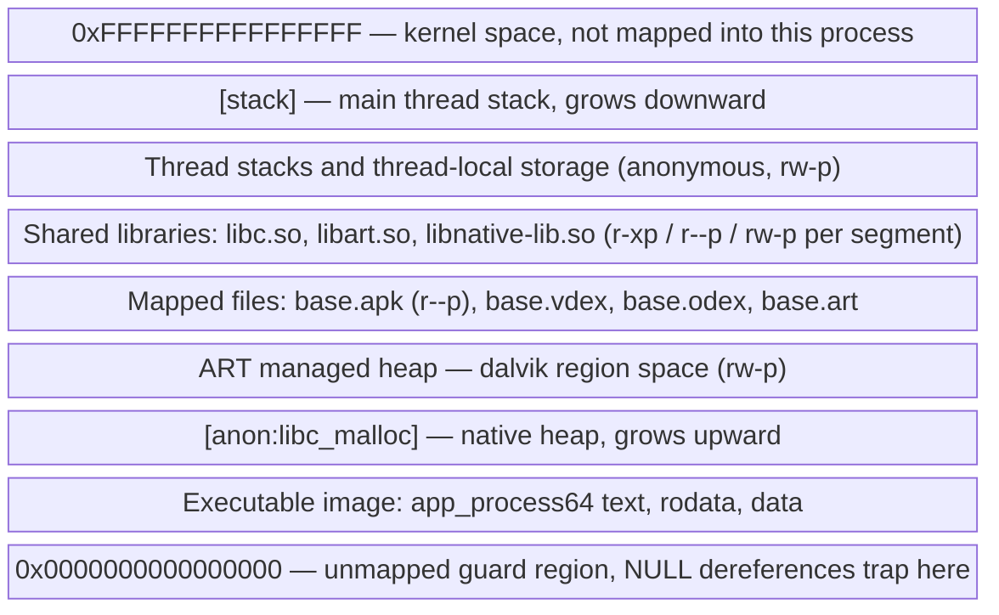

# Lab 02 — Processes, `/proc`, and Reading a Memory Map

> After this lab you will be able to open `/proc/<pid>/maps` for a running Android app and name every
> region in it: which is the stack, which is the heap, which is `libc.so`, which is the DEX mapped
> read-only, and which anonymous region Frida just created to hold its trampolines.

**Chapter:** [01 — Computer Science Basics](../README.md)
**Difficulty:** Beginner to Intermediate
**Estimated time:** 2 hours
**Prerequisite lab:** [Lab 01 — Binary, hex and endianness](lab-01-binary-hex-endianness.md)

---

## Objective

A *process* is the operating system's unit of isolation. On Android it is also the unit of security:
every app runs in its own process, with its own UID, its own address space, and its own view of
memory that no other app can read. When you attack an app, you are trying to get code or a debugger
*inside* that process. When you defend one, you are trying to keep everything out. Either way, the
first thing you must be able to do is look at a process and describe precisely what is in it.

Linux exposes that description through `/proc`, a *pseudo-filesystem*: the files in it do not exist
on disk, they are generated by the kernel the instant you read them. Android inherits `/proc`
unchanged, which means the exact commands you learn on your laptop work over `adb shell` against a
phone.

By the end of this lab you will have:

- Listed processes and understood the columns of `ps`.
- Read `/proc/<pid>/status` and explained the process state, parent, UID and thread count.
- Read `/proc/<pid>/maps` and classified every line into code, data, heap, stack, library, or
  anonymous.
- Explained the `r`, `w`, `x` and `p`/`s` permission column, and why no normal region is `rwx`.
- Listed open file descriptors in `/proc/<pid>/fd` and traced them back to sockets and files.
- Measured real memory use with `/proc/<pid>/smaps` and understood why RSS and PSS differ.
- Repeated all of it on a real Android app over `adb shell`.
- Demonstrated ASLR experimentally by comparing maps across two runs of the same program.

> **📖 Definition**
> A **process** is a running instance of a program, consisting of an *address space* (its private
> mapping of virtual addresses to physical memory), one or more *threads of execution*, and a set of
> kernel-held resources — open file descriptors, signal handlers, a working directory, credentials.
> Two processes running the same program share no memory by default, even though they may share the
> same physical pages of read-only code behind the scenes.

---

## Prerequisites

| Requirement | Why | Check |
|---|---|---|
| Linux, WSL2, or macOS with a Linux VM | `/proc` does not exist on Windows or macOS | `ls /proc/self` |
| An Android device or emulator with USB debugging enabled | Part D | `adb devices` |
| `adb` on your PATH | Talking to the device | `adb version` |
| A debuggable app, or a rooted/emulator device | You cannot read another UID's `/proc` entries without privilege | See Setup |
| Lab 01 completed | You will be reading hex addresses constantly | — |

> **⚠️ Warning**
> Do this only against devices and apps you own or are explicitly authorised to test. Reading
> `/proc/<pid>/maps` of a third-party app on a rooted device is a legitimate research activity on
> your own hardware and a serious problem on someone else's.

---

## Setup

### 1. Verify `/proc` on the host

```bash
# host / WSL
ls /proc | head -20
cat /proc/self/status | head -12
```

`/proc/self` is a magic symlink that always points at the process doing the reading — in this case
`cat` itself. It is the easiest way to demonstrate that `/proc` content is generated on demand.

### 2. Get a long-lived process to inspect

```bash
# host / WSL
sleep 3600 &
SLEEP_PID=$!
echo "sleep is PID $SLEEP_PID"
```

`$!` holds the PID of the most recent background job. Keep that number; you will use it throughout
Part B.

### 3. Verify device access

```bash
# host
adb devices -l
adb shell getprop ro.build.version.release
adb shell id
```

### 4. Choose a target app

The easiest target is an app you build yourself with `android:debuggable="true"`, because
`run-as` then lets you act as that app's UID without root. On an emulator running a Google APIs (not
Play) image, `adb root` gives you full access to every process.

```bash
# host — confirm you can act as your target package
adb shell run-as com.example.target id
```

If that prints a `uid=10xxx(u0_axxx)` line, you are ready. If it prints an error, the package is not
debuggable and you will need an emulator with `adb root` or a rooted device with Magisk. See
[62 — Magisk](../../62-Magisk/README.md).

---

## Steps

### Part A — What `ps` is actually telling you

**A1. List processes on the host.**

```bash
# host / WSL
ps aux | head -15
ps -eo pid,ppid,uid,stat,rss,vsz,comm --sort=-rss | head -15
```

**A2. Understand every column.** Do not skim this table; each column is a concept you will use for
the rest of the repository.

| Column | Meaning | Why a pentester cares |
|---|---|---|
| `PID` | Process identifier, a positive integer assigned by the kernel | Everything else is keyed on it: `/proc/<pid>`, `frida -p`, `kill` |
| `PPID` | Parent process identifier | On Android almost every app's parent is `zygote64`, which is how you spot a process that was *not* forked from zygote |
| `UID` | The user the process runs as | Android's sandbox *is* the UID; app UIDs start at 10000 |
| `STAT` / `S` | Process state: `R` running, `S` interruptible sleep, `D` uninterruptible sleep, `T` stopped/traced, `Z` zombie | `T` means something is `ptrace`-attached — a debugger, or an anti-debug self-attach |
| `RSS` | Resident set size in KB: physical memory currently occupied | The number that actually costs RAM |
| `VSZ` | Virtual size in KB: total address space reserved | Always much larger than RSS; reserving address space is nearly free |
| `COMM` / `CMD` | Command name or full command line | On Android the command name is the process name, usually the package name |

**A3. List processes on the device.**

```bash
# adb shell
ps -A -o PID,PPID,USER,S,RSS,VSZ,NAME | head -30
ps -A | grep -i zygote
ps -A | grep com.example.target
```

**A4. Observe the zygote relationship.** Find the PID of `zygote64`, then find your app's PID and its
PPID. They should match.

```bash
# adb shell
ZYGOTE=$(pidof zygote64); echo "zygote64 = $ZYGOTE"
APP=$(pidof com.example.target); echo "app = $APP"
cat /proc/$APP/status | grep -E '^(Name|State|Tgid|Pid|PPid|Uid|Gid|Threads)'
```

> **🧠 Mental Model**
> Zygote is a process that has already loaded and initialised the entire Android framework — every
> class in `framework.jar`, the JIT caches, the graphics libraries — and then goes to sleep waiting
> on a socket. When you launch an app, the system does not start a fresh runtime; it asks zygote to
> `fork()`. The child inherits the parent's fully warmed address space through copy-on-write, so app
> startup costs milliseconds instead of seconds. The security consequence is enormous and worth
> stating plainly: **every app process on a device starts from an identical memory layout**, because
> they are all copies of the same parent. Chapter [09 — App Internals](../../09-Android-App-Internals/README.md)
> covers the specialisation step where the fork becomes "your app".

---

### Part B — `/proc/<pid>/status` in depth

**B1. Read the whole file for your `sleep` process.**

```bash
# host / WSL
cat /proc/$SLEEP_PID/status
```

**B2. Interpret the fields that matter.**

| Field | Meaning | Note |
|---|---|---|
| `Name` | Executable name, truncated to 15 characters | Trivially spoofable via `prctl(PR_SET_NAME)` — malware does this |
| `State` | Current scheduler state with its letter code | `t (tracing stop)` indicates an attached debugger |
| `Tgid` | Thread group ID — the "real" PID that userspace calls the process ID | Equals `Pid` for the main thread |
| `Pid` | Kernel-level task ID; for threads this differs from `Tgid` | This is what `gettid()` returns |
| `PPid` | Parent | `1` means the parent died and `init` adopted it |
| `TracerPid` | PID of the process `ptrace`-attached to this one, or `0` | **The single most-checked anti-debugging field on Android** |
| `Uid` / `Gid` | Real, effective, saved-set and filesystem IDs | Four numbers; effective UID is the one permission checks use |
| `Threads` | Number of threads in the group | An Android app has dozens even when idle |
| `VmSize` | Total virtual address space | |
| `VmRSS` | Resident set size — physical pages currently mapped in | |
| `VmSwap` | Pages pushed out to swap or ZRAM | |
| `SigBlk` / `SigIgn` / `SigCgt` | Bitmasks of blocked, ignored and caught signals, in hex | Tells you which signals the process installed handlers for |
| `Seccomp` | `0` disabled, `1` strict, `2` filter | Android sets `2` on app processes |

**B3. Prove that `TracerPid` works.** In one terminal:

```bash
# host / WSL — terminal 1
sleep 600 &
echo $!
```

In a second terminal, attach a debugger and watch the field change:

```bash
# host / WSL — terminal 2, replace 12345 with the PID printed above
grep TracerPid /proc/12345/status        # expect: TracerPid: 0
gdb -p 12345 -batch -ex "shell grep TracerPid /proc/12345/status" -ex detach
```

You will see `TracerPid` become gdb's PID while gdb is attached, then return to `0`.

> **🔍 Pentester's Note**
> A very large fraction of Android anti-debugging code is one loop that opens `/proc/self/status`,
> scans for `TracerPid:`, and calls `exit()` or corrupts state if the value is non-zero. It is often
> implemented in a native library so that it cannot be patched from Java. Knowing that the check
> reads a *file* is what makes it defeatable: you can hook `open`, `fopen`, `read`, or `strstr`
> rather than trying to find the comparison. Chapter
> [67 — Bypassing Protections](../../67-BypassingProtections/README.md) develops this fully.

**B4. Do the same on the device.**

```bash
# adb shell
cat /proc/$(pidof com.example.target)/status | grep -E 'Name|State|Tgid|PPid|TracerPid|Uid|Threads|VmRSS|Seccomp'
```

Record the UID. Then map it back to a package:

```bash
# adb shell
cmd package list packages --uid 10234
```

---

### Part C — Reading `/proc/<pid>/maps`

This is the core of the lab.

**C1. Dump the map of a trivial process first.**

```bash
# host / WSL
cat /proc/$SLEEP_PID/maps
```

**C2. Understand the six columns.** A line looks like this:

```
7f4c2a1b0000-7f4c2a1d5000 r-xp 00002000 08:02 1180432   /usr/lib/x86_64-linux-gnu/libc.so.6
```

| Position | Example | Meaning |
|---|---|---|
| 1 | `7f4c2a1b0000-7f4c2a1d5000` | Start and end virtual addresses, in hex; end is exclusive |
| 2 | `r-xp` | Permissions: read, write, execute, then `p` (private) or `s` (shared) |
| 3 | `00002000` | Offset into the backing file where this mapping begins |
| 4 | `08:02` | Device major:minor of the filesystem holding the file |
| 5 | `1180432` | Inode number of the backing file; `0` means no file |
| 6 | `/usr/lib/.../libc.so.6` | Pathname, or a pseudo-name such as `[heap]`, or blank for anonymous memory |

Compute the size of that region by hand: `0x7f4c2a1d5000 − 0x7f4c2a1b0000 = 0x25000` = 151552 bytes
= 148 KB. Every region is a whole number of 4096-byte pages; verify that `0x25000 / 0x1000` = 37
pages exactly. If you ever compute a region size that is not a multiple of `0x1000`, you have made an
arithmetic mistake.

**C3. Understand the permission column properly.**

| Permission | Typical contents | Why |
|---|---|---|
| `r-xp` | Executable code — the `.text` of the binary or of a shared library | Readable so constants can be loaded, executable so it can run, **not writable** so it cannot be patched |
| `r--p` | Read-only data — string literals, `.rodata`, relocation tables after `RELRO` is applied, a memory-mapped DEX or `.odex` | Immutable data |
| `rw-p` | Writable data — `.data`, `.bss`, the heap, thread stacks, most anonymous memory | Modifiable, non-executable |
| `rw-s` | Shared memory — ashmem/memfd regions, Binder buffers, graphics buffers | The `s` means writes are visible to other processes mapping the same object |
| `---p` | Guard pages and reservations | No access at all; touching one raises `SIGSEGV` on purpose |
| `rwxp` | Writable **and** executable — JIT code caches, Frida's trampoline pages, some packers | Rare and suspicious; see below |

> **⚠️ Warning**
> The separation of "writable" from "executable" is a hardware-enforced security control, delivered
> by the NX/XN bit in the page table entry. When it holds, an attacker who corrupts a buffer cannot
> simply write shellcode into that buffer and jump to it, because the page is `rw-` and the CPU
> refuses to fetch instructions from it. This is why real-world native exploitation moved to
> return-oriented programming, and why any `rwx` region in a process is a genuine finding worth
> writing up.

**C4. Classify every line of a real app's map.** Now go to the device.

```bash
# adb shell — as the app's UID
run-as com.example.target cat /proc/$(pidof com.example.target)/maps > /sdcard/maps.txt
# or, on a rooted device / emulator with adb root:
cat /proc/$(pidof com.example.target)/maps
```

```bash
# host — pull it for comfortable reading
adb pull /sdcard/maps.txt .
wc -l maps.txt
```

Now answer each of these with a specific line from *your* dump.

| Question | What to look for |
|---|---|
| Where is the main thread's stack? | The line labelled `[stack]` |
| Where are the other threads' stacks? | Anonymous `rw-p` regions, typically 1 MB, often adjacent, sometimes labelled `[anon:stack_and_tls:<tid>]` on newer Android |
| Where is the native heap? | `[anon:libc_malloc]` on Android, or `[heap]` on desktop Linux |
| Where is `libc`? | `/apex/com.android.runtime/lib64/bionic/libc.so` on Android 10+, `/system/lib64/libc.so` earlier |
| Where is the app's own native library? | `/data/app/.../lib/arm64/libnative-lib.so` |
| Where is the app's code mapped? | `base.apk` (the APK mapped read-only) and `base.odex` / `base.vdex` / `base.art` under `/data/app/.../oat/arm64/` |
| Where is the ART heap? | Regions labelled `[anon:dalvik-main space (region space)]` and friends |
| Which regions have no name at all? | Pure anonymous mappings from `mmap(MAP_ANONYMOUS)` |

**C5. Summarise the map programmatically.** Rather than reading 3000 lines by eye, use the chapter's
script:

```bash
# host / WSL — against a local process
sh ../scripts/inspect-process.sh $SLEEP_PID

# adb shell — push the script and run it on the device
```

```bash
# host — push and run on device
adb push ../scripts/inspect-process.sh /data/local/tmp/
adb shell sh /data/local/tmp/inspect-process.sh com.example.target
```

Compare the script's grouped totals against your manual classification.

**C6. Count what you have.**

```bash
# adb shell
MAPS=/proc/$(pidof com.example.target)/maps
wc -l < $MAPS                                  # total regions
awk '{print $2}' $MAPS | sort | uniq -c | sort -rn   # regions per permission
grep -c '\.so$' $MAPS                          # shared object mappings
grep 'rwx' $MAPS                               # any writable+executable region?
grep 'dalvik' $MAPS | head                     # ART managed heap
```

A typical modern Android app has 2000–6000 map entries. The overwhelming majority are `r--p` and
`rw-p`.

**C7. Draw the address space.** On paper, sketch the layout from low address to high. A 64-bit
Android app process looks roughly like this:



The diagram is ordered from the highest address at the top to the lowest at the bottom, which is the
convention used by nearly every memory diagram you will meet. Three facts matter more than the exact
ordering. First, the stack lives high and grows *downward* toward lower addresses, while the native
heap lives lower and grows *upward*; they grow toward each other, which is historically why a
runaway stack could collide with the heap and why guard pages exist. Second, each shared library
occupies several adjacent regions rather than one, because each ELF program header segment gets its
own permissions — the code segment `r-xp`, the read-only data `r--p`, and the writable data `rw-p`.
Third, the very bottom of the address space is deliberately left unmapped, so that dereferencing a
NULL pointer touches an unmapped page and raises `SIGSEGV` instead of silently reading whatever
happened to be at address zero.

**C8. Look at a library's multiple segments.** Pick one `.so` and print every line mentioning it:

```bash
# adb shell
grep 'libnative-lib.so' /proc/$(pidof com.example.target)/maps
```

You will see three or four consecutive regions with different permissions and increasing file
offsets. Confirm that the first region's start address is the module base — this is the value Frida's
`Module.findBaseAddress()` returns, and the value you add to a Ghidra offset to get a runtime
address.

---

### Part D — File descriptors and `smaps`

**D1. List open file descriptors.**

```bash
# host / WSL
ls -l /proc/$SLEEP_PID/fd
```

Each entry is a symlink named after the descriptor number, pointing at what the descriptor refers to.

> **📖 Definition**
> A **file descriptor** is a small non-negative integer that indexes into a per-process table of open
> resources held by the kernel. It is not a pointer and it means nothing outside its process. By
> convention descriptor 0 is standard input, 1 is standard output, and 2 is standard error. Anything
> the kernel can give you a handle to — a regular file, a socket, a pipe, an `epoll` instance, an
> `eventfd`, `/dev/binder`, an ashmem region — appears here as a descriptor.

**D2. Read an app's descriptors on the device.**

```bash
# adb shell
ls -l /proc/$(pidof com.example.target)/fd | head -40
ls -l /proc/$(pidof com.example.target)/fd | awk '{print $NF}' | sed 's/[0-9]*$//' | sort | uniq -c | sort -rn
```

**D3. Classify what you find.**

| Symlink target | What it is | Security relevance |
|---|---|---|
| `/dev/binder` or `/dev/hwbinder` | The Binder IPC driver | Every framework call goes through here; see [25 — Binder](../../25-Binder/README.md) |
| `socket:[123456]` | A socket; the number is the inode | Cross-reference with `/proc/net/tcp` to find the peer |
| `pipe:[123456]` | A pipe | Often the app's own logging or a `Runtime.exec()` child |
| `anon_inode:[eventfd]` / `[eventpoll]` | Event notification objects | The Looper's message queue uses these |
| `/data/data/<pkg>/databases/x.db` | An open SQLite database | A file worth pulling and reading |
| `/data/data/<pkg>/shared_prefs/*.xml` | Preferences | Frequently holds tokens; see [33 — Storage](../../33-Storage/README.md) |
| `/dev/ashmem` or `/memfd:...` | Shared memory | Data crossing a process boundary |
| `/data/app/.../base.apk` | The app's own APK, held open for resource loading | |

**D4. Correlate a socket descriptor with a connection.**

```bash
# adb shell
ls -l /proc/$(pidof com.example.target)/fd | grep socket
# note an inode number, e.g. socket:[482913]
grep -i 482913 /proc/net/tcp /proc/net/tcp6
```

The `local_address` and `rem_address` columns of `/proc/net/tcp` are hex, little-endian per octet,
with the port appended in hex — which is exactly the skill you built in Lab 01. An address printed as
`0100007F:1F90` is `127.0.0.1:8080`.

**D5. Measure real memory with `smaps`.**

```bash
# adb shell
grep -E '^(Rss|Pss|Private_Dirty|Shared_Clean)' /proc/$(pidof com.example.target)/smaps | head -20
awk '/^Pss:/ {sum += $2} END {print "Total PSS:", sum, "kB"}' /proc/$(pidof com.example.target)/smaps
```

| Metric | Definition | Use |
|---|---|---|
| `Rss` | Resident set size — all physical pages mapped by this process | Overcounts shared pages |
| `Pss` | Proportional set size — private pages plus each shared page divided by the number of sharers | The honest per-process number; what Android's memory accounting uses |
| `Private_Dirty` | Pages only this process has, and which have been written to | Cannot be reclaimed without swapping; the number that gets an app killed by the LMK |
| `Shared_Clean` | Unmodified pages shared with other processes — the zygote's copy-on-write inheritance | Nearly free |

Compare `Rss` summed against `Pss` summed. The gap is exactly the memory this app is *sharing* with
zygote and with every other app, which is the direct, measurable consequence of the fork model
described in Part A.

---

### Part E — Demonstrate ASLR

**E1. Run the same program twice and compare.**

```bash
# host / WSL
for i in 1 2 3; do
  sleep 60 &
  P=$!
  echo "run $i, pid $P:"
  grep -E '\[stack\]|\[heap\]' /proc/$P/maps
  kill $P
done
```

The addresses differ on every run.

**E2. Confirm the mechanism.**

```bash
# host / WSL — 0 = off, 1 = conservative, 2 = full randomisation
cat /proc/sys/kernel/randomize_va_space
```

> **📖 Definition**
> **ASLR** (Address Space Layout Randomisation) means the kernel and the dynamic linker place the
> stack, the heap, the shared libraries and (for a PIE binary) the executable itself at addresses
> chosen randomly at load time. An attacker who knows exactly what code lives at a fixed address can
> reuse it; an attacker who does not know where anything is must first leak an address. ASLR does
> not prevent memory corruption; it converts a one-shot exploit into a two-stage one requiring an
> information disclosure.

**E3. Do it on Android.**

```bash
# host — force-stop and relaunch, capturing the library base each time
for i in 1 2 3; do
  adb shell am force-stop com.example.target
  adb shell monkey -p com.example.target -c android.intent.category.LAUNCHER 1 >/dev/null 2>&1
  sleep 3
  adb shell "grep -m1 'libc.so' /proc/\$(pidof com.example.target)/maps"
done
```

Record the three base addresses. They must differ.

**E4. Explain the consequence for your tooling.** Any address you write down from a static tool is an
*offset*, never an address. The runtime address is always `module_base + offset`, and `module_base`
is different every launch. Write out that equation and keep it; it is the single most common source
of "my Frida script worked yesterday" confusion.

---

## Hints

<details>
<summary>Hint 1 — Permission denied reading /proc/&lt;pid&gt;/maps on the device</summary>

`/proc/<pid>/maps` is readable only by the process's own UID or by root. Three ways forward, in order
of preference: build the app with `android:debuggable="true"` and use `adb shell run-as <pkg> cat
/proc/<pid>/maps`; use an emulator image without Google Play and run `adb root` first; or use a
rooted device with Magisk and `adb shell "su -c 'cat /proc/<pid>/maps'"`. Note the **outer** quotes:
`adb shell` joins its arguments with spaces before the device sees them, so an unquoted
`adb shell su -c 'cat FILE'` arrives as `su -c cat FILE` and `su` runs `cat` with no argument — <!-- lint:allow SU-DASH-C SU-DASH-C-BARE -- the broken form, named so the correct form above it has something to contrast with -->
it reads stdin and you get an empty result with no error.
</details>

<details>
<summary>Hint 2 — `pidof` prints nothing</summary>

The app is not running. Launch it first, and remember that some apps run several processes — a
`:remote` service process has a different PID and a *different memory map* from the main one. Use
`ps -A | grep <package>` to see all of them.
</details>

<details>
<summary>Hint 3 — Which anonymous region is a thread stack?</summary>

Thread stacks are anonymous `rw-p` regions preceded immediately by a `---p` guard page of one page
size, and are typically 1 MB or 8 MB. On Android 10 and later many are labelled through the
`prctl(PR_SET_VMA)` naming mechanism, so you will literally see `[anon:stack_and_tls:12345]` where
the number is the thread's TID. Cross-check against `ls /proc/<pid>/task/`.
</details>

<details>
<summary>Hint 4 — I found an `rwx` region and want to know what it is</summary>

Dump some of it and look. On the device, `dd if=/proc/<pid>/mem bs=1 skip=$((0x...)) count=256 |
xxd` requires root and correct arithmetic. Much easier: attach Frida and use
`Memory.readByteArray(ptr("0x..."), 256)`, or run `Process.enumerateRanges('rwx')`, which lists them
directly. If it appeared only after you injected Frida, it is Frida's.
</details>

<details>
<summary>Hint 5 — RSS and PSS differ by a factor of two and I do not believe it</summary>

You should believe it. A freshly forked app shares tens of megabytes of clean, read-only pages with
zygote: the framework classes in `boot.art`, `libart.so`, `libc.so`, the fonts. Those pages are
counted once per process in RSS and divided among all sharers in PSS.
</details>

---

## Solution

### Reference `maps` extract from a real Android app, annotated

```
# adb shell — /proc/<pid>/maps, abridged and annotated

6f2a1c4000-6f2a1c8000 r--p 00000000 fe:09 1245  /apex/com.android.art/lib64/libart.so
        ELF header and read-only metadata of the ART runtime.
6f2a1c8000-6f2a5e2000 r-xp 00004000 fe:09 1245  /apex/com.android.art/lib64/libart.so
        ART's executable code. Not writable — you cannot patch it in place without mprotect.
6f2a5e2000-6f2a611000 r--p 0041e000 fe:09 1245  /apex/com.android.art/lib64/libart.so
        Read-only data plus RELRO, made read-only by the linker after relocation.
6f2a611000-6f2a616000 rw-p 0044d000 fe:09 1245  /apex/com.android.art/lib64/libart.so
        Writable globals of ART.

7031000000-7051000000 rw-p 00000000 00:00 0     [anon:dalvik-main space (region space)]
        The Java/Kotlin object heap. Every Java object your Frida script touches lives here.

7f4a002000-7f4a102000 rw-p 00000000 00:00 0     [anon:libc_malloc]
        The native heap: everything malloc() returns. String buffers, JNI locals, crypto contexts.

7f4b8c1000-7f4b8c2000 ---p 00000000 00:00 0
7f4b8c2000-7f4b9c0000 rw-p 00000000 00:00 0     [anon:stack_and_tls:14237]
        A worker thread's stack, preceded by its one-page guard. Overflowing into the guard
        raises SIGSEGV instead of silently corrupting the neighbouring region.

7f4c110000-7f4c580000 r--p 00000000 fe:09 3319  /data/app/~~AB==/com.example.target-CD==/base.apk
        The APK mapped read-only. Resources and, on some configurations, the DEX are read from here.

7f4c600000-7f4c9a0000 r--p 00000000 fe:09 3320  /data/app/.../oat/arm64/base.vdex
7f4c9a0000-7f4cb20000 r-xp 00002000 fe:09 3321  /data/app/.../oat/arm64/base.odex
        Ahead-of-time compiled native code for the app's Java methods. See ../../13-ART/README.md.

7fd1a20000-7fd2220000 rw-p 00000000 00:00 0     [stack]
        Main thread stack, 8 MB of reserved address space growing downward.
```

### Answers to the classification questions

| Question | Answer in the extract above |
|---|---|
| Main stack | `7fd1a20000-7fd2220000 [stack]` |
| Thread stacks | `[anon:stack_and_tls:<tid>]` regions, each with a `---p` guard below it |
| Native heap | `[anon:libc_malloc]` |
| Java heap | `[anon:dalvik-main space (region space)]` |
| App native code | The `r-xp` region of `libnative-lib.so` |
| Compiled Java code | The `r-xp` region of `base.odex` |
| Anonymous mappings | Any line with inode `0` and no pathname |

### Why there is normally no `rwx` region — and why Frida creates one

Android enforces W^X ("write xor execute") as policy, not merely as convention. The kernel's page
table entries carry an execute-never bit; SELinux additionally denies the `execmem` and `execmod`
permissions to `untrusted_app` for most contexts; and since Android 10, `mmap` with
`PROT_WRITE|PROT_EXEC` from an app process is rejected in the common cases. The consequences you can
observe directly:

- A conventional stack-smashing exploit cannot execute a payload written into the stack, because the
  stack is `rw-`.
- Anything that must generate code at runtime — ART's JIT, a packer that decrypts a DEX into memory,
  a dynamic instrumentation engine — has to obtain executable memory through a sanctioned path.

Frida works by injecting an agent into the target and rewriting the first instructions of the
function you hook so that they branch to a *trampoline*. Both the trampoline and the relocated
original instructions must live somewhere executable, and Frida must be able to write them. It
therefore allocates memory and calls `mprotect` to make it executable, or maps it `rwx` outright.
That allocation is visible in `/proc/<pid>/maps` as an anonymous region with `rwx` permissions, and
enumerating those regions is one of the cheapest and most widely deployed Frida-detection techniques
in commercial Android apps. You will meet it again in
[53 — Frida](../../53-Frida/README.md) and
[67 — Bypassing Protections](../../67-BypassingProtections/README.md).

```bash
# adb shell — the detection, in one line, exactly as an app would implement it
grep -c 'rwx' /proc/self/maps
```

An app that reads its own `/proc/self/maps` looking for `rwx` regions, for a mapping whose path
contains `frida`, or for the well-known default port `27042` in `/proc/net/tcp`, is doing precisely
what you just did by hand.

### ASLR observation

Three consecutive launches of the same app produced these `libc.so` base addresses:

```
7a1e4c1000-7a1e53d000 r-xp ... /apex/com.android.runtime/lib64/bionic/libc.so
7b02f81000-7b02ffd000 r-xp ... /apex/com.android.runtime/lib64/bionic/libc.so
79c8a13000-79c8a8f000 r-xp ... /apex/com.android.runtime/lib64/bionic/libc.so
```

The low twelve bits are always zero because mappings are page-aligned. The size of each region is
identical (`0x7C000`) because the file has not changed. Only the base moved. Therefore the offset of
any function within `libc.so` is stable and the absolute address is not, which is why every serious
tool works in terms of `module + offset`.

---

## Success Criteria

| # | Criterion | Proof |
|---|---|---|
| 1 | You can explain `PID`, `PPID`, `UID`, `STAT`, `RSS`, `VSZ` without notes | Verbal |
| 2 | You confirmed an app's PPID is `zygote64`'s PID | Two numbers |
| 3 | You demonstrated `TracerPid` changing when a debugger attaches | Two `grep` outputs |
| 4 | You computed the size in pages of at least three map regions by hand | Working shown |
| 5 | You located the main stack, a thread stack, the native heap, the ART heap, `libc.so`, and the app's own `.so` in a real app's map | Annotated dump |
| 6 | You explained `r-xp` versus `rw-p` versus `rwxp` and why `rwx` is unusual | Written paragraph |
| 7 | You listed an app's open file descriptors and identified `/dev/binder`, a socket, and a database | `ls -l` output |
| 8 | You resolved a socket inode to an address and port using `/proc/net/tcp` | The decoded address |
| 9 | You summed PSS and explained why it is lower than summed RSS | Two totals and a sentence |
| 10 | You observed three different `libc.so` base addresses across three launches | Three lines |
| 11 | `inspect-process.sh` ran successfully on both host and device | Two reports |

---

## Going Further

1. **Watch a map change live.** Run `watch -n 1 'wc -l /proc/<pid>/maps'` against an app while you
   navigate its UI. Loading a WebView, opening a camera, or triggering a `System.loadLibrary` all add
   regions. Correlate a jump in the count with a specific user action.

2. **Find the DEX in memory.** For an app whose DEX is loaded from memory rather than from a file —
   a packed app — the DEX bytes exist in an anonymous region rather than in `base.vdex`. Scan
   anonymous `rw-p` regions for the eight-byte magic `dex\n0` you learned in Lab 01, and dump what
   you find. That is the entire principle behind memory-dumping unpackers.

3. **Compare a debuggable build with a release build.** Diff the two maps. Note which extra
   libraries the debuggable build loads and whether `Seccomp` in `status` differs.

4. **Explore `/proc/<pid>/task/`.** Every thread has its own directory with its own `status`,
   `stat`, and `stack`. Count threads, then find which one is `Binder:1234_2` by reading each
   `task/<tid>/comm`.

5. **Read `/proc/<pid>/smaps_rollup`** for a single-line summary, and compare with `dumpsys meminfo
   <package>`, which is Android's own accounting of the same data. Explain where Android's "Java
   Heap", "Native Heap" and "Code" categories come from in terms of the map lines you classified.

6. **Instrument the transition.** Use `strace -f -e trace=memory` on a small program that calls
   `malloc` in a loop, and watch `brk` and `mmap` being issued as the heap grows. Chapter
   [19 — Memory](../../19-Memory/README.md) explains the allocator behaviour behind those calls.

---

## Why this matters for Android security

**The process boundary is the Android sandbox.** Android's app isolation is not a special Android
invention; it is Linux UID separation plus SELinux, applied to processes. Each installed app gets a
distinct UID, and the kernel's ordinary file permission and `/proc` visibility rules do the rest. The
moment you internalise that "app A cannot read app B's data" means "UID 10234 cannot read files owned
by UID 10235", every sandbox escape becomes legible: it is either a file left world-readable, a
component exported to any caller, an IPC endpoint that fails to check the calling UID, or a kernel
bug. See [21 — App Sandbox](../../21-App-Sandbox/README.md) and
[22 — SELinux](../../22-SELinux/README.md).

**Instrumentation means getting inside the address space.** Frida, Xposed, LSPosed and every native
hooking framework do the same fundamental thing: place code inside the target's address space and
redirect execution to it. `/proc/<pid>/maps` is the ground truth for whether that worked. When a hook
does not fire, the first diagnostic is always to check whether the module is actually mapped, at what
base, and with what permissions. See [65 — Hooking](../../65-Hooking/README.md) and
[66 — Instrumentation](../../66-Instrumentation/README.md).

**Anti-analysis reads the same files you do.** Root detection, debugger detection, emulator
detection and Frida detection are, at bottom, an app reading `/proc/self/status`, `/proc/self/maps`,
`/proc/self/fd` and `/proc/net/tcp` and drawing conclusions. You cannot defeat a check you do not
understand, and you cannot understand it until you have read those files yourself and know what
normal looks like. See [37 — Root Detection](../../37-RootDetection/README.md) and
[39 — Emulator Detection](../../39-EmulatorDetection/README.md).

**Memory forensics starts here.** Recovering a decryption key, a session token, or a plaintext
message from a running app means finding the right region and dumping it. Knowing that Java strings
live in the `dalvik` region space, that `malloc`ed native buffers live in `[anon:libc_malloc]`, and
that a memory-mapped file's contents are backed by disk and therefore also recoverable from storage,
tells you where to look and how much to dump.

**ASLR determines how you write every script.** Because bases move, every address you record from
Ghidra, IDA or radare2 is an offset. This one fact reshapes your whole workflow: you find offsets
statically, you resolve bases dynamically, and you add them. Chapters
[57 — Ghidra](../../57-Ghidra/README.md) and [53 — Frida](../../53-Frida/README.md) both assume you
have already internalised it here.

**Next:** [Lab 03 — Stack frames and overflow](lab-03-stack-frames-and-overflow.md), which zooms in
on the single region you identified as `[stack]` and takes it apart byte by byte.
