# 01 — Computer Science Basics · Mind Map

This is the whole chapter on one page. It starts at the physical machine — the CPU, RAM, and the
buses between them — and works outward through the way numbers are encoded in bits, the
fetch-decode-execute cycle that turns those bits into behaviour, the operating system that
multiplexes the machine between untrusting programs, and finally the two memory regions where almost
every memory-corruption bug in an Android application lives: the stack and the heap. Every branch
ends in something you will use on an engagement, because the point of chapter 01 is not computer
science for its own sake — it is the vocabulary you need before `mmap`, `ptrace`, `SIGSEGV`, and
`libc.so` stop being magic words. Read it top-down for structure, or jump to a leaf when a term in a
later chapter stops making sense.

```mermaid
mindmap
  root((Chapter 01<br/>CS Basics))
    Hardware Foundation
      CPU
        Control unit
        ALU
          Integer arithmetic
          Bitwise logic
          Shifts and rotates
        Register file
        Clock and cycles
        Cores and SMP
          big.LITTLE scheduling
      Memory hierarchy
        Registers - fastest
        L1 cache
          Split I-cache and D-cache
          Cache line 64 bytes
        L2 cache per core
        L3 or system cache shared
        DRAM main memory
          Volatile
          Nanosecond latency
        Flash storage
          UFS and eMMC on phones
          Persistent
          Microsecond to millisecond latency
      Buses
        Address bus
        Data bus
        Control bus
        Memory-mapped IO
        DMA engines
      Why hierarchy exists
        Locality of reference
        Temporal locality
        Spatial locality
        Cache timing side channels
    Numbers and Encoding
      Bit
        Two states
        Physical voltage level
      Byte
        Eight bits
        256 possible values
        Smallest addressable unit
      Word sizes
        16-bit and 32-bit and 64-bit
        W registers vs X registers
      Bases
        Binary
        Decimal
        Hexadecimal
          One digit per nibble
          Two digits per byte
          Maps cleanly onto bit fields
        Octal in file modes
      Signed representation
        Unsigned
        Twos complement
          Sign bit is the MSB
          Negate by invert plus one
          Asymmetric range
        Sign extension vs zero extension
        Integer overflow bugs
      Endianness
        Little-endian on Android
        Big-endian on the network
        Bi-endian ARM capability
        Wrong-endian reads look like garbage
      Text encoding
        ASCII 0 to 127
        UTF-8
        UTF-16 in Java strings
        Modified UTF-8 in DEX and JNI
      Floating point
        IEEE-754 binary32 and binary64
        Mantissa and exponent
        NaN and infinity
    CPU Execution
      Fetch decode execute
        Fetch instruction at PC
        Decode opcode and operands
        Execute in ALU or memory unit
        Write back result
        Advance PC
      Registers
        General purpose X0 to X30
        Program counter
        Stack pointer
        Link register X30
        Frame pointer X29
        Zero register XZR
        NZCV condition flags
        SIMD and FP V0 to V31
      Instruction sets
        AArch64 fixed 4-byte encoding
        AArch32 and Thumb
        x86-64 variable length
        RISC vs CISC tradeoffs
      Pipelining
        Stages overlap
        Hazards and stalls
        Branch prediction
        Speculative execution
        Out-of-order execution
      Machine code vs assembly
        Machine code is bytes
        Assembly is mnemonics
        Assembler maps one to one
        Disassembler reverses it
      Privilege
        ARM exception levels
          EL0 apps
          EL1 Linux kernel
          EL2 hypervisor such as pKVM
          EL3 secure monitor firmware
        Secure world and TrustZone
        Traps and exceptions
    Operating System
      What an OS is
        Resource multiplexer
        Abstraction layer
        Protection boundary
      Kernel space vs user space
        Separate page tables
        Privileged instructions
        Kernel cannot trust user pointers
      Kernel duties
        Process scheduling
        Memory management
        Filesystems and VFS
        Device drivers
        Networking stack
        IPC primitives
      Monolithic vs microkernel
      Android specifics
        Linux kernel at EL1
        Binder driver
        Low memory killer and LMKD
        Zygote preloading
        SELinux mandatory access control
    Processes and Threads
      Process
        Own virtual address space
        PID and PPID
        Process control block or task_struct
        UID and GID for the app sandbox
        Credentials and capabilities
        Open file table
      Process creation
        fork clones the caller
        Copy-on-write pages
        exec replaces the image
        Zygote forks instead of exec
        clone syscall underneath both
      Process termination
        exit and exit_group
        Zombie until reaped
        wait4 by the parent
        Orphans reparented to init
      Thread
        Shares address space
        Own stack and registers
        Own TID
        pthread_create uses clone
        Thread-local storage via TPIDR_EL0
      Scheduling
        Time slice or quantum
        Preemption
        Priority and nice value
        CFS and EEVDF
        Real-time classes
        cgroups on Android
      Context switching
        Save register state
        Swap page-table base
        TLB and cache pressure
        Voluntary vs involuntary
      Race conditions
        Shared mutable state
        Non-atomic read-modify-write
        Time-of-check to time-of-use
        Security relevance of TOCTOU
        Non-deterministic reproduction
    The Stack
      Purpose
        Function call bookkeeping
        Local variables
        Saved registers
        Spilled arguments
      Growth direction
        Downward toward lower addresses
        SP decreases on push
      Stack frame
        Frame record with FP and LR
        Caller frame chain
        Canary between locals and saved LR
      Prologue and epilogue
        stp saves FP and LR
        mov x29 sp establishes the frame
        ldp restores on exit
        ret branches to X30
      Calling conventions
        AAPCS64 for AArch64
        X0 to X7 carry arguments
        X0 returns the value
        Callee-saved X19 to X28
        16-byte SP alignment
        System V AMD64 for comparison
      Failure modes
        Stack buffer overflow
        Saved LR overwrite
        Return-oriented programming
        Stack exhaustion from recursion
        Guard page catches the overrun
      Mitigations
        Stack canaries
        Shadow call stack on X18
        Pointer authentication
        Non-executable stack
    The Heap
      Purpose
        Dynamic lifetime allocations
        Size known only at runtime
      API surface
        malloc and calloc
        realloc
        free
        new and delete in C++
      Allocator internals
        Chunk headers and metadata
        Free lists and bins
        Size classes
        Arenas per thread
        Scudo on modern Android
        jemalloc historically
      Growth mechanics
        brk for the legacy break
        mmap for large requests
        Returning memory to the kernel
      Fragmentation
        External fragmentation
        Internal fragmentation
        Heap grooming by an attacker
      Failure modes
        Heap buffer overflow
        Use-after-free
        Double free
        Invalid free
        Memory leak
        Type confusion after reuse
      Detection
        AddressSanitizer
        HWAddressSanitizer
        Memory Tagging Extension
        GWP-ASan sampling
        Valgrind on host builds
    Virtual Memory
      Motivation
        Isolation between processes
        Illusion of contiguous memory
        Overcommit and demand paging
      Address translation
        Virtual address
        Physical address
        MMU hardware
        Page tables as a tree
        TTBR0 for user and TTBR1 for kernel
        TLB caches translations
        ASID tagging avoids full flushes
      Pages
        4 KiB default
        16 KiB on newer Android devices
        Huge pages 2 MiB and 1 GiB
        Page number and offset split
      Page faults
        Minor fault served from RAM
        Major fault requires IO
        Invalid fault becomes SIGSEGV
      mmap
        Anonymous mappings
        File-backed mappings
        Shared vs private
        MAP_FIXED placement
        Protection flags READ WRITE EXEC
      mprotect
        Changes permissions per page
        RW to RX for JIT
        Used by Frida and by packers
      Copy-on-write
        Shared until written
        Makes fork cheap
        Zygote memory sharing
      Swap
        zram compressed swap on Android
        No traditional swap partition
      ASLR
        Randomised stack and heap and mmap base
        PIE executables
        KASLR for the kernel
        Info leaks defeat it
      Address space layout
        Text segment
        Data and BSS
        Heap region
        Shared library mappings
        Thread stacks
        Kernel reserved high half
    Syscalls and the Kernel Interface
      What a syscall is
        Request for privileged work
        Not a normal function call
        Crosses a trust boundary
      Mechanism on AArch64
        Number in X8
        Arguments in X0 to X5
        SVC 0 traps to EL1
        Kernel validates every pointer
        Result or negative errno in X0
      libc wrapper role
        Bionic on Android
        Sets errno and returns -1
        Some calls are vDSO accelerated
      Syscall table
        asm-generic unistd numbering on arm64
        Different numbers on x86-64
        Compat table for 32-bit apps
      Important syscalls
        openat and read and write and close
        mmap and mprotect and munmap
        clone and execve and exit_group
        ptrace for debugging
        futex for locks
        ioctl for Binder
      Observation
        strace on the host
        strace on a rooted device
        seccomp filters restrict the set
        ENOSYS when a call is blocked
    Binaries and the Toolchain
      Compilation pipeline
        Preprocess expands macros
        Compile emits assembly
        Assemble emits an object file
        Link resolves symbols
        Load maps it into memory
      Linking models
        Static linking bakes code in
        Dynamic linking resolves at load
        Shared objects and SONAME
        PLT and GOT indirection
        Lazy vs immediate binding
        RELRO hardening
      ELF format
        Magic 7F 45 4C 46
        ELF header
        Program headers describe segments
        Section headers describe sections
        Symbol tables and string tables
        Relocations
        Notes and build-id
      Execution models
        Interpreter reads source repeatedly
        Compiler translates ahead of time
        JIT compiles hot code at runtime
        AOT compiles before first run
        Android mixes interpreter and JIT and AOT
        dex2oat and the OAT file
      Loader
        execve parses the ELF
        linker64 maps dependencies
        Relocation processing
        init_array constructors
        JNI_OnLoad afterwards
    Concurrency Primitives
      Mutex
        Ownership by one thread
        Lock and unlock
        Fast path in userspace
        Slow path calls futex
      Semaphore
        Counter of permits
        Counting and binary forms
      Condition variable
        Wait and signal and broadcast
        Always paired with a mutex
      Futex
        Fast userspace mutex
        Kernel only on contention
        FUTEX_WAIT and FUTEX_WAKE
      Atomics and barriers
        Load-acquire and store-release
        Compare-and-swap
        Memory ordering models
      Deadlock and livelock
        Lock ordering discipline
        Priority inversion
      Java level
        synchronized keyword
        Monitor per object
        ART thin and fat locks
    Signals and File Descriptors
      Signals
        Asynchronous notification
        Default action per signal
        Handlers installed with sigaction
        Blocked and pending sets
        SIGKILL and SIGSTOP cannot be caught
        Async-signal-safe functions only
        Tombstones from fatal signals
      Crash signals
        SIGSEGV bad address
        SIGBUS alignment or truncated mapping
        SIGILL bad instruction
        SIGABRT abort or assert
        SIGTRAP breakpoints
      File descriptors
        Small non-negative integers
        Index into the open file table
        0 and 1 and 2 are the standard streams
        Inherited across fork
        Closed or kept across exec via CLOEXEC
        Everything is a file
        Sockets and pipes and eventfd
        Binder fd per process
        Leaked fds cross the sandbox
    Where This Lands in Android
      Chapter 02 Linux Basics
      Chapter 15 Native Code and ELF hardening
      Chapter 18 ARM assembly and AAPCS64
      Chapter 19 Memory layout and corruption
      Chapter 21 App sandbox and seccomp
      Chapter 53 Frida injection and Gum
      Chapter 70 Vulnerability research
```

## How to read this

Start at the root and follow one branch to its leaves before moving to the next; the branches are
ordered so that each one only depends on the ones above it. **Hardware Foundation** and **Numbers and
Encoding** are prerequisites for everything else, so read those first even if they look elementary.
**CPU Execution** and **Operating System** are where the two halves meet: hardware provides privilege
levels and the OS uses them. **Processes and Threads**, **The Stack**, **The Heap**, and **Virtual
Memory** are the four branches you will return to most often during real work, because almost every
native finding you write up will be described in their vocabulary.

Leaves are deliberately terse. If a leaf means nothing to you, that is the signal to open
[README.md](README.md) at the matching section rather than to keep reading the map. The final branch,
**Where This Lands in Android**, is the forward index: it names the later chapter that turns each
foundation into a technique — [15-Native-Code](../15-Native-Code/README.md) for ELF hardening,
[18-ARM](../18-ARM/README.md) for reading disassembly, [19-Memory](../19-Memory/README.md) for
corruption primitives, and [53-Frida](../53-Frida/README.md) for the instrumentation that depends on
all of them.

Use the map twice. Once now, as a checklist of what the chapter contains, and again after you finish
the chapter as a self-test: cover the leaves, name them from the parent node, and any branch you
cannot reconstruct is the section to reread.
