# 02 — Linux Basics

> After this chapter you will be able to open a shell on any Linux machine or Android device, navigate the filesystem, read and change permissions, inspect a running process through `/proc`, understand every UID an Android app can hold, and explain why a single misplaced `setuid` bit is a root-detection artefact.

**Prerequisites:** [01 — Computer Science Basics](../01-Computer-Science-Basics/README.md)
**Applies to:** Linux kernel 3.18–6.x; Android 5.0 (API 21) through Android 16 (API 36). Behaviour that changed at a specific API level is marked with a Version Matrix.

---

## Table of Contents

1. [Introduction](#1-introduction)
2. [High-Level Architecture](#2-high-level-architecture)
3. [Deep Internal Working](#3-deep-internal-working)
   - 3.1 [The shell: what it actually is](#31-the-shell-what-it-actually-is)
   - 3.2 [The filesystem and the FHS](#32-the-filesystem-and-the-fhs)
   - 3.3 [The Android filesystem layout](#33-the-android-filesystem-layout)
   - 3.4 [Files, inodes, hard links, symbolic links](#34-files-inodes-hard-links-symbolic-links)
   - 3.5 [Users, groups, UID and GID](#35-users-groups-uid-and-gid)
   - 3.6 [Android AIDs: how Android repurposes the UID space](#36-android-aids-how-android-repurposes-the-uid-space)
   - 3.7 [Permission bits, octal notation, and the special bits](#37-permission-bits-octal-notation-and-the-special-bits)
   - 3.8 [umask, chmod, chown, and POSIX ACLs](#38-umask-chmod-chown-and-posix-acls)
   - 3.9 [Processes](#39-processes)
   - 3.10 [`/proc/<pid>/` in full](#310-procpid-in-full)
   - 3.11 [Signals](#311-signals)
   - 3.12 [Job control](#312-job-control)
   - 3.13 [Standard streams, redirection, and pipes](#313-standard-streams-redirection-and-pipes)
   - 3.14 [Inter-process communication](#314-inter-process-communication)
   - 3.15 [Sockets and networking](#315-sockets-and-networking)
   - 3.16 [Package managers versus Android's PackageManager](#316-package-managers-versus-androids-packagemanager)
   - 3.17 [The text-processing toolkit](#317-the-text-processing-toolkit)
   - 3.18 [SSH](#318-ssh)
   - 3.19 [Environment variables, `LD_PRELOAD`, and `LD_LIBRARY_PATH`](#319-environment-variables-ld_preload-and-ld_library_path)
   - 3.20 [Shell scripting](#320-shell-scripting)
   - 3.21 [BusyBox and Toybox on Android](#321-busybox-and-toybox-on-android)
   - 3.22 [Mount namespaces and bind mounts](#322-mount-namespaces-and-bind-mounts)
4. [Source Code Walkthrough (AOSP)](#4-source-code-walkthrough-aosp)
5. [Security Perspective](#5-security-perspective)
6. [Reverse Engineering Perspective](#6-reverse-engineering-perspective)
7. [Dynamic Analysis](#7-dynamic-analysis)
8. [Static Analysis](#8-static-analysis)
9. [Examples](#9-examples)
10. [Common Interview Questions](#10-common-interview-questions)
11. [Common Mistakes](#11-common-mistakes)
12. [Hands-on Labs](#12-hands-on-labs)
13. [Summary](#13-summary)
14. [References](#14-references)

---

## 1. Introduction

### 1.1 Why a chapter about Linux in a book about Android

Android is not "like" Linux. Android **is** Linux. When you unlock your phone, a Linux kernel is running. When an app draws a button, a Linux process wrote bytes into a buffer. When an app is prevented from reading another app's database, it is prevented by the same permission check that stops one user reading another user's files on a shared university server built in 1975.

Everything Android adds — the runtime, the framework, Binder, the permission dialogs — is a *layer on top of* Linux, and every one of those layers eventually lowers itself into Linux concepts: a process, a file descriptor, a UID, a signal, a socket, a memory mapping. If you do not know what those things are, then Android's security model is a list of magic words. If you do know them, Android's security model is obvious, and — more importantly — you can see the gaps in it.

Here is a concrete example of what that difference feels like in practice. A hardened banking app refuses to start on your test device. A tutorial tells you to run a Frida script called `root-bypass.js`. It fails. Now what?

- Someone who memorised commands is finished. There is no next step.
- Someone who knows Linux asks: *what is the app actually observing?* It is a process. It can read files. It can call `stat()` on `/system/xbin/su`. It can read its own `/proc/self/mounts` and see that `/system` is mounted read-write, or that a `tmpfs` appears where none should be. It can look at its own `/proc/self/maps` and see a library named `frida-agent-64.so` mapped into its address space. It can read `/proc/self/status` and see a non-zero `TracerPid`. Every one of those is a Linux mechanism, and each one has a Linux-level answer.

That second person is the reader this chapter is written for.

### 1.2 What an operating system is, in plain words

> **🧠 Mental Model**
> A computer without an operating system is a very fast machine that can do exactly one thing at a time and has no idea what a "file" is. The operating system is the office manager: it hands out desk space (memory), decides whose turn it is to use the single photocopier (the CPU), keeps the filing cabinets organised (the filesystem), and — crucially — makes sure that the intern cannot open the CEO's drawer (permissions).

More precisely:

> **📖 Definition — Operating system**
> A body of software that (a) abstracts hardware into portable interfaces, (b) multiplexes limited hardware resources between competing programs, and (c) enforces isolation between those programs. On Android, the operating system is the Linux kernel plus the Android userspace that surrounds it.

> **📖 Definition — Kernel**
> The single privileged program that is always resident in memory and is the only software allowed to execute privileged CPU instructions and touch hardware directly. Everything else runs in *user space* and must ask the kernel for anything it wants, using a mechanism called a **system call**.

> **📖 Definition — System call (syscall)**
> The controlled doorway from user space into the kernel. A program loads a syscall number and arguments into CPU registers and executes a special instruction (`svc #0` on AArch64, `syscall` on x86-64). The CPU switches to privileged mode and jumps to a fixed kernel entry point. The kernel validates the arguments, does the work, and returns. `open`, `read`, `write`, `mmap`, `fork`, `execve`, `ioctl` are all syscalls. There are roughly 300–400 of them depending on architecture and kernel version.

Every single thing in this chapter — reading a file, listing a directory, sending a signal, creating a socket — is a syscall wearing a friendly name.

### 1.3 What a shell is, before any commands

Imagine you are standing outside a locked warehouse. Inside, thousands of workers can do useful things, but they only understand a rigid technical protocol. You are given a translator who stands at the door. You say "get me the blue box from aisle 4", the translator converts it into the exact protocol the workers expect, hands your request in, waits, and reports back.

That translator is a **shell**.

> **📖 Definition — Shell**
> A program whose job is to read lines of text from you, interpret them as commands, ask the kernel to run those commands as new processes, connect their inputs and outputs together, and print the results back to you. It is called a "shell" because it is the outermost layer wrapped around the kernel.

The shell is *not* the kernel, *not* the terminal, and *not* Linux. It is an ordinary user-space program with no special privileges — you can replace it, write your own, or run three at once. This matters for security: on Android, `/system/bin/sh` is Mksh, and its behaviour (word splitting, globbing, environment inheritance) is part of the attack surface whenever an app calls `Runtime.exec("sh -c ...")` with attacker-influenced text.

> **📖 Definition — Terminal / terminal emulator**
> The window that shows text and accepts keystrokes. Historically it was a physical device (a "teletype", hence `tty`). Today it is a program (Windows Terminal, GNOME Terminal, `adb shell`'s pseudo-terminal) that draws characters and feeds keystrokes to whichever program is attached to it. The terminal draws; the shell thinks.

The chain is: **you → terminal emulator → shell → kernel (syscalls) → hardware.**

### 1.4 What would break if Linux permissions did not exist

Strip out UIDs and permission bits and Android collapses immediately:

| Removed mechanism | Immediate consequence on Android |
|---|---|
| Per-app UID | Any app reads any other app's `/data/data/<pkg>/` — session tokens, chat databases, saved cards. |
| File mode bits | An app rewrites `/system/bin/app_process`, gaining code execution in every app's startup path. |
| Process isolation | An app calls `ptrace()` on the banking app and reads decrypted memory. |
| `/proc` restrictions | An app enumerates every other process's command line and open files. |
| Mount permissions | An app remounts `/system` read-write and persists across factory reset. |

The Android "app sandbox" that you will read about in [21 — App Sandbox](../21-App-Sandbox/README.md) is, at its foundation, nothing more exotic than *"give every app a different Linux user and use ordinary Linux file permissions."* That is the whole trick. Everything else — SELinux, seccomp, Binder security — hardens that core idea.

### 1.5 How Android differs from a desktop Linux distribution

Android runs the Linux kernel but deliberately throws away most of the GNU/Linux userspace. If you `ssh` into an Ubuntu server and then `adb shell` into a Pixel, the second one will feel wrong in ways worth naming now:

| Aspect | Desktop Linux (Ubuntu/Fedora) | Android |
|---|---|---|
| C library | glibc | Bionic (`/apex/com.android.runtime/lib64/bionic/libc.so`) |
| Init system | systemd | Android `init` reading `.rc` files |
| Core utilities | GNU coreutils | Toybox (single binary, BSD-flavoured flags) |
| Default shell | Bash | Mksh (`/system/bin/sh`) |
| Package manager | `apt` / `dnf` | `PackageManagerService` + `pm` / `installd` |
| User model | One UID per human | One UID per **application** |
| Home directories | `/home/alice` | `/data/data/<package>` and `/data/user/<userId>/<package>` |
| Root filesystem | Writable, one big `/` | Read-only, `dm-verity` protected, split across many partitions |
| Logging | `syslog`/`journald` | `logd` + `logcat` ring buffers |
| MAC layer | AppArmor/SELinux optional | SELinux **enforcing**, mandatory, everywhere |
| Package updates | Whole-distro upgrades | Mainline modules shipped as APEX packages |
| Persistent daemons | Many | Few; apps are managed processes forked from Zygote |

Keep this table nearby. Roughly half of the "this command doesn't work on my phone" frustrations in your first month come from one of these rows.

### 1.6 How to read this chapter

Sections 3.1 through 3.8 are foundations you will use daily. Sections 3.9 through 3.11 (processes, `/proc`, signals) are the ones that turn into reverse-engineering superpowers — read them twice. Section 3.22 (mount namespaces) is the theory behind Magisk and behind almost every modern root-hiding technique, and it will feel abstract until you reach [62 — Magisk](../62-Magisk/README.md); come back to it then.

---

## 2. High-Level Architecture

### 2.1 The layers between your keystroke and the hardware

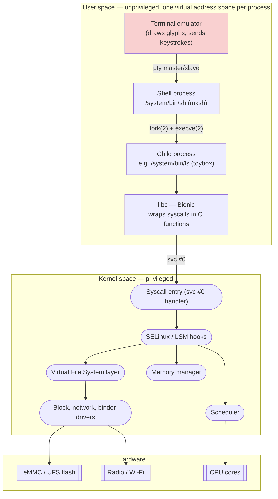

Reading the diagram from the top: your keystrokes enter a terminal emulator, which is connected to the shell through a **pseudo-terminal** — a kernel-provided pair of file descriptors that behave like an old serial line. The shell parses your text. To run `ls`, it does not "call ls"; it clones itself with `fork()` and then replaces its own program image with `/system/bin/ls` using `execve()`. That new process calls library functions such as `opendir()` in Bionic, which are thin wrappers that place a syscall number in a register and execute `svc #0`.

Control transfers to the kernel. Before the kernel does anything useful, the **LSM (Linux Security Module) hooks** run — on Android this means SELinux, and it asks "is the domain `untrusted_app` allowed to `read` a file labelled `app_data_file` owned by a different app?" Only if that passes does the request reach the Virtual File System layer, which routes it to the correct filesystem driver (`f2fs`, `ext4`, `erofs`), which finally talks to the flash storage.

The single most important idea in the diagram: **the arrow labelled `svc #0` is the only way user code can affect the world.** Everything an app does that matters — reading a file, opening a socket, allocating memory, talking to another app over Binder — crosses that line. That is why syscall-level tracing (`strace`, seccomp filters, Frida's `Interceptor` on `libc` exports) sees *everything*, and why syscall-level defences are so powerful.

### 2.2 Process creation: what actually happens when you type `ls`

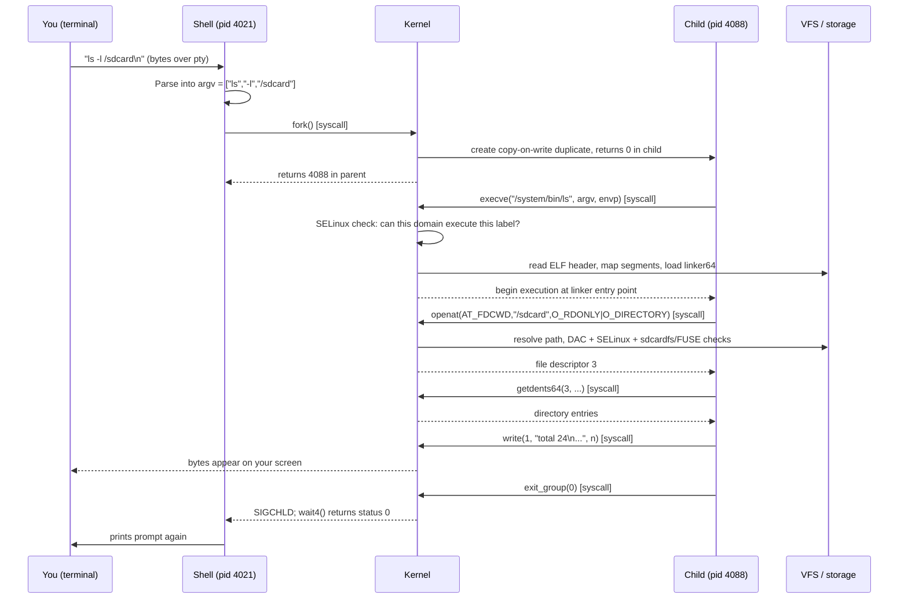

This sequence contains, in miniature, every concept in the chapter. Note four things:

1. **`fork()` then `execve()` are separate steps.** The shell first makes a duplicate of itself, and only then does that duplicate become `ls`. The gap between the two is where the shell sets up redirection, changes UID, closes file descriptors, and joins process groups. Android's Zygote uses exactly this gap: it forks, then *drops privileges and sets the app's UID* before running app code. See [09 — Android App Internals](../09-Android-App-Internals/README.md).
2. **File descriptor 3 is not magic.** Descriptors 0, 1 and 2 were already taken (stdin, stdout, stderr), so the kernel handed out the lowest free number.
3. **Two permission checks happened on one `openat()`** — the classic UNIX owner/group/other check (DAC) and the SELinux label check (MAC). Both must pass. An Android finding of "app can read file X" is only true if *both* allow it.
4. **The shell learns the child finished via a signal**, `SIGCHLD`, and collects the exit status with `wait4()`. Signals are how UNIX does asynchronous notification, and they are central to debugging and anti-debugging.

### 2.3 The Android filesystem at a glance

```mermaid
flowchart TD
    ROOT["/ (rootfs — ramdisk, read-only)"]
    ROOT --> SYS["/system<br/>AOSP framework, /system/bin, /system/lib64<br/>read-only, dm-verity"]
    ROOT --> SYSEXT["/system_ext<br/>OEM additions that behave like system"]
    ROOT --> PROD["/product<br/>Device/carrier-specific packages"]
    ROOT --> VEN["/vendor<br/>SoC/OEM HALs, kernel modules, firmware"]
    ROOT --> ODM["/odm<br/>Board-specific overrides"]
    ROOT --> APEX["/apex<br/>Mainline modules mounted as loop devices"]
    ROOT --> DATA["/data<br/>The only large writable partition<br/>FBE-encrypted"]
    ROOT --> PROC(["/proc — procfs, kernel state as files"])
    ROOT --> SYSFSS(["/sys — sysfs, device model"])
    ROOT --> DEV(["/dev — device nodes, tmpfs"])
    ROOT --> MNT["/mnt — runtime mounts, /mnt/user, /mnt/installer"]
    ROOT --> SD["/sdcard → /storage/self/primary<br/>(symlink, FUSE/sdcardfs view of /data/media)"]

    DATA --> DD["/data/data/&lt;pkg&gt;<br/>private app storage, mode 0700, uid 10xxx"]
    DATA --> DU["/data/user/&lt;userId&gt;/&lt;pkg&gt;<br/>multi-user real path"]
    DATA --> DAPP["/data/app/~~rnd~~/&lt;pkg&gt;-rnd/base.apk"]
    DATA --> DMEDIA["/data/media/&lt;userId&gt;<br/>backing store for /sdcard"]
    DATA --> DLC["/data/local/tmp<br/>shell-writable scratch space"]
    DATA --> DSYS["/data/system<br/>packages.xml, packages.list, users"]

    APEX --> ART["/apex/com.android.art<br/>libart.so, dex2oat, dalvikvm"]
    APEX --> RT["/apex/com.android.runtime<br/>Bionic: libc.so, libm.so, linker64"]
    APEX --> CONS["/apex/com.android.conscrypt<br/>TLS provider"]

    style DLC fill:#f9d0d0
    style SD fill:#f9d0d0
```

The shape to memorise: **almost everything is read-only, and `/data` is where the interesting things live.** The read-only partitions are protected by `dm-verity`, a kernel device-mapper target that verifies every 4 KiB block against a Merkle tree whose root hash is signed and checked during Verified Boot. Changing one byte of `/system` on a locked device makes the block fail verification and either returns an I/O error or triggers a reboot. That is why "systemless" root exists at all, and why Magisk mounts things over the top instead of editing them (Section 3.22).

The two red boxes are the places attacker-controlled or tester-controlled data lands: `/data/local/tmp` is writable by the `shell` user (UID 2000), which is what `adb shell` runs as, making it the standard drop point for `frida-server`, `busybox`, and test binaries; and `/sdcard` is world-visible shared storage where careless apps leave secrets.

### 2.4 Trust boundaries expressed as UIDs

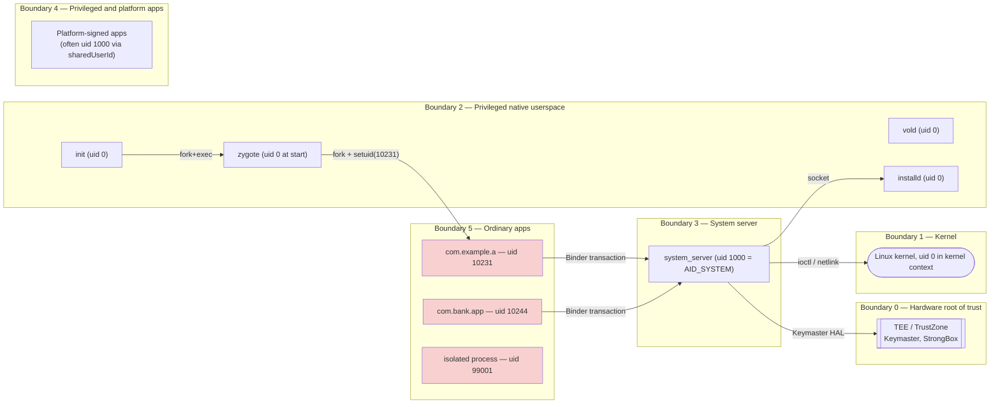

Each box is, at the Linux level, *just a UID*. `system_server` is powerful not because of a special "system" flag but because it runs as UID 1000, belongs to many supplementary groups, and is labelled with an SELinux domain that policy grants a great deal to. An ordinary app is weak because it runs as UID 10231, is in a handful of groups, and lives in the `untrusted_app` domain.

Privilege escalation on Android therefore has an exact definition: **causing code to execute under a UID (and SELinux domain) other than the one it was assigned.** Every root exploit, every `sharedUserId` abuse, every confused-deputy bug in an exported component is a way of moving leftwards across one of those boundaries.

---
## 3. Deep Internal Working

This is the long section. It is organised bottom-up: first what things *are*, then how the kernel implements them, then what an attacker does with them.

### 3.1 The shell: what it actually is

#### What problem existed before shells

Early computers were fed punched cards. There was no interactive way to say "run this, and if it succeeds run that". The shell was invented (Thompson shell, 1971; Bourne shell, 1979) to give humans a *programmable* interface: a language in which "run a program" is a statement.

#### What a shell does, step by step

For every line you type, the shell performs a fixed pipeline of transformations. Knowing the order matters, because injection vulnerabilities live in the gaps between the stages.

| Stage | What happens | Example |
|---|---|---|
| 1. Tokenisation | Split on unquoted whitespace and operators | `ls -l "my file"` → `ls`, `-l`, `my file` |
| 2. Alias expansion | Replace defined aliases | `ll` → `ls -l` |
| 3. Brace expansion | Generate lists | `file{1,2}` → `file1 file2` |
| 4. Tilde expansion | `~` → `$HOME` | `~/notes` → `/home/alice/notes` |
| 5. Parameter expansion | `$VAR`, `${VAR:-default}` | `$PATH` → `/usr/bin:/bin` |
| 6. Command substitution | `$(cmd)` runs `cmd`, inserts output | `echo $(date)` |
| 7. Arithmetic expansion | `$((1+2))` → `3` | |
| 8. Word splitting | Split unquoted results on `$IFS` | `$FILES` becomes multiple args |
| 9. Pathname expansion (globbing) | `*`, `?`, `[a-z]` matched against filenames | `*.apk` → `a.apk b.apk` |
| 10. Quote removal | Strip the quotes that survived | |
| 11. Redirection setup | Open files, `dup2()` onto 0/1/2 | `> out.txt` |
| 12. Execution | `fork()` + `execve()`, or run a builtin | |

> **⚠️ Warning**
> Stages 8 and 9 are why unquoted variables are dangerous. If `$USERINPUT` contains `; rm -rf /`, stage 1 already happened — so a plain `sh -c "echo $USERINPUT"` in a Java `Runtime.exec()` string re-runs tokenisation on attacker data. This is command injection, and it is a real, frequently-found finding in Android apps that shell out to `ping`, `logcat`, or a bundled native binary.

#### Builtins versus external commands

Some commands are implemented *inside* the shell (`cd`, `export`, `echo`, `read`, `set`, `exit`) and some are separate programs on disk (`ls`, `grep`, `cat`). The distinction matters:

- A builtin cannot be a separate process, because it must change the shell's own state. `cd` in a child process would change the child's directory and then the child would exit — useless.
- An external command is found by searching each directory in `$PATH`, left to right, for an executable file with that name.

```bash
# adb shell — which mechanism handles a given word?
type cd        # cd is a shell builtin
type ls        # ls is /system/bin/ls
command -v id  # /system/bin/id
```

> **🔍 Pentester's Note**
> `$PATH` order is a vulnerability class. If a privileged process runs `system("ping ...")` and `$PATH` starts with a directory you can write to, your `ping` runs with that process's privileges. On Android this is rarer than on servers because most privileged code uses absolute paths, but it still appears in vendor daemons and in apps that bundle native helpers into their own writable directories.

#### The shells you will meet on Android

| Shell | Path | Notes |
|---|---|---|
| Mksh | `/system/bin/sh` (a symlink to `mksh`) | Android's default since 4.0. POSIX-ish, no Bash arrays, no `[[ ]]` extensions in older builds. |
| Bash | Not present on stock Android | Only if you install it (Termux, BusyBox builds, custom ROMs). |
| Toybox `sh` | Present in recent AOSP as an alternative | AOSP has been growing a toybox shell; `mksh` still ships. |

Write your device-side scripts in POSIX `sh`. Every time you use `[[ ]]`, `${arr[@]}`, or `$'...'` you are betting on a shell feature that may not exist on the device.

#### Exit status

Every process returns an integer 0–255 when it ends. Zero means success; anything else means failure. The shell exposes the last one as `$?`.

```bash
# adb shell
ls /data/data/com.android.settings 2>/dev/null
echo $?      # 1 on a non-root shell — permission denied, which itself is information
```

Exit status is the backbone of shell logic (`&&`, `||`, `if`) and it is how your automation scripts decide whether a device check passed.

---

### 3.2 The filesystem and the FHS

#### The single-tree idea

Windows has drive letters: `C:\`, `D:\`. UNIX has exactly one tree, rooted at `/`. Additional storage is not given a letter; it is **mounted** onto a directory inside the existing tree.

> **📖 Definition — Mount**
> Attaching a filesystem (a formatted region of storage, or a virtual filesystem generated by the kernel) to a directory in the existing tree, called the *mount point*. After `mount /dev/block/sda3 /data`, opening `/data/system/packages.xml` reaches the filesystem on that block device. The directory's previous contents are hidden, not deleted, for as long as the mount is active.

> **🧠 Mental Model**
> The filesystem tree is a company org chart, and mounting is hiring a whole subcontractor team and hanging them under one manager. Everyone still appears on the one chart; you cannot tell from the chart alone that the subcontractors are a different company. This "you cannot tell" property is exactly what Magisk exploits.

#### The Filesystem Hierarchy Standard (FHS) on desktop Linux

| Path | Purpose |
|---|---|
| `/bin`, `/usr/bin` | User command binaries |
| `/sbin`, `/usr/sbin` | System administration binaries |
| `/lib`, `/usr/lib` | Shared libraries |
| `/etc` | System-wide configuration, text files |
| `/var` | Variable data: logs, spools, caches |
| `/tmp` | Temporary files, world-writable with sticky bit |
| `/home` | Per-human home directories |
| `/root` | The root user's home |
| `/opt` | Self-contained third-party packages |
| `/proc` | Virtual: process and kernel state |
| `/sys` | Virtual: device and driver model |
| `/dev` | Device special files |
| `/mnt`, `/media` | Mount points for removable media |
| `/boot` | Kernel image and bootloader files |

Android keeps `/proc`, `/sys`, `/dev`, `/etc` (as a symlink to `/system/etc`), `/mnt`, and `/data` (roughly `/var` + `/home`), and discards most of the rest.

#### Paths: absolute, relative, and the special entries

- An **absolute path** begins with `/` and is unambiguous: `/data/local/tmp/frida-server`.
- A **relative path** is resolved against the process's current working directory: `./frida-server`, `../lib`.
- `.` is the directory itself; `..` is its parent. `/` has `..` pointing to itself.

Every process has its own current working directory, stored in the kernel and visible at `/proc/<pid>/cwd`. This is a per-process property, which is why `cd` must be a builtin.

> **🔬 Under the Hood**
> Path resolution is done by the kernel's `path_lookup` machinery, one component at a time, and **execute permission on a directory means "may traverse"**. To open `/a/b/c` you need `x` on `/`, `x` on `a`, `x` on `b`, and the appropriate permission on `c`. You do **not** need `r` on the directories unless you want to *list* them. This distinction produces a classic Android trick: a directory can be mode `0711` (traverse but not list), so an attacker who knows an exact filename can open it but cannot enumerate. Several Android caches rely on this.

---

### 3.3 The Android filesystem layout

This is the section to bookmark. Every path here is one you will type during real engagements.

#### The partitions

| Path | Mount type | Writable? | Contents | Why a pentester cares |
|---|---|---|---|---|
| `/system` | `erofs`/`ext4`, read-only, dm-verity | No (locked device) | AOSP framework JARs, `/system/bin`, `/system/lib64`, `/system/framework`, `/system/etc` | Where `su` would live in classic root; where framework code you may want to patch lives. |
| `/system_ext` | read-only | No | OEM code that logically belongs to system | Vendor-added privileged apps hide here. |
| `/product` | read-only | No | Carrier/region-specific apps and config | Preinstalled bloat with excessive permissions. |
| `/vendor` | read-only | No | HALs, kernel modules, firmware blobs, `vendor_init` | Closed-source native attack surface; SELinux policy fragments. |
| `/odm` | read-only | No | Board-level overrides | Rare but occasionally holds debug binaries. |
| `/apex` | loop-mounted APEX images | No | Mainline modules (ART, Bionic, Conscrypt, media, DNS resolver, Tethering) | Updated via Play; version skew across devices; `libc` lives here now, not `/system/lib64`. |
| `/data` | `f2fs`/`ext4`, encrypted | Yes | All app data, all user data | The prize. |
| `/metadata` | small ext4 | No (system only) | Keys for metadata encryption, verity state | Explains FBE behaviour before first unlock. |
| `/cache` | legacy | System | Old OTA staging | Mostly historical on modern devices. |
| `/proc` | procfs | Virtual | Process and kernel state | Introspection goldmine — see 3.10. |
| `/sys` | sysfs | Virtual | Kernel device model | Emulator detection reads here. |
| `/dev` | tmpfs + devtmpfs | Yes (root) | `/dev/binder`, `/dev/ashmem` (older), `/dev/socket/*` | The IPC endpoints themselves. |
| `/sdcard` | symlink → `/storage/self/primary` | Yes | FUSE view onto `/data/media/<user>` | World-ish readable; where apps leak. |

#### Inside `/data`

```
/data
├── app/                                  # installed third-party APKs
│   └── ~~kJ3n...==/com.example.app-Xy9...==/
│       ├── base.apk                      # the APK itself, mode 0644, owner system:system
│       ├── split_config.arm64_v8a.apk    # split APKs
│       ├── lib/arm64/libnative.so        # extracted native libs (if extractNativeLibs=true)
│       └── oat/arm64/base.odex           # AOT-compiled code
├── data/<package>/                       # legacy path, symlink-equivalent to /data/user/0/<package>
│   ├── files/                            # Context.getFilesDir()
│   ├── cache/                            # Context.getCacheDir()
│   ├── databases/                        # SQLite files
│   ├── shared_prefs/                     # XML key/value stores
│   ├── code_cache/                       # JIT/dex cache
│   └── no_backup/                        # excluded from adb backup
├── user/<userId>/<package>/              # the real multi-user path
├── user_de/<userId>/<package>/           # Device-Encrypted: readable before first unlock
├── misc/                                 # keystore blobs, wifi config, vpn, adb keys
│   ├── keystore/                         # Keymaster-wrapped key blobs
│   ├── wifi/                             # WifiConfigStore.xml
│   └── adb/adb_keys                      # authorised host RSA keys
├── system/
│   ├── packages.xml                      # every package, its UID, permissions, signatures
│   ├── packages.list                     # package → uid, dataDir, seinfo (one line each)
│   └── users/                            # multi-user definitions
├── local/tmp/                            # shell (uid 2000) writable — your workspace
├── media/<userId>/                       # the real bytes behind /sdcard
└── vendor/                               # vendor-private data
```

> **📖 Definition — CE and DE storage**
> Android's File-Based Encryption splits app data in two. **Credential Encrypted (CE)** storage (`/data/user/<id>/`) is only decryptable after the user first unlocks the device with their PIN, pattern, or password after boot. **Device Encrypted (DE)** storage (`/data/user_de/<id>/`) is decryptable as soon as the device boots, before any unlock. Apps that must work in Direct Boot mode (alarm clock, accessibility services, phone dialler) put their minimum state in DE. Anything sensitive belongs in CE.

> **🔍 Pentester's Note**
> When you triage an app's storage, always check `user_de` as well as `user`. Developers who mark a component `directBootAware` sometimes move data to DE storage without realising they just removed the "encrypted until unlocked" property. Session tokens sitting in `/data/user_de/0/<pkg>/shared_prefs/` are extractable from a device seized in a powered-on-but-locked state by anyone with a working forensic exploit — a materially weaker position than CE.

#### The `/sdcard` illusion

`/sdcard` is a symbolic link to `/storage/self/primary`, which is a per-process bind mount into a FUSE (Filesystem in Userspace) daemon that presents `/data/media/0` with synthesised permissions. Historically this was a kernel filesystem called `sdcardfs`; from Android 11 it is FUSE served by the `MediaProvider` app with a kernel passthrough optimisation.

| Android version | Mechanism | Consequence |
|---|---|---|
| ≤ 4.3 | Real FAT32 SD card or vold-managed FUSE | No per-file ownership at all; `WRITE_EXTERNAL_STORAGE` was all-or-nothing. |
| 4.4 – 10 | `sdcardfs` kernel shim | Synthesised uid/gid; app-specific dirs under `Android/data/<pkg>`. |
| 11+ (API 30) | FUSE + MediaProvider, **Scoped Storage enforced** | Apps see only their own `Android/data/<pkg>` plus media they own; `MANAGE_EXTERNAL_STORAGE` is a restricted permission. |
| 13+ (API 33) | Granular media permissions (`READ_MEDIA_IMAGES`/`_VIDEO`/`_AUDIO`) | `READ_EXTERNAL_STORAGE` no longer grants broad access. |

The practical result for testing: on a modern device, `adb shell ls /sdcard/Android/data/` returns almost nothing to the `shell` user without extra steps, and an app that "writes its logs to the SD card" is a smaller finding than it used to be — but still a finding, because any app with the right media permission or any user with a file manager can read it.

#### Multi-user and work profiles

Android supports multiple human users and work profiles. The rule is arithmetic:

```
appUid = userId * AID_USER_OFFSET + appId
where AID_USER_OFFSET = 100000
```

So package `com.example.app` with appId 10231 is UID 10231 for user 0, UID 110231 for user 1, and UID 1010231 for a work profile with user ID 10. Their data directories are `/data/user/0/com.example.app` and `/data/user/10/com.example.app` respectively — different directories, different UIDs, no sharing.

> **⚠️ Warning**
> When you dump a device and see UID 1010231 in `packages.list`, do not conclude the app is privileged because the number is large. Divide by 100000 to get the user ID and take the remainder to get the app ID.

---

### 3.4 Files, inodes, hard links, symbolic links

#### The problem the inode solves

A filename is a convenience for humans. The kernel needs somewhere to store the file's real metadata: size, ownership, permissions, timestamps, and the list of disk blocks holding the data. Storing that in the directory entry would make renaming and linking expensive and would make it impossible for two names to refer to the same data. So UNIX separates them.

> **📖 Definition — Inode**
> An on-disk structure holding all metadata about a file *except its name*: type, permission bits, UID, GID, size, link count, timestamps (`atime` last access, `mtime` last content modification, `ctime` last inode change), and pointers to data blocks. Each inode has a number unique within its filesystem.

> **📖 Definition — Directory**
> A file whose contents are a list of `(name, inode number)` pairs. "Putting a file in a directory" means adding such a pair. Nothing about the file itself moves.

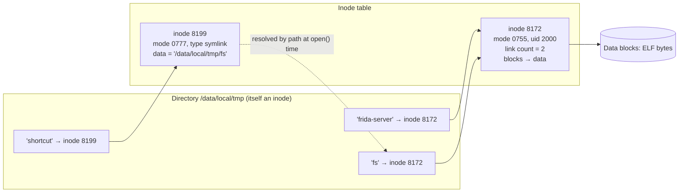

The diagram shows both link types at once. `frida-server` and `fs` are **hard links**: two directory entries pointing at the same inode, which is why the link count is 2. Neither is "the original" — they are equal. Deleting one just decrements the count; the data survives until the count reaches zero *and* no process holds it open.

`shortcut` is a **symbolic link**: a completely separate inode whose data is a *string*. When you open it, the kernel reads the string and starts path resolution again from there. If the target is deleted, the symlink still exists but is "dangling".

| Property | Hard link | Symbolic link |
|---|---|---|
| Points to | Inode | Path string |
| Can cross filesystems | No | Yes |
| Can target a directory | No (except `.`/`..`) | Yes |
| Survives target deletion | Yes (it *is* the file) | No, becomes dangling |
| Has its own permissions | No (shares the inode's) | Yes, but almost always ignored |
| Created with | `ln a b` | `ln -s a b` |
| Shown by `ls -l` as | Ordinary file, link count > 1 | `l` type, `b -> a` |

#### Why this matters for Android security

Symbolic links are one of the most productive Android vulnerability classes. The pattern is always the same: a privileged process (or an app with more permissions than you) is told to write to, copy, or extract into a path that *you* control, and you replace an expected file with a symlink pointing somewhere valuable.

Concrete recurring shapes:

- **Zip path traversal plus symlink (`ZipSlip` family).** An app extracts a downloaded ZIP into its own data directory. An entry named `../../../../data/data/com.victim/files/x` or an entry that *is* a symlink causes the write to land outside the intended directory. Mitigation: canonicalise with `File.getCanonicalPath()` and verify it still starts with the intended base directory.
- **`FileProvider` symlink following.** A content provider serves a file by path; the requester supplies a path with `..` or targets a symlink the app created earlier.
- **Backup/restore symlink attacks.** `adb backup` archives and their restore path have historically been fertile ground.
- **TOCTOU on `/data/local/tmp`.** Anything world-writable plus a privileged writer plus a symlink equals privilege escalation.

> **⚠️ Warning**
> `File.getAbsolutePath()` does **not** resolve `..` or symlinks. Only `getCanonicalPath()` (or `java.nio.file.Path.toRealPath()`) does. An app that validates with `getAbsolutePath().startsWith(baseDir)` is not validating anything useful. This exact mistake is one of the most common real findings in Android file-handling code.

#### File types

`ls -l` shows the type as the first character:

| Char | Type | Notes |
|---|---|---|
| `-` | Regular file | Bytes. |
| `d` | Directory | Name→inode map. |
| `l` | Symbolic link | Contains a path. |
| `c` | Character device | Unbuffered byte stream: `/dev/binder`, `/dev/urandom`, `/dev/null`. |
| `b` | Block device | Block-addressed: `/dev/block/sda`. |
| `s` | UNIX domain socket | IPC endpoint: `/dev/socket/installd`. |
| `p` | Named pipe (FIFO) | IPC byte stream with a filesystem name. |

> **🔍 Pentester's Note**
> `ls -l /dev/socket/` on a rooted device is a map of Android's native IPC. Each socket there is a daemon you may be able to talk to: `installd`, `netd`, `vold`, `zygote`, `zygote_secondary`, `logd`, `property_service`. Which sockets your UID can connect to is decided by the socket file's mode bits *and* SELinux. Historically, reachable-from-app daemon sockets have produced serious escalations.

---

### 3.5 Users, groups, UID and GID

#### The original idea

UNIX was built for shared machines. Alice and Bob each got a number — a **user ID** — and the kernel tagged every process and every file with one. The rule was simple and has never changed: *a process's identity is a number, and access decisions compare that number against the number on the object.*

> **📖 Definition — UID (User ID)**
> A 32-bit integer identifying a security principal. UID 0 is `root` and historically bypasses almost all permission checks. Names like `alice` exist only in `/etc/passwd` for human convenience; the kernel only ever sees the number.

> **📖 Definition — GID (Group ID)**
> A 32-bit integer identifying a group. A process has one *primary* GID plus a list of *supplementary* GIDs. A file has exactly one owning GID.

#### The four UIDs every process has

This is where beginners get lost, and it is essential for understanding `setuid`.

| UID kind | Meaning | Used for |
|---|---|---|
| **Real UID (ruid)** | Who launched the process | Signal permission checks, accounting |
| **Effective UID (euid)** | Identity used for permission checks | File access decisions |
| **Saved set-UID (suid)** | A stash so a program can drop and regain privilege | `seteuid()` juggling |
| **Filesystem UID (fsuid)** | Linux-specific; used only for filesystem checks | Historically for NFS daemons |

For a normal program all four are equal. When you execute a binary with the setuid bit set, the kernel sets the effective and saved UIDs to the *file owner's* UID while leaving the real UID as yours. That is how `su` works: `su` is owned by root with the setuid bit set, so running it gives you euid 0.

```bash
# desktop Linux
id -u        # real uid
id -un       # name for it
id           # everything: uid, gid, groups
```

#### `/etc/passwd` and `/etc/group` — and Android's absence of them

On desktop Linux, the number-to-name mapping lives in text files:

```
# /etc/passwd  — name:password-placeholder:uid:gid:comment:home:shell
alice:x:1000:1000:Alice Smith:/home/alice:/bin/bash
```

```
# /etc/group  — name:password:gid:members
sudo:x:27:alice,bob
```

Android has **no `/etc/passwd`**. There are no human user accounts to store. Instead the mapping is compiled into the platform:

- **Static AIDs** are `#define`d in `system/core/libcutils/include/private/android_filesystem_config.h`.
- **Per-app UIDs** are allocated at install time by `PackageManagerService` and recorded in `/data/system/packages.xml` and `/data/system/packages.list`.
- **OEM AIDs** are declared in `AID_` prefixed `oem_*` ranges and in `/vendor/etc/passwd`-style generated files consumed by `libcutils`.

So `id` on Android resolves names through Bionic's `getpwuid()`, which consults that compiled table and then synthesises names like `u0_a231` for app UIDs.

```bash
# adb shell — on a device
id
# uid=2000(shell) gid=2000(shell) groups=2000(shell),1004(input),1007(log),
# 1011(adb),1015(sdcard_rw),1028(sdcard_r),3001(net_bt_admin),3002(net_bt),
# 3003(inet),3006(net_bw_stats),3009(readproc),3011(uhid) context=u:r:shell:s0
```

That output is worth dissecting because it teaches the whole model in one line. `uid=2000(shell)` is who you are. The supplementary groups are the capabilities you were granted: `inet` (3003) lets you create network sockets at all, `log` (1007) lets you read the log buffers, `readproc` (3009) lets you see other processes' `/proc` entries, `sdcard_rw` lets you write shared storage. And `context=u:r:shell:s0` is your SELinux label, which is a *separate* and equally binding check.

---
### 3.6 Android AIDs: how Android repurposes the UID space

#### The core reinterpretation

Desktop Linux: **one UID per human.**
Android: **one UID per application.**

That single substitution is the foundation of the Android sandbox. Because each app is a different Linux user, ordinary file permissions — invented in 1971 to stop students reading each other's homework — stop your banking app's database from being read by a torch app.

> **📖 Definition — AID (Android ID)**
> A named, reserved UID/GID constant defined by the Android platform. Static AIDs are compile-time constants in `system/core/libcutils/include/private/android_filesystem_config.h`; dynamic AIDs are allocated at runtime for applications.

#### The UID map

| Range | Name | Meaning |
|---|---|---|
| `0` | `AID_ROOT` | Superuser. `init`, `vold`, `installd`, `zygote` before fork. |
| `1000` | `AID_SYSTEM` | The `system_server` process and platform-signed apps that request it. |
| `1001` | `AID_RADIO` | Telephony stack. |
| `1002` | `AID_BLUETOOTH` | Bluetooth stack. |
| `1003` | `AID_GRAPHICS` | SurfaceFlinger and graphics. |
| `1004` | `AID_INPUT` | Input device access. |
| `1005` | `AID_AUDIO` | Audio server. |
| `1006` | `AID_CAMERA` | Camera server. |
| `1007` | `AID_LOG` | Read access to the log buffers. |
| `1009` | `AID_MOUNT` | Mount-related helpers. |
| `1010` | `AID_WIFI` | Wi-Fi subsystem. |
| `1011` | `AID_ADB` | The `adbd` daemon. |
| `1012` | `AID_INSTALL` | Package installer helper. |
| `1013` | `AID_MEDIA` | `mediaserver` family. |
| `1015` | `AID_SDCARD_RW` | Historic write access to shared storage. |
| `1017` | `AID_KEYSTORE` | The keystore daemon. |
| `1023` | `AID_MEDIA_RW` | Read/write on media storage. |
| `2000` | `AID_SHELL` | `adb shell` and anything you run without root. |
| `2001` | `AID_CACHE` | Cache access. |
| `3001–3007` | `AID_NET_*` | Networking capability groups (see below). |
| `9997` | `AID_EVERYBODY` | A group every app belongs to; used for a few shared resources. |
| `9998` | `AID_MISC` | Miscellaneous. |
| `9999` | `AID_NOBODY` | The traditional "no privileges" account. |
| `10000–19999` | `AID_APP_START` – `AID_APP_END` | **Ordinary installed applications.** |
| `20000–29999` | `AID_CACHE_GID_START` – `_END` | Per-app cache GIDs. |
| `30000–39999` | `AID_EXT_GID_START` – `_END` | External storage GIDs per app. |
| `50000–59999` | `AID_SHARED_GID_START` – `_END` | GIDs for `sharedUserId` groups. |
| `99000–99999` | `AID_ISOLATED_START` – `_END` | Isolated processes (e.g. WebView renderer, `isolatedProcess="true"` services). |
| `+100000 per user` | `AID_USER_OFFSET` | Multi-user offset applied to all of the above. |

> **⚠️ Warning**
> Treat this table as a reliable map, not as gospel for a specific build. The authoritative source on any given device is `system/core/libcutils/include/private/android_filesystem_config.h` in that AOSP branch, plus any `oem_` AIDs the vendor added. When a number surprises you, look it up rather than guessing.

#### The networking GIDs — the ones you will actually use

Android does not give apps raw network capability. Instead, the `INTERNET` permission is implemented by adding the app's process to GID 3003:

| GID | Name | Grants |
|---|---|---|
| 3001 | `AID_NET_BT_ADMIN` | Bluetooth administration sockets |
| 3002 | `AID_NET_BT` | Bluetooth sockets |
| **3003** | **`AID_INET`** | **Ability to create `AF_INET`/`AF_INET6` sockets — i.e. the `INTERNET` permission** |
| 3004 | `AID_NET_RAW` | Raw sockets (ping, packet crafting) |
| 3005 | `AID_NET_ADMIN` | Network administration |
| 3006 | `AID_NET_BW_STATS` | Read network usage statistics |
| 3007 | `AID_NET_BW_ACCT` | Bypass bandwidth accounting |

> **🔬 Under the Hood**
> The kernel enforcement is a small Android-specific patch (historically called `ANDROID_PARANOID_NETWORK`) in the socket creation path: creating an internet socket requires membership of GID `AID_INET`. On newer kernels the mechanism is implemented with eBPF and cgroup socket hooks instead, but the observable behaviour is the same. This is why an app without `INTERNET` gets `EACCES` from `socket()` itself rather than a connection failure — and why you cannot "just use a native library" to bypass the permission.

> **🔍 Pentester's Note**
> Read an app's groups directly: `adb shell cat /proc/<pid>/status | grep Groups`. If 3003 is absent, the app genuinely cannot make network connections in-process. That single check refutes a lot of speculative "this SDK exfiltrates data" claims — and confirms them when 3003 *is* present in a component you did not expect.

#### How an app gets its UID: the install flow

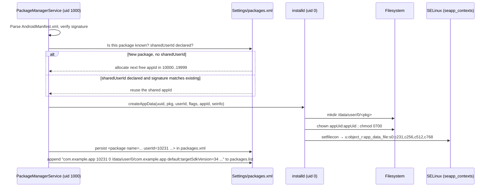

The important consequences:

1. **The UID is allocated once and persists across app updates.** Uninstalling releases it; reinstalling may get a different one.
2. **`sharedUserId` makes two packages share a UID** — and therefore share *all* file access, and the ability to load each other's code into the same process. It requires identical signing keys. It is deprecated from API 29 and strongly discouraged, because it converts two sandboxes into one. If you find `android:sharedUserId="android.uid.system"` on a third-party app, that app is running as UID 1000 and its every bug is a system-level bug.
3. **The SELinux label carries per-app categories** (`c231,c256,...`). Those MLS categories are derived from the app ID and are what stops one `untrusted_app` from reading another `untrusted_app`'s files *even though both have the same SELinux type*. This is called **per-app SELinux categorisation** and it is why the sandbox does not depend on DAC alone.

#### Reading the mapping on a live device

```bash
# adb shell — the human-readable package→uid map (needs root to read on modern devices)
cat /data/system/packages.list
# com.example.app 10231 0 /data/user/0/com.example.app default:targetSdkVersion=34 none 0 1 ...

# adb shell — no root needed, works everywhere
pm list packages -U | grep -i bank
# package:com.bank.app uid:10244

# adb shell — the UID of a running process
ps -A -o USER,PID,NAME | grep com.bank.app
```

> **🔍 Pentester's Note**
> `pm list packages -U` is your friend on a non-rooted device. Combine it with `dumpsys package <pkg>` to get the UID, the granted permissions, the signing certificate digest, and the declared components — everything you need for an initial attack-surface map, without root and without pulling the APK.

---

### 3.7 Permission bits, octal notation, and the special bits

#### The 12 bits

Every inode carries 12 permission bits. Nine of them are the familiar three-by-three grid; three are special.

```
 setuid setgid sticky | rwx  rwx  rwx
   |      |      |      owner group other
   4      2      1      4 2 1  4 2 1  4 2 1
```

| Bit | Symbol | On a **file** | On a **directory** |
|---|---|---|---|
| `r` (4) | read | Read contents | List entries (names) |
| `w` (2) | write | Modify contents | Create, delete, rename entries |
| `x` (1) | execute | Run as a program | Traverse (enter, resolve names through) |
| setuid (4000) | `s` in owner-x | Run with the file **owner's** euid | (ignored on Linux) |
| setgid (2000) | `s` in group-x | Run with the file **group's** egid | New files inherit the directory's group |
| sticky (1000) | `t` in other-x | (obsolete) | Only the file's owner may delete/rename entries |

#### Reading `ls -l`

```
-rwsr-xr-x 1 root  root    75304 Jan  1 00:00 su
drwx------ 6 u0_a231 u0_a231 4096 Aug  4 21:12 /data/user/0/com.example.app
drwxrwxrwt 8 root  root     4096 Aug  4 21:12 /data/local/tmp
lrwxrwxrwx 1 root  root       21 Jan  1 00:00 /sdcard -> /storage/self/primary
```

- `-rwsr-xr-x` — a regular file, owner root can read/write/execute, and the `s` in place of the owner's `x` means **setuid is set**. Anyone who executes it runs with euid 0.
- `drwx------` — a directory, owner has everything, group and others have nothing. This is `0700`, the standard mode for an app's private data directory. It is *the* app sandbox at the DAC level.
- `drwxrwxrwt` — world-writable directory with the **sticky bit** (`t`). Everyone may create files; only owners may delete their own. This is `/data/local/tmp` and `/tmp`.
- `lrwxrwxrwx` — a symlink. Its own permissions are meaningless; the target's are what count.

#### Octal notation

Each group of three bits is one octal digit.

| Octal | Bits | Meaning |
|---|---|---|
| 7 | `rwx` | read, write, execute |
| 6 | `rw-` | read, write |
| 5 | `r-x` | read, execute |
| 4 | `r--` | read only |
| 3 | `-wx` | write, execute (rare) |
| 2 | `-w-` | write only (rare) |
| 1 | `--x` | execute/traverse only |
| 0 | `---` | nothing |

| Common mode | Meaning | Where you see it on Android |
|---|---|---|
| `0700` | Owner full, nobody else | `/data/data/<pkg>` |
| `0600` | Owner read/write | SharedPreferences XML, SQLite files |
| `0644` | Owner rw, everyone read | `base.apk` in `/data/app` |
| `0755` | Owner rwx, everyone rx | `/system/bin/*` binaries |
| `0777` | Everyone everything | **Almost always a finding.** |
| `1777` | `0777` + sticky | `/data/local/tmp`, `/tmp` |
| `4755` | setuid root, world-executable | A classic `su` binary |
| `2755` | setgid | Group-inheriting tool directories |

> **⚠️ Warning — `MODE_WORLD_READABLE`**
> `Context.MODE_WORLD_READABLE` and `MODE_WORLD_WRITEABLE` set mode `0644`/`0622` on files inside an app's private directory. They were deprecated in API 17 and **throw `SecurityException` when targeting API 24 or higher**. You will still find them in old code and in apps that lower `targetSdkVersion`. When present, they defeat the sandbox for that file completely: any other app can read (or overwrite) it. Grep for them in every assessment.

#### setuid in depth — and why it is a root-detection artefact

When the kernel's `execve()` path loads a binary whose inode has bit `04000` set, it sets the new process's effective and saved UIDs to the file's owner UID. The real UID is unchanged. `/proc/<pid>/status` then shows different values on the `Uid:` line:

```
# adb shell — Uid: real  effective  saved  fs
Uid:    2000    0       0       0
```

Why does this matter for Android?

**Stock Android ships essentially no setuid-root binaries reachable by apps.** The platform deliberately removed them. `run-as` is setuid-ish and tightly constrained, and modern builds prefer Linux capabilities over blanket setuid. Therefore, **the presence of a setuid-root binary in a directory an app can reach is strong evidence that the device has been modified.**

This is precisely what root-detection code checks. A representative check, written out as it appears decompiled:

```java
// Typical root-detection logic found in hardened apps
private static final String[] SU_PATHS = {
    "/sbin/su", "/system/bin/su", "/system/xbin/su", "/system/sbin/su",
    "/vendor/bin/su", "/su/bin/su", "/data/local/xbin/su",
    "/data/local/bin/su", "/system/sd/xbin/su", "/system/bin/failsafe/su",
    "/data/local/su", "/system/bin/.ext/.su", "/system/usr/we-need-root/su"
};

static boolean hasSuBinary() {
    for (String p : SU_PATHS) {
        File f = new File(p);
        if (f.exists()) return true;          // stat() succeeds
        if (f.canExecute()) return true;      // access(X_OK)
    }
    return false;
}
```

At the Linux level, `File.exists()` is `stat()`/`access()`, and `canExecute()` is `access(path, X_OK)`. Both are syscalls, both are hookable, and both fail in interesting ways — for example, `stat()` on a path inside a directory you cannot traverse returns `EACCES`, not `ENOENT`, and some detection code treats "permission denied" as "the file exists", which is often the correct inference.

> **🔍 Pentester's Note**
> Because these checks are *file existence* checks, the systemless approach wins: Magisk does not place `su` at `/system/xbin/su`. It mounts its own filesystem view in a private mount namespace and, with DenyList/Zygisk, unmounts that view entirely for targeted processes so the app's own `stat()` genuinely returns `ENOENT`. Understanding *why* that works requires Section 3.22. See also [37 — Root Detection](../37-RootDetection/README.md).

#### Linux capabilities — the modern replacement for setuid

Blanket setuid-root is all-or-nothing. Linux capabilities split root's power into ~40 independent privileges.

| Capability | Grants |
|---|---|
| `CAP_SYS_ADMIN` | Mount, namespace operations, and a grab-bag of powerful actions. Effectively root. |
| `CAP_NET_ADMIN` | Interface and routing configuration |
| `CAP_NET_RAW` | Raw sockets |
| `CAP_NET_BIND_SERVICE` | Bind ports below 1024 |
| `CAP_SYS_PTRACE` | `ptrace()` any process |
| `CAP_SYS_MODULE` | Load kernel modules |
| `CAP_DAC_OVERRIDE` | Bypass all file permission checks |
| `CAP_SETUID` / `CAP_SETGID` | Change UIDs/GIDs arbitrarily |
| `CAP_CHOWN` | Change file ownership |
| `CAP_KILL` | Signal any process |

Android's `init` grants specific capability sets to specific services in `.rc` files, for example a service that needs to bind a low port gets only `CAP_NET_BIND_SERVICE` rather than UID 0. Capabilities appear on the `CapEff`, `CapPrm`, `CapInh`, `CapBnd` and `CapAmb` lines of `/proc/<pid>/status` as hexadecimal bitmasks.

```bash
# adb shell
grep Cap /proc/1/status
# CapInh: 0000000000000000
# CapPrm: 0000003fffffffff   ← init has essentially everything
# CapEff: 0000003fffffffff
```

```bash
# desktop Linux — decode a mask
capsh --decode=0000003fffffffff
```

> **🔍 Pentester's Note**
> A process with `CapEff: 0000000000000000` and a non-zero UID is genuinely unprivileged. A process running as a non-root UID but with `CAP_DAC_OVERRIDE` in `CapEff` is root in every way that matters for files. Always read the capability lines before concluding a daemon is "low privilege".

---

### 3.8 umask, chmod, chown, and POSIX ACLs

#### `umask` — the bits you cannot get

Every process has a **umask**: a mask of permission bits to *remove* from newly created files.

> **📖 Definition — umask**
> A per-process 12-bit mask. When a process creates a file with requested mode `M`, the kernel actually applies `M & ~umask`. It can only take permissions away, never add them.

| umask | Files get (from 0666) | Directories get (from 0777) |
|---|---|---|
| `022` | `0644` | `0755` |
| `027` | `0640` | `0750` |
| `077` | `0600` | `0700` |
| `000` | `0666` | `0777` |

Android's Zygote sets a umask for app processes so that files an app creates default to being private. This is why `openFileOutput(name, MODE_PRIVATE)` produces `0600` and not `0666`.

> **🔬 Under the Hood**
> Zygote establishes the process's file-creation defaults during specialisation, alongside `setuid`/`setgid`, capability dropping, seccomp filter installation, and SELinux context transition. Because the umask is inherited across `fork()` and `execve()`, a native binary an app spawns inherits the same protective default. An app that explicitly calls `chmod(0777)` afterwards has actively thrown that protection away — which is a common finding in apps that shell out to a bundled binary and "fix" a permission problem with the biggest hammer.

#### `chmod`

```bash
# Both forms do the same thing
chmod 0700 /data/local/tmp/secret
chmod u=rwx,go= /data/local/tmp/secret

chmod +x script.sh          # add execute for all (subject to umask on some shells)
chmod u+s /path/to/binary   # set the setuid bit
chmod -R 0750 directory/    # recursive
```

Only the file's owner or a process with `CAP_FOWNER` (in practice, root) may change a file's mode.

#### `chown` and `chgrp`

```bash
# Only root can give a file away
chown u0_a231:u0_a231 /data/local/tmp/testfile
chown -R system:system /data/misc/mydir
chgrp inet /data/local/tmp/thing
```

> **⚠️ Warning**
> Non-root users cannot `chown` files to another user, even files they own. If they could, they could plant a setuid binary and hand it to root. This restriction is load-bearing, and its absence in a vendor daemon that exposes a "change owner" operation over IPC is an immediate escalation.

#### POSIX ACLs

The owner/group/other model cannot express "Alice and Bob may read, and nobody else". Access Control Lists extend the inode with a list of `(user|group, permissions)` entries.

```bash
# desktop Linux
setfacl -m u:bob:r-- report.txt      # grant bob read
getfacl report.txt                   # show the ACL
ls -l report.txt                     # note the trailing '+' on the mode string
```

Android does not use POSIX ACLs in the platform. It solves the same problem with two different mechanisms: SELinux MLS categories for per-app isolation, and Binder-level permission checks for anything more expressive. When you see a `+` in `ls -l` output on Android, you are looking at something unusual — investigate it.

#### The complete access decision on Android

For an app to open a file, **all** of these must pass, in order:

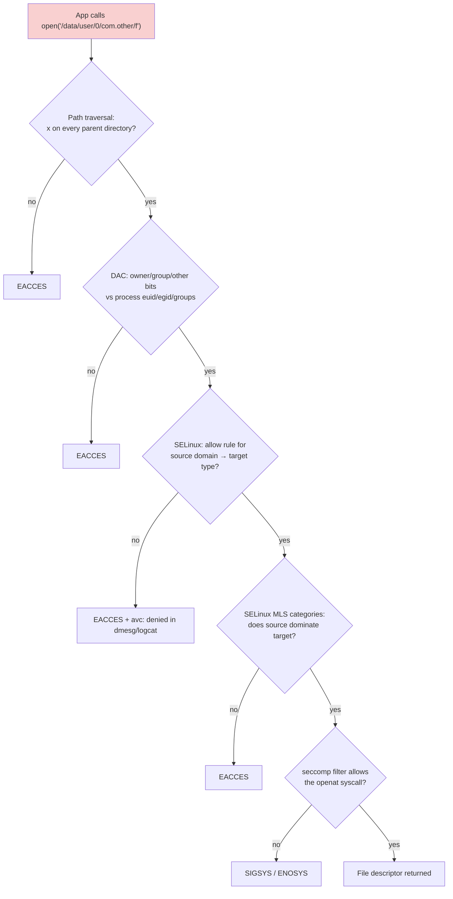

The diagram is the single most useful thing to internalise about Android file access. When a test fails with "Permission denied", the question is never "am I allowed?" but "**which of these five gates closed?**" — and each one has a different diagnostic:

- Traversal or DAC: compare `ls -ld` on each path component with `id`.
- SELinux type: `dmesg | grep avc` or `logcat | grep avc` for a `denied` line naming `scontext` and `tcontext`.
- MLS categories: the `avc` line will show category sets like `s0:c231,c256` that do not dominate.
- seccomp: the process dies with `SIGSYS` rather than getting an error, which looks like a crash, not a denial.

---
### 3.9 Processes

#### What a process is

> **📖 Definition — Process**
> An instance of a running program, consisting of: a private virtual address space, one or more threads of execution, a table of open file descriptors, a security identity (UIDs, GIDs, capabilities, SELinux context), a set of signal dispositions, a current working directory, and a namespace membership. The kernel tracks all of this in a `task_struct`.

> **🧠 Mental Model**
> A program is a recipe printed in a book. A process is one cook actually making the dish, with their own counter space (memory), their own pans in use (file descriptors), and their own progress through the steps (the program counter). Two cooks can follow the same recipe simultaneously and never interfere — that is two processes running one program.

#### Process attributes you will look up constantly

| Attribute | Meaning | Where to see it |
|---|---|---|
| PID | Process ID, unique now (reused later) | `ps`, `/proc/<pid>` |
| PPID | Parent's PID | `/proc/<pid>/status` → `PPid:` |
| TGID | Thread group ID = the PID of the main thread | `status` → `Tgid:` |
| UID/GID | Security identity (four each) | `status` → `Uid:`/`Gid:` |
| State | R, S, D, T, t, Z, X | `status` → `State:` |
| Command line | `argv` as NUL-separated bytes | `/proc/<pid>/cmdline` |
| Executable | The binary actually running | `/proc/<pid>/exe` (a symlink) |
| Working directory | Base for relative paths | `/proc/<pid>/cwd` |
| Open files | Every fd, with its target | `/proc/<pid>/fd/` |
| Memory map | Every mapped region | `/proc/<pid>/maps` |
| Environment | `envp` at exec time | `/proc/<pid>/environ` |
| Tracer | PID of the debugger attached | `status` → `TracerPid:` |

#### Process states

| Code | Name | Meaning |
|---|---|---|
| `R` | Running / runnable | On a CPU or waiting for one |
| `S` | Interruptible sleep | Waiting for an event; can be woken by a signal. Most processes, most of the time. |
| `D` | Uninterruptible sleep | Waiting on I/O; **cannot** be killed, not even by `SIGKILL`, until the I/O completes |
| `T` | Stopped | Suspended by `SIGSTOP`/`SIGTSTP` |
| `t` | Tracing stop | Stopped because a debugger (`ptrace`) is controlling it |
| `Z` | Zombie | Exited, but the parent has not called `wait()` to collect the status |
| `X` | Dead | Being torn down |

> **🔍 Pentester's Note**
> State `t` is what you see when Frida or GDB has a process stopped. A hardened app can read its own `/proc/self/stat` and notice. So can it notice `Z` children it did not create, or a `D` state that never clears (a hint that someone is single-stepping it).

#### `fork()`, `execve()`, `wait()`, `exit()` — the process lifecycle

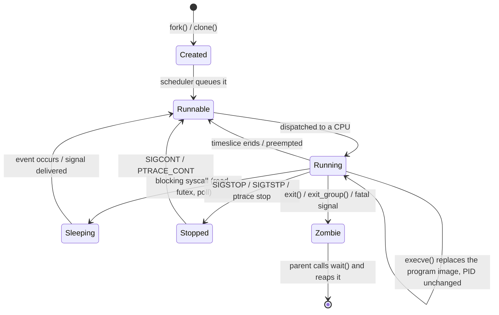

Two subtleties that beginners always miss:

1. **`execve()` does not create a process.** It *replaces the contents* of the current one. Same PID, same open file descriptors (unless marked close-on-exec), same UID (unless the binary is setuid). This is why redirection set up between `fork()` and `execve()` survives into the new program — it is the same process wearing new clothes.
2. **Zombies are not a bug in the child.** A zombie is a dead process whose *parent* has not read its exit status. The kernel keeps a tiny record so the parent can still ask "how did it go?". If the parent never asks, the record leaks. If the parent dies first, the child is re-parented to `init` (PID 1), which reaps continuously.

#### Android's twist: Zygote instead of fork+exec

Starting a JVM-like runtime is expensive: you must map the core libraries, initialise the heap, warm up classes. Android does that work **once**, in a process called **Zygote**, and then forks it for every app.

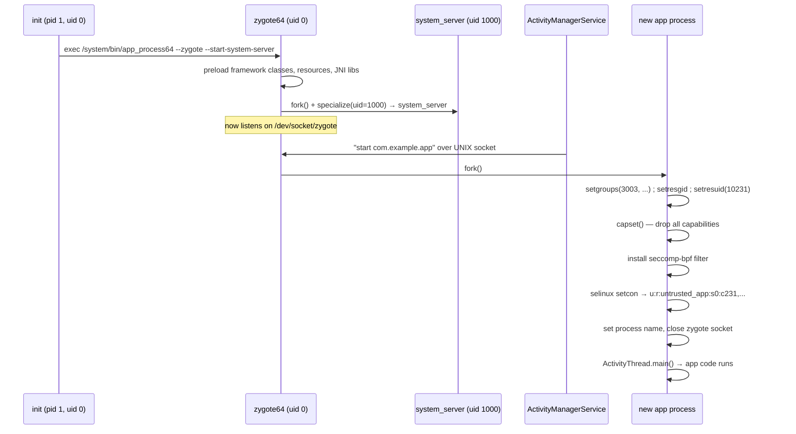

Three security consequences fall out of this design:

- **Every app process shares Zygote's memory layout at fork time.** Historically that meant identical ASLR offsets across apps, which weakened exploitation defences; Android mitigates this in several ways, and it is one reason Zygote does not simply pre-fork.
- **The specialisation step is where privilege is dropped.** A bug in `setuid()` error handling in that path is catastrophic; a real historical Android/Linux bug class is exactly "`setuid()` failed and the return value was not checked", leaving the process as root.
- **Apps do not `execve()`.** The app's process image is `app_process64` — which is why `/proc/<pid>/exe` for every app points at the same binary, and why the *command line* (`/proc/<pid>/cmdline`) is what identifies the app. Attackers and defenders both rely on that.

#### Listing and inspecting processes

```bash
# adb shell — all processes, useful columns
ps -A -o USER,PID,PPID,VSZ,RSS,NAME

# adb shell — one app, with threads
ps -A -T | grep com.example.app

# adb shell — full command line, wide output
ps -A -o PID,USER,ARGS | grep -i frida

# adb shell — live view
top -b -n 1 -o %CPU,RES,PID,ARGS | head -20
```

```bash
# desktop Linux — the classic BSD-style invocation
ps aux
ps -ef --forest        # ASCII tree of parent/child relationships
pstree -p              # same idea, compact
```

| Column | Meaning |
|---|---|
| `VSZ` | Virtual size: every byte of address space mapped, including never-touched pages |
| `RSS` | Resident set size: physical memory currently backing this process |
| `PSS` | Proportional set size (Android-specific, in `dumpsys meminfo`): shared pages divided by sharers |
| `%CPU` | Share of one core, or of all cores depending on the tool's mode |

> **⚠️ Warning**
> `VSZ` on Android is nearly meaningless — the runtime maps huge regions lazily. Judge memory by `PSS` from `dumpsys meminfo <pkg>`, not by `VSZ`.

---

### 3.10 `/proc/<pid>/` in full

This is the single most valuable directory on the system for a reverse engineer, so it gets its own section.

> **📖 Definition — procfs**
> A virtual filesystem, mounted at `/proc`, that presents kernel data structures as readable text files. Nothing in it exists on disk; reading a file causes the kernel to generate its contents on the spot. There is one numbered directory per process, plus system-wide entries.

#### System-wide entries worth knowing

| Path | Contents | Use |
|---|---|---|
| `/proc/version` | Kernel version string | Kernel exploit triage; emulator fingerprinting |
| `/proc/cpuinfo` | CPU model and features | Emulator detection (a Goldfish/Ranchu CPU string is a giveaway) |
| `/proc/meminfo` | System memory statistics | |
| `/proc/mounts` | All mounts in the caller's namespace | **Root detection: `/system` mounted `rw`, `tmpfs` on odd paths, Magisk mounts** |
| `/proc/filesystems` | Supported filesystem types | |
| `/proc/net/tcp`, `tcp6`, `udp` | Open sockets with inode + UID | Map sockets to processes |
| `/proc/net/unix` | UNIX domain sockets | Find Frida's default listener and daemon sockets |
| `/proc/sys/kernel/randomize_va_space` | ASLR level (0/1/2) | Exploitation prerequisites |
| `/proc/sys/kernel/yama/ptrace_scope` | Who may ptrace whom | Debugger availability |
| `/proc/self/` | Symlink to the caller's own PID directory | The portable way to introspect yourself |

#### Per-process entries, one by one

**`/proc/<pid>/cmdline`** — the `argv` array, NUL-separated (not newline-separated).

```bash
# adb shell
tr '\0' ' ' < /proc/1234/cmdline; echo
# com.example.app
```

For an Android app this is the package name (set by the runtime via `pthread_setname`-adjacent mechanisms and `PR_SET_NAME`), which is why grepping `cmdline` is the standard way to find an app's PID:

```bash
# adb shell — the idiomatic one-liner
pidof com.example.app
# or, portable across old devices:
ps -A | grep com.example.app | awk '{print $2}'
```

**`/proc/<pid>/status`** — human-readable summary. The lines that matter:

```
Name:   m.example.app        ← truncated to 15 chars by the kernel (TASK_COMM_LEN)
Umask:  0077
State:  S (sleeping)
Tgid:   9142                 ← thread group id == the "process" pid
Pid:    9142
PPid:   1002                 ← the zygote's pid for an app
TracerPid:      0            ← ★ non-zero means a debugger is attached
Uid:    10231   10231   10231   10231     ← real, effective, saved, fs
Gid:    10231   10231   10231   10231
FDSize: 256
Groups: 3003 9997 20231 50231           ← ★ 3003 = INTERNET permission
Threads:        28
SigQ:   0/12800
SigPnd: 0000000000000000
ShdPnd: 0000000000000000
SigBlk: 0000000000001204
SigIgn: 0000000000000001
SigCgt: 0000000e400084f8    ← ★ bitmask of signals with handlers installed
CapInh: 0000000000000000
CapPrm: 0000000000000000
CapEff: 0000000000000000    ← ★ all zero: genuinely unprivileged
CapBnd: 0000000000000000
Seccomp:        2           ← ★ 2 = filter mode, a BPF filter is installed
NoNewPrivs:     1
Speculation_Store_Bypass:       thread vulnerable
```

> **🔍 Pentester's Note — `TracerPid`**
> This is the most-used anti-debugging check in existence. An app reads `/proc/self/status`, parses `TracerPid`, and if it is non-zero, exits or corrupts its own state. Frida in "attach" mode uses `ptrace` and therefore sets `TracerPid`. Countermeasures, in increasing order of robustness: spawn the app with Frida instead of attaching (`frida -U -f pkg`) so ptrace is released early; hook the `open`/`openat`/`read` path in `libc` to rewrite the value; or use a Zygisk-based injector that never ptraces. Understanding *why* each of these works requires knowing that `status` is generated on demand — the value cannot be pre-patched on disk because there is no disk.

**`/proc/<pid>/maps`** — the process's virtual address space, one line per mapping.

```
# adb shell — cat /proc/9142/maps
12c00000-12e00000 rw-p 00000000 00:00 0                    [anon:dalvik-main space]
6f8a1000-6f9b3000 r--p 00000000 fd:03 1183   /apex/com.android.art/javalib/arm64/boot.oat
7b2c400000-7b2c480000 r-xp 00000000 fd:03 981  /data/app/~~x==/com.example.app-y==/lib/arm64/libnative.so
7fd8a00000-7fd8a21000 rw-p 00000000 00:00 0    [stack]
7fd9000000-7fd9001000 r--p 00000000 00:00 0    [vvar]
7fd9001000-7fd9002000 r-xp 00000000 00:00 0    [vdso]
```

Each line is `start-end perms offset dev inode pathname`. The permission field is `rwxp` or `rwxs`: `p` is private (copy-on-write), `s` is shared.

| What you look for | Why |
|---|---|
| `frida-agent-64.so`, `gadget`, `gum-js-loop` | The app is instrumented — and the app can see this too |
| `libsubstrate.so`, `libxposed*`, `lspd` | Hooking framework present |
| `r-xp` regions with no pathname | Anonymous executable memory: JIT output, a packer's unpacked payload, or shellcode |
| `rwxp` regions | Writable **and** executable — a red flag; W^X should normally hold |
| `[anon:dalvik-*]` | ART heap spaces — where your Java objects actually live |
| `.so` under `/data/app/.../lib/` | The app's own native libraries |
| `deleted` suffix | A mapped file that has been unlinked — packers and droppers do this |

> **🔬 Under the Hood**
> The single most productive first move when you meet an obfuscated or packed app is `cat /proc/<pid>/maps` and look for an anonymous `r-xp` region that is roughly DEX-sized, then dump it. Packers decrypt the real DEX into memory and hand it to ART; the map tells you exactly where. Frida's `Process.enumerateRanges('r-x')` is the same information from inside the process.

**`/proc/<pid>/smaps`** — the same regions but with per-mapping detail: `Rss`, `Pss`, `Shared_Clean`, `Private_Dirty`, `Swap`, `AnonHugePages`, and a `VmFlags` line. Use it when you need to know whether a region is really resident, or to find the biggest contributors to an app's memory footprint. `smaps_rollup` gives the totals in one read, which is much cheaper.

**`/proc/<pid>/fd/`** — one symlink per open file descriptor.

```bash
# adb shell (root) — what does this app have open right now?
ls -l /proc/9142/fd
# lrwx------ 1 u0_a231 u0_a231 64 ... 0 -> /dev/null
# lrwx------ 1 u0_a231 u0_a231 64 ... 3 -> /dev/binder
# lrwx------ 1 u0_a231 u0_a231 64 ... 12 -> /data/user/0/com.example.app/databases/session.db
# lrwx------ 1 u0_a231 u0_a231 64 ... 27 -> socket:[184213]
# lr-x------ 1 u0_a231 u0_a231 64 ... 31 -> /data/app/~~x==/com.example.app-y==/base.apk
# lrwx------ 1 u0_a231 u0_a231 64 ... 44 -> anon_inode:[eventfd]
```

This is a live inventory of what the app is touching: which databases it has open, whether it holds `/dev/binder` (it always does), which sockets it owns (match the inode number against `/proc/net/tcp`), and — very usefully — whether it has an unlinked temporary file open, which you can still recover by copying `/proc/<pid>/fd/N`.

**`/proc/<pid>/environ`** — the environment at `execve()` time, NUL-separated.

```bash
# adb shell (root)
tr '\0' '\n' < /proc/9142/environ
# ANDROID_DATA=/data
# ANDROID_ROOT=/system
# BOOTCLASSPATH=/apex/com.android.art/javalib/core-oj.jar:...
# LD_LIBRARY_PATH=...
```

If `LD_PRELOAD` appears here on a process that should not have it, someone is hooking that process.

**Other per-process entries:**

| Entry | Contents |
|---|---|
| `exe` | Symlink to the running binary (`app_process64` for apps) |
| `cwd` | Symlink to the working directory |
| `root` | Symlink to the process's root directory (differs under `chroot`) |
| `task/` | One subdirectory per thread, each with its own `status`, `stat`, `comm` |
| `mounts`, `mountinfo` | The mounts **as this process sees them** — namespace-aware |
| `stat` | 52 whitespace-separated fields: state, times, priority, start address |
| `statm` | Coarse memory counters |
| `oom_score`, `oom_score_adj` | Low-memory-killer inputs; Android sets `oom_score_adj` per app importance |
| `limits` | `RLIMIT_*` soft/hard limits |
| `wchan` | Kernel function the process is sleeping in |
| `syscall` | Current syscall number and arguments (if permitted) |
| `sched`, `schedstat` | Scheduling statistics; timing-based anti-debug sometimes reads these |
| `attr/current` | SELinux context of the process |
| `net/` | Network namespace view (per-namespace, not per-process) |

#### `hidepid` and what a non-root shell can see

Modern Android restricts `/proc` visibility. Since Android 9 (with kernel `hidepid=2` mounting and the `AID_READPROC` group), an ordinary app can see only its own `/proc/<pid>` entries — it cannot enumerate other processes. The `shell` user is in group 3009 (`readproc`) so `adb shell ps -A` works, but an app calling `ps` gets only itself.

| Android version | `/proc` visibility for a normal app |
|---|---|
| ≤ 8.1 | Could enumerate all processes; `ps` showed everything |
| 9 (API 28) | `hidepid=2`-style restriction introduced; apps see only their own processes |
| 10+ (API 29) | Additionally, package visibility rules limit even *knowing* other packages exist |
| 11+ (API 30) | `<queries>` in the manifest required to resolve most other packages |

> **🔍 Pentester's Note**
> This changes malware behaviour and your own detection logic. An app that *can* see all of `/proc` on a modern device is either privileged, in a special group, or you are testing on an emulator with weakened settings. Conversely, when you write a root-detection *bypass*, remember the app is looking at `/proc/self/*` — its own view — and that view is what you must control. That is exactly what per-process mount namespaces let Magisk do.

---

### 3.11 Signals

#### The problem signals solve

A process is busy doing its own thing. Something happens elsewhere — the user pressed Ctrl-C, a child exited, the memory the process touched does not exist, a timer fired. The kernel needs a way to interrupt the process asynchronously and say "deal with this". That mechanism is a **signal**.

> **📖 Definition — Signal**
> A small integer notification delivered asynchronously to a process. Each signal has a default action (terminate, terminate and dump core, ignore, stop, continue), and most can be caught by a handler function the process registers, or blocked temporarily.

> **🧠 Mental Model**
> Signals are the software equivalent of tapping someone on the shoulder while they work. Most taps can be answered ("hold on, I'll handle it") or ignored. Two of them — `SIGKILL` and `SIGSTOP` — are the manager physically removing the person from the room, and there is no negotiating.

#### The signal table

| # | Name | Default action | Catchable? | Meaning and where you meet it |
|---|---|---|---|---|
| 1 | `SIGHUP` | Terminate | Yes | Terminal closed; conventionally "reload config" for daemons |
| 2 | `SIGINT` | Terminate | Yes | Ctrl-C |
| 3 | `SIGQUIT` | Core dump | Yes | Ctrl-\\. **On Android, the ART runtime catches it and dumps all Java thread stacks to logcat — an ANR trace.** |
| 4 | `SIGILL` | Core dump | Yes | Illegal instruction. Executing data, or a corrupted code page. |
| 5 | **`SIGTRAP`** | Core dump | Yes | **Breakpoint hit / single-step / ptrace event. The debugger's signal.** |
| 6 | `SIGABRT` | Core dump | Yes | `abort()`. Bionic's fatal-error path, `CHECK()` failures, heap corruption detection. |
| 7 | `SIGBUS` | Core dump | Yes | Unaligned or invalid physical access; truncated `mmap` region read past EOF |
| 8 | `SIGFPE` | Core dump | Yes | Integer divide by zero |
| 9 | **`SIGKILL`** | Terminate | **No** | Immediate, unconditional death. Cannot be caught, blocked, or ignored. |
| 10 | `SIGUSR1` | Terminate | Yes | Free for application use |
| 11 | **`SIGSEGV`** | Core dump | Yes | **Invalid memory access. The crash you will spend your career reading.** |
| 12 | `SIGUSR2` | Terminate | Yes | Free for application use |
| 13 | `SIGPIPE` | Terminate | Yes | Wrote to a pipe/socket with no reader |
| 14 | `SIGALRM` | Terminate | Yes | `alarm()` / timer expired |
| 15 | `SIGTERM` | Terminate | Yes | Polite "please exit"; the default of `kill` |
| 17 | `SIGCHLD` | Ignore | Yes | A child stopped or exited |
| 18 | `SIGCONT` | Continue | Yes | Resume a stopped process |
| 19 | **`SIGSTOP`** | Stop | **No** | Unconditional suspend. Cannot be caught. |
| 20 | `SIGTSTP` | Stop | Yes | Ctrl-Z |
| 21/22 | `SIGTTIN`/`SIGTTOU` | Stop | Yes | Background process touched the terminal |
| 24 | `SIGXCPU` | Core dump | Yes | CPU time limit exceeded |
| 31 | **`SIGSYS`** | Core dump | Yes | **Bad syscall — what a seccomp `SECCOMP_RET_TRAP` filter raises.** |
| 34–64 | `SIGRTMIN`..`SIGRTMAX` | Terminate | Yes | Real-time signals; queued, carry a value |

(Signal numbers 1–31 are broadly stable on Linux/ARM; a few differ on other architectures. Always verify with `kill -l` on the target.)

#### Sending signals

```bash
# adb shell
kill 9142            # SIGTERM (15) — polite
kill -9 9142         # SIGKILL — immediate
kill -SIGSTOP 9142   # suspend
kill -SIGCONT 9142   # resume
kill -3 9142         # SIGQUIT → ART dumps all Java thread stacks to logcat
killall com.example.app     # by name (toybox supports it)
pkill -f frida              # by command-line pattern
```

You may signal a process only if your real or effective UID matches its real or saved UID, or if you have `CAP_KILL`. This is why an app cannot kill another app, and why `adb shell kill` on an app process may fail without root.

> **🔍 Pentester's Note — `kill -3` is a free win**
> Sending `SIGQUIT` to an Android app makes ART write every Java thread's stack trace, plus held locks and the state of the runtime, into logcat (and historically to `/data/anr/traces.txt`). No root, no Frida. If you want to know which thread is doing the certificate check, or where an app hangs during a login, this is thirty seconds of work:
> ```bash
> # adb shell
> kill -3 $(pidof com.example.app)
> # host
> adb logcat -d | sed -n '/----- pid/,/----- end/p'
> ```

#### Signals and debugging — the part that matters for Android RE

Debugging is **built on signals**. Understanding this chain is what makes Frida, GDB and LLDB stop being magic.

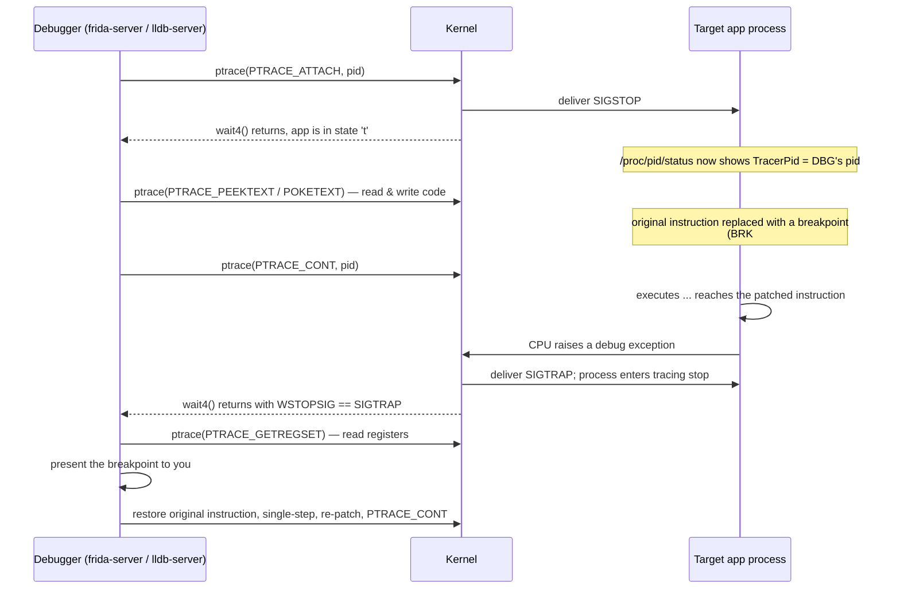

Key facts to hold on to:

1. **A breakpoint is a patched instruction, not a kernel feature.** The debugger overwrites the target instruction with a trap instruction and remembers the original bytes.
2. **`SIGTRAP` is the notification** that the trap fired. If a process installs its own `SIGTRAP` handler, it can detect breakpoints — or use `SIGTRAP` deliberately as anti-debug: execute a `brk` instruction, and if the handler runs, no debugger is attached; if the handler *does not* run, the debugger swallowed it.
3. **Only one tracer at a time.** `ptrace(PTRACE_ATTACH)` fails with `EPERM` if the process is already traced. Anti-debug code exploits this by `ptrace`-ing itself (or forking a child that traces the parent) so that no one else can.
4. **`TracerPid` gives the game away** unless the tracer detaches or the read is hooked.

Common anti-debugging techniques and their Linux basis:

| Technique | Linux mechanism it uses | Typical bypass |
|---|---|---|
| Read `TracerPid` from `/proc/self/status` | procfs | Hook `openat`/`read` in libc; or use non-ptrace injection |
| `ptrace(PTRACE_TRACEME)` on itself | One-tracer-per-process rule | Hook `ptrace` to return 0 without calling it |
| Fork a watchdog child that traces the parent | Same | Kill or neuter the child; hook `fork` |
| Install `SIGTRAP` handler, execute `brk #0` | Signal delivery | Let the handler run; make the debugger pass the signal through |
| Timing checks (`clock_gettime` deltas across a region) | Single-stepping is slow | Hook the clock functions |
| Check `/proc/self/task/*/stat` field 3 for `t` | procfs | Same hooks as `TracerPid` |
| Scan `/proc/self/maps` for `frida-agent` | procfs | Hide/rename the agent; hook the read |
| Connect to TCP 27042 and speak the Frida protocol | Sockets | Run Frida on a non-default port; use `frida-gadget` |

> **🔬 Under the Hood — how `SIGSEGV` becomes a useful artefact**
> When a process touches an invalid address, the CPU raises a page fault, the kernel decides there is no valid mapping, and it delivers `SIGSEGV` with a `siginfo_t` that contains the faulting address (`si_addr`) and a code (`SEGV_MAPERR` — nothing mapped; `SEGV_ACCERR` — mapped but wrong permissions). Android's `debuggerd` catches this via a special handler installed by Bionic in every process, and writes a **tombstone** to `/data/tombstones/`. That tombstone contains registers, the backtrace, the memory around each register, and the mapping list. It is the single richest artefact you get from a native crash, and it is how native vulnerability research on Android starts.
> ```bash
> # adb shell (root)
> ls -lt /data/tombstones/ | head
> cat /data/tombstones/tombstone_00
> ```

---

### 3.12 Job control

Job control lets one terminal manage several programs. It exists because terminals were scarce and multitasking was not.

| Command / key | Effect |
|---|---|
| `cmd &` | Start `cmd` in the background |
| Ctrl-Z | Send `SIGTSTP` — suspend the foreground job |
| `jobs` | List this shell's jobs |
| `fg %1` | Bring job 1 to the foreground |
| `bg %1` | Resume job 1 in the background |
| Ctrl-C | Send `SIGINT` to the foreground process group |
| `disown %1` | Detach job 1 from the shell so it survives shell exit |
| `nohup cmd &` | Ignore `SIGHUP`, so it survives terminal loss |
| `wait` | Block until background jobs finish |

> **📖 Definition — Process group and session**
> Processes are organised into **process groups** (all the processes in one pipeline) and groups into **sessions** (everything started from one login/terminal). The terminal has one *foreground* process group; keyboard signals like Ctrl-C go to every process in it. A process that calls `setsid()` leaves the session entirely and becomes a daemon with no controlling terminal.

> **🔍 Pentester's Note**
> This is exactly how you keep `frida-server` alive after `adb shell` exits:
> ```bash
> # adb shell (root)
> nohup /data/local/tmp/frida-server >/dev/null 2>&1 &
> ```
> Without `nohup` (or `setsid`), closing the shell sends `SIGHUP` to the process group and the server dies. Half the "frida-server keeps stopping" questions on the internet are this.

---

### 3.13 Standard streams, redirection, and pipes

#### The three streams

Every process starts with three file descriptors already open:

| FD | Name | Default | Purpose |
|---|---|---|---|
| 0 | `stdin` | Keyboard / terminal | Input |
| 1 | `stdout` | Terminal | Normal output |
| 2 | `stderr` | Terminal | Errors and diagnostics |

The separation of 1 and 2 is deliberate: you can capture a program's results while still seeing its complaints, or vice versa.

#### Redirection

| Syntax | Effect |
|---|---|
| `cmd > file` | stdout to `file`, truncating it |
| `cmd >> file` | stdout appended to `file` |
| `cmd 2> file` | stderr to `file` |
| `cmd > file 2>&1` | stdout to `file`, then stderr to wherever stdout now points |
| `cmd &> file` | Both (Bash; **not portable to mksh**) |
| `cmd < file` | `file` becomes stdin |
| `cmd << EOF ... EOF` | Here-document: the inline text becomes stdin |
| `cmd <<< "text"` | Here-string (Bash) |
| `cmd 2>/dev/null` | Discard errors |
| `cmd >/dev/null 2>&1` | Discard everything |

> **⚠️ Warning — order matters**
> `cmd > file 2>&1` sends both streams to `file`. `cmd 2>&1 > file` sends stderr to the *terminal* (where stdout pointed at that moment) and only stdout to the file. The redirections are applied left to right, and `2>&1` means "make fd 2 a duplicate of whatever fd 1 is **right now**".

> **🔬 Under the Hood**
> Redirection is implemented with `open()` and `dup2()` between `fork()` and `execve()`. The shell opens `file`, gets (say) fd 5, calls `dup2(5, 1)` which closes fd 1 and makes it a copy of fd 5, closes 5, then execs. The new program writes to fd 1 exactly as always and has no idea it is a file. That indifference — a program cannot tell a file from a pipe from a terminal without asking `isatty()` — is the whole reason UNIX composition works.

#### Pipes

```bash
# adb shell — connect one program's stdout to the next one's stdin
ps -A | grep com.example | awk '{print $2}' | xargs -r -n1 echo pid:
```

> **📖 Definition — Pipe**
> An in-kernel FIFO buffer (64 KiB by default on Linux) with a read end and a write end, created by the `pipe()` syscall which returns two file descriptors. The writer blocks when the buffer is full; the reader blocks when it is empty. When the last writer closes, the reader sees end-of-file. When the last reader closes, the writer gets `SIGPIPE`.

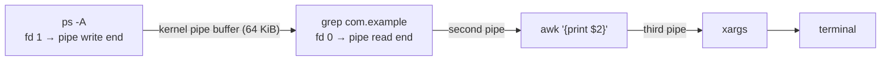

All four processes run **concurrently**, not one after another. `grep` starts consuming as soon as `ps` produces. That is why `| head -1` on a huge command finishes instantly: `head` exits after one line, the next write gets `SIGPIPE`, and the producer dies.

Related operators:

| Operator | Meaning |
|---|---|
| `a \| b` | stdout of `a` into stdin of `b` |
| `a \|& b` | stdout **and** stderr into `b` (Bash) |
| `a && b` | Run `b` only if `a` exited 0 |
| `a \|\| b` | Run `b` only if `a` exited non-zero |
| `a ; b` | Run `b` regardless |
| `$(a)` | Substitute `a`'s output into the command line |
| `tee f` | Copy stdin to stdout **and** to file `f` |

---
### 3.14 Inter-process communication

Processes are isolated by design. IPC is the set of controlled holes in that isolation. Every hole is an attack surface, which is why this section maps directly onto [24 — IPC](../24-IPC/README.md) and [25 — Binder](../25-Binder/README.md).

#### The classic UNIX mechanisms

| Mechanism | Created by | Namespace | Direction | Notes |
|---|---|---|---|---|
| **Anonymous pipe** | `pipe()` | None (inherited fds) | One-way | Only between related processes |
| **FIFO (named pipe)** | `mkfifo()` | Filesystem path | One-way | Unrelated processes; permissions are file permissions |
| **UNIX domain socket** | `socket(AF_UNIX)` | Filesystem path or abstract | Two-way | Can pass **file descriptors** and credentials |
| **System V shared memory** | `shmget()` | IPC key | Shared memory | Fastest; no synchronisation included |
| **POSIX shared memory** | `shm_open()` + `mmap()` | `/dev/shm` path | Shared memory | Cleaner API |
| **System V message queue** | `msgget()` | IPC key | Typed messages | Rare in modern code |
| **POSIX message queue** | `mq_open()` | `/dev/mqueue` path | Typed messages | Priorities, blocking |
| **Semaphore** | `semget()` / `sem_open()` | IPC key or path | Synchronisation only | |
| **Signal** | `kill()` | PID | Notification only | Carries almost no data |
| **Memory-mapped file** | `mmap(MAP_SHARED)` | Filesystem path | Shared memory | Backed by a file |
| **Network socket** | `socket(AF_INET)` | IP:port | Two-way | Works across machines |
| **eventfd / futex** | `eventfd()`, `futex()` | fd / address | Notification / locking | Building blocks for higher layers |

#### FIFOs by example

```bash
# adb shell — a named pipe is a file you can see
mkfifo /data/local/tmp/mypipe
ls -l /data/local/tmp/mypipe
# prw-rw-rw- 1 shell shell 0 ... mypipe     ← the leading 'p'

# Terminal A (blocks until a writer appears)
cat < /data/local/tmp/mypipe

# Terminal B
echo "hello" > /data/local/tmp/mypipe
```

Because a FIFO is a filesystem object, its **permission bits decide who may talk to whom**. A world-writable FIFO in a shared directory is a message-injection channel, and it is exactly the sort of thing that turns up in apps that bundle a native daemon.

#### UNIX domain sockets — the one Android actually uses

UNIX domain sockets are bidirectional, reliable, and can carry two things ordinary pipes cannot:

1. **File descriptors**, via `SCM_RIGHTS` ancillary data. Passing an fd hands the receiver the *kernel object*, not a path — so the receiver can access something it could never have opened itself. This is the foundation of Binder's fd passing and of how `installd` and Zygote hand resources around.
2. **Peer credentials**, via `SO_PEERCRED` / `SCM_CREDENTIALS`. The kernel vouches for the connecting process's PID, UID and GID. This is unforgeable and is the basis of most native daemon authorisation on Android.

```bash
# adb shell — Android's native IPC endpoints
ls -l /dev/socket/
# srw-rw---- 1 root  system  ... installd
# srw-rw---- 1 root  system  ... netd
# srw-rw---- 1 root  system  ... vold
# srw-rw-rw- 1 root  root    ... zygote
# srw-rw---- 1 root  system  ... property_service
```

Note the modes. `installd` is `srw-rw----  root:system` — only root and members of the `system` group may connect. That single mode string is the entire authorisation policy for a daemon that can create and delete any app's data directory, and it is backed up by SELinux rules on the socket's label.

> **📖 Definition — Abstract socket namespace**
> A Linux extension where a UNIX socket's name begins with a NUL byte and lives in a namespace with **no filesystem presence and therefore no permission bits**. Anything in the same network namespace can connect. Android uses abstract sockets in several places, and they show up in `/proc/net/unix` with a leading `@`.
> ```bash
> # adb shell
> cat /proc/net/unix | grep '@'
> ```
> Because there are no permission bits, authorisation for an abstract socket must come from `SO_PEERCRED` checks or SELinux. A daemon that uses an abstract socket and does **not** check peer credentials is trivially reachable, and this has been a recurring Android vulnerability pattern in vendor code.

#### Shared memory: from ashmem to memfd

Copying data between processes costs CPU and memory. Shared memory maps the same physical pages into two address spaces.

| Mechanism | Era | Notes |
|---|---|---|
| System V `shmget` | Classic UNIX | Largely absent from Android; the API exists in Bionic but the platform does not use it |
| **ashmem** (`/dev/ashmem`) | Android 1.0 – 10ish | Anonymous Shared Memory. Kernel driver; regions are referenced by file descriptor and can be *purged* under memory pressure. Used by `MemoryFile`, Binder buffers, SurfaceFlinger. |
| **memfd** (`memfd_create()`) | Android 11+ / kernel 3.17+ | Upstream Linux replacement. Anonymous memory with an fd, plus **seals** (`F_SEAL_WRITE`, `F_SEAL_SHRINK`, `F_SEAL_GROW`) that make the region immutable. Android migrated to it because it is upstream and sealable. |
| `mmap(MAP_SHARED)` on a file | Always | The generic mechanism. |

> **🔬 Under the Hood — why seals matter for security**
> The classic shared-memory attack is a TOCTOU: process A validates the contents of a shared buffer, then uses them; process B mutates the buffer in between. `memfd` seals let the *producer* declare "this region can never be written again", so the consumer can validate once and trust the result. Any Android IPC design that shares a buffer without sealing it and then validates its contents is suspect, and this is a productive place to look when auditing vendor HALs and media parsers.

#### How Android replaces most of this with Binder

Android could have used pipes and sockets for everything. It did not, because the framework needs something with different properties: object references that survive process boundaries, synchronous method calls with return values, automatic thread pooling, death notification, and above all **trustworthy caller identity**.

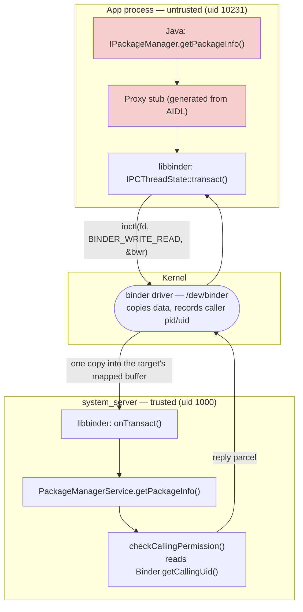

The security-critical property is in the middle box: **the kernel binder driver stamps every transaction with the sending process's real PID and UID, and the receiver reads them from the kernel, not from the message.** A caller cannot lie about who it is. Contrast that with a network socket, where identity must be established by an application-level protocol.

| Property | Pipes / sockets | Binder |
|---|---|---|
| Caller identity | `SO_PEERCRED` on UNIX sockets only | Always, via `Binder.getCallingUid()`/`getCallingPid()` |
| Data copies | Two (writer→kernel→reader) | One (kernel writes into the receiver's pre-mapped buffer) |
| Object references | None; you invent a protocol | First-class remote object references with reference counting |
| Death notification | Poll or EOF | `linkToDeath()` callback |
| Threading | You build it | Kernel-managed thread pool per process |
| Size limit | Stream-based, unbounded | ~1 MiB shared transaction buffer per process (`TransactionTooLargeException`) |
| Attack surface | Whatever you wrote | AIDL interfaces, parcel deserialisation, permission checks |

> **⚠️ Warning**
> `Binder.getCallingUid()` returns *your own* UID when you are being called re-entrantly on the same thread, or after `clearCallingIdentity()`. The classic system-service bug is calling `clearCallingIdentity()` to do privileged work and then performing the permission check afterwards, against the now-cleared identity. Keep this in mind for [25 — Binder](../25-Binder/README.md).

---

### 3.15 Sockets and networking

#### The layers

> **📖 Definition — Socket**
> A kernel object representing one endpoint of a communication channel, exposed to user space as a file descriptor. `socket(domain, type, protocol)` creates one: `AF_INET`/`AF_INET6` for network, `AF_UNIX` for local, `AF_NETLINK` for talking to the kernel, `AF_PACKET` for raw frames.

| Model layer | What lives there | Android relevance |
|---|---|---|
| Link (L2) | Ethernet, Wi-Fi frames, ARP | `AF_PACKET`, needs `CAP_NET_RAW` |
| Internet (L3) | IPv4/IPv6, ICMP, routing | `iptables`/`nftables`, per-UID routing |
| Transport (L4) | TCP (reliable, ordered), UDP (datagram) | `netstat`, port scanning |
| Application (L7) | HTTP, TLS, DNS, gRPC | What you actually intercept in Burp |

#### TCP versus UDP

| Property | TCP | UDP |
|---|---|---|
| Connection | Three-way handshake (SYN, SYN-ACK, ACK) | None |
| Reliability | Retransmits, acknowledges, orders | Fire and forget |
| Flow control | Yes (windowing) | No |
| Overhead | 20-byte header minimum | 8-byte header |
| Used by | HTTP/1.1, HTTP/2, TLS, most app traffic | DNS, QUIC/HTTP-3, RTP, discovery protocols |

> **🔍 Pentester's Note**
> Modern Android apps increasingly use **HTTP/3 over QUIC**, which is UDP. Your interception proxy may only handle TCP, so the app "mysteriously" works while Burp shows nothing. The standard mitigation during testing is to block UDP 443 with an `iptables` rule so the app falls back to TCP:
> ```bash
> # adb shell (root)
> iptables -A OUTPUT -p udp --dport 443 -j REJECT
> ip6tables -A OUTPUT -p udp --dport 443 -j REJECT
> ```
> If traffic still does not appear, the app is probably not using the system proxy at all — see [36 — Certificate Pinning](../36-CertificatePinning/README.md) and [44 — Network Security Config](../44-NetworkSecurityConfig/README.md).

#### Ports

A port is a 16-bit number identifying a service on a host. Ports 0–1023 are "privileged" — binding them historically required root, and on Android requires `CAP_NET_BIND_SERVICE`.

| Port | Service | Android relevance |
|---|---|---|
| 53 | DNS | `netd` resolver; DNS-over-TLS on 853 |
| 80 / 443 | HTTP / HTTPS | The traffic you intercept |
| 5037 | `adb` server (host side) | Your workstation, not the device |
| 5555 | `adbd` over TCP | **Wireless debugging; a serious exposure if left on** |
| 8080 / 8081 | Common proxy ports | Burp, mitmproxy |
| 27042 / 27043 | `frida-server` default | Root-detection code scans for this |
| 23946 | IDA debug server default | Same |

#### Inspecting the network on a device

```bash
# adb shell — modern tool, if present
ss -tulpn

# adb shell — universally available
netstat -tulpn

# adb shell — raw kernel tables, always available, shows the owning UID
cat /proc/net/tcp        # local_address rem_address st ... uid inode
cat /proc/net/tcp6
cat /proc/net/udp
cat /proc/net/unix
```

The addresses in `/proc/net/tcp` are hex and **little-endian per 4-byte group**, which surprises everyone the first time:

```
sl  local_address rem_address   st tx_queue rx_queue ... uid  timeout inode
 0: 0100007F:69A2 00000000:0000 0A ...              ... 2000 0       184213
```

`0100007F` is `7F 00 00 01` reversed, i.e. `127.0.0.1`. `69A2` hex is 27042 decimal — that is `frida-server` listening on localhost, owned by UID 2000 (`shell`). State `0A` is `TCP_LISTEN`. The `inode` column matches the `socket:[184213]` you saw in `/proc/<pid>/fd/`, which is how you map a socket back to a process.

> **🔍 Pentester's Note**
> A hardened app can perform this same read from inside its own process — no root needed, because `/proc/net/tcp` is readable — and refuse to run when it finds a listener on 27042. Running `frida-server -l 127.0.0.1:1337` changes the port; a determined check enumerates all listeners and probes each one with the Frida handshake. This escalating game is covered properly in [67 — Bypassing Protections](../67-BypassingProtections/README.md).

#### `iptables` in one page

Netfilter is the kernel's packet-processing framework; `iptables` is the classic user-space tool for it (`nftables` is the successor, and Android uses both plus eBPF).

| Concept | Meaning |
|---|---|
| Table | A category of processing: `filter` (allow/deny), `nat` (address translation), `mangle` (header edits), `raw` |
| Chain | A hook point: `INPUT`, `OUTPUT`, `FORWARD`, `PREROUTING`, `POSTROUTING` |
| Rule | A match plus a target |
| Target | `ACCEPT`, `DROP`, `REJECT`, `LOG`, `DNAT`, `REDIRECT`, or a user chain |

```bash
# adb shell (root) — see what Android already has (it is a lot: netd builds per-UID rules)
iptables -L -n -v
iptables -t nat -L -n -v

# adb shell (root) — transparent proxy: send all outbound HTTP/HTTPS to your host
iptables -t nat -A OUTPUT -p tcp --dport 80  -j DNAT --to-destination 192.168.1.50:8080
iptables -t nat -A OUTPUT -p tcp --dport 443 -j DNAT --to-destination 192.168.1.50:8080

# adb shell (root) — undo
iptables -t nat -F OUTPUT
```

> **⚠️ Warning**
> Android's `netd` owns the firewall rules and rewrites them when connectivity changes, data saver toggles, or a VPN starts. Rules you add by hand can be silently flushed. If your interception stops working after the screen turns off, check whether your chains still exist before blaming the app.

> **🔬 Under the Hood — per-UID network policy**
> Android implements Data Saver, VPN routing, and per-app network restrictions with per-UID rules (historically `iptables -m owner --uid-owner`, now largely eBPF programs attached to cgroup socket hooks). This is why "which app made this connection" is answerable on Android at all: the kernel tags sockets with the creating UID, and `/proc/net/tcp`'s `uid` column exposes it.

---

### 3.16 Package managers versus Android's PackageManager

#### On desktop Linux

A package manager solves dependency resolution and integrity: it downloads signed archives, checks their signatures against a keyring, resolves what else must be installed, unpacks files into system directories, and records everything so it can be removed cleanly.

| Family | Tool | Package format |
|---|---|---|
| Debian/Ubuntu | `apt`, `dpkg` | `.deb` |
| RHEL/Fedora | `dnf`, `rpm` | `.rpm` |
| Arch | `pacman` | `.pkg.tar.zst` |
| Alpine | `apk` | `.apk` (unrelated to Android) |

```bash
# desktop Linux
sudo apt update && sudo apt install adb apktool
dpkg -L adb          # what files did that package install?
dpkg -S /usr/bin/adb # which package owns this file?
```

#### On Android

There is no system-wide package manager for the OS itself — the OS is updated as signed partition images (or, for mainline components, as APEX modules). Applications are handled by `PackageManagerService` inside `system_server`, with `installd` doing the privileged filesystem work.

| Desktop concept | Android equivalent |
|---|---|
| `.deb` archive | `.apk` (a ZIP) or `.apks`/AAB split set |
| GPG-signed repository | APK signature schemes v1–v4, verified against the previously-installed cert |
| `dpkg` database | `/data/system/packages.xml` |
| `apt install` | `pm install` → `PackageInstaller` → `installd` |
| `/usr/bin` | `/data/app/<random>/<pkg>-<random>/` |
| Dependency resolution | None; APKs are self-contained (plus split APKs and shared libraries) |
| Post-install scripts | None — this is a deliberate security decision |

```bash
# adb shell — the commands you will use constantly
pm list packages -3                 # third-party only
pm list packages -s                 # system only
pm list packages -U -f | grep bank  # with UID and APK path
pm path com.example.app             # → package:/data/app/~~.../base.apk
pm dump com.example.app | head -60  # permissions, components, signatures
pm install -r -t /data/local/tmp/app.apk
pm uninstall --user 0 com.bloat.ware   # remove for one user without root
pm clear com.example.app            # wipe its data — resets the app to first-run state
pm grant com.example.app android.permission.CAMERA
pm revoke com.example.app android.permission.CAMERA
pm disable-user com.example.app
cmd package resolve-activity --brief -a android.intent.action.VIEW -d "myapp://x"
```

> **🔍 Pentester's Note**
> `pm clear` is the fastest way to return an app to a pristine, first-run state between test iterations — far faster than uninstall/reinstall, and it preserves the granted UID and installed splits. `pm grant`/`pm revoke` let you test permission-denied paths without touching the UI, which is where a surprising number of crashes and logic bugs live.

> **⚠️ Warning — the absence of post-install scripts is load-bearing**
> Debian packages run arbitrary root shell scripts at install time. Android APKs cannot. There is no install hook, no `postinst`, no service registration outside the manifest. This eliminates an entire class of supply-chain attack and is a design decision worth being able to articulate in an interview.

---

### 3.17 The text-processing toolkit

Everything on UNIX is text, so text tools are how you do analysis. These eleven are the ones you will actually use on engagements.

#### `grep` — find lines

```bash
# host — the invocations that matter
grep -r "http://" ./sources/                     # recursive
grep -rn "getSharedPreferences" ./sources/       # with line numbers
grep -ri "password" ./sources/ --include="*.java"
grep -rE "(api[_-]?key|secret|token)" ./sources/ # extended regex
grep -rl "Landroid/util/Log" ./smali/            # list matching files only
grep -c "TODO" file.txt                          # count
grep -v "^#" config.txt                          # invert: drop comments
grep -A3 -B3 "onReceive" Receiver.java           # context lines
grep -o "https\?://[^\"' ]*" strings.txt         # print only the match
grep -P "\x00\x01" file                          # PCRE (GNU grep only)
```

| Flag | Meaning |
|---|---|
| `-r` / `-R` | Recurse into directories |
| `-i` | Case-insensitive |
| `-n` | Show line numbers |
| `-l` | Print filenames only |
| `-L` | Print files that do **not** match |
| `-c` | Count matches |
| `-v` | Invert match |
| `-w` | Whole word |
| `-E` | Extended regex (`+`, `?`, `|`, `()` without backslashes) |
| `-F` | Fixed strings, no regex — fast and safe for literal data |
| `-o` | Print only the matched part |
| `-a` | Treat binary files as text |
| `--include`/`--exclude` | Filter by filename glob |

#### `sed` — edit streams

```bash
# host
sed 's/http:/https:/g' file.txt              # substitute, globally per line
sed -i.bak 's/debug/release/g' build.gradle  # edit in place, keep a backup
sed -n '10,20p' file.txt                     # print only lines 10-20
sed '/^$/d' file.txt                         # delete blank lines
sed -n '/BEGIN/,/END/p' log.txt              # print a block between markers
sed 's|/data/app|/system/app|' paths.txt     # alternate delimiter when the data has slashes
```

#### `awk` — column-oriented processing

```bash
# adb shell — awk is in toybox, though a reduced version
ps -A | awk '{print $2, $9}'                       # PID and name
ps -A | awk '$1 ~ /^u0_a/ {print $2}'              # PIDs of app processes
netstat -tuln | awk 'NR>2 {print $4}'              # skip headers
cat /data/system/packages.list | awk '{print $2, $1}' | sort -n   # uid → package
awk -F: '{print $1, $3}' /etc/passwd                # custom field separator
awk '{sum+=$1} END {print sum}' numbers.txt         # accumulate
```

`awk`'s model is: for each input line, evaluate each `pattern { action }` pair. `$0` is the whole line, `$1..$n` the fields, `NF` the field count, `NR` the record number.

#### `find` — locate files by property

```bash
# host
find . -name "*.apk"
find . -type f -name "*.so" -exec file {} \;
find . -type d -name "assets"
find . -size +10M                          # bigger than 10 MB
find . -newer reference.txt                # modified more recently
find . -perm -4000 2>/dev/null             # setuid files — root detection, manually
find . -name "*.java" -print0 | xargs -0 grep -l "Cipher"
```

```bash
# adb shell (root) — the manual root check
find /system /vendor /sbin /data -perm -4000 -type f 2>/dev/null
```

#### `xargs` — turn output into arguments

```bash
# host
find . -name "*.dex" | xargs -n1 basename
find . -name "*.smali" -print0 | xargs -0 grep -l "checkServerTrusted"
cat pids.txt | xargs -I{} adb shell kill -9 {}
seq 1 100 | xargs -P8 -I{} ./probe.sh {}    # 8-way parallelism
```

> **⚠️ Warning**
> Filenames containing spaces or newlines break naive `find | xargs`. Always pair `find -print0` with `xargs -0`. On Android, toybox's `xargs` may lack `-0`; prefer a `while read` loop there.

#### The rest, briefly

| Tool | One-line purpose | Representative use |
|---|---|---|
| `cut` | Slice fields out of lines | `cut -d: -f1 /etc/passwd` |
| `sort` | Order lines | `sort -u`, `sort -n`, `sort -k2` |
| `uniq` | Collapse or count adjacent duplicates | `sort file \| uniq -c \| sort -rn` |
| `tr` | Translate or delete characters | `tr '\0' '\n' < /proc/1/environ` |
| `head`/`tail` | First/last N lines | `tail -f logfile` to follow |
| `wc` | Count lines/words/bytes | `wc -l` |
| `tee` | Split output to a file and onward | `cmd \| tee out.log \| grep ERR` |
| `strings` | Extract printable sequences from binary | `strings -n 8 libnative.so \| grep -i http` |
| `xxd` | Hex dump with ASCII, and reverse | `xxd -l 64 classes.dex` |
| `od` | Octal/hex dump, POSIX-standard | `od -A x -t x1z -v file` |
| `file` | Identify a file by magic bytes | `file base.apk` |
| `diff` | Compare files | `diff -u old.smali new.smali` |
| `base64` | Encode/decode | `base64 -d < token.b64` |
| `sha256sum`/`md5sum` | Hash | Integrity comparison between builds |

Two worked examples you will reuse constantly:

```bash
# host — every URL an app's native library references
strings -n 6 lib/arm64-v8a/libnative.so | grep -Eo 'https?://[^"[:space:]]+' | sort -u
```

```bash
# host — is this file really a DEX? read the magic bytes
xxd -l 16 classes.dex
# 00000000: 6465 780a 3033 3900 ...   "dex\n039\0"  ← DEX format version 039
```

The `dex\n0NN\0` magic is your first checkpoint in [12 — DEX Internals](../12-DEX-Internals/README.md). If those bytes are wrong, the file is packed, encrypted, or not a DEX at all.

---

### 3.18 SSH

> **📖 Definition — SSH (Secure Shell)**
> A protocol (RFC 4251–4254) for running an authenticated, encrypted session on a remote machine. It provides a remote shell, file transfer (`scp`, `sftp`), and arbitrary TCP port forwarding.

```bash
# host
ssh user@10.0.0.5
ssh -p 2222 user@host
ssh -i ~/.ssh/lab_key user@host
ssh-keygen -t ed25519 -C "android-lab"     # generate a key pair
ssh-copy-id user@host                      # install your public key on the server

scp file.apk user@host:/tmp/               # copy to remote
scp user@host:/tmp/dump.bin ./             # copy from remote

ssh -L 8080:127.0.0.1:8080 user@host       # local forward: my 8080 → remote's 8080
ssh -R 9000:127.0.0.1:9000 user@host       # remote forward: their 9000 → my 9000
ssh -D 1080 user@host                      # SOCKS proxy through the remote host
```

Port forwarding is the part that matters for mobile work. When your device, your proxy, and your analysis VM are on three different networks, `ssh -L`/`-R` is how you stitch them together. The conceptual sibling on the device side is `adb forward` and `adb reverse`:

```bash
# host — device port 27042 becomes localhost:27042 on your machine
adb forward tcp:27042 tcp:27042

# host — the device's localhost:8080 reaches YOUR machine's 8080 (for Burp)
adb reverse tcp:8080 tcp:8080
```

> **🔍 Pentester's Note**
> `adb reverse` is the cleanest way to proxy an app when you cannot change the device's Wi-Fi settings, and it survives the device changing networks. Set the app's proxy (or the global one) to `127.0.0.1:8080` and let `adb reverse` carry it to Burp on your host.

---

### 3.19 Environment variables, `LD_PRELOAD`, and `LD_LIBRARY_PATH`

#### What environment variables are

> **📖 Definition — Environment**
> An array of `NAME=value` strings passed to a process at `execve()` time and inherited by its children. It lives in the process's own memory (near the stack) and can be read at `/proc/<pid>/environ`. It is *configuration by inheritance*.

```bash
# adb shell
echo $PATH
env                     # everything
export MYVAR=hello      # set for this shell and its children
MYVAR=hello ./prog      # set for one command only
unset MYVAR
```

| Variable | Meaning |
|---|---|
| `PATH` | Directories searched for commands |
| `HOME` | Home directory (`/data/local/tmp` for `adb shell` on many builds; `/` historically) |
| `LD_LIBRARY_PATH` | Extra directories the dynamic linker searches for shared libraries |
| `LD_PRELOAD` | Libraries loaded **before all others**, whose symbols win |
| `ANDROID_DATA` | `/data` |
| `ANDROID_ROOT` | `/system` |
| `BOOTCLASSPATH` | The JARs ART loads as the boot class path |
| `TMPDIR` | Temporary directory |
| `LANG`/`LC_*` | Locale |

#### The dynamic linker, and why `LD_PRELOAD` is a hooking primitive

When a dynamically-linked program starts, the kernel actually runs the **dynamic linker** (`/apex/com.android.runtime/bin/linker64` on Android, `ld.so` on glibc systems), which maps the program's required shared libraries and resolves its undefined symbols to addresses.

Symbol resolution walks a search order. The first library that defines a symbol wins.

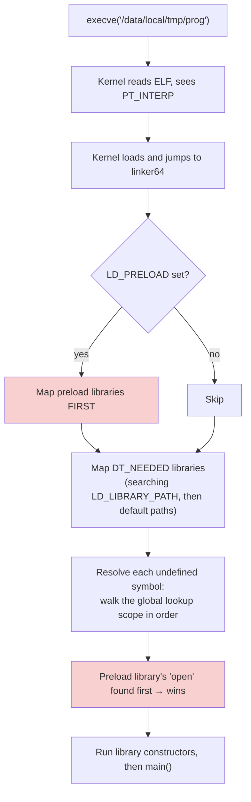

Because the preloaded library is searched first, defining a function with the same name as a libc function *replaces* it for that process. That is function interposition, and it is the simplest hooking technique that exists.

```c
/* hook.c — intercept open() to hide a file.
   Build:  aarch64-linux-android21-clang -shared -fPIC -o libhook.so hook.c -ldl
   Run:    LD_PRELOAD=/data/local/tmp/libhook.so /data/local/tmp/target        */
#define _GNU_SOURCE
#include <dlfcn.h>
#include <string.h>
#include <errno.h>
#include <fcntl.h>
#include <stdarg.h>

static int (*real_open)(const char *, int, ...) = NULL;

int open(const char *path, int flags, ...) {
    if (!real_open) real_open = dlsym(RTLD_NEXT, "open");   /* the *next* open in the chain */
    if (strstr(path, "/su") || strstr(path, "magisk")) {
        errno = ENOENT;      /* pretend it does not exist */
        return -1;
    }
    mode_t mode = 0;
    if (flags & O_CREAT) { va_list ap; va_start(ap, flags); mode = va_arg(ap, int); va_end(ap); }
    return real_open(path, flags, mode);
}
```

`RTLD_NEXT` is the crucial detail: it asks the linker for the *next* definition after this library, which is the real libc one. Without it you get infinite recursion.

> **⚠️ Warning — why `LD_PRELOAD` does not simply work on Android apps**
> Android apps are not `execve()`d; they are **forked from Zygote**, which was started by `init` long before you existed. There is no `execve()` for your environment variable to influence. `LD_PRELOAD` therefore works fine for native binaries you launch yourself from `adb shell`, and not at all for ordinary app processes. Two real ways around it:
> - `setprop wrap.<package_name> "LD_PRELOAD=/data/local/tmp/libhook.so"` — Android's *wrap property* mechanism, intended for debugging, causes Zygote to exec a wrapper for that package. It requires a debuggable app or a userdebug/eng build.
> - Inject the library into the running process instead (`ptrace` + `dlopen`, or Zygisk), which is what Frida and LSPosed do. This is the modern approach and is covered in [65 — Hooking](../65-Hooking/README.md).

> **🔬 Under the Hood — the linker ignores you when it matters**
> The dynamic linker deliberately ignores `LD_PRELOAD` and `LD_LIBRARY_PATH` for **setuid/setgid binaries and processes with elevated capabilities** (the `AT_SECURE` flag in the ELF auxiliary vector). If it did not, `LD_PRELOAD=evil.so su` would be an instant root exploit on every UNIX system ever built. When you find a privileged binary that *does* honour these variables — for instance a vendor daemon started from a shell script that re-exports the environment — you have found a real privilege escalation.

Android also adds **namespace isolation in the linker**: apps cannot `dlopen()` arbitrary platform libraries any more, because the linker enforces per-namespace visibility rules described in `/system/etc/public.libraries.txt` and `ld.config.*.txt`. This is why `System.loadLibrary("android_runtime")` from an app fails on modern Android with a linker namespace error, and it is a defence against a whole class of "load an internal library and call its private functions" attacks.

---

### 3.20 Shell scripting

A script is a text file whose first line names the interpreter.

```bash
#!/system/bin/sh
# device-triage.sh — collect basic device facts.
# Run:  adb push device-triage.sh /data/local/tmp/ && adb shell sh /data/local/tmp/device-triage.sh
set -eu
```

> **📖 Definition — Shebang**
> The two bytes `#!` at the very start of a file, followed by an interpreter path. When the kernel's `execve()` sees them, it runs that interpreter with the script as an argument instead of trying to execute the file as machine code.

#### The constructs you need

```bash
#!/system/bin/sh

# Variables — no spaces around '='
PKG="com.example.app"
COUNT=0

# Command substitution
PID=$(pidof "$PKG")

# Conditionals
if [ -z "$PID" ]; then
    echo "not running"
elif [ -d "/data/data/$PKG" ]; then
    echo "installed but stopped"
else
    echo "unknown"
fi

# Test operators
# -e exists | -f regular file | -d directory | -r readable | -w writable | -x executable
# -z empty string | -n non-empty | = string equal | != not equal
# -eq -ne -lt -le -gt -ge  numeric comparison

# Loops
for p in $(pm list packages -3 | sed 's/^package://'); do
    echo "third-party: $p"
done

i=0
while [ "$i" -lt 5 ]; do
    echo "attempt $i"
    i=$((i + 1))
done

# Reading a file line by line (the safe way)
pm list packages -3 | sed 's/^package://' | while read -r pkg; do
    [ -n "$pkg" ] && echo "$pkg"
done

# Functions
log() { echo "[*] $*"; }
die() { echo "[!] $*" >&2; exit 1; }

# Arguments: $0 script name, $1..$9 positional, $# count, $@ all, $? last exit status
[ $# -ge 1 ] || die "usage: $0 <package>"

# Exit codes
command -v frida-server >/dev/null 2>&1 || log "frida-server not on PATH"
```

#### Safety rules

| Rule | Why |
|---|---|
| Quote every variable: `"$var"` | Prevents word splitting and globbing on values containing spaces or `*` |
| `set -eu` at the top | Exit on any error; error on undefined variables |
| `set -o pipefail` where supported | Makes a pipeline fail if any stage fails (not in strict POSIX `sh`) |
| Use `#!/system/bin/sh` on device | Bash is not there |
| Prefer `[ ]` over `[[ ]]` | `[[ ]]` is a Bash/Ksh extension |
| Never build a command string from untrusted input | Command injection |
| Use `mktemp` for temp files | Avoids predictable-name races in world-writable directories |

> **⚠️ Warning**
> `set -e` has a long list of exceptions (commands in `if` conditions, anything before `&&`/`||`, the non-final stages of a pipeline). Do not treat it as a substitute for checking exit status where it matters.

---

### 3.21 BusyBox and Toybox on Android

Desktop Linux ships GNU coreutils: hundreds of separate binaries, each large, each GPL-licensed. Android needed something small and permissively licensed, and it needed it to fit on a boot ramdisk.

> **📖 Definition — Multi-call binary**
> A single executable that behaves as many different commands, choosing its behaviour from `argv[0]` — the name it was invoked under. The filesystem contains one real binary and many symlinks to it.

```bash
# adb shell — proof
ls -l /system/bin/ls
# lrwxrwxrwx 1 root shell 6 ... /system/bin/ls -> toybox
toybox                 # prints the full list of applets this build supports
toybox --version
```

| | BusyBox | Toybox |
|---|---|---|
| Licence | GPLv2 | BSD (0BSD) |
| Origin | Embedded Linux, 1999 | Started 2006, adopted by AOSP in Android 6 |
| Ships on stock Android | No | **Yes**, as `/system/bin/toybox` |
| Applet count | ~400 | ~250 in AOSP builds |
| Flag flavour | Mostly GNU-compatible | POSIX/BSD-leaning; **many GNU flags are missing** |
| Typical source on a test device | Installed by you or by a root manager | Preinstalled |

Practical consequences you will hit in week one:

| You type | On desktop | On Android (toybox) |
|---|---|---|
| `ls --color=auto` | Works | May be rejected |
| `grep -P` | Works (GNU) | Not supported |
| `sed -i` | Works | Supported in recent toybox, absent in older |
| `find -printf` | Works | Not supported |
| `xargs -0` | Works | Sometimes missing |
| `stat -c '%a %U'` | Works | Different format specifiers |
| `readlink -f` | Works | Usually works |
| `awk` | Full GNU awk | Reduced |

> **🔍 Pentester's Note**
> Push a static BusyBox to `/data/local/tmp/` at the start of an engagement and call it explicitly. It costs ninety seconds and eliminates a whole category of confusing failures:
> ```bash
> # host
> adb push busybox-arm64 /data/local/tmp/busybox
> adb shell chmod 755 /data/local/tmp/busybox
> # adb shell
> /data/local/tmp/busybox find /data -perm -4000 2>/dev/null
> ```
> Do not install BusyBox into `/system` on a test device unless you intend to: it creates exactly the artefacts (`/system/xbin/busybox`, new setuid binaries) that root detection looks for, and it will change your test results.

---

### 3.22 Mount namespaces and bind mounts

This is the theoretical foundation for modern Android root, and the concept that most people skip and then never really understand Magisk.

#### Namespaces in general

> **📖 Definition — Namespace**
> A kernel mechanism that gives a set of processes their own private instance of a global resource. Two processes in different namespaces see different values for the same "global" thing, and neither can tell it is not the only one.

| Namespace | What it virtualises | Android use |
|---|---|---|
| `mnt` | The mount table | **Per-app storage views; Magisk's root hiding** |
| `pid` | Process IDs | Rare on Android; used by some containers |
| `net` | Network interfaces, routing, sockets | VPN implementations, tethering |
| `ipc` | System V IPC and POSIX message queues | Rare |
| `uts` | Hostname and domain name | Rare |
| `user` | UID/GID mappings | Restricted on Android |
| `cgroup` | cgroup hierarchy root | Resource control |
| `time` | Boot and monotonic clock offsets | Newer kernels |

#### Bind mounts

> **📖 Definition — Bind mount**
> A mount that makes an existing directory or file appear at a second path. Both paths refer to the same underlying inode; changes through one are visible through the other. It is not a copy and not a symlink — the kernel's path resolution simply redirects.

```bash
# desktop Linux (root)
mkdir /mnt/copy
mount --bind /etc /mnt/copy
ls /mnt/copy               # shows the contents of /etc
umount /mnt/copy
```

Bind mounting one file over another is the key trick:

```bash
# desktop Linux (root) — replace a single file for anyone who looks
mount --bind /tmp/fake_hosts /etc/hosts
# /etc/hosts on disk is untouched; every open("/etc/hosts") now reaches the fake
umount /etc/hosts
```

Nothing on disk changed. `dm-verity` is satisfied because no block was modified. Only the *view* changed.

#### Mount propagation

When you create a new mount namespace, you must decide whether later mount events propagate between the parent and the child.

| Mode | Behaviour |
|---|---|
| `shared` | Mounts propagate both ways |
| `private` | No propagation in either direction |
| `slave` | Parent → child only |
| `unbindable` | Cannot be bind-mounted |

Magisk relies on making its mounts *private* to a namespace so they are invisible outside it.

#### How Magisk uses all of this

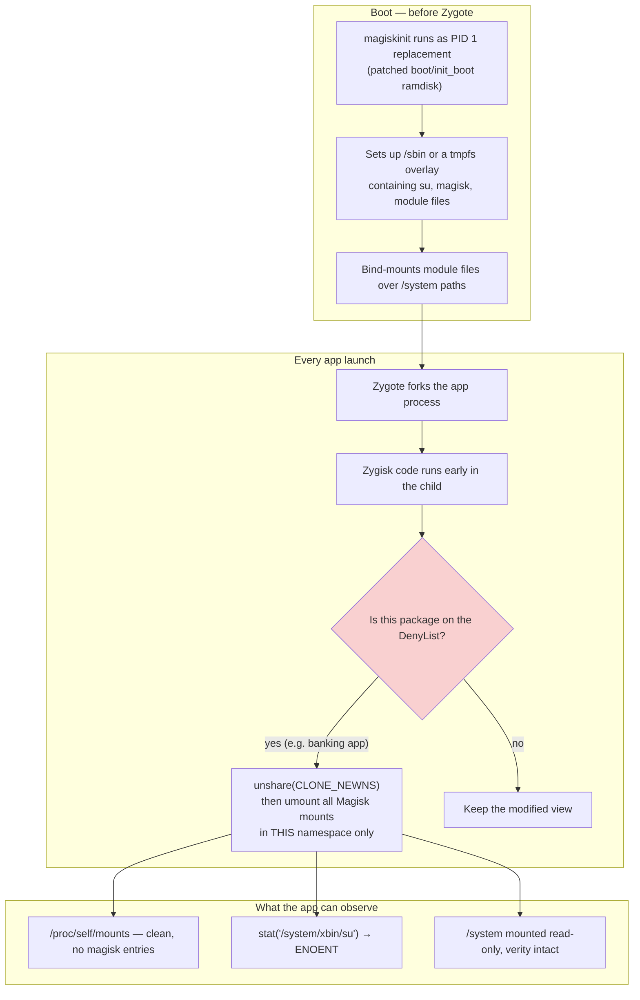

Reading the diagram: Magisk never writes to `/system`. It builds an alternative view using bind mounts, so `dm-verity` and Verified Boot both remain satisfied — this is what "systemless" means. Then, for each app in the DenyList, it creates a fresh mount namespace with `unshare(CLONE_NEWNS)` and *unmounts its own modifications inside that namespace*. The app's `/proc/self/mounts` genuinely does not list them, because `/proc/<pid>/mounts` is rendered per-namespace. The app is not being lied to by a hook; it is being shown a real, clean namespace.

> **🔬 Under the Hood — why `/proc/self/mounts` is namespace-aware**
> Reading `/proc/<pid>/mounts`, `/proc/<pid>/mountinfo` or `/proc/<pid>/mountstats` causes the kernel to walk the **mount namespace of that specific task**, not a global list. This is not a special case for Magisk; it is how mount namespaces are specified to behave. Any detection technique that reads its own mount table is therefore defeated by namespace separation, and the only remaining detections must look elsewhere — at process-level artefacts, at timing, or at attestation from outside the device entirely (Play Integrity, hardware key attestation). That escalation is exactly why [50 — Hardware-Backed Security](../50-HardwareBackedSecurity/README.md) matters.

Useful commands:

```bash
# adb shell (root)
cat /proc/self/mounts | grep -Ei 'magisk|overlay|tmpfs'
cat /proc/1/mounts > /data/local/tmp/init_mounts.txt
cat /proc/$(pidof com.bank.app)/mounts > /data/local/tmp/app_mounts.txt
diff /data/local/tmp/init_mounts.txt /data/local/tmp/app_mounts.txt
# A non-empty diff means the app is living in a different mount namespace.
```

```bash
# adb shell (root) — enter another process's namespaces
nsenter --target 1 --mount --pid -- sh
```

> **🔍 Pentester's Note**
> The `diff` above is itself a detection: an app cannot easily compare its own namespace with `init`'s, because it cannot read `/proc/1/mounts` — but a *researcher* can, which makes it an excellent way to verify that your hiding setup actually works before you blame the app.

---
## 4. Source Code Walkthrough (AOSP)

The point of this section is not to memorise code. It is to know **which file to open** when you need the truth rather than a blog post.

### 4.1 The map of relevant AOSP directories

| AOSP path | What lives there |
|---|---|
| `system/core/` | Historic home of `init`, `libcutils`, `adb`, `logd`, `toolbox` |
| `system/core/libcutils/include/private/android_filesystem_config.h` | **The AID table** — every static UID/GID constant |
| `system/core/init/` | Android's `init`: `.rc` parser, service manager, property service |
| `system/core/rootdir/init.rc` | The base init script: mounts, permissions, early services |
| `system/sepolicy/` | The SELinux policy: `.te` files, `file_contexts`, `seapp_contexts` |
| `system/sepolicy/private/seapp_contexts` | Maps app UID/seinfo → SELinux domain and data file label |
| `bionic/libc/` | Android's C library: syscall stubs, `pthread`, `malloc` |
| `bionic/linker/` | The dynamic linker, including namespace enforcement |
| `external/toybox/` | The multi-call binary providing `ls`, `ps`, `grep`, … |
| `external/mksh/` | `/system/bin/sh` |
| `frameworks/base/services/core/java/com/android/server/pm/` | `PackageManagerService` and friends |
| `frameworks/base/core/java/android/os/Process.java` | The Java-side UID constants and process helpers |
| `frameworks/base/core/jni/` | JNI glue, including `Zygote` native specialisation |
| `frameworks/base/core/java/com/android/internal/os/ZygoteInit.java` | Zygote startup and preloading |
| `frameworks/native/cmds/servicemanager/` | The Binder context manager |
| `frameworks/native/libs/binder/` | `libbinder`, `IPCThreadState`, `Parcel` |
| `system/vold/` | Volume daemon: mounting, FBE key management |
| `frameworks/base/cmds/` | `pm`, `am`, `bmgr`, `content` shell commands |

### 4.2 `android_filesystem_config.h` — where UIDs come from

`system/core/libcutils/include/private/android_filesystem_config.h` is a plain C header of `#define`s. Its shape is:

```c
/* system/core/libcutils/include/private/android_filesystem_config.h  (illustrative excerpt) */
#define AID_ROOT             0  /* traditional unix root user */
#define AID_SYSTEM        1000  /* system server */
#define AID_RADIO         1001  /* telephony subsystem, RIL */
...
#define AID_SHELL         2000  /* adb and debug shell user */
...
#define AID_INET          3003  /* can create AF_INET and AF_INET6 sockets */
...
#define AID_APP_START    10000  /* first app user */
#define AID_APP_END      19999  /* last app user */
#define AID_ISOLATED_START 99000 /* start of uids for fully isolated sandboxed processes */
#define AID_ISOLATED_END   99999
#define AID_USER_OFFSET   100000 /* offset for uid ranges for each user */
```

Two things make this file important beyond documentation:

1. It is consumed by the **build system** to generate the passwd/group tables Bionic uses, so there is no runtime database to tamper with.
2. It is consumed by **`fs_config`** to decide the default owner, group, mode and capability set of every file placed in the read-only partitions. That is why `/system/bin/run-as` has the mode and capabilities it has, without anyone running `chmod` at install time.

The Java mirror of the same constants is `frameworks/base/core/java/android/os/Process.java`:

```java
// frameworks/base/core/java/android/os/Process.java  (illustrative excerpt)
public static final int ROOT_UID = 0;
public static final int SYSTEM_UID = 1000;
public static final int PHONE_UID = 1001;
public static final int SHELL_UID = 2000;
public static final int FIRST_APPLICATION_UID = 10000;
public static final int LAST_APPLICATION_UID = 19999;
public static final int FIRST_ISOLATED_UID = 99000;
public static final int LAST_ISOLATED_UID = 99999;
```

Framework code checks identity by comparing against these constants. A service that wants "system or root only" writes something equivalent to `if (uid != Process.SYSTEM_UID && uid != 0) throw new SecurityException(...)`, and a service that wants "any app" checks `uid >= FIRST_APPLICATION_UID`. When you audit a system service, these comparisons are exactly what you look for — and *missing* comparisons are the finding.

### 4.3 `seapp_contexts` — how a UID becomes an SELinux domain

`system/sepolicy/private/seapp_contexts` is a table of rules that map an application's properties to its SELinux domain and to the label its data files get.

```
# system/sepolicy/private/seapp_contexts  (illustrative excerpt, format simplified)
user=_app  isPrivApp=true  domain=priv_app  type=privapp_data_file  levelFrom=all
user=_app                  domain=untrusted_app  type=app_data_file  levelFrom=all
user=_isolated             domain=isolated_app   levelFrom=user
user=system                domain=system_app     type=system_app_data_file
```

`levelFrom=all` is the mechanism that produces the per-app MLS categories you saw earlier (`s0:c231,c256,c512,c768`). The categories are derived from the app ID and the user ID, so two `untrusted_app` processes have the *same type* but *different categories*, and SELinux's MLS constraints prevent one from reading the other's files. This is the second, independent layer under the sandbox — remove the DAC UID separation and SELinux still holds; remove SELinux and DAC still holds.

### 4.4 Tracing one complete path: `File.exists()` down to the kernel

Take the root-detection check from Section 3.7 and follow it all the way down. This is the kind of trace you should be able to do unaided by the end of this repository.

**Step 1 — Java, `libcore`.**
`java.io.File.exists()` is implemented in `libcore/ojluni/src/main/java/java/io/File.java`, which delegates to the platform filesystem object:

```java
// libcore/ojluni/src/main/java/java/io/File.java  (illustrative)
public boolean exists() {
    SecurityManager security = System.getSecurityManager();   // null on Android
    if (security != null) security.checkRead(path);
    if (isInvalid()) return false;
    return ((fs.getBooleanAttributes(this) & FileSystem.BA_EXISTS) != 0);
}
```

**Step 2 — `UnixFileSystem` to native.**
`libcore/ojluni/src/main/java/java/io/UnixFileSystem.java` declares `getBooleanAttributes0` and, on Android, routes through `Libcore.os` (the `Os` interface) rather than the OpenJDK native method, ending at `android.system.Os.stat()`.

**Step 3 — `libcore`'s `Os` implementation.**
`libcore/luni/src/main/java/libcore/io/Linux.java` declares `public native StructStat stat(String path)`. Its JNI implementation is in `libcore/luni/src/main/native/libcore_io_Linux.cpp`, which converts the Java string and calls the Bionic function:

```cpp
// libcore/luni/src/main/native/libcore_io_Linux.cpp  (illustrative)
static jobject Linux_stat(JNIEnv* env, jobject, jstring javaPath) {
    return doStat(env, javaPath, false /* isLstat */);
}
// doStat() ultimately calls ::stat(path.c_str(), &sb) and throws ErrnoException on failure
```

**Step 4 — Bionic.**
`bionic/libc/bionic/stat.cpp` (and the generated syscall stubs under `bionic/libc/arch-arm64/syscalls/`) turn `stat()` into the `fstatat64`/`newfstatat` syscall. The generated assembly stub is tiny: load the syscall number into `x8`, execute `svc #0`, check for an error return, set `errno`.

**Step 5 — Kernel.**
The kernel's `vfs_statx()` path resolves the path component by component. At each component it calls `may_lookup()`, which enforces execute permission on the directory (DAC) and calls the LSM hook `security_inode_permission()`, which is SELinux. Failure at any point returns `-EACCES` or `-ENOENT`.

**Step 6 — back up the stack.**
`-ENOENT` becomes `errno = ENOENT` in Bionic, an `ErrnoException` in the JNI layer, `false` from `getBooleanAttributes`, and `false` from `File.exists()`.

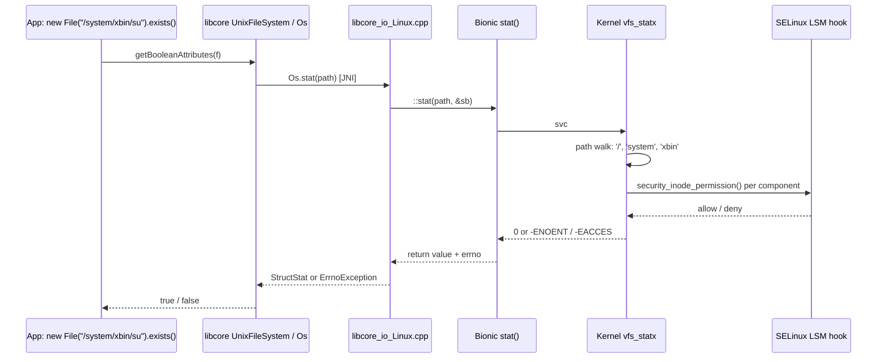

Every one of the six layers is a place you could intervene: hook the Java method (Frida `Java.use`), hook `Os.stat` (also Java), hook the JNI function, hook Bionic's exported `stat`/`__stat` symbol (Frida `Interceptor`), install a seccomp filter, or change what the kernel actually sees by controlling the mount namespace. The choice among them is exactly the skill [65 — Hooking](../65-Hooking/README.md) teaches. Hooking high is easy and easy to detect; hooking low is hard and hard to detect.

### 4.5 `init.rc` — how permissions get set at boot

`system/core/rootdir/init.rc` and the per-device `.rc` files are a domain-specific language interpreted by `init`. A representative service block:

```
# system/core/rootdir/init.rc  (illustrative form)
service vold /system/bin/vold \
        --blkid_context=u:r:blkid:s0 --blkid_untrusted_context=u:r:blkid_untrusted:s0
    class core
    socket vold stream 0660 root mount
    socket cryptd stream 0660 root mount
    ioprio be 2
    shutdown critical
```

Read it as: run this binary, put it in the `core` service class, and create two UNIX domain sockets in `/dev/socket/` with mode `0660`, owner `root`, group `mount`. That `0660 root mount` is the entire DAC authorisation policy for talking to `vold`, and it is declared here rather than in code. When you audit a device's attack surface, `grep -r "socket " ` across its `.rc` files enumerates every native IPC endpoint and who may reach it — a genuinely high-yield ten minutes on an OEM device.

Other `init.rc` directives worth recognising:

| Directive | Meaning |
|---|---|
| `mkdir <path> <mode> <user> <group>` | Create a directory with an explicit mode and owner |
| `chown` / `chmod` | Adjust an existing path |
| `mount <type> <dev> <dir> <flags>` | Mount a filesystem |
| `setprop` / `on property:x=y` | System properties and property triggers |
| `capabilities NET_BIND_SERVICE` | Grant a specific capability instead of root |
| `user` / `group` | Drop to a specific UID/GID |
| `seclabel u:r:foo:s0` | Explicit SELinux domain for the service |
| `writepid /dev/cpuset/...` | Place the process in a cgroup |
| `disabled` / `oneshot` | Start only on demand; do not restart |

> **🔍 Pentester's Note**
> A vendor service declared without `user`/`group` runs as root. A vendor service with `seclabel u:r:vendor_foo:s0` has whatever the vendor's policy grants, which is often far too much. On an engagement that includes device firmware, extracting `/vendor/etc/init/*.rc` and reading every service block is one of the highest-value static analyses you can do.

---

## 5. Security Perspective

### 5.1 How attackers abuse Linux primitives on Android

| Primitive | Abuse |
|---|---|
| World-writable files/directories | Plant content a privileged process will read or execute |
| Symlinks | Redirect a privileged write into a sensitive path |
| `/proc` readability | Enumerate processes, discover other apps, fingerprint the environment |
| `ptrace` | Read and modify another process's memory (requires same UID or root) |
| Signals | Force ANR dumps, kill security daemons, trigger crash-handling paths |
| `LD_PRELOAD` / `LD_LIBRARY_PATH` | Hijack library resolution in processes you can `exec` |
| `PATH` | Hijack command resolution in processes that shell out |
| setuid binaries | Direct privilege escalation if one is writable or exploitable |
| Native sockets in `/dev/socket` | Reach privileged daemons if permissions and SELinux allow |
| Shared memory | TOCTOU on data another process validated |
| Mount namespaces | Present a false filesystem view (also a *defence* technique) |
| Kernel bugs | Direct escalation to UID 0 and SELinux-permissive state |

### 5.2 How developers misuse them

**Making files world-readable.** The single most common Linux-level finding in Android apps:

```java
// WRONG — throws on API 24+, and defeats the sandbox on older targets
SharedPreferences p = getSharedPreferences("auth", Context.MODE_WORLD_READABLE);
```

```java
// RIGHT
SharedPreferences p = getSharedPreferences("auth", Context.MODE_PRIVATE);
// and for anything sensitive, encrypt it with a Keystore-backed key
```

**Shelling out with concatenated input.** Command injection, straight from 1995:

```java
// WRONG — user input reaches the shell's tokeniser
String host = userInput;
Runtime.getRuntime().exec("sh -c ping -c 1 " + host);
// host = "8.8.8.8; cat /data/data/com.victim/f > /sdcard/x"
```

```java
// RIGHT — no shell at all, arguments passed as an array
ProcessBuilder pb = new ProcessBuilder("/system/bin/ping", "-c", "1", host);
// plus: validate `host` against a strict allowlist regex first
```

**`chmod 777` to "fix" a permission problem.** Every occurrence of `chmod 777`, `setReadable(true, false)`, or `setWritable(true, false)` in an app is a deliberate removal of the sandbox for that file. `setReadable(true, false)` — the second argument means "not owner-only" — is the Java API's polite way of saying world-readable.

**Writing secrets to shared storage.** Anything under `/sdcard` (or `getExternalFilesDir()` on older versions) is outside the app sandbox in the ways that matter.

**Trusting `/proc` output for security decisions.** An app that decides "the device is clean" because `/proc/self/mounts` looks normal is trusting data an attacker controls.

**Leaving world-writable native helper directories.** Apps that extract a bundled binary to a writable directory and then execute it create a code-execution primitive for anything that can write there.

### 5.3 Common Linux-level mistakes, tabulated

| Mistake | Consequence | Correct approach |
|---|---|---|
| `MODE_WORLD_READABLE` | Any app reads the file | `MODE_PRIVATE` + Keystore encryption |
| `getCanonicalPath()` omitted | Path traversal, ZipSlip | Canonicalise, then verify the prefix |
| `Runtime.exec()` with a string | Command injection | `ProcessBuilder` with an argument array |
| Predictable temp filenames in `/data/local/tmp` | Symlink/TOCTOU races | `File.createTempFile()` in the app's own directory |
| Executable dropped into a writable dir | Code execution primitive | Ship native code as `.so` in the APK; never `chmod +x` at runtime |
| Secrets in `getExternalFilesDir()` | Readable by other apps/users | Internal storage only |
| Logging tokens with `Log.d` | Any app with `READ_LOGS`, and every crash reporter, sees them | Strip logs in release; never log credentials |
| Relying on `TracerPid` alone for anti-debug | Bypassed in one Frida line | Layered checks plus server-side attestation |
| `sharedUserId` for convenience | Two apps become one sandbox | Explicit, permission-guarded IPC |

### 5.4 Real vulnerability classes and named examples

Only well-documented, real identifiers are listed here. Where a class of issue is meant, the class is named rather than an identifier invented.

| CVE | What it is | Why it matters on Android |
|---|---|---|
| **CVE-2016-5195 ("Dirty COW")** | Race condition in the Linux kernel's copy-on-write handling of private read-only mappings, allowing an unprivileged process to write to read-only memory | Weaponised into universal Android root exploits; readable `/proc/self/mem` plus the race gave arbitrary write to files like `/system/bin/run-as` |
| **CVE-2015-1805** | Linux kernel `pipe` read/write iovec handling flaw | Used in widely-distributed Android rooting tools; a canonical example of a generic Linux bug becoming an Android privilege escalation |
| **CVE-2019-2215** | Use-after-free in the Android binder driver | Reachable from an unprivileged app in some configurations; a reminder that Binder is kernel attack surface, not just an API |
| **CVE-2022-0847 ("Dirty Pipe")** | Linux kernel pipe buffer flag handling flaw allowing overwrite of read-only file page cache | Affected Android devices on kernel 5.8+, notably some 2021–2022 flagships; allowed overwriting files the attacker could only read |
| **CVE-2014-6271 ("Shellshock")** | Bash parsed function definitions from environment variables | Not an Android issue in practice (Android has no Bash) but the canonical lesson in why the environment is untrusted input |

Beyond named CVEs, the recurring *classes* on Android that come straight from this chapter:

- **Symlink-following in privileged file handlers** — backup/restore, log collectors, crash uploaders, OEM diagnostic services.
- **World-writable UNIX sockets exposed by vendor daemons** — reachable from `untrusted_app` when SELinux policy is too permissive.
- **`/proc` information leaks** — before the `hidepid` hardening, cross-app profiling and side channels were routine research results.
- **TOCTOU between `access()` and `open()`** in privileged helpers.
- **Unvalidated `PATH`/environment inheritance in vendor init scripts.**

### 5.5 Bug bounty patterns

| Pattern | Where to look | Typical impact |
|---|---|---|
| ZipSlip in an update/DLC downloader | Any app that unzips downloaded content | Arbitrary file write in the app's sandbox → code execution via `.so` or `.dex` overwrite |
| Exported `FileProvider` with a permissive `<paths>` element | `res/xml/*_paths.xml` declaring `<root-path path="/" />` | Arbitrary file read from the app's data directory |
| Backup enabled with sensitive data | `android:allowBackup="true"` | Extraction of app data via `adb backup` on older API levels |
| World-readable file created by a bundled native binary | Native helper doing `chmod(0666)` | Local secret disclosure |
| Log leakage of tokens | `logcat` during login | Credential theft on devices with a log-reading app |
| Debuggable release build | `android:debuggable="true"` | `run-as` access to the app sandbox on any device |

### 5.6 OWASP MASVS mapping

| MASVS category | Linux-level connection from this chapter |
|---|---|
| **MASVS-STORAGE** | File permissions, internal vs external storage, CE/DE encryption, `/sdcard` visibility |
| **MASVS-PLATFORM** | IPC mechanisms, UNIX sockets, `sharedUserId`, exported components |
| **MASVS-CODE** | Command injection through `Runtime.exec`, unsafe path handling, third-party native binaries |
| **MASVS-RESILIENCE** | Root detection via setuid/`su` paths, `TracerPid` anti-debugging, mount-table inspection, `/proc/self/maps` scanning |
| **MASVS-PRIVACY** | `/proc` information leakage, process enumeration, package visibility |
| **MASVS-CRYPTO** | Where key material ends up on the filesystem |

### 5.7 How a pentester tests all of this

A concrete, ordered checklist you can run on any target:

```bash
# 1. Identity and attack surface
adb shell pm list packages -U | grep <target>
adb shell dumpsys package <pkg> | sed -n '/requested permissions/,/install permissions/p'

# 2. Sandbox contents (debuggable app, no root needed)
adb shell run-as <pkg> ls -laR /data/data/<pkg>

# 3. Permission audit of the sandbox
adb shell run-as <pkg> find . -type f -perm -o+r     # anything world-readable
adb shell run-as <pkg> find . -type f -perm -o+w     # anything world-writable

# 4. Shared storage leakage
adb shell ls -laR /sdcard/Android/data/<pkg> 2>/dev/null
adb shell ls -la /sdcard/ | head -50

# 5. Runtime identity and groups
PID=$(adb shell pidof <pkg>)
adb shell cat /proc/$PID/status | grep -E 'Uid|Gid|Groups|CapEff|Seccomp|TracerPid'

# 6. What is it touching
adb shell run-as <pkg> ls -l /proc/$PID/fd 2>/dev/null

# 7. Network behaviour
adb shell cat /proc/net/tcp /proc/net/tcp6 | awk '{print $2, $3, $8}'

# 8. Native library surface
unzip -l base.apk | grep '\.so$'
strings -n 8 lib/arm64-v8a/*.so | grep -Ei 'http|token|key|/data/'

# 9. Thread state under load
adb shell kill -3 $PID && adb logcat -d | sed -n '/----- pid/,/----- end/p'
```

### 5.8 How malware abuses Linux features

| Behaviour | Linux mechanism |
|---|---|
| Persistence via a native watchdog | `fork()` + `setsid()` daemon that restarts the app package |
| Hiding from `ps` | Setting a benign name with `prctl(PR_SET_NAME)`; overwriting `argv[0]` |
| Anti-analysis | `ptrace(PTRACE_TRACEME)` on itself, `TracerPid` polling, timing checks |
| Dynamic payload loading | `dlopen()` on a downloaded `.so`, or `DexClassLoader` on a downloaded DEX |
| Code hidden from static tools | Payload decrypted into an anonymous `rwx` mapping and executed |
| Command and control | Plain sockets rather than `HttpURLConnection`, to evade framework-level hooks |
| Privilege escalation | Bundled public kernel exploits targeting old, unpatched devices |
| Data theft | Reading `/sdcard`, abusing accessibility services, screen capture |

### 5.9 How forensic analysts investigate

| Artefact | Location | What it tells you |
|---|---|---|
| Installed packages | `/data/system/packages.xml`, `packages.list` | Every package, its UID, permissions, signing certificate, install time |
| APK on disk | `/data/app/<random>/<pkg>-<random>/base.apk` | The actual code, hashable and comparable to Play Store copies |
| App data | `/data/user/<id>/<pkg>/` | Databases, preferences, caches, tokens |
| Shared storage | `/data/media/<id>/` | Photos, downloads, exported files |
| Native crashes | `/data/tombstones/` | Registers, backtraces, mappings at crash time |
| ANR traces | `/data/anr/` | Java thread dumps |
| Logs | `logcat -b all -d`, `/data/misc/logd/` | Runtime behaviour, sometimes credentials |
| Filesystem timestamps | `stat` on any file | Timeline reconstruction (`atime`, `mtime`, `ctime`) |
| Deleted-but-open files | `/proc/<pid>/fd/` | Recoverable content on a live system |
| Mount state | `/proc/mounts` | Evidence of root, overlays, or external tooling |
| ADB authorisation | `/data/misc/adb/adb_keys` | Which hosts were trusted for debugging |

> **⚠️ Warning**
> Forensic work has an ordering rule: collect volatile evidence first. `/proc`, open file descriptors, network state and memory disappear the instant the device reboots or the process dies. Pulling files is easy and can be done later; capturing a live process's `maps`, `fd` and memory cannot.

---

## 6. Reverse Engineering Perspective

Chapter 02 has no bytecode of its own, but Linux concepts show up constantly in decompiled Android code. This section teaches you to *recognise* them.

### 6.1 Linux calls as they appear in JADX output

A root check in Java, decompiled:

```java
// JADX output — recognise the pattern, not the (obfuscated) names
public static boolean a() {
    String[] strArr = {"/system/app/Superuser.apk", "/sbin/su", "/system/bin/su",
                       "/system/xbin/su", "/data/local/xbin/su", "/data/local/bin/su",
                       "/system/sd/xbin/su", "/system/bin/failsafe/su", "/data/local/su",
                       "/su/bin/su"};
    for (String str : strArr) {
        if (new File(str).exists()) {
            return true;
        }
    }
    return false;
}
```

A shell-out, decompiled:

```java
// JADX output — Runtime.exec + BufferedReader is the universal "run a command" shape
public static boolean b() {
    Process process = null;
    try {
        process = Runtime.getRuntime().exec(new String[]{"/system/xbin/which", "su"});
        BufferedReader in = new BufferedReader(new InputStreamReader(process.getInputStream()));
        return in.readLine() != null;
    } catch (Throwable t) {
        return false;
    } finally {
        if (process != null) process.destroy();
    }
}
```

A `/proc` read, decompiled:

```java
// JADX output — reading own status for TracerPid
public static boolean c() {
    try (BufferedReader r = new BufferedReader(new FileReader("/proc/self/status"))) {
        String line;
        while ((line = r.readLine()) != null) {
            if (line.startsWith("TracerPid:")) {
                return Integer.parseInt(line.substring(10).trim()) != 0;
            }
        }
    } catch (Exception ignored) { }
    return false;
}
```

**Recognition heuristics.** Obfuscation renames classes and methods, but it cannot rename `java.io.File`, `Runtime`, `/proc/self/status`, or the string `su`. Look for:

- Arrays of filesystem-path string literals.
- `Runtime.getRuntime().exec` or `ProcessBuilder`.
- `new FileReader("/proc/...")` or `new File("/proc/...")`.
- `System.getenv`, `System.getProperty("os.version")`.
- `android.os.Build.TAGS` compared to `"test-keys"`.

### 6.2 The same code in Smali

```smali
# Smali — File.exists() on a hardcoded path
.method private static hasSu()Z
    .locals 3

    new-instance v0, Ljava/io/File;
    const-string v1, "/system/xbin/su"
    invoke-direct {v0, v1}, Ljava/io/File;-><init>(Ljava/lang/String;)V

    invoke-virtual {v0}, Ljava/io/File;->exists()Z
    move-result v2

    if-eqz v2, :not_found
    const/4 v0, 0x1
    return v0

    :not_found
    const/4 v0, 0x0
    return v0
.end method
```

The patch is mechanical: replace the body with an unconditional false.

```smali
# Smali — patched to always report "no su"
.method private static hasSu()Z
    .locals 1
    const/4 v0, 0x0
    return v0
.end method
```

```smali
# Smali — the TracerPid read, showing the string literal that gives it away
    const-string v0, "/proc/self/status"
    new-instance v1, Ljava/io/FileReader;
    invoke-direct {v1, v0}, Ljava/io/FileReader;-><init>(Ljava/lang/String;)V
    ...
    const-string v3, "TracerPid:"
    invoke-virtual {v2, v3}, Ljava/lang/String;->startsWith(Ljava/lang/String;)Z
```

Whenever you are lost in Smali, `grep` the whole `smali/` tree for the *strings*. Strings survive almost every obfuscator that is not doing string encryption, and they point straight at the logic.

```bash
# host — after apktool d base.apk
grep -rn "/proc/self/status" smali*/ 
grep -rn "/system/xbin/su" smali*/
grep -rn "test-keys" smali*/
grep -rn "Runtime;->exec" smali*/ | head -40
```

### 6.3 In a native library

Native code performing the same checks looks like this in a disassembler or decompiler:

```c
// Ghidra/IDA decompilation of a native root check (cleaned up)
undefined8 check_su(void) {
  int fd;
  char *paths[3];
  paths[0] = "/system/bin/su";
  paths[1] = "/system/xbin/su";
  paths[2] = "/sbin/su";
  for (int i = 0; i < 3; i++) {
    if (access(paths[i], 0) == 0) {   // F_OK
      return 1;
    }
  }
  fd = open("/proc/self/maps", 0);    // O_RDONLY
  ...
}
```

What to look for in an ELF:

```bash
# host
strings -n 6 libnative.so | grep -E '^/(system|sbin|proc|data|apex)/'
readelf --dyn-syms libnative.so | grep -E ' (open|openat|access|stat|ptrace|fork|kill|system|popen)$'
objdump -d libnative.so | grep -E 'bl.*<(access|open|ptrace)@plt>'
```

| Imported symbol | What it implies |
|---|---|
| `access`, `stat`, `open`, `openat` | Filesystem probing (root detection, config reading) |
| `ptrace` | Anti-debugging, or the library *is* a debugger |
| `fork`, `vfork`, `clone` | Watchdog processes, daemonisation |
| `system`, `popen`, `execve` | Shelling out — check what command string is built |
| `prctl` | `PR_SET_DUMPABLE(0)` to block `ptrace`; `PR_SET_NAME` to hide |
| `syscall` | Direct syscall invocation to bypass libc hooks — a strong anti-hooking signal |
| `dlopen`, `dlsym` | Dynamic loading; possibly a packer |
| `mmap` with `PROT_EXEC` | Runtime code generation or unpacking |
| `inotify_init`, `inotify_add_watch` | Watching for tampering with its own files |

> **🔍 Pentester's Note**
> The presence of `syscall()` alongside string constants like `/proc/self/status` is a strong indicator of anti-hooking-aware code: the author is deliberately bypassing `libc`'s exported functions so that a Frida `Interceptor.attach(Module.getExportByName("libc.so", "openat"))` will not see the call. The counter-move is to hook at the syscall boundary itself (Frida's `Stalker`, or a seccomp-based tracer), or to patch the calling code rather than the callee.

### 6.4 What obfuscation does to these patterns

| Obfuscation | Effect on Linux-level checks | Counter |
|---|---|---|
| Identifier renaming (R8/ProGuard) | `checkRoot()` becomes `a()` | Irrelevant — the string literals and API calls are unchanged |
| String encryption | `"/system/xbin/su"` becomes a decrypt call | Hook the decryption routine and log its outputs; or dump strings at runtime |
| Control-flow flattening | One `switch` dispatching many blocks | Trace at runtime; use Frida to log the state variable |
| Native migration | Checks moved from Java into a `.so` | RE the ELF; hook `libc` exports; use `strace` |
| Reflection | `Class.forName("java.io.File")` | Hook `Class.forName` and `Method.invoke` and log |
| Packing | DEX decrypted at runtime | Dump from memory using `/proc/<pid>/maps` |
| Direct syscalls | No `libc` symbol to hook | Hook at the syscall level or patch statically |

---

## 7. Dynamic Analysis

### 7.1 ADB — the essentials

```bash
# host
adb devices -l                      # list devices, with product/model
adb shell                           # interactive shell (uid 2000 normally)
adb -s <serial> shell               # pick a device when several are attached
adb root                            # restart adbd as root (userdebug/eng builds only)
adb remount                         # make /system writable (requires root + verity off)
adb push local.bin /data/local/tmp/
adb pull /data/local/tmp/out.bin ./
adb install -r -t app.apk
adb uninstall com.example.app
adb logcat -c && adb logcat -v time  # clear, then follow with timestamps
adb shell dumpsys package com.example.app
adb shell am start -n com.example.app/.MainActivity
adb shell am start -a android.intent.action.VIEW -d "myapp://path?x=1"
adb forward tcp:27042 tcp:27042
adb reverse tcp:8080 tcp:8080
adb shell screencap -p /sdcard/s.png && adb pull /sdcard/s.png
adb bugreport bug.zip
```

`run-as` deserves special mention because it gives sandbox access with no root at all:

```bash
# adb shell — works if the app is debuggable (android:debuggable="true")
run-as com.example.app
# now you are uid 10231 with cwd = /data/data/com.example.app
ls -la
cat shared_prefs/auth.xml
exit
```

> **🔍 Pentester's Note**
> `run-as` is a small setgid/capability-bearing helper in `/system/bin` that consults `packages.list` and refuses unless the target package is debuggable and the caller is `shell`. It is the intended, supported way to inspect a debuggable app's private data. If a *release* build responds to `run-as`, the app shipped `debuggable="true"` — an immediate, easily-demonstrated finding.

### 7.2 `strace` — watching every syscall

```bash
# adb shell (root) — trace a running process and its threads
strace -f -p $(pidof com.example.app) -s 200 -o /data/local/tmp/trace.txt

# adb shell (root) — only the calls you care about
strace -f -e trace=openat,open,access,stat,readlinkat -p <pid>

# adb shell (root) — network syscalls
strace -f -e trace=network -p <pid>

# adb shell (root) — trace a binary from its very first instruction
strace -f -o /data/local/tmp/t.txt /data/local/tmp/mytool
```

What you get is a transcript like:

```
openat(AT_FDCWD, "/system/xbin/su", O_RDONLY) = -1 ENOENT (No such file or directory)
openat(AT_FDCWD, "/proc/self/status", O_RDONLY|O_CLOEXEC) = 42
read(42, "Name:\tm.example.app\n...TracerPid:\t0\n", 4096) = 1187
```

That is a root check and an anti-debug check, caught with no reverse engineering at all. `strace` is the single fastest way to answer "what is this app actually looking for?"

> **⚠️ Warning**
> `strace` is not on stock Android. Push a static build to `/data/local/tmp/`. It also needs `ptrace` permission, so it needs root for another app's process, and it will set `TracerPid` — which the app can see. If the app dies the moment you attach, that is your answer about whether it has anti-debugging.

### 7.3 Frida — hooking the Linux layer

Frida is covered fully in [53 — Frida](../53-Frida/README.md); here is what it looks like when you target *Linux* primitives rather than app logic.

```javascript
// linux-syscall-trace.js
// What it does: logs every filesystem-probe and process-inspection call the app makes,
//               through Bionic's exported functions.
// Run:  frida -U -f com.example.app -l linux-syscall-trace.js --no-pause

const INTERESTING = /su\b|magisk|superuser|busybox|xposed|frida|\/proc\/|daemonsu|\/sbin\//i;

function hookPathFn(name, pathArgIndex) {
  const addr = Module.findExportByName("libc.so", name);
  if (addr === null) { console.log("[-] no export: " + name); return; }
  Interceptor.attach(addr, {
    onEnter(args) {
      this.path = args[pathArgIndex].readCString();
      this.flag = INTERESTING.test(this.path || "");
    },
    onLeave(retval) {
      if (this.flag) {
        console.log("[" + name + "] " + this.path + "  -> " + retval.toInt32());
        console.log(Thread.backtrace(this.context, Backtracer.ACCURATE)
                          .map(DebugSymbol.fromAddress).join("\n    "));
      }
    }
  });
  console.log("[+] hooked " + name);
}

// openat(dirfd, path, flags) — path is arg 1; open/access/stat take path as arg 0
["open", "access", "stat", "lstat", "__xstat", "readlink", "opendir"]
  .forEach(n => hookPathFn(n, 0));
["openat", "faccessat", "fstatat", "newfstatat", "readlinkat"]
  .forEach(n => hookPathFn(n, 1));

// Also catch the Java layer, which is where most root checks actually live.
Java.perform(function () {
  const File = Java.use("java.io.File");
  File.exists.implementation = function () {
    const p = this.getAbsolutePath();
    const r = this.exists();
    if (INTERESTING.test(p)) console.log("[java File.exists] " + p + " -> " + r);
    return r;
  };
  const Runtime = Java.use("java.lang.Runtime");
  Runtime.exec.overload('[Ljava.lang.String;').implementation = function (cmd) {
    console.log("[Runtime.exec] " + cmd.join(" "));
    return this.exec(cmd);
  };
  Runtime.exec.overload('java.lang.String').implementation = function (cmd) {
    console.log("[Runtime.exec] " + cmd);
    return this.exec(cmd);
  };
});
```

Running this against a hardened app produces a complete inventory of its environment checks in the first two seconds of startup — which is exactly the input you need before you decide *where* to bypass.

### 7.4 Other tools, and when to reach for each

| Tool | Use it when |
|---|---|
| `logcat` | Always running. `adb logcat -v time \| grep -i <pkg>` is the cheapest observability there is. |
| `dumpsys` | You want framework state: `dumpsys package`, `dumpsys activity`, `dumpsys meminfo`, `dumpsys netstats` |
| `lsof` (BusyBox) | Mapping fds to files when `/proc/<pid>/fd` is awkward |
| `tcpdump` | Packet-level truth when Burp shows nothing |
| `ltrace` | Library-call tracing (rarely available on Android; `strace` plus Frida is the practical substitute) |
| `gdbserver`/`lldb-server` | Real native debugging with breakpoints |
| Objection | Fast triage of a Java-heavy app without writing scripts |
| Drozer | Enumerating and exercising exported IPC components |
| MobSF | First-pass static triage; always verify its findings by hand |

```bash
# adb shell (root) — capture traffic on-device
/data/local/tmp/tcpdump -i any -s 0 -w /data/local/tmp/cap.pcap
# host
adb pull /data/local/tmp/cap.pcap && wireshark cap.pcap
```

---

## 8. Static Analysis

### 8.1 Finding Linux-level behaviour in source and decompiled code

```bash
# host — after jadx -d out base.apk
grep -rn "Runtime.getRuntime().exec\|new ProcessBuilder" out/sources/
grep -rn "/proc/" out/sources/
grep -rn "MODE_WORLD_READABLE\|MODE_WORLD_WRITEABLE" out/sources/
grep -rn "setReadable\|setWritable\|setExecutable" out/sources/
grep -rn "getExternalStorage\|getExternalFilesDir\|/sdcard" out/sources/
grep -rn "System.loadLibrary\|System.load(" out/sources/
grep -rn "getCanonicalPath\|getAbsolutePath" out/sources/     # look for the ones that use Absolute for validation
grep -rn "ZipInputStream\|ZipFile\|getNextEntry" out/sources/  # ZipSlip candidates
```

### 8.2 In the manifest

```bash
# host
apktool d base.apk -o out/
grep -E 'debuggable|allowBackup|sharedUserId|usesCleartextTraffic|extractNativeLibs' out/AndroidManifest.xml
```

| Attribute | Why it matters at the Linux level |
|---|---|
| `android:debuggable="true"` | Enables `run-as` (sandbox read as `shell`) and JDWP attach |
| `android:allowBackup="true"` | App data leaves the sandbox via backup transports |
| `android:sharedUserId` | Two packages share a UID and therefore a sandbox |
| `android:process=":name"` | Extra processes with the same UID — more `/proc` entries to inspect |
| `android:isolatedProcess="true"` | Service runs as a 99xxx UID with essentially no permissions |
| `android:extractNativeLibs="false"` | `.so` files are mapped directly from the APK; no copies under `lib/` |
| `android:requestLegacyExternalStorage` | Opts out of scoped storage on API 29 |
| `android:usesCleartextTraffic` | Plain HTTP permitted |

### 8.3 In native libraries

```bash
# host
unzip -o base.apk 'lib/*' -d out/
file out/lib/arm64-v8a/*.so
readelf -d out/lib/arm64-v8a/libnative.so | head -20         # NEEDED entries, RPATH
readelf --dyn-syms out/lib/arm64-v8a/libnative.so | grep FUNC | awk '{print $8}' | sort -u
strings -n 6 out/lib/arm64-v8a/libnative.so | grep -E '^/(system|proc|data|sbin|apex)/'
strings -n 6 out/lib/arm64-v8a/libnative.so | grep -Eo 'https?://[^"[:space:]]+' | sort -u
checksec --file=out/lib/arm64-v8a/libnative.so 2>/dev/null   # RELRO, canaries, NX, PIE
```

### 8.4 In the APK's other contents

```bash
# host
unzip -l base.apk | grep -Ei '\.(sh|so|dex|jar|apk|bin|conf|pem|cer|p12|key)$'
unzip -l base.apk | grep 'assets/'
# bundled shell scripts and helper binaries are a frequent source of injection bugs
unzip -p base.apk assets/setup.sh 2>/dev/null
```

### 8.5 In Gradle and build configuration

```bash
# host — when you have source access
grep -rn "minifyEnabled\|shrinkResources\|debuggable\|buildConfigField" app/build.gradle*
grep -rn "externalNativeBuild\|ndk {" app/build.gradle*
cat app/src/main/res/xml/network_security_config.xml 2>/dev/null
```

---
## 9. Examples

Five worked examples, increasing in difficulty. Runnable versions live in [`examples/`](examples/).

### 9.1 Simple — a device triage script

```bash
#!/system/bin/sh
# 01-device-triage.sh — print the facts you want before touching an app.
# Run: adb push 01-device-triage.sh /data/local/tmp/ && adb shell sh /data/local/tmp/01-device-triage.sh
echo "=== identity ==="
id
echo
echo "=== build ==="
getprop ro.build.version.release
getprop ro.build.version.sdk
getprop ro.product.model
getprop ro.build.tags            # 'release-keys' on production, 'test-keys' is suspicious
getprop ro.debuggable            # 1 means a userdebug/eng build
getprop ro.secure                # 0 means adbd can run as root
echo
echo "=== selinux ==="
getenforce
echo
echo "=== writable mounts ==="
grep -E ' (rw|ro),' /proc/mounts | grep -vE 'tmpfs|proc|sysfs|cgroup' | head -20
echo
echo "=== setuid binaries reachable from here ==="
find /system /vendor /sbin /data/local -perm -4000 -type f 2>/dev/null
echo
echo "=== listening sockets ==="
netstat -tuln 2>/dev/null | head -20
```

Every line answers a question you would otherwise ask three times a day. `ro.build.tags` returning `test-keys` means the build was not signed with production release keys — a classic root/custom-ROM indicator that apps check too. `getenforce` returning `Permissive` means SELinux is not blocking anything, which changes what your tests prove.

### 9.2 Intermediate — enumerate every installed app's UID and data directory

```bash
#!/system/bin/sh
# 02-uid-map.sh — map every third-party package to its UID, appId, user, and data dir.
# Run: adb shell sh /data/local/tmp/02-uid-map.sh
pm list packages -3 -U | sed 's/^package://' | while read -r line; do
    pkg=$(echo "$line" | awk '{print $1}')
    uid=$(echo "$line" | awk -F'uid:' '{print $2}' | tr -d ' ')
    [ -z "$uid" ] && continue
    user=$(( uid / 100000 ))
    appid=$(( uid % 100000 ))
    printf "%-45s uid=%-8s user=%-3s appId=%-6s dir=/data/user/%s/%s\n" \
           "$pkg" "$uid" "$user" "$appid" "$user" "$pkg"
done | sort -t= -k2 -n
```

This turns an abstract concept into something you can see: every app has a distinct number, work-profile apps have numbers above 1000000, and the arithmetic `uid = user * 100000 + appId` holds every time.

### 9.3 Advanced — a C program that prints its own Linux identity

```c
/* 03-whoami.c — print everything the kernel knows about this process's identity.
   Build (NDK):
     $NDK/toolchains/llvm/prebuilt/*/bin/aarch64-linux-android21-clang \
        -static -o whoami 03-whoami.c
   Run:
     adb push whoami /data/local/tmp/ && adb shell chmod 755 /data/local/tmp/whoami
     adb shell /data/local/tmp/whoami                                              */
#include <stdio.h>
#include <unistd.h>
#include <grp.h>
#include <sys/types.h>
#include <sys/prctl.h>
#include <string.h>

static void dump_file(const char *path, const char *prefix) {
    FILE *f = fopen(path, "r");
    if (!f) { printf("%s: <cannot open>\n", prefix); return; }
    char line[512];
    while (fgets(line, sizeof line, f)) {
        if (!prefix || strncmp(line, prefix, strlen(prefix)) == 0) fputs(line, stdout);
    }
    fclose(f);
}

int main(void) {
    printf("pid          = %d\n", getpid());
    printf("ppid         = %d\n", getppid());
    printf("real uid     = %d   effective uid = %d\n", getuid(), geteuid());
    printf("real gid     = %d   effective gid = %d\n", getgid(), getegid());

    gid_t groups[64];
    int n = getgroups(64, groups);
    printf("supplementary groups (%d):", n);
    for (int i = 0; i < n; i++) {
        printf(" %d%s", groups[i], groups[i] == 3003 ? "(inet)" : "");
    }
    printf("\n");

    char name[17] = {0};
    prctl(PR_GET_NAME, name);
    printf("comm         = %s\n", name);

    printf("\n--- /proc/self/status (selected) ---\n");
    dump_file("/proc/self/status", "Uid:");
    dump_file("/proc/self/status", "Gid:");
    dump_file("/proc/self/status", "Groups:");
    dump_file("/proc/self/status", "CapEff:");
    dump_file("/proc/self/status", "Seccomp:");
    dump_file("/proc/self/status", "TracerPid:");

    printf("\n--- SELinux context ---\n");
    dump_file("/proc/self/attr/current", NULL);
    printf("\n");
    return 0;
}
```

Run it from `adb shell` and you get UID 2000 with the `shell` groups. Run the same binary through `run-as` for a debuggable app and you get that app's UID and groups. Same code, different identity — that is the whole sandbox demonstrated in one program.

### 9.4 Real application — recovering an app's data without root

A frequent real-world scenario: the client's app is debuggable in the build you were given, and you need everything in its sandbox.

```bash
#!/usr/bin/env bash
# 04-pull-sandbox.sh — copy a debuggable app's entire private data directory to the host.
# Run: ./04-pull-sandbox.sh com.example.app
set -eu
PKG="${1:?usage: $0 <package>}"
OUT="./${PKG}-sandbox"
mkdir -p "$OUT"

# Prove the app is debuggable before wasting time.
if ! adb shell run-as "$PKG" id >/dev/null 2>&1; then
    echo "[-] $PKG is not debuggable (or not installed). Use root, or a repackaged debug build."
    exit 1
fi
echo "[+] run-as works; app runs as: $(adb shell run-as "$PKG" id)"

# run-as cannot write outside the sandbox, and adb pull cannot read into it,
# so we tar to stdout and capture it on the host. This is the standard trick.
adb exec-out "run-as $PKG tar cf - ." > "$OUT/data.tar"
tar xf "$OUT/data.tar" -C "$OUT"
rm "$OUT/data.tar"

echo "[+] extracted to $OUT"
echo "[*] world-readable files inside the sandbox (potential findings):"
find "$OUT" -type f -perm -o+r -exec ls -l {} \; | head -40
echo "[*] candidate secrets:"
grep -rniE 'token|password|secret|api[_-]?key|authorization' "$OUT" 2>/dev/null | head -40
```

Two techniques worth extracting from this script: `adb exec-out` gives you a clean binary stream with no line-ending translation (unlike `adb shell`), and `tar cf -` piped through it is how you move data across a permission boundary that neither side can cross directly.

### 9.5 Enterprise — a repeatable, auditable device baseline

On a real engagement you must be able to prove what the device state was. This script produces a timestamped evidence bundle.

```bash
#!/usr/bin/env bash
# 05-evidence-baseline.sh — capture a reproducible device baseline for the report appendix.
# Run: ./05-evidence-baseline.sh <engagement-name>
set -euo pipefail
NAME="${1:?usage: $0 <engagement-name>}"
TS="$(date -u +%Y%m%dT%H%M%SZ)"
DIR="evidence/${NAME}/${TS}"
mkdir -p "$DIR"

run() {  # run() <output-file> <adb shell command...>
    local out="$DIR/$1"; shift
    echo "[*] $*"
    adb shell "$@" > "$out" 2>&1 || echo "(command failed)" >> "$out"
}

run 00-getprop.txt        getprop
run 01-id.txt             id
run 02-mounts.txt         cat /proc/mounts
run 03-selinux.txt        getenforce
run 04-packages3.txt      pm list packages -3 -U -f
run 05-packagesS.txt      pm list packages -s -U
run 06-ps.txt             ps -A -o USER,PID,PPID,NAME
run 07-netstat.txt        netstat -tulpn
run 08-net-tcp.txt        cat /proc/net/tcp
run 09-setuid.txt         "find /system /vendor /sbin -perm -4000 -type f 2>/dev/null"
run 10-version.txt        cat /proc/version
run 11-cpuinfo.txt        cat /proc/cpuinfo

adb shell dumpsys package > "$DIR/12-dumpsys-package.txt" 2>&1 || true
adb shell settings list global > "$DIR/13-settings-global.txt" 2>&1 || true
adb shell settings list secure > "$DIR/14-settings-secure.txt" 2>&1 || true

( cd "$DIR" && sha256sum ./* > SHA256SUMS.txt )
echo "[+] baseline captured in $DIR"
echo "[+] hashes in $DIR/SHA256SUMS.txt — include these in the report appendix"
```

The hash manifest is the part that makes this "enterprise": it lets you (and the client, and a court if it ever comes to that) prove the evidence has not changed since collection.

---

## 10. Common Interview Questions

### Beginner

**Q: What is the difference between a shell and a terminal?**
The terminal is the program that displays text and captures keystrokes; the shell is the program that interprets what you type and runs commands. They communicate through a pseudo-terminal device pair provided by the kernel. You can run a shell with no terminal (a script) and a terminal with no shell (running any program directly).

**Q: What does `chmod 755` mean?**
Owner gets read, write and execute (7 = 4+2+1); group and others get read and execute (5 = 4+1). It is the standard mode for an executable or a directory that everyone should be able to enter and list.

**Q: What is the difference between absolute and relative paths?**
An absolute path starts with `/` and is interpreted from the filesystem root, so it means the same thing to every process. A relative path is interpreted from the calling process's current working directory, visible at `/proc/<pid>/cwd`.

**Q: What is `/proc`?**
A virtual filesystem in which the kernel exposes its internal state as files. Nothing there exists on storage; the content is generated when you read it. `/proc/<pid>/` gives per-process information, and there are system-wide entries such as `/proc/version` and `/proc/mounts`.

**Q: What does the pipe operator do?**
It connects the standard output of one process to the standard input of another through an in-kernel buffer. Both processes run concurrently.

### Intermediate

**Q: Explain the difference between a hard link and a symbolic link.**
A hard link is an additional directory entry pointing at the same inode; the file has one set of data and metadata and two names, and the inode's link count reflects that. A symbolic link is a separate file whose contents are a path string that the kernel follows during resolution. Hard links cannot cross filesystems or target directories; symlinks can do both but break if the target is removed. Symlinks matter for security because a privileged writer that does not canonicalise its target can be redirected.

**Q: What happens between `fork()` and `execve()`, and why does it matter on Android?**
The child is an almost-exact duplicate of the parent, so it can adjust its own state before becoming a new program: redirect file descriptors, change UID/GID and supplementary groups, drop capabilities, install a seccomp filter, set the SELinux context, and change the working directory. Android's Zygote does exactly this — it forks and then *specialises*, dropping from root to the app's UID and applying the sandbox, before running app code.

**Q: How does the `INTERNET` permission actually work?**
`PackageManagerService` maps the permission to supplementary GID 3003 (`AID_INET`), and the process is created with that GID in its group list. The kernel's socket-creation path refuses to create `AF_INET`/`AF_INET6` sockets for processes without it, so the failure appears at `socket()` with `EACCES` rather than at connect time. You can confirm it by reading the `Groups:` line of `/proc/<pid>/status`.

**Q: What is a zombie process and how do you get rid of one?**
A process that has exited but whose exit status has not been collected by its parent with `wait()`. You cannot kill a zombie — it is already dead. You either make the parent reap it, or kill the parent, at which point the zombie is re-parented to `init`, which reaps continuously.

**Q: What is `umask` and why does it matter for an Android app?**
A per-process mask of permission bits to remove from newly created files. Zygote sets a restrictive umask so that files an app creates default to owner-only. It is inherited across `fork()` and `execve()`, so native helpers an app spawns get the same protection unless the app deliberately overrides it.

### Senior

**Q: An app's root detection fails to trigger even though the device is rooted with Magisk. Explain the mechanism.**
Magisk does not modify the read-only partitions; it constructs an alternative filesystem view using bind mounts, which leaves `dm-verity` intact. For processes on the DenyList it calls `unshare(CLONE_NEWNS)` early in the forked child and unmounts its own modifications *within that namespace*. Because `/proc/<pid>/mounts` and path resolution are namespace-scoped, the app's own `stat("/system/xbin/su")` genuinely returns `ENOENT` and its own mount table genuinely contains no Magisk entries. Nothing is being faked at the API level; the kernel is telling the truth about a different namespace.

**Q: How would you determine, on a live device, whether a given process is being debugged, without using any tool?**
Read `/proc/<pid>/status` and check `TracerPid`; a non-zero value names the tracing process. Corroborate with the process state in `/proc/<pid>/stat` (`t` indicates a tracing stop) and with `/proc/<pid>/task/*/stat` for individual threads. To find the debugger from the other direction, look for a process holding the target in its `/proc/<pid>/task` wait state, or check `/proc/net/tcp` for a listener on a debug-server port.

**Q: Why does `LD_PRELOAD` not work against a normal Android app, and what are the alternatives?**
Because app processes are forked from Zygote rather than `execve()`d, so there is no exec at which the linker would consult the environment. The alternatives are: the `wrap.<pkg>` system property, which makes Zygote exec a wrapper for a debuggable package; runtime injection with `ptrace` plus `dlopen` (what a classic Frida attach does); or a Zygisk/LSPosed module that runs inside the forked child before app code, which needs no ptrace at all and is therefore harder to detect.

**Q: You have shell access as UID 2000. What can and cannot you do, and why?**
As `shell` you have supplementary groups including `log`, `inet`, `readproc`, `sdcard_rw` and `adb`, and the SELinux domain `shell`. You can enumerate processes and packages, read logs, use `run-as` on debuggable apps, write to `/data/local/tmp`, install and uninstall packages, and grant or revoke runtime permissions. You cannot read another app's private data, cannot `ptrace` another app's process, cannot write to `/system`, and cannot escape the `shell` SELinux domain. Every one of those limits is enforced by two independent layers (DAC and SELinux), which is why a single misconfiguration rarely leads to a full compromise.

**Q: Describe the complete permission check that occurs when an app opens a file.**
Execute permission is required on every directory in the path for traversal; classic owner/group/other bits are then checked against the process's effective UID, effective GID and supplementary groups; SELinux checks that the source domain is allowed the requested operation on the target type; MLS categories are compared so that two `untrusted_app` processes with different per-app categories cannot reach each other's files; and finally any installed seccomp filter must permit the syscall itself. All five must pass, and each fails with a distinguishable symptom.

### Staff Engineer

**Q: Design a detection strategy for an app that must know whether it is running in a modified environment, given that all filesystem-level checks can be defeated by namespace manipulation.**
Layer the checks and accept that on-device detection is only a delay. Locally: check for artefacts that namespace tricks do not remove, such as `/proc/self/maps` entries for injected libraries, unexpected threads, symbol-table inconsistencies in loaded libraries, and timing anomalies. Verify the app's own code integrity from native code with the checks anchored in the most obfuscated component. Then move the real decision off the device: use hardware-backed key attestation to prove the key was generated in a TEE on a device with a verified boot state, and use Play Integrity or an equivalent to obtain a server-verified verdict. The server, not the client, decides whether to allow the sensitive operation. Design the protocol so that a bypassed client cannot simply skip the attestation step — bind the attestation to the session and to the specific transaction.

**Q: A vendor daemon exposes a UNIX socket in `/dev/socket` with mode 0666. Walk through the impact assessment.**
First establish reachability: what SELinux policy applies to that socket's label, and can `untrusted_app` connect? A permissive mode with a restrictive SELinux rule may be unreachable in practice, and vice versa. Then establish what the daemon does with input: does it check `SO_PEERCRED`, does it parse a binary protocol, does it accept file descriptors, does it run as root? Then map the reachable operations to impact — arbitrary file write as root is critical, whereas a read-only status query is informational. Finally, consider whether the socket is reachable from a *remote* attacker through any app that forwards data to it. Report with a concrete proof of concept and the exact `.rc` line that declares the socket.

**Q: How would you build a per-app network monitoring capability on Android, and what are its limits?**
The kernel tags sockets with the creating UID, so `/proc/net/tcp` and the eBPF/cgroup socket hooks Android uses for Data Saver give you per-UID attribution. You can build monitoring by reading those tables periodically, by attaching an eBPF program if you control the kernel, or by using a `VpnService` to capture all traffic at the tunnel interface. Limits: a `VpnService` sees packets but not the process, so you must correlate with `/proc/net/*` by (address, port, inode); apps using `ConnectivityManager.bindProcessToNetwork` or a `Network` object can bypass a VPN in some configurations; QUIC hides more from you than TCP; and any app can see it is behind a VPN and change behaviour.

### Principal Engineer

**Q: Argue for or against the position that Android's use of one Linux UID per app was the correct architectural decision.**
In favour: it reuses a mechanism that is 50 years old, exhaustively reviewed, implemented in the kernel rather than in a framework, and enforced on every filesystem operation with no framework participation required. It fails safe — if the entire Java framework is compromised in a process, that process still cannot read another app's files. It composes with SELinux, with capabilities, and with namespaces without special cases. Against: the UID space is finite (10000–19999 per user), so it constrains the number of installed apps; it forces per-app processes, which costs memory and drove the Zygote design with its own security trade-offs; it makes legitimate data sharing awkward enough that developers reach for `sharedUserId` or shared storage, both of which are worse; and it provides no intra-app compartmentalisation, so a compromised third-party SDK has the full authority of its host app. My assessment is that it was correct and remains correct, because the alternative — enforcement in the framework — would have made every framework bug a sandbox escape, and because the additions since (SELinux MLS categories, seccomp, per-app namespaces, isolated processes) show the model extends well. The intra-app problem is real and is where the next architectural work belongs.

**Q: You are asked to advise a platform team building a new Android-derived OS. Which Linux mechanisms would you require, and which would you forbid?**
Require: mandatory SELinux in enforcing mode with per-app MLS categories from day one, because retrofitting MAC is far harder than starting with it; seccomp filters on every app process with a deny-by-default posture for exotic syscalls; verified boot with rollback protection anchored in hardware; per-app UIDs and no shared UIDs at all, with a documented IPC-based sharing mechanism instead; capability-based privileges for daemons rather than root; mount namespaces for storage views. Forbid: setuid binaries anywhere reachable by apps; any daemon socket without a peer-credential check regardless of its file mode; world-writable directories outside a sticky-bit scratch area; any init script that re-exports the environment to a privileged child; and shell-based service startup, because shell parsing is an injection surface that binary service definitions do not have. I would also require that every service definition state its user, group, capabilities and SELinux label explicitly, and that the build fail if any of those are omitted — defaults are where privilege quietly accumulates.

**Q: What is the strongest argument that on-device root detection is worth implementing at all, given that it is always bypassable?**
It is worth implementing as *friction and telemetry*, never as a security boundary. The honest framing is economic: the population of attackers who will repackage an APK, defeat five layered checks, and maintain that bypass across releases is orders of magnitude smaller than the population who will run a public script. Detection raises the cost of the low end and, more valuably, it *generates signal* — a client that reports an anomalous environment to the server lets you apply risk-based controls (step-up authentication, transaction limits, manual review) where they matter. The failure mode to avoid is treating the client's verdict as authoritative. The correct architecture puts the enforcement decision on the server, informed by client telemetry and by hardware attestation that the client cannot forge, and treats a missing or inconsistent report as itself a signal.

---

## 11. Common Mistakes

### 11.1 Developer mistakes

| Mistake | Why it happens | Fix |
|---|---|---|
| Using `MODE_WORLD_READABLE` | Copied from a pre-2013 tutorial | `MODE_PRIVATE`, plus encryption for anything sensitive |
| `chmod 777` to fix a permission error | It makes the error go away | Find the real owner/group problem; never widen beyond `0700`/`0600` |
| Validating paths with `getAbsolutePath()` | It looks like it normalises | `getCanonicalPath()` and verify the prefix |
| Building shell commands by concatenation | Familiar from other languages | `ProcessBuilder` with an argument array; validate inputs |
| Writing logs or caches to `/sdcard` | Easier to inspect during development | Internal storage; strip debug output from release builds |
| Leaving `android:debuggable="true"` | A debug flavour shipped by mistake | Enforce in CI: fail the build if the release manifest has it |
| `sharedUserId` between two of the company's apps | Convenient data sharing | A permission-guarded `ContentProvider` or bound service |
| Assuming `/sdcard` is private because it needs a permission | Misreading the permission model | Treat shared storage as public |
| Trusting `TracerPid` to be reliable | It works against a naive tester | Layer checks; move the decision server-side |
| Executing a downloaded binary | "It's our own binary" | Ship native code in the APK; never `chmod +x` downloaded content |

### 11.2 Pentester mistakes

| Mistake | Consequence | Better |
|---|---|---|
| Testing on an emulator only | Miss hardware-backed keystore, TEE, and real anti-emulator behaviour | Use both; report which was used for each finding |
| Installing BusyBox into `/system` | Changes the environment you are measuring | Push to `/data/local/tmp` and invoke by absolute path |
| Reporting "app data is readable" from a rooted shell | Root reads everything; it is not a finding by itself | Demonstrate access from *another app's* UID, or from `shell` without root |
| Not clearing state between runs | Irreproducible results | `pm clear <pkg>` between iterations |
| Blaming the app when `iptables` rules were flushed | Wasted hours | Verify your own plumbing first |
| Attaching with `ptrace` to an app with anti-debug | The app dies and you conclude "it crashed" | Spawn with Frida instead of attaching; check for anti-debug first |
| Ignoring SELinux denials | "Permission denied" blamed on file modes | `dmesg \| grep avc` on every unexplained denial |
| Trusting an automated scanner's severity | False positives in the report | Reproduce every finding manually before writing it up |
| Forgetting `adb shell` is UID 2000, not root | Confusing failures | `id` first, always |
| Leaving `frida-server` running after the engagement | Client device left instrumented | Document and remove all tooling; include a teardown checklist |

### 11.3 Reverse engineer mistakes

| Mistake | Consequence | Better |
|---|---|---|
| Assuming GNU flags work on the device | Commands fail confusingly | Check `toybox --help <cmd>`, or push BusyBox |
| Reading `VSZ` as memory usage | Wildly wrong conclusions | Use `PSS` from `dumpsys meminfo` |
| Hooking only the Java layer | Native checks are missed entirely | Hook `libc` exports as well; `strace` to confirm coverage |
| Hooking `libc` when the code uses `syscall()` directly | Hooks never fire | Look for the `syscall` import; hook lower or patch the caller |
| Patching one root check | The app has fifteen | Enumerate all of them first with tracing, then patch systematically |
| Ignoring `/proc/<pid>/maps` on a packed app | Long, unnecessary static RE | Dump the decrypted DEX from memory |
| Believing `strings` found all the strings | Encrypted strings are invisible statically | Hook the decryptor and log at runtime |
| Not checking whether the process is multi-threaded | Race-dependent behaviour looks random | `ps -T`, and inspect `/proc/<pid>/task/` |
| Treating a `SIGSEGV` as "just a crash" | Missed vulnerability | Read the tombstone: `si_addr`, registers, and the faulting mapping |

---

## 12. Hands-on Labs

Full instructions, hints and solutions are in [`labs/`](labs/).

| Lab | Title | Difficulty | You will learn |
|---|---|---|---|
| [01](labs/lab-01-filesystem-and-permissions.md) | Filesystem, permissions and the Android layout | Beginner | Navigate, read `ls -l`, compute octal modes, map the Android partitions |
| [02](labs/lab-02-processes-proc-and-signals.md) | Processes, `/proc` and signals | Intermediate | Read every useful `/proc` entry, use `kill -3`, observe `TracerPid` change live |
| [03](labs/lab-03-ipc-sockets-and-namespaces.md) | IPC, sockets and mount namespaces | Advanced | FIFOs, UNIX sockets, `/proc/net/tcp` decoding, bind mounts, namespace separation |
| [04](labs/lab-04-ctf-the-hidden-flag.md) | CTF: The Hidden Flag | CTF | Chain permissions, `/proc`, symlinks and namespaces to recover a flag |

Each lab states its objective, setup, steps, hints, full solution, and success criteria. Do them in order; lab 04 assumes the first three.

---

## 13. Summary

### 13.1 Key points

- **Android is Linux.** The sandbox is ordinary UNIX file permissions applied to one UID per app, hardened by SELinux, seccomp, capabilities and namespaces.
- **The shell is an ordinary program** that tokenises, expands, redirects and then `fork()`s and `execve()`s. Every stage of that pipeline is an injection surface when attacker data reaches it.
- **Everything is a file**, and a file is an inode with a name attached. Hard links share the inode; symlinks store a path, which is why symlink attacks work.
- **Permissions are twelve bits.** Nine of them are the `rwx` grid; the other three (setuid, setgid, sticky) carry most of the security weight. `x` on a directory means traverse, not read.
- **A setuid binary reachable by an app is an artefact of modification**, which is exactly why root detection looks for `su` on disk — and why namespace-based hiding defeats it.
- **`/proc` is the introspection surface.** `status` (identity, `TracerPid`, capabilities, seccomp), `maps` (loaded libraries and anonymous executable regions), `fd` (open files and sockets), `mounts` (namespace-scoped view), `cmdline` and `environ`.
- **Signals are how UNIX interrupts a process.** `SIGKILL` and `SIGSTOP` cannot be caught; `SIGTRAP` is the debugger's signal; `SIGSEGV` produces the tombstone that native vulnerability research starts from; `kill -3` gives you a free Java thread dump.
- **Android replaces classic IPC with Binder** because Binder gives kernel-attested caller identity, single-copy transfer, object references and death notification. Classic IPC survives in `/dev/socket` daemons, FIFOs and shared memory.
- **`LD_PRELOAD` is the simplest hooking primitive** and does not work on Zygote-forked apps — which is why Frida and Zygisk exist.
- **Mount namespaces plus bind mounts** let a process be shown a different, entirely genuine filesystem view. That is systemless root, and it is why detection must ultimately move off-device.

### 13.2 Chapter mind map

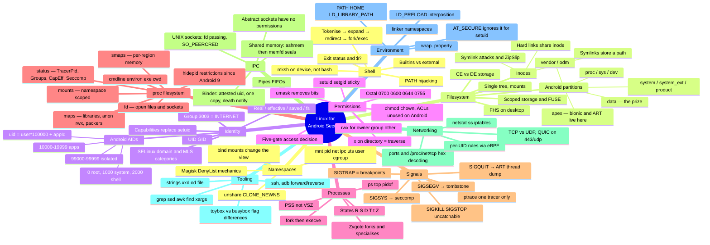

### 13.3 Condensed cheat sheet

| Task | Command |
|---|---|
| Who am I | `id` |
| Find an app's PID | `pidof com.example.app` |
| Its UID and groups | `cat /proc/<pid>/status \| grep -E 'Uid\|Groups'` |
| Is it being debugged | `grep TracerPid /proc/<pid>/status` |
| What libraries are loaded | `cat /proc/<pid>/maps \| grep '\.so'` |
| What files are open | `ls -l /proc/<pid>/fd` |
| Java thread dump | `kill -3 <pid>` then read logcat |
| Package → UID | `pm list packages -U \| grep <name>` |
| APK path | `pm path com.example.app` |
| Reset an app | `pm clear com.example.app` |
| Read a debuggable app's data | `run-as com.example.app ls -la` |
| Listening sockets | `netstat -tulpn` or `cat /proc/net/tcp` |
| Mounted filesystems | `cat /proc/mounts` |
| Find setuid binaries | `find / -perm -4000 -type f 2>/dev/null` |
| SELinux mode | `getenforce` |
| SELinux denials | `dmesg \| grep avc` |
| Trace syscalls | `strace -f -p <pid>` |
| Extract sandbox to host | `adb exec-out "run-as <pkg> tar cf - ." > data.tar` |
| Port forward for Frida | `adb forward tcp:27042 tcp:27042` |
| Proxy device → host Burp | `adb reverse tcp:8080 tcp:8080` |

### 13.4 Quick revision prompts

Answer each in one sentence, out loud, without looking:

1. What are the four UIDs a process has, and which one is used for file permission checks?
2. What does `x` mean on a directory?
3. What is the numeric range of ordinary Android app UIDs, and what is the multi-user offset?
4. Which GID implements the `INTERNET` permission?
5. Which two signals cannot be caught?
6. Which `/proc/<pid>/` file reveals an attached debugger, and on which line?
7. Why does `LD_PRELOAD` not affect a normal Android app?
8. What is the difference between a hard link and a symbolic link?
9. Why does Magisk not simply copy `su` into `/system/xbin`?
10. What does `1777` mean and where do you see it on Android?
11. Name the five checks that must all pass for an app to open a file.
12. What does `kill -3` do to an Android app?
13. Where do Bionic and ART actually live on a modern device?
14. What does a `deleted` suffix in `/proc/<pid>/maps` suggest?
15. What is the difference between CE and DE storage?

---

## 14. References

Full annotated list in [`references/README.md`](references/README.md).

### AOSP source

- `system/core/libcutils/include/private/android_filesystem_config.h` — the authoritative AID table.
- `system/core/init/` — Android's init, its `.rc` language, and property service.
- `system/core/rootdir/init.rc` — base mounts, directory creation and permissions at boot.
- `system/sepolicy/` — SELinux policy sources; `private/seapp_contexts` maps apps to domains.
- `bionic/libc/` — Android's C library and syscall stubs.
- `bionic/linker/` — the dynamic linker, `LD_PRELOAD` handling and namespace enforcement.
- `external/toybox/` — the multi-call binary behind almost every device-side command.
- `external/mksh/` — `/system/bin/sh`.
- `frameworks/base/core/java/android/os/Process.java` — Java-side UID constants.
- `frameworks/base/services/core/java/com/android/server/pm/` — `PackageManagerService`.

### Official documentation

- Android Open Source Project — Security overview, Application sandbox, SELinux concepts.
- Android Developers — Data and file storage overview; Scoped storage; Direct Boot.
- Android Developers — `adb` documentation and shell command reference.
- Linux `man-pages` project — sections 1 (commands), 2 (syscalls), 5 (file formats), 7 (overviews). `man 7 credentials`, `man 7 capabilities`, `man 7 namespaces`, `man 7 signal`, `man 5 proc` are the five most valuable pages for this chapter.

### Standards and specifications

- POSIX.1-2017 (IEEE Std 1003.1) — shell command language and the standard utilities.
- Filesystem Hierarchy Standard 3.0.
- RFC 4251–4254 — the SSH protocol architecture, transport, authentication and connection layers.
- RFC 793 / RFC 9293 — TCP. RFC 768 — UDP. RFC 9000 — QUIC.

### OWASP

- OWASP MASVS — MASVS-STORAGE, MASVS-PLATFORM, MASVS-CODE, MASVS-RESILIENCE, MASVS-PRIVACY.
- OWASP MASTG — the testing guide chapters on Android data storage, platform interaction, and anti-reversing defences.

### Vulnerabilities referenced

- CVE-2016-5195 — "Dirty COW", Linux kernel copy-on-write race enabling write to read-only mappings.
- CVE-2015-1805 — Linux kernel pipe iovec handling flaw, widely used for Android rooting.
- CVE-2019-2215 — use-after-free in the Android binder driver.
- CVE-2022-0847 — "Dirty Pipe", Linux kernel pipe buffer flaw allowing overwrite of read-only page cache.
- CVE-2014-6271 — "Shellshock", Bash environment-variable function parsing.

### Books and long-form reading

- W. Richard Stevens and Stephen A. Rago, *Advanced Programming in the UNIX Environment* — the definitive treatment of processes, signals, and IPC.
- Michael Kerrisk, *The Linux Programming Interface* — the modern equivalent, Linux-specific, exhaustive.
- Nikolay Elenkov, *Android Security Internals* — how the platform builds on these primitives.
- Jonathan Levin, *Android Internals: A Confectioner's Cookbook* — deep coverage of init, Zygote, and the native layer.

### Next chapters

- [03 — Programming Fundamentals](../03-Programming-Fundamentals/README.md) — what a program *is*, before you read any more code.
- [21 — App Sandbox](../21-App-Sandbox/README.md) — the sandbox built on everything here.
- [22 — SELinux](../22-SELinux/README.md) — the second, independent permission layer.
- [24 — IPC](../24-IPC/README.md) and [25 — Binder](../25-Binder/README.md) — where classic UNIX IPC gives way to Binder.
- [37 — Root Detection](../37-RootDetection/README.md) and [62 — Magisk](../62-Magisk/README.md) — the applied form of Sections 3.7 and 3.22.
