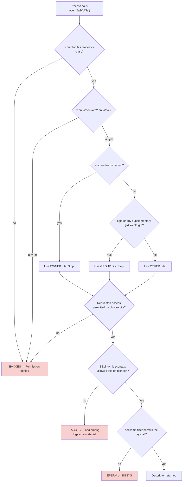

# Lab 01 — Filesystem, Permissions and the Android Layout

> After this lab you will be able to sit down at any Linux machine or Android device, find your way
> around without a graphical file manager, read every field of an `ls -l` line out loud, convert a
> permission string to an octal number and back in your head, and point at the partition on an
> Android device that holds any given kind of data.

**Chapter:** [02 — Linux Basics](../README.md)
**Difficulty:** Beginner — this lab assumes you have never opened a terminal
**Estimated time:** 3 hours, split over two sittings
**Prerequisite:** [01 — Computer Science Basics](../../01-Computer-Science-Basics/README.md), at
least the sections on bits, hex and processes. Nothing else.

---

## Objective

Every Android security finding you will ever write ends in a sentence about a file: *this file was
readable by the wrong process*, *this file was writable when it should not have been*, *this file was
in the wrong partition*, *this file had a bit set that should never be set on a stock device*. Before
you can write that sentence you must be able to look at a file and say precisely who can do what to
it, and why.

That is the entire content of this lab. It is not glamorous and it is the foundation of everything
after it.

By the end you will have:

- Opened a shell, on your own machine and on an Android device, and understood which is which.
- Navigated the filesystem with `pwd`, `cd`, `ls`, and understood absolute versus relative paths.
- Read a full `ls -l` line field by field, naming all nine fields.
- Converted `drwxr-xr-x` to `755` and `0640` to `-rw-r-----` by hand, twenty times, until it is
  automatic.
- Understood why `x` on a directory is not "execute" and what it really allows.
- Created files, watched `umask` silently remove bits from them, and explained why.
- Found every setuid binary on a system and explained what one is and why it matters.
- Created a hard link and a symbolic link and demonstrated the difference with `stat`.
- Walked the Android partition layout and located, on a real device or emulator, the APK of an
  installed app, its private data directory, and the world-writable scratch space you will use for
  the rest of this repository.

> **📖 Definition — Filesystem**
> The organisation the kernel imposes on stored bytes so that they can be named, found, protected and
> changed: a tree of *directories* containing *files*, where every file has an owner, a group, a set
> of permission bits and a type. On Linux there is exactly one tree, rooted at `/`, and storage
> devices are attached into it at chosen points.

---

## Prerequisites

| Requirement | Why | How to check |
|---|---|---|
| A Linux shell on your own machine | Parts A–E. You need a machine you can break | `id` prints a `uid=` line |
| An Android device or emulator with USB debugging enabled | Part F | `adb devices` lists a device |
| `adb` on your `PATH` | Talking to the device | `adb version` prints a version |
| A text editor you are comfortable with | Writing down answers | — |

### If you have never opened a terminal, start here

Pick **one** of the following. WSL is the fastest route on Windows and is what the rest of this lab
assumes when it says "host".

**Windows — WSL 2 (recommended):**

```powershell
# Windows PowerShell, run as Administrator
wsl --install
```

Reboot when prompted. Windows will install Ubuntu, then ask you to choose a username and password.
Afterwards, open the Start menu and launch "Ubuntu". You now have a Linux shell.

**Windows, macOS or Linux — a virtual machine:** install VirtualBox, download an Ubuntu Desktop ISO,
create a VM with 4 GB of RAM and 25 GB of disk, and install it. Slower to set up, more faithful, and
you can take a snapshot before doing anything risky.

**macOS:** the built-in Terminal gives you a UNIX shell, but macOS is not Linux — it has no `/proc`,
and its `ls` and `find` take BSD flags. Use it for orientation only, and run a Linux VM for the lab.

**Android device only, no computer:** install **Termux** from F-Droid (not the Play Store version,
which is unmaintained). You get a shell on the phone. You will be an ordinary app UID, so parts of
Part F will be restricted, but everything in Parts A–E works.

### Safety

> **⚠️ Warning**
> Everything in this lab is read-only or confined to a scratch directory you create yourself. Two
> commands can destroy a system and appear in no step here: `rm -rf /` and `chmod -R 777 /`. If you
> find yourself typing either, stop. Every write in this lab happens inside `~/lab01` on the host or
> `/data/local/tmp/lab01` on the device, and the final step deletes both.
>
> Do this only against devices you own or are explicitly authorised to test.

---

## Setup

### 1. Open a shell and confirm where you are

```bash
# host / WSL
whoami
id
pwd
hostname
```

Expected output, with your own username:

```
harsh
uid=1000(harsh) gid=1000(harsh) groups=1000(harsh),4(adm),27(sudo),...
/home/harsh
DESKTOP-ABC123
```

Read what you just learned. You are user `harsh`, numerically **UID 1000**. You are in the group
`harsh`, numerically GID 1000, and you are additionally a member of `adm` and `sudo`. Your current
directory is `/home/harsh`. Those four facts determine every permission decision the kernel will make
on your behalf for the rest of this session.

### 2. Create a scratch directory

```bash
# host / WSL
mkdir -p ~/lab01
cd ~/lab01
pwd
```

```
/home/harsh/lab01
```

`~` is shorthand the shell expands to your home directory. `mkdir -p` creates the directory and does
not complain if it already exists. Everything you write in this lab goes here.

### 3. Confirm device access (needed for Part F only)

```bash
# host
adb devices -l
adb shell id
adb shell getprop ro.build.version.release
adb shell getprop ro.product.model
```

```
List of devices attached
emulator-5554          device product:sdk_gphone64_arm64 model:sdk_gphone64_arm64

uid=2000(shell) gid=2000(shell) groups=2000(shell),1004(input),1007(log),...
14
sdk_gphone64_arm64
```

If `adb devices` shows `unauthorized`, unlock the phone and accept the RSA fingerprint prompt. If it
shows nothing at all, USB debugging is not enabled: on the device go to Settings, About phone, tap
Build number seven times, then Settings, System, Developer options, and turn on USB debugging.

---

## Steps

### Part A — Navigation: where am I and how do I move

This part is short and you must not skip it. Every later command needs a path, and a wrong path is
the most common reason a command "does not work".

**A1. The three navigation commands.**

```bash
# host / WSL
pwd                 # print working directory — where am I right now
ls                  # list the names in the current directory
cd /                # change directory to the root of the tree
pwd
ls
```

```
/home/harsh/lab01
/
bin  boot  dev  etc  home  lib  media  mnt  opt  proc  root  run  sbin  srv  sys  tmp  usr  var
```

You just moved to the top of the filesystem tree and listed it. Those names are the standard
top-level directories of a Linux distribution.

**A2. Absolute versus relative paths.** This distinction causes more beginner confusion than any
other single thing.

> **📖 Definition — Absolute path**
> A path that starts with `/`. It is interpreted from the root of the tree and means the same thing
> no matter where you are standing. `/home/harsh/lab01/notes.txt`.

> **📖 Definition — Relative path**
> A path that does **not** start with `/`. It is interpreted starting from your current working
> directory. `lab01/notes.txt` means something different depending on where you are.

Two special names exist in every directory:

| Name | Means |
|---|---|
| `.` | This directory |
| `..` | The parent directory |

```bash
# host / WSL — practise until it is boring
cd /home
pwd
cd ..                 # up one level
pwd
cd harsh/lab01        # relative — works because we are in /home
pwd
cd ../..              # up two levels
pwd
cd ~                  # home, wherever that is
pwd
cd -                  # back to the previous directory
pwd
```

```
/home
/
/home/harsh/lab01
/home
/home/harsh
/home/harsh/lab01
```

**A3. Understand the standard directories.** You do not need to memorise these, but you need to stop
being surprised by them.

| Directory | What lives there | Android equivalent |
|---|---|---|
| `/bin`, `/usr/bin` | Commands available to everybody | `/system/bin`, `/system/xbin`, `/apex/*/bin` |
| `/sbin`, `/usr/sbin` | Commands intended for the administrator | Mostly absent; `/system/bin` holds everything |
| `/lib`, `/usr/lib` | Shared libraries | `/system/lib64`, `/apex/com.android.runtime/lib64` |
| `/etc` | System-wide configuration, as text files | `/system/etc`, `/vendor/etc` — much smaller |
| `/home/<user>` | One directory per human user | `/data/data/<package>` — one per **app**, not per human |
| `/root` | The root user's home directory. Nothing magic about it | Usually absent |
| `/var` | Data that changes: logs, spools, caches | Absent; logs go to `logd` ring buffers |
| `/tmp` | Temporary files, world-writable with the sticky bit | `/data/local/tmp` plays this role for the shell user |
| `/dev` | Device nodes | `/dev` — including `/dev/binder` |
| `/proc` | Kernel and process state, generated on demand | `/proc`, identical |
| `/sys` | Kernel device model | `/sys`, identical |
| `/mnt`, `/media` | Mount points for removable storage | `/storage`, `/mnt` |

> **🧠 Mental Model**
> The desktop layout follows the *Filesystem Hierarchy Standard*, which assumes one machine shared by
> several humans. Android's layout assumes one human sharing a machine with several hundred mutually
> distrusting applications. Read the two tables above side by side and the shape of Android's threat
> model is already visible.

**A4. Getting help without leaving the shell.**

```bash
# host / WSL
man ls | head -30       # the manual page — press q to quit, / to search
ls --help | head -20    # the short version, for GNU tools
type cd                 # is this a shell builtin or a program?
type ls
```

```
cd is a shell builtin
ls is aliased to `ls --color=auto'
```

That distinction matters: `cd` cannot be a separate program, because a child process changing its own
directory would not affect your shell. Builtins are executed by the shell itself.

---

### Part B — Reading `ls -l`, field by field

This is the core skill of the lab.

**B1. Produce a line to read.**

```bash
# host / WSL
cd ~/lab01
echo "hello" > notes.txt
mkdir subdir
ls -l
```

```
total 8
-rw-r--r-- 1 harsh harsh    6 Aug  5 12:14 notes.txt
drwxr-xr-x 2 harsh harsh 4096 Aug  5 12:14 subdir
```

**B2. Name all nine fields.** Take the first line apart:

```
-rw-r--r--  1  harsh  harsh  6  Aug  5 12:14  notes.txt
│           │  │      │      │  │             │
│           │  │      │      │  │             └── 7. name
│           │  │      │      │  └──────────────── 6. last modification time (mtime)
│           │  │      │      └─────────────────── 5. size in bytes
│           │  │      └────────────────────────── 4. owning group
│           │  └───────────────────────────────── 3. owning user
│           └──────────────────────────────────── 2. hard link count
└──────────────────────────────────────────────── 1. type and permission bits
```

| # | Field | Value here | What it actually means |
|---|---|---|---|
| 1 | Type + mode | `-rw-r--r--` | Ten characters: one type, then three groups of three permission bits |
| 2 | Link count | `1` | How many directory entries point at this inode. For a directory, how many subdirectories it has plus 2 |
| 3 | Owner | `harsh` | The **UID** that owns it, shown by name. `ls -ln` shows the number |
| 4 | Group | `harsh` | The **GID** that owns it |
| 5 | Size | `6` | Bytes. For a directory, the size of the directory structure itself, not its contents. In `/proc`, always 0 |
| 6 | Timestamp | `Aug 5 12:14` | By default the *modification* time of the contents |
| 7 | Name | `notes.txt` | For a symlink, `name -> target` |

The `total 8` line at the top is the number of disk blocks used by the listed files, not a count of
files. It is almost never useful.

**B3. See the numbers instead of the names.**

```bash
# host / WSL
ls -ln
```

```
-rw-r--r-- 1 1000 1000    6 Aug  5 12:14 notes.txt
drwxr-xr-x 2 1000 1000 4096 Aug  5 12:14 subdir
```

The names came from a lookup table (`/etc/passwd` and `/etc/group` on desktop Linux). The kernel only
ever deals in numbers. On Android the mapping is compiled into the platform rather than stored in a
text file, which is why `/etc/passwd` on a phone is nearly empty and yet `ls -l` still prints
`u0_a231`.

```bash
# host / WSL — where the names come from
grep "^harsh:" /etc/passwd
getent passwd 1000
```

```
harsh:x:1000:1000:Harsh,,,:/home/harsh:/bin/bash
```

The fields are: name, password placeholder, UID, GID, comment, home directory, login shell.

**B4. The type character.** The first of the ten characters is not a permission at all.

| Character | Type | Where you meet it |
|---|---|---|
| `-` | Regular file | Everywhere |
| `d` | Directory | Everywhere |
| `l` | Symbolic link | `/sdcard`, `/proc/<pid>/fd/*`, `/system/bin/sh` |
| `c` | Character device | `/dev/null`, `/dev/binder`, `/dev/urandom` |
| `b` | Block device | `/dev/block/dm-6` — the partitions |
| `s` | UNIX-domain socket | `/dev/socket/*` on Android |
| `p` | Named pipe (FIFO) | Created with `mkfifo`; see Lab 03 |

Prove it:

```bash
# host / WSL
ls -l /dev/null /dev/urandom
ls -ld /tmp
ln -s notes.txt link_to_notes
ls -l link_to_notes
```

```
crw-rw-rw- 1 root root 1, 3 Aug  5 09:00 /dev/null
crw-rw-rw- 1 root root 1, 9 Aug  5 09:00 /dev/urandom
drwxrwxrwt 10 root root 4096 Aug  5 12:20 /tmp
lrwxrwxrwx 1 harsh harsh 9 Aug  5 12:21 link_to_notes -> notes.txt
```

Notice that for the two device files, the size column has been replaced by two numbers `1, 3` — the
major and minor device numbers. The major number selects the driver; the minor selects the device
within it.

**B5. Useful `ls` flags.**

| Flag | Effect | When you need it |
|---|---|---|
| `-l` | Long format | Always |
| `-a` | Include names starting with `.` | Constantly — config files are hidden by convention |
| `-h` | Human-readable sizes (`4.0K`, `1.2M`) | Reading, not scripting |
| `-d` | Show the directory itself, not its contents | `ls -ld /data` — the most-forgotten flag |
| `-i` | Show inode numbers | Proving two names are the same file |
| `-t` | Sort by modification time, newest first | Finding what just changed |
| `-R` | Recurse into subdirectories | Careful: unbounded |
| `-n` | Numeric UID/GID | On Android, when the name is unhelpful |
| `-Z` | Show the SELinux context | Android, constantly |

```bash
# host / WSL — try them
ls -la
ls -lai
ls -lt /etc | head
```

> **🔍 Pentester's Note**
> On Android, `ls -laZ` is the form you want. The `Z` column shows the SELinux label, and a file whose
> classic permissions look fine can still be unreachable — or reachable — because of it. A file
> labelled `u:object_r:app_data_file:s0:c231,c256` carries per-app MLS categories that stop another
> app reading it even if the mode were `0666`.

---

### Part C — Permission arithmetic, by hand

Do this part with a pen. Typing the answers into a computer teaches you nothing; the point is to be
able to do it in your head during a client call.

**C1. The nine bits.**

```
 rwx  rwx  rwx
 │    │    └── other:  everyone who is neither the owner nor in the group
 │    └─────── group:  members of the file's owning group
 └──────────── owner:  the user who owns the file
```

Within each triple, the positions are fixed: read, write, execute. A `-` means off.

| Letter | Value | On a **file** | On a **directory** |
|---|---|---|---|
| `r` | **4** | Read the contents | List the names inside |
| `w` | **2** | Modify the contents | Create, delete, rename entries inside |
| `x` | **1** | Execute it as a program | **Traverse** it — resolve a name through it |
| `-` | 0 | Denied | Denied |

**C2. The single most important row in that table.** `w` on a *directory* is what allows deleting a
file, and `w` on the *file* is irrelevant to that. Deleting `dir/victim` is really removing an entry
from `dir`, which is a modification of `dir`. Demonstrate it:

```bash
# host / WSL
cd ~/lab01
mkdir demo && cd demo
echo secret > readonly.txt
chmod 444 readonly.txt      # r--r--r--, nobody may write the file
ls -l readonly.txt
rm readonly.txt             # rm will ask; answer y
ls
cd ..
```

```
-r--r--r-- 1 harsh harsh 7 Aug  5 12:30 readonly.txt
rm: remove write-protected regular file 'readonly.txt'? y
```

The file was unwritable and you deleted it anyway, because you had `w` on the directory containing
it. `rm` asked for confirmation as a courtesy; the kernel never objected.

This is the whole reason the sticky bit exists — see C7.

**C3. Convert ten permission strings to octal.** Cover the answers. Write yours down first.

| # | Mode string | Your answer |
|---|---|---|
| 1 | `-rw-r--r--` | |
| 2 | `-rwxr-xr-x` | |
| 3 | `drwx------` | |
| 4 | `-rw-------` | |
| 5 | `drwxrwx--x` | |
| 6 | `-r--r-----` | |
| 7 | `drwxr-x---` | |
| 8 | `-rwxrwxrwx` | |
| 9 | `-rw-rw----` | |
| 10 | `dr-xr-xr-x` | |

<details>
<summary>Answers</summary>

1. `644` — owner 4+2=6, group 4, other 4
2. `755` — owner 4+2+1=7, group 4+1=5, other 4+1=5
3. `700`
4. `600`
5. `771` — this is `/data/local/tmp` on Android, roughly
6. `440`
7. `750`
8. `777` — never do this
9. `660`
10. `555`

</details>

**C4. Convert ten octal numbers to strings.** Same rules, run backwards.

| # | Octal | Your answer (assume a regular file unless the number implies a directory) |
|---|---|---|
| 1 | `600` | |
| 2 | `755` | |
| 3 | `640` | |
| 4 | `777` | |
| 5 | `400` | |
| 6 | `751` | |
| 7 | `664` | |
| 8 | `711` | |
| 9 | `000` | |
| 10 | `775` | |

<details>
<summary>Answers</summary>

1. `-rw-------`
2. `-rwxr-xr-x`
3. `-rw-r-----`
4. `-rwxrwxrwx`
5. `-r--------`
6. `-rwxr-x--x`
7. `-rw-rw-r--`
8. `-rwx--x--x`
9. `----------`
10. `-rwxrwxr-x`

</details>

More drills, with the reasoning written out, are in
[`../examples/permission-arithmetic-drill.md`](../examples/permission-arithmetic-drill.md). Do them
until you stop having to think.

**C5. Check yourself against the machine.**

```bash
# host / WSL — stat prints the octal mode and the string side by side
cd ~/lab01
for m in 600 640 644 700 750 755 775 777 000; do
  chmod $m notes.txt
  stat -c '%a  %A  %n' notes.txt
done
chmod 644 notes.txt
```

```
600  -rw-------  notes.txt
640  -rw-r-----  notes.txt
644  -rw-r--r--  notes.txt
700  -rwx------  notes.txt
750  -rwxr-x---  notes.txt
755  -rwxr-xr-x  notes.txt
775  -rwxrwxr-x  notes.txt
777  -rwxrwxrwx  notes.txt
0    ----------  notes.txt
```

Every line is one of your drills, computed by the kernel. If any of your answers disagreed, work out
why before continuing.

**C6. Symbolic mode — the other way to say it.**

```bash
# host / WSL
chmod u+x notes.txt      # add execute for the owner
chmod go-r notes.txt     # remove read for group and other
chmod a=r notes.txt      # set everyone to exactly read
chmod u+rw,go= notes.txt # owner read+write, group and other nothing
stat -c '%a %A' notes.txt
```

| Symbol | Means |
|---|---|
| `u` | owner (user) |
| `g` | group |
| `o` | other |
| `a` | all three |
| `+` | add these bits |
| `-` | remove these bits |
| `=` | set to exactly these bits |

Symbolic mode is safer for interactive use because it changes only what you name. Octal is better in
scripts and in reports because it is unambiguous.

**C7. The three special bits.** Nine bits were never quite enough, so there are twelve. The extra
three live in a fourth octal digit at the front.

| Bit | Octal | Shown as | On a **file** | On a **directory** |
|---|---|---|---|---|
| setuid | `4000` | `s` replacing owner `x` | Run with the **file owner's** effective UID, not the caller's | Ignored on Linux |
| setgid | `2000` | `s` replacing group `x` | Run with the file group's effective GID | New entries inherit the directory's group |
| sticky | `1000` | `t` replacing other `x` | Obsolete | **Only an entry's owner may delete or rename it** |

If the underlying `x` bit is off, the letter is shown in capitals — `S` or `T` — which almost always
signals a mistake.

Look at the two canonical examples on your host:

```bash
# host / WSL
ls -l /usr/bin/passwd
ls -ld /tmp
stat -c '%a %A %U %G %n' /usr/bin/passwd /tmp
```

```
-rwsr-xr-x 1 root root 68208 Nov 24  2022 /usr/bin/passwd
drwxrwxrwt 10 root root 4096 Aug  5 12:35 /tmp
4755 -rwsr-xr-x root root /usr/bin/passwd
1777 drwxrwxrwt root root /tmp
```

`/usr/bin/passwd` is mode `4755`, owned by root. When *you* run it, the process's effective UID
becomes 0, because changing your password requires writing `/etc/shadow`, which only root may write.
The program is trusted to do only that one thing. If it can be made to do anything else — a buffer
overflow, an argument injection, a `PATH` it trusts — the attacker gets root. That is why setuid
binaries are the classic local privilege escalation target.

`/tmp` is mode `1777`: world-writable, so any user can create files there, but sticky, so you can
only delete your **own**. Without the sticky bit, C2 above means any user could delete any other
user's temporary files.

**C8. Find every setuid binary on the host.**

```bash
# host / WSL
find / -perm -4000 -type f 2>/dev/null
```

```
/usr/bin/passwd
/usr/bin/sudo
/usr/bin/su
/usr/bin/chsh
/usr/bin/newgrp
/usr/bin/gpasswd
/usr/bin/mount
/usr/bin/umount
...
```

Two details in that command deserve explanation.

- `-perm -4000` with a **leading minus** means "has at least these bits set". Without the minus,
  `-perm 4000` means "has exactly this mode and nothing else", which matches essentially nothing.
  This is the single most common `find` mistake.
- `2>/dev/null` discards the permission-denied errors from the hundreds of directories you cannot
  read. Run it once without the redirection to see how much noise it removes.

Now the same on the device, which is the actual technique:

```bash
# adb shell
find /system /vendor /product /apex /sbin -perm -4000 -type f 2>/dev/null
```

On a stock, unmodified device this prints **nothing, or one or two known platform binaries**. On a
rooted device you will typically find `/system/xbin/su` or similar. That contrast is the entire
principle behind file-based root detection, developed in
[37 — Root Detection](../../37-RootDetection/README.md).

**C9. Watch `umask` take bits away.**

```bash
# host / WSL
cd ~/lab01
umask
touch defaultfile
mkdir defaultdir
stat -c '%a %n' defaultfile defaultdir
```

```
0022
644 defaultfile
755 defaultdir
```

You did not ask for `644`. The C library asked for `0666` for the file and `0777` for the directory,
and the kernel removed every bit set in your umask of `0022` — that is, write for group and other.

> **📖 Definition — umask**
> A per-process twelve-bit mask of permission bits to **remove** from newly created files. The kernel
> applies `requested_mode & ~umask`. It can only take permissions away, never add them. It is
> inherited across `fork()` and `execve()`.

Change it and watch:

```bash
# host / WSL
umask 077
touch privatefile
mkdir privatedir
stat -c '%a %n' privatefile privatedir
umask 022          # put it back
```

```
600 privatefile
700 privatedir
```

Android's Zygote sets a restrictive umask before an app's code runs, which is exactly why
`openFileOutput(name, MODE_PRIVATE)` produces a `0600` file rather than a `0666` one, and why a
native helper an app spawns inherits the same protection. An app that calls `chmod(0777)` afterwards
has deliberately discarded it.

---

### Part D — Owners, groups and the identity that permissions are checked against

**D1. The rule, stated exactly.** When a process opens a file, the kernel evaluates *one* class, not
all three:

1. If the process's effective UID equals the file's owner UID, the **owner** bits are used. Stop.
2. Otherwise, if the effective GID or any supplementary group equals the file's group GID, the
   **group** bits are used. Stop.
3. Otherwise the **other** bits are used.

The consequence surprises people: a file with mode `0466` (`r--rw-rw-`) is **less** accessible to its
owner than to everyone else. The owner matches rule 1, gets `r--`, and cannot write it — even though
"other" can.

```bash
# host / WSL — prove it
cd ~/lab01
echo test > weird.txt
chmod 466 weird.txt
ls -l weird.txt
echo more >> weird.txt
```

```
-r--rw-rw- 1 harsh harsh 5 Aug  5 12:40 weird.txt
bash: weird.txt: Permission denied
```

You own the file, it is world-writable, and you cannot write it. That is not a bug; it is rule 1.

**D2. Your groups.**

```bash
# host / WSL
id -u; id -g; id -G
groups
```

Supplementary groups are the mechanism Android uses to grant coarse capabilities to apps. The
clearest example is network access:

```bash
# adb shell — pick any app that has the INTERNET permission
PID=$(pidof com.android.chrome)
grep -E '^(Uid|Gid|Groups)' /proc/$PID/status
```

```
Uid:	10231	10231	10231	10231
Gid:	10231	10231	10231	10231
Groups:	3003 9997 20231 50231
```

GID **3003** is `AID_INET`. An app that holds the `INTERNET` manifest permission is placed in group
3003 at process creation; an app that does not, is not. The kernel then enforces network access as an
ordinary group check. There is no runtime dialog and no framework involvement — the `INTERNET`
permission is *literally a Linux group*. The authoritative list is
`system/core/libcutils/include/private/android_filesystem_config.h` in AOSP.

The four numbers on the `Uid:` line are **real, effective, saved-set, filesystem** UID, in that
order. File permission checks use the *filesystem* UID, which on Linux tracks the effective UID
unless explicitly changed. When they differ, something interesting has happened — a setuid binary is
running, or a daemon has dropped privileges partially.

**D3. Change ownership (host only).**

```bash
# host / WSL — needs root, hence sudo
cd ~/lab01
sudo chown root notes.txt
ls -l notes.txt
sudo chown harsh:harsh notes.txt
ls -l notes.txt
```

Only root may give a file away. This is deliberate: on a system with disk quotas, being able to
dump your files onto someone else's quota would be an obvious abuse, and being able to *take*
ownership of someone else's file would be worse.

---

### Part E — Inodes, hard links and symbolic links

**E1. What a name really is.** A directory is a file whose contents are a list of
`(name, inode number)` pairs. The inode holds everything else: type, mode, owner, group, size,
timestamps, link count, and the location of the data. **The name is not part of the file.**

```bash
# host / WSL
cd ~/lab01
echo "original content" > original.txt
ls -li original.txt
```

```
1443109 -rw-r--r-- 1 harsh harsh 17 Aug  5 12:50 original.txt
```

The first number, `1443109`, is the inode number.

**E2. A hard link — a second name for the same inode.**

```bash
# host / WSL
ln original.txt hardlink.txt
ls -li original.txt hardlink.txt
```

```
1443109 -rw-r--r-- 2 harsh harsh 17 Aug  5 12:50 hardlink.txt
1443109 -rw-r--r-- 2 harsh harsh 17 Aug  5 12:50 original.txt
```

Both names show **the same inode number**, and the link count went from 1 to 2. There is no "original"
and no "copy" — there is one file with two names, and neither is more real than the other.

```bash
# host / WSL
echo "added via the link" >> hardlink.txt
cat original.txt
rm original.txt
ls -li hardlink.txt
cat hardlink.txt
```

```
original content
added via the link
1443109 -rw-r--r-- 1 harsh harsh 36 Aug  5 12:51 hardlink.txt
original content
added via the link
```

Deleting `original.txt` removed a *name*, decremented the link count to 1, and left the data intact.
The data disappears only when the link count reaches zero **and** no process still holds it open.
That last clause is why a running program's log file can be deleted and still be recoverable through
`/proc/<pid>/fd/`.

**E3. A symbolic link — a small file containing a path.**

```bash
# host / WSL
echo "target content" > target.txt
ln -s target.txt symlink.txt
ls -li target.txt symlink.txt
cat symlink.txt
readlink symlink.txt
```

```
1443110 -rw-r--r-- 1 harsh harsh 15 Aug  5 12:55 target.txt
1443111 lrwxrwxrwx 1 harsh harsh 10 Aug  5 12:55 symlink.txt -> target.txt
target content
target.txt
```

Different inode. Different type (`l`). Its "contents" are the *text* `target.txt`, which is why its
size is 10 bytes — exactly the length of that string. The permissions `lrwxrwxrwx` on a symlink are
meaningless and always displayed this way; what matters is the permission on the target.

Break it and see:

```bash
# host / WSL
rm target.txt
ls -l symlink.txt
cat symlink.txt
```

```
lrwxrwxrwx 1 harsh harsh 10 Aug  5 12:55 symlink.txt -> target.txt
cat: symlink.txt: No such file or directory
```

The link still exists and still says `target.txt`. It is *dangling*. A hard link cannot dangle; a
symlink can, because it stores a path that is resolved fresh at every `open()`.

**E4. The security consequence, stated plainly.**

| Property | Hard link | Symbolic link |
|---|---|---|
| Points at | An inode | A path, as text |
| Can cross filesystems | No | Yes |
| Can point at a directory | No (not for ordinary users) | Yes |
| Can dangle | No | Yes |
| Resolved | At link creation | At every `open()`, every time |
| Follows the target's permissions | It *is* the target | Yes — the link's own mode is ignored |

The last two rows are why symlink attacks work. A privileged program checks that
`/data/local/tmp/upload` is a normal file, then opens it. Between the check and the open, an attacker
replaces it with a symlink to `/data/data/com.victim/shared_prefs/auth.xml`. The check was true when
it ran and false when it mattered. This is the TOCTOU pattern from
[chapter 01](../../01-Computer-Science-Basics/faq.md).

The same mechanism appears in APK and ZIP handling as **path traversal** (sometimes called ZipSlip):
an archive entry named `../../../../data/data/com.victim/files/evil.so` extracted without validation
writes outside the intended directory. The fix in both cases is to resolve the path fully and then
verify the prefix — `getCanonicalPath()`, not `getAbsolutePath()`.

```bash
# host / WSL — see the difference the two Java methods model
cd ~/lab01
mkdir -p a/b
ln -s /etc a/b/escape
readlink -f a/b/escape        # canonical: resolves every symlink
echo "$PWD/a/b/escape"        # absolute: does not
```

```
/etc
/home/harsh/lab01/a/b/escape
```

---

### Part F — The Android layout

Now take everything above to a real device. Every path in this part is one you will type on real
engagements.

**F1. Look at the top of the tree.**

```bash
# adb shell
ls -l /
```

```
lrw-r--r--   1 root   root         11 2009-01-01 00:00 bin -> /system/bin
drwxr-xr-x  25 root   root       4096 2024-06-01 00:00 apex
drwxrwx---   6 system cache      4096 2024-06-01 00:00 cache
drwxrwx--x  49 system system     4096 2025-08-05 09:12 data
dr-xr-xr-x 380 root   root          0 1970-01-01 00:00 proc
drwxr-xr-x  22 root   root          0 2025-08-05 09:11 sys
drwxr-xr-x  16 root   root       4096 2024-06-01 00:00 system
drwxr-xr-x  13 root   root       4096 2024-06-01 00:00 vendor
lrw-r--r--   1 root   root         21 2009-01-01 00:00 sdcard -> /storage/self/primary
...
```

Read three things off that immediately. `/bin` and `/sdcard` are **symlinks**, not directories.
`/data` is `drwxrwx--x` — traverse for everyone, list for nobody but `system`. And `/proc` and `/sys`
report size 0 because they are generated on demand.

**F2. Map the partitions.**

```bash
# adb shell
cat /proc/mounts | grep -vE 'cgroup|tmpfs|proc|sysfs' | head -25
df -h 2>/dev/null | head -20
```

Fill this table in from your own device's output. The right-hand column is why you care.

| Path | Typically | Writable on a locked device? | Why a pentester cares |
|---|---|---|---|
| `/system` | erofs or ext4, read-only, dm-verity protected | No | Framework JARs, `/system/bin`, `/system/lib64`. Where `su` would live in classic root |
| `/system_ext` | read-only | No | OEM code that logically belongs to system |
| `/product` | read-only | No | Carrier and region apps — preinstalled, often over-permissioned |
| `/vendor` | read-only | No | HALs, kernel modules, firmware, SELinux policy fragments. Closed-source native attack surface |
| `/odm` | read-only | No | Board-level overrides; occasionally holds debug binaries |
| `/apex` | loop-mounted APEX images | No | Mainline modules. **Bionic and ART live here now**, not `/system/lib64` |
| `/data` | f2fs or ext4, encrypted | Yes (by the owning UID) | All app data. The prize |
| `/metadata` | small ext4 | No | Keys for metadata encryption, verity state |
| `/proc` | procfs | Virtual | Process and kernel introspection — Lab 02 |
| `/sys` | sysfs | Virtual | Kernel device model; emulator detection reads here |
| `/dev` | tmpfs + devtmpfs | root only | `/dev/binder`, `/dev/socket/*` — the IPC endpoints |
| `/sdcard` | symlink to a FUSE view | Yes | Shared storage. Mounted `nosuid,nodev,noexec` |

Confirm the mount flags yourself — they matter more than the modes:

```bash
# adb shell
grep -E ' /system | /data | /storage ' /proc/mounts
```

```
/dev/block/dm-0 /system erofs ro,seclabel,relatime 0 0
/dev/block/dm-6 /data f2fs rw,seclabel,nosuid,nodev,noatime,... 0 0
/dev/fuse /storage/emulated fuse rw,nosuid,nodev,noexec,noatime,... 0 0
```

Three facts fall out. `/system` is `ro` — you cannot write it regardless of file mode. `/data` is
`nosuid` — a setuid bit on a file under `/data` is **ignored by the kernel**, which is a deliberate
and important hardening measure. `/storage/emulated` is `noexec` — a binary pushed to `/sdcard`
cannot be executed no matter what you `chmod` it to.

> **🔍 Pentester's Note**
> This is why `/data/local/tmp` is the standard place to push tools. It is on `/data` (so writable by
> `shell`), it is not `noexec`, and it is mode `0771` owned by `shell:shell` with the sticky bit on
> some builds. Pushing to `/sdcard` and wondering why your binary will not run is a rite of passage
> you can now skip.

**F3. Find an installed app's APK and its data directory.**

```bash
# adb shell — pick a package that exists on every device
pm list packages | head -20
pm path com.android.settings
```

```
package:/system/priv-app/Settings/Settings.apk
```

Now a third-party app, which lives somewhere quite different:

```bash
# adb shell
pm list packages -3          # third-party packages only
pm path com.example.app
pm list packages -U | grep com.example.app
```

```
package:/data/app/~~kJ3nQw==/com.example.app-Xy9aBc==/base.apk
package:com.example.app uid:10231
```

Look at the APK's permissions and at the private data directory's:

```bash
# adb shell
ls -l /data/app/~~kJ3nQw==/com.example.app-Xy9aBc==/base.apk
ls -ld /data/data/com.example.app
ls -la /data/data/com.example.app 2>&1 | head
```

```
-rw-r--r-- 1 system system 8534912 2025-08-01 10:00 base.apk
drwx------ 6 u0_a231 u0_a231 4096 2025-08-01 10:00 /data/data/com.example.app
ls: /data/data/com.example.app: Permission denied
```

Read those two lines carefully, because together they are the entire Android sandbox:

- The **APK** is mode `0644`, owned by `system`. Any process may read it. That is intentional: the
  APK is not a secret, and this is why static analysis of any installed app is always possible.
- The **data directory** is mode `0700`, owned by `u0_a231` — the app's own UID. Nobody else, not
  even the `shell` user, may enter it. That is the sandbox. It is not a framework feature. It is
  `drwx------`.

If the app is debuggable you can step inside legitimately:

```bash
# adb shell
run-as com.example.app id
run-as com.example.app ls -la /data/data/com.example.app
```

```
uid=10231(u0_a231) gid=10231(u0_a231) groups=... context=u:r:untrusted_app:s0:c231,c256,c512,c768
drwx------ 6 u0_a231 u0_a231 4096 2025-08-01 10:00 .
drwxrwx--x 180 system system 12288 2025-08-01 10:00 ..
drwxrwx--x 2 u0_a231 u0_a231_cache 4096 2025-08-01 10:02 cache
drwxrwx--x 2 u0_a231 u0_a231 4096 2025-08-01 10:02 code_cache
drwxrwx--x 2 u0_a231 u0_a231 4096 2025-08-01 10:02 databases
drwxrwx--x 2 u0_a231 u0_a231 4096 2025-08-01 10:02 files
drwxrwx--x 2 u0_a231 u0_a231 4096 2025-08-01 10:02 shared_prefs
```

**F4. Understand the UID arithmetic.**

```
appUid = userId * 100000 + appId
```

UID `10231` is user 0, app ID 10231. The *same app* installed in a work profile with user ID 10 gets
UID `1010231` and a data directory at `/data/user/10/com.example.app`. Different UID, different
directory, no sharing.

```bash
# adb shell
ls -d /data/user/*/com.example.app 2>/dev/null
ls -d /data/user_de/*/com.example.app 2>/dev/null
```

`user_de` is Device-Encrypted storage, readable after boot but **before** the user first unlocks.
`user` is Credential-Encrypted, readable only after unlock. Anything sensitive belongs in CE; a
session token found in `user_de` is a real finding.

> **⚠️ Warning**
> When you see UID 1010231 in `packages.list` and think "that is a huge number, it must be
> privileged", divide by 100000 for the user ID and take the remainder for the app ID. It is an
> ordinary app in a work profile.

**F5. Find the interesting world-readable and world-writable files.**

```bash
# adb shell — anything under /data that everyone can read
find /data/local/tmp -perm -o+r -type f 2>/dev/null
find /sdcard -maxdepth 2 -type f 2>/dev/null | head -20
```

```bash
# adb shell — the real question, on an app you are authorised to test
run-as com.example.app find . -perm -o+r -o -perm -o+w 2>/dev/null
```

Any file inside an app's private directory with `o+r` or `o+w` is a finding. Report the mode, the
owner, and — critically — demonstrate the access from a *different* UID, not from root. Root reads
everything and proves nothing.

**F6. Your scratch space.**

```bash
# adb shell
ls -ld /data/local/tmp
cd /data/local/tmp
mkdir lab01 && cd lab01
echo probe > probe.txt
ls -l probe.txt
stat -c '%a %U %G %n' probe.txt 2>/dev/null || ls -l probe.txt
```

```
drwxrwx--x 3 shell shell 4096 2025-08-05 09:20 /data/local/tmp
-rw-rw---- 1 shell shell 6 2025-08-05 09:21 probe.txt
```

Note the mode of the file you just created: `0660`, not `0644`. The device's shell has a different
umask from your laptop. Confirm it:

```bash
# adb shell
umask
```

Everything in this repository that says "push it to the device" means `/data/local/tmp`.

**F7. Run the chapter's orientation script.** It performs the whole of F1–F6 automatically and prints
a report, so you can compare its answers against yours.

```bash
# host — push it
adb push ../scripts/first-shell.sh /data/local/tmp/
adb shell chmod 755 /data/local/tmp/first-shell.sh
```

```bash
# adb shell
sh /data/local/tmp/first-shell.sh
```

```bash
# host / WSL — the same script works on your laptop
sh ../scripts/first-shell.sh
```

Read the script's source afterwards. It is deliberately written in plain POSIX shell with no `awk`,
because Android's shell is Mksh and old devices may lack tools you take for granted.

---

### Part G — Clean up

```bash
# adb shell
rm -rf /data/local/tmp/lab01
rm -f /data/local/tmp/first-shell.sh
```

```bash
# host / WSL
cd ~
rm -rf ~/lab01
```

Leaving tooling on a client device at the end of an engagement is a genuine professional failure.
Build the habit now, on your own hardware, where it costs nothing.

---

## Hints

<details>
<summary>Hint 1 — `ls -l` on Android shows different columns from my laptop</summary>

Android's `ls` is Toybox, not GNU coreutils. It supports fewer flags and formats dates differently.
`ls --color=auto`, `ls --time-style=...` and long GNU options generally do not exist. Check what is
available with `toybox ls --help`. If you need a GNU behaviour badly, push a static BusyBox build to
`/data/local/tmp` and call `/data/local/tmp/busybox ls -l` — never install it into `/system`.
</details>

<details>
<summary>Hint 2 — `find / -perm -4000` on the device returns thousands of errors</summary>

You are UID 2000 and cannot read most of the tree. Add `2>/dev/null`, and restrict the search to the
partitions that matter: `find /system /vendor /product /apex /sbin -perm -4000 -type f 2>/dev/null`.
Searching all of `/proc` and `/sys` is pointless and slow.
</details>

<details>
<summary>Hint 3 — `run-as` says the package is not debuggable</summary>

That is the platform working correctly: `run-as` only works on APKs whose manifest has
`android:debuggable="true"`, and Play Store builds never do. Your options are (a) build your own test
app, (b) use an emulator with a non-Play system image and run `adb root`, or (c) use a rooted device.
For this lab, option (b) is the right one — create a new AVD in Android Studio and choose a "Google
APIs" or "AOSP" image rather than "Google Play".
</details>

<details>
<summary>Hint 4 — I cannot work out why a path is denied</summary>

Walk it component by component with `ls -ld`, which shows the directory itself instead of its
contents:

```bash
ls -ld / /data /data/data /data/data/com.example.app
```

The first component whose mode denies you `x` for your class is the one blocking you. If every
component looks fine and you are still denied, it is SELinux: check `dmesg | grep avc` as root.
</details>

<details>
<summary>Hint 5 — I set a mode with `chmod` and it did not take effect</summary>

Three possibilities. You may not own the file (only the owner and root may `chmod`). The filesystem
may be mounted read-only — check `/proc/mounts`. Or you used `chmod +x` where the shell's umask
subtracted bits: `chmod +x` respects the umask on some shells, whereas `chmod u+x` and `chmod 755`
do not.
</details>

<details>
<summary>Hint 6 — My octal answers keep being one digit off</summary>

You are almost certainly counting the type character as part of the mode. `drwxr-xr-x` is ten
characters: the `d` is the *type*, and the number comes from the remaining nine. Cover the first
character with your finger before converting.
</details>

---

## Solution

### The nine fields, in one annotated line

```
-rwsr-xr-x  1  root  shell  76408  2024-06-01 00:00  /system/bin/run-as
│││││││││└─ other:  x        — anyone may execute it
││││││││└── other:  -        — nobody but owner/group may write
│││││││└─── other:  r        — anyone may read it
││││││└──── group:  x
│││││└───── group:  -
││││└────── group:  r
│││└─────── owner:  x  → shown as `s` because setuid is set
││└──────── owner:  w
│└───────── owner:  r
└────────── type:   - (regular file)

   mode = 4755   link count = 1   owner = root   group = shell
   size = 76408 bytes   mtime = 2024-06-01   name = /system/bin/run-as
```

`run-as` is setuid root on Android precisely so that it can *drop* to an app's UID after checking the
package is debuggable. It is one of the very small number of legitimate setuid binaries on a stock
device, and it is a perennial target of vulnerability research for exactly that reason.

### The permission decision, as a flowchart



Two branches on that chart produce identical "Permission denied" messages from completely different
subsystems. Learning to tell them apart — `ls -ld` for the DAC path, `dmesg | grep avc` for the MAC
path — is the practical skill this lab exists to build.

### Answers to the octal drills

C3: 644, 755, 700, 600, 771, 440, 750, 777, 660, 555.
C4: `-rw-------`, `-rwxr-xr-x`, `-rw-r-----`, `-rwxrwxrwx`, `-r--------`, `-rwxr-x--x`, `-rw-rw-r--`,
`-rwx--x--x`, `----------`, `-rwxrwxr-x`.

### The Android modes worth memorising

| Mode | Where you see it | Meaning |
|---|---|---|
| `0644` | `base.apk`, and most files under `/system` | Owner writes, everybody reads. APKs are not secret |
| `0600` | Files created by `openFileOutput(MODE_PRIVATE)` | Owner only. The default an app should never widen |
| `0700` | `/data/data/<package>` | The sandbox, in one number |
| `0755` | `/system/bin/*`, and directories generally | Executable by all, writable by owner |
| `0771` | `/data/local/tmp` | `shell` writes, others traverse but cannot list |
| `1777` | `/tmp` on desktop, `/data/local/tmp` on some builds | World-writable but sticky: delete only your own |
| `4755` | `/system/bin/run-as`, `/usr/bin/passwd` | setuid. On a stock Android device, an inventory you should be able to recite |
| `0666` / `0777` | Never legitimate in an app's private storage | Always a finding |

### What the world-writable finding looks like written up

> **Finding.** The application writes its OAuth refresh token to
> `/data/data/com.example.app/files/session.json` with mode `0666` (`-rw-rw-rw-`), owner
> `u0_a231:u0_a231`.
>
> **Impact.** Any other application installed on the device can read and modify this file, because
> the "other" class carries read and write. The token grants access to the account without
> re-authentication. Confirmed by reading the file from a second test application running as UID
> 10245 — not from a root shell, which would prove nothing.
>
> **Root cause.** The file is created through a native helper that calls `chmod(path, 0777)` after
> writing, apparently to resolve an earlier `EACCES`. Zygote's default umask would otherwise have
> produced `0600`.
>
> **Remediation.** Remove the `chmod` call. Create the file through `Context.openFileOutput(name,
> MODE_PRIVATE)` and store the token in the Android Keystore rather than in plaintext on disk.

That is what all of Part C and Part F is for.

---

## Success Criteria

| # | Criterion | Proof |
|---|---|---|
| 1 | You can open a shell on your own machine and on a device, and state which user you are on each | Two `id` outputs |
| 2 | You can name all nine fields of an `ls -l` line without notes | Verbal, against a line you have not seen |
| 3 | You converted ten mode strings to octal and ten octal numbers to strings, and all twenty matched `stat` | Your written answers |
| 4 | You can state the difference between `r` and `x` on a directory, with an Android example | One sentence naming `/data/data` |
| 5 | You demonstrated deleting a read-only file and explained why it worked | Terminal transcript |
| 6 | You changed `umask` and predicted the resulting mode before running `stat` | Two `stat` outputs |
| 7 | You listed every setuid binary on your host and explained what setuid does | `find` output plus a paragraph |
| 8 | You ran the same `find` on a device and can say whether it is rooted | Device output |
| 9 | You created a hard link and a symlink and showed the inode numbers proving the difference | `ls -li` output |
| 10 | You explained why a symlink can dangle and a hard link cannot | One sentence |
| 11 | You located an installed app's APK and its private data directory, and stated the mode of each | Two `ls -l` lines |
| 12 | You explained why the APK is `0644` and the data directory is `0700` | Two sentences |
| 13 | You computed a work-profile UID from a user ID and an app ID | The arithmetic |
| 14 | You identified which mount flags stop a pushed binary running from `/sdcard` | The `/proc/mounts` line |
| 15 | `first-shell.sh` ran on both host and device and its report matched your manual findings | Two reports |
| 16 | You cleaned up both scratch directories | `ls` showing they are gone |

---

## Going Further

1. **Read `/data/system/packages.list`** on a rooted device or emulator. One line per package:
   name, UID, debuggable flag, data directory, `seinfo` label, and GIDs. It is the single densest
   file on the device for understanding the sandbox, and it is the source of truth that `pm list
   packages -U` summarises.

2. **Compare `stat` output across the two systems.** Run `stat notes.txt` on your host and
   `stat /data/local/tmp/probe.txt` on the device. Note which fields Toybox's `stat` omits, and what
   that tells you about writing portable scripts.

3. **Find the difference between `-perm 644`, `-perm -644` and `-perm /644` in `find`.** Read
   `man 1 find`, then predict the results of all three against your `lab01` directory before running
   them. Getting this wrong silently is how people miss setuid binaries.

4. **Build the symlink TOCTOU by hand.** In your scratch directory, write a two-line shell loop that
   alternates a path between a regular file and a symlink, and a second loop that checks then opens
   it. Watch the check succeed and the open land somewhere else. It is the whole bug class in six
   lines.

5. **Inventory a stock device's setuid binaries and write them down.** Then do it on a rooted device
   and diff the two lists. That diff is a root-detection signature, and building it yourself is worth
   more than reading about it in [37 — Root Detection](../../37-RootDetection/README.md).

6. **Read `system/core/rootdir/init.rc` in AOSP** and find the `mkdir` line that creates
   `/data/local/tmp`. Confirm that the mode, owner and group in the source match what `ls -ld` shows
   on your device. Being able to trace an observed permission back to the line of policy that set it
   is a senior-level habit.

---

## Why this matters for Android security

**The sandbox is `drwx------`.** Android's app isolation is not a framework feature that can be
worked around by calling a different API. It is a directory owned by a per-app UID with mode `0700`,
enforced by the same kernel code that has enforced it since 1970. Once you have seen
`drwx------ u0_a231 u0_a231 /data/data/com.example.app` with your own eyes, "app A cannot read app
B's data" stops being a claim and becomes an observation. [21 — App Sandbox](../../21-App-Sandbox/README.md)
builds the full picture on this foundation.

**Permission bits are where most real findings live.** The exotic vulnerabilities get the conference
talks; the findings that fill reports are a world-readable shared preferences file, a config written
to shared storage, a bundled binary `chmod`ed to `0777`, a backup allowed by an unset manifest flag.
Every one of them is found with `ls -l` and `find -perm`, and every one of them is written up in the
vocabulary of this lab.

**Knowing which layer denied you is the diagnostic skill.** DAC, SELinux, mount flags, capabilities
and seccomp all produce "permission denied". A tester who reaches for `su` at the first denial learns
nothing about the system and will misattribute findings. A tester who can say "this is a mount flag,
not a mode" is worth several of them.

**The setuid inventory is root detection.** Every commercial root check begins by looking for a
setuid binary called `su` in a handful of directories. You now know what setuid is, why `su` needs
it, why `/data` being `nosuid` matters, and how to enumerate them. When you get to
[62 — Magisk](../../62-Magisk/README.md) and see that modern root does not put a setuid binary on
disk at all, you will understand exactly which assumption it broke.

**Symlinks and canonicalisation are a whole bug class.** Path traversal in ZIP extraction, TOCTOU on
a temporary file, a `ContentProvider` that serves a path it did not canonicalise — three different
CVE-worthy patterns, one underlying fact from Part E: a symlink stores text that is resolved at every
open. You cannot spot any of them without having created one by hand.

**Next:** [Lab 02 — Processes, `/proc` and signals](lab-02-processes-proc-and-signals.md), which
moves from files at rest to processes in motion, and introduces the single most-checked file on
Android: `/proc/<pid>/status`.
