# 03 — Programming Fundamentals

> After this chapter you will be able to read a program written in a language you have never seen,
> explain what every line does to the bytes in memory, predict what the compiler turned it into, and
> reason about how it fails — which is the entire foundation of reading someone else's Android app.

**Prerequisites:** [01 — Computer Science Basics](../01-Computer-Science-Basics/README.md),
[02 — Linux Basics](../02-Linux-Basics/README.md)

**Applies to:** Language-independent. Android-specific statements are accurate for Android 8
(API 26) through Android 16 (API 36) unless a Version Matrix says otherwise. No prior programming
experience is assumed anywhere in this chapter.

---

## Table of Contents

1. [Introduction](#1-introduction)
2. [High-Level Architecture](#2-high-level-architecture)
3. [Deep Internal Working](#3-deep-internal-working)
4. [Source Code Walkthrough (AOSP)](#4-source-code-walkthrough-aosp)
5. [Security Perspective](#5-security-perspective)
6. [Reverse Engineering Perspective](#6-reverse-engineering-perspective)
7. [Dynamic Analysis](#7-dynamic-analysis)
8. [Static Analysis](#8-static-analysis)
9. [Examples](#9-examples)
10. [Common Interview Questions](#10-common-interview-questions)
11. [Common Mistakes](#11-common-mistakes)
12. [Hands-on Labs](#12-hands-on-labs)
13. [Summary](#13-summary)
14. [References](#14-references)

Supporting material for this chapter:

- [cheatsheet.md](cheatsheet.md) — printable tables, no prose
- [mindmap.md](mindmap.md) — the whole chapter as one Mermaid mind map
- [faq.md](faq.md) — the questions learners actually ask, including the embarrassing ones
- [labs/](labs/) — four graded hands-on labs
- [examples/](examples/) — runnable code in four languages
- [scripts/](scripts/) — Python, shell, and Frida helpers
- [references/](references/README.md) — annotated links

---

## 1. Introduction

### 1.1 The problem: a machine that only does what it is told, in a language nobody speaks

[Chapter 01](../01-Computer-Science-Basics/README.md) left you with a picture of a computer: a CPU
that fetches a number from memory, decodes that number into an instruction, does something tiny, and
moves on. Billions of times a second, forever. That is genuinely all a computer does.

The problem is that the numbers are unbearable. Here is a real, complete ARM64 program that adds two
numbers and returns the result, exactly as it exists in a file on your phone:

```
d2800540 d28006a0 8b000020 d65f03c0
```

That is sixteen bytes. It works. It is also unusable by a human being. If you wanted to change the
program to *subtract* instead of add, you would need to know that the `0b` at bit 30 of the third
word selects subtraction, edit one bit inside `8b000020`, and hope you did not accidentally change
which registers were involved.

Programming exists because of this gap, and only because of this gap. Every programming language
ever invented is one answer to the same question:

> How do I write down what I want, in a form a human can read and edit, that a machine can be made
> to execute faithfully?

Everything else — types, objects, garbage collection, exceptions, package managers, forty years of
arguments about which language is best — is detail hanging off that single question.

> **📖 Definition — program.** A finite, ordered description of a computation, written in a notation
> that can be mechanically translated into the instructions a specific machine executes. "Finite"
> and "ordered" matter: a program is not a description of a result, it is a description of the
> *steps* that produce the result.

> **📖 Definition — programming language.** A formal notation with a precisely defined grammar
> (**syntax** — what arrangements of symbols are legal) and a precisely defined meaning
> (**semantics** — what each legal arrangement makes the machine do). The precision is the point.
> English has neither, which is why you cannot write software in English.

### 1.2 A recipe, a factory, and why the analogy eventually breaks

The standard analogy is a recipe. A recipe has ingredients (data), steps in order (control flow),
"if the dough is too dry, add water" (conditionals), "knead for ten minutes" (loops), and
"make the sauce — see page 40" (functions). That analogy is good enough to get started and you
should hold it for the next twenty pages.

But it breaks in one specific, important way, and the break is where security lives.

A human cook reading "add salt to taste" applies judgement. A human cook who reads "pour the mixture
into a 20 cm tin" and only owns a 15 cm tin will notice, and stop, and think. A computer will not.
If you tell a computer to pour 20 cm of mixture into a 15 cm tin, it pours. The overflow goes onto
the counter, onto the floor, into the next room, and whatever was in the next room is now mixed with
cake batter. That "next room" might be the return address the CPU will jump to when the function
finishes ([chapter 01, call stack](../01-Computer-Science-Basics/README.md)), which is how a badly
written function that copies a name into a fixed-size buffer becomes remote code execution.

> **🧠 Mental Model.** A computer is not a smart assistant. It is an infinitely fast, infinitely
> obedient, and infinitely literal clerk with no common sense and no self-preservation instinct.
> Every security vulnerability in history is a consequence of a human assuming the clerk would
> exercise judgement it does not have. Your job as a security researcher is to find the places where
> the programmer assumed judgement, and then supply the input that judgement would have caught.

### 1.3 Why a pentester learns to program, when they are not paid to write software

You are not going to ship an app. You will still spend most of your professional life reading code.
There are five reasons, and they get progressively more important:

1. **Every finding you will ever report is a statement about code.** "The app stores the session
   token in SharedPreferences" is a claim about a specific line in a specific class. If you cannot
   read that line, you are guessing, and a guess that reaches a client report is a career problem.
2. **Decompilers produce code, not answers.** JADX ([chapter 56](../56-JADX/README.md)) hands you
   forty thousand lines of reconstructed Java. Ghidra ([chapter 57](../57-Ghidra/README.md)) hands
   you reconstructed C for a native library. Both outputs are *programs*. Your only tool for
   understanding them is the ability to read programs.
3. **Your tools are programs you must extend.** A Frida hook ([chapter 53](../53-Frida/README.md))
   is JavaScript you write. A DEX parser is Python you write. An automation harness is shell you
   write. Nobody ships the exact tool your target needs.
4. **Exploitation is programming under adversarial constraints.** Writing an exploit is writing a
   program whose "language" is the target's own parsing logic and whose "compiler" is a memory
   corruption primitive. You cannot do that without knowing what a program is.
5. **You must distinguish a real bug from a decompiler artefact.** JADX regularly emits code that is
   not what the developer wrote — reconstructed loops, synthetic variables, inlined constants. Only
   somebody who knows how compilers transform code can tell "the developer wrote a dangerous thing"
   apart from "the decompiler rendered a safe thing confusingly."

> **🔍 Pentester's Note.** The highest-value skill in this entire repository is not Frida, not
> Ghidra, and not Burp. It is the ability to open 40 000 lines of unfamiliar decompiled code and,
> within twenty minutes, be able to say "the interesting part is these three classes, and here is
> why." That skill has a method, it is teachable, and it is taught in
> [section 8.1](#81-the-single-most-important-pentester-skill-reading-code-you-did-not-write).

### 1.4 What this chapter is not

This is not a course in writing production software. You will not learn design patterns, testing
frameworks, dependency injection, or how to structure a large project. Those matter to developers.

This chapter teaches you to **read**, and it teaches you the machine-level truth underneath every
construct, because that truth is where the vulnerabilities are. A developer can have a productive
career without knowing that a `for` loop compiles to a compare and a conditional branch. You cannot,
because you will be staring at that compare and that branch in a disassembler and deciding whether
the bounds check is above it or below it.

### 1.5 The one idea that makes everything else easy

Here is the idea, stated once, plainly, before any code:

**Every program at every level of abstraction is doing the same three things: moving data, testing
data, and jumping somewhere based on the test.** That is it. Objects, exceptions, generics, garbage
collection, lambdas, coroutines — every one of them compiles down to moving data, testing data, and
jumping. When a language feature confuses you, ask "what data does this move, what does it test, and
where does it jump?" and the confusion resolves.

Section 2 demonstrates this by writing one small program four times — in Python, in C, in Java, and
in pseudo-assembly — and showing that they are the same program wearing different clothes.

### 1.6 What would break if programming languages did not exist

This sounds like a silly question. It is not, because the answer explains the entire structure of
Android security.

If we wrote everything in raw machine code:

- **There would be no memory safety anywhere.** Java and Kotlin prevent whole vulnerability classes
  by *not offering* the constructs that cause them. That protection lives in the language, not in
  the hardware. Android's app layer is mostly memory-safe because of a language decision made in
  1995.
- **There would be no portability, so there would be no Play Store.** An app is shipped as DEX
  bytecode ([chapter 12](../12-DEX-Internals/README.md)) precisely so that one upload runs on ARM64
  phones, ARM32 phones, and x86 emulators. Bytecode is a language artefact.
- **There would be no obfuscation problem and no decompilation opportunity.** Reverse engineering
  Android is productive because the shipped artefact retains names, types, and structure — a
  language-level design choice. Reversing a stripped C binary is hard for exactly the opposite
  reason.
- **There would be no reflection, so half of Android's dynamic-loading attack surface would vanish.**
  `Class.forName("com.example.Secret")` is a language feature. It is also how malware hides.

Every one of those points is a chapter later in this repository. All of them are downstream of the
material in this one.

---

## 2. High-Level Architecture

### 2.1 The abstraction ladder

A program exists simultaneously at several levels. The same computation is described at each level
with more or less detail. Understanding a program means being able to move up and down this ladder
at will.

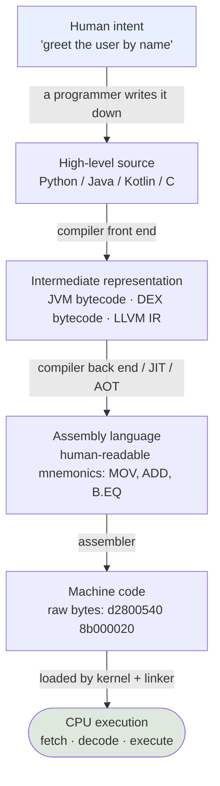

Read that diagram as a sequence of translations, each one lossy in one direction and each one
reconstructible — imperfectly — in the other. When you decompile an APK you are climbing this ladder
upwards: DEX bytecode back into something that looks like Java source. The climb loses comments,
local variable names, and the exact shape of loops, because those were destroyed on the way down.

> **📖 Definition — abstraction.** A description that deliberately omits detail in order to be
> usable. `x = a + b` is an abstraction over "load a into a register, load b into another register,
> issue an integer add, store the result." The omitted detail still happens; you just are not
> writing it.

> **⚠️ Warning.** Abstraction hides detail; it does not remove it. Every vulnerability class in this
> repository lives in the detail the abstraction hid. `String s = a + b;` in Java hides an
> allocation, a copy, and a potential `OutOfMemoryError`. In C, `strcpy(dst, src)` hides an
> unbounded write. The hidden detail is your attack surface.

### 2.2 The four translation strategies

There is more than one way to get from source to execution, and Android uses **all four**. This is
the single most confusing thing about the Android runtime for newcomers, so it is worth drawing
before it is explained.

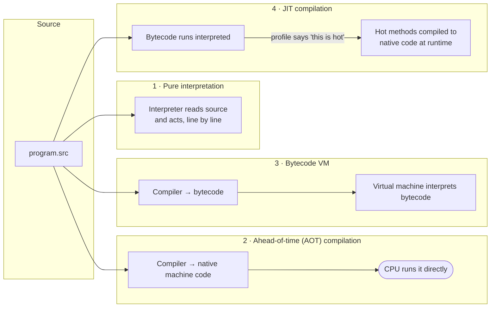

The four strategies differ in **when** translation happens and **what** the artefact you ship
contains. That difference decides what a reverse engineer receives.

| Strategy | Translation happens | You ship | Startup speed | Peak speed | What the reverser gets |
|---|---|---|---|---|---|
| Interpretation | Every time a line runs | Source text | Instant | Slowest | The original source, comments and all |
| AOT compilation | Once, at build time | Native machine code | Instant | Fastest | Stripped machine code, no names |
| Bytecode VM | Once at build (to bytecode), decoded per run | Bytecode | Fast | Slow-ish | Bytecode with names and types intact |
| JIT | At build (to bytecode) plus at runtime for hot code | Bytecode | Fast | Fast after warm-up | Bytecode, plus native code only in memory |

Android's actual pipeline uses three of these at once and is drawn in full in
[section 3.18](#318-compilation-interpretation-bytecode-vms-jit-and-aot). For now hold this:

> **🧠 Mental Model.** Your `.apk` contains **bytecode** (DEX). At install and during idle
> maintenance, some of it is **AOT-compiled** to native code in an `.odex`/`.vdex`/`.art` set. At
> run time, cold methods are **interpreted** and hot methods are **JIT-compiled**. This is why
> the same method can exist in three forms simultaneously on one device, and why a Frida hook and a
> static patch do not always agree.

### 2.3 The same program, four ways

This is the centrepiece of the chapter. One tiny program — sum the integers from 1 to N, but stop
and report an error if the running total exceeds a limit — written at four levels of abstraction.
Read all four now even if none of them makes sense yet. Every later section refers back to this.

The program in English:

> Start a total at zero. For each number from 1 up to N, add it to the total. If at any point the
> total is greater than the limit, stop immediately and report failure. Otherwise report the total.

**Python** — highest abstraction, dynamically typed, interpreted:

```python
# examples/sum_demo.py — run on the host with: python3 sum_demo.py
def bounded_sum(n, limit):
    total = 0
    for i in range(1, n + 1):
        total = total + i
        if total > limit:
            return -1          # sentinel meaning "overflowed the limit"
    return total

print(bounded_sum(10, 1000))   # 55
```

**C** — low abstraction, statically typed, compiled ahead of time to native code:

```c
/* examples/sum_demo.c — build on the host with: gcc -O0 -g sum_demo.c -o sum_demo */
#include <stdio.h>

int bounded_sum(int n, int limit) {
    int total = 0;
    for (int i = 1; i <= n; i++) {
        total = total + i;
        if (total > limit) {
            return -1;
        }
    }
    return total;
}

int main(void) {
    printf("%d\n", bounded_sum(10, 1000));  /* 55 */
    return 0;
}
```

**Java** — statically typed, compiled to bytecode, executed by a VM:

```java
// examples/SumDemo.java — build on the host with: javac SumDemo.java && java SumDemo
public class SumDemo {
    static int boundedSum(int n, int limit) {
        int total = 0;
        for (int i = 1; i <= n; i++) {
            total = total + i;
            if (total > limit) {
                return -1;
            }
        }
        return total;
    }

    public static void main(String[] args) {
        System.out.println(boundedSum(10, 1000));  // 55
    }
}
```

**Pseudo-assembly** — the level the CPU actually works at. This is written in an ARM64-flavoured
style but simplified for teaching; real compiler output for this function appears in
[section 6](#6-reverse-engineering-perspective).

```asm
; pseudo-AArch64. Arguments arrive in W0 = n, W1 = limit (see chapter 01, AAPCS64).
; W2 will hold `total`, W3 will hold `i`.
bounded_sum:
        mov     w2, #0              ; total = 0
        mov     w3, #1              ; i = 1
loop_test:
        cmp     w3, w0              ; compare i with n
        b.gt    done_ok             ; if i > n, branch out of the loop
        add     w2, w2, w3          ; total = total + i
        cmp     w2, w1              ; compare total with limit
        b.le    loop_next           ; if total <= limit, keep going
        mov     w0, #-1             ; else set return value to -1
        ret                         ; and return immediately
loop_next:
        add     w3, w3, #1          ; i = i + 1
        b       loop_test           ; jump back to the test
done_ok:
        mov     w0, w2              ; return value = total
        ret
```

Now the important part. Line them up.

| Concept | Python | C | Java | Pseudo-assembly |
|---|---|---|---|---|
| Declare a function | `def bounded_sum(n, limit):` | `int bounded_sum(int n, int limit)` | `static int boundedSum(int n, int limit)` | label `bounded_sum:` |
| Receive arguments | names bound on call | named parameters, ABI-placed | named parameters, ABI-placed | registers `W0`, `W1` |
| Create a variable | `total = 0` | `int total = 0;` | `int total = 0;` | `mov w2, #0` |
| Loop | `for i in range(1, n+1):` | `for (int i=1; i<=n; i++)` | `for (int i=1; i<=n; i++)` | `cmp` + `b.gt` + `b` |
| Add | `total = total + i` | `total = total + i;` | `total = total + i;` | `add w2, w2, w3` |
| Test | `if total > limit:` | `if (total > limit)` | `if (total > limit)` | `cmp w2, w1` + `b.le` |
| Return | `return -1` | `return -1;` | `return -1;` | `mov w0, #-1` + `ret` |

Every row is the same operation. The differences are **notation**, **who checks the types**, and
**who manages the memory** — not what the machine ends up doing.

> **🔬 Under the Hood.** There is one row where the four versions genuinely differ, and it is a
> security-relevant difference. In Python, `total` can grow arbitrarily large; integers are
> arbitrary-precision objects on the heap, so `total` never overflows. In C and Java, `total` is a
> 32-bit signed integer in a register, and if it exceeds 2 147 483 647 it silently wraps to a
> negative number — which means the check `total > limit` can be *skipped entirely*. That is
> [section 3.4](#34-integer-overflow-as-a-vulnerability-class), and it is a real bug class that has
> produced remote code execution on Android.

### 2.4 Anatomy of the pipeline that turns C into a running Android library

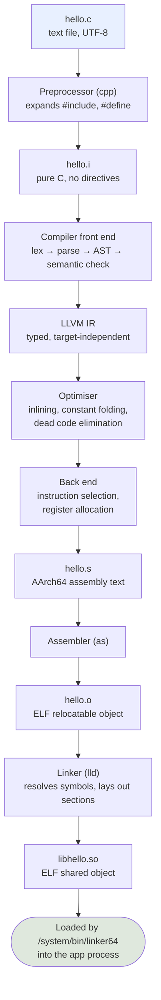

Walk it once in prose, because each arrow destroys information you will later wish you had.

The **preprocessor** is a text substitution engine that runs before the compiler understands
anything. It pastes header files in and replaces macros. After it runs, `#define MAX_LEN 256` is
gone forever — the number `256` appears in the code with no name attached. This is why a constant in
C never appears as a name in a disassembler, while a constant in Java sometimes does.

The **front end** turns text into a tree. It checks that `int x = "hello";` is a type error, that
every variable is declared, and that every function called exists. Once this stage succeeds, the
program is guaranteed well-formed, though not guaranteed correct.

The **optimiser** is where reverse engineering gets hard. It may delete your loop entirely if it can
prove the result, merge two variables into one register, reorder your statements, and inline a
function so that it no longer exists as a separate thing. A disassembly at `-O2` frequently has no
recognisable relationship to the source.

The **back end** picks real instructions and assigns real registers. Now every abstraction is gone:
no types, no variable names, only registers and memory addresses.

The **linker** stitches object files together and records what still needs to be resolved at load
time. It produces the ELF file described in
[chapter 01's cheat sheet](../01-Computer-Science-Basics/cheatsheet.md).

Finally the **dynamic linker** maps the file into the process and fixes up addresses.

> **🔍 Pentester's Note.** Ask yourself at every stage "what did I lose here?" You lose macro names
> at preprocessing, you lose types and variable names at the back end, and you lose local symbols at
> `strip`. Everything you *do* recover in Ghidra survived all of those stages, which is why symbol
> names in a stripped library are so precious when they appear: they only exist because they were
> needed for dynamic linking.

### 2.5 The Android version of the same pipeline

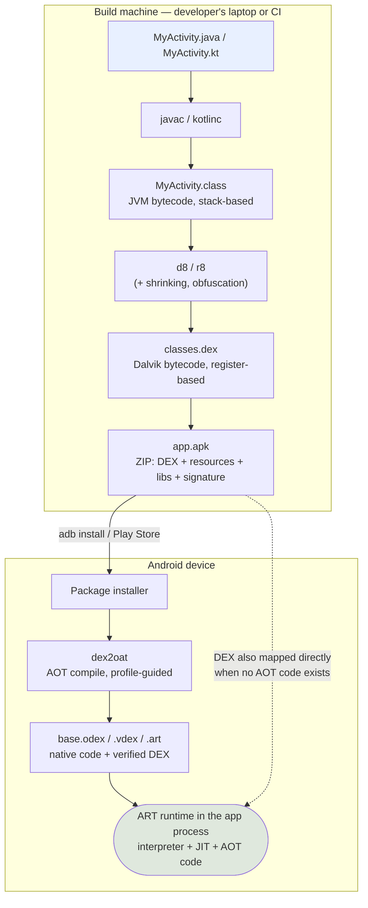

Compare this with the C pipeline above and note the crucial structural difference: **the Android
pipeline ships an intermediate representation, not machine code.** The final translation to
instructions happens on the device, after you have the file. That single decision is why Android
reverse engineering is so much more productive than reversing an iOS binary or a Windows `.exe`,
and it is why chapters [11](../11-Android-Runtime/README.md),
[12](../12-DEX-Internals/README.md), [13](../13-ART/README.md), and
[14](../14-Dalvik/README.md) exist.

### 2.6 Where each concept in this chapter lands in the Android stack

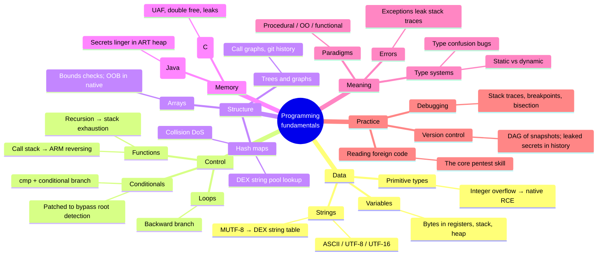

Each branch of that map is a subsection of [section 3](#3-deep-internal-working), and each leaf is
a security consequence that returns in a later chapter.

---
## 3. Deep Internal Working

This is the long section. It works upward from a single byte to a whole software project, and every
subsection ends by connecting the construct to something you will meet in Android security work.

### 3.1 Variables and memory — what a variable actually is

**The analogy.** A variable is a labelled box. You put a value in the box, you can look at the box
later, and you can replace what is in the box.

**The plain definition.** A variable is a name that your program uses to refer to a place where a
value is stored.

**The precise definition, and the one that matters.**

> **📖 Definition — variable.** A variable is a *binding* between an identifier in the source text
> and a **storage location** — a specific range of bytes at a specific address — together with a
> **type** that says how those bytes are to be interpreted. At run time the identifier does not
> exist. Only the bytes exist.

That last sentence is the important one. Read it again. When you write:

```c
/* host — C */
int counter = 42;
```

the name `counter` is a fiction maintained by the compiler for your convenience. After compilation
there is no `counter`. There are four bytes somewhere — in a register, or at some offset from the
stack pointer — holding the bit pattern `0x0000002A`. If the compiler decides `counter` fits in
register `W19`, then `counter` is `W19` and has no memory address at all.

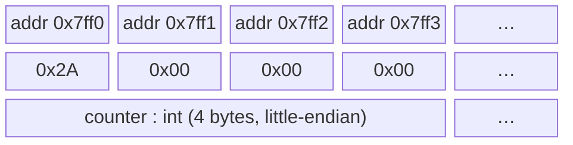

The block above shows `counter` as it exists in memory on a little-endian machine
([chapter 01, endianness](../01-Computer-Science-Basics/cheatsheet.md)). The value 42 is `0x2A`, and
because ARM64 and x86-64 are little-endian, the least significant byte `0x2A` sits at the lowest
address. The name `counter` is drawn underneath because it is *annotation*, not data.

#### 3.1.1 The three places a variable can live

| Storage class | Where the bytes are | Lifetime | Typical source form | Security relevance |
|---|---|---|---|---|
| Register | Inside the CPU | Until the compiler reuses the register | any local | Never in memory; a secret in a register is not in a heap dump, but is in a core dump |
| Stack | Stack frame of the current function | Until the function returns | `int x;` inside a function | Stack buffer overflow targets the saved `LR`/`FP` next to it |
| Heap | Dynamically allocated region | Until explicitly freed or garbage collected | `malloc()`, `new`, every Java object | Use-after-free, heap spraying, secrets recoverable long after use |
| Static / global | Fixed address inside the loaded image | Whole process lifetime | `static int x;`, `.data`/`.bss` | Always at a known offset from the module base; a favourite patch target |

> **🧠 Mental Model.** "Where does this variable live?" is not an academic question. It decides
> whether you can find its value with `frida-trace`, whether it appears in a heap dump, whether an
> overflow of the thing next to it can reach it, and whether patching it once is permanent.

#### 3.1.2 Assignment is a copy, and that has consequences

```python
# host — Python
a = 5
b = a       # b gets a COPY of the value 5
b = 6
print(a)    # still 5
```

For a small value this is obvious. For anything larger it becomes the single most confusing topic in
programming, because languages differ in **what** they copy:

```python
# host — Python
a = [1, 2, 3]
b = a       # b gets a copy of the REFERENCE, not of the list
b.append(4)
print(a)    # [1, 2, 3, 4]  — the same list!
```

Both statements are "copy the value of `a` into `b`". In the first, the value *is* the number. In
the second, the value is a *reference* — a handle to a list living on the heap. Copying the handle
does not copy the house. This is [section 3.13](#313-pointers-and-references), and it deserves the
full treatment it gets there.

#### 3.1.3 Scope and lifetime are different things

> **📖 Definition — scope.** The region of the *source text* in which a name is visible.

> **📖 Definition — lifetime.** The interval of *run time* during which the storage exists and holds
> a meaningful value.

They are usually aligned and occasionally not, and every time they are not, there is a bug:

```c
/* host — C. This function is broken. */
char *get_name(void) {
    char buf[64];              /* lifetime: until this function returns */
    strcpy(buf, "alice");
    return buf;                /* returns a pointer to dead storage */
}
```

`buf` goes out of scope at the closing brace, and its lifetime ends there too — the stack frame is
reclaimed. The returned pointer aims at memory that the next function call will overwrite. This is a
**dangling pointer**, and it is the stack-based cousin of use-after-free.

> **🔍 Pentester's Note.** In native Android libraries this exact pattern still appears, usually in
> code that formats a log message or builds a filename. Ghidra will show a function returning a
> stack address; that is worth immediate attention because attacker-timed calls can control what
> lands in that reclaimed frame.

### 3.2 Primitive types — sizes, signedness, and why you must memorise them

> **📖 Definition — primitive type.** A type whose values are stored directly as a fixed number of
> bytes, interpreted by the CPU's own instructions, rather than as a reference to a structure
> elsewhere. Integers, floating-point numbers, characters, and booleans.

A type is not a property of the bytes. **The bytes have no type.** A type is a promise you made to
the compiler about how to interpret them. The four bytes `FF FF FF FF` are:

| Interpreted as | Value |
|---|---|
| `uint32_t` (unsigned 32-bit) | 4 294 967 295 |
| `int32_t` (signed 32-bit) | −1 |
| `float` (IEEE-754 binary32) | NaN (not a number) |
| four `char`s | `ÿÿÿÿ` in Latin-1, invalid UTF-8 |
| AArch64 instruction | an undefined encoding |

Nothing in memory says which is correct. Only the code that reads them decides — and if two pieces
of code disagree, you have a **type confusion** vulnerability.

#### 3.2.1 The table you should know cold

| Type | Bits | Signed range | Unsigned range | Java equivalent |
|---|---|---|---|---|
| `int8_t` / `char` | 8 | −128 … 127 | 0 … 255 | `byte` (always signed) |
| `int16_t` / `short` | 16 | −32 768 … 32 767 | 0 … 65 535 | `short`, `char` (unsigned 16-bit) |
| `int32_t` / `int` | 32 | −2 147 483 648 … 2 147 483 647 | 0 … 4 294 967 295 | `int` |
| `int64_t` / `long long` | 64 | −9.22×10^18 … 9.22×10^18 | 0 … 1.84×10^19 | `long` |
| `float` | 32 | ±1.2×10^−38 … ±3.4×10^38, ~7 decimal digits | — | `float` |
| `double` | 64 | ±2.2×10^−308 … ±1.8×10^308, ~15 digits | — | `double` |
| pointer (LP64) | 64 | — | full address space | reference (4 or 8 bytes in ART) |

Note the asymmetry that catches everybody: **Java has no unsigned integer types** except `char`.
A Java `byte` holds −128 to 127. When you read a byte from a file in Java and it is `0xFF`, you get
`-1`, and `if (b > 0x7F)` is never true. The idiom `b & 0xFF` exists solely to undo this.

> **⚠️ Warning.** `byte b = data[i]; int v = b;` in Java **sign-extends**. If `data[i]` is `0x80`,
> `v` is `-128`, not `128`. Parsers written by developers who forgot this produce spectacular
> misbehaviour on any input with the high bit set — which is to say, on any binary input, and on any
> UTF-8 text outside ASCII. When auditing a Java binary parser, search for `& 0xFF` and note every
> place it is *missing*.

#### 3.2.2 Signedness at the bit level

[Chapter 01](../01-Computer-Science-Basics/cheatsheet.md) covered two's complement. The consequence
for programming is one rule: **the same bits, compared with a signed comparison or an unsigned
comparison, give different answers.**

| Bit pattern (32-bit) | As signed `int` | As unsigned | `x < 100` signed? | `x < 100` unsigned? |
|---|---|---|---|---|
| `0x00000005` | 5 | 5 | yes | yes |
| `0xFFFFFFFF` | −1 | 4 294 967 295 | **yes** | **no** |
| `0x80000000` | −2 147 483 648 | 2 147 483 648 | **yes** | **no** |

In AArch64 assembly this is visible directly: `B.LT` and `B.GT` are the *signed* branches, while
`B.LO` and `B.HI` are the *unsigned* ones. When you are reading a disassembly and you see a length
check using `B.LT`, ask immediately whether the length can be negative.

> **🔬 Under the Hood.** In C, mixing signed and unsigned in one comparison triggers the **usual
> arithmetic conversions**: the signed operand is converted to unsigned. So
> `int len = -1; if (len < sizeof(buf))` is **false**, because `-1` becomes `0xFFFFFFFFFFFFFFFF`
> which is not less than 64. Compilers warn about this (`-Wsign-compare`); production Android
> native code frequently builds with warnings disabled.

### 3.3 Conversion, casting and promotion

Three different things share the word "cast", and confusing them is a reliable source of bugs.

| Kind | Example | What happens to the bytes |
|---|---|---|
| Value-preserving widening | `int` → `long` | Sign-extended or zero-extended; value unchanged |
| Value-losing narrowing | `int` → `short` | High bytes **discarded**; value may change silently |
| Reinterpretation | `(float*)&i` in C | Bytes untouched; interpretation changed |
| Reference downcast | `(Button) view` in Java | No bytes change; a runtime **type check** occurs |

Narrowing is the dangerous one because in C it is silent:

```c
/* host — C */
int length = 70000;
short s = (short)length;   /* 70000 = 0x00011170 → keep low 16 bits = 0x1170 = 4464 */
printf("%d\n", s);         /* prints 4464 */
```

70 000 became 4 464 with no error, no warning at default settings, and no runtime check. If
`length` was a validated size and `s` is used as an allocation size, you have just allocated
4 464 bytes for 70 000 bytes of data.

In Java the same narrowing requires an explicit cast, which is a small safety improvement — the
compiler forces you to *say* you meant it — but the truncation still happens silently at run time.

> **🔍 Pentester's Note.** In JNI code ([chapter 16](../16-JNI/README.md)) you constantly see
> `jint` (32-bit) values converted to `size_t` (64-bit) and back. Every one of those conversions is
> a place where a negative Java `int` becomes an enormous unsigned C length. Grep native code for
> `(size_t)` next to anything that came from `GetArrayLength` or a Java parameter.

### 3.4 Integer overflow as a vulnerability class

This subsection is the first genuine security lesson of the chapter, and it is worked in full
detail because the same reasoning applies to every memory-safety bug you will ever analyse.

#### 3.4.1 What overflow is

An `int` is 32 bits. There are exactly 2^32 = 4 294 967 296 distinct bit patterns. There is no
pattern left over to mean "too big". So when an arithmetic result does not fit, the hardware keeps
the low 32 bits and throws the rest away. That is **wrapping**.

```
   2147483647   =  0x7FFFFFFF
 +          1
 -------------
   2147483648   =  0x80000000   (33 bits of true result truncated to 32)
 interpreted as signed 32-bit  = -2147483648
```

In Java this is *defined behaviour*: `Integer.MAX_VALUE + 1 == Integer.MIN_VALUE`, guaranteed by the
language specification, no exception thrown. In C, signed overflow is **undefined behaviour**, which
is worse — the compiler is allowed to assume it never happens and delete your check.

> **⚠️ Warning.** This is the trap that catches experienced C programmers. Writing
> `if (a + b < a) { /* overflow! */ }` to detect signed overflow does not work with an optimising
> compiler. The compiler reasons: "signed overflow is undefined, therefore `a + b` is always ≥ `a`,
> therefore this branch is dead" and removes it. The correct check uses unsigned arithmetic or a
> builtin such as `__builtin_add_overflow`.

#### 3.4.2 The worked example — an allocation size overflow

Here is a function of the sort that appears in every media parser, every image decoder, and every
serialisation routine in Android's native layer. Read it and try to find the bug before the
explanation.

```c
/* host — C. Reads a list of 4-byte records from attacker-controlled input. */
struct record { uint32_t id; uint32_t value; };   /* 8 bytes each */

int parse_records(const uint8_t *input, size_t input_len) {
    uint32_t count;
    if (input_len < 4) {
        return -1;
    }
    memcpy(&count, input, 4);                     /* attacker controls count */

    if (count > 0x10000000) {                     /* "sanity check": max 256M records */
        return -1;
    }

    uint32_t alloc_size = count * sizeof(struct record);   /* <-- THE BUG */
    struct record *records = malloc(alloc_size);
    if (records == NULL) {
        return -1;
    }

    for (uint32_t i = 0; i < count; i++) {
        memcpy(&records[i], input + 4 + i * 8, 8);         /* writes count * 8 bytes */
    }
    free(records);
    return 0;
}
```

**The arithmetic, step by step.** `sizeof(struct record)` is 8. The developer's sanity check caps
`count` at `0x10000000` = 268 435 456. Set `count` to exactly that maximum:

```
count       = 0x10000000  =        268 435 456
sizeof      = 8
true product= 0x80000000  =      2 147 483 648      -- fits in uint32_t, fine
```

Now set `count = 0x20000000`? That is rejected by the check. So take the largest allowed value and
note that `0x10000000 * 8 = 0x80000000`, which still fits. The check *works* for this multiplier.

Now change one thing — the developer later adds a field, making the record 16 bytes, and forgets to
revisit the constant:

```
count       = 0x10000000  =        268 435 456
sizeof      = 16
true product= 0x100000000 =      4 294 967 296
low 32 bits = 0x00000000  =                  0     <-- alloc_size is ZERO
```

`malloc(0)` returns a valid, non-NULL pointer to a minimum-size chunk. The NULL check passes. The
loop then writes 268 435 456 × 16 bytes into it. The process is destroyed within microseconds, and
with a more carefully chosen `count` the attacker gets a *controlled* small allocation followed by a
*controlled* overflow — the textbook heap corruption primitive.

The general shape:

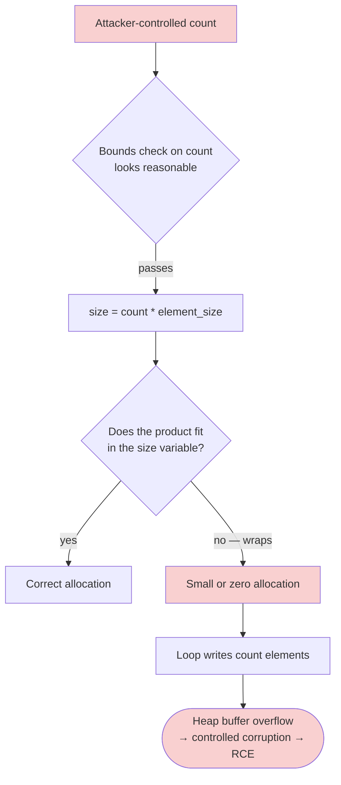

The diagram makes the key point visible: the bounds check and the multiplication are two separate
places, and the check validates the *input* while the vulnerability is in the *derived* value.
Auditing input validation alone will never find this bug.

#### 3.4.3 The other three shapes of the same bug

| Shape | Code | Why it fails |
|---|---|---|
| Signed length used as unsigned size | `int n = readInt(); if (n > MAX) return; memcpy(d, s, n);` | `n = -1` passes the check, becomes `SIZE_MAX` in `memcpy` |
| Addition overflow in a bounds check | `if (offset + len > buf_size) return;` | `offset + len` wraps to a small number, check passes |
| Truncation on assignment | `size_t big = ...; int small = big;` | High bits lost, later comparisons meaningless |
| Off-by-one from `<=` | `for (i = 0; i <= n; i++) buf[i] = 0;` | Writes `n+1` elements into an `n`-element buffer |

The correct forms are:

```c
/* host — C, safe patterns */
if (count > SIZE_MAX / sizeof(struct record)) return -1;      /* divide, never multiply */
size_t alloc_size = count * sizeof(struct record);

if (len > buf_size || offset > buf_size - len) return -1;     /* subtract, never add */

if (__builtin_mul_overflow(count, elem_size, &alloc_size)) return -1;  /* compiler builtin */
```

> **🔍 Pentester's Note — how you actually find this in Android.** Load a native library in Ghidra.
> Look for `MUL` or `LSL` (shift-left is multiplication by a power of two) whose result feeds
> directly into a call to `malloc`, `calloc`, `operator new`, or `mmap`. Then look backwards for
> where the multiplicand came from. If it came from a file, a socket, a `Parcel`, or a JNI
> parameter, you have a candidate. Note that `calloc(n, size)` is *safe* — it checks for overflow
> internally — so a codebase that uses `malloc(n * size)` where `calloc(n, size)` would do is
> telling you something about its habits.

#### 3.4.4 Why this matters even though apps are written in Java

Java integers wrap too, but Java array accesses are bounds-checked, so a wrapped length produces a
`NegativeArraySizeException` or an `ArrayIndexOutOfBoundsException` rather than memory corruption.
The overflow is still a bug — it can produce wrong authorisation decisions, wrong lengths, and
infinite loops — but it is not usually memory-unsafe.

The moment code crosses into native ([chapter 15](../15-Native-Code/README.md)) via JNI
([chapter 16](../16-JNI/README.md)), the protection ends. Android's real integer-overflow
vulnerabilities have historically lived in media parsers written in C++ — the Stagefright family
(for example **CVE-2015-1538**, an integer overflow in the MP4 extractor reachable from an MMS)
being the best-known example. The pattern in those bugs is precisely the one worked above: a
size computed by multiplying an attacker-controlled count.

### 3.5 Strings and character encodings

#### 3.5.1 The problem strings solve, and the problem they create

A CPU has no notion of text. It has bytes. To store the word `Hi` you must agree on a mapping from
characters to numbers. That agreement is an **encoding**, and there have been hundreds of them.

> **📖 Definition — character set.** A set of abstract characters, each assigned a number called a
> **code point**. Unicode is a character set: `A` is code point U+0041, `€` is U+20AC, `😀` is
> U+1F600.

> **📖 Definition — encoding.** A rule for turning code points into bytes. UTF-8, UTF-16, and
> MUTF-8 are three different encodings of the *same* character set.

Beginners conflate the two constantly. "Unicode" is not an encoding. "UTF-8" is not a character set.
Getting this straight makes every text-handling bug legible.

#### 3.5.2 ASCII — 7 bits, 128 characters, still the foundation

ASCII assigns 0–127 to control codes, digits, punctuation, and unaccented Latin letters. One
character is one byte, and the high bit is always zero.

| Character | Decimal | Hex | Binary |
|---|---|---|---|
| `NUL` | 0 | `0x00` | `0000 0000` |
| `\n` | 10 | `0x0A` | `0000 1010` |
| space | 32 | `0x20` | `0010 0000` |
| `0` | 48 | `0x30` | `0011 0000` |
| `A` | 65 | `0x41` | `0100 0001` |
| `a` | 97 | `0x61` | `0110 0001` |
| `~` | 126 | `0x7E` | `0111 1110` |

Two facts from this table pay for themselves repeatedly. `'0'` is `0x30`, so converting an ASCII
digit to its numeric value is `c - '0'`. And `'a' - 'A' == 0x20`, exactly one bit, so
case-insensitive comparison in optimised code often appears as `OR` with `0x20` — a pattern worth
recognising in a disassembler.

#### 3.5.3 UTF-8 — variable length, ASCII-compatible, the internet's default

UTF-8 encodes a code point in one to four bytes. The leading byte announces the length.

| Code point range | Bytes | Byte pattern |
|---|---|---|
| U+0000 – U+007F | 1 | `0xxxxxxx` |
| U+0080 – U+07FF | 2 | `110xxxxx 10xxxxxx` |
| U+0800 – U+FFFF | 3 | `1110xxxx 10xxxxxx 10xxxxxx` |
| U+10000 – U+10FFFF | 4 | `11110xxx 10xxxxxx 10xxxxxx 10xxxxxx` |

Worked examples, bit by bit:

**`A` = U+0041.** In range 1, so one byte: `0x41`. Identical to ASCII. This is why UTF-8 was
adopted — every ASCII file is already valid UTF-8.

**`é` = U+00E9.** In range 2. `0xE9` = `0000 0000 1110 1001`. Take the low 11 bits:
`000 1110 1001`. Split 5 + 6: `00011` and `101001`.

```
lead:  110 00011  = 0xC3
cont:  10 101001  = 0xA9
result: C3 A9
```

**`€` = U+20AC.** In range 3. `0x20AC` = `0010 0000 1010 1100`. Split 4 + 6 + 6:
`0010`, `000010`, `101100`.

```
lead:  1110 0010  = 0xE2
cont:  10 000010  = 0x82
cont:  10 101100  = 0xAC
result: E2 82 AC
```

**`😀` = U+1F600.** In range 4. `0x1F600` = `0 0001 1111 0110 0000 0000`. Split 3 + 6 + 6 + 6:
`000`, `011111`, `011000`, `000000`.

```
lead:  11110 000  = 0xF0
cont:  10 011111  = 0x9F
cont:  10 011000  = 0x98
cont:  10 000000  = 0x80
result: F0 9F 98 80
```

Two properties make UTF-8 excellent and one makes it dangerous. It is self-synchronising (you can
find a character boundary from any position, because continuation bytes always start `10`), and it
sorts correctly by byte value. The danger is **over-long encodings**: `0xC0 0x80` decodes naively to
U+0000, and `0xC0 0xAF` decodes naively to `/`. A decoder that accepts over-long forms lets an
attacker smuggle a `/` past a filter that scanned the raw bytes for `0x2F`. Strict UTF-8 forbids
over-long forms for exactly this reason. Remember that sentence — the next subsection depends on it.

#### 3.5.4 UTF-16 — what Java and Android actually use in memory

Java's `char` is a 16-bit unsigned value, and a Java `String` is conceptually a sequence of UTF-16
**code units**. Code points up to U+FFFF are one unit. Anything above needs a **surrogate pair**:
two units, from reserved ranges `0xD800–0xDBFF` (high) and `0xDC00–0xDFFF` (low).

The conversion for `😀` = U+1F600:

```
cp        = 0x1F600
cp - 0x10000 = 0x0F600           = 0000 1111 0110 0000 0000  (20 bits)
high 10 bits = 0000111101 = 0x03D  → high surrogate = 0xD800 + 0x03D = 0xD83D
low  10 bits = 1000000000 = 0x200  → low  surrogate = 0xDC00 + 0x200 = 0xDE00
UTF-16 (BE): D8 3D DE 00
```

> **⚠️ Warning.** `"😀".length()` in Java is **2**, not 1. `charAt(0)` returns half a character.
> Every length check, every substring, and every truncation in Java operates on code units, not
> characters. A server that truncates a username to 20 `char`s can split a surrogate pair and
> produce an unpaired surrogate — which is not valid text and which different downstream systems
> handle differently. That divergence is a filter-bypass opportunity.

#### 3.5.5 MUTF-8 — the encoding Android's DEX format actually uses

Now the payoff. Android does not store strings in a DEX file as UTF-8. It uses **MUTF-8**, "Modified
UTF-8", inherited from the JVM's class-file format and carried into DEX.

> **📖 Definition — MUTF-8.** UTF-8 with two deliberate deviations: (1) the code point U+0000 is
> encoded as the two-byte sequence `C0 80` instead of the single byte `00`; (2) code points above
> U+FFFF are first converted to a UTF-16 surrogate pair, and then *each surrogate* is encoded
> separately in the three-byte form, giving six bytes total instead of four.

**Why deviation (1) exists.** DEX and class files store strings as NUL-terminated byte sequences.
If a real U+0000 inside a string were encoded as a `00` byte, it would terminate the string early.
Encoding it as `C0 80` — an over-long form that strict UTF-8 forbids — means no `00` byte ever
appears inside string data, so C-style `strlen` and `strcpy` work on the raw bytes.

**Why deviation (2) exists.** The format predates UTF-16 supplementary planes being common, and the
runtime's internal string representation is UTF-16. Encoding surrogates individually means the
decoder can produce UTF-16 code units with no special case for 4-byte sequences.

Worked comparison for the string `"a😀"`:

| Encoding | Bytes | Length |
|---|---|---|
| UTF-8 (strict) | `61 F0 9F 98 80` | 5 |
| UTF-16 (big-endian) | `00 61 D8 3D DE 00` | 6 |
| **MUTF-8 (DEX)** | `61 ED A0 BD ED B8 80` | 7 |

Deriving the MUTF-8 bytes for `😀`, since this is the part people get wrong:

```
Step 1: U+1F600 → surrogate pair D83D, DE00       (as computed in 3.5.4)

Step 2: encode D83D in the 3-byte UTF-8 form
        D83D = 1101 1000 0011 1101
        split 4/6/6:  1101 | 100000 | 111101
        lead:  1110 1101 = 0xED
        cont:  10 100000 = 0xA0
        cont:  10 111101 = 0xBD

Step 3: encode DE00 in the 3-byte UTF-8 form
        DE00 = 1101 1110 0000 0000
        split 4/6/6:  1101 | 111000 | 000000
        lead:  1110 1101 = 0xED
        cont:  10 111000 = 0xB8
        cont:  10 000000 = 0x80

Result: ED A0 BD ED B8 80
```

Note that `ED A0 BD` is **invalid strict UTF-8** — the range U+D800–U+DFFF is permanently reserved
for surrogates and must never be encoded directly. Standard UTF-8 decoders reject it.

#### 3.5.6 What a string looks like inside a DEX file

The DEX format stores every string exactly once, in a shared pool. A `string_data_item` is:

```
+--------------------------+------------------------------+------+
| utf16_size (uleb128)     | MUTF-8 bytes                 | 0x00 |
+--------------------------+------------------------------+------+
```

> **📖 Definition — uleb128.** Unsigned Little-Endian Base 128. A variable-length integer encoding:
> each byte carries 7 bits of value in its low bits, and its high bit is 1 if another byte follows.
> The value 0x2A is `2A`; the value 0x80 is `80 01`; the value 0x3FFF is `FF 7F`. DEX uses it
> everywhere to keep the file small.

Concretely, the string `"a😀"` inside a DEX file is stored as:

```
03            <- uleb128: 3 UTF-16 code units ('a', D83D, DE00)
61 ED A0 BD ED B8 80   <- MUTF-8 bytes
00            <- NUL terminator
```

Three details of security consequence follow directly:

1. **The declared length is in UTF-16 units, but the stored bytes are MUTF-8.** These disagree.
   A parser that allocates `utf16_size` bytes and then copies until the NUL will overflow. This is
   a real class of bug in third-party DEX parsers, and it is why you should fuzz your own tooling.
2. **`strings` on a DEX file finds most but not all of the text.** ASCII survives untouched, so
   API keys and URLs are trivially recoverable. Non-Latin text appears as high bytes and may be
   missed by naive extraction.
3. **`C0 80` in a string is a red flag.** It is legal MUTF-8 for an embedded NUL. If you see it in
   a package name, a class name, or a path, someone is probably trying to confuse a tool that uses
   C string functions on data another tool treats as length-delimited.

> **🔬 Under the Hood.** ART's conversion routines live in `art/libdexfile/dex/utf.cc` and
> `art/libdexfile/dex/utf.h` in the AOSP tree, with functions named along the lines of
> `ConvertModifiedUtf8ToUtf16`, `ConvertUtf16ToModifiedUtf8`, and `CountModifiedUtf8Chars`. The
> same file provides `ComputeUtf16Hash`, which is the hash function used for interned strings —
> see [section 3.10](#310-data-structures-ii--hash-maps-and-why-they-matter-for-dex) and
> [section 4](#4-source-code-walkthrough-aosp).

> **🔍 Pentester's Note.** When a tool shows you a class name that does not match what the device
> loads, suspect an encoding trick. Attackers have historically used homoglyphs (`а` U+0430
> Cyrillic versus `a` U+0061 Latin), right-to-left override characters (U+202E) in filenames, and
> unpaired surrogates to make one string display as another. Always compare the *bytes*, not the
> rendered text. `xxd` is the arbiter; your terminal is not.

---
### 3.6 Control flow I — conditionals, and what they become

#### 3.6.1 The problem

A program that runs the same instructions in the same order every time is a calculator, not
software. Everything interesting requires *deciding*. The construct for deciding is the conditional.

```python
# host — Python
if password_correct:
    grant_access()
else:
    deny_access()
```

**The precise definition.** A conditional evaluates an expression to a boolean, and selects one of
two (or more) blocks of code to execute next based on the result.

#### 3.6.2 What the CPU actually has

The CPU has no `if`. It has exactly two relevant capabilities:

1. **Compare** two values and set flags in a status register. On AArch64 these are the NZCV flags:
   `N` (result negative), `Z` (result zero), `C` (unsigned carry), `V` (signed overflow).
2. **Branch conditionally** — set the program counter to a different address if a specified
   combination of flags holds.

`CMP w2, w1` is literally "subtract `w1` from `w2`, discard the result, keep the flags." If the two
were equal, the subtraction gives zero, so `Z` is set, so `B.EQ` will be taken.

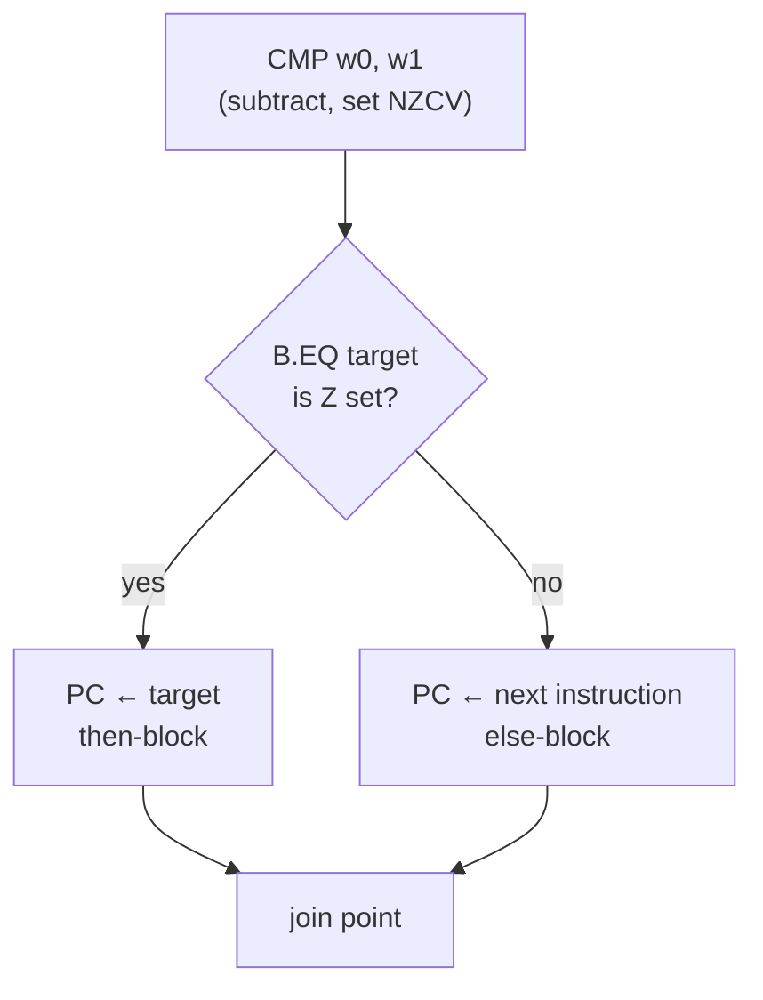

The diagram shows why the machine-level shape of `if` is always the *inverse* of what you wrote.
Source code says "if the condition holds, do the then-block." Compiled code says "if the condition
does **not** hold, branch over the then-block." The compiler inverts the test so that the common
path falls through, which is faster on a pipelined CPU.

#### 3.6.3 The same conditional at four levels

```python
# host — Python
def check(pin):
    if pin == 1234:
        return "OK"
    else:
        return "DENIED"
```

```c
/* host — C */
const char *check(int pin) {
    if (pin == 1234) {
        return "OK";
    } else {
        return "DENIED";
    }
}
```

```java
// host — Java
static String check(int pin) {
    if (pin == 1234) {
        return "OK";
    } else {
        return "DENIED";
    }
}
```

```asm
; AArch64, roughly what clang -O0 produces
check:
        cmp     w0, #0x4d2          ; 0x4d2 = 1234 decimal
        b.ne    .Ldenied            ; INVERTED: branch away if NOT equal
        adrp    x0, .Lstr_ok        ; load address of "OK"
        add     x0, x0, :lo12:.Lstr_ok
        ret
.Ldenied:
        adrp    x0, .Lstr_denied
        add     x0, x0, :lo12:.Lstr_denied
        ret
```

And in Dalvik bytecode, as `baksmali` would show it
([chapter 12](../12-DEX-Internals/README.md)):

```smali
# smali — output of baksmali on the compiled Java
.method static check(I)Ljava/lang/String;
    .registers 2
    const/16 v0, 0x4d2
    if-ne p0, v0, :cond_denied
    const-string v0, "OK"
    return-object v0
    :cond_denied
    const-string v0, "DENIED"
    return-object v0
.end method
```

Notice that the Smali has the *same inverted shape* as the ARM assembly: `if-ne ... :cond_denied`.
Dalvik bytecode is register-based and combines the compare and the branch into one instruction, but
the logic is identical.

> **🔍 Pentester's Note — the single most common Android bypass.** A root check, a certificate pin
> check, or a licence check ends in exactly this shape: compare, branch, return true or false. To
> defeat it statically you change `if-ne` to `if-eq`, or replace the whole method body with
> `const/4 v0, 0x0` and `return v0`. To defeat it dynamically you hook the method with Frida and
> return a constant. The reason both work is that a decision in a program is *one branch
> instruction*, and one branch instruction is two bytes you can edit. This is
> [chapter 67](../67-BypassingProtections/README.md) in one paragraph.

#### 3.6.4 Boolean operators and short-circuit evaluation

```java
// host — Java
if (user != null && user.isAdmin()) { ... }
```

`&&` **short-circuits**: if the left side is false, the right side is never evaluated. This is not a
performance optimisation, it is a semantic guarantee, and the code above depends on it — evaluating
`user.isAdmin()` when `user` is null would throw `NullPointerException`.

| Operator | Name | Short-circuits? | Compiles to |
|---|---|---|---|
| `&&` | logical AND | Yes | two compares, two branches |
| `\|\|` | logical OR | Yes | two compares, two branches |
| `&` | bitwise/non-short-circuit AND | No | both sides evaluated, then `AND` |
| `\|` | bitwise/non-short-circuit OR | No | both sides evaluated, then `ORR` |
| `!` | logical NOT | — | inverted branch condition |

> **⚠️ Warning.** `if (checkA() & checkB())` with a single `&` evaluates **both** functions. If
> `checkB()` has a side effect — writing a log, incrementing a counter, sending a request — that
> side effect happens even when `checkA()` already failed. Auditors find authentication bypasses
> here: a "verify" function that is called for its side effect but whose result is discarded.

#### 3.6.5 `switch` and why it compiles two different ways

```java
// host — Java
switch (opcode) {
    case 1:  return "READ";
    case 2:  return "WRITE";
    case 3:  return "EXEC";
    default: return "UNKNOWN";
}
```

A compiler has two strategies:

| Strategy | When chosen | Cost | Dalvik opcode |
|---|---|---|---|
| Jump table | Case values are dense (few gaps) | O(1) — index into a table of addresses | `packed-switch` |
| Binary search / compare chain | Case values are sparse | O(log n) compares | `sparse-switch` |

```smali
# smali — dense cases become packed-switch
    packed-switch p0, :pswitch_data_0
    ...
    :pswitch_data_0
    .packed-switch 0x1
        :pswitch_read
        :pswitch_write
        :pswitch_exec
    .end packed-switch
```

> **🔬 Under the Hood.** Recognising a jump table in native disassembly is a core reversing skill.
> The pattern is a bounds check, a shift or multiply by the pointer size, a load from a table of
> addresses, and an indirect branch (`BR x_n` on AArch64). Ghidra usually recovers it; when it does
> not, the function will appear to end abruptly at the indirect branch and you must reconstruct the
> table by hand.

### 3.7 Control flow II — loops

#### 3.7.1 The problem

Doing something once is easy. Doing it a variable number of times without writing it out a variable
number of times requires the machine to jump *backwards*. That backward jump is the entirety of what
a loop is.

> **📖 Definition — loop.** A control structure that causes a block of code to execute repeatedly
> until a termination condition holds. At machine level: a conditional forward branch out of the
> body, plus an unconditional backward branch to the test.

#### 3.7.2 The three forms and how they relate

| Form | Source shape | Test happens | Use when |
|---|---|---|---|
| `while` | `while (cond) { body }` | Before each iteration | Count unknown in advance |
| `do…while` | `do { body } while (cond);` | After each iteration | Body must run at least once |
| `for` | `for (init; cond; step)` | Before each iteration | Counting a known range |
| `for-each` | `for (T x : collection)` | Iterator-driven | Walking a container |

Every one of them is sugar for the same thing. This is the proof, written out:

```c
/* host — C. These three are exactly equivalent. */

/* form 1 */
for (int i = 0; i < n; i++) { body(i); }

/* form 2 */
int i = 0;
while (i < n) { body(i); i++; }

/* form 3 — the machine's own view */
int i = 0;
test:
    if (!(i < n)) goto done;
    body(i);
    i++;
    goto test;
done: ;
```

#### 3.7.3 A loop compiled, line by line

Take the loop from the four-way example in [section 2.3](#23-the-same-program-four-ways):

```c
for (int i = 1; i <= n; i++) {
    total += i;
}
```

```asm
; AArch64 -O0 shape. W0 = n, W2 = total, W3 = i
        mov     w2, #0          ; total = 0            <- init, runs once
        mov     w3, #1          ; i = 1                <- init, runs once
.Ltest:
        cmp     w3, w0          ; compare i with n     <- the test
        b.gt    .Ldone          ; forward branch OUT   <- inverted condition
        add     w2, w2, w3      ; total += i           <- the body
        add     w3, w3, #1      ; i++                  <- the step
        b       .Ltest          ; BACKWARD branch      <- this is the loop
.Ldone:
```

The backward `b .Ltest` is the loop. Everything else is bookkeeping. When you see an unconditional
branch to a *lower* address in a disassembly, you have found a loop, and the instruction just above
its target is the loop test.

At `-O2` the compiler will typically rotate the loop so the test is at the bottom, eliminating one
branch per iteration:

```asm
; AArch64 -O2 shape — rotated loop, test at the bottom
        cmp     w0, #1
        b.lt    .Lempty         ; guard: skip entirely if n < 1
        mov     w2, #0
        mov     w3, #1
.Lbody:
        add     w2, w2, w3
        add     w3, w3, #1
        cmp     w3, w0
        b.le    .Lbody          ; conditional BACKWARD branch — one branch per iteration
.Lempty:
```

> **🔬 Under the Hood.** The optimiser may also **unroll** the loop (emit the body four times and
> step by four), **vectorise** it (use SIMD registers to add four values at once), or replace it
> entirely with the closed-form formula `n*(n+1)/2`. All three make the disassembly unrecognisable
> compared to the source. If a function in Ghidra looks nothing like the algorithm you expected,
> suspect the optimiser before you suspect obfuscation.

In Dalvik bytecode the same loop is:

```smali
# smali
    const/4 v0, 0x0          # total = 0
    const/4 v1, 0x1          # i = 1
    :goto_test
    if-gt v1, p0, :cond_done
    add-int/2addr v0, v1     # total += i
    add-int/lit8 v1, v1, 0x1 # i++
    goto :goto_test
    :cond_done
```

Dalvik bytecode is not optimised the way native code is — `d8` performs only modest transformations
and preserves loop structure closely. **This is why decompiled Java is readable and decompiled C is
not.** It is one of the most useful asymmetries in your job.

#### 3.7.4 Loop bugs that become vulnerabilities

| Bug | Example | Consequence |
|---|---|---|
| Off-by-one | `for (i = 0; i <= len; i++) buf[i] = c;` | One-byte overflow; historically enough for full compromise |
| Unbounded loop on attacker input | `while (*p != '\0') ...` on non-terminated data | Read past the buffer until an unmapped page → crash or info leak |
| Signed index | `for (int i = 0; i < count; i++)` with `count` negative | Loop does not execute — a *check* that silently does nothing |
| Loop counter overflow | `for (uint8_t i = 0; i < 300; i++)` | `i` wraps at 256; infinite loop |
| Modification during iteration | Removing from a list while iterating it | `ConcurrentModificationException` in Java; corruption in C |
| Missing progress | `while (len > 0) { n = read(...); len -= n; }` with `n == 0` | Infinite loop; denial of service |

> **🔍 Pentester's Note.** The "unbounded loop on attacker input" row is how you turn a
> missing-NUL-terminator bug into an information leak. If a parser copies until it finds a zero
> byte, and you supply data with no zero byte, the copy continues into whatever follows in memory —
> and if the result is later returned to you, you have just read the heap.

### 3.8 Functions, the call stack, and recursion

#### 3.8.1 The problem functions solve

Without functions, every program is one enormous list of instructions, and any repeated logic must
be written out again at every use. Functions give a name to a block of behaviour, allow it to be
invoked from many places, and — crucially — allow it to be invoked with *different data* each time.

> **📖 Definition — function.** A named, parameterised, reusable block of code with a defined entry
> point, a defined set of inputs (**parameters**), and a defined output (**return value**). Invoking
> it is a **call**; the code that invokes it is the **caller**; the code invoked is the **callee**.

#### 3.8.2 What a call physically does

A call must accomplish four things:

1. Put the arguments where the callee expects them.
2. Record where to come back to.
3. Jump to the callee.
4. On return, put the result where the caller expects it, and restore anything the callee disturbed.

The agreement about *where* is the **calling convention** or **ABI**. On Android/AArch64 it is
AAPCS64, tabulated in [chapter 01's cheat sheet](../01-Computer-Science-Basics/cheatsheet.md):
integer arguments 1–8 go in `X0`–`X7`, the return value comes back in `X0`, and the return address
is placed in `X30` (the link register, `LR`) by the `BL` instruction.

```asm
; AArch64 — the caller side
        mov     w0, #10             ; argument 1 = n
        mov     w1, #1000           ; argument 2 = limit
        bl      bounded_sum         ; X30 <- address of next instruction; PC <- bounded_sum
        ; result now in W0
```

```asm
; AArch64 — the callee side, a typical prologue and epilogue
bounded_sum:
        stp     x29, x30, [sp, #-32]!   ; push frame pointer and link register, allocate 32 bytes
        mov     x29, sp                 ; establish the new frame pointer
        ; ... body, may freely call other functions because X30 is saved ...
        ldp     x29, x30, [sp], #32     ; restore FP and LR, deallocate
        ret                             ; PC <- X30
```

> **🔬 Under the Hood.** `stp x29, x30, [sp, #-32]!` is the single most recognisable instruction in
> AArch64 code. The `!` means pre-index writeback: `SP` is decremented by 32 *first*, then the pair
> is stored. The saved `[FP, LR]` pair is called the **frame record**, and each frame's saved `FP`
> points at the caller's frame record. That linked list is exactly what a debugger walks to produce
> a backtrace, and it is exactly what a stack buffer overflow corrupts.

#### 3.8.3 The call stack, drawn

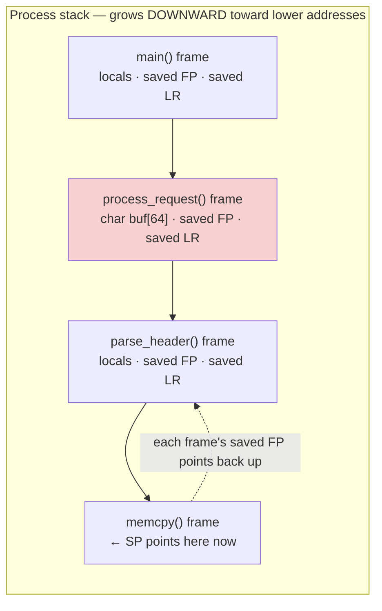

Every call pushes a frame; every return pops one. `main` called `process_request`, which called
`parse_header`, which called `memcpy`. The stack pointer is at the bottom. When `memcpy` returns,
its frame is abandoned simply by moving `SP` back up — the bytes are not erased, which is why stale
data from previous calls is routinely visible in fresh frames and why uninitialised local variables
leak information.

`process_request`'s frame is shaded because it holds `char buf[64]`. That array sits at a *lower*
address than the saved `FP`/`LR` of its own frame in a typical layout, so writing past the end of
`buf` walks upward into the saved return address. Overwrite it, and when `process_request` executes
`ret`, the CPU jumps wherever you said. That is the classic stack smash, covered in depth in
[chapter 19](../19-Memory/README.md).

#### 3.8.4 Parameters — by value and by reference

```c
/* host — C */
void increment_bad(int x)  { x = x + 1; }      /* caller's variable unchanged */
void increment_good(int *x){ *x = *x + 1; }    /* caller's variable changed */

int n = 5;
increment_bad(n);      /* n is still 5  */
increment_good(&n);    /* n is now 6    */
```

`increment_bad` receives a *copy* of the value in a register. Modifying the register modifies
nothing the caller can see. `increment_good` receives a copy of the *address*, and writing through
that address reaches the caller's storage.

Java is often described as "pass by reference for objects". That description is wrong and causes
endless confusion. **Java is always pass by value.** The value passed for an object is a *reference*
(a handle). You can use that handle to mutate the object, but you cannot make the caller's variable
point at a different object:

```java
// host — Java
static void reassign(StringBuilder sb) {
    sb.append(" modified");     // caller SEES this — same object mutated
    sb = new StringBuilder("x");// caller does NOT see this — local copy repointed
}
```

#### 3.8.5 Recursion

> **📖 Definition — recursion.** A function that calls itself, directly or indirectly. Each call
> gets its own stack frame with its own copy of the local variables. Termination requires a **base
> case** — an input for which the function returns without recursing.

```python
# host — Python
def factorial(n):
    if n <= 1:          # base case
        return 1
    return n * factorial(n - 1)   # recursive case
```

Trace `factorial(4)` as stack frames:

```
frame 1: factorial(4)  →  needs 4 * factorial(3)
frame 2:   factorial(3) →  needs 3 * factorial(2)
frame 3:     factorial(2) →  needs 2 * factorial(1)
frame 4:       factorial(1) →  base case, returns 1
frame 3:     returns 2 * 1  = 2
frame 2:   returns 3 * 2  = 6
frame 1: returns 4 * 6  = 24
```

Each level occupies a real stack frame with a real return address. There is no magic. Recursion is
just "call a function that happens to have the same name," and the stack is what makes it work.

> **⚠️ Warning — stack exhaustion.** A recursion with no base case, or with a base case an attacker
> can avoid reaching, consumes one frame per call until the stack region is exhausted. In native
> code the next write hits the guard page and the process dies with `SIGSEGV`. In Java you get
> `StackOverflowError`. Both are denial of service. Deeply nested attacker-controlled structures —
> nested JSON, nested XML entities, nested ZIP archives, deeply nested Intent extras — are the
> standard delivery mechanism, because recursive-descent parsers recurse once per nesting level.

| Language | Default main-thread stack | What happens on exhaustion |
|---|---|---|
| C on Android (bionic) | 8 MiB main thread; 1 MiB per pthread by default | `SIGSEGV` on the guard page |
| Java on ART | Managed stack limited separately from native stack | `StackOverflowError` thrown |
| Python (CPython) | ~1000 frame recursion limit | `RecursionError` raised |

> **🔍 Pentester's Note.** When you find a parser that recurses on nesting depth and does not carry
> a depth counter, you have a reliable denial-of-service finding and sometimes more. In native code,
> if the recursion frame is large, a single call can jump *over* the guard page into unrelated
> mapped memory — a "stack clash" — which converts a crash into a memory-corruption primitive.

#### 3.8.6 Connecting to ARM reversing

Everything in this subsection is the vocabulary you need to read a native crash. When
[chapter 18](../18-ARM/README.md) shows you a tombstone, you will see:

```
backtrace:
      #00 pc 000000000004a1c8  /system/lib64/libc.so (memcpy+72)
      #01 pc 0000000000012f40  /data/app/.../lib/arm64/libtarget.so (parse_header+128)
      #02 pc 0000000000013a10  /data/app/.../lib/arm64/libtarget.so (process_request+64)
```

That is the stack diagram from [section 3.8.3](#383-the-call-stack-drawn), reconstructed by walking
the saved `FP` chain. Frame `#00` is where it died; frame `#01` is who called it; the argument that
caused the crash is almost always visible in the register dump immediately above the backtrace.

---
### 3.9 Data structures I — arrays, linked lists, stacks, queues

> **📖 Definition — data structure.** A specific arrangement of data in memory, together with the
> algorithms that operate on that arrangement, chosen so that the operations you perform most often
> are cheap.

There is no "best" data structure. There is only a trade-off table, and knowing the table is what
lets you predict how a program behaves and where it breaks.

#### 3.9.1 The array — contiguous, indexed, the foundation of everything

An array is *N* elements of the same type, laid out back to back with no gaps.

```
int32_t a[5] = {10, 20, 30, 40, 50};   base address = 0x1000

offset:   +0        +4        +8        +12       +16
        +---------+---------+---------+---------+---------+
addr:   | 0x1000  | 0x1004  | 0x1008  | 0x100C  | 0x1010  |
        |   10    |   20    |   30    |   40    |   50    |
        +---------+---------+---------+---------+---------+
index:      [0]       [1]       [2]       [3]       [4]
```

The address of element `i` is `base + i * element_size`. That formula is the entire reason arrays
exist: element access is one multiply and one add, regardless of `i`. It is also the entire reason
arrays are dangerous, because **the formula works for any `i`**, including `i = 1000` and
`i = -5`. Nothing in the arithmetic knows where the array ends.

| Operation | Cost | Note |
|---|---|---|
| Read/write by index | O(1) | One address computation |
| Search for a value | O(n) | Must scan |
| Insert at end (fixed array) | impossible | Size is fixed at creation |
| Insert in middle | O(n) | Must shift everything after |
| Delete from middle | O(n) | Must shift everything after |

**How each language protects you, or does not:**

```c
/* host — C: NO bounds check. This compiles, runs, and corrupts memory. */
int a[5];
a[10] = 0x41414141;     /* writes 20 bytes past the end */
```

```java
// host — Java: bounds-checked at runtime, always.
int[] a = new int[5];
a[10] = 0x41414141;     // throws ArrayIndexOutOfBoundsException
```

```python
# host — Python: bounds-checked, and negative indices mean "from the end".
a = [0] * 5
a[10] = 1               # raises IndexError
a[-1] = 1               # legal! sets the LAST element
```

> **⚠️ Warning.** Python's negative indexing is a genuine security consideration when Python
> parses attacker data. `data[user_offset]` with `user_offset = -1` silently reads the last element
> instead of failing, so a validation of the form `if offset < len(data)` is insufficient — it must
> be `if 0 <= offset < len(data)`.

> **🔬 Under the Hood — how Java's bounds check appears in ART.** Every `aget`/`aput` Dalvik
> instruction is preceded, in the AOT-compiled native code, by a comparison of the index against the
> length field stored in the array object's header, and a branch to a throw helper. ART's optimising
> compiler eliminates the check when it can *prove* the index is in range (bounds check
> elimination), which is why a hot, simple loop over an array can be as fast as C. The check is not
> free, but it is usually not paid.

#### 3.9.2 The linked list — flexible, scattered, pointer-chasing

An array's weakness is insertion. A linked list solves that by giving up contiguity: each element
(a **node**) holds its data plus the address of the next node.

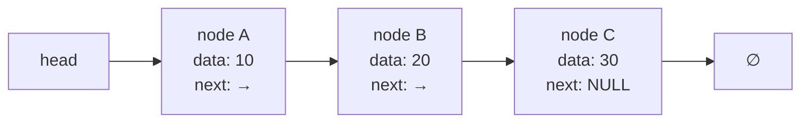

The nodes may be anywhere in memory, in any order. Only the `next` pointers define the sequence.
Inserting between A and B is two pointer writes and no copying at all — but finding the 500th
element requires following 500 pointers.

```c
/* host — C: a singly linked list built from scratch */
struct node {
    int data;
    struct node *next;
};

struct node *push_front(struct node *head, int value) {
    struct node *n = malloc(sizeof(struct node));
    if (!n) return head;
    n->data = value;
    n->next = head;      /* new node points at the old head */
    return n;            /* new node becomes the head */
}

int list_length(struct node *head) {
    int count = 0;
    for (struct node *p = head; p != NULL; p = p->next) {
        count++;
    }
    return count;
}
```

| Operation | Array | Singly linked list |
|---|---|---|
| Access element `i` | O(1) | O(n) |
| Insert at front | O(n) | O(1) |
| Insert after a known node | O(n) | O(1) |
| Delete a known node | O(n) | O(1) with prev pointer, O(n) without |
| Memory overhead | none | one pointer (8 bytes) per element |
| Cache behaviour | Excellent — sequential | Poor — random access pattern |

> **🔍 Pentester's Note.** Linked structures are where use-after-free lives. If node B is freed
> while node A still points at it, A's `next` is a **dangling pointer**. An attacker who can get a
> new allocation of the same size placed at B's old address controls the bytes that the program
> will interpret as `data` and `next`. Unlinking operations (`prev->next = node->next;
> node->next->prev = node->prev;`) are the classic "unlink" primitive: corrupt the pointers and the
> unlink writes an attacker-chosen value to an attacker-chosen address. Android's Binder driver
> use-after-free, **CVE-2019-2215**, is a kernel-side example of this family.

#### 3.9.3 The stack — last in, first out

A stack allows two operations: **push** (add to the top) and **pop** (remove from the top).

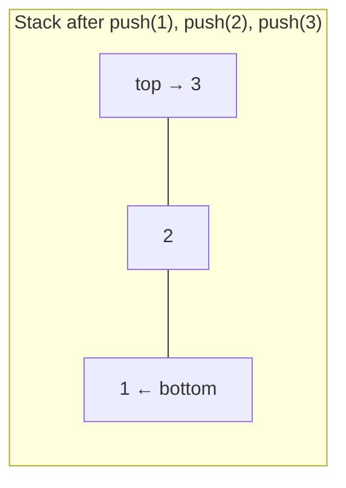

`pop()` returns 3, then 2, then 1 — the reverse of insertion order. This is **LIFO**, last in first
out.

```python
# host — Python: a stack from scratch, using a list
class Stack:
    def __init__(self):
        self._items = []

    def push(self, x):
        self._items.append(x)

    def pop(self):
        if not self._items:
            raise IndexError("pop from empty stack")
        return self._items.pop()

    def peek(self):
        return self._items[-1]

    def is_empty(self):
        return len(self._items) == 0
```

You have already met the most important stack in computing: the **call stack** from
[section 3.8](#38-functions-the-call-stack-and-recursion). Calling a function pushes a frame,
returning pops it, and the LIFO discipline is what guarantees that a function returns to whoever
called it. Stacks also drive expression evaluation (the JVM's operand stack is literally this),
undo history, backtracking algorithms, and depth-first search.

#### 3.9.4 The queue — first in, first out

A queue allows **enqueue** (add at the back) and **dequeue** (remove from the front). FIFO.

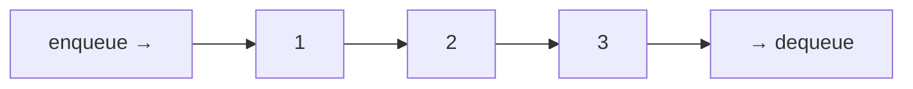

Queues model anything where fairness or ordering matters: the Android main thread's `MessageQueue`
([chapter 09](../09-Android-App-Internals/README.md)), Binder transaction queues
([chapter 25](../25-Binder/README.md)), network packet buffers, and breadth-first search.

```java
// host — Java: a ring-buffer queue from scratch, no library types
public class RingQueue {
    private final int[] buf;
    private int head = 0;      // index of the next element to dequeue
    private int tail = 0;      // index where the next element is enqueued
    private int size = 0;

    public RingQueue(int capacity) {
        this.buf = new int[capacity];
    }

    public boolean enqueue(int v) {
        if (size == buf.length) return false;       // full
        buf[tail] = v;
        tail = (tail + 1) % buf.length;             // wrap around
        size++;
        return true;
    }

    public int dequeue() {
        if (size == 0) throw new IllegalStateException("empty");
        int v = buf[head];
        head = (head + 1) % buf.length;
        size--;
        return v;
    }
}
```

The `% buf.length` is the ring: when an index runs off the end it wraps to zero, so a fixed array
serves as an unbounded-looking queue. Ring buffers are everywhere in kernels and drivers precisely
because they need no allocation at run time.

> **⚠️ Warning.** Ring buffers are a classic source of bugs when `head`, `tail` and `size` are
> allowed to disagree. If a producer and a consumer run on different threads without
> synchronisation, `size` can be read while it is being updated, and the queue will hand out the
> same slot twice or overwrite an unread element. In native code that is a memory-safety issue, not
> just a logic one.

### 3.10 Data structures II — hash maps, and why they matter for DEX

This subsection deserves its length. Hash maps are the data structure you will meet most often,
they are the mechanism behind DEX string lookup and ART's interned-string table, and the way they
fail is itself an attack.

#### 3.10.1 The problem

You have 100 000 strings and you want to answer "is `"com.example.Secret"` among them?" instantly.
Scanning is O(n). Sorting and binary-searching is O(log n) but requires the data sorted. You want
O(1).

#### 3.10.2 The idea

Turn the key into a number, use that number as an array index. That is all a hash map is.

> **📖 Definition — hash function.** A function that maps data of arbitrary size to a fixed-size
> integer, such that equal inputs always produce equal outputs, and unequal inputs *usually* produce
> unequal outputs. "Usually" is doing enormous work in that sentence.

> **📖 Definition — hash map (hash table, dictionary, associative array).** A data structure storing
> key–value pairs, in which the storage slot for a key is computed from a hash of the key rather
> than searched for.

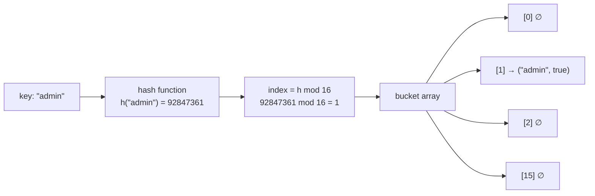

The diagram shows the whole mechanism: hash the key, reduce the hash to a bucket index, store the
pair there. Lookup repeats the identical computation and lands on the same bucket.

#### 3.10.3 Java's actual string hash function

Java specifies `String.hashCode()` exactly, and it has been unchanged since 1995 because programs
depend on it:

```java
// This is the specified algorithm, reproduced from the java.lang.String contract.
int hash = 0;
for (int i = 0; i < length; i++) {
    hash = 31 * hash + charAt(i);   // 32-bit int arithmetic, wraps on overflow
}
```

Worked by hand for `"Hi"`:

```
h = 0
i=0: c = 'H' = 72   →  h = 31*0  + 72 = 72
i=1: c = 'i' = 105  →  h = 31*72 + 105 = 2232 + 105 = 2337
"Hi".hashCode() == 2337
```

Worked for `"Ab"` and `"BC"` to show the danger:

```
"Ab":  h = 31*'A' + 'b' = 31*65 + 98  = 2015 + 98  = 2113
"BC":  h = 31*'B' + 'C' = 31*66 + 67  = 2046 + 67  = 2113   ← identical
```

Two different strings, same hash. That is a **collision**, and collisions are not a bug — they are
mathematically unavoidable, because there are infinitely many strings and only 2^32 hash values.
A hash map must handle them.

> **🔬 Under the Hood.** Why 31? It is odd (so multiplication is invertible modulo 2^32, spreading
> bits well), prime, and `31 * h` can be computed as `(h << 5) - h`, which was faster than a
> multiply on 1990s hardware. You will actually see `LSL` followed by `SUB` in ART-compiled string
> hashing.

#### 3.10.4 Collision resolution — the two real strategies

**Separate chaining.** Each bucket holds a list of entries. On collision, append.

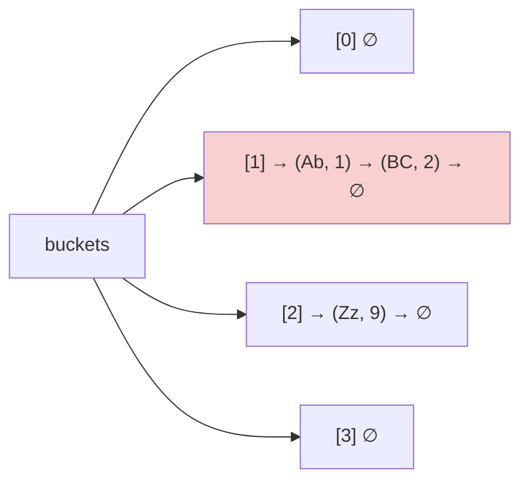

Bucket 1 holds a chain of two entries. Lookup hashes to bucket 1, then walks the chain comparing
keys with full equality (`equals`), not just hashes. This is why **a hash map needs both
`hashCode()` and `equals()`**, and why overriding one without the other is the most common Java bug
in existence.

**Open addressing.** One entry per slot; on collision, probe forward for the next free slot.

```
insert "Ab" → hash mod 8 = 1 → slot 1 free  → store at 1
insert "BC" → hash mod 8 = 1 → slot 1 taken → probe slot 2 → free → store at 2
lookup "BC" → hash mod 8 = 1 → slot 1 holds "Ab", not equal → probe slot 2 → match
```

| Property | Separate chaining | Open addressing |
|---|---|---|
| Memory layout | Buckets plus scattered nodes | One flat array |
| Cache behaviour | Poorer (pointer chasing) | Excellent |
| Deletion | Trivial (unlink) | Awkward (needs tombstones) |
| Load factor limit | Can exceed 1.0 | Must stay well below 1.0 |
| Used by | `java.util.HashMap` | ART's internal `HashSet`, many C++ tables |

> **📖 Definition — load factor.** Number of stored entries divided by number of buckets. As it
> rises, collisions rise and performance degrades. `java.util.HashMap` resizes (doubling the bucket
> array and rehashing everything) when the load factor exceeds 0.75.

#### 3.10.5 A hash map implemented from scratch

This is worth reading line by line; you will implement it yourself in
[Lab 02](labs/lab-02-hashmap-and-dex-strings.md).

```python
# examples/hashmap_from_scratch.py — run with: python3 hashmap_from_scratch.py
class HashMap:
    """Separate-chaining hash map with the Java string hash, built from primitives only."""

    def __init__(self, num_buckets=16):
        self.buckets = [[] for _ in range(num_buckets)]
        self.count = 0

    @staticmethod
    def java_hash(s):
        """Reproduce java.lang.String.hashCode(), including 32-bit signed wrapping."""
        h = 0
        for ch in s:
            h = (31 * h + ord(ch)) & 0xFFFFFFFF     # keep 32 bits
        if h >= 0x80000000:                          # reinterpret as signed
            h -= 0x100000000
        return h

    def _index(self, key):
        return self.java_hash(key) % len(self.buckets)

    def put(self, key, value):
        bucket = self.buckets[self._index(key)]
        for i, (k, _) in enumerate(bucket):
            if k == key:                 # full equality, not just hash equality
                bucket[i] = (key, value)
                return
        bucket.append((key, value))
        self.count += 1
        if self.count > 0.75 * len(self.buckets):
            self._resize()

    def get(self, key, default=None):
        for k, v in self.buckets[self._index(key)]:
            if k == key:
                return v
        return default

    def _resize(self):
        old = self.buckets
        self.buckets = [[] for _ in range(len(old) * 2)]
        for bucket in old:
            for k, v in bucket:
                self.buckets[self._index(k)].append((k, v))
```

Three things in that code are the whole lesson:

1. `_index` reduces an arbitrary hash to a valid bucket number with `%`. Real implementations use
   `hash & (num_buckets - 1)`, which is the same thing when the bucket count is a power of two and
   is one instruction instead of a division.
2. `put` and `get` both compare keys with `==` after finding the bucket. **The hash narrows the
   search; equality decides it.**
3. `_resize` rehashes every entry, because bucket indices depend on the bucket count. Resizing is
   O(n) and happens rarely, so the *amortised* cost of insertion is still O(1).

#### 3.10.6 Hash collision as a denial-of-service attack

If every key collides, every bucket chain has length *n*, and every lookup becomes O(n). Inserting
*n* colliding keys costs O(n²). For `n = 100 000`, that is ten billion comparisons.

Because Java's string hash is a published, deterministic, invertible-ish function, generating
colliding strings is easy. `"Ab"` and `"BC"` collide, so `"AbAb"`, `"AbBC"`, `"BCAb"`, and `"BCBC"`
all collide with each other, and this doubles with every two characters. Sixteen characters give
256 colliding strings; thirty-two characters give 65 536.

This was demonstrated publicly against many web platforms at the 28th Chaos Communication Congress
(2011) in the talk *"Efficient Denial of Service Attacks on Web Application Platforms"*, which
showed that a single HTTP POST of form parameters could pin a server CPU for minutes. Platforms
responded by randomising hash seeds per process, by switching to collision-resistant hashes, or by
converting long bucket chains into balanced trees.

> **🔍 Pentester's Note.** On Android the equivalent target is any component that puts
> attacker-controlled strings into a `HashMap` or `Bundle` without a size limit: a
> `ContentProvider` ([chapter 27](../27-ContentProviders/README.md)) that indexes query parameters,
> a JSON parser that builds a map of object keys, or an `Intent` ([chapter 26](../26-Intent/README.md))
> with thousands of extras. Java's `HashMap` mitigates this since Java 8 by converting a bucket with
> eight or more entries into a red-black tree, degrading to O(log n) instead of O(n) — but only when
> the keys are `Comparable`. Test it: measure the time to process 1 000 random keys versus 1 000
> crafted colliding keys.

#### 3.10.7 Why this matters for DEX internals

A DEX file contains a `string_ids` table: an array of offsets, one per unique string, **sorted by
the string's UTF-16 code point values**. Because it is sorted, a DEX parser finds a string by
binary search in O(log n), not by hashing.

But the runtime needs more than the file's table. ART maintains an **intern table** — a hash set
guaranteeing that two identical string literals anywhere in the process are the same object, so
that `==` on interned strings works and so memory is not wasted. That table is a real hash set with
a real hash function over UTF-16 code units, and the hash is computed by the routine referred to in
[section 3.5.6](#356-what-a-string-looks-like-inside-a-dex-file).

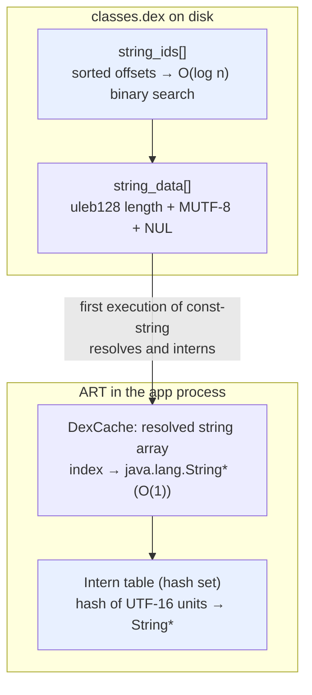

The diagram shows the two-stage lookup that happens the first time a `const-string` instruction
executes. The DEX index is turned into a `String` object once, cached in the `DexCache` array so
every subsequent execution is a single array load, and interned so that identical literals share
one object.

Three practical consequences for you:

1. **Every string literal in the app is in one flat table.** `strings classes.dex` genuinely does
   find API keys. There is no per-class scattering to hide behind.
2. **The table is sorted, so you can bisect it.** Tools like `dexdump` and custom parsers exploit
   this, and so can you when writing your own analysis script.
3. **Interning means a hooked string is shared.** If you use Frida to replace the contents of an
   interned `String`, you affect every use of that literal in the process — powerful and dangerous.

### 3.11 Data structures III — trees and graphs

#### 3.11.1 Trees

> **📖 Definition — tree.** A collection of **nodes** in which every node except one (the **root**)
> has exactly one **parent**, and there are no cycles. A node with no children is a **leaf**. The
> **depth** of a node is its distance from the root; the **height** of the tree is the greatest
> depth.

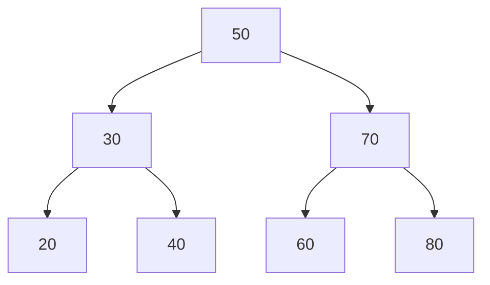

That is a **binary search tree**: every node has at most two children, everything in the left
subtree is smaller, everything in the right subtree is larger. Searching for 40 takes three
comparisons — 50 (go left), 30 (go right), 40 (found) — instead of scanning six elements.

| Operation | Balanced BST | Unbalanced BST (degenerate) |
|---|---|---|
| Search | O(log n) | O(n) |
| Insert | O(log n) | O(n) |
| Delete | O(log n) | O(n) |

A BST built by inserting already-sorted data degenerates into a linked list. Self-balancing variants
— red-black trees, AVL trees — rotate nodes on insertion to guarantee O(log n). `java.util.TreeMap`
is a red-black tree, and so is the fallback storage inside a heavily collided `java.util.HashMap`
bucket.

Trees you will meet constantly in Android security work, none of which look like the diagram above
but all of which are trees:

| Tree | Where |
|---|---|
| Abstract syntax tree (AST) | Every compiler; what JADX builds before printing Java |
| View hierarchy | Every Android screen; `uiautomator dump` prints it |
| XML DOM | `AndroidManifest.xml`, layouts ([chapter 32](../32-Manifest/README.md)) |
| Filesystem | Directories and files ([chapter 02](../02-Linux-Basics/README.md)) |
| Certificate chain | Leaf → intermediate → root CA ([chapter 35](../35-SSL/README.md)) |
| Merkle tree | APK Signature Scheme v2/v3 content digests, dm-verity |
| Class hierarchy | `Object` at the root, every Java class below it |

#### 3.11.2 Graphs

> **📖 Definition — graph.** A set of **vertices** (nodes) and a set of **edges** (connections
> between vertices). Unlike a tree, a graph may have cycles, may be disconnected, and a vertex may
> have any number of incoming and outgoing edges. Edges may be **directed** (one-way) or
> **undirected**.

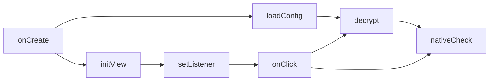

That is a **call graph**: vertices are functions, edges are "calls". Note that `decrypt` and
`nativeCheck` each have two callers, which a tree cannot express. Call graphs are the single most
useful artefact in reverse engineering, because "what reaches this function?" and "what does this
function reach?" are the two questions you ask most.

Two traversal algorithms cover almost every use:

```python
# host — Python. graph is a dict: vertex -> list of neighbours.
def dfs(graph, start, seen=None):
    """Depth-first: go as deep as possible before backtracking. Uses the CALL STACK."""
    if seen is None:
        seen = set()
    if start in seen:
        return seen          # cycle guard — without this, infinite recursion
    seen.add(start)
    for neighbour in graph.get(start, []):
        dfs(graph, neighbour, seen)
    return seen

def bfs(graph, start):
    """Breadth-first: visit all neighbours before going deeper. Uses a QUEUE."""
    from collections import deque
    seen = {start}
    queue = deque([start])
    order = []
    while queue:
        v = queue.popleft()
        order.append(v)
        for neighbour in graph.get(v, []):
            if neighbour not in seen:
                seen.add(neighbour)
                queue.append(neighbour)
    return order
```

The two functions differ in **one thing**: DFS uses a stack (here, the call stack via recursion) and
BFS uses a queue. Swap the container and you swap the traversal order. That is the payoff of
[section 3.9](#39-data-structures-i--arrays-linked-lists-stacks-queues).

Use BFS when you want the *shortest* path — "what is the shortest call chain from an exported
`Activity` to this `Cipher.getInstance` call?" is a BFS question, and the answer is your
reachability argument in a report. Use DFS when you want to enumerate everything reachable.

> **🔍 Pentester's Note.** Ghidra, IDA, JADX, and jadx-gui all build call graphs internally, and
> all of them expose "find references to this function". That is a reverse BFS on the call graph.
> Learning to think in graphs is what turns "I found a suspicious function" into "I found a
> suspicious function reachable in three hops from an exported component", which is the difference
> between a note and a finding.

> **⚠️ Warning — cycles.** Every graph algorithm needs a "have I been here?" set. Without it, a
> cycle produces infinite recursion, which is stack exhaustion, which is
> [section 3.8.5](#385-recursion). Attacker-supplied graphs — dependency graphs, XML entity
> references, symbolic link chains, `Intent` redirect chains — are a reliable way to find code that
> forgot the cycle guard.

### 3.12 Algorithms and Big-O — enough to reason about performance

> **📖 Definition — algorithm.** A finite, unambiguous procedure that transforms an input into an
> output. A program is an algorithm expressed in a language.

> **📖 Definition — Big-O notation.** A description of how an algorithm's cost grows as its input
> grows, ignoring constant factors and lower-order terms. O(n) means "cost grows proportionally to
> input size". It says nothing about actual speed at any specific size.

The point of Big-O for a security researcher is not to write fast code. It is to answer two
questions:

1. **Will this be a denial of service?** If a request causes O(n²) work on attacker-controlled *n*,
   you have a finding.
2. **Is this brute-forceable?** If a secret is 4 digits, the search space is 10^4 = 10 000, which is
   seconds. If it is a 128-bit key, it is 2^128, which is never.

| Complexity | Name | n=10 | n=1 000 | n=1 000 000 | Typical source |
|---|---|---|---|---|---|
| O(1) | Constant | 1 | 1 | 1 | Array index, hash lookup |
| O(log n) | Logarithmic | ~3 | ~10 | ~20 | Binary search, balanced tree |
| O(n) | Linear | 10 | 1 000 | 1 000 000 | One loop over the data |
| O(n log n) | Linearithmic | ~33 | ~10 000 | ~20 000 000 | Good sorting |
| O(n²) | Quadratic | 100 | 1 000 000 | 10^12 | Nested loop over the same data |
| O(2^n) | Exponential | 1 024 | ~10^301 | — | Naive subset enumeration |
| O(n!) | Factorial | 3 628 800 | — | — | Brute-force permutations |

The jump from O(n log n) to O(n²) is where servers fall over. The jump from O(n²) to O(2^n) is where
computation becomes impossible.

**Reading complexity off code:** count the nesting of loops over the input.

```java
// O(n) — one pass
for (int i = 0; i < n; i++) { work(); }

// O(n²) — nested passes over the same input
for (int i = 0; i < n; i++) {
    for (int j = 0; j < n; j++) { work(); }
}

// O(n²) in disguise — the inner call is itself O(n)
for (int i = 0; i < n; i++) {
    if (list.contains(items[i])) { ... }   // ArrayList.contains is O(n)
}

// O(n) — the same logic with the right data structure
Set<String> set = new HashSet<>(list);     // O(n) once
for (int i = 0; i < n; i++) {
    if (set.contains(items[i])) { ... }    // HashSet.contains is O(1)
}
```

> **🔍 Pentester's Note — algorithmic complexity attacks.** The third example is the shape of a real
> denial-of-service finding. Others worth hunting: regular expressions with nested quantifiers
> (`(a+)+$` against a long string of `a`s is exponential — "ReDoS"); string concatenation in a loop
> (`s += x` in Java copies the whole string each time, so building an n-character string is O(n²));
> and sorting with a comparator that itself does O(n) work. All three appear in real Android apps,
> usually in a parser handling data from a server you can influence.

> **🧠 Mental Model.** Big-O tells you the *shape* of the curve, not the height. An O(n²) algorithm
> can beat an O(n log n) one for small n, which is exactly why real sorting implementations switch
> to insertion sort below about 32 elements. Never argue from Big-O alone when n is small; always
> argue from Big-O when n is attacker-controlled.

---
### 3.13 Pointers and references

This is the topic that confuses everybody, permanently, and the confusion is *not the learner's
fault*. It is caused by three different communities using overlapping words for different things.
This subsection fixes the vocabulary first, then explains the mechanics.

#### 3.13.1 The vocabulary problem, stated plainly

| Term | C meaning | Java/Kotlin meaning | What it is at the byte level |
|---|---|---|---|
| **pointer** | A variable holding a memory address; can be arithmetic'd, cast, dereferenced | Does not exist in the language | 8 bytes containing an address |
| **reference** | C++ only: an alias for another variable, cannot be reseated | The value of every non-primitive variable | 4 or 8 bytes containing an address |
| **address-of** | `&x` | No equivalent | The numeric location of `x` |
| **dereference** | `*p` | Implicit on every field access | Load from the address |
| **null** | `NULL` / `nullptr`, usually address 0 | `null` | The address 0, or a tagged invalid handle |

The single sentence that resolves 90% of the confusion:

> **🧠 Mental Model.** A **Java reference and a C pointer are the same thing at the byte level** —
> an address. They differ entirely in what the *language* permits you to do with it. C lets you add
> 7 to it, cast it to a different type, and dereference it. Java lets you do exactly two things:
> follow it to access a member, or compare it with another reference. Everything else about
> "references vs pointers" follows from that restriction.

#### 3.13.2 Pointers in C, drawn

```c
/* host — C */
int    x = 42;        /* x lives at, say, 0x7ffd1000 and holds 42       */
int   *p = &x;        /* p lives at, say, 0x7ffd1008 and holds 0x7ffd1000 */
int  **pp = &p;       /* pp holds 0x7ffd1008                             */

printf("%d\n", x);    /* 42 — read the variable            */
printf("%p\n", p);    /* 0x7ffd1000 — read the address     */
printf("%d\n", *p);   /* 42 — dereference: go to that address and read */
printf("%d\n", **pp); /* 42 — dereference twice            */

*p = 99;              /* write THROUGH the pointer         */
printf("%d\n", x);    /* 99 — x changed without naming x   */
```

```
address       contents            name
0x7ffd1000    00 00 00 2A         x   (int, value 42 → later 99)
0x7ffd1004    ?? ?? ?? ??         (padding)
0x7ffd1008    00 00 7f fd 10 00   p   (pointer, value 0x7ffd1000)
0x7ffd1010    00 00 7f fd 10 08   pp  (pointer to pointer)
```

The picture is the whole idea: `p` is an ordinary variable whose *value happens to be an address*.
`*p` means "treat my value as an address and go there". Nothing more mysterious than that.

**Pointer arithmetic** is the feature that makes C fast and dangerous:

```c
/* host — C */
int a[5] = {10,20,30,40,50};
int *p = a;          /* array name decays to a pointer to its first element */
printf("%d\n", *p);      /* 10 */
printf("%d\n", *(p+2));  /* 30 — p+2 advances by 2 * sizeof(int) = 8 bytes  */
printf("%d\n", p[2]);    /* 30 — a[i] is DEFINED as *(a + i)                */
```

Because `a[i]` is literally defined as `*(a + i)`, `a[i]` and `i[a]` are the same expression in C.
That is a party trick, but it demonstrates that array indexing in C carries **no bounds
information whatsoever**. `p + 1000000` is a valid expression producing a valid pointer value; only
dereferencing it fails, and only if the address happens to be unmapped.

#### 3.13.3 The four ways pointers kill you

| Failure | Cause | Symptom | Exploitability |
|---|---|---|---|
| Null dereference | Using a pointer that is 0 | `SIGSEGV` at a low address | Usually just a crash on Android (page 0 is never mappable) |
| Wild pointer | Uninitialised pointer used | `SIGSEGV` at a garbage address, or silent corruption | Depends on stack contents |
| Dangling pointer / use-after-free | Memory freed, pointer kept | Works fine until the memory is reused, then arbitrary behaviour | **Very high** — the premier heap exploitation primitive |
| Out-of-bounds | Index or arithmetic past the end | Corrupts the neighbour | **Very high** — the premier linear-overflow primitive |

```c
/* host — C: use-after-free, the canonical shape */
struct session *s = malloc(sizeof(struct session));
s->is_admin = 0;
free(s);                       /* memory returned to the allocator */
/* ... attacker causes another allocation of the same size ... */
if (s->is_admin) {             /* reads whatever now lives there  */
    grant_root();
}
```

The `free` does not erase anything and does not change `s`. It only tells the allocator "this chunk
is available". If the attacker can cause an allocation of the same size class and control its
contents, `s->is_admin` reads attacker data. This is the mechanism behind a large fraction of
Android kernel and native-library privilege escalations.

> **🔬 Under the Hood.** Android's hardened allocator, Scudo, and the MTE (Memory Tagging Extension)
> hardware feature on ARMv8.5+ exist specifically to break this. Scudo quarantines freed chunks and
> checks headers; MTE tags each allocation with a 4-bit colour stored in the top byte of the pointer
> and traps when a load's tag does not match the memory's tag. See
> [chapter 19](../19-Memory/README.md).

#### 3.13.4 References in Java — the same address, fewer permissions

```java
// host — Java
StringBuilder a = new StringBuilder("hello");
StringBuilder b = a;      // b holds a COPY OF THE ADDRESS, not a copy of the object
b.append(" world");
System.out.println(a);    // "hello world" — one object, two references
System.out.println(a == b);       // true  — same address
System.out.println(a.equals(b));  // true  — and by content
```

Contrast with:

```java
StringBuilder c = new StringBuilder("hello world");
System.out.println(a == c);       // false — different addresses, different objects
System.out.println(a.toString().equals(c.toString()));  // true — same content
```

> **⚠️ Warning — the `==` versus `.equals()` trap.** `==` on references compares **addresses**.
> `.equals()` compares **content**, if the class implements it. `String` is where this bites hardest
> because the compiler interns string *literals*, so `"abc" == "abc"` is true, while
> `new String("abc") == "abc"` is false, and `sb.toString() == "abc"` is false. Authentication code
> written as `if (userInput == expectedPassword)` therefore *works during testing with literals*
> and *fails open or closed unpredictably in production*. This is not hypothetical; it is one of
> the most frequently observed logic bugs in decompiled Android code.

#### 3.13.5 What Java removed, and what it did not

| C capability | Available in Java? | Consequence |
|---|---|---|
| Take the address of a variable | No | No stack-address leaks from language constructs |
| Pointer arithmetic | No | No linear out-of-bounds from arithmetic |
| Cast a pointer to another type | No (casts are checked) | No type confusion from casts alone |
| Free memory explicitly | No | No use-after-free, no double free |
| Access memory after collection | No | GC only collects unreachable objects |
| Null reference | **Yes** | `NullPointerException` remains the most common Java crash |
| Aliasing (two names, one object) | **Yes** | Unexpected mutation, thread-safety bugs, TOCTOU |

The last two rows matter. Java did not remove *all* pointer problems, only the memory-unsafe ones.
Null dereference and aliasing survive, and aliasing is a genuine security issue:

```java
// host — Java: a real vulnerability pattern
public class Config {
    private final String[] allowedHosts;
    public Config(String[] hosts) { this.allowedHosts = hosts; }   // stores the CALLER'S array
    public String[] getAllowedHosts() { return allowedHosts; }     // hands the array back out
}

String[] hosts = {"api.example.com"};
Config cfg = new Config(hosts);
hosts[0] = "evil.example.com";          // mutates the config from outside!
cfg.getAllowedHosts()[0] = "worse.example.com";   // and so does this
```

`final` protects the *reference*, not the *object*. The fix is a **defensive copy**
(`this.allowedHosts = hosts.clone();`) on both the way in and the way out. When you audit an
Android SDK or library, check every getter that returns an array, a `List`, a `Map`, a `Date`, or a
mutable builder — returning the internal object is a silent trust boundary violation.

### 3.14 Memory management — manual versus garbage collected

#### 3.14.1 The problem

A program needs memory whose size or lifetime it cannot know at compile time. That memory comes from
the **heap**. Someone must decide when it is no longer needed and return it. There are exactly two
answers: the programmer decides, or the runtime decides.

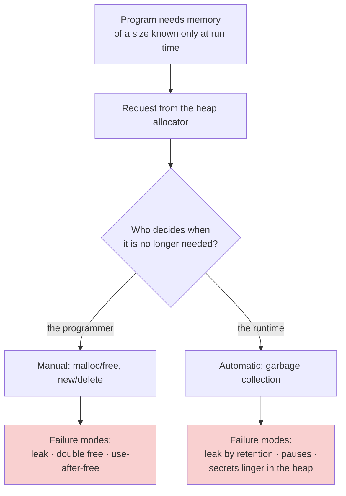

Both columns end in failure modes. Garbage collection is not "memory management solved"; it is
"memory *safety* solved, memory *management* traded for a different set of problems."

#### 3.14.2 Manual management in C

```c
/* host — C */
char *buf = malloc(256);        /* ask the allocator for 256 bytes  */
if (buf == NULL) { return -1; } /* ALWAYS check — malloc can fail   */
strcpy(buf, "data");
free(buf);                      /* return it                        */
buf = NULL;                     /* defensive: make later use crash loudly */
```

| Failure | Code | Consequence |
|---|---|---|
| Leak | `malloc` with no matching `free` | Memory grows until the low-memory killer terminates the app |
| Double free | `free(p); free(p);` | Allocator's free list corrupted; classic exploitation primitive |
| Use-after-free | `free(p); p->field;` | Reads or writes reused memory |
| Free of a non-heap pointer | `free(stack_array)` | Immediate allocator abort |
| Mismatched allocator | `new[]` freed with `free()` | Undefined behaviour |
| Unchecked NULL | Using `malloc`'s result without checking | Null deref under memory pressure |

> **🔬 Under the Hood.** Android's libc allocator (Scudo since Android 11 on most configurations,
> jemalloc before that) stores metadata — chunk size, state, checksums — adjacent to or alongside
> the data it hands you. A heap overflow therefore corrupts *allocator metadata*, and the next
> `malloc` or `free` performs pointer arithmetic on attacker-controlled values. That indirection is
> what turns "I can write 8 bytes past the end of a buffer" into "I can write anywhere."

#### 3.14.3 Garbage collection

> **📖 Definition — garbage collection (GC).** An automatic process that identifies heap objects
> that the program can no longer reach and reclaims their memory. "Reachable" means: findable by
> following references starting from a set of **roots** — the stack of every thread, the CPU
> registers, static fields, and JNI global references.

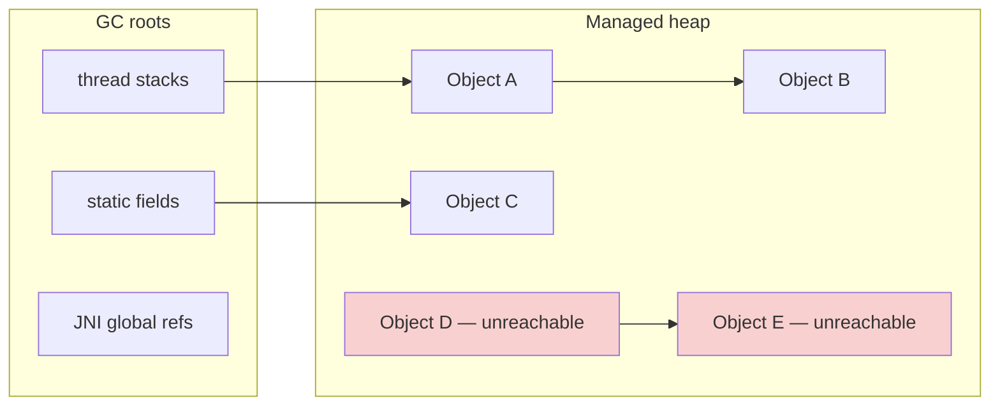

Objects D and E reference each other but nothing reaches them from a root, so both are garbage. Note
that a naive reference-counting scheme would keep them alive forever because each has a nonzero
count — this is exactly why tracing collectors, which start from roots, are used for Java.

Android's ART uses a concurrent copying collector by default on modern versions, meaning that most
of the work happens while your app's threads keep running, and that live objects are **moved** to a
new region during collection.

| Property | Manual (C/C++) | Tracing GC (Java/ART) |
|---|---|---|
| Use-after-free possible | Yes | No (an object is not collected while reachable) |
| Double free possible | Yes | No |
| Leaks possible | Yes (forgotten `free`) | Yes (forgotten *reference*) |
| Deterministic timing | Yes | No — collection happens when the runtime decides |
| Pause times | None | Small, but nonzero |
| Memory overhead | Low | Higher (headroom, object headers, card tables) |
| Secrets erased on release | If you `memset` before `free` | **No** — the bytes persist until overwritten |

#### 3.14.4 The failure mode that matters most to you: secrets in the heap

This is the security consequence of garbage collection and the reason it is in this chapter.

```java
// host — Java. This looks reasonable and is a finding.
String password = editText.getText().toString();
authenticate(password);
password = null;      // does NOT erase anything
```

Setting the variable to `null` removes one reference. It does not overwrite the character data. The
`String` object remains in the heap until the collector runs, and after collection the bytes remain
in the freed region until something else overwrites them. In practice a password read from a login
form is recoverable from a heap dump minutes later.

Worse, `String` is **immutable**, so there is no API to clear it. Every operation that "changes" a
string creates a new one, so a password that passes through `trim()`, `toLowerCase()`, and string
concatenation has left three or four additional copies scattered in the heap.

```java
// host — Java. The correct pattern.
char[] password = editText.getText().toString().toCharArray();   // still leaves one String…
try {
    authenticate(password);
} finally {
    java.util.Arrays.fill(password, '\0');   // actually overwrites the bytes
}
```

> **🔍 Pentester's Note — this is a repeatable, high-value test.** Drive the app to the point just
> after login. Then capture the managed heap and search it:
>
> ```bash
> # host — capture and convert an ART heap dump
> adb shell am dumpheap com.target.app /data/local/tmp/heap.hprof
> adb pull /data/local/tmp/heap.hprof
> hprof-conv heap.hprof heap-std.hprof     # from the Android SDK platform-tools
> strings -e l heap-std.hprof | grep -i -E 'password|token|bearer|secret'
> ```
>
> `strings -e l` searches for 16-bit little-endian text, which is how ART stores non-Latin-1
> `String` data; run plain `strings` as well for the compact 8-bit representation. Finding a
> plaintext credential here is a legitimate MASVS-STORAGE finding and one of the easiest wins
> available. The Frida approach is in [section 7](#7-dynamic-analysis).

> **⚠️ Warning.** The same reasoning applies to `Bitmap`s of ID documents, decrypted database rows,
> and byte arrays holding session keys. "It's in RAM, so it's safe" is false on a rooted device, on
> a device with a debuggable build, and in any crash dump the app uploads to a third-party
> reporting service.

### 3.15 Type systems

> **📖 Definition — type system.** The rules a language uses to assign types to expressions and to
> decide which operations on which types are legal. Its purpose is to reject programs that would be
> meaningless before they run.

Two independent axes, endlessly confused:

| Axis | Option A | Option B |
|---|---|---|
| **When** are types checked? | **Static** — at compile time | **Dynamic** — at run time |
| **How strictly** are types enforced? | **Strong** — no silent reinterpretation | **Weak** — implicit coercion or reinterpretation allowed |

| Language | Static/dynamic | Strong/weak | Notes |
|---|---|---|---|
| C | Static | Weak | Any pointer can be cast to any other; no runtime check at all |
| C++ | Static | Weak-ish | `static_cast` unchecked, `dynamic_cast` checked |
| Java | Static | Strong | Casts of references are checked at run time (`ClassCastException`) |
| Kotlin | Static | Strong | Adds nullability into the type system |
| Python | Dynamic | Strong | `1 + "a"` is an error, not a coercion |
| JavaScript | Dynamic | **Weak** | `1 + "1"` is `"11"`; `[] == false` is true |
| Smali/DEX | Verified statically by ART, then trusted | Strong (after verification) | The verifier is a security boundary |

```java
// Java — static and strong: this does not compile.
int x = "hello";                         // error: incompatible types

// Java — the runtime check that makes it strong.
Object o = "hello";
Integer i = (Integer) o;                 // compiles; throws ClassCastException at run time
```

```python
# Python — dynamic and strong: compiles (there is no compile step), fails at run time.
x = "hello"
y = x + 1          # TypeError: can only concatenate str (not "int") to str
```

```javascript
// JavaScript — dynamic and weak: no error at all, and the result surprises everyone.
console.log(1 + "1");      // "11"   — number coerced to string
console.log("5" - 2);      //  3     — string coerced to number
console.log([] + {});      // "[object Object]"
```

> **🔍 Pentester's Note — where the type system is a security boundary.** On Android, the DEX
> **verifier** is a real defence. Before ART executes a method it checks that every instruction
> operates on registers of the right type, that the stack of every path agrees, and that no
> instruction can produce a value of a type the following instruction does not expect. If the
> verifier could be defeated, a crafted DEX file could, for example, place an `int` where the
> runtime expects an object reference and dereference an arbitrary value — a direct type-confusion
> to arbitrary read/write. This is exactly why hand-written Smali is verified with the same
> strictness as compiler output, and why historical verifier bugs were high-severity issues.

> **🧠 Mental Model.** Weak typing is not "convenient". It is "the language will silently
> reinterpret your bytes." Every silent reinterpretation is a place where two pieces of code can
> disagree about what a value means, and every such disagreement is a candidate vulnerability.
> When auditing JavaScript in a WebView ([chapter 43](../43-WebView/README.md)), the coercion table
> is part of your attack surface.

### 3.16 Programming paradigms — the same program three ways

> **📖 Definition — paradigm.** A style of organising a program: what the primary unit of structure
> is, and how state is managed.

| Paradigm | Primary unit | State | Typical languages |
|---|---|---|---|
| Procedural | The function | Free-standing variables, mutated in place | C, Pascal, shell |
| Object-oriented | The object (data + methods together) | Encapsulated inside objects | Java, Kotlin, C++, C# |
| Functional | The function as a value | Avoided; values are transformed, not mutated | Haskell, Clojure; features in Kotlin, Java 8+ |

Here is the same task — "given a list of transactions, return the total of those over 100" — in all
three styles, in the same language, so that only the paradigm varies.

**Procedural:**

```java
// host — Java, procedural style: data and behaviour are separate.
static int sumLargeAmounts(int[] amounts) {
    int total = 0;
    for (int i = 0; i < amounts.length; i++) {
        if (amounts[i] > 100) {
            total = total + amounts[i];
        }
    }
    return total;
}
```

**Object-oriented:**

```java
// host — Java, OO style: data and behaviour are bundled; state is encapsulated.
public class TransactionLedger {
    private final int[] amounts;
    private final int threshold;

    public TransactionLedger(int[] amounts, int threshold) {
        this.amounts = amounts.clone();     // defensive copy (see 3.13.5)
        this.threshold = threshold;
    }

    public int sumLargeAmounts() {
        int total = 0;
        for (int amount : amounts) {
            if (isLarge(amount)) {
                total += amount;
            }
        }
        return total;
    }

    private boolean isLarge(int amount) {
        return amount > threshold;
    }
}
```

**Functional:**

```java
// host — Java 8+, functional style: no mutable state, composed transformations.
static int sumLargeAmounts(int[] amounts) {
    return java.util.Arrays.stream(amounts)
                           .filter(a -> a > 100)
                           .sum();
}
```

All three compile to loops. The functional version is not magic: `stream().filter().sum()` builds a
small pipeline of objects and then runs a loop inside `sum()`. In DEX it appears as several
synthetic classes implementing `IntPredicate`, one per lambda — which is why heavily functional
Kotlin code decompiles into a swarm of classes named things like
`MainActivity$onCreate$$inlined$sortedBy$1`.

The four pillars of object orientation, since you will meet the words constantly:

| Pillar | Meaning | Security relevance |
|---|---|---|
| **Encapsulation** | Data is private; access goes through methods | `private` is a compiler convention, **not** a runtime guarantee — reflection defeats it |
| **Inheritance** | A class extends another, reusing and specialising it | Determines which method actually runs; a hook on the parent may miss the child |
| **Polymorphism** | One call site invokes different implementations depending on the runtime type | Static analysis cannot always resolve the target — the root cause of false negatives |
| **Abstraction** | Programming to an interface, not an implementation | The interface is what you hook; find implementations with `Xposed`/Frida class enumeration |

> **⚠️ Warning.** `private` in Java prevents *compilation* of outside access. It does not prevent
> *runtime* access. `field.setAccessible(true)` reads any private field of any object. Treating
> `private` as a security control is a developer mistake you will report often, especially in SDKs
> that hold API keys in "private" static fields.

> **🔍 Pentester's Note — polymorphism and hooking.** If `PaymentProcessor` is an interface with
> three implementations and you hook `PaymentProcessor.process`, Frida hooks the *declaration*, and
> whether that intercepts calls depends on how you hook. Hooking each concrete implementation class
> is reliable; hooking the interface is not. This is the most common reason a "correct-looking"
> Frida script silently does nothing. See [chapter 53](../53-Frida/README.md).

---
### 3.17 Errors, exceptions, and failure

#### 3.17.1 The problem

Things go wrong. A file is missing, a network drops, a user types letters into a number field, a
division has a zero denominator. The program must be able to say "I could not do that" and the
caller must be able to react. Every mechanism for this is one of three designs.

| Design | Mechanism | Languages | Failure mode |
|---|---|---|---|
| Return codes | Function returns a sentinel; caller checks | C, Go (explicit error value), POSIX | **Caller forgets to check** |
| Exceptions | Failure unwinds the stack until a handler catches it | Java, Kotlin, Python, C++ | Caller catches too broadly and hides bugs |
| Result types | Failure is part of the return *type*, so the compiler forces handling | Rust, Kotlin's `Result`, Swift | Verbose |

#### 3.17.2 Return codes and the checking problem

```c
/* host — C. Every one of these can fail, and each failure is silent if unchecked. */
FILE *f = fopen("/data/data/com.app/secret.txt", "r");
if (f == NULL) {                    /* MUST check */
    fprintf(stderr, "open failed: %s\n", strerror(errno));
    return -1;
}
size_t n = fread(buf, 1, sizeof(buf), f);
if (n == 0 && ferror(f)) { ... }    /* MUST check */
fclose(f);
```

> **🔍 Pentester's Note — unchecked return values are a vulnerability class in their own right.**
> The highest-value instances are cryptographic and permission-related. If
> `EVP_DecryptFinal_ex()` returns 0 (authentication tag mismatch, meaning the ciphertext was
> tampered with) and the caller ignores it, the app happily uses forged plaintext. If
> `setuid()` fails and the caller proceeds, privileged code runs as root. Grep native libraries for
> calls to `Final`, `Verify`, `setuid`, `setgid`, `chmod`, and `mkdir` whose results are discarded —
> in Ghidra decompilation those appear as a call with no assignment and no following comparison.

#### 3.17.3 Exceptions

> **📖 Definition — exception.** An object representing an abnormal condition, which when *thrown*
> abandons normal execution and searches enclosing scopes — first in the current function, then in
> its caller, then in *its* caller — for a matching `catch` block. If none is found, the thread
> terminates.

```java
// host — Java
try {
    int result = divide(a, b);
    process(result);
} catch (ArithmeticException e) {          // handles a specific failure
    Log.e(TAG, "bad divisor", e);
    result = 0;
} catch (IOException e) {                  // a different failure, different handling
    throw new IllegalStateException("cannot continue", e);   // wrap and rethrow
} finally {
    stream.close();                        // ALWAYS runs, thrown or not
}
```

The `finally` block runs whether or not an exception occurred, and is the only reliable place to
release resources. In modern Java the `try`-with-resources form does this automatically.

**Java's exception hierarchy**, because the distinctions decide behaviour:

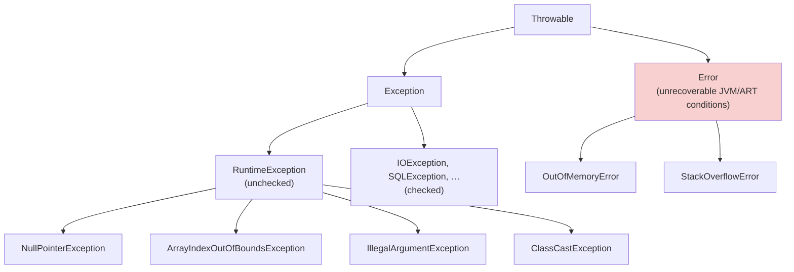

| Category | Compiler forces handling? | Meaning | Example |
|---|---|---|---|
| `Error` | No | The runtime is in trouble; do not catch | `OutOfMemoryError` |
| Checked `Exception` | **Yes** — must catch or declare `throws` | Expected, recoverable external failure | `IOException` |
| `RuntimeException` | No | A programming bug | `NullPointerException` |

#### 3.17.4 The anti-patterns you will report

```java
// host — Java. Every one of these is a real finding in real apps.

try { risky(); } catch (Exception e) { }                    // 1. swallowed silently

try { verifyCertificate(); } catch (Throwable t) { proceed(); }  // 2. fail-open

catch (Exception e) { Log.e(TAG, e.toString()); }           // 3. logs a stack trace
                                                            //    containing internal paths

catch (Exception e) {
    return Response.error(e.getMessage());                  // 4. leaks internals to the UI
}
```

Number 2 is the one that becomes a critical finding: an exception in a security check that is caught
and treated as success. Certificate-pinning implementations
([chapter 36](../36-CertificatePinning/README.md)) fail this way regularly — the pin check throws,
the developer catches broadly "so the app does not crash", and the connection proceeds unpinned.
This maps to MASVS-NETWORK and is exactly what you test when you present an unexpected certificate.

Number 3 and 4 are information disclosure. A stack trace names classes, methods, file paths, and
library versions. That is a free map of the application's internals, and it is why you should always
try to *provoke* an exception during testing: send a malformed value to every input and read what
comes back.

> **🧠 Mental Model — fail closed, not open.** A security check has two failure directions. "Fail
> closed" means an error denies access. "Fail open" means an error grants it. Every `catch` block
> around a security decision is a place where the developer chose a direction, often without
> realising they were choosing. Find those blocks and read them.

#### 3.17.5 How to read a stack trace

You will read thousands of these, so read one properly, once.

```
FATAL EXCEPTION: main
Process: com.example.target, PID: 14322
java.lang.NullPointerException: Attempt to invoke virtual method
    'java.lang.String com.example.target.model.User.getToken()' on a null object reference
        at com.example.target.net.ApiClient.buildAuthHeader(ApiClient.java:88)
        at com.example.target.net.ApiClient.get(ApiClient.java:142)
        at com.example.target.ui.MainActivity$2.onClick(MainActivity.java:210)
        at android.view.View.performClick(View.java:7455)
        at android.os.Handler.dispatchMessage(Handler.java:106)
        at android.app.ActivityThread.main(ActivityThread.java:7660)
```

Read it in this order:

1. **The exception type.** `NullPointerException` — a reference was null when it was dereferenced.
2. **The message.** It names the *exact* method that was attempted and on what: `User.getToken()`
   on a null `User`. Android's "helpful NPE" messages since Android 11 tell you which value was
   null; older versions do not.
3. **The top frame.** `ApiClient.buildAuthHeader(ApiClient.java:88)` is where it *died*. This is
   almost never where the *bug* is.
4. **Walk downwards to find the cause.** The bug is wherever the null `User` came from. Frame 2
   called it, frame 3 was a click handler. So: a click handler triggered a request before the user
   object was populated — a race between UI availability and session state.
5. **Find the boundary between app code and framework code.** Everything from
   `android.view.View.performClick` downwards is the platform. The last *app* frame going down is
   the entry point into your code, and it tells you what event started this.

> **🔍 Pentester's Note.** Frames 4 through 6 are the standard Android main-thread stack:
> `ActivityThread.main` runs the `Looper`, `Handler.dispatchMessage` delivers a message,
> `View.performClick` dispatches a touch. Seeing that tail tells you the code ran on the main
> thread. If you instead see `Binder$ProxyTransact` or `BinderProxy.transact` in the tail, the code
> ran in response to an IPC call — which means a *different app* triggered it, which means you have
> found a reachable attack surface. Reading the tail of a stack trace tells you who is allowed to
> call this code.

### 3.18 Compilation, interpretation, bytecode VMs, JIT and AOT

This subsection sets up chapters [11](../11-Android-Runtime/README.md),
[12](../12-DEX-Internals/README.md), [13](../13-ART/README.md), and
[14](../14-Dalvik/README.md), so it is deliberately thorough.

#### 3.18.1 Pure interpretation

An **interpreter** is a program that reads your program and does what it says, without translating
it to machine code first.

```mermaid
sequenceDiagram
    participant S as Source file
    participant I as Interpreter process
    participant C as CPU
    S->>I: read next statement
    I->>I: parse it
    I->>C: execute equivalent native operations
    C-->>I: result
    I->>S: read next statement
    Note over I,S: parsing repeats every time a line runs —<br/>a loop body is re-examined each iteration
```

| Property | Consequence |
|---|---|
| No build step | Instant edit-run cycle; ideal for scripting your tooling |
| Source must ship | The reverse engineer gets the original code, comments included |
| Slow | Parsing and dispatch overhead on every operation |
| Portable | The interpreter is ported, not your program |

Pure interpretation of raw text is rare today. CPython, for example, compiles source to its own
bytecode first, caching it in `__pycache__/*.pyc`. Shell is a genuine text interpreter.

#### 3.18.2 Ahead-of-time compilation to native code

```mermaid
flowchart LR
    S["hello.c"] --> CC["clang"] --> N["native machine code<br/>in libhello.so"] --> X(["CPU executes<br/>directly"])
```

| Property | Consequence |
|---|---|
| Translation happens once, at build time | No runtime translation cost |
| Ships machine code | Fastest possible startup and steady-state speed |
| Architecture-specific | Must build one binary per ABI — `arm64-v8a`, `armeabi-v7a`, `x86_64` |
| Names and types destroyed | Reverse engineering is far harder |
| No runtime profile | The compiler must guess which branches are hot |

This is what the NDK produces for every `.so` inside an APK's `lib/` directory
([chapter 15](../15-Native-Code/README.md)). It is also why developers move sensitive logic into
native code: not because it is unbreakable, but because it raises the cost.

#### 3.18.3 Bytecode virtual machines

The compromise: compile once to an instruction set for an *imaginary* machine, then have a small
program on each real machine execute those instructions.

> **📖 Definition — bytecode.** A compact, architecture-independent instruction encoding produced by
> a compiler and executed by a virtual machine. Opcodes are typically one byte, hence the name.

> **📖 Definition — virtual machine (in this sense).** A program that implements the semantics of a
> defined instruction set in software. Not to be confused with a system VM such as QEMU or a
> hypervisor guest.

Two architectural styles, and Android deliberately chose the second:

| Style | Operands live | Example instruction | Code size | Instruction count |
|---|---|---|---|---|
| **Stack-based** | On an implicit operand stack | `iload_1; iload_2; iadd; istore_3` | Smaller per instruction | More instructions |
| **Register-based** | In numbered virtual registers | `add-int v3, v1, v2` | Larger per instruction | Fewer instructions |

JVM `.class` files are stack-based. DEX is register-based. Adding two locals takes four JVM
instructions and one Dalvik instruction:

```
JVM (.class)                    Dalvik (.dex)
  iload_1      ; push a           add-int v3, v1, v2
  iload_2      ; push b
  iadd         ; pop 2, push sum
  istore_3     ; pop into c
```

> **🔬 Under the Hood.** Register-based bytecode was chosen for Dalvik because fetching and decoding
> an instruction is expensive on the low-power ARM CPUs of 2008; fewer, fatter instructions meant
> fewer dispatches. The practical consequence for you is that **Smali reads much more like ordinary
> code than JVM bytecode does**, which makes manual Smali patching realistic. Compare
> [chapter 12](../12-DEX-Internals/README.md) and [chapter 14](../14-Dalvik/README.md).

#### 3.18.4 JIT — compiling at run time

An interpreter is slow; an AOT compiler cannot know what is hot. A **just-in-time** compiler watches
execution, notices that a method is being called repeatedly, and compiles *that method* to native
code while the program runs.

```mermaid
stateDiagram-v2
    [*] --> Interpreted: method first called
    Interpreted --> Interpreted: call count below threshold
    Interpreted --> Profiling: invocation counter rising
    Profiling --> JITCompiled: threshold crossed
    JITCompiled --> JITCompiled: subsequent calls run native code
    JITCompiled --> Deoptimised: assumption invalidated<br/>(class loaded, debugger attached)
    Deoptimised --> Interpreted
```

The state machine shows the two directions that surprise people. A method gets *faster* over time,
and it can also be **deoptimised** back to the interpreter when an assumption the JIT relied on
stops holding — for example when a new subclass is loaded that makes a previously monomorphic call
site polymorphic, or when a debugger attaches.

> **🔍 Pentester's Note.** Deoptimisation is why attaching a debugger or a Frida agent changes
> timing and sometimes changes behaviour. It is also the mechanism many hooking frameworks rely on:
> to make a hook take effect, the runtime must be persuaded to stop using previously compiled native
> code for that method. When a Frida hook "doesn't fire", one real cause is that the method is
> already AOT-compiled and inlined into its caller, so there is no separate entry point left to
> intercept. See [chapter 65](../65-Hooking/README.md).

Because JIT-generated code must be written and then executed, the JIT needs a memory region that
is writable and later executable. On Android, ART allocates a JIT code cache and uses `mprotect` to
flip permissions rather than keeping an RWX mapping. An **RWX region in an app process is therefore
abnormal** and is one of the strongest indicators of code injection when you inspect
`/proc/<pid>/maps`.

#### 3.18.5 Android's actual pipeline, end to end

```mermaid
flowchart TD
    subgraph Dev["Developer machine"]
        K["Kotlin / Java source"]
        KC["kotlinc / javac"]
        CF["JVM .class files"]
        R8["R8 — shrink, optimise, obfuscate, desugar"]
        DX["classes.dex — DEX bytecode"]
        K --> KC --> CF --> R8 --> DX
    end

    subgraph Device["Device"]
        VER["DEX verifier"]
        VDEX["base.vdex — verified DEX"]
        D2O["dex2oat"]
        OAT["base.odex / .oat — native code"]
        ARTF["base.art — preloaded image"]
        INTERP["ART interpreter"]
        JIT["ART JIT + code cache"]
        PROF["primary.prof — runtime profile"]
        D2O --> OAT
        D2O --> ARTF
        VER --> VDEX
        INTERP --> JIT
        JIT -- "records hot methods" --> PROF
        PROF -- "profile-guided recompilation<br/>during idle maintenance" --> D2O
    end

    DX --> VER
    VDEX --> D2O
    OAT --> EXE(["Method executes as native code"])
    VDEX --> INTERP
    JIT --> EXE

    style K fill:#e8f0ff
    style EXE fill:#dfe8dd
```

Walk it in prose, because this diagram is the map for four later chapters.

On the developer's machine, source becomes JVM class files, then R8 shrinks and obfuscates them and
converts them to DEX. What ships is DEX bytecode — no native code for the app's own logic.

On the device, installation triggers **verification**: ART checks that the bytecode is type-correct
and structurally sound, and stores the result in a `.vdex` file so verification need not be repeated.
Depending on the Android version and the installation source, `dex2oat` may then AOT-compile some or
all methods into a `.odex`/`.oat` file of real ARM64 instructions.

At run time, a method executes in whichever form is available: AOT code if it was compiled, JIT code
if it has become hot, or the interpreter otherwise. Meanwhile ART records which methods were hot in
a profile file, and during device idle maintenance `dex2oat` re-runs using that profile so the next
launch has the right methods precompiled. This is **profile-guided AOT**, and it is the reason app
performance improves over the first days of use.

| Android version | Default strategy | Notes |
|---|---|---|
| 4.4 (KitKat) | Dalvik interpreter + JIT; ART available experimentally | `.odex` files were Dalvik-optimised DEX, not native code |
| 5.0–6.0 | ART, full AOT at install time | Long installs, large storage use |
| 7.0–8.1 | ART, JIT + profile-guided AOT during idle | Fast installs; performance improves over time |
| 9–12 | Same, plus Cloud Profiles delivered via Play | Common hot methods precompiled at first install |
| 13+ | Same, with ART updatable as a Mainline module | ART behaviour can change without an OS update |

> **⚠️ Warning.** Because a method may exist as DEX bytecode, as AOT native code, and as JIT native
> code simultaneously, **patching the DEX does not necessarily change what runs** until the compiled
> artefacts are invalidated. When a Smali patch appears to have no effect, clear the app's compiled
> state (reinstall) rather than assuming the patch was wrong.

#### 3.18.6 Comparison table

| | Interpretation | AOT to native | Bytecode VM | JIT |
|---|---|---|---|---|
| Translation time | Every execution | Build time | Build time (to bytecode) | Run time |
| Ships | Source | Machine code | Bytecode | Bytecode |
| Startup | Instant | Instant | Fast | Fast |
| Peak throughput | Lowest | Highest | Low | High after warm-up |
| Portability | Highest | Lowest | High | High |
| Symbol survival | Everything | Almost nothing | Names and types | Names and types |
| Android example | Shell scripts, `sh` | NDK `.so`, `dex2oat` output | DEX in the interpreter | ART JIT code cache |
| RE difficulty | Trivial | Hard | Easy | Easy (source is still DEX) |

### 3.19 Version control with git — the mental model first

#### 3.19.1 Why this is in a security chapter

Three reasons, and the third is the one that gets you findings:

1. Every tool you will use is distributed through git, and building from source is routine.
2. AOSP is a git repository. Reading `frameworks/base` history is how you answer "when did this
   check get added, and why?"
3. **Application source leaks through git.** `.git` directories left in deployed web roots, git
   history inside an APK's assets, and secrets committed and then "removed" in a later commit are
   all real, repeatedly observed findings. Deleting a secret in a new commit does not delete it from
   history.

#### 3.19.2 The mental model: a DAG of snapshots

Almost everybody learns git as a list of commands and stays confused forever. Learn the data
structure instead and the commands become obvious.

> **📖 Definition — commit.** A complete snapshot of the tracked files at one moment, plus metadata
> (author, timestamp, message) and a pointer to its parent commit or commits. It is identified by
> the SHA-1 (or SHA-256) hash of its own content, which is why commit IDs look like
> `9f3a1c4d8b…`.

> **📖 Definition — DAG.** Directed Acyclic Graph. A graph whose edges have direction and which
> contains no cycles. Git's history is a DAG of commits: edges point from child to *parent*, and
> nothing can be its own ancestor.

```mermaid
flowchart RL
    C1["A<br/>initial"] 
    C2["B"] 
    C3["C"] 
    C4["D<br/>feature work"]
    C5["E"] 
    C6["F<br/>merge"]
    C2 --> C1
    C3 --> C2
    C4 --> C2
    C5 --> C3
    C6 --> C5
    C6 --> C4
    MAIN["main"] -.-> C6
    FEAT["feature"] -.-> C4
    HEAD["HEAD"] -.-> MAIN
```

Read the arrows as "has parent". Commit F has two parents, E and D — that is what a **merge** is.
`main` and `feature` are **branches**, which are nothing more than named pointers to a commit;
moving a branch is a one-line file write. `HEAD` is a pointer to the branch you are currently on.

Once you hold that picture, the commands stop being arbitrary:

| Command | What it does to the DAG |
|---|---|
| `git commit` | Creates a new node whose parent is the current `HEAD`, and moves the branch pointer to it |
| `git branch x` | Creates a new name pointing at the current commit. Nothing else. |
| `git checkout x` / `git switch x` | Moves `HEAD` to point at branch `x`, and updates the working files to match |
| `git merge y` | Creates a node with two parents: current `HEAD` and the tip of `y` |
| `git rebase y` | Copies your commits as *new* nodes on top of `y`. The originals become unreferenced. |
| `git reset --hard c` | Moves the branch pointer to `c` and makes the files match. Commits left behind become unreferenced but still exist. |
| `git cherry-pick c` | Copies the *changes* of one node as a new node here |
| `git tag v1.0` | A name pointing at a commit that does not move |

> **🧠 Mental Model.** Git almost never deletes anything. `reset --hard`, `rebase`, and amended
> commits leave the old objects in the repository, unreferenced, until garbage collection removes
> them — typically after 30 days. `git reflog` lists where `HEAD` has been and is the recovery tool
> for "I destroyed my work". **The same fact is why a secret you removed is still there.**

#### 3.19.3 The three areas

```mermaid
flowchart LR
    W["Working tree<br/>the files you edit"]
    S["Index / staging area<br/>what the next commit will contain"]
    R["Repository (.git)<br/>the DAG of commits"]
    W -- "git add" --> S
    S -- "git commit" --> R
    R -- "git checkout" --> W
    S -- "git restore --staged" --> W
    R -- "git diff HEAD" --> W
```

The **index** is the concept beginners miss. It exists so you can commit *some* of your changes.
`git status` shows all three states at once: staged changes, unstaged changes, and untracked files.

#### 3.19.4 The commands you actually need

```bash
# host — daily use
git clone https://android.googlesource.com/platform/frameworks/base
git status                     # what is staged, unstaged, untracked
git diff                       # working tree vs index
git diff --staged              # index vs last commit
git add path/to/file           # stage
git commit -m "message"        # snapshot
git log --oneline --graph --all --decorate   # SEE THE DAG
git checkout -b my-branch      # create and switch
git merge other-branch
git push origin my-branch
git pull --rebase
```

```bash
# host — the investigative commands, which are the ones that matter to you
git log --oneline -- path/to/File.java      # history of ONE file
git log -S 'apiKey' --oneline               # commits that ADDED or REMOVED the string "apiKey"
git log -p -- path/to/File.java             # full diffs for that file
git blame path/to/File.java                 # who last changed each line, and in which commit
git show <commit>                           # the full diff of one commit
git bisect start / bad / good               # binary-search history for the commit that broke it
git rev-list --objects --all                # EVERY object ever stored, including deleted files
git cat-file -p <object-hash>               # print any object's contents
git reflog                                  # every position HEAD has held
git fsck --lost-found                       # dangling commits and blobs
```

> **🔍 Pentester's Note — recovering secrets from history.** If you obtain a repository (from a
> leaked archive, an exposed `.git` directory, or an APK that shipped one in `assets/`), the
> workflow is:
>
> ```bash
> # host
> git log --all --oneline                             # every commit on every branch
> git log --all -S 'BEGIN PRIVATE KEY' --oneline      # commits touching a key
> git log --all --diff-filter=D --name-only           # every file ever DELETED
> git rev-list --objects --all | sort -k2 | uniq      # every blob, including unreachable ones
> git grep -n 'password' $(git rev-list --all)        # grep every commit's tree
> ```
>
> The `--diff-filter=D` listing is often the most productive single command: developers delete
> `config.properties`, `google-services.json`, `keystore.jks`, and `.env` files after realising the
> mistake, and the deletion commit tells you exactly what to go and extract.

> **⚠️ Warning.** Rotating the secret is the only remediation. "We removed it in a later commit" is
> not remediation, and neither is `git rm`. Rewriting history with `filter-repo` removes it from the
> repository you control but not from any clone, fork, or CI cache that already has it.

---
## 4. Source Code Walkthrough (AOSP)

Everything in [section 3](#3-deep-internal-working) is abstract until you see it in the actual
Android source tree. This section traces four of the chapter's concepts — strings and MUTF-8,
hashing, hash maps, and garbage collection — into real AOSP files.

> **⚠️ Warning.** AOSP moves files between releases. Paths below are given as directory plus file
> name, which has been stable across recent releases, and no line numbers are quoted. Always verify
> against the branch you are studying with
> `git log --oneline -- <path>` inside your AOSP checkout, or by browsing
> [cs.android.com](https://cs.android.com). Where a code listing is shown as *simplified*, it is a
> teaching reconstruction of the logic, not a verbatim quotation.

### 4.1 MUTF-8 — `art/libdexfile/dex/utf.h` and `utf.cc`

The conversion routines discussed in [section 3.5.5](#355-mutf-8--the-encoding-androids-dex-format-actually-uses)
live in ART's DEX library, which is shared between `dex2oat`, the runtime, and host tools.

| Symbol | Role |
|---|---|
| `CountModifiedUtf8Chars` | Counts UTF-16 code units in a MUTF-8 byte sequence — the length the runtime will allocate |
| `ConvertModifiedUtf8ToUtf16` | Decodes MUTF-8 bytes into the `char` array backing a `java.lang.String` |
| `ConvertUtf16ToModifiedUtf8` | The reverse, used when writing DEX and when passing strings to JNI |
| `CountUtf8Bytes` | Computes how many MUTF-8 bytes a UTF-16 sequence needs — used to size buffers |
| `ComputeUtf16Hash` | The hash over UTF-16 code units used by ART's internal hash tables |
| `CompareModifiedUtf8ToUtf16AsCodePointValues` | Ordering used when searching the sorted `string_ids` table |

The decoder's structure is exactly the table from [section 3.5.3](#353-utf-8--variable-length-ascii-compatible-the-internets-default),
with the two MUTF-8 deviations bolted on. Simplified to its essentials:

```c
// SIMPLIFIED reconstruction of the MUTF-8 decode loop in art/libdexfile/dex/utf.cc.
// Not a verbatim quotation — read the real file for the exact code.
uint32_t GetUtf16FromUtf8(const char** utf8_data_in) {
  uint8_t one = *(*utf8_data_in)++;
  if ((one & 0x80) == 0) {                 // 0xxxxxxx — 1 byte, plain ASCII
    return one;
  }
  uint8_t two = *(*utf8_data_in)++;
  if ((one & 0x20) == 0) {                 // 110xxxxx — 2 bytes (this also covers C0 80 → U+0000)
    return ((one & 0x1f) << 6) | (two & 0x3f);
  }
  uint8_t three = *(*utf8_data_in)++;
  // 1110xxxx — 3 bytes. In MUTF-8 a surrogate arrives HERE, individually encoded.
  return ((one & 0x0f) << 12) | ((two & 0x3f) << 6) | (three & 0x3f);
}
```

Three observations that are the whole point of reading it:

1. **There is no 4-byte case.** Strict UTF-8's 4-byte form never appears in valid MUTF-8; a
   supplementary character arrives as two consecutive 3-byte sequences that happen to decode to a
   surrogate pair. That is deviation (2) from [section 3.5.5](#355-mutf-8--the-encoding-androids-dex-format-actually-uses).
2. **`C0 80` falls out of the 2-byte branch naturally** and produces 0. That is deviation (1). No
   special case is needed, which is why the trick was chosen.
3. **The loop trusts its input for continuation bytes.** Validation is the DEX verifier's job, in
   `art/libdexfile/dex/dex_file_verifier.cc`, not the decoder's. A third-party DEX parser that
   copies this decoder without also copying the verifier's checks will walk off the end of a buffer
   on malformed input. This is the practical reason to fuzz any DEX tool you write.

### 4.2 The hash used for interned strings

`ComputeUtf16Hash` in the same header implements, in effect, the same `h = 31*h + c` recurrence as
`java.lang.String.hashCode()` — it must, because `String.hashCode()` is specified and Java code can
observe it. The specification itself is in
`libcore/ojluni/src/main/java/java/lang/String.java`, whose `hashCode()` documents and implements
the `s[0]*31^(n-1) + s[1]*31^(n-2) + … + s[n-1]` formula that you computed by hand in
[section 3.10.3](#3103-javas-actual-string-hash-function).

That single specified algorithm has three consequences you can act on:

| Consequence | Practical use |
|---|---|
| It is deterministic across devices and versions | You can precompute the hash of a class or method name offline |
| It is not seeded or randomised for `String` | Collision generation is possible — [section 3.10.6](#3106-hash-collision-as-a-denial-of-service-attack) |
| ART and Java must agree on it | Native and managed code look up the same interned string |

### 4.3 The intern table — `art/runtime/intern_table.cc` and `intern_table.h`

When a `const-string` instruction executes for the first time, the runtime must produce a
`java.lang.String` object. The **intern table** guarantees that identical literals produce the same
object. It is a hash set keyed by the string's contents.

```mermaid
sequenceDiagram
    participant M as Executing method
    participant DC as DexCache (per DexFile)
    participant IT as InternTable
    participant H as Managed heap
    M->>DC: resolve string index 4211
    alt already resolved
        DC-->>M: cached String*
    else first time
        DC->>IT: InternStrong(utf16 data)
        IT->>IT: ComputeUtf16Hash → bucket probe
        alt already interned
            IT-->>DC: existing String*
        else new
            IT->>H: allocate java.lang.String
            H-->>IT: String*
            IT->>IT: insert into hash set
            IT-->>DC: String*
        end
        DC-->>M: String* (and cache it)
    end
```

The sequence shows the two caches in front of the allocation: the per-`DexFile` `DexCache` array
turns index-to-object into a single array load after the first use, and the intern table turns
content-to-object into a hash lookup. Both exist for performance and both are visible to you.

The table is split into a **boot image / strong** portion (strings from the preloaded framework
image, effectively immortal) and a **weak** portion (strings the collector may reclaim). ART's
generic open-addressed hash set implementation used here lives in the `base` library —
`art/libartbase/base/hash_set.h` in current releases, `art/runtime/base/hash_set.h` in older ones.
It is an excellent, short read if you want to see the open-addressing scheme of
[section 3.10.4](#3104-collision-resolution--the-two-real-strategies) implemented in production
C++, including the load factor policy and the tombstone-free "empty slot" convention.

> **🔍 Pentester's Note.** Because every string literal in the process is interned and reachable,
> enumerating live `java.lang.String` instances on the heap enumerates essentially every literal the
> app has executed. That is the theoretical basis for the Frida heap-search technique in
> [section 7.4](#74-finding-secrets-in-the-art-heap-with-frida).

### 4.4 `java.util.HashMap` — `libcore/ojluni/src/main/java/java/util/HashMap.java`

Android's `HashMap` is derived from OpenJDK's, so the code you read here is the code that runs on
the device. Four design details from [section 3.10](#310-data-structures-ii--hash-maps-and-why-they-matter-for-dex)
are visible directly in it:

| Detail | How it appears |
|---|---|
| Bucket count is always a power of two | `tableSizeFor()` rounds capacity up to a power of two so `(n - 1) & hash` can replace a modulo |
| Hash spreading | A static `hash(Object key)` XORs the key's `hashCode()` with itself shifted right 16 bits, mixing high bits down into the low bits that select the bucket |
| Separate chaining | `Node<K,V>` has a `next` field — the linked list of [section 3.9.2](#392-the-linked-list--flexible-scattered-pointer-chasing) |
| Treeification | When a bin's length reaches `TREEIFY_THRESHOLD` (8) and the table is at least `MIN_TREEIFY_CAPACITY` (64), the bin becomes a red-black tree of `TreeNode`s |

The spreading step deserves a moment, because it is the fix for a real problem. If the bucket index
is `hash & (n - 1)` and `n` is 16, only the low 4 bits of the hash choose the bucket. A hash function
whose entropy sits in the high bits would then put everything in one bucket. XOR-folding the top 16
bits down means every bit of the original hash influences the bucket choice.

Treeification is the mitigation for the collision denial-of-service of
[section 3.10.6](#3106-hash-collision-as-a-denial-of-service-attack) — but only partially. It
requires the keys to be mutually `Comparable` (which `String` is) to get O(log n); otherwise the
tree falls back to a worse-than-linear ordering by identity hash. When you test an app for hash
flooding, you are testing whether the container in the path is a `HashMap` (mitigated),
a `Hashtable`/`ArrayMap`/custom map (often not), or a linear structure.

### 4.5 `ArrayMap` — the Android-specific alternative, `frameworks/base/core/java/android/util/ArrayMap.java`

Android's framework very often uses `ArrayMap` rather than `HashMap`, and `Bundle` — the container
every `Intent` extra travels in ([chapter 26](../26-Intent/README.md)) — is built on it via
`frameworks/base/core/java/android/os/BaseBundle.java`.

`ArrayMap` uses two arrays: one of hashes, kept **sorted**, and one of alternating keys and values.
Lookup is a binary search over the hash array — O(log n) — followed by an equality check and a
linear scan over any run of equal hashes.

```
mHashes:  [ -871,  102,  102,  553, 9911 ]        sorted ints
mArray:   [ k0,v0,  k1,v1,  k2,v2,  k3,v3,  k4,v4 ]   parallel, key/value interleaved
                     ^^^^^^^^^^^^ two entries share hash 102 → linear scan within the run
```

| Property | `HashMap` | `ArrayMap` |
|---|---|---|
| Lookup | O(1) average | O(log n) |
| Memory per entry | Node object + references | Two array slots, no per-entry object |
| Behaviour under mass collisions | Treeifies at 8 per bin | Degrades to a linear scan over the equal-hash run |
| Insertion in the middle | O(1) | O(n) — `System.arraycopy` to make room |
| Intended size | Any | Small maps (tens of entries) |

> **🔍 Pentester's Note.** `ArrayMap` trades worst-case robustness for memory. An attacker who can
> put thousands of same-hash keys into a `Bundle` gets a linear scan per lookup on top of an O(n)
> insert, which is quadratic overall. The delivery vehicle is an `Intent` with a very large number
> of crafted extras sent to an exported component. Whether this is exploitable in a given app
> depends on Binder transaction size limits ([chapter 25](../25-Binder/README.md)) and on whether
> the receiving component iterates the extras. It is a cheap test to run and occasionally produces a
> denial-of-service finding against a system-privileged component.

### 4.6 Garbage collection — `art/runtime/gc/`

The mechanism of [section 3.14.3](#3143-garbage-collection) is implemented under `art/runtime/gc/`.

| Path | Contents |
|---|---|
| `art/runtime/gc/heap.h`, `heap.cc` | The `Heap` object: allocation entry points, GC triggering policy, growth limits |
| `art/runtime/gc/collector/` | The collector implementations, including the concurrent copying collector |
| `art/runtime/gc/space/` | Memory *spaces*: the main allocation space, the image space, large-object space, zygote space |
| `art/runtime/gc/allocator/` | The underlying region/run allocators |

Two facts from this tree matter to you directly.

**Objects move.** The concurrent copying collector relocates live objects into fresh regions and
leaves the old bytes behind. This means an address you noted a moment ago may no longer hold the
object — which is why Frida scripts must never cache a raw managed-object address across a GC, and
why `Java.perform` and ART's handle mechanisms exist. It also means the *old* copy of an object's
bytes remains in an unreclaimed region until that region is reused, so a secret can exist in more
than one place at once.

**The zygote space is shared.** Objects allocated before the Zygote forks live in a shared,
copy-on-write region common to every app process ([chapter 09](../09-Android-App-Internals/README.md)).
Framework string literals therefore appear in every process's heap dump, which is noise you must
filter out when hunting for app secrets.

### 4.7 Where integer-overflow discipline lives in AOSP

Native framework code that parses attacker-reachable data carries explicit overflow checks, and
reading them teaches the safe patterns from [section 3.4.3](#343-the-other-three-shapes-of-the-same-bug).

| Path | What to look at |
|---|---|
| `frameworks/native/libs/binder/Parcel.cpp` | Every `read*` method validates that the requested size fits within the parcel's remaining data before advancing; the growth logic checks for overflow before resizing |
| `art/libdexfile/dex/dex_file_verifier.cc` | Bounds and consistency checks on every DEX table offset and size, which is where a malicious DEX is rejected |
| `bionic/libc/bionic/malloc_common.cpp` and the Scudo integration | Allocation entry points, including the overflow check inside `calloc` |
| `system/core/libcutils` | Small utility routines used across the platform, a good source of defensive C idioms |

> **🔬 Under the Hood.** `Parcel` is the single most security-relevant parser in Android, because
> every Binder transaction ([chapter 25](../25-Binder/README.md)) flows through it and both sides of
> a transaction may be malicious relative to the other. Reading `Parcel.cpp` alongside
> `frameworks/base/core/java/android/os/Parcel.java` is the best single exercise for connecting
> this chapter's material to real platform code: you will see length prefixes, alignment padding,
> file-descriptor handling, and bounds checks all in one file.

---

## 5. Security Perspective

### 5.1 How attackers abuse programming-level constructs

Every vulnerability class below is a direct consequence of something in
[section 3](#3-deep-internal-working). The point of this table is that you can now *derive* the
class from the mechanism rather than memorising a list.

| Construct (section) | Vulnerability class | Attacker's goal |
|---|---|---|
| Fixed-size buffer + unbounded copy (3.9.1) | Stack/heap buffer overflow | Overwrite saved `LR`, function pointers, or allocator metadata |
| Integer arithmetic (3.4) | Integer overflow / truncation | Make a size check pass while the real size is larger |
| Signed/unsigned mixing (3.2.2) | Sign-confusion | Turn a negative length into a huge unsigned one |
| Manual `free` (3.14.2) | Use-after-free, double free | Reclaim a freed chunk with attacker data |
| Pointer arithmetic (3.13.2) | Out-of-bounds read/write | Read adjacent secrets, or write a chosen value |
| Recursion (3.8.5) | Stack exhaustion / stack clash | Denial of service, or jump the guard page |
| Hashing (3.10.6) | Algorithmic complexity attack | Pin the CPU with crafted colliding keys |
| Loops on attacker input (3.7.4) | Infinite loop / ReDoS | Denial of service |
| Exceptions (3.17.4) | Fail-open security checks | Bypass a check by making it throw |
| Type casts (3.15) | Type confusion | Make code interpret bytes as the wrong type |
| String encodings (3.5) | Filter bypass, homoglyph spoofing | Two components disagree about what a string is |
| GC (3.14.4) | Secrets persisting in memory | Recover credentials from a heap dump |
| Aliasing (3.13.5) | Unexpected mutation / TOCTOU | Change a validated value after validation |
| Reflection over `private` (3.16) | Broken encapsulation | Read fields the developer believed were hidden |

### 5.2 How developers create these bugs

Developers do not write vulnerabilities on purpose. Each of these is a reasonable-looking habit:

- **Trusting a length field.** Every binary format has one. The developer reads it, allocates it,
  and copies it, in that order, and never asks whether the file actually contains that many bytes.
- **Validating the input but not the derived value.** The count is checked; the count times the
  element size is not. This is [section 3.4.2](#342-the-worked-example--an-allocation-size-overflow).
- **Catching `Exception` to stop crash reports.** A crash is visible to management; a silently
  bypassed check is not.
- **Treating `private` and `final` as security controls.** They are compile-time constructs.
- **Storing secrets in `String`.** Convenient, immutable, and unerasable.
- **Copying a Stack Overflow answer that predates a mitigation.** Certificate-pinning and
  `TrustManager` code is the worst offender; the top-voted answer for "how do I fix an SSL
  handshake error" has historically been "trust all certificates".
- **Assuming the JVM's checks extend into JNI.** They do not. `GetByteArrayElements` hands native
  code a raw pointer with no bounds attached.

### 5.3 Common mistakes with real consequences

| Mistake | Code shape | Consequence |
|---|---|---|
| `==` instead of `.equals()` on `String` | `if (pin == correctPin)` | Comparison of addresses; behaves differently for literals and runtime strings |
| Missing `& 0xFF` on a Java `byte` | `int v = data[i];` | Negative values for any byte ≥ 0x80; parser misbehaviour |
| `malloc(n * size)` instead of `calloc(n, size)` | `p = malloc(count * 16);` | Overflow to a small allocation |
| `<=` in a loop bound | `for (i=0;i<=len;i++)` | One-element overflow |
| Comparing a hash with `==` in Java | `if (hash1 == hash2)` on `byte[]` | Compares array identity, always false — MAC check that never passes, or is inverted to always pass |
| Non-constant-time comparison of secrets | `Arrays.equals(mac, expected)` | Timing side channel; use `MessageDigest.isEqual` |
| Returning an internal array | `return this.keys;` | Caller mutates internal state |
| Unbounded recursion in a parser | recursive descent with no depth counter | Stack exhaustion DoS |

### 5.4 Real vulnerabilities and CVEs illustrating these classes

Cited conservatively; only well-documented, widely referenced identifiers are used.

| CVE / event | Class from this chapter | One-line summary |
|---|---|---|
| **CVE-2015-1538** | Integer overflow (3.4) | An integer overflow in Android's MP4 extractor (`libstagefright`) allowed heap corruption from a media file, reachable via MMS. |
| **CVE-2019-2215** | Use-after-free (3.13.3) | A use-after-free in the Android Binder driver, exploited in the wild for local privilege escalation. |
| **CVE-2016-5195 ("Dirty COW")** | Race condition on copy-on-write memory (3.14) | A kernel race allowed writing to read-only private mappings, used for root on Android. |
| **CVE-2017-13156 ("Janus")** | Format/parser disagreement (3.5, 3.15) | An APK could be both a valid DEX and a valid APK; the signature verifier and the loader disagreed about which bytes mattered. |
| 28C3 (2011) hash-flooding research | Algorithmic complexity (3.10.6) | The talk *"Efficient Denial of Service Attacks on Web Application Platforms"* showed that crafted colliding keys turn hash-map insertion into O(n²) across many platforms. |

> **⚠️ Warning.** Do not cite a CVE in a report unless you have read its advisory and confirmed the
> affected versions. A wrong CVE number in a client deliverable is worse than no CVE number. When in
> doubt, describe the class ("an unchecked multiplication producing an undersized allocation") and
> cite the vendor bulletin rather than guessing an identifier.

### 5.5 Bug bounty patterns rooted in this chapter

These are recurring *shapes*, not specific reports:

1. **The forgotten debug path.** A `BuildConfig.DEBUG` check that was inverted, or a debug feature
   gated only by a `SharedPreferences` boolean that any exported component can set.
2. **The secret that survives obfuscation.** Obfuscators rename identifiers; they do not remove the
   DEX string table ([section 3.10.7](#3107-why-this-matters-for-dex-internals)). API keys, S3
   bucket names, and internal hostnames remain literal strings.
3. **The check that throws.** A pinning or root check wrapped in `try { } catch (Exception e) { }`
   that continues on failure. Provoke the exception (remove the pinned certificate, corrupt the
   expected hash file) and observe fail-open behaviour.
4. **The unvalidated length in a native parser.** Any `.so` that parses images, video, fonts,
   archives, or a proprietary protocol. Follow the multiplication into the allocation.
5. **Credentials in the heap after logout.** Log in, log out, dump the heap, find the token still
   present. See [section 3.14.4](#3144-the-failure-mode-that-matters-most-to-you-secrets-in-the-heap).
6. **The `.git` or source map that shipped.** `assets/`, `res/raw/`, and web assets inside a WebView
   bundle regularly contain build artefacts nobody meant to include.

### 5.6 OWASP MASVS and MASTG mapping

| MASVS control | Relevance to this chapter |
|---|---|
| **MASVS-STORAGE-1 / -2** | Secrets held in `String` objects and recoverable from a heap dump ([3.14.4](#3144-the-failure-mode-that-matters-most-to-you-secrets-in-the-heap)) |
| **MASVS-CRYPTO-1 / -2** | Non-constant-time comparisons; unchecked return values from decryption and MAC verification ([3.17.2](#3172-return-codes-and-the-checking-problem)) |
| **MASVS-NETWORK-1 / -2** | Fail-open exception handling around certificate validation and pinning ([3.17.4](#3174-the-anti-patterns-you-will-report)) |
| **MASVS-PLATFORM-1** | Aliasing and mutable state crossing the IPC boundary; `Bundle`/`ArrayMap` behaviour ([3.13.5](#3135-what-java-removed-and-what-it-did-not), [4.5](#45-arraymap--the-android-specific-alternative-frameworksbasecorejavaandroidutilarraymapjava)) |
| **MASVS-CODE-1 / -2 / -3 / -4** | Memory safety in native code, input validation, and third-party library quality — the entire content of [3.4](#34-integer-overflow-as-a-vulnerability-class), [3.13](#313-pointers-and-references), and [3.14](#314-memory-management--manual-versus-garbage-collected) |
| **MASVS-RESILIENCE-1 / -4** | Root and tamper checks reduce to a single conditional branch ([3.6.3](#363-the-same-conditional-at-four-levels)) |

Corresponding MASTG test procedures are enumerated in
[chapter 71 — OWASP Mobile](../71-OWASP-Mobile/README.md).

### 5.7 How a pentester tests for these

A repeatable order of operations, cheapest first:

1. **Dump the string table.** `strings` on `classes.dex` and on every `.so`. Grep for `http`, `key`,
   `token`, `secret`, `password`, `BEGIN`, and internal domain names.
2. **Read the manifest for entry points.** Exported activities, services, receivers, and providers
   ([chapter 32](../32-Manifest/README.md)). These are the roots of your call graph.
3. **Map from entry point to sink.** Use JADX's "find usages" as a reverse BFS
   ([section 3.11.2](#3112-graphs)) from every dangerous sink — `Runtime.exec`, `loadUrl`,
   `openFileOutput`, `Cipher.getInstance`, `System.loadLibrary` — back to an exported entry point.
4. **Provoke exceptions.** Send nulls, empty strings, enormous strings, negative numbers,
   `Integer.MIN_VALUE`, and malformed encodings to every input. Read the logcat.
5. **Test boundary values.** For every numeric input: 0, 1, −1, `MAX_VALUE`, `MIN_VALUE`,
   `MAX_VALUE + 1`. These are the integer-overflow probes.
6. **Dump the heap after authentication.** [Section 3.14.4](#3144-the-failure-mode-that-matters-most-to-you-secrets-in-the-heap).
7. **Hook the decision points.** Every `boolean` returned by a method named `is*`, `check*`,
   `verify*`, or `validate*` is a Frida target ([chapter 53](../53-Frida/README.md)).
8. **Follow every JNI boundary.** Managed-code safety stops at `native` methods
   ([chapter 16](../16-JNI/README.md)).

### 5.8 How malware abuses the same constructs

Malware uses this chapter offensively rather than defensively:

- **String obfuscation and runtime decryption** to keep literals out of the DEX string table —
  a direct response to [section 3.10.7](#3107-why-this-matters-for-dex-internals). You defeat it by
  hooking the decryption routine rather than reading the file.
- **Reflection** to call APIs whose names never appear as call sites, defeating naive static
  analysis. The names still appear as *strings*, which is how you find them.
- **Dynamic code loading** — downloading a DEX or `.so` at run time so the shipped APK is benign.
- **Native code** to hide logic from JADX and to implement anti-analysis checks.
- **Deliberate parser confusion** — files that are simultaneously a valid ZIP and a valid image, so
  that a scanner and the loader disagree.

### 5.9 How a forensic analyst investigates

The forensic angle is mostly the reverse of the developer's mistakes:

| Artefact | What this chapter explains about it |
|---|---|
| Heap dump (`.hprof`) | Objects survive collection; secrets and message contents are recoverable ([3.14.4](#3144-the-failure-mode-that-matters-most-to-you-secrets-in-the-heap)) |
| Tombstone in `/data/tombstones/` | A native crash with a register dump and a `FP`-chain backtrace ([3.8.6](#386-connecting-to-arm-reversing)) |
| ANR trace | Every thread's Java stack; shows what was blocking ([3.17.5](#3175-how-to-read-a-stack-trace)) |
| `logcat` history | Stack traces leaked by broad `catch` blocks ([3.17.4](#3174-the-anti-patterns-you-will-report)) |
| Git history in a recovered project | Deleted secrets are still present ([3.19.4](#3194-the-commands-you-actually-need)) |
| Free but unreused heap regions | Data from previous allocations persists ([3.14.2](#3142-manual-management-in-c)) |

---
## 6. Reverse Engineering Perspective

You now know what the constructs are. This section is a lookup table for **recognising them** in the
four forms you will actually see: JADX-decompiled Java, Smali, native disassembly, and the raw APK.

### 6.1 The recognition table

| Construct | In JADX | In Smali | In AArch64 disassembly |
|---|---|---|---|
| Local variable | `int i` / `r0`, `v1` if names are stripped | `v0`, `v1`, `p0`… register numbers | A register, or `[sp, #off]` |
| `if` | `if (x == 1) { … }` | `if-ne v0, v1, :cond_0` | `cmp` + `b.<cond>` |
| `for` loop | `for (int i = …)` | `:goto_0` … `goto :goto_0` | backward `b` or conditional backward branch |
| `switch` | `switch (x)` | `packed-switch` / `sparse-switch` | bounds check + table load + `br` |
| Method call | `foo.bar(x)` | `invoke-virtual {p0, v0}, L…;->bar(I)V` | `bl` to a symbol or `blr` through a register |
| String literal | `"text"` | `const-string v0, "text"` | `adrp` + `add` pointing into `.rodata` |
| Array access | `a[i]` | `aget v0, v1, v2` | `ldr w0, [x1, x2, lsl #2]` |
| Object field | `this.field` | `iget-object v0, p0, L…;->field:L…;` | `ldr` at a fixed offset from an object pointer |
| Static field | `Foo.BAR` | `sget-object v0, L…;->BAR:L…;` | `adrp`/`ldr` from `.data` or `.bss` |
| Object allocation | `new Foo()` | `new-instance` + `invoke-direct <init>` | `bl operator new` + constructor `bl` |
| Exception handler | `try { } catch { }` | `:try_start_0` … `.catch … {:try_start_0 .. :try_end_0} :catch_0` | landing pads referenced from `.eh_frame` |
| Interface dispatch | `iface.method()` | `invoke-interface` | vtable load + `blr` |
| Native method | `private native int f();` | `.method private native f()I` with no body | the exported `Java_pkg_Class_f` symbol in a `.so` |

### 6.2 The four-way example in Smali and in AArch64

The `boundedSum` function from [section 2.3](#23-the-same-program-four-ways), compiled by `d8` and
disassembled by `baksmali`:

```smali
# smali — baksmali output for SumDemo.boundedSum(II)I
.method static boundedSum(II)I
    .registers 5
    .param p0, "n"      # I
    .param p1, "limit"  # I

    const/4 v0, 0x0             # v0 = total = 0
    const/4 v1, 0x1             # v1 = i = 1

    :goto_2
    if-gt v1, p0, :cond_10      # if (i > n) goto done
    add-int/2addr v0, v1        # total += i
    if-le v0, p1, :cond_c       # if (total <= limit) goto continue
    const/4 v2, -0x1
    return v2                   # return -1
    :cond_c
    add-int/lit8 v1, v1, 0x1    # i++
    goto :goto_2
    :cond_10
    return v0                   # return total
.end method
```

Three things to internalise from this listing:

1. **`.registers 5` declares the frame size.** Dalvik registers are the locals *and* the parameters:
   the last N registers are the parameters, aliased as `p0`, `p1`, … . With `.registers 5` and two
   parameters, `p0` is `v3` and `p1` is `v4`. Confusing these is the most common Smali-editing
   mistake.
2. **The labels encode their own offsets.** `:cond_10` means "the condition target at bytecode
   offset 0x10". After you edit code, `smali` recomputes them; do not try to keep them meaningful.
3. **The structure is one-to-one with the Java.** Compare it to the source in
   [section 2.3](#23-the-same-program-four-ways) line by line. This fidelity is why Smali patching
   is practical and why JADX output is trustworthy in a way Ghidra output is not.

The same function compiled by clang for AArch64 at `-O0` is essentially the pseudo-assembly given in
[section 3.7.3](#373-a-loop-compiled-line-by-line). At `-O2` you may instead see the closed-form
`n*(n+1)/2` with a single overflow-aware comparison, and no loop at all.

### 6.3 What obfuscation does, and does not do

| Obfuscation technique | Destroys | Survives |
|---|---|---|
| Identifier renaming (R8/ProGuard, [41](../41-ProGuard/README.md), [42](../42-R8/README.md)) | Class, method, field names | Control flow, string literals, framework API names, method signatures |
| String encryption | Plain literals in the string table | The decryption routine itself, and the plaintext at run time |
| Control-flow flattening | Readable loops and branches | The set of operations performed |
| Reflection-based dispatch | Direct call edges in the call graph | The target names, as strings |
| Native migration | Java-level readability | The exported JNI symbol name, which encodes the Java class and method |
| Packing / dynamic DEX loading | Static visibility of the real code | The loader, and the decrypted DEX in memory at run time |

> **🧠 Mental Model.** Obfuscation cannot remove information the runtime needs. The runtime needs
> the framework's API names, the JNI symbol names, the class names used in reflection, and the
> actual bytes of every string at the moment it is used. Everything an obfuscator can safely destroy
> is something *only humans* needed. That is why "hook the point of use" always beats "read the
> file" against a well-obfuscated target.

### 6.4 Recognising the data structures of section 3 in the wild

| Structure | Native fingerprint | Managed fingerprint |
|---|---|---|
| Array | Base pointer plus scaled index: `ldr w0, [x1, x2, lsl #2]` | `aget`/`aput`, `array-length` |
| Linked list | Load at a constant offset producing a pointer that is loaded again in a loop | A field named `next`; `LinkedList`, `LinkedHashMap` |
| Stack | `SP`-relative addressing; push/pop pairs | `java.util.ArrayDeque`, `Stack` |
| Hash map | Mask (`and w0, w0, #0xF`) or modulo after a multiply-accumulate loop over bytes | `HashMap`, `ArrayMap`, `SparseArray` |
| Binary search | Loop computing `(lo + hi) / 2` — often `add` then `lsr #1` | `Arrays.binarySearch`, `TreeMap` |
| String hash | Loop with `lsl #5` and `sub` (that is `31 * h`) | `hashCode()` |
| Ring buffer | Index update followed by `and` with a power-of-two mask | `% buf.length` on an `int` field |

The `lsl #5` / `sub` pair deserves its own note: seeing `w0 = (w0 << 5) - w0 + w1` inside a loop over
characters is a **positive identification of Java-compatible string hashing**, whether it is in a
`.so` implementing its own name lookup or inside ART itself.

### 6.5 A worked recognition example

Suppose Ghidra gives you this decompilation of a function in an app's native library:

```c
/* Ghidra output, cleaned up slightly */
undefined8 FUN_00012a40(long param_1, uint param_2)
{
  void *pvVar1;
  uint uVar2;
  
  if (param_2 < 0x10000) {
    uVar2 = param_2 * 0x18;
    pvVar1 = malloc((ulong)uVar2);
    if (pvVar1 != (void *)0x0) {
      memcpy(pvVar1, (void *)(param_1 + 8), (ulong)(param_2 * 0x18));
      ...
```

Read it with this chapter in hand:

- `param_2` is a count; `0x18` is 24, so the element size is 24 bytes.
- The check `param_2 < 0x10000` caps the count at 65 535.
- `65535 * 24 = 1 572 840`, which fits comfortably in 32 bits. **So there is no overflow here.**
  The developer's bound happens to be safe.
- But `uVar2` is `uint` (32-bit) while `malloc` takes a 64-bit `size_t`, and the `memcpy` length is
  computed *again* rather than reusing `uVar2`. If those two expressions ever diverge — because of a
  later edit, or because one is `uint` and the other is promoted differently — the allocation and
  the copy disagree. Flag it as fragile, not as a vulnerability.
- The real question is now **where `param_2` comes from**. That is a reverse call-graph query
  ([section 3.11.2](#3112-graphs)), and if it originates in a JNI entry point taking a Java `int`,
  check whether a negative value can reach it: `param_2` is `uint`, so a Java `-1` becomes
  `0xFFFFFFFF`, which fails the `< 0x10000` check. Safe again.

This is what real analysis feels like: most candidates are not bugs, and the value of knowing the
mechanism is that you can *rule things out quickly* instead of chasing them.

---

## 7. Dynamic Analysis

Static reading tells you what the code *can* do. Dynamic analysis tells you what it *does*. This
section covers debugging as a professional skill, then the Android-specific tooling.

### 7.1 Debugging as a skill, not a tool

Most people "debug" by staring at code until inspiration strikes. That does not scale. Debugging is
a **search procedure**, and it has a method.

> **🧠 Mental Model — debugging is binary search over a hypothesis space.** You have a set of
> possible causes. Every observation you make should eliminate roughly half of them. If an
> experiment cannot possibly change your mind, do not run it.

The procedure, in order:

1. **Reproduce it reliably.** An intermittent bug is not yet debuggable. Find the smallest input and
   the smallest sequence of actions that triggers it every time. Automate that.
2. **State the expectation and the observation precisely.** Not "it doesn't work" but "I expect
   `getToken()` to return a 64-character string and it returns null."
3. **Find the two points where reality and expectation diverge.** There is always a place upstream
   where the state is correct and a place downstream where it is wrong. The bug is between them.
4. **Bisect that interval.** Check the state in the middle. Correct? The bug is in the second half.
   Wrong? The bug is in the first half. Repeat. Twenty bisections cover a million lines.
5. **Change one thing at a time.** Two simultaneous changes produce an uninterpretable result.
6. **When you find it, explain the whole behaviour.** If your explanation accounts for the crash but
   not for the strange log message you also saw, you have found *a* bug, not *the* bug.

#### 7.1.1 Print debugging — underrated, always available

```java
// host — Java: the format that is actually useful
Log.d("AUTH", "buildAuthHeader: user=" + user + " token=" + (token == null ? "NULL" : token.length() + " chars"));
```

Three rules make print debugging effective rather than noisy:

- **Print identity, not just value.** `user=` on a null object prints `null`, which is the answer.
  For non-null objects print something that distinguishes instances, such as
  `System.identityHashCode(o)`.
- **Print at boundaries.** Entry and exit of the suspicious function, and either side of every
  external call. The bug is between two adjacent prints.
- **Never print the secret itself.** Print its length, its hash, or whether it is null. A debug log
  that prints a token is itself a finding when it ships.

For an app you do not have source for, `frida-trace` is print debugging at scale:

```bash
# host — trace every method of a class without writing a script
frida-trace -U -f com.target.app -j 'com.target.app.net.ApiClient!*'

# host — trace native functions by pattern
frida-trace -U -n com.target.app -i 'malloc' -i 'memcpy' -i '*decrypt*'
```

#### 7.1.2 Breakpoints and stepping

> **📖 Definition — breakpoint.** An instruction inserted at an address (on AArch64, `BRK #0`, which
> raises `SIGTRAP`) or a hardware debug-register watchpoint, which suspends the process and hands
> control to the debugger.

| Action | Meaning | `gdb`/`lldb` | Android Studio |
|---|---|---|---|
| Step into | Enter the called function | `stepi` / `step` | Step Into |
| Step over | Execute the call as one unit | `nexti` / `next` | Step Over |
| Step out | Run until the current function returns | `finish` | Step Out |
| Conditional breakpoint | Break only when an expression holds | `break f if x == 42` | right-click the breakpoint |
| Watchpoint | Break when a memory location changes | `watch *0x7fff1234` | field watchpoint |

The **watchpoint** is the most underused and most powerful. "This field becomes wrong at some point
and I do not know where" is answered in one step by a watchpoint on the field, and in three hours by
reading code.

#### 7.1.3 Bisection

Bisection applies to more than history. Any monotone property can be bisected:

| What you bisect | How |
|---|---|
| Which commit broke it | `git bisect start; git bisect bad; git bisect good <old>` |
| Which input byte triggers it | Halve the input, retest, keep the failing half |
| Which of 40 Frida hooks causes the crash | Enable half of them |
| Which permission the app actually needs | Remove half, reinstall, retest |
| Which of 200 Smali edits broke the app | Revert half |

```bash
# host — git bisect, fully automated
git bisect start
git bisect bad HEAD
git bisect good v1.2.0
git bisect run ./test-script.sh    # git drives the search; each run halves the range
git bisect reset
```

For 1 000 commits, bisection needs about 10 tests. Doing it by hand needs 500 on average.

### 7.2 Debugging a native crash on Android

```bash
# host — reproduce, then read the tombstone
adb logcat -b crash -v threadtime          # the summary the system prints
adb shell ls -l /data/tombstones/          # requires root on user builds
adb pull /data/tombstones/tombstone_00
```

A tombstone contains, in order: the signal and fault address, the register dump, the backtrace, and
often the memory around the faulting registers. Read it with
[section 3.8](#38-functions-the-call-stack-and-recursion) in mind:

| Tombstone element | What this chapter tells you |
|---|---|
| `signal 11 (SIGSEGV), code 1 (SEGV_MAPERR), fault addr 0x0` | Null dereference — a pointer that was never set or was cleared ([3.13.3](#3133-the-four-ways-pointers-kill-you)) |
| `fault addr 0xdeadbeef` or another pattern value | Uninitialised or poisoned memory used as a pointer |
| `fault addr` just past a valid mapping | Linear overflow ([3.9.1](#391-the-array--contiguous-indexed-the-foundation-of-everything)) |
| `SEGV_ACCERR` | The page exists but the access is forbidden — a write to `.rodata`, or execution of a non-executable page |
| A backtrace with hundreds of identical frames | Runaway recursion ([3.8.5](#385-recursion)) |
| `x0`–`x7` in the register dump | The arguments to the faulting function ([3.8.2](#382-what-a-call-physically-does)) |

```bash
# host — symbolise a tombstone using the unstripped libraries from your build
ndk-stack -sym ./obj/local/arm64-v8a -dump tombstone_00
```

### 7.3 A complete Frida script — tracing every decision a class makes

This script demonstrates the constructs of this chapter at run time: it hooks every method of a
class, prints arguments and return values, and specifically highlights `boolean` returns, which are
the security decisions of [section 3.6](#36-control-flow-i--conditionals-and-what-they-become).

```javascript
// scripts/trace-decisions.js
// Trace every method of a target class, printing arguments and return values.
// Boolean returns are highlighted because they are almost always security decisions.
//
// Run: frida -U -f com.target.app -l scripts/trace-decisions.js --no-pause
// Edit TARGET_CLASS below before running.

const TARGET_CLASS = 'com.target.app.security.RootChecker';

function describe(v) {
    if (v === null || v === undefined) return 'null';
    try {
        if (Array.isArray(v)) return '[' + v.map(describe).join(', ') + ']';
        const s = v.toString();
        return s.length > 200 ? s.substring(0, 200) + '…(' + s.length + ')' : s;
    } catch (e) {
        return '<' + e.message + '>';
    }
}

Java.perform(function () {
    let clazz;
    try {
        clazz = Java.use(TARGET_CLASS);
    } catch (e) {
        console.error('[!] class not found: ' + TARGET_CLASS);
        return;
    }

    // Java.use exposes every declared method name on the wrapper.
    const methods = clazz.class.getDeclaredMethods();
    console.log('[*] hooking ' + methods.length + ' methods on ' + TARGET_CLASS);

    methods.forEach(function (m) {
        const name = m.getName();
        let overloads;
        try {
            overloads = clazz[name].overloads;
        } catch (e) {
            return;                      // synthetic or inaccessible
        }

        overloads.forEach(function (ovl) {
            ovl.implementation = function () {
                const args = Array.prototype.slice.call(arguments);
                const ret = ovl.apply(this, args);

                const argStr = args.map(describe).join(', ');
                const retStr = describe(ret);
                const isDecision = (typeof ret === 'boolean');

                console.log((isDecision ? '[DECISION] ' : '[call]     ') +
                            name + '(' + argStr + ') -> ' + retStr);

                if (isDecision) {
                    // Uncomment to force every decision to false:
                    // return false;
                }
                return ret;
            };
        });
    });
});
```

The last commented line is the whole of [chapter 67](../67-BypassingProtections/README.md) in one
statement: once you can see every boolean a security class returns, you can choose what it returns.

### 7.4 Finding secrets in the ART heap with Frida

This is [section 3.14.4](#3144-the-failure-mode-that-matters-most-to-you-secrets-in-the-heap) made
operational.

```javascript
// scripts/heap-string-search.js
// Enumerate every live java.lang.String on the ART heap and print those matching a pattern.
// Demonstrates that garbage-collected memory retains secrets long after they are "released".
//
// Run: frida -U -n com.target.app -l scripts/heap-string-search.js
// Adjust PATTERN before running.

const PATTERN = /eyJ|Bearer |password|BEGIN [A-Z ]*PRIVATE KEY|sk_live_/;
const MIN_LEN = 8;
const MAX_PRINT = 300;

Java.perform(function () {
    let seen = 0, hits = 0;
    console.log('[*] scanning the managed heap for java.lang.String …');

    Java.choose('java.lang.String', {
        onMatch: function (str) {
            seen++;
            let s;
            try { s = str.toString(); } catch (e) { return; }
            if (s.length < MIN_LEN) return;
            if (PATTERN.test(s)) {
                hits++;
                console.log('[HIT ' + hits + '] len=' + s.length + ' :: ' +
                            s.substring(0, MAX_PRINT));
            }
        },
        onComplete: function () {
            console.log('[*] done. scanned ' + seen + ' strings, ' + hits + ' hits.');
        }
    });
});
```

> **🔍 Pentester's Note.** Run this **after logging out**. A hit for a session token after logout is
> a clean MASVS-STORAGE finding with a trivially reproducible proof. Note also that
> `Java.choose` walks the heap, so it will see strings from the shared Zygote image
> ([section 4.6](#46-garbage-collection--artruntimegc)); filter aggressively or you will drown in
> framework literals.

### 7.5 Watching integer arithmetic at run time

To confirm an overflow hypothesis from [section 3.4](#34-integer-overflow-as-a-vulnerability-class)
without exploiting it, hook the allocation and print the size:

```javascript
// scripts/watch-alloc.js
// Print every malloc/calloc size above a threshold, with a backtrace.
// Use to confirm that an attacker-controlled count produces a surprising allocation size.
//
// Run: frida -U -n com.target.app -l scripts/watch-alloc.js

const THRESHOLD = 0;          // print everything; raise to reduce noise
const SUSPICIOUS_SMALL = 64;  // sizes below this after a big count are the overflow signature

['malloc', 'calloc', 'realloc'].forEach(function (fn) {
    const addr = Module.findExportByName('libc.so', fn);
    if (addr === null) { console.log('[!] no ' + fn); return; }

    Interceptor.attach(addr, {
        onEnter: function (args) {
            this.fn = fn;
            this.size = (fn === 'calloc')
                ? args[0].toInt32() * args[1].toInt32()
                : (fn === 'realloc' ? args[1].toInt32() : args[0].toInt32());
            if (fn === 'calloc') {
                this.n = args[0].toInt32();
                this.elem = args[1].toInt32();
            }
        },
        onLeave: function (retval) {
            if (this.size < THRESHOLD) return;
            let line = this.fn + '(' + this.size + ') = ' + retval;
            if (this.fn === 'calloc') {
                line += '   [n=' + this.n + ' elem=' + this.elem + ']';
            }
            console.log(line);
            if (this.size !== 0 && this.size < SUSPICIOUS_SMALL) {
                console.log(Thread.backtrace(this.context, Backtracer.ACCURATE)
                                  .map(DebugSymbol.fromAddress).join('\n'));
            }
        }
    });
});
```

A tiny allocation immediately followed by a large `memcpy` is the overflow signature. Hook `memcpy`
the same way and correlate the two by thread and time.

### 7.6 Other dynamic tools, and what each is for

| Tool | Use in this chapter's terms |
|---|---|
| `adb logcat` | Read exceptions, stack traces, and debug prints ([3.17.5](#3175-how-to-read-a-stack-trace)) |
| Android Studio debugger | Breakpoints and watchpoints on Java/Kotlin; works on debuggable builds |
| `lldb` via the NDK | Native breakpoints, register and memory inspection ([3.8](#38-functions-the-call-stack-and-recursion)) |
| `strace` | Which syscalls the process makes; where a decision touches the filesystem |
| `ltrace` | Library calls through the PLT — `strcpy`, `malloc`, crypto entry points |
| Frida / Objection | Hooking managed and native code ([53](../53-Frida/README.md), [54](../54-Objection/README.md)) |
| `am dumpheap` + Android Studio Memory Profiler | Heap contents ([3.14.4](#3144-the-failure-mode-that-matters-most-to-you-secrets-in-the-heap)) |
| ASan / HWASan builds | Detect out-of-bounds and use-after-free at the moment they happen |

---
## 8. Static Analysis

### 8.1 The single most important pentester skill: reading code you did not write

Everything before this point was preparation. This subsection is the reason the chapter exists.

You will be handed 40 000 lines of decompiled Java, or 900 kilobytes of Ghidra output, or a
third-party SDK with no documentation, and asked what it does. Nobody will explain it to you. The
original authors are unavailable, the comments are gone, and half the identifiers are called `a`,
`b`, and `c`. This happens on every engagement.

Most people respond by opening file number one and reading downward. That fails, every time, for a
structural reason: **code is a graph, and reading it linearly is a depth-first traversal with no
goal.** You will exhaust your attention on a utility class before you have found the interesting
part.

There is a method. It has five moves, and they are always performed in this order.

```mermaid
flowchart TD
    S["Unfamiliar codebase"] --> E["1 · Find the ENTRY POINTS<br/>who can start this code running?"]
    E --> D["2 · Find the DATA<br/>what does it store and transmit?"]
    D --> ST["3 · Follow the STATE<br/>what changes, and who changes it?"]
    ST --> N["4 · Ignore the NOISE<br/>aggressively, on purpose"]
    N --> NM["5 · NAME what you learn<br/>write it down as you go"]
    NM --> Q{"Can you answer<br/>the engagement's question?"}
    Q -- "no" --> D
    Q -- "yes" --> R["Report"]
    style S fill:#f9d0d0
```

The loop back from the decision to step 2 is deliberate: you will go round this three or four times,
each time with a better vocabulary, and each pass is faster than the last.

#### 8.1.1 Move 1 — find the entry points

> **📖 Definition — entry point.** Any place where control enters the code from outside it. Not
> where *you* would start reading, but where the *system* starts executing.

Code does not begin at line 1 of file 1. It begins wherever something external calls in. Until you
know the entry points, you do not know what any of the code is *for*.

| Context | Entry points to find | How |
|---|---|---|
| Android app | Exported `Activity`, `Service`, `BroadcastReceiver`, `ContentProvider`; `Application.onCreate`; deep-link `intent-filter`s; `WebView` JavaScript interfaces; `native` methods | `AndroidManifest.xml`; `@JavascriptInterface`; `.method native` |
| Native library | `JNI_OnLoad`; every `Java_*` export; `.init_array` constructors; every symbol in `.dynsym` | `readelf --dyn-syms`, `nm -D` |
| A C program | `main`; signal handlers; callbacks registered with libraries | grep |
| A server | HTTP route table, message handlers | route registration code |
| A library/SDK | Its public API surface — every `public` class and method | the documentation, or `javap`/JADX |

```bash
# host — enumerate an APK's entry points in three commands
apktool d target.apk -o target_src
grep -n 'android:exported="true"' target_src/AndroidManifest.xml
grep -rn '@JavascriptInterface' target_src/  2>/dev/null

# host — enumerate a native library's entry points
readelf --dyn-syms lib/arm64-v8a/libtarget.so | grep -E ' FUNC .* (GLOBAL|WEAK) '
readelf --dyn-syms lib/arm64-v8a/libtarget.so | grep 'Java_'
```

> **🔍 Pentester's Note.** An entry point that no external party can reach is not attack surface, no
> matter how dangerous the code behind it is. Conversely, boring-looking code behind an exported
> `ContentProvider` is worth more of your time than exciting-looking crypto that only the app's own
> UI can invoke. **Ranking your reading by reachability is the whole game.** Every hour you spend on
> unreachable code is an hour of the engagement gone.

#### 8.1.2 Move 2 — find the data

Programs exist to move data. If you know what data exists, the code that touches it explains itself.

Ask, in this order:

1. **What does it persist?** Database schemas, `SharedPreferences` key names, file names, `Room`
   entities, serialised model classes. A table called `credentials` with a column `access_token`
   tells you more in one second than a thousand lines of the code around it.
2. **What does it transmit?** Every URL, every request body model, every protobuf or JSON schema.
3. **What does it receive?** Every parser. Parsers are where the bugs are, because parsers are where
   attacker data first meets code.
4. **What constants does it hold?** Keys, salts, IVs, magic numbers, hostnames, feature-flag names.

```bash
# host — the data-first sweep over a decompiled app
grep -rn 'CREATE TABLE'            target_src/ | head -50
grep -rn 'getSharedPreferences\|edit()\.put' target_src/ | head -50
grep -rEn 'https?://[a-zA-Z0-9./_-]+' target_src/ | sort -u | head -80
grep -rn 'class .*Request\|class .*Response\|@SerializedName' target_src/ | head -50
strings -a -n 8 target_src/classes.dex | grep -Ei 'key|token|secret|password|Bearer'
```

The names of things are the highest-density information in any codebase. A class called
`SecureStorageV2` implies a `V1` that may still be present, and implies a migration path, and
migration paths are famously insecure.

#### 8.1.3 Move 3 — follow the state

Now connect the two. Pick **one** piece of data that matters — a session token, a licence flag, an
encryption key — and trace its complete life:

```mermaid
flowchart LR
    A["Where is it CREATED?"] --> B["Where is it STORED?"]
    B --> C["Where is it READ?"]
    C --> D["Where is it TRANSFORMED?"]
    D --> E["Where is it TRANSMITTED?"]
    E --> F["Where is it DESTROYED?"]
    F --> G{"Is any step<br/>attacker-influenced?"}
    style G fill:#f9d0d0
```

That single pass answers most engagement questions. "Is the token stored securely?" is answered at
step 2. "Can the token leak?" is answered at steps 3 and 5. "Is the token cleared on logout?" is
answered at step 6, usually with "no" ([section 3.14.4](#3144-the-failure-mode-that-matters-most-to-you-secrets-in-the-heap)).

The mechanical tools for this are the same three, in every environment:

| Question | JADX | Ghidra | Source tree |
|---|---|---|---|
| Who calls this? | Find Usages (Ctrl-Shift-F7 on a method) | References → Show References to | `grep -rn 'methodName('` |
| What does this call? | read the body | Function Call Trees | read the body |
| Where does this string live? | Search → Text | Search → For Strings | `grep -rn '"literal"'` |
| What writes this field? | Find Usages on the field | References to the data address | `grep -rn '\.field ='` |

> **🧠 Mental Model — read backwards, not forwards.** Forward reading ("what does this function do?")
> is unbounded: a function calls ten others, each calling ten more. Backward reading ("who can reach
> this dangerous thing?") is bounded and converges, because the call graph narrows towards entry
> points. Start at the sink — `Cipher.getInstance`, `Runtime.exec`, `loadUrl`, `memcpy`,
> `System.loadLibrary` — and walk backwards until you hit an entry point or run out of callers.

#### 8.1.4 Move 4 — ignore the noise, deliberately

This is the move that separates people who finish from people who do not. You must decide, quickly
and without guilt, that most of the code is irrelevant.

**Skip on sight:**

| Category | How to recognise it |
|---|---|
| Generated code | `R.java`, `BuildConfig`, `*Binding`, `*_Impl`, protobuf `*OuterClass`, Dagger `Dagger*`, `*$$Lambda` |
| Bundled libraries | Package names that are not the app's: `okhttp3`, `retrofit2`, `com.google.`, `androidx.`, `kotlin.` |
| UI plumbing | Adapters, view holders, layout inflation, animations |
| Analytics and crash reporting | `firebase`, `crashlytics`, `appsflyer`, `amplitude` — unless *they* are the finding |
| Getters and setters | Trivially inferable from the field |
| Serialisation boilerplate | `writeToParcel`, `CREATOR`, `toJson`, `equals`/`hashCode` |

**Never skip:**

| Category | Why |
|---|---|
| Anything named `*Security*`, `*Crypto*`, `*Auth*`, `*Token*`, `*Key*`, `*Session*` | It is the subject of the engagement |
| Anything with `native` methods | Managed-code safety ends there |
| Anything parsing bytes | `ByteBuffer`, `DataInputStream`, index arithmetic |
| Custom `TrustManager` / `HostnameVerifier` | Almost always broken |
| `WebView` configuration | `setJavaScriptEnabled`, `addJavascriptInterface`, `setAllowFileAccess` |
| Reflection | `Class.forName`, `getDeclaredMethod`, `setAccessible` |
| Anything that runs a command or loads a file | `Runtime.exec`, `ProcessBuilder`, `DexClassLoader`, `System.load` |

```bash
# host — a first-pass filter that removes 80% of a decompiled app
grep -rln 'class ' target_src/sources/ \
  | grep -v -E '/(androidx|kotlin|kotlinx|okhttp3|okio|retrofit2|com/google|com/squareup|io/reactivex)/' \
  | grep -v -E '(R\$|BuildConfig|Databinding|_Impl|\$\$Lambda)' \
  > app_owned_classes.txt
wc -l app_owned_classes.txt
```

Running that on a real app typically reduces 8 000 classes to 400. Those 400 are the app. Everything
else is somebody else's code you can look up.

> **⚠️ Warning.** "Ignore" means "deprioritise", not "assume safe". A vulnerable bundled library
> version is a legitimate finding, but it is found by *checking versions* against a database, not by
> reading its source. Match the technique to the question.

#### 8.1.5 Move 5 — name what you learn

Your understanding must live outside your head, because you will lose it overnight.

Keep a file. It has four sections, and you write to it continuously, not at the end:

```markdown
## Entry points
- com.target.app.ui.DeepLinkActivity — exported, handles target://open?url=
- com.target.app.sync.SyncService — exported, no permission
- Java_com_target_app_crypto_Native_decrypt — in libtarget.so

## Data
- SharedPreferences "app_prefs": keys auth_token, refresh_token, device_id, pin_hash
- SQLite "app.db": tables users(id, email, token_blob), events
- API base: https://api.target.example/v3/

## State: auth_token
- created  : LoginActivity.onLoginSuccess → TokenStore.save()
- stored   : SharedPreferences, plaintext (!!)  → FINDING candidate
- read     : ApiClient.buildAuthHeader
- destroyed: never — logout only clears the in-memory field  → FINDING candidate

## Questions / open threads
- What does Native.decrypt do with the key? Hook it.
- Is DeepLinkActivity's url parameter passed to a WebView? Follow it.
```

And **rename things in the tool as you understand them.** Both JADX and Ghidra let you rename
classes, methods, fields, and variables, and both persist the renames in a project file.
`FUN_00012a40` becomes `parse_record_array`. `a.a.a.b` becomes `TokenStore`. This is not cosmetic:
each rename permanently reduces the cognitive load of every later read, and the renames compound.
After two hours of renaming, the code reads like code.

> **🧠 Mental Model — you are building a map, not reading a book.** A book is read once, forwards.
> A map is built incrementally, from landmarks outwards, and its value is that you can return to it.
> Every note and every rename is a landmark. When you finish an engagement, the map is the
> deliverable's evidence base.

#### 8.1.6 The method applied to a real question, end to end

**Question:** "Does this banking app validate the server's certificate correctly?"

1. **Entry points.** Irrelevant here — the question is about outbound traffic, so instead find the
   network layer's entry point: search for `OkHttpClient`, `HttpURLConnection`,
   `SSLSocketFactory`, `Retrofit.Builder`.
2. **Data.** The certificates or pins themselves. Search `res/raw/` and `assets/` for `.cer`,
   `.pem`, `.bks`, `.p12`; search the code for base64 blobs and `sha256/` pin strings; check
   `res/xml/network_security_config.xml` ([chapter 44](../44-NetworkSecurityConfig/README.md)).
3. **State.** Follow one client object from construction to use. Who builds the `OkHttpClient`? Does
   anything call `.sslSocketFactory(...)`, `.hostnameVerifier(...)`, or `.certificatePinner(...)`?
   Is there more than one client, and does every request path use the pinned one?
4. **Noise.** Ignore every model class, every UI class, every analytics call.
5. **Name.** Record: which classes build clients, which pins exist, which code paths bypass them.

The answer usually turns out to be "yes, except for the one client built in
`AnalyticsUploader` which uses the default factory" — and that exception is the finding. You would
never have found it by reading from the top.

#### 8.1.7 Common failure modes when reading unfamiliar code

| Failure | Symptom | Fix |
|---|---|---|
| Reading linearly | Three hours in, still in utility classes | Start from entry points and sinks |
| Chasing every call | Twenty tabs open, no conclusions | Time-box each thread; write the question down and move on |
| Refusing to skip | Reading `okhttp3` source | Only app-owned packages, first pass |
| Not writing anything down | Rediscovering the same thing twice | Keep the notes file open |
| Trusting decompiler output literally | "This code makes no sense" | It may be a decompiler artefact; check the Smali or the bytes |
| Assuming names are honest | `SecureRandomUtil` uses `java.util.Random` | Read the body of anything whose name makes a claim |
| Stopping at the first finding | One easy finding reported, five missed | Finish the map, then rank findings |

> **🔍 Pentester's Note.** The last row is worth money. The first finding is usually the easiest one
> and rarely the most severe. Complete the map before you start writing, because severity is a
> property of the whole system — a hardcoded key is Low if it unlocks nothing and Critical if it
> signs transactions, and you cannot tell which until the map is done.

### 8.2 Finding this chapter's constructs statically

#### 8.2.1 In an APK

```bash
# host — unpack
unzip -o target.apk -d target_unzipped
apktool d target.apk -o target_src            # resources + smali
jadx -d target_jadx target.apk                # decompiled Java

# strings, the single highest-yield command in mobile security
strings -a -n 8 target_unzipped/classes*.dex | sort -u > dex_strings.txt
grep -Ei 'api[_-]?key|secret|password|token|Bearer |BEGIN .*PRIVATE KEY' dex_strings.txt
grep -E '^https?://' dex_strings.txt | sort -u

# non-Latin / UTF-16 strings that plain `strings` misses
strings -a -e l target_unzipped/classes.dex | head -50
```

#### 8.2.2 Locating specific constructs

| Looking for | Command |
|---|---|
| Integer arithmetic feeding an allocation (native) | `objdump -d lib.so \| grep -B5 'bl.*<malloc' \| grep -E 'mul\|lsl'` |
| Unsafe C functions | `nm -D lib.so \| grep -E 'strcpy\|strcat\|sprintf\|gets\|memcpy'` |
| JNI entry points | `nm -D lib.so \| grep '^.* T Java_'` |
| Reflection | `grep -rn 'Class.forName\|getDeclaredMethod\|setAccessible' target_jadx/` |
| Dynamic code loading | `grep -rn 'DexClassLoader\|PathClassLoader\|System.load' target_jadx/` |
| Broad exception catches around checks | `grep -rn -A3 'catch (Exception\|catch (Throwable' target_jadx/ \| grep -i -B3 'verify\|check\|pin\|trust'` |
| `String` used for secrets | `grep -rn 'String .*[Pp]assword\|String .*[Tt]oken\|String .*[Ss]ecret' target_jadx/` |
| Non-constant-time comparison | `grep -rn 'Arrays.equals\|\.equals(' target_jadx/ \| grep -i 'mac\|hmac\|digest\|signature'` |
| Custom trust managers | `grep -rn 'X509TrustManager\|checkServerTrusted\|HostnameVerifier' target_jadx/` |
| Loops with `<=` on a length | `grep -rn 'for (.*<= .*\.length' target_jadx/` |
| Hash maps built from request data | `grep -rn 'new HashMap\|new ArrayMap\|putExtra' target_jadx/` |

#### 8.2.3 In Smali

```bash
# host — Smali is often clearer than decompiled Java for control flow
grep -rn 'const-string' target_src/smali*/ | grep -Ei 'key|token|secret' | head
grep -rn 'invoke-static .*Ljava/lang/System;->loadLibrary' target_src/smali*/
grep -rn 'if-eqz\|if-nez' target_src/smali*/com/target/app/security/ | head
```

#### 8.2.4 In Gradle and build files

When you have source access rather than only an APK:

```bash
# host
grep -rn 'minifyEnabled\|debuggable\|buildConfigField' app/build.gradle*
grep -rn 'implementation\|api ' app/build.gradle* | sort -u    # dependency inventory
find . -name 'gradle.properties' -o -name 'local.properties' -o -name '*.jks' -o -name '*.keystore'
git log --all --diff-filter=D --name-only | sort -u | grep -Ei 'key|secret|env|properties|jks'
```

The last command is [section 3.19.4](#3194-the-commands-you-actually-need) applied: every file ever
deleted from history, filtered for the names that hold secrets.

### 8.3 Automated static analysis, and why it lies

Tools such as MobSF ([chapter 55](../55-MobSF/README.md)), semgrep, and the linters bundled with
Android Studio are pattern matchers. They are extremely useful for coverage and extremely poor at
judgement.

| Tool behaviour | Why it happens | What you must do |
|---|---|---|
| Flags every `Cipher.getInstance("AES")` as weak ECB | It cannot see whether the mode is set elsewhere | Read the call site |
| Misses reflection-based calls | The call edge does not exist statically | Search for the target names as strings |
| Flags a hardcoded string as a key because it is base64 | It is pattern matching, not reasoning | Check what the value is used for |
| Reports a vulnerable library from a manifest, but the vulnerable class is stripped by R8 | Version matching ignores shrinking | Check whether the class survives in the DEX |
| Misses a bug in native code entirely | Most tools do not analyse `.so` files deeply | Do it yourself with Ghidra |

> **🔍 Pentester's Note.** The style guide for this repository sets the standard: you are finished
> only when you can explain *why an automated tool's finding is a false positive*. That explanation
> always takes the same shape — "the tool matched pattern X, but at this call site the value comes
> from Y, which is not attacker-controlled / is overwritten before use / is unreachable from any
> exported component." Every part of that sentence is a skill from this chapter.

---
## 9. Examples

> **✅ Verified against a compiler.** All five C files in `examples/` — including the three
> `debug-challenge/` bugs — compile **clean** with `-Wall -Wextra` using
> `aarch64-linux-android21-clang` from **NDK 25.2.9519653**. That the deliberately-buggy ones compile
> without a single diagnostic is the point of the exercise: `-Wall -Wextra` is a spell-checker, not a
> proof-reader, and none of the three defects is the kind a compiler can see.

Five worked examples, each one longer and less hand-held than the last. Every one of them is real
code you can run today. Runnable files live in [`examples/`](examples/); the listings below are the
same code with the explanation attached.

The thread running through all five is the claim from [section 1.5](#15-the-one-idea-that-makes-everything-else-easy):
**a program is data, and every level of abstraction is the same program wearing different clothes.**
Example 9.1 proves it by dressing one program four ways. Example 9.5 uses that fact to answer a
security question about code nobody wrote for you.

### 9.1 Simple — one program, four languages, and what the machine actually does

This is [section 2.3](#23-the-same-program-four-ways) made concrete. The program is the same in all
four: sum the integers from 1 to *n*, stopping and reporting failure if the running total ever
exceeds a limit.

Run all four and confirm they agree. That agreement is the whole point: the four files look nothing
alike, and they are the same program.

```bash
# host — all four, side by side
python3 examples/sum_demo.py
gcc -O0 -g examples/sum_demo.c -o /tmp/sum_demo && /tmp/sum_demo
javac -d /tmp examples/SumDemo.java && java -cp /tmp SumDemo
# and the fourth: read examples/sum_demo.s, then compare it against what gcc really produced
gcc -O0 -S examples/sum_demo.c -o /tmp/sum_demo_real.s && cat /tmp/sum_demo_real.s
```

All four print `55`.

**Now look at what each one leaves behind on disk**, because that is what you will be handed on an
engagement:

```bash
# host
ls -l examples/sum_demo.py                          # the source IS the program
ls -l /tmp/sum_demo                                 # machine code; the source is gone
ls -l /tmp/SumDemo.class                            # bytecode; names and types survive
file examples/sum_demo.py /tmp/sum_demo /tmp/SumDemo.class
```

| Artefact | What it is | What survived | What you can recover |
|---|---|---|---|
| `sum_demo.py` | Text | Everything: names, comments, structure | The program, exactly |
| `sum_demo` (ELF) | AArch64/x86-64 machine code | Almost nothing — maybe function names | Structure, via a decompiler; names, never |
| `SumDemo.class` | JVM bytecode | Class, method and field names; full type signatures | Near-source-quality Java |
| DEX (on Android) | Dalvik bytecode | The same as `.class` | Near-source-quality Java, via JADX |

> **🔍 Pentester's Note.** That table is why Android reversing is so much more productive than
> native reversing. An Android app's Java code decompiles to something a human can read in seconds,
> because the bytecode was designed to carry names and types for the runtime's own use. The `.so`
> files in the same APK do not, which is exactly why developers who want to hide something put it
> there. When you see a native library in an app that has no obvious need for one, that is a signal.

**Watch the Java version become bytecode**, and match each instruction to a line of source:

```bash
# host
javap -c -p -cp /tmp SumDemo
```

```
static int boundedSum(int, int);
  Code:
     0: iconst_0            // push the constant 0
     1: istore_2            // store it into local slot 2  -> int total = 0
     2: iconst_1            // push 1
     3: istore_3            // store into slot 3           -> int i = 1
     4: iload_3             // push i
     5: iload_0             // push n  (slot 0 = first parameter)
     6: if_icmpgt 27        // if i > n, jump to 27        -> loop test
     9: iload_2             // push total
    10: iload_3             // push i
    11: iadd                // add them
    12: istore_2            // store back into total       -> total = total + i
    13: iload_2             // push total
    14: iload_1             // push limit
    15: if_icmple 21        // if total <= limit, jump to 21
    18: iconst_m1           // push -1
    19: ireturn             // return it                   -> return -1
    21: iinc  3, 1          // i = i + 1
    24: goto  4             // jump back to the test
    27: iload_2             // push total
    28: ireturn             // return it
```

Three observations that matter far beyond this example.

First, **the loop does not exist**. There is no `for` instruction. There is a comparison, a
conditional jump forwards, and an unconditional jump backwards. Every loop in every language you
will ever reverse is that shape, and recognising it in Smali or in ARM64 is a skill you now have.

Second, **the JVM is a stack machine**: `iload` pushes, `iadd` pops two and pushes one, `istore`
pops. Dalvik and ART are *register* machines instead, which is why the same method in Smali looks
different — but the control flow is identical. Compare the Smali in
[section 6.2](#62-the-four-way-example-in-smali-and-in-aarch64) to the listing above.

Third, **the names survived**. `boundedSum`, `int`, the parameter count and order are all present in
the class file. That is the whole reason [40-Obfuscation](../40-Obfuscation/README.md) exists as a
product category.

### 9.2 Intermediate — a planted integer overflow, found four ways

[Section 3.4](#34-integer-overflow-as-a-vulnerability-class) explained overflow as a concept. Here is
one, in code that looks entirely reasonable, together with the four independent ways you would find
it. The complete file is [`examples/overflow_demo.c`](examples/overflow_demo.c).

```c
/* examples/overflow_demo.c — build: gcc -O0 -g overflow_demo.c -o overflow_demo */
#include <stdio.h>
#include <stdlib.h>
#include <string.h>

/* Reads a length-prefixed record: [count:int][count * 16 bytes of payload].
   This is the shape of a thousand real parsers. */
char *read_records(const unsigned char *input, int count) {
    int size = count * 16;              /* <-- the bug lives on this line */
    char *buf = malloc(size);
    if (buf == NULL) {
        return NULL;
    }
    memcpy(buf, input, count * 16);     /* writes count*16 bytes into a `size` byte buffer */
    return buf;
}
```

**Why a developer writes this.** The multiplication is obviously correct — sixteen bytes per record,
*count* records. The allocation is checked for failure. `memcpy` is given exactly the number of bytes
that were allocated. Every individual step is defensible, and the code reads as careful. Nobody
writing it is thinking about what `count * 16` does when `count` is 200 000 000, because in the
developer's mental model `count` is "how many records the file says it has", which is a small number.

**What actually happens.** `int` is 32 bits and signed, so it holds values up to 2 147 483 647. With
`count = 200000000`, the true product is 3 200 000 000 — larger than the maximum — so the result
wraps around to −1 094 967 296. `malloc` receives that as a `size_t`, which is unsigned and 64 bits,
so the negative number becomes an enormous positive one and the allocation fails; or, with a slightly
different `count`, the wrapped value is *small and positive*, `malloc` succeeds, and `memcpy` then
writes gigabytes into a tiny buffer. That second case is a heap overflow, and it is remotely
triggerable by anyone who controls the record count in the input.

**Finding it, four ways.**

*One — by reading, using the rule from section 3.4.* Any arithmetic whose result becomes an
allocation size or a loop bound is a candidate. Search for the pattern rather than the bug:

```bash
# host
grep -rn 'malloc(\|calloc(\|new byte\[\|alloca(' src/ | grep -E '\*|\+'
```

Every hit is a multiplication or addition feeding an allocation. Most are fine. Reading twenty of
them takes ten minutes, and one of them is this.

*Two — by running it with a sanitiser.* This is the fastest method and almost nobody uses it:

```bash
# host
gcc -fsanitize=undefined,address -g examples/overflow_demo.c -o /tmp/ovf
/tmp/ovf 200000000
```

```
overflow_demo.c:9:22: runtime error: signed integer overflow:
    200000000 * 16 cannot be represented in type 'int'
```

The compiler told you the exact file, line and column, in under a second. `-fsanitize=undefined`
should be the default in every debug build, and finding that it is not enabled in a target's build
system is itself worth noting.

*Three — with a debugger, watching the value change.* When you cannot rebuild, you can still observe:

```bash
# host
gdb /tmp/ovf
(gdb) break read_records
(gdb) run 200000000
(gdb) next
(gdb) print size
$1 = -1094967296          # there it is
(gdb) print (unsigned long)size
$2 = 18446744072614584320 # and this is what malloc receives
```

*Four — at runtime on Android, with Frida.* [`scripts/watch-alloc.js`](scripts/watch-alloc.js)
implements this generically; the idea is to hook the allocator and print the requested size, then
compare it against the product recomputed in 64-bit arithmetic. When they disagree, you have found
an overflow without reading a single line of source. That technique is the whole of
[section 7.5](#75-watching-integer-arithmetic-at-run-time).

**The fix, as code**, because naming a bug without writing the remediation is half a job:

```c
#include <stdint.h>
#include <stdlib.h>

char *read_records(const unsigned char *input, int count) {
    /* 1. Reject nonsense before doing arithmetic on it. */
    if (count < 0 || count > MAX_REASONABLE_RECORDS) {
        return NULL;
    }
    /* 2. Do the arithmetic in a type that cannot wrap for these ranges, and use a
          checked helper so the check cannot be forgotten. */
    size_t size;
    if (__builtin_mul_overflow((size_t)count, (size_t)16, &size)) {
        return NULL;                 /* the multiplication would have overflowed */
    }
    /* 3. calloc performs the same check internally — prefer it for count*size. */
    char *buf = calloc((size_t)count, 16);
    if (buf == NULL) {
        return NULL;
    }
    memcpy(buf, input, size);
    return buf;
}
```

**Honest severity.** Critical *if* `count` comes from attacker-controlled input and the wrapped value
lands in the small-positive range, because that is a controlled heap overflow. Low if `count` is
bounded upstream by a schema or a protocol field of eight bits. You cannot rate it without following
`count` backwards to its source, which is exactly [move 3 of the reading
methodology](#813-move-3--follow-the-state).

> **⚠️ Warning.** Java does not save you. `int` in Java is also 32-bit and also wraps silently — the
> language specification requires it. What Java gives you is a bounds check on the *array access*, so
> the overflow becomes a `NegativeArraySizeException` or an `ArrayIndexOutOfBoundsException` instead
> of memory corruption. That is a denial of service rather than code execution, which is a real
> improvement and not the same as safety. And the moment the data crosses into a `.so` through JNI
> ([16-JNI](../16-JNI/README.md)), all of it is back on the table.

### 9.3 Advanced — a hash map by hand, then finding one in a real DEX

[Section 3.10](#310-data-structures-ii--hash-maps-and-why-they-matter-for-dex) argued that hash maps
are the data structure you most need to understand, because the DEX string pool, ART's intern table
and `HashMap` itself are all the same idea. Here you build one and then find one in the wild.

The full implementation is [`examples/hashmap_from_scratch.py`](examples/hashmap_from_scratch.py).
The core is small enough to hold in your head:

```python
class TinyHashMap:
    def __init__(self, capacity=16):
        # A list of buckets. Each bucket is a list of (key, value) pairs — separate chaining.
        self._buckets = [[] for _ in range(capacity)]
        self._size = 0

    def _index(self, key):
        # Java's String.hashCode: h = h*31 + c, for each character.
        h = 0
        for ch in str(key):
            h = (h * 31 + ord(ch)) & 0xFFFFFFFF      # 32-bit wraparound, exactly like Java
        # Signed 32-bit, again exactly like Java.
        if h >= 0x80000000:
            h -= 0x100000000
        # Reduce to a bucket index. len is a power of two, so & is the same as % and much faster.
        return h & (len(self._buckets) - 1)

    def put(self, key, value):
        bucket = self._buckets[self._index(key)]
        for i, (k, _) in enumerate(bucket):
            if k == key:
                bucket[i] = (key, value)             # replace, do not append
                return
        bucket.append((key, value))
        self._size += 1
        if self._size > len(self._buckets) * 0.75:   # load factor
            self._resize()
```

Run it and watch the two behaviours that matter:

```bash
# host
python3 examples/hashmap_from_scratch.py --demo
python3 examples/hashmap_from_scratch.py --collide 2000
```

The first shows normal operation and the bucket distribution. The second generates two thousand
strings that all hash to the same bucket and times the lookups. Watch the average lookup time go
from constant to linear as the chains grow — that is
[hash collision denial of service](#3106-hash-collision-as-a-denial-of-service-attack), demonstrated
on your own laptop in about four seconds.

**Now find a real one.** Every DEX file contains a sorted string pool, and every ART process contains
an intern table that is a hash map over those strings.

```bash
# host — the string pool of a real app
unzip -o app.apk 'classes*.dex' -d /tmp/dex
dexdump -f /tmp/dex/classes.dex | grep -E 'string_ids_size|string_ids_off'
```

```bash
# host — dump the strings themselves and confirm they are sorted
python3 scripts/dex-strings.py /tmp/dex/classes.dex | head -40
```

The DEX string pool is **sorted**, not hashed, precisely so that lookup can be a binary search
without storing a hash table on disk. ART then builds a hash table over it at load time, because
sorted-array lookup is O(log n) and hash lookup is O(1) and the runtime does millions of them. Both
data structures, and the reason for choosing each, come straight out of section 3.10 and
[section 3.12](#312-algorithms-and-big-o--enough-to-reason-about-performance).

```bash
# adb shell as root — the intern table in a live process, via Frida
frida -U -n com.example.target -e "Java.perform(function(){ \
  var s = Java.use('java.lang.String'); \
  console.log(s.\$new('hello').hashCode()); })"
```

**Q for yourself:** you have just computed a Java string hash in three places — in your Python
implementation, in ART, and (if you ran it) in `javap` output on a constant. Do all three agree?
They must, because the algorithm is specified in the `java.lang.String` documentation and DEX
tooling depends on it. Confirming that they agree is how you build confidence that your mental model
of a mechanism is correct, and that habit is worth more than the specific fact.

### 9.4 Real application — reading unfamiliar Android code to answer one question

This is [section 8.1](#81-the-single-most-important-pentester-skill-reading-code-you-did-not-write)
applied end to end, and it is the most representative example in the chapter: you have an APK, one
question, and no documentation.

**The question:** *"Where does this app's session token come from, where does it live, and when is it
destroyed?"*

Note the shape of that question. It is about **one piece of state**, and it asks for three specific
events. That is deliberate — a question you can answer is worth ten questions you can only explore.

**Move 1 — entry points.** Do not open the largest file. Find where execution begins.

```bash
# host
jadx -d out/ app.apk
apktool d app.apk -o work/
grep -n 'android:name=".*Activity\|android:name=".*Service\|exported="true"' work/AndroidManifest.xml
```

**Move 2 — the data.** The question is about a token, so search for how tokens are named. Search for
the *storage APIs*, not for the word "token", because the field may be called `a`:

```bash
# host
grep -rn 'getSharedPreferences\|SQLiteDatabase\|openFileOutput\|EncryptedSharedPreferences' \
  out/sources/ | grep -v -E '/(androidx|kotlin|okhttp3|com/google)/'
```

Suppose that yields `com.target.app.data.SessionStore`. Read that one class completely. It is
probably eighty lines and it will name the preference file and the keys.

**Move 3 — follow the state.** Fill in the four rows, and the empty row is the finding:

| Event | Location | Notes |
|---|---|---|
| Created | `LoginActivity.onLoginSuccess` → `SessionStore.save()` | From the `/login` response body |
| Stored | `SharedPreferences("app_prefs")`, key `auth_token`, **plaintext** | Candidate finding |
| Read | `ApiClient.buildAuthHeader`, `SyncService.onHandleWork` | Two readers |
| Destroyed | *(nothing found)* | **Candidate finding — logout clears only an in-memory field** |

Confirm both candidates rather than reporting them from a reading:

```bash
# adb shell as root — is it really plaintext?
grep -r 'auth_token' /data/data/com.target.app/shared_prefs/
```

```bash
# host — does logout actually destroy it?
# 1. log in, 2. dump the file, 3. log out in the UI, 4. dump it again and diff
adb shell "su -c 'cat /data/data/com.target.app/shared_prefs/app_prefs.xml'" > /tmp/before.xml
# ...log out in the app...
adb shell "su -c 'cat /data/data/com.target.app/shared_prefs/app_prefs.xml'" > /tmp/after.xml
diff /tmp/before.xml /tmp/after.xml
```

**Move 4 — ignore the noise, deliberately.** You have read perhaps four classes. You have not read
the UI, the analytics SDK, the image loader or the eight hundred classes of bundled library code.
That is correct. The question was about one piece of state, and the map you built answers it.

**Move 5 — name what you learned.** Write it down in the four-section format from
[section 8.1.5](#815-move-5--name-what-you-learn), and rename the classes in JADX as you go. When
you return tomorrow, `a.a.b` will read as `SessionStore`, and every subsequent read is cheaper.

> **🧠 Mental Model — you are building a map, not reading a book.** Four hours spent reading an APK
> linearly produces exhaustion and no conclusions. Forty minutes spent answering one specific
> question produces a finding, a note file, and a set of renamed classes that make the *next*
> question faster. The map compounds; the linear read does not.

### 9.5 Enterprise — the same skills at the scale of a real review

An enterprise engagement differs from the previous example in three ways: there are many questions
rather than one, there is source access rather than only an APK, and the deliverable must survive
being read by someone who was not there.

**What changes, concretely:**

| Aspect | Single-APK triage (9.4) | Enterprise review |
|---|---|---|
| Input | One APK | A monorepo, build files, CI configuration, git history |
| Questions | One | A checklist derived from the threat model |
| Method | Entry points → data → state | The same, applied per module, plus history |
| Tooling | `jadx`, `grep` | The same, plus semgrep, sanitisers, the project's own tests |
| Deliverable | A finding | A finding *plus* a regression test that fails on the bug |

**The history is where the findings hide,** and it is available only with source access. This is
[section 3.19.4](#3194-the-commands-you-actually-need) turned into an engagement step:

```bash
# host — every file ever deleted, filtered for the names that carry secrets
git log --all --diff-filter=D --name-only --pretty=format: \
  | sort -u | grep -Ei 'key|secret|env|\.properties|\.jks|\.keystore|credential'

# host — every commit that ever touched a file matching those names, including reverted ones
git log --all --oneline -S 'BEGIN RSA PRIVATE KEY'
git log --all --oneline -S 'AKIA'                       # AWS access key IDs
git log --all --oneline --patch -- '*.properties' | grep -iE 'password|secret|token' | head

# host — read a specific deleted file back out of history
git show <commit>:path/to/deleted/secrets.properties
```

The mental model from section 3.19.2 is what makes this obvious rather than magical: **git almost
never deletes anything**. A secret removed in a later commit is still an object in the repository,
reachable by hash, until garbage collection removes it — and on a shared remote it has already been
cloned by everyone on the team.

**Build a coverage map before you read anything,** because on a large codebase the risk is spending
all your time in the wrong module:

```bash
# host — where is the security-relevant code?
find . -type d -name 'src' -prune -o -type f -name '*.java' -o -name '*.kt' -o -name '*.c*' \
  | grep -iE 'crypto|secur|auth|token|key|session|payment|native' | sort

# host — which modules ship native code at all?
find . -name 'CMakeLists.txt' -o -name 'Android.mk' -o -name '*.so'

# host — is the build even asking the compiler for help?
grep -rn 'fsanitize\|fstack-protector\|_FORTIFY_SOURCE\|-Wall\|-Werror' \
  --include='CMakeLists.txt' --include='*.mk' --include='build.gradle*' .
```

That last command is a finding generator on its own. A native module built without
`-fstack-protector-strong`, without `-D_FORTIFY_SOURCE=2`, and with no sanitiser in the debug
configuration is a module where every bug in section 3.4 and section 3.13 survives to production
undetected. Writing that up is not glamorous, and it prevents more incidents than most individual
bug reports.

**Deliver a test, not just a paragraph.** The single highest-leverage thing you can hand an
enterprise client is a failing test, because it converts your finding into something their CI
enforces forever:

```java
// The finding: TokenStore.clear() does not remove the persisted token.
// The deliverable: a test that fails today and passes after the fix.
@Test public void clearRemovesPersistedToken() {
    TokenStore store = new TokenStore(context);
    store.save("test-token-value");
    store.clear();

    // Assert against the STORAGE, not against the API. Asserting store.get() == null
    // would pass on the buggy code, because clear() does null the in-memory field.
    SharedPreferences prefs = context.getSharedPreferences("app_prefs", MODE_PRIVATE);
    assertNull("token survives clear() on disk", prefs.getString("auth_token", null));
}
```

Notice the comment on the assertion. Testing the *observable state at the boundary that matters*
rather than the convenient API is the same discipline as
[move 3](#813-move-3--follow-the-state) — follow the state to where it actually lives — and it is why
the app's own existing tests did not catch this.

**The reporting discipline that scales.** For each finding, state the construct from this chapter it
rests on, so a reader can learn the class of bug rather than memorising the instance:

| Finding | Underlying construct | Chapter section |
|---|---|---|
| Allocation size wraps on a hostile record count | Signed 32-bit integer overflow | [3.4](#34-integer-overflow-as-a-vulnerability-class) |
| Token recoverable from a heap dump after logout | `String` immutability; no zeroing | [3.14.4](#3144-the-failure-mode-that-matters-most-to-you-secrets-in-the-heap) |
| Parser loops one element past the end | `<=` on a length | [3.7.4](#374-loop-bugs-that-become-vulnerabilities) |
| Use-after-free in the JNI layer | Manual memory management | [3.13.3](#3133-the-four-ways-pointers-kill-you), [3.14.2](#3142-manual-management-in-c) |
| Request-keyed cache is DoS-able | Hash collisions | [3.10.6](#3106-hash-collision-as-a-denial-of-service-attack) |
| Secret retrievable from git history | Git never deletes | [3.19.2](#3192-the-mental-model-a-dag-of-snapshots) |

Every row in that table is a fundamentals bug wearing an Android costume. That is the argument of the
whole chapter: you are not learning to program so that you can write apps. You are learning to
program so that when you read someone else's, you can see what it is really doing.

---
## 10. Common Interview Questions

Five tiers. The Beginner questions are genuinely beginner — if you have worked through this chapter
you can answer them, and if you cannot, the section reference tells you where to go back to. The
Principal questions have no single right answer; what is being assessed is whether you can hold a
trade-off in your head and argue it honestly.

Every question has a model answer. Read the answers as *shapes*, not scripts.

### Beginner

**Q: What is a variable, at the byte level?**

A variable is a **name for a location in memory**, plus a **type** that says how many bytes that
location occupies and how to interpret them. The name exists only in the source code; the compiler
replaces it with an address or a register number, and by the time the program runs the name is
usually gone entirely.

So `int x = 5;` means: reserve four bytes somewhere, write the bit pattern
`00000000 00000000 00000000 00000101` into them, and remember that whenever the programmer wrote
`x`, they meant those four bytes interpreted as a signed two's-complement integer. Change the type to
`float` and the same four bytes are read completely differently. The bytes never know what they are;
the type is what tells the machine how to read them. ([3.1](#31-variables-and-memory--what-a-variable-actually-is))

**Q: What is the difference between the stack and the heap?**

The **stack** is memory managed automatically in strict last-in-first-out order. Every function call
pushes a frame containing that call's parameters and local variables; every return pops it. It is
extremely fast — allocation is one instruction that moves a pointer — and its size is fixed and
small, typically one to eight megabytes per thread. You do not choose when stack memory is freed;
the return does it for you.

The **heap** is memory you request explicitly and that lives until it is explicitly freed (in C) or
until nothing refers to it any more (in Java/Kotlin, via garbage collection). It is slower to
allocate, much larger, and it is where anything whose size or lifetime is not known at compile time
lives.

The consequence that matters to you: a local `int` disappears the moment the function returns, but a
`String` on the heap can outlive the function that created it by minutes, which is why secrets end up
in heap dumps. ([3.1.1](#311-the-three-places-a-variable-can-live), [3.14](#314-memory-management--manual-versus-garbage-collected))

**Q: Why does `0.1 + 0.2` not equal `0.3`?**

Because floating-point numbers are stored in binary, and 0.1 has no exact binary representation, in
the same way that one third has no exact decimal representation. The computer stores the closest
value it can, the tiny errors accumulate through the addition, and the result differs from the
closest representation of 0.3 by about 5.5 × 10⁻¹⁷.

The practical rule: never use floating point for money, and never compare floats with `==`. Use
integers of the smallest unit (pence, cents, satoshis) or a decimal type. ([3.2](#32-primitive-types--sizes-signedness-and-why-you-must-memorise-them))

**Q: What is a function, and what physically happens when you call one?**

A function is a named, reusable block of code that takes inputs and produces an output. Calling one
does four physical things: the arguments are placed where the callee expects them (in registers, per
the calling convention, or on the stack); the address of the instruction *after* the call is saved so
the callee knows where to return; execution jumps to the function's first instruction; and a new
stack frame is created for the callee's locals. Returning undoes all of it.

The saved return address is the whole reason stack buffer overflows became the defining
vulnerability class of the 1990s: it is a pointer to code, sitting in writable memory, next to
buffers. ([3.8](#38-functions-the-call-stack-and-recursion))

**Q: What is the difference between compiling and running a program?**

Compiling is **translation**, done once, ahead of time, by a program called a compiler. It reads your
source text and produces a different representation — machine code, or bytecode. Running is
**execution**: the CPU (or a virtual machine) actually performs the instructions.

The gap between the two is where a great deal of security lives. A compiler can prove some errors
before the program ever runs (type errors, in a statically typed language), but it cannot know what
input the program will receive, so it cannot prove the absence of the bugs that matter most.
([3.18](#318-compilation-interpretation-bytecode-vms-jit-and-aot))

**Q: What is an array, and why does indexing start at zero?**

An array is a block of memory holding *n* items of identical size, laid out contiguously. Indexing
starts at zero because the index is an **offset**, not a count: element *i* lives at
`base_address + i * element_size`, so the first element is at offset zero. It is not a convention
someone chose to be difficult; it falls out of the arithmetic.

That formula is also why an out-of-bounds index reads or writes memory that belongs to something
else. In C nothing checks; in Java the runtime checks and throws. ([3.9.1](#391-the-array--contiguous-indexed-the-foundation-of-everything))

**Q: What does "the code compiles" tell you about the code?**

Only that it is syntactically valid and type-consistent. It tells you nothing about whether it is
correct, whether it handles bad input, whether it leaks memory, or whether it is secure. A program
that deletes every file on the disk compiles perfectly.

This is worth internalising early, because a great deal of beginner anxiety is spent on making the
compiler happy, and the compiler is the easiest audience the code will ever have.

### Intermediate

**Q: What is integer overflow, and why is it a vulnerability class rather than just a bug?**

Integers are stored in a fixed number of bits — 32 for a Java or C `int` — so they can only represent
values in a fixed range. When arithmetic produces a result outside that range, the value **wraps
around** silently: adding 1 to 2 147 483 647 gives −2 147 483 648. No exception, no warning, no flag
you would notice.

It becomes a vulnerability class because of *where* the wrapped value goes. The classic shape is an
allocation size: `int size = count * 16; buf = malloc(size); memcpy(buf, input, count * 16);`. With a
hostile `count`, the multiplication wraps to a small number, a small buffer is allocated, and the
copy writes far past it. The attacker controls the length, so the attacker controls the corruption —
which is the difference between a crash and code execution.

Three other shapes: a wrapped value passed to a length check makes the check pass; a wrapped loop
counter makes a loop run far longer than intended; and a subtraction that goes negative, cast to
`size_t`, becomes an enormous positive number. ([3.4](#34-integer-overflow-as-a-vulnerability-class), [9.2](#92-intermediate--a-planted-integer-overflow-found-four-ways))

**Q: Java has no pointers, so it is memory safe. Is that true?**

It is true within managed code and it is much narrower than it sounds. Java has **references**,
which are addresses with fewer permissions: you cannot do arithmetic on them, cannot cast an integer
into one, cannot free the thing they point to, and every array access is bounds-checked. That
genuinely eliminates buffer overflows, use-after-free and double-free in Java code.

It does not eliminate: null dereferences (a crash, and sometimes a bypass); logic errors; race
conditions; and above all it does not extend across JNI. The moment data crosses into a `.so`
through the JNI boundary, it is in C, and every memory-safety bug is available again. The managed and
native halves of an Android process are in the **same process, same address space, same UID** — the
boundary between them is a correctness boundary, not a security boundary.
([3.13.4](#3134-references-in-java--the-same-address-fewer-permissions), [3.13.5](#3135-what-java-removed-and-what-it-did-not), [16-JNI](../16-JNI/README.md))

**Q: What is a hash map, how does it achieve O(1) lookup, and why do you care about DEX?**

A hash map stores key–value pairs in an array of buckets. To find a key it computes a **hash** — a
number derived from the key's content — reduces that number to a bucket index, and looks only in that
bucket. Because it goes straight to one bucket rather than scanning, lookup is constant time on
average, regardless of how many entries the map holds.

Two facts qualify that. First, "on average" — if many keys hash to the same bucket, the bucket
degenerates into a list and lookup becomes linear, which is a denial-of-service vector when the keys
come from a request. Second, hash maps must handle collisions, by chaining (a list per bucket) or by
open addressing (probe the next slot).

The DEX connection: a DEX file's string pool holds every class name, method name, field name and
string literal, exactly once, sorted, so the file itself can look up by binary search without storing
a hash table on disk. ART then builds a hash table over those strings at load time — the **intern
table** — because it performs millions of lookups and O(log n) is not good enough. Understanding hash
maps is what makes the DEX format legible rather than arbitrary.
([3.10](#310-data-structures-ii--hash-maps-and-why-they-matter-for-dex), [12-DEX-Internals](../12-DEX-Internals/README.md))

**Q: Explain compilation, interpretation, bytecode VMs, JIT and AOT, and say which Android uses.**

Five strategies for the same problem — turning source into behaviour — trading translation time
against execution speed against portability.

| Strategy | When translation happens | What ships | Trade-off |
|---|---|---|---|
| **Interpretation** | Every execution, statement by statement | Source | Instant start, slowest execution, everything visible |
| **AOT to native** | Build time | Machine code | Fastest execution, no portability, symbols mostly gone |
| **Bytecode VM** | Build time, to a portable intermediate | Bytecode | Portable, names and types survive, moderate speed |
| **JIT** | Run time, for code observed to be hot | Bytecode | Fast after warm-up, costs CPU while the user waits |
| **Profile-guided AOT** | Idle time, guided by measured usage | Bytecode plus compiled artefacts | Best of both, at the cost of non-determinism |

Android uses **all of them at once**. Java and Kotlin are compiled to DEX bytecode at build time.
On device, ART interprets cold methods, JIT-compiles hot ones, and records a profile; when the device
is idle and charging, `dex2oat` AOT-compiles the profiled methods into an OAT file. Native code from
the NDK is AOT-compiled to machine code at build time and never interpreted.

The consequence for you: **the same method can exist in three forms simultaneously on one device**,
and which form is running determines whether a Frida hook fires and whether a static patch takes
effect. This is developed fully in [11-Android-Runtime](../11-Android-Runtime/README.md),
[12-DEX-Internals](../12-DEX-Internals/README.md), [13-ART](../13-ART/README.md) and
[14-Dalvik](../14-Dalvik/README.md). ([3.18](#318-compilation-interpretation-bytecode-vms-jit-and-aot))

**Q: Read me this stack trace and tell me what it says.**

```
java.lang.NullPointerException: Attempt to invoke virtual method
    'java.lang.String com.target.app.User.getEmail()' on a null object reference
    at com.target.app.ui.ProfileFragment.onViewCreated(ProfileFragment.java:84)
    at androidx.fragment.app.Fragment.performViewCreated(Fragment.java:3121)
    ...
Caused by: java.io.FileNotFoundException: /data/data/com.target.app/files/user.json
    at java.io.FileInputStream.open0(Native Method)
    at com.target.app.data.UserRepo.load(UserRepo.java:41)
```

Read it in three passes.

*The exception type and message* say what went wrong mechanically: something called `getEmail()` on a
`User` reference that was null.

*The topmost application frame* says where: `ProfileFragment.java:84`. Frames above it belong to the
framework; frames below it are its callers. **The top frame is where it broke, which is not
necessarily where the bug is** — line 84 is the victim.

*The `Caused by` chain is the actual story*, and it is the part beginners skip. `UserRepo.load`
could not find `user.json`, so it returned null, and eighty lines later something dereferenced that
null. The bug is in `UserRepo.load` — or rather in its caller, which did not handle a legitimate
"no user file yet" case.

The general rule: **read `Caused by` chains from the bottom up.** The last `Caused by` is the root
cause; everything above it is consequence. ([3.17.5](#3175-how-to-read-a-stack-trace))

**Q: What is the difference between passing by value and passing by reference?**

Passing **by value** copies the argument, so changes inside the function do not affect the caller's
variable. Passing **by reference** passes the location, so they do.

Java is often described as pass-by-reference and this is wrong in a way that causes real bugs. Java
is **always pass-by-value** — but for objects, the *value being copied is the reference*. So the
function receives its own copy of an address pointing at the same object. Mutating the object is
visible to the caller (same object); reassigning the parameter is not (different copies of the
address).

```java
void f(StringBuilder sb) { sb.append("!"); }     // caller sees the "!"
void g(StringBuilder sb) { sb = new StringBuilder("new"); }   // caller sees nothing
```

([3.8.4](#384-parameters--by-value-and-by-reference), [3.13.4](#3134-references-in-java--the-same-address-fewer-permissions))

**Q: What is recursion and when is it dangerous?**

A function that calls itself, with a base case that stops it. Each call consumes a stack frame, and
the stack is small and fixed, so recursion depth is bounded by memory rather than by logic.

It is dangerous when the depth is **attacker-controlled**. A recursive-descent parser for JSON, XML
or a protocol buffer will recurse once per level of nesting; hand it ten thousand nested arrays and
it exhausts the stack and crashes. That is a denial of service reachable from any input parser, it is
easy to trigger, and the fix is a depth limit rather than a bigger stack. ([3.8.5](#385-recursion))

### Senior

**Q: Walk me from a line of Kotlin to an instruction the CPU executes on an Android device.**

The Kotlin compiler produces JVM `.class` bytecode. `d8`/`r8` translates that to DEX bytecode —
register-based rather than stack-based — while R8 also shrinks, optimises and renames. The DEX is
packed into the APK, which is a zip. At install time the package manager may invoke `dex2oat`, which
verifies the bytecode and, depending on the compiler filter, compiles some or none of it to native
code in an OAT file; the verified bytecode itself is stored in a VDEX.

At run time, `zygote` forks a process that inherits the pre-loaded framework. ART loads the class,
and for each method decides how to execute it: interpret it, run JIT-compiled code, or run AOT code
from the OAT file. Whichever it chooses, `ArtMethod.entry_point_from_quick_compiled_code_` points at
the code that will actually run — and that single pointer is where Frida, Xposed and LSPosed all
install their hooks, because the runtime itself rewrites it whenever the JIT compiles a method.

Eventually real AArch64 instructions execute: `ldr`, `add`, `cmp`, `b.le`, `bl`, `ret`. If the code
path crosses into a `.so` through JNI, that half was compiled to native code at build time and ART is
not involved at all beyond the transition.

The reason to be able to recite this: at every arrow there is a tool that can observe or modify what
passes. Knowing the chain is knowing your options. ([2.5](#25-the-android-version-of-the-same-pipeline), [3.18.5](#3185-androids-actual-pipeline-end-to-end))

**Q: Why do secrets end up in a heap dump, and what would you do about it?**

Because `String` in Java is **immutable** and often **interned**. Immutable means you cannot overwrite
its contents — every "modification" creates a new object and leaves the old one on the heap until
garbage collection happens to reclaim it, which may be minutes or never. Interned means string
literals live in a pool for the lifetime of the process. So a password read into a `String` may exist
in several copies, in memory the attacker can read, long after the code that used it has returned.

The mitigations, in order of effectiveness: use `char[]` or `byte[]` and **explicitly zero it** in a
`finally` block; keep the secret's lifetime as short as possible; and best of all, **never let the
secret enter the process** — a key generated inside the Android Keystore as non-exportable can be
*used* by the process without ever being *readable* by it, which is a categorically stronger
property than any amount of careful zeroing.

That last point generalises: the durable fix for "the attacker can read our memory" is not to defend
the memory but to move the secret outside the boundary the attacker controls.
([3.14.4](#3144-the-failure-mode-that-matters-most-to-you-secrets-in-the-heap), [49-KeyStore](../49-KeyStore/README.md))

**Q: Give me four ways pointers kill you, and say which of them Java prevents.**

| Failure | What happens | Prevented by Java? |
|---|---|---|
| **Buffer overflow** | Writing past the end of an allocation corrupts adjacent memory, including saved return addresses and function pointers | Yes — every array access is bounds-checked |
| **Use after free** | The memory is reused for something else; the stale pointer now aliases unrelated data. If an attacker controls what gets allocated there, they control what the stale pointer sees | Yes — an object is not collected while a reference exists |
| **Double free** | Corrupts the allocator's own bookkeeping, which is itself a powerful exploitation primitive | Yes — there is no `free` |
| **Null dereference** | A crash; occasionally an authentication bypass when the null was a "not checked" sentinel | **No** — this is the one Java keeps, as `NullPointerException` |

Java prevents three of four *inside managed code*. All four are fully available in any `.so` the app
loads, and the JNI boundary is not a security boundary. So "the app is written in Kotlin" narrows the
attack surface considerably and does not close it. ([3.13.3](#3133-the-four-ways-pointers-kill-you))

**Q: You are handed 8 000 decompiled classes and one question. Describe your method.**

Five moves, in order, from [section 8.1](#81-the-single-most-important-pentester-skill-reading-code-you-did-not-write).

**Entry points** first: the manifest's exported components, deep-link handlers, JNI functions,
receivers and services. Code is only interesting if something can reach it.

**Find the data** second: storage APIs, network clients, crypto calls. The question is almost always
about a piece of data, and the data has a small number of homes.

**Follow the state** third: for the specific value in question, find where it is created, stored, read
and destroyed. Four rows. An empty row is usually the finding — "destroyed: never" is a finding
sentence.

**Ignore the noise** fourth, and deliberately: bundled libraries, UI plumbing, analytics, getters,
serialisation boilerplate. A one-line `grep -v` on package paths typically reduces 8 000 classes to
400, and those 400 are the app.

**Name what you learn** fifth: keep a notes file with entry points, data, state and open questions,
and rename classes in JADX as you understand them. `a.a.b` becomes `TokenStore`, permanently, and
every later read is cheaper.

The failure modes to name explicitly: reading linearly, chasing every call, refusing to skip
anything, writing nothing down, trusting decompiler output literally, believing names that make
claims (`SecureRandomUtil` that wraps `java.util.Random`), and stopping at the first finding.

**Q: What is Big-O, and when does it actually matter to you?**

Big-O describes how an algorithm's cost grows as the input grows, ignoring constant factors. O(1) is
constant, O(log n) grows very slowly, O(n) is proportional, O(n log n) is typical of good sorting,
O(n²) is a nested loop, and O(2ⁿ) is unusable beyond tiny inputs.

For most application code it does not matter, and premature optimisation for it is a real cost. It
matters to you in three specific situations.

First, **algorithmic complexity attacks**: an O(n²) path reachable from attacker-controlled input is
a denial of service, and hash collision DoS is exactly this — turning an O(1) lookup into O(n).

Second, **when reasoning about brute force**: whether a search space is 2³² or 2¹²⁸ decides whether an
attack is a lunch break or is impossible, and that is Big-O reasoning applied to your own work.

Third, **when a regular expression is involved**: catastrophic backtracking is exponential, and a
single crafted string can hang a server. ([3.12](#312-algorithms-and-big-o--enough-to-reason-about-performance), [3.10.6](#3106-hash-collision-as-a-denial-of-service-attack))

### Staff Engineer

**Q: Your team must choose between C++ and Kotlin for a new media-parsing component on Android.
Argue it as a security decision.**

Frame it around **what class of bug becomes impossible** and **what it costs to close it**.

Media parsing is the single worst environment for memory-unsafe code. The input is
attacker-controlled, complex, deeply nested and length-prefixed everywhere; historically this is
where a large share of Android's remote code execution has lived, which is why Android moved media
extraction into constrained processes and later rewrote parsers in Rust. In Kotlin, an
out-of-bounds read is an exception rather than an information disclosure, and a wrapped length
produces a `NegativeArraySizeException` rather than a heap overflow. That converts a class of
critical vulnerabilities into a class of crashes.

The costs are real and must be stated: managed code cannot always meet hard real-time decode
budgets; existing codecs are C libraries and rewriting them is a multi-year project with its own
fresh bugs; and JNI marshalling of large buffers has a cost that can erase the gain.

The strong answer names the third option: **keep the C++ but change its containment**. Run the
parser in a separate process with a restrictive SELinux domain and no network, so that a successful
exploit yields code execution in a sandbox that can do nothing. That is what Android actually did,
and it demonstrates the general principle — when you cannot eliminate the vulnerability class,
reduce what a successful exploit is worth. If a rewrite is on the table, Rust is the option that
gives memory safety without the managed-runtime cost, and its adoption in AOSP is the industry's
answer to this exact question.

**Q: How would you introduce memory-safety and integer-overflow discipline into an existing 500 000
line C++ codebase?**

Sequence it so that each step pays for the next, and do not attempt a rewrite.

Start with the **build**, because it is one file and it protects everything: `-Wall -Wextra`,
`-Werror` on a curated subset, `-fstack-protector-strong`, `-D_FORTIFY_SOURCE=2`, and
`-fsanitize=undefined,address` in the debug and CI configurations. This finds real bugs on day one
without anyone reading code.

Then **fuzz the parsers**. Every function that consumes untrusted bytes gets a libFuzzer harness
wired into CI. This is the highest yield per hour of engineering time in the whole plan, and it
compounds — the corpus keeps finding regressions forever.

Then **eliminate the primitives rather than the instances**: replace raw `malloc(a * b)` with a
checked allocation helper, replace raw pointers with `std::unique_ptr` and spans, and make the safe
helper the only one that exists so that the unsafe pattern fails code review by being visibly
unusual.

Then **new code in a safe language**: new modules in Rust or Kotlin, interoperating at a defined
boundary, so the unsafe surface shrinks monotonically without a rewrite.

Then **contain what remains**: separate processes, seccomp filters, SELinux domains, so the residual
risk is bounded.

The honest framing for leadership is that this is a multi-year programme whose value is measured in
the vulnerabilities that never get filed, and that the first two steps deliver most of the benefit in
the first quarter.

**Q: A developer says "we do not need to validate this, it comes from our own app". Respond.**

The claim confuses **origin** with **trust**, and on Android the confusion is total: an app's own
process is fully controlled by anyone with a rooted device or a repackaged APK. Anything the app
"knows" — a flag, a signed value, a computed price, a boolean saying the user is premium — can be
rewritten with one Frida hook.

There is also a subtler version worth naming, because it catches careful people: even without an
attacker, "our own app" means "our app of every version ever shipped, on every device, including the
one with the year-old build the user never updated, and the one where the JSON schema changed last
sprint". Data does not arrive from an app; it arrives over a network from an unauthenticated
endpoint.

The constructive answer is the one that ends the argument: **name the enforcement point**. If the
decision matters, it must be made where the attacker is not — on the server. If it does not matter,
say so explicitly and move on. Most of these arguments are actually about a decision that nobody has
classified.

**Q: You have one week to make the biggest security improvement to a codebase you have never seen.
What do you do?**

The answer being assessed is whether you optimise for *leverage* rather than for *findings*.

Days one and two: build a map. Entry points, data flows, where secrets live, what is native, what is
generated. Do not fix anything yet.

Day three: turn on everything the toolchain gives you for free — compiler warnings, sanitisers in
CI, R8 with the right rules, lint, dependency scanning. Free controls that run forever beat manual
review that runs once.

Day four: fuzz the single most exposed parser. One harness, in CI.

Day five: fix the highest-severity thing found so far, and **write a regression test for it**, so
that the fix cannot be undone by a future refactor.

The judgement being tested is that a week spent installing durable controls beats a week spent
finding twelve bugs that will be replaced by twelve new ones next quarter. Say that out loud in the
answer.

### Principal Engineer

**Q: Evaluate garbage collection versus manual memory management as a security decision.**

Start by naming what each actually eliminates, because the popular framing is too coarse.

**Manual management** (C, C++) gives deterministic lifetimes and precise control over when memory is
released and, crucially, when a secret is overwritten. You can zero a buffer and *know* it is zeroed
now. You pay for this with an entire family of vulnerability classes — use-after-free, double free,
buffer overflow, and the exploitation primitives that emerge from allocator metadata corruption —
which have historically accounted for the large majority of critical vulnerabilities in every
substantial C or C++ codebase, including AOSP. Decades of evidence say that competent, well-resourced
teams do not reliably get this right, and that is the strongest single argument in the discussion.

**Garbage collection** eliminates use-after-free and double-free by construction, because memory is
only reclaimed when nothing can reach it. That is not a mitigation, it is elimination, and it removes
the primitives on which most heap exploitation is built. The costs are real and are usually
understated in these debates:

- **You lose control of secret lifetime.** You cannot zero a `String`, and you cannot force
  reclamation. A password may exist in several copies for the lifetime of the process. This is a
  genuine security *regression* relative to C for that one specific concern.
- **Objects move.** A concurrent copying collector relocates live objects, so raw addresses are not
  stable — which affects both defensive tooling and instrumentation.
- **Non-determinism.** Pause timing varies, which complicates constant-time cryptographic code and
  makes timing side-channels harder to reason about.
- **Denial of service moves rather than disappearing.** Unbounded allocation from hostile input
  becomes an OOM kill instead of a heap overflow. That is much better, and it is still an outage.

The synthesis a principal-level answer reaches: **GC trades a catastrophic, exploitable class for a
diffuse, availability-shaped one, and that is overwhelmingly the right trade for almost all
software.** The exceptions are narrow and identifiable — hard real-time paths, and code whose entire
job is handling key material.

Then the point that shows the reasoning has gone one level further: **the real answer is neither**.
Rust achieves memory safety without a garbage collector, through compile-time ownership, and so gets
the elimination *and* the deterministic zeroing. Its adoption in AOSP for new native code is the
industry acting on precisely this analysis. And the deepest form of the answer is that for secrets
specifically, the memory-management debate is the wrong frame entirely: a key that lives in the
Keystore and never enters the process address space is safe under *every* memory model, because the
question of who can read process memory no longer applies to it. Move the secret out of the
boundary, and the boundary's properties stop mattering.

**Q: Programming languages are abstractions over the same machine. What follows for security?**

Three things follow, and the third is the one worth the interview.

First, **abstractions leak, and the leaks are where the bugs live**. Java presents `int` as "an
integer", but it is 32 bits and wraps; Python presents an integer that never overflows, and pays for
it in speed; C presents "a number" whose overflow is undefined behaviour the optimiser may exploit in
surprising ways. Every one of these is the same silicon. A programmer who believes the abstraction
completely will write a bug at the point where it stops being true, and those points are enumerable —
which is why this chapter enumerates them.

Second, **every abstraction is removable by an attacker**. Type safety, `private`, `final`, the
bytecode verifier, and the language's guarantees are all properties of the *toolchain and runtime*,
not of the hardware. Reflection defeats `private`; a native library defeats the verifier; a
debugger defeats all of it. So no language-level construct is a security boundary. The security
boundaries on Android are the ones the *kernel* enforces: process isolation, UIDs, SELinux domains,
and the hardware boundary at the TEE.

Third, and most usefully: **because it is all the same machine, an attacker can always drop to a
lower level, and so can you**. The developer reasons in Kotlin; the attacker reasons in Smali,
ARM64 and memory. That asymmetry is the actual source of most defensive failures — controls are
designed at one level of abstraction and attacked at another. Obfuscation is defeated by reading
bytecode; a client-side check is defeated by patching the check; a "hidden" API is called by
reflection. The defensive discipline that follows is to design controls at the *lowest* level you can
enforce them at, and to treat everything above that level as usability rather than security.

**Q: How do you know when you understand a system well enough to test it?**

The bar this repository sets, and it is a good one: you understand a mechanism when you can explain
it to a developer **without using the words "somehow" or "under the hood"**; find the relevant code
in AOSP unaided; test it manually with no automated tool; explain why an automated tool's finding is
a false positive; and write the remediation as code.

The fourth of those is the sharpest test, and it is worth explaining why. Explaining a false positive
requires a complete causal model: "the tool matched pattern X, but at this call site the value comes
from Y, which is not attacker-controlled / is overwritten before use / is unreachable from any
exported component." You cannot construct that sentence from pattern recognition. You can only
construct it if you know what the code actually does, where its inputs come from, and what reaches
it — which is precisely the map from section 8.1.

The honest addition: you are never finished, and the useful question is not "do I understand this
system" but "do I understand it well enough to answer *this* question, and do I know which parts I am
still guessing about". Keeping an explicit list of the things you have assumed rather than verified
is what separates a report you can defend from one you cannot.

---

## 11. Common Mistakes

The three audiences in this chapter are stages of a single journey rather than different people. The
"pentester" and "reverse engineer" sections below are the mistakes a **learner** makes on the way to
becoming each, because that is where you are.

### Developer mistakes

- **Assuming an `int` is big enough.** Four bytes, signed, maximum 2 147 483 647. File sizes, byte
  counts, timestamps in milliseconds and record counts all exceed it in ordinary use, and the
  overflow is silent.
- **Using floating point for money.** `0.1 + 0.2 != 0.3`, and the errors accumulate. Use integer
  minor units or a decimal type.
- **Comparing strings with `==` in Java.** That compares references, not contents, and it *appears*
  to work for literals because they are interned — so the bug survives testing and appears in
  production with a runtime-constructed string.
- **Storing secrets in a `String`.** Immutable, therefore unzeroable, possibly interned, therefore
  possibly alive for the process lifetime. Use `char[]` and zero it in a `finally` block, or better,
  keep the secret out of the process entirely.
- **Catching `Exception` and doing nothing.** The empty catch block converts a bug into an
  invisible bug. If a failure is genuinely acceptable, log it and say why in a comment.
- **Using exceptions for control flow**, which makes the normal path slow and the error path
  invisible in review.
- **Writing `<=` where `<` belongs on a length**, which is the off-by-one that becomes an
  out-of-bounds access.
- **Recursion with attacker-controlled depth**, in parsers especially, which is a one-input denial of
  service.
- **`java.util.Random` where `SecureRandom` is required.** `Random` is a linear congruential
  generator: observe a couple of outputs and you can predict every subsequent one.
- **Believing `private` and `final` provide protection.** They are compile-time and verifier-level
  constructs, and reflection walks straight through both.
- **Mutating a collection while iterating it**, which either throws or silently skips elements.
- **Trusting input because of where it came from.** "It comes from our own app" is not a property of
  the data; it is a hope about the sender.
- **Leaving debug logging in a release build.** `Log.d(TAG, "token: " + token)` is a real finding,
  and it survives because nobody greps for it before shipping.
- **Committing a secret and removing it in a later commit.** Git almost never deletes anything, so
  the secret is still reachable by hash and has already been cloned by everyone.
- **Never running a sanitiser.** `-fsanitize=undefined,address` in the debug build finds real bugs in
  seconds, and the reason it is not enabled is almost always that nobody thought of it.

### Learner mistakes on the way to being a pentester

- **Reading code top to bottom.** A codebase is not a book. Start from entry points and from the
  sinks you care about, and let the middle stay unread until something forces you into it.
- **Assuming code that exists is code that runs.** Dead code, unreachable branches, feature flags,
  A/B experiments and abandoned modules are everywhere. Reachability is a separate question from
  presence, and it is the one that determines severity.
- **Not using a debugger, because print-debugging feels faster.** It feels faster for the first ten
  minutes and is dramatically slower after that. A breakpoint shows you every local variable at once;
  a print shows you the one you thought to print, and you get one guess per rebuild.
- **Trying to understand everything before touching anything.** You will never finish. Form a
  hypothesis, test it, and let the result narrow the map.
- **Not writing anything down**, and therefore rediscovering the same fact three times across two
  days.
- **Not renaming things in the tool as you learn them.** Renaming is not cosmetic: each rename
  permanently reduces the cost of every later read, and after two hours of renaming the code reads
  like code.
- **Trusting names that make claims.** `SecureRandomUtil` that wraps `java.util.Random` and
  `validateInput()` that returns `true` unconditionally are both real, and both were named
  optimistically by someone who intended to come back.
- **Stopping at the first finding.** The first finding is usually the easiest and rarely the most
  severe, and severity is a property of the whole system, so finish the map before you start writing.
- **Believing a tool's output over your own reading**, or believing your own reading over a tool
  without checking. When they disagree, that disagreement is information — find out which is right
  and why.
- **Reporting the symptom rather than the mechanism.** "The app crashes" is a bug report; "an
  attacker-controlled record count overflows the allocation size on `Parser.java:88`, producing a
  controlled heap write" is a finding.
- **Skipping the fundamentals because they feel remedial.** Every advanced technique in this
  repository is a fundamentals concept applied to an Android structure. Hooking is function calls.
  DEX parsing is arrays and offsets. Heap analysis is memory management. There is no shortcut past
  this chapter — there is only paying for it later, in confusion.

### Learner mistakes on the way to being a reverse engineer

- **Expecting decompiled code to look like source.** It is a *reconstruction*, generated from
  bytecode by a program making educated guesses. Odd control flow, invented variable names and
  duplicated blocks are usually decompiler artefacts, not the developer being strange.
- **Believing the decompiler when it and the bytecode disagree.** When something looks impossible,
  drop to Smali or to the raw bytes. The bytes are the truth; everything else is a rendering of them.
- **Assuming obfuscation removed the information you need.** Renaming destroys *chosen* names. It
  cannot rename anything that must be exact on the wire or across a boundary: protocol parameter
  names, framework method names, JNI symbols, resource identifiers and string literals used as keys.
  Those survivors are the anchors from which the rest is recovered.
- **Reading a native function and assuming it is the implementation.** It may be one of several
  paths, chosen at runtime, or it may be dead. Confirm by execution.
- **Not checking whether the interesting logic is in the DEX at all.** Flutter, React Native, Unity
  and Xamarin apps put most of their behaviour outside it, and a clean-looking decompiled tree means
  nothing until the `.so` files and bundles have been checked.
- **Treating an interpreted representation as slower-but-equivalent.** On Android, whether a method
  is interpreted, JIT-compiled or AOT-compiled changes whether hooks fire and whether inlining has
  removed the call you wanted to intercept. It is not merely a performance detail.
- **Learning tools instead of formats.** Tools change every two years; the DEX header, the ELF
  header, two's complement and the AArch64 calling convention do not. Time spent on the format
  compounds; time spent on a tool's UI does not.
- **Getting lost because no notes were taken.** The same failure as the previous section, and it
  costs more here, because the ground is less familiar and there is nothing to anchor to.

---

## 12. Hands-on Labs

Full material lives in [`labs/`](labs/). Work them in order — each assumes the previous one.

| Lab | Objective | Difficulty |
|---|---|---|
| [Lab 01 — Your first program, all the way down](labs/lab-01-first-program-all-the-way-down.md) | Write one program in four languages, then follow it through every stage of translation — source, bytecode, assembly, machine code, and the bytes on disk — until you can point at the four bytes that are your `if` statement | Beginner |
| [Lab 02 — Hash maps by hand, then in a real DEX](labs/lab-02-hashmap-and-dex-strings.md) | Implement a hash map from scratch, reproduce Java's string hash exactly, demonstrate collision denial of service, then find and parse the string pool of a real APK | Intermediate |
| [Lab 03 — The debugging challenge](labs/lab-03-debugging-challenge.md) | Six programs, each with one planted bug, from a trivial off-by-one to an integer overflow that only fires on one input. Find each by bisection, breakpoint and sanitiser, and time yourself | Intermediate |
| [Lab 04 — Reading code you did not write](labs/lab-04-reading-unfamiliar-code.md) | An unfamiliar codebase, no documentation, five specific questions. Map it using the five-move methodology and answer all five in ninety minutes | **The important one** |

> **🧠 Mental Model.** Lab 04 is the one that matters. Labs 01 to 03 teach you what code *is*; Lab 04
> teaches you what to *do* when you are handed some. Every engagement you will ever run starts
> exactly where Lab 04 starts: a pile of code nobody wrote for you, and a question.

---

## 13. Summary

### Key points

- A computer only moves and transforms numbers. **Programming languages exist solely because the
  numbers are unusable by humans**, and every language is a different set of clothes on the same
  machine.
- A **variable** is a name for a location plus a type that says how to interpret the bytes there.
  The bytes never know what they are.
- **Stack** memory is automatic, fast, small and dies with the function. **Heap** memory is
  explicit, larger, and outlives the function — which is why secrets end up in heap dumps.
- **`int` is 32 bits and wraps silently.** Any arithmetic that becomes an allocation size, a length
  check or a loop bound is a candidate vulnerability, and this is true in Java as well as C.
- **Strings are hard**: ASCII, UTF-8, UTF-16 in Java's memory, and MUTF-8 in DEX. Encoding confusion
  between layers is a real bug class, not a formatting detail.
- Every **conditional** becomes a compare and a conditional branch; every **loop** becomes a
  compare, a forward branch out, and a backward branch in. Recognising those two shapes is most of
  reading disassembly.
- A **function call** places arguments per the calling convention, saves a return address, jumps, and
  builds a frame. The saved return address in writable memory is why stack overflows became the
  defining vulnerability class.
- **Hash maps** achieve O(1) by going straight to one bucket, degrade to O(n) under collisions, and
  are the reason the DEX string pool and ART's intern table look the way they do.
- **Java has references, not pointers**: no arithmetic, no manual free, bounds-checked. That
  eliminates three of the four pointer failure classes **inside managed code only** — the JNI
  boundary is not a security boundary.
- **Garbage collection** eliminates use-after-free and double-free by construction, and costs you
  control over secret lifetime. The real answer for secrets is to keep them out of the process.
- Android uses **interpretation, JIT and AOT simultaneously**, chosen per method at runtime, which is
  why the same method can exist in three forms on one device.
- **Read `Caused by` chains from the bottom up.** The last one is the root cause; everything above is
  consequence. The top application frame is where it broke, not necessarily where the bug is.
- **Git almost never deletes anything.** A secret removed in a later commit is still in history.
- **Reading code you did not write is the core skill**: entry points, data, state, ignore the noise,
  name what you learn. An empty row in the state table is usually the finding.
- **The compiler is the easiest audience your code will ever have.** "It compiles" means syntactically
  valid, and nothing else.

### Mind map

The full chapter mind map is in [`mindmap.md`](mindmap.md). Condensed:

```mermaid
mindmap
  root((Programming<br/>Fundamentals))
    Why languages exist
      Machine code is unusable by humans
      Abstraction ladder
      Same program four ways
    Data
      Variables are named locations plus a type
      Stack heap and static
      Primitive sizes and signedness
      Two's complement
      Integer overflow as a vulnerability class
      Strings ASCII UTF-8 UTF-16 MUTF-8
    Control flow
      Conditionals become compare and branch
      Loops become branch out and branch back
      Short circuit evaluation
      switch compiles two ways
      Off by one on lengths
    Functions
      Calling convention and return address
      The call stack drawn
      By value versus by reference
      Recursion and attacker controlled depth
    Data structures
      Arrays contiguous and indexed
      Linked lists pointer chasing
      Stacks and queues
      Hash maps and the DEX string pool
      Collision denial of service
      Trees and graphs
    Memory
      Pointers and the four ways they kill you
      References are pointers with fewer permissions
      Manual versus garbage collected
      Objects move under a copying collector
      Secrets in the heap
    Types and paradigms
      Static versus dynamic
      Strong versus weak
      Imperative object oriented functional
    Errors
      Return codes versus exceptions
      Empty catch blocks
      Reading a stack trace bottom up
    Translation
      Interpretation
      AOT to native
      Bytecode virtual machines
      JIT and profile guided AOT
      Android uses all of them
    Git
      A DAG of snapshots
      Branches are pointers
      Git never deletes
      Secrets survive removal
    Reading code you did not write
      Move 1 entry points
      Move 2 find the data
      Move 3 follow the state
      Move 4 ignore the noise
      Move 5 name what you learn
      An empty state row is a finding
```

### Cheat sheet

The full printable version is [`cheatsheet.md`](cheatsheet.md). Condensed:

| Question | Answer |
|---|---|
| Size of a Java/C `int` | 4 bytes, signed, max 2 147 483 647 |
| What happens on overflow | Silent wraparound. No exception in C or Java |
| Where a local lives | The stack. It dies at the return |
| Where an object lives | The heap. It lives until nothing refers to it |
| Why indices start at 0 | The index is an offset: `base + i * size` |
| Compare strings in Java | `.equals()`. `==` compares references |
| Random for security | `SecureRandom`, never `java.util.Random` |
| Store a password in | `char[]`, zeroed in `finally` — never `String` |
| Read a stack trace | Bottom `Caused by` first; then the top app frame |
| Find a bug fast | `-fsanitize=undefined,address`, then a breakpoint, then bisection |
| Loop in disassembly | `cmp`, forward conditional branch, backward unconditional branch |
| Hash map lookup cost | O(1) average, O(n) worst case under collisions |
| Java memory safety covers | Managed code only. Not JNI, not `.so` |
| Reading unfamiliar code | Entry points → data → state → ignore noise → name it |
| Deleted secret in git | `git log --all --diff-filter=D --name-only` |
| Decompiler vs bytecode | The bytes are the truth |

### Quick revision

Answer each from memory in one or two sentences. Any that stalls tells you which section to re-read.

- What is a variable, in terms of bytes? (§3.1)
- Name the three places a variable can live and what determines each lifetime. (§3.1.1)
- How many bits is an `int`, and what happens when you exceed its range? (§3.2, §3.4)
- Give the four shapes of an integer-overflow bug. (§3.4.3)
- Why does `0.1 + 0.2 != 0.3`? (§3.2)
- What is the difference between UTF-8, UTF-16 and MUTF-8, and where does Android use each? (§3.5)
- What two machine instructions does every `if` become? (§3.6.2)
- What three branches does every loop become? (§3.7.3)
- What four things physically happen during a function call? (§3.8.2)
- Why is the saved return address a security problem? (§3.8.3)
- When is recursion dangerous, and what is the fix? (§3.8.5)
- How does a hash map achieve O(1), and when does it fail to? (§3.10)
- Why does the DEX string pool exist and why is it sorted? (§3.10.7)
- List the four ways pointers kill you and say which Java prevents. (§3.13.3)
- What is the difference between a pointer and a reference? (§3.13.4)
- What does garbage collection eliminate, and what does it cost you? (§3.14)
- Why can you not zero a Java `String`? (§3.14.4)
- Define interpretation, AOT, bytecode VM, JIT — and say which Android uses. (§3.18)
- How do you read a stack trace with a `Caused by` chain? (§3.17.5)
- Why is a secret still in a git repository after you delete it? (§3.19.2)
- Name the five moves for reading code you did not write. (§8.1)
- What does an empty "destroyed" row in a state table usually mean? (§8.1.3)
- Why is explaining a tool's false positive the hardest test of understanding? (§10, Principal)

---

## 14. References

Everything listed here is free unless marked otherwise. The books are ordered by how useful they are
to *this* chapter's purpose, not by fame.

### Learn to program (start here if this chapter was your first exposure)

- **Automate the Boring Stuff with Python** — Al Sweigart. Free online. The gentlest genuine start,
  and it produces useful scripts from chapter one. https://automatetheboringstuff.com/
- **Python Tutorial (official)** — the language's own tutorial, unusually well written.
  https://docs.python.org/3/tutorial/
- **Exercism** — free, mentored practice exercises in over fifty languages, including Python, C,
  Java, Kotlin and Rust. https://exercism.org/
- **The Missing Semester of Your CS Education** — MIT. Shell, editors, git, debugging and profiling:
  the things every course assumes you already know. https://missing.csail.mit.edu/
- **Learn X in Y Minutes** — a whole language's syntax on one page. Use it when you need to *read* a
  language rather than write it, which is most of the time in this line of work.
  https://learnxinyminutes.com/

### Systems, memory and how the machine really works

- **Operating Systems: Three Easy Pieces** — Arpaci-Dusseau. Free. The single best explanation of
  processes, virtual memory, the stack and the heap. If you read one book from this list, read this
  one. https://pages.cs.wisc.edu/~remzi/OSTEP/
- **Computer Systems: A Programmer's Perspective** — Bryant and O'Hallaron. Not free, widely
  available. Bits, two's complement, assembly, linking, and the machine-level view this chapter
  compresses into a few sections. http://csapp.cs.cmu.edu/
- **Beej's Guide to C Programming** — free, readable, honest about pointers.
  https://beej.us/guide/bgc/
- **Beej's Guide to Network Programming** — the same author on sockets; useful background for every
  networking chapter in this repository. https://beej.us/guide/bgnet/
- **What Every Programmer Should Know About Memory** — Ulrich Drepper. Dense, free, and the reference
  for cache behaviour and why data layout matters. https://people.freebsd.org/~lstewart/articles/cpumemory.pdf
- **What Every Computer Scientist Should Know About Floating-Point Arithmetic** — Goldberg. The
  authoritative answer to the `0.1 + 0.2` question. https://docs.oracle.com/cd/E19957-01/806-3568/ncg_goldberg.html

### How languages are implemented

- **Crafting Interpreters** — Robert Nystrom. Free online. Builds a complete interpreter and then a
  bytecode virtual machine, from scratch, with unusually clear prose. It is the fastest route to
  genuinely understanding [section 3.18](#318-compilation-interpretation-bytecode-vms-jit-and-aot)
  and, by extension, ART. https://craftinginterpreters.com/
- **Writing an Interpreter in Go / Writing a Compiler in Go** — Thorsten Ball. Not free; the most
  approachable compiler books available.
- **The Dragon Book** (*Compilers: Principles, Techniques and Tools*) — Aho, Lam, Sethi, Ullman. The
  classic reference. Consult it; do not read it front to back.
- **Godbolt Compiler Explorer** — paste C, C++, Rust or Java and watch the assembly appear as you
  type, for any compiler and any optimisation level. The single best tool for building intuition
  about what code becomes. https://godbolt.org/

### Algorithms and data structures

- **Open Data Structures** — Pat Morin. Free, rigorous, and covers exactly the structures in
  section 3.9 to 3.11. https://opendatastructures.org/
- **Big-O Cheat Sheet** — a one-page complexity reference for every common structure and algorithm.
  https://www.bigocheatsheet.com/
- **VisuAlgo** — animated visualisations of hash tables, trees and sorting. Watch a hash table
  degrade under collisions rather than reading about it. https://visualgo.net/

### Official language and platform documentation

- **The Java Language Specification** — normative on integer overflow, string interning, and every
  other "does it really do that?" question. https://docs.oracle.com/javase/specs/
- **The Java Virtual Machine Specification** — the bytecode instruction set behind `javap -c`.
  https://docs.oracle.com/javase/specs/jvms/se17/html/
- **Kotlin documentation** — https://kotlinlang.org/docs/home.html
- **C reference (cppreference)** — https://en.cppreference.com/w/c
- **Dalvik bytecode reference** — the instruction set you will read in Smali.
  https://source.android.com/docs/core/runtime/dalvik-bytecode
- **DEX format** — https://source.android.com/docs/core/runtime/dex-format
- **Android NDK guides** — https://developer.android.com/ndk/guides
- **ARM Architecture Reference Manual (AArch64)** — the authority for every instruction you will
  meet in a `.so`. https://developer.arm.com/documentation/ddi0487/latest/

### Secure coding and vulnerability classes

- **CWE — Common Weakness Enumeration** — the standard taxonomy. CWE-190 (integer overflow), CWE-787
  (out-of-bounds write), CWE-416 (use after free), CWE-125 (out-of-bounds read) are the ones this
  chapter creates. https://cwe.mitre.org/
- **SEI CERT C Coding Standard** — rule-by-rule, with compliant and non-compliant examples.
  https://wiki.sei.cmu.edu/confluence/display/c
- **Google's Memory Safety writing** — the data behind the "70% of critical vulnerabilities are
  memory safety" claim, and the reasoning behind Rust adoption in AOSP.
  https://security.googleblog.com/
- **AddressSanitizer and UndefinedBehaviorSanitizer** — how to turn on the tools that would have
  found the bug in section 9.2. https://clang.llvm.org/docs/AddressSanitizer.html
- **OWASP MASVS** — where these fundamentals map to mobile requirements. https://mas.owasp.org/MASVS/

### Version control

- **Pro Git** — Chacon and Straub. Free. Chapter 10, "Git Internals", is the one that makes the DAG
  model click. https://git-scm.com/book/en/v2
- **Learn Git Branching** — an interactive visualiser for the DAG. https://learngitbranching.js.org/
- **git-filter-repo** — the correct way to remove a secret from history, and a reminder of how much
  work it is compared with not committing it. https://github.com/newren/git-filter-repo

### Debugging

- **GDB documentation** — https://sourceware.org/gdb/current/onlinedocs/gdb/
- **LLDB tutorial** — the debugger you will use for Android native code.
  https://lldb.llvm.org/use/tutorial.html
- **Debugging: The 9 Indispensable Rules** — David Agans. Not free, short, and the best thing written
  on debugging as a *discipline* rather than a tool. "Quit thinking and look" is worth the price on
  its own.

### Related chapters

- [01-Computer-Science-Basics](../01-Computer-Science-Basics/README.md) — the machine this chapter
  writes programs for
- [02-Linux-Basics](../02-Linux-Basics/README.md) — processes, memory and the kernel
- [04-Java](../04-Java/README.md) — the next chapter, and the language most of Android is written in
- [05-Kotlin](../05-Kotlin/README.md) — the language most new Android is written in
- [11-Android-Runtime](../11-Android-Runtime/README.md) — where section 3.18's theory becomes ART
- [12-DEX-Internals](../12-DEX-Internals/README.md) — the string pool and the format section 3.10
  prepares you for
- [13-ART](../13-ART/README.md) — interpretation, JIT and AOT in the real runtime
- [14-Dalvik](../14-Dalvik/README.md) — the Smali you will read, instruction by instruction
- [16-JNI](../16-JNI/README.md) — where Java's memory safety ends
- [19-Memory](../19-Memory/README.md) — heap layout, heap dumps and finding secrets in them
- [40-Obfuscation](../40-Obfuscation/README.md) — what survives renaming, and why
- [53-Frida](../53-Frida/README.md) — the instrumentation used in section 7
- [65-Hooking](../65-Hooking/README.md) — function calls, from first principles, weaponised


