# 03 — Programming Fundamentals — Mind Map

The whole chapter in one diagram. Full detail in [README.md](README.md).

```mermaid
mindmap
  root((Programming<br/>Fundamentals))
    Why languages exist
      A CPU only fetches decodes executes
      Machine code is unusable by humans
      Every language is the same machine in different clothes
      The abstraction ladder
        Hardware
        Machine code
        Assembly
        C
        Java and Kotlin
        Python
      Four translation strategies
      The same program four ways
        Python
        C
        Java
        Pseudo assembly
    Variables and memory
      A name for a location plus a type
      The bytes never know what they are
      Three places a variable can live
        Stack automatic and fast and small
        Heap explicit and large and long lived
        Static and rodata fixed at build time
      Assignment is a copy
      Scope and lifetime are different things
    Numbers
      Primitive sizes you must know cold
      Two's complement
        Top bit is the sign
        Negate by invert and add one
      Signedness confusion
        Java has no unsigned byte
        Negative int cast to size_t is enormous
      Integer overflow as a vulnerability class
        Silent wraparound no exception
        Allocation size overflow
        Length check bypass
        Loop bound corruption
        Negative subtraction cast unsigned
        Java wraps too it just throws later
      Floating point cannot represent 0.1
        Never use floats for money
    Strings and encoding
      ASCII seven bits
      UTF-8 variable length one to four bytes
      UTF-16 what Java holds in memory
        length counts code units not characters
      MUTF-8 what DEX uses
        NUL is C0 80
        Supplementary chars as surrogate pairs
      Encoding confusion between layers is a bug class
      A string in a DEX file has a ULEB128 length
    Control flow
      Conditionals
        The CPU has only compare and branch
        Every if is cmp plus conditional branch
        Short circuit evaluation
        switch compiles two ways
          Jump table for dense cases
          Comparison chain for sparse cases
      Loops
        Compare then forward branch out then backward branch in
        while for and do while are the same shape
        Off by one on a length
        Unbounded loop on hostile input
    Functions
      Arguments per the calling convention
      Return address saved then jump
      A stack frame is created
      The call stack drawn
      By value versus by reference
        Java is always by value
        For objects the value copied is the reference
      Recursion
        Each call costs a frame
        Attacker controlled depth is a DoS
      This is why stack overflows became THE bug class
    Data structures
      Arrays
        Contiguous and indexed
        base plus i times size
        Zero based because index is an offset
        Out of bounds is the whole game in C
      Linked lists
        Flexible but pointer chasing
        Cache hostile
      Stacks and queues
      Hash maps
        Hash then reduce to a bucket
        ["O(1) average O(n) worst"]
        Java string hash h times 31 plus c
        Chaining versus open addressing
        Load factor and resizing
        Hash collision denial of service
        Why this matters for DEX
          String pool sorted for binary search
          ART intern table is a hash map
      Trees and graphs
        Call graphs and control flow graphs
    Pointers and references
      A pointer is an address you can do arithmetic on
      A reference is an address with fewer permissions
      The four ways pointers kill you
        Buffer overflow
        Use after free
        Double free
        Null dereference
      Java prevents three of four
        Only inside managed code
        JNI is not a security boundary
    Memory management
      Manual in C
        Deterministic lifetime
        You can zero a secret and know it
        Every memory safety bug is available
      Garbage collection
        Use after free eliminated by construction
        Leaks still possible
        Objects move under a copying collector
        Non deterministic pauses
        You cannot zero a String
      Secrets in the heap
        String is immutable and often interned
        char array zeroed in finally
        Best is to keep the secret out of the process
      Rust gets safety without a collector
    Types and paradigms
      Static versus dynamic typing
      Strong versus weak typing
      Imperative object oriented functional
    Errors
      Return codes and the checking problem
      Exceptions and the stack unwind
      Anti patterns you will report
        Empty catch block
        Catching Exception broadly
        Exceptions as control flow
        Error text leaking internals
      Reading a stack trace
        Last Caused by is the root cause
        Top application frame is where it broke
        Those are usually different places
    Translation and Android
      Pure interpretation
      AOT to native
      Bytecode virtual machines
      JIT compiling at run time
      Profile guided AOT
      Android uses ALL of them at once
        Interpret cold JIT hot AOT when idle
        One method can exist in three forms
        This decides whether a hook fires
      Kotlin to class to DEX to OAT to AArch64
    Git
      A DAG of snapshots
      Branches are just pointers
      The three areas working index repository
      Git almost never deletes
        A removed secret is still reachable
        reflog and fsck recover it
        Already cloned by everyone
    Reading code you did not write
      THE core pentester skill
      Move 1 find the entry points
        Manifest exported components
        Deep links receivers services
        JNI symbols
      Move 2 find the data
        Storage network crypto
      Move 3 follow the state
        Created stored read destroyed
        An empty row is usually the finding
      Move 4 ignore the noise deliberately
        Skip libraries UI analytics getters
        8000 classes becomes 400
      Move 5 name what you learn
        Notes file with four sections
        Rename in the tool as you understand
        Renames compound
      Failure modes
        Reading linearly
        Chasing every call
        Refusing to skip
        Writing nothing down
        Trusting decompiler output literally
        Believing names that make claims
        Stopping at the first finding
    Debugging
      Print debugging is underrated and always available
      Breakpoints show every local at once
      Watchpoints break when a value changes
      Bisection halves the search space every step
      Sanitisers find in a second what review misses
      Quit thinking and look
```

---

## How to use this map

**First pass — recognition.** Read every branch. You are building an index, not memorising. When a
term appears later in the repository you will know which branch it belongs to.

**Second pass — reconstruction.** Cover the map and rebuild branches from memory. Start with the
ones that carry the most weight downstream:

- *Numbers → integer overflow* — the vulnerability class you will find most often in native code.
- *Data structures → hash maps* — makes [12-DEX-Internals](../12-DEX-Internals/README.md) legible.
- *Pointers → the four ways they kill you* — the whole of native exploitation, in four words.
- *Translation and Android* — makes [13-ART](../13-ART/README.md) obvious rather than mysterious.
- *Reading code you did not write* — the one you will use on literally every engagement.

**Third pass — application.** Take any small program (one of your own, or the examples in this
chapter) and walk the *Translation and Android* branch against it: compile it, disassemble it, find
the loop, find the `if`, find the four bytes that are your comparison. Then take any APK and walk the
*Reading code you did not write* branch against it with one specific question.

The two branches that matter most in practice are **Reading code you did not write** and **Numbers →
integer overflow**. The first determines whether you can start at all; the second is what you find
once you have.
