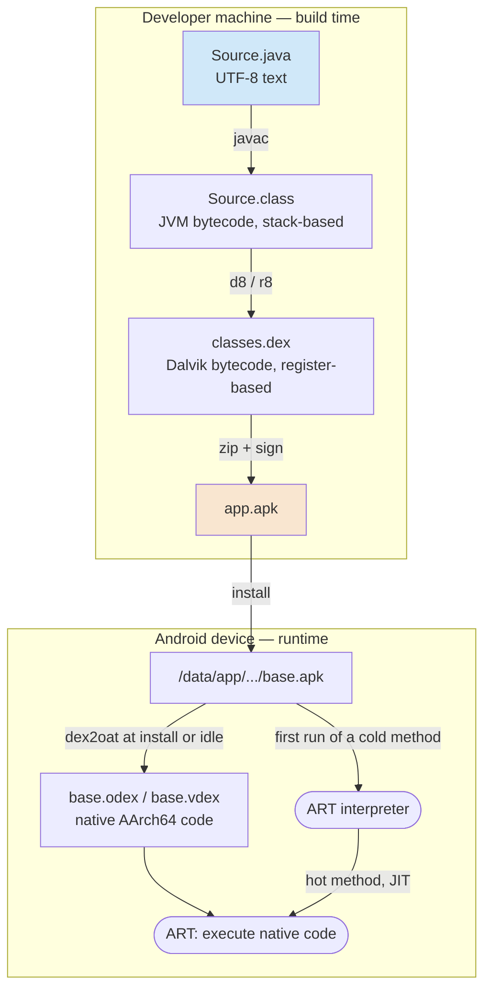
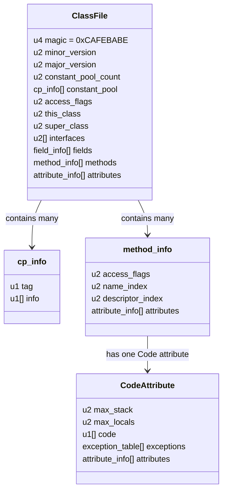
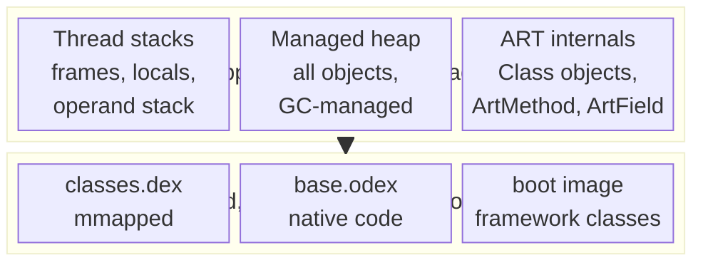
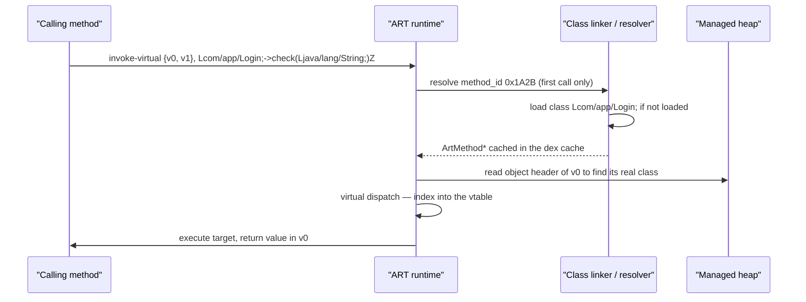
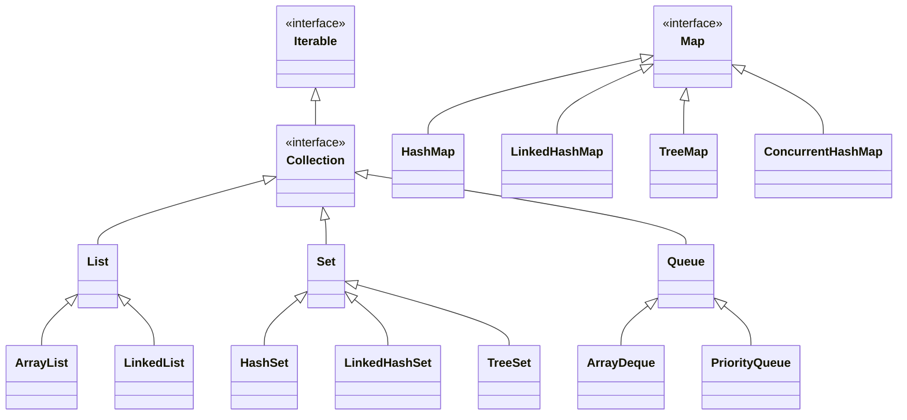
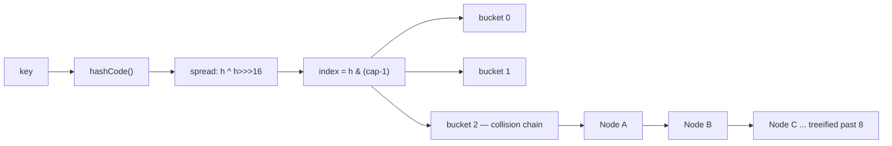
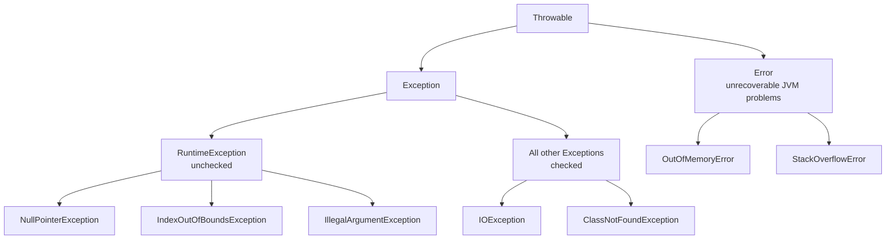
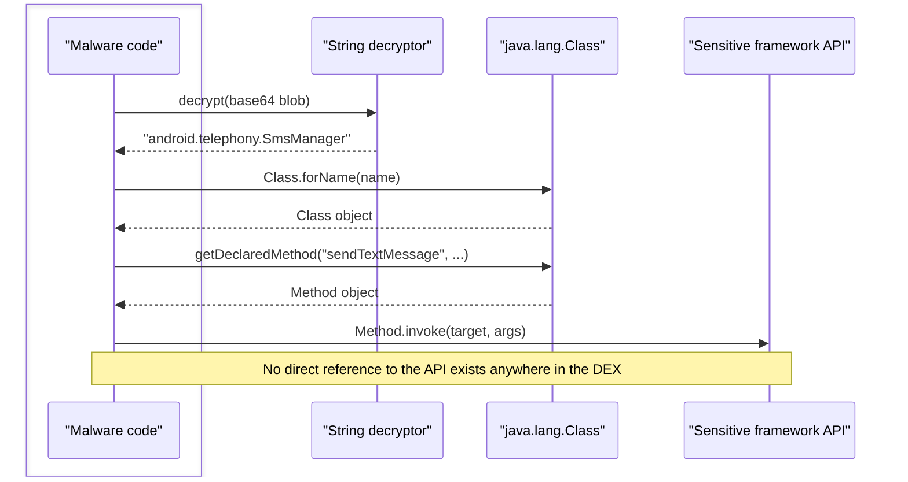
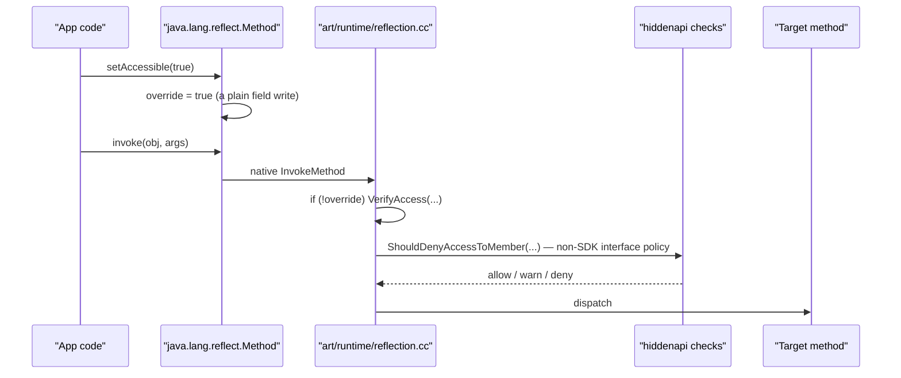
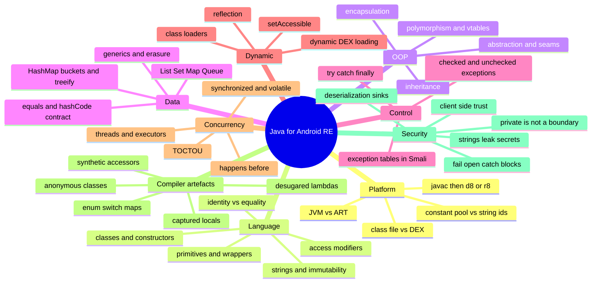

# 04 — Java

> After this chapter you will be able to read any Java source file, predict what its compiled form
> looks like in a DEX file, recognise every one of its language constructs in JADX and Smali output,
> and explain which of its features create real security weaknesses in an Android application.

**Prerequisites:** [01 — Computer Science Basics](../01-Computer-Science-Basics/README.md),
[02 — Linux Basics](../02-Linux-Basics/README.md),
[03 — Programming Fundamentals](../03-Programming-Fundamentals/README.md)

**Applies to:** All Android versions. Language level discussed is Java 8 through Java 21, with
explicit notes on which features Android's toolchain supports at which API level. Baseline for
Android-specific statements is Android 13–16 (API 33–36).

---

## Table of Contents

1. [Introduction](#1-introduction)
2. [High-Level Architecture](#2-high-level-architecture)
3. [Deep Internal Working](#3-deep-internal-working)
4. [Source Code Walkthrough (AOSP)](#4-source-code-walkthrough-aosp)
5. [Security Perspective](#5-security-perspective)
6. [Reverse Engineering Perspective](#6-reverse-engineering-perspective)
7. [Dynamic Analysis](#7-dynamic-analysis)
8. [Static Analysis](#8-static-analysis)
9. [Examples](#9-examples)
10. [Common Interview Questions](#10-common-interview-questions)
11. [Common Mistakes](#11-common-mistakes)
12. [Hands-on Labs](#12-hands-on-labs)
13. [Summary](#13-summary)
14. [References](#14-references)

Supporting material for this chapter:

- [cheatsheet.md](cheatsheet.md) — printable tables and command reference
- [mindmap.md](mindmap.md) — the whole chapter as one Mermaid mind map
- [faq.md](faq.md) — the questions learners actually ask
- [labs/](labs/) — three graded hands-on labs
- [examples/](examples/) — runnable Java files
- [scripts/](scripts/) — helper scripts for finding Java constructs inside an APK
- [references/](references/README.md) — annotated links

---

## 1. Introduction

### 1.1 The problem Java was invented to solve

Imagine you are a furniture company in 1994. You design one chair. To sell it in France you must
rebuild it from French timber in a French factory using French tools; to sell it in Japan you must
rebuild it again from Japanese timber in a Japanese factory. The design is the same every time, but
the *manufacturing* has to be redone for every country, and every rebuild introduces new mistakes.

That was the state of software before Java. A program written in C was compiled into machine code —
the raw numeric instructions a specific processor family understands. Machine code for an Intel x86
processor is meaningless to a SPARC processor, which is meaningless to a Motorola 68000. To ship one
program to three kinds of computer you compiled it three times, on three machines, with three
compilers, and you debugged three different sets of bugs caused by three different compilers'
interpretations of your code.

> **Definition — machine code.** The numeric instruction encoding that a physical CPU executes
> directly. Each CPU architecture (x86-64, ARM64, RISC-V) has its own incompatible encoding. A
> program in machine code is bound to one architecture forever.

Java's designers at Sun Microsystems asked a different question: what if the program were compiled
not for a *real* processor but for an *imaginary* one — a processor so simple and so precisely
specified that anybody could write a program that pretends to be it? Then you compile once, for the
imaginary processor, and every real computer runs a small piece of software that impersonates the
imaginary processor and translates on the fly.

That imaginary processor is the **Java Virtual Machine**. The compiled output for it is called
**bytecode**. The slogan was "write once, run anywhere", and while reality was messier than the
slogan, the core idea worked and is the reason Java became the language of enterprise servers,
smartcards, Blu-ray players, and — most importantly for you — Android applications.

> **Definition — bytecode.** A compact, architecture-independent instruction encoding produced by
> a compiler and executed by a virtual machine rather than by hardware. "Byte" code because each
> instruction opcode fits in a single byte, giving at most 256 possible instructions.

### 1.2 Why you, an Android security person, must learn Java

You may have heard that modern Android apps are written in Kotlin. That is true, and
[chapter 05](../05-Kotlin/README.md) covers Kotlin in depth. It does not release you from learning
Java, for four reasons that will govern your entire career:

1. **The decompiler speaks Java, not Kotlin.** When you open an APK in JADX, the tool reconstructs
   *Java* source from DEX bytecode. Even a 100% Kotlin app appears to you as Java-like code with
   strange extra classes and method calls. If you cannot read Java fluently you cannot read any
   decompiled Android app at all.
2. **The Android framework is Java.** Every `Activity`, `Intent`, `ContentProvider`, and
   `PackageManager` you will ever attack is defined in Java source inside AOSP. Reading
   `frameworks/base/core/java/android/app/ActivityThread.java` is a routine part of the job.
3. **Kotlin compiles to the same bytecode.** Kotlin has no runtime of its own on Android. It emits
   JVM-shaped class files that are then converted to DEX, exactly like Java. Understanding what
   Java compiles to *is* understanding what Kotlin compiles to.
4. **Legacy targets are everywhere.** Banking, telecom, government, and industrial apps are often a
   decade old and entirely Java. These are also the apps with the most interesting findings.

> **Mental Model.** Java is not "the old language you can skip". Java is the *lingua franca of
> the decompiler*. Kotlin, Scala, Groovy, and Java itself all converge on the same bytecode, and the
> decompiler renders all of them back as Java. Learning Java is learning the language your tools
> think in.

### 1.3 What would break if Java did not exist

Suppose Android had been built on C++ alone. Three things would be different, and each of them is
a security property you rely on daily:

- **Memory safety.** In C++ a mistake with a pointer lets you read or write memory that does not
  belong to you, which is the root of most remote code execution vulnerabilities. Java has no raw
  pointers, checks every array index, and frees memory automatically with a garbage collector. An
  ordinary Java bug produces an exception and a crash, not an exploitable heap corruption. The
  overwhelming majority of Android app-layer vulnerabilities are *logic* flaws precisely because
  memory-safety flaws were designed out of the app layer.
- **A uniform sandbox surface.** Because apps run inside a managed runtime, the platform can insert
  permission checks at the API boundary. There is no way for app code to "just call the kernel"
  behind the framework's back unless it drops to native code, which is exactly why native code is
  treated as a higher-risk area.
- **Introspectable binaries.** Java bytecode retains class names, method names, field names, and
  type signatures. That is the reason decompilation of Android apps is so productive compared to
  reversing a stripped C binary. It is also the reason obfuscation tools exist
  ([41 — ProGuard](../41-ProGuard/README.md), [42 — R8](../42-R8/README.md)).

> **Pentester's Note.** The single most consequential fact in this chapter is that *compiled Java
> retains its symbol names by design*. The bytecode format needs the string `"getUserPassword"` at
> runtime to perform dynamic linking, so it must be stored in the file. Every APK therefore ships a
> readable table of every class, method, and field name it uses. Obfuscation renames them but cannot
> remove them, and cannot rename anything the framework calls by name.

### 1.4 How Android deviates from standard Java

You will read many Java tutorials that describe a `.class` file and a JVM. Android has neither, and
confusing the two will cost you hours of wasted analysis.

| Aspect | Standard Java (desktop/server) | Android |
|---|---|---|
| Compiler output | One `.class` file per class | `.class` files are an intermediate step only |
| Shipped format | `.jar` (a ZIP of `.class` files) | `classes.dex` inside an `.apk` (a ZIP) |
| Bytecode style | Stack-based, one operand stack per frame | Register-based, virtual registers per frame |
| Execution engine | HotSpot JVM (or OpenJ9, GraalVM) | ART, the Android Runtime |
| Class library | Oracle/OpenJDK `rt.jar` / modules | Android's own fork, `libcore` (partly derived from OpenJDK) |
| Compilation model | Interpret then JIT | Interpret, JIT, and AOT-compile to native `.oat` |
| Native interface | JNI | JNI, but with Android-specific restrictions |

The pipeline on Android has one extra stage that does not exist anywhere else:

```
Source.java --javac--> Source.class (JVM bytecode) --d8/r8--> classes.dex (Dalvik bytecode) --> APK
```

> **Definition — DEX.** Dalvik Executable. A single file format holding *all* classes of an
> application, with shared, deduplicated tables of strings, types, prototypes, fields, and methods.
> The deduplication is why an APK is far smaller than the equivalent JAR, and the shared string
> table is why hardcoded secrets are so trivially recoverable.
> Covered byte by byte in [12 — DEX Internals](../12-DEX-Internals/README.md).

### 1.5 A first program, and why every word of it is there

Here is the smallest complete Java program.

```java
// examples/HelloWorld.java — compile on the host with: javac HelloWorld.java
public class HelloWorld {
    public static void main(String[] args) {
        System.out.println("Hello, world");
    }
}
```

Beginners are usually told to "just type it and don't worry about it". That is the wrong advice for
someone who will later stare at decompiled code, because every one of those words maps to something
you will see in JADX. Take them in order.

| Token | What it means | Why it must be there | Where you see it in a decompiled APK |
|---|---|---|---|
| `public` | Access modifier: any code anywhere may use this | The launcher, which lives outside your code, must be able to reach `main` | Reflected in the `ACC_PUBLIC` access flag on the class, printed by JADX as `public` |
| `class` | Declares a class: a named blueprint bundling data and behaviour | Java has no free-floating functions; every method lives in a class | Every entry in the DEX `class_def` table |
| `HelloWorld` | The class name | Names the type and, on the JVM, the file | The DEX type descriptor `LHelloWorld;` |
| `static` | Belongs to the class, not to an instance | `main` runs before any object exists, so it cannot need one | Smali `.method public static`; called with `invoke-static` |
| `void` | Returns nothing | The launcher has nothing to do with a return value | Return descriptor `V`; Smali ends with `return-void` |
| `main` | The conventional entry-point name | The JVM launcher looks up exactly this name | A method named `main` in the method table |
| `String[] args` | An array of strings: the command-line arguments | Programs need input from their invoker | Descriptor `[Ljava/lang/String;` |
| `System.out.println` | Call `println` on the `out` field of class `System` | Output must go through an object that owns a stream | `sget-object` then `invoke-virtual` in Smali |
| `"Hello, world"` | A string literal | The text to print | An entry in the DEX **string table**, recoverable with `strings` |

That last row is the whole reason this chapter is written the way it is. The literal
`"Hello, world"` is not compiled into some scrambled form. It is stored, verbatim, in a table that
anyone holding the APK can dump in one command. Replace it with `"sk_live_51H8xQ..."` and you have
just described 30% of all real-world mobile findings.

> **Warning.** Nothing you write inside your application's code is secret from the person holding
> the APK. Not a string, not a private field, not a method you deleted from the UI. The only secrets
> an app can hold are ones it never possesses in plaintext, or ones held by hardware
> ([49 — KeyStore](../49-KeyStore/README.md), [50 — Hardware-Backed Security](../50-HardwareBackedSecurity/README.md)).

### 1.6 How to read the rest of this chapter

Every language feature below is presented in the same five beats, as required by the repository's
[style guide](../STYLE-GUIDE.md):

1. The problem that existed before the feature.
2. What breaks without it.
3. What it is, precisely.
4. How it works internally, down to bytecode where it matters.
5. **How it appears in JADX and Smali, and what that lets an attacker or a defender do.**

Beat five is what makes this chapter different from every other Java tutorial you will ever read.
Do not skip it, even for constructs that feel trivial. The reason experienced reverse engineers read
decompiled code so much faster than beginners is not intelligence; it is that they have memorised
beat five for every construct in the language.

---

## 2. High-Level Architecture

### 2.1 From source text to a running method



Read the diagram top to bottom. The upper box is your build machine; the lower box is the phone.
Three separate representations of the same logic exist along that path, and a reverse engineer works
with all three:

- The `.class` file is what tools like `javap` show, and it is what a Kotlin or Java compiler
  actually emits. It survives only inside the build directory; it is not shipped.
- `classes.dex` is what ships. Every static-analysis tool you will use — JADX, apktool, baksmali,
  MobSF — reads this.
- The `.odex`/`.vdex` pair, produced by `dex2oat`, is native ARM64 machine code generated on the
  device. It is what actually executes for hot code. When a Frida hook mysteriously fails to fire,
  the AOT-compiled copy is frequently the reason, a subject taken up in
  [13 — ART](../13-ART/README.md) and [53 — Frida](../53-Frida/README.md).

> **Under the Hood.** `d8` is the modern DEX compiler; `dx` is the deprecated one you will still
> see in old build logs. `r8` is `d8` plus shrinking, optimisation, and obfuscation — it is the
> tool behind the ProGuard-style rules in a modern `build.gradle`. All three consume `.class` files,
> which is why *any* JVM language can target Android.

### 2.2 What lives inside a class file



The important structural insight is the **constant pool**. Nothing in a class file refers to another
class, method, field, or string directly. Everything refers to an *index* into the constant pool,
and the constant pool holds the actual UTF-8 names. That indirection is what makes dynamic linking
possible, and it is also what guarantees that human-readable names are present in the file.

> **Definition — constant pool.** A per-class table of literal constants and symbolic references
> (class names, method names and descriptors, field names and descriptors, string literals, numeric
> constants). The DEX equivalent is split into several global tables shared across the whole
> application: `string_ids`, `type_ids`, `proto_ids`, `field_ids`, and `method_ids`.

### 2.3 The runtime picture: where a Java object actually lives



A Java object is a block of bytes on the **managed heap**, prefixed by a header that ART uses to
find the object's class and its lock/hash state. Local variables of primitive type live in the stack
frame of the executing method. The class's *code* is not on the heap at all: it is either
interpreted straight out of the memory-mapped DEX file or executed from the AOT-compiled `.odex`.

> **Definition — heap.** The region of a process's memory used for dynamically allocated objects
> whose lifetime is not tied to a function call. Contrast with the **stack**, which holds one frame
> per active method call and is unwound automatically on return. Both are defined at length in
> [01 — Computer Science Basics](../01-Computer-Science-Basics/README.md) and mapped concretely in
> [19 — Memory](../19-Memory/README.md).

The practical consequence for you: when you hook a method with Frida and read `this.someField`, you
are reading the managed heap through ART's reflection machinery. When you `memory dump` a process,
you get the heap plus the mapped DEX, which is why plaintext secrets frequently show up in a memory
dump even when the app decrypts them "only briefly".

### 2.4 The lifecycle of a single method call



This sequence explains three things you will rely on constantly.

First, **resolution is lazy and cached**. A method reference is a symbolic index until the first
time it executes; then ART resolves it and caches an `ArtMethod` pointer in the DEX cache. This is
why the first invocation of a method is measurably slower and why some anti-tamper code times method
calls.

Second, **virtual dispatch happens at runtime based on the object's actual class**, not the type
written in the source. This is polymorphism, and it is the mechanism that lets you replace an
implementation at runtime without touching call sites — the theoretical basis for hooking.

Third, **the call site names the method as a string-backed reference**. That reference,
`Lcom/app/Login;->check(Ljava/lang/String;)Z`, is precisely the form Frida wants when you write
`Java.use("com.app.Login").check.implementation = ...`. Learning to read that descriptor syntax
fluently is one of the highest-value skills in this chapter, and it is covered in section 3.3.

---

## 3. Deep Internal Working

This is the long section. It walks the entire language, feature by feature. For each feature the
structure is: why it exists, what it is, how it compiles, and how it appears to a reverse engineer.

### 3.1 Types: the two kinds of value

Java has exactly two categories of value, and the distinction drives a large family of bugs.

**Primitives** are raw numbers and bits. There are eight of them, they are not objects, they have no
methods, and they can never be `null`.

| Type | Bits | Range | JVM/DEX descriptor | Default value |
|---|---|---|---|---|
| `boolean` | 1 logically, 8 or 32 in practice | `true` / `false` | `Z` | `false` |
| `byte` | 8 | −128 to 127 | `B` | `0` |
| `short` | 16 | −32,768 to 32,767 | `S` | `0` |
| `char` | 16 | 0 to 65,535 (UTF-16 code unit) | `C` | `'\u0000'` |
| `int` | 32 | −2,147,483,648 to 2,147,483,647 | `I` | `0` |
| `long` | 64 | ±9.22×10^18 | `J` | `0L` |
| `float` | 32 | IEEE 754 single | `F` | `0.0f` |
| `double` | 64 | IEEE 754 double | `D` | `0.0d` |

`Z` means boolean and `J` means long. Those two are the ones everybody gets wrong; `B` was
taken by byte and `L` was taken by the "object" prefix, so the designers reached for the next
available letters. You will read these descriptors thousands of times in Smali and in Frida errors.

**References** point at objects on the heap. Every non-primitive is a reference: `String`,
`int[]`, `ArrayList<String>`, your own classes. A reference can be `null`, meaning "points at
nothing". Dereferencing `null` throws `NullPointerException`.

The descriptor for a class type is `L` + the fully qualified name with dots replaced by slashes +
`;`. So `java.lang.String` is `Ljava/lang/String;`. An array adds one `[` per dimension:
`int[][]` is `[[I`, and `String[]` is `[Ljava/lang/String;`.

> **Pentester's Note.** When Frida says
> `Error: check(): argument types do not match any overload`, you fix it by naming the exact
> descriptor: `.overload('java.lang.String', '[B', 'int')`. Fluency in descriptors turns that error
> from a mystery into a two-second fix.

#### Boxing and unboxing

Collections cannot hold primitives, because a collection stores references. Java therefore provides
a **wrapper class** for each primitive: `Integer` for `int`, `Boolean` for `boolean`, and so on.
Converting `int` to `Integer` is **boxing**; the reverse is **unboxing**. Since Java 5 the compiler
inserts these conversions automatically, which hides two real hazards.

```java
// Hazard 1: unboxing null throws NullPointerException, from a line with no visible dereference.
Map<String, Integer> counts = new HashMap<>();
int n = counts.get("missing");   // returns null Integer, unboxing it throws NPE

// Hazard 2: the Integer cache makes == behave inconsistently.
Integer a = 127, b = 127;
Integer c = 128, d = 128;
System.out.println(a == b);      // true  — both come from the cache
System.out.println(c == d);      // false — two distinct objects
```

> **Under the Hood.** `Integer.valueOf(int)` returns cached instances for values in the range
> −128 to 127 inclusive; the upper bound is tunable on a desktop JVM with
> `-XX:AutoBoxCacheMax`. Android's `libcore` implements the same cache. In bytecode you will see
> `Integer.valueOf(...)` for boxing and `Integer.intValue()` for unboxing, and *those calls appear
> explicitly in JADX output* even though they were invisible in the source. Seeing
> `Integer.valueOf(0)` in decompiled code where the source said `0` is normal, not suspicious.

#### `==` versus `.equals()` — a genuine vulnerability class

For primitives, `==` compares values. For references, `==` compares **addresses**: it asks "are
these two names pointing at the very same object?" It does not ask whether the objects have equal
contents. Content comparison is the job of `.equals()`.

```java
String typed = readFromUser();          // e.g. "hunter2", built at runtime
String stored = "hunter2";              // a literal, interned in the string pool
if (typed == stored) { grantAccess(); } // almost always false — compares identity
if (typed.equals(stored)) { ... }       // correct content comparison
```

This is a real and recurring finding, in two opposite directions:

- **Fail-closed direction.** A login check using `==` on strings rejects the correct password,
  because the runtime-built string is a different object from the literal. Developers "fix" it by
  weakening the check elsewhere.
- **Fail-open direction.** A *security* check written as `if (token == EXPECTED_TOKEN)` where both
  sides happen to be compile-time constants folded into the same interned literal will silently
  return `true` in testing and then behave differently once one side becomes dynamic. Worse, a check
  like `if (signature == null || signature == GOOD)` combined with `==` semantics has produced real
  signature-verification bypasses in shipped apps.

> **Warning.** Comparing secrets with `.equals()` is correct for logic but wrong for
> cryptography, because `String.equals` returns as soon as it finds a mismatched character and
> therefore leaks the number of matching leading characters through timing. For MACs, tokens, and
> password hashes use a constant-time comparison such as `java.security.MessageDigest.isEqual`.
> See [34 — Cryptography](../34-Cryptography/README.md).

In JADX, `==` on references decompiles to `if (a == b)` and Smali shows `if-ne v0, v1, :cond_0`
with no method call at all. A `.equals()` call shows
`invoke-virtual {v0, v1}, Ljava/lang/String;->equals(Ljava/lang/Object;)Z`. The **absence of an
invoke instruction next to a security comparison is the fingerprint you are hunting for.**

### 3.2 Strings, the string pool, and why your secrets are not secret

A `String` in Java is an **immutable** object wrapping a sequence of UTF-16 code units. Immutable
means that once created its contents can never change; every "modification" produces a new object.

Why immutable? Three reasons that all matter to you:

1. **Safe sharing.** Immutable objects can be shared across threads with no locking, and can be
   handed to library code without defensive copying.
2. **Cacheable hash code.** `String.hashCode()` is computed once and cached, which makes `HashMap`
   with string keys fast.
3. **Security of the class-loading path.** If a `String` naming a class or a file path could be
   mutated after a permission check but before use, you would have a time-of-check-to-time-of-use
   vulnerability in every API that takes a string. Immutability closes that door by construction.

> **Definition — string pool (string interning).** A runtime-managed table of unique `String`
> instances. Every string *literal* in the source is placed in this pool at class load, so two
> identical literals anywhere in the program are the same object. `String.intern()` puts a
> runtime-built string into the pool manually.

#### The security consequence: the DEX string table

Every literal in your source becomes an entry in the DEX `string_ids` table, sorted, deduplicated,
and stored as modified UTF-8. Recovering all of them takes one command:

```bash
# runs on your host machine
unzip -o target.apk 'classes*.dex' -d /tmp/dexes
strings -n 8 /tmp/dexes/classes.dex | sort -u | less
```

That crude approach works but produces noise. The precise approach is to parse the `string_ids`
table directly, which is what [scripts/dump-strings.py](scripts/dump-strings.py) in this chapter
does, and what [12 — DEX Internals](../12-DEX-Internals/README.md) explains byte by byte.

> **Pentester's Note.** On virtually every engagement, dumping the string table and grepping for
> `AKIA`, `sk_live`, `-----BEGIN`, `Bearer `, `.amazonaws.com`, `firebaseio.com`, `://`, and
> `password` yields something within five minutes. Do this before you open a decompiler. It is the
> highest findings-per-minute activity in mobile testing.

#### Concatenation, `StringBuilder`, and what the compiler rewrote

Because strings are immutable, `a + b` must allocate a new string. Inside a loop that is quadratic
and disastrous. Java's answer is `StringBuilder`, a mutable character buffer.

```java
// What you wrote:
String s = "user=" + name + "&id=" + id;

// What javac emits (Java 8 and Android's d8, conceptually):
String s = new StringBuilder().append("user=").append(name).append("&id=").append(id).toString();
```

This rewrite is why decompiled Android code is full of `StringBuilder` chains that the original
author never typed. It is normal. It also means the *fragments* — `"user="`, `"&id="` — are separate
entries in the string table, so a URL assembled from pieces still leaks all its pieces.

> **Under the Hood.** On desktop Java 9+ the compiler uses `invokedynamic` with
> `StringConcatFactory` instead of `StringBuilder`. Android's `d8` does **not** support that
> strategy for concatenation in the shipped DEX; it desugars back to `StringBuilder`. That is why
> decompiled Android code looks like Java 8 even when the source used Java 17 features.

| Class | Mutable | Thread-safe | Use when |
|---|---|---|---|
| `String` | No | Inherently | Any value you will not modify |
| `StringBuilder` | Yes | No | Building text in a single thread — the normal case |
| `StringBuffer` | Yes | Yes, synchronised | Legacy; almost never correct today |
| `char[]` | Yes | No | Passwords and key material you want to zero after use |

> **Warning.** Storing a password in a `String` means you cannot erase it: you have no way to
> overwrite an immutable object, and the garbage collector will leave the bytes in the heap until it
> happens to reuse that memory. This is exactly why
> `javax.crypto.spec.PBEKeySpec` and `java.security.KeyStore` take `char[]`. In a memory dump of a
> running app, passwords held in `String` form are routinely recoverable long after logout.

### 3.3 Classes, objects, constructors, and `this`

> **Definition — class.** A named template describing what data an object holds (**fields**) and
> what it can do (**methods**).
> **Definition — object (instance).** A concrete block of memory laid out according to a class.

```java
public class Session {
    private final String token;      // instance field: one per object
    private static int liveCount;    // static field: exactly one, shared by the class

    public Session(String token) {   // constructor: runs once, at creation
        this.token = token;          // `this` = the object being constructed
        liveCount++;
    }

    public String getToken() { return this.token; }
    public static int getLiveCount() { return liveCount; }
}
```

The constructor is not a normal method. In bytecode it is a method literally named `<init>` with
return type `void`, and the JVM enforces that it is only reachable through the `new` opcode
sequence. Class-level initialisation (static fields and `static { }` blocks) is compiled into a
separate synthetic method named `<clinit>`.

| Source construct | Bytecode name | Invoked by | Runs when |
|---|---|---|---|
| Constructor | `<init>` | `invokespecial` (JVM) / `invoke-direct` (DEX) | Every `new` |
| Static initialiser | `<clinit>` | The runtime, never by user code | Once, at class initialisation |
| Instance initialiser block | Folded into every `<init>` | — | Before the constructor body |

In Smali, object creation is always a two-instruction pattern that beginners misread:

```smali
# Smali — from baksmali output
new-instance v0, Lcom/app/Session;
const-string v1, "abc123"
invoke-direct {v0, v1}, Lcom/app/Session;-><init>(Ljava/lang/String;)V
```

`new-instance` allocates raw, uninitialised memory. The object is not usable until `<init>` runs.
When you patch Smali, moving or deleting one of those two instructions produces a verification error
rather than a working patch — a classic beginner mistake covered in section 11.

> **Mental Model.** A class is a cookie cutter; an object is a cookie. `static` members belong to
> the cutter, instance members to each cookie. `this` is a cookie's way of saying "me".

#### Static versus instance, and why it matters when hooking

A static method has no receiver. In Frida you hook it the same way you hook an instance method, but
inside the implementation `this` is the class, not an object, and any attempt to read instance
fields fails. In Smali the difference is visible in the invoke opcode and in the register layout:
an instance method's parameter registers begin with `p0 = this`, whereas a static method's begin
with `p0 =` the first real argument. Miscounting registers by one because you forgot the method was
static is the single most common Smali-patching error.

### 3.4 Object-oriented programming, with the security angle for each pillar

#### Encapsulation

**Problem it solves:** without it, any code can modify any field, so no class can maintain an
invariant. If `balance` is public, nothing can guarantee it never goes negative.

**What it is:** hiding internal state behind methods, so the class controls every change.

**Security angle:** encapsulation is a *correctness* mechanism, not a *security* mechanism. It stops
honest code from making mistakes. It does not stop an attacker, because reflection defeats it in
three lines (section 3.9) and because the attacker can also read the field's value out of a
decompiled binary or a heap dump. A field marked `private` is private from *other classes in the
same program*, never from the person holding the phone.

#### Inheritance

**Problem it solves:** duplicated code across related types.

**What it is:** a class `extends` another, inheriting its non-private members and optionally
overriding its methods. Java allows exactly one superclass. Every class without an explicit
`extends` implicitly extends `java.lang.Object`.

```java
class Animal { void speak() { System.out.println("..."); } }
class Dog extends Animal { @Override void speak() { System.out.println("Woof"); } }
```

**Security angle:** inheritance creates *extension points*. If a class is not `final` and its
security-relevant method is not `final`, a subclass in the same application can override it. More
importantly for Android, the framework's own inheritance hierarchy is how you attack apps: an
`Activity` you did not write extends a class the framework will instantiate, and if it is exported
in the manifest, an external app can cause it to be constructed with attacker-controlled `Intent`
extras ([30 — Activities](../30-Activities/README.md)).

In the DEX file, the superclass is a single `superclass_idx` field in the `class_def` structure, so
JADX always recovers the exact hierarchy even under heavy obfuscation. Obfuscators rename classes;
they do not restructure inheritance, because doing so would break the framework's expectations. This
is why "which framework class does this obfuscated class extend?" is your most reliable orientation
question when opening a heavily obfuscated app.

#### Polymorphism

**Problem it solves:** writing one piece of code that works with many types.

**What it is:** a reference of type `Animal` may point at a `Dog`, and calling `speak()` runs the
`Dog` version. The decision is made at runtime by looking at the object's actual class.

> **Under the Hood.** ART implements this with a **vtable** (virtual method table): an array
> per class where index *n* always holds the implementation of the *n*-th virtual method of the
> hierarchy. A call compiles to "load the object's class pointer, load vtable slot 7, jump". A
> subclass that overrides a method has a different pointer in the same slot. Interface calls
> cannot use a fixed index because a class implements many interfaces, so they use an interface
> method table with a lookup, which is why `invoke-interface` is slower than `invoke-virtual`.

**Security angle:** the vtable *is* the hook point. Frida's Java hooking, Xposed, and LSPosed all
work by replacing the method entry that dispatch lands on. Polymorphism is therefore not merely an
academic OOP concept for you; it is the mechanism that makes runtime instrumentation possible at
all. Conversely, a method marked `final`, `private`, or `static` may be *devirtualised* by R8 into a
direct call, and directly-called or inlined methods are precisely the ones your hooks silently miss.

| Invoke opcode (DEX) | Used for | Hookable in the usual way |
|---|---|---|
| `invoke-virtual` | Normal instance methods | Yes |
| `invoke-super` | `super.foo()` calls | Yes, but the call site bypasses subclass hooks |
| `invoke-direct` | `private` methods and `<init>` | Yes with Frida, but never dispatched dynamically |
| `invoke-static` | `static` methods | Yes |
| `invoke-interface` | Calls through an interface type | Yes |
| `invoke-polymorphic` | `MethodHandle` invocation (API 26+) | Awkward; see [13 — ART](../13-ART/README.md) |

#### Abstraction

**Problem it solves:** callers coupling to implementation details they should not know.

**What it is:** exposing *what* something does while hiding *how*, via `abstract` classes and
interfaces.

**Security angle:** abstraction is where you find the seam to attack. When an app talks to an
`HttpClient` interface, there is one place where the concrete implementation is chosen, and
replacing that choice — with a hook, with a patched Smali constant, or with a `MultiDex`-injected
class — redirects every call in the app. Finding "the one factory method that decides the
implementation" is a standard opening move.

### 3.5 Interfaces versus abstract classes

| Aspect | `interface` | `abstract class` |
|---|---|---|
| Multiple inheritance | A class may implement many | A class may extend exactly one |
| Fields | Only `public static final` constants | Any fields, including mutable state |
| Constructors | None | Yes, called by subclass constructors |
| Method bodies | `default` and `static` since Java 8; `private` since Java 9 | Any |
| Typical role | A capability or contract | A partial implementation with shared state |
| DEX invoke opcode | `invoke-interface` | `invoke-virtual` |

> **Under the Hood.** Java 8 `default` methods were retrofitted so that interfaces like
> `java.util.Collection` could gain `stream()` without breaking every existing implementor. On
> Android, `default` and `static` interface methods require API 24+ *unless* the build uses
> **desugaring**, in which case `d8` rewrites them into static helper methods on a synthetic class.
> When you see a class named something like `Foo$-CC` in JADX, you are looking at desugared
> interface support code, not at anything the developer wrote.

Constants declared in an interface are implicitly `public static final` and are *inlined at every
use site* by the compiler. That has a direct RE consequence: a `String` constant declared in an
interface and used in twelve classes appears twelve times in the DEX string table's usage graph and
cannot be traced back to the interface, because the reference to the interface is gone.

### 3.6 Access modifiers, and why `private` is not a security boundary

| Modifier | Same class | Same package | Subclass, other package | Anywhere | DEX access flag |
|---|---|---|---|---|---|
| `private` | Yes | No | No | No | `ACC_PRIVATE` (0x2) |
| *(none)* — "package-private" | Yes | Yes | No | No | none set |
| `protected` | Yes | Yes | Yes | No | `ACC_PROTECTED` (0x4) |
| `public` | Yes | Yes | Yes | Yes | `ACC_PUBLIC` (0x1) |

Everything in that table is enforced in two places: by `javac` at compile time, and by the ART
verifier at class-load time. Neither of those places is under your control as a defender once the
APK is on someone's device, and both are trivially bypassed by an attacker:

1. **Reflection** with `setAccessible(true)` disables the access check entirely (section 3.9).
2. **Smali patching** flips the access flag byte and repackages the APK
   ([10 — APK Internals](../10-APK-Internals/README.md)).
3. **Reading the decompiled source** requires no bypass at all: `private` affects *callability*, not
   *visibility to a human*. A private field holding an API key is printed by JADX in full.

> **Warning.** "We made the method private so it can't be called" is not a mitigation, and you
> should write it up as such when a developer offers it as one. The mitigation for "this must not be
> callable by an attacker" is to move the operation server-side or behind hardware-backed key
> material, never to change a Java access modifier.

There is one place where access modifiers *do* matter to an attacker's convenience rather than
capability: package-private members can be accessed by any class you inject into the same package
name, which is a cheap trick when writing a test harness or an Xposed module.

### 3.7 Packages, and how names become paths

A **package** is a namespace, written in reverse-domain form (`com.example.app.network`). It maps to
a directory structure in a JAR and to a prefix in the DEX type descriptor
(`Lcom/example/app/network/HttpClient;`).

Packages matter to you for four practical reasons:

1. The **application ID** in the manifest is a package-shaped string and identifies the app to the
   whole system; it determines the data directory `/data/data/<applicationId>/`.
2. **Package-private** access, above.
3. **Third-party SDK identification.** Grouping decompiled classes by package prefix instantly
   separates the app's own code from the twenty advertising, analytics, and crash-reporting SDKs it
   embeds. Those SDKs are where a large share of privacy findings live
   ([17 — Libraries](../17-Libraries/README.md)).
4. **Obfuscation flattening.** R8 with `-repackageclasses` moves every class into a single
   short package, destroying that grouping. When you open an app and see hundreds of classes named
   `a.a`, `a.b`, `a.c`, you know repackaging was on, and you must fall back on framework
   superclasses and string constants for orientation.

### 3.8 The collections framework

**Problem it solves:** arrays have a fixed size, no insert or remove, no key lookup, and no
consistent API. Every program needs growable lists, sets, and key-value maps, and before Java 2
everyone wrote their own, incompatibly.



Note carefully that `Map` is **not** a `Collection`. It is a separate hierarchy, because a map stores
pairs rather than elements. Beginners routinely assume `Map extends Collection` and are then confused
by the API.

| Type | Backing structure | get by index | contains | add | Ordering | Nulls |
|---|---|---|---|---|---|---|
| `ArrayList` | Growable array | O(1) | O(n) | Amortised O(1) | Insertion | Allowed |
| `LinkedList` | Doubly-linked nodes | O(n) | O(n) | O(1) at ends | Insertion | Allowed |
| `HashSet` | `HashMap` keys | — | O(1) average | O(1) average | None | One null |
| `LinkedHashSet` | Hash + linked list | — | O(1) | O(1) | Insertion | One null |
| `TreeSet` | Red-black tree | — | O(log n) | O(log n) | Sorted | No null |
| `HashMap` | Bucket array + nodes | — | O(1) average | O(1) average | None | One null key |
| `LinkedHashMap` | Hash + linked list | — | O(1) | O(1) | Insertion or access | One null key |
| `TreeMap` | Red-black tree | — | O(log n) | O(log n) | Sorted by key | No null key |
| `ArrayDeque` | Circular array | — | O(n) | O(1) at ends | Insertion | No nulls |
| `ConcurrentHashMap` | Striped bucket array | — | O(1) | O(1) | None | No nulls |

> **Mental Model.** `ArrayList` is a numbered row of lockers: instant access if you know the
> number, but inserting in the middle means shifting everything. `LinkedList` is a treasure hunt
> where each note points to the next: cheap to splice, expensive to reach item 500. In real Android
> code `ArrayList` wins almost always, because CPU cache locality beats theoretical complexity at
> the sizes apps actually use.

#### `HashMap` internals — buckets, hashing, and collisions

A `HashMap` is an array of **buckets**. To store a key:

1. Compute `key.hashCode()`, a 32-bit int.
2. Mix the high bits down: `h = hashCode ^ (hashCode >>> 16)`. This is done because the bucket index
   uses only the low bits, and many real `hashCode` implementations vary mainly in their high bits.
3. Bucket index is `h & (capacity - 1)`, which is a fast modulo because capacity is always a power
   of two.
4. If the bucket is empty, store the entry. If not, this is a **collision**: walk the bucket's chain
   comparing with `equals()`. If the chain in one bucket exceeds `TREEIFY_THRESHOLD` (8) and the
   table is at least 64 entries, the chain is converted into a red-black tree so worst-case lookup
   becomes O(log n) instead of O(n).
5. When `size > capacity * loadFactor` (default 0.75), the table doubles and every entry is
   rehashed.



The security consequence is a denial-of-service class known as **hash flooding**: if an attacker can
choose the keys inserted into a map — HTTP parameters, JSON object keys, headers — and can compute
keys that collide, every insertion degrades to a linear scan and CPU cost becomes quadratic.
Treeification caps the damage at O(log n) for `Comparable` keys such as `String`, which is why
modern Java is far more resistant than Java 7 was, but a parser that builds a `HashMap` from
untrusted input with a *non-`Comparable`* custom key type remains vulnerable.

> **Definition — the `equals`/`hashCode` contract.** If `a.equals(b)` is true then
> `a.hashCode() == b.hashCode()` must be true. Violating it means an object stored in a `HashMap`
> can never be found again, because lookup goes to the wrong bucket. This produces "impossible"
> bugs, including security ones such as a revocation set that silently fails to contain the token
> you just added to it.

`ConcurrentHashMap` exists because `HashMap` under concurrent modification can corrupt its internal
structure — in Java 7 it could produce an infinite loop during resize, spinning a CPU core forever.
`ConcurrentHashMap` locks per bucket rather than per map, so it scales, and it forbids null keys and
values so that `get()` returning null unambiguously means "absent".

### 3.9 Generics and type erasure

**Problem it solves:** before Java 5, `List` held `Object`, so every read required a cast, and a
wrong cast blew up at runtime instead of at compile time.

```java
List<String> names = new ArrayList<>();
names.add("alice");
String s = names.get(0);   // no cast needed, and adding an Integer will not compile
```

**How it works:** almost entirely at compile time. The compiler checks your types, then **erases**
them — it replaces `T` with `Object` (or with the leftmost bound, if the parameter is bounded) and
inserts casts at the call sites. The `.class` file contains no runtime record of the type argument
apart from an optional `Signature` attribute used by reflection and IDEs.

> **Definition — type erasure.** The compile-time removal of generic type arguments, so that
> `List<String>` and `List<Integer>` become the same runtime type `List`. It was chosen for backward
> compatibility: erased generics let Java 5 code and Java 1.4 libraries interoperate.

Consequences you must internalise:

- `new T[10]` is illegal, because the runtime does not know what `T` is.
- `if (x instanceof List<String>)` is illegal for the same reason.
- Two methods differing only in generic parameter type cannot coexist: after erasure they have the
  same descriptor.
- **In decompiled code you will frequently see raw types and explicit casts where the source had
  clean generics.** JADX often recovers generic signatures from the `Signature` attribute, but R8
  can strip that attribute, and when it does, `Map<String, Token>` becomes `Map` and a
  `(Token)` cast appears at every read. Do not conclude the developer wrote sloppy code; conclude
  the metadata was stripped.

> **Pentester's Note.** The presence or absence of generic signatures is a quick fingerprint of
> ProGuard/R8 configuration. If JADX shows full generics, `-keepattributes Signature` was in effect,
> which usually also means `SourceFile`, `LineNumberTable`, and annotations survived — a much
> richer target. See [41 — ProGuard](../41-ProGuard/README.md).

Variance appears as wildcards: `List<? extends Number>` can be read from but not written to;
`List<? super Integer>` can be written to but reads only give `Object`. The mnemonic is **PECS**:
Producer Extends, Consumer Super. Erasure means none of this exists at runtime.

### 3.10 Exceptions

**Problem it solves:** in C, errors are returned as special values (`-1`, `NULL`) and everyone
forgets to check them. Exceptions make failure impossible to ignore by unwinding the stack until
someone handles it.



| Category | Must be declared or caught | Typical meaning | Examples |
|---|---|---|---|
| `Error` | No | The runtime itself is in trouble; do not catch | `OutOfMemoryError`, `StackOverflowError` |
| Checked `Exception` | Yes | An expected, recoverable failure | `IOException`, `GeneralSecurityException` |
| `RuntimeException` | No | A programming bug | `NullPointerException`, `IllegalStateException` |

The syntax has three shapes worth knowing precisely:

```java
// 1. try / catch / finally — finally runs whether or not an exception occurred
try {
    risky();
} catch (IOException | GeneralSecurityException e) {   // multi-catch, Java 7+
    log(e);
} finally {
    cleanup();
}

// 2. try-with-resources — the resource is closed automatically, even on exception
try (InputStream in = new FileInputStream(f)) {
    read(in);
}   // in.close() is called here, and any close() exception is "suppressed" onto the primary one

// 3. Rethrow with cause, preserving the original stack trace
catch (SQLException e) {
    throw new DataAccessException("loading user " + id, e);
}
```

#### How exceptions appear in bytecode and in Smali

Exception handling costs **nothing** on the non-throwing path, because it is not implemented with
jumps. Each method carries an **exception table**: a list of `(start, end, handler, catch_type)`
tuples. When a throw occurs, the runtime walks the table looking for a range containing the current
program counter with a matching type. If none matches, the frame is popped and the search continues
in the caller.

In Smali the table appears as labels and directives:

```smali
# Smali — a try/catch around one call
.method public decrypt([B)[B
    .registers 4
    :try_start_0
    invoke-static {p1}, Lcom/app/Crypto;->doDecrypt([B)[B
    move-result-object v0
    return-object v0
    :try_end_0
    .catch Ljavax/crypto/BadPaddingException; {:try_start_0 .. :try_end_0} :catch_0

    :catch_0
    move-exception v1
    const/4 v0, 0x0
    return-object v0
.end method
```

> **Pentester's Note.** `.catch Ljava/lang/Exception; {...}` wrapped around a *security check* is
> one of the most productive patterns to grep for. A root check, a pinning check, or a signature
> check whose failure path is `catch (Exception e) { return true; }` fails open, and you can often
> trigger the exception without touching the check itself — for example by deleting the file the
> check reads. Also note the reverse move used by defenders: some anti-tamper code deliberately
> throws from a `finally` block or uses exception control flow to confuse decompilers, and JADX
> sometimes renders such methods with visible `// Can't parse` comments.

An empty `catch` block — `catch (Exception e) { }` — is called swallowing, and it is both a code
smell and a frequent finding, because it converts a failed integrity check into a silent success.

### 3.11 Reflection — the most security-relevant feature in the language

**Problem it solves:** sometimes a program must work with a class whose name it does not know until
runtime — a plugin, a serialiser, a dependency-injection framework, or a platform API that exists
only on newer Android versions.

> **Definition — reflection.** A set of APIs that let a running program inspect and manipulate
> classes, fields, methods, and constructors *by name, as data*, rather than by compiled-in
> reference. The entry points live in `java.lang.Class` and the `java.lang.reflect` package.

```java
// The complete reflection vocabulary you will meet in real apps
Class<?> c = Class.forName("com.app.SecretManager");          // load by name string
Object instance = c.getDeclaredConstructor().newInstance();   // construct
Method m = c.getDeclaredMethod("decrypt", String.class);      // find a method, private included
m.setAccessible(true);                                        // switch off the access check
Object result = m.invoke(instance, "ciphertext");             // call it
Field f = c.getDeclaredField("masterKey");
f.setAccessible(true);
String key = (String) f.get(instance);                        // read a private field
```

| API | Sees private members | Sees inherited members | Notes |
|---|---|---|---|
| `getMethod` / `getField` | No | Yes | Public members only, including from superclasses |
| `getDeclaredMethod` / `getDeclaredField` | Yes | No | Everything declared on this exact class |
| `getMethods` / `getFields` | No | Yes | Arrays of all public members |
| `getDeclaredMethods` / `getDeclaredFields` | Yes | No | Arrays of everything declared here |
| `Constructor.newInstance` | Yes, with `setAccessible` | — | Prefer over the deprecated `Class.newInstance` |

#### Why attackers love reflection

Three reasons, in increasing order of importance to you:

1. **It bypasses access control.** `setAccessible(true)` turns off the language-level check. On
   Android there is no `SecurityManager` to veto it in an app process, so from the app's own code
   there is nothing to stop it.
2. **It hides the call graph.** A direct call to `SmsManager.sendTextMessage` is visible to every
   static-analysis tool in existence, including Play Store scanning. The same call performed
   reflectively appears in the DEX only as the *strings* `"android.telephony.SmsManager"` and
   `"sendTextMessage"`. Encrypt or assemble those strings at runtime and the static call graph shows
   nothing at all.
3. **It reaches hidden platform APIs.** Android's non-SDK interface restrictions (introduced in
   Android 9 and tightened since) block app access to internal framework methods, but the block is
   implemented as a runtime check inside ART's reflection path, so bypasses historically consisted
   of double-reflection — using reflection to obtain a `Method` object for `Class.getDeclaredMethod`
   itself, so that the caller ART sees is a platform class rather than the app.



The diagram shows the canonical malware pattern. The static call graph contains exactly one edge
into `Method.invoke`, and the interesting information is only present as encrypted bytes, decrypted
in memory at the moment of use.

#### How to spot reflection in JADX

Search the decompiled project for these, in this order of value:

| Signal | What it usually means |
|---|---|
| `Class.forName(` with a non-literal argument | Dynamic loading whose target is computed |
| `getDeclaredMethod(` followed by `setAccessible(true)` | Deliberate access-control bypass |
| `Method.invoke(` inside a `try/catch (Throwable)` | Defensive dynamic invocation, often version-gated |
| `Base64.decode` or a char-arithmetic loop feeding `Class.forName` | String obfuscation hiding the target |
| `DexClassLoader` / `PathClassLoader` / `InMemoryDexClassLoader` | Code loaded from outside the APK — always investigate |
| `System.loadLibrary` next to reflective calls | Logic pushed into native code to defeat DEX analysis |

The corresponding Smali fingerprint is unmistakable:

```smali
# Smali — the reflection fingerprint
const-string v0, "android.telephony.SmsManager"
invoke-static {v0}, Ljava/lang/Class;->forName(Ljava/lang/String;)Ljava/lang/Class;
move-result-object v0
const-string v1, "sendTextMessage"
invoke-virtual {v0, v1, v2}, Ljava/lang/Class;->getDeclaredMethod(Ljava/lang/String;[Ljava/lang/Class;)Ljava/lang/reflect/Method;
move-result-object v3
const/4 v4, 0x1
invoke-virtual {v3, v4}, Ljava/lang/reflect/Method;->setAccessible(Z)V
invoke-virtual {v3, v5, v6}, Ljava/lang/reflect/Method;->invoke(Ljava/lang/Object;[Ljava/lang/Object;)Ljava/lang/Object;
```

The chapter script [scripts/find-reflection.sh](scripts/find-reflection.sh) automates exactly this
search across a whole APK.

> **Pentester's Note.** Reflection is not by itself a finding. Every dependency-injection
> framework, every JSON library, and every AndroidX compatibility shim uses it. What makes it a
> finding is *reflection whose target is not a literal string* — because that means the target is
> computed, which means it is hidden, which means somebody wanted it hidden. Grep for
> `Class.forName` and then triage by whether the argument is a constant.

Defensively, the mitigation is straightforward and worth writing into a report: dynamic code loading
of any kind (`DexClassLoader` over a downloaded file, `Class.forName` on server-supplied names)
turns a code-signing boundary into an input-validation problem, and it should either be removed or
constrained to a signature-verified, integrity-checked payload.

### 3.12 Annotations

> **Definition — annotation.** Metadata attached to a declaration, written `@Name`, that does not
> change behaviour by itself but can be read by the compiler, by build tools, or at runtime through
> reflection.

```java
@Retention(RetentionPolicy.RUNTIME)
@Target(ElementType.METHOD)
public @interface RequiresAuth { String role() default "user"; }
```

The `@Retention` policy decides whether the annotation survives to the shipped artefact, and that is
the only part with direct RE consequences:

| Retention | Present in `.class`/DEX | Readable by reflection | Visible in JADX |
|---|---|---|---|
| `SOURCE` | No | No | No — gone forever, e.g. `@Override`, `@NonNull` |
| `CLASS` (default) | Yes | No | Yes, as an annotation on the declaration |
| `RUNTIME` | Yes | Yes | Yes |

> **Pentester's Note.** Runtime-retained annotations are a gift. Frameworks such as Retrofit
> declare the entire REST API surface in annotations — `@GET("/v1/users/{id}")`, `@Header`,
> `@Body` — and those strings sit in the DEX. Dumping every Retrofit annotation from an APK
> reconstructs the backend's API surface without touching the network, which is often the fastest
> path to a server-side finding. Kotlin's `@Metadata` annotation is the same phenomenon and is the
> subject of [05 — Kotlin](../05-Kotlin/README.md) section 6.

### 3.13 Concurrency: threads, `synchronized`, `volatile`, executors

**Problem it solves:** a phone has eight cores and a UI that must never freeze. Work must happen off
the main thread, and results must come back safely.

> **Definition — thread.** An independently scheduled sequence of execution inside a process,
> with its own stack but sharing the process's heap. Because the heap is shared, two threads can
> read and write the same object simultaneously, and that is where all concurrency bugs come from.

```java
// The three ways you will see work handed to another thread
Thread t = new Thread(() -> doWork());  t.start();                      // raw thread — avoid
ExecutorService pool = Executors.newFixedThreadPool(4);
pool.submit(() -> doWork());                                            // pooled — normal
Future<String> f = pool.submit(() -> compute());  String s = f.get();    // with a result
```

Two mechanisms keep shared data correct, and they solve *different* problems:

- **`synchronized`** provides **mutual exclusion**: only one thread at a time may hold a given
  object's monitor. It also provides a memory barrier on entry and exit.
- **`volatile`** provides **visibility and ordering** for a single field, without mutual exclusion.
  A write to a volatile field is guaranteed visible to any subsequent read by another thread, and
  the compiler and CPU may not reorder around it. It does **not** make `count++` atomic, because
  that is a read, an add, and a write.

> **Under the Hood — the Java Memory Model.** Without synchronisation, the compiler, the JIT, and
> the CPU are all free to reorder and cache memory operations, so a thread can observe a
> half-constructed object or an eternally stale value. The JMM defines a *happens-before* relation:
> everything before a monitor release happens-before everything after the matching acquire, and a
> volatile write happens-before a subsequent volatile read of the same field. All correct concurrent
> Java rests on establishing happens-before edges. The classic failure is double-checked locking
> without `volatile`, which can publish a reference to an object whose constructor has not finished.

Concurrency creates two security-relevant bug families:

1. **TOCTOU (time-of-check to time-of-use).** A check on line 1 and a use on line 3 can be separated
   by another thread's write on line 2. In Android this appears when an app validates a file, a URI,
   or a `Bundle` and then re-reads it instead of using the validated copy.
2. **Race conditions in state machines.** A payment or authentication flow that can be entered twice
   concurrently may double-spend or double-issue. This is exploitable from the client when the
   server trusts client-side sequencing.

In DEX, `synchronized` on a *method* is an access flag (`ACC_SYNCHRONIZED`) with no visible
instructions, whereas a `synchronized` *block* compiles to explicit `monitor-enter` and
`monitor-exit` instructions with a `.catch` around them so the monitor is released on exception.
Recognising the paired `monitor-enter`/`monitor-exit` in Smali tells you the source used a block.

> **Warning.** Hooking a `synchronized` method with Frida and doing slow work inside the hook can
> deadlock the app, because you extend the time the monitor is held. If an app freezes only when
> your script is loaded, suspect this before suspecting anti-instrumentation.

### 3.14 Nested classes, anonymous classes, and exactly what JADX shows

This section is pure RE value. Java offers four kinds of class-inside-a-class, and each produces a
distinct, recognisable artefact.

```java
public class Outer {
    private int secret = 42;

    static class StaticNested { }                    // 1. static nested
    class Inner { int peek() { return secret; } }    // 2. inner (holds an Outer reference)

    void run() {
        int local = 7;
        class Local { }                              // 3. local class
        Runnable r = new Runnable() {                // 4. anonymous class
            @Override public void run() { System.out.println(secret + local); }
        };
    }
}
```

| Kind | Compiled name | Holds outer reference | Typical JADX rendering |
|---|---|---|---|
| Static nested | `Outer$StaticNested` | No | A normal class, named with `$` |
| Inner | `Outer$Inner` | Yes, in synthetic field `this$0` | Constructor takes an `Outer` first parameter |
| Local | `Outer$1Local` | Yes | Numbered, name preserved after the digit |
| Anonymous | `Outer$1`, `Outer$2`, … | Yes | Numbered in source order of appearance |

Two synthetic artefacts appear with them and confuse everyone the first time:

- **`this$0`** is the compiler-generated field in an inner class that points back at the enclosing
  instance. When JADX shows `this.this$0.someMethod()`, that is an inner class calling out to its
  outer instance.
- **`access$000`, `access$100`, …** are compiler-generated *synthetic bridge methods*. They exist
  because an inner class is a separate class at bytecode level, so it cannot legally touch the
  outer class's `private` members; the compiler adds a package-private static accessor on the outer
  class and routes through it. When you see `Outer.access$000(this.this$0)` in JADX, the source
  read `secret`.
- **`val$local`** is the captured copy of an effectively-final local variable inside an anonymous or
  local class. Anonymous classes cannot see the caller's stack frame after it returns, so the value
  is copied into a synthetic field at construction. That is exactly why Java requires captured
  locals to be effectively final: the copy could otherwise drift out of sync with the original.

```smali
# Smali — the synthetic accessor pattern
.method static synthetic access$000(Lcom/app/Outer;)I
    .registers 2
    iget v0, p0, Lcom/app/Outer;->secret:I
    return v0
.end method
```

> **Mental Model.** Every `$` in a decompiled class name is a compiler artefact, not something a
> human typed. Reading `$` as "the compiler made this" instantly separates authored code from
> generated code, which is half of orienting yourself in an unfamiliar APK.

### 3.15 Lambdas and functional interfaces

**Problem it solves:** anonymous classes are six lines of ceremony to express one line of behaviour,
and each one becomes a separate class file, bloating the DEX.

> **Definition — functional interface.** An interface with exactly one abstract method, such as
> `Runnable`, `Comparator<T>`, or `View.OnClickListener`. A lambda expression is shorthand for an
> implementation of one.

```java
button.setOnClickListener(v -> submit());              // lambda
list.sort((a, b) -> a.name.compareTo(b.name));         // lambda with two parameters
Runnable r = this::cleanup;                            // method reference
```

**How it compiles, and why Android differs.** On a desktop JVM, a lambda compiles to an
`invokedynamic` instruction plus a private synthetic method named `lambda$run$0`. The actual class
implementing the interface is generated *at runtime* by `LambdaMetafactory`.

Android's `d8` **desugars** lambdas at build time instead, because `invokedynamic` support and the
runtime metafactory are not available on older API levels. The result is that in the shipped DEX a
lambda usually appears as a real, compiler-generated class. In JADX you will see either:

- a class named like `Outer$$ExternalSyntheticLambda0` implementing the interface and forwarding to
  the original method, which is `d8`'s desugaring naming, or
- a class named `-$$Lambda$Outer$abcdef123` with the same role, which is the older desugaring
  naming, or
- a private static method named `lambda$onCreate$0` holding the lambda body, in both cases.

> **Pentester's Note.** When hooking a callback you cannot find, remember that the code you want
> may live in `MainActivity.lambda$onCreate$0` or in a separate `$$ExternalSyntheticLambda` class,
> not in the class you expect. Enumerating loaded classes with Frida and filtering for
> `ExternalSyntheticLambda` or `lambda$` finds it. This is one of the most common "my hook doesn't
> fire" causes in modern apps.

### 3.16 Serialization, `Parcelable`, and deserialization vulnerabilities

**Problem it solves:** an object graph lives in memory; to store it or send it, it must become a
byte sequence, and to use it again, those bytes must become objects.

Java offers `java.io.Serializable`: mark a class with the interface and the runtime can write and
read it automatically.

```java
class Session implements Serializable {
    private static final long serialVersionUID = 1L;   // version stamp for compatibility
    String user;
    transient String password;                          // transient = never serialised
    private void readObject(ObjectInputStream in) throws IOException, ClassNotFoundException {
        in.defaultReadObject();
        // DANGER: arbitrary code, executed during deserialization, before any validation
    }
}
```

The vulnerability class is well known and worth stating precisely:

> **Warning — deserialization of untrusted data.** `ObjectInputStream.readObject()` constructs
> objects of whatever types the *stream* names, and runs their `readObject`, `readResolve`, and
> `finalize` methods. An attacker who controls the byte stream therefore controls which classes are
> instantiated and which of their callbacks run. If any class on the classpath has a `readObject`
> with a useful side effect — and in a large app with many SDKs, some class always does — the result
> is a **gadget chain** ending in arbitrary behaviour. The mitigation is never to deserialize
> untrusted data with the native mechanism; use a data-only format such as JSON with an explicit
> schema, or use `ObjectInputFilter` where available.

On Android the same class of problem reaches you through `Intent` extras and `Bundle`, because a
`Bundle` can carry `Serializable` and `Parcelable` values, and unparcelling happens inside the
receiving process. Historically this produced a whole family of platform bugs where a mismatch
between how a `Bundle` is written and how it is read (the "bundle mismatch" or re-parcelling issue)
allowed one part of a `Bundle` to be reinterpreted as another. Detailed treatment lives in
[26 — Intent](../26-Intent/README.md) and [25 — Binder](../25-Binder/README.md).

`Parcelable` is Android's own, faster mechanism. The differences matter:

| Aspect | `Serializable` | `Parcelable` |
|---|---|---|
| Defined by | Java standard library | Android framework |
| Mechanism | Reflection over fields | Hand-written or generated read/write code |
| Speed | Slow; heavy allocation | Fast; designed for Binder |
| Cross-process | Yes, but discouraged | Yes; this is its purpose |
| Persistence to disk | Reasonable | Explicitly **not** safe — the format is not versioned |
| Attack surface | Class instantiation from the stream | Type confusion between write and read order |

> **Warning.** Writing a `Parcel` to persistent storage is a documented mistake: the marshalled
> format may change between Android versions, so data written by one version may be misinterpreted
> by the next. Misinterpreted parcels are a type-confusion primitive.

### 3.17 `static` initialisers, `final`, and enums

**Static initialisers.** A `static { }` block and any static field initialiser are collected by the
compiler into a synthetic method `<clinit>`, executed exactly once, lazily, on first *active use* of
the class. The runtime holds a lock while it runs, so a `<clinit>` that blocks can deadlock the app.

```java
class Native {
    static { System.loadLibrary("crypto"); }   // runs before any other member is touched
}
```

> **Pentester's Note.** `<clinit>` is where anti-tamper and packer code lives, because it runs
> before anything else in the class. When you attach Frida with `-f` (spawn) rather than attaching
> to a running process, you are trying to win the race against exactly this code. Root detection
> implemented in `<clinit>` of the `Application` class is a standard pattern; see
> [37 — Root Detection](../37-RootDetection/README.md).

**`final`.** Three unrelated meanings share one keyword:

| Applied to | Meaning | Compiler/runtime effect |
|---|---|---|
| Field | Assigned exactly once, in declaration or constructor | Enables safe publication across threads; `static final` primitives and strings are **inlined at use sites** |
| Method | Cannot be overridden | Enables devirtualisation and inlining |
| Class | Cannot be subclassed | All its methods are effectively final |

The inlining of `static final` constants has a direct RE consequence: a constant declared once and
used in fifty places appears fifty times in the DEX, and the declaring class may not be referenced
at all. Changing the constant's value by patching the declaration therefore does *not* change
behaviour — you must patch every use site. Beginners lose hours to this.

**Enums.** An `enum` is a class with a fixed set of instances.

```java
public enum Level { LOW, HIGH; }
```

compiles to a `final class Level extends java.lang.Enum` with `public static final Level LOW` and
`HIGH` fields, a private constructor, a synthetic `Level[] $VALUES` array, and a `<clinit>` that
constructs each constant. A `switch` over an enum compiles to a lookup through a synthetic
`int[]` mapping array, which JADX renders as a class named `Foo$1` containing a field like
`$SwitchMap$com$app$Level`. Seeing that array is how you recognise an enum switch in decompiled
output.

> **Under the Hood.** Enums are relatively expensive on Android — each constant is a full object,
> and the `$VALUES` array plus the switch map add DEX size. That is why Android historically pushed
> `@IntDef` annotations as a lighter alternative, and why R8 can optimise simple enums back into
> integers. When you see `@IntDef` in decompiled framework code, you are looking at that trade-off.

### 3.18 The compilation artefacts you can inspect yourself

Everything above becomes concrete the moment you look at `javap` output. Take a method with a
security-relevant comparison:

```java
// Compare.java — compile on the host with: javac Compare.java
public class Compare {
    public static boolean check(String a, String b) {
        return a == b;
    }
}
```

```bash
# runs on your host machine
javac Compare.java && javap -c -p Compare.class
```

```
public static boolean check(java.lang.String, java.lang.String);
  Code:
     0: aload_0            // push parameter 0 (a) onto the operand stack
     1: aload_1            // push parameter 1 (b)
     2: if_acmpne     9    // compare two *references*; jump to 9 if not equal
     5: iconst_1           // push 1 (true)
     6: goto          10
     9: iconst_0           // push 0 (false)
    10: ireturn            // return the int on top of the stack as a boolean
```

Two things to take from this listing. First, the JVM is a **stack machine**: `aload_0` pushes,
`if_acmpne` pops two and branches. DEX is a **register machine**, so the same method in Smali reads
`if-ne p0, p1, :cond_0` with no pushing at all. Second, `if_acmpne` is *reference* comparison; had
the source used `.equals()`, you would see an `invokevirtual` line naming
`java/lang/String.equals`. That is the exact difference you look for when auditing a comparison, and
now you can see it in three representations: source, JVM bytecode, and Smali.

| Representation | Tool to view it | Machine model | Ships in the APK |
|---|---|---|---|
| Java source | Your editor | — | No |
| JVM bytecode | `javap -c -p` | Stack | No |
| Dalvik bytecode (Smali) | `baksmali`, `apktool d` | Register | Yes |
| Decompiled Java | `jadx`, `procyon`, `CFR` | — | Reconstructed |
| Native AArch64 | `objdump`, Ghidra, IDA | Register | Only for `.so`; `.odex` is on-device |

---

## 4. Source Code Walkthrough (AOSP)

Android does not use Oracle's class library. It uses **`libcore`**, a fork whose `java.*` classes
are derived from OpenJDK and whose `dalvik.*` and `libcore.*` classes are Android-specific. Reading
these files is a routine part of Android security work, because the behaviour that matters is
Android's behaviour, not the behaviour documented on Oracle's website.

### 4.1 The directories that matter

| AOSP path | What lives there |
|---|---|
| `libcore/ojluni/src/main/java/java/lang/` | `String`, `Object`, `Class`, `System`, `Thread`, `Integer` |
| `libcore/ojluni/src/main/java/java/util/` | The collections framework |
| `libcore/ojluni/src/main/java/java/lang/reflect/` | `Method`, `Field`, `Constructor` |
| `libcore/dalvik/src/main/java/dalvik/system/` | `BaseDexClassLoader`, `DexClassLoader`, `PathClassLoader`, `VMRuntime` |
| `libcore/luni/src/main/java/libcore/util/` | Android-specific utilities |
| `art/runtime/` | The runtime itself: `class_linker.cc`, `art_method.cc`, `reflection.cc` |
| `art/runtime/native/` | JNI implementations of `java.lang.*` native methods |
| `frameworks/base/core/java/android/` | The Android framework classes an app actually calls |

> **Warning.** AOSP moves. File paths in this section are stable across many releases, but do not
> quote line numbers in a report; quote the method name and the release you checked. The repository
> style guide forbids inventing line numbers for exactly this reason.

### 4.2 Tracing `String.equals` from source to native

Start with the Java source in `libcore/ojluni/src/main/java/java/lang/String.java`. The
implementation is, in essence:

```java
// libcore/ojluni/src/main/java/java/lang/String.java (abridged, Android's version)
public boolean equals(Object anObject) {
    if (this == anObject) {
        return true;
    }
    if (anObject instanceof String) {
        String anotherString = (String) anObject;
        int n = length();
        if (n == anotherString.length()) {
            // compares character by character, returning false on first mismatch
            ...
        }
    }
    return false;
}
```

Three observations that matter to a tester:

1. The fast path is `this == anObject`, reference identity. Interned literals hit it.
2. The length check happens before content comparison, so comparing a 6-character guess against a
   32-character secret returns after one integer comparison. Length is leaked by timing before any
   content is.
3. The character loop returns on the first mismatch. This is the timing side channel referred to in
   section 3.1.

Android's `String` is unusual in that its character data is stored *inside* the object rather than
in a separate `char[]`, and the runtime supports both 8-bit (Latin-1 "compressed") and 16-bit
representations. The layout is defined on the native side in `art/runtime/mirror/string.h`, and the
compression state is carried in the `count_` field's low bit. This matters when you dump memory: an
ASCII string in a modern Android app is stored one byte per character, so it looks like plain ASCII
in a hex dump rather than as UTF-16 with interleaved NUL bytes.

### 4.3 What `setAccessible(true)` actually does

The Java side lives in `libcore/ojluni/src/main/java/java/lang/reflect/AccessibleObject.java`. On a
desktop JVM this method consults the module system and the `SecurityManager`. On Android there is no
`SecurityManager` in an app process, and the module system does not apply, so the method reduces to
setting a boolean flag on the `AccessibleObject`.

That flag is then consulted by ART when the reflective call is made. The relevant native code is in
`art/runtime/native/java_lang_reflect_Method.cc` and the shared logic in `art/runtime/reflection.cc`,
where `VerifyAccess` is skipped when the accessible flag is set.



Two separate checks exist and beginners conflate them. The **language access check** is what
`setAccessible(true)` disables, and it governs `private`/`protected`/package-private. The
**hidden API check** is a completely different mechanism, introduced in Android 9, that governs
whether an app may touch non-SDK framework internals; it is implemented in
`art/runtime/hidden_api.cc` and it consults a per-member flag stored in the DEX and the app's
target SDK level. `setAccessible(true)` does *not* turn off the hidden-API check, which is why
apps and instrumentation frameworks contain separate, well-known "hidden API bypass" code that
performs the reflection from a caller ART considers to be platform code.

> **Under the Hood.** The list of restricted members is baked into the platform as
> `hiddenapi-flags.csv` during the build, and enforcement policy varies by the app's
> `targetSdkVersion`: older targets get warnings, newer targets get exceptions. This is why an old
> app can touch internals that a modern app cannot, and why "raise your targetSdk" is a real
> hardening recommendation with real behavioural consequences.

### 4.4 How a class gets loaded

Class loading is the mechanism behind dynamic code loading, plugin frameworks, packers, and much
Android malware, so it is worth following once end to end.

| Class | AOSP path | Role |
|---|---|---|
| `ClassLoader` | `libcore/ojluni/src/main/java/java/lang/ClassLoader.java` | The abstract parent-delegation model |
| `BaseDexClassLoader` | `libcore/dalvik/src/main/java/dalvik/system/BaseDexClassLoader.java` | Holds a `DexPathList` |
| `DexPathList` | `libcore/dalvik/src/main/java/dalvik/system/DexPathList.java` | An array of `Element`s, each wrapping a `DexFile` |
| `PathClassLoader` | same directory | Loads from an already-installed APK |
| `DexClassLoader` | same directory | Loads from an arbitrary path, historically with a writable output dir |
| `InMemoryDexClassLoader` | same directory | API 26+; loads DEX straight from a `ByteBuffer`, never touching disk |
| `ClassLinker` | `art/runtime/class_linker.cc` | The native side that actually defines the class |

The delegation model is: ask your parent first; only if the parent cannot find the class do you look
in your own path. Android's application loader is a `PathClassLoader` whose parent chain ends at the
boot classloader holding the framework.

> **Pentester's Note.** `InMemoryDexClassLoader` is the modern packer's favourite tool, because
> the decrypted DEX never exists as a file you can pull with `adb`. The counter-technique is to hook
> the loader itself or to dump the DEX from memory once ART has mapped it, which is what tools in
> [68 — Reverse Engineering](../68-ReverseEngineering/README.md) automate. Any app that calls
> `DexClassLoader` or `InMemoryDexClassLoader` with data that came from the network deserves a
> finding on its own, independent of what the loaded code does.

### 4.5 Where `HashMap` lives, and what Android changed

`libcore/ojluni/src/main/java/java/util/HashMap.java` is close to OpenJDK's, including the
treeification logic described in section 3.8. The constants are declared at the top of the file:

| Constant | Value | Meaning |
|---|---|---|
| `DEFAULT_INITIAL_CAPACITY` | 16 | Bucket array size for `new HashMap<>()` |
| `DEFAULT_LOAD_FACTOR` | 0.75f | Resize threshold as a fraction of capacity |
| `TREEIFY_THRESHOLD` | 8 | Chain length at which a bucket becomes a tree |
| `UNTREEIFY_THRESHOLD` | 6 | Tree size at which it reverts to a chain |
| `MIN_TREEIFY_CAPACITY` | 64 | Below this the map resizes instead of treeifying |

Knowing these numbers lets you reason concretely about hash-flooding resistance rather than
hand-waving: an attacker needs at least 64 entries in the table and more than 8 colliding keys in
one bucket before behaviour changes at all, and for `String` keys the tree keeps lookup at
O(log n).

### 4.6 Reading framework Java as an attack-surface map

The single most valuable habit this chapter can give you is reading framework source when a
behaviour surprises you. Two worked starting points:

- **"Which of my `Intent` extras does the system read before my code runs?"** Start at
  `frameworks/base/core/java/android/app/ActivityThread.java`, follow `handleLaunchActivity` into
  `performLaunchActivity`, and observe where the `Intent` is unparcelled and where
  `Activity.onCreate` is finally called. Everything unparcelled before your code runs is attack
  surface that your code cannot validate.
- **"What exactly does a permission check do?"** Start at
  `frameworks/base/core/java/android/content/Context.java` (`checkSelfPermission`), then
  `frameworks/base/services/core/java/com/android/server/pm/permission/`, and confirm that the check
  happens in `system_server` over Binder, not in your process. That is why a client-side permission
  check is advisory and a server-side one is authoritative — the exact same reasoning you apply to
  client-side authentication logic in an app.

Both walkthroughs are completed in [09 — Android App Internals](../09-Android-App-Internals/README.md)
and [23 — Permissions](../23-Permissions/README.md); the point here is that they are *Java files* and
you can now read them.

---

## 5. Security Perspective

### 5.1 How attackers abuse Java-level features

| Feature | Abuse | Typical impact |
|---|---|---|
| String literals in DEX | Extract API keys, endpoints, credentials, debug flags | Server-side compromise, account takeover |
| Reflection | Hide sensitive API usage from static scanners | Malware evades Play Protect and MobSF |
| Dynamic class loading | Ship benign APK, download malicious payload later | Full behaviour change post-review |
| `Serializable` | Feed a crafted stream to `readObject` | Gadget-chain execution |
| `Parcelable` write/read mismatch | Type confusion across a Binder boundary | Privilege escalation |
| Access modifiers | `setAccessible(true)` to reach "private" logic | Bypass of client-side gating |
| Exceptions | Force a check into its `catch` block | Fail-open security control |
| `hashCode` collisions | Hash flooding on attacker-chosen keys | Denial of service |
| Non-final classes/methods | Subclass or hook the security control | Root/pinning/tamper bypass |
| `static final` constants | Patch or read compile-time secrets | Licence and feature-flag bypass |

### 5.2 How developers misuse it

The recurring developer errors in Java-on-Android, roughly in order of how often they appear in real
assessments:

1. **Hardcoding secrets.** API keys, HMAC secrets, and encryption keys placed in constants, in
   `BuildConfig`, in `strings.xml`, or in an obfuscated string routine that is trivially reversible.
   Obfuscating a key changes the cost of extraction from seconds to minutes; it does not change the
   outcome.
2. **Comparing security values with `==` or with `equals` in the wrong direction.** Both the
   reference-comparison bug and the null-unsafe `userInput.equals(CONSTANT)` ordering appear
   constantly; the safe idiom is `CONSTANT.equals(userInput)` for logic and
   `MessageDigest.isEqual` for secrets.
3. **Swallowing exceptions around security checks**, converting failure into success.
4. **Trusting client-side state.** A `boolean isPremium` field or a `Level.ADMIN` enum decided on
   the device is a suggestion, not an authorisation.
5. **Logging sensitive data.** `Log.d(TAG, "token=" + token)` survives into release builds far more
   often than developers believe, and `logcat` is readable by any process with the right
   circumstances on older releases and by anyone with ADB access always.
6. **Using `Serializable` for IPC or persistence** instead of a schema-checked format.
7. **Storing secrets in `String`**, making them unerasable and memory-dumpable.
8. **Reflection into hidden APIs**, which both breaks on new Android versions and signals to a
   reviewer that the app is doing something the platform intended to prevent.

### 5.3 Real vulnerability classes and standards mapping

This chapter deliberately does not list CVE identifiers, because the repository's style guide
forbids citing an identifier that has not been verified, and Java-language issues are better
understood as *classes*. The classes that matter, with their standards mapping:

| Class of issue | OWASP MASVS control group | MASTG area |
|---|---|---|
| Hardcoded secrets in code or resources | MASVS-STORAGE, MASVS-CRYPTO | Testing for sensitive data in the app package |
| Insecure use of reflection and dynamic code loading | MASVS-CODE | Testing for dynamic code loading and code injection |
| Insecure deserialization of untrusted data | MASVS-CODE, MASVS-PLATFORM | Testing object persistence and IPC |
| Weak or non-constant-time comparison of secrets | MASVS-CRYPTO | Testing cryptographic implementations |
| Sensitive data in logs | MASVS-STORAGE | Testing logs for sensitive data |
| Client-side authorisation decisions | MASVS-AUTH | Testing authentication and session management |
| Debuggable or backup-enabled builds exposing app data | MASVS-RESILIENCE, MASVS-STORAGE | Testing for debuggability and backup |

Full treatment of the standard, with test identifiers, is in
[71 — OWASP Mobile](../71-OWASP-Mobile/README.md).

### 5.4 Bug bounty patterns rooted in Java behaviour

The following are recurring, reportable patterns rather than individual reports:

- **The secret in the string table.** Dump `string_ids`, find a live third-party API key with a
  permissive scope (maps, SMS gateway, cloud storage, payments in test-but-live mode), demonstrate
  impact by making one authorised, minimal API call.
- **The reflective bridge in a WebView.** A `@JavascriptInterface` method that takes a class name and
  reflects on it turns any XSS into arbitrary Java execution. Combined with the historical
  `getClass().getClassLoader()` chain, this is the classic WebView-to-RCE bridge covered in
  [43 — WebView](../43-WebView/README.md).
- **The exported component with a deserialised extra.** An exported `Activity`, `Service`, or
  `Receiver` that reads a `Serializable` extra and acts on it, reachable by any installed app.
- **The fail-open integrity check.** A signature or root check wrapped in `catch (Exception e)
  { return true; }`, defeated by making the check throw.
- **The constant-time failure.** A token or licence comparison using `String.equals`, exploited by
  timing when the comparison is performed server-adjacent or in a loop the attacker can drive.

> **Warning.** Demonstrating impact with a live third-party key means spending someone's money or
> touching someone's data. Stay inside the programme's scope document, make the smallest possible
> proof, and never enumerate. The legal framing in the repository
> [README](../README.md#legal-and-ethical-scope) applies to all of this.

### 5.5 How pentesters test the Java layer

A repeatable, tool-light methodology:

1. **Inventory.** Unzip the APK, dump every DEX string table, and grep for secrets, endpoints, and
   feature flags. Record the package prefixes to separate first-party code from SDKs.
2. **Surface.** Parse `AndroidManifest.xml` for exported components, then locate each one's Java
   class and read the entry points (`onCreate`, `onStartCommand`, `onReceive`, `query`).
3. **Trust decisions.** For every security-relevant `if`, ask where its inputs came from. Anything
   originating on the device is attacker-controlled.
4. **Dynamic behaviour.** Grep for `Class.forName`, `getDeclaredMethod`, `DexClassLoader`,
   `System.loadLibrary`, and `Runtime.exec`. Triage by whether the argument is a constant.
5. **Data at rest and in transit.** Find every `SharedPreferences`, `SQLiteDatabase`, `File`, and
   HTTP client construction, and follow what is written.
6. **Instrument.** Hook the interesting methods with Frida, print arguments and return values, and
   confirm statically-derived hypotheses at runtime.

### 5.6 How malware abuses Java specifically

Android malware families rely on a small, stable set of Java-level tricks:

| Trick | Purpose | Detection signal |
|---|---|---|
| String encryption plus reflection | Hide sensitive API usage | Base64/XOR routine feeding `Class.forName` |
| Multi-stage `DexClassLoader` | Ship a clean first stage | Loader called with a path under `getFilesDir()` |
| `InMemoryDexClassLoader` | Leave no file to recover | `ByteBuffer` construction from decrypted bytes |
| Reflection into `PackageManager` | Enumerate installed apps for targeting | Reflective calls with hidden-API names |
| Accessibility service abuse | Read screen content, click for the user | Manifest declaration plus `onAccessibilityEvent` |
| `Runtime.getRuntime().exec` | Run shell commands, check for root | `exec` with a constructed command string |
| Delayed activation in `<clinit>` or a `Timer` | Evade sandbox analysis | Time or install-age checks before payload |

The counter-technique for all of the string-hiding variants is identical and worth internalising:
**let the app decrypt for you**. Hook the decryption routine, or hook `Class.forName` and
`Method.invoke` themselves, and log every argument. The malware must produce the plaintext to use
it, so a runtime observer always wins over a static obfuscator. This is developed in
[69 — Malware Analysis](../69-MalwareAnalysis/README.md).

### 5.7 How forensic analysts investigate Java-level artefacts

For an incident responder holding a device image or a memory capture, the Java layer leaves
recoverable traces:

- **The APK itself**, under `/data/app/<pkg>-<random>/base.apk`, with its full DEX and string tables.
- **Dynamically loaded DEX**, often under `/data/data/<pkg>/app_dex/`, `code_cache/`, or `files/`,
  sometimes with an `.odex`/`.vdex` sibling produced by `dex2oat`, which proves the code was
  actually executed rather than merely downloaded.
- **`SharedPreferences` XML** and SQLite databases under `/data/data/<pkg>/`, which frequently hold
  tokens written by ordinary Java code.
- **Heap contents**, where `String` objects — including passwords and tokens — persist until
  collected and overwritten. An HPROF dump taken with `am dumpheap` and examined with a heap
  analyser turns "the app says it clears the token" into a testable claim.
- **`logcat`**, which retains a ring buffer of whatever the app logged.

---

## 6. Reverse Engineering Perspective

This section is the payoff for everything above: a lookup table from Java construct to what you see
on screen.

### 6.1 The master correspondence table

| Java construct | JADX rendering | Smali fingerprint |
|---|---|---|
| String literal | `"text"` | `const-string vN, "text"` |
| Instance field read | `this.field` | `iget`/`iget-object vN, p0, Lcls;->field:Type` |
| Static field read | `Cls.FIELD` | `sget`/`sget-object vN, Lcls;->FIELD:Type` |
| `new Foo(x)` | `new Foo(x)` | `new-instance` then `invoke-direct ...-><init>` |
| Instance method call | `obj.method()` | `invoke-virtual` |
| Static method call | `Cls.method()` | `invoke-static` |
| `private` method call | `this.method()` | `invoke-direct` |
| Interface call | `iface.method()` | `invoke-interface` |
| `super.method()` | `super.method()` | `invoke-super` |
| Cast | `(Foo) x` | `check-cast vN, LFoo;` |
| `instanceof` | `x instanceof Foo` | `instance-of vN, vM, LFoo;` |
| Array length | `a.length` | `array-length` |
| `synchronized` block | `synchronized (o) { }` | `monitor-enter` / `monitor-exit` with `.catchall` |
| `synchronized` method | `synchronized` keyword | `ACC_SYNCHRONIZED` flag, no instruction |
| `try`/`catch` | `try { } catch { }` | `:try_start_N` / `:try_end_N` / `.catch` / `move-exception` |
| `throw` | `throw new Foo()` | `new-instance`, `invoke-direct`, `throw` |
| Autoboxing | `Integer.valueOf(i)` | `invoke-static Ljava/lang/Integer;->valueOf(I)` |
| String concat | `new StringBuilder().append(...)` | Chain of `invoke-virtual ...->append` |
| Enum switch | `$SwitchMap$...` array | `sget-object` on a synthetic `int[]` then `aget` |
| Anonymous class | `Outer$1` | A separate `class_def` named `Outer$1` |
| Inner class outer access | `this.this$0` | `iget-object` on field `this$0` |
| Private access from inner class | `Outer.access$000(x)` | `invoke-static` on a `synthetic` method |
| Captured local | `this.val$name` | `iget-object` on field `val$name` |
| Lambda | `Outer$$ExternalSyntheticLambda0` or `lambda$m$0` | A synthetic class or a `private static synthetic` method |
| Static initialiser | `static { }` | `.method static constructor <clinit>()V` |
| Constructor | `Foo(...)` | `.method ... constructor <init>(...)V` |
| Generic type argument | Recovered or erased | Absent from instructions; only in the `Signature` annotation |

### 6.2 A complete worked example

Source:

```java
// examples/LoginCheck.java
package com.example.app;

public class LoginCheck {
    private static final String ADMIN_TOKEN = "T0ps3cr3t-2024";
    private String lastUser;

    public boolean authorize(String user, String token) {
        this.lastUser = user;
        try {
            return ADMIN_TOKEN.equals(token) && !user.isEmpty();
        } catch (Exception e) {
            return true;                       // fail-open bug, deliberately included
        }
    }
}
```

What JADX shows after compilation with no obfuscation:

```java
// JADX output — note the inlined constant
package com.example.app;

public class LoginCheck {
    private String lastUser;

    public boolean authorize(String user, String token) {
        this.lastUser = user;
        try {
            return "T0ps3cr3t-2024".equals(token) && !user.isEmpty();
        } catch (Exception unused) {
            return true;
        }
    }
}
```

Two changes happened that you must be able to predict. The `private static final String` field has
**disappeared from the class** and its value has been **inlined at the use site**, because the
compiler folds compile-time string constants. And the caught exception variable is named `unused`
because the local variable name table was not retained.

The corresponding Smali:

```smali
# Smali — baksmali output for authorize()
.method public authorize(Ljava/lang/String;Ljava/lang/String;)Z
    .registers 4
    iput-object p1, p0, Lcom/example/app/LoginCheck;->lastUser:Ljava/lang/String;

    :try_start_0
    const-string v0, "T0ps3cr3t-2024"
    invoke-virtual {v0, p2}, Ljava/lang/String;->equals(Ljava/lang/Object;)Z
    move-result v0
    if-eqz v0, :cond_0
    invoke-virtual {p1}, Ljava/lang/String;->isEmpty()Z
    move-result v0
    if-nez v0, :cond_0
    const/4 v0, 0x1
    goto :goto_0
    :cond_0
    const/4 v0, 0x0
    :goto_0
    return v0
    :try_end_0
    .catch Ljava/lang/Exception; {:try_start_0 .. :try_end_0} :catch_0

    :catch_0
    move-exception v1
    const/4 v0, 0x1
    return v0
.end method
```

Read the register conventions carefully, because this is where Smali patching goes wrong:

- `.registers 4` declares four registers total for the frame.
- Parameters occupy the **last** registers and are aliased as `p0`, `p1`, `p2`. Since this is an
  instance method with two parameters, `p0` is `this`, `p1` is `user`, `p2` is `token`, and they
  correspond to `v1`, `v2`, `v3`. Only `v0` is a free local.
- A one-instruction bypass of the whole check is to replace the method body with
  `const/4 v0, 0x1` followed by `return v0`, and to lower `.registers` appropriately. Doing this
  correctly is the subject of [lab 02](labs/lab-02-string-and-equals.md).

### 6.3 What obfuscation changes, and what it cannot

| Obfuscation feature | Effect on the table above | What still survives |
|---|---|---|
| Name mangling (`-obfuscationdictionary`) | Classes become `a.a`, methods `a()`, fields `b` | Framework superclasses, framework method names, all strings |
| `-repackageclasses` | Package structure collapses | Inheritance graph |
| String encryption (DexGuard-class tools) | `const-string` becomes an encrypted blob plus a decrypt call | The decrypt routine itself, and the plaintext at runtime |
| Control-flow flattening | Methods become a `switch` in a `while(true)` on a state variable | Semantics; the switch can be untangled |
| Reflection-based call hiding | `invoke-virtual` becomes `Method.invoke` | The name strings, unless encrypted |
| Class encryption / packing | Whole DEX is decrypted at runtime | Memory contents after decryption |
| Native migration | Logic disappears from DEX entirely | The `.so`, analysable per [15](../15-Native-Code/README.md) |

Two invariants hold no matter how aggressive the obfuscation:

1. **Anything the framework calls by name cannot be renamed.** `onCreate`, `onReceive`,
   `onStartCommand`, `MainActivity` as named in the manifest, any class referenced from XML, and
   anything reached by the framework's own reflection are all pinned. These are your anchors.
2. **The app must eventually produce plaintext to use it.** Every string decryptor, every
   reflective call, and every packed DEX resolves to real values in memory at runtime. Dynamic
   analysis therefore always defeats static obfuscation, at the cost of effort.

### 6.4 Recognising the compiler's fingerprints

When you open a decompiled class, the following tell you what produced it before you read a line of
logic:

| Sighting | Conclusion |
|---|---|
| `Outer$1`, `Outer$2` implementing listener interfaces | Anonymous classes; plain Java source |
| `$$ExternalSyntheticLambda0`, `lambda$onCreate$0` | Lambdas desugared by `d8` |
| `access$000`, `this$0`, `val$x` | Inner and anonymous classes touching enclosing state |
| `$SwitchMap$com$app$Level` | A `switch` over an enum |
| `Foo$-CC` | Desugared `static`/`default` interface methods |
| `kotlin.jvm.internal.Intrinsics` | Kotlin source; see [05 — Kotlin](../05-Kotlin/README.md) |
| `@Metadata(...)` annotation | Kotlin source, with the original signatures encoded |
| `androidx.*` package prefix | Jetpack libraries; usually not the app's own logic |
| `BuildConfig` with `DEBUG` and `VERSION_NAME` | The Gradle-generated build config class |
| `R$id`, `R$string`, `R$layout` | The generated resource ID classes |

---

## 7. Dynamic Analysis

Static reading tells you what code exists. Dynamic analysis tells you what it does with real data.
For the Java layer, the workhorse is Frida, with ADB and Logcat as supporting tools. Full treatment
of the tools is in [53 — Frida](../53-Frida/README.md) and [60 — ADB](../60-ADB/README.md); this
section is about applying them to the constructs of this chapter.

### 7.1 Setting up

```bash
# runs on your host machine — install the client
pip install frida-tools objection

# runs on your host machine — check the device is visible
adb devices -l

# runs on your host machine — confirm the frida-server on the device responds
frida-ps -Ua
```

```bash
# adb shell as root — start frida-server if it is not already running
/data/local/tmp/frida-server &
```

### 7.2 A complete script: observing string comparison

Save this as `scripts/trace-equals.js` and run it against a target to catch every string comparison
the app performs. This is astonishingly effective on login screens, licence checks, and root
detection, because almost every such check ends in `String.equals`.

```javascript
// scripts/trace-equals.js — Frida
// Purpose: log every String.equals call with both operands, plus a stack trace when
//          the comparison involves a value that looks like a secret.
// Run:     frida -U -f com.target.app -l trace-equals.js
Java.perform(function () {
    var JavaString = Java.use('java.lang.String');
    var Log = Java.use('android.util.Log');
    var Exception = Java.use('java.lang.Exception');

    var SUSPICIOUS = /token|secret|key|pass|pin|otp|licen[cs]e|su\b|magisk|root/i;

    JavaString.equals.overload('java.lang.Object').implementation = function (other) {
        var result = this.equals(other);
        var self = this.toString();
        var arg = (other === null) ? 'null' : other.toString();

        if (SUSPICIOUS.test(self) || SUSPICIOUS.test(arg)) {
            console.log('[equals] "' + self + '"  vs  "' + arg + '"  =>  ' + result);
            console.log(Log.getStackTraceString(Exception.$new()));
        }
        return result;
    };
});
```

Two details in that script are worth copying into your own work. First, the implementation calls
`this.equals(other)` to get the real answer before deciding what to log, so behaviour is unchanged.
Second, the stack trace is obtained by constructing a Java `Exception` and asking
`android.util.Log` to format it, which gives you Java frames rather than the native frames
`Thread.backtrace` would produce.

> **Warning.** Hooking `String.equals` globally is extremely noisy and slows the app
> dramatically, because the framework calls it thousands of times per second. Always filter, and
> prefer hooking the app's own comparison method once you have found it.

### 7.3 Defeating an access modifier at runtime

Reading a `private` field takes one line, which is the practical demonstration of section 3.6.

```javascript
// scripts/read-private.js — Frida
// Purpose: read a private instance field from every live instance of a class.
// Run:     frida -U -n com.target.app -l read-private.js
Java.perform(function () {
    Java.choose('com.target.app.SessionManager', {
        onMatch: function (instance) {
            // Frida applies the same reflective access as setAccessible(true).
            console.log('[+] instance ' + instance);
            console.log('    token  = ' + instance.authToken.value);
            console.log('    userId = ' + instance.userId.value);
        },
        onComplete: function () { console.log('[*] scan complete'); }
    });
});
```

`Java.choose` walks the managed heap looking for live instances of the named class, which is why it
finds objects you have no reference to. If a field name collides with a method name, Frida exposes
the field as `instance._name.value`.

### 7.4 Watching reflection happen

When an app hides its API calls behind reflection, hook the reflection API itself. Everything the
app resolves must pass through these two methods.

```javascript
// scripts/trace-reflection.js — Frida
// Purpose: reveal reflective class loading and method invocation, defeating string obfuscation.
// Run:     frida -U -f com.target.app -l trace-reflection.js --no-pause
Java.perform(function () {
    var Class = Java.use('java.lang.Class');
    var Method = Java.use('java.lang.reflect.Method');

    Class.forName.overload('java.lang.String').implementation = function (name) {
        console.log('[forName] ' + name);
        return this.forName(name);
    };

    Class.forName.overload('java.lang.String', 'boolean', 'java.lang.ClassLoader')
        .implementation = function (name, init, loader) {
            console.log('[forName] ' + name + '   (loader ' + loader + ')');
            return this.forName(name, init, loader);
        };

    Class.getDeclaredMethod.overload('java.lang.String', '[Ljava.lang.Class;')
        .implementation = function (name, types) {
            console.log('[getDeclaredMethod] ' + this.getName() + '.' + name);
            return this.getDeclaredMethod(name, types);
        };

    Method.invoke.overload('java.lang.Object', '[Ljava.lang.Object;')
        .implementation = function (target, args) {
            console.log('[invoke] ' + this.getDeclaringClass().getName() + '.' + this.getName());
            return this.invoke(target, args);
        };
});
```

> **Pentester's Note.** Run this script and then exercise the app normally. Within a minute you
> will have a complete list of every dynamically resolved class and method, including the ones the
> obfuscator worked hardest to hide. This single script converts most string-obfuscated malware from
> "impossible to read" into "annotated".

### 7.5 Catching dynamic code loading

```javascript
// scripts/trace-classloader.js — Frida
// Purpose: detect DEX loaded from outside the APK, including in-memory loading.
// Run:     frida -U -f com.target.app -l trace-classloader.js --no-pause
Java.perform(function () {
    var DexClassLoader = Java.use('dalvik.system.DexClassLoader');
    DexClassLoader.$init.implementation = function (path, opt, lib, parent) {
        console.log('[DexClassLoader] path=' + path + ' optimizedDir=' + opt);
        return this.$init(path, opt, lib, parent);
    };

    try {
        var InMem = Java.use('dalvik.system.InMemoryDexClassLoader');
        InMem.$init.overload('java.nio.ByteBuffer', 'java.lang.ClassLoader')
            .implementation = function (buf, parent) {
                console.log('[InMemoryDexClassLoader] ' + buf.remaining() + ' bytes');
                // Dump the DEX so it can be analysed statically.
                var bytes = Java.array('byte', []);   // placeholder; see chapter 68 for full dumper
                return this.$init(buf, parent);
            };
    } catch (e) {
        console.log('[i] InMemoryDexClassLoader not present on this API level');
    }
});
```

The `try`/`catch` around the second hook is not optional style: `InMemoryDexClassLoader` does not
exist before API 26, and an unguarded `Java.use` on a missing class aborts the whole script.

### 7.6 Other tools, applied to Java constructs

| Tool | What it gives you at the Java layer | Example |
|---|---|---|
| Objection | Scripted equivalents of the above, no code | `android hooking watch class com.app.Login` |
| ADB + Logcat | Whatever the app logs, including accidental secrets | `adb logcat --pid=$(adb shell pidof -s com.app)` |
| `am dumpheap` | A heap snapshot containing every live `String` | `adb shell am dumpheap com.app /data/local/tmp/h.hprof` |
| Burp Suite | The values the Java networking code actually sends | Proxy plus [36 — Pinning](../36-CertificatePinning/README.md) bypass |
| MobSF | Automated first pass over strings, manifest, and API usage | Treat every finding as a hypothesis |
| Drozer | Exercising exported components discovered in section 5.5 | `run app.activity.start --component ...` |
| `strace` | Syscalls under the Java layer: file access, sockets | `adb shell strace -f -p <pid>` |
| LLDB / GDB | Native frames when the logic moved into a `.so` | See [15](../15-Native-Code/README.md) |

```bash
# runs on your host machine — dump the heap and pull it for offline analysis
adb shell am dumpheap com.target.app /data/local/tmp/heap.hprof
adb pull /data/local/tmp/heap.hprof .
# Convert to a standard HPROF that desktop tools understand
hprof-conv heap.hprof heap-std.hprof
```

A heap dump answers a question no static analysis can: *is the secret still in memory after the user
logs out?* Search the converted dump for the token you logged in with. If it is present, you have a
concrete, demonstrable finding about `String` immutability that maps directly to section 3.2.

---

## 8. Static Analysis

### 8.1 Getting a readable copy of the code

```bash
# runs on your host machine
# 1. Pull the APK from a device if you do not already have it
adb shell pm path com.target.app
adb pull /data/app/~~abc==/com.target.app-xyz==/base.apk target.apk

# 2. Decompile to Java for reading
jadx -d out-jadx --deobf --show-bad-code target.apk

# 3. Disassemble to Smali for precision and patching
apktool d target.apk -o out-apktool

# 4. Extract the raw DEX for byte-level work
unzip -o target.apk 'classes*.dex' -d out-dex
```

The four outputs serve different purposes and you will usually want all of them. JADX is for
reading; apktool's Smali is for accuracy and for patching; the raw DEX is for string tables and
structural work; and the unzipped APK is for the manifest, resources, and native libraries.

> **Pentester's Note.** `--show-bad-code` tells JADX to emit its best effort even when
> decompilation fails, with the problem marked in a comment. Methods JADX cannot decompile are
> disproportionately interesting: obfuscators specifically target the decompiler, so "JADX failed
> here" often means "somebody did not want you reading this". Read those methods in Smali.

### 8.2 Grep patterns that pay for themselves

```bash
# runs on your host machine, inside out-jadx/sources

# Secrets and endpoints
grep -rnE '(AKIA|ASIA)[0-9A-Z]{16}' .                 # AWS access key IDs
grep -rniE 'sk_(live|test)_[0-9a-zA-Z]{16,}' .        # Stripe-style secret keys
grep -rnE '-----BEGIN [A-Z ]*PRIVATE KEY-----' .      # embedded private keys
grep -rniE 'https?://[a-z0-9.-]+' . | sort -u         # every endpoint
grep -rniE '(password|passwd|secret|token|api[_-]?key)\s*=' .

# Dangerous dynamic behaviour
grep -rn 'Class.forName' .
grep -rn 'setAccessible(true)' .
grep -rn 'DexClassLoader\|InMemoryDexClassLoader\|PathClassLoader' .
grep -rn 'Runtime.getRuntime().exec\|ProcessBuilder' .
grep -rn 'System.loadLibrary\|System.load(' .

# Weak comparisons and fail-open handlers
grep -rnE 'if\s*\([A-Za-z_$.]+\s*==\s*"' .            # reference comparison with a literal
grep -rnB2 -A2 'catch (Exception' . | grep -A2 'return true'

# Serialization sinks
grep -rn 'ObjectInputStream\|readObject\|getSerializableExtra' .

# Logging
grep -rnE 'Log\.(v|d|i|w|e)\(' . | grep -iE 'token|password|secret|key'
```

Each of these maps to a concept from section 3, which is the point: the grep is only useful because
you know what the construct means when you find it.

### 8.3 Working in Smali

```bash
# runs on your host machine
# Find every reflective invocation with file and line
grep -rn 'Ljava/lang/reflect/Method;->invoke' out-apktool/smali*/

# Find every string constant in one class
grep -n 'const-string' out-apktool/smali/com/target/app/LoginCheck.smali

# Find all try/catch handlers that immediately return true (fail-open candidates)
grep -rn -A4 '^\s*:catch_' out-apktool/smali*/ | grep -B1 'const/4 v[0-9]*, 0x1'

# Rebuild after patching
apktool b out-apktool -o patched.apk
```

Rebuilding requires re-signing, because Android will not install an APK whose signature does not
verify:

```bash
# runs on your host machine
keytool -genkey -v -keystore test.keystore -alias test -keyalg RSA -keysize 2048 -validity 10000
apksigner sign --ks test.keystore --out patched-signed.apk patched.apk
apksigner verify -v patched-signed.apk
adb install -r patched-signed.apk
```

Details of signature schemes v1 through v4 are in
[10 — APK Internals](../10-APK-Internals/README.md).

### 8.4 The manifest and resources

Java code is only half of the picture. The manifest declares which of those Java classes the outside
world can reach.

```bash
# runs on your host machine — human-readable manifest
apktool d target.apk -o out-apktool >/dev/null && cat out-apktool/AndroidManifest.xml

# Every exported component
grep -nE 'android:exported="true"' out-apktool/AndroidManifest.xml

# Debuggable and backup flags
grep -nE 'android:(debuggable|allowBackup|usesCleartextTraffic)' out-apktool/AndroidManifest.xml

# Strings and secrets hidden in resources rather than code
grep -rniE 'key|token|secret|url' out-apktool/res/values/strings.xml
```

> **Warning.** From Android 12 (API 31) onwards, any component with an intent filter must declare
> `android:exported` explicitly, so an absent attribute no longer means "implicitly exported". Check
> the app's `targetSdkVersion` before concluding anything from an absent attribute.

### 8.5 Gradle and build metadata

If you have source access — a whitebox engagement, an open-source app, or a leaked repository — the
build files answer questions the APK cannot.

| File | What to look for |
|---|---|
| `build.gradle` / `build.gradle.kts` | `minifyEnabled`, `shrinkResources`, `debuggable`, `buildConfigField` holding secrets, dependency versions |
| `proguard-rules.pro` | `-keep` rules that reveal what is reflected on; `-dontobfuscate` |
| `gradle.properties` | Signing credentials committed by accident |
| `local.properties` | SDK paths and, too often, API keys |
| `network_security_config.xml` | Cleartext permissions and pinning; see [44](../44-NetworkSecurityConfig/README.md) |
| `AndroidManifest.xml` | Exported components, permissions, `android:networkSecurityConfig` |

A `-keep class com.app.Plugin { *; }` rule tells you the app reflects on `com.app.Plugin`, because
that is the only reason to protect it from renaming. ProGuard rules are therefore a map of the app's
dynamic behaviour, which is covered in [41 — ProGuard](../41-ProGuard/README.md).

### 8.6 Automating the first pass

The two scripts shipped with this chapter cover the Java-specific portion of a first pass:

```bash
# runs on your host machine
./scripts/find-reflection.sh target.apk          # every reflection and dynamic-loading site
python3 scripts/dump-strings.py target.apk --min-len 8 --heuristics
```

The second script parses the DEX `string_ids` table directly rather than shelling out to `strings`,
so it recovers exactly the application's literals with no false positives from compiled code bytes.

---

## 9. Examples

Five examples of increasing scale. Each is real, compilable code, and each ends with the reverse
engineer's view of it.

### 9.1 Simple — the anatomy of a comparison

```java
// Example1.java — compile on the host: javac Example1.java && java Example1
public class Example1 {
    public static void main(String[] args) {
        String fromUser = new StringBuilder("admin").toString();  // built at runtime
        String literal  = "admin";                                 // interned literal

        System.out.println("== gives      : " + (fromUser == literal));
        System.out.println(".equals gives : " + fromUser.equals(literal));
        System.out.println("interned ==   : " + (fromUser.intern() == literal));
    }
}
```

Output is `false`, `true`, `true`. The first line is the bug that ships; the third line explains why
the developer's unit test passed, because in a test the value is often a literal on both sides.

In JADX this appears exactly as written, and in Smali the `==` is an `if-ne` while `.equals` is an
`invoke-virtual`. That single-instruction difference is the entire finding.

### 9.2 Intermediate — a class hierarchy and what `$` means

```java
// Example2.java — compile on the host: javac Example2.java && ls *.class
public class Example2 {
    private final String secret = "hunter2";

    interface Callback { void onDone(String value); }

    class Worker {                                   // inner: holds Example2.this
        void work(Callback cb) { cb.onDone(secret); }
    }

    static class Config { int retries = 3; }         // static nested: no outer reference

    void run() {
        new Worker().work(new Callback() {           // anonymous: becomes Example2$1
            @Override public void onDone(String value) {
                System.out.println("got " + value);
            }
        });
    }

    public static void main(String[] args) { new Example2().run(); }
}
```

Compiling produces five class files, and the file names are the lesson:

```
Example2.class            the outer class, now containing a synthetic access$000
Example2$Callback.class   the nested interface
Example2$Worker.class     the inner class, containing a this$0 field
Example2$Config.class     the static nested class, with no this$0
Example2$1.class          the anonymous Callback implementation
```

```bash
# runs on your host machine — prove the synthetic accessor exists
javap -p -c Example2.class | grep -A4 'access\$'
```

You will find a `static synthetic java.lang.String access$000(Example2)` whose body is a single
`getfield`. That method exists solely so that `Example2$Worker` can read a `private` field of
`Example2`, and it is the reason section 3.14 insists that `private` is a compile-time notion.

### 9.3 Advanced — reflection used to hide a call

```java
// Example3.java — compile on the host: javac Example3.java && java Example3
import java.lang.reflect.Method;
import java.util.Base64;

public class Example3 {

    // The class and method names never appear as plaintext literals in the class file.
    private static final String C = "amF2YS5sYW5nLlJ1bnRpbWU=";      // java.lang.Runtime
    private static final String M = "Z2V0UnVudGltZQ==";              // getRuntime

    private static String d(String b64) {
        return new String(Base64.getDecoder().decode(b64));
    }

    public static void main(String[] args) throws Exception {
        Class<?> runtime = Class.forName(d(C));
        Method getRuntime = runtime.getDeclaredMethod(d(M));
        getRuntime.setAccessible(true);
        Object rt = getRuntime.invoke(null);
        System.out.println("resolved: " + rt);
        System.out.println("processors: " + runtime.getMethod("availableProcessors").invoke(rt));
    }
}
```

Statically, the only strings present are two Base64 blobs. No automated scanner searching for
`java.lang.Runtime` will match this file. Two techniques recover the truth:

```bash
# runs on your host machine — the static route: decode the blobs by hand
echo 'amF2YS5sYW5nLlJ1bnRpbWU=' | base64 -d ; echo
```

```javascript
// Frida — the dynamic route, which works even if the encoding is custom
Java.perform(function () {
    var C = Java.use('java.lang.Class');
    C.forName.overload('java.lang.String').implementation = function (n) {
        console.log('[forName] ' + n);
        return this.forName(n);
    };
});
```

The dynamic route is strictly more powerful, because it does not care how the string was hidden.
This example is developed into a full CTF exercise in
[labs/lab-03-reflection-hunt.md](labs/lab-03-reflection-hunt.md).

### 9.4 Real application — a token store, written the way apps really write it

```java
// TokenStore.java — a realistic, and realistically flawed, implementation
package com.example.bank;

import android.content.Context;
import android.content.SharedPreferences;
import android.util.Base64;
import android.util.Log;

import javax.crypto.Cipher;
import javax.crypto.spec.IvParameterSpec;
import javax.crypto.spec.SecretKeySpec;

public class TokenStore {
    private static final String TAG = "TokenStore";
    private static final String PREFS = "session";
    private static final String KEY_TOKEN = "auth_token";

    // FLAW 1: a hardcoded symmetric key. It is in the DEX string table.
    private static final String AES_KEY = "S3cr3tK3y1234567";
    // FLAW 2: a fixed IV, which makes the same plaintext encrypt identically every time.
    private static final byte[] IV = "0000000000000000".getBytes();

    private final SharedPreferences prefs;

    public TokenStore(Context ctx) {
        this.prefs = ctx.getSharedPreferences(PREFS, Context.MODE_PRIVATE);
    }

    public void save(String token) {
        try {
            Cipher c = Cipher.getInstance("AES/CBC/PKCS5Padding");
            c.init(Cipher.ENCRYPT_MODE,
                   new SecretKeySpec(AES_KEY.getBytes(), "AES"),
                   new IvParameterSpec(IV));
            String enc = Base64.encodeToString(c.doFinal(token.getBytes()), Base64.NO_WRAP);
            prefs.edit().putString(KEY_TOKEN, enc).apply();
        } catch (Exception e) {
            // FLAW 3: failure is swallowed; the caller believes the token was stored.
            Log.e(TAG, "save failed", e);
        }
    }

    public String load() {
        String enc = prefs.getString(KEY_TOKEN, null);
        if (enc == null) return null;
        try {
            Cipher c = Cipher.getInstance("AES/CBC/PKCS5Padding");
            c.init(Cipher.DECRYPT_MODE,
                   new SecretKeySpec(AES_KEY.getBytes(), "AES"),
                   new IvParameterSpec(IV));
            String token = new String(c.doFinal(Base64.decode(enc, Base64.NO_WRAP)));
            // FLAW 4: the token is logged in full.
            Log.d(TAG, "loaded token " + token);
            // FLAW 5: the token is a String, so it cannot be zeroed and lingers on the heap.
            return token;
        } catch (Exception e) {
            return null;
        }
    }
}
```

Every flaw here maps to a section of this chapter, which is why this example exists:

| Flaw | Chapter section | How you find it |
|---|---|---|
| Hardcoded AES key | 3.2, string table | `dump-strings.py`, or JADX search for `SecretKeySpec` |
| Fixed IV | 3.17, `static final` inlining | The IV literal appears inlined at both use sites |
| Swallowed exception | 3.10 | `grep -A2 'catch (Exception'` |
| Token logged | 5.2 | `grep 'Log\.' | grep -i token` |
| Token in a `String` | 3.2 | Heap dump after logout |

The correct implementation replaces the hardcoded key with a key generated in the Android KeyStore
([49](../49-KeyStore/README.md)), uses a random IV stored alongside the ciphertext
([34](../34-Cryptography/README.md)), propagates failure to the caller, removes the log, and holds
the token in a `char[]` or, better, never persists it at all.

### 9.5 Enterprise — a plugin loader, and the trust boundary it creates

Large apps often support server-driven modules. Here is the shape such code takes, with the security
questions annotated inline.

```java
// PluginLoader.java — enterprise pattern, with the whole trust boundary in one file
package com.example.enterprise;

import android.content.Context;
import dalvik.system.DexClassLoader;

import java.io.File;
import java.lang.reflect.Method;
import java.security.MessageDigest;

public final class PluginLoader {

    public interface Plugin { String execute(String input); }

    private final Context ctx;
    private final byte[] expectedSha256;   // pinned digest of the approved plugin

    public PluginLoader(Context ctx, byte[] expectedSha256) {
        this.ctx = ctx;
        this.expectedSha256 = expectedSha256.clone();   // defensive copy — arrays are mutable
    }

    public Plugin load(File dexFile, String className) throws Exception {
        // CONTROL 1: verify integrity BEFORE the file is handed to the class loader.
        // Doing this after loading would be useless, and doing it on a different file
        // than the one loaded is a time-of-check-to-time-of-use bug.
        if (!MessageDigest.isEqual(sha256(dexFile), expectedSha256)) {
            throw new SecurityException("plugin digest mismatch");
        }

        // CONTROL 2: the optimized directory must be private to this app. A world-writable
        // directory here is the classic dynamic-code-loading vulnerability, because another
        // app could replace the optimized artefact after verification.
        File optimized = new File(ctx.getCodeCacheDir(), "plugins");
        if (!optimized.exists() && !optimized.mkdirs()) {
            throw new IllegalStateException("cannot create optimized dir");
        }

        ClassLoader loader = new DexClassLoader(
                dexFile.getAbsolutePath(),
                optimized.getAbsolutePath(),
                null,                                  // no native library path
                PluginLoader.class.getClassLoader());  // parent delegation to the app loader

        // CONTROL 3: constrain what may be instantiated. Loading an arbitrary class name from
        // the server would let the server reach any class in the app, including framework ones.
        if (!className.startsWith("com.example.plugins.")) {
            throw new SecurityException("class outside the plugin namespace");
        }

        Class<?> c = loader.loadClass(className);

        // CONTROL 4: require the type contract. Without this, `newInstance` runs a constructor
        // of an arbitrary class chosen by the server, which is remote code execution by design.
        if (!Plugin.class.isAssignableFrom(c)) {
            throw new SecurityException("class does not implement Plugin");
        }
        return (Plugin) c.getDeclaredConstructor().newInstance();
    }

    private static byte[] sha256(File f) throws Exception {
        MessageDigest md = MessageDigest.getInstance("SHA-256");
        try (java.io.InputStream in = new java.io.FileInputStream(f)) {
            byte[] buf = new byte[8192];
            int n;
            while ((n = in.read(buf)) > 0) md.update(buf, 0, n);
        }
        return md.digest();
    }
}
```

> **Pentester's Note.** When you meet this pattern in a real app, test each control in order.
> Is the digest checked at all? Is it checked against the *same file* that is loaded, or against a
> copy? Is the optimized directory on external storage (a historical, serious vulnerability)? Is the
> class name constrained? Is the type checked before construction? In practice, at least one of the
> four is missing in most implementations, and the missing one is your finding.

---

## 10. Common Interview Questions

### 10.1 Beginner

**Q. What is the difference between the JDK, the JRE, and the JVM?**
The JVM is the execution engine that runs bytecode. The JRE is the JVM plus the standard class
library, which is what you need to *run* a program. The JDK is the JRE plus the development tools —
`javac`, `javap`, `jar`, `jdb` — which is what you need to *build* one. Android ships neither a JRE
nor a JVM; it ships ART and `libcore`, so a JDK on your host is a build-time dependency only.

**Q. What is the difference between `==` and `.equals()`?**
For primitives `==` compares values. For references it compares identity — whether both point at the
same object. `.equals()` compares contents, according to the class's own definition. Comparing
strings with `==` is a bug, and when the comparison guards a security decision it is a
vulnerability.

**Q. Why is `String` immutable?**
For safe sharing across threads without locks, for a cacheable hash code, and for security: a
mutable string could be changed after a validation check but before use, creating a
time-of-check-to-time-of-use flaw in every API that accepts one.

**Q. What is the difference between an interface and an abstract class?**
An interface declares a contract and may be implemented by many classes; an abstract class provides
partial implementation and shared state, and a class may extend only one. Since Java 8, interfaces
may also carry `default` implementations, which narrows but does not remove the distinction.

**Q. What is `static`?**
It means the member belongs to the class rather than to any instance. There is exactly one copy, it
exists before any object is created, and it cannot access instance state directly.

### 10.2 Intermediate

**Q. Explain autoboxing and one hazard it introduces.**
The compiler inserts `Integer.valueOf` and `intValue` calls to convert between primitives and
wrappers. The hazards are a `NullPointerException` thrown when unboxing a null wrapper — from a line
containing no visible dereference — and the `Integer` cache, which makes `==` behave differently for
values inside and outside the range −128 to 127.

**Q. How does `HashMap` work, and what happens on a collision?**
Keys are hashed, the hash is spread by XORing its high bits down, and the low bits index a bucket
array whose size is a power of two. Colliding keys form a chain in the bucket, compared with
`equals`. Once a chain exceeds eight entries and the table has at least 64 buckets, the chain is
converted to a red-black tree, capping the worst case at O(log n). The table doubles and rehashes
when occupancy exceeds 75%.

**Q. What is type erasure and what does it cost you?**
Generic type arguments are checked at compile time and then removed, so `List<String>` and
`List<Integer>` are the same runtime type. You cannot create a generic array, cannot use
`instanceof` with a type argument, and cannot overload on erased signatures. When reading decompiled
code you frequently see raw types with explicit casts, because the `Signature` attribute carrying
the generic information may have been stripped.

**Q. Difference between checked and unchecked exceptions?**
Checked exceptions extend `Exception` but not `RuntimeException`, and the compiler forces you to
catch or declare them; they model expected failures such as I/O. Unchecked exceptions extend
`RuntimeException` and model programming bugs. `Error` covers conditions the program should not try
to recover from.

**Q. What does `volatile` guarantee, and what does it not?**
It guarantees visibility and prevents reordering around the access, so a write is seen by any later
read in another thread. It does not provide atomicity for compound operations, so `count++` remains
a race even on a volatile field. Use `AtomicInteger` or a lock for that.

### 10.3 Senior

**Q. Walk me through what happens between `javac Hello.java` and the code running on a phone.**
`javac` produces stack-based JVM bytecode in a `.class` file with a constant pool holding all
symbolic references. `d8` or `r8` translates that to register-based Dalvik bytecode, merging every
class into `classes.dex` with global, deduplicated string, type, prototype, field, and method
tables; `r8` additionally shrinks, optimises, and renames. The DEX is zipped into an APK and signed.
On install, the DEX is verified, and `dex2oat` may compile it ahead of time into an `.odex` with a
`.vdex`. At runtime ART memory-maps these, resolves method references lazily into `ArtMethod`
pointers cached in the DEX cache, interprets cold code, and JIT-compiles hot code.

**Q. Why is `private` not a security control on Android?**
Access modifiers are enforced by the compiler and by ART's verifier, both of which run in the same
process the attacker controls. `setAccessible(true)` disables the language check outright; patching
one access-flag byte in the DEX and re-signing removes it statically; and none of that is even
necessary to *read* the value, which JADX prints regardless. Access modifiers protect code from
mistakes, not data from adversaries.

**Q. An app's root check calls a helper that returns `boolean`. Your Frida hook on that helper does
not fire. Give three explanations.**
First, R8 may have inlined the helper into its caller, so the method no longer exists at runtime;
hook the caller instead. Second, the class may be loaded by a different class loader — for example
one created by a packer — so `Java.use` resolves the wrong class or none; enumerate class loaders
and use `Java.classFactory`. Third, the logic may run in `<clinit>` or in a `ContentProvider` before
your script attaches; spawn with `-f` and gate on `--no-pause`, or hook earlier in the process
lifecycle. A fourth possibility is that the check has been moved into native code and the Java
method is a decoy.

**Q. How would you find every network endpoint an app can talk to, without running it?**
Dump the DEX string tables and extract everything matching a URL pattern, including scheme-relative
and host-only fragments, because concatenation splits URLs into pieces. Then read the Retrofit or
equivalent interfaces, whose annotations carry path templates. Then check `res/values/strings.xml`,
`network_security_config.xml` for pinned domains, `assets/` for bundled configuration, and any
native libraries for strings the DEX does not contain. Finally, look for a remote-configuration
mechanism, since endpoints may be server-supplied at runtime and therefore absent from the package.

**Q. Explain the deserialization threat model and why it is different from parsing JSON.**
A JSON parser produces data of types the *parser* chooses. `ObjectInputStream` produces objects of
types the *stream* names, and runs their `readObject` and related callbacks during construction.
Control of the byte stream therefore becomes control over which classes are instantiated and which
code runs, before any application-level validation. The mitigation is to use a format that cannot
name types, or to constrain the type graph explicitly.

### 10.4 Staff engineer

**Q. Design a review checklist that would have caught the `TokenStore` flaws in section 9.4 before
release, and justify each item's cost.**
The checklist should include: no cryptographic key material in source or resources, enforced by a
build-time scanner over the compiled DEX rather than the source, because generated code and
dependencies also carry keys; all ciphers constructed through a single wrapper so that mode, padding
and IV policy are reviewable in one file; a lint rule forbidding `catch` blocks with no rethrow
around `javax.crypto` and `java.security` calls; a release-build check that strips or no-ops
`Log.d`/`Log.v`, which ProGuard can do with `assumenosideeffects`; and a policy that secrets are
held in `char[]` or `CharBuffer` and cleared. The cost of each is low and one-off, whereas the cost
of the corresponding finding is a re-release.

**Q. When is reflection an acceptable engineering choice in an Android app, and how do you bound its
risk?**
It is acceptable when the target genuinely is not known at compile time: optional dependencies,
version-gated platform APIs, and serialisation frameworks. Bound the risk by requiring that every
reflected name is a compile-time constant, never a value from the network or from IPC; by keeping
reflected classes in an explicit allowlist that also appears in ProGuard `-keep` rules so the
coupling is documented; and by asserting a type contract before invoking anything, as in section
9.5. Reflection whose target is data is a code-execution primitive, and should be treated as one in
threat modelling.

**Q. Your team wants to move a security check from Java into a native library "so it can't be
reversed". Evaluate.**
It raises the attacker's cost meaningfully, because native code loses symbol names and requires a
disassembler rather than a decompiler, and because Frida's Java hooks do not apply. It does not
change the outcome: the check still runs on hardware the attacker controls, so it can be patched in
the `.so`, hooked with an interceptor at the native level, or bypassed at the call site in Java that
consumes its result. The correct framing is that no client-side check is an authorisation boundary;
native implementation buys time, and time is only valuable if the server-side control it protects
actually exists.

### 10.5 Principal engineer

**Q. Java's memory safety removed most memory-corruption bugs from the Android app layer. What
replaced them as the dominant vulnerability class, and what does that imply about where to invest?**
The dominant classes became logic and trust-boundary flaws: client-side authorisation, insecure IPC,
insecure data storage, and misuse of cryptographic primitives. These are not amenable to the
mitigations that worked for memory safety — ASLR, stack canaries, and CFI do nothing about an
exported `ContentProvider` with no permission. Investment therefore moves from runtime mitigations
to design-time controls: making the safe pattern the default in shared libraries, enforcing
architectural invariants in CI, and moving authorisation decisions server-side by construction.
The one place memory safety still matters is native code and the platform itself, which is why
AOSP's investment in Rust for new native components is the correct complement, not a replacement.

**Q. Argue for and against erasure-based generics as a design decision, from a security standpoint.**
In favour: erasure preserved binary compatibility across the Java 5 transition, which kept a very
large ecosystem on a single, patchable runtime rather than fragmenting it — and ecosystem
fragmentation is itself a security problem, because unmaintained forks do not receive fixes.
Against: erasure removes type information exactly where a runtime check would be most valuable, so
frameworks reconstruct types through reflection and `TypeToken` tricks, and those reconstruction
mechanisms have themselves been the source of deserialization and injection issues. On balance the
compatibility argument was correct for its time, but a runtime that retained type arguments would
allow safer deserialization APIs, which is why later languages chose reification.

**Q. How would you build organisation-wide assurance that no Android app you ship contains a
hardcoded secret, given that you cannot trust developers to self-report?**
Scan the artefact, not the source, because dependencies and code generators contribute strings the
source does not contain. Parse the DEX `string_ids` table of every build in CI, apply
high-confidence detectors for known credential formats plus entropy-based detection for unknown
ones, and fail the build rather than filing a ticket. Complement detection with prevention: provide
a sanctioned mechanism for the legitimate need — a server-side proxy for third-party APIs, so the
app never holds the key — because a control that leaves the legitimate need unmet gets bypassed.
Finally, treat any secret that ever shipped as compromised and rotate it, since detection after
release is not remediation.

---

## 11. Common Mistakes

### 11.1 Developer mistakes

| Mistake | Why it happens | Consequence | Fix |
|---|---|---|---|
| Comparing strings with `==` | Works in tests where both sides are literals | Broken or bypassable check | `.equals()` for logic, `MessageDigest.isEqual` for secrets |
| Hardcoding keys and tokens | "It's compiled, nobody can see it" | Immediate extraction | Server-side proxy or KeyStore-backed keys |
| `catch (Exception e) { }` | Silencing a compiler complaint | Fail-open security control | Handle, or rethrow with context |
| Trusting client state | The device feels like part of the system | Authorisation bypass | Decide server-side |
| `Serializable` across IPC | It is the easiest API | Deserialization attack surface | Explicit, schema-checked data |
| Secrets in `String` | It is the default type | Unerasable, memory-dumpable | `char[]`, cleared after use |
| Logging in release builds | Debug code left in | Token disclosure via logcat | Strip logs in release |
| Leaking `Context` from a static field | Convenience singletons | Memory leak, and long-lived secret retention | Application context, or none |
| Assuming `private` protects data | Confusing encapsulation with security | False sense of safety | Do not store what must not be known |
| Non-final security classes | Default is non-final | Subclass or hook override | `final`, and do not rely on it either |

### 11.2 Pentester mistakes

- **Reading JADX output as if it were the source.** It is a reconstruction. Constants are inlined,
  generics may be erased, lambdas are desugared, and JADX sometimes produces code that would not
  compile. When a finding depends on an exact detail, verify it in Smali.
- **Trusting the string dump alone.** A missing string does not mean a missing endpoint, because
  URLs are assembled from fragments, loaded from `assets/`, fetched from remote configuration, or
  held in native libraries.
- **Stopping at "reflection found".** Reflection is ubiquitous and usually benign. The finding is
  reflection over a *non-constant* target.
- **Reporting a hardcoded key without checking scope.** A Google Maps API key restricted to the
  app's signing certificate is not the same finding as an unrestricted cloud key. Establish impact
  before writing severity.
- **Miscounting Smali registers.** Forgetting that `p0` is `this` in an instance method but the
  first argument in a static one produces patches that verify but behave wrongly.
- **Hooking a method that R8 inlined**, then concluding the code path is never taken.
- **Ignoring `<clinit>`.** Attaching to a running process misses everything that happened at class
  initialisation, including most anti-tamper code.
- **Testing a debug build.** Debug builds are unobfuscated, log freely, and often disable pinning.
  Findings must be reproduced on the release artefact to be real.

### 11.3 Reverse engineer mistakes

- **Assuming `$` names were written by a human.** `Outer$1`, `access$000`, `this$0`, `val$x`,
  `$$ExternalSyntheticLambda0` and `$SwitchMap$` are all compiler output. Reading them as authored
  code wastes hours.
- **Chasing a constant to its declaration.** `static final` primitives and strings are inlined at
  every use site, so patching the declaration changes nothing. Patch the uses.
- **Believing the class you are reading is the one that runs.** Packers and plugin frameworks load a
  second DEX at runtime; the on-disk `classes.dex` may be a stub.
- **Ignoring the `Signature` and `@Metadata` attributes.** They carry generic types and, for Kotlin,
  the complete original signatures. Stripping them is an obfuscation choice, and their presence
  tells you the app was not aggressively obfuscated.
- **Skipping methods JADX failed on.** Those are the interesting ones.
- **Forgetting that interfaces dispatch differently.** A hook on a concrete class does not intercept
  calls that were devirtualised, and a hook on an interface method must be applied to the
  implementing class.
- **Treating an `.odex` as authoritative.** It reflects the DEX as compiled *on that device* with
  that profile; a different device may execute the same logic interpreted.

---

## 12. Hands-on Labs

Full instructions, expected output, and solutions are in [labs/](labs/). Work them in order; each
assumes the previous one.

### Lab 1 — From Hello World to DEX and back

**File:** [labs/lab-01-hello-to-dex.md](labs/lab-01-hello-to-dex.md)
**Objective:** compile a trivial class, read its JVM bytecode with `javap -c`, convert it to DEX with
`d8`, disassemble the DEX with `baksmali`, decompile it with JADX, and account for every difference
between the four representations.
**Success criteria:** you can state, without looking, which representation contains the string
literal, which uses a stack machine, which uses registers, and what the decompiler had to guess.

### Lab 2 — The `==` bug and the string table

**File:** [labs/lab-02-string-and-equals.md](labs/lab-02-string-and-equals.md)
**Objective:** build a small login class that compares a password with `==`, observe that the correct
password is rejected, locate the hardcoded password in the DEX string table, patch the Smali to
force the check open, rebuild, re-sign, and verify.
**Success criteria:** a patched artefact that accepts any password, plus a written explanation of
the one-instruction difference between the vulnerable and correct versions.

### Lab 3 — Reflection hunt (CTF)

**File:** [labs/lab-03-reflection-hunt.md](labs/lab-03-reflection-hunt.md)
**Objective:** a provided class resolves a hidden API through `Class.forName` on a Base64-encoded
name, calls a private method with `setAccessible(true)`, and prints a flag only under conditions you
must discover. Recover the hidden call statically from Smali, then confirm it dynamically with a
Frida hook on `Class.forName` and `Method.invoke`.
**Success criteria:** the flag, plus the exact Smali line numbers where the reflective call is
assembled.

### Extension exercises

1. Write a Frida script that logs every `HashMap.put` whose key is a `String` matching a secret-like
   pattern, and run it against a real app you own.
2. Take any open-source Android app, build it twice — once with `minifyEnabled false` and once with
   `true` — and diff the JADX output. Catalogue everything that changed.
3. Construct a class whose `hashCode` always returns 1, insert 100,000 entries into a `HashMap`, and
   measure the time. Then make the key `Comparable` and measure again to observe treeification.
4. Serialize an object, flip one byte of the type name in the stream, and observe the exception.
   Explain precisely which stage of `readObject` failed.

---

## 13. Summary

### 13.1 Key points

- Java compiles to bytecode for an abstract machine, which is why one artefact runs everywhere and
  why decompilation is so productive: the format keeps every class, method, and field **name**.
- Android does not run `.class` files. `d8`/`r8` translate stack-based JVM bytecode into
  register-based Dalvik bytecode in a single `classes.dex` with global deduplicated tables, and ART
  executes it by interpretation, JIT, and ahead-of-time compilation.
- The DEX **string table** contains every literal in the application. Dumping it is the highest-value
  first action in any assessment.
- `==` compares references and `.equals()` compares contents. Using the wrong one in a security check
  is a real, recurring vulnerability, and secrets require constant-time comparison regardless.
- `String` is immutable, so secrets held in one cannot be erased and persist in heap dumps.
- Access modifiers are compile-time and verifier-time constructs. `setAccessible(true)`, Smali
  patching, and simple reading all defeat them. `private` is not a security boundary.
- Every `$` in a decompiled class or member name is a compiler artefact: `Outer$1` for anonymous
  classes, `this$0` for the outer reference, `access$000` for private access bridges, `val$x` for
  captured locals, `$$ExternalSyntheticLambda0` for desugared lambdas, `$SwitchMap$` for enum
  switches, and `Foo$-CC` for desugared interface methods.
- Generics are erased, so decompiled code may show raw types and explicit casts that the author
  never wrote.
- Exceptions are implemented with a per-method table, appear in Smali as `:try_start`/`.catch`, and
  a `catch` that returns success is a fail-open control.
- Reflection is the single most security-relevant feature: it bypasses access control, hides the
  call graph from static analysis, and is the backbone of both legitimate frameworks and malware.
  Hooking `Class.forName` and `Method.invoke` defeats string obfuscation completely.
- Native deserialization instantiates types named by the attacker-controlled stream and runs their
  callbacks, which is why it must never be applied to untrusted data.
- `static final` constants are inlined at every use site, `<clinit>` runs before anything else in a
  class, and both facts change how you patch and where you look for anti-tamper code.

### 13.2 The chapter as a map



### 13.3 Condensed cheat sheet

| Question | Answer |
|---|---|
| Descriptor for `boolean` | `Z` |
| Descriptor for `long` | `J` |
| Descriptor for `String[]` | `[Ljava/lang/String;` |
| Constructor's bytecode name | `<init>` |
| Static initialiser's bytecode name | `<clinit>` |
| Opcode for a private method call | `invoke-direct` |
| Opcode for a static method call | `invoke-static` |
| Smali for a string literal | `const-string vN, "..."` |
| Where anonymous class `n` ends up | `Outer$n` |
| Field holding the enclosing instance | `this$0` |
| Bridge for private access from an inner class | `access$000` |
| Field holding a captured local | `val$name` |
| Desugared lambda class name | `Outer$$ExternalSyntheticLambda0` |
| Enum switch artefact | `$SwitchMap$pkg$Enum` |
| Turn off the access check | `setAccessible(true)` |
| Load a class by name | `Class.forName(String)` |
| Load code from outside the APK | `DexClassLoader`, `InMemoryDexClassLoader` |
| Constant-time secret comparison | `MessageDigest.isEqual(byte[], byte[])` |
| `HashMap` default load factor | 0.75 |
| `HashMap` treeify threshold | 8 nodes, table ≥ 64 |
| `Integer` cache range | −128 to 127 |
| Dump the string table | `python3 scripts/dump-strings.py app.apk` |
| Decompile | `jadx -d out --deobf --show-bad-code app.apk` |
| Disassemble to Smali | `apktool d app.apk -o out` |
| View JVM bytecode | `javap -c -p Foo.class` |

### 13.4 Quick revision prompts

Answer each in one sentence without looking back.

1. Why does the DEX file contain readable method names at all?
2. What is the difference between `if-ne` and `invoke-virtual ...->equals` at a comparison site?
3. Why can a password stored in a `String` not be erased?
4. What are the two instructions that always accompany object creation in Smali?
5. What does `this$0` mean, and which construct produces it?
6. Why does patching a `static final` constant's declaration usually change nothing?
7. Which two checks does `setAccessible(true)` affect, and which does it not?
8. What makes a `catch (Exception e) { return true; }` a security finding?
9. Why is a `HashMap` with attacker-chosen `String` keys less dangerous than it was in Java 7?
10. Name three reasons a Frida hook on a Java method might never fire.
11. What is the fastest way to defeat string-obfuscated reflection?
12. Why is deserialization different in kind from JSON parsing?

---

## 14. References

Full annotated list in [references/README.md](references/README.md). The essentials:

### AOSP source

| Path | Contents |
|---|---|
| `libcore/ojluni/src/main/java/java/lang/` | `String`, `Object`, `Class`, `System`, `Integer` |
| `libcore/ojluni/src/main/java/java/util/HashMap.java` | The bucket, treeify, and resize logic quoted in section 4.5 |
| `libcore/ojluni/src/main/java/java/lang/reflect/AccessibleObject.java` | `setAccessible` |
| `libcore/dalvik/src/main/java/dalvik/system/BaseDexClassLoader.java` | The class-loading path |
| `art/runtime/reflection.cc` | Reflective invocation and the access check |
| `art/runtime/hidden_api.cc` | Non-SDK interface enforcement |
| `art/runtime/class_linker.cc` | Class definition and linking |
| `art/runtime/mirror/string.h` | The in-memory layout of a `String` |

### Specifications

- *The Java Language Specification* — the authoritative definition of the language, including the
  exact rules for erasure, definite assignment, and the memory model.
- *The Java Virtual Machine Specification*, chapter 4 (the class file format) and chapter 6 (the
  instruction set) — read chapter 4 alongside section 2.2 of this chapter.
- The Android *Dalvik Executable format* documentation and *Dalvik bytecode* reference — the DEX
  counterpart to the JVM specification, and the basis of
  [12 — DEX Internals](../12-DEX-Internals/README.md).
- The Android *Smali/baksmali* documentation for the assembly syntax used throughout section 6.

### Standards

- OWASP MASVS, control groups MASVS-STORAGE, MASVS-CRYPTO, MASVS-CODE, MASVS-AUTH, and
  MASVS-RESILIENCE, all of which are exercised by the flaws in section 9.4.
- OWASP MASTG, in particular the tests for sensitive data in the app package, dynamic code loading,
  object persistence, and logging.
- Android's *App security best practices* and *Non-SDK interfaces* documentation.

### Tools

| Tool | Use |
|---|---|
| `javac`, `javap` | Compile and inspect JVM bytecode |
| `d8`, `r8` | Produce and optimise DEX |
| JADX | Decompile DEX to readable Java |
| apktool, baksmali, smali | Disassemble, patch, and rebuild |
| Frida, Objection | Runtime instrumentation |
| MobSF | Automated first-pass triage |
| `apksigner`, `keytool` | Re-sign patched artefacts |

### Next chapters

- [05 — Kotlin](../05-Kotlin/README.md) — the same bytecode, a different source language, and the
  fingerprints that give it away.
- [10 — APK Internals](../10-APK-Internals/README.md) — the container everything here ships in.
- [12 — DEX Internals](../12-DEX-Internals/README.md) — the string table, byte by byte.
- [13 — ART](../13-ART/README.md) — how the bytecode actually executes.
- [40 — Obfuscation](../40-Obfuscation/README.md) — what happens to all of this when someone tries to
  hide it.
