# 04 — Java Mind Map

This single map holds the whole of [04 — Java](README.md) in one picture. Each branch is a section of
the chapter, and each leaf is a thing you should be able to explain out loud without notes. The map
is deliberately biased towards reverse engineering: for most language features the interesting leaf
is not the syntax but the artefact the feature leaves behind in a DEX file.

```mermaid
mindmap
  Java for Android RE
    Platform and Compilation
      Source to class
        javac
        class file
        magic cafebabe
        constant pool
        javap minus c
      Class to DEX
        d8 and legacy dx
        classes dex
        magic dex 035
        shared string table
        shared type table
        register machine not stack machine
      Runtimes
        JVM on desktop
        Dalvik legacy
        ART on Android
        AOT compilation
        JIT and profile guided
        dex2oat and oat file
      Recovery path
        DEX to smali with baksmali
        DEX to Java with jadx
        alternate decompilers procyon CFR fernflower
        what survives and what is lost
    Language Basics
      Hello World anatomy
        class declaration
        public static void main
        String array parameter
        System out println
      Primitives
        int long short byte
        float double
        char and UTF sixteen
        boolean
        descriptors I J S B C Z F D
      Boxing
        Integer valueOf cache
        minus one two eight to one two seven
        autoboxing in collections
        NullPointerException on unboxing
      Equality
        double equals compares references
        equals compares value
        identity trap on large Integers
        string pool literals
        intern
      Strings
        immutability
        string pool
        StringBuilder
        StringBuffer
        DEX string table
        const string opcode
        strings are never secrets
      Control flow
        if and else
        switch as packed switch
        switch as sparse switch
        loops become goto and if
    OOP
      Classes and objects
        fields
        methods
        constructor init
        this reference
        static members
        static initializer clinit
      Four pillars
        Encapsulation
        Inheritance
        Polymorphism
        Abstraction
      Dispatch
        invoke virtual
        invoke super
        invoke direct
        invoke static
        invoke interface
        vtable and virtual dispatch
      Interfaces and abstract classes
        interface has no state
        default methods
        abstract class has state
        multiple interfaces single superclass
      Modifiers
        private
        package private
        protected
        public
        final
        static
        visibility is a compiler contract
      Packages
        naming convention
        directory layout
        package private scope
        package name in the DEX type table
      Enums
        constants as singletons
        values and valueOf
        switch over enum
        ordinal is fragile
    Collections
      Interfaces
        Collection
        List
        Set
        Map
        Queue and Deque
        Iterator and Iterable
      List implementations
        ArrayList backed by array
        LinkedList backed by nodes
        random access versus insertion
      Map implementations
        HashMap
        LinkedHashMap
        TreeMap
        ConcurrentHashMap
      HashMap internals
        bucket array
        hash spreading
        collisions and chaining
        treeify at eight
        load factor point seven five
        resize and rehash
      Set implementations
        HashSet wraps HashMap
        TreeSet wraps TreeMap
        LinkedHashSet
      Contracts
        equals and hashCode together
        mutable keys break lookup
        Comparable and Comparator
        ConcurrentModificationException
      Big O awareness
        constant time lookup
        linear scan
        logarithmic tree
    Generics
      Purpose
        compile time type safety
        removes manual casts
      Syntax
        type parameters
        bounded types
        wildcards
      Type erasure
        List of String becomes List
        casts inserted by compiler
        check cast in smali
        no generic arrays
        no runtime instanceof on parameters
      Reading decompiled generics
        Signature attribute
        jadx reconstructs from metadata
        erasure means the check is gone
        heap pollution
    Exceptions
      Model
        Throwable root
        Error not for catching
        Exception checked
        RuntimeException unchecked
      Syntax
        try
        catch
        finally
        try with resources
        throw and throws
        multi catch
      Bytecode form
        try start and try end labels
        catch directive with range
        catchall for finally
        move exception first in handler
        finally duplicated on every path
      Failure modes
        swallowing exceptions
        catching Throwable
        leaking stack traces to logs
        InvocationTargetException wrapping
    Reflection
      Entry points
        Class forName
        getClass
        class literal
        getDeclaredMethod
        getMethod
        getDeclaredField
        getDeclaredConstructor
      Access bypass
        setAccessible true
        private is not a boundary
        module and hidden API restrictions
      Invocation
        Method invoke
        Field get and set
        Constructor newInstance
        Proxy newProxyInstance
      Dynamic loading
        DexClassLoader
        InMemoryDexClassLoader
        PathClassLoader
        loading a decrypted payload
      Malware usage
        hiding the callee from static analysis
        Base64 encoded class names
        char arithmetic name building
        string decryption then forName
        hidden API access
      Detection
        grep smali for forName
        grep for setAccessible
        follow the const string feeding forName
        hook Class forName with Frida
        log every reflective invoke
    Concurrency
      Threads
        Thread class
        Runnable interface
        Callable and Future
        start versus run
      Coordination
        synchronized methods
        synchronized blocks
        monitor enter and monitor exit
        wait and notify
        volatile visibility
        atomic classes
        ReentrantLock
      Pools
        ExecutorService
        fixed pool
        single thread executor
        scheduled executor
        shutdown discipline
      Android specifics
        main thread is the UI thread
        Looper and Handler
        no network on main thread
      Bugs
        race condition
        deadlock
        time of check to time of use
        non atomic check then act
        insecure lazy singleton
    Nested Classes and Lambdas
      Kinds
        static nested class
        inner class
        local class
        anonymous class
      Decompiled fingerprints
        Outer dollar one
        this dollar zero field
        val dollar captured local
        access dollar zero zero zero bridge
        synthetic and bridge flags
      Lambdas
        functional interface
        method reference
        invokedynamic on the JVM
        desugaring for older Android
        lambda dollar method dollar index
        ExternalSyntheticLambda classes
      Why it matters
        extra classes are not attacker inserted
        counting anonymous classes maps source order
    Serialization
      Java serialization
        Serializable marker interface
        serialVersionUID
        transient fields
        writeObject and readObject
        readResolve
        ObjectInputFilter allow list
      Android Parcelable
        CREATOR field
        writeToParcel
        createFromParcel
        order sensitive
        IPC only not storage
      Threat model
        untrusted bytes become objects
        gadget chains
        readObject runs before validation
        Intent extras as an entry point
        Bundle and lazy unparcel
      Safer options
        JSON with explicit parsing
        protocol buffers
        validate before construct
    RE Fingerprints
      Smali opcode map
        new instance then invoke direct
        iget and iput for instance fields
        sget and sput for static fields
        const string for literals
        check cast for generics
        instance of for type tests
      Naming artefacts
        clinit and init
        dollar numbered classes
        synthetic accessors
        obfuscated single letter names
      Tool workflow
        unzip the APK
        apktool for smali
        jadx for readable Java
        strings and custom dex parser
        cross reference search
    Security Angles
      Hardcoded secrets in the string table
      Insecure password comparison with double equals
      Reflection hiding sensitive API calls
      Dynamic code loading of remote payloads
      Deserialization of untrusted input
      Logging sensitive values
      Weak equals and hashCode causing auth confusion
      Race conditions in permission checks
      Obfuscation raises cost not security
      OWASP MASVS CODE and STORAGE mappings
```

**How to read this map.** Start at the root and read one top-level branch at a time rather than
sweeping across the whole picture. Each branch is roughly one sitting. Inside a branch, read the
leaves left to right as a progression: the first leaves are the language feature as a developer sees
it, and the last leaves are the artefact a reverse engineer sees. If you can look at a leaf under
`RE Fingerprints` and immediately name the branch under `Language Basics` or `OOP` that produced it,
that section of the chapter is finished. Use the map as a self-test before the labs in
[`labs/`](labs/) and before moving on to [05 — Kotlin](../05-Kotlin/README.md), where every one of
these fingerprints reappears with extra Kotlin-specific noise on top.
