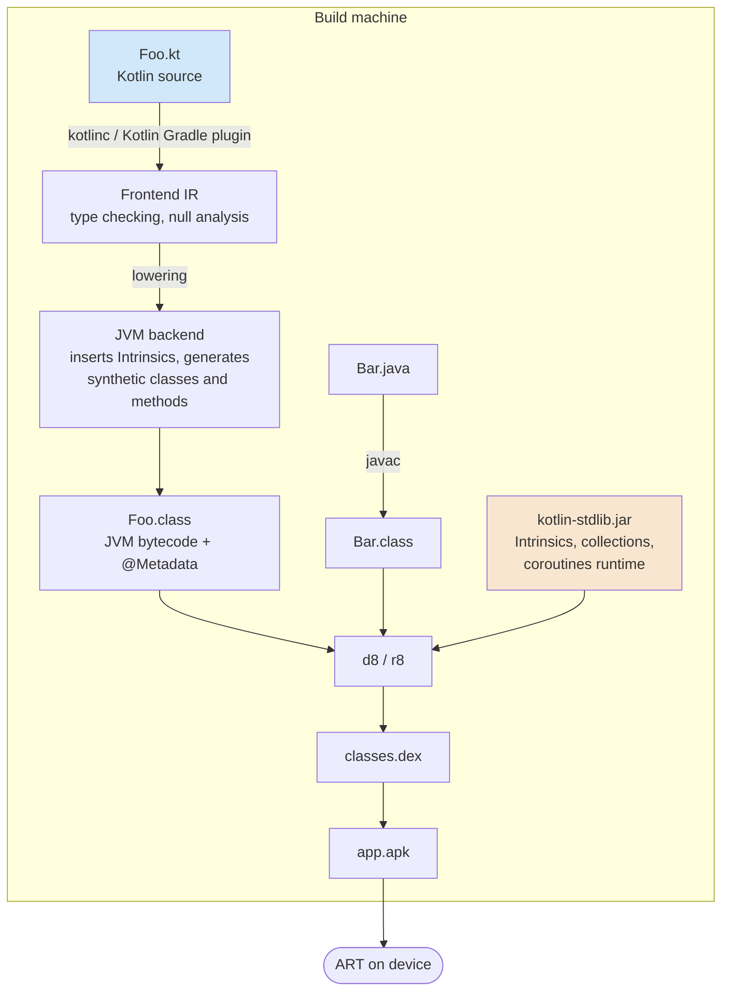
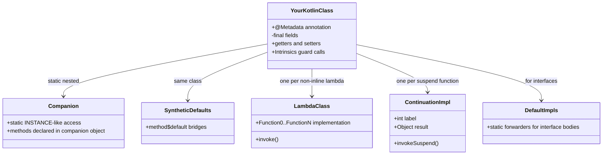
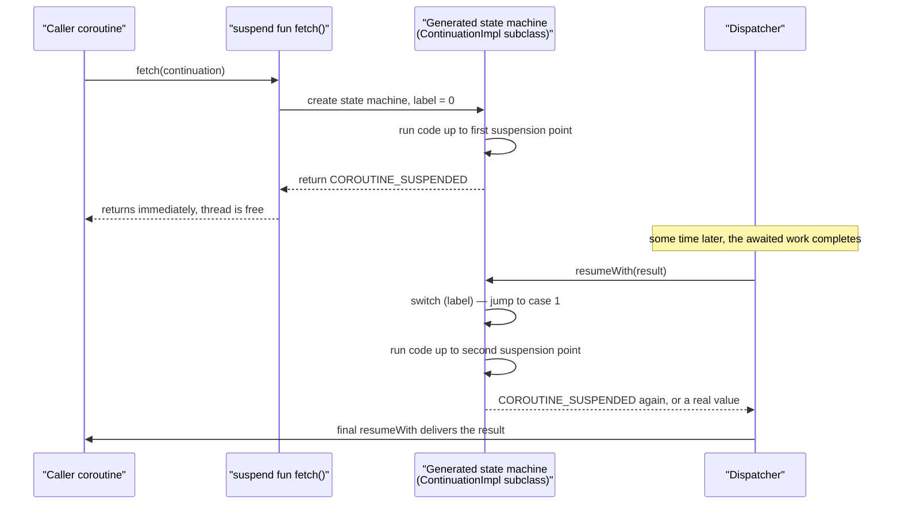
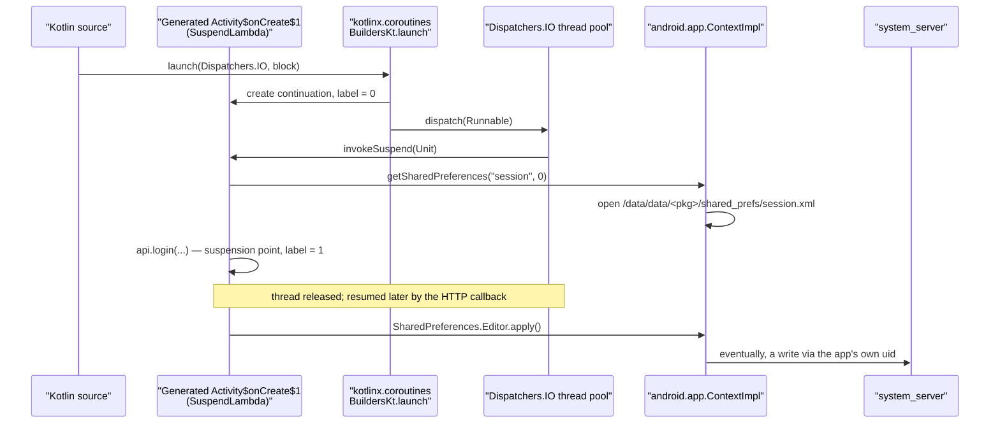
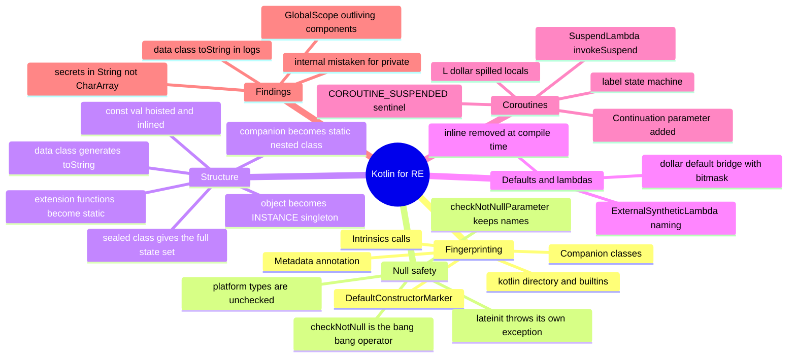

# 05 — Kotlin

> After this chapter you will be able to read any Kotlin source file, predict exactly what the
> Kotlin compiler emits for it, recognise every Kotlin construct in JADX output even though JADX
> shows you Java, reconstruct a coroutine's original control flow from its decompiled state machine,
> and explain which Kotlin features change an application's real attack surface.

**Prerequisites:** [03 — Programming Fundamentals](../03-Programming-Fundamentals/README.md),
[04 — Java](../04-Java/README.md). Chapter 04 is not optional: Kotlin compiles to the same bytecode
Java does, and the decompiler renders it as Java, so everything in chapter 04 section 6 applies here
unchanged.

**Applies to:** Kotlin 1.5 through 2.x. Android baseline is Android 13–16 (API 33–36). Where the K2
compiler (Kotlin 2.0+) changed generated code, that is noted explicitly.

---

## Table of Contents

1. [Introduction](#1-introduction)
2. [High-Level Architecture](#2-high-level-architecture)
3. [Deep Internal Working](#3-deep-internal-working)
4. [Source Code Walkthrough (AOSP)](#4-source-code-walkthrough-aosp)
5. [Security Perspective](#5-security-perspective)
6. [Reverse Engineering Perspective](#6-reverse-engineering-perspective)
7. [Dynamic Analysis](#7-dynamic-analysis)
8. [Static Analysis](#8-static-analysis)
9. [Examples](#9-examples)
10. [Common Interview Questions](#10-common-interview-questions)
11. [Common Mistakes](#11-common-mistakes)
12. [Hands-on Labs](#12-hands-on-labs)
13. [Summary](#13-summary)
14. [References](#14-references)

Supporting material:

- [cheatsheet.md](cheatsheet.md) — the Kotlin-to-decompiled-Java mapping in table form
- [mindmap.md](mindmap.md) — the whole chapter as one Mermaid mind map
- [faq.md](faq.md) — the questions learners actually ask
- [labs/](labs/) — three graded labs, including a coroutine-reconstruction CTF
- [examples/](examples/) — runnable Kotlin, including a side-by-side decompilation comparison
- [scripts/](scripts/) — a Kotlin detector and a Frida instrumentation script
- [references/](references/README.md) — annotated links

---

## 1. Introduction

### 1.1 The problem Kotlin was invented to solve

Java was designed in 1995 for a world of desktop applets and server software, by people who had
watched C++ collapse under its own complexity and who deliberately chose simplicity over
expressiveness. That choice aged in two directions at once. The simplicity kept Java learnable and
kept its ecosystem coherent for thirty years. The lack of expressiveness meant that by 2010, writing
an Android application in Java involved a great deal of ceremony: a data-holding class with five
fields required roughly a hundred lines of constructor, getters, `equals`, `hashCode`, and
`toString`, all of it mechanical, all of it a place for bugs to hide.

More seriously, Java had a hole in its type system. There was no way to say "this reference is never
null" and have the compiler enforce it. `NullPointerException` was, by a wide margin, the single
most common crash in Android applications, and the language offered nothing but discipline and
annotations to prevent it.

> **Mental Model.** Java says "a reference either points at an object or points at nothing, and
> you cannot tell which until you try." Kotlin says "the type itself tells you, and the compiler
> will not let you forget to check." That one change is the reason Kotlin exists.

JetBrains, who write IDEs and therefore spend their lives reading other people's Java, started
Kotlin in 2010 with four goals: eliminate null-pointer errors at compile time, remove boilerplate,
interoperate perfectly with existing Java, and compile fast. Google announced first-class Android
support in 2017 and declared Android development "Kotlin-first" in 2019. Today the large majority of
new Android code is Kotlin, and every AndroidX library is written with Kotlin consumers in mind.

### 1.2 What did *not* change, and why that matters to you

Kotlin is not a new runtime. There is no Kotlin virtual machine on Android. The Kotlin compiler
(`kotlinc`, or the Gradle Kotlin plugin) emits **JVM class files**, byte for byte the same kind of
artefact `javac` produces. Those class files then go through the identical pipeline described in
[chapter 04](../04-Java/README.md) section 2: `d8` or `r8` converts them to DEX, the DEX is zipped
into an APK, and ART executes it.

```
Foo.kt --kotlinc--> Foo.class (JVM bytecode) --d8/r8--> classes.dex --> APK --> ART
Bar.java --javac---> Bar.class (JVM bytecode) ---------^
```

Three consequences follow, and they define the whole chapter:

1. **The decompiler cannot show you Kotlin.** JADX reconstructs Java from DEX. Given Kotlin-compiled
   DEX, it produces Java-shaped code containing constructs no Java programmer would ever write. Your
   job is to read that output and recover the Kotlin that produced it.
2. **Kotlin adds a runtime library.** The compiler inserts calls to `kotlin.jvm.internal.Intrinsics`
   and other classes from `kotlin-stdlib`, which is bundled into the APK. Those inserted calls are
   the single most reliable fingerprint of Kotlin source, and they are the first thing this chapter
   teaches you to see.
3. **Kotlin's safety guarantees are compile-time.** Null safety, immutability of `val`, and
   exhaustiveness of `when` are enforced by the compiler and, at runtime, by inserted checks that
   *throw*. They are not enforced by ART, and they can be removed by patching or hooking. A Kotlin
   app is exactly as attackable as a Java one.

> **Pentester's Note.** The very first question to answer when you open an unfamiliar APK is
> "is this Kotlin?", because the answer changes how you read every class. The answer takes ten
> seconds: search the decompiled output for `Intrinsics.checkNotNullParameter` or for the
> `@Metadata` annotation. The script [scripts/detect-kotlin.py](scripts/detect-kotlin.py) in this
> chapter automates the check straight from the DEX string table without decompiling anything.

### 1.3 What would break if Kotlin did not exist

This is worth answering honestly, because "Kotlin is nicer" is not a security statement.

- **Null-pointer crashes would be more common.** They are a reliability problem, and reliability is
  a security property when the crashing code is a security control. A pinning check that throws
  before it completes has failed, and the failure mode depends entirely on who catches it.
- **Data classes would be hand-written.** Hand-written `equals`/`hashCode` pairs violate their
  contract regularly, and a violated contract in a `HashSet` used as a revocation list means
  revocation silently fails. Generated implementations do not have this bug.
- **Concurrency would be callbacks or threads.** Coroutines replaced deeply nested callback code with
  sequential-looking code, which materially reduces the number of state-machine bugs in
  authentication and payment flows. It also, as section 3.11 explains, makes decompiled code far
  harder to read.
- **Android's own APIs would look different.** Jetpack Compose, `Flow`-based APIs, and
  `suspend`-function-based libraries would not exist in their current form, and you would not need to
  know how to reverse them.

### 1.4 A first Kotlin program, line by line

```kotlin
// examples/Hello.kt — compile on the host: kotlinc Hello.kt -include-runtime -d hello.jar
fun main() {
    println("Hello, world")
}
```

Compare this with the Java equivalent from [chapter 04](../04-Java/README.md) section 1.5. The
`public`, `class`, `static`, `void`, and `String[] args` have all disappeared. None of them
disappeared from the *bytecode*, because the JVM still requires them; the compiler supplies them.

| What is missing from the source | What the compiler generates |
|---|---|
| The enclosing class | A class named `HelloKt` — the file name, capitalised, plus `Kt` |
| `public static` | The `main` method is emitted as `public static` |
| `void` | Kotlin's `Unit` return type is erased to `void` for a top-level `main` |
| `String[] args` | An overload taking no arguments plus, for `main`, a synthetic bridge |
| `System.out.println` | `println` is a top-level function in `kotlin.io`, which compiles to a static call that forwards to `System.out.println` |

> **Definition — top-level function.** A function declared outside any class. The JVM has no such
> concept, so the Kotlin compiler creates a synthetic class named after the file (`Hello.kt` becomes
> `HelloKt`) and makes the function a `public static` method on it. This is why decompiled Kotlin
> apps are full of classes ending in `Kt` that no developer wrote.

Decompiled, that program looks approximately like this:

```java
// JADX output
public final class HelloKt {
    public static final void main() {
        System.out.println("Hello, world");
    }

    public static /* synthetic */ void main(String[] args) {
        main();
    }
}
```

Two Kotlin fingerprints are already visible in a three-line program: the class name ending in `Kt`,
and the `final` modifier on both the class and the method, because **Kotlin classes and members are
final by default**. That default is itself a security-relevant design choice, discussed in section
3.6.

### 1.5 How to read this chapter

Every feature below follows the repository pattern from the [style guide](../STYLE-GUIDE.md):
analogy, plain definition, precise definition, internals, security consequence — and then one extra
beat that only this chapter and [chapter 04](../04-Java/README.md) have:

> **What this looks like in JADX.**

Treat that beat as the point of the chapter. A reverse engineer who knows Kotlin's source syntax but
cannot recognise `$default` bridge methods, `Companion` inner classes, `invokeSuspend` state
machines, and `Intrinsics` guards will read decompiled Kotlin at a fraction of the speed of one who
does. Section 6 collects all of it into a single reference table.

---

## 2. High-Level Architecture

### 2.1 The compilation pipeline, and where Kotlin inserts itself



The diagram makes three points that beginners get wrong.

First, **Kotlin and Java sources are compiled by different compilers into the same intermediate
form**, and only then merged. That is why a project can mix them freely and why a Kotlin class can
extend a Java class and vice versa.

Second, **`kotlin-stdlib` is a real dependency that ships inside the APK**. It contributes several
thousand methods, which is why enabling Kotlin on a tiny app noticeably increases its DEX size, and
why R8's shrinking matters more for Kotlin projects. It is also why the `kotlin/` package prefix
appears in the DEX string table of every Kotlin app, which is the basis of automated detection.

Third, **the compiler's backend inserts code you did not write**. Null checks, default-argument
bridges, `Companion` classes, lambda classes, and coroutine state machines are all generated during
lowering. Everything you will struggle to read in JADX was produced at this stage.

### 2.2 What the compiler adds to a class



Each of these boxes is a class or method that exists in the shipped DEX but appears nowhere in the
Kotlin source. Learning to see them as *compiler output* rather than as *authored code* is exactly
the skill that separates a fluent reader of decompiled Kotlin from a frustrated one. Every one of
them is dissected in section 3 and tabulated in section 6.1.

### 2.3 Where Kotlin's guarantees live at runtime

```mermaid
flowchart LR
    subgraph Compile["Compile time — enforced by kotlinc, gone at runtime"]
        A["Nullability of your own types"]
        B["val immutability"]
        C["when exhaustiveness"]
        D["Variance rules"]
        E["Generic type arguments"]
    end
    subgraph Runtime["Runtime — real instructions in the DEX"]
        F["Intrinsics.checkNotNullParameter"]
        G["Intrinsics.checkNotNullExpressionValue"]
        H["!! becomes a null check that throws"]
        I["lateinit access check"]
        J["Reified type via inlined class literal"]
    end
    subgraph Attacker["Attacker-controlled process"]
        K["Frida hook removes any runtime check"]
        L["Smali patch removes any runtime check"]
    end
    Compile -.->|"erased"| Runtime
    Runtime --> K
    Runtime --> L
    style K fill:#f9d0d0
    style L fill:#f9d0d0
```



This diagram is the security summary of the entire chapter. Kotlin's safety is split into two
halves. The left half evaporates at compile time and provides no runtime protection whatsoever. The
right half survives as real instructions — and because those instructions execute inside a process
the attacker controls, they can be neutralised in a single line of Frida or a two-byte Smali edit.

> **Warning.** "The app is written in Kotlin, so it is null-safe" is not a security claim. Null
> safety protects against developer error, not against an adversary. Worse, the *runtime* half
> throws exceptions, and an exception thrown inside a security check whose caller has a broad
> `try`/`catch` is a fail-open condition. Kotlin's safety mechanisms are therefore also a new place
> for fail-open bugs to live.

### 2.4 The lifecycle of a suspend function call



A suspend function is not a thread and does not block. It is a function that can return the special
marker `COROUTINE_SUSPENDED`, promising to call back later. The compiler rewrites the function body
into a state machine so that resuming can jump back to the right place.

For a reverse engineer this is the single hardest thing about Kotlin: a linear, readable function of
ten lines becomes a `switch` over an integer `label` inside a generated inner class, with all local
variables promoted to fields. Section 3.11 walks through the transformation in full, and
[lab 03](labs/lab-03-coroutine-state-machine.md) has you reconstruct one by hand.

---

## 3. Deep Internal Working

### 3.1 Null safety — the feature, and the fingerprint it leaves

**The problem.** In Java, `String s` may be `null`, and nothing tells you. Every dereference is a
potential crash, and every API contract about nullability lives in documentation nobody reads.

**What Kotlin does.** Nullability becomes part of the type. `String` can never be null; `String?`
can. The compiler refuses to let you call a method on a `String?` without handling the null case.

```kotlin
var a: String = "hello"
a = null                 // compile error

var b: String? = "hello"
b = null                 // fine
println(b.length)        // compile error — b might be null
println(b?.length)       // safe call: null if b is null, otherwise the length
println(b?.length ?: 0)  // Elvis operator: substitute 0 when the left side is null
println(b!!.length)      // not-null assertion: throw NullPointerException if b is null
```

| Operator | Name | Meaning | Runtime cost |
|---|---|---|---|
| `?.` | Safe call | Evaluate the right side only if the left is non-null | A null check and a branch |
| `?:` | Elvis | Use the right side when the left is null | A null check and a branch |
| `!!` | Not-null assertion | Assert non-null; throw if wrong | A null check that throws |
| `?.let { }` | Safe call plus scope | Run a block only when non-null | A null check plus a lambda, usually inlined |
| `as?` | Safe cast | Null instead of `ClassCastException` | `instanceof` plus a branch |

#### Platform types — where the guarantee stops

> **Definition — platform type.** A type that came from Java, whose nullability Kotlin does not
> know. Written `String!` in IDE tooltips, though you cannot write it yourself. Kotlin permits you
> to treat it as either nullable or non-null, and *does not check*.

This is the crack in the wall. Every call into the Android framework, into a Java library, or into
JNI returns a platform type unless the Java side is annotated with `@Nullable`/`@NonNull`. If you
assign a platform type to a non-null Kotlin variable and it happens to be null at runtime, you get a
`NullPointerException` from a line that looks like a plain assignment.

```kotlin
// getSystemService is a Java framework method: its return type is a platform type.
val cm = context.getSystemService(Context.CONNECTIVITY_SERVICE) as ConnectivityManager
// If the service is unavailable, this line throws — despite the code "being null-safe Kotlin".
```

#### The fingerprint: `Intrinsics` guards

Because a Kotlin function with non-null parameters can be called from *Java*, where the compiler
guarantees nothing, the Kotlin compiler inserts a runtime check at the top of every public function
that takes a non-null reference parameter.

```kotlin
fun greet(name: String, greeting: String) {
    println("$greeting, $name")
}
```

decompiles to:

```java
// JADX output — the two inserted calls are not in the Kotlin source
public static final void greet(String name, String greeting) {
    Intrinsics.checkNotNullParameter(name, "name");
    Intrinsics.checkNotNullParameter(greeting, "greeting");
    System.out.println(greeting + ", " + name);
}
```

and in Smali:

```smali
# Smali — the Kotlin null-check fingerprint
.method public static final greet(Ljava/lang/String;Ljava/lang/String;)V
    .registers 4
    const-string v0, "name"
    invoke-static {p0, v0}, Lkotlin/jvm/internal/Intrinsics;->checkNotNullParameter(Ljava/lang/Object;Ljava/lang/String;)V
    const-string v0, "greeting"
    invoke-static {p1, v0}, Lkotlin/jvm/internal/Intrinsics;->checkNotNullParameter(Ljava/lang/Object;Ljava/lang/String;)V
    ...
.end method
```

> **Pentester's Note.** Notice the second argument: the **parameter's original name as a string
> literal**. Kotlin therefore leaks parameter names into the DEX string table even in release
> builds, and even under R8 name obfuscation, because the string is an argument value rather than a
> symbol. In a heavily obfuscated Kotlin app where every method is named `a`, the `Intrinsics`
> strings still tell you that method `a(String, String)` takes parameters originally called
> `username` and `password`. This is one of the highest-value facts in this chapter.

The `Intrinsics` family, and what each member signals:

| Method | Inserted when | What it tells you |
|---|---|---|
| `checkNotNullParameter(Object, String)` | A public function has a non-null reference parameter | The parameter's original name |
| `checkNotNullExpressionValue(Object, String)` | A platform-type expression is used as non-null | The original expression text, often a full method call |
| `checkNotNull(Object)` / `checkNotNull(Object, String)` | `!!` was used | An explicit assertion in the source |
| `throwUninitializedPropertyAccessException(String)` | A `lateinit` property was read before assignment | The property's original name |
| `areEqual(Object, Object)` | `==` on nullable references | A null-safe content comparison |
| `stringPlus(String, Object)` | String concatenation with a nullable | — |
| `compare(int, int)` | Numeric comparison in generated `compareTo` | Usually from a data class or `Comparable` |
| `throwNpe()` / `throwJavaNpe()` | Older compiler versions, same role as `checkNotNull` | Kotlin version fingerprint |

Older Kotlin releases used `checkParameterIsNotNull` and `checkExpressionValueIsNotNull`; Kotlin 1.4
renamed them to the `checkNotNull*` forms. Seeing the old names dates the compiler, which is useful
when you are profiling how stale an app's toolchain is.

> **Under the Hood.** `Intrinsics.checkNotNullParameter` throws
> `NullPointerException` with a message built at throw time, and the compiler marks the call so R8
> can remove it under `-assumenosideeffects`-style configuration. Some release builds therefore lack
> the checks. Their *absence* is not evidence of Java; look for `@Metadata` as well.

### 3.2 `val`, `var`, and type inference

```kotlin
val name = "Ada"      // read-only reference, type inferred as String
var count = 0         // mutable reference, type inferred as Int
count += 1
// name = "Grace"     // compile error
```

`val` means the *reference* cannot be reassigned. It does not mean the object is immutable: a
`val list = mutableListOf<String>()` can still be added to. The distinction matters when reasoning
about shared state.

In bytecode, a `val` property becomes a `private final` field plus a getter; a `var` becomes a
`private` field plus a getter and a setter. A local `val` is a local variable — `final` is
not representable on locals in bytecode, so **the `val`/`var` distinction is completely erased for
locals**. In JADX you cannot tell whether a local was `val` or `var`.

Type inference is entirely a compile-time convenience. The bytecode always carries the concrete
type, so nothing is inferred at runtime and nothing is lost to the decompiler.

| Kotlin | Generated members | JADX view |
|---|---|---|
| `val x: Int = 1` (property) | `private final int x` + `getX()` | Field plus getter |
| `var x: Int = 1` (property) | `private int x` + `getX()` + `setX(int)` | Field plus both accessors |
| `const val X = "a"` | `public static final String X`, inlined at use sites | The literal appears at every use |
| `@JvmField val x = 1` | `public final int x`, no getter | A bare public field |
| `lateinit var x: Foo` | `private Foo x` + null-checking getter | Getter calls `throwUninitializedPropertyAccessException` |

> **Pentester's Note.** `const val` behaves exactly like Java's `static final`: the value is
> inlined at every use site, so patching the declaration achieves nothing. This trips up beginners
> patching licence flags. See [chapter 04](../04-Java/README.md) section 3.17.

### 3.3 Functions, default arguments, and the `$default` bridge

```kotlin
fun connect(host: String, port: Int = 443, useTls: Boolean = true) { /* ... */ }

connect("api.example.com")                       // uses both defaults
connect("api.example.com", 8080)                 // uses one default
connect(host = "api.example.com", useTls = false) // named argument skips a parameter
```

The JVM has no concept of default arguments. The compiler solves this with a **synthetic bridge
method** that takes every parameter plus an integer bitmask saying which ones the caller actually
supplied.

```java
// JADX output — this is what default arguments really compile to
public static final void connect(String host, int port, boolean useTls) {
    Intrinsics.checkNotNullParameter(host, "host");
    // real body
}

public static /* synthetic */ void connect$default(
        String host, int port, boolean useTls, int mask, Object marker) {
    if ((mask & 2) != 0) {
        port = 443;
    }
    if ((mask & 4) != 0) {
        useTls = true;
    }
    connect(host, port, useTls);
}
```

And the call site `connect("api.example.com")` becomes
`connect$default("api.example.com", 0, false, 6, null)`, where `6` is the bitmask `0b110` marking
parameters 2 and 3 as defaulted.

> **Mental Model.** Every `$default` method is a compiler-written switchboard. The integer
> argument that looks meaningless is a bitmask of "which arguments were omitted", and the trailing
> `null` is an unused marker parameter that exists to keep the synthetic signature distinct.

**Why this matters for hooking.** If you hook `connect(String, int, boolean)` you will catch every
call, because the bridge always delegates to it. If you hook `connect$default` you will catch only
calls that omitted an argument. When a Frida hook on a Kotlin function "sometimes" fires, a
`$default` bridge is usually the reason. The safe approach is to hook the real function and let the
bridge feed it.

Constructors follow the same pattern but use a different marker: a synthetic constructor overload
whose last parameter is of type `kotlin.jvm.internal.DefaultConstructorMarker`. Seeing
`DefaultConstructorMarker` in a decompiled constructor signature is a definitive Kotlin fingerprint.

### 3.4 Data classes

```kotlin
data class User(val id: Long, val name: String, val email: String?)
```

One line generates, in the bytecode:

| Generated member | Purpose | Notes |
|---|---|---|
| Constructor | Assigns all properties | Includes `Intrinsics` checks for non-null parameters |
| `getId()`, `getName()`, `getEmail()` | Property getters | `val` means no setters |
| `equals(Object)` | Structural equality over all constructor properties | Uses `Intrinsics.areEqual` for reference types |
| `hashCode()` | Consistent with `equals` | Combines each property's hash with `31 * result + …` |
| `toString()` | `User(id=1, name=Ada, email=null)` | **Contains the property names as literals** |
| `copy(...)` | Returns a modified copy | Has a `copy$default` bridge |
| `component1()`, `component2()`, … | Positional accessors for destructuring | One per constructor property |

The `toString` implementation deserves your attention:

```java
// JADX output
public String toString() {
    return "User(id=" + this.id + ", name=" + this.name + ", email=" + this.email + ")";
}
```

> **Pentester's Note.** Data-class `toString` puts the **class name and every property name** into
> the DEX string table as literals, and it does so even under R8 renaming unless the app explicitly
> disables it. In an obfuscated app, dumping strings and looking for the
> `Xyz(a=` … `, b=` pattern hands you the original field semantics of the app's model objects. It
> also means that any log statement, crash report, or analytics event that stringifies a data class
> containing a token will leak it verbatim. Search decompiled code for `Log.` calls whose argument
> is a data-class instance.

Destructuring uses the `componentN` functions:

```kotlin
val (id, name, _) = user     // becomes user.component1(), user.component2()
```

This is why you see calls to methods literally named `component1` in decompiled code. They are never
hand-written.

### 3.5 Sealed classes and `when`

> **Definition — sealed class.** A class whose direct subclasses are all known at compile time,
> because they must be declared in the same package and module. It lets the compiler verify that a
> `when` expression covers every case.

```kotlin
sealed class Result {
    data class Success(val body: String) : Result()
    data class Failure(val code: Int) : Result()
    object Loading : Result()
}

fun render(r: Result): String = when (r) {          // no else needed: exhaustive
    is Result.Success -> r.body
    is Result.Failure -> "error ${r.code}"
    Result.Loading    -> "loading"
}
```

At bytecode level, a sealed class is an abstract class with a package-private or synthetic
constructor, and the subclasses are ordinary classes. Exhaustiveness is checked only at compile
time; the generated `when` becomes a chain of `instanceof` tests, and the compiler adds a final
`throw new NoWhenBranchMatchedException()` for the impossible case.

```java
// JADX output
public static final String render(Result r) {
    Intrinsics.checkNotNullParameter(r, "r");
    if (r instanceof Result.Success) {
        return ((Result.Success) r).getBody();
    }
    if (r instanceof Result.Failure) {
        return "error " + ((Result.Failure) r).getCode();
    }
    if (Intrinsics.areEqual(r, Result.Loading.INSTANCE)) {
        return "loading";
    }
    throw new NoWhenBranchMatchedException();
}
```

A `when` over an **enum** instead compiles to the same `$SwitchMap` array trick Java uses, wrapped
in a synthetic class that JADX renders as `WhenMappings` with a field named
`$EnumSwitchMapping$0`. Seeing `WhenMappings` is a Kotlin fingerprint; seeing `$SwitchMap$` is a
Java one.

> **Under the Hood.** `NoWhenBranchMatchedException` exists because exhaustiveness is verified
> against the subclasses visible at *compile* time. If a library adds a subclass and the consumer is
> not recompiled, the branch is genuinely unreachable-in-theory but reachable-in-practice, and the
> exception makes that failure loud rather than silent. In decompiled code, its presence tells you
> the source used an exhaustive `when` rather than an `if`/`else` chain.

### 3.6 Classes, `object`, and `companion object`

Kotlin's class defaults differ from Java's in two ways that matter to you:

1. **Classes and members are `final` by default.** You must write `open` to allow subclassing or
   overriding. This is a deliberate design choice — "design for inheritance or prohibit it" — and it
   means R8 can devirtualise and inline far more aggressively in Kotlin code than in Java code.
2. **Visibility defaults to `public`**, and Kotlin adds `internal`, meaning "visible within the
   compilation module".

| Kotlin visibility | Bytecode representation | Reachable by an attacker |
|---|---|---|
| `public` | `ACC_PUBLIC` | Yes |
| `internal` | `ACC_PUBLIC` with a **name-mangled** suffix, e.g. `foo$app_release` | Yes — it is public in the bytecode |
| `protected` | `ACC_PROTECTED` | Yes |
| `private` | `ACC_PRIVATE`, or package-private if accessed from a nested class | Yes, via reflection or patching |

> **Warning.** `internal` is **not** an access control at runtime. It compiles to `public` with a
> mangled name so that another module cannot accidentally link against it. Anything `internal` can
> be called by any code in the process, including your Frida script, by using the mangled name. The
> mangling suffix — typically `$<module>_<variant>`, such as `$app_release` — is itself a useful
> fingerprint telling you the module and build variant name.

#### `object` — the singleton

```kotlin
object Config {
    var apiBase = "https://api.example.com"
    fun url(path: String) = apiBase + path
}
```

An `object` declaration compiles to a final class with a `public static final` field named
`INSTANCE`, initialised in `<clinit>`, and a private constructor.

```java
// JADX output
public final class Config {
    public static final Config INSTANCE = new Config();
    private static String apiBase = "https://api.example.com";
    private Config() { }
    public final String getApiBase() { return apiBase; }
    public final void setApiBase(String s) { Intrinsics.checkNotNullParameter(s, "<set-?>"); apiBase = s; }
    public final String url(String path) { ... }
}
```

Note `"<set-?>"` as the parameter name in the setter: that literal string is a Kotlin property
setter's synthesised parameter name, and it is another unmistakable fingerprint.

To call an `object`'s method from Frida you must go through `INSTANCE`, or hook the instance method
on the class; a naive attempt to call it as a static method fails.

#### `companion object` — Kotlin's answer to `static`

Kotlin has no `static` keyword. Class-level members go in a `companion object`.

```kotlin
class Crypto {
    companion object {
        private const val KEY = "hardcoded-key-1234"
        fun encrypt(s: String): String { /* ... */ return s }
    }
}
```

This compiles to **two** classes:

```java
// JADX output — Crypto.java
public final class Crypto {
    public static final Companion Companion = new Companion(null);
    private static final String KEY = "hardcoded-key-1234";

    public static final class Companion {
        private Companion() { }
        public /* synthetic */ Companion(DefaultConstructorMarker marker) { this(); }
        public final String encrypt(String s) {
            Intrinsics.checkNotNullParameter(s, "s");
            return s;
        }
    }
}
```

Four things to internalise, because this pattern appears in nearly every Kotlin class:

- The nested class is literally named `Companion` unless the source gave it another name.
- The outer class holds a `public static final Companion Companion` field.
- The `Companion` constructor is private, with a synthetic overload taking a
  `DefaultConstructorMarker` so the outer class can construct it.
- The companion's *methods* are instance methods on `Companion`, **not** static methods on the outer
  class — unless annotated `@JvmStatic`, which additionally generates a static forwarder on the
  outer class.

> **Pentester's Note.** This is the number-one cause of "my Frida hook does not exist". To hook
> `Crypto.encrypt` you must write `Java.use("com.app.Crypto$Companion").encrypt.implementation = …`,
> not `Java.use("com.app.Crypto")`. Remember the `$` in the class name and remember that the method
> is an instance method with `this` bound to the companion.

### 3.7 Extension functions

**The problem.** You want to add a method to a class you do not own — `String`, `Context`, a library
type. Java's answer is a static utility class, and the call reads backwards:
`StringUtils.isValidEmail(s)`.

**Kotlin's answer:**

```kotlin
fun String.isValidEmail(): Boolean = contains("@") && length > 5

// call site reads naturally
if (email.isValidEmail()) { ... }
```

**What it really is.** Nothing is added to `String`. The compiler generates a `public static`
function whose **first parameter is the receiver**, and rewrites the call site accordingly.

```java
// JADX output — file Utils.kt becomes class UtilsKt
public final class UtilsKt {
    public static final boolean isValidEmail(String $this$isValidEmail) {
        Intrinsics.checkNotNullParameter($this$isValidEmail, "$this$isValidEmail");
        return StringsKt.contains$default($this$isValidEmail, "@", false, 2, null)
                && $this$isValidEmail.length() > 5;
    }
}
```

The synthetic parameter name `$this$isValidEmail` is the fingerprint. Because it is passed to
`checkNotNullParameter` as a string literal, it survives into the DEX string table.

Consequences worth stating explicitly:

- Extension functions are **statically dispatched**. They are resolved by the declared type of the
  expression, not by the runtime type, so they cannot be overridden and do not participate in
  polymorphism.
- An extension cannot access `private` members of the receiver, because it really is an outside
  static method.
- **You will not find them on the class in JADX.** Searching `String` for `isValidEmail` returns
  nothing. Search the `*Kt` classes instead.

Extension *properties* work identically, generating a static getter.

### 3.8 Lambdas, higher-order functions, and `inline`

```kotlin
fun repeatTwice(action: () -> Unit) { action(); action() }

repeatTwice { println("hi") }               // trailing lambda syntax
val doubled = listOf(1, 2, 3).map { it * 2 } // `it` is the implicit single parameter
```

> **Definition — higher-order function.** A function that takes a function as a parameter or
> returns one. Kotlin gives function types first-class syntax: `(Int, String) -> Boolean`.

A non-inline lambda compiles to an object implementing one of the `kotlin.jvm.functions.FunctionN`
interfaces, where `N` is the number of parameters. In JADX it appears either as a numbered inner
class extending `kotlin.jvm.internal.Lambda` and implementing `Function0`, or — with newer compilers
and `d8` desugaring — as an `$$ExternalSyntheticLambda` class exactly as in
[chapter 04](../04-Java/README.md) section 3.15.

#### `inline` — the feature that breaks your hooks

```kotlin
inline fun measure(block: () -> Unit) {
    val start = System.nanoTime()
    block()
    println("took ${System.nanoTime() - start}")
}

measure { doWork() }
```

`inline` instructs the compiler to **copy the function's body into every call site**, and to copy
the lambda's body into the place where the parameter is invoked. After compilation there is no
`measure` method and no lambda object at all: the timing code and `doWork()` are spliced directly
into the caller.

```java
// JADX output at the call site — measure() has vanished
long start = System.nanoTime();
doWork();
System.out.println("took " + (System.nanoTime() - start));
```

Why inline exists: a lambda would otherwise allocate an object per call and add a virtual dispatch,
which is expensive in a hot loop. Inlining also enables non-local `return` from inside a lambda and
`reified` type parameters, neither of which is possible otherwise.

> **Warning.** This is the most common cause of failed instrumentation in Kotlin apps. If you
> cannot hook a function, check whether it is `inline`. An inlined function has **no runtime
> existence**; there is nothing to hook. The workaround is to hook the functions it calls, or to
> find the call sites and patch them individually. The entire Kotlin standard library's scope
> functions, collection operations, and `use` are inline, which is why you will never see a
> `let` or `map` call in decompiled code — you see the loop the compiler generated instead.

Related modifiers, all of which matter only in combination with `inline`:

| Modifier | Meaning | RE consequence |
|---|---|---|
| `inline` | Copy body to call sites | Function disappears |
| `noinline` | This lambda parameter is not inlined | A real `FunctionN` object appears |
| `crossinline` | Lambda may not do a non-local return | Body still inlined |
| `reified` | The type argument is available at runtime | The concrete class literal is baked into each call site |

`reified` deserves a note: because the body is copied into each call site, the compiler can
substitute the actual type argument. So `inline fun <reified T> parse(s: String): T` compiles at a
call site with `T = User` into code referencing `User.class` directly. In decompiled output you see
the concrete class where the source had a type parameter, which is more informative than Java's
erased generics.

### 3.9 Scope functions

Five standard-library functions that all do roughly "run a block with this object", differing in
what the block receives and what the expression returns.

| Function | Block receives | Returns | Typical use |
|---|---|---|---|
| `let` | `it` (parameter) | Block result | Null-safe transformation: `x?.let { … }` |
| `run` | `this` (receiver) | Block result | Compute a value using an object's members |
| `with` | `this` (receiver) | Block result | Same, but the object is an argument not a receiver call |
| `apply` | `this` (receiver) | The object itself | Configure and return: builder-style setup |
| `also` | `it` (parameter) | The object itself | Side effects such as logging, without changing the value |

All five are `inline`, so **none of them appears in decompiled code**. `apply { }` around ten setter
calls becomes ten setter calls on a temporary local. This is good news: scope functions add
zero obfuscation and zero runtime cost, and they leave the decompiled output *more* readable than
the source in some cases.

```kotlin
val intent = Intent(this, Login::class.java).apply {
    putExtra("user", user)
    flags = Intent.FLAG_ACTIVITY_CLEAR_TOP
}
```

```java
// JADX output — apply is gone entirely
Intent intent = new Intent(this, Login.class);
intent.putExtra("user", user);
intent.setFlags(67108864);
```

the constant `Intent.FLAG_ACTIVITY_CLEAR_TOP` has been inlined to its numeric value
`67108864`. Keeping a mental table of common framework flag values, or looking them up, is part of
reading decompiled Android code fluently.

### 3.10 Collections, sequences, and generics

Kotlin does not ship its own collection implementations on the JVM. `List<T>` is
`java.util.List` at runtime; the difference is entirely in the *type system*.

| Kotlin type | Runtime type | Mutable |
|---|---|---|
| `List<T>` | `java.util.List` | No, by contract only |
| `MutableList<T>` | `java.util.List` | Yes |
| `Map<K, V>` | `java.util.Map` | No, by contract only |
| `MutableMap<K, V>` | `java.util.Map` | Yes |
| `Array<T>` | `T[]` | Yes |
| `IntArray` | `int[]` | Yes, and avoids boxing |

> **Warning.** Read-only is not immutable. `List<T>` is the same object as the `MutableList<T>`
> someone else may still hold, and a `List` obtained from Java is a platform type that may be
> mutated behind your back. Calling `.toList()` makes a defensive copy; the type alone does not.

**Sequences** are the lazy counterpart of collections, equivalent to Java streams:

```kotlin
val firstBig = items.asSequence().map { transform(it) }.filter { it.size > 10 }.firstOrNull()
```

With a `List`, `map` builds an entire intermediate list before `filter` runs. With a `Sequence`,
each element flows through the whole chain before the next is touched, and evaluation stops at the
first match. For large collections this is the difference between allocating a million objects and
allocating none.

Generics behave as in Java — erased at runtime — with two Kotlin additions:

- **Declaration-site variance.** Java forces you to write `List<? extends Number>` at every use.
  Kotlin lets the *declaration* say `interface List<out T>` (covariant, producer) or
  `interface Comparable<in T>` (contravariant, consumer). The mnemonic is the same as Java's PECS.
  This is purely a compile-time affair; erasure is identical.
- **Reified type parameters** in `inline` functions, described in section 3.8, which partially defeat
  erasure by substituting the concrete type at each call site.

### 3.11 Coroutines — the deepest transformation in the language

This section is the hardest and most valuable in the chapter. Read it twice.

#### The problem coroutines solve

Android's main thread must return to the event loop within milliseconds or the UI freezes. Network
and disk work therefore cannot happen on it. The classic solutions were:

- **Threads**, which are expensive (each costs about a megabyte of stack) and which you must
  synchronise by hand.
- **Callbacks**, which produce "callback hell": deeply nested anonymous classes where error handling
  and cancellation are scattered and usually wrong.

Coroutines let you write sequential-looking code that suspends without blocking a thread.

```kotlin
suspend fun loadProfile(id: String): Profile {
    val token = auth.refresh()          // suspension point 1 — thread is released
    val json  = api.get("/user/$id", token)   // suspension point 2
    return parse(json)
}
```

Nothing here blocks. At each suspension point the function returns to its caller, freeing the thread
entirely, and resumes later on whatever thread the dispatcher chooses.

> **Definition — suspend function.** A function that may suspend its execution and resume later
> without blocking a thread. It can only be called from another suspend function or from a coroutine
> builder. At bytecode level it is an ordinary function with **one extra parameter**, a
> `kotlin.coroutines.Continuation`, and a return type of `Object`.

#### Continuation Passing Style, precisely

The compiler rewrites every suspend function using **Continuation Passing Style (CPS)**: instead of
returning a value, the function receives an object representing "what to do next" and either returns
a value immediately or returns the marker `COROUTINE_SUSPENDED` and promises to invoke the
continuation later.

```kotlin
suspend fun loadProfile(id: String): Profile
```

becomes, at the JVM signature level:

```java
public final Object loadProfile(String id, Continuation<? super Profile> $completion)
```

Two changes, both visible in JADX and both definitive Kotlin coroutine fingerprints:

1. The return type became `Object`, because the function may return either a `Profile` or the
   `COROUTINE_SUSPENDED` marker.
2. An extra trailing parameter of type `kotlin.coroutines.Continuation` appeared.

#### The state machine

Suspending in the middle of a function requires the ability to *resume in the middle of a function*,
which the JVM cannot do. The compiler solves this by turning the function body into a state machine:

- Every local variable that is live across a suspension point is promoted to a **field** of a
  generated continuation object.
- The body is split at each suspension point into numbered blocks.
- An integer field named **`label`** records which block to run next.
- The whole thing lives in a generated class extending `ContinuationImpl`, whose `invokeSuspend`
  method contains a `switch` on `label`.

Here is the shape JADX produces. Read it carefully; you will see this pattern constantly.

```java
// JADX output for loadProfile — abridged but structurally accurate
public final Object loadProfile(String id, Continuation<? super Profile> continuation) {
    ContinuationImpl $continuation;
    if (continuation instanceof C1) {
        $continuation = (C1) continuation;
        if (($continuation.label & Integer.MIN_VALUE) != 0) {
            $continuation.label -= Integer.MIN_VALUE;
        } else {
            $continuation = new C1(this, continuation);
        }
    } else {
        $continuation = new C1(this, continuation);
    }

    Object result = $continuation.result;
    Object suspended = IntrinsicsKt.getCOROUTINE_SUSPENDED();

    switch ($continuation.label) {
        case 0:
            ResultKt.throwOnFailure(result);
            $continuation.L$0 = this;
            $continuation.L$1 = id;
            $continuation.label = 1;
            Object r = this.auth.refresh($continuation);
            if (r == suspended) {
                return suspended;              // suspend: return to caller, thread freed
            }
            result = r;
            // fall through when the call completed synchronously
        case 1:
            String token = (String) result;
            ResultKt.throwOnFailure(result);
            $continuation.L$0 = null;
            $continuation.label = 2;
            Object r2 = this.api.get("/user/" + id, token, $continuation);
            if (r2 == suspended) {
                return suspended;
            }
            result = r2;
        case 2:
            ResultKt.throwOnFailure(result);
            return parse((String) result);
        default:
            throw new IllegalStateException("call to 'resume' before 'invoke' with coroutine");
    }
}
```

Every element of that listing is a fingerprint:

| Element | Meaning |
|---|---|
| Trailing `Continuation` parameter | The function was `suspend` |
| Return type `Object` | Same |
| `IntrinsicsKt.getCOROUTINE_SUSPENDED()` | The suspension marker |
| `int label` field and a `switch` on it | The state machine; each case is one segment of the original body |
| `L$0`, `L$1`, `L$2` fields | Original local variables, promoted so they survive suspension |
| `ResultKt.throwOnFailure(result)` | Rethrows an exception that occurred while suspended |
| `label & Integer.MIN_VALUE` dance | Distinguishes a fresh call from a resumption |
| `IllegalStateException("call to 'resume' before 'invoke'…")` | The `default` branch; a literal you can grep for |
| A nested class named like `Foo$loadProfile$1` extending `ContinuationImpl` | The generated state machine class |

> **Mental Model.** Read the `switch` cases in numerical order and concatenate their bodies,
> deleting the bookkeeping. `case 0` is the code before the first `await`; `case 1` is the code
> between the first and second; and so on. The `L$n` fields are the local variables, in declaration
> order. With that recipe you can reconstruct the original suspend function in a couple of minutes,
> which is exactly the exercise in [lab 03](labs/lab-03-coroutine-state-machine.md).

#### Structured concurrency

> **Definition — structured concurrency.** The rule that every coroutine belongs to a scope, that
> a scope does not complete until all its children complete, and that cancelling a scope cancels
> every child. It makes leaks and orphaned work structurally impossible rather than merely
> discouraged.

```kotlin
class ProfileViewModel : ViewModel() {
    fun load(id: String) {
        viewModelScope.launch {          // cancelled automatically when the ViewModel is cleared
            val profile = withContext(Dispatchers.IO) { repo.load(id) }
            _state.value = profile
        }
    }
}
```

| Concept | What it is | Decompiled fingerprint |
|---|---|---|
| `CoroutineScope` | An object holding a `Job` and a `CoroutineContext` | `CoroutineScopeKt`, `getCoroutineContext()` |
| `Job` | A cancellable handle on a coroutine and its children | `JobKt`, `Job$Key` |
| `launch` | Start a coroutine, return a `Job`, fire and forget | `BuildersKt.launch$default(...)` |
| `async` | Start a coroutine returning a `Deferred` | `BuildersKt.async$default(...)` |
| `await` | Suspend until a `Deferred` completes | A suspension point in the state machine |
| `withContext` | Run a block on a different dispatcher | `BuildersKt.withContext(...)` |
| `Dispatchers.Main` | The Android main/UI thread | `Dispatchers.getMain()` |
| `Dispatchers.IO` | A pool sized for blocking I/O | `Dispatchers.getIO()` |
| `Dispatchers.Default` | A pool sized for CPU work | `Dispatchers.getDefault()` |
| `SupervisorJob` | A job whose children's failures do not cancel siblings | `SupervisorKt` |

#### Flow

`Flow` is the asynchronous, cold, sequence-like stream type.

```kotlin
fun tokens(): Flow<String> = flow {
    while (true) {
        emit(fetchToken())
        delay(60_000)
    }
}

lifecycleScope.launch {
    tokens().collect { token -> use(token) }
}
```

`collect` is a suspend function, so a `Flow` collection compiles into the same state-machine shape,
usually with an additional generated class implementing `FlowCollector` whose `emit` method holds
the lambda body. In JADX you will see classes named like `Foo$tokens$1` and
`Foo$onCreate$1$1` with `invokeSuspend` methods, nested two or three deep. Untangling nested
coroutine classes is a matter of following the naming: `Outer$function$N` is generated for the
`N`-th lambda or suspend block inside `function`.

> **Pentester's Note.** Because every coroutine ends up in a class named after its enclosing
> function, coroutine class names are a **map of the app's original function names**, and R8 does not
> always rename them consistently with the functions themselves. In a partially obfuscated app, the
> generated coroutine class names frequently reveal the original names of the functions that
> contained them.

### 3.12 Delegation

Kotlin's `by` keyword forwards work to another object. Two distinct features share the keyword.

#### Property delegation

```kotlin
class Repo {
    val db: Database by lazy { openDatabase() }        // computed on first access, then cached
    var name: String by Delegates.observable("") { _, old, new -> log("$old -> $new") }
}
```

`by lazy` generates a private field holding a `kotlin.Lazy` object, and the property's getter becomes
`return ((Database) this.db$delegate.getValue())`. The initialiser lambda becomes a `Function0`
class. By default `lazy` is thread-safe, using double-checked locking with a `volatile` field inside
`SynchronizedLazyImpl` — which is a correct implementation of the pattern that
[chapter 04](../04-Java/README.md) section 3.13 warns is easy to get wrong by hand.

| Delegate | Generated | Notes |
|---|---|---|
| `by lazy { }` | `Lazy` field plus `getValue()` call in the getter | `LazyThreadSafetyMode` controls locking |
| `by Delegates.observable` | `ObservableProperty` subclass | Callback on every set |
| `by Delegates.vetoable` | Same, but the callback can reject | Rarely seen |
| `by map` | `getValue(Map, KProperty)` | Property name becomes a **string key**, visible in the DEX |
| Custom delegate | A class with `getValue`/`setValue` operators | Look for `KProperty` parameters |

The `by map` form is worth flagging: it turns property names into string keys, which appear in the
string table. Frameworks that map JSON to properties this way expose their whole schema.

#### Interface delegation

```kotlin
interface Logger { fun log(s: String) }
class TimestampLogger(private val inner: Logger) : Logger by inner {
    override fun log(s: String) = inner.log("[${now()}] $s")
}
```

`Logger by inner` makes the compiler generate a forwarding implementation of every interface method
that you did not override. In JADX these appear as one-line methods delegating to a field — a
recognisable pattern of many tiny forwarders, which tells you the source used delegation rather than
inheritance.

### 3.13 Java interop and the `@Jvm*` annotations

Kotlin must be callable from Java, and the mapping is not always what a Java caller expects. The
`@Jvm*` annotations control the generated signatures.

| Annotation | Effect | Why it matters to you |
|---|---|---|
| `@JvmStatic` | Generates a static forwarder on the outer class for a companion or object member | Changes how you hook it: a real static method appears |
| `@JvmField` | Exposes the property as a public field with no getter or setter | The field is directly readable; no accessor to hook |
| `@JvmOverloads` | Generates one Java overload per default-argument combination | Many overloads appear instead of one `$default` bridge |
| `@JvmName("x")` | Renames the generated method or file class | Defeats naive name-based searching |
| `@JvmSuppressWildcards` / `@JvmWildcard` | Controls generic wildcards in signatures | Affects overload matching in Frida |
| `@Throws` | Adds a `throws` clause so Java callers can catch it | Kotlin has no checked exceptions |
| `@file:JvmName("Utils")` | Names the file class `Utils` instead of `UtilsKt` | A `*Kt` class you cannot find may have been renamed |

> **Pentester's Note.** `@JvmName` on a file changes the synthetic class name, so an extension
> function you cannot locate may live in a class with an arbitrary name. When hunting for a
> top-level function, search the *method* name across all classes rather than guessing the class.

Two interop hazards worth knowing:

- **Kotlin has no checked exceptions.** A Kotlin function that throws `IOException` has no `throws`
  clause unless annotated, so Java callers do not know to catch it. In an app mixing languages, this
  produces uncaught exceptions in places the Java author believed were safe.
- **Nullability annotations matter in both directions.** A Java method annotated `@Nullable` becomes
  `T?` in Kotlin; an unannotated one becomes a platform type with no checking. Adding
  `androidx.annotation` nullability annotations to Java code is therefore a genuine hardening step
  for a mixed codebase.

### 3.14 Kotlin Multiplatform, briefly

Kotlin can target the JVM, JavaScript, and native code (iOS, desktop, embedded) from one source set.
For Android security work you mainly need to recognise the artefacts:

- Shared business logic compiled for Android arrives as ordinary Kotlin/JVM classes, indistinguishable
  from any other Kotlin.
- `expect`/`actual` declarations resolve at compile time; only the `actual` implementation is in the
  APK.
- A Kotlin/Native component would appear as a `.so`, analysed per
  [15 — Native Code](../15-Native-Code/README.md), not as DEX.
- Multiplatform projects frequently use `kotlinx.serialization`, whose generated `$serializer`
  classes and `SerialDescriptor` objects contain the **full field names and types of every
  serialisable model**, which is a substantial information leak in an otherwise obfuscated app.

> **Pentester's Note.** If you see classes ending in `$$serializer` with a
> `PluginGeneratedSerialDescriptor` and a sequence of `addElement("fieldName")` calls, you have the
> app's complete data model including field names, regardless of obfuscation. Dump those strings
> first.

---

## 4. Source Code Walkthrough (AOSP)

Kotlin is not part of AOSP the way Java's `libcore` is, and this distinction is worth stating
because it changes where you look.

- **Java's standard library is part of the platform.** `java.lang.String` lives in the boot
  classpath, shared by every app, and its source is in AOSP under `libcore/`.
- **Kotlin's standard library is part of the app.** `kotlin.jvm.internal.Intrinsics` is compiled
  into the APK. Every Kotlin app ships its own copy (deduplicated by R8, but still per-app).

That has three practical consequences. Kotlin runtime classes appear in the app's own DEX, so they
show up in string dumps and class enumeration. Different apps may ship different Kotlin versions,
with different generated-code shapes. And hooking `Intrinsics` affects only the app you attached
to, never the system.

### 4.1 Where the Kotlin runtime lives at runtime

| Class | Origin | Role |
|---|---|---|
| `kotlin.jvm.internal.Intrinsics` | `kotlin-stdlib`, bundled in the APK | Null checks, equality, comparison helpers |
| `kotlin.jvm.internal.Lambda` | `kotlin-stdlib` | Base class of non-inlined lambda objects |
| `kotlin.jvm.internal.DefaultConstructorMarker` | `kotlin-stdlib` | Disambiguates synthetic constructors |
| `kotlin.jvm.functions.Function0…FunctionN` | `kotlin-stdlib` | Function type interfaces |
| `kotlin.Metadata` | `kotlin-stdlib` | The annotation carrying original Kotlin signatures |
| `kotlin.coroutines.Continuation` | `kotlin-stdlib` | The CPS callback interface |
| `kotlin.coroutines.jvm.internal.ContinuationImpl` | `kotlin-stdlib` | Base class of generated state machines |
| `kotlin.coroutines.intrinsics.IntrinsicsKt` | `kotlin-stdlib` | Supplies `COROUTINE_SUSPENDED` |
| `kotlinx.coroutines.*` | `kotlinx-coroutines-android`, a separate dependency | Dispatchers, `Job`, `Flow`, builders |

> **Under the Hood.** `Dispatchers.Main` on Android is provided by
> `kotlinx-coroutines-android`, which registers a `MainCoroutineDispatcher` backed by a `Handler` on
> the main `Looper`. That is the bridge between the coroutine machinery and Android's message loop,
> described in [06 — Android Architecture](../06-Android-Architecture/README.md). If that artifact is
> missing from a build, `Dispatchers.Main` throws at first use — a failure mode you will occasionally
> see when repackaging an app.

### 4.2 Reading `Intrinsics` itself

`Intrinsics.checkNotNullParameter` is, in essence:

```java
// kotlin-stdlib — kotlin/jvm/internal/Intrinsics.java, abridged
public static void checkNotNullParameter(Object value, String paramName) {
    if (value == null) {
        throwParameterIsNullNPE(paramName);
    }
}

private static void throwParameterIsNullNPE(String paramName) {
    throw sanitizeStackTrace(new NullPointerException(
        "Parameter specified as non-null is null: ... parameter " + paramName));
}
```

Two details matter operationally. The thrown exception is a plain `NullPointerException`, so any
`catch (Exception)` in a caller swallows it. And `sanitizeStackTrace` deliberately removes the
`Intrinsics` frames from the stack trace, so a crash report points at the *caller*, which is helpful
for developers and mildly confusing the first time you see it in a bug report.

Neutralising these checks with Frida is a one-liner and is included in
[scripts/hook-kotlin.js](scripts/hook-kotlin.js):

```javascript
// Frida — remove Kotlin's runtime null enforcement in the target process
Java.perform(function () {
    var I = Java.use('kotlin.jvm.internal.Intrinsics');
    I.checkNotNullParameter.overload('java.lang.Object', 'java.lang.String')
        .implementation = function (v, n) { /* deliberately do nothing */ };
});
```

> **Warning.** Doing this is a diagnostic technique, not a bypass in itself. Removing the check
> lets a null propagate deeper, where it will usually cause a different crash. Its real value is in
> reaching code paths the developer assumed unreachable, and in confirming which parameter a check
> was guarding.

### 4.3 How the Android framework meets Kotlin

The framework is Java. Kotlin app code calls it through platform types, and AndroidX adds Kotlin
extensions on top. The three layers you will see in decompiled code:

| Layer | Example | AOSP or library path |
|---|---|---|
| Framework Java | `android.content.Context.getSystemService` | `frameworks/base/core/java/android/content/Context.java` |
| AndroidX Java/Kotlin | `androidx.core.content.ContextCompat` | AndroidX repository, not AOSP |
| Kotlin extensions (KTX) | `context.getSystemService<AlarmManager>()` | `androidx.core:core-ktx`, an inline reified extension |

KTX extensions are almost all `inline` with `reified` type parameters, so they vanish at compile time
and you see the underlying framework call with a concrete class literal. That is why decompiled
modern Android code often looks *more* like classic Java than the source did.

### 4.4 Tracing one call end to end

Consider a single line of idiomatic Kotlin in an Activity:

```kotlin
lifecycleScope.launch(Dispatchers.IO) {
    val prefs = getSharedPreferences("session", Context.MODE_PRIVATE)
    prefs.edit().putString("token", api.login(user, pass)).apply()
}
```

Following it down through the layers:



Everything on the Kotlin side is app-local library code. Everything from `ContextImpl` down is
framework code in AOSP under `frameworks/base/core/java/android/app/ContextImpl.java`, and the
storage behaviour is the subject of [33 — Storage](../33-Storage/README.md). The security-relevant
observation is that coroutines change *when* and *on which thread* the framework call happens, but
change nothing about *what* the framework enforces. A coroutine has no security identity of its own;
the app's UID is what matters.

### 4.5 Where R8 fits

R8 is Kotlin-aware in ways that affect your analysis:

| R8 behaviour | Effect on Kotlin code |
|---|---|
| Rewrites or strips `@Metadata` | Kotlin reflection breaks; JADX loses signature hints |
| Removes `Intrinsics` null checks under aggressive optimisation | The most reliable fingerprint disappears |
| Devirtualises and inlines aggressively | Kotlin's `final`-by-default gives it more opportunities than in Java |
| Merges `Companion` classes into their outer class in some configurations | The `Companion` fingerprint may be absent |
| Renames coroutine state-machine classes inconsistently | Original function names sometimes survive in generated class names |

Consequently, the *absence* of a fingerprint proves nothing, while the *presence* of one is
conclusive. Always check several signals, which is exactly what
[scripts/detect-kotlin.py](scripts/detect-kotlin.py) does by scoring multiple markers rather than
testing one.

---

## 5. Security Perspective

### 5.1 What Kotlin genuinely improves

Honesty first: Kotlin removes several *classes of developer error*, and removing developer error
removes vulnerabilities.

| Kotlin feature | Bug class it removes | Security relevance |
|---|---|---|
| Non-null types | Null dereference crashes | A crashing security check is a failed security check |
| `when` exhaustiveness with sealed classes | Unhandled state | Unhandled auth states default to "allow" in bad code |
| Data-class `equals`/`hashCode` | Contract violations | A broken `hashCode` breaks revocation and dedup sets |
| `val` by default | Accidental mutation of shared state | Fewer TOCTOU windows |
| Structured concurrency | Leaked and orphaned async work | Work continuing after logout, using stale credentials |
| `use { }` for closeables | Leaked file handles and streams | Resource exhaustion, unflushed sensitive writes |
| String templates | Manual concatenation errors | Fewer injection-prone hand-built queries, marginally |

### 5.2 What Kotlin does not improve, and what it makes worse

| Reality | Explanation |
|---|---|
| Hardcoded secrets | `const val API_KEY = "…"` is in the string table exactly as in Java |
| Client-side trust | A `sealed class AuthState` decided on the device is still a client-side decision |
| Insecure storage and transport | Kotlin has no opinion about `SharedPreferences` or TLS |
| Reflection and dynamic loading | Identical to Java; Kotlin adds `kotlin.reflect` on top |
| `internal` mistaken for access control | Compiles to `public` with a mangled name |
| `!!` scattered through the code | Converts a nullability question into a runtime crash |
| Data-class `toString` in logs | Leaks every property, with names, in one call |
| Coroutine exception handling | An uncaught exception in a coroutine may be silently swallowed by the scope |
| Larger attack surface from `kotlin-stdlib` | More code in the APK, though it is well-reviewed code |

Two of those deserve elaboration.

**Data-class logging.** `Log.d(TAG, "state=$uiState")` where `uiState` is a data class containing a
session token writes the token to logcat with its property name attached. Kotlin's string templates
make this *easier* to do accidentally than Java's concatenation did, because interpolating an object
is a single character of syntax. Grep decompiled code for `Log.` calls whose argument came from a
data-class `toString`.

**Coroutine exception handling.** In `launch`, an uncaught exception propagates to the scope's
`Job` and then to a `CoroutineExceptionHandler` if one is installed, or to the thread's default
handler if not. In `async`, the exception is *stored in the `Deferred`* and only rethrown when
`await` is called — so an `async` whose result is never awaited swallows its exception completely.
A security check performed in an un-awaited `async` therefore fails silently.

> **Warning.** The pattern `val ok = async { verifySignature() }` followed by code that never
> calls `ok.await()` is a genuine fail-open bug and it is invisible in review, because the code
> looks like it performs the check. Look for `async` results that are dropped.

### 5.3 Kotlin-specific misuse patterns to hunt for

| Pattern | Why it is a problem | How to find it |
|---|---|---|
| `!!` on a value derived from IPC or the network | Turns malformed input into a crash, and possibly a DoS on a service | `grep 'checkNotNull(' ` in decompiled output |
| `lateinit var` read before initialisation | `UninitializedPropertyAccessException` in a reachable path | `throwUninitializedPropertyAccessException` in JADX |
| `internal` treated as private | Callable by any code in the process | Look for `$app_release`-style mangled names |
| `const val` secrets | Inlined everywhere, unpatchable at the declaration | String table dump |
| `GlobalScope.launch` | Escapes structured concurrency; runs after logout or activity destruction | `GlobalScope` in decompiled code |
| `runBlocking` on the main thread | Blocks the UI thread, defeating the point of coroutines; can be an ANR-based DoS | `BuildersKt.runBlocking` |
| Unawaited `async` with a security check | Silent failure | `async` whose `Deferred` is unused |
| `kotlinx.serialization` with polymorphic types | Type names come from the payload, an untrusted-deserialization shape | `PolymorphicSerializer`, `SealedClassSerializer` |
| Custom `by` delegate storing to a map with property names | Leaks the model schema | `getValue(Map` in JADX |

The `kotlinx.serialization` polymorphic case is the closest Kotlin analogue to Java's deserialization
problem covered in [chapter 04](../04-Java/README.md) section 3.16. With `@Serializable` sealed
hierarchies, the *payload* names which subclass to instantiate through a discriminator field. The
mitigation is the same in shape: the set of instantiable types must be a closed, explicitly
registered allowlist, which `kotlinx.serialization` does enforce for sealed hierarchies — the danger
is in `contextual` and open polymorphic modules where registration is broader than the developer
realises.

### 5.4 Standards mapping

| Issue | MASVS control group | Where in this chapter |
|---|---|---|
| Hardcoded keys in `const val` or companion objects | MASVS-STORAGE, MASVS-CRYPTO | 3.6, 5.2 |
| Sensitive data leaked via data-class `toString` in logs | MASVS-STORAGE | 3.4, 5.2 |
| Client-side authorisation in sealed-class state machines | MASVS-AUTH | 3.5, 5.2 |
| Unsafe deserialization with polymorphic serializers | MASVS-CODE | 5.3 |
| Reflection and dynamic loading | MASVS-CODE | 3.13, 8.2 |
| Insufficient obfuscation given Kotlin metadata leakage | MASVS-RESILIENCE | 3.1, 6.3 |

### 5.5 How pentesters test Kotlin apps specifically

Add these steps to the general methodology from [chapter 04](../04-Java/README.md) section 5.5:

1. **Confirm Kotlin and its version.** Run `detect-kotlin.py`. Check whether `checkNotNullParameter`
   or the older `checkParameterIsNotNull` appears, which dates the compiler.
2. **Harvest parameter names.** Every `Intrinsics.checkNotNullParameter` second argument is an
   original parameter name. In an obfuscated app this is often the only source of semantics.
3. **Harvest data-class schemas.** Every data class's `toString` yields the class's original name and
   every property name.
4. **Harvest serializer schemas.** If `kotlinx.serialization` is present, the `$$serializer` classes
   give you the complete wire model.
5. **Map the companion objects.** Every `Companion` class is where the app put its static
   constants — including, very often, keys and endpoints.
6. **Locate the coroutine boundaries.** Every `ContinuationImpl` subclass names its enclosing
   function. Those functions are where the app performs asynchronous work: network calls, crypto,
   and I/O.
7. **Check for `GlobalScope` and unawaited `async`.**
8. **Instrument.** Hook `Intrinsics`, `BaseContinuationImpl.resumeWith`, and the companion methods.

### 5.6 How malware uses Kotlin

Malware authors adopted Kotlin for the same reasons everyone else did, and it gives them two modest
advantages and one disadvantage.

Advantages for the attacker: coroutine state machines make control flow genuinely harder to follow
in a decompiler, which raises analyst cost; and `inline` functions destroy the call graph that
automated similarity and clustering tools rely on, which weakens family attribution.

Disadvantage for the attacker: Kotlin leaves far more metadata behind than Java. `@Metadata`
annotations contain the original signatures, `Intrinsics` calls leak parameter names, data classes
leak property names, and coroutine classes leak function names. A Kotlin sample that has not been
carefully stripped is *easier* to analyse than an equivalently obfuscated Java one.

> **Pentester's Note.** When triaging an unknown Kotlin sample, dump the `@Metadata` annotations
> first. `kotlinx-metadata-jvm` can parse them programmatically, and they contain the original
> function names, parameter names, types, and nullability for every declaration — even when the
> class and method names in the DEX have been renamed to single letters.

### 5.7 Forensics

Everything in [chapter 04](../04-Java/README.md) section 5.7 applies. Kotlin adds:

- **Coroutine debug information.** If `kotlinx-coroutines-debug` or the `DEBUG_PROPERTY_NAME`
  system property was enabled, coroutine creation stack traces are retained and can be dumped,
  reconstructing what asynchronous work was in flight at a point in time.
- **`@Metadata` in the artefact**, giving the original API shape of every class for comparison
  against a known-good build.
- **Heap-resident state machines.** A suspended coroutine's local variables live in `L$n` fields of a
  live continuation object on the heap, so a heap dump taken while work is in flight contains
  intermediate values — including plaintext that was only "briefly" in memory. This is a genuinely
  useful forensic property and a genuine defensive concern.

---

## 6. Reverse Engineering Perspective

### 6.1 The master fingerprint table

This is the section to bookmark. Every row is something you will see in JADX and must instantly
translate back to Kotlin.

| JADX sighting | Kotlin source that produced it |
|---|---|
| `@Metadata(mv = {…}, k = 1, d1 = {…}, d2 = {…})` | Any Kotlin class; `d1`/`d2` hold the encoded original signatures |
| `Intrinsics.checkNotNullParameter(x, "name")` | A public function with a non-null reference parameter named `name` |
| `Intrinsics.checkNotNullExpressionValue(x, "expr")` | A platform-type expression used where non-null was required |
| `Intrinsics.checkNotNull(x)` | An explicit `!!` in the source |
| `Intrinsics.areEqual(a, b)` | `a == b` on nullable references |
| `throwUninitializedPropertyAccessException("p")` | `lateinit var p` read too early |
| Class name ending in `Kt` | A file's top-level declarations, e.g. `Utils.kt` becomes `UtilsKt` |
| `public static final class Companion` plus a `Companion` field | `companion object` |
| `DefaultConstructorMarker` as a constructor parameter | A constructor with default arguments, or a private companion constructor |
| `foo$default(a, b, c, int mask, Object marker)` | A function with default arguments; `mask` says which were omitted |
| `public static final INSTANCE` field | An `object` declaration (singleton) |
| First parameter named `$this$foo` | An extension function named `foo` |
| `component1()`, `component2()` | Data-class destructuring support |
| `copy$default(...)` | Data class `copy` with defaults |
| `toString()` returning `"User(id=" + …` | A data class |
| A class extending `kotlin.jvm.internal.Lambda` implementing `FunctionN` | A non-inlined lambda |
| `$$ExternalSyntheticLambda0` | A lambda desugared by `d8` |
| `WhenMappings.$EnumSwitchMapping$0` | A `when` over an enum |
| `throw new NoWhenBranchMatchedException()` | An exhaustive `when` expression |
| A trailing `Continuation` parameter and `Object` return type | A `suspend` function |
| `IntrinsicsKt.getCOROUTINE_SUSPENDED()` | The coroutine suspension marker |
| A nested class `Foo$bar$1` extending `ContinuationImpl` with `invokeSuspend` | The state machine of `suspend fun bar` inside `Foo` |
| `int label` field with a `switch` on it | The coroutine state machine |
| `L$0`, `L$1` fields | Locals promoted across suspension points |
| `ResultKt.throwOnFailure(obj)` | Compiler-inserted rethrow after resumption |
| `BuildersKt.launch$default(...)` | `launch { }` |
| `Dispatchers.getIO()` | `Dispatchers.IO` |
| A method name ending in `$app_release` or `$module_variant` | An `internal` declaration, name-mangled |
| Many one-line forwarding methods to a field | Interface delegation with `by` |
| A `Lazy` field and `getValue()` in a getter | `by lazy { }` |
| `Reflection.getOrCreateKotlinClass(Foo.class)` | `Foo::class` used as a `KClass` |
| `StringsKt.contains$default(...)` | A standard-library string extension |
| `CollectionsKt.listOf(...)` | `listOf(...)` |
| `$$serializer` class with `addElement("field")` calls | `kotlinx.serialization` `@Serializable` |

### 6.2 A complete worked example

Kotlin source:

```kotlin
// Auth.kt
package com.example.app

data class Credentials(val user: String, val pass: String)

class Auth(private val api: Api) {

    companion object {
        private const val SALT = "s4lt-2024"
        fun hash(input: String): String = (input + SALT).hashCode().toString()
    }

    suspend fun login(creds: Credentials, remember: Boolean = false): String? {
        val token = api.authenticate(creds.user, hash(creds.pass))
        if (remember) {
            store(token)
        }
        return token
    }

    private fun store(t: String?) { /* ... */ }
}
```

JADX output, reconstructed faithfully:

```java
// JADX — Credentials.java
public final class Credentials {
    private final String user;
    private final String pass;

    public Credentials(String user, String pass) {
        Intrinsics.checkNotNullParameter(user, "user");
        Intrinsics.checkNotNullParameter(pass, "pass");
        this.user = user;
        this.pass = pass;
    }

    public final String getUser() { return this.user; }
    public final String getPass() { return this.pass; }
    public final String component1() { return this.user; }
    public final String component2() { return this.pass; }

    public final Credentials copy(String user, String pass) {
        Intrinsics.checkNotNullParameter(user, "user");
        Intrinsics.checkNotNullParameter(pass, "pass");
        return new Credentials(user, pass);
    }

    public static /* synthetic */ Credentials copy$default(
            Credentials c, String user, String pass, int mask, Object marker) {
        if ((mask & 1) != 0) { user = c.user; }
        if ((mask & 2) != 0) { pass = c.pass; }
        return c.copy(user, pass);
    }

    public String toString() {
        return "Credentials(user=" + this.user + ", pass=" + this.pass + ")";
    }

    public int hashCode() {
        return (this.user.hashCode() * 31) + this.pass.hashCode();
    }

    public boolean equals(Object other) {
        if (this == other) { return true; }
        if (!(other instanceof Credentials)) { return false; }
        Credentials c = (Credentials) other;
        return Intrinsics.areEqual(this.user, c.user) && Intrinsics.areEqual(this.pass, c.pass);
    }
}
```

```java
// JADX — Auth.java
public final class Auth {
    public static final Companion Companion = new Companion(null);
    private static final String SALT = "s4lt-2024";
    private final Api api;

    public Auth(Api api) {
        Intrinsics.checkNotNullParameter(api, "api");
        this.api = api;
    }

    public static final class Companion {
        private Companion() { }
        public /* synthetic */ Companion(DefaultConstructorMarker m) { this(); }
        public final String hash(String input) {
            Intrinsics.checkNotNullParameter(input, "input");
            return String.valueOf((input + "s4lt-2024").hashCode());
        }
    }

    public final Object login(Credentials creds, boolean remember, Continuation<? super String> cont) {
        Auth$login$1 state;
        if (cont instanceof Auth$login$1) {
            state = (Auth$login$1) cont;
            if ((state.label & Integer.MIN_VALUE) != 0) {
                state.label -= Integer.MIN_VALUE;
            } else {
                state = new Auth$login$1(this, cont);
            }
        } else {
            state = new Auth$login$1(this, cont);
        }
        Object result = state.result;
        Object suspended = IntrinsicsKt.getCOROUTINE_SUSPENDED();
        switch (state.label) {
            case 0:
                ResultKt.throwOnFailure(result);
                state.L$0 = this;
                state.Z$0 = remember;
                state.label = 1;
                Object r = this.api.authenticate(
                        creds.getUser(), Companion.hash(creds.getPass()), state);
                if (r == suspended) { return suspended; }
                result = r;
            case 1:
                ResultKt.throwOnFailure(result);
                String token = (String) result;
                if (state.Z$0) {
                    state.L$0.store(token);
                }
                return token;
            default:
                throw new IllegalStateException("call to 'resume' before 'invoke' with coroutine");
        }
    }

    public static /* synthetic */ Object login$default(
            Auth self, Credentials creds, boolean remember, Continuation cont, int mask, Object marker) {
        if ((mask & 2) != 0) { remember = false; }
        return self.login(creds, remember, cont);
    }

    private final void store(String t) { }
}
```

Work through the correspondences deliberately:

| Kotlin | Became |
|---|---|
| `data class Credentials` | Constructor plus getters, `componentN`, `copy`, `copy$default`, `toString`, `hashCode`, `equals` |
| Non-null `val user: String` | `Intrinsics.checkNotNullParameter(user, "user")` at every entry point |
| `companion object` | A nested `Companion` class plus a static `Companion` field |
| `const val SALT` | A `private static final` field **and** the literal inlined into `hash` |
| `suspend fun login` | `Object login(..., Continuation)` plus the `Auth$login$1` state machine |
| `remember: Boolean = false` | `login$default` with a bitmask |
| `private fun store` | A `private final` method, still fully visible |

Note especially that the `const val SALT` appears **twice**: once as a field, and once inlined as the
literal `"s4lt-2024"` inside `hash`. Patching the field changes nothing. This is the Kotlin form of
the Java pitfall from [chapter 04](../04-Java/README.md) section 3.17.

### 6.3 What obfuscation does to Kotlin

| R8/ProGuard setting | Effect | What survives |
|---|---|---|
| Default `minifyEnabled true` | Class and method names become `a`, `b` | `Intrinsics` parameter-name strings, data-class `toString` strings, `@Metadata` |
| `-keepattributes RuntimeVisibleAnnotations` absent | `@Metadata` stripped | Everything else above |
| Aggressive optimisation | `Intrinsics` checks removed, functions inlined | Data-class strings, serializer descriptors |
| `-keep class kotlin.Metadata` | Metadata explicitly preserved (common, because Kotlin reflection needs it) | Full original signatures |
| String encryption (commercial tools) | Literals become decrypt calls | Runtime plaintext |

The practical rule: **Kotlin apps leak more than Java apps at equivalent obfuscation levels.** Three
independent channels — `Intrinsics` parameter names, data-class `toString` property names, and
`@Metadata` signatures — must all be closed to reach parity, and closing all three requires
deliberate configuration that most teams do not apply.

### 6.4 Reconstructing a coroutine by hand

A repeatable procedure, which you will practise in
[lab 03](labs/lab-03-coroutine-state-machine.md):

1. **Identify the state machine class.** Look for the nested class named `Outer$function$N`
   extending `ContinuationImpl` or `SuspendLambda`.
2. **Read its fields.** `label` is the state. `L$0`, `L$1`, … are reference locals; `I$0`, `Z$0`,
   `J$0` are `int`, `boolean`, and `long` locals respectively. `result` carries the resumed value.
3. **Order the `switch` cases numerically.** Case *n* is the code between suspension point *n* and
   suspension point *n+1*.
4. **Delete the bookkeeping.** Remove every `state.label = n` assignment, every
   `if (r == suspended) return suspended`, every `ResultKt.throwOnFailure`, and the
   `Integer.MIN_VALUE` dance.
5. **Rename the promoted locals.** Map `L$0` to whatever the code reads out of it in the next case.
6. **Concatenate.** The result is the original suspend function body, with each suspension point
   restored as a plain call.

Applying that to the `login` listing above recovers exactly the four-line original.

### 6.5 Kotlin in Smali

For completeness, the fingerprints in raw Smali, which is where you work when patching:

```smali
# Smali — the null-check preamble of every public Kotlin function
const-string v0, "creds"
invoke-static {p1, v0}, Lkotlin/jvm/internal/Intrinsics;->checkNotNullParameter(Ljava/lang/Object;Ljava/lang/String;)V

# Smali — a companion object field access
sget-object v0, Lcom/example/app/Auth;->Companion:Lcom/example/app/Auth$Companion;
invoke-virtual {v0, p1}, Lcom/example/app/Auth$Companion;->hash(Ljava/lang/String;)Ljava/lang/String;

# Smali — an object declaration singleton
sget-object v0, Lcom/example/app/Config;->INSTANCE:Lcom/example/app/Config;

# Smali — the coroutine suspension marker
invoke-static {}, Lkotlin/coroutines/intrinsics/IntrinsicsKt;->getCOROUTINE_SUSPENDED()Ljava/lang/Object;
move-result-object v1

# Smali — a default-argument bridge call
const/4 v3, 0x2
const/4 v4, 0x0
invoke-static {p0, p1, v2, v3, v4}, Lcom/example/app/Auth;->login$default(...)Ljava/lang/Object;
```

To force a Kotlin boolean-returning security check to always succeed, the patch is identical to the
Java case: replace the body with `const/4 v0, 0x1` and `return v0`. The Kotlin-specific trap is that
you must also consider the `$default` bridge, the `Companion` copy, and any `@JvmStatic` forwarder,
because the same logical function may be reachable through three generated entry points.

---

## 7. Dynamic Analysis

### 7.1 Hooking a companion object method

The single most common Kotlin hooking mistake, and its fix:

```javascript
// Frida — WRONG: Crypto has no method named encrypt
Java.perform(function () {
    Java.use('com.example.app.Crypto').encrypt.implementation = function (s) { … };
    // TypeError: cannot read property 'implementation' of undefined
});
```

```javascript
// Frida — RIGHT: the method lives on the generated Companion class
// Run: frida -U -f com.example.app -l hook-companion.js --no-pause
Java.perform(function () {
    var Companion = Java.use('com.example.app.Crypto$Companion');
    Companion.encrypt.implementation = function (s) {
        console.log('[encrypt] input  = ' + s);
        var out = this.encrypt(s);
        console.log('[encrypt] output = ' + out);
        return out;
    };
});
```

If the source used `@JvmStatic`, a static forwarder also exists on `Crypto` itself, and hooking only
the `Companion` will still catch every call because the forwarder delegates. Hooking only the
forwarder will miss calls made from Kotlin, which go directly to the companion.

### 7.2 Hooking a function with default arguments

```javascript
// Frida — cover both entry points of a defaulted function
// Run: frida -U -f com.example.app -l hook-defaults.js --no-pause
Java.perform(function () {
    var Auth = Java.use('com.example.app.Auth');

    // The real function: every call ultimately arrives here.
    Auth.login.overload('com.example.app.Credentials', 'boolean', 'kotlin.coroutines.Continuation')
        .implementation = function (creds, remember, cont) {
            console.log('[login] user=' + creds.getUser() + ' remember=' + remember);
            return this.login(creds, remember, cont);
        };

    // The bridge: useful only to observe which arguments were omitted.
    try {
        Auth.login$default.implementation = function (self, creds, remember, cont, mask, marker) {
            console.log('[login$default] mask=' + mask +
                        '  (bit set means the argument was defaulted)');
            return this.login$default(self, creds, remember, cont, mask, marker);
        };
    } catch (e) {
        console.log('[i] no login$default bridge present');
    }
});
```

> **Pentester's Note.** In JavaScript, `$` is a legal identifier character, so
> `Auth.login$default` is valid Frida syntax with no escaping. Where a name is genuinely awkward, use
> the bracket form: `Auth['login$default']`.

### 7.3 Instrumenting coroutines

Coroutines are the hardest thing to hook, because the code you care about is inside a generated
class's `invokeSuspend` and runs on an arbitrary thread. Three techniques, in increasing order of
power.

**Technique 1 — hook the suspend function's entry point.** Every suspend function is still a normal
method with a `Continuation` parameter, so it can be hooked directly. You see the arguments but not
the eventual result, because the function returns the suspension marker.

```javascript
// Frida — observe the arguments of a suspend function
Java.perform(function () {
    var Auth = Java.use('com.example.app.Auth');
    Auth.login.overload('com.example.app.Credentials', 'boolean', 'kotlin.coroutines.Continuation')
        .implementation = function (creds, remember, cont) {
            console.log('[suspend login] entering with user=' + creds.getUser());
            var r = this.login(creds, remember, cont);
            console.log('[suspend login] returned ' + r + '   (COROUTINE_SUSPENDED means deferred)');
            return r;
        };
});
```

**Technique 2 — hook `resumeWith` to see results.** Every resumption passes through
`BaseContinuationImpl.resumeWith`, which is the choke point for all coroutine completion.

```javascript
// Frida — see every coroutine resumption in the process
// Run: frida -U -f com.example.app -l hook-resume.js --no-pause
Java.perform(function () {
    try {
        var Base = Java.use('kotlin.coroutines.jvm.internal.BaseContinuationImpl');
        Base.resumeWith.implementation = function (result) {
            var cls = this.getClass().getName();
            // Only report continuations belonging to the target app, not library noise.
            if (cls.indexOf('com.example.app') === 0) {
                console.log('[resume] ' + cls + '  result=' + result);
            }
            return this.resumeWith(result);
        };
    } catch (e) {
        console.log('[!] BaseContinuationImpl not found — is kotlinx-coroutines present?');
    }
});
```

**Technique 3 — hook `invokeSuspend` on a specific state machine and read its fields.** This is the
technique that recovers intermediate values, because the promoted locals live in `L$n` fields.

```javascript
// Frida — read a coroutine's promoted locals mid-flight
// Run: frida -U -n com.example.app -l dump-continuation.js
Java.perform(function () {
    var SM = Java.use('com.example.app.Auth$login$1');
    SM.invokeSuspend.implementation = function (result) {
        console.log('[invokeSuspend] label=' + this.label.value);
        // Field names depend on the generated class; enumerate them if unsure.
        try { console.log('   L$0 = ' + this.L$0.value); } catch (e) { }
        try { console.log('   Z$0 = ' + this.Z$0.value); } catch (e) { }
        var r = this.invokeSuspend(result);
        console.log('[invokeSuspend] returned ' + r);
        return r;
    };
});
```

To discover the field names of an unfamiliar state machine, enumerate them reflectively:

```javascript
// Frida REPL — list the fields of a generated continuation class
Java.perform(function () {
    var c = Java.use('com.example.app.Auth$login$1').class;
    c.getDeclaredFields().forEach(function (f) {
        console.log(f.getType().getName() + '  ' + f.getName());
    });
});
```

### 7.4 Neutralising Kotlin's runtime checks

```javascript
// Frida — hook-kotlin.js excerpt: make Kotlin's null enforcement a no-op
// Run: frida -U -f com.example.app -l hook-kotlin.js --no-pause
Java.perform(function () {
    var names = ['checkNotNullParameter', 'checkNotNullExpressionValue',
                 'checkParameterIsNotNull', 'checkExpressionValueIsNotNull'];
    var I = Java.use('kotlin.jvm.internal.Intrinsics');
    names.forEach(function (n) {
        try {
            I[n].overloads.forEach(function (ov) {
                ov.implementation = function () { /* swallow the check */ };
            });
            console.log('[+] neutralised Intrinsics.' + n);
        } catch (e) {
            console.log('[i] Intrinsics.' + n + ' absent (compiler version or R8 stripping)');
        }
    });
});
```

Iterating `overloads` rather than naming one signature is the reliable pattern, because the exact
overload set differs between Kotlin versions. Wrapping each hook in `try`/`catch` means one missing
method does not abort the script — a discipline that matters far more with Kotlin than with Java,
because the runtime library's shape varies with the compiler version bundled into each app.

### 7.5 Dumping Kotlin metadata at runtime

```javascript
// Frida — print the @Metadata of every loaded class in the app's package
Java.perform(function () {
    var Metadata = Java.use('kotlin.Metadata');
    Java.enumerateLoadedClasses({
        onMatch: function (name) {
            if (name.indexOf('com.example.app') !== 0) { return; }
            try {
                var c = Java.use(name).class;
                var m = c.getAnnotation(Metadata.class);
                if (m !== null) {
                    console.log('[kotlin] ' + name);
                    console.log('   d2 = ' + m.d2());   // names: class, functions, properties
                }
            } catch (e) { }
        },
        onComplete: function () { console.log('[*] done'); }
    });
});
```

The `d2` array of `@Metadata` holds a list of strings including the JVM signatures and, crucially,
the **original Kotlin names**. In an obfuscated app this is frequently the only place the real names
survive.

### 7.6 Other tools

| Tool | Kotlin-specific application |
|---|---|
| Objection | `android hooking list class_methods com.app.Auth$Companion` to enumerate companion members |
| Logcat | Coroutine exception traces name the generated state-machine classes, revealing function names |
| MobSF | Detects Kotlin, but its rule set is Java-oriented; treat coroutine code as unanalysed |
| `jadx-gui` | Its search is your primary tool; search for `Intrinsics`, `Companion`, `invokeSuspend` |
| `kotlinx-metadata-jvm` | Programmatically parse `@Metadata` from a JAR or DEX-derived classes |
| Burp Suite | Unchanged; coroutines do not alter the wire format |

---

## 8. Static Analysis

### 8.1 Confirming Kotlin without decompiling

```bash
# runs on your host machine — fastest possible check
unzip -l target.apk | grep -i 'kotlin'
unzip -p target.apk classes.dex | strings -n 6 | grep -c 'kotlin/jvm/internal/Intrinsics'
```

The presence of `kotlin/kotlin.kotlin_builtins` or a `META-INF/*.kotlin_module` entry in the ZIP
listing is conclusive. For a scored, multi-signal verdict:

```bash
# runs on your host machine
python3 scripts/detect-kotlin.py target.apk
```

### 8.2 Grep patterns for decompiled Kotlin

```bash
# runs on your host machine, inside out-jadx/sources

# Recover original parameter names from the null checks
grep -rhoE 'checkNotNullParameter\([^,]+, "([^"]+)"\)' . | sed -E 's/.*"([^"]+)".*/\1/' | sort | uniq -c | sort -rn

# Recover data-class schemas: class name plus every property name
grep -rhoE 'return "[A-Za-z0-9_]+\(([a-zA-Z0-9_]+=.*)' . | sort -u

# Find every companion object
grep -rn 'public static final class Companion' .

# Find every suspend function
grep -rn 'Continuation<? super' .
grep -rn 'IntrinsicsKt.getCOROUTINE_SUSPENDED' .

# Find every coroutine state machine
grep -rn 'invokeSuspend' .

# Find singletons and their state
grep -rn 'public static final .* INSTANCE' .

# Find internal declarations by their mangled suffix
grep -rnE '\$[a-z_]+_(debug|release)\b' .

# Kotlin-specific risk patterns
grep -rn 'GlobalScope' .
grep -rn 'BuildersKt.runBlocking' .
grep -rn 'Intrinsics.checkNotNull(' .          # every !! in the source
grep -rn 'throwUninitializedPropertyAccessException' .
grep -rn 'PluginGeneratedSerialDescriptor\|\$\$serializer' .
```

The first two commands are worth running on every Kotlin engagement. Together they reconstruct a
large fraction of an obfuscated app's semantics in under a minute.

### 8.3 Reading `@Metadata`

`@Metadata` is a runtime-visible annotation whose `d1` field holds a protobuf-encoded description of
the class and whose `d2` field holds a string table referenced by it. JADX displays it, usually as a
long array of escaped strings above the class. You do not need to decode the protobuf by hand:

```bash
# runs on your host machine — pull the readable d2 strings straight out of the decompiled source
grep -rhoE 'd2 = \{[^}]*\}' out-jadx/sources | tr ',' '\n' | grep -oE '"[^"]+"' | sort -u
```

Even without decoding `d1`, the `d2` string table alone typically contains the original class name,
every function name, every property name, and every parameter name.

> **Pentester's Note.** An app that ships `@Metadata` in a release build has effectively opted
> out of name obfuscation for its Kotlin declarations, whatever its ProGuard configuration claims.
> This is a legitimate, reportable resilience finding under MASVS-RESILIENCE, with a concrete
> remediation: strip the annotation with an explicit rule if Kotlin reflection is not used.

### 8.4 Manifest, resources, and Gradle for Kotlin projects

| Artefact | Kotlin-specific thing to check |
|---|---|
| `build.gradle.kts` | `kotlinOptions.freeCompilerArgs`, coroutine debug flags, `kotlin("plugin.serialization")` |
| `proguard-rules.pro` | Whether `kotlin.Metadata` is kept; whether serializers are kept |
| `META-INF/*.kotlin_module` | Names the module, which is the source of `internal` name mangling |
| `META-INF/*.version` files | The exact `kotlin-stdlib` and coroutines versions shipped |
| `AndroidManifest.xml` | Unchanged; Kotlin does not alter component declaration |

Reading the bundled versions is genuinely useful, because generated-code shapes differ across Kotlin
releases, and knowing the version tells you which fingerprint variant to expect:

```bash
# runs on your host machine
unzip -l target.apk | grep -iE 'kotlin.*\.version|kotlin_module'
```

### 8.5 A complete first-pass recipe

```bash
# runs on your host machine
set -e
APK="$1"

# 1. Is it Kotlin, and which version?
python3 scripts/detect-kotlin.py "$APK"

# 2. Decompile
jadx -d out-jadx --deobf --show-bad-code "$APK"
apktool d "$APK" -o out-apktool

# 3. Recover names the obfuscator could not remove
grep -rhoE 'checkNotNullParameter\([^,]+, "[^"]+"\)' out-jadx/sources \
  | grep -oE '"[^"]+"' | sort | uniq -c | sort -rn | head -100

# 4. Map the static state: companions, singletons, constants
grep -rn 'public static final class Companion' out-jadx/sources
grep -rn 'public static final .* INSTANCE' out-jadx/sources

# 5. Map the asynchronous surface
grep -rln 'invokeSuspend' out-jadx/sources

# 6. Kotlin-specific risk patterns
grep -rn 'GlobalScope\|runBlocking\|Intrinsics.checkNotNull(' out-jadx/sources
```

---

## 9. Examples

Five graded examples. Each shows Kotlin source, then what a reverse engineer actually sees.

### 9.1 Simple — null safety and the `Intrinsics` giveaway

```kotlin
// examples/NullSafetyDemo.kt
class Session(private val token: String?) {

    // Non-null parameter: the compiler inserts a runtime check.
    fun login(username: String, password: String): Boolean {
        return username.isNotEmpty() && password.length >= 8
    }

    // Nullable handling, three ways.
    fun tokenLength(): Int {
        val a = token?.length ?: 0          // safe call + elvis
        val b = token!!.length              // assertion — throws if null
        val c = token?.let { it.length }    // scope function
        return a + b + (c ?: 0)
    }
}
```

What JADX shows:

```java
public final class Session {
    private final String token;

    public final boolean login(String username, String password) {
        // These two lines exist in NO Kotlin source file. The compiler
        // generated them. They are the single most reliable Kotlin marker.
        Intrinsics.checkNotNullParameter(username, "username");
        Intrinsics.checkNotNullParameter(password, "password");

        return username.length() > 0 && password.length() >= 8;
    }

    public final int tokenLength() {
        String str = this.token;
        int a = str != null ? str.length() : 0;

        String str2 = this.token;
        Intrinsics.checkNotNull(str2);        // this is the !! operator
        int b = str2.length();
        ...
    }
}
```

> **Pentester's Note**
> The string literal in `checkNotNullParameter(x, "username")` is the **original parameter name**,
> and obfuscators generally leave it alone because removing it changes exception messages. On a
> heavily obfuscated app where every class is `a.b.c`, harvesting these literals recovers a
> meaningful fraction of the original vocabulary. That is what step 3 of the
> [§8 workflow](#8-static-analysis) does, and it is one of the highest-yield tricks in this chapter.

### 9.2 Intermediate — the companion object

```kotlin
class ApiClient private constructor(private val baseUrl: String) {

    companion object {
        private const val DEFAULT_URL = "https://api.example.com"
        @JvmStatic fun create() = ApiClient(DEFAULT_URL)
        fun createWith(url: String) = ApiClient(url)
    }
}
```

Decompiled, the companion becomes a **static nested class** plus a static `Companion` field:

```java
public final class ApiClient {
    public static final Companion Companion = new Companion(null);
    private static final String DEFAULT_URL = "https://api.example.com";
    private final String baseUrl;

    // Note: private const val became a static final field on the OUTER class,
    // not on Companion. Constants are hoisted.

    public static final class Companion {
        private Companion() {}
        public /* synthetic */ Companion(DefaultConstructorMarker m) { this(); }

        @JvmStatic
        public final ApiClient create() { ... }
        public final ApiClient createWith(String url) {
            Intrinsics.checkNotNullParameter(url, "url");
            ...
        }
    }
}
```

Three things to internalise:

| Kotlin | Decompiled |
|---|---|
| `companion object` | static nested class named `Companion` + a static field of the same name |
| `const val` | static final field **on the outer class**, inlined at every use site |
| `@JvmStatic` | an additional static forwarding method on the outer class |
| secondary synthetic constructor | `Companion(DefaultConstructorMarker)` — a marker parameter, always `null` |

> **Mental Model**
> `DefaultConstructorMarker` is the compiler's way of creating an overload that cannot collide with a
> real one. Whenever you see it, you are looking at compiler-generated plumbing, not application
> logic. Ignore it.

### 9.3 Advanced — default arguments and the `$default` bridge

```kotlin
fun request(
    url: String,
    method: String = "GET",
    timeout: Int = 30,
    retries: Int = 3
): String = "$method $url t=$timeout r=$retries"
```

One Kotlin function becomes **two** JVM methods:

```java
// The real implementation.
public static final String request(String url, String method, int timeout, int retries) {
    Intrinsics.checkNotNullParameter(url, "url");
    Intrinsics.checkNotNullParameter(method, "method");
    return method + " " + url + " t=" + timeout + " r=" + retries;
}

// The synthetic bridge that fills in defaults.
public static /* synthetic */ String request$default(
        String url, String method, int timeout, int retries, int mask, Object obj) {
    if ((mask & 2) != 0) method  = "GET";
    if ((mask & 4) != 0) timeout = 30;
    if ((mask & 8) != 0) retries = 3;
    return request(url, method, timeout, retries);
}
```

The `mask` is a **bitmask of which arguments were omitted** — bit *n* set means parameter *n* was not
supplied and its default should be used.

> **Pentester's Note**
> This matters for hooking. If you hook `request` you see the *resolved* values, which is usually what
> you want. If you hook `request$default` you see the mask and can tell which arguments the caller
> actually passed — occasionally the more interesting question, for example when you want to know
> whether a caller explicitly disabled a security option or merely accepted the default.
> Frida's `.overload()` requires you to name the exact signature, including the trailing
> `int, java.lang.Object` on the `$default` variant.

### 9.4 Real application — a coroutine, and what it becomes

```kotlin
class LoginRepository(private val api: ApiService) {

    suspend fun login(user: String, pass: String): Result<Token> =
        withContext(Dispatchers.IO) {
            val response = api.authenticate(user, pass)   // suspension point 1
            val profile  = api.fetchProfile(response.id)  // suspension point 2
            Result.success(Token(response.token, profile.name))
        }
}
```

Decompiled, the function's body is gone. In its place:

```java
public final Object login(String user, String pass, Continuation<? super Result<Token>> $completion) {
    return BuildersKt.withContext(Dispatchers.getIO(),
        new LoginRepository$login$2(this, user, pass, null), $completion);
}
```

…and a generated inner class holding the actual logic as a state machine:

```java
final class LoginRepository$login$2 extends SuspendLambda
        implements Function2<CoroutineScope, Continuation<? super Result<Token>>, Object> {

    int label;                 // <-- the state machine's current state
    Object L$0, L$1;           // <-- spilled local variables

    public final Object invokeSuspend(Object $result) {
        Object coroutine_suspended = IntrinsicsKt.getCOROUTINE_SUSPENDED();

        switch (this.label) {
            case 0:
                ResultKt.throwOnFailure($result);
                this.label = 1;
                Object r = this.this$0.api.authenticate(this.user, this.pass, this);
                if (r == coroutine_suspended) return coroutine_suspended;
                // falls through with r
            case 1:
                ResultKt.throwOnFailure($result);
                this.L$0 = $result;
                this.label = 2;
                Object p = this.this$0.api.fetchProfile(((Response) $result).id, this);
                if (p == coroutine_suspended) return coroutine_suspended;
            case 2:
                ResultKt.throwOnFailure($result);
                ...
            default:
                throw new IllegalStateException("call to 'resume' before 'invoke'");
        }
    }
}
```

**How to read this**, which is the actual skill:

| Artefact | Meaning |
|---|---|
| `label` field | Which suspension point execution is at. `case 0` is the start |
| Each `case n` | The code between suspension point *n-1* and *n* |
| `L$0`, `L$1`, … | Local variables that had to survive across a suspension |
| `COROUTINE_SUSPENDED` | The sentinel meaning "I have suspended; resume me later" |
| Trailing `Continuation` parameter | Added to **every** `suspend` function by the compiler |
| `throwOnFailure` | Propagates an exception from the previous step |

To reconstruct the original: read the cases **in order**, and treat each `return coroutine_suspended`
as "await this call". [Lab 03](labs/lab-03-coroutine-state-machine.md) walks this end to end.

> **Warning**
> Hooking a `suspend` function with Frida requires matching the *generated* signature, which has the
> extra `Continuation` parameter. `Java.use("...").login.overload("java.lang.String",
> "java.lang.String", "kotlin.coroutines.Continuation")` — not the two-argument form you see in the
> Kotlin source. Getting this wrong produces "no such overload", which people routinely misdiagnose as
> obfuscation.

### 9.5 Enterprise — sealed classes, data classes and delegation

```kotlin
sealed class AuthState {
    object Unauthenticated : AuthState()
    data class Authenticated(val token: String, val expiresAt: Long) : AuthState()
    data class Failed(val reason: String) : AuthState()
}

class SecureStore(context: Context) {
    private val prefs by lazy { context.getSharedPreferences("auth", Context.MODE_PRIVATE) }
    var state: AuthState by Delegates.observable(AuthState.Unauthenticated) { _, old, new ->
        Log.d("SecureStore", "state $old -> $new")     // ← leaks the token to logcat
    }
}
```

What the reverse engineer gets:

| Kotlin construct | Decompiled form | What it hands you |
|---|---|---|
| `sealed class` | abstract class + nested subclasses | The complete set of states, since sealed means exhaustive |
| `object Unauthenticated` | singleton with a static `INSTANCE` field | A stable object to hook or read |
| `data class` | generated `equals`/`hashCode`/`toString`/`copy`/`componentN` | **`toString()` prints every property** |
| `by lazy` | a `Lazy` field plus a null check on first access | Where initialisation really happens |
| `Delegates.observable` | an `ObservableProperty` subclass | A single interception point for every write |

> **Pentester's Note**
> `data class` generating `toString()` is a recurring real-world finding. A developer logs
> `Log.d(TAG, "state $new")`, the data class dutifully renders **every field including the token**,
> and the secret lands in logcat. Grep decompiled output for `Log\.[dviwe]` near data-class types, and
> hook `toString()` on suspicious classes at runtime. See
> [33-Storage](../33-Storage/README.md) on log leakage severity.

---

## 10. Common Interview Questions

### Beginner

**Q: What is Kotlin and how does it relate to Java on Android?**
Kotlin is a JVM language that compiles to the same bytecode as Java, and on Android to the same DEX.
It is fully interoperable — Kotlin can call Java and vice versa — and adds null safety, concise
syntax, coroutines and data classes. Crucially for security work, an app written in Kotlin runs on the
identical runtime with the identical security model; nothing in [13-ART](../13-ART/README.md) changes.

**Q: What is the difference between `val` and `var`?**
`val` is a read-only reference (like Java's `final`), `var` is reassignable.`val` makes the
*reference* immutable, not the object — a `val` `MutableList` can still be modified.

**Q: What do `?`, `?.`, `?:` and `!!` mean?**
`String?` declares a nullable type. `?.` is a safe call returning null instead of throwing. `?:` is the
elvis operator supplying a fallback. `!!` asserts non-null and throws `NullPointerException` if wrong —
it compiles to `Intrinsics.checkNotNull`.

### Intermediate

**Q: You open an APK in JADX. How do you tell within ten seconds whether it was written in Kotlin?**
Several independent markers: `Intrinsics.checkNotNullParameter` calls at the top of methods; a
`kotlin/` directory and `*.kotlin_builtins` files in the APK; `@Metadata` annotations on classes;
`Companion` static nested classes; `$$ExternalSyntheticLambda` or `$default` synthetic methods; and
`DefaultConstructorMarker` parameters. Any one is suggestive; three together is conclusive.

**Q: What is `kotlin.Metadata` and why does it matter to a reverse engineer?**
It is a runtime-retained annotation the compiler attaches to every Kotlin class, encoding the original
Kotlin signatures — including property names, nullability, and type parameters — in a compact binary
form. Obfuscators frequently leave it intact because stripping it breaks reflection and Kotlin
interop. Parsing it can recover a great deal of information the class-name obfuscation was meant to
destroy. See [42-R8](../42-R8/README.md).

**Q: Why does hooking a `suspend` function with Frida usually fail on the first attempt?**
Because the compiler adds a trailing `Continuation` parameter to every `suspend` function, so the
runtime signature does not match the Kotlin source signature. You must specify the overload including
`kotlin.coroutines.Continuation`. The real logic also lives in a generated `SuspendLambda`'s
`invokeSuspend`, so hooking the outer function may only show you the setup, not the body.

### Senior

**Q: Walk me through reading a decompiled coroutine.**
Expect: the `suspend` function itself becomes a thin wrapper that constructs a generated
`SuspendLambda` subclass and hands it to a builder such as `withContext` or `launch`. The real body is
in `invokeSuspend`, structured as a `switch` on a `label` field. Each `case` is the code between two
suspension points; `L$0`, `L$1` are spilled locals that had to survive suspension;
`COROUTINE_SUSPENDED` is the sentinel that means "suspend here and resume later". Read the cases in
order, treating each `return coroutine_suspended` as an await. Mention that `throwOnFailure`
propagates exceptions from the prior step.

**Q: How do Kotlin's `inline` functions affect your ability to hook code?**
`inline` is a **compile-time** transformation — the Kotlin compiler splices the function body into
every call site, so the function does not exist as a separate method in the DEX at all. This is
categorically different from ART's runtime inlining, which
`cmd package compile -m verify -f` can reverse. No amount of forcing interpretation brings an
`inline` function back, because ART never saw a call. When a hook target is absent from the
decompiled output, suspect compile-time inlining and look for the code inside the callers. See
[13-ART §3.17](../13-ART/README.md).

**Q: Kotlin claims null safety. Is a Kotlin app therefore free of NullPointerExceptions?**
No, and the reasons are worth knowing. Platform types from Java interop (`String!`) are unchecked, so
a Java method returning null into a Kotlin non-null variable throws at the boundary. `!!` throws by
design. `lateinit` properties throw `UninitializedPropertyAccessException` if read early. And
reflection or deserialization can populate a non-null field with null, bypassing the compiler's
guarantees entirely — which is a genuine and underappreciated issue with JSON parsers.

### Staff Engineer

**Q: Your team is migrating a large Android codebase from Java to Kotlin. What are the security
implications, positive and negative?**
Positive: null safety eliminates a whole class of crashes and some logic errors; immutability by
default reduces shared-mutable-state bugs; sealed classes make state machines exhaustive and reviewable;
structured concurrency makes cancellation and lifecycle handling far less error-prone than raw threads.
Negative and often missed: `data class` `toString()` leaks every field into logs and crash reports;
`GlobalScope` creates coroutines that outlive the component that started them; platform types silently
reintroduce null risk at every Java boundary; `by lazy` and delegates add initialisation paths that are
easy to overlook in review; and `@Metadata` weakens obfuscation unless deliberately handled. The net is
positive, but the review checklist must change, not just the language.

**Q: How would you configure R8 for a Kotlin app to maximise obfuscation without breaking it?**
Expect discussion of: keeping `@Metadata` only where reflection genuinely needs it, and stripping it
otherwise; keeping `Companion` and `INSTANCE` fields where accessed reflectively; handling
`kotlinx.serialization` and Moshi/Gson generated adapters, which need their own keep rules; the
interaction between `-assumenosideeffects` and `Log` stripping given Kotlin's string templates; and
verifying the result by decompiling the release build rather than trusting the configuration. A strong
answer notes that the mapping file must never ship in the APK.

### Principal Engineer

**Q: Kotlin's compiler generates a great deal of code the developer never wrote. Evaluate that from a
security standpoint.**
A strong answer works both sides. In favour: the generated code is uniform, well-tested, and
implements things developers reliably get wrong by hand — null checks, `equals`/`hashCode` contracts,
state machines for asynchronous code. Uniformity also means a reviewer can learn the patterns once and
recognise them everywhere. Against: it widens the gap between source and artifact, so what is reviewed
is not what ships; it creates behaviour with no source-level representation, such as `toString()`
leaking secrets; it makes decompiled output substantially harder to read, which raises the cost of
third-party assessment; and it means a compiler bug becomes an application vulnerability across every
app built with that version. The honest conclusion is that codegen trades *developer* error for
*toolchain* trust, which is usually a good trade but relocates the risk rather than removing it — and
therefore demands that security review happen against the built artifact, not only the source.

---

## 11. Common Mistakes

### Developer mistakes

- **Logging a `data class`.** `Log.d(TAG, "$user")` renders every property, tokens and passwords
  included. The single most common Kotlin-specific leak.
- Using `GlobalScope` for work tied to a screen's lifetime, so the coroutine outlives the component
  and keeps sensitive objects alive.
- Treating platform types (`String!`) from Java or JSON parsers as genuinely non-null.
- `lateinit var` on something that may legitimately be uninitialised, converting a null check into a
  crash.
- Assuming `val` means the object is immutable, when it only means the reference is.
- Storing secrets in `String` — same problem as Java; Kotlin changes nothing here. Use `CharArray` and
  clear it. See [13-ART §3.21](../13-ART/README.md).
- Believing `internal` provides security. It compiles to `public` with a name-mangled suffix and is
  fully callable from outside the module.

### Pentester mistakes

- Failing to specify the `Continuation` parameter when hooking a `suspend` function, then concluding
  the app has anti-hooking protection.
- Hooking the outer `suspend` function and seeing only setup, missing that the logic is in the
  generated `invokeSuspend`.
- Not harvesting `checkNotNullParameter` string literals on obfuscated apps, and so working with far
  less information than is actually available.
- Ignoring `@Metadata`, which often survives obfuscation and carries original signatures.
- Assuming an absent method means obfuscation, when it was `inline` and removed at compile time.
- Reporting `Intrinsics` calls as "suspicious code" — they are compiler boilerplate present in every
  Kotlin app.

### Reverse engineer mistakes

- Trying to read `invokeSuspend` top to bottom instead of following the `label` state machine.
- Mistaking `DefaultConstructorMarker` and `$default` bridges for application logic.
- Assuming `Companion` is meaningful naming rather than a compiler artefact.
- Missing that `const val` is inlined at every use site, so changing the field does not change
  behaviour — you must patch each call site.
- Overlooking that extension functions compile to **static** methods taking the receiver as the first
  parameter, so they appear on a different class than the source suggests.

---

## 12. Hands-on Labs

Full lab material lives in [`labs/`](labs/).

| Lab | Objective | Difficulty |
|---|---|---|
| [Lab 01 — Spot the Kotlin](labs/lab-01-spot-the-kotlin.md) | Given several APKs, determine which are Kotlin and identify the version, using multiple independent markers | Beginner |
| [Lab 02 — Null safety in JADX](labs/lab-02-null-safety-in-jadx.md) | Map every `Intrinsics` call back to the source construct that produced it, and harvest parameter names from an obfuscated app | Intermediate |
| [Lab 03 — Coroutine state machine](labs/lab-03-coroutine-state-machine.md) | Reconstruct the original `suspend` function from a decompiled `invokeSuspend`, then hook it correctly with Frida | Advanced |

**Assignment.** Take any Kotlin app you have written. Build it in release with `minifyEnabled true`,
decompile it, and write down every construct you can no longer recognise. Then look each one up in
[§6](#6-reverse-engineering-perspective). The gap between what you wrote and what you can read is the
gap this chapter exists to close.

---

## 13. Summary

### Key points

- Kotlin compiles to the **same DEX bytecode** as Java and runs on the **same runtime**. Nothing in
  the Android security model changes.
- `Intrinsics.checkNotNullParameter` calls are the most reliable Kotlin fingerprint, and their string
  arguments preserve **original parameter names** even under obfuscation.
- `companion object` becomes a static nested class named `Companion`; `const val` is hoisted to the
  outer class and inlined at every use site.
- Default arguments generate a synthetic `$default` bridge taking a bitmask of omitted parameters.
- Extension functions compile to **static methods** with the receiver as the first parameter.
- `suspend` functions gain a trailing `Continuation` parameter and their bodies move into a generated
  `SuspendLambda.invokeSuspend` structured as a `switch` on a `label` field.
- `inline` functions are removed at **compile time** and cannot be recovered by forcing interpretation
  — unlike ART's runtime inlining.
- `data class` generates `toString()` that prints every property, which is a recurring real-world
  secret-leakage finding.
- `internal` is not a security boundary; it compiles to public with a mangled name.
- `@Metadata` frequently survives obfuscation and can be parsed to recover original signatures.

### Mind map

The full chapter mind map is in [`mindmap.md`](mindmap.md). Condensed:



### Cheat sheet

The full printable version is [`cheatsheet.md`](cheatsheet.md). Condensed:

| See this in JADX | It was this in Kotlin |
|---|---|
| `Intrinsics.checkNotNullParameter(x, "name")` | a non-null parameter — `"name"` is the original name |
| `Intrinsics.checkNotNull(x)` | the `!!` operator |
| static nested class `Companion` | `companion object` |
| static field `INSTANCE` | `object` declaration |
| `foo$default(..., int mask, Object o)` | default arguments |
| static method with receiver as arg 0 | extension function |
| `$$ExternalSyntheticLambda` / `$r8$lambda$` | a lambda |
| `DefaultConstructorMarker` | compiler plumbing — ignore |
| trailing `Continuation` parameter | `suspend fun` |
| `invokeSuspend` + `label` switch | the coroutine body |
| generated `component1()`, `copy()`, `toString()` | `data class` |
| abstract class + nested subclasses | `sealed class` |

### Quick revision

- Name three independent ways to identify a Kotlin app from its APK.
- What does the string literal in `checkNotNullParameter` give you, and why does obfuscation leave it?
- How does a `companion object` appear in decompiled Java?
- What is the `mask` parameter in a `$default` method?
- Where does the body of a `suspend` function actually live?
- What does the `label` field control, and how do you read the `switch`?
- Why can't you recover an `inline` function by forcing the interpreter?
- Which generated method most commonly leaks secrets into logs, and why?
- Is `internal` a security boundary?

---

## 14. References

### Official documentation

- Kotlin language reference — https://kotlinlang.org/docs/home.html
- Kotlin coroutines guide — https://kotlinlang.org/docs/coroutines-guide.html
- Kotlin/Java interop — https://kotlinlang.org/docs/java-to-kotlin-interop.html
- Kotlin on Android — https://developer.android.com/kotlin
- Coroutines on Android — https://developer.android.com/kotlin/coroutines
- Kotlin serialization — https://kotlinlang.org/docs/serialization.html

### Compiler and bytecode

- `kotlin.Metadata` — https://kotlinlang.org/api/kotlinx-metadata-jvm/
- kotlinx-metadata-jvm (parse `@Metadata` programmatically) — https://github.com/JetBrains/kotlin/tree/master/libraries/kotlinx-metadata
- Kotlin compiler source — https://github.com/JetBrains/kotlin
- "Show Kotlin Bytecode" in IntelliJ/Android Studio — the fastest way to answer "what does this
  compile to?" for any snippet

### Related chapters

- [04-Java](../04-Java/README.md) — the language Kotlin compiles alongside; read first
- [12-DEX-Internals](../12-DEX-Internals/README.md) — the bytecode both languages produce
- [13-ART](../13-ART/README.md) — the runtime that executes it, and why `inline` differs from runtime inlining
- [42-R8](../42-R8/README.md) — how shrinking transforms Kotlin output, and `@Metadata` handling
- [40-Obfuscation](../40-Obfuscation/README.md) — what survives obfuscation
- [56-JADX](../56-JADX/README.md) — decompiler limitations on Kotlin constructs
- [53-Frida](../53-Frida/README.md) — hooking `suspend` functions and overload resolution
- [33-Storage](../33-Storage/README.md) — log leakage severity for the `data class` finding

### OWASP

- MASVS-CODE — code quality and build configuration — https://mas.owasp.org/MASVS/
- MASTG — https://mas.owasp.org/MASTG/
