# Kotlin — Chapter Mind Map

One diagram covering everything in chapter [05 — Kotlin](README.md), from the language features a
beginner meets on day one through to the exact shapes those features take in decompiled output.

**How to read this map.** Start at the centre and work clockwise from the *Why Kotlin* branch. Each
first-level branch is a topic you can learn in one sitting. Each second-level node is a concept, and
each third-level node is either a concrete language element or the artefact that element leaves behind
in a DEX file. The *JADX Fingerprints* branch is the one to memorise first if your goal is reverse
engineering rather than writing Kotlin, because every leaf on it is something you can grep for. Node
labels are deliberately written as plain words without punctuation so the diagram renders everywhere;
the exact symbols and signatures live in [cheatsheet.md](cheatsheet.md).

```mermaid
mindmap
  root((Kotlin for Android RE))
    Why Kotlin
      Java pain points
        Verbose boilerplate
        Null pointer exceptions
        No first class functions
        Checked exception noise
      Design goals
        Pragmatic not academic
        Full Java interoperability
        Same bytecode same runtime
        Concise and safe
      Adoption on Android
        Google official language since 2017
        Jetpack libraries Kotlin first
        Compose is Kotlin only
        Most new apps are mixed Java and Kotlin
    Null Safety
      Type level nullability
        Non null type T
        Nullable type T with question mark
        Platform type from Java
        Nothing type
      Operators
        Safe call
        Elvis fallback
        Not null assertion
        Safe cast
      Compiler inserted checks
        checkNotNullParameter
        checkNotNullExpressionValue
        checkNotNull from double bang
        throwUninitializedPropertyAccessException
      lateinit
        Deferred initialisation
        Crash oracle on early read
        Property name leaked in the message
      Failure modes
        Platform types silently unchecked
        Double bang as a denial of service
        Reflection bypasses all checks
    Basics
      val versus var
        val is a final field
        var gets a setter
        Immutability is shallow
      Type inference
        Local variables
        Expression bodied functions
        Explicit types on public API
      Properties
        Backing field
        Custom getter and setter
        JvmField removes accessors
        const val is inlined at call sites
      Strings
        Templates become StringBuilder
        Raw strings
        stringPlus for two operands
      Control flow
        when as an expression
        Ranges and progressions
        Labelled breaks
    Functions
      Declaration forms
        Block body
        Expression body
        Local functions
        Top level functions become a FileNameKt class
      Parameters
        Default arguments
        Named arguments resolved at compile time
        Synthetic dollar default bridge
        Bitmask argument selects the defaults
        Vararg
      JvmOverloads
        Generates one real overload per default
        Needed for Java callers
        Changes the Frida overload list
      Infix and operator functions
        Operator overloading maps to fixed names
        Infix requires a single parameter
    Classes and Objects
      Data classes
        Generated equals and hashCode
        Generated toString leaks field values
        copy and copy dollar default
        componentN for destructuring
      Sealed classes
        Exhaustive when
        Private constructor
        DefaultConstructorMarker parameter
        Sealed interfaces
      Object declarations
        Singleton with a static INSTANCE field
        Initialised in the class initialiser
        Object expressions are anonymous classes
      Companion object
        Static nested class named Companion
        Private static field on the outer class
        JvmStatic promotes members to real statics
        access bridges reach private state
      Other class kinds
        Enum classes
        Inline value classes
        Nested versus inner
        Abstract and open and final by default
    Extensions
      Extension functions
        Resolved statically not virtually
        Receiver becomes the first parameter
        Live on a FileNameKt class
        Cannot access private members
      Extension properties
        Static getter with a receiver parameter
        No backing field possible
      Why they confuse analysts
        Not visible as methods on the class
        Search the file facade instead
      Scope functions
        let takes it and returns the block result
        run takes this and returns the block result
        with takes this as an argument
        apply returns the receiver
        also returns the receiver for side effects
    Lambdas and Inline
      Lambda basics
        Implicit it parameter
        Trailing lambda syntax
        Closures capture variables
        Function types
      Compiled shape
        Class extending Lambda
        Implements Function zero to N
        Non capturing lambdas become singletons
        Unit INSTANCE as the void return
      Function references
        Double colon syntax
        FunctionReferenceImpl
        PropertyReference for properties
      Inline functions
        Body copied into every caller
        No call frame remains
        Non local return becomes possible
        reified type parameters
        crossinline and noinline
      Consequences for hooking
        Breakpoints never fire
        Frida cannot intercept an inlined body
        Hook the callee or patch the caller
    Collections and Sequences
      Read only versus mutable
        List and MutableList are the same runtime class
        Read only is a compile time view only
        Java code can mutate a read only list
      Standard operations
        map and filter and flatMap
        fold and reduce
        groupBy and associate
        sortedBy and distinct
      Sequences
        Lazy evaluation
        One element at a time through the chain
        asSequence and toList
        Better for long chains on big data
      Performance notes
        Every eager operator allocates a new list
        Inlined operators leave loops in the caller
        Boxing of primitives in generic collections
    Generics
      Type parameters
        Declaration site variance
        out means covariant producer
        in means contravariant consumer
        Use site variance with star projection
      Erasure
        Type arguments vanish at runtime
        Bridge methods appear in decompiled output
        Unchecked cast warnings
      reified
        Only inside inline functions
        Type baked into the caller as a class literal
        Enables is checks on the type parameter
      Bounds
        Upper bounds with colon
        Multiple bounds with where
    Coroutines
      Concepts
        Suspending versus blocking
        Cooperative scheduling on a thread pool
        A coroutine is not a thread
        Structured concurrency
      Suspend functions
        Compiler adds a Continuation parameter
        Return type becomes Object
        Continuation Passing Style
        COROUTINE SUSPENDED sentinel
      State machine
        SuspendLambda or ContinuationImpl subclass
        invokeSuspend holds the whole body
        Integer label field selects the resume point
        Each label case is code between suspensions
        Locals promoted to fields to survive suspension
      Builders and scope
        launch returns a Job
        async returns a Deferred
        runBlocking bridges blocking code
        withContext switches dispatcher
        coroutineScope and supervisorScope
      Dispatchers
        Main for user interface
        Default for CPU work
        IO for disk and network
        Unconfined for tests
      Cancellation
        Cooperative and check point based
        CancellationException is normal
        NonCancellable for cleanup
        Job hierarchy propagates cancellation
      Flow
        Cold asynchronous stream
        Builder and operators and collect
        flowOn changes upstream context
        StateFlow and SharedFlow are hot
      Analysis angles
        Hook resumeWith to see every resume
        Read the label to know the progress
        Continuation fields hold captured secrets
    Delegates
      by lazy
        Lazy field on the object
        Thread safety modes
        Initialiser runs once on first access
      Interface delegation
        Field named delegate zero
        Every interface method forwards
        Composition without inheritance
      Property delegates
        getValue and setValue contract
        Delegates observable and vetoable
        Map backed properties
        Static KProperty array in the class
      Where secrets hide
        Lazy initialised keys
        Preference delegates around SharedPreferences
    Java Interop
      Calling Java from Kotlin
        Platform types
        Nullability annotations respected
        SAM conversion
        Getters become properties
      Calling Kotlin from Java
        JvmStatic
        JvmField
        JvmOverloads
        JvmName and file JvmName
        Throws for checked exceptions
      Mixed projects
        Same module compilation
        Internal visibility name mangling
        Companion access from Java
      Multiplatform basics
        Common and platform source sets
        expect and actual declarations
        Android and iOS share business logic
        Shared code still compiles to normal DEX
    JADX Fingerprints
      Annotations
        Metadata annotation on every Kotlin class
        Kind one for classes
        Kind two for file facades
        Kind three for synthetic classes
      Runtime helper classes
        Intrinsics
        Unit INSTANCE
        Reflection getOrCreateKotlinClass
        CollectionsKt and StringsKt helpers
      Synthetic names
        Dollar default suffix
        Dollar WhenMappings class
        access dollar bridges
        Dollar this dollar receiver parameter names
        Dollar continuation local variable
      Structural markers
        DefaultConstructorMarker
        Companion inner class
        INSTANCE static field
        Lambda subclasses
        ContinuationImpl and SuspendLambda
        invokeSuspend and label
      Search strategy
        Strings first then classes then methods
        Count matches to judge how much is Kotlin
        Separate library Kotlin from application Kotlin
    Security Angles
      Information leakage
        Data class toString in logs
        Parameter names surviving obfuscation
        Expression source text in check messages
      Crash surfaces
        Double bang on attacker controlled input
        lateinit read before initialisation
        Unhandled coroutine exceptions
      Obfuscation interaction
        R8 renames but keeps Intrinsics strings
        Metadata can be stripped by rules
        Coroutine machinery is hard to hide
      Hooking difficulties
        Inlined code cannot be hooked
        Suspend functions need Continuation aware hooks
        Companion versus JvmStatic changes the target
      Review checklist
        Where does untrusted data meet a non null type
        Which secrets live in lazy delegates
        Which suspend functions touch network or crypto
        Does the app log data class instances
```

---

## Suggested traversal order

| Pass | Branches to read | Goal |
|---|---|---|
| First | Why Kotlin, Basics, Null Safety | Read Kotlin source without a dictionary |
| Second | Functions, Classes and Objects, Extensions | Recognise the generated members in JADX |
| Third | Lambdas and Inline, Collections and Sequences, Generics | Understand why call structure disappears |
| Fourth | Coroutines, Delegates | Reconstruct asynchronous control flow |
| Fifth | Java Interop, JADX Fingerprints, Security Angles | Turn all of it into an assessment method |

Related maps: [04 — Java](../04-Java/mindmap.md), [12 — DEX Internals](../12-DEX-Internals/mindmap.md).
