# 06 — Android Architecture

> After this chapter you will be able to point at any process on a running Android device and say
> exactly which layer of the stack it belongs to, which layer it trusts, which layer trusts it, and
> what an attacker gains by compromising it — and you will be able to narrate the entire boot
> sequence, from the first instruction the CPU executes to the moment the launcher appears, without
> hand-waving.

**Prerequisites:** [01-Computer-Science-Basics](../01-Computer-Science-Basics/README.md),
[02-Linux-Basics](../02-Linux-Basics/README.md),
[03-Programming-Fundamentals](../03-Programming-Fundamentals/README.md),
[04-Java](../04-Java/README.md)
**Applies to:** Android 8–16 (API 26–36). Pre-Treble behaviour (Android 7 and earlier) is called out
where it differs, because you will still meet those devices in embedded and industrial testing.

---

## Table of Contents

1. [Introduction](#1-introduction)
2. [High-Level Architecture](#2-high-level-architecture)
3. [Deep Internal Working](#3-deep-internal-working)
4. [Source Code Walkthrough (AOSP)](#4-source-code-walkthrough-aosp)
5. [Security Perspective](#5-security-perspective)
6. [Reverse Engineering Perspective](#6-reverse-engineering-perspective)
7. [Dynamic Analysis](#7-dynamic-analysis)
8. [Static Analysis](#8-static-analysis)
9. [Examples](#9-examples)
10. [Common Interview Questions](#10-common-interview-questions)
11. [Common Mistakes](#11-common-mistakes)
12. [Hands-on Labs](#12-hands-on-labs)
13. [Summary](#13-summary)
14. [References](#14-references)

---

## 1. Introduction

### 1.1 Why a phone needs an architecture at all

Imagine you are handed a piece of silicon, a battery, a screen, a radio, a camera and a fingerprint
sensor, and you are told: "make this run programs written by two million strangers, some of whom are
actively trying to steal the owner's bank credentials, and make sure the owner never has to think
about any of it."

That is the problem Android solves. Every layer in the Android stack exists because someone asked
that question and the answer was "we need something in between."

Consider what you would have to invent, one problem at a time:

**Problem one: the hardware is different on every device.** A camera on a Pixel is not a camera on a
Samsung. If the app that takes a photo had to know the exact register layout of the image sensor,
every app would break on every new phone. So you invent a layer whose only job is to hide hardware
differences behind a stable interface. That is the **HAL** — the Hardware Abstraction Layer.

**Problem two: apps must not be able to read each other's data.** Two apps run on the same CPU, in
the same RAM, on the same disk. Nothing in a CPU naturally prevents one program from reading
another's memory — that separation must be enforced by something more privileged than both. So you
need a **kernel**: a program that owns the hardware and hands out access in controlled portions.
Android uses Linux for this.

**Problem three: apps written in Java need to run fast on a battery-powered ARM chip.** Java source
compiles to bytecode, and bytecode needs something to execute it. So you need a **runtime**. Android
uses ART, the Android Runtime.

**Problem four: apps need to do things that require privilege they must not have.** An app that wants
your location cannot be allowed to talk to the GPS chip directly, because then it could talk to it
whenever it liked. So the privileged operation lives in a **separate, trusted process**, and the app
*asks* for the result. That trusted process is `system_server`, and the asking mechanism is
**Binder**.

**Problem five: someone must start all of this, in the right order, before the user's finger touches
the screen.** That is the **boot process**, and it is the single most instructive thing in this
chapter, because the order in which things start *is* the order in which trust is established.

> **Mental Model**
> Android is not "Linux with a Java layer on top." It is a **trust pyramid built on a Linux base**.
> Each layer is deliberately less trusted than the one below it and deliberately more convenient than
> the one below it. Security work on Android is almost always the work of finding a place where a
> layer trusted something from above that it should have verified.

### 1.2 The layered stack, in one paragraph of plain English

At the very bottom is the **Linux kernel**, modified by Google, which owns the CPU, the memory and
every device. Above it sits the **Hardware Abstraction Layer**, a set of vendor-supplied programs and
libraries that translate generic requests ("take a picture") into whatever this specific silicon
needs. Above that sit the **native libraries**: C and C++ code shared by everything, including the C
library itself, the graphics engine, the media codecs, the crypto library and the database engine.
Alongside them sits the **Android Runtime (ART)**, which executes the compiled Java/Kotlin code that
apps and most of the system are written in. Above ART sits the **Java API framework** — tens of
thousands of classes, most of which are thin clients that send a message to a privileged process
called `system_server`, which contains dozens of **system services** (the code that actually starts
activities, installs packages, manages windows, and decides whether you are allowed to do what you
asked). At the top sit the **apps**: the launcher, the dialer, the browser, and everything the user
installs.

### 1.3 What would break without each layer

This is the WHY-before-HOW test. Take a layer away and see what falls over.

| Layer removed | What immediately breaks | Security consequence |
|---|---|---|
| Linux kernel | Nothing runs. There is no process, no memory protection, no filesystem. | Total: without kernel-enforced UID separation there is no app sandbox at all. |
| Binder | Apps can call no system API that needs privilege. No activity starts, no package installs. | The privilege boundary between app and system disappears; every app would need direct hardware access. |
| HAL / Treble | Every OS update would require every vendor to re-port their entire hardware stack. | In practice: no security updates for most devices, which is exactly what happened before 2017. |
| ART | Java/Kotlin bytecode has nothing to execute it; every app must be native. | Loss of the memory-safety of managed code, plus loss of runtime permission checks embedded in framework classes. |
| `system_server` | No permission checks, no lifecycle management, no window manager. | Every app would have to be trusted with everything. |
| Zygote | Every app launch would need a fresh runtime, class loading and JIT warm-up — seconds per launch. | Practically, Android would be unusable; the security cost of Zygote is the ASLR weakness described in §3.9. |
| `init` and the property system | Nothing starts, nothing knows the device's configuration. | Verified boot state, SELinux mode and debuggability are all communicated through properties. |

### 1.4 Why a pentester must know the stack cold

Three concrete reasons, all of which you will hit in your first serious engagement.

**Reason one: you must know where a check actually happens.** An app calls
`checkSelfPermission(CAMERA)`. A junior tester patches that call to return `GRANTED` and reports
"permission bypass." It is not a bypass: the real check happens later, inside `system_server`, when
the app tries to open the camera. Knowing which layer enforces what is the difference between a
finding and an embarrassment.

**Reason two: you must know what your tools can and cannot see.** Frida instruments a process. If the
logic you care about runs in `system_server` or in a HAL process, hooking the app shows you nothing
useful. If it runs in the kernel, Frida cannot reach it at all without a kernel exploit.

**Reason three: you must be able to reason about impact.** "I can crash `system_server`" and "I can
crash the camera HAL" and "I can crash the app" are three wildly different severities. Impact is a
function of *which layer* you reached and *what that layer is trusted with*.

> **Pentester's Note**
> When you get a new device in front of you, run `adb shell ps -A` and read the whole list. Every line
> is a process, every process belongs to exactly one layer of this chapter, and the ones you cannot
> place are the ones worth researching. That exercise is Lab 02 of this chapter, and it is worth
> repeating on every unfamiliar device you ever touch.

### 1.5 Terms you need before we go further

> **Definition — Process**
> A **process** is one running program, with its own private view of memory, its own file
> descriptors, and its own identity (a user ID). Two processes cannot see each other's memory unless
> the kernel is explicitly asked to arrange it. On Android, every app normally runs in its own
> process under its own UID, and that single fact is the foundation of the app sandbox.

> **Definition — Kernel space and user space**
> The CPU has (at least) two privilege levels. Code running in **kernel space** can touch any memory
> and any device. Code running in **user space** cannot; it must ask the kernel, using a **system
> call** (`syscall`), which is a controlled doorway into kernel space. Everything above the kernel in
> this chapter is user space.

> **Definition — Daemon**
> A **daemon** is a long-lived background process with no user interface, started at boot, that
> provides a service to other processes. `servicemanager`, `netd`, `vold` and `logd` are daemons.

> **Definition — IPC (Inter-Process Communication)**
> Any mechanism by which two processes exchange data despite having separate memory. On Linux the
> classics are pipes, sockets, shared memory and signals. Android adds **Binder**, which is the one
> that matters, and which gets its own chapter: [25-Binder](../25-Binder/README.md).

> **Definition — HAL (Hardware Abstraction Layer)**
> The body of vendor-written code that sits between the generic Android framework and a specific
> piece of hardware. When the framework says "vibrate for 200 milliseconds," the HAL is what knows
> which GPIO pin or which chip register makes this particular device buzz.

---

## 2. High-Level Architecture

### 2.1 The complete stack

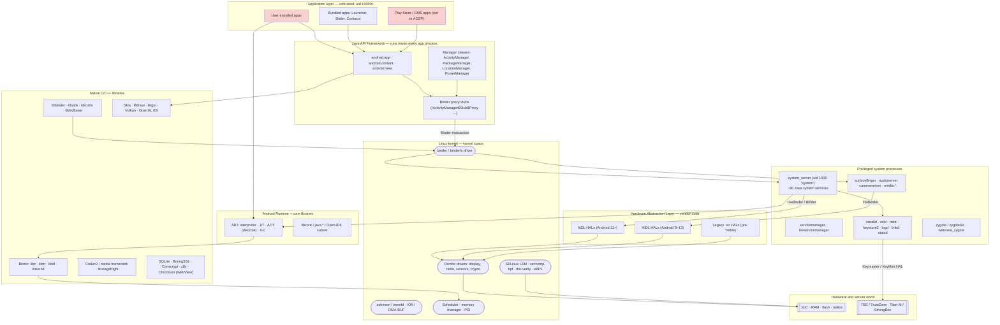

Look at this diagram as a map of *who talks to whom*, not as a picture of who is stacked on whom.

The most important structural fact is that the **Java API Framework is not a separate process**. When
your app calls `getSystemService(Context.ACTIVITY_SERVICE)` and then `killBackgroundProcesses()`, the
`ActivityManager` object you get back lives **inside your own app's memory**, running with *your*
UID and *your* privileges. It has none of the power implied by its name. All it does is package your
request into a Binder transaction and send it, through the kernel's binder driver, to
`system_server`, which holds the actual authority. That indirection is the single most important
architectural idea in Android, and it is why hooking a manager class in your own process does not
grant you anything you did not already have.

The second structural fact is that **`system_server` is a single process containing most of the
operating system's decision-making**. If you get arbitrary code execution inside `system_server`, you
own the device from Android's point of view: you have UID 1000, you are inside the process that
performs almost every permission check, and you hold Binder references to nearly every service. This
is why `system_server` is one of the highest-value targets in Android security research and why so
much hardening (SELinux domains, seccomp filters, `system_server`-specific restrictions) is aimed at
it.

The third fact is that **vendor code lives to the side, not in the middle**. Since Project Treble
(Android 8), HALs run in their own processes, in their own SELinux domains, with their own limited
view of the system. A memory-corruption bug in a vendor camera HAL used to be a path to the whole
system; today it lands you in a heavily confined process that can talk to the camera and very little
else.

### 2.2 Trust boundaries

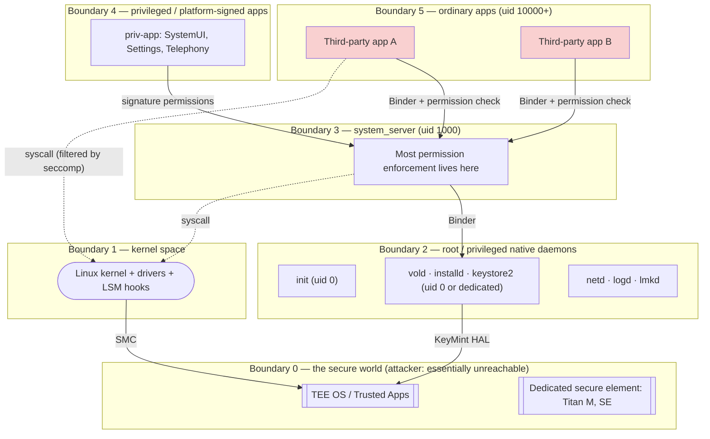

Each box is a **trust boundary**: a line across which data must be validated, because the thing on
one side does not trust the thing on the other. Your job as a tester is to find a place where a
boundary was drawn on the architecture diagram but not implemented in the code.

Read the boundaries from the outside in, because that is the order in which an attacker crosses them.
A malicious app starts at Boundary 5. Its first goal is Boundary 3: get `system_server` to do
something for it that it was not supposed to be able to ask for — a confused-deputy attack, a missing
permission check on a Binder method, an unprotected exported component in a privileged app. From
`system_server` the next target is Boundary 1, the kernel, usually via a driver reachable from the
`system_server` SELinux domain. Only at that point does the secure world in Boundary 0 come into
scope, and it usually stays out of reach.

Notice what this implies about severity. A bug that gets you from Boundary 5 to Boundary 4 (running
as a privileged app) is serious. A bug that gets you from Boundary 5 straight to Boundary 1 (kernel)
is critical and is what Android's own severity guidelines call an elevation of privilege to kernel.
The layering in §2.1 is what makes those judgements possible.

### 2.3 The process view — what is actually running

An architecture diagram shows components. A process list shows reality. This is roughly what you see
on a booted Android 13–15 device, grouped by layer.

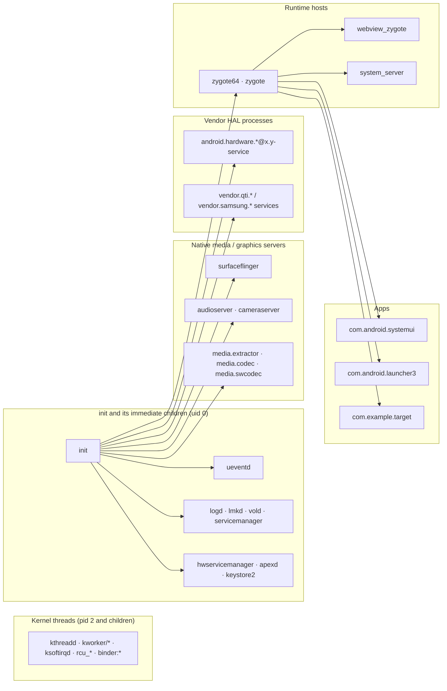

Two details in that diagram are worth pausing on, because they surprise people.

First, **`system_server` is a child of `zygote`, not of `init`**. It is forked from the Zygote
process like any app, then specialised into the system server. This is why `system_server` has the
same preloaded classes and the same library layout as every app — and it is why the ASLR weakness in
§3.9 also applies to `system_server`.

Second, **almost everything else is a direct child of `init`**. If a process's parent PID is 1, it
was declared as a service in some `.rc` file, and you can find that declaration on the device. That
is a very fast way to understand an unfamiliar OEM daemon: `grep` the `.rc` files for its name and
read the SELinux context, user, group and capabilities it was given.

---

## 3. Deep Internal Working

This is the long section. It walks the stack from the bottom up, then walks the boot process from the
first instruction to the launcher, then treats Zygote, the property system and the partition layout
as topics in their own right because each of them has direct security consequences.

---

### 3.1 The Linux kernel Android uses — and how it differs from mainline

Android's kernel is Linux. It is not a fork in the "different operating system" sense; it is the
mainline Linux kernel plus a set of patches, configuration requirements and out-of-tree drivers that
Google requires. Most of those patches have, over fifteen years, been either upstreamed into mainline
Linux or replaced by an upstream equivalent. But several remain distinctly Android, and every one of
them is security-relevant.

> **Definition — Mainline Linux**
> The kernel released by kernel.org under Linus Torvalds. "Mainline" is the canonical tree. A
> **downstream** kernel is a copy of mainline with additional patches — Android's kernel is
> downstream of mainline, and a phone vendor's kernel is downstream of Android's.

#### 3.1.1 The Android-specific kernel features

| Feature | What it is | Where it lives | Why Android needed it | Security consequence |
|---|---|---|---|---|
| **Binder** | A character-device–based IPC mechanism with reference counting, thread-pool management and caller-identity delivery | `drivers/android/binder.c`, `binderfs` mounted at `/dev/binderfs` | Existing Linux IPC had no built-in identity or object model; Android needed millions of small RPC calls per hour with reliable caller UID | The kernel is the *only* thing that tells `system_server` who is calling. If binder's identity delivery could be spoofed, all permission checks would collapse. Binder is also a large kernel attack surface reachable by every app. |
| **ashmem → memfd** | Anonymous shared memory that can be shrunk by the kernel under pressure; replaced by upstream `memfd_create` with seals | `drivers/staging/android/ashmem.c` historically; now `memfd` | Android needed shareable buffers that the kernel could reclaim | Shared memory crossing a trust boundary is a classic TOCTOU (time-of-check-to-time-of-use) source: the sender can change the contents after the receiver validates them. `memfd` seals exist precisely to close this. |
| **ION → DMA-BUF heaps** | Allocator for large, physically contiguous graphics/camera buffers shared with hardware | `drivers/staging/android/ion/`, now `drivers/dma-buf/heaps/` | GPU, camera and display need buffers no ordinary allocator can produce | Historically a rich source of kernel memory-corruption bugs reachable from apps that can allocate graphics buffers. |
| **Low-memory handling (LMK → lmkd)** | Kills processes before the kernel OOM killer would, using a priority order Android controls | In-kernel `lowmemorykiller` driver, removed; replaced by userspace `lmkd` in `system/memory/lmkd/` using PSI | Phones have no swap in the traditional sense and must free memory predictably without killing the foreground app | Process death is an *observable side channel*. An attacker can infer which apps are running, and can force a target process to be killed and restarted at a chosen moment. |
| **Wakelocks / suspend blockers** | Explicit "do not sleep" votes that keep the SoC awake | `kernel/power/wakelock.c`, `/sys/power/wake_lock`, autosleep | A laptop sleeps when idle; a phone must sleep aggressively but never mid-transaction | A malicious or buggy app holding a wakelock is a battery-drain denial of service; conversely, forced suspend is a way to interrupt security-critical operations. |
| **Paranoid networking** | Restricts socket creation to processes in specific supplementary groups | Historically `CONFIG_ANDROID_PARANOID_NETWORK`; modern devices use per-UID rules in `netd`, iptables/xt_qtaguid and eBPF | Android needed `INTERNET` to be a *permission*, and Linux has no per-app network permission | The `INTERNET` permission is enforced by a **group membership check in the kernel**, not by the framework. This is why an app without `INTERNET` genuinely cannot open a socket even from native code. |
| **SELinux in enforcing mode** | Mandatory access control on every process, file, socket and Binder call | `security/selinux/` plus the policy in `system/sepolicy/` | UID separation alone was not enough once root compromises appeared | The most important post-exploitation constraint on Android. Root without an SELinux bypass is dramatically less useful than root on a desktop. See [22-SELinux](../22-SELinux/README.md). |
| **seccomp-bpf filters** | Per-process syscall allowlists applied to app and system processes | `kernel/seccomp.c`; Android's filters in `bionic/libc/seccomp/` | Shrink the kernel attack surface reachable from an app | An app process cannot call most exotic syscalls at all, which kills whole families of kernel exploits from app context. |
| **dm-verity / dm-crypt / fs-verity** | Block-level and file-level integrity and encryption | `drivers/md/dm-verity*`, `fs/verity/` | Detect offline modification of the system partition and protect user data at rest | The reason you cannot mount `/system` and edit a framework JAR on a locked device. |
| **eBPF** | Programmable kernel-side filters used for network accounting and tracing | `kernel/bpf/`, Android programs in `system/bpf/` | Replace out-of-tree `xt_qtaguid` accounting | Traffic accounting and per-UID firewalling now live in eBPF programs loaded at boot by `bpfloader`. |

> **Under the Hood**
> The `INTERNET` permission is the cleanest example in Android of a framework-level concept enforced
> in the kernel. When `PackageManagerService` grants `android.permission.INTERNET`, what actually
> happens is that the app's UID is added to the supplementary group `AID_INET` (GID 3003). The
> mapping lives in `frameworks/base/data/etc/platform.xml`. Then, when the process calls `socket()`,
> a kernel check (historically the paranoid-network patch, today per-UID rules installed by `netd`)
> consults group membership. There is no Java code in this path at runtime at all. This is why
> "remove the permission check with Frida" does not give an app network access.

#### 3.1.2 GKI — the Generic Kernel Image

Before GKI, every phone shipped a kernel that was a unique fork: mainline, plus Android patches, plus
the SoC vendor's patches, plus the OEM's patches. Fixing a kernel vulnerability meant every one of
those forks had to merge the fix independently. Most never did, which is the technical reason so many
Android devices historically ran kernels with years-old public vulnerabilities.

> **Definition — GKI (Generic Kernel Image)**
> A single kernel binary, built by Google from the Android Common Kernel for a given kernel version,
> that ships unchanged on every device using that version. All hardware-specific code is moved out of
> the kernel image into **vendor modules** — separately compiled `.ko` files loaded at boot.

The contract that makes this possible is the **KMI (Kernel Module Interface)**: the frozen set of
symbols and structure layouts that vendor modules may rely on. Google freezes the KMI for a kernel
version and then guarantees it will not break for the lifetime of that branch, which means Google can
ship kernel security fixes in the GKI image without every vendor rebuilding their modules.

| Concept | Meaning | Where it lands on the device |
|---|---|---|
| `boot.img` | Contains the GKI kernel and the generic ramdisk | `boot` partition |
| `vendor_boot.img` | Vendor ramdisk and first-stage vendor modules | `vendor_boot` partition |
| `vendor_dlkm` | Dynamically loadable kernel modules from the vendor | `vendor_dlkm` partition, mounted under `/vendor/lib/modules` |
| KMI version | e.g. `5.15-android13-8` — kernel version, Android release, KMI generation | `uname -r` on the device |

```bash
# adb shell — is this a GKI device, and which KMI?
uname -r
# 5.15.123-android13-8-00001-gabcdef123456-ab12345678
#  ^kernel  ^android release ^KMI gen

# Which kernel modules are loaded, and where did they come from?
cat /proc/modules | head -40
ls -la /vendor/lib/modules/ 2>/dev/null
```

> **Pentester's Note**
> The `uname -r` string is one of the first things to record on any engagement. It tells you the
> kernel version (which public exploits might apply), the Android release the kernel targets, and —
> combined with `ro.build.version.security_patch` — whether the device is plausibly patched. A device
> whose kernel version has known public LPE (local privilege escalation) exploits and whose security
> patch level predates the fix is a finding in its own right for a device-security assessment, even
> before you look at any app.

#### 3.1.3 Kernel modules and why they matter to you

A **kernel module** is code loaded into the kernel at runtime. On a GKI device, most drivers are
modules. Two consequences follow.

The first is an attack surface consequence. The modules a device loads define which kernel code is
actually reachable. Two phones running the identical GKI kernel can have completely different kernel
attack surfaces because they load different vendor modules — and vendor modules are, on average,
substantially lower quality than upstream kernel code.

The second is a defensive consequence. Loading an arbitrary module is game over: a module runs with
full kernel privilege. Android therefore requires module signature verification
(`CONFIG_MODULE_SIG_FORCE`) and confines `insmod` with SELinux. If you find a device where an
unprivileged or `shell`-reachable path can load an unsigned module, that is a critical finding.

```bash
# adb shell as root — module loading policy
cat /proc/sys/kernel/modules_disabled     # 1 means module loading is permanently disabled
zcat /proc/config.gz 2>/dev/null | grep -E 'MODULE_SIG|MODULES_DISABLED|LOCKDOWN'
```

---

### 3.2 The Hardware Abstraction Layer

#### 3.2.1 The problem the HAL solves

Android must run on thousands of hardware combinations. The camera in a device might be attached over
MIPI CSI with one image signal processor, or a completely different one. The framework code that
implements `CameraManager` cannot possibly know any of that. So Android defines an **interface** —
"give me a stream of frames at this resolution" — and the vendor supplies an **implementation**.

The history of how that interface has been expressed is the history of Android's biggest structural
change.

#### 3.2.2 Three generations of HAL

**Generation 1: legacy shared-library HALs (Android 1.0 – 7.x).**
A HAL was a `.so` file that exported a well-known symbol, `HAL_MODULE_INFO_SYM`, containing a struct
of function pointers. The framework process (`system_server` or a media server) would `dlopen()` the
vendor library **into its own address space** and call those function pointers directly.

```c
/* Conceptual shape of a legacy HAL module — hardware/libhardware/include/hardware/hardware.h */
typedef struct hw_module_t {
    uint32_t tag;                 /* HARDWARE_MODULE_TAG */
    uint16_t module_api_version;
    uint16_t hal_api_version;
    const char *id;               /* e.g. "camera" */
    const char *name;
    const char *author;
    struct hw_module_methods_t* methods;   /* open() */
    /* ... */
} hw_module_t;
```

The security consequence is severe and worth stating plainly: **vendor C code ran inside the same
process as the framework, with the framework's privileges**. A heap overflow in a vendor sensor
library was a heap overflow in `system_server`. There was no boundary at all.

The maintenance consequence was just as bad. Because the vendor library was linked against framework
internals, upgrading Android meant rebuilding every vendor HAL. Vendors did not, so devices did not
get upgrades.

**Generation 2: HIDL (Android 8.0 – 13).**

> **Definition — HIDL (HAL Interface Definition Language)**
> A language for describing HAL interfaces in a versioned, ABI-stable way, plus a code generator that
> produces C++ (and Java) client and server code. HIDL interfaces communicate over a separate binder
> domain called **hwbinder** (`/dev/hwbinder`), registered with a separate service manager,
> `hwservicemanager`.

A HIDL interface looks like this:

```
// hardware/interfaces/vibrator/1.0/IVibrator.hal
package android.hardware.vibrator@1.0;

interface IVibrator {
    on(uint32_t timeoutMs) generates (Status vibratorStatus);
    off() generates (Status vibratorStatus);
    supportsAmplitudeControl() generates (bool supports);
};
```

The critical change is not the syntax. It is that HIDL HALs normally run **in their own process**
("binderized" mode) rather than being loaded into the framework ("passthrough" mode). The vendor code
is now on the far side of an IPC boundary, in its own SELinux domain, under its own UID, with its own
seccomp filter. A memory-corruption bug in the vibrator HAL now gets you code execution as
`android.hardware.vibrator` — a process that can talk to a vibrator motor.

**Generation 3: Stable AIDL for HALs (Android 11 onward).**

> **Definition — Stable AIDL**
> AIDL (Android Interface Definition Language) is the language Android has always used to describe
> Binder interfaces between Java components. "Stable AIDL" adds versioning and a frozen-ABI guarantee
> so it can be used for the vendor interface, replacing HIDL. Interfaces are declared with
> `@VintfStability` and their frozen snapshots are checked into the tree under `aidl_api/`.

```
// hardware/interfaces/vibrator/aidl/android/hardware/vibrator/IVibrator.aidl
@VintfStability
interface IVibrator {
    int getCapabilities();
    void off();
    void on(in int timeoutMs, in IVibratorCallback callback);
    /* ... */
}
```

AIDL HALs use the **ordinary binder domain** (`/dev/binder`) but are registered under
`android.hardware.*` service names in `servicemanager` with the `VINTF` stability flag. Google has
been migrating HALs from HIDL to AIDL since Android 11, and HIDL is deprecated: in Android 14 and 15
the great majority of core HALs are AIDL.

| Generation | Android versions | Transport | Process model | Registered with | Status |
|---|---|---|---|---|---|
| Legacy `.so` | 1.0 – 7.x (and passthrough later) | direct function call | in-process | `dlopen` of `/system/lib/hw/*.so` | Removed for core HALs |
| HIDL | 8.0 – 13 | hwbinder `/dev/hwbinder` | separate process (binderized) | `hwservicemanager` | Deprecated |
| Stable AIDL | 11+ | binder `/dev/binder` | separate process | `servicemanager` (VINTF stability) | Current |

#### 3.2.3 Project Treble and the system/vendor split

> **Definition — Project Treble**
> The Android 8.0 re-architecture that separated the Android OS framework from the vendor
> implementation with a formal, versioned interface (the **VINTF**, Vendor Interface), so that the
> framework can be updated without rebuilding vendor code.

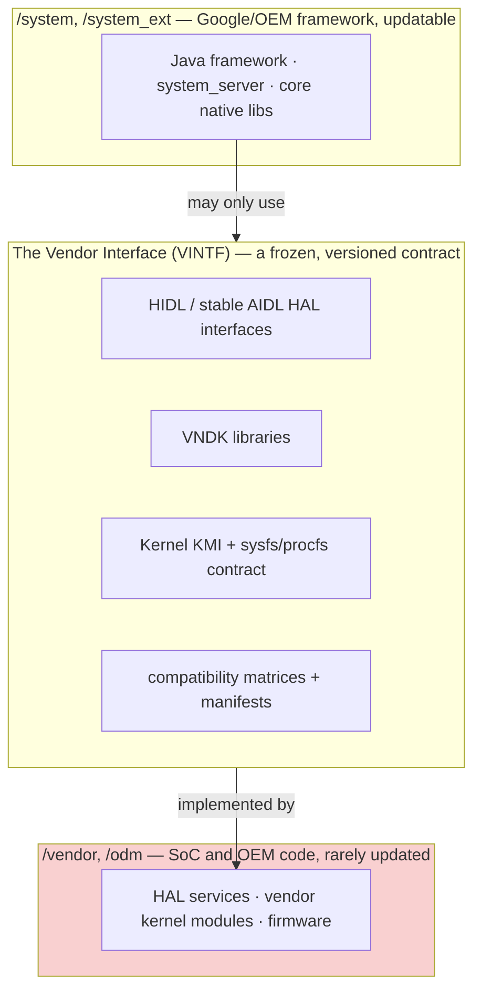

The compatibility contract is expressed in real XML files you can read on any device:

| File | Purpose |
|---|---|
| `/vendor/etc/vintf/manifest.xml` | What the vendor implementation *provides* (HAL names and versions) |
| `/system/etc/vintf/compatibility_matrix.xml` | What the framework *requires* |
| `/vendor/etc/vintf/compatibility_matrix.xml` | What the vendor *requires* of the framework |
| `/system/etc/vintf/manifest.xml` | What the framework provides to the vendor |

```bash
# adb shell — the device's declared vendor interface
cat /vendor/etc/vintf/manifest.xml | head -60
# Every HAL this device actually exposes, with version numbers:
lshal --types=b 2>/dev/null | head -40
lshal list 2>/dev/null | head -40
```

> **Pentester's Note**
> `lshal` is one of the fastest reconnaissance commands on a device you have never seen. It lists
> every HAL service, its interface version, the PID serving it, and the clients bound to it. OEM-added
> HALs with non-`android.hardware.*` names (`vendor.acme.diagnostics@1.0::IDiag`, and similar) are
> where custom, unaudited, often debug-flavoured functionality hides. Cross-reference the names it
> prints with the SELinux policy to see which domains may call them: an OEM HAL callable from
> `untrusted_app` is a serious finding waiting to be written up.

#### 3.2.4 VNDK — the Vendor Native Development Kit

Vendor processes need to use some of the platform's C++ libraries (`libutils`, `libhidlbase`,
`libbase`). But if a vendor process linked against the same copy the framework uses, the framework
could not change those libraries without breaking vendor code — which would defeat Treble.

> **Definition — VNDK**
> A set of platform libraries with a stable ABI, shipped in a separate copy under `/system/lib[64]/vndk-<version>/`,
> that vendor processes are permitted to link against. Vendor processes get their own linker
> namespace that can see only VNDK libraries and `/vendor` libraries — never the framework's private
> copies.

The enforcement mechanism is the **linker namespace**, configured in `/linkerconfig/ld.config.txt`
(generated at boot by `linkerconfig`). A process in the `vendor` namespace physically cannot
`dlopen()` a framework-private library: the dynamic linker refuses.

Note the version story: VNDK was introduced in Android 8, mandatory from Android 9, and **deprecated
in Android 15**, where the vendor snapshot mechanism was simplified. When you test a modern device you
may find no `vndk-XX` directory at all; on Android 9–14 devices you will.

```bash
# adb shell — see the linker namespaces and what each may load
cat /linkerconfig/ld.config.txt | head -60
ls -d /system/lib64/vndk* 2>/dev/null
```

> **Warning**
> Linker namespaces are a genuine security boundary, and they break naive instrumentation. If you
> push a Frida gadget or an interposition library into `/data/local/tmp` and try to make a vendor HAL
> process load it, the linker will usually refuse because the path is not in that namespace's search
> path or permitted paths. This is not a bug in your tooling; it is the namespace doing its job. The
> workaround on a research device is to place the library where the namespace can see it (typically
> under `/vendor/lib64/`) — which requires a writable `/vendor` and therefore an unlocked, verity-
> disabled device.

---

### 3.3 The native libraries layer

Everything above the kernel that is written in C or C++ and shared between processes lives here. This
layer matters to a security tester for one blunt reason: **it is where memory-safety bugs live**. Java
and Kotlin code cannot have a heap overflow. Skia, the media codecs and the C library can, and
historically have.

#### 3.3.1 Bionic — Android's C library

> **Definition — Bionic**
> Android's implementation of the C standard library (`libc.so`), the math library (`libm.so`), the
> dynamic linker (`linker` / `linker64`) and `libdl.so`. It is not glibc and not musl; it was written
> for Android for licence reasons (BSD-licensed, so it can be statically linked into proprietary
> code) and for size.

| Component | Path in AOSP | Path on device | What it does |
|---|---|---|---|
| `libc.so` | `bionic/libc/` | `/apex/com.android.runtime/lib64/bionic/libc.so` | System-call wrappers, `malloc`, string functions, `pthread`, `stdio` |
| `libm.so` | `bionic/libm/` | same directory | Floating-point math |
| `linker64` | `bionic/linker/` | `/apex/com.android.runtime/bin/linker64` | Loads ELF executables and shared libraries, resolves symbols, applies namespaces |
| `libdl.so` | `bionic/libdl/` | same | `dlopen`, `dlsym`, `dlclose` front end |

Three Bionic behaviours have direct security relevance.

**The allocator.** Android uses Scudo (a hardened, LLVM-provided allocator) for native heap
allocations on modern releases, replacing jemalloc. Scudo adds chunk headers with checksums,
randomised allocation, quarantine and double-free detection. It turns many "exploitable heap
overflow" bugs into "reliable abort", which is why so many modern Android native crashes show
`SIGABRT` with a Scudo message rather than a silent corruption.

**The linker and namespaces.** The Android linker implements the namespace isolation described in
§3.2.4. It also implements `dlopen` restrictions for apps: since Android 7, an app cannot `dlopen()`
a private platform library such as `libandroid_runtime.so` by path, because the app's namespace does
not include it.

**Hardware-assisted mitigations.** On ARMv8.5+ devices Android uses MTE (Memory Tagging Extension) in
some configurations, and uses PAC (Pointer Authentication) and BTI (Branch Target Identification) in
system components. `readelf -n` on a system binary will show the BTI/PAC property notes.

```bash
# adb shell — where is libc actually loaded from in a running app?
grep -E 'libc\.so|linker64' /proc/$(pidof -s com.android.systemui)/maps | head
```

> **Under the Hood**
> Notice that `libc.so` is loaded from `/apex/com.android.runtime/`, not `/system/lib64/`. Since
> Android 10, Bionic and ART ship inside an **APEX module** (§3.11) so that they can be updated
> through Google Play without a full OS update. This is why `/system/lib64/libc.so` may be a symlink
> or absent, and why a tester who hardcodes `/system/lib64` paths in a script gets confusing results
> on modern devices.

#### 3.3.2 The rest of the native layer

| Library | AOSP location | Role | Security note |
|---|---|---|---|
| `libbinder` / `libbinder_ndk` | `frameworks/native/libs/binder/` | C++ client and server side of Binder; `libbinder_ndk` is the NDK-stable AIDL backend | Where `Parcel` marshalling bugs live; the `Parcel` read/write mismatch class of bug is a recurring Android vulnerability pattern |
| `libutils`, `libcutils` | `system/core/libutils/`, `system/core/libcutils/` | `RefBase` smart pointers, `String8`/`String16`, sockets, properties helpers | Reference-counting mistakes here become use-after-free |
| `libhwui` | `frameworks/base/libs/hwui/` | Hardware-accelerated 2D rendering for the View system | Processes app-supplied drawing commands |
| **Skia** | `external/skia/` | The 2D graphics engine: paths, text, image decode | Parses untrusted images. A very high-value attack surface: any app that displays a downloaded image feeds bytes to Skia |
| **Codec2 / media framework** | `frameworks/av/media/codec2/`, `frameworks/av/media/libstagefright/` | Audio/video decoding and container parsing | The classic Android remote attack surface. This is the layer the Stagefright family of bugs lived in; the response was to split media into multiple hardened processes (`media.extractor`, `media.codec`, `media.swcodec`) each with a tight seccomp filter |
| **Chromium / WebView** | `external/chromium-webview/` (prebuilt), delivered as an APEX/APK | The browser engine used by `WebView` and Custom Tabs | Enormous attack surface, but updatable through Play — see [43-WebView](../43-WebView/README.md) |
| **SQLite** | `external/sqlite/` | The database engine behind every ContentProvider and most app storage | SQL injection in a ContentProvider reaches this; see [27-ContentProviders](../27-ContentProviders/README.md) |
| **BoringSSL** | `external/boringssl/` | Google's fork of OpenSSL; the TLS and crypto primitives | Underlies Conscrypt; the source of truth for what ciphers a device supports |
| **Conscrypt** | `external/conscrypt/`, shipped as an APEX | The Java Security Provider that implements `SSLSocket`, `SSLContext` and JCA primitives over BoringSSL | Where certificate pinning and trust-anchor decisions are actually implemented; the target of most pinning-bypass hooks. See [36-CertificatePinning](../36-CertificatePinning/README.md) |
| **OpenGL ES / Vulkan / ANGLE** | `frameworks/native/opengl/`, vendor drivers | GPU access | GPU drivers are vendor kernel code reachable from every app — historically one of the most productive kernel LPE surfaces on Android |
| `libgui`, `libui` | `frameworks/native/libs/gui/` | Surface/BufferQueue plumbing between apps and `surfaceflinger` | Where screen-capture and overlay security decisions are implemented |

> **Pentester's Note**
> When you are asked "where would a remote, zero-click bug on Android most plausibly be?", the honest
> answer is: in the code that parses attacker-supplied bytes without user interaction. That means the
> media extractors and codecs, the image decoders in Skia, the font parser, the Bluetooth stack
> (`system/bt` / `packages/modules/Bluetooth`), the Wi-Fi supplicant, and the baseband/RIL boundary.
> Notice that all of these are native code in this layer, not Java. Memory-unsafe code at a parsing
> boundary is the pattern.

---

### 3.4 The Android Runtime layer

This chapter treats ART briefly and deliberately, because it is owned in full by
[11-Android-Runtime](../11-Android-Runtime/README.md), [12-DEX-Internals](../12-DEX-Internals/README.md),
[13-ART](../13-ART/README.md) and [14-Dalvik](../14-Dalvik/README.md).

What you need here is the architectural role.

> **Definition — ART (Android Runtime)**
> The managed-code execution engine. It loads DEX (Dalvik Executable) bytecode, executes it — by
> interpreting it, by JIT-compiling hot methods to native code, or by running code that was
> AOT-compiled ahead of time — and manages the garbage-collected heap that all Java/Kotlin objects
> live in.

| Piece | What it does | Where |
|---|---|---|
| `libart.so` | The runtime itself: interpreter, JIT, GC, class linker | `/apex/com.android.art/lib64/libart.so` |
| `dex2oat` | Ahead-of-time compiler producing `.odex`/`.vdex`/`.art` files | `/apex/com.android.art/bin/dex2oat64` |
| `libcore` | The Java standard library subset (`java.lang`, `java.util`, `java.io`) | `external/apache-harmony` history, now `libcore/` |
| Boot classpath | The preloaded framework classes shared by every process | `/apex/com.android.art/javalib/*.jar`, `/system/framework/*.jar` |

Three architectural facts matter for the rest of this chapter:

1. **ART runs inside every managed process** — every app, and `system_server`. It is a library, not a
   server. There is no central "VM process."
2. **ART ships as an APEX module** (`com.android.art`), so it is updatable through Google Play
   independently of the OS. This has a large effect on how long a runtime bug stays exploitable in
   the field.
3. **The boot image (`boot.art`, `boot.oat`) is mapped into every process** by Zygote and shared
   copy-on-write. This is the mechanism that makes app startup fast and is also part of the ASLR
   story in §3.9.

---

### 3.5 The Java API framework — what "the framework" actually is

Ask ten Android developers what "the framework" is and you will get ten vague answers. Here is the
precise one.

> **Definition — The Android framework**
> The set of Java/Kotlin classes in the `android.*` and `com.android.internal.*` packages, compiled
> into `framework.jar` (plus `services.jar` and companions), that ships on the device in
> `/system/framework/`. Part of it is loaded into **every** app process as part of the boot
> classpath. Another part — `services.jar` — is loaded only into `system_server`.

This split is the whole story, and it is the thing most people get wrong.

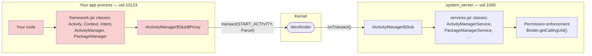

Everything shaded red is inside the attacker's process and is therefore **attacker-controlled**. The
`ActivityManager` object, the proxy, the `Parcel` contents, the arguments — all of it. Nothing on the
left side is a security control. The security control is the single box labelled "Permission
enforcement" on the right, inside `system_server`, and it works because the kernel — not the caller —
supplies the calling UID.

> **Mental Model**
> Framework `Manager` classes are **customer-service desks**, not decision-makers. `ActivityManager`
> in your process is a form you fill in. `ActivityManagerService` in `system_server` is the official
> who reads the form, checks who you are (from a source you cannot forge), and decides. Hooking the
> form gets you a nicely filled-in form.

#### 3.5.1 The major system services

`system_server` starts and hosts roughly ninety services. You do not need to memorise all of them, but
you should recognise the ones below on sight, know what they own, and know which permission checks
they perform. This table is the reference you will come back to.

| Service | Binder name (`service list`) | Lives in `system_server`? | What it owns | Why a tester cares |
|---|---|---|---|---|
| `ActivityManagerService` (AMS) | `activity` | Yes | Process lifecycle, app start/kill, broadcast dispatch, `oom_adj`, ANR handling | Enforces exported/permission checks on component launch; the target of most intent-redirection work |
| `ActivityTaskManagerService` (ATMS) | `activity_task` | Yes | Tasks, back stack, activity starts (split out of AMS in Android 10) | Where launch-mode, task-affinity and StrandHogg-style task-hijack logic lives |
| `PackageManagerService` (PMS) | `package` | Yes | Installed packages, manifests, permissions, signatures, install/uninstall | Every "is this app allowed" question starts here; signature verification and permission grants |
| `PermissionManagerService` | `permissionmgr` | Yes | Runtime permission grant state (split out of PMS in Android 10/11) | The actual grant/revoke store behind `checkSelfPermission` |
| `AppOpsService` | `appops` | Yes | Fine-grained per-app operation tracking and allow/deny beyond permissions | The second, less-known permission system; many "bypasses" are really AppOps modes |
| `WindowManagerService` (WMS) | `window` | Yes | Windows, z-order, focus, input routing, screenshots | Overlay attacks (tapjacking), `FLAG_SECURE`, screen-capture protections |
| `PowerManagerService` | `power` | Yes | Wakelocks, screen state, doze, reboot | Wakelock abuse, screen-off timing attacks |
| `NotificationManagerService` | `notification` | Yes | Posting, ranking and listener access to notifications | `NotificationListenerService` is a powerful data-exfiltration capability when granted |
| `LocationManagerService` | `location` | Yes | GPS/network location, providers, mock locations | Mock-location detection and bypass; location permission enforcement |
| `AlarmManagerService` | `alarm` | Yes | Scheduled wakeups | Persistence mechanism for malware |
| `JobSchedulerService` | `jobscheduler` | Yes | Deferred background work | Another persistence and background-execution mechanism |
| `ConnectivityService` | `connectivity` | Yes | Network selection, VPN control, captive portal | VPN interception, `NetworkCallback` behaviour |
| `NetworkManagementService` / `netd` client | `network_management` | Yes (talks to `netd`) | Firewall rules, tethering, DNS config | Bridges framework policy to `netd` and iptables/eBPF |
| `InputManagerService` | `input` | Yes | Touch and key events, input devices | Input injection is a very high-value capability; `INJECT_EVENTS` is signature-level |
| `DisplayManagerService` | `display` | Yes | Displays, virtual displays | Virtual displays are how screen recording and casting work |
| `AudioService` | `audio` | Yes (with `audioserver` native) | Volume, routing, focus | Microphone access indicators |
| `MediaSessionService` | `media_session` | Yes | Media buttons and sessions | Cross-app control surface |
| `UserManagerService` | `user` | Yes | Users, work profiles, restrictions | Multi-user isolation, work-profile boundary |
| `StorageManagerService` | `mount` | Yes (talks to `vold`) | Volume mounting, FBE keys, scoped storage plumbing | Storage isolation and encryption state |
| `DevicePolicyManagerService` | `device_policy` | Yes | Enterprise policy, device owner/profile owner | MDM abuse and device-owner escalation |
| `TrustManagerService` / `LockSettingsService` | `trust`, `lock_settings` | Yes | Lock screen credential verification, Smart Lock | Credential verification, Gatekeeper/Weaver interaction |
| `BiometricService` / `FingerprintService` | `biometric`, `fingerprint` | Yes | Biometric prompts and enrolment | See [48-Biometrics](../48-Biometrics/README.md) |
| `ClipboardService` | `clipboard` | Yes | Clipboard contents | Background clipboard reads (restricted since Android 10) |
| `AccountManagerService` | `account` | Yes | Stored accounts and auth tokens | Token theft surface |
| `BackupManagerService` | `backup` | Yes | `adb backup`, cloud backup | `allowBackup` findings |
| `UsageStatsService` | `usagestats` | Yes | App usage history | Side channel for what the user runs |
| `WallpaperManagerService` | `wallpaper` | Yes | Wallpaper images and live wallpapers | Historically an unusual code-execution surface |
| `StatusBarManagerService` | `statusbar` | Yes | Status bar and quick settings | Cooperates with SystemUI, which is a separate app |
| `SurfaceFlinger` | `SurfaceFlinger` | **No — separate native process** | Composition of all layers onto the display | Screenshots, secure layers, overlay policy |
| `keystore2` | `android.system.keystore2` | **No — separate daemon** | Hardware-backed key storage | See [49-KeyStore](../49-KeyStore/README.md) |
| `installd` | (native, socket + binder) | **No — separate daemon** | Creating app data directories, running `dex2oat`, deleting app data | Runs as root; a very sensitive daemon |
| `vold` | `mount` client side | **No — separate daemon** | Volume management, FBE/FDE key handling | Encryption boundary |
| `netd` | `netd` | **No — separate daemon** | iptables/eBPF programming, DNS resolution | Where the `INTERNET` group rules are installed |
| `logd` | (socket) | **No — separate daemon** | The log buffers behind `logcat` | Log-based information disclosure |

```bash
# adb shell — list every registered Binder service on the device
service list
# 200-odd lines. Compare against the table above; the ones you do not recognise
# are usually OEM additions and deserve attention.

# Ask a specific service to dump its state
dumpsys activity services | head -50
dumpsys package com.example.target | head -80
```

> **Pentester's Note**
> `service list` on an OEM device almost always contains services that do not exist in AOSP. Those are
> the OEM's own additions, usually written under schedule pressure, often without the review AOSP code
> gets, and frequently missing permission checks on some methods. Diffing `service list` against a
> clean AOSP emulator of the same API level is a five-minute recon step that has produced real
> vulnerabilities many times. The follow-up is to find the implementing JAR or APK, decompile it, and
> read the `onTransact` methods for missing `enforceCallingPermission` calls.

#### 3.5.2 How a framework call becomes a system service call

The mechanism is code generation from AIDL. For an interface such as
`frameworks/base/core/java/android/app/IActivityManager.aidl`, the build generates:

- a **`Stub`** abstract class, extended by the real service implementation in `system_server`;
- a **`Stub.Proxy`** class, instantiated in the client process, which marshals arguments into a
  `Parcel` and calls `IBinder.transact()`;
- transaction codes (`TRANSACTION_startActivity`, and so on) that identify the method.

The full mechanics live in [25-Binder](../25-Binder/README.md); [07-AOSP](../07-AOSP/README.md)
contains a complete worked trace of `Context.startActivity()` from the public API to the kernel.

---

### 3.6 The application layer

The top layer is the one everyone sees: apps. Architecturally there is less to say, but four
distinctions matter for testing.

| Category | Where it is installed | UID | Signed by | Notes |
|---|---|---|---|---|
| User-installed app | `/data/app/~~<random>/<pkg>-<random>/` | 10000+ | developer key | Fully sandboxed; the normal target |
| Bundled system app | `/system/app/<Name>/` | 10000+ | platform or OEM key | Uninstallable only per-user without root |
| Privileged app | `/system/priv-app/<Name>/` | 10000+ | platform or OEM key | May hold `signature|privileged` permissions; allowlisted in `/system/etc/permissions/*.xml` |
| Platform-signed app | either | may share `android.uid.system` | the **platform key** | If it declares `android:sharedUserId="android.uid.system"` it runs as UID 1000 — the same UID as `system_server` |
| GMS / Play Services | `/product/priv-app/` or `/system/priv-app/` | 10000+ | Google key | **Not part of AOSP**; see [07-AOSP](../07-AOSP/README.md) §1.4 |

> **Warning**
> An app with `sharedUserId="android.uid.system"` runs with UID 1000. If you find a third-party or
> OEM app in that state with an exported component or a reachable `WebView` with JavaScript bridges,
> the impact is not "app compromise" — it is system compromise. Always check `dumpsys package <pkg>`
> for `userId=1000` and for `sharedUser`.

```bash
# adb shell — which apps run as system UID on this device?
for p in $(pm list packages -f | sed 's/.*=//'); do
  uid=$(dumpsys package "$p" | grep -m1 'userId=' | tr -d ' ')
  case "$uid" in userId=1000) echo "SYSTEM UID: $p";; esac
done
```

---

### 3.7 The boot process, in extreme detail

Boot is the most instructive subject in this chapter, because **the boot order is the trust order**.
Each stage verifies the next before handing control to it, and every security property the device
claims at runtime was established during boot. If you understand boot, you understand why an unlocked
bootloader invalidates almost every device-integrity claim, why Magisk patches `boot.img`, why
`ro.boot.verifiedbootstate` is the property attestation cares about, and why a `system_server` crash
looks like a reboot but is not one.

#### 3.7.1 The full sequence

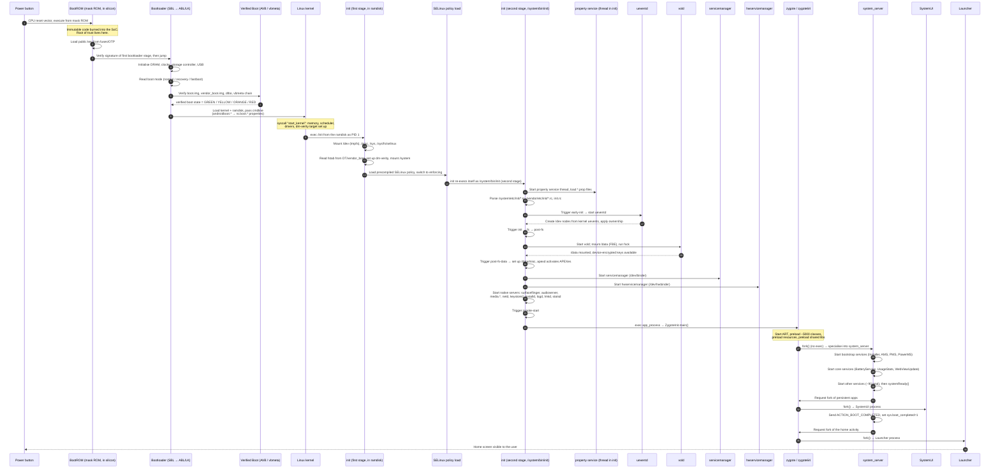

Every arrow in that diagram is something you can observe on a real device. Lab 01 of this chapter
walks you through observing them with `dmesg`, `logcat -b all`, `getprop | grep boottime` and
`bootchart`.

Now take the stages one at a time.

#### 3.7.2 Stage 1 — power on and the BootROM

When power is applied, the CPU begins executing at a fixed reset address. On an ARM SoC that address
points into **mask ROM**: code physically burned into the silicon at manufacture. It cannot be
modified, ever, by anyone, including the manufacturer. That immutability is exactly why it is the
**root of trust**.

> **Definition — Root of trust**
> The one component in a system whose integrity is assumed rather than verified, because nothing
> exists that could verify it. Everything else in a secure boot chain is verified by something that
> came before; the root of trust is where the chain has to stop.

The BootROM does very little: it initialises the minimum hardware needed to read the next stage from
flash, retrieves a **public key or a hash of a public key from one-time-programmable fuses**, verifies
the signature of the next bootloader stage against it, and jumps. If verification fails, the device
either refuses to boot or drops into a vendor-specific emergency download mode (Qualcomm's EDL,
MediaTek's BROM mode, Samsung's Odin/download mode).

> **Pentester's Note**
> BootROM bugs are the most valuable class of vulnerability in the mobile world because they cannot be
> patched in the field — the code is in silicon. Publicly documented SoC BootROM/EDL issues have
> produced permanent, unfixable unlock and code-execution primitives for the affected chips. In an
> engagement, you are not going to find one, but you should know that the presence of an accessible
> emergency-download mode is itself worth noting in a device threat model.

#### 3.7.3 Stage 2 — the bootloader and Android Verified Boot

The bootloader is usually several chained stages (on Qualcomm: PBL → XBL/SBL → ABL). Its job is to
bring up DRAM, clocks, storage and often USB, determine the boot mode, verify the Android boot images,
and hand off to the kernel.

**Boot mode selection.** The bootloader decides between normal boot, recovery, fastboot/bootloader
mode, and (on some devices) a factory or diagnostic mode. The decision comes from a combination of
hardware key state at power-on, the contents of the **misc partition** (the "bootloader control
block", written by `recovery` or by `adb reboot recovery`), and the reboot reason passed by the
previous Android session.

**Android Verified Boot (AVB).**

> **Definition — AVB (Android Verified Boot), version 2**
> The mechanism by which the bootloader cryptographically verifies every partition that participates
> in booting. Hashes and signatures live in the **`vbmeta`** partition, which is signed with a key the
> bootloader trusts. `vbmeta` contains, for each partition, either a full hash (for small partitions
> such as `boot`) or the root hash of a **dm-verity hash tree** (for large read-only partitions such
> as `system` and `vendor`).

The chain works like this. The bootloader verifies `vbmeta` against the key in fuses (or, on an
unlocked device with a user-supplied key, against `avb_custom_key`). `vbmeta` then vouches for
`boot`, `dtbo`, `vendor_boot`, and it carries the dm-verity root hashes for `system`, `vendor`,
`product` and friends. The kernel's dm-verity target then verifies each 4 KiB block of those
partitions **lazily, at read time**, against the hash tree. If a single block has been modified, the
read fails.

The bootloader records the result as the **verified boot state**, which becomes a kernel command-line
parameter and then an Android property:

| State | `ro.boot.verifiedbootstate` | Meaning | Typical device |
|---|---|---|---|
| **Green** | `green` | Bootloader locked, images signed by the OEM key, full chain verified | Retail, untouched |
| **Yellow** | `yellow` | Bootloader locked, images signed by a **user-supplied** key that the user flashed | Custom ROM on a re-lockable device (GrapheneOS on Pixel, for example) |
| **Orange** | `orange` | Bootloader **unlocked**; no verification performed | Any dev/research device |
| **Red** | `red` | Verification **failed** — the device usually refuses to boot | Corrupted or tampered image |

Green and yellow display no warning or a user-key warning respectively; orange shows the familiar
"your device software cannot be checked for corruption" screen for a few seconds.

The verified boot state is also fed into **key attestation** and **Play Integrity**: the attestation
certificate produced by the hardware keystore contains the verified boot state and the boot hash, so a
remote server can tell whether the device booted a verified image. This is the technical reason
Magisk's DenyList and "hide" behaviours cannot defeat hardware-backed attestation — the value is
signed by the TEE, not read from a property.

> **Warning**
> Unlocking the bootloader triggers a mandatory **data wipe** on any modern device. This is not an
> inconvenience; it is a security requirement. Without it, an attacker with brief physical access
> could unlock, flash a modified boot image, and read the previous user's data. If you are handed a
> device for testing, unlocking it destroys any data on it — confirm in writing before you do it.

```bash
# adb shell — the verified boot picture on this device
getprop ro.boot.verifiedbootstate
getprop ro.boot.flash.locked          # 1 = bootloader locked
getprop ro.boot.veritymode            # enforcing / logging / disabled
getprop ro.boot.vbmeta.digest
getprop ro.boot.warranty_bit          # Samsung-specific, Knox
```

#### 3.7.4 Stage 3 — the Linux kernel

The bootloader loads the kernel image and the ramdisk into memory, sets up the kernel command line,
and jumps to the kernel entry point. What follows is standard Linux with Android-specific
configuration:

1. Architecture setup, MMU and page tables, memory map.
2. `start_kernel()`: scheduler, memory allocator, timers, IRQs.
3. Driver initialisation, including the binder driver and, on GKI devices, loading first-stage vendor
   modules from `vendor_boot`.
4. Mount the initial ramdisk as `rootfs`.
5. `exec` the first user-space program, `/init`, as **PID 1**.

The kernel command line deserves special attention, because it is the channel by which the bootloader
tells Android about itself.

```bash
# adb shell — every parameter the bootloader passed to the kernel
cat /proc/cmdline | tr ' ' '\n'
# Typical entries:
#   androidboot.verifiedbootstate=green
#   androidboot.veritymode=enforcing
#   androidboot.slot_suffix=_a
#   androidboot.hardware=raven
#   androidboot.serialno=XXXXXXXX
```

> **Under the Hood**
> Every `androidboot.X=Y` parameter on the kernel command line (or in the bootconfig, which newer
> devices use instead) is turned by `init` into the read-only property `ro.boot.X=Y`. That is the
> entire mechanism. It means the properties beginning `ro.boot.` are *bootloader assertions*, not
> Android measurements. On a device where you control the bootloader, you control those values —
> which is precisely why software that must not be fooled reads attestation from the TEE rather than
> reading `ro.boot.verifiedbootstate`.

#### 3.7.5 Stage 4 — `init`, first stage

`init` is the first user-space process. It has PID 1, runs as root, and never exits. It runs in three
distinct phases, and you can see which phase a given `init` process is in from its argv.

**First stage (`init first_stage`)** runs from the ramdisk with almost nothing mounted. Its job:

1. Mount the pseudo-filesystems that everything else needs: `/dev` (tmpfs), `/proc`, `/sys`,
   `/sys/fs/selinux`, and `/dev/pts`.
2. Read the **fstab** — which on modern devices comes from the device tree or from
   `/vendor/etc/fstab.<hardware>` in the vendor ramdisk.
3. Set up **dm-verity** for the read-only partitions and mount them. On devices with dynamic
   partitions, this includes bringing up the logical partitions inside `super` first.
4. Perform the **ramdisk-to-`/system` switch**: since Android 10, `/system` is the root filesystem,
   so first-stage init mounts `/system` and then switches root into it.

**SELinux setup phase (`init selinux_setup`)**: `init` loads the SELinux policy — the precompiled
`sepolicy` from `/system/etc/selinux/` combined with the vendor policy — sets the kernel into
enforcing mode, and then **re-executes itself** so that the new `init` process runs in the correct
SELinux domain (`u:r:init:s0`) rather than the kernel's initial domain.

> **Under the Hood**
> The re-exec is not cosmetic. A process's SELinux domain is assigned at `execve()` time. Init cannot
> transition itself into the `init` domain without executing something, so it executes itself. If you
> ever wonder why `ps` sometimes shows `init` with different argv on different devices or at different
> times, this is why.

**Second stage (`init second_stage`)** is the long-lived `init` you see on a running device. It parses
the `.rc` files and drives the rest of boot.

#### 3.7.6 Stage 5 — the `.rc` language, triggers, actions and services

> **Definition — `init.rc`**
> The configuration language `init` reads to learn what to start, when to start it, and with what
> privileges. The primary file is `/system/etc/init/hw/init.rc` (from `system/core/rootdir/init.rc`
> in AOSP); it imports many more from `/system/etc/init/`, `/vendor/etc/init/`, `/odm/etc/init/` and
> the APEX modules' own `etc/init/` directories.

An `.rc` file contains four kinds of statement.

**Actions** — a trigger plus a list of commands to run when the trigger fires:

```
# Simplified from system/core/rootdir/init.rc
on post-fs-data
    mkdir /data/misc 01771 system misc
    mkdir /data/misc/keystore 0700 keystore keystore
    start keystore2
```

**Services** — a program to run, with the identity and confinement it should run under:

```
# Simplified from system/core/rootdir/init.rc — the Zygote service definition
service zygote /system/bin/app_process64 -Xzygote /system/bin --zygote --start-system-server
    class main
    priority -20
    user root
    group root readproc reserved_disk
    socket zygote stream 660 root system
    socket usap_pool_primary stream 660 root system
    onrestart write /sys/power/state on
    onrestart restart audioserver
    onrestart restart cameraserver
    onrestart restart media
    onrestart restart netd
    onrestart restart wificond
    critical
```

**Commands** — the imperative statements inside actions (`mkdir`, `mount`, `write`, `setprop`,
`start`, `chown`, `exec`, `copy`, `symlink`).

**Imports** — `import /vendor/etc/init/hw/init.${ro.hardware}.rc`.

The service options are exactly the security-relevant part:

| Option | Meaning | Why you care |
|---|---|---|
| `user` / `group` | The UID/GIDs the service drops to | A daemon still running as `root` when it does not need to be is a hardening finding |
| `capabilities` | Linux capabilities retained after dropping root | Fine-grained privilege; `CAP_SYS_ADMIN` is nearly root |
| `seclabel` | Explicit SELinux domain | Normally derived from the executable's file context |
| `socket` | A UNIX socket created by init and handed to the service | Named sockets in `/dev/socket/`; their mode and group is a common weakness |
| `class` | Startup group (`core`, `main`, `late_start`, `hal`) | Determines when it starts and what `class_start`/`class_stop` affect |
| `oneshot` | Do not restart when it exits | |
| `critical` | If it crashes repeatedly within a window, **reboot the device into recovery** | `zygote`, `servicemanager`, `surfaceflinger` are critical |
| `disabled` | Do not start automatically; must be started explicitly | How `adbd` and diagnostic services are gated behind a property |
| `setenv` | Environment variables | |
| `writepid` | Write the PID into cgroup files | |

**Triggers** fire in a defined order during boot, and understanding that order tells you exactly when
a given capability becomes available:

| Trigger | Fires when | What typically happens |
|---|---|---|
| `early-init` | Immediately at the start of second-stage init | `ueventd` starts; SELinux restorecon on `/dev` |
| `init` | After `early-init` | Create core directories, mount `/dev/cpuctl` etc. |
| `late-init` | After `init` | Drives the rest via `trigger` commands |
| `early-fs` | Before filesystems are mounted | Vendor early filesystem work |
| `fs` | Mount the remaining filesystems | `mount_all /vendor/etc/fstab.<hw>` |
| `post-fs` | Filesystems mounted, `/data` **not yet** | Read-only work; property files from `/system` are loaded |
| `late-fs` | Just before `/data` mounts (FBE) | `vold` unlocks the device-encrypted storage |
| `post-fs-data` | **`/data` is mounted and usable** | Create `/data` subdirectories, start `apexd`, most daemons that need storage |
| `zygote-start` | After `post-fs-data` | Start `zygote`, `zygote_secondary` |
| `early-boot` | After zygote start | |
| `boot` | The main boot trigger | `class_start main`, the bulk of daemons |
| `property:X=Y` | Whenever property `X` becomes `Y` | The general extension mechanism — e.g. `on property:sys.boot_completed=1` |

```bash
# adb shell — read the device's actual init configuration
ls /system/etc/init/
ls /vendor/etc/init/
cat /system/etc/init/hw/init.rc | head -80

# Which services did init define, and what state are they in?
getprop | grep init.svc | sort
# [init.svc.zygote]: [running]
# [init.svc.adbd]: [running]
# [init.svc.vendor.diag-service]: [stopped]     <-- interesting
```

> **Pentester's Note**
> `getprop | grep init.svc` is a device-recon goldmine. Every service `init` knows about is listed
> with its state. Services in the `stopped` state that have a suggestive name (`diag`, `factory`,
> `test`, `dm-verity-disable`, `at-service`) are worth chasing: find their `.rc` file, see what
> property or trigger starts them, and check whether an unprivileged or `shell`-reachable path can set
> that property. "`setprop` on a property whose only effect is to start a root daemon" has been a real
> privilege-escalation pattern on OEM devices more than once.

#### 3.7.7 Stage 6 — the property service

`init` also runs the **property service**, on a dedicated thread inside PID 1. It is covered in depth
in §3.10, but its boot role is simple: it creates the shared-memory property area, loads the
`build.prop` files from each partition, and begins accepting `setprop` requests over the socket
`/dev/socket/property_service`.

#### 3.7.8 Stage 7 — `ueventd`

> **Definition — `ueventd`**
> A mode of `init` (the same binary, invoked as `ueventd`) that listens on a kernel netlink socket for
> **uevents** — messages the kernel emits when a device appears or disappears — and creates the
> corresponding device node in `/dev` with the ownership, mode and SELinux label specified in
> `ueventd.rc`.

This matters enormously for security, because **the permissions of every device node are decided
here**. A line in `/vendor/ueventd.rc` reading `/dev/vendor_diag 0666 root root` grants every process
on the device read/write access to a vendor driver. That is a one-line configuration mistake that has
produced real vulnerabilities.

```bash
# adb shell — device nodes writable by everyone
ls -l /dev/ | grep -E '^c(rw-rw-rw-|rw-rw-r--)' | head -30
cat /vendor/ueventd.rc 2>/dev/null | head -40
```

#### 3.7.9 Stage 8 — `vold` and mounting `/data`

> **Definition — `vold` (Volume Daemon)**
> The native daemon responsible for mounting and unmounting storage volumes, managing SD cards and
> USB OTG storage, running `fsck`, and — most importantly — handling **file-based encryption (FBE)**
> keys.

Android encrypts `/data`. Under **FBE** (the modern scheme; **FDE**, full-disk encryption, is the
legacy one) different files are encrypted with different keys, in two classes:

| Storage class | Key available | Directory | Purpose |
|---|---|---|---|
| **Device Encrypted (DE)** | After boot, before the user unlocks | `/data/user_de/<user>/<pkg>` | Alarm clock, phone app, accessibility — things that must work before first unlock |
| **Credential Encrypted (CE)** | Only after the user enters their PIN/pattern/password | `/data/user/<user>/<pkg>` (i.e. `/data/data/<pkg>`) | Everything else; the app's normal private directory |

This produces the state Android calls **Direct Boot**: after a reboot but before the first unlock, the
device is running, apps marked `directBootAware` are usable, and CE storage is *cryptographically
inaccessible* — not permission-denied, but undecryptable.

> **Pentester's Note**
> The forensic and physical-attack consequence is large. A device seized in the **AFU** state (After
> First Unlock) has CE keys in memory; a device in the **BFU** state (Before First Unlock) does not.
> This distinction determines what a forensic extraction can recover and is the reason the standard
> advice for a device you want to protect is "power it off," not "lock the screen." For app testing it
> also means: an app that stores secrets in DE storage (via
> `createDeviceProtectedStorageContext()`) has weakened them substantially, and that is a real
> finding.

#### 3.7.10 Stage 9 — `servicemanager` and `hwservicemanager`

> **Definition — `servicemanager`**
> The Binder **name registry**. Binder itself has no concept of names, only of object handles. A
> process that wants to publish a service registers it with `servicemanager` under a string name; a
> process that wants to use one asks `servicemanager` for that name and receives a handle. Handle 0 on
> `/dev/binder` is, by convention, `servicemanager` itself — the bootstrap that makes the whole scheme
> possible.

Two crucial security details:

**Registration is restricted.** `servicemanager` consults SELinux (`service_manager { add }`
permission on the named service type) to decide whether the calling process may register a given
name. An app cannot register itself as `activity` and impersonate `ActivityManagerService`.

**Lookup is also restricted.** SELinux `service_manager { find }` controls who may even obtain a
handle. This is why `service list` from an app context shows fewer services than from `shell`, and why
some services are entirely invisible to apps.

`hwservicemanager` is the equivalent registry for the hwbinder domain used by HIDL HALs. As HALs
migrate to AIDL, its role shrinks; on modern devices most HALs are in the ordinary `servicemanager`.

#### 3.7.11 Stage 10 — Zygote

Zygote gets its own section (§3.8 and §3.9) because it is the most architecturally distinctive thing
in Android and has the most interesting security consequence. In boot terms:

`init` starts the service `zygote`, which executes `/system/bin/app_process64` with the arguments
`-Xzygote /system/bin --zygote --start-system-server`. That binary starts an ART runtime in the
current process, then calls into `com.android.internal.os.ZygoteInit.main()`. Zygote then:

1. Creates the ART runtime and maps the **boot image** (`boot.art` / `boot.oat`).
2. **Preloads classes** listed in `frameworks/base/config/preloaded-classes` — several thousand
   framework classes, initialised and ready.
3. **Preloads resources** — common drawables and colours from `framework-res.apk`.
4. Preloads shared libraries (`libandroid_runtime.so`, `libcompiler_rt.so`, `libjnigraphics.so`).
5. Opens the socket `/dev/socket/zygote` and listens for fork requests.
6. Forks `system_server` (because of `--start-system-server`).

#### 3.7.12 Stage 11 — `system_server`

`system_server` is forked from Zygote and then specialised: it drops to UID 1000 (`system`), keeps a
specific set of capabilities, sets its SELinux domain, and runs
`com.android.server.SystemServer.main()`.

Services start in three explicit phases, and the ordering is not arbitrary — later services depend on
earlier ones.

| Phase | Method in `SystemServer.java` | Representative services | Why this order |
|---|---|---|---|
| **Bootstrap** | `startBootstrapServices()` | `Installer`, `ActivityManagerService`, `PowerManagerService`, `PackageManagerService`, `UserManagerService`, `DisplayManagerService`, `SensorService` | Nothing else can work without process management, package data and power |
| **Core** | `startCoreServices()` | `BatteryService`, `UsageStatsService`, `WebViewUpdateService`, `BinderCallsStatsService`, `RoleManagerService` | Depend on bootstrap, needed by nearly everything else |
| **Other** | `startOtherServices()` | `WindowManagerService`, `InputManagerService`, `NetworkManagementService`, `ConnectivityService`, `NotificationManagerService`, `LocationManagerService`, `AudioService`, `BluetoothService`, ~80 more | The bulk of the OS |

After all services are constructed, `system_server` walks them through **boot phases** — a set of
integer milestones each service is notified of, so that a service can defer work until its
dependencies are ready:

| Boot phase constant | Meaning |
|---|---|
| `PHASE_WAIT_FOR_DEFAULT_DISPLAY` (100) | A display exists |
| `PHASE_LOCK_SETTINGS_READY` (480) | Lock settings can be queried |
| `PHASE_SYSTEM_SERVICES_READY` (500) | All system services constructed; safe to call other services |
| `PHASE_DEVICE_SPECIFIC_SERVICES_READY` (520) | OEM services up |
| `PHASE_ACTIVITY_MANAGER_READY` (550) | Broadcasts can be sent |
| `PHASE_THIRD_PARTY_APPS_CAN_START` (600) | Apps may now be launched |
| `PHASE_BOOT_COMPLETED` (1000) | Boot finished; `ACTION_BOOT_COMPLETED` is dispatched |

Finally `ActivityManagerService.systemReady()` runs, the home intent is resolved, and Zygote forks the
launcher.

#### 3.7.13 Stage 12 — SystemUI, Launcher, boot completed

`SystemUI` (`com.android.systemui`) is a persistent app that draws the status bar, navigation bar,
notification shade, quick settings, keyguard and recents. It is forked from Zygote like any app but is
platform-signed and holds a long list of signature permissions.

The launcher is started by resolving `Intent.CATEGORY_HOME`. The moment its first frame is drawn,
`ActivityManagerService` sets `sys.boot_completed=1`, which fires the property trigger in `init.rc`
and dispatches `ACTION_BOOT_COMPLETED` to every app that registered for it and has been launched at
least once.

```bash
# adb shell — how long each boot stage took on this device
getprop | grep -E 'ro.boottime' | sort
# [ro.boottime.init]: [4589186520]
# [ro.boottime.init.selinux]: [93481000]
# [ro.boottime.zygote]: [...]
# [ro.boottime.init.cold_boot_wait]: [...]

getprop sys.boot_completed
getprop dev.bootcomplete
getprop ro.runtime.firstboot
```

#### 3.7.14 What a "soft reboot" actually is

When `system_server` dies, the device appears to reboot: the screen goes black, the boot animation
plays, and you land back on the lock screen. But `uptime` shows the device was never rebooted. This is
a **runtime restart**, colloquially a **soft reboot**, and the mechanism is worth knowing precisely.

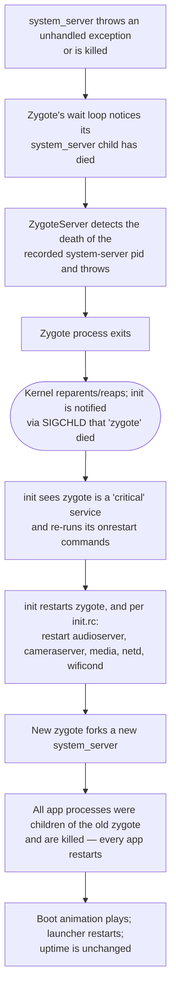

Three consequences follow directly.

First, **a `system_server` crash is a full-device denial of service**, but not a reboot: the kernel
never restarted, so kernel state, encryption keys and the AFU/BFU state are preserved. This is why an
attacker who can crash `system_server` repeatedly can produce a permanent DoS without ever reaching a
BFU state.

First-and-a-half, and it follows: any bug in *any* service inside `system_server` that an app can
reach and turn into an unhandled exception is a device-wide DoS. Android treats reachable
`system_server` crashes as security bugs for exactly this reason.

Second, if `init` sees a `critical` service crash too many times in a short window, it escalates to a
real reboot — into recovery on many devices — which is the bootloop you see when a platform
modification goes wrong.

Third, this is why `adb shell stop && adb shell start` (or `killall system_server` on a rooted device)
is the standard way to apply a framework-level change without a full reboot. It is fast, and it
restarts every app.

```bash
# adb shell as root — force a runtime restart (soft reboot)
stop && start
# or, more bluntly:
killall system_server

# Confirm the kernel did NOT reboot:
uptime
cat /proc/uptime
```

---

### 3.8 Zygote — the fork-without-exec model

#### 3.8.1 The problem Zygote solves

Starting a Java application is expensive. The runtime must initialise, the class loader must find and
load classes, static initialisers must run, and the JIT must warm up. On a desktop, an extra second at
JVM startup is annoying. On a phone in 2008, doing that work for every app launch — plus loading the
several thousand framework classes every app needs — would have made the platform unusable.

The obvious fix is to share the work. But how do you share *initialised objects* between processes?
You cannot copy a live Java heap over a socket.

Android's answer is elegant and slightly outrageous: **do the work once, in a process that then never
does anything else, and make every app a copy of that process.**

> **Definition — Zygote**
> A process started at boot that initialises an ART runtime, loads and initialises the framework
> classes and resources every app will need, and then waits. When a new app must start, Zygote
> `fork()`s itself. The child inherits the entire initialised heap, the loaded classes, the mapped
> libraries and the open file descriptors, and then *specialises* into the target app — without ever
> calling `exec()`.

The name is biological: a zygote is the single cell from which every other cell in an organism
descends by division. Every app process on an Android device is a descendant of one Zygote.

#### 3.8.2 `fork()` without `exec()` — what that actually means

On UNIX, creating a new program is normally two syscalls:

- **`fork()`** creates a copy of the calling process. The child has the same memory contents, the same
  open files, the same everything — but its own PID and its own copy-on-write view of memory.
- **`exec()`** replaces the current process image with a completely new program loaded from disk. The
  old memory is discarded; a fresh address space is created.

Almost every UNIX program does `fork()` then immediately `exec()`. Zygote does `fork()` and
**deliberately skips `exec()`**, because the whole point is to keep the memory it inherited.

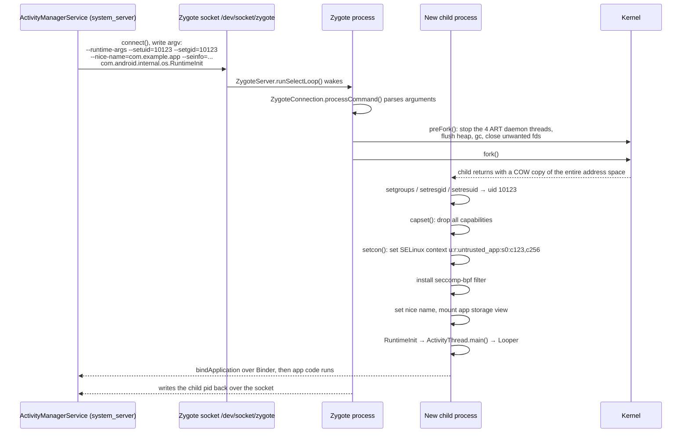

That specialisation list — the six lines the child runs after `fork()` — **is the app sandbox**. Read
it again. Everything that makes an app process less privileged than Zygote happens in those six steps,
in `Zygote.forkAndSpecialize` and the native `com_android_internal_os_Zygote.cpp`. The order matters
enormously and is a classic source of bugs in other systems: capabilities must be dropped after they
are used and before the UID is finally set, and the seccomp filter must be installed last.

> **Under the Hood**
> Zygote runs as **root** (UID 0) with `CAP_SETUID` and `CAP_SETGID`. It must, because dropping to an
> arbitrary app UID requires privilege. This means that for the fraction of a millisecond between
> `fork()` and the `setresuid()` call, there is a root process whose memory contains the framework
> and whose future is to become an app. Any bug that lets an attacker influence Zygote's fork
> arguments — the specialisation parameters that arrive over a socket — is a direct path to running
> code as root or as an arbitrary UID. This is why the zygote socket is mode 660, owned by
> `root:system`, and why only `system_server` may talk to it.

#### 3.8.3 What the child inherits

| Inherited | Consequence |
|---|---|
| The whole initialised Java heap, copy-on-write | Framework classes are already loaded and their static initialisers already run — the biggest startup saving |
| The ART boot image mapping (`boot.art`, `boot.oat`) | Shared, read-only, one physical copy of the AOT-compiled framework for the whole device |
| Preloaded resources (`framework-res.apk` drawables) | Shared, avoids re-decoding common assets |
| Loaded native libraries at the **same addresses** | The ASLR consequence in §3.9 |
| Open file descriptors | Deliberately pruned; `FileDescriptor` leaks across fork have been real bugs |
| The `/proc/self/maps` layout | Identical to Zygote's until the child allocates |

The copy-on-write behaviour is what makes this cheap. The child does not copy the heap; it shares the
same physical pages, marked read-only, and the kernel makes a private copy of a page only when the
child writes to it. On a device running fifty apps, the framework classes exist once in physical RAM,
not fifty times.

#### 3.8.4 Zygote variants and the USAP pool

| Process | Purpose |
|---|---|
| `zygote64` | The 64-bit Zygote; parent of all 64-bit app processes and of `system_server` |
| `zygote` (32-bit) | The secondary Zygote on devices supporting 32-bit apps; the `zygote_secondary` service |
| `webview_zygote` | A separate, more restricted Zygote used to start isolated WebView renderer processes |
| `app_zygote` | Used for `isolatedProcess` services that opt into an application Zygote |
| USAP pool | "Unspecialized App Process" — since Android 10, Zygote may pre-fork a small pool of children that are already forked but not yet specialised, so an app launch only has to specialise, not fork |

```bash
# adb shell — see the zygote family and confirm parentage
ps -A -o PID,PPID,USER,NAME | grep -E 'zygote|system_server'
# Then confirm an app's parent is zygote64:
PID=$(pidof -s com.android.settings); cat /proc/$PID/status | grep -E 'PPid|Uid|Gid'
```

---

### 3.9 The security implication of Zygote: a genuine ASLR weakness

This section is short, precise and important. It is one of the few places where a core Android design
decision measurably weakens a security mitigation, and it is the kind of thing a senior interviewer
asks about to see whether you understand *systems*, not just tools.

#### 3.9.1 What ASLR is and why it works

> **Definition — ASLR (Address Space Layout Randomisation)**
> A mitigation in which the operating system loads a program's stack, heap, shared libraries and
> (with PIE) the executable itself at addresses chosen randomly at process start. The purpose is to
> deny an attacker knowledge of *where* useful code and data are, so that a memory-corruption bug
> cannot be reliably converted into code execution: the attacker knows a function exists but not its
> address.

ASLR's entire value rests on one assumption: **the attacker cannot learn or guess the layout**. If the
layout is the same on every attempt, ASLR provides no protection at all, because the attacker can
learn it once and use it forever.

#### 3.9.2 Why Zygote breaks that assumption

Randomisation happens when a process image is created — that is, at `exec()` time, when the kernel
maps the new address space. Zygote's children never call `exec()`. They are `fork()`ed.

`fork()` produces an **exact copy of the parent's address space**, including every mapping address. So:

- Zygote's own layout is randomised once, when `init` execs `app_process64` at boot.
- Every app process forked from it has **precisely that same layout**.
- Every app process on the device therefore has `libc.so`, `libart.so`, `libandroid_runtime.so`, the
  boot image and Zygote's heap at **the same addresses as every other app process**, until the next
  reboot.

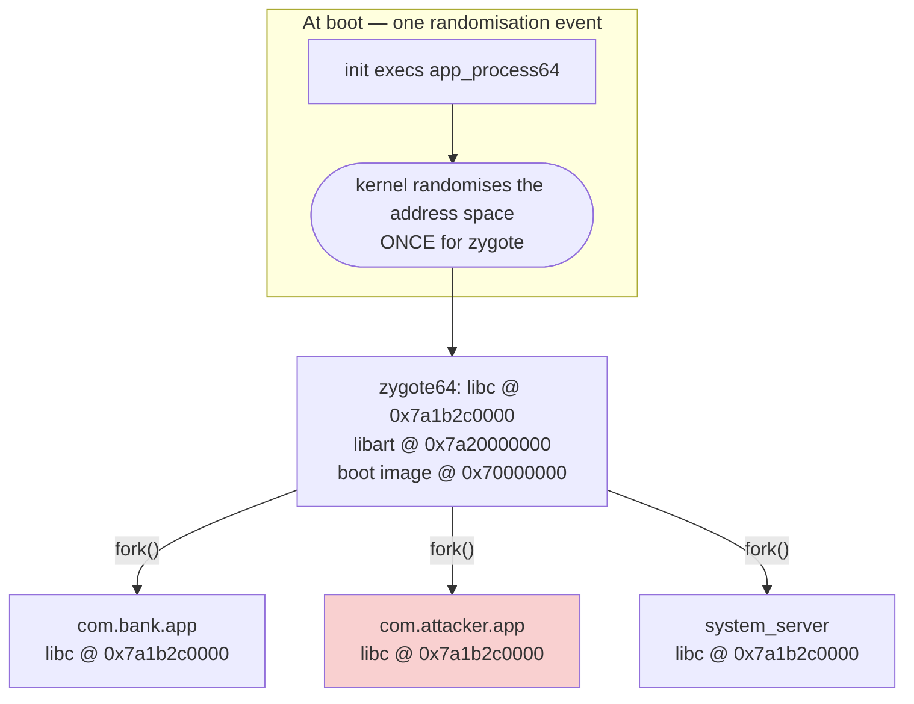

Look at what that diagram means in practice. An attacker who controls **any** app on the device —
their own, freely installed, no permissions needed — can read `/proc/self/maps` in their own
process and learn the load address of `libc.so` in **every other app process on the device, including
`system_server`**. No information leak is required. The attacker's own process is the information
leak.

> **Warning**
> This is not a hypothetical. It is the documented, intentional consequence of the Zygote design, and
> it is the basis of the academic work "From Zygote to Morula: Fortifying Weakened ASLR on Android"
> (Lee, Wang, Kim and Lee, IEEE Symposium on Security and Privacy, 2014), which proposed forking
> "morula" processes that re-randomise. Android did not adopt that design, because the performance
> cost of losing shared, pre-initialised memory was judged too high.

#### 3.9.3 What is and is not weakened

Be precise, because overstating this is a common mistake.

| Address | Randomised per process? | Why |
|---|---|---|
| Shared libraries loaded by Zygote before fork (`libc`, `libart`, `libandroid_runtime`) | **No** — identical in all app processes until reboot | Inherited across `fork()` |
| The ART boot image (`boot.art`) | **No** | Mapped by Zygote |
| Zygote's Java heap objects | **No** for objects created before fork | Inherited |
| Libraries the app loads itself via `System.loadLibrary()` after fork | **Yes**, per process | Mapped after `fork()` by that process's linker |
| The app's own heap allocations after fork | Effectively yes | Allocated after fork |
| Native executables started by `exec()` (`vold`, `netd`, `surfaceflinger`, HAL services) | **Yes**, normal ASLR | They are `exec()`ed by `init` |
| Layout across reboots | Yes | Zygote is re-randomised at each boot |

So the weakness is bounded but real: **the shared, framework portion of every managed process is at a
known, cross-process-observable address for the lifetime of a boot**. Native daemons and HAL processes
are unaffected. Libraries an app loads after forking are unaffected.

#### 3.9.4 Mitigations that reduce the impact

Android did not fix the root cause, but it added defence in depth around it:

- **Reboot** re-randomises everything, and Android reboots more often than a server does.
- **CFI (Control Flow Integrity)** in system components makes a known address less useful, because
  indirect calls are validated against expected target sets.
- **Shadow call stack** and **PAC (Pointer Authentication)** on ARMv8.3+ make return-address
  overwrites much harder.
- **Scudo** hardening makes heap grooming less deterministic even when addresses are known.
- **seccomp filters** limit what the attacker can do after achieving execution.
- **SELinux** limits what the compromised process can reach.

> **Pentester's Note**
> The way to demonstrate this in a report, cleanly and without any exploit, is a two-line experiment:
> print the load address of `libc.so` from two different apps, and from `system_server`, and show that
> they match. Then reboot and show that all three changed together. That is a complete, reproducible
> demonstration of a real property of the platform, and it takes ninety seconds. Lab 03 of this chapter
> is exactly this experiment.

```bash
# adb shell as root — the ninety-second demonstration
for P in $(pidof system_server) $(pidof com.android.systemui) $(pidof com.android.settings); do
  printf '%-8s %s\n' "$P" "$(grep -m1 'libc\.so' /proc/$P/maps | cut -d' ' -f1)"
done
# All three print the same base address. Reboot and repeat: all three change, together.
```

---

### 3.10 The property system

#### 3.10.1 What it is and why it exists

Android needs a device-wide key-value store that any process can read instantly, that a few processes
can write, that survives across the whole system, and that is fast enough to be read in a tight loop.
Files are too slow and racy; a daemon queried over IPC would add a round trip to `getprop`. So Android
built something specific.

> **Definition — The property system**
> A shared-memory key-value store of null-terminated strings. The data lives in files under
> `/dev/__properties__`, which every process maps **read-only**. Reads are therefore direct memory
> accesses with no syscall and no IPC. Writes go through the property service (a thread in `init`)
> over the UNIX socket `/dev/socket/property_service`, which performs the access-control check before
> modifying the shared region.

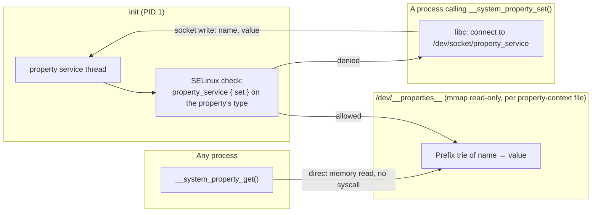

The asymmetry in that diagram is the security design: **reading is free and unrestricted; writing is
mediated and checked**. Because reads are just memory reads, a property read cannot be hooked at the
IPC layer — it can only be hooked in libc, inside the reading process, which is exactly what root
detection bypasses do.

#### 3.10.2 Property namespaces and their meanings

| Prefix | Mutability | Persistence | Meaning |
|---|---|---|---|
| `ro.*` | **Write-once.** After it is set, the property service refuses further writes | Until reboot | "Read-only" configuration, mostly from `build.prop` |
| `persist.*` | Writable (subject to SELinux) | **Survives reboot** — stored in `/data/property/` | Settings that must outlive a boot |
| `ctl.*` | Write-only control channel | n/a | `ctl.start`, `ctl.stop`, `ctl.restart` — the mechanism behind `start`/`stop` commands |
| `sys.*` | Writable | Until reboot | System runtime state, e.g. `sys.boot_completed` |
| `ro.boot.*` | Write-once, set by `init` | Until reboot | Values passed by the **bootloader** on the kernel command line or bootconfig |
| `vendor.*` / `ro.vendor.*` | As above | | Vendor-partition properties, isolated from platform ones by Treble |
| `debug.*` | Writable | Until reboot | Debug toggles read by framework and native code |
| `init.svc.*` | Set by `init` only | Until reboot | The state of each init service (`running`, `stopped`, `restarting`) |

> **Under the Hood**
> "Read-only" for `ro.*` is enforced by the property service, not by the kernel. The check is a string
> comparison on the prefix, and the property service refuses to overwrite an existing `ro.` property.
> Because the shared memory region is mapped read-only into readers, a process cannot write to
> it — but a process that can get code into `init`, or that can map the underlying files writable as
> root with the right SELinux permissions, can. On a rooted device with a permissive setup you can
> also use `resetprop` (a Magisk tool) which manipulates the property area directly rather than going
> through the socket, which is how root-hiding tools change `ro.*` values that the official interface
> refuses.

#### 3.10.3 Where property values come from

| Source file | Partition | Loaded when | Typical contents |
|---|---|---|---|
| `/system/build.prop` | system | `post-fs` | `ro.build.*`, `ro.product.*` |
| `/system_ext/etc/build.prop` | system_ext | `post-fs` | |
| `/vendor/build.prop` | vendor | `post-fs` | `ro.vendor.*`, hardware config |
| `/odm/etc/build.prop` | odm | `post-fs` | |
| `/product/build.prop` | product | `post-fs` | |
| `/data/property/persistent_properties` | data | `post-fs-data` | all `persist.*` values |
| kernel cmdline / bootconfig | — | first-stage init | all `ro.boot.*` |
| `default.prop` / `/prop.default` | ramdisk | first-stage init | `ro.debuggable`, `ro.secure` on some builds |

Access control comes from **property contexts** files, which assign an SELinux type to each property
name prefix:

```bash
# adb shell — who is allowed to set what
cat /system/etc/selinux/plat_property_contexts | head -30
# ro.build.                 u:object_r:build_prop:s0 exact string
# persist.sys.              u:object_r:system_prop:s0
# ctl.                      u:object_r:ctl_default_prop:s0
cat /vendor/etc/selinux/vendor_property_contexts 2>/dev/null | head -20
```

Then the SELinux policy contains rules such as `allow system_server system_prop:property_service set;`
That rule — not any Java code — is the real answer to "can this process set this property".

#### 3.10.4 The properties a pentester must always read

This is the table to memorise. Every one of these appears in real reports.

| Property | Typical safe value | What it means | Why it matters |
|---|---|---|---|
| `ro.debuggable` | `0` | The build is a `userdebug`/`eng` build | If `1`: **every app on the device is debuggable**, `adb root` works, `run-as` works for any package, and JDWP is attachable to any process. On a production device this is a critical finding. |
| `ro.secure` | `1` | ADB runs as `shell`, not root | If `0`, `adbd` starts as root. Combined with `ro.debuggable=1` this is a fully open device. |
| `ro.build.type` | `user` | Build variant | `userdebug` or `eng` on a retail device means a non-production image is shipping to users |
| `ro.build.tags` | `release-keys` | Which keys signed the build | `test-keys` means the build was signed with the **public AOSP test keys**, which anyone can use — so any attacker can sign an APK that gets `signature`-level platform permissions. Critical. |
| `ro.boot.verifiedbootstate` | `green` | AVB result reported by the bootloader | `orange` = unlocked bootloader, no integrity guarantee. `yellow` = custom key. |
| `ro.boot.flash.locked` | `1` | Bootloader lock state | `0` means anyone with physical access can flash a modified image |
| `ro.boot.veritymode` | `enforcing` | dm-verity mode | `logging` or `disabled` means system-partition modification will not be blocked |
| `ro.build.fingerprint` | — | The unique build identity string | **Always record this.** It is the single value that identifies which exact OS build a finding applies to, and it is what Play Integrity and many anti-fraud SDKs profile |
| `ro.build.version.security_patch` | recent | Android security patch level | Compare against the current Android Security Bulletin date. A device months behind has known, public, unpatched vulnerabilities |
| `ro.build.version.sdk` | — | API level | Determines which platform mitigations are present |
| `ro.product.cpu.abilist` | — | Supported ABIs | Tells you which Frida server and which native libraries you need |
| `ro.crypto.state` / `ro.crypto.type` | `encrypted` / `file` | Encryption state and scheme | `unencrypted` on a device holding real data is a finding |
| `ro.adb.secure` | `1` | ADB requires host key authorisation | `0` means any USB host gets a shell with no prompt |
| `service.adb.root` | absent | Set when `adb root` has been used | |
| `sys.boot_completed` | `1` | Boot finished | Used by scripts to wait for the device |
| `persist.sys.usb.config` | `mtp,adb` | USB function configuration | An `adb` entry on a kiosk/embedded device is a finding |
| `ro.build.selinux` / `getenforce` | `1` / `Enforcing` | SELinux mode | `Permissive` removes the strongest post-exploitation constraint on the platform |

```bash
# adb shell — the standard opening recon block for any engagement
for p in ro.build.fingerprint ro.build.type ro.build.tags ro.build.version.sdk \
         ro.build.version.release ro.build.version.security_patch ro.debuggable \
         ro.secure ro.adb.secure ro.boot.verifiedbootstate ro.boot.flash.locked \
         ro.boot.veritymode ro.crypto.state ro.crypto.type ro.product.cpu.abilist; do
  printf '%-40s %s\n' "$p" "$(getprop $p)"
done
getenforce
```

> **Pentester's Note**
> `ro.build.tags=test-keys` deserves its own paragraph in any report where you find it. The AOSP test
> keys are published in `build/make/target/product/security/` in the public source tree. If a shipped
> device was signed with them, **anyone can build an APK signed with the platform key**, install it,
> and be granted every `signature`-level permission — including `INSTALL_PACKAGES`, `INJECT_EVENTS`
> and the ability to use `sharedUserId="android.uid.system"`. That is a complete compromise of the
> platform's permission model, from a single build-configuration mistake. It is more common on
> set-top boxes, IoT devices and industrial handhelds than on phones.

#### 3.10.5 Reading and writing properties in practice

```bash
# adb shell — read
getprop                         # everything
getprop ro.build.fingerprint    # one value
getprop | grep -i verity

# adb shell — write (subject to SELinux; most require root)
setprop debug.mytag 1
setprop ctl.start  mydaemon      # start an init service
setprop ctl.stop   adbd
setprop persist.sys.mytest hello # survives reboot

# Watch properties change live
getprop -Z ro.debuggable         # show the SELinux context of a property
```

From Java, the API is `android.os.SystemProperties` — which is a `@hide` class, so apps use it by
reflection (see [07-AOSP](../07-AOSP/README.md) §3.7 for `@hide` and the hidden-API blocklist):

```java
// Framework-internal API, reached by reflection from an app
Class<?> sp = Class.forName("android.os.SystemProperties");
String v = (String) sp.getMethod("get", String.class).invoke(null, "ro.build.tags");
```

From native code the API is in `<sys/system_properties.h>`:

```c
/* native — the call that root-detection code frequently makes */
#include <sys/system_properties.h>
char value[PROP_VALUE_MAX];
__system_property_get("ro.debuggable", value);
```

> **Pentester's Note**
> Root-detection and emulator-detection code reads properties, and it reads them by one of exactly
> three routes: `SystemProperties.get()` in Java, `__system_property_get()` in libc, or by shelling
> out to `/system/bin/getprop`. A complete bypass must cover all three. Hooking only the Java route is
> the most common incomplete bypass and is why a "working" Frida script suddenly fails against an app
> that added a native check. See [37-RootDetection](../37-RootDetection/README.md).

---

### 3.11 Partitions, update mechanisms and modes

#### 3.11.1 The partition layout

A modern Android device does not have "a filesystem." It has a dozen or more partitions, each with a
different owner, a different update cadence and a different trust level.

| Partition | Mounted at | Contents | Written by | Verified by |
|---|---|---|---|---|
| `bootloader` / `xbl` / `abl` | not mounted | The bootloader stages | fastboot (unlocked only) | BootROM chain |
| `boot` | not mounted | Kernel + generic ramdisk | OTA / fastboot | AVB hash in `vbmeta` |
| `init_boot` (Android 13+) | not mounted | The generic ramdisk, split out of `boot` | OTA / fastboot | AVB |
| `vendor_boot` | not mounted | Vendor ramdisk, first-stage vendor modules | OTA / fastboot | AVB |
| `dtbo` | not mounted | Device tree overlays | OTA / fastboot | AVB |
| `vbmeta`, `vbmeta_system` | not mounted | AVB metadata: hashes, signatures, rollback indexes | OTA / fastboot | Root key in fuses |
| `super` | not mounted directly | Container for the **dynamic partitions** below | OTA | AVB per logical partition |
| `system` (logical) | `/` and `/system` | The AOSP framework, most system apps, core native libs | OTA | dm-verity |
| `system_ext` (logical) | `/system_ext` | OEM additions that are close to the framework | OTA | dm-verity |
| `vendor` (logical) | `/vendor` | SoC vendor HALs, firmware, vendor libs | OTA | dm-verity |
| `odm` (logical) | `/odm` | ODM (the company that physically built the device) customisation | OTA | dm-verity |
| `product` (logical) | `/product` | Carrier/region/product-specific apps and config; where GMS often lives | OTA | dm-verity |
| `vendor_dlkm`, `odm_dlkm`, `system_dlkm` (logical) | under `/vendor/lib/modules` etc. | Loadable kernel modules | OTA | dm-verity |
| `userdata` | `/data` | All user and app data | the running system | Encrypted (FBE), **not** verity-protected |
| `metadata` | `/metadata` | Encryption metadata, needed before `/data` | the running system | — |
| `misc` | not mounted | Bootloader control block; reboot-reason messages | recovery, `init` | — |
| `recovery` (legacy) | not mounted | Recovery ramdisk; on modern devices recovery lives in `boot` | OTA | AVB |
| `cache` (legacy) | `/cache` | OTA staging on old devices | — | — |
| `persist` | `/persist` | Calibration data, sensor data, sometimes DRM keys | vendor code | usually none |

> **Pentester's Note**
> Two rows in that table deserve attention. `userdata` is **not** integrity-protected — it is
> encrypted, but a party who can write it (which includes any root process, and includes an attacker
> with an offline write primitive on an unlocked device) can modify app data without any verity
> failure. And `/persist` is frequently *neither* verified nor encrypted, is writable by vendor
> processes, and on some devices holds security-relevant material. Both are worth enumerating on any
> device-security assessment.

```bash
# adb shell — see the real partition layout of the device in front of you
ls -l /dev/block/by-name/ | awk '{print $9, $10, $11}'
cat /proc/partitions
mount | grep -E ' /(system|vendor|product|odm|data|metadata) '
df -h
```

#### 3.11.2 A/B (seamless) updates

> **Definition — A/B partitions**
> A scheme in which the device has two complete copies of every updatable partition, labelled with the
> suffixes `_a` and `_b`. The system runs from one **slot** while an update is written to the other.
> On the next boot, the bootloader switches slots. If the new slot fails to boot a set number of
> times, the bootloader **automatically rolls back** to the previous slot.

The advantages are that updates apply in the background with no downtime, and that a failed update
cannot brick the device. The costs are storage (mitigated by dynamic partitions, below) and
complexity.

| Concept | Meaning | Where you see it |
|---|---|---|
| Slot | `_a` or `_b` | `getprop ro.boot.slot_suffix` |
| Active slot | The one that will boot next | `fastboot getvar current-slot` |
| Successful flag | Set once the new slot boots and Android marks it good | `update_engine` sets it |
| Retry count | How many attempts remain before rollback | Bootloader control block in `misc` |
| Rollback index | AVB anti-rollback counter, in fuses | Prevents downgrading to a vulnerable image |

```bash
# adb shell
getprop ro.boot.slot_suffix        # _a or _b
getprop ro.build.ab_update         # true on an A/B device
ls /dev/block/by-name/ | grep -E '_a$|_b$' | head
```

> **Warning**
> On an A/B device there is **no separate recovery partition**. Recovery is a mode of the `boot`
> image. Flashing a "recovery.img" from an A-only device onto an A/B device does not do what you
> expect and can leave the device unbootable. Also note the **anti-rollback index**: once a device has
> booted an image with rollback index N, the bootloader will permanently refuse images with a lower
> index. This is a security feature (you cannot downgrade a patched device to a vulnerable build) and
> a very effective way to make a research device useless if you are careless.

#### 3.11.3 Dynamic partitions and `super`

Fixed partition sizes are a problem when `system` grows and `vendor` shrinks between releases, and A/B
doubles the waste.

> **Definition — Dynamic partitions**
> Instead of separate physical partitions for `system`, `vendor`, `product` and friends, the device
> has one large physical partition called **`super`**, containing a metadata header and a set of
> **logical partitions** carved out of it. At boot, first-stage `init` reads the metadata (using
> `liblp`) and creates device-mapper devices for each logical partition. Sizes can be changed by an
> OTA without repartitioning.

```bash
# adb shell as root — inspect the super partition's logical layout
lpdump 2>/dev/null | head -40
ls -l /dev/block/mapper/
# system_a, vendor_a, product_a ... are device-mapper devices, not real partitions
```

This has a direct effect on tooling: `fastboot flash system system.img` on a device with dynamic
partitions must be done from **`fastbootd`** (userspace fastboot, reached with
`adb reboot fastboot` or `fastboot reboot fastboot`), because the bootloader's own fastboot
implementation cannot resize logical partitions.

#### 3.11.4 dm-verity

> **Definition — dm-verity**
> A Linux device-mapper target that provides transparent, block-level integrity checking for a
> read-only filesystem. The image is hashed in 4 KiB blocks; those hashes are hashed, and so on, into
> a **Merkle tree** whose single root hash is signed. Every read of a block verifies that block's hash
> up the tree to the signed root.

The properties that follow are the ones that matter:

- **Lazy and complete.** Verification happens on read, so boot is not delayed by hashing the entire
  partition, but no byte is ever used without being verified.
- **Tamper-evident, not tamper-preventing at rest.** Someone with physical write access can modify the
  partition; the modification is detected the moment it is read.
- **Whole-partition granularity.** You cannot modify one file in `/system` on a verity-enforcing
  device. Not one byte. This is why framework-level research requires either disabling verity (which
  requires an unlocked bootloader) or using an overlay approach such as Magisk's, which mounts changes
  on top rather than modifying the underlying blocks.

`fs-verity` is the per-file equivalent used for `/data` content such as installed APKs, giving
integrity protection to files on a writable partition.

```bash
# host — this is what "disable verity" means, and why it needs an unlocked device
adb root
adb disable-verity      # rewrites the verity flag in vbmeta; requires unlocked bootloader
adb reboot
adb root && adb remount # now /system is writable
```

#### 3.11.5 APEX modules and Project Mainline

> **Definition — APEX (Android Pony EXpress)**
> A container format for delivering low-level system components — native libraries, daemons, and even
> the ART runtime — as independently updatable modules. An `.apex` file is a signed package containing
> a filesystem image, which `apexd` verifies and loop-mounts under `/apex/<name>/` early in boot.

> **Definition — Project Mainline**
> Google's programme, introduced in Android 10, of shipping a defined set of OS components as APEX
> modules or APKs that update **through Google Play**, independently of the device manufacturer's OTA
> schedule.

| Module (examples) | Package name | What it contains |
|---|---|---|
| ART | `com.android.art` | The runtime, `dex2oat`, Bionic-adjacent runtime libs |
| Runtime | `com.android.runtime` | Bionic (`libc`, `linker`) |
| Conscrypt | `com.android.conscrypt` | TLS and crypto provider |
| Media / Media Codec | `com.android.media`, `com.android.media.swcodec` | Extractors and software codecs |
| DNS resolver | `com.android.resolv` | The DNS stack |
| Network stack | `com.android.tethering`, network stack APK | Captive portal, tethering, IP connectivity |
| Permission controller | `com.android.permission` | The runtime permission UI and logic |
| Bluetooth | `com.android.btservices` | The Bluetooth stack |
| Wi-Fi | `com.android.wifi` | The Wi-Fi stack |
| Statsd, adbd, sdkext, cellbroadcast, documentsui, others | various | |

```bash
# adb shell — what is modularised on this device, and at what version?
ls /apex/
cmd package list packages --apex-only
for a in $(ls /apex | grep -v '@'); do
  printf '%-40s %s\n' "$a" "$(cmd package dump $a 2>/dev/null | grep -m1 versionCode)"
done
```

**Why Mainline matters for exploit longevity** — this is the part that is genuinely important and that
most people get wrong.

Before Mainline, a vulnerability in the media framework, the DNS resolver or the TLS stack was fixed
in AOSP, then had to travel: Google → SoC vendor → OEM → carrier → user. That pipeline routinely took
six months, and for most devices it never completed at all. The practical result was that a published
Android vulnerability remained exploitable on the majority of devices in the field essentially forever.

With Mainline, a fix to a modularised component ships as a Play system update. It reaches devices in
days to weeks, without the OEM's involvement, and it reaches devices that will never receive another
full OS update. The components chosen for Mainline are, not coincidentally, precisely the historic
remote attack surfaces: media parsing, DNS, TLS, network stack, Bluetooth, Wi-Fi.

The consequences for you as a researcher and as a tester are concrete:

1. **"The device is on the March security patch" is no longer a complete statement.** The Google Play
   system update level (`Settings → About → Android version → Google Play system update`) is a
   separate date, and it is the one that governs the Mainline components. Record both.
2. **An exploit for a Mainline component has a much shorter useful life** than one for a
   vendor-controlled component. Conversely, a bug in a *non*-modularised, vendor-supplied component
   (a camera HAL, a vendor kernel module, an OEM system app) may stay exploitable for years.
3. **Reproducing an old CVE for research now requires pinning module versions**, not just the OS
   build, because a stock device may have silently updated the vulnerable component.

```bash
# adb shell — the two patch levels you must both record
getprop ro.build.version.security_patch          # platform patch level
cmd package dump com.google.android.modulemetadata 2>/dev/null | grep -m1 versionName
getprop ro.com.google.build.version.updates      # present on some builds
```

#### 3.11.6 Recovery mode and fastboot mode

These are two different programs, in two different states, with two different capability sets, and
people confuse them constantly.

| | **Recovery** | **Fastboot / bootloader mode** |
|---|---|---|
| What is running | A minimal Linux + a small Android userspace from the recovery ramdisk | The bootloader itself (or `fastbootd`, a userspace fastboot in the recovery ramdisk) |
| Kernel running? | Yes | Only for `fastbootd` |
| Reached by | `adb reboot recovery`, hardware keys, `misc` partition BCB | `adb reboot bootloader`, `fastboot reboot bootloader`, hardware keys |
| Protocol | `adb` (sideload only, on stock recovery) | The fastboot USB protocol |
| Typical operations | Apply OTA package, factory reset, wipe cache, `adb sideload` | Unlock/lock, flash partitions, boot a kernel without flashing, read variables |
| Signature checks | Stock recovery verifies OTA package signatures against keys in the recovery image | Flashing is blocked entirely while the bootloader is locked |
| Security relevance | Custom recovery (TWRP) on an unlocked device gives full read/write to `/data` — a complete bypass of the app sandbox | Unlocking wipes data; `fastboot boot` lets you run a kernel without persisting it |

```bash
# host — the mode-switching commands
adb reboot recovery
adb reboot bootloader
adb reboot fastboot          # fastbootd (userspace), needed for dynamic partitions

fastboot getvar all          # every variable the bootloader will tell you
fastboot getvar unlocked
fastboot flashing get_unlock_ability
fastboot boot patched_boot.img   # run this image ONCE without flashing it — the safe way to test
```

> **Warning**
> `fastboot boot` is dramatically safer than `fastboot flash` and should be your default when testing
> a modified boot image. It loads the image into RAM and boots it once; a reboot returns the device to
> its previous state. `fastboot flash boot` persists it, and a bad image means a device that will not
> boot and may need a full factory image restore. This one habit will save you a device sooner or
> later. See [61-Fastboot](../61-Fastboot/README.md).

---

## 4. Source Code Walkthrough (AOSP)

AOSP file paths are stable across releases and are the most durable knowledge in this chapter. Line
numbers are not, so this section quotes structure rather than line numbers. The mechanics of
*navigating* AOSP — Code Search, cross-referencing, following a call across layers — are the subject
of [07-AOSP](../07-AOSP/README.md).

### 4.1 The map: where each layer lives in the tree

| Layer | Directory | What you find there |
|---|---|---|
| Kernel | `kernel/common/` (separate repo, Android Common Kernel) | Binder driver in `drivers/android/`, Android-specific config |
| Bionic | `bionic/` | `libc/`, `linker/`, `libm/`, seccomp filters in `libc/seccomp/` |
| Init, property service, ueventd | `system/core/init/` | `init.cpp`, `property_service.cpp`, `ueventd.cpp`, `service.cpp`, `parser/` |
| Default `.rc` files | `system/core/rootdir/` | `init.rc`, `init.usb.rc`, `ueventd.rc` |
| Servicemanager | `frameworks/native/cmds/servicemanager/` | `main.cpp`, `ServiceManager.cpp`, `Access.cpp` (the SELinux check) |
| libbinder | `frameworks/native/libs/binder/` | `IPCThreadState.cpp`, `Parcel.cpp`, `BpBinder.cpp` |
| vold | `system/vold/` | Volume management, FBE key handling |
| lmkd | `system/memory/lmkd/` | The userspace low-memory killer |
| logd / logcat | `system/logging/` | Log buffers and the `logcat` client |
| Zygote (Java) | `frameworks/base/core/java/com/android/internal/os/` | `ZygoteInit.java`, `ZygoteServer.java`, `ZygoteConnection.java`, `Zygote.java`, `RuntimeInit.java` |
| Zygote (native) | `frameworks/base/core/jni/com_android_internal_os_Zygote.cpp` | The actual fork and specialisation |
| `app_process` | `frameworks/base/cmds/app_process/app_main.cpp` | The binary `init` executes to create Zygote |
| system_server | `frameworks/base/services/java/com/android/server/SystemServer.java` | The service startup order |
| System services | `frameworks/base/services/core/java/com/android/server/` | `am/`, `pm/`, `wm/`, `power/`, `notification/`, `location/`, … |
| Framework public API | `frameworks/base/core/java/android/` | `app/`, `content/`, `os/`, `view/` |
| AIDL interfaces | `frameworks/base/core/java/android/app/IActivityManager.aidl` etc. | The Binder contracts |
| HAL interfaces | `hardware/interfaces/` | One directory per HAL, HIDL `.hal` and AIDL `.aidl` |
| SELinux policy | `system/sepolicy/` | `private/`, `public/`, `vendor/`, `*.te` files, `property_contexts`, `file_contexts` |
| APEX | `system/apex/` | `apexd`, the APEX format |
| AVB | `external/avb/` | `avbtool`, the vbmeta format |
| Partition tooling | `system/core/fs_mgr/` | `liblp` (dynamic partitions), verity setup |

### 4.2 Trace one: `init` starting Zygote

**Step 1 — `init` parses the service definition.**
`system/core/init/init.cpp` builds a parser and registers section parsers for `service`, `on` and
`import`. `system/core/init/service_parser.cpp` turns a `service` block into a `Service` object; each
option (`user`, `group`, `capabilities`, `socket`, `class`, `critical`) becomes a field or a flag.

**Step 2 — the trigger fires.**
`init.rc` contains `on zygote-start` (and `class_start main`). `system/core/init/action_manager.cpp`
queues the actions whose triggers match, and `init`'s main loop executes them.

**Step 3 — `Service::Start()` runs.**
In `system/core/init/service.cpp`, `Start()` performs, in order: create the sockets declared with
`socket` (with the specified owner and mode), `fork()`, and in the child set the SELinux context
(`setexeccon`), set the process groups and cgroups, drop capabilities to the declared set, `setuid`
and `setgid` to the declared identity, and finally `execv()` the binary.

**Step 4 — `app_process` becomes Zygote.**
`frameworks/base/cmds/app_process/app_main.cpp` reads `--zygote` and `--start-system-server`, creates
an `AppRuntime` (a subclass of `AndroidRuntime`, in
`frameworks/base/core/jni/AndroidRuntime.cpp`), and calls `AndroidRuntime::start()` with the class
name `com.android.internal.os.ZygoteInit`.

```cpp
// frameworks/base/cmds/app_process/app_main.cpp — the decisive branch, simplified
if (zygote) {
    runtime.start("com.android.internal.os.ZygoteInit", args, zygote);
} else if (className) {
    runtime.start("com.android.internal.os.RuntimeInit", args, zygote);
}
```

**Step 5 — `AndroidRuntime::start()` creates the VM.**
It calls `startVm()` (which sets every ART option — heap size, GC type, JIT configuration — many of
which come from `dalvik.vm.*` properties), then `startReg()` to register the framework's JNI methods,
then finds the named class and calls its `main`.

**Step 6 — `ZygoteInit.main()`.**
In `frameworks/base/core/java/com/android/internal/os/ZygoteInit.java` this method preloads classes
and resources, creates the `ZygoteServer` (which owns the socket), forks `system_server` if asked,
and enters `runSelectLoop()`.

### 4.3 Trace two: an app launch through Zygote

**Step 1 — the request.**
`ActivityManagerService.startProcessLocked()` (in
`frameworks/base/services/core/java/com/android/server/am/ProcessList.java` on modern releases)
assembles the arguments: UID, GID, supplementary GIDs, target SDK, `seinfo` string, ABI, nice name,
and the entry point class (`android.app.ActivityThread`).

**Step 2 — the socket write.**
`frameworks/base/core/java/android/os/ZygoteProcess.java` connects to `/dev/socket/zygote` (or
`zygote_secondary` for the other ABI) and writes the argument list, newline-separated, preceded by a
count.

**Step 3 — Zygote reads and parses.**
`ZygoteServer.runSelectLoop()` wakes; `ZygoteConnection.processCommand()` builds a
`ZygoteArguments` object from the argv.

**Step 4 — the fork.**
`Zygote.forkAndSpecialize()` calls the native
`com_android_internal_os_Zygote.cpp:com_android_internal_os_Zygote_nativeForkAndSpecialize`. That
function does the pre-fork work (`PreApplicationInit`, stopping the ART daemon threads, closing file
descriptors that must not be inherited via `FileDescriptorTable`), calls `fork()`, and in the child
runs `SpecializeCommon()`.

**Step 5 — `SpecializeCommon()` builds the sandbox.**
This is the function to read if you read only one function in this chapter. In sequence it:
sets the process's resource limits; calls `setgroups()` with the supplementary GIDs (which is where
`AID_INET` for the `INTERNET` permission arrives); calls `setresgid()` and `setresuid()`; calls
`capset()` to drop capabilities; sets the `PR_SET_NO_NEW_PRIVS` flag; installs the seccomp filter via
`SetUpSeccompFilter()`; sets the SELinux context with `selinux_android_setcontext()` using the
`seinfo` supplied by `system_server`; sets the process nice name; and creates the app's mount
namespace view of external storage.

**Step 6 — the child becomes an app.**
`ZygoteConnection` returns a `Runnable` in the child; `RuntimeInit.applicationInit()` invokes
`ActivityThread.main()`, which creates the main `Looper`, creates an `ActivityThread`, and calls
`attach()` — which Binders back to `ActivityManagerService` to say "I am up", receives
`bindApplication`, creates the `Application` object and calls `onCreate()`.

> **Under the Hood**
> Note the direction of Step 6. The new process calls **into** `system_server` to announce itself; the
> server does not push work into a process it has not heard from. This handshake is why an app that
> hangs in a static initialiser produces "process started but never attached" behaviour, and why
> `ActivityManagerService` has a timeout for exactly that case.

### 4.4 Trace three: `getprop` reaching the shared memory

**Step 1 — the command.** `/system/bin/getprop` is `system/core/toolbox/getprop.cpp`.

**Step 2 — libc.** It calls `__system_property_get()` /
`__system_property_find()`, implemented in `bionic/libc/system_properties/system_properties.cpp`.

**Step 3 — the mapping.** `bionic/libc/system_properties/prop_area.cpp` maps the relevant file under
`/dev/__properties__` read-only and walks a **prefix trie** to find the property node.

**Step 4 — the write path is different.** `__system_property_set()` in
`bionic/libc/system_properties/system_properties.cpp` does not touch the shared memory. It connects to
`/dev/socket/property_service` and sends a message; `system/core/init/property_service.cpp` receives
it, calls `CheckPermissions()` — which consults the SELinux `property_service:set` permission using
the property's context from `property_contexts` — and only then writes to the shared region.

That asymmetry is the whole design, and it is why property *reads* cannot be denied by SELinux while
property *writes* can.

---

## 5. Security Perspective

### 5.1 The layered trust model, stated precisely

The stack is not merely a set of layers; it is a set of **trust transitions**, and knowing which
transition a control sits at is what makes a report defensible.

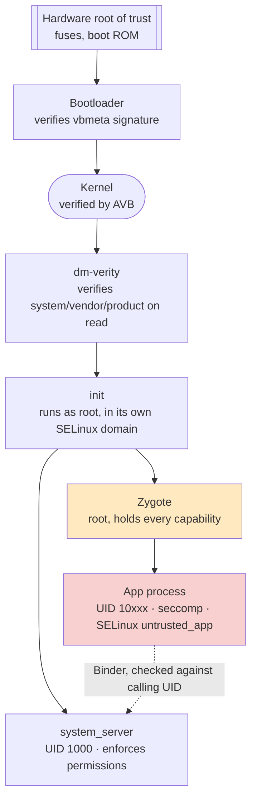

Read it as a chain of assertions, each depending on the one above:

| Transition | What is asserted | What breaks it |
|---|---|---|
| Fuses → bootloader | The bootloader is the one the OEM signed | Bootloader exploit; fuse-level attack |
| Bootloader → vbmeta | Boot, dtbo and vbmeta match signed hashes | Unlocked bootloader (verification skipped) |
| vbmeta → dm-verity | Every block read from `system`/`vendor` matches the signed Merkle root | `disable-verity` on an unlocked device |
| init → services | Each service runs with only its declared UID, GIDs, capabilities and SELinux domain | A misconfigured `.rc` entry; a service running as root that need not |
| Zygote → app | The child drops to an app UID, gains seccomp and an SELinux domain, and can never regain them | A Zygote or kernel vulnerability |
| App → system_server | The caller's UID is authoritative and cannot be spoofed over Binder | A confused-deputy bug **in system_server**, not in Binder |

> **Mental Model**
> Every arrow **downward** in that diagram is a privilege *reduction* that is irreversible without a
> vulnerability. Every arrow **upward** (the dotted Binder line) is a request that must be
> authorised. Almost every platform-level Android vulnerability is either "a downward arrow did not
> reduce as much as it claimed" or "an upward arrow was not authorised properly".

### 5.2 Where each layer's vulnerabilities live

| Layer | Characteristic vulnerability classes | Reachable from an app? |
|---|---|---|
| Bootloader | Unlock bypass, signature verification flaws, USB parsing bugs | No — physical/fastboot access |
| Kernel | Driver memory corruption, race conditions, missing bounds checks in ioctl handlers | Yes — the primary sandbox-escape target |
| Binder driver | Reference-count and lifetime bugs, transaction parsing | Yes — reachable by every app by design |
| Bionic / linker | Memory-safety bugs in parsers; `LD_*` handling | Indirectly |
| HALs and vendor code | Memory corruption in media, camera, GPU, modem interfaces | Often yes, via framework services |
| Native libraries | Media/image/font parsing — historically the richest remote surface | Yes — this is why Mainline modularised them |
| ART | Verifier bypasses, JIT correctness, GC lifetime bugs | Yes |
| system_server | **Confused deputy**: acting on an app's behalf without checking the app's authority | Yes — the highest-value app-reachable target |
| Framework | Permission-check omissions, `PendingIntent` mishandling, parcel mismatch | Yes |
| System apps | Exported components with excessive privilege | Yes |

> **Pentester's Note**
> On an *application* assessment, only the last three rows are usually in scope, and by far the most
> productive is "a privileged app or service exposes something that does not check the caller". You
> will rarely be writing kernel exploits. You will regularly be finding a system or OEM app with an
> exported component that performs a privileged action on request. See
> [24-IPC](../24-IPC/README.md) and [25-Binder](../25-Binder/README.md).

### 5.3 Boot chain findings and how to assess them

This is the part of the chapter that turns directly into report content.

| Observation | Command | Severity guidance |
|---|---|---|
| `ro.build.tags=test-keys` | `getprop ro.build.tags` | **Critical.** The AOSP test keys are public — anyone can sign an APK that receives `signature`-level platform permissions |
| `ro.debuggable=1` on a retail device | `getprop ro.debuggable` | **Critical.** Every app becomes debuggable; `run-as` works for any package |
| `ro.secure=0` | `getprop ro.secure` | **Critical** in combination with the above — `adbd` starts as root |
| Bootloader unlocked | `getprop ro.boot.flash.locked` / `verifiedbootstate` | **High** for a device assessment; expected on a test device — say which |
| `ro.boot.veritymode` not `enforcing` | `getprop ro.boot.veritymode` | High — system partition modification will not be blocked |
| SELinux permissive | `getenforce` | High — removes the strongest post-exploitation constraint |
| Security patch months behind | `getprop ro.build.version.security_patch` | Medium–High depending on gap and threat model |
| Play system update level stale | see §3.11.5 | Medium — Mainline components unpatched |
| `persist.sys.usb.config` includes `adb` on a kiosk | `getprop persist.sys.usb.config` | High for embedded/kiosk deployments |

> **Warning**
> Be scrupulous about context. On a **test device you rooted yourself**, "bootloader unlocked" and
> "SELinux permissive" are your own doing and are not findings — they are methodology, and belong in
> the Test Environment section. They become findings only when you observe them on a device as
> shipped to users. Confusing the two destroys a report's credibility faster than almost anything
> else.

### 5.4 Zygote as a security design, and its one real weakness

Zygote's fork-without-exec model is the reason app startup is fast and the reason thousands of
framework classes cost almost nothing per app. It also has a consequence worth stating plainly.

> **Definition — the Zygote ASLR weakness**
> Because app processes are `fork`ed from Zygote rather than `exec`ed fresh, they **inherit Zygote's
> address-space layout**. Every app on the device therefore has the framework and its shared libraries
> mapped at the same addresses, until the next reboot. An address leaked from one process is
> immediately useful against every other process on that device.

How much it matters depends entirely on what you are doing:

| Context | Impact |
|---|---|
| Native exploitation | **Significant.** It converts a per-process randomisation problem into a per-boot one |
| App-layer testing | Essentially none |
| Malware analysis | Minor, but explains why some exploits are reliable across apps |

Android has added mitigations over time, but the property follows from the fork model itself, which
exists for good reasons. It is a deliberate trade, not an oversight. See
[19-Memory](../19-Memory/README.md).

### 5.5 The seccomp filter and what it removes

`SetUpSeccompFilter()` in `com_android_internal_os_Zygote.cpp` installs a seccomp-bpf filter in every
app process after the fork. The filter is generated from allow-lists in `bionic/libc/seccomp/`.

What it achieves: a large fraction of the kernel's syscall surface — the part apps never legitimately
need — becomes unreachable, shrinking the kernel attack surface available for a sandbox escape.

```bash
# adb shell — confirm the filter is active on a running app
grep Seccomp /proc/$(pidof -s com.example.target)/status
# Seccomp: 2   → filter mode (0 = disabled, 1 = strict, 2 = filter)
```

> **Pentester's Note**
> `Seccomp: 0` on an app process is anomalous and worth investigating. It normally means the process
> was not created by Zygote in the usual way — a `zygisk`-injected process, an app spawned by
> unusual means, or a device with the filter disabled. It is also a useful signal when assessing
> whether a device's sandbox is intact.

### 5.6 How malware interacts with the architecture

| Technique | Layer abused |
|---|---|
| `BOOT_COMPLETED` receiver for persistence | Framework / init ordering |
| Accessibility service for full UI control | Framework — see [28-Services](../28-Services/README.md) |
| Device Admin / DPC to resist uninstall | Framework |
| Reading `ro.*` properties for environment detection | Property service |
| Exploiting a vendor HAL or kernel driver for root | HAL / kernel |
| Installing a Magisk module for persistence | Boot image / overlay |
| Abusing a pre-installed OEM system app's exported component | System apps |

The last row deserves emphasis: on many OEM devices the shortest path to privilege is not a kernel
bug but a pre-installed application with an exported component that performs a privileged action
without checking the caller.

### 5.7 Forensic relevance

| Artefact | What it establishes |
|---|---|
| `ro.build.fingerprint` | Exactly which OS build was running |
| `ro.build.version.security_patch` + Play system update level | Which vulnerabilities were unpatched |
| `ro.boot.verifiedbootstate` | Whether the boot chain was intact |
| `/data/misc/profiles` | Which app code actually executed |
| `logcat -b events` | System-level events with timestamps |
| `dumpsys package` install times | When applications arrived |
| `/metadata`, `/persist` | Encryption metadata and vendor-written data, often un-verified |

### 5.8 OWASP mapping

| Control area | Architectural relevance |
|---|---|
| **MASVS-PLATFORM** | The IPC and component surface this architecture exposes |
| **MASVS-RESILIENCE** | Boot state, root state and device integrity signals |
| **MASVS-STORAGE** | Which partitions are encrypted, which are verity-protected, which are neither |
| **MASVS-CODE** | Patch level and Mainline module currency |

---

## 6. Reverse Engineering Perspective

### 6.1 Reading a device you have never seen

The first fifteen minutes with an unfamiliar device, in order:

```bash
# adb shell — identity and trust posture
getprop ro.build.fingerprint
getprop ro.build.type; getprop ro.build.tags
getprop ro.debuggable; getprop ro.secure
getprop ro.boot.verifiedbootstate; getprop ro.boot.flash.locked
getenforce
getprop ro.build.version.security_patch
```

```bash
# adb shell — what is actually running, by layer
ps -A -o PID,USER,NAME | head -40
ps -A -Z | grep -E 'init|zygote|system_server' 
service list | wc -l
ls /apex/
```

```bash
# adb shell — the partition and update story
ls -l /dev/block/by-name/ 2>/dev/null | head -30
getprop ro.boot.slot_suffix
mount | grep -E ' /(system|vendor|product|odm) '
```

> **Mental Model**
> You are trying to answer four questions: *which build is this*, *is the boot chain intact*, *what is
> modularised*, and *what did the OEM add*. The fourth is where findings live on OEM devices — vendor
> partitions and pre-installed apps are far less scrutinised than AOSP.

### 6.2 Mapping every process to its layer

```bash
# adb shell — a layer census
ps -A -o USER,NAME | awk 'NR>1 {print $1}' | sort | uniq -c | sort -rn
```

| UID you will see | Layer | Notes |
|---|---|---|
| `root` | init, ueventd, vold, some vendor daemons | Anything here that need not be root is a finding |
| `system` (1000) | `system_server` and friends | The permission enforcement point |
| `shell` (2000) | `adbd`, your shell | **Not** an app — see [77](../77-UsefulCommands/README.md) |
| `media`, `audioserver`, `cameraserver`, `bluetooth`, `nfc`, `radio` | Specialised system services | Historically vulnerability-rich |
| `u0_aNNN` (10000+) | Apps | One UID per app |
| `u0_iNNN` | Isolated processes | WebView renderer, media extractor |
| `vendor_*`, OEM-specific | Vendor daemons | Least scrutinised code on the device |

```bash
# adb shell — the same census by SELinux domain, which is more informative
ps -A -Z | awk '{print $1}' | sed 's/:s0.*//' | sort | uniq -c | sort -rn | head -20
```

### 6.3 Recognising the layers in a binary

| You are looking at | Layer | Tell-tale |
|---|---|---|
| `.dex` inside an APK | App / framework Java | See [12-DEX-Internals](../12-DEX-Internals/README.md) |
| `.so` under `/system/lib64` | Native platform library | Links `libc.so`, `liblog.so`, `libutils.so` |
| `.so` under `/vendor/lib64` | Vendor / HAL implementation | Often links vendor-only libs; VNDK-restricted |
| `.so` under `/apex/*/lib64` | Mainline module | Version differs from the OS build |
| A binary in `/system/bin` with an `.rc` entry | An init service | Read its `.rc` for UID, capabilities, SELinux domain |
| Something linking `libbinder.so` | A Binder participant | Look for AIDL-generated `onTransact` |
| Something linking `libhidlbase.so` / `libbinder_ndk.so` | A HAL | HIDL / AIDL-for-HALs respectively |

```bash
# adb shell — what layer does this binary belong to?
readelf -d /system/bin/some_daemon | grep NEEDED
# then find its init entry:
grep -rn "some_daemon" /system/etc/init/ /vendor/etc/init/ 2>/dev/null
```

That last command is the highest-value one in this section: an init `.rc` entry tells you the
service's **user, groups, capabilities and SELinux context** — its entire privilege budget — in five
lines.

---

## 7. Dynamic Analysis

### 7.1 Watching the boot process

```bash
# host — capture a full boot
adb reboot
adb wait-for-device
adb logcat -b all -d > boot.log
```

```bash
# host — the milestones, in order
grep -nE "init: Starting service 'zygote'|Zygote: Preloading|SystemServer|Boot is finished|sys.boot_completed" boot.log | head -40
```

```bash
# adb shell as root — kernel-side boot messages
dmesg | head -60
dmesg | grep -iE "verity|avb|selinux|binder"
```

**What to look for:**

| Signal | Meaning |
|---|---|
| `init: Starting service 'zygote'` | Zygote launch |
| `Zygote: Preloading classes...` / `...took N ms` | Preload cost |
| `SystemServer: StartXxxService` lines | Service startup order |
| `avc: denied` | SELinux denial — see [22-SELinux](../22-SELinux/README.md) |
| `dm-verity` messages | Verity setup or failure |
| `Boot is finished (Nms)` | Total boot time |

### 7.2 Observing Zygote forking an app

```bash
# adb shell as root — watch a process appear
ZPID=$(pidof -s zygote64)
echo "zygote64 = $ZPID"
```

```bash
# adb shell as root — trace the fork (needs strace on device)
strace -f -e trace=clone,fork,setuid,setgid,setgroups,prctl -p $ZPID 2>&1 | head -60
# now launch the target app from another terminal
```

You will see the `clone`, then in the child the `setgroups`/`setresgid`/`setresuid` sequence that
drops to the app UID, then `prctl(PR_SET_NO_NEW_PRIVS)` and the seccomp installation — exactly the
`SpecializeCommon()` sequence from §4.3.

```bash
# adb shell — confirm the result on the new process
PID=$(pidof -s com.example.target)
cat /proc/$PID/status | grep -E "Uid|Gid|Groups|CapEff|Seccomp|NoNewPrivs"
cat /proc/$PID/attr/current      # SELinux context
```

> **Pentester's Note**
> That single `/proc/<pid>/status` block is a complete picture of an app's privilege: its UID, its
> supplementary groups (which encode some permissions, notably `AID_INET` for `INTERNET`), its
> effective capabilities (should be empty), and whether seccomp is active. Capture it for any process
> you are assessing. Anything non-empty in `CapEff` on an app process is highly anomalous.

### 7.3 Inspecting system services

```bash
# adb shell
service list                         # every registered Binder service
service list | wc -l
dumpsys -l                           # every dumpable service
dumpsys activity                     # AMS state
dumpsys package <pkg>                # PMS view of one package
dumpsys window | grep mCurrentFocus  # the focused window
```

```bash
# adb shell — call a service method directly by transaction code
service call package 1               # see 25-Binder for how to derive codes
```

### 7.4 Property observation

```bash
# adb shell — the security-relevant property block (from §3.10.4)
for p in ro.build.fingerprint ro.build.type ro.build.tags ro.debuggable ro.secure \
         ro.adb.secure ro.boot.verifiedbootstate ro.boot.flash.locked \
         ro.boot.veritymode ro.crypto.state ro.build.version.security_patch; do
  printf '%-40s %s\n' "$p" "$(getprop $p)"
done
```

```bash
# adb shell — what SELinux context governs a property's write permission?
getprop -Z ro.debuggable
getprop -Z persist.sys.usb.config
```

### 7.5 Tracing across layers with Frida

```javascript
// Frida — watch an app's Binder traffic reach system_server.
// See 25-Binder for the full treatment.
var transact = Module.findExportByName("libbinder.so",
    "_ZN7android14IPCThreadState8transactEijRKNS_6ParcelEPS1_j");
if (transact !== null) {
    Interceptor.attach(transact, {
        onEnter: function (args) {
            console.log("[binder] handle=" + args[1].toInt32() +
                        " code=" + args[2].toInt32());
        }
    });
} else {
    console.log("[-] symbol not exported on this build — see 25-Binder for alternatives");
}
```

### 7.6 Tool inventory for this chapter

| Tool | Use |
|---|---|
| `logcat -b all` | Boot and runtime events across every buffer |
| `dmesg` | Kernel messages: verity, AVB, SELinux, Binder |
| `getprop` / `setprop` | Property service |
| `service list`, `dumpsys` | Binder services |
| `ps -A -Z` | Processes with SELinux domains |
| `/proc/<pid>/status` | UID, groups, capabilities, seccomp |
| `lpdump` | Dynamic partition layout |
| `fastboot getvar all` | Bootloader state |
| `strace` | Syscall-level tracing of the fork/specialise sequence |
| `atrace` / Perfetto | Boot-time and system tracing |

---

## 8. Static Analysis

### 8.1 Analysing a firmware image offline

When you have an image rather than a device, the same questions apply.

```bash
# host — unpack a factory image
unzip factory-image.zip
tar xvf image-*.tar.gz          # produces boot.img, vbmeta.img, super.img, ...
```

```bash
# host — the boot image
# https://github.com/cfig/Android_boot_image_editor  or magiskboot
magiskboot unpack boot.img      # produces kernel, ramdisk.cpio, dtb
mkdir ramdisk && cd ramdisk && cpio -idmv < ../ramdisk.cpio
cat default.prop 2>/dev/null    # ro.debuggable and friends live here on older builds
ls -la                          # init, init.rc, sepolicy
```

```bash
# host — dynamic partitions
# https://github.com/LonelyFool/lpunpack_and_lpmake  or Android's lpunpack
lpunpack super.img out/         # produces system.img, vendor.img, product.img
```

```bash
# host — mount and inspect a logical partition
sudo mount -o loop,ro out/system.img /mnt/system
ls /mnt/system/system/etc/init/          # every init service definition
cat /mnt/system/system/build.prop        # the property defaults
```

### 8.2 What to extract from an image

| Artefact | Where | Why |
|---|---|---|
| `build.prop` | `/system/build.prop`, `/vendor/build.prop` | Fingerprint, build type, tags, patch level |
| `default.prop` / `prop.default` | boot ramdisk | `ro.debuggable`, `ro.secure`, `ro.adb.secure` |
| `init*.rc` | ramdisk, `/system/etc/init/`, `/vendor/etc/init/` | **Every service's privilege budget** |
| `sepolicy` | ramdisk, `/system/etc/selinux/` | The MAC policy — see [22-SELinux](../22-SELinux/README.md) |
| `vbmeta.img` | image | AVB descriptors, rollback index, signing key |
| Pre-installed APKs | `/system/app`, `/system/priv-app`, `/product/app`, `/vendor/app` | **The richest source of OEM findings** |
| `/system/etc/permissions/*.xml` | image | Which packages receive privileged permissions |
| APEX modules | `/system/apex/*.apex` | Mainline component versions |

### 8.3 The init `.rc` audit

This is the single highest-value static check on a firmware image.

```bash
# host — enumerate every service and its privilege
grep -rhA10 '^service ' /mnt/system/system/etc/init/ /mnt/vendor/etc/init/ 2>/dev/null \
  | grep -E '^service |user |group |capabilities |seclabel ' 
```

Look for:

| Pattern | Concern |
|---|---|
| A service with no `user` line | Runs as **root** by default |
| `user root` on something that need not be | Unnecessary privilege |
| Broad `capabilities` | More than the service needs |
| Missing `seclabel` where the domain is not derived | May land in an over-permissive domain |
| `socket` with mode `0666` | World-accessible IPC endpoint |
| `oneshot` absent on a helper | Restarts forever if it crashes |

```bash
# host — services running as root
awk '/^service /{svc=$2; usr="root(default)"} /^\s+user /{usr=$2} /^$/{if(svc)print usr, svc; svc=""}' \
  /mnt/system/system/etc/init/*.rc | sort | grep '^root'
```

### 8.4 AVB and verity inspection

```bash
# host — read vbmeta
python3 external/avb/avbtool.py info_image --image vbmeta.img
# shows: algorithm, rollback index, descriptors (hash, hashtree, chain partition)
```

```bash
# host — verify a partition against its descriptor
python3 external/avb/avbtool.py verify_image --image vbmeta.img --follow_chain_partitions
```

**What to record:** the signing algorithm, the rollback index, whether `--flags 2` (verification
disabled) is set, and which partitions have hashtree descriptors.

### 8.5 Pre-installed application triage

```bash
# host — inventory the pre-installed apps, which is where OEM findings concentrate
find /mnt/system /mnt/product /mnt/vendor -name '*.apk' 2>/dev/null | wc -l
find /mnt/system/system/priv-app -name '*.apk' 2>/dev/null
```

Privileged apps (`priv-app`) can hold `signature|privileged` permissions, so an exported component
there is far more valuable to an attacker than the same bug in a normal app.

```bash
# host — which packages are granted privileged permissions?
cat /mnt/system/system/etc/permissions/privapp-permissions-*.xml | grep -E 'package name|permission name'
```

Then run each interesting APK through the [10-APK-Internals](../10-APK-Internals/README.md) and
[32-Manifest](../32-Manifest/README.md) processes.

---

## 9. Examples

Material in [`examples/`](examples/) and [`scripts/`](scripts/).

### 9.1 Simple — profile a device's trust posture

[`scripts/device-posture.sh`](scripts/device-posture.sh) runs the §5.3 checks and prints a verdict
per row, so you get a report-ready table rather than raw `getprop` output.

```bash
./scripts/device-posture.sh
```

### 9.2 Intermediate — map every process to its layer

[`scripts/layer-census.sh`](scripts/layer-census.sh) enumerates processes by UID and SELinux domain,
groups them by architectural layer, and highlights anomalies — a root process that should not be, an
app process with non-empty capabilities, a process without seccomp.

### 9.3 Advanced — trace a boot end to end

[`labs/lab-01-trace-the-boot.md`](labs/lab-01-trace-the-boot.md) walks a full boot from `dmesg`
through `logcat`, identifying each milestone from §3.

### 9.4 Real application — audit an init service definition

An example `.rc` entry with an over-broad privilege budget, annotated:

```bash
# /vendor/etc/init/vendor.oem.diag.rc  — a realistic anti-pattern
service oem_diag /vendor/bin/oem_diagd
    class late_start
    # NO 'user' line — this runs as ROOT
    capabilities SYS_ADMIN NET_ADMIN NET_RAW
    socket oem_diag stream 0666 root root
    # ^ world read/write socket: ANY app on the device can connect
    seclabel u:r:vendor_diag:s0
```

Three findings in six lines: root by default, excessive capabilities, and a world-accessible UNIX
socket that any app can reach — an IPC surface outside the framework's permission model entirely. See
[24-IPC](../24-IPC/README.md) on abstract and filesystem sockets.

### 9.5 Enterprise — a repeatable device baseline

[`scripts/firmware-triage.sh`](scripts/firmware-triage.sh) performs the §8 static checks against an
unpacked firmware image: property extraction, init `.rc` privilege audit, privileged-app inventory,
and AVB descriptor summary — the form you want when assessing a fleet of device models.

---

## 10. Common Interview Questions

### Beginner

**Q: Name the layers of the Android stack from the bottom up.**
Linux kernel; hardware abstraction layer (HALs); native libraries and the Android Runtime; the Java
framework (`system_server` and the API surface); applications. Be able to give one example from each
and say what talks to what.

**Q: What is Zygote?**
The process that preloads framework classes and resources once, then `fork`s to create every app
process. It exists so that app startup is fast and framework memory is shared copy-on-write rather
than duplicated per app.

**Q: What is `init`?**
PID 1. It parses `.rc` files, starts and supervises services, and runs the property service. Every
long-lived process on the device is either started by `init` or forked from something `init` started.

### Intermediate

**Q: Trace what happens between tapping an icon and the app's `onCreate` running.**
Launcher sends an intent → `ActivityManagerService` resolves it → if no process exists, AMS writes
arguments to Zygote's socket → Zygote forks and `SpecializeCommon()` drops to the app UID, sets
supplementary groups, drops capabilities, applies seccomp and the SELinux context → the child runs
`ActivityThread.main()` → it Binders back to AMS to attach → AMS sends `bindApplication` → the
`Application` object is created, then the Activity.

**Q: Why can you not modify one file in `/system` on a stock device?**
dm-verity. The partition's blocks are hashed into a Merkle tree whose root is signed; every read
verifies up the tree. Modification is detected at read time. Disabling verity requires an unlocked
bootloader, which is why Magisk uses an overlay approach instead of modifying the underlying blocks.

**Q: What does `ro.build.tags=test-keys` mean and why does it matter?**
The image was signed with the **public** AOSP test keys rather than the vendor's private release
keys. Because those keys are in the public source tree, anyone can sign an APK with the platform key,
which grants every `signature`-level permission and allows `sharedUserId="android.uid.system"`. It is
a complete compromise of the permission model from one build-configuration mistake.

**Q: What is Project Mainline and how does it change your assessment of a device's patch level?**
Certain OS components ship as APEX modules or APKs updated through Google Play, independently of the
OEM. Consequently `ro.build.version.security_patch` alone is no longer a complete statement — you
must also record the Google Play system update level, which governs the Mainline components. The
modularised components are, not coincidentally, the historic remote attack surfaces: media, DNS, TLS,
Bluetooth, Wi-Fi.

### Senior

**Q: Walk through `SpecializeCommon()` and explain what each step contributes to the sandbox.**
Resource limits; `setgroups()` with supplementary GIDs (this is where `AID_INET` for the `INTERNET`
permission arrives); `setresgid`/`setresuid` to the app identity; `capset()` to drop capabilities;
`PR_SET_NO_NEW_PRIVS` so privilege can never be regained via setuid binaries; the seccomp-bpf filter;
`selinux_android_setcontext()` using the `seinfo` string supplied by `system_server`; the process nice
name; and the app's mount-namespace view of external storage. The ordering matters — capabilities are
dropped and `NO_NEW_PRIVS` set before anything the app controls runs.

**Q: Where is the actual security boundary between two apps, and what is *not* one?**
The boundary is the kernel: distinct UIDs, distinct page tables, DAC on `/data/data`, SELinux MAC, and
seccomp. What is *not* a boundary: anything the runtime enforces in-process (the bytecode verifier,
`private`, hidden-API restrictions), because the app owns its own process and can remove them. The
practical reporting consequence is that bypassing an in-process control is a prerequisite, not a
finding.

**Q: Explain the Zygote ASLR weakness and assess how much it matters.**
Because apps are forked rather than exec'ed, they inherit Zygote's address-space layout, so every app
has the framework and its libraries at identical addresses until reboot. An address leaked from one
process is useful against another. It materially helps native exploitation and is essentially
irrelevant to app-layer testing. It is a deliberate trade for startup speed and memory sharing, and
Android has added mitigations, but the property is inherent to the fork model.

**Q: Why can SELinux deny a property *write* but not a property *read*?**
Because the two paths are completely different. Reads `mmap` the property area under
`/dev/__properties__` directly from libc and walk a trie — no IPC, nothing to intercept. Writes go
over a socket to `property_service` inside `init`, which calls `CheckPermissions()` and consults the
SELinux `property_service:set` permission using the property's context from `property_contexts`. The
asymmetry is the design.

### Staff Engineer

**Q: You are assessing a fleet of OEM Android devices. Where do you focus, and why?**
Not the AOSP core — it is the most scrutinised code in the ecosystem. Focus on what the OEM added:
`/vendor` and `/odm` HALs and daemons, pre-installed privileged apps in `priv-app`, the
`privapp-permissions` grants, custom SELinux policy, and init `.rc` service definitions with
excessive privilege. Then check the boot-chain posture (test-keys, `ro.debuggable`, verity mode) and
both patch levels including Mainline. The highest-yield single check is an init `.rc` audit: it shows
every service's UID, capabilities and SELinux domain in a form you can grep.

**Q: Evaluate Project Mainline as a security architecture decision.**
Strongly positive on the primary axis: it decouples fixes for the highest-risk remote attack surfaces
from the OEM update pipeline, which historically failed to deliver at all for most devices. Costs and
caveats worth naming: it fragments the notion of "patch level" into two numbers that people conflate;
it means two devices reporting the same Android release can differ in runtime internals, which
complicates both exploitation and tooling; it concentrates trust in Google's update channel; and it
does nothing for vendor-supplied components, which is where a large share of real-world device
vulnerabilities live. Net: correct, but it moved the problem rather than eliminating it.

### Principal Engineer

**Q: Android's security rests on a chain from hardware fuses to the app sandbox. Where is that chain
weakest, and what would you change?**
A strong answer identifies that the cryptographic links (fuses → bootloader → vbmeta → dm-verity) are
sound and well-implemented, and that the weakness is **organisational rather than cryptographic**: the
vendor and ODM partitions carry large volumes of relatively unreviewed code running at high privilege,
outside the review and update processes that cover AOSP. Treble and the VNDK constrained the
*interfaces* but not the *quality* behind them. Plausible changes: extend Mainline-style
modularisation and update decoupling further into vendor components; require vendor code to run at
lower privilege by default (init `.rc` defaulting to a non-root user rather than root); and make
privileged permission grants to pre-installed apps auditable and minimised by policy rather than by
convention. A candidate should also acknowledge the constraint that Google cannot unilaterally impose
engineering quality on a hardware ecosystem it does not control, which is precisely why the
architectural answer has been to shrink what vendors are trusted with.

---

## 11. Common Mistakes

### Developer mistakes

- Assuming `/system` is writable and shipping code that tries to modify it.
- Relying on a property an OEM may not set, or that Mainline may change.
- Treating `ro.debuggable` or `Build.TAGS` checks as security controls — an attacker on a rooted
  device controls both.
- Shipping a `userdebug` build, or one signed with test-keys, to production.
- Adding an init service with no `user` line, so it silently runs as root.
- Exposing a UNIX socket with mode `0666` from a vendor daemon.

### Pentester mistakes

- **Reporting your own test device's unlocked bootloader as a finding.** It is methodology; put it in
  the Test Environment section.
- Recording only `ro.build.version.security_patch` and not the Play system update level.
- Assuming an AOSP fix is present on an OEM device.
- Attacking the AOSP core on an OEM device assessment instead of the vendor additions, where the
  findings actually are.
- Confusing recovery mode with fastboot mode, and flashing the wrong artefact.
- Using `fastboot flash` where `fastboot boot` would have tested the same thing non-destructively.
- Not capturing `/proc/<pid>/status` for the processes under assessment.

### Reverse engineer mistakes

- Analysing `/system` and ignoring `/vendor`, `/odm` and `/product`, which is where the OEM code is.
- Forgetting that `/apex` contents are versioned independently of the OS build.
- Assuming a `.so` in `/system/lib64` on one device is the same as on another with the same Android
  version — Mainline makes that false.
- Reading `build.prop` from `/system` while `ro.debuggable` actually lives in the boot ramdisk's
  `default.prop`.

---

## 12. Hands-on Labs

Full material in [`labs/`](labs/).

| Lab | Objective | Difficulty |
|---|---|---|
| [Lab 01 — Trace the boot](labs/lab-01-trace-the-boot.md) | Follow a full boot from `dmesg` and `logcat`, identifying every milestone from §3 | Beginner |
| [Lab 02 — Map every process to its layer](labs/lab-02-map-the-layers.md) | Census a running device by UID and SELinux domain; explain each process's privilege | Intermediate |
| [Lab 03 — Audit a firmware image](labs/lab-03-audit-a-firmware-image.md) | Unpack a factory image and audit init services, privileged apps and AVB descriptors | Advanced |

---

## 13. Summary

### Key points

- The stack is a chain of **trust transitions**, not just layers. Fuses → bootloader → vbmeta →
  dm-verity → init → Zygote → app. Each downward step is an irreversible privilege reduction.
- **Zygote forks without exec**, which is why startup is fast and framework memory is shared — and why
  every app on the device shares an address-space layout until reboot.
- `SpecializeCommon()` is where the app sandbox is actually constructed: groups, UID/GID,
  capabilities, `NO_NEW_PRIVS`, seccomp, SELinux context.
- The real security boundary is the **kernel** — UID, page tables, DAC, SELinux, seccomp. Nothing the
  runtime enforces in-process is a boundary.
- Property **reads** are a direct `mmap` from libc; property **writes** go through `init` and are
  SELinux-checked. That asymmetry explains a great deal.
- `ro.build.tags=test-keys` is a **critical** finding: the keys are public, so anyone can sign a
  platform-privileged APK.
- dm-verity protects `system`/`vendor`/`product` at block granularity. `userdata` is encrypted but
  **not** verity-protected; `/persist` is often neither.
- **Mainline** decouples the highest-risk components from OEM update pipelines. Record *two* patch
  levels: the platform one and the Play system update level.
- On OEM devices, findings concentrate in `/vendor`, `/odm` and pre-installed privileged apps — not
  in AOSP.
- `fastboot boot` before `fastboot flash`. Always.

### Mind map

Full version in [`mindmap.md`](mindmap.md). Condensed:

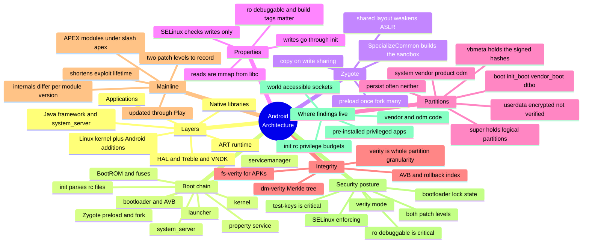

### Cheat sheet

Full version in [`cheatsheet.md`](cheatsheet.md). Condensed:

| Need | Command |
|---|---|
| Device identity | `getprop ro.build.fingerprint` |
| Trust posture | `getprop ro.build.tags; getprop ro.debuggable; getprop ro.secure` |
| Boot state | `getprop ro.boot.verifiedbootstate; getprop ro.boot.flash.locked` |
| Verity mode | `getprop ro.boot.veritymode` |
| SELinux | `getenforce`; `ps -A -Z` |
| Both patch levels | `getprop ro.build.version.security_patch` + Play system update |
| Layer census | `ps -A -o USER,NAME \| awk 'NR>1{print $1}' \| sort \| uniq -c \| sort -rn` |
| App privilege | `cat /proc/<pid>/status \| grep -E "Uid\|Gid\|Groups\|CapEff\|Seccomp"` |
| Binder services | `service list` |
| Mainline modules | `ls /apex/; cmd package list packages --apex-only` |
| Partition layout | `ls -l /dev/block/by-name/`; `lpdump` |
| A/B slot | `getprop ro.boot.slot_suffix` |
| Init service audit | `grep -rhA10 '^service ' /system/etc/init/ /vendor/etc/init/` |
| Boot milestones | `logcat -b all -d \| grep -E "zygote\|SystemServer\|Boot is finished"` |
| Test a boot image safely | `fastboot boot patched.img` (**not** `flash`) |

### Quick revision

- Name the trust transitions from hardware fuses to an app process.
- What does `SpecializeCommon()` do, and why does the ordering matter?
- Why can SELinux block a property write but not a property read?
- What exactly does `ro.build.tags=test-keys` allow an attacker to do?
- Which partitions are verity-protected, and which are not?
- What are the *two* patch levels you must record, and why?
- Why does forking from Zygote weaken ASLR, and when does that actually matter?
- On an OEM device assessment, where do findings concentrate and why?
- What is the difference between recovery mode and fastboot mode?

---

## 14. References

### AOSP source

- `system/core/init/` — `init.cpp`, `property_service.cpp`, `service.cpp`, `ueventd.cpp`
- `system/core/rootdir/init.rc` — the default init script
- `frameworks/base/core/java/com/android/internal/os/ZygoteInit.java` — preload and the select loop
- `frameworks/base/core/jni/com_android_internal_os_Zygote.cpp` — **`SpecializeCommon()`**
- `frameworks/base/cmds/app_process/app_main.cpp` — how Zygote is launched
- `frameworks/base/core/jni/AndroidRuntime.cpp` — VM creation
- `frameworks/base/services/java/com/android/server/SystemServer.java` — service startup order
- `frameworks/native/cmds/servicemanager/` — service registration and the SELinux check
- `bionic/libc/system_properties/` — the property implementation
- `bionic/libc/seccomp/` — the syscall allow-lists
- `system/sepolicy/` — the SELinux policy
- `system/apex/` — `apexd` and the APEX format
- `external/avb/` — `avbtool` and vbmeta
- `system/core/fs_mgr/` — `liblp`, verity setup
- Android Code Search — https://cs.android.com/

### Official documentation

- Platform architecture — https://developer.android.com/guide/platform
- Android Open Source Project — https://source.android.com/
- Verified Boot — https://source.android.com/docs/security/features/verifiedboot
- dm-verity — https://source.android.com/docs/security/features/verifiedboot/dm-verity
- Dynamic partitions — https://source.android.com/docs/core/ota/dynamic_partitions
- A/B (seamless) updates — https://source.android.com/docs/core/ota/ab
- APEX file format — https://source.android.com/docs/core/ota/apex
- Modular System Components (Mainline) — https://source.android.com/docs/core/ota/modular-system
- Treble — https://source.android.com/docs/core/architecture/treble
- HAL types — https://source.android.com/docs/core/architecture/hal-types
- Android Security Bulletins — https://source.android.com/docs/security/bulletin

### OWASP

- MASVS — https://mas.owasp.org/MASVS/
- MASTG — https://mas.owasp.org/MASTG/

### Related chapters

- [07-AOSP](../07-AOSP/README.md) — navigating and building the source tree
- [09-Android-App-Internals](../09-Android-App-Internals/README.md) — app identity and the install flow
- [11-Android-Runtime](../11-Android-Runtime/README.md) — the runtime layer in depth
- [13-ART](../13-ART/README.md) — the ART implementation and the Mainline module
- [19-Memory](../19-Memory/README.md) — the Zygote ASLR consequence
- [20-Security-Architecture](../20-Security-Architecture/README.md) — Verified Boot, FBE, Play Integrity
- [21-App-Sandbox](../21-App-Sandbox/README.md) — what `SpecializeCommon()` builds
- [22-SELinux](../22-SELinux/README.md) — the MAC layer and property contexts
- [24-IPC](../24-IPC/README.md) — sockets and the wider IPC surface
- [25-Binder](../25-Binder/README.md) — the transport underneath everything
- [61-Fastboot](../61-Fastboot/README.md) — bootloader, partitions and flashing safely


