# 06 — Android Architecture · Mind Map

One picture of the whole chapter. Read it outward from the centre: Android is a stack of layers, but
more usefully it is a chain of **trust transitions** from hardware fuses down to an app process; each
downward step is an irreversible privilege reduction, and almost every platform vulnerability is
either "a step did not reduce as much as it claimed" or "a request back upward was not authorised".

Every branch corresponds to a section of [the chapter README](README.md). Runtime detail belongs to
[11](../11-Android-Runtime/mindmap.md) and [13](../13-ART/mindmap.md); the security model in depth
belongs to [20](../20-Security-Architecture/README.md).

```mermaid
mindmap
  root((Android<br/>Architecture))
    The layers
      Linux kernel
        binder driver
        ashmem and memfd
        low memory killer
        wakelocks
        paranoid networking
        GKI generic kernel image
      HAL
        legacy HALs
        HIDL then AIDL for HALs
        Project Treble
        vendor system split
        VNDK
      Native libraries
        Bionic libc and linker
        libbinder libutils libcutils
        Skia and libhwui
        media and codecs
        BoringSSL and Conscrypt
        SQLite
      Android Runtime
        detail lives in chapters 11 and 13
      Java framework
        system_server hosts most services
        ActivityManagerService
        PackageManagerService
        WindowManagerService
        PowerManagerService
      Applications
        one UID each
        forked from Zygote
    Boot chain
      BootROM and fuses
      bootloader verifies vbmeta
      AVB signature and rollback index
      kernel
      first stage init
      dm-verity set up
      init parses rc files
        services triggers actions
        rc language
      property service
      ueventd
      vold
      servicemanager
      hwservicemanager
      Zygote
      system_server
      Launcher
      boot completed
    Zygote
      preload classes once
      preload resources once
      fork without exec
      copy on write sharing
      SpecializeCommon builds the sandbox
        resource limits
        setgroups supplementary GIDs
        setresuid and setresgid
        capset drops capabilities
        PR_SET_NO_NEW_PRIVS
        seccomp bpf filter
        selinux setcontext from seinfo
        nice name
        mount namespace
      ASLR consequence
        all apps share library layout
        until the next reboot
        matters for native exploitation
        irrelevant to app layer testing
    Property service
      shared memory under dev properties
      prefix trie
      reads are mmap from libc
      writes go through init over a socket
      SELinux checks writes only
      three read routes from an app
        SystemProperties Java
        __system_property_get libc
        shelling out to getprop
      security relevant properties
        build tags test-keys is critical
        ro debuggable is critical
        ro secure and ro adb secure
        verifiedbootstate and flash locked
        veritymode
        security patch level
    Partitions
      boot init_boot vendor_boot dtbo
      vbmeta holds signed hashes
      super holds logical partitions
      system system_ext vendor odm product
      userdata encrypted but NOT verified
      metadata
      persist often neither
      misc bootloader control block
      A B slots and rollback index
      dynamic partitions and liblp
      fastbootd for logical partitions
    Integrity
      AVB chain of trust
      rollback index in fuses
      dm-verity Merkle tree
      verified on read
      whole partition granularity
      tamper evident not preventing
      fs-verity per file for APKs
      Magisk overlays instead of modifying
    Mainline
      APEX containers under slash apex
      apexd loop mounts them
      updated through Google Play
      ART Conscrypt media DNS
      network Bluetooth Wi-Fi permission
      shortens exploit lifetime
      vendor components unaffected
      two patch levels to record
      internals differ per module version
    Modes
      recovery is a booted userspace
      fastboot is the bootloader
      fastbootd is userspace fastboot
      fastboot boot before fastboot flash
      unlocking wipes user data
    Security perspective
      trust transitions not just layers
      each downward step is irreversible
      real boundary is the kernel
        UID and page tables
        DAC and SELinux
        seccomp
      runtime enforces correctness only
      vulnerability classes by layer
        bootloader unlock bypass
        kernel driver memory corruption
        binder lifetime bugs
        HAL and media parsing
        system_server confused deputy
        framework permission omissions
      where findings actually live
        vendor and odm daemons
        pre-installed privileged apps
        init rc privilege budgets
        world accessible sockets
        localhost listeners
    Tradecraft
      profile the device first
      record fingerprint and both patches
      layer census by UID and domain
      proc status for app privilege
      init rc audit on firmware
      your own rooting is methodology
      not a finding
```

