# 07 — AOSP: The Android Open Source Project

> After this chapter you will be able to take any Android API you have ever called, follow it through
> the framework, across Binder, into `system_server`, down into native code and into the kernel — using
> only a browser — and you will know how to build, patch and boot your own Android so that the code you
> just read is code you can change.

**Prerequisites:** [00-Introduction](../00-Introduction/README.md),
[02-Linux-Basics](../02-Linux-Basics/README.md),
[03-Programming-Fundamentals](../03-Programming-Fundamentals/README.md),
[04-Java](../04-Java/README.md),
[06-Android-Architecture](../06-Android-Architecture/README.md)
**Applies to:** AOSP 8 (Oreo) through AOSP 16. Paths that moved between releases are flagged. Hidden-API
enforcement applies from Android 9 (API 28) onward.

---

## Table of Contents

1. [Introduction](#1-introduction)
2. [High-Level Architecture](#2-high-level-architecture)
3. [Deep Internal Working](#3-deep-internal-working)
4. [Source Code Walkthrough (AOSP)](#4-source-code-walkthrough-aosp)
5. [Security Perspective](#5-security-perspective)
6. [Reverse Engineering Perspective](#6-reverse-engineering-perspective)
7. [Dynamic Analysis](#7-dynamic-analysis)
8. [Static Analysis](#8-static-analysis)
9. [Examples](#9-examples)
10. [Common Interview Questions](#10-common-interview-questions)
11. [Common Mistakes](#11-common-mistakes)
12. [Hands-on Labs](#12-hands-on-labs)
13. [Summary](#13-summary)
14. [References](#14-references)

---

## 1. Introduction

### 1.1 The single most important fact about Android security

You can read the source code of the operating system.

That sentence sounds unremarkable until you compare it with the alternative. When an iOS researcher
wants to know what `-[NSFileManager createFileAtPath:]` does about permissions, they reverse-engineer a
binary. When an Android researcher wants to know what `Context.startActivity()` does about permissions,
they open a browser, type a class name, and read the code Google shipped — including the comments the
engineer wrote, the git history of why it changed, and the test that asserts the behaviour.

Every technique in this repository ultimately rests on that. SSL-pinning bypasses work because you can
read how `X509TrustManager` is dispatched. Binder fuzzing works because the transaction format is in
`frameworks/native/libs/binder/`. Permission-bypass research works because the enforcement point is a
method you can name. If you take one skill from this chapter, take this: **stop guessing what Android
does and go read it.**

> **🧠 Mental Model**
> Think of AOSP as the *published blueprints of the building you are testing*. A tester who has not
> learned to read them is walking the corridors with a torch, inferring the structure from what they
> bump into. A tester who has learned to read them walks in already knowing where the load-bearing
> walls, the service risers and the fire doors are, and spends their time on the parts the blueprints
> cannot tell them — the parts the builder changed on site. Those parts are the vendor's, and they are
> where the vulnerabilities are.

### 1.2 What AOSP is, precisely

> **📖 Definition**
> The **Android Open Source Project (AOSP)** is the complete, publicly published source code of the
> Android operating system: the Linux kernel configuration and patches, the C library, the runtime, the
> native system services, the Java framework, the system applications, the build system, the SELinux
> policy, and the compatibility test suite. It is maintained by Google, published at
> `android.googlesource.com`, and licensed — with important exceptions — under the Apache License 2.0.

Three qualifications turn that definition from a slogan into something usable:

1. **AOSP is not "Android" as a user experiences it.** A phone you buy runs AOSP *plus* Google's
   proprietary services, *plus* the manufacturer's modifications, *plus* the chipset vendor's binary
   drivers. AOSP is the substrate, not the product. Section 1.5 is entirely about what is missing and
   why it matters more than what is present.

2. **AOSP is not one repository.** It is roughly a thousand separate git repositories, stitched together
   by a tool called `repo` according to a manifest file. This is why `git clone` does not work and why
   the tooling in section 3.2 exists.

3. **AOSP is not a single version.** At any moment there are several active branches, plus a decade of
   release branches, plus Mainline modules that update independently of the platform. "It works like
   this in AOSP" is not a complete sentence; the complete sentence names a branch.

### 1.3 Why Google publishes it

This is worth understanding because it explains what Google *does not* publish, and that boundary is a
security boundary.

**The historical reason.** In 2007 Android was competing with Symbian, Windows Mobile, BlackBerry and,
imminently, iPhone. An open-source platform that any manufacturer could take, modify and ship for free
was the fastest possible route to volume. It worked: the manufacturers came because the price was zero
and the code was theirs to change.

**The structural reason.** Android must run on hardware Google does not make, with chipsets Google does
not design, in markets Google does not operate in. That is only possible if manufacturers can port and
adapt the platform themselves, which requires source.

**The commercial reason, and the important one.** Google's revenue does not come from the operating
system. It comes from services: search, advertising, the Play Store's cut. Giving away the OS while
keeping the *services* proprietary maximises the reach of the services. This produces the arrangement in
section 1.5: the platform is open, the parts Google monetises are not, and access to the closed parts is
licensed on conditions — chiefly, passing the Compatibility Test Suite.

**The pressure that keeps it honest.** The Linux kernel is licensed under the GPL version 2, which is a
*copyleft* licence: anyone who distributes a modified kernel binary must make the corresponding source
available. Google could not have kept the kernel closed even if it wanted to, and neither can any
manufacturer shipping an Android device. That single licensing fact is why kernel source for shipped
devices exists at all, and it is directly responsible for a large fraction of Android kernel
vulnerability research.

### 1.4 Licensing, and the one place it matters to you

| Component | Licence | Consequence |
|---|---|---|
| Most of AOSP (framework, `system/`, `packages/`, `build/`) | **Apache 2.0** | Permissive. A manufacturer may modify it and ship the result **without publishing anything**. This is why you cannot read your phone's actual framework source. |
| Linux kernel (`kernel/`) | **GPL v2** | Copyleft. Anyone shipping a modified kernel binary **must** publish the corresponding source. This is why OEM kernel source drops exist. |
| `bionic/` (the C library) | **BSD** (with some Apache 2.0) | Deliberately not glibc, which is LGPL. A BSD C library means applications statically linking it incur no copyleft obligation. |
| `external/` third-party projects | **Varies** — BSD, MIT, GPL, MPL, ISC | Each has its own `NOTICE`/`LICENSE`. GPL components are generally kept out of the shipped image or confined to host tools. |
| `libcore/` (Java core libraries) | **Apache 2.0 / GPL v2 with Classpath Exception** (OpenJDK-derived) | The Classpath Exception is what allows linking without the copyleft propagating. |
| Google Mobile Services | **Proprietary** | Not in AOSP at all. See 1.5. |
| Vendor HAL implementations, firmware blobs | **Proprietary** | Not in AOSP. Where most device-specific vulnerabilities live. |

> **🔍 Pentester's Note**
> The Apache-2.0-versus-GPL split has a direct operational consequence. When you are testing a
> manufacturer's device and you want the source:
> - **Kernel source you can demand.** GPL v2 obliges the distributor to provide it. Most OEMs publish it
>   on a "open source releases" site, often late and often incomplete, but it exists and asking for it is
>   normal and legitimate.
> - **Framework source you cannot demand.** Apache 2.0 imposes no such obligation. An OEM's modified
>   `PackageManagerService` is theirs, and you will be reversing `services.jar` rather than reading it.
>
> That asymmetry shapes engagements. On an OEM device, kernel work is source-assisted and framework work
> is black-box, which is the opposite of what people expect.

### 1.5 What is **not** in AOSP, and why it dominates security testing

This is the part of the chapter that saves the most time, because almost every "why doesn't this work on
my AOSP build?" question has its answer here.

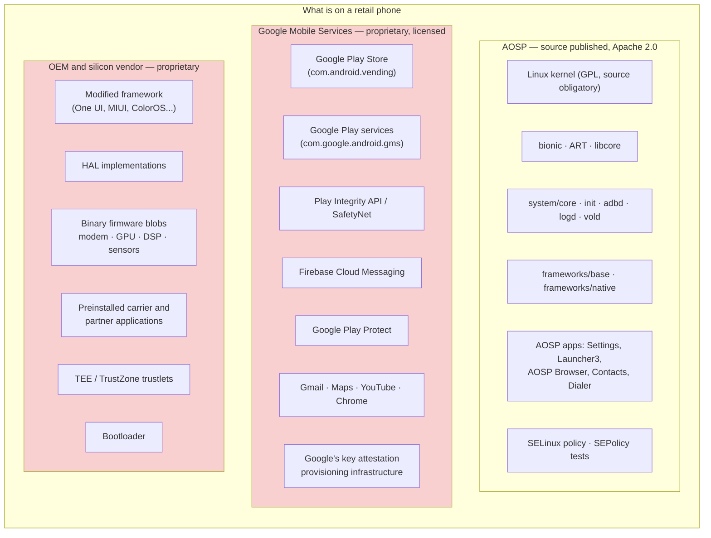

The two red boxes are where a very large proportion of real Android vulnerabilities live, and neither is
in AOSP.

| Not in AOSP | What it does | Why it matters to you |
|---|---|---|
| **Google Play services** (`com.google.android.gms`) | A privileged application providing location, auth, push, ads, safety APIs, and a great deal more | Enormous privileged attack surface, no source. Apps depend on it heavily; on an AOSP build without it, those apps fail in ways that look like your tooling is broken. |
| **Google Play Store** (`com.android.vending`) | App distribution and installation | The install path, signature verification policy and update mechanism for almost every app on a retail device |
| **Play Integrity API / SafetyNet Attestation** | Server-verifiable statements about device and app integrity | The control that most anti-root and anti-tamper work is trying to defeat. Closed source, server-evaluated, and the reason client-side bypasses do not help. See [37-RootDetection](../37-RootDetection/README.md). |
| **Google Play Protect** | On-device and cloud malware scanning | Determines whether your test payload survives on a real device |
| **Firebase Cloud Messaging** | Push messaging | An IPC and network path into almost every app |
| **Widevine DRM** | Content protection, with a TEE component | Binary blob; a recurring source of high-severity issues |
| **OEM framework modifications** | Whole subsystems replaced or extended | Apache 2.0 means no publication obligation. Where OEM-specific privilege escalations live. |
| **Vendor HALs and firmware** | Camera, modem, GPU, DSP, sensors, fingerprint | The single largest source of device-specific critical vulnerabilities |
| **TEE trustlets** | Keystore backing, DRM, biometrics matching | See [50-HardwareBackedSecurity](../50-HardwareBackedSecurity/README.md) |
| **Bootloader** | Verified boot chain root | Unlocking behaviour, rollback protection |
| **GTS (Google Test Suite)** | Tests GMS behaviour for licensing | Not published; CTS is |

> **⚠️ Warning**
> A self-built AOSP image or the AOSP emulator has **no Google Play services**. Consequences you will hit
> within the first hour:
> - Many applications crash on launch or show "Google Play services is required".
> - Any code path calling `GoogleApiAvailability`, `FirebaseApp.initializeApp`, `SafetyNet` or
>   `IntegrityManager` behaves differently — usually failing, sometimes failing *open*.
> - Root-detection and integrity checks may pass trivially, because the component that would have caught
>   you is not installed. **This makes an AOSP build a poor place to conclude that a bypass works.**
>
> Develop on AOSP because you can read and patch it; **confirm on a retail device with GMS** because
> that is what the user has. Reporting a bypass validated only on a GMS-less emulator is a common and
> avoidable mistake.

### 1.6 What would break without AOSP

Run the counterfactual, because it clarifies what AOSP actually buys the security community.

- **Every hooking framework.** Frida's ART bridge, Xposed and LSPosed all depend on knowing
  `ArtMethod`'s layout and where entry points live. That knowledge comes from reading `art/`. Without
  source, each would be a reverse-engineering project per Android version per vendor.
- **Every Binder tool.** Understanding transaction encoding, `IBinder` interface descriptors and the
  `ioctl` protocol comes from `frameworks/native/libs/binder/` and `drivers/android/binder.c`.
- **Half of all public Android vulnerability research.** You cannot audit what you cannot read. The
  volume of published Android research tracks the availability of source almost exactly: abundant for
  the framework and media stack, sparse for vendor blobs.
- **Meaningful patch verification.** When a bulletin says an issue is fixed, the fix is a public commit.
  You can read it, understand the bug class, and check whether a device actually has it.
- **Custom ROMs and the entire modding ecosystem**, including the userdebug images that make research
  practical.

### 1.7 How to use this chapter

Sections 3.5 through 3.9 and the whole of section 4 are the core. They teach one skill — **following a
call from an API you know down to the code that enforces something** — and they teach it three times, on
three different traces, with real paths. If you are short of time, read those and come back for the rest.

---

## 2. High-Level Architecture

### 2.1 AOSP as a set of layers, mapped to directories

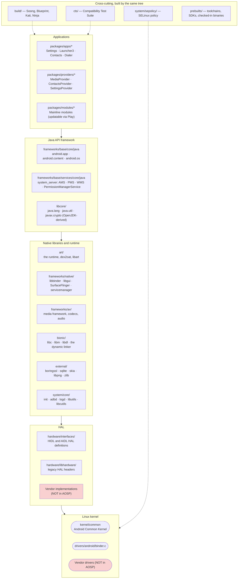

Read this as the answer to "where do I look?". If your question is about an application's behaviour,
start at `packages/`. If it is about an API's contract, start at `frameworks/base/core/java/`. If it is
about *enforcement* — a permission, a UID check, a caller identity — start at
`frameworks/base/services/core/java/com/android/server/`, because that is where `system_server` lives
and `system_server` is where nearly all enforcement happens. If it is about memory layout or a syscall,
go to `bionic/` and the kernel.

The two red boxes are the parts a vendor supplies. When a trace bottoms out in a HAL interface, you have
reached the edge of what you can read, and the next step is a binary.

### 2.2 How the ~1000 repositories become one tree

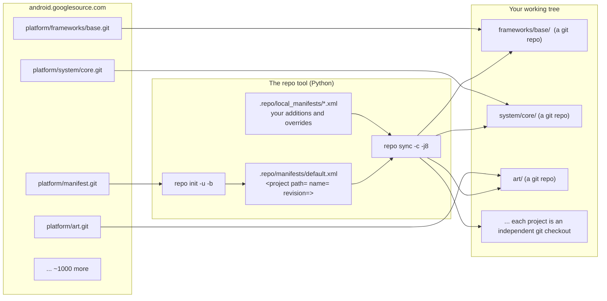

What the reader is looking at: `repo` is not a version-control system. It is a Python program that reads
an XML **manifest** listing every project, its remote, its path in the tree and its revision, and then
runs `git` once per project. Every directory in your checkout is an ordinary git repository — you can
`git log`, `git blame` and `git show` inside any of them, and you should.

Three consequences that matter:

1. **`revision` in the manifest may be a branch name or a commit SHA.** A branch name is *mutable*: two
   syncs a week apart give you different code. `repo manifest -r -o pinned.xml` produces a manifest with
   every project pinned to the exact SHA you currently have, which is how you make a build reproducible
   and how you record what you actually tested.
2. **`local_manifests/` lets anyone add projects to the tree**, including from remotes that are not
   Google's. On a vendor tree this is worth reading carefully; see section 5.
3. **`repo forall` runs a command in every project**, which is how you search or patch across the whole
   tree.

### 2.3 The trust boundaries visible in the source tree

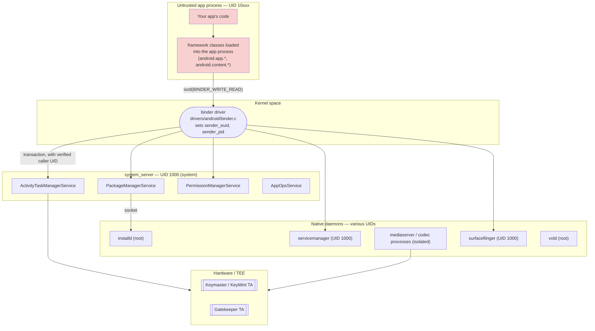

The critical detail, and the reason so many traces in this chapter end at the same place: the framework
classes running inside your app's process are **not** a security boundary. `Context.startActivity()`,
`Context.checkSelfPermission()` and every other framework API you call in-process are running with your
UID, in memory you control, and can be patched by anyone with code execution in your process.

The boundary is the **binder driver**, because the kernel — not the caller — stamps each transaction
with the sender's UID and PID. `system_server` reads that stamped identity through
`Binder.getCallingUid()` and makes its decision on the far side of the boundary. That is why a real
permission check always happens in `system_server` and never in the app process, and why "I hooked
`checkSelfPermission` and it returned GRANTED" does not grant you anything.

> **🧠 Mental Model**
> Every framework API is a *receptionist*, and `system_server` is the *vault*. Hooking the receptionist
> changes what you are told. It does not change what is in the vault, because the vault does not ask the
> receptionist who you are — it asks the building's access-control system, which the kernel operates.
> Section 4.3 traces this exactly.

### 2.4 Where a released device diverges from AOSP

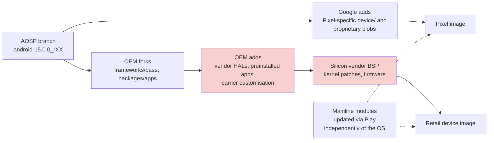

The practical reading: when you find behaviour on a client's device that does not match the AOSP source
you just read, the difference is in one of the red boxes, and identifying which one is the first step of
the investigation. Mainline complicates it further — a component such as ART, the media codecs, DNS
resolver or the permission controller may be a *newer* version than the platform release, delivered
through Google Play System Updates. Recording the module versions alongside the Android version is part
of a competent test report. See [13-ART](../13-ART/README.md) for the ART Mainline module specifically.

---

## 3. Deep Internal Working

### 3.1 What / why / when / where / how

**What AOSP is, mechanically.** About a thousand git repositories, roughly 100 GB checked out, containing
somewhere over a hundred thousand source files in C, C++, Java, Kotlin, Rust, Go, assembly, AIDL, XML,
SELinux policy and shell. It is assembled by `repo`, built by Soong and Ninja (see
[08-Build-System](../08-Build-System/README.md)), and produces a set of partition images.

**Why it is structured as many repositories rather than one.** Different components have different
owners, different release cadences and different licences. `external/` alone contains hundreds of
upstream projects that must be updateable independently. A monorepo would make every upstream merge a
tree-wide event.

**When you interact with it.** Constantly, in three modes, and knowing which mode you are in saves time:
- **Reading only** (95% of the time) — via `cs.android.com`, no checkout required.
- **Reading with a local checkout** — when you need `git log`, `git blame`, cross-file grep, or a branch
  that Code Search does not index well.
- **Building and modifying** — when you need to change behaviour, add instrumentation, or produce a
  research device.

**Where it lives.** Canonically at `https://android.googlesource.com/`. Mirrored on GitHub under the
`aosp-mirror` organisation, which is convenient for GitHub's own search and blame UI. Browsable and
searchable at `https://cs.android.com/`.

**How it is versioned.** Branches such as `android-15.0.0_r1`, `android14-release`, and a rolling
development branch (`main`, historically `master`). Tags mark release points. Each monthly security
bulletin lists the specific commits that fix each issue, which is how you verify a patch.

### 3.2 The `repo` tool and manifests

> **📖 Definition**
> **`repo`** is a Python script that manages many git repositories as one logical tree. It does not
> replace git; it drives it. A **manifest** is an XML file that tells `repo` which projects exist, where
> to fetch each from, where to place it, and which revision to check out.

#### A manifest, dissected

```xml
<!-- .repo/manifests/default.xml — the shape of a real manifest -->
<manifest>
  <!-- Where projects are fetched from. There can be several. -->
  <remote name="aosp"
          fetch="https://android.googlesource.com/"
          review="https://android-review.googlesource.com/" />

  <!-- Defaults applied to every <project> that does not override them. -->
  <default revision="refs/tags/android-15.0.0_r1"
           remote="aosp"
           sync-j="4" />

  <!-- One entry per repository. `name` is the path on the server;
       `path` is where it lands in your tree. -->
  <project path="frameworks/base"   name="platform/frameworks/base"
           groups="pdk-fs" />
  <project path="system/core"       name="platform/system/core" />
  <project path="art"               name="platform/art" />

  <!-- A project pinned to an exact commit rather than the default revision. -->
  <project path="external/boringssl" name="platform/external/boringssl"
           revision="a1b2c3d4e5f6a7b8c9d0e1f2a3b4c5d6e7f8a9b0" />

  <!-- Another manifest included wholesale. -->
  <include name="remove-boot-jars.xml" />
</manifest>
```

| Element / attribute | Meaning | Why a security reviewer cares |
|---|---|---|
| `<remote fetch=...>` | A git server | **Any remote other than `android.googlesource.com` is code from a third party.** Enumerate them. |
| `<default revision=...>` | The revision used when a project does not specify one | A branch name is mutable; a tag or SHA is not |
| `<project revision=...>` | Per-project pin | A project pinned to a SHA is reproducible; one on a branch is not |
| `<project path= name=>` | Where it lands versus where it comes from | A `path` under `vendor/` fetched from a non-Google remote is vendor code |
| `<include>` | Another manifest merged in | Follow every one; this is where surprises hide |
| `<remove-project>` / `<extend-project>` | Removes or modifies an inherited project | Used to *replace* an AOSP project with a fork — always worth reading |
| `.repo/local_manifests/*.xml` | Local additions, not from the upstream manifest | On a handed-over tree, read these first |

#### The commands that matter

```bash
# host — initialise a tree at a specific release
repo init -u https://android.googlesource.com/platform/manifest -b android-15.0.0_r1
repo sync -c -j8 --no-tags --no-clone-bundle

# host — what am I actually looking at?
repo info -o | head -20
cat .repo/manifests/default.xml | head -40
ls .repo/local_manifests/ 2>/dev/null       # <-- read these on any tree you were given

# host — PIN the tree: emit a manifest with every project at its exact SHA
repo manifest -r -o pinned-$(date +%F).xml
# Attach this to your report. It is the only precise answer to
# "which source did you test against?"

# host — run a command in every project
repo forall -c 'git log --oneline -1'
repo forall -pc 'git status --short' | head -40

# host — search the whole tree (ripgrep is dramatically faster than grep here)
rg --no-heading -n "checkCallingPermission" frameworks/base/services/ | head -20

# host — start a branch for a patch, in one project
repo start my-instrumentation frameworks/native
```

> **🔍 Pentester's Note**
> When a client hands you a device *and* a source tree, the first three files to read are
> `.repo/manifests/default.xml`, everything in `.repo/local_manifests/`, and the output of
> `repo manifest -r`. Together they answer: which AOSP release is this based on, which projects were
> replaced with forks, which remotes other than Google's supply code, and is any of it on a mutable
> branch. Vendor trees routinely contain projects fetched from a chipset vendor's server on a branch
> name, which means the tree is not reproducible and nobody can say precisely what was built.

### 3.3 The source tree, directory by directory

This is a reference table. Read it once now, and come back to it whenever a trace takes you somewhere
unfamiliar.

| Directory | Contents | Why you go there |
|---|---|---|
| `art/` | The Android Runtime: interpreter, JIT, AOT compiler (`dex2oat`), garbage collector, JNI implementation, hidden-API enforcement | Hooking internals, DEX loading, `ArtMethod`, hidden API. See [13-ART](../13-ART/README.md). |
| `bionic/` | Android's C library, `libm`, `libdl`, and the **dynamic linker** (`bionic/linker/`) | `dlopen` behaviour, namespace isolation, symbol resolution, `LD_PRELOAD` handling, seccomp filter installation |
| `bootable/` | `recovery/`, the recovery mode implementation | Sideload paths, OTA application, factory reset |
| `build/` | Soong (`build/soong/`), Blueprint, Kati, the legacy Make core (`build/make/`), release tooling | See [08-Build-System](../08-Build-System/README.md) |
| `cts/` | Compatibility Test Suite — thousands of tests a device must pass | The most under-used security resource in AOSP. See 3.13. |
| `dalvik/` | Remnants of the Dalvik VM; today mostly `dexdump` and DEX tooling | DEX format tooling. See [12-DEX-Internals](../12-DEX-Internals/README.md). |
| `development/` | Sample apps, developer scripts, `development/tools/` | `development/scripts/stack` for symbolising native crashes |
| `device/` | Per-device configuration: `device/google/cuttlefish/`, `device/google/<codename>/` | `BoardConfig.mk`, device SELinux policy, `init.<board>.rc`, which HALs are used |
| `external/` | Several hundred upstream third-party projects: `boringssl`, `sqlite`, `skia`, `libpng`, `zlib`, `curl`, `libcxx`, `protobuf`, `webp`, `freetype` | Memory-safety bug hunting, and checking whether a device carries a patched or unpatched upstream version |
| `frameworks/av/` | Media framework: `libstagefright`, codecs, audio flinger, camera service | Historically the richest source of remotely reachable Android vulnerabilities |
| `frameworks/base/` | **The Java framework.** `core/java/` (the SDK you call), `services/` (system_server), `core/jni/`, `core/res/` (the platform's `AndroidManifest.xml` and permission definitions) | The single most important directory in this chapter |
| `frameworks/native/` | Native system services and libraries: `libs/binder/`, `libs/gui/`, `services/surfaceflinger/`, `cmds/servicemanager/`, `cmds/dumpsys/` | Binder internals, service registration. See [25-Binder](../25-Binder/README.md). |
| `frameworks/opt/` | Optional framework components: telephony, net, bitmap, colorpicker | Telephony and carrier behaviour |
| `hardware/interfaces/` | HIDL and stable AIDL **definitions** of every HAL | The contract between the platform and the vendor. The *implementation* is not here. |
| `hardware/libhardware/` | Legacy HAL headers (`hw_get_module`) | Older devices |
| `kernel/` | Android Common Kernel sources, configs and tests (often a separate checkout) | `drivers/android/binder.c`, `drivers/staging/android/ashmem.c`, SELinux LSM |
| `libcore/` | Java core libraries, OpenJDK-derived: `java.lang`, `java.util`, `java.io`, `javax.crypto`, `javax.net.ssl` | TLS behaviour, `X509TrustManager` dispatch, cryptography defaults. See [35-SSL](../35-SSL/README.md). |
| `libnativehelper/` | JNI convenience layer (`JNIHelp.h`, `ScopedLocalRef`) | Reading framework JNI code |
| `packages/apps/` | AOSP applications: `Settings`, `Launcher3`, `Contacts`, `Dialer`, `Messaging`, `DocumentsUI` | How the platform's own privileged apps are written; a model for what "correct" looks like |
| `packages/providers/` | System content providers: `MediaProvider`, `ContactsProvider`, `DownloadProvider`, `SettingsProvider`, `TelephonyProvider` | ContentProvider security patterns. See [27-ContentProviders](../27-ContentProviders/README.md). |
| `packages/modules/` | **Mainline modules**: `Permission`, `DnsResolver`, `NetworkStack`, `adb`, `Wifi`, `Bluetooth`, `MediaProvider`, `StatsD` | Components that update via Play independently of the OS release |
| `packages/services/` | `Telephony`, `Telecomm`, `Car` | |
| `platform_testing/` | Test infrastructure, `libraries/` | |
| `prebuilts/` | Checked-in binaries: `clang/`, `jdk/`, `build-tools/`, `sdk/` (every `android.jar` ever released), `misc/` | `prebuilts/sdk/<api>/public/android.jar` is the SDK stub jar — see 3.10 |
| `sdk/` | SDK-related tooling | |
| `system/apex/` | APEX container tooling | Mainline packaging |
| `system/bt/` or `packages/modules/Bluetooth/` | Bluetooth stack (moved to a module in recent releases) | A large, historically vulnerable, remotely reachable parser surface |
| `system/core/` | `init/` (the first user-space process), `adb/`, `logd/`, `libutils/`, `libcutils/`, `fs_mgr/`, `libsparse/`, `debuggerd/`, `run-as/` | `init.rc` semantics, `adbd` authentication, `run-as` behaviour, tombstone generation |
| `system/netd/` | Network daemon: routing, DNS, firewall rules | Per-UID network policy |
| `system/security/` | `keystore/` and `keystore2/`, `identity/` | See [49-KeyStore](../49-KeyStore/README.md) |
| `system/sepolicy/` | SELinux policy source: `public/`, `private/`, `vendor/`, plus `file_contexts`, `service_contexts`, `seapp_contexts` | See [22-SELinux](../22-SELinux/README.md) |
| `system/vold/` | Volume daemon: storage mounting, FBE/FDE encryption | Storage encryption behaviour. See [33-Storage](../33-Storage/README.md). |
| `test/` | VTS (Vendor Test Suite) and related harnesses | Treble conformance |
| `tools/` | Miscellaneous host tooling | |

Inside `frameworks/base/`, which you will use more than everything else combined:

| Path | Contents |
|---|---|
| `frameworks/base/core/java/android/` | The public SDK's implementation: `app/`, `content/`, `os/`, `view/`, `widget/`, `net/`, `permission/`, `provider/` |
| `frameworks/base/core/java/com/android/internal/` | Internal framework classes — not in the SDK, frequently the interesting ones |
| `frameworks/base/core/jni/` | JNI implementations backing framework classes (`android_util_Binder.cpp`, `android_os_Process.cpp`) |
| `frameworks/base/core/res/AndroidManifest.xml` | **The definition of every platform permission**, with its `protectionLevel` |
| `frameworks/base/core/res/res/values/config.xml` | Hundreds of platform behaviour switches an OEM may override |
| `frameworks/base/services/core/java/com/android/server/` | `system_server`: `am/` (ActivityManager), `wm/` (WindowManager and ActivityTaskManager), `pm/` (PackageManager, permissions), `policy/`, `notification/` |
| `frameworks/base/services/java/com/android/server/SystemServer.java` | The list of every system service and the order they start in |
| `frameworks/base/apex/` | Framework-side Mainline module code |
| `frameworks/base/core/api/current.txt` | The machine-readable public API surface (see 3.10) |
| `frameworks/base/boot/hiddenapi/` | Hidden-API list inputs (path varies by release) |

> **🔍 Pentester's Note**
> `frameworks/base/core/res/AndroidManifest.xml` deserves to be bookmarked. It contains every
> platform-defined permission with its exact `protectionLevel` — `normal`, `dangerous`, `signature`,
> `signature|privileged`, `signature|appop`, and the modifier flags. When you need to know whether a
> permission an app requests is actually obtainable by a third-party app, this file is the authority,
> and it is faster and more accurate than the developer documentation. It also shows you permissions
> that exist but are undocumented.

### 3.4 Reading AOSP effectively — the method

This section is the heart of the chapter. Everything else supports it.

The skill is not "knowing where things are". Nobody knows where things are. The skill is a **repeatable
procedure for finding out**, which works even in a subsystem you have never seen.

#### The procedure

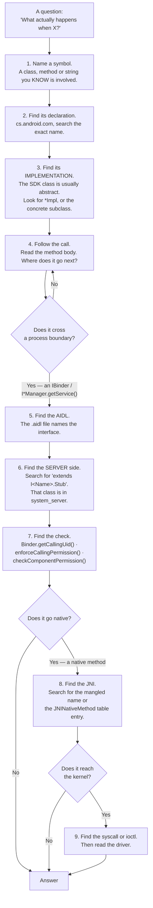

The single most useful step is **6**. Almost every interesting Android security question ends at "who
checks, and what do they check?", and the answer is always a class in `system_server` that extends a
generated `Stub`. Learning to jump straight there — search for `extends IFoo.Stub` — collapses most
investigations from an hour to five minutes.

#### Android Code Search: `cs.android.com`

This is the tool. Learn its query syntax and you will rarely need a local checkout for reading.

| Query | Effect |
|---|---|
| `ActivityTaskManagerService` | Free-text search across all indexed AOSP |
| `class:ActivityStarter` | Only class declarations |
| `function:executeRequest` | Only function/method declarations |
| `symbol:checkCallingPermission` | Declarations and references of a symbol, with a "references" panel |
| `file:ActivityStarter.java` | Restrict to a filename |
| `path:frameworks/base/services` | Restrict to a path prefix |
| `lang:java`, `lang:cpp`, `lang:aidl`, `lang:rust` | Restrict by language |
| `content:"getCallingUid"` | Literal content match |
| `case:yes` | Case-sensitive |
| `-path:test` | Exclude a path — essential, because tests dominate naive results |
| `\bstartActivity\b` (regex) | Regular expressions are supported |

Combine them:

```
# Where is the permission for starting an activity actually enforced?
path:frameworks/base/services/core symbol:checkStartAnyActivityPermission

# Every place in system_server that reads the caller's UID
path:frameworks/base/services content:"Binder.getCallingUid()" -path:test

# Every AIDL interface the framework defines
path:frameworks/base lang:aidl

# The definition of a permission
file:core/res/AndroidManifest.xml content:"READ_EXTERNAL_STORAGE"
```

Three features of the UI that are worth knowing:

- **Cross-references.** Click any symbol and Code Search shows every definition and every reference,
  across the whole tree, in every language. This is the feature that makes it better than grep.
- **The branch selector.** Top right. AOSP's `main` branch is the default; switch to a release branch
  when you are reasoning about a shipped device. Behaviour differs.
- **Blame and history.** Every line links to the commit that introduced it. `git blame` in a browser.
  Reading the commit message that introduced a check is often the fastest way to understand *why* it
  exists — and reading the one that changed it tells you what the previous behaviour was, which is
  frequently the vulnerability.

> **🔬 Under the Hood**
> Code Search indexes far more than `platform/`. Chromium, the kernel, and several other Google-published
> trees are searchable from the same UI via the project selector. For Android work the two you will use
> are the platform superproject and the kernel, and being able to jump from `IPCThreadState.cpp` to
> `drivers/android/binder.c` in the same tool is exactly what makes the traces in section 4 practical.

#### When you need a local checkout instead

| Task | Why the browser is not enough |
|---|---|
| `git log -S "someString"` | Find the commit that introduced or removed a string |
| `git blame -L 100,150 file` on an old branch | Code Search's blame is excellent but branch coverage varies |
| Cross-file structural search with `rg` and context | Complex multi-pattern searches |
| Diffing two releases | `git diff android-14.0.0_r1..android-15.0.0_r1 -- <path>` |
| Anything in a vendor tree | Not indexed anywhere |
| Building | Obviously |

```bash
# host — the searches that pay for a local checkout
rg -n "extends I[A-Za-z]+\.Stub" frameworks/base/services/core/java | head -40
rg -n "enforceCallingOrSelfPermission" frameworks/base/services/core/java | wc -l
git -C frameworks/base log --oneline -S "checkStartAnyActivityPermission" | head
git -C frameworks/base diff android-14.0.0_r1..android-15.0.0_r1 -- \
    services/core/java/com/android/server/pm/permission/ | head -100
```

#### Reading conventions you must know

| Convention | Meaning |
|---|---|
| `IFoo.aidl` | An AIDL interface definition. The build generates `IFoo.java` containing `IFoo.Stub` (server base class) and `IFoo.Stub.Proxy` (client side). |
| `class FooService extends IFoo.Stub` | **The server implementation.** Almost always in `system_server`. This is where enforcement happens. |
| `Foo` (abstract, in `android.content`/`android.app`) with `FooImpl` | The public API is abstract; `ContextImpl`, `SharedPreferencesImpl` etc. are the real implementations |
| `FooManager` in `core/java/` | The client-side wrapper an app talks to. It holds an `IFoo` proxy. |
| `FooManagerService` in `services/core/java/` | The server. `FooManager` → Binder → `FooManagerService`. |
| `@hide` | Excluded from the public SDK by the documentation tool. See 3.10. |
| `@SystemApi`, `@TestApi`, `@UnsupportedAppUsage` | See 3.10 and 3.11. |
| `native` method in Java | Implemented in `frameworks/base/core/jni/` or in the module's own JNI directory |
| `Binder.getCallingUid()` / `getCallingPid()` | **The caller's identity, as stamped by the kernel.** Where every real check begins. |
| `Binder.clearCallingIdentity()` / `restoreCallingIdentity()` | The server temporarily acts as itself rather than the caller. **A missing `restore`, or a check performed after a `clear`, is a classic confused-deputy bug.** |
| `enforceCallingPermission` / `checkCallingPermission` | `enforce*` throws `SecurityException`; `check*` returns a value the caller might ignore |
| `SystemProperties.get("ro.…")` | A read-only system property, set at build time |
| `Slog` vs `Log` | `Slog` is the system-server logging class |

> **⚠️ Warning**
> `checkCallingPermission` returns an `int`; `enforceCallingPermission` throws. A service that calls
> `check*` and then ignores or mishandles the result has a permission bypass. When you audit an OEM's
> added system service, grep for `checkCallingPermission` and read what happens to every return value.
> This is one of the highest-yield patterns in framework auditing, and it is invisible from the app side.

### 3.5 The `system_server` map

Most traces end here, so it is worth having the map in advance.

> **📖 Definition**
> **`system_server`** is a single process, forked from Zygote at boot, running as UID 1000 (`system`),
> that hosts almost every framework service: ActivityManager, PackageManager, WindowManager,
> PowerManager, NotificationManager, and dozens more. It is the most privileged Java process on the
> device, and it is the far side of nearly every Binder call an app makes.

```bash
# adb shell — see it, and see every service it hosts
ps -A | grep system_server
service list | head -40
dumpsys -l | head -40
```

`frameworks/base/services/java/com/android/server/SystemServer.java` is the file that starts all of them,
in a defined order, in three phases (`startBootstrapServices`, `startCoreServices`,
`startOtherServices`). Reading that file top to bottom is the fastest way to learn what services exist.

| Service | Class | Directory |
|---|---|---|
| ActivityManager | `ActivityManagerService` | `services/core/java/com/android/server/am/` |
| ActivityTaskManager | `ActivityTaskManagerService` | `services/core/java/com/android/server/wm/` |
| PackageManager | `PackageManagerService` | `services/core/java/com/android/server/pm/` |
| Permissions | `PermissionManagerService` | `services/core/java/com/android/server/pm/permission/` |
| AppOps | `AppOpsService` | `services/core/java/com/android/server/appop/` |
| WindowManager | `WindowManagerService` | `services/core/java/com/android/server/wm/` |
| Notifications | `NotificationManagerService` | `services/core/java/com/android/server/notification/` |
| Power | `PowerManagerService` | `services/core/java/com/android/server/power/` |
| Storage | `StorageManagerService` | `services/core/java/com/android/server/` |
| Location | `LocationManagerService` | `services/core/java/com/android/server/location/` |
| Clipboard | `ClipboardService` | `services/core/java/com/android/server/` |
| Media projection | `MediaProjectionManagerService` | `services/core/java/com/android/server/media/projection/` |

> **🔍 Pentester's Note**
> `dumpsys` on a device and `SystemServer.java` in the source are two views of the same list. When you
> find a service on a client's device that is **not** in `SystemServer.java` for the corresponding AOSP
> release, you have found an OEM addition — code written by the manufacturer, running as UID 1000,
> reachable over Binder, and never reviewed by Google. That is one of the most reliably productive
> starting points in OEM device testing:
> ```bash
> # adb shell — list every registered service
> service list > /sdcard/services.txt
> ```
> Diff it against a Pixel or emulator of the same release. Everything extra is vendor code.

### 3.6 AIDL, and why every trace goes through it

> **📖 Definition**
> **AIDL** (Android Interface Definition Language) is a small language for declaring an interface that
> can be called across process boundaries. The build system generates, from one `.aidl` file, both the
> client-side proxy that marshals arguments into a `Parcel` and sends a Binder transaction, and the
> server-side stub that unmarshals them and dispatches to your implementation.

```java
// frameworks/base/core/java/android/app/IActivityTaskManager.aidl — shape of a real declaration
interface IActivityTaskManager {
    int startActivity(in IApplicationThread caller, in String callingPackage,
            in String callingFeatureId, in Intent intent, in String resolvedType,
            in IBinder resultTo, in String resultWho, int requestCode,
            int flags, in ProfilerInfo profilerInfo, in Bundle options);
    // ... many more
}
```

From this the build generates `IActivityTaskManager.java` containing:

- `IActivityTaskManager.Stub` — an abstract class extending `Binder`, with `onTransact()` that switches
  on a transaction code and calls the corresponding abstract method. **`system_server`'s
  `ActivityTaskManagerService extends IActivityTaskManager.Stub`.**
- `IActivityTaskManager.Stub.Proxy` — the client side, which writes arguments into a `Parcel` and calls
  `mRemote.transact(TRANSACTION_startActivity, data, reply, 0)`.

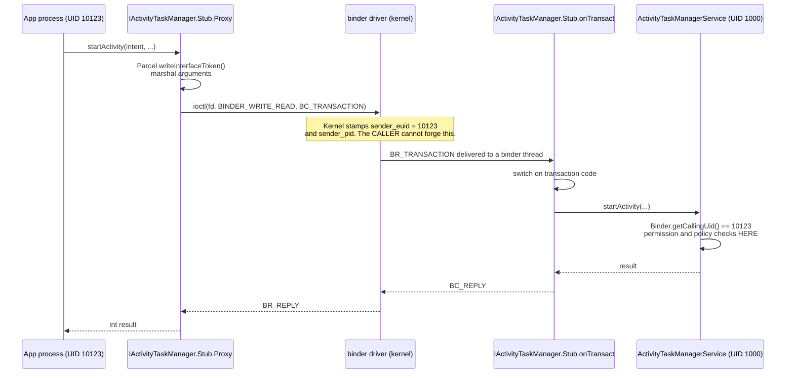

The annotated step is the whole point. `sender_euid` is written by the kernel from the sending task's
credentials. No amount of manipulation in the calling process changes it. That is why the security
architecture places every decision on the far side of this line, and why in-process hooks change what an
app *believes* rather than what it *may do*.

See [25-Binder](../25-Binder/README.md) for the transaction format in full and
[24-IPC](../24-IPC/README.md) for the wider picture.

### 3.7 `@hide`, `@SystemApi`, `@TestApi` and the SDK stubs

New readers are constantly confused by finding a method in AOSP that does not exist in Android Studio.
This section resolves that completely.

> **📖 Definition**
> The **SDK stubs** are the `android.jar` you compile against. It is **not** the framework. It is a
> generated jar containing every public class and method signature, with bodies that throw
> `RuntimeException("Stub!")`. At runtime, the real implementation is loaded from the device's boot
> classpath. `android.jar` exists purely so `javac` can type-check your code.

```bash
# host — prove it to yourself
cd $ANDROID_HOME/platforms/android-35
unzip -o android.jar -d /tmp/androidjar
javap -c -p -cp /tmp/androidjar android.content.Context | head -20
# Every method body is: throw new RuntimeException("Stub!");
```

The stubs are generated from the framework source by a tool called **metalava**, which reads the source
and its annotations and decides what goes into which surface.

| Annotation | Effect on the SDK | Enforced at runtime? | What it means for you |
|---|---|---|---|
| *(none)* | In the **public** SDK | n/a | Any app can call it |
| `@hide` | **Excluded** from the public SDK | Not by itself — see 3.8 | The method exists at runtime and is callable by reflection, subject to hidden-API enforcement |
| `@SystemApi` | In the **system** SDK (`prebuilts/sdk/<n>/system/android.jar`) | Usually guarded by a `signature` or `signature\|privileged` permission | Available to privileged / platform-signed apps. Where OEM and carrier apps get their power. |
| `@TestApi` | In the **test** SDK | Usually not additionally guarded | Exists for CTS. Frequently the most convenient handle for research. |
| `@SystemApi(client = MODULE_LIBRARIES)` | In the **module-lib** SDK | | For Mainline modules only |
| `@UnsupportedAppUsage` | Not in any SDK | Drives the hidden-API list generation | Marks a hidden member that real apps were observed to use. Its `maxTargetSdk` attribute says until which `targetSdk` it stays usable. |
| `@Deprecated` | Still in the SDK | No | Still works; will eventually change |

The machine-readable record of each surface is checked into the tree:

| File | Surface |
|---|---|
| `frameworks/base/core/api/current.txt` | The public SDK |
| `frameworks/base/core/api/system-current.txt` | `@SystemApi` |
| `frameworks/base/core/api/test-current.txt` | `@TestApi` |
| `frameworks/base/core/api/module-lib-current.txt` | Module libraries |

(The exact location moved from `frameworks/base/api/` to `frameworks/base/core/api/` during the Mainline
refactor; if one path is empty, try the other.)

Any change to a public API must update these files, which is enforced by the build. That makes them an
excellent research artefact: `git log -p frameworks/base/core/api/system-current.txt` is a complete
history of every system API Google has ever added or removed.

> **🔍 Pentester's Note**
> `@SystemApi` is the surface to study when you are testing a **preinstalled or platform-signed
> application** — an OEM app, a carrier app, an MDM agent, a device-owner app. Those apps compile against
> the system SDK and can call things a normal app cannot. When you decompile such an app and find calls
> you do not recognise, search `system-current.txt` for the method name; if it is there, you have found a
> privileged capability, and the next question is what permission gates it and whether that gate can be
> reached from a third-party app through the OEM app's own exported components.

### 3.8 The hidden-API blocklist

This is the mechanism that decides whether reflection into `@hide` framework members works, and it
changes what your tooling can do.

#### Why it exists

Before Android 9, `@hide` was a documentation convention with no runtime teeth. Apps used reflection to
call hidden framework methods constantly. That froze the framework: Google could not change an internal
method without breaking popular apps. Android 9 added *runtime* enforcement so that the internal API
surface could evolve.

#### The lists

| Modern name (Android 10+) | Original name (Android 9) | Behaviour |
|---|---|---|
| **SDK** | whitelist | Public API. Always allowed. |
| **unsupported** | light greylist | Allowed, but logged, and may break in future |
| **max-target-o / -p / -q / -r / -s …** | dark greylist | Allowed **only** if the app's `targetSdk` is at or below the named level. Blocked above it. |
| **blocked** | blacklist | Always denied |

The lists are generated at build time from `@UnsupportedAppUsage` annotations and explicit input files,
and the resulting flags are embedded in the boot classpath DEX metadata.

#### How enforcement works

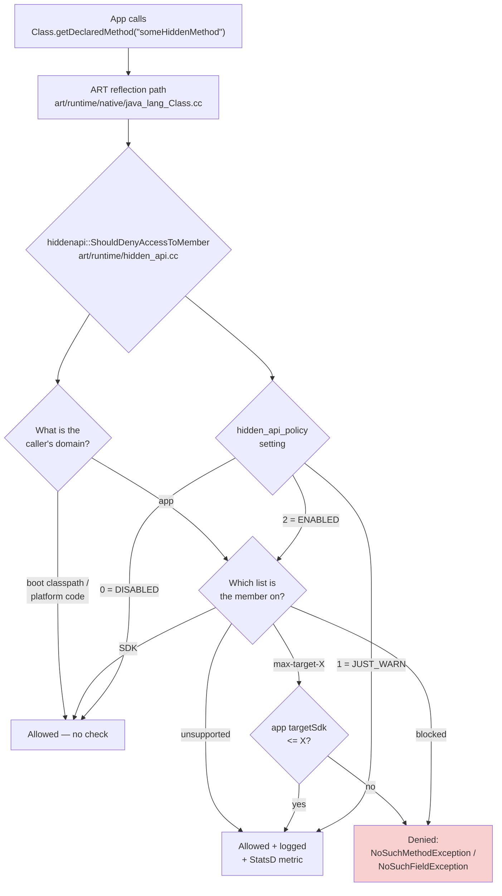

Key implementation points, all of which have practical consequences:

- The check lives in `art/runtime/hidden_api.h` and `art/runtime/hidden_api.cc`.
- It is applied on the **reflection** and **JNI** lookup paths — `Class.getDeclaredMethod`,
  `Class.getDeclaredField`, `Method.invoke`, `JNIEnv::GetMethodID`, `JNIEnv::GetFieldID` — not on direct
  bytecode `invoke-virtual` from boot-classpath callers.
- The caller's *domain* is what matters. Code loaded from the boot classpath or from a platform-signed
  location is exempt. This is why a bypass that makes ART believe the caller is platform code works.
- A denied access throws the ordinary reflection exception, which means an app that fails silently on a
  hidden-API denial can look like a completely unrelated bug.

#### Relaxing it for research

```bash
# adb shell — the switch. This is the single most useful setting for framework research.
settings put global hidden_api_policy 1        # JUST_WARN: allowed, logged
settings put global hidden_api_policy 0        # DISABLED: no enforcement at all
settings put global hidden_api_policy 2        # ENABLED: full enforcement (the default behaviour)
settings delete global hidden_api_policy       # back to the platform default

# adb shell — confirm
settings get global hidden_api_policy

# adb shell — see the denials while they happen
logcat -s "HiddenApi" &
# or, more broadly
logcat | grep -i "Accessing hidden"
```

```bash
# host — for instrumentation runs specifically, without changing a global setting
adb shell am instrument --no-hidden-api-checks -w com.example.test/androidx.test.runner.AndroidJUnitRunner
```

> **🔍 Pentester's Note**
> Three things to hold onto:
> 1. **The `adb shell` user holds `WRITE_SECURE_SETTINGS`**, so `settings put global hidden_api_policy`
>    works on ordinary retail devices over USB — you do not need root, and you do not need a userdebug
>    build. This surprises people.
> 2. **It is global and it persists across reboots.** Set it at the start of an engagement, and
>    `settings delete global hidden_api_policy` when you hand the device back, because you have changed
>    the platform's behaviour for every app on it.
> 3. **It changes the app's behaviour, so record it.** If an app's anti-tamper logic depends on a hidden
>    API failing, relaxing the policy alters your results. Note the policy value in your evidence,
>    exactly as you would note the Android version.

### 3.9 Building AOSP

Full command sequences, prerequisites and troubleshooting are in
[08-Build-System §3.1](../08-Build-System/README.md#31-what-the-platform-build-is-actually-doing) and in
[Lab 02](labs/lab-02-build-and-boot-aosp.md) of this chapter. What follows is the *security* reading of
the process.

#### The sequence

```bash
# host — from the root of a synced tree
source build/envsetup.sh
lunch aosp_cf_x86_64_phone-trunk_staging-userdebug
m -j$(nproc)
launch_cvd --daemon        # Cuttlefish: a virtual reference device that boots on your workstation
```

| Step | What it does |
|---|---|
| `source build/envsetup.sh` | Defines `lunch`, `m`, `mm`, `mma`, `croot`, `hmm`. Nothing is built. |
| `lunch <product>-<release>-<variant>` | Sets `TARGET_PRODUCT`, `TARGET_RELEASE`, `TARGET_BUILD_VARIANT` and dozens more environment variables |
| `m` | Runs Soong over every `Android.bp`, Kati over every `Android.mk`, concatenates the Ninja files, and runs Ninja |

#### Choosing a target

| Target | What it is | When to use it |
|---|---|---|
| `aosp_cf_x86_64_phone` | **Cuttlefish** — a virtual device that runs on your workstation, fully supported, boots the real system image | The default choice for research. No hardware needed. |
| `sdk_phone64_x86_64` / `sdk_phone_x86_64` | The emulator system image | Quick testing with the standard Android Emulator |
| `aosp_<codename>` (e.g. `aosp_husky`) | A real Pixel device | When you need real hardware, real HALs, real TEE |
| `aosp_arm64` | Generic ARM64 | GSI-style images |

#### The variant is the security decision

| Variant | `ro.debuggable` | `ro.secure` | `adb root` | SELinux | Use |
|---|---|---|---|---|---|
| `user` | 0 | 1 | Refused | Enforcing | What ships to customers |
| `userdebug` | 1 | 1 | Allowed | Enforcing | **What you want** |
| `eng` | 1 | 0 | Allowed, `adbd` may run as root | Often permissive | Development only |

> **🔬 Under the Hood — why a self-built `userdebug` image is the best Android lab you can have**
>
> Every other lab setup involves a compromise. A rooted retail phone gives you privilege but not source,
> and Magisk changes the system in ways that interact with what you are testing. A stock emulator gives
> you convenience but a `user`-like surface and no ability to change the framework. A `userdebug` image
> you built yourself gives you, simultaneously:
>
> - **`adb root`, `adb remount`, and a writable `/system`** — no Magisk, no bootloader tricks, no
>   third-party code in your trusted computing base.
> - **The complete source of everything running**, matched exactly to the binary, because you built it.
> - **Unstripped binaries with full symbols** in `out/target/product/<device>/symbols/`, so Ghidra and
>   `gdb` work properly on the same binaries the device is running.
> - **The ability to change the operating system.** Add a log line to `IPCThreadState::transact` and you
>   have a system-wide Binder tracer that no app can detect or disable, because it is in the platform.
> - **`m snod`**, which repacks `system.img` from `out/` in under a minute, giving a
>   patch-build-flash-test loop measured in minutes rather than hours.
> - **SELinux still enforcing**, so what you observe is representative rather than an artefact of a
>   disabled control.
> - **Determinism.** You can rebuild the exact same image next month and re-run the experiment.
>
> The one thing it does not give you is GMS, which is precisely the caveat in section 1.5. The mature
> workflow is: **understand and develop on userdebug AOSP; confirm on a retail device.**

#### The output tree

| Path | Contents |
|---|---|
| `out/soong/build.ninja` | The generated build graph |
| `out/soong/soong.variables` | The entire product configuration as JSON — read this first on an unfamiliar tree |
| `out/target/product/<device>/*.img` | The partition images |
| `out/target/product/<device>/system/` | Everything that will be in `system.img` |
| `out/target/product/<device>/symbols/` | **Unstripped copies of every native binary and library** |
| `out/target/product/<device>/installed-files.txt` | A complete inventory of the image |
| `out/target/product/<device>/module-info.json` | Module name → installed path, source directory, class |
| `out/target/product/<device>/obj/` | Intermediates, including unstripped objects |

> **🔍 Pentester's Note**
> `symbols/` and `module-info.json` are the two artefacts to ask for whenever a client gives you a
> device *and* has a build tree. `symbols/` lets you apply full symbol tables to the stripped binaries
> on the device, which turns weeks of native reversing into an afternoon.
> `module-info.json` answers "where does `/system/bin/foo` come from?" instantly, which is otherwise a
> genuinely hard question on an unfamiliar image.

### 3.10 Patching AOSP for research

This is the capability that separates reading the platform from *owning* it. Three patterns cover most
needs.

#### Pattern 1 — system-wide Binder transaction logging

Every Binder call on the device, from every process, logged by the platform itself. No app can detect or
disable it, because it is not in the app.

```cpp
// frameworks/native/libs/binder/IPCThreadState.cpp — inside IPCThreadState::transact
// Add near the top of transact(), after the arguments are available.
#include <android-base/logging.h>

status_t IPCThreadState::transact(int32_t handle, uint32_t code,
                                  const Parcel& data, Parcel* reply, uint32_t flags)
{
    // ---- RESEARCH INSTRUMENTATION ----------------------------------------
    // Log every outbound transaction with its handle, code, size and caller.
    // Keep it cheap: this runs on every IPC on the device.
    ALOGI("BINDER_TRACE pid=%d uid=%d handle=%d code=%u size=%zu flags=%u",
          getpid(), getuid(), handle, code, data.dataSize(), flags);
    // ----------------------------------------------------------------------

    // ... existing implementation
}
```

```bash
# host
m libbinder && m snod
# reflash, then:
adb logcat -s BINDER_TRACE
```

For the Java side, the equivalent hook is `Binder.execTransact` in
`frameworks/base/core/java/android/os/Binder.java`, which is where every *incoming* Java Binder call
lands and where you can log the interface descriptor and transaction code with the calling UID already
available from `Binder.getCallingUid()`.

#### Pattern 2 — logging every permission decision

```java
// frameworks/base/services/core/java/com/android/server/pm/permission/PermissionManagerServiceImpl.java
// (class and file names have moved between releases — find the current one with:
//    cs.android.com  path:services/core/java/com/android/server/pm/permission function:checkPermission )
//
// Inside the method that returns the final grant decision:
int result = /* ... existing decision ... */;
Slog.i("PERM_TRACE", "checkPermission perm=" + permName
        + " pkg=" + packageName
        + " uid=" + Binder.getCallingUid()
        + " pid=" + Binder.getCallingPid()
        + " result=" + (result == PackageManager.PERMISSION_GRANTED ? "GRANTED" : "DENIED"));
return result;
```

This turns a black-box question ("which permission actually blocked this?") into a log line, and it is
the fastest way to understand an unfamiliar OEM's permission customisations.

#### Pattern 3 — relaxing a check to isolate it

To test whether a specific check is what is stopping you, comment it out, rebuild, and observe. This is
a *diagnostic*, not a finding — but it converts "something is blocking me" into "this exact line is
blocking me", which is the difference between a guess and an explanation.

```bash
# host — the loop
vim frameworks/base/services/core/java/com/android/server/wm/ActivityStarter.java
m services              # rebuild just services.jar
m snod                  # repack system.img in under a minute
stop_cvd && launch_cvd --daemon
```

> **⚠️ Warning**
> A patched platform is a **research instrument**, not evidence. Any finding you demonstrate on a
> modified image must be reproduced on an unmodified one before it goes in a report, and your report
> must say which image each piece of evidence came from. The failure mode is embarrassing and common:
> a "vulnerability" that only exists because a check was commented out three weeks earlier and forgotten.

Other useful patches, each a one-liner once you know where to look:

| Goal | Where |
|---|---|
| Log every `dlopen` | `bionic/linker/linker.cpp` |
| Log every `Intent` delivered | `frameworks/base/services/core/java/com/android/server/am/ActivityManagerService.java` broadcast paths |
| Log every file opened by an app | `bionic/libc/bionic/open.cpp`, or use `strace` instead |
| Log every SQLite query | `frameworks/base/core/java/android/database/sqlite/` |
| Disable a specific SELinux denial for a test | Better done with `setenforce 0` on userdebug than by patching policy |
| Log every `KeyStore` operation | `system/security/keystore2/` |

### 3.11 CTS, VTS, GTS and STS

> **📖 Definition**
> The **Compatibility Test Suite (CTS)** is an automated test suite, published in AOSP under `cts/`, that
> a device must pass to be considered Android-compatible. Passing it is a precondition for using the
> Android trademark and for licensing Google Mobile Services.

| Suite | Where | What it tests | Public? |
|---|---|---|---|
| **CTS** | `cts/` in AOSP | API behaviour, permissions, SELinux, crypto, the whole compatibility contract | **Yes** |
| **CTS Verifier** | `cts/apps/CtsVerifier/` | Tests needing human interaction: camera, sensors, biometrics, NFC | Yes |
| **VTS** (Vendor Test Suite) | `test/vts*` | The vendor interface: HAL conformance, kernel configuration, Treble requirements | Yes |
| **STS** (Security Test Suite) | Built on CTS security tests | Whether the device has actually applied specific security bulletin patches | Partly |
| **GTS** (Google Test Suite) | Not in AOSP | GMS behaviour and Google's own requirements | **No** |

Why a security tester should care:

- **CTS encodes security requirements as executable tests.** `cts/tests/tests/security/` contains tests
  for specific historical vulnerability classes. Reading them tells you exactly what behaviour the
  platform guarantees — a much more precise statement than the documentation.
- **A CTS pass is a claim you can check.** If a client asserts their device is compatible, CTS is the
  arbiter, and you can run it.
- **A CTS failure is a finding.** A device failing a *security* CTS test is failing a defined,
  Google-published requirement, which is a far stronger position in a report than "we think this is
  weak".
- **STS answers the patch-level question.** Devices routinely advertise a security patch level in
  `ro.build.version.security_patch` that their actual code does not support. STS-style testing is how
  you check rather than trust.

```bash
# adb shell — the claim
getprop ro.build.version.security_patch
getprop ro.build.fingerprint
getprop ro.vendor.build.security_patch     # vendor partition may lag the system partition badly

# host — running CTS (the suite is large; scope it)
cts-tradefed run commandAndExit cts --module CtsPermissionTestCases
cts-tradefed run commandAndExit cts --module CtsSecurityTestCases
```

> **🔍 Pentester's Note**
> `ro.build.version.security_patch` and `ro.vendor.build.security_patch` differing by many months is
> extremely common and is a legitimate, reportable finding on its own. The system partition gets a
> Mainline-assisted update; the vendor partition — which contains the HALs and the drivers where the
> serious bugs are — often does not. Always read both, and read the kernel version too:
> ```bash
> # adb shell
> uname -a
> cat /proc/version
> ```

### 3.12 Version matrix — what changed when

| Android | API | Change relevant to this chapter |
|---|---|---|
| 5.0 Lollipop | 21 | ART becomes the default runtime; SELinux fully enforcing |
| 6.0 Marshmallow | 23 | Runtime permissions — permission checks move to the app's lifetime, not install |
| 7.0 Nougat | 24 | User CAs no longer trusted by default; `FileUriExposedException` |
| 8.0 Oreo | 26 | **Project Treble**: the vendor interface is versioned and separated. `hardware/interfaces/` HIDL. |
| 9 Pie | 28 | **Hidden-API enforcement introduced.** Non-SDK interfaces restricted. |
| 10 | 29 | Hidden-API lists renamed (unsupported / max-target / blocked). **Mainline modules introduced.** Scoped storage begins. |
| 11 | 30 | Scoped storage enforced. Package visibility (`<queries>`). More components become Mainline. |
| 12 | 31 | `android:exported` mandatory for components with intent filters. `PendingIntent` mutability mandatory. |
| 13 | 33 | Per-app language, granular media permissions, notification permission |
| 14 | 34 | Stricter implicit-intent and dynamic-receiver rules; `minSdk` install floor |
| 15 | 35 | 16 KB page-size support; more Mainline surface |

Behavioural detail for any specific API level is in [06-Android-Architecture](../06-Android-Architecture/README.md)
and [32-Manifest](../32-Manifest/README.md). What matters here is that **the AOSP branch you read must
match the device you are testing**, because every row above changed platform behaviour.

---

## 4. Source Code Walkthrough (AOSP)

Three complete traces. Each one starts at an API you have called, and ends at the code that actually
does the work — in `system_server`, in native code, or in the kernel. Follow along in
[cs.android.com](https://cs.android.com/); every path below is real and every step is one you can
reproduce.

> **⚠️ A note on paths and line numbers**
> Directory and file paths in AOSP are stable over years, and every path below is one you can search for
> today. **Line numbers are not stable and are not given here.** Method names occasionally move between
> classes across releases — where that has happened, the trace says so and gives you the Code Search
> query that finds the current location. Learning the *query* is more valuable than memorising the
> answer, because the query keeps working.

---

### 4.1 Trace A — `Context.startActivity()`, from your code to the kernel and back

The most-called API in Android. Following it end to end teaches the entire IPC architecture.

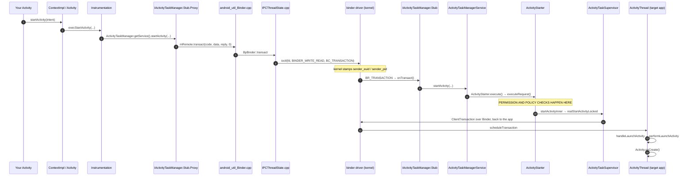

#### Step 1 — the API you called

**File:** `frameworks/base/core/java/android/content/Context.java`

`Context` is **abstract**. `startActivity(Intent)` is declared here with its documentation and nothing
else. This is the first lesson of reading AOSP: *the class named in the SDK is almost never the class
that does the work.*

```java
// frameworks/base/core/java/android/content/Context.java
public abstract void startActivity(@RequiresPermission Intent intent);
```

**Code Search query to get here:** `class:Context path:core/java/android/content`

#### Step 2 — finding the implementation

There are two, and knowing which one applies is important.

**File:** `frameworks/base/core/java/android/app/ContextImpl.java`

`ContextImpl` is the real `Context` behind an `Application`, a `Service`, and a `ContextWrapper`. Its
`startActivity` does one security-relevant thing before delegating: it insists on
`FLAG_ACTIVITY_NEW_TASK` when called from a non-Activity context, because there is no task to place the
activity into.

**File:** `frameworks/base/core/java/android/app/Activity.java`

When you call `startActivity` from an `Activity`, you get `Activity`'s override, which routes through
`startActivityForResult(intent, -1)`. That is why an `Activity`-launched activity participates in the
result mechanism and a `Context`-launched one does not.

**Code Search query:** `function:startActivity path:frameworks/base/core/java/android/app`

#### Step 3 — `Instrumentation`, the last stop in your process

**File:** `frameworks/base/core/java/android/app/Instrumentation.java`
**Method:** `execStartActivity(...)`

This is where the framework leaves your process. The method:

1. Prepares the `Intent` for IPC (`intent.prepareToLeaveProcess(who)`), which is where a
   `file://` URI triggers `FileUriExposedException` on `targetSdk >= 24` — a security check that runs on
   the *sender* side.
2. Calls `ActivityTaskManager.getService().startActivity(...)`.
3. Calls `checkStartActivityResult(result, intent)` on the way back, which is the method that converts
   the numeric error code into `ActivityNotFoundException` or `SecurityException`.

```java
// frameworks/base/core/java/android/app/Instrumentation.java — the shape
public ActivityResult execStartActivity(Context who, IBinder contextThread, IBinder token,
        Activity target, Intent intent, int requestCode, Bundle options) {
    IApplicationThread whoThread = (IApplicationThread) contextThread;
    // ...
    intent.migrateExtraStreamToClipData(who);
    intent.prepareToLeaveProcess(who);
    int result = ActivityTaskManager.getService().startActivity(whoThread,
            who.getOpPackageName(), who.getAttributionTag(), intent,
            intent.resolveTypeIfNeeded(who.getContentResolver()), token,
            target != null ? target.mEmbeddedID : null, requestCode, 0, null, options);
    checkStartActivityResult(result, intent);
    // ...
}
```

> **🔍 Pentester's Note**
> `checkStartActivityResult` is worth reading in full. It is the single function that decides which
> exception your app sees, and its mapping tells you exactly what the system distinguishes:
> `START_INTENT_NOT_RESOLVED` and `START_CLASS_NOT_FOUND` become `ActivityNotFoundException`;
> `START_PERMISSION_DENIED` becomes `SecurityException`; `START_NOT_CURRENT_USER_ACTIVITY` and others
> have their own messages. When you are probing an exported component and want to distinguish "does not
> exist" from "exists but you are not allowed", this is the code that determines what you can observe.

#### Step 4 — getting the Binder proxy

**File:** `frameworks/base/core/java/android/app/ActivityTaskManager.java`
**Method:** `getService()`

```java
// frameworks/base/core/java/android/app/ActivityTaskManager.java — the shape
public static IActivityTaskManager getService() {
    return IActivityTaskManagerSingleton.get();
}

private static final Singleton<IActivityTaskManager> IActivityTaskManagerSingleton =
        new Singleton<IActivityTaskManager>() {
            @Override
            protected IActivityTaskManager create() {
                final IBinder b = ServiceManager.getService(Context.ACTIVITY_TASK_SERVICE);
                return IActivityTaskManager.Stub.asInterface(b);
            }
        };
```

Three things to take from this, because the pattern repeats for **every** system service:

- `ServiceManager.getService("activity_task")` asks the **service manager** — a native daemon at
  `frameworks/native/cmds/servicemanager/` — for a handle to a registered service. That daemon is the
  device's service directory, and `adb shell service list` is a view of it.
- `IActivityTaskManager.Stub.asInterface(binder)` wraps the raw `IBinder` in a generated `Proxy`.
- `Singleton` caches it, so the lookup happens once per process.

**Code Search query for the AIDL:** `file:IActivityTaskManager.aidl`

#### Step 5 — the generated proxy marshals into a `Parcel`

The `Proxy` class is generated by the AIDL compiler at build time and does not exist as a source file in
the tree; you can see it in `out/soong/.intermediates/.../IActivityTaskManager.java` after a build. Its
body is mechanical:

```java
// Generated code — the shape of every AIDL proxy method
@Override public int startActivity(IApplicationThread caller, String callingPackage, /* ... */) {
    Parcel _data = Parcel.obtain();
    Parcel _reply = Parcel.obtain();
    int _result;
    try {
        _data.writeInterfaceToken(DESCRIPTOR);            // "android.app.IActivityTaskManager"
        _data.writeStrongInterface(caller);
        _data.writeString(callingPackage);
        // ... every argument, in declaration order
        boolean _status = mRemote.transact(Stub.TRANSACTION_startActivity, _data, _reply, 0);
        _reply.readException();
        _result = _reply.readInt();
    } finally {
        _reply.recycle();
        _data.recycle();
    }
    return _result;
}
```

> **🔬 Under the Hood**
> `writeInterfaceToken(DESCRIPTOR)` writes the interface's name string into the transaction, and the
> server's `onTransact` calls `enforceInterface(DESCRIPTOR)` to check it. This is a *type-confusion*
> defence, not an authentication one: it stops a caller sending a transaction intended for one interface
> to a binder implementing another, where the same transaction code would mean something entirely
> different. When you are fuzzing Binder interfaces directly, getting this token right is the first
> requirement, and it is why raw `transact()` calls without it are rejected. See
> [25-Binder](../25-Binder/README.md).

#### Step 6 — through JNI into native code

**File:** `frameworks/base/core/jni/android_util_Binder.cpp`

`BinderProxy.transactNative` is the JNI entry point. It converts the Java `Parcel` objects into their
native counterparts and calls `IBinder::transact` on the underlying `BpBinder`.

**File:** `frameworks/native/libs/binder/BpBinder.cpp`
**Method:** `BpBinder::transact`

**File:** `frameworks/native/libs/binder/IPCThreadState.cpp`
**Methods:** `IPCThreadState::transact`, `writeTransactionData`, `waitForResponse`, `talkWithDriver`

`talkWithDriver` is where user space finally touches the kernel:

```cpp
// frameworks/native/libs/binder/IPCThreadState.cpp — the shape of talkWithDriver
binder_write_read bwr;
// ... fill bwr.write_buffer with the BC_TRANSACTION command and the flat_binder_object data
do {
    if (ioctl(mProcess->mDriverFD, BINDER_WRITE_READ, &bwr) >= 0)
        err = NO_ERROR;
    else
        err = -errno;
} while (err == -EINTR);
```

**Code Search query:** `file:IPCThreadState.cpp function:talkWithDriver`

#### Step 7 — the kernel

**File:** `drivers/android/binder.c` (in the kernel tree, not the platform tree)
**Functions:** `binder_ioctl`, `binder_ioctl_write_read`, `binder_thread_write`, `binder_transaction`

`binder_transaction` is where the security-critical work happens. It:

1. Resolves the target handle to a target node and hence a target process.
2. Copies the transaction data into the target process's mapped buffer.
3. **Stamps the sender's identity into the transaction**, from the sending task's credentials — the
   caller cannot influence these values.
4. Translates any `flat_binder_object` references so handles are valid in the receiver's address space.
5. Queues the work on the target and wakes a binder thread there.

```c
/* drivers/android/binder.c — the essential lines, conceptually */
t->sender_euid = task_euid(proc->tsk);   /* from the SENDER's credentials */
t->from = thread;                         /* used for reply routing */
/* ... and the security hook: */
security_binder_transaction(proc->cred, target_proc->cred);  /* SELinux LSM hook */
```

> **🧠 Mental Model**
> This is the *only* place in the whole trace where identity is established, and it is established by
> the kernel from the sending task's credentials — not by anything the sender wrote into the message.
> Everything downstream in `system_server` trusts `Binder.getCallingUid()` precisely because of these
> lines. When someone asks why hooking a permission check in the app process does not grant
> permissions, the answer is this function. When someone asks where Android's app sandbox actually is,
> the answer is here plus the SELinux hook two lines below.

#### Step 8 — arrival in `system_server`

A binder thread in `system_server` returns from its `ioctl` with a `BR_TRANSACTION`, and
`IPCThreadState::executeCommand` dispatches it to `BBinder::transact` → `JavaBBinder::onTransact` →
`Binder.execTransact` in Java → the generated `IActivityTaskManager.Stub.onTransact`, which switches on
the transaction code and calls the real method.

**File:** `frameworks/base/core/java/android/os/Binder.java`
**Method:** `execTransact` — the single funnel through which **every** incoming Java Binder call passes.

> **🔍 Pentester's Note**
> `Binder.execTransact` is the highest-leverage single hook point on the whole device. One Frida hook
> there logs every incoming Binder call to every Java service in a process, with the calling UID and PID
> already available. Section 7 gives the script. It is also, for exactly the same reason, the place to
> patch when you build an instrumented AOSP image.

#### Step 9 — the service, and the checks

**File:** `frameworks/base/services/core/java/com/android/server/wm/ActivityTaskManagerService.java`

```java
// ActivityTaskManagerService extends IActivityTaskManager.Stub
@Override
public int startActivity(IApplicationThread caller, String callingPackage,
        String callingFeatureId, Intent intent, String resolvedType, IBinder resultTo,
        String resultWho, int requestCode, int startFlags, ProfilerInfo profilerInfo,
        Bundle bOptions) {
    return startActivityAsUser(caller, callingPackage, callingFeatureId, intent, resolvedType,
            resultTo, resultWho, requestCode, startFlags, profilerInfo, bOptions,
            UserHandle.getCallingUserId());
}
```

which reaches `ActivityStarter` through `getActivityStartController().obtainStarter(...).execute()`.

**File:** `frameworks/base/services/core/java/com/android/server/wm/ActivityStarter.java`
**Method:** `executeRequest(Request request)`

**This is the destination.** `executeRequest` is where the platform decides whether your `startActivity`
call is permitted. Reading it carefully is one of the most instructive hours you can spend in AOSP.
Among the things it does:

| Check | What it protects |
|---|---|
| `mSupervisor.checkStartAnyActivityPermission(...)` | The `START_ANY_ACTIVITY` signature permission and the target's `exported` / `permission` attributes |
| `ActivityInfo.exported` and the component's `android:permission` | Whether *you* may start *this* component |
| Background activity start (BAL) checks | Whether a background app may launch an activity at all — a major hardening area since Android 10 |
| `abort` from `mInterceptor.intercept(...)` | Work profile, device policy, suspended packages, quiet mode |
| `mService.mAmInternal.checkAppSwitchAllowed()` | App-switch throttling |
| `intent.getFlags()` handling of `FLAG_GRANT_*_URI_PERMISSION` | Transient URI grants; see [27-ContentProviders](../27-ContentProviders/README.md) |
| Caller identity from `Binder.getCallingUid()` / `getCallingPid()` | Everything above |

**Code Search query:** `path:services/core/java/com/android/server/wm function:executeRequest`

#### Step 10 — back to the app

`ActivityStarter` → `ActivityTaskSupervisor.realStartActivityLocked` builds a `ClientTransaction`
containing a `LaunchActivityItem`, and sends it *back over Binder* to the target app's
`IApplicationThread`. In the app process:

**File:** `frameworks/base/core/java/android/app/ActivityThread.java`
**Methods:** `handleLaunchActivity` → `performLaunchActivity` → `Instrumentation.callActivityOnCreate`
→ your `Activity.onCreate()`.

#### What this trace teaches

| Lesson | Where it appeared |
|---|---|
| The SDK class is abstract; find the `Impl` | Step 2 |
| Sender-side checks exist but are in *your* process and therefore not a boundary | Step 3 (`prepareToLeaveProcess`) |
| Every system service is reached through `ServiceManager` + a generated proxy | Step 4 |
| The interface token is a type-confusion defence, not authentication | Step 5 |
| Identity is established **by the kernel**, once, and cannot be forged by the caller | Step 7 |
| `Binder.execTransact` is the universal Java IPC funnel | Step 8 |
| The real decision is a method in `system_server` you can name and read | Step 9 |

---

### 4.2 Trace B — `SharedPreferences.edit().putString().apply()` to bytes on disk

Shorter, entirely in-process, and it explains a set of behaviours that confuse people constantly:
`apply()` versus `commit()`, why preferences occasionally survive a crash and occasionally do not, where
the file lives, and what its permissions are.

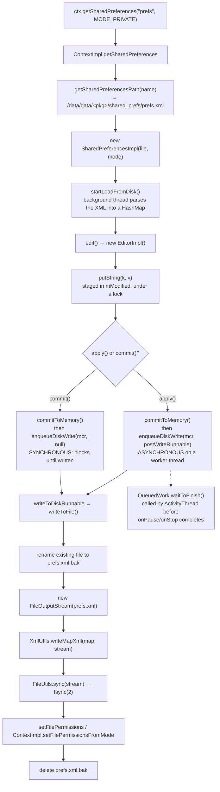

#### Step 1 — obtaining the instance

**File:** `frameworks/base/core/java/android/app/ContextImpl.java`
**Methods:** `getSharedPreferences(String name, int mode)`, `getSharedPreferencesPath(String name)`

```java
// frameworks/base/core/java/android/app/ContextImpl.java — the shape
@Override
public File getSharedPreferencesPath(String name) {
    return makeFilename(getPreferencesDir(), name + ".xml");
}

private File getPreferencesDir() {
    synchronized (mSync) {
        if (mPreferencesDir == null) {
            mPreferencesDir = new File(getDataDir(), "shared_prefs");
        }
        return ensurePrivateDirExists(mPreferencesDir);
    }
}
```

So the file is at `/data/data/<applicationId>/shared_prefs/<name>.xml`, or under
`/data/user/<userId>/<applicationId>/` on a multi-user device. There is no encryption, no integrity
protection, and no obfuscation: it is a plain XML file inside the app's private directory, protected
solely by Unix file permissions and SELinux.

`ContextImpl` also caches one `SharedPreferencesImpl` per file per process, which is why two calls with
the same name return the same object and why cross-process sharing does **not** work (`MODE_MULTI_PROCESS`
was deprecated because it was never reliable).

> **⚠️ Warning**
> `MODE_WORLD_READABLE` and `MODE_WORLD_WRITEABLE` were deprecated in API 17 and, from `targetSdk` 24
> onward, **throw `SecurityException`** when used. The check is in `ContextImpl`. If you find an app
> passing those constants, either its `targetSdk` is below 24 — itself a finding — or it is crashing.
> On a low-`targetSdk` app, a world-readable preferences file is directly readable by any other
> application on the device and is a straightforward data-exposure finding.

#### Step 2 — the implementation

**File:** `frameworks/base/core/java/android/app/SharedPreferencesImpl.java`

The whole class is worth reading; it is under a thousand lines and it is a small masterclass in
concurrent file handling. The essentials:

- The constructor calls `startLoadFromDisk()`, which parses the XML on a background thread into a
  `Map<String, Object>`. Every getter calls `awaitLoadedLocked()` first, which blocks until that
  finishes. This is why the *first* `getString` on a large preferences file can block the main thread.
- `edit()` returns an `EditorImpl`. `putString` puts the value into `mModified`, a plain map, under the
  editor's lock. Nothing has happened outside memory yet.

#### Step 3 — `commitToMemory()`

Both `apply()` and `commit()` call `commitToMemory()` first. It takes the lock on the
`SharedPreferencesImpl`, applies every staged change to the in-memory map, records which keys changed
(for listeners), and produces a `MemoryCommitResult` holding the new map and a `CountDownLatch`.

**This is why a `getString` immediately after `apply()` returns the new value even though nothing has
been written to disk.** The in-memory map is updated synchronously; only the disk write is deferred.

#### Step 4 — the fork: `apply()` versus `commit()`

| | `commit()` | `apply()` |
|---|---|---|
| Returns | `boolean` — whether the write succeeded | `void` |
| Disk write | **Synchronous** — blocks the calling thread | **Asynchronous** — queued to a worker |
| In-memory update | Immediate | Immediate |
| Failure visible to caller | Yes | No |
| Main-thread safe | No — it is disk I/O on your thread | Yes |
| Ordering guarantee | Writes complete in call order | Writes complete in call order |
| Flushed before the process can be killed? | Already done | Yes — see `QueuedWork` below |

```java
// frameworks/base/core/java/android/app/SharedPreferencesImpl.java — apply(), in shape
@Override
public void apply() {
    final MemoryCommitResult mcr = commitToMemory();
    final Runnable awaitCommit = new Runnable() {
        @Override public void run() {
            try { mcr.writtenToDiskLatch.await(); } catch (InterruptedException ignored) { }
        }
    };
    QueuedWork.addFinisher(awaitCommit);
    Runnable postWriteRunnable = new Runnable() {
        @Override public void run() {
            awaitCommit.run();
            QueuedWork.removeFinisher(awaitCommit);
        }
    };
    SharedPreferencesImpl.this.enqueueDiskWrite(mcr, postWriteRunnable);
    notifyListeners(mcr);
}
```

> **🔬 Under the Hood — the `QueuedWork` mechanism**
> `apply()` is asynchronous, so how does Android guarantee your preferences are not lost when the
> process is killed a moment later? The answer is `frameworks/base/core/java/android/app/QueuedWork.java`.
> `ActivityThread` calls `QueuedWork.waitToFinish()` in `handlePauseActivity` and `handleStopActivity`
> — before it reports back to `ActivityManagerService` that the lifecycle transition is complete.
> So the platform blocks the activity transition until every pending `apply()` has hit the disk.
>
> Two consequences you will actually meet. First, this is a genuine and common source of ANRs in real
> applications: a large number of `apply()` calls turns into main-thread blocking at `onPause`. Second,
> and more relevant here: **preferences written with `apply()` are on disk by the time the app is
> backgrounded**, so pulling `shared_prefs/` after backgrounding an app gets you the current state.

#### Step 5 — `writeToFile()`, and the backup dance

**Method:** `SharedPreferencesImpl.writeToFile(MemoryCommitResult mcr, boolean isFromSyncCommit)`

The write is deliberately crash-safe, and the sequence matters if you are doing forensics:

1. If the target file exists and no backup exists, **rename** the existing file to `<name>.xml.bak`.
   (If a backup already exists, delete the main file — the previous write did not complete.)
2. Open a new `FileOutputStream` on `<name>.xml`.
3. `XmlUtils.writeMapXml(mcr.mapToWriteToDisk, str)` serialises the map.
   (`frameworks/base/core/java/com/android/internal/util/XmlUtils.java`)
4. `FileUtils.sync(str)` → `FileDescriptor.sync()` → the `fsync(2)` syscall.
   (`frameworks/base/core/java/android/os/FileUtils.java`)
5. Close the stream.
6. `ContextImpl.setFilePermissionsFromMode(...)` / `FileUtils.setPermissions(...)` applies the mode.
7. **Delete the backup.** Its existence is the signal that a write was in progress.

On the *next* load, `startLoadFromDisk` checks for `<name>.xml.bak`: if it exists, the previous write did
not finish, so the backup is renamed over the main file and the partial write is discarded.

> **🔍 Pentester's Note**
> Three practical consequences for an engagement:
> ```bash
> # adb shell — on a debuggable app, no root needed
> run-as com.example.app ls -la /data/data/com.example.app/shared_prefs/
> run-as com.example.app cat /data/data/com.example.app/shared_prefs/session.xml
>
> # adb shell — as root
> ls -la /data/data/com.example.app/shared_prefs/
> cat /data/data/com.example.app/shared_prefs/*.xml
> ```
> 1. **A `.xml.bak` file is evidence of an interrupted write**, and it contains the *previous* contents —
>    occasionally a token or a flag value that has since been overwritten. Always list the directory
>    rather than reading one file.
> 2. **`apply()` means the data is on disk when the app is backgrounded.** Background the app, then pull.
> 3. **`EncryptedSharedPreferences` (Jetpack Security) changes the file contents but not this
>    mechanism.** The keys and values are encrypted with a key from the Android Keystore; the file is
>    still in `shared_prefs/` and the write path above is unchanged. On a rooted device with the app's
>    Keystore key available to the app, an in-process hook reads the plaintext regardless. See
>    [33-Storage](../33-Storage/README.md) and [49-KeyStore](../49-KeyStore/README.md).

#### Step 6 — into the kernel

`FileOutputStream.write` → `libcore/luni/src/main/java/libcore/io/IoBridge.java` → `Os.write` →
`libcore/luni/src/main/java/libcore/io/Linux.java` (a `native` method) →
`libcore/luni/src/main/native/libcore_io_Linux.cpp` → `write(2)` in bionic
(`bionic/libc/`) → the kernel VFS → ext4 or f2fs.

`fsync(2)` follows the same route and is what actually forces the data to stable storage.

**Code Search query for the JNI layer:** `file:libcore_io_Linux.cpp function:Linux_write`

#### What this trace teaches

| Lesson | Where it appeared |
|---|---|
| The `Impl` class holds the real logic and is worth reading in full | Step 2 |
| "Asynchronous" in Android usually means "synchronous in memory, deferred on disk" | Steps 3–4 |
| Lifecycle transitions are where deferred work is flushed | Step 5, `QueuedWork` |
| Crash-safe file writes leave artefacts (`.bak`) that are forensically useful | Step 5 |
| The Java-to-syscall path always runs through `libcore` and `bionic` | Step 6 |

---

### 4.3 Trace C — a permission check, from `checkSelfPermission` to the enforcement point

The most important trace in the chapter, because it explains why client-side permission bypasses do not
work and where the real check is.

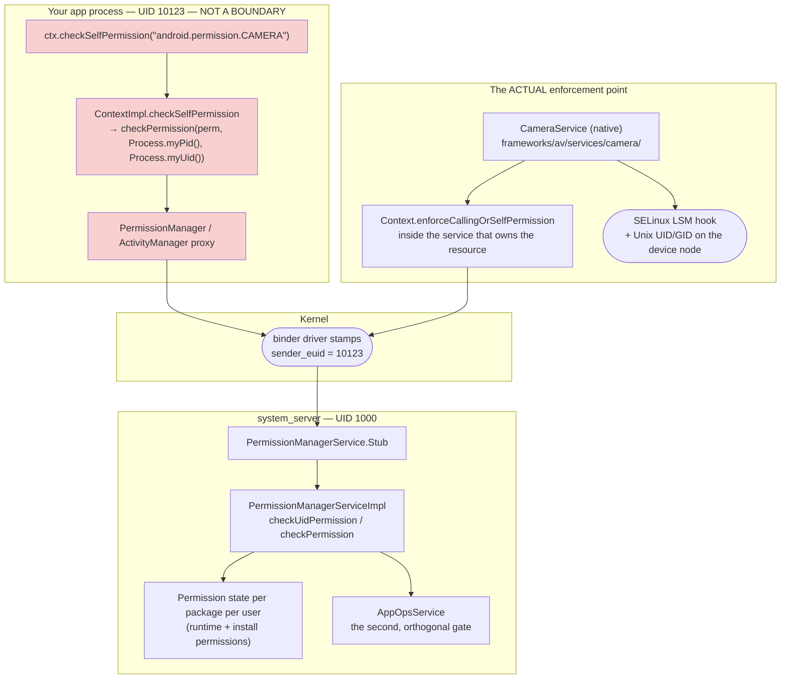

#### Step 1 — the app-side call

**File:** `frameworks/base/core/java/android/content/Context.java`

```java
// frameworks/base/core/java/android/content/Context.java
public int checkSelfPermission(@NonNull String permission) {
    return checkPermission(permission, Process.myPid(), Process.myUid());
}
```

Note what this is: your process asking about your own PID and UID. It is an **advisory query**, not an
authorisation. Nothing is granted by calling it, and nothing is denied by lying about its result.

#### Step 2 — the implementation, and where it moved

**File:** `frameworks/base/core/java/android/app/ContextImpl.java`
**Method:** `checkPermission(String permission, int pid, int uid)`

This is one of the places where the code has genuinely moved between releases, and it is a good
opportunity to practise the procedure rather than memorise an answer. Historically `ContextImpl` called
`ActivityManager.getService().checkPermission(...)`. In modern releases the permission subsystem was
factored out into `PermissionManager` and, later, into the `Permission` Mainline module.

**Find the current path yourself:**

```
# cs.android.com — switch to the branch matching your target device first
path:frameworks/base/core/java/android/app file:ContextImpl.java function:checkPermission
```

Then follow the call. It will lead to one of:

- `frameworks/base/core/java/android/permission/PermissionManager.java` — the modern client-side manager
- `frameworks/base/core/java/android/content/PermissionChecker.java` — the helper that combines a
  permission check *and* an app-op check, which is what most framework callers should use
- `IActivityManager.checkPermission` — the historical route

**Code Search query for the interface:** `file:IPermissionManager.aidl` or `file:IPermissionChecker.aidl`

> **🧠 Mental Model**
> The fact that this hop moved between releases is not an inconvenience — it is the lesson. **Do not
> memorise call graphs; memorise the procedure.** Name a symbol, find the implementation, follow the
> call, look for `extends I*.Stub`, find `Binder.getCallingUid()`. That procedure has worked on every
> Android release for a decade and will work on the next one.

#### Step 3 — across Binder, into `system_server`

Same mechanism as Trace A: a generated proxy marshals into a `Parcel`, the kernel stamps the sender's
UID, and a binder thread in `system_server` dispatches to the `Stub`.

**Directory:** `frameworks/base/services/core/java/com/android/server/pm/permission/`
**Classes:** `PermissionManagerService`, `PermissionManagerServiceImpl` (names and split vary by release)

The server consults the permission state it holds for that package and user:

| State | Meaning |
|---|---|
| Install-time permissions (`normal`) | Granted at install, cannot be revoked by the user |
| Signature permissions | Granted only if the app is signed with the same key as the declaring app |
| `signature\|privileged` | Also granted to apps in `priv-app/` listed in `/system/etc/permissions/privapp-permissions-*.xml` |
| Runtime permissions (`dangerous`) | Per-user, per-package, revocable, grouped |
| Permission flags | `FLAG_PERMISSION_USER_SET`, `..._REVOKED_COMPAT`, `..._ONE_TIME`, `..._AUTO_REVOKED` |

The definitions of every platform permission — with `protectionLevel` — are in
`frameworks/base/core/res/AndroidManifest.xml`.

#### Step 4 — the second gate nobody expects: app-ops

**Directory:** `frameworks/base/services/core/java/com/android/server/appop/`
**Class:** `AppOpsService`
**Client side:** `frameworks/base/core/java/android/app/AppOpsManager.java`

> **📖 Definition**
> **App-ops** is a per-package, per-operation permission layer that sits *beside* the permission system.
> An operation can be `MODE_ALLOWED`, `MODE_IGNORED` (the call silently succeeds but returns nothing),
> `MODE_ERRORED` (throws), or `MODE_DEFAULT` (fall back to the permission check). Many dangerous
> permissions have a paired app-op, and both must permit the operation.

This is why `checkSelfPermission` returning `PERMISSION_GRANTED` is not sufficient: the app-op may be
`MODE_IGNORED`, in which case the API returns empty data rather than throwing. Location, contacts,
SMS, camera, microphone and clipboard access all behave this way, and `MODE_IGNORED` is exactly what
"silently return nothing" looks like from the app's side.

```bash
# adb shell — inspect and manipulate the second gate directly
appops get com.example.app
appops set com.example.app COARSE_LOCATION ignore
appops set com.example.app READ_CLIPBOARD allow
cmd appops get com.example.app CAMERA
```

> **🔍 Pentester's Note**
> When an app has a permission granted but the API returns empty results, check app-ops before you
> conclude anything about the app. Equally, when you are testing whether an app degrades gracefully
> under partial permission, `appops set ... ignore` is a far better test than revoking the permission,
> because it reproduces the *silent* failure mode that real users hit — and that developers almost never
> handle.

#### Step 5 — where enforcement **actually** happens

Here is the crucial point of the whole trace: `checkSelfPermission` is a *query*. It is not enforcement.
Enforcement happens at the point where the resource is used, in whichever service owns it, and it is a
different call.

| Enforcement mechanism | Where | What it does |
|---|---|---|
| `Context.enforceCallingPermission(perm, msg)` | Inside a service, on the server side of Binder | Throws `SecurityException` if the **caller** lacks it |
| `Context.enforceCallingOrSelfPermission(...)` | Same | Also passes if the service itself holds it — **and this is the classic confused-deputy footgun** |
| `PermissionChecker.checkCallingPermissionForDataDelivery(...)` | Modern framework code | Permission **plus** app-op **plus** attribution, which is what data-access auditing needs |
| SELinux | Kernel LSM | Whether the process's domain may touch the resource at all — a completely separate axis |
| Unix DAC | Kernel | File and device-node ownership and mode; e.g. `/dev/video0` group membership |

For the camera specifically, the real gate is in the camera service, not in your app:

**Directory:** `frameworks/av/services/camera/libcameraservice/`
**Class:** `CameraService` — its `connect`/`connectDevice` paths validate the calling UID's permission
before returning a camera handle. Below that, the `/dev/video*` nodes are protected by Unix permissions
and SELinux labels.

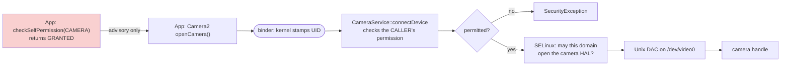

> **⚠️ Warning**
> This is the answer to the most common beginner question in Android security: *"I hooked
> `checkSelfPermission` to return `PERMISSION_GRANTED` — why can I still not use the camera?"*
>
> Because you patched a **query in your own process**. The camera service, on the other side of the
> kernel-stamped Binder boundary, performs its own check against the UID the kernel supplied, and it has
> never heard of your hook. Client-side permission hooks are useful for exactly one thing: making an app
> that *voluntarily* gates a feature behind a permission check take the other branch. They grant nothing.
> To actually obtain a permission you must change the state in `system_server` — `pm grant`, with the
> privilege that requires — or exploit something.

```bash
# adb shell — change the state that actually matters
pm grant com.example.app android.permission.CAMERA
pm revoke com.example.app android.permission.CAMERA
dumpsys package com.example.app | sed -n '/requested permissions/,/User 0/p'
```

#### What this trace teaches

| Lesson | Where it appeared |
|---|---|
| In-process framework code is not a security boundary | Step 1 |
| Code moves between releases; the *procedure* for finding it does not | Step 2 |
| Permission state lives in `system_server`, per package and per user | Step 3 |
| App-ops is a second, orthogonal gate that fails **silently** | Step 4 |
| `check*` is a query; `enforce*` in the resource-owning service is the control | Step 5 |
| SELinux and Unix DAC are two further, independent layers below the permission model | Step 5 |

---

### 4.4 The files worth bookmarking

After the three traces, these are the files you will return to most often.

| File | Why |
|---|---|
| `frameworks/base/core/res/AndroidManifest.xml` | Every platform permission and its exact `protectionLevel` |
| `frameworks/base/core/res/res/values/config.xml` | Hundreds of platform behaviour switches OEMs override |
| `frameworks/base/services/java/com/android/server/SystemServer.java` | Every system service and its start order |
| `frameworks/base/core/java/android/os/Binder.java` | `execTransact`, `getCallingUid`, `clearCallingIdentity` |
| `frameworks/base/core/java/android/app/ContextImpl.java` | The real implementation behind most of `Context` |
| `frameworks/base/core/java/android/app/ActivityThread.java` | App process lifecycle, `main()`, `bindApplication` |
| `frameworks/base/services/core/java/com/android/server/am/ActivityManagerService.java` | Broadcasts, processes, `checkPermission` helpers |
| `frameworks/base/services/core/java/com/android/server/wm/ActivityStarter.java` | Every activity-launch policy decision |
| `frameworks/base/services/core/java/com/android/server/pm/PackageManagerService.java` | Install, signature verification, component resolution |
| `frameworks/base/services/core/java/com/android/server/appop/AppOpsService.java` | The second permission gate |
| `frameworks/native/libs/binder/IPCThreadState.cpp` | Where user space meets the binder driver |
| `frameworks/native/cmds/servicemanager/` | The service directory `service list` shows you |
| `system/core/init/` | `init.rc` semantics, service definitions, property handling |
| `system/sepolicy/private/` and `public/` | The policy that constrains everything above |
| `bionic/linker/linker.cpp` | `dlopen`, namespaces, why `LD_PRELOAD` sometimes does not work |
| `libcore/luni/src/main/java/javax/net/ssl/` | TLS defaults and trust manager dispatch |
| `art/runtime/hidden_api.cc` | Hidden-API enforcement |

---

## 5. Security Perspective

### 5.1 How attackers use AOSP

Source availability is symmetric: it helps defenders and attackers equally, and pretending otherwise
leads to bad advice.

| Use | Detail |
|---|---|
| **Auditing for memory-safety bugs** | `external/` and `frameworks/av/` contain large C/C++ parsers processing untrusted input — media files, fonts, images, Bluetooth packets, NFC frames. Reading them is how a large fraction of Android criticals are found. |
| **Patch-gapping** | A security bulletin publishes the fix commit. Reading the diff reveals the bug, and the window between the commit landing in AOSP and reaching devices is often weeks to months. This is one of the most reliable exploitation strategies against Android. |
| **Finding the enforcement point to bypass** | Trace C's methodology, run backwards: find `enforceCallingPermission` calls, look for paths that reach the resource without passing one. |
| **Understanding hook targets** | Frida, Xposed and LSPosed all rest on `ArtMethod` internals read from `art/`. |
| **Locating confused deputies** | Search for `clearCallingIdentity()` and check what happens between it and the matching `restoreCallingIdentity()`. Any permission check inside that window checks the *system's* identity, not the caller's. |
| **Building a research platform** | A patched userdebug image with framework instrumentation, per section 3.10. |
| **Diffing OEM against AOSP** | Decompile a vendor's `services.jar`, diff against the AOSP release it derives from, and read only the differences. Vendor additions are less reviewed than AOSP and this narrows the search enormously. |

> **🔍 Pentester's Note — the highest-yield grep in AOSP framework auditing**
> ```bash
> # host — every place the system drops the caller's identity
> rg -n "clearCallingIdentity" frameworks/base/services/core/java | wc -l
> rg -n -A25 "clearCallingIdentity" frameworks/base/services/core/java \
>    | grep -B5 -A5 "checkPermission\|enforceCalling"
> ```
> `Binder.clearCallingIdentity()` makes subsequent `getCallingUid()` calls return the *system's* UID. It
> is used legitimately, constantly, when a service needs to do something on its own behalf. The bug
> pattern is a permission check that happens **after** the clear, so it validates the system's identity
> rather than the caller's — a textbook confused deputy. On an OEM's added system service, this is one of
> the most productive patterns there is. The same grep run over a decompiled vendor `services.jar`
> works too.

### 5.2 How developers and OEMs misuse it

| Misuse | Consequence |
|---|---|
| Copying an AOSP app's code without its manifest restrictions | AOSP system apps are platform-signed and rely on that; the same code in a third-party app is exposed |
| Forking a framework class and losing a later security fix | The OEM's fork does not receive the AOSP patch. A very common source of OEM-only vulnerabilities. |
| Adding a system service without permission checks | An OEM service registered with `ServiceManager` and reachable over Binder, with no `enforceCallingPermission` |
| Adding a `signature`-level permission and then platform-signing a partner's app | Extends the platform trust domain to a third party |
| Shipping a `userdebug` or `eng` build | `ro.debuggable=1` means `run-as` works on every app and `adb root` is available |
| Leaving AOSP test keys in place | `build/make/target/product/security/platform.pk8` is public; anyone can build a platform-signed app |
| Loosening SELinux policy to make an integration work | `permissive` domains, or overly broad `allow` rules in `device/<oem>/sepolicy/` |
| Adding an exported component to a preinstalled app | Reachable by any third-party app, running with privileged permissions |
| Never updating `external/` components | An unpatched `libpng`, `sqlite` or `zlib` from three years ago |

### 5.3 Vulnerability classes, with full treatment

---

#### 5.3.1 The OEM system service with no permission check

**Vulnerable code.** This is what it looks like when an OEM adds a service to `system_server`:

```java
// A vendor addition to system_server. Reachable by ANY app over Binder.
public class DeviceConfigService extends IDeviceConfig.Stub {

    @Override
    public void setSystemProperty(String key, String value) {
        // No permission check. No UID check. No allow-list on `key`.
        SystemProperties.set(key, value);
    }

    @Override
    public String readDiagnosticFile(String path) {
        // Runs as UID 1000 with the system's SELinux domain.
        return new String(Files.readAllBytes(Paths.get(path)));
    }

    @Override
    public void installPackage(String apkPath) {
        // The service does the install on the caller's behalf, as itself.
        long id = Binder.clearCallingIdentity();
        try {
            mPackageManager.installPackage(apkPath, /* flags */ 0);
        } finally {
            Binder.restoreCallingIdentity(id);
        }
    }
}
```

**Why it gets written.** The service is added to support the OEM's own preinstalled application, which
is platform-signed, so the developer reasons that only their app will call it. Binder services registered
with `ServiceManager` are, by default, reachable by anything that can obtain the handle — which,
depending on the SELinux `service_contexts` entry, is often every app on the device.

**Static detection.**

```bash
# host — in a vendor source tree
rg -n "extends I[A-Za-z]+\.Stub" --glob '!*/test/*' . | grep -v "^frameworks/base" > vendor-services.txt
# then, for each, check whether it enforces anything
rg -L -n "enforceCallingPermission|enforceCallingOrSelfPermission|checkCallingPermission|getCallingUid" \
   $(cut -d: -f1 vendor-services.txt | sort -u)
```

```bash
# host — with no source: decompile the framework
adb pull /system/framework/services.jar
jadx -d services-src services.jar
rg -n "extends I[A-Za-z]+\$Stub" services-src/sources/ | grep -vi "com/android/server" | head -40
```

**Dynamic detection.**

```bash
# adb shell — enumerate every registered service and diff against a stock image
service list > /sdcard/services-vendor.txt
# On a Pixel or emulator of the same Android release:
service list > /sdcard/services-aosp.txt
# host:
diff <(sort aosp.txt) <(sort vendor.txt)      # everything extra is vendor code

# adb shell — what SELinux label does the service have, i.e. who may reach it?
cat /vendor/etc/selinux/vendor_service_contexts 2>/dev/null | grep -i <servicename>
```

**Exploitation.** From an unprivileged app, obtain the service and call it:

```java
// Attacker app — no permissions declared in its manifest
IBinder b = (IBinder) Class.forName("android.os.ServiceManager")
        .getMethod("getService", String.class)
        .invoke(null, "vendor.deviceconfig");

// Raw transaction: no vendor SDK required.
Parcel data = Parcel.obtain(), reply = Parcel.obtain();
data.writeInterfaceToken("com.vendor.IDeviceConfig");
data.writeString("/data/system/packages.xml");
b.transact(2 /* readDiagnosticFile */, data, reply, 0);
reply.readException();
String contents = reply.readString();   // read as UID 1000, in the system domain
```

Getting the transaction code and the interface descriptor right is the only work, and both come from
decompiling the vendor's client-side SDK or from `service list -l` plus trial.
[`scripts/binder-service-enum.sh`](scripts/binder-service-enum.sh) automates the enumeration.

**Secure fix.**

```java
public class DeviceConfigService extends IDeviceConfig.Stub {

    @Override
    public void setSystemProperty(String key, String value) {
        // 1. Enforce a permission the caller must actually hold.
        mContext.enforceCallingPermission(
                "com.vendor.permission.CONFIGURE_DEVICE", "setSystemProperty");

        // 2. Allow-list what may be set. Never accept an arbitrary key.
        if (!ALLOWED_PROPERTIES.contains(key)) {
            throw new IllegalArgumentException("property not permitted: " + key);
        }
        SystemProperties.set(key, value);
    }

    @Override
    public String readDiagnosticFile(String name) {
        mContext.enforceCallingPermission(
                "com.vendor.permission.READ_DIAGNOSTICS", "readDiagnosticFile");

        // 3. Never take a path from the caller. Take a name and resolve it yourself.
        if (!DIAGNOSTIC_FILES.containsKey(name)) {
            throw new IllegalArgumentException("unknown diagnostic: " + name);
        }
        return readInternal(DIAGNOSTIC_FILES.get(name));
    }
}
```

```xml
<!-- The permission must be declared with a protection level that actually restricts it. -->
<permission android:name="com.vendor.permission.CONFIGURE_DEVICE"
            android:protectionLevel="signature|privileged" />
```

And the SELinux side, which is the layer that stops the service being reachable at all:

```
# device/<oem>/sepolicy/private/service_contexts
vendor.deviceconfig  u:object_r:vendor_deviceconfig_service:s0

# device/<oem>/sepolicy/private/vendor_app.te
# Only the vendor's own app domain may find this service.
allow vendor_app vendor_deviceconfig_service:service_manager find;
# untrusted_app is deliberately NOT granted `find`.
```

**Honest severity.** **Critical** where the service performs a privileged action (install a package,
write a system property, read a system file, disable a security control) with no check, because it is a
direct local privilege escalation from an unprivileged, zero-permission app to UID 1000. **High** where
it only discloses information. **Medium** where a permission is enforced but the permission is
obtainable by third-party apps — check the `protectionLevel`, because `normal` on a vendor permission is
a very common mistake.

---

#### 5.3.2 The confused deputy across `clearCallingIdentity`

**Vulnerable code.**

```java
// Inside a system service.
@Override
public void deleteUserFile(String packageName, String relativePath) {
    // The developer clears the identity FIRST, because the file operations
    // below need system privileges.
    final long token = Binder.clearCallingIdentity();
    try {
        // ...and then performs the check. getCallingUid() now returns 1000 (system),
        // NOT the caller's UID. The check passes for everybody.
        if (mContext.checkCallingPermission(Manifest.permission.MANAGE_USERS)
                != PackageManager.PERMISSION_GRANTED) {
            throw new SecurityException("nope");
        }
        new File(getDataDirFor(packageName), relativePath).delete();
    } finally {
        Binder.restoreCallingIdentity(token);
    }
}
```

**Why developers write it.** The clear is genuinely necessary for the privileged work, and moving it to
the top of the method is the natural refactor. The failure is subtle: `checkCallingPermission` reads a
thread-local that `clearCallingIdentity` has just overwritten, and nothing warns you.

Note the second bug in the same method: `relativePath` is caller-controlled with no traversal check, so
`../../..` reaches outside the package's directory even if the permission check were correct.

**Static detection.**

```bash
# host
rg -n -A30 "clearCallingIdentity" frameworks/base/services/core/java \
  | grep -E "checkCalling|enforceCalling|getCallingUid|getCallingPid"
```

Any hit is a candidate. Read the surrounding code and determine whether the check precedes the clear.

**Dynamic detection.** Call the method from an unprivileged app and observe whether it succeeds. The
absence of a `SecurityException` where you expected one is the signal.

**Exploitation.** Call the interface from any app with no permissions. There is nothing more to it —
that is what makes the class severe.

**Secure fix.**

```java
@Override
public void deleteUserFile(String packageName, String relativePath) {
    // 1. Check FIRST, while the caller's identity is still current.
    mContext.enforceCallingPermission(Manifest.permission.MANAGE_USERS, "deleteUserFile");

    // 2. Capture the caller's identity explicitly if you need it later.
    final int callingUid = Binder.getCallingUid();
    enforcePackageBelongsToUid(packageName, callingUid);

    // 3. Validate the path before using it. Canonicalise, then containment-check.
    final File base = getDataDirFor(packageName).getCanonicalFile();
    final File target = new File(base, relativePath).getCanonicalFile();
    if (!target.toPath().startsWith(base.toPath())) {
        throw new IllegalArgumentException("path escapes the package directory");
    }

    // 4. Only NOW drop to system identity, for the privileged operation only.
    final long token = Binder.clearCallingIdentity();
    try {
        target.delete();
    } finally {
        Binder.restoreCallingIdentity(token);
    }
}
```

**Honest severity.** **High to Critical**, depending on what the privileged operation is. It is a genuine
authorisation bypass reachable by any app, with no user interaction, and it does not require a rooted
device.

---

#### 5.3.3 A permission whose `protectionLevel` does not match its power

**Vulnerable code.**

```xml
<!-- A vendor's preinstalled app, or an OEM framework addition -->
<permission
    android:name="com.vendor.permission.DEVICE_ADMIN_BRIDGE"
    android:protectionLevel="normal" />           <!-- <-- the bug -->

<service android:name=".AdminBridgeService"
         android:exported="true"
         android:permission="com.vendor.permission.DEVICE_ADMIN_BRIDGE" />
```

**Why it gets written.** `normal` is the default that makes everything work immediately. `signature`
requires the caller to be signed with the same key, which breaks the developer's test app, so the value
gets lowered "temporarily".

**Static detection.**

```bash
# host — from a device image or a pulled APK
apktool d -f app.apk -o out/
grep -n -A2 "<permission" out/AndroidManifest.xml

# host — on a full device image, every permission every preinstalled app defines
for a in $(find system/priv-app system/app -name '*.apk'); do
  aapt2 dump xmltree "$a" --file AndroidManifest.xml 2>/dev/null \
    | grep -A4 "E: permission" | grep -E "name|protectionLevel"
done
```

```bash
# adb shell — the device's own view, which resolves the numeric level
pm list permissions -d -g
pm list permissions -f | grep -A3 "com.vendor"
dumpsys package | grep -A3 "com.vendor.permission"
```

**Exploitation.** An attacker app simply requests the permission. `normal` permissions are granted at
install with no prompt and no user interaction.

```xml
<!-- attacker/AndroidManifest.xml -->
<uses-permission android:name="com.vendor.permission.DEVICE_ADMIN_BRIDGE" />
```

**Secure fix.**

```xml
<permission
    android:name="com.vendor.permission.DEVICE_ADMIN_BRIDGE"
    android:protectionLevel="signature|privileged"
    android:label="@string/perm_admin_bridge_label"
    android:description="@string/perm_admin_bridge_desc" />
```

Plus, on the server side, defence in depth rather than relying on the manifest attribute alone:

```java
@Override
public void onBind(Intent intent) {
    enforceCallingOrSelfPermission("com.vendor.permission.DEVICE_ADMIN_BRIDGE", "bind");
    // And verify the caller is who you expect, not merely that it holds a permission.
    final int uid = Binder.getCallingUid();
    if (!isVendorSignedPackage(uid)) {
        throw new SecurityException("caller is not vendor-signed");
    }
}
```

**Honest severity.** Determined by what the permission unlocks. **Critical** if it gates a device-admin,
package-install or system-configuration capability. **Low** if it gates something inconsequential. The
class of finding — a custom permission with `protectionLevel="normal"` on a preinstalled app — is worth
checking on every OEM engagement because it is quick and it is common.

> **⚠️ Warning**
> A related trap: a permission declared with **no** `android:protectionLevel` attribute defaults to
> `normal`. When auditing, absence is as important as a wrong value.

---

#### 5.3.4 Patch gapping — the bulletin as a vulnerability feed

This is not a code pattern; it is a *process* weakness, and it deserves its own treatment because it is
how a large fraction of real-world Android compromise happens.

**The mechanism.**

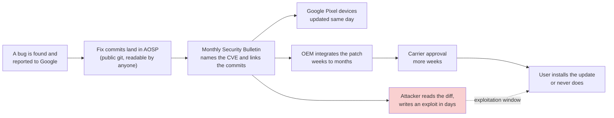

**Why the window exists.** AOSP fixes are public commits. The bulletin points at them. An attacker with
the diff has the bug — often the *whole* bug, since a two-line bounds check reveals precisely what was
unbounded. Meanwhile the fix must traverse the OEM's integration, the silicon vendor's BSP, carrier
testing and finally the user, and each hop takes weeks.

**Detection, as a tester.** This is the thing to check on every device engagement and it takes minutes:

```bash
# adb shell — the claims
getprop ro.build.version.security_patch          # system partition
getprop ro.vendor.build.security_patch           # vendor partition — often MUCH older
getprop ro.build.version.release
getprop ro.build.fingerprint
uname -r                                         # kernel version
cat /proc/version

# adb shell — Mainline module versions, which update independently
pm list packages --apex-only
dumpsys package com.google.android.modulemetadata | grep versionName
```

Then read the bulletins between the claimed patch level and today, and shortlist anything affecting a
component the device actually has.

**The finding, written well.** Do not write "device is out of date". Write:

> The device reports `ro.build.version.security_patch=2024-03-01` while
> `ro.vendor.build.security_patch=2023-08-01`. The vendor partition, which contains the camera, modem
> and GPU HALs, is therefore missing seven months of published fixes. Bulletin entries in that window
> affecting components present on this device include [enumerate]. Because the corresponding AOSP and
> upstream fixes are public, the effort required to weaponise them is substantially reduced.

**Secure fix.** Organisational, not technical: subscribe to the bulletin, commit to an integration SLA,
adopt Mainline modules where possible (because they bypass the OEM entirely for the components they
cover), and use Generic Kernel Image to decouple the kernel from the vendor's fork.

**Honest severity.** As a standalone finding, **Medium to High** depending on the gap size and the
components affected. It becomes **Critical** when you can demonstrate a specific, publicly-patched issue
is exploitable on the device — but demonstrate it before you rate it that way. A patch-level gap is
evidence of exposure, not of exploitability, and treating them as the same thing is the most common
error in device reports.

---

### 5.4 OWASP MASVS / MASTG mapping

| Control area | How AOSP knowledge applies |
|---|---|
| **MASVS-STORAGE** | Trace B is the ground truth for where preferences, databases and files land and how they are protected. `system/vold/` is the encryption implementation. |
| **MASVS-CRYPTO** | `libcore/` and `external/boringssl` are the actual crypto providers; `system/security/keystore2/` is the Keystore. Provider defaults per API level are readable in `libcore`. |
| **MASVS-NETWORK** | `libcore/luni/src/main/java/javax/net/ssl/` plus `frameworks/base/core/java/android/security/net/config/` — the Network Security Config implementation |
| **MASVS-PLATFORM** | Traces A and C. Binder, permissions, app-ops, and the enforcement points |
| **MASVS-CODE** | Hidden-API enforcement, `targetSdk` gating, and the build-time surfaces |
| **MASVS-RESILIENCE** | `art/` for hooking mechanisms; `system/core/init/` for `ro.debuggable` and `ro.secure`; the honest limits of client-side integrity |
| **MASTG** across the board | Almost every MASTG test has an "and here is why" that is a file in AOSP |

MASTG's Android sections repeatedly reference platform behaviour that is only precisely knowable from
source. Being able to cite `frameworks/base/core/res/AndroidManifest.xml` for a permission's protection
level, rather than the developer documentation, is the difference between a report that survives
challenge and one that does not.

### 5.5 Bug bounty patterns

Described as classes, since specific reports and identifiers change:

| Pattern | What the researcher did |
|---|---|
| Unprotected OEM system service | Enumerated `service list`, diffed against stock AOSP, found a vendor service, called it with raw `transact` from a zero-permission app |
| Confused deputy in a framework service | Grepped for `clearCallingIdentity` followed by a permission check |
| Custom permission with `normal` protection on a preinstalled app | Read every preinstalled app's manifest, requested the permission, reached the privileged component |
| Path traversal in a privileged file API | A system service accepting a caller-supplied path and not canonicalising it |
| Patch gap on a shipped device | Correlated `ro.vendor.build.security_patch` with public bulletin fixes and demonstrated one |
| Parser bug in `external/` or `frameworks/av/` | Fuzzed a media or image parser whose source is in AOSP, using the source to build a grammar-aware harness |
| SELinux policy loosening | Found a `permissive` domain or an over-broad `allow` rule in a vendor's `device/*/sepolicy/` |
| Test keys on a shipped device | `apksigner verify --print-certs` on `framework-res.apk` |
| Hidden `@TestApi` reachable from a third-party app | An OEM exposed a `@TestApi` through their own exported component |

Google's own Android and Google Devices Security Reward Program is the canonical venue for AOSP issues;
the platform-versus-vendor distinction determines who you report to, and getting it wrong wastes weeks.

### 5.6 How malware uses AOSP knowledge

| Technique | Detail |
|---|---|
| Targeting known-unpatched components | Malware bundles exploits for a handful of publicly patched issues and tries each based on the device's reported patch level |
| Abusing accessibility and device-admin | Reading `frameworks/base/services/.../accessibility/` to understand exactly what an accessibility service can observe and inject |
| Evading `PackageManager` checks | Understanding component resolution well enough to hide from enumeration |
| Building on custom ROMs | Malware that targets rooted or custom-ROM devices reads `system/core/init/` and Magisk's own source to detect and adapt |
| Anti-analysis using platform behaviour | Detecting Cuttlefish, the emulator or a userdebug build by reading the same properties you do. See [39-EmulatorDetection](../39-EmulatorDetection/README.md). |

### 5.7 How forensic analysts use AOSP

Every artefact a forensic examiner recovers exists because some AOSP code wrote it, and reading that
code tells you exactly what it means.

| Artefact | The AOSP code that creates it | What it proves |
|---|---|---|
| `/data/system/packages.xml` | `PackageManagerService` | Every installed package, its signing certificate, its granted permissions, install time and installer |
| `/data/system/users/<id>/runtime-permissions.xml` | The permission subsystem | Exactly which runtime permissions were granted, and their flags (user-set, one-time, auto-revoked) |
| `/data/system/appops.xml` | `AppOpsService` | The second permission gate's state, plus last-access timestamps for many operations |
| `shared_prefs/*.xml` and `*.xml.bak` | Trace B | Application state; `.bak` files hold the *previous* contents |
| `/data/misc/profiles/` | ART | Which methods actually executed — behavioural evidence |
| `/data/system/dropbox/` | `DropBoxManagerService` | Crash and ANR records with stack traces |
| `/data/tombstones/` | `debuggerd` (`system/core/debuggerd/`) | Native crash dumps with registers and maps |
| `logd` buffers | `system/core/logd/` | Recent log lines, including anything an app logged carelessly |
| `/data/system/usagestats/` | `UsageStatsService` | Per-app foreground time and launch events |

> **🔍 Pentester's Note**
> `/data/system/packages.xml` is the single most useful file on a device you have root on. It contains,
> for every installed package: the signing certificate (so you can group apps by signer and find
> everything in the platform trust domain), the install source, the granted install-time permissions,
> the `sharedUserId`, and the flags. One file answers a dozen questions that would otherwise take a
> dozen `dumpsys` invocations:
> ```bash
> # adb shell as root
> cat /data/system/packages.xml | grep -B2 -A8 "com.example.app"
> ```

---

## 6. Reverse Engineering Perspective

Reverse engineering and AOSP are complements: source tells you what the platform *should* do, and
reversing tells you what a specific device *does*. The technique is to use each to accelerate the other.

### 6.1 Matching a device to an AOSP release

Before any reversing, establish which source corresponds to the binary.

```bash
# adb shell
getprop ro.build.fingerprint
# e.g. google/husky/husky:15/AP4A.241205.013/12621605:user/release-keys
#      vendor/device/board:VERSION/BUILD_ID/INCREMENTAL:VARIANT/TAGS

getprop ro.build.version.release       # 15
getprop ro.build.version.sdk           # 35
getprop ro.build.id                    # AP4A.241205.013
getprop ro.build.version.security_patch
getprop ro.product.cpu.abilist
```

Map the build ID to an AOSP tag using Google's published build-number list (see §14), then check out or
browse that tag. **Reading `main` while testing a device on Android 13 is the most common source of
"the source says X but the device does Y".**

### 6.2 Diffing an OEM framework against AOSP

This is the highest-value reversing workflow on an OEM device, because it reduces "audit a vendor's
framework" to "read a few thousand lines of diff".

```bash
# adb shell — pull the framework
adb pull /system/framework/framework.jar
adb pull /system/framework/services.jar
adb pull /system/framework/oat/arm64/services.odex 2>/dev/null   # if not a plain jar

# host — decompile
jadx -d services-oem --deobf services.jar

# host — build the AOSP equivalent for the same release, then decompile it too
#   (from a matching AOSP checkout, after `m services`)
jadx -d services-aosp out/target/product/<device>/system/framework/services.jar

# host — the diff IS the vendor's contribution
diff -rq services-aosp/sources services-oem/sources | head -60
diff -ru services-aosp/sources/com/android/server/pm \
         services-oem/sources/com/android/server/pm | head -200
```

Then read only the differences, looking for the patterns in §5.3: missing permission checks, checks after
`clearCallingIdentity`, caller-supplied paths, new Binder interfaces.

> **⚠️ Warning**
> On modern devices `services.jar` may contain only a stub, with the real code in a pre-compiled
> `services.odex`/`.vdex` under `/system/framework/oat/<arch>/`. Extract the DEX from the VDEX before
> decompiling:
> ```bash
> # adb shell as root
> oatdump --vdex-file=/system/framework/oat/arm64/services.vdex \
>         --export-dex-to=/data/local/tmp/services_dex
> ```
> See [13-ART](../13-ART/README.md) §6.2.

### 6.3 Recognising AOSP code in a decompiler

Framework classes appear inside app processes and in decompiled system components. Recognising them
saves time.

| What you see | What it is |
|---|---|
| `android.app.ContextImpl`, `android.app.ActivityThread` | Framework classes loaded into every app process from the boot classpath — not part of the app |
| `IBinder`, `Parcel`, `Stub`, `Stub$Proxy`, `asInterface`, `onTransact` | Generated AIDL code. The `DESCRIPTOR` string names the interface exactly. |
| `android.os.ServiceManager.getService("...")` | The app is talking to a system service directly, frequently a hidden one |
| `Binder.getCallingUid()` inside app code | The app is itself a Binder *server*; it exposes an interface |
| `SystemProperties.get("ro....")` | Reading build configuration; often part of root or emulator detection |
| `Class.forName("android.os.SystemProperties")` | Reflection into a hidden class — subject to hidden-API enforcement |
| `libcore.io.Os` / `Libcore.os` | Direct syscall access from Java |
| `com.android.internal.*` | Internal framework classes; an app referencing these is using non-SDK interfaces |

```bash
# host — find non-SDK usage in a decompiled app
rg -n "com\.android\.internal|android\.os\.ServiceManager|SystemProperties|IBinder" \
   decompiled/sources/ | head -40
```

### 6.4 In Smali

A raw Binder transaction from an application, which is how an app talks to a service with no public SDK:

```smali
# ServiceManager.getService("vendor.deviceconfig") via reflection,
# because ServiceManager is @hide.
const-string v0, "android.os.ServiceManager"
invoke-static {v0}, Ljava/lang/Class;->forName(Ljava/lang/String;)Ljava/lang/Class;
move-result-object v1

const-string v2, "getService"
const/4 v3, 0x1
new-array v4, v3, [Ljava/lang/Class;
const/4 v5, 0x0
const-class v6, Ljava/lang/String;
aput-object v6, v4, v5
invoke-virtual {v1, v2, v4}, Ljava/lang/Class;->getMethod(Ljava/lang/String;[Ljava/lang/Class;)Ljava/lang/reflect/Method;
move-result-object v7

# ... invoke it, receive an IBinder in v8

# Build the transaction: the interface token is mandatory.
invoke-static {}, Landroid/os/Parcel;->obtain()Landroid/os/Parcel;
move-result-object v9
const-string v10, "com.vendor.IDeviceConfig"
invoke-virtual {v9, v10}, Landroid/os/Parcel;->writeInterfaceToken(Ljava/lang/String;)V

const-string v11, "/data/system/packages.xml"
invoke-virtual {v9, v11}, Landroid/os/Parcel;->writeString(Ljava/lang/String;)V

# transact(code=2, data, reply, flags=0)
const/4 v12, 0x2
invoke-interface {v8, v12, v9, v13, v5}, Landroid/os/IBinder;->transact(ILandroid/os/Parcel;Landroid/os/Parcel;I)Z
```

Two recognisable signatures here, and both are worth grepping for in any decompiled app:

- `Class.forName("android.os.ServiceManager")` — reflection into a hidden class to reach a service the
  SDK does not expose.
- `writeInterfaceToken` followed by `transact` with a literal integer — a hand-built Binder call to a
  non-public interface. The string passed to `writeInterfaceToken` names the interface exactly, which
  lets you find its AIDL and reconstruct the whole API.

```bash
# host — find hand-built Binder calls in a decoded APK
apktool d -f app.apk -o out/
rg -n "writeInterfaceToken|ServiceManager|->transact\(" out/smali*/ | head -30
```

### 6.5 Using `symbols/` to reverse native code

If you have built AOSP for the same device and release, native reversing becomes dramatically easier.

```bash
# host — unstripped, fully symbolised copies of everything on the device
ls out/target/product/<device>/symbols/system/lib64/
ls out/target/product/<device>/symbols/system/bin/

# host — compare
nm -C out/target/product/<device>/system/lib64/libbinder.so | wc -l          # stripped: few
nm -C out/target/product/<device>/symbols/system/lib64/libbinder.so | wc -l  # thousands
readelf -S out/target/product/<device>/symbols/system/lib64/libbinder.so | grep debug
```

Load the `symbols/` copy into Ghidra or IDA rather than the on-device one. For a *vendor* binary you did
not build there is no symbol copy, but the AOSP libraries it links against are symbolised, which often
identifies the vendor binary's call targets and recovers a great deal of structure. See
[57-Ghidra](../57-Ghidra/README.md).

---

## 7. Dynamic Analysis

Source reading tells you what should happen. This section is how you watch it happen.

### 7.1 The reconnaissance commands

```bash
# adb shell — what am I on?
getprop ro.build.fingerprint
getprop ro.build.version.release
getprop ro.build.version.sdk
getprop ro.build.version.security_patch
getprop ro.vendor.build.security_patch
getprop ro.build.type                 # user / userdebug / eng
getprop ro.debuggable
getprop ro.secure
getprop ro.product.cpu.abilist
getenforce                            # Enforcing / Permissive
uname -a

# adb shell — every registered Binder service (the service directory)
service list

# adb shell — every dumpable service
dumpsys -l

# adb shell — Mainline modules, which may be newer than the platform
pm list packages --apex-only
```

> **🔍 Pentester's Note**
> `service list` on the target versus `service list` on a stock image of the same release is a two-minute
> exercise that produces the vendor's added attack surface as a list. Do it before anything else on an
> OEM engagement. [`scripts/aosp-device-recon.sh`](scripts/aosp-device-recon.sh) collects everything on
> this page into one evidence file.

### 7.2 Tracing every Binder call in a process with Frida

This operationalises Trace A. `Binder.execTransact` is the single funnel through which every incoming
Java Binder call passes, so one hook there sees everything.

```javascript
// scripts/binder-trace.js — see the file for the full, commented version
// usage: frida -U -n system_server -l scripts/binder-trace.js
Java.perform(function () {
    var Binder = Java.use("android.os.Binder");
    Binder.execTransact.overload('int', 'long', 'long', 'int').implementation =
        function (code, dataObj, replyObj, flags) {
            var iface = "?";
            try { iface = this.getInterfaceDescriptor(); } catch (e) { }
            console.log("[Binder] " + this.$className +
                        " iface=" + iface +
                        " code=" + code +
                        " callingUid=" + Binder.getCallingUid() +
                        " callingPid=" + Binder.getCallingPid());
            return this.execTransact(code, dataObj, replyObj, flags);
        };
});
```

Run it against `system_server` and you see every framework call the whole device makes, with the caller's
UID. Run it against a target app and you see everything that app asks the system for.

### 7.3 Watching a permission decision

```bash
# adb shell — the state
dumpsys package com.example.app | sed -n '/requested permissions/,/User 0/p'
appops get com.example.app
cmd appops get com.example.app CAMERA

# adb shell — change it and observe
pm revoke com.example.app android.permission.CAMERA
appops set com.example.app CAMERA ignore        # the SILENT failure mode
appops set com.example.app CAMERA allow

# adb shell — watch denials as they happen
logcat | grep -iE "SecurityException|Permission Denial|requires permission"
```

```javascript
// frida — see every permission query the app makes, and what it is told
Java.perform(function () {
    var ContextImpl = Java.use("android.app.ContextImpl");
    ContextImpl.checkPermission.overload('java.lang.String', 'int', 'int')
        .implementation = function (perm, pid, uid) {
            var r = this.checkPermission(perm, pid, uid);
            console.log("[perm] " + perm + " pid=" + pid + " uid=" + uid +
                        " -> " + (r === 0 ? "GRANTED" : "DENIED"));
            return r;
        };
});
```

> **⚠️ Warning**
> Changing the return value in that hook changes what the app *believes*, not what it *may do* — Trace C,
> step 5. It is useful for making an app take its permitted-branch code path so you can analyse it. It
> grants nothing. If a report claims a permission was bypassed by a client-side hook, the report is
> wrong.

### 7.4 Tracing syscalls and native behaviour

```bash
# adb shell as root — what does this process actually ask the kernel for?
strace -f -p $(pidof com.example.app) -e trace=openat,connect,ioctl,execve 2>&1 | head -60

# adb shell as root — binder traffic at the kernel level, no patching required
mount -t debugfs none /sys/kernel/debug 2>/dev/null
echo 1 > /sys/kernel/debug/tracing/events/binder/enable
cat /sys/kernel/debug/tracing/trace_pipe | head -50
echo 0 > /sys/kernel/debug/tracing/events/binder/enable

# adb shell — SELinux denials, which explain a great many "it just doesn't work" cases
dmesg | grep -i avc
logcat -b all | grep -i avc
```

> **🔬 Under the Hood**
> The `binder` ftrace events come from tracepoints compiled into `drivers/android/binder.c`. They give
> you transaction-level visibility with **no** instrumentation of user space at all, which means an app
> cannot detect them and cannot disable them. On a device where you have root but cannot patch the
> platform, this is the closest equivalent to the AOSP patch in §3.10, and it is often enough.

### 7.5 Running on Cuttlefish

Cuttlefish is the virtual reference device, and it is the platform the traces in this chapter were
written against.

```bash
# host — after building
cd ~/aosp
launch_cvd --daemon --cpus 4 --memory_mb 8192
adb devices
adb root
adb shell getenforce

# host — the web UI, for screen and input
# http://localhost:8443

# host — stop
stop_cvd
```

Compared to the standard emulator, Cuttlefish runs the *real* system image you built, supports `adb root`
and `adb remount` on a userdebug build, and behaves much more like a device — which is exactly what you
want when the thing you are studying is the platform.

### 7.6 Making the platform itself the instrument

The techniques above observe from outside. Section 3.10 patches from inside. The decision rule:

| Situation | Approach |
|---|---|
| Retail device, no root | `adb shell` reconnaissance, `logcat`, `dumpsys`, app-level Frida if debuggable |
| Retail device, rooted | Add `strace`, ftrace binder events, Frida into `system_server` |
| Your own AOSP userdebug build | All of the above, **plus** patching the platform — logging that no app can detect, and behaviour you can change |
| Need to reproduce a finding for a report | Unmodified image, always |

---

## 8. Static Analysis

### 8.1 Searching AOSP for security-relevant patterns

```bash
# host — in a local checkout. ripgrep is essential; grep is too slow on this tree.

# Every Binder service implementation in the framework
rg -n "extends I[A-Za-z]+\.Stub\b" frameworks/base/services/core/java --glob '!*/test/*'

# Every place the caller's identity is read
rg -n "Binder\.getCallingUid\(\)|Binder\.getCallingPid\(\)" frameworks/base/services/core/java | wc -l

# The confused-deputy pattern
rg -n -A25 "clearCallingIdentity" frameworks/base/services/core/java \
  | grep -E "checkCalling|enforceCalling"

# check* whose result may be ignored (as opposed to enforce*, which throws)
rg -n "checkCallingPermission|checkCallingOrSelfPermission" frameworks/base/services/core/java

# Every permission the platform defines, with its protection level
rg -n -A3 "<permission " frameworks/base/core/res/AndroidManifest.xml | head -60

# Every AIDL interface
fd -e aidl . frameworks/base | wc -l
rg -l "interface I" --glob '*.aidl' frameworks/base | head -30

# Native code handling untrusted input — the memory-safety hunting ground
rg -n "memcpy|strcpy|sprintf|alloca|\[i\]\s*=" frameworks/av/media/libstagefright --glob '*.cpp' | head -30

# SELinux: permissive domains and broad rules
rg -n "permissive " system/sepolicy/ device/
rg -n "allow untrusted_app .*:.*\*" system/sepolicy/

# Everything exported by AOSP's own apps — a model of what "correct" looks like
rg -n 'android:exported="true"' packages/apps/*/AndroidManifest.xml
```

### 8.2 Searching a **vendor** tree

The same searches, restricted to what the vendor added:

```bash
# host — what is NOT from Google?
cat .repo/manifests/default.xml | grep -E "<remote|<project" | grep -v "android.googlesource.com"
ls .repo/local_manifests/ && cat .repo/local_manifests/*.xml

# host — vendor directories
rg -n "extends I[A-Za-z]+\.Stub" vendor/ device/ --glob '!*/test/*' | head -40
rg -n 'protectionLevel="normal"' vendor/ device/ packages/ | head -30
rg -n "permissive " device/*/sepolicy/ vendor/
rg -rn "setprop|SystemProperties.set" vendor/ | head -20

# host — prebuilt binaries with no corresponding source
rg -n --glob 'Android.bp' "java_import|android_app_import|cc_prebuilt_library" vendor/ device/
rg -n --glob 'Android.mk' "BUILD_PREBUILT" vendor/ device/
```

### 8.3 Analysing a device image without source

```bash
# host — unpack a factory image / OTA payload
# (payload_dumper for A/B payload.bin; simg2img + mount for sparse images)
python3 payload_dumper.py payload.bin --out extracted/
simg2img extracted/system.img system.raw.img
mkdir -p /mnt/sys && sudo mount -o ro,loop system.raw.img /mnt/sys

# host — the inventory
ls /mnt/sys/system/priv-app/ /mnt/sys/system/app/
cat /mnt/sys/system/etc/permissions/privapp-permissions-*.xml

# host — group every preinstalled app by signing certificate
for a in $(find /mnt/sys/system/priv-app /mnt/sys/system/app -name '*.apk'); do
  d=$(apksigner verify --print-certs "$a" 2>/dev/null | grep -m1 "SHA-256 digest")
  printf "%-70s %s\n" "$(basename $a)" "$d"
done | sort -k2
# Everything sharing the platform digest is ONE trust domain.

# host — every permission every preinstalled app defines
for a in $(find /mnt/sys/system -name '*.apk'); do
  aapt2 dump xmltree "$a" --file AndroidManifest.xml 2>/dev/null \
    | grep -A5 "E: permission" | grep -E "android:name|protectionLevel"
done

# host — the SELinux policy that shipped
ls /mnt/sys/system/etc/selinux/
sesearch --allow /mnt/sys/system/etc/selinux/plat_sepolicy.cil 2>/dev/null | head
```

### 8.4 Comparing a device to AOSP, statically

| Question | How to answer it |
|---|---|
| Which Android release is this? | `ro.build.fingerprint` → Google's build-number table → an AOSP tag |
| What did the vendor add to `system_server`? | Decompile `services.jar`, diff against AOSP's for that tag (§6.2) |
| What system services exist that should not? | `service list` diff against a stock image |
| Which apps are in the platform trust domain? | Group by signing-certificate digest (§8.3) |
| Which privileged permissions are granted to whom? | `/system/etc/permissions/privapp-permissions-*.xml` |
| Is the SELinux policy loosened? | `sesearch` on the shipped policy versus AOSP's; look for `permissive` domains |
| Are the AOSP test keys in use? | `apksigner verify --print-certs` on `framework-res.apk` |
| How stale is the vendor partition? | `ro.vendor.build.security_patch` versus `ro.build.version.security_patch` |
| Which `external/` versions ship? | `strings` on the shipped `.so` files often reveals upstream version strings |

---

## 9. Examples

Runnable material is in [`examples/`](examples/).

### 9.1 Simple — answer a question from source in five minutes

**The question:** "Can a third-party app hold `android.permission.INSTALL_PACKAGES`?"

Do not guess and do not read a blog. Read the definition.

```
# cs.android.com
file:core/res/AndroidManifest.xml content:"INSTALL_PACKAGES"
```

You will find the declaration and its `protectionLevel`. Read the exact string: a level of
`signature|privileged` means only apps signed with the platform key, or apps in `priv-app/` that are
explicitly allow-listed in `/system/etc/permissions/privapp-permissions-*.xml`, can hold it. A normal
third-party app cannot, regardless of what it declares.

Confirm on a device:

```bash
# adb shell
pm list permissions -f | grep -A4 INSTALL_PACKAGES
dumpsys package | grep -A3 "android.permission.INSTALL_PACKAGES"
```

**The lesson:** the platform manifest is the authority for every permission's protection level, and
checking it takes less time than asking someone.

### 9.2 Intermediate — find the enforcement point for an API you have never traced

**The question:** "What stops an app reading the clipboard in the background?"

```
# cs.android.com — step 1: name a symbol you know
class:ClipboardManager path:frameworks/base/core/java

# step 2: it delegates over Binder. Find the service.
file:IClipboard.aidl
path:frameworks/base/services/core/java content:"extends IClipboard.Stub"

# step 3: read the service's getPrimaryClip and find what it checks.
path:frameworks/base/services/core/java file:ClipboardService.java function:getPrimaryClip
```

You will find checks involving the calling UID, whether the calling package currently has focus or is
the default IME, the `READ_CLIPBOARD` app-op, and the device-policy state. Read them and you can state
the rule precisely rather than approximately — including the cases where the API returns *empty* rather
than throwing, which is exactly the silent app-op behaviour from Trace C step 4.

Verify on a device:

```bash
# adb shell
appops get com.example.app READ_CLIPBOARD
appops set com.example.app READ_CLIPBOARD ignore
# then observe the app receive an empty clip rather than an exception
```

### 9.3 Advanced — instrument the platform to answer a question no tool can

**The question:** "Which Binder transactions does this app make in its first three seconds, and to
which services?"

External tools give you part of the answer. Patching the platform gives you all of it, with no
possibility of the app detecting or evading the instrumentation.

```java
// frameworks/base/core/java/android/os/Binder.java — inside execTransact
// (find the current signature with: cs.android.com file:Binder.java function:execTransact)
private boolean execTransact(int code, long dataObj, long replyObj, int flags) {
    // ---- RESEARCH INSTRUMENTATION -------------------------------------
    // Every incoming Java Binder call on the device passes through here.
    if (BINDER_TRACE_ENABLED) {
        try {
            Slog.i("BINDER_TRACE",
                    "iface=" + getInterfaceDescriptor()
                    + " impl=" + getClass().getName()
                    + " code=" + code
                    + " callingUid=" + getCallingUid()
                    + " callingPid=" + getCallingPid());
        } catch (Throwable ignored) { }
    }
    // -------------------------------------------------------------------
    // ... existing implementation
}
```

```bash
# host — rebuild only what changed, repack, reflash
m framework && m snod
stop_cvd && launch_cvd --daemon

# adb shell — capture
logcat -c
am start -n com.example.app/.MainActivity
sleep 3
logcat -d -s BINDER_TRACE > /sdcard/trace.txt
```

```bash
# host — analyse
adb pull /sdcard/trace.txt
awk '{print $6}' trace.txt | sort | uniq -c | sort -rn | head -20   # which interfaces, how often
```

**Why this is worth the effort:** the log is produced by the operating system, below anything the
application can hook, in a process the application does not control. An app that detects Frida, refuses
to run under a debugger and checks for hooks cannot see this at all.

### 9.4 Real application — auditing an OEM device's added system services

A condensed transcript of a real workflow.

```bash
# 1. Establish the baseline release.
adb shell getprop ro.build.fingerprint
# vendorname/deviceX/deviceX:14/UP1A.231005.007/...:user/release-keys
#   -> Android 14, so read android-14.0.0_rXX

# 2. Enumerate services on the target and on a stock device of the same release.
adb shell service list | sed 's/^[0-9]*\s*//' | awk '{print $1}' | sort > oem.txt
# (from a Pixel or Cuttlefish on android-14)
adb shell service list | sed 's/^[0-9]*\s*//' | awk '{print $1}' | sort > aosp.txt
comm -23 oem.txt aosp.txt
#   vendor.devicecare
#   vendor.dualapp
#   vendor.perfmanager
#   vendor.securitycenter

# 3. For each, find its interface descriptor.
adb shell service list -l 2>/dev/null | grep -A1 "vendor.devicecare"
#   [com.vendor.devicecare.IDeviceCare]

# 4. Find the implementation. It is in services.jar or a vendor jar.
adb pull /system/framework/services.jar
jadx -d svc services.jar
rg -n "IDeviceCare\\\$Stub" svc/sources/ | head

# 5. Read every public method and record whether it enforces anything.
rg -n -A15 "public void |public String |public int " \
   svc/sources/com/vendor/devicecare/DeviceCareService.java \
  | grep -E "enforceCalling|checkCalling|getCallingUid|^\-\-"

# 6. Anything unguarded: call it from a zero-permission app and observe.
#    (see examples/03-binder-service-probe/)

# 7. Cross-check the SELinux side: who is allowed to `find` the service?
adb shell 'cat /vendor/etc/selinux/vendor_service_contexts' | grep devicecare
adb pull /system/etc/selinux/plat_sepolicy.cil
sesearch --allow -t vendor_devicecare_service plat_sepolicy.cil 2>/dev/null
```

Four vendor services, two with no permission enforcement on at least one method, and one reachable by
`untrusted_app` per the SELinux policy. That is a morning's work and it is the shape of a great many
real OEM findings.

### 9.5 Enterprise — a reproducible AOSP research environment

The setup you want if you do this regularly.

```bash
#!/usr/bin/env bash
# examples/05-research-env/setup.sh — reproducible AOSP research environment
set -euo pipefail

AOSP_TAG="${1:-android-15.0.0_r1}"
TREE="${HOME}/aosp/${AOSP_TAG}"

# 1. Sync a pinned tree.
mkdir -p "$TREE" && cd "$TREE"
repo init -u https://android.googlesource.com/platform/manifest -b "$AOSP_TAG" --depth=1
repo sync -c -j"$(nproc)" --no-tags --no-clone-bundle

# 2. RECORD what was synced. This file is your evidence of what you tested.
repo manifest -r -o "${TREE}/pinned-manifest-$(date +%F).xml"
sha256sum "${TREE}/pinned-manifest-$(date +%F).xml"

# 3. Apply the research patch series (kept in git, reviewed, reproducible).
for patch in "${HOME}/aosp-research-patches"/*.patch; do
    project=$(basename "$patch" .patch | tr '_' '/')
    git -C "$TREE/$project" apply --check "$patch" && \
    git -C "$TREE/$project" apply "$patch"
    echo "applied $(basename "$patch") to $project"
done

# 4. Build.
cd "$TREE"
source build/envsetup.sh
lunch aosp_cf_x86_64_phone-trunk_staging-userdebug
m -j"$(nproc)"

# 5. Record the build fingerprint alongside the pinned manifest.
grep -h "ro.build.fingerprint" \
  out/target/product/vsoc_x86_64/system/build.prop >> "${TREE}/build-record.txt"

# 6. Boot.
launch_cvd --daemon --cpus 4 --memory_mb 8192
adb wait-for-device && adb root
adb shell getprop ro.build.fingerprint
```

The patch series is the important part. Keeping research instrumentation as reviewed patch files in git —
rather than as ad-hoc edits — means every experiment states exactly which instrumentation was active,
you can rebuild a clean image on demand to reproduce findings, and a colleague can recreate your
environment exactly.

Suggested patch set:

| Patch | Project | Effect |
|---|---|---|
| `binder-trace.patch` | `frameworks/native` | Log every native Binder transaction |
| `java-binder-trace.patch` | `frameworks/base` | Log every incoming Java Binder call with the caller's UID |
| `permission-trace.patch` | `frameworks/base` | Log every permission decision |
| `dlopen-trace.patch` | `bionic` | Log every library load |
| `keystore-trace.patch` | `system/security` | Log every Keystore operation |

---

## 10. Common Interview Questions

### Beginner

**Q: What is AOSP, and how is it different from the Android on my phone?**
AOSP is the publicly published source of the Android operating system — kernel patches, C library,
runtime, native services, Java framework, system apps, build system, SELinux policy and the
compatibility test suite. The Android on a retail phone is AOSP *plus* Google Mobile Services (Play
Store, Play services, Play Integrity), *plus* the manufacturer's modifications, *plus* the chipset
vendor's binary drivers and HAL implementations. Only the first of those is open.

**Q: Why is `repo` needed instead of `git clone`?**
Because AOSP is roughly a thousand separate git repositories, not one. `repo` is a Python tool that
reads an XML manifest listing every project, its remote, its path in the tree and its revision, and then
drives `git` once per project. Every directory in the resulting checkout is still an ordinary git
repository.

**Q: What licence is AOSP under, and why does the kernel differ?**
Most of AOSP is Apache 2.0, which is permissive: a manufacturer may modify it and ship the result
without publishing anything. The Linux kernel is GPL v2, which is copyleft: anyone distributing a
modified kernel binary must make the source available. That is why OEM kernel source exists and OEM
framework source generally does not.

**Q: What does `@hide` mean?**
It is a Javadoc annotation that excludes a class or member from the generated public SDK stubs, so it
does not appear in `android.jar` and Android Studio will not offer it. It exists at runtime and is
reachable by reflection, subject — from Android 9 onward — to hidden-API enforcement.

**Q: What is `android.jar` and why do its methods throw?**
It is the SDK **stub** jar you compile against. It contains every public class and method signature with
bodies that throw `RuntimeException("Stub!")`, purely so `javac` can type-check your code. At runtime the
real implementation comes from the device's boot classpath.

**Q: Name the three build variants and the security difference.**
`user` (`ro.debuggable=0`, `ro.secure=1`, no `adb root`) is what ships. `userdebug` sets
`ro.debuggable=1` and allows `adb root` while keeping SELinux enforcing — this is what researchers want.
`eng` additionally sets `ro.secure=0` and is never shipped.

### Intermediate

**Q: I want to know what happens when an app calls `Context.startActivity()`. Walk me through how you would find out.**
Name a symbol and follow it. `Context` is abstract, so find the implementation — `ContextImpl` and
`Activity`. That reaches `Instrumentation.execStartActivity`, which calls
`ActivityTaskManager.getService().startActivity(...)`. `getService()` returns a Binder proxy obtained
from `ServiceManager`, so the next step is the AIDL — `IActivityTaskManager.aidl` — and then the server
side, which is whatever class `extends IActivityTaskManager.Stub`. That is
`ActivityTaskManagerService` in `frameworks/base/services/core/java/com/android/server/wm/`, which
delegates to `ActivityStarter.executeRequest`, where the permission and policy checks actually live.
The general procedure is: find the implementation, follow the call, look for `extends I*.Stub`, then
look for `Binder.getCallingUid()`.

**Q: Why does hooking `checkSelfPermission` to return `GRANTED` not let you use the camera?**
Because `checkSelfPermission` is an advisory query executed in your own process, which is not a security
boundary. The real check happens on the far side of Binder, in the service that owns the resource — for
the camera, in `CameraService` — against the calling UID that the **kernel** stamped into the
transaction in `binder_transaction()`. Your hook is invisible to that service. Client-side permission
hooks only change which branch an app's own code takes.

**Q: What is the hidden-API blocklist and how do you relax it?**
From Android 9, ART enforces restrictions on reflective and JNI access to non-SDK framework members. The
lists are SDK (allowed), unsupported (allowed and logged), max-target-X (allowed only if the app's
`targetSdk` is at or below X), and blocked (always denied). Enforcement is in `art/runtime/hidden_api.cc`
on the reflection and JNI lookup paths. For research,
`adb shell settings put global hidden_api_policy 1` sets JUST_WARN, and `0` disables enforcement
entirely. It works over plain adb on a retail device because the shell UID holds
`WRITE_SECURE_SETTINGS`, it persists across reboots, and you should reset it when you are done.

**Q: What is `@SystemApi` and who can use it?**
An annotation that puts a member into the *system* SDK stub jar rather than the public one. It is
intended for privileged applications — OEM apps, carrier apps, device-owner apps — and the members are
usually additionally gated by a `signature` or `signature|privileged` permission. When you decompile a
preinstalled app and find calls you do not recognise, searching
`frameworks/base/core/api/system-current.txt` for the name tells you whether it is a privileged
capability.

**Q: What is Cuttlefish and why prefer it to the emulator?**
Cuttlefish is AOSP's virtual reference device. It boots the real system image you built, supports
`adb root` and `adb remount` on a userdebug build, and behaves much more like a device than the standard
emulator system images. When the subject of study is the platform itself, that fidelity matters.

**Q: Why does an app behave differently on your AOSP build than on a real phone?**
Almost always because AOSP has no Google Mobile Services. Any code path touching
`GoogleApiAvailability`, Firebase, SafetyNet or Play Integrity behaves differently, usually failing —
and sometimes failing *open*, which makes a bypass look like it works when it does not. Also: the OEM's
framework modifications and vendor HALs are absent, and Mainline module versions differ.

### Senior

**Q: Where is Android's app sandbox actually implemented?**
In three independent layers, none of which is in the app process. First, Unix DAC: each app gets a
distinct UID at install, and its data directory is owned by that UID — enforced by the kernel's normal
file permissions. Second, SELinux MAC: each app runs in a domain (`untrusted_app` and friends) and
`system/sepolicy/` constrains what that domain may do, independently of UID. Third, the binder driver:
`drivers/android/binder.c` stamps every transaction with the sender's credentials from the sending
task, so services can make authorisation decisions on an identity the caller cannot forge. Everything in
`frameworks/base/core/java/` that looks like enforcement — `checkSelfPermission`, `Context` methods — is
running inside the app's own process and is not a boundary at all.

**Q: Describe the confused-deputy pattern around `clearCallingIdentity`, and how you would hunt for it.**
`Binder.clearCallingIdentity()` makes subsequent `getCallingUid()` calls return the system's UID rather
than the caller's, so a service can perform privileged work on its own behalf. The bug is a permission
check placed *after* the clear: it then validates the system's identity, and passes for every caller.
Hunt for it by grepping for `clearCallingIdentity` and reading the following twenty-odd lines for
`checkCalling*`, `enforceCalling*` or `getCallingUid`. It works equally well on AOSP source and on a
decompiled OEM `services.jar`, and vendor-added services are where it is most often found, because they
receive far less review than AOSP.

**Q: A client hands you an OEM phone. What do you do in the first thirty minutes, and why?**
Record the identity — `ro.build.fingerprint`, release, SDK, both security patch levels, kernel version,
`ro.build.type`, `getenforce`. Then `service list` and `dumpsys -l`, and diff both against a stock image
of the same release: everything extra is vendor code running as UID 1000, reachable over Binder, and
never reviewed by Google. In parallel, list `/system/priv-app/` and group every preinstalled APK by
signing-certificate digest, because that partitions the device into trust domains and tells you what
compromising each app would be worth. Finally, read
`/system/etc/permissions/privapp-permissions-*.xml` to see which privileged permissions were granted to
whom. Thirty minutes of that produces a prioritised target list; going straight to a single app does not.

**Q: The AOSP source says one thing and the device does another. How do you resolve it?**
Establish which release you should be reading, from `ro.build.fingerprint` and the build-number table,
and switch Code Search to that branch — reading `main` while testing Android 13 is the most common cause.
If it still differs, the difference is in one of the places AOSP does not cover: an OEM framework fork,
a vendor HAL, a Mainline module at a different version than the platform release, or a
`config.xml`/`overlay` value the OEM changed. Confirm by decompiling the device's `services.jar` and
diffing against AOSP for that tag; the diff is the vendor's contribution and it is usually small enough
to read.

**Q: Explain patch gapping and how you would evidence it in a report.**
AOSP security fixes are public commits, and the monthly bulletin links them. An attacker with the diff
frequently has the bug. Meanwhile the fix must traverse OEM integration, silicon vendor BSP and carrier
testing, so devices lag by weeks to months. Evidence it by recording
`ro.build.version.security_patch` **and** `ro.vendor.build.security_patch` — they routinely differ by
many months, and the vendor partition is where the HALs and drivers are — plus the kernel version and
the Mainline module versions. Then enumerate bulletin entries in the gap that affect components the
device actually has. Rate it as exposure unless you demonstrate a specific issue, in which case rate the
issue.

### Staff Engineer

**Q: Design a research environment for a team doing continuous Android platform security work. Justify each choice.**
A strong answer separates the roles. **Reading**: Code Search for everything, with the discipline of
always selecting the branch matching the target device — plus local pinned checkouts of the two or three
releases the team works against, for `git log -S`, `git blame` and cross-release diffing.
**Instrumented platform**: self-built Cuttlefish userdebug images, with research instrumentation kept as
a reviewed patch series in git rather than as ad-hoc edits, so every experiment records which
instrumentation was active and any image can be rebuilt exactly. The patch series covers Binder tracing
at both the native and Java layers, permission decisions, `dlopen`, and Keystore operations.
**Reproducibility**: `repo manifest -r` output attached to every finding, so "which source did you test"
has a precise answer. **Fidelity**: a rack of real retail devices with GMS, because AOSP has none, and a
policy that *no finding is reported until reproduced on an unmodified image*. **Automation**: the device
reconnaissance and service-diff steps scripted, because they are mechanical and they are what people
skip under time pressure. The honest caveat to state: the environment does nothing about vendor blobs
and TEE code, which have no source, so the team also needs binary-analysis capability, and the reading
environment should not be allowed to bias effort toward the parts that happen to be readable.

**Q: Google publishes AOSP but keeps GMS proprietary. Analyse that arrangement from a security standpoint.**
It has genuine benefits and genuine costs and a good answer names both. Benefits: the platform's core —
kernel, runtime, framework, sandbox, SELinux policy — is auditable by anyone, which has produced a large
body of public research and a mature ecosystem of analysis tooling that simply does not exist for closed
platforms. Costs: the closed part is not peripheral. Play Integrity, Play Protect, the Play Store's
install path, Play services' privileged surface and the attestation infrastructure are exactly the
components a security architecture depends on, and none can be independently verified. That produces an
awkward position where the *substrate* is auditable and the *controls* are not. It also creates the CTS
arrangement: GMS licensing is conditioned on compatibility, which gives Google leverage to enforce
security requirements across manufacturers it does not employ — genuinely valuable, and also a
concentration of power that is worth naming. A strong candidate also observes that Mainline shifted the
balance: components that were once OEM-controlled now update through Play, which materially shortens
patch windows for those components while extending Google's reach into the platform.

**Q: How would you decide whether a given piece of Android security work should be done by reading source or by reversing a binary?**
The decision is driven by where the code came from, not by preference. AOSP framework and native code:
read the source, at the matching tag, and use the binary only to confirm the device actually has that
code. OEM framework additions: decompile and diff against AOSP, because the diff is small and the source
does not exist. Vendor HALs, firmware, TEE trustlets and Play services: binary only, and budget
accordingly — this is where the effort actually is and where source-reading habits mislead teams into
under-scoping. The meta-point worth making: source availability biases research toward the readable
parts, which is precisely why so much published Android research concerns the framework while so many
real-world compromises involve vendor code.

### Principal Engineer

**Q: "AOSP being open source makes Android more secure." Evaluate that claim rigorously.**
The claim is true in a specific, limited sense and misleading as stated. What openness genuinely buys:
independent audit of the core platform, a public and verifiable patch record, an ecosystem of analysis
tooling that would not otherwise exist, the ability for any party to check a claim rather than trust it,
and — via GPL on the kernel — obligatory source for the layer with the most severe bugs. Those are real
and they are not available on closed platforms. What it does not buy: openness is symmetric, and the
same diff that lets a defender verify a fix lets an attacker derive the bug, which is precisely the
patch-gapping dynamic; openness of the *substrate* says nothing about the closed components that
implement the actual security controls; and Apache 2.0 means the code that runs on any particular device
need not be published at all, so "Android is open source" is a statement about a reference
implementation, not about the artefact in a user's hand. The rigorous formulation is that openness
improves the *verifiability* of the platform's design and the *velocity* of the research community,
while the *security of a specific device* is determined mostly by things openness does not touch — the
vendor's code quality, patch cadence and configuration. A principal-level answer connects this to policy:
the mechanisms that have most improved real-device security in the last decade are Mainline (which
routes around slow OEMs), Treble (which decouples vendor from platform), and CTS-conditioned GMS
licensing (which imposes requirements) — and none of the three is a consequence of the source being
public.

**Q: You are asked to raise the security of a device fleet from a manufacturer with a poor patch record. What do you actually do?**
Reject the framing that this is a testing problem. Begin with measurement, because you cannot manage
what you cannot see: automated collection of `ro.build.version.security_patch`,
`ro.vendor.build.security_patch`, kernel version and Mainline module versions across the fleet, plotted
over time, which converts a vague concern into a number an executive can act on. Then leverage: patch
cadence is a procurement term, so it belongs in the contract with a defined SLA and a remedy, and the
next hardware decision should weight it. Then architecture: prefer devices where GKI and Treble decouple
the kernel and vendor layers, and where the components you care about are Mainline-updatable, because
that routes around the manufacturer entirely. Then compensating controls, chosen on the honest
assumption that the device is behind: server-side attestation rather than client-side checks, sensitive
operations gated on the server, MDM policy enforcing minimum patch levels for access, and network
segmentation for devices that cannot meet it. Finally, targeted verification: pick the two or three
bulletin entries in the gap that affect components the fleet actually has, and demonstrate exploitability
or its absence, because one demonstration changes an organisation's behaviour more than a hundred
inventory rows. The judgement to state explicitly is that the security team's leverage here is
commercial and architectural, not technical, and a programme that responds to a bad patch record with
more penetration testing is spending its budget in the wrong place.

**Q: What is the strongest argument that AOSP's security model is fundamentally sound, and what is its most serious structural weakness?**
The strongest argument is that Android places every real boundary at a point the attacker does not
control, and does so in depth. Identity is established by the kernel in `binder_transaction()`, not by
anything the caller asserts. Authorisation happens in a separate process, at a separate UID, on the far
side of that boundary. Below the permission model sit two further independent layers — Unix DAC and
SELinux MAC — so a failure in one does not defeat the others. And the model is *uniform*: the same
mechanism protects the camera, the clipboard and the package installer, so an audit of the mechanism
generalises. That is a genuinely good design and it has held up under a decade of adversarial attention.
The most serious structural weakness is not technical: it is that the security of any given device is
delegated to parties with weaker incentives than Google's. An OEM forks the framework and loses a
security fix; a silicon vendor ships a HAL that never receives one; a carrier delays an update by a
quarter. None of that is a flaw in the model, and all of it is a flaw in the system, and the model's
soundness provides no defence against it. Mainline and Treble are Google's structural answers, and they
are the right shape — reduce the number of parties in the critical path — but they cover a fraction of
the surface, and the fraction they do not cover is where most severe device-specific vulnerabilities
have historically been.

---

## 11. Common Mistakes

### Developer and OEM mistakes

- Adding a system service to `system_server` with no `enforceCallingPermission`, on the assumption that
  only the vendor's own app will call it.
- Performing a permission check *after* `Binder.clearCallingIdentity()`, so it validates the system's
  identity rather than the caller's.
- Declaring a custom permission with `protectionLevel="normal"`, or with the attribute omitted entirely
  (which defaults to `normal`), for a capability that warrants `signature|privileged`.
- Accepting a caller-supplied file path in a privileged service without canonicalising and
  containment-checking it.
- Forking an AOSP framework class and then never receiving its subsequent security fixes.
- Platform-signing a partner's application because it was the quickest way to make an integration work.
- Shipping a `userdebug` build, or leaving the public AOSP test keys in place.
- Loosening SELinux policy — a `permissive` domain or an over-broad `allow` — to unblock an integration
  and never revisiting it.
- Letting `external/` components drift years behind upstream.
- Treating `ro.vendor.build.security_patch` as unimportant because the system partition is current.

### Pentester mistakes

- **Reading `main` while testing a device on an older release.** The single most common cause of
  "the source says X but the device does Y".
- **Validating a bypass only on an AOSP build or emulator that has no GMS**, then reporting it. Play
  Integrity, Play Protect and Play services are absent there, so controls that would have caught you
  were never running. Confirm on a retail device.
- Concluding that hooking `checkSelfPermission` grants a permission. It grants nothing.
- Skipping `service list` and the stock-image diff on an OEM device, which is where the vendor's added
  attack surface is enumerated in two minutes.
- Reporting a patch-level gap as though it were a demonstrated vulnerability. It is exposure; rate it as
  such unless you demonstrate an issue.
- Forgetting to record the hidden-API policy after setting `hidden_api_policy 1`, so results are not
  reproducible — and leaving the device in that state when handing it back.
- Reproducing a finding on a *patched* research image and reporting it without re-testing on stock.
- Reading only `/system` and ignoring `/vendor`, `/product`, `/system_ext` and `/apex`, where a great
  deal of the interesting code now lives.
- Assuming a Mainline module matches the platform release. It frequently does not; record its version.
- Trusting `getprop ro.build.version.security_patch` as evidence that the corresponding patches are
  present. It is a string in a file.
- Not attaching `repo manifest -r` output (or at minimum the build fingerprint) to a finding, so nobody
  can reproduce it against the same source.

### Reverse engineer mistakes

- Decompiling `services.jar` and finding almost nothing, without realising the real code is in
  `/system/framework/oat/<arch>/services.vdex` and must be extracted first.
- Diffing an OEM framework against the wrong AOSP tag, producing thousands of meaningless differences
  and concluding the vendor changed everything.
- Loading the stripped on-device binary into Ghidra when `out/target/product/<device>/symbols/` holds a
  fully symbolised copy of the same file.
- Treating a `com.android.internal.*` reference in an app as evidence of malice. Ordinary apps use
  internal classes constantly; the question is *which* class and *what for*.
- Missing hand-built Binder calls because they use raw `transact` with an integer code rather than a
  generated stub. Grep for `writeInterfaceToken`.
- Assuming a framework class in a decompiled app is part of the app. `android.app.ContextImpl` in the
  output means the decompiler followed the boot classpath, not that the developer shipped it.
- Ignoring the interface descriptor string passed to `writeInterfaceToken`, which names the AIDL
  interface exactly and lets you reconstruct the whole API from source.

---

## 12. Hands-on Labs

Full lab material lives in [`labs/`](labs/).

| Lab | Objective | Difficulty |
|---|---|---|
| [Lab 01 — Three traces, unaided](labs/lab-01-three-traces.md) | Reproduce Traces A, B and C in Code Search with no help, then run a fourth trace of your own choosing from scratch | Beginner |
| [Lab 02 — Build and boot AOSP](labs/lab-02-build-and-boot-aosp.md) | Sync, configure, build and boot a `userdebug` Cuttlefish image; record the pinned manifest; explore `out/` | Intermediate |
| [Lab 03 — Patch the platform](labs/lab-03-patch-the-platform.md) | Add Binder and permission tracing to the framework, rebuild with `m snod`, and capture a complete IPC trace of an app's startup | Advanced |
| [Lab 04 — Hidden APIs and the blocklist](labs/lab-04-hidden-api-hunting.md) | Reach a hidden API from an app, observe the enforcement, relax the policy, and map a `@SystemApi` surface to the permissions that gate it | Intermediate |
| [Lab 05 — CTF: The vendor's back door](labs/lab-05-ctf-vendor-service.md) | A device image with an added system service. Enumerate it, find the missing check, and reach it from a zero-permission app | Advanced |

---

## 13. Summary

### Key points

- **AOSP is the substrate, not the product.** A retail device is AOSP plus Google Mobile Services plus
  OEM modifications plus vendor binaries. The last two are where most device-specific vulnerabilities
  live, and neither is published.
- **Most of AOSP is Apache 2.0** — so an OEM may modify and ship it without publishing anything. **The
  kernel is GPL v2** — so kernel source for shipped devices must exist. That asymmetry decides which
  parts of an engagement are source-assisted.
- **`repo` is a driver for ~1000 git repositories**, configured by an XML manifest. `repo manifest -r`
  pins every project to a SHA and is the only precise answer to "which source did you test?".
- **The core skill is a procedure, not a memorised map**: name a symbol → find the implementation (the
  SDK class is usually abstract) → follow the call → find the AIDL → find `extends I*.Stub` → find
  `Binder.getCallingUid()`. It has worked on every Android release for a decade.
- **`cs.android.com` with the right branch selected** answers most questions faster than a local
  checkout. `path:`, `class:`, `function:`, `symbol:`, `content:` and `-path:test` are the operators
  that matter.
- **Identity is established once, by the kernel**, in `binder_transaction()` in
  `drivers/android/binder.c`. Everything downstream trusts `Binder.getCallingUid()` because of that.
- **In-process framework code is not a security boundary.** `checkSelfPermission` is an advisory query.
  Enforcement happens in the service that owns the resource, on the far side of Binder.
- **App-ops is a second, orthogonal gate that fails silently** — `MODE_IGNORED` returns empty data
  rather than throwing, which is why a granted permission can still yield nothing.
- **`@hide` is a documentation mechanism; the hidden-API blocklist is the runtime one.**
  `settings put global hidden_api_policy 1` relaxes it, works over plain adb on retail devices, persists
  across reboots, and must be recorded and reset.
- **`@SystemApi` is the surface to study when testing preinstalled apps**, and
  `frameworks/base/core/api/system-current.txt` is its machine-readable index.
- **A self-built `userdebug` image is the best Android lab available**: `adb root`, matching source,
  unstripped symbols, a platform you can patch, `m snod` for a one-minute loop, and SELinux still
  enforcing. Its one gap is GMS, so confirm findings on a retail device.
- **`out/target/product/<device>/symbols/`** contains unstripped copies of every native binary, and
  **`module-info.json`** maps a module name to its installed path. Ask for both.
- **The highest-yield framework audit grep is `clearCallingIdentity`** followed by a permission check —
  a textbook confused deputy, and most productive on vendor-added services.
- **`service list` diffed against a stock image** enumerates an OEM's added attack surface in two
  minutes.
- **Patch gapping is a process weakness, not a code one.** Read both
  `ro.build.version.security_patch` and `ro.vendor.build.security_patch`; they routinely differ by
  months, and the vendor partition holds the HALs.

### Mind map

The full chapter mind map is in [`mindmap.md`](mindmap.md). Condensed:

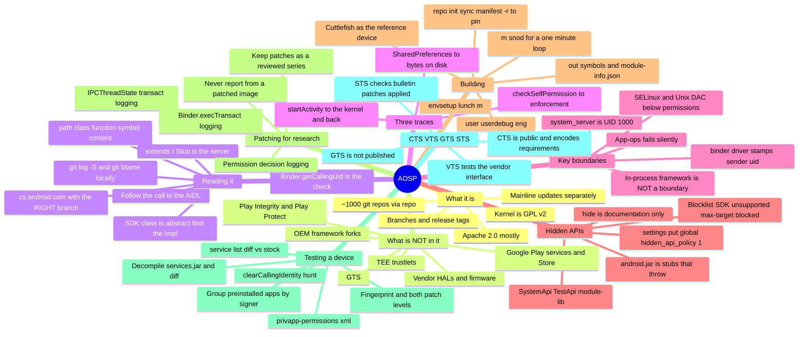

### Cheat sheet

The full printable version is [`cheatsheet.md`](cheatsheet.md). Condensed:

| Need | Command / query |
|---|---|
| Sync a release | `repo init -u https://android.googlesource.com/platform/manifest -b android-15.0.0_r1 && repo sync -c -j8` |
| **Pin what you tested** | `repo manifest -r -o pinned.xml` |
| Read anything | `https://cs.android.com/` — set the branch first |
| Find a server implementation | `content:"extends IFoo.Stub" -path:test` |
| Find where a permission is defined | `file:core/res/AndroidManifest.xml content:"PERMISSION_NAME"` |
| Confused-deputy hunt | `rg -n -A25 "clearCallingIdentity" frameworks/base/services \| grep -E "checkCalling\|enforceCalling"` |
| Build | `source build/envsetup.sh && lunch aosp_cf_x86_64_phone-trunk_staging-userdebug && m -j$(nproc)` |
| Fast image repack | `m snod` |
| Boot | `launch_cvd --daemon` / `stop_cvd` |
| Unstripped binaries | `out/target/product/<device>/symbols/` |
| Module → path | `out/target/product/<device>/module-info.json` |
| Product config as JSON | `out/soong/soong.variables` |
| Device identity | `getprop ro.build.fingerprint` |
| **Both** patch levels | `getprop ro.build.version.security_patch` and `ro.vendor.build.security_patch` |
| Enumerate services | `service list` — then diff against a stock image |
| Relax hidden API | `settings put global hidden_api_policy 1` (reset with `settings delete global hidden_api_policy`) |
| Second permission gate | `appops get <pkg>` / `appops set <pkg> <OP> ignore` |
| Grant for real | `pm grant <pkg> <permission>` |
| Kernel binder tracing | `echo 1 > /sys/kernel/debug/tracing/events/binder/enable` |
| SELinux denials | `dmesg \| grep avc` |
| Trust domains on an image | group preinstalled APKs by `apksigner verify --print-certs` digest |

### Quick revision

- Name three things on a retail phone that are not in AOSP, and why each matters to a tester.
- Which licence covers most of AOSP, which covers the kernel, and what practical difference does it make?
- What does `repo manifest -r` produce and why would you attach it to a report?
- State the six-step procedure for tracing an API to its enforcement point.
- Where, exactly, is a Binder caller's UID established, and why can it not be forged?
- Why does hooking `checkSelfPermission` grant you nothing?
- What is app-ops, and what does `MODE_IGNORED` look like from the app's side?
- What is `android.jar` and what happens if you call one of its methods directly?
- Give the four hidden-API lists and the command that relaxes enforcement.
- Name three reasons a self-built `userdebug` image is a better lab than a rooted retail phone — and the
  one reason it is worse.
- Which directory holds unstripped copies of every native binary on the image?
- What is the `clearCallingIdentity` bug pattern, and what do you grep for?
- Which two properties do you read to detect a stale vendor partition?
- What is CTS, who must pass it, and why is it useful to you?

---

## 14. References

### AOSP source and browsing

- Android Code Search — https://cs.android.com/ — the primary tool; set the branch before you read
- AOSP Gerrit / git — https://android.googlesource.com/
- AOSP GitHub mirror — https://github.com/aosp-mirror — convenient for GitHub's blame and search UI
- Android build numbers and tags — https://source.android.com/docs/setup/reference/build-numbers — map a
  `ro.build.id` to the AOSP tag you should be reading
- Kernel sources — https://android.googlesource.com/kernel/common/ — the Android Common Kernel

### Official documentation

- Android Open Source Project — https://source.android.com/
- Downloading the source — https://source.android.com/docs/setup/download
- The `repo` command reference — https://source.android.com/docs/setup/reference/repo
- Manifest format — https://gerrit.googlesource.com/git-repo/+/HEAD/docs/manifest-format.md
- Building Android — https://source.android.com/docs/setup/build/building
- Cuttlefish virtual device — https://source.android.com/docs/devices/cuttlefish
- Android architecture overview — https://source.android.com/docs/core/architecture
- Project Treble — https://source.android.com/docs/core/architecture/hidl
- Modular system components (Mainline) — https://source.android.com/docs/core/ota/modular-system
- Compatibility Definition Document — https://source.android.com/docs/compatibility/cdd — the normative
  statement of what an Android device must do
- Compatibility Test Suite — https://source.android.com/docs/compatibility/cts
- Vendor Test Suite — https://source.android.com/docs/core/tests/vts
- Android security overview — https://source.android.com/docs/security
- Android Security Bulletins — https://source.android.com/docs/security/bulletin
- Restrictions on non-SDK interfaces — https://developer.android.com/guide/app-compatibility/restrictions-non-sdk-interfaces
- Testing non-SDK interface usage — https://developer.android.com/guide/app-compatibility/test-non-sdk

### Key source paths

- `frameworks/base/core/res/AndroidManifest.xml` — every platform permission and its protection level
- `frameworks/base/services/java/com/android/server/SystemServer.java` — every system service, in start order
- `frameworks/base/core/java/android/os/Binder.java` — `execTransact`, `getCallingUid`, `clearCallingIdentity`
- `frameworks/base/core/java/android/app/ContextImpl.java` — the real implementation behind `Context`
- `frameworks/base/core/java/android/app/ActivityThread.java` — the app process lifecycle
- `frameworks/base/core/java/android/app/SharedPreferencesImpl.java` — Trace B
- `frameworks/base/services/core/java/com/android/server/wm/ActivityStarter.java` — Trace A's destination
- `frameworks/base/services/core/java/com/android/server/pm/permission/` — Trace C's destination
- `frameworks/base/services/core/java/com/android/server/appop/AppOpsService.java` — the second gate
- `frameworks/native/libs/binder/IPCThreadState.cpp` — where user space meets the driver
- `frameworks/native/cmds/servicemanager/` — the service directory
- `drivers/android/binder.c` — where caller identity is established
- `art/runtime/hidden_api.cc` — hidden-API enforcement
- `system/sepolicy/` — the MAC layer
- `system/core/init/` — the first user-space process and `ro.*` properties
- `bionic/linker/linker.cpp` — `dlopen` and namespaces
- `libcore/luni/src/main/java/javax/net/ssl/` — TLS trust dispatch

### OWASP

- MASVS — https://mas.owasp.org/MASVS/
- MASTG — https://mas.owasp.org/MASTG/
- MASTG Android platform overview — https://mas.owasp.org/MASTG/0x05a-Platform-Overview/

### Research and further reading

- Google Project Zero — https://googleprojectzero.blogspot.com/ — a large body of Android platform and
  vendor research, frequently with the AOSP source reading shown in full
- Android Security Rewards Program rules — https://bughunters.google.com/about/rules/android-friends
- Android Developers Blog — https://android-developers.googleblog.com/
- Android Platform Security Model (Mayrhofer et al.) — the paper that states the model this chapter
  traces, searchable by title

### Related chapters

- [06-Android-Architecture](../06-Android-Architecture/README.md) — the system this source implements
- [08-Build-System](../08-Build-System/README.md) — how this source becomes an image
- [12-DEX-Internals](../12-DEX-Internals/README.md) — the bytecode format
- [13-ART](../13-ART/README.md) — the runtime, hidden-API enforcement, and extracting DEX from a device
- [15-Native-Code](../15-Native-Code/README.md) — reversing what `symbols/` helps you read
- [20-Security-Architecture](../20-Security-Architecture/README.md) — the model these traces demonstrate
- [21-App-Sandbox](../21-App-Sandbox/README.md) — the UID and SELinux layers
- [22-SELinux](../22-SELinux/README.md) — the policy in `system/sepolicy/`
- [23-Permissions](../23-Permissions/README.md) — Trace C in full detail
- [24-IPC](../24-IPC/README.md) and [25-Binder](../25-Binder/README.md) — Trace A's transport
- [33-Storage](../33-Storage/README.md) — Trace B's security consequences
- [49-KeyStore](../49-KeyStore/README.md) — `system/security/keystore2/`
- [53-Frida](../53-Frida/README.md) — the tooling in §7
- [60-ADB](../60-ADB/README.md) — the commands in §7.1
- [70-VulnerabilityResearch](../70-VulnerabilityResearch/README.md) — where the §5 patterns are applied
