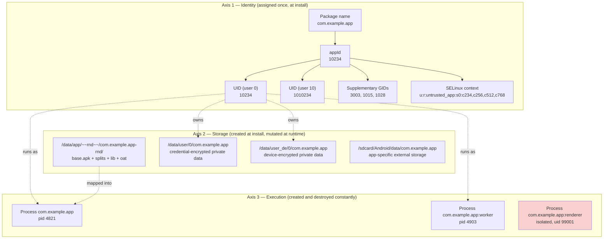
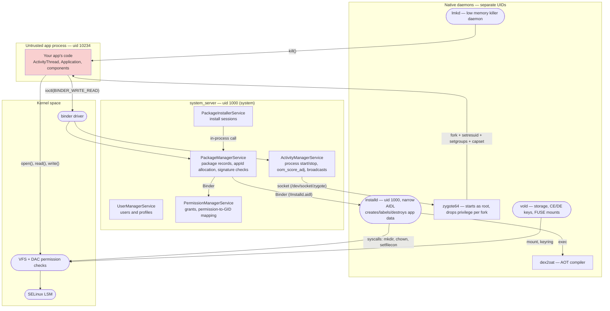
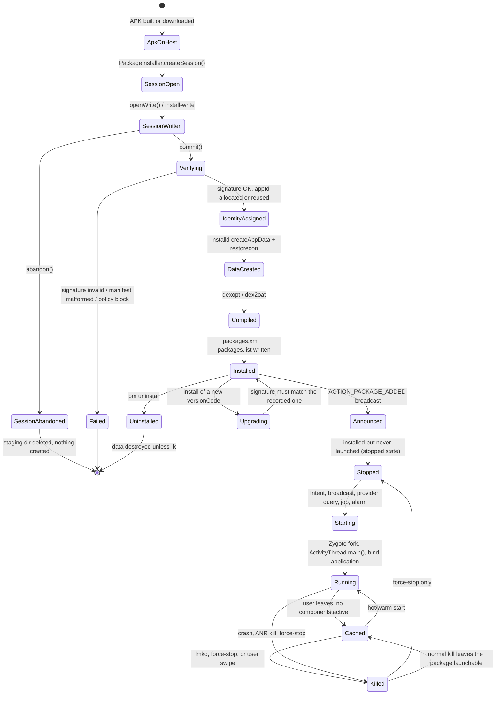
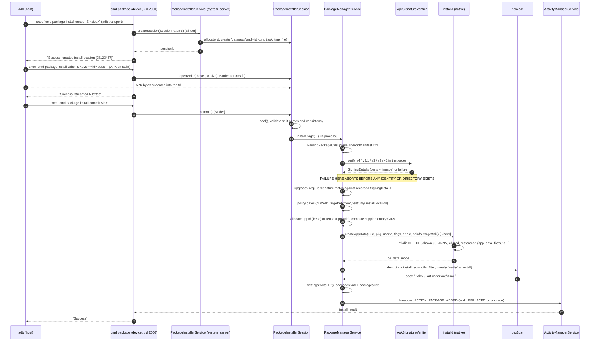
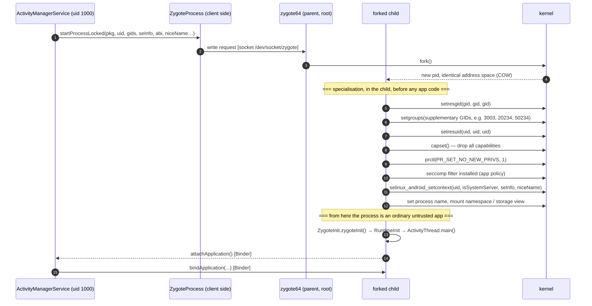
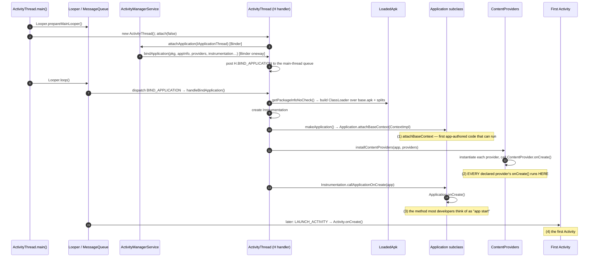
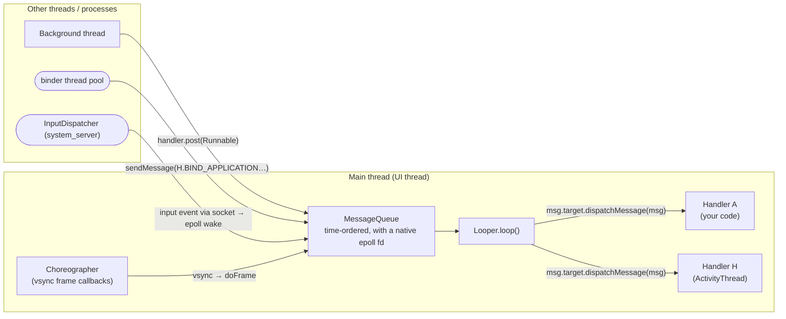
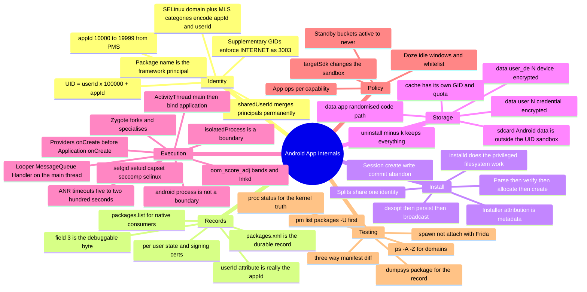

# 09 — Android App Internals

> After this chapter you will be able to take any package name on any Android device and state, from
> first principles and from at least two independent sources, what identity the operating system gave
> it, where its code and data physically live, which process is running it and why, what ran before
> its first line of code, and which of those facts an attacker can influence.

**Prerequisites:** [02 — Linux Basics](../02-Linux-Basics/README.md) for processes, users, file
permissions and `/proc`; [04 — Java](../04-Java/README.md) and [05 — Kotlin](../05-Kotlin/README.md)
for the language the framework is written in; [06 — Android Architecture](../06-Android-Architecture/README.md)
for where `system_server` sits relative to the kernel and the app. Nothing else. Every other term is
defined here on first use.

**Applies to:** Android 5.0 (API 21) through Android 16 (API 36). The baseline for commands and
output is Android 13–16 (API 33–36). Where behaviour changed at a specific API level, a Version
Matrix table says so explicitly.

---

## Table of Contents

1. [Introduction](#1-introduction)
   - 1.1 [The flat that the landlord owns](#11-the-flat-that-the-landlord-owns)
   - 1.2 [What "an app" is to four different layers](#12-what-an-app-is-to-four-different-layers)
   - 1.3 [What would break without any of this](#13-what-would-break-without-any-of-this)
2. [High-Level Architecture](#2-high-level-architecture)
   - 2.1 [The three axes: identity, storage, execution](#21-the-three-axes-identity-storage-execution)
   - 2.2 [Who does what: the component map](#22-who-does-what-the-component-map)
   - 2.3 [The lifetime of an app, end to end](#23-the-lifetime-of-an-app-end-to-end)
3. [Deep Internal Working](#3-deep-internal-working)
   - 3.1 [Package name: the framework's identity](#31-package-name-the-frameworks-identity)
   - 3.2 [appId, UID and the 100000 arithmetic](#32-appid-uid-and-the-100000-arithmetic)
   - 3.3 [Supplementary GIDs: permissions the kernel enforces](#33-supplementary-gids-permissions-the-kernel-enforces)
   - 3.4 [`packages.list` and `packages.xml`: the durable record](#34-packageslist-and-packagesxml-the-durable-record)
   - 3.5 [`sharedUserId`: merging two apps into one principal](#35-shareduserid-merging-two-apps-into-one-principal)
   - 3.6 [Multi-user, work profiles and cross-user attack surface](#36-multi-user-work-profiles-and-cross-user-attack-surface)
   - 3.7 [The install flow, end to end](#37-the-install-flow-end-to-end)
   - 3.8 [`pm`, `adb install` and session-based installation](#38-pm-adb-install-and-session-based-installation)
   - 3.9 [Split APKs and multi-package sessions](#39-split-apks-and-multi-package-sessions)
   - 3.10 [The filesystem: where code and data live](#310-the-filesystem-where-code-and-data-live)
   - 3.11 [CE, DE and Direct Boot](#311-ce-de-and-direct-boot)
   - 3.12 [External storage and the app-specific directories](#312-external-storage-and-the-app-specific-directories)
   - 3.13 [Zygote: how a process comes into existence](#313-zygote-how-a-process-comes-into-existence)
   - 3.14 [`ActivityThread.main()` and the bootstrap order](#314-activitythreadmain-and-the-bootstrap-order)
   - 3.15 [The main thread: Looper, MessageQueue, Handler](#315-the-main-thread-looper-messagequeue-handler)
   - 3.16 [ANRs: what they are and how they are produced](#316-anrs-what-they-are-and-how-they-are-produced)
   - 3.17 [Process lifecycle, `oom_score_adj` and `lmkd`](#317-process-lifecycle-oom_score_adj-and-lmkd)
   - 3.18 [`android:process` and multi-process apps](#318-androidprocess-and-multi-process-apps)
   - 3.19 [The `Application` class and provider-based initialisation](#319-the-application-class-and-provider-based-initialisation)
   - 3.20 [Tasks and the back stack](#320-tasks-and-the-back-stack)
   - 3.21 [Cold, warm and hot start](#321-cold-warm-and-hot-start)
   - 3.22 [What `android:debuggable` really enables](#322-what-androiddebuggable-really-enables)
   - 3.23 [App standby buckets, Doze and background restrictions](#323-app-standby-buckets-doze-and-background-restrictions)
4. [Source Code Walkthrough (AOSP)](#4-source-code-walkthrough-aosp)
5. [Security Perspective](#5-security-perspective)
6. [Reverse Engineering Perspective](#6-reverse-engineering-perspective)
7. [Dynamic Analysis](#7-dynamic-analysis)
8. [Static Analysis](#8-static-analysis)
9. [Examples](#9-examples)
10. [Common Interview Questions](#10-common-interview-questions)
11. [Common Mistakes](#11-common-mistakes)
12. [Hands-on Labs](#12-hands-on-labs)
13. [Summary](#13-summary)
14. [References](#14-references)

---

## 1. Introduction

### 1.1 The flat that the landlord owns

Imagine a large apartment building. Each tenant has a flat. The flat has a number on the door, the
tenant has a key that opens only that door, and the building's caretaker holds a register that maps
tenant names to flat numbers.

Three details of this arrangement matter, and each of them has an exact counterpart in Android.

**The lock does not know the tenant's name.** The lock is a lump of metal that reacts to the shape of
a key. If you hand it the right shape, it opens; if you hand it the wrong shape, it does not. It has
never heard of "Sarah in flat 12". The name lives in the caretaker's register, which is a piece of
paper, and the paper is not what stops you walking into someone's living room.

**The caretaker assigns flat numbers, and the assignment is permanent for as long as the tenancy
lasts.** Sarah does not choose flat 12; the caretaker allocates it when she moves in, writes it down,
and every subsequent decision — post delivery, utility billing, key cutting — refers to that number.
If Sarah moves out and someone else moves in, that person may well be given flat 12, and any letter
addressed only to "flat 12" will now reach a stranger.

**Two tenants can, if they both sign for it, share one flat.** Once they do, there is no lock between
them. Any promise one of them makes about privacy is void, because the building has no mechanism to
enforce a boundary that does not physically exist.

Android is that building. The **package name** (`com.example.app`) is the tenant's name — human
readable, used by every register and every notice board, and worth exactly as much as a piece of paper.
The **UID**, a plain integer, is the flat number, and it is the only thing the lock understands,
because the lock is the Linux kernel and the Linux kernel has never heard of `com.example.app`. The
caretaker is `PackageManagerService`, a Java service inside the `system_server` process. And two apps
sharing one flat is `android:sharedUserId`, which is the subject of this chapter's CTF lab.

> **Mental Model**
> Every security decision on Android is made at one of two levels. The **framework** decides using
> names, and can be argued with, tricked, or bypassed if you find a path that does not go through it.
> The **kernel** decides using numbers, and cannot be argued with at all. When you are assessing a
> control, your first question should always be: *which of those two is enforcing this?*

### 1.2 What "an app" is to four different layers

The word "app" means four different things depending on which part of the stack you ask, and
conflating them is the source of an enormous number of wrong conclusions in security reports. Here is
the disambiguation, and you should be able to recite it.

| Layer | An "app" is… | Identity used | Enforced by | Can it be spoofed? |
|---|---|---|---|---|
| **Store / user** | An icon and a listing | The display label and the developer name | Nothing technical | Trivially |
| **Framework** (`system_server`) | A `PackageSetting` record: components, permissions, flags, signing certificates | The **package name**, plus the signing certificate | `PackageManagerService`, `ActivityManagerService`, permission checks | Package name yes, signature no |
| **Kernel** | One or more processes running under a numeric user id | The **UID** and supplementary **GIDs** | Linux DAC (discretionary access control) on every `open()`, `connect()`, `kill()` | No |
| **SELinux** | A process in a security domain, with a category set | The **security context**, e.g. `u:r:untrusted_app:s0:c234,c256,c512,c768` | The kernel's SELinux LSM, on every operation | No |

> **Definition — DAC (discretionary access control)**
> The classic Unix permission model: every file has an owner UID, a group GID, and nine permission
> bits (read/write/execute for owner, group and others). When a process calls `open()`, the kernel
> compares the process's UID and GIDs against the file's owner, group and bits. It is called
> *discretionary* because the owner of a file may change its permissions at their own discretion.

> **Definition — MAC (mandatory access control)**
> A second, independent permission system layered on top of DAC in which the *policy*, not the file
> owner, decides who may do what. On Android this is SELinux. A process cannot relax its own MAC
> constraints, which is why MAC survives situations where DAC has already been defeated. Chapter
> [22 — SELinux](../22-SELinux/README.md) covers it in full; this chapter covers only the parts that
> encode app identity.

A single installed application therefore has, simultaneously: one package name, one appId, one UID
per Android user it is installed for, a set of supplementary GIDs, one SELinux domain, zero or more
running processes, and one or more directories on disk. Section 3 takes each of those in turn.

### 1.3 What would break without any of this

It is worth stating the problem that this machinery solves, because the machinery only makes sense as
an answer.

**Problem one: a phone runs code from hundreds of mutually distrusting parties.** Your bank, a game
you installed in 2019, a torch app, and whatever ships with the vendor's system image all execute on
the same CPU, against the same filesystem, with the same kernel. There is exactly one human user, so
the classic Unix model — one UID per person — provides no separation whatsoever. If Android had
shipped with every app running as the same UID, the torch app could read the bank's session token
with a single `open()` call, and no amount of framework-level permission checking would help, because
the app is free not to call the framework at all.

Android's answer was to **repurpose the Unix user abstraction**: instead of one UID per human, one
UID per application. This is the single most important design decision in Android security. The
kernel's file permission check, which has existed since 1970 and is extremely well tested, becomes the
primary sandbox.

**Problem two: identity must survive updates and reboots, and must be checkable.** If the UID were
recomputed on every boot, or if an app could pick its own, the sandbox would be meaningless. So the
assignment has to be durable (written to disk, at `/data/system/packages.xml`), authoritative (only
`PackageManagerService` writes it), and bound to something unforgeable (the APK's signing
certificate — see [10 — APK Internals](../10-APK-Internals/README.md)).

**Problem three: processes are expensive and memory is always full.** A phone cannot afford to keep
every app resident, and starting a Java runtime from scratch takes hundreds of milliseconds. Android's
answer is **Zygote**, a process that boots the runtime once, preloads the framework classes, and then
`fork()`s a copy for every new app. And when memory runs out, a userspace daemon (`lmkd`) kills the
least important process rather than waiting for the kernel OOM killer to pick badly.

**Problem four: an app must be able to be reached by other apps without being reachable by everyone.**
That is what components, intent filters, `exported` and permissions are for. This chapter covers where
those live and when they are instantiated; chapters [26 — Intent](../26-Intent/README.md) through
[30 — Activities](../30-Activities/README.md) cover their semantics.

Every mechanism in this chapter is an answer to one of those four problems. When you find yourself
asking "why on earth does Android do it this way?", map the mechanism back to the problem first.

---

## 2. High-Level Architecture

### 2.1 The three axes: identity, storage, execution

An installed application exists along three independent axes. Confusing them is the most common
conceptual error in this area, so the first diagram separates them deliberately.



What you are looking at is three groups of facts that change at completely different rates.

The **identity** axis is set once, at install time, and is then immutable for the life of the
installation. `PackageManagerService` allocates the appId, derives the per-user UIDs arithmetically,
computes the GID set from the granted install-time permissions, and hands the `seinfo` string to
`installd` so the SELinux label can be applied. Nothing the app does at runtime can change any of it.

The **storage** axis is created at install time and then mutated constantly by the app.
there are four distinct locations, that they have different owners and different protections, and that
one of them (`/sdcard/Android/data/...`) is not protected by the app's UID at all in the way people
assume — it is mediated by a FUSE layer and a media provider, which is why chapter
[33 — Storage](../33-Storage/README.md) exists.

The **execution** axis is the most volatile. Processes are created on demand and destroyed whenever
the system needs memory. One app can have several processes; the number is a property of the manifest,
not of the identity. The isolated process is shaded because it is the one place where a process
boundary is *also* a privilege boundary: it runs under a throwaway UID and is the standard place to
put code that parses attacker-controlled input.

> **Warning**
> "The app" is not a process. An app with no running process is still installed, still owns its data,
> still has its UID reserved, and can still be started by an incoming Intent, a broadcast, an alarm,
> a `ContentProvider` query, or a job. Assessments that only look at what is running miss most of the
> attack surface.

### 2.2 Who does what: the component map

The second diagram names the actors. Every one of them will appear again in section 3, and knowing
which process each lives in tells you which privilege level a bug in it would give you.



Read this diagram as a privilege ladder. Your app's code, shaded as untrusted, can only reach the
framework through the **binder driver** — a kernel character device that carries almost all Android
IPC and, critically, stamps every transaction with the caller's real UID and PID as observed by the
kernel. That stamping is why `Binder.getCallingUid()` is trustworthy and why a caller cannot lie about
who it is. Chapter [25 — Binder](../25-Binder/README.md) covers the driver itself.

Notice that `PackageManagerService` does **not** create your data directory itself. It asks `installd`
over a deliberately narrow Binder interface defined in
`frameworks/native/cmds/installd/binder/android/os/IInstalld.aidl`. This is privilege separation in
its clearest form: `system_server` is a very large Java process with an enormous attack surface, and
the platform designers did not want a bug in it to translate directly into "write any file as any
UID". `installd` is small, native, and can only perform the handful of operations that AIDL file
declares. When you read a sandbox-escape write-up, one of the first things to check is whether the
author found a way to make `installd` do something on their behalf.

Also notice `zygote` sitting between AMS and your process. AMS does not `fork()`+`exec()` your app.
It writes a request to a Unix domain socket, and the Zygote process forks a copy of itself. Section
3.13 explains why, and what security-relevant work happens in that fork.

### 2.3 The lifetime of an app, end to end

The last architectural diagram is a state machine covering everything from "an APK exists somewhere"
to "the process has been killed". Each state maps to a subsection of section 3.



Three transitions in this diagram carry most of the security weight, and they are worth naming now so
that you look out for them in section 3.

`Verifying → IdentityAssigned` is where the signature check happens, and it happens **before** any
identity is allocated or any directory is created. That ordering is not an implementation detail; a
build that created the data directory first would be handing a labelled, UID-owned directory to code
that had not yet been shown to be authentic.

`Installed → Upgrading → Installed` is where the signature *continuity* check happens. Android does
not validate a certificate chain up to a trust anchor — there is no certificate authority for APKs.
What it enforces is that the new APK is signed by the same key as the installed one, or by a key that
the old key delegated to through a v3 rotation lineage. That is why re-signing an APK forces an
uninstall first, and why `INSTALL_FAILED_UPDATE_INCOMPATIBLE` is the single most common error a
beginner meets.

`Stopped → Starting` is the one people forget. An app in the **stopped state** — freshly installed and
never launched, or explicitly `force-stop`ped — will not receive most broadcasts and will not be
started by them. Any other trigger, including an explicit Intent, does start it. Malware
persistence and "how did this thing start itself?" investigations both live in this transition.

---
## 3. Deep Internal Working

This is the longest section in the chapter. It is organised as three blocks: **identity** (3.1–3.6),
**installation and storage** (3.7–3.12), and **execution** (3.13–3.23). Each subsection answers, in
order, *what* the thing is, *why* it exists, *when* and *where* it is created, *how* Android
implements it, and *what happens when it is attacked*.

### 3.1 Package name: the framework's identity

**What it is.** The package name is a string in reverse-DNS form — `com.example.app` — declared in the
APK's `AndroidManifest.xml` and baked into the compiled binary manifest at build time. It is the
primary key of the framework's entire view of installed software.

> **Definition — security principal**
> A *principal* is the entity to which a security decision is attached: the thing that is granted a
> permission, that owns a file, that a policy names. On a desktop Linux system the principal is
> usually a human user. On Android the principal is **the application**, and the package name is how
> the framework names it.

**Why it exists.** Something has to be unique and human-meaningful. Filenames are not unique (two
developers can both ship `app.apk`), display labels are not unique (anyone can call their app
"Settings"), and UIDs are not human-meaningful and are recycled. Reverse DNS gives a namespace with a
natural, if unenforced, ownership story.

**Where it lives.** In four places at once, which is a recurring theme:

| Location | Written by | Read by |
|---|---|---|
| `AndroidManifest.xml` inside the APK (binary AXML) | the build system | `ParsingPackageUtils` at install time |
| `/data/system/packages.xml`, `<package name=…>` | `Settings` in `system_server` | PMS at boot |
| `/data/system/packages.list`, field 1 | `Settings` in `system_server` | `run-as`, `installd`, `logd` |
| The directory names under `/data/user/N/` and `/data/app/` | `installd` | everything |

**How unique is it, really?** Within one Android user on one device, exactly one package with a given
name can be installed at a time. `PackageManagerService` enforces that; the second install becomes an
*upgrade* attempt, and an upgrade with a different signing certificate is rejected. Across devices,
across the world, and inside an APK file sitting on your disk, the package name is nothing but a
string that anyone can type.

> **Warning**
> "We validate that the calling package is `com.ourcompany.app`" is not a security control on its
> own. Any attacker can build an APK whose manifest declares that package name. The check only becomes
> meaningful when it is combined with a signature check, because forging the signature requires the
> private key. See section 5.2 for the vulnerable-code / secure-fix pair.

The one place a package name **is** trustworthy is on the receiving end of a Binder call on the same
device, because you do not take the name from the caller — you take the UID from the kernel and ask
the framework which packages that UID owns:

```kotlin
// Android app code — server side of an AIDL/Binder or ContentProvider call.
// Binder.getCallingUid() is filled in by the binder driver from the caller's real credentials.
// The caller has no way to influence it.
val callerUid = Binder.getCallingUid()
val callerPackages: Array<String>? = packageManager.getPackagesForUid(callerUid)
// NOTE: this can legitimately return SEVERAL package names when the caller uses sharedUserId (3.5).
```

### 3.2 appId, UID and the 100000 arithmetic

**What they are.** The **appId** is a per-package integer allocated by `PackageManagerService` from
the range 10000–19999. The **UID** is the number the Linux kernel attaches to a running process. For
the owner user they happen to be the same number, which is why the two words get used
interchangeably and why so many people are confused the first time they see a UID above a million.

The relationship is pure arithmetic:

```text
UID    = userId * 100000 + appId
userId = UID / 100000            (integer division)
appId  = UID % 100000
```

> **Definition — appId**
> The stable, per-package identifier. It belongs to the *package*, is allocated once at first install,
> and does not change when the app is upgraded or installed for an additional Android user.

> **Definition — userId (Android user)**
> The identifier of an Android *user or profile* on the device: 0 is the device owner, 10 and above
> are secondary users, work profiles, clone profiles and similar. This is a human-level concept and
> has nothing to do with the Linux notion of a user.

> **Definition — UID (Linux user identifier)**
> The 32-bit integer the kernel attaches to each process and each file. It is the value compared
> during every DAC check. On Android it encodes both the appId and the Android userId through the
> arithmetic above.

**Why the arithmetic.** Android needed multi-user support (added in 4.2 / API 17) without giving up
the "one app, one UID" sandbox. The elegant answer was to keep one appId per package and derive a
distinct UID per Android user, so that the same application installed in the personal profile and in
the work profile is, to the kernel, two entirely different Linux users who cannot touch each other's
files. `UserHandle.PER_USER_RANGE` is the constant 100000 and it caps the number of apps per user at
100000 by construction.

The constants, from `frameworks/base/core/java/android/os/Process.java` and
`system/core/libcutils/include/private/android_filesystem_config.h`:

| Constant | Value | Meaning |
|---|---|---|
| `FIRST_APPLICATION_UID` / `AID_APP_START` | 10000 | lowest appId for an ordinary app |
| `LAST_APPLICATION_UID` / `AID_APP_END` | 19999 | highest appId for an ordinary app |
| `FIRST_ISOLATED_UID` / `AID_ISOLATED_START` | 90000 | lowest isolated-process UID |
| `LAST_ISOLATED_UID` / `AID_ISOLATED_END` | 99999 | highest isolated-process UID |
| `PER_USER_RANGE` / `AID_USER_OFFSET` | 100000 | the multiplier in the arithmetic |
| `FIRST_SDK_SANDBOX_UID` | 20000 | SDK Runtime processes, API 33+ (verify per release) |
| `AID_SHARED_GID_START` … `END` | 50000–59999 | per-app shared GIDs |
| `AID_CACHE_GID_START` … `END` | 20000–29999 | per-app cache GIDs |

Worked examples, which you should be able to do in your head:

| UID | userId | appId | Reading |
|---|---|---|---|
| `1000` | 0 | 1000 | `system` — `system_server` and platform-signed apps |
| `2000` | 0 | 2000 | `shell` — what `adb shell` runs as |
| `10234` | 0 | 10234 | an ordinary app in the personal profile |
| `1010234` | 10 | 10234 | **the same package** in work-profile user 10 |
| `1110234` | 11 | 10234 | the same package in user 11 |
| `99001` | 0 | 99001 | an isolated process, e.g. a WebView renderer |

**The human-readable form.** `ps` shows `u0_a234`, not `10234`. There is no `/etc/passwd` on Android
with an entry for every app; instead Bionic's `libc` synthesises the name arithmetically in
`bionic/libc/bionic/grp_pwd.cpp`. `u0` is the Android userId, and `a234` is `appId - 10000`. Decode it
in your head every time you see it: `u10_a234` is the work-profile instance of appId 10234.

> **Under the Hood**
> Because `getpwuid()` computes rather than looks up, an app UID that has never been allocated still
> produces a valid-looking name. That means a `ps` output showing `u0_a999` proves nothing about any
> package existing; it only proves a process is running under that number. Always resolve UIDs back
> to packages through `PackageManager` or `pm list packages -U`, never by pattern-matching a username.

**Reuse.** appIds are reused. Uninstall the app holding 10234 and the next installation may well be
given 10234. This has a direct forensic consequence: an artefact — a log line, a database row, a file
owner — that recorded only a UID and not a package name is ambiguous the moment any uninstall has
happened. When you are reconstructing a timeline, correlate the UID against `packages.xml` install
timestamps, not against the current state.

### 3.3 Supplementary GIDs: permissions the kernel enforces

Most Android permissions are checked by framework code: your app calls an API, `system_server`
compares the caller's granted permission set against what the API requires, and returns or throws. A
small, important minority are enforced by the kernel instead, because the resource they protect is a
device node or a socket type that the kernel already knows how to guard with a group.

> **Definition — supplementary group (GID)**
> In addition to its primary group, a Unix process can belong to a list of supplementary groups. The
> kernel checks all of them during file and socket permission decisions. Android reuses this to
> implement a handful of permissions with no framework involvement at all.

The mapping from permission to GID is not hard-coded in Java. It is data, in
`frameworks/base/data/etc/platform.xml`, which lands on the device as
`/system/etc/permissions/platform.xml`:

```xml
<!-- /system/etc/permissions/platform.xml (excerpt, shape only) -->
<permission name="android.permission.INTERNET">
    <group gid="inet" />
</permission>
```

The GIDs you will actually meet:

| GID | Name | Granted because the app holds | What it lets the kernel allow |
|---|---|---|---|
| 3003 | `AID_INET` | `android.permission.INTERNET` | creating `AF_INET`/`AF_INET6` sockets |
| 3004 | `AID_NET_RAW` | system only | raw sockets |
| 3005 | `AID_NET_ADMIN` | system only | network configuration |
| 3009 | `AID_READPROC` | system/shell only | reading other processes' `/proc` entries |
| 1015 | `AID_SDCARD_RW` | legacy external-storage write | writing shared storage on older releases |
| 1028 | `AID_SDCARD_R` | legacy external-storage read | reading shared storage on older releases |
| 1023 | `AID_MEDIA_RW` | media components | direct read/write on media directories |
| 1077 | `AID_EXTERNAL_STORAGE` | MediaProvider and the storage stack | the FUSE/media path |
| 9997 | `AID_EVERYBODY` | everyone | world-accessible resources |
| 20000+appId′ | per-app cache GID | automatic | cache quota accounting |
| 50000+appId′ | per-app shared GID | automatic | shared-app resources |

> **Pentester's Note**
> `grep Groups /proc/<pid>/status` is the fastest possible answer to "can this process reach the
> network?" If 3003 is absent, the app cannot open a TCP socket at all — not because a framework
> check refuses, but because `socket(AF_INET, …)` returns `EACCES` from the kernel. An app that
> claims to be offline and *is* 3003-less is genuinely offline. An app that claims to be offline and
> holds 3003 has merely not called the API yet.

The reason `INTERNET` is a kernel-enforced GID rather than a runtime permission is historical and
practical: it is granted at install time, never revoked, and enforcing it in the kernel means it
cannot be bypassed by any amount of native code, JNI, or `Runtime.exec()`. Compare this to `CAMERA`,
which is a runtime permission checked by `system_server` and therefore is, in principle, only as
strong as the path leading to the check.

### 3.4 `packages.list` and `packages.xml`: the durable record

Everything `PackageManagerService` knows lives in memory in a `Settings` object, and is persisted to
two files under `/data/system/`. Both are readable only by privileged UIDs; both are worth being able
to read by eye.

#### `/data/system/packages.list`

A flat, space-separated text file, mode `0640`, owner `system:package_info`. It exists because several
**native** consumers need a handful of facts fast and must not have to talk Binder to
`system_server` — most importantly `run-as` and `installd`.

```text
com.example.app 10234 0 /data/user/0/com.example.app default:targetSdkVersion=34 3003,1015,1028 0 42 null null
```

| # | Field | Example | Meaning |
|---|---|---|---|
| 1 | package name | `com.example.app` | the principal |
| 2 | uid | `10234` | the appId for user 0 |
| 3 | **debug flag** | `0` | `1` when `FLAG_DEBUGGABLE` is set — this is the byte `run-as` reads |
| 4 | data dir | `/data/user/0/com.example.app` | CE data path |
| 5 | seinfo | `default:targetSdkVersion=34` | fed into `seapp_contexts` to pick the SELinux domain |
| 6 | GID list | `3003,1015,1028` | comma-separated, `none` when empty. **The storage GIDs are legacy** — see the note below |
| 7 | profileable from shell | `0` | `android:profileableByShell` |
| 8 | longVersionCode | `42` | `versionCodeMajor << 32 \| versionCode` |
| 9+ | trailing columns | `null null` | added over releases — **parse tolerantly** |

> **Do not expect `1015` and `1028` on a modern device.** The line above is illustrative of an
> older release. On Android 13 (API 33), `platform.xml` declares `READ_EXTERNAL_STORAGE` and
> `WRITE_EXTERNAL_STORAGE` with **no `<group>` child**, so no storage GID is assigned at all — an app
> holding both shows `gids=[3002, 3003]`, measured on a physical device. Scoped storage replaced the
> GID mechanism; see [23-Permissions](../23-Permissions/README.md) for the permission-to-GID mapping
> as it actually stands, and [33-Storage](../33-Storage/) for scoped storage itself.
>
> Note also that `dumpsys package` `gids=` and `/proc/<pid>/status` `Groups:` **do not match**. The
> former is what `PackageManagerService` recorded; the latter is what the kernel gave the live
> process, and includes per-user and per-app GIDs the former never lists. When they disagree, the
> kernel is the ground truth.

> **Under the Hood**
> Field 3 is the entire mechanism behind `run-as`. Read
> `system/core/run-as/run-as.cpp`: it looks up the package, checks that the debug flag is set, then
> `setresgid`/`setresuid`s to the app's UID and `exec`s your command. A single character in a text file
> is the difference between "attacker with USB access" and "attacker with full read/write on the
> app's private data". Nothing cryptographic is involved.

#### `/data/system/packages.xml`

The full record: one `<package>` element per installed package, plus `<shared-user>` elements,
per-user state, signing certificates and permission grants. Written by `Settings` with a
`packages-backup.xml` written first so an interrupted write cannot corrupt the device's view of what
is installed.

```xml
<!-- /data/system/packages.xml — abridged, attribute shapes are real -->
<package name="com.example.app"
    codePath="/data/app/~~kQ3n8LmA==~~/com.example.app-9dK2vP1w=="
    nativeLibraryPath="/data/app/~~kQ3n8LmA==~~/com.example.app-9dK2vP1w==/lib"
    primaryCpuAbi="arm64-v8a"
    publicFlags="944291398" privateFlags="536870912"
    ft="18f2c1a4b00" it="18f2c1a4c11" ut="18f2c1a4c11"
    version="42" userId="10234">
    <sigs count="1" schemeVersion="3">
        <cert index="0" key="3082…" />
    </sigs>
    <perms>
        <item name="android.permission.INTERNET" granted="true" flags="0" />
    </perms>
    <proper-signing-keyset identifier="7" />
    <user id="0" ce-data-inode="1234567" installed="true" hidden="false"
          suspended="false" stopped="false" not-launched="false" enabled="0" instant="false" />
</package>
```

The attribute you must not misread is `userId="10234"`. **That is the appId**, not the Android user
id. The name is historic and it trips up everybody once.

| Attribute | What it tells you | Why a pentester cares |
|---|---|---|
| `codePath` | where the APK set lives | pulling the real installed bytes, including splits |
| `publicFlags` / `privateFlags` | decimal `ApplicationInfo` bitmaps | decode for `DEBUGGABLE`, `ALLOW_BACKUP`, `HAS_CODE` |
| `ft` / `it` / `ut` | file time, first install, last update, **hex ms since epoch** | forensic timeline |
| `<sigs>` | the signing certificate(s) | identity — see [10 — APK Internals](../10-APK-Internals/README.md) |
| `<perms>` | install-time and runtime grant state | what the app actually holds, not what it asked for |
| `<user id=…>` | per-user installed/stopped/hidden/suspended | an app can be "installed" and invisible |
| `sharedUserId` | the shared appId, when present | blast-radius analysis (3.5) |
| `installer`, `installInitiator`, `packageSource` | provenance | store vs sideload vs another app |

```bash
# adb shell (root) — the two files, side by side, for one package
grep -w "^com.example.app" /data/system/packages.list
grep -A 20 'package name="com.example.app"' /data/system/packages.xml
```

```bash
# host — convert a hex install timestamp into something human
python3 -c "import datetime;print(datetime.datetime.fromtimestamp(int('18f2c1a4c11',16)/1000))"
```

> **Pentester's Note**
> On a device you are triaging, `packages.xml` is the closest thing to an installation history. `it`
> (first install time) that predates `ut` (last update) by years, an `installer` of `null` on an app
> that claims to come from the Play Store, or an `installInitiator` naming an unexpected package are
> all worth a paragraph in the report. Note also that a package uninstalled with `-k`
> (`DELETE_KEEP_DATA`) keeps its record and its directories — `pm list packages -u -3` finds those.

### 3.5 `sharedUserId`: merging two apps into one principal

**What it is.** A legacy `<manifest>` attribute. Two or more packages that declare the same
`android:sharedUserId` string **and are signed with the same certificate** are assigned a single appId
by `PackageManagerService`. Every process of every member then runs as that one UID.

```xml
<!-- AndroidManifest.xml of BOTH apps -->
<manifest xmlns:android="http://schemas.android.com/apk/res/android"
    android:sharedUserId="com.example.shared">
```

**Why it exists.** It predates the modern IPC toolkit. In 2009, if two of your apps needed to share a
database or a login session, running them as one Unix user was by far the easiest answer. The platform
itself still uses it heavily: `android.uid.system` (1000), `android.uid.phone` (1001) and
`android.uid.bluetooth` (1002) are shared users holding many platform packages.

**What it actually merges.** This is the table to memorise, because "they share a UID" understates it:

| Merged | Consequence |
|---|---|
| The Linux UID | any member can `open()` any other member's private files with no check failing |
| Supplementary GIDs | the GID set is the union across members |
| SELinux MLS categories | derived from the appId, so identical — the second isolation layer collapses too |
| The ability to share a process | `android:process` with a global name lets them share one ART heap |
| Signature requirement | identical certificates are mandatory, and are the only thing keeping strangers out |
| Effective permission surface | in practice the group's granted permissions are what matters for kernel-enforced GIDs |

**The security consequence, stated precisely.** `sharedUserId` does not weaken the sandbox; it
*redraws* it. There is still exactly one sandbox, and both applications are inside it. A remote code
execution, arbitrary file read, or injection flaw in the least important member is therefore
equivalent to the same flaw in the most important member. Blast radius becomes a design property
decided years before the bug is written.

> **Warning**
> `android:sharedUserId` is deprecated from API 29, and — this is the part people do not know — **it
> can never be removed from a shipped app**. Removing it changes the package's UID, and Android will
> not change an installed package's identity. The upgrade is rejected
> (`INSTALL_FAILED_UID_CHANGED` / `INSTALL_FAILED_SHARED_USER_INCOMPATIBLE` /
> `INSTALL_FAILED_UPDATE_INCOMPATIBLE`, depending on release) and the only route forward for an
> existing user is uninstall-and-reinstall, destroying their data.

The API 33 escape hatch is `android:sharedUserMaxSdkVersion`:

```xml
<manifest xmlns:android="http://schemas.android.com/apk/res/android"
    android:sharedUserId="com.example.shared"
    android:sharedUserMaxSdkVersion="32">
```

Its semantics are narrow and must be stated exactly:

| Situation | Result |
|---|---|
| Fresh install on API ≤ 32 | shared UID applies as before |
| **Fresh install on API ≥ 33** | attribute ignored; the package gets its **own** appId |
| Package already installed with a shared UID, device later upgrades Android | keeps the shared UID |
| In-place update on API ≥ 33 that adds the attribute | **keeps** the shared UID |

So it stops the problem growing and does nothing for the installed base. That distinction is the
difference between a useful recommendation and a misleading one, and
[Lab 03](labs/lab-03-ctf-the-shared-uid-heist.md) makes you demonstrate both halves.

**Finding it.** Three ways, in increasing order of reliability:

```bash
# host — statically, from the APK
aapt2 dump xmltree base.apk --file AndroidManifest.xml | grep -i sharedUser
```

```bash
# adb shell — from the package record
dumpsys package com.example.app | grep -E 'userId=|sharedUser'
# sharedUser=SharedUserSetting{a1b2c3 com.example.shared/10234}
```

```bash
# host — from the UID table; catches sharing however it was declared
adb shell pm list packages -U | tr -d '\r' | sed 's/package://;s/uid://' \
  | awk '{print $2, $1}' | sort -n \
  | awk '{m[$1]=m[$1]" "$2} END{for(u in m){n=split(m[u],a," "); if(n>1) print u ":" m[u]}}'
```

Every device has legitimate platform shared users in the 1000–1999 range. What you are hunting for is
a third-party group with an appId in the 10000+ range.

### 3.6 Multi-user, work profiles and cross-user attack surface

**What a work profile is.** A separate Android user — conventionally userId 10 — that shares the
physical device and usually the lock screen with the personal profile, but has its own instance of
everything else. It is created and governed by a **device policy controller (DPC)**, the management
app that holds `DevicePolicyManager` privileges.

The same package installed in both profiles is two applications as far as the kernel is concerned:

| | Personal profile | Work profile |
|---|---|---|
| userId | 0 | 10 |
| UID for appId 10234 | 10234 | 1010234 |
| Username string | `u0_a234` | `u10_a234` |
| CE data | `/data/user/0/com.example.app` | `/data/user/10/com.example.app` |
| DE data | `/data/user_de/0/com.example.app` | `/data/user_de/10/com.example.app` |
| Shared storage | `/storage/emulated/0` | `/storage/emulated/10` |
| SELinux MLS | `…,c512,c768` | `…,c522,c768` |

The MLS third category moves from `c512` to `c522` because it encodes `512 + (userId & 0xff)`. Section
5.9 and [Lab 01](labs/lab-01-app-identity-and-uid.md) walk that arithmetic.

**Crossing the boundary legitimately** requires `INTERACT_ACROSS_USERS` or
`INTERACT_ACROSS_USERS_FULL` — signature or privileged permissions ordinary apps cannot hold — or an
explicit **cross-profile intent filter** installed by the DPC, which is how "open this link in the work
profile" works.

```bash
# adb shell — enumerate the users and the per-user package sets
pm list users
dumpsys user
am get-current-user
pm list packages --user 0 -U > /data/local/tmp/u0.txt
pm list packages --user 10 -U > /data/local/tmp/u10.txt
```

**The cross-user attack surface** is where real findings live in managed deployments:

| Surface | What to test |
|---|---|
| Cross-profile intent filters installed by the DPC | which actions/categories were forwarded, and in which direction |
| Privileged helper apps present in both profiles | do they proxy a request from one profile into the other? |
| Components exported with a `signature` permission held by a badly-scoped system app | can a personal-profile app reach a work-profile service through it? |
| Shared storage boundaries | `/storage/emulated/10` must not be reachable from user 0 |
| `sendBroadcastAsUser` / `startActivityAsUser` callers | which privileged packages call these, and with what input |
| Clone profiles (newer releases) | a second instance of the same package in the *same* profile group |

> **Pentester's Note**
> Two mistakes recur in work-profile assessments and both are expensive. The first is analysing the
> personal-profile copy of the app and reporting on data the enterprise does not care about — always
> confirm which `userId` your target is in. The second is that any hard-coded `/data/data/<pkg>` path
> in your tooling silently examines user 0. Write everything against `/data/user/<N>/<pkg>`;
> `/data/data` is a symlink to `/data/user/0` and exists only for backwards compatibility.

### 3.7 The install flow, end to end

Installation is a **transaction**, not a copy. Six subsystems cooperate, any step can fail, and until
the final commit nothing about the package is visible to any other process.



Read that diagram as a sequence of **irreversible commitments**, each of which is only made once the
previous one succeeded.

Steps 1–8 stage bytes. Nothing durable has happened; the staging directory `/data/app/vmdl<id>.tmp`
is labelled `apk_tmp_file`, a *different* SELinux type from installed code, precisely so that policy
can allow the installer to write staging while forbidding it to write installed code.

Steps 12–14 are the security-critical ones. The manifest is parsed, then the signature is verified,
then — only on an upgrade — the new signature is compared against the recorded one. Note the order in
which schemes are tried: v4, v3.1, v3, v2, v1. The platform prefers the strongest scheme present, and
apps targeting API 30 and above must carry at least v2. Chapter
[10 — APK Internals](../10-APK-Internals/README.md) covers what each scheme actually digests.

Step 17 is where identity is born. On a fresh install PMS allocates an unused appId; on an upgrade it
reuses the existing one, which is why an upgrade never breaks the app's file ownership.

Step 18–19 is the `installd` call. The framework does not create the directory itself. Look at the
argument list: the package name, the Android userId, the appId, the `seinfo` string and the
`targetSdkVersion` are all passed, because `installd` needs every one of them to compute the correct
owner, mode and SELinux label.

Step 21 is compilation. On a modern release the install-time compiler filter for an ordinary app is
usually `verify` rather than full ahead-of-time compilation; the real optimisation happens later in a
background `dexopt` job guided by the profile the app produces while running. Chapter
[11 — Android Runtime](../11-Android-Runtime/README.md) covers the artefacts.

Step 23 is the announcement. `ACTION_PACKAGE_ADDED` is a **notification after the fact**. A receiver
cannot veto or modify an install. Any product claiming to "block malicious installs" from an ordinary
app is either a device owner using `DevicePolicyManager`, a privileged verifier holding
package-verification privileges, or exaggerating.

> **Warning**
> A package does **not** receive its own `PACKAGE_ADDED`. It is stopped while being replaced. What it
> can receive, if it registers for it, is `ACTION_MY_PACKAGE_REPLACED` — which is exactly the
> mechanism malware uses to re-establish itself immediately after its own update.

Version matrix for install-flow behaviour:

| Behaviour | Until | From |
|---|---|---|
| Install path `/data/app/<pkg>-1` | API 25 | — |
| Install path `/data/app/<pkg>-<base64>` | API 29 | API 26 |
| Randomised `~~rnd~~` parent directory | — | API 30 |
| v1-only signature accepted for `targetSdk` ≥ 30 | API 29 | rejected from API 30 |
| `InstallSourceInfo` (initiating/originating package) | — | API 30 |
| `sharedUserMaxSdkVersion` honoured | — | API 33 |
| Install blocked for very low `targetSdkVersion` | — | API 34 (`--bypass-low-target-sdk-block` to override) |

### 3.8 `pm`, `adb install` and session-based installation

`adb install app.apk` is not a file copy. Since Android 5.0 it is a thin client over the same public
`PackageInstaller` session API that the Play Store uses. There is no privileged back door for the
store — which is exactly why you can reproduce every step by hand.

The three commands are `BEGIN`, `INSERT`, `COMMIT`:

```bash
# adb shell — a session install, done explicitly
SZ=$(stat -c %s /data/local/tmp/app.apk)
SID=$(pm install-create -r -S $SZ | grep -o '[0-9]\+')
pm install-write -S $SZ $SID base /data/local/tmp/app.apk
pm install-commit $SID
# ...or throw the whole thing away, leaving no trace:
# pm install-abandon $SID
```

```bash
# host — stream from the host with no file ever written to the device
SZ=$(stat -c %s app.apk)
SID=$(adb shell pm install-create -r -S $SZ | tr -dc '0-9')
adb shell pm install-write -S $SZ $SID base - < app.apk
adb shell pm install-commit $SID
```

That second form is what `adb install` prints "Performing Streamed Install" for. It matters
operationally: nothing lands in `/data/local/tmp`, so a monitoring rule watching that directory sees
nothing.

| Command | Purpose | Notes |
|---|---|---|
| `pm install-create [opts]` | open a session | prints `Success: created install session [N]` |
| `pm install-write -S <size> <sid> <splitName> <path or ->` | write one APK | `-S` is mandatory when streaming and must be exact |
| `pm install-commit <sid>` | verify and commit atomically | this is where everything in 3.7 happens |
| `pm install-abandon <sid>` | destroy the session | staging directory is deleted |
| `pm install-existing --user N <pkg>` | make an installed package visible to another user | no bytes transferred |
| `dumpsys package installs` | inspect live sessions | shows `sealed=`, `mInstallerUid=`, `mode=` |

The flags worth knowing, because each one changes the security posture of the result:

| Flag | Effect | Why a tester cares |
|---|---|---|
| `-r` | reinstall, keep data | the normal iterate loop |
| `-t` | allow `android:testOnly` | many CTF and debug builds set it |
| `-d` | allow version downgrade | rolling back to a vulnerable version |
| `-g` | grant all runtime permissions | removes permission prompts from your test loop |
| `-i <pkg>` | set the attributed installer package | **fakes "installed from the Play Store"** |
| `--user N` | target a specific Android user | work-profile testing |
| `--instant` | install as an Instant App | different SELinux domain, restricted storage |
| `--install-reason N` | 0 unknown, 1 policy, 2 restore, 3 device setup, 4 user | shows up in `dumpsys` |
| `--bypass-low-target-sdk-block` | install an old-`targetSdk` APK on API 34+ | keeping legacy targets testable |

> **Pentester's Note**
> `pm install -i com.android.vending` sets `installerPackageName` to the Play Store for an APK that
> arrived over USB. Any app whose anti-sideloading check is
> `getInstallerPackageName().equals("com.android.vending")` has just been defeated by one flag. The
> stronger API is `getInstallSourceInfo()` (API 30+), which exposes a triple — installing, initiating
> and originating package — and where the *initiating* package is much harder to forge because the
> system records the UID that actually opened the session. Report the naive check as a finding, and
> say precisely which API the developer should use instead.

### 3.9 Split APKs and multi-package sessions

**What splits are.** Rather than one APK containing every language, density and CPU architecture, a
developer uploads an **Android App Bundle** (`.aab`) and the store generates a per-device set: a
`base.apk` plus configuration splits, plus any on-demand feature modules.

| Split kind | Typical filename | `splitName` used in `install-write` | Contains |
|---|---|---|---|
| Base | `base.apk` | `base` | manifest, DEX, shared resources |
| ABI config | `split_config.arm64_v8a.apk` | `config.arm64_v8a` | native libraries for one architecture |
| Density config | `split_config.xxhdpi.apk` | `config.xxhdpi` | drawables for one density |
| Language config | `split_config.en.apk` | `config.en` | one locale's strings |
| Dynamic feature | `split_payments.apk` | `payments` | an on-demand module, with its own DEX |

```bash
# host — install a set
adb install-multiple base.apk split_config.arm64_v8a.apk split_config.xxhdpi.apk

# host — atomic multi-package install (several packages, all or nothing)
adb install-multi-package app1.apk app2.apks
```

```bash
# adb shell — the same thing by hand, which is what teaches you the naming
SID=$(pm install-create -r | grep -o '[0-9]\+')
pm install-write -S $(stat -c %s base.apk)    $SID base             /data/local/tmp/base.apk
pm install-write -S $(stat -c %s split_a.apk) $SID config.arm64_v8a /data/local/tmp/split_a.apk
pm install-commit $SID
```

A session containing only splits is rejected with
`INSTALL_FAILED_INVALID_APK: Full install must include a base package`. The base APK carries the
manifest that defines the identity; without it there is nothing to install.

**The three consequences for analysis**, which are the reason this subsection exists:

First, **pull every split**, or you are missing native libraries and possibly entire features:

```bash
# host
for p in $(adb shell pm path com.example.app | tr -d '\r' | sed 's/package://'); do adb pull "$p"; done
```

Second, **dynamic feature splits contain code that only exists after the user triggers a download**.
An app can genuinely appear to contain no payment, no biometric and no telemetry logic in `base.apk`.
A pipeline that scans only the base APK will report a clean bill of health on an app whose interesting
code it has never seen.

Third, **a split is not a sandbox**. All splits of one app must be signed by the same key, and they
share one `codePath`, one appId, one data directory and one process. There is no privilege boundary
between a base and a feature module.

### 3.10 The filesystem: where code and data live

Here is the complete layout for one package, drawn as a tree, with owners and SELinux labels.

```text
/data/
├── app/
│   └── ~~kQ3n8LmA==~~/                                system:system   apk_data_file
│       └── com.example.app-9dK2vP1w==/
│           ├── base.apk                               system:system   apk_data_file
│           ├── split_config.arm64_v8a.apk             system:system   apk_data_file
│           ├── lib/arm64/libnative.so                 system:system   apk_data_file
│           └── oat/arm64/base.{odex,vdex,art}         system:system   dalvikcache_data_file
│
├── data/  ->  (real dir; /data/user/0 is a symlink to here)
│   └── com.example.app/                               u0_a234:u0_a234 app_data_file:s0:c234,c256,c512,c768
│       ├── files/                                     getFilesDir()
│       ├── databases/                                 getDatabasePath()   *.db, -wal, -shm
│       ├── shared_prefs/                              getSharedPreferences()
│       ├── cache/            u0_a234:u0_a234_cache    getCacheDir()       setgid, GID 20000+appId'
│       ├── code_cache/       u0_a234:u0_a234_cache    getCodeCacheDir()
│       ├── no_backup/                                 getNoBackupFilesDir()
│       ├── app_webview/                               getDir("webview", …)
│       └── lib -> /data/app/~~kQ3n8LmA==~~/com.example.app-9dK2vP1w==/lib/arm64
│
├── user/
│   ├── 0 -> /data/data                                symlink, compatibility
│   └── 10/com.example.app/                            u10_a234:u10_a234  …:c234,c256,c522,c768
│
├── user_de/
│   ├── 0/com.example.app/                             u0_a234:u0_a234    device-encrypted
│   └── 10/com.example.app/                            u10_a234:u10_a234
│
├── media/
│   ├── 0/Android/data/com.example.app/                media_rw           backing store
│   └── 0/Android/obb/com.example.app/
│
└── misc/profiles/
    ├── ref/com.example.app/primary.prof               profile used by dex2oat
    └── cur/0/com.example.app/primary.prof             profile being collected

/storage/emulated/0/Android/data/com.example.app/      FUSE view of /data/media/0/...
```

The directories and their intended purposes:

| Subdirectory | Java accessor | Backed up by default | What belongs there |
|---|---|---|---|
| `files/` | `getFilesDir()` | yes | ordinary private files |
| `databases/` | `getDatabasePath(name)` | yes | SQLite databases and their `-wal`/`-shm` companions |
| `shared_prefs/` | `getSharedPreferences(name, mode)` | yes | plain-text XML key/value data — **inside** the sandbox, but plain text |
| `cache/` | `getCacheDir()` | no | evictable data; separate GID and quota |
| `code_cache/` | `getCodeCacheDir()` | no | generated/compiled code; cleared on app upgrade |
| `no_backup/` | `getNoBackupFilesDir()` | **no** | the correct home for tokens and key material |
| `app_<name>/` | `getDir(name, mode)` | yes | framework and library scratch space, e.g. `app_webview` |
| `lib` | `applicationInfo.nativeLibraryDir` | n/a | symlink into the install directory |

Three details that are worth internalising because they come up constantly:

**`files/`, `databases/` and `shared_prefs/` do not exist immediately after install.** `installd`
creates only the top-level directory plus `cache/` and `code_cache/`. The rest are created lazily by
the framework the first time the app calls the corresponding accessor. If you are triaging an app and
`shared_prefs/` is missing, the app has never written a preference — that is not evidence of
anything sinister.

**`cache/` has a different group and the setgid bit.** The group is `u0_a234_cache`, numerically
`20000 + (appId − 10000)`. That is how the platform accounts for and enforces per-app cache quotas
separately from the rest of the data directory, and it is why `du` on `cache/` and on the parent give
different answers to the quota system than they do to you.

**The install path is randomised from API 30.** `/data/app/~~<rnd>~~/<pkg>-<rnd>/` where both random
segments change on every install and every upgrade. The `~~` markers exist so the parser can separate
the random parent from the package-named child unambiguously. Never hard-code this path — resolve it
with `pm path <pkg>` on the device, or `applicationInfo.sourceDir` and
`applicationInfo.splitSourceDirs` in code. Scripts written for Android 9 that glob
`/data/app/com.example.app-*/base.apk` silently find nothing on Android 11 and later.

```bash
# adb shell — the layout, without root, for a debuggable app
run-as com.example.app ls -la /data/user/0/com.example.app
```

```bash
# adb shell (root) — with labels, including the DE directory that recursive /data/data scans miss
ls -laZ /data/user/0/com.example.app /data/user_de/0/com.example.app
```

### 3.11 CE, DE and Direct Boot

**The problem.** A device reboots at 3 a.m. Until the user types their PIN, the file-based encryption
key derived from that PIN is not available, so nothing encrypted with it can be read. But the alarm
clock has to ring, the phone has to be able to receive a call, and an accessibility service has to be
able to run for a user who cannot reach the lock screen unaided.

**The answer, from API 24: two storage areas per app.**

| | CE — credential encrypted | DE — device encrypted |
|---|---|---|
| Path | `/data/user/<N>/<pkg>` | `/data/user_de/<N>/<pkg>` |
| Key derived from | the user's lock-screen credential | the device |
| Readable before first unlock after boot | **no** | **yes** |
| Context accessor | the default `Context` | `createDeviceProtectedStorageContext()` |
| Component opt-in | not applicable | `android:directBootAware="true"` |
| Introduced | API 24 | API 24 |

```kotlin
// Android app code — the two contexts
val ce = applicationContext                                   // credential-encrypted, default
val de = applicationContext.createDeviceProtectedStorageContext()

ce.getSharedPreferences("session", Context.MODE_PRIVATE)      // unavailable before first unlock
de.getSharedPreferences("boot_state", Context.MODE_PRIVATE)   // available immediately after boot
```

```xml
<!-- AndroidManifest.xml — a component that must run before first unlock -->
<receiver
    android:name=".BootReceiver"
    android:directBootAware="true"
    android:exported="false">
    <intent-filter>
        <action android:name="android.intent.action.LOCKED_BOOT_COMPLETED" />
    </intent-filter>
</receiver>
```

> **Pentester's Note**
> DE storage is a recurring, high-value finding. The usual path is a developer debugging "my
> `SharedPreferences` are empty at boot", discovering `createDeviceProtectedStorageContext()`, and
> quietly moving session tokens, cached PII or a device identifier into a store that is readable in a
> **before-first-unlock forensic acquisition** — the scenario where the device was seized while
> locked. Always enumerate `/data/user_de/<N>/<pkg>` separately. It is not a subdirectory of the CE
> path, and generic recursive scans of `/data/data` never touch it.

```bash
# host — find the opt-in statically
jadx -d out base.apk && grep -rn "createDeviceProtectedStorageContext\|directBootAware" out/
aapt2 dump xmltree base.apk --file AndroidManifest.xml | grep -i directBootAware
```

### 3.12 External storage and the app-specific directories

The app-specific external directory — what the app sees as
`/storage/emulated/0/Android/data/<pkg>/`, backed by `/data/media/0/Android/data/<pkg>/` — is the
part of the storage story people get wrong most often, so it deserves an explicit statement.

| Property | Private internal storage | App-specific external storage |
|---|---|---|
| Path as the app sees it | `/data/user/0/<pkg>` | `/storage/emulated/0/Android/data/<pkg>` |
| Owning UID on disk | the app's UID | `media_rw`-family, not the app |
| Protected by | kernel DAC + SELinux MLS | the FUSE daemon / MediaProvider policy |
| Survives uninstall | no | no |
| Readable by another app on API ≤ 28 | no | **yes, with storage permission** |
| Readable by another app on API 29+ | no | no, via scoped storage |
| Readable by `adb shell` | no | historically yes; restricted on API 30+ |
| Encrypted | yes (FBE) | yes, but the boundary is enforced differently |

The historical fact that matters when you are reading old code or assessing an app with a low
`targetSdkVersion`: before scoped storage, anything under `Android/data/<pkg>` was reachable by any
app holding `READ_EXTERNAL_STORAGE`. A very large amount of shipped code was written under that
assumption and then never revisited. Chapter [33 — Storage](../33-Storage/README.md) covers scoped
storage, `MediaStore`, `MANAGE_EXTERNAL_STORAGE` and the FUSE architecture properly.

For this chapter the point is narrower: **external app-specific storage is not inside the UID
sandbox**, so nothing sensitive belongs there, and when you enumerate an app's data you must look in
both places.

```bash
# adb shell — both halves of an app's data
ls -la /data/user/0/com.example.app 2>/dev/null
ls -la /sdcard/Android/data/com.example.app 2>/dev/null
ls -la /sdcard/Android/obb/com.example.app 2>/dev/null
ls -la /sdcard/Android/media/com.example.app 2>/dev/null
```

**Uninstall semantics**, which are also a forensic matter:

| Command | `/data/user/N/<pkg>` | `/sdcard/Android/data/<pkg>` | `packages.xml` record |
|---|---|---|---|
| `pm uninstall <pkg>` | deleted | deleted | removed |
| `pm uninstall -k <pkg>` | **kept** | kept | **kept** |
| `pm uninstall --user 10 <pkg>` | only user 10's | only user 10's | per-user state updated |
| `pm clear <pkg>` | emptied and recreated | emptied | kept |
| `pm clear --cache-only <pkg>` | only `cache/`, `code_cache/` | only cache | kept |

What survives a full uninstall, and therefore what you should still go looking for: files the app
wrote into shared media collections (`Downloads`, `Pictures`, `Documents`), files it wrote into another
app's world-accessible location, cloud backups, data written by a *different* package that shares the
UID, and system-owned records such as usage stats and job scheduler history.

---
### 3.13 Zygote: how a process comes into existence

**The problem.** Starting a Java runtime is expensive. Loading and verifying the framework classes,
initialising the heap, and preparing the JIT takes hundreds of milliseconds. Doing that for every app
launch would make the phone feel broken.

**The answer.** Boot one process, called **Zygote**, very early. Let it load the runtime, preload the
several thousand framework classes and the common resources, and then *stop*. Every subsequent app
process is created by `fork()`ing Zygote, so it inherits an already-warm runtime, and — because Linux
`fork()` uses copy-on-write — the preloaded pages are physically shared between every app on the
device until someone writes to them.

> **Definition — `fork()` and copy-on-write**
> `fork()` is the Unix syscall that creates a new process as a duplicate of the caller. The kernel
> does not actually copy the memory; it marks every page read-only in both processes and copies a page
> only when one of them writes to it. That is *copy-on-write*, and it is why hundreds of Android
> processes can share one copy of the framework's class data.

Critically, Zygote `fork()`s but does **not** `exec()`. There is no new program image; the child *is*
Zygote, with a different future. Everything that makes the child an untrusted app rather than a
privileged system process happens in a short window inside the child, immediately after the fork, in
what AOSP calls **specialisation**.



The order in that specialisation block is deliberate and is worth reading twice.

`setresgid` comes **before** `setresuid`, because dropping the UID first would remove the privilege
needed to change the GID. `setgroups` likewise must happen while still privileged. `capset` destroys
the Linux capabilities the parent held. `PR_SET_NO_NEW_PRIVS` guarantees that no subsequent `execve`
can gain privileges, for example through a setuid binary. Then a **seccomp** filter restricts which
syscalls the process may issue at all, and finally the SELinux context is set — after which the
process cannot change it again.

> **Under the Hood**
> `/proc/<pid>/status` shows four UIDs: real, effective, saved-set and filesystem. For an app process
> all four are the same number, because `setresuid` sets all of them. There is no saved-set UID to
> restore, and the capabilities were destroyed rather than merely unused. This is why an app cannot
> "become root again" — the privilege was not put down, it was thrown away before the app's first
> instruction executed.

Special Zygote variants you will meet:

| Process | Purpose |
|---|---|
| `zygote64` / `zygote` | the primary 64-bit and 32-bit Zygotes |
| `webview_zygote` | forks WebView renderer processes with a smaller preload set |
| `app_zygote` | used for isolated processes belonging to one app (`android:useAppZygote`) |

**Isolated processes** are the case where the fork produces a genuine privilege boundary:

```xml
<!-- AndroidManifest.xml -->
<service
    android:name=".RiskyParserService"
    android:isolatedProcess="true"
    android:exported="false" />
```

| | `android:process=":worker"` | `android:isolatedProcess="true"` |
|---|---|---|
| UID | the app's | a fresh UID in 90000–99999 |
| Access to the app's data directories | full | **none** |
| Permissions | all the app's | none, not even `INTERNET` |
| SELinux domain | `untrusted_app` | `isolated_app` |
| Reachable Binder services | most | very few |
| Communication with the app | anything | only the `Service` binding it was started with |
| Purpose | memory and crash management | **security boundary** |

That is how Chrome and the Android WebView sandbox their renderers. When you audit an app that parses
complex untrusted input — media, archives, documents, scripting — the *absence* of an isolated process
is a design observation worth writing down. When one is present, the interesting question becomes what
the bound `Service` interface exposes, because that AIDL is the only bridge out.

### 3.14 `ActivityThread.main()` and the bootstrap order

After specialisation the child ends up in `ActivityThread.main()`, in
`frameworks/base/core/java/android/app/ActivityThread.java`. That method is the entry point of every
Android app process. Understanding the order of what happens next is the single most useful piece of
knowledge in this chapter for malware analysis and supply-chain review.



The ordering guarantee, stated plainly: **every `ContentProvider` declared in the merged manifest has
its `onCreate()` called before `Application.onCreate()`**, and both happen before any `Activity`
exists.

That is not an accident and not a bug. Another process may bind to your provider at any moment —
including as the very event that caused your process to be started — so providers must be live the
instant the process is usable. The framework therefore publishes them during the bind-application
step.

> **Warning**
> A `ContentProvider` declared in a third-party library's `AndroidManifest.xml` is merged into **your**
> app's manifest by the Gradle manifest merger. You did not write it, it is not in your source tree,
> and it runs before your first line of code, inside your UID, with your permissions. From a supply
> chain perspective, adding a dependency to `build.gradle` is equivalent to granting that dependency
> arbitrary code execution at process start.

Section 3.19 covers the consequences in full. For now, note the operational rule: **never read only
the app's `src/main/AndroidManifest.xml`**. Read the merged manifest out of the built APK.

Other things that run "early" and are easy to forget:

| Runs when | Mechanism |
|---|---|
| Class static initialisers | on first use of the class, in whatever thread touches it first |
| `System.loadLibrary()` and `JNI_OnLoad` | when the loading code runs — often in a static initialiser |
| Native `__attribute__((constructor))` functions | when the `.so` is loaded, **before** `JNI_OnLoad` |
| `androidx.startup` `Initializer.create()` | from `InitializationProvider.onCreate()` — i.e. step 2 above |
| `Application.attachBaseContext()` | step 1, before providers |

The native constructor case is the one reverse engineers miss. A `.so` can run code the moment it is
`dlopen`ed, before any Java method in it is called. Chapters
[15 — Native Code](../15-Native-Code/README.md) and [16 — JNI](../16-JNI/README.md) go into it.

### 3.15 The main thread: Looper, MessageQueue, Handler

**What the main thread is.** The thread created by `ActivityThread.main()`. Every UI callback —
`onCreate`, `onClick`, `onDraw`, `onReceive` for a main-thread receiver, `onStartCommand`, provider
methods called from within the same process — runs on it. It is often called the UI thread.

**Why it is a loop, not a script.** A user interface is event-driven: touches, frame callbacks, IPC
replies and timers arrive asynchronously and must be processed one at a time and in order. So the
thread runs an infinite loop that takes the next message off a queue and dispatches it.



The three classes, defined properly:

> **Definition — `Looper`**
> A thread-local object holding one `MessageQueue` and running `loop()`, which blocks until a message
> is available and then dispatches it. `Looper.prepareMainLooper()` creates the main thread's; ordinary
> threads have none unless you call `Looper.prepare()`.

> **Definition — `MessageQueue`**
> A time-ordered linked list of `Message` objects. Its `next()` method blocks in native code on an
> `epoll` file descriptor, so a waiting main thread consumes no CPU and can also be woken by input
> events and other native sources, not only by Java `Message`s.

> **Definition — `Handler`**
> The object that both *posts* messages to a queue and *receives* them. A `Handler` is bound to a
> `Looper` at construction, which is why `new Handler(Looper.getMainLooper())` is the standard way for
> a background thread to schedule work on the UI thread.

The security-relevant consequence is that **the main thread is a single-lane road**. Anything that
blocks it — a synchronous network call, a large `SharedPreferences.commit()`, a slow provider query, a
lock held by another thread, a `Thread.sleep()` — stops every other event including the ones the
system is watching. That is what produces an ANR.

### 3.16 ANRs: what they are and how they are produced

> **Definition — ANR (Application Not Responding)**
> The state the system declares when a component fails to complete a system-initiated operation
> within a timeout. It is not "the app is slow"; it is "the system asked the app to do something and
> the app did not answer in time", which usually means the main thread was blocked.

| Trigger | Default timeout |
|---|---|
| Input dispatch (key or touch) | 5 s |
| Foreground broadcast | 10 s |
| Background broadcast | 60 s |
| Foreground service start (`onCreate`/`onStartCommand`) | 20 s |
| Background service start | 200 s |
| `ContentProvider` publishing at process start | 10 s |
| `JobService.onStartJob` returning | 10 s |

When the timeout fires, `system_server` asks the process — and a set of other processes for
context — to dump their thread stacks, writes them to `/data/anr/`, and shows the user a dialog or
silently kills the process depending on the situation.

```bash
# adb shell — the three places ANR evidence lives
ls -l /data/anr/
logcat -b crash,main | grep -E 'ANR in|Reason:'
dumpsys activity anrs
```

```bash
# adb shell (root) — read the trace itself
cat /data/anr/anr_*
```

> **Pentester's Note**
> ANR traces are a genuine information source, not just a bug report. They contain a full thread dump
> of the app: thread names that reveal SDKs, native frames that reveal libraries, and lock-holder
> chains that reveal internal structure. On a device where you cannot get root, an ANR you *induced*
> may be the easiest way to see the app's thread layout. Inducing one is usually as simple as
> starving the device of I/O or CPU while driving the app hard.

### 3.17 Process lifecycle, `oom_score_adj` and `lmkd`

**The design assumption.** Android assumes memory is always full. Rather than swapping (phones have
no swap partition by default) or letting the kernel's OOM killer choose badly, Android ranks every
process by importance and kills from the bottom.

> **Definition — `oom_score_adj`**
> A per-process integer in `/proc/<pid>/oom_score_adj`, ranging from −1000 to +1000, that biases the
> kernel's out-of-memory scoring. Lower means "harder to kill". On Android, `system_server` writes
> this value for every app process and updates it continuously as the app's importance changes.

> **Definition — `lmkd` (low memory killer daemon)**
> A small userspace daemon (`system/memory/lmkd/`) that subscribes to kernel memory pressure signals
> (PSI — pressure stall information — on modern kernels) and kills processes *before* the kernel's own
> OOM killer has to act. It picks victims by `oom_score_adj`.

The bands, from `frameworks/base/services/core/java/com/android/server/am/ProcessList.java`:

| Constant | Value | Meaning | Practical survival |
|---|---|---|---|
| `NATIVE_ADJ` | −1000 | native daemons | never killed by lmkd |
| `SYSTEM_ADJ` | −900 | `system_server` | never |
| `PERSISTENT_PROC_ADJ` | −800 | persistent apps (telephony) | effectively never |
| `PERSISTENT_SERVICE_ADJ` | −700 | bound to a persistent process | effectively never |
| `FOREGROUND_APP_ADJ` | 0 | the app on screen | essentially never |
| `PERCEPTIBLE_RECENT_FOREGROUND_APP_ADJ` | 50 | just left the foreground | rarely |
| `VISIBLE_APP_ADJ` | 100 | visible but not focused | rarely |
| `PERCEPTIBLE_APP_ADJ` | 200 | foreground service, audio playback | rarely |
| `PERCEPTIBLE_MEDIUM_APP_ADJ` | 225 | lower-value perceptible work | sometimes |
| `PERCEPTIBLE_LOW_APP_ADJ` | 250 | lowest perceptible tier | sometimes |
| `BACKUP_APP_ADJ` | 300 | running a backup | sometimes |
| `HEAVY_WEIGHT_APP_ADJ` | 400 | `android:cantSaveState` | sometimes |
| `SERVICE_ADJ` | 500 | a started service | often |
| `HOME_APP_ADJ` | 600 | the launcher | often |
| `PREVIOUS_APP_ADJ` | 700 | the last app the user was in | often |
| `SERVICE_B_ADJ` | 800 | an old or rarely used service | very often |
| `CACHED_APP_MIN_ADJ` | 900 | cached | first to die |
| `CACHED_APP_MAX_ADJ` | 999 | cached, least recently used | absolutely first |

```bash
# adb shell — the value for one process, and the framework's own view
cat /proc/$(pidof com.example.app)/oom_score_adj
dumpsys activity oom | head -40
dumpsys activity processes | grep -E 'Proc #|adj=|oom:'
logcat -b all | grep -iE 'lowmemorykiller|lmkd|Killing'
```

The rule that follows for developers, and therefore the finding you write when it is violated: **you
cannot keep a process alive by fighting the system**. You raise importance legitimately — a foreground
service with a visible notification and a declared foreground service type, or `WorkManager` /
`JobScheduler` so the system schedules your work instead of you keeping a process resident. The
techniques that fight the system — pairs of processes restarting each other, sticky services, alarm
loops, accessibility-service abuse — are precisely the behaviours that Play Protect flags and that
malware analysts use as classification signals. See [69 — Malware Analysis](../69-MalwareAnalysis/README.md).

**`force-stop` versus a kill.** These are not the same and the difference matters:

| Action | Process | Package state | Will it restart on a broadcast? |
|---|---|---|---|
| `kill <pid>` / lmkd kill | dies | unchanged | yes, normally |
| `am force-stop <pkg>` | all processes die | **stopped state set** | no — most broadcasts are withheld until the user launches it |
| `pm clear <pkg>` | dies | stopped, and data wiped | no |
| User swipes from Recents | usually just cached, sometimes killed | unchanged | yes |

### 3.18 `android:process` and multi-process apps

A component may declare which process it runs in:

```xml
<!-- AndroidManifest.xml -->
<service  android:name=".WorkerService" android:process=":worker" />
<activity android:name=".HeavyActivity" android:process=":ui" />
<provider android:name=".DataProvider" android:process="com.example.shared.core"
          android:authorities="com.example.app.data" android:exported="false" />
```

A value beginning with `:` is **private** to the package: the real process name becomes
`com.example.app:worker` and no other package can join it. A value without the colon is a **global**
process name, and another package may join it only if it has the same UID *and* the same signing
certificate.

The surprises, all of which follow from "one process = one ART runtime":

| Naive expectation | Reality |
|---|---|
| One `Application` object per app | **One per process.** `Application.onCreate()` runs once in *each* process. |
| Static fields are shared | **Not shared.** Each process has its own class loader, own statics, own heap. |
| A singleton is a singleton | It is a singleton *per process*. Three processes, three instances. |
| `getFilesDir()` differs per process | Same directory — same UID, same data. |
| Killing the app kills all of it | `force-stop` does; killing one pid leaves the others running. |
| Extra processes are a security boundary | They are **not**, unless `isolatedProcess="true"`. |

That last row is the security statement. Processes sharing a UID have identical file access, identical
permissions and identical SELinux labels. The split exists for memory management, crash containment
and startup latency — never treat it as isolation.

```bash
# adb shell — see the process set
ps -A -o USER,PID,PPID,NAME | grep com.example.app
ps -A -Z | grep com.example.app
for p in $(pidof com.example.app); do echo "== $p"; tr '\0' ' ' < /proc/$p/cmdline; echo; done
```

> **Pentester's Note**
> Multi-process apps are worth mapping early because your instrumentation must target the right one.
> `frida -U -f com.example.app` attaches to the process created for the main component; the `:worker`
> process is a different process that Frida must be told about explicitly. Hooking the wrong process
> and concluding "the method is never called" is a classic wasted afternoon.

### 3.19 The `Application` class and provider-based initialisation

This subsection is the one to read twice if you assess third-party SDK risk.

**The mechanism.** `androidx.startup` declares a single provider in the library's manifest:

```xml
<!-- Merged into YOUR manifest from the androidx.startup AAR -->
<provider
    android:name="androidx.startup.InitializationProvider"
    android:authorities="${applicationId}.androidx-startup"
    android:exported="false">
    <meta-data android:name="com.example.sdk.AnalyticsInitializer"
               android:value="androidx.startup" />
</provider>
```

```kotlin
// The library's initialiser — runs from InitializationProvider.onCreate(),
// which the framework calls BEFORE Application.onCreate().
class AnalyticsInitializer : Initializer<Analytics> {
    override fun create(context: Context): Analytics {
        // Arbitrary code, in the host app's process, with the host app's UID,
        // holding every permission the host app holds.
        return Analytics.start(context)
    }
    override fun dependencies(): List<Class<out Initializer<*>>> = emptyList()
}
```

Many SDKs — analytics, crash reporting, advertising, attribution, push — either use `androidx.startup`
or ship their own provider that does the same thing. The pattern is sanctioned, documented and
extremely widespread. It is also, viewed from the other side, a **persistence and code-execution
primitive that requires no exploit at all**: get your code into a dependency, and it runs at every
process start of every app that depends on you.

**Why it matters concretely:**

| Consequence | Detail |
|---|---|
| Runs before the app's own code | so any "initialise security first" logic in `Application.onCreate()` is already too late |
| Runs in every process | including `:worker` processes the developer never thought about |
| Runs even if no UI is shown | a provider query, a broadcast or a job is enough to start the process |
| Invisible in the app's own source | it comes from the merged manifest, not `src/main` |
| Inherits the host's UID and permissions | the SDK has exactly the app's access, no more and no less |
| Survives an app update | it is part of the dependency, not the app's own code |

**How to find every one of them.** This is a procedure, not a grep:

```bash
# host — read the MERGED manifest out of the built APK, not the source tree
aapt2 dump xmltree base.apk --file AndroidManifest.xml | grep -A 8 'E: provider'
```

```bash
# adb shell — the same thing from the installed package's point of view
dumpsys package com.example.app | sed -n '/Provider Resolver Table/,/Service Resolver Table/p'
dumpsys package providers | grep -A 5 com.example.app
```

```bash
# host — the androidx.startup meta-data entries name the initialiser classes directly
aapt2 dump xmltree base.apk --file AndroidManifest.xml | grep -B 2 -A 2 'androidx.startup'
jadx -d out base.apk && grep -rn "implements Initializer\|androidx.startup" out/sources/ | head -30
```

> **Mental Model**
> `Application.onCreate()` is not the beginning of your app. It is roughly the middle. Before it:
> native constructors in any `.so` loaded by a static initialiser, `attachBaseContext()`, and every
> provider's `onCreate()`. Malware and SDKs both live in that gap, and so should your hooks.

### 3.20 Tasks and the back stack

A brief but necessary treatment, because task manipulation is a real attack class and because the
vocabulary appears throughout the component chapters.

> **Definition — task**
> A stack of `Activity` instances that the user perceives as one "app" in Recents. Activities from
> different packages can share a task, which is what makes "share to another app and come back" feel
> smooth — and what makes task hijacking possible.

> **Definition — task affinity**
> A string, defaulting to the package name, that says which task an Activity prefers to belong to.
> `android:taskAffinity=""` (empty) makes an Activity refuse to join any named task.

| Manifest attribute | Effect | Security relevance |
|---|---|---|
| `android:taskAffinity` | chooses the preferred task | the core of the task-hijacking class |
| `android:launchMode` | `standard`, `singleTop`, `singleTask`, `singleInstance` | `singleTask` + affinity is the classic abuse pair |
| `android:allowTaskReparenting` | an Activity may move between tasks | historic StrandHogg-class abuse |
| `android:excludeFromRecents` | hides the task from Recents | used by malware to stay invisible |
| `android:documentLaunchMode` | multiple document-style tasks | more surface, rarely audited |

The attack shape, described as a class rather than a specific product: a malicious app declares an
Activity whose `taskAffinity` matches a target app's package and uses a launch mode that causes it to
be placed into, or ahead of, the target's task. When the user next opens the target from the launcher,
the attacker's Activity is what appears, wearing the target's identity in Recents. Everything the user
then types goes to the attacker. The systematic study of this is Ren et al., "Towards Discovering and
Understanding Task Hijacking in Android" (USENIX Security 2015); the 2019 "StrandHogg" vendor
disclosure was in-the-wild exploitation of the same family.

```bash
# adb shell — inspect the live task state
dumpsys activity activities | grep -E 'Task\{|Hist |mResumedActivity'
dumpsys activity recents | head -40
```

Full treatment is in [30 — Activities](../30-Activities/README.md).

### 3.21 Cold, warm and hot start

| Start type | What already exists | What has to happen | Typical cost |
|---|---|---|---|
| **Cold** | nothing | Zygote fork, class loading, provider `onCreate`, `Application.onCreate`, Activity creation, first frame | highest |
| **Warm** | the process, and possibly the `Application` | Activity re-creation and first frame | medium |
| **Hot** | process and Activity both alive | bring to front, redraw | lowest |

```bash
# adb shell — measure a genuine cold start
am force-stop com.example.app
am start-activity -W -n com.example.app/.MainActivity     # read TotalTime / WaitTime
logcat -s ActivityTaskManager | grep 'Displayed'
```

Why a security person cares about startup type: it decides **what your hook will see**. Attaching to a
running process misses everything that happened during a cold start, which is exactly where
provider-based initialisation, root detection, integrity checks and key derivation usually live. The
correct workflow is to spawn the process under instrumentation
(`frida -U -f com.example.app --no-pause`) rather than attach to it, and section 7 gives a script that
demonstrates the difference.

### 3.22 What `android:debuggable` really enables

This attribute is worth its own subsection because it is simultaneously the highest-value change
you can make to a target and the most commonly misunderstood flag in the manifest. It is *not* "just
the debugger".

| Capability | Needs `FLAG_DEBUGGABLE` | Needs root | Mechanism |
|---|---|---|---|
| `adb shell run-as <pkg>` — a shell **inside the app's UID** | **yes** | no | `run-as` reads `packages.list` field 3, then `setresuid`s |
| JDWP debugger attach (`adb jdwp`, Android Studio) | yes | no | Zygote starts the JDWP thread in the new process |
| `am set-debug-app -w <pkg>` (wait-for-debugger) | yes | no | AMS honours it only for debuggable apps |
| `setprop wrap.<pkg> "LD_PRELOAD=…"` | yes | no (on user builds, for debuggable apps) | Zygote wraps the process launch — the classic gadget-injection path |
| `am dumpheap` / allocation tracking / method tracing from a shell | yes | no | ART permits it |
| Frida via `frida-server` | no | **yes** | root + `ptrace`; the flag is irrelevant |
| Frida Gadget embedded in a repackaged APK | no | no | requires repackaging and re-signing |
| Frida via `run-as` + gadget | yes | no | the non-root workflow, built on `run-as` |
| `adb backup` of app data | no | no | governed by `android:allowBackup` (deprecated API 31+) |

`run-as` is the one that turns a flag into a compromise:

```bash
# adb shell — on a debuggable app, uid 2000 becomes uid 10234 for one command
run-as com.example.app id
run-as com.example.app ls -la /data/user/0/com.example.app/shared_prefs
run-as com.example.app cat /data/user/0/com.example.app/databases/secrets.db > /sdcard/secrets.db
```

Shipping a debuggable release build is therefore a finding **in its own right**, independent of
anything else the app does: it converts "attacker with USB access" into "attacker with full read and
write on the app's private data", with no exploit required. Google Play's pre-launch checks reject
debuggable release APKs for exactly this reason.

What `debuggable` does **not** do: it does not disable SELinux, it does not grant root, it does not
allow `ptrace` of other apps, and it is not required for a root-based Frida attach.

```bash
# adb shell — is it debuggable? three independent sources
dumpsys package com.example.app | grep -o 'DEBUGGABLE'
run-as com.example.app id                       # succeeds only if debuggable
```

```bash
# adb shell (root)
awk '$1=="com.example.app"{print "debugFlag="$3}' /data/system/packages.list
```

```bash
# host — from the APK, before installing anything
aapt2 dump xmltree app.apk --file AndroidManifest.xml | grep -i debuggable
apkanalyzer manifest debuggable app.apk
```

```bash
# host — is the whole BUILD debuggable? (a different question entirely)
adb shell getprop ro.debuggable
adb shell getprop ro.build.type       # user / userdebug / eng
adb shell getprop ro.secure
```

### 3.23 App standby buckets, Doze and background restrictions

On top of memory-pressure killing there is a **policy** layer that throttles what an app may do in the
background based on how the user actually uses it.

| Bucket | Numeric | Meaning | Effect |
|---|---|---|---|
| `active` | 10 | in use right now | no restrictions |
| `working_set` | 20 | used regularly | mild deferral of jobs |
| `frequent` | 30 | used often, not daily | more deferral, alarm limits |
| `rare` | 40 | rarely used | heavy job and alarm throttling, network restrictions |
| `restricted` | 45 | user- or system-restricted (API 30+) | very heavy restriction |
| `never` | 50 | installed but never launched | essentially nothing runs |

```bash
# adb shell — read and force a bucket
am get-standby-bucket com.example.app
am set-standby-bucket com.example.app rare
dumpsys usagestats appstandby | head -40
```

```bash
# adb shell — drive the Doze state machine by hand
dumpsys battery unplug            # Doze will not engage while charging
dumpsys deviceidle enable
dumpsys deviceidle force-idle     # jump to deep idle
dumpsys deviceidle step           # advance one state at a time
dumpsys deviceidle unforce
dumpsys battery reset
dumpsys deviceidle whitelist +com.example.app
```

```bash
# adb shell — app ops and scheduler state
cmd appops get com.example.app
cmd appops set com.example.app RUN_ANY_IN_BACKGROUND ignore
dumpsys jobscheduler | grep -A 20 com.example.app
dumpsys alarm | grep -A 10 com.example.app
```

> **Pentester's Note**
> These commands are how you *test* an app's background behaviour rather than guessing at it. Two
> uses in particular: forcing an app into `restricted` or deep Doze and observing whether it still
> exfiltrates data tells you whether it holds a battery-optimisation exemption or is abusing a
> foreground service; and `cmd appops` lets you revoke a capability at runtime without uninstalling,
> which is often the fastest way to find out what a feature actually depends on.

---
## 4. Source Code Walkthrough (AOSP)

The paths below are real and stable. Line numbers are deliberately not quoted anywhere, because they
change with every commit; navigate by symbol name instead. If a file has moved in the release you are
studying, use the tree search on `android.googlesource.com` rather than assuming the path is wrong —
several of these components have migrated into mainline modules under `packages/modules/`.

### 4.1 The map

| Concern | File |
|---|---|
| The UID arithmetic | `frameworks/base/core/java/android/os/UserHandle.java` |
| The UID range constants | `frameworks/base/core/java/android/os/Process.java` |
| The canonical AID table | `system/core/libcutils/include/private/android_filesystem_config.h` |
| `u0_a234` synthesis | `bionic/libc/bionic/grp_pwd.cpp` |
| Package records, appId allocation | `frameworks/base/services/core/java/com/android/server/pm/PackageManagerService.java` |
| `packages.xml` / `packages.list` I/O | `frameworks/base/services/core/java/com/android/server/pm/Settings.java` |
| The install pipeline | `frameworks/base/services/core/java/com/android/server/pm/InstallPackageHelper.java` |
| Data directory creation | `frameworks/base/services/core/java/com/android/server/pm/AppDataHelper.java` |
| Install sessions | `frameworks/base/services/core/java/com/android/server/pm/PackageInstallerSession.java` |
| Signature verification entry point | `frameworks/base/core/java/android/util/apk/ApkSignatureVerifier.java` |
| Permission → GID data | `frameworks/base/data/etc/platform.xml` |
| The privileged data daemon | `frameworks/native/cmds/installd/InstalldNativeService.cpp` |
| Its Binder contract | `frameworks/native/cmds/installd/binder/android/os/IInstalld.aidl` |
| `run-as` | `system/core/run-as/run-as.cpp` |
| SELinux app domain selection | `system/sepolicy/private/seapp_contexts` |
| MLS category arithmetic | `external/selinux/libselinux/src/android/` |
| Zygote, Java side | `frameworks/base/core/java/com/android/internal/os/Zygote.java` |
| Zygote, native specialisation | `frameworks/base/core/jni/com_android_internal_os_Zygote.cpp` |
| App bootstrap | `frameworks/base/core/java/android/app/ActivityThread.java` |
| Class loader and `Application` creation | `frameworks/base/core/java/android/app/LoadedApk.java` |
| `oom_score_adj` constants | `frameworks/base/services/core/java/com/android/server/am/ProcessList.java` |
| The killer itself | `system/memory/lmkd/` |
| Standby buckets | `frameworks/base/apex/jobscheduler/service/java/com/android/server/usage/AppStandbyController.java` |

### 4.2 Trace one: from a UID to an Android user

The arithmetic you have been using is literally three methods in
`frameworks/base/core/java/android/os/UserHandle.java`:

```java
// frameworks/base/core/java/android/os/UserHandle.java  (shape; names and semantics are exact)
public static final int PER_USER_RANGE = 100000;

public static int getUserId(int uid) {
    return uid / PER_USER_RANGE;
}

public static int getAppId(int uid) {
    return uid % PER_USER_RANGE;
}

public static int getUid(int userId, int appId) {
    return userId * PER_USER_RANGE + appId;
}
```

Everything else — `/data/user/10/`, `u10_a234`, the `c522` MLS category, the fact that a work-profile
app cannot read the personal profile's files — is a downstream consequence of those three lines. When
someone asks you in an interview "why is 100000 the magic number", the honest answer is "because
`PER_USER_RANGE` is 100000, which caps apps per user at 100000 and gives a lossless encoding of
`(userId, appId)` into a single 32-bit integer that the kernel can compare with one instruction".

The username string is not stored anywhere. `bionic/libc/bionic/grp_pwd.cpp` implements `getpwuid()`
for Android by decomposing the integer: the `u<N>_a<M>` form for app UIDs, `u<N>_i<M>` for isolated
processes, plus a static table for the platform AIDs from `android_filesystem_config.h`. There is no
`/etc/passwd` lookup, no NSS, no file I/O.

### 4.3 Trace two: `adb install` → a labelled directory on disk

This is the complete path from a host command to a `mkdir` in the kernel. Follow it once with the
source open and the whole chapter locks into place.

**Host side.** `adb install` is a client. It resolves to `cmd package install-create`,
`install-write` and `install-commit` executed on the device, with the APK streamed over the existing
adb transport into the file descriptor returned by `openWrite`. Chapter
[60 — ADB](../60-ADB/README.md) covers the transport.

**Device shell → framework.** `cmd package` is a thin wrapper that obtains the `package` service via
`ServiceManager` and issues Binder calls. `install-create` becomes
`PackageInstallerService.createSession(SessionParams, installerPackageName, …)`, which allocates a
session id, records the calling UID (`mInstallerUid` — this is what makes the *initiating* package
hard to forge), and creates the staging directory.

**Commit.** `PackageInstallerSession.commit()` seals the session — after sealing, no further writes
are accepted — validates that the split set is coherent (a base is present, split names are unique,
every split's package name and versionCode agree), and hands the staged files to
`PackageManagerService` through the install helper.

**Parse.** `ParsingPackageUtils` reads the binary `AndroidManifest.xml` with the platform's own AXML
parser and produces a `ParsedPackage`. This is the step that decides the package name, the
`versionCode`, `minSdkVersion`, `targetSdkVersion`, `sharedUserId`, every component, and every
permission. Note the consequence: **the platform's parser, not apktool's and not jadx's, is what
determines reality.** That divergence is a whole attack class and it is treated in
[10 — APK Internals](../10-APK-Internals/README.md).

**Verify.** `frameworks/base/core/java/android/util/apk/ApkSignatureVerifier.java` tries the schemes
in descending order of strength — v4, then v3.1, then v3, then v2, then v1 — and produces a
`SigningDetails` object holding the certificates and, for v3, the rotation lineage. On an upgrade,
`PackageManagerService` compares the new `SigningDetails` against the recorded one and rejects a
mismatch. There is no chain validation to a certificate authority; the property enforced is
*continuity*.

**Allocate identity.** For a fresh install, `Settings` allocates an unused appId from
`FIRST_APPLICATION_UID`–`LAST_APPLICATION_UID`, or joins the package to an existing
`SharedUserSetting` when `sharedUserId` is present and the certificates match. Supplementary GIDs are
computed from the granted install-time permissions using the `platform.xml` mapping.

**Create storage.** `AppDataHelper` calls into `installd` over the AIDL interface. The interesting
part is the argument list, because it is the complete set of inputs needed to produce a correctly
owned and labelled directory:

```java
// frameworks/native/cmds/installd/binder/android/os/IInstalld.aidl  (shape)
CreateAppDataResult createAppData(in CreateAppDataArgs args);
// args carry: uuid, packageName, userId, flags (CE and/or DE), appId,
//             previousAppId, seInfo, targetSdkVersion, usesSdk...
```

**Do the work.** `frameworks/native/cmds/installd/InstalldNativeService.cpp` implements it:
`mkdir` the CE and DE directories, `chown` them to the derived UID and GID, `chmod` them, create
`cache/` and `code_cache/` with the cache GID and the setgid bit, set the storage quota, and finally
apply the SELinux label with a `restorecon`-style call driven by `file_contexts` and `seapp_contexts`.
The `seinfo` and `targetSdkVersion` passed in are exactly what `seapp_contexts` matches on to choose
between `untrusted_app`, `untrusted_app_27`, `priv_app`, `platform_app`, `ephemeral_app` and friends.

**Compile.** `DexOptHelper` drives `installd`'s `dexopt`, which execs `dex2oat` in a restricted
context. See [11 — Android Runtime](../11-Android-Runtime/README.md).

**Persist and announce.** `Settings.writeLPr()` writes `packages.xml` (via `packages-backup.xml`) and
`packages.list`, and `ActivityManagerService` broadcasts `ACTION_PACKAGE_ADDED`.

### 4.4 Trace three: from a Binder call to a running process

`ActivityManagerService.startProcessLocked()` decides that a process is needed — because an Intent
targeted a component in a package with no live process, or a provider was queried, or a broadcast must
be delivered, or a job is due. It gathers the UID, the supplementary GIDs, the `seInfo`, the ABI, the
target SDK and a "nice name" (the process name), and hands them to `ZygoteProcess`, which writes an
argument list to `/dev/socket/zygote`.

Inside Zygote, `Zygote.forkAndSpecialize()` calls into
`frameworks/base/core/jni/com_android_internal_os_Zygote.cpp`. That C++ file is the most
security-dense file in the app-startup path, and the function to read is the specialisation routine
called in the child after the fork. In order it: sets the GIDs, sets the UID, drops capabilities, sets
`PR_SET_NO_NEW_PRIVS`, installs the seccomp filter, calls
`selinux_android_setcontext(uid, is_system_server, se_info, nice_name)`, and configures the storage
mount namespace. Only then does control return to Java, into `ZygoteInit.zygoteInit()` and onward to
`ActivityThread.main()`.

Read `ActivityThread.handleBindApplication()` next. In sequence it builds the `LoadedApk` (which
constructs the class loader over `base.apk` plus every split), creates the `Instrumentation`, calls
`LoadedApk.makeApplication()` (which invokes `Application.attachBaseContext()`), calls
`installContentProviders()`, and finally calls
`Instrumentation.callApplicationOnCreate()`. That is the ordering from section 3.14, in the source,
in one method.

> **Under the Hood**
> `installContentProviders()` is also where the 10-second provider-publish ANR timeout applies. A
> provider whose `onCreate()` blocks — for example one that performs a synchronous network call
> because a well-meaning SDK "initialises" itself there — can ANR the app *before the app has any UI*,
> and the resulting crash report will name the host app, not the SDK. That asymmetry is why
> provider-based initialisation is unpopular with the engineers who have to debug it.

---

## 5. Security Perspective

### 5.1 How attackers abuse the material in this chapter

| Technique | What it exploits | Where it is covered |
|---|---|---|
| Compromise a low-value app that shares a UID with a high-value one | `sharedUserId` merges principals | 5.3, [Lab 03](labs/lab-03-ctf-the-shared-uid-heist.md) |
| `run-as` on a debuggable release build | `packages.list` field 3 | 5.4 |
| Package-name spoofing against a naive caller check | package name is not certified | 5.2 |
| Installer-attribution spoofing (`pm install -i`) | `installerPackageName` is metadata | 5.5 |
| Ship code in a dependency that runs at process start | provider `onCreate()` ordering | 5.6 |
| Read tokens from device-encrypted storage on a locked, seized device | DE is readable before first unlock | 5.7 |
| Task hijacking via `taskAffinity` and launch modes | tasks may span packages | 3.20, [30 — Activities](../30-Activities/README.md) |
| Cross-user reach through a badly scoped privileged helper | `INTERACT_ACROSS_USERS` holders | 3.6 |
| Data left behind by `pm uninstall -k` | the record and directories survive | 3.12 |
| Reading another app's world-accessible external files (legacy targets) | app-specific external storage is not UID-protected | 3.12 |

### 5.2 Vulnerability class: identity by package name alone

**Vulnerable code.**

```kotlin
// Android app code — VULNERABLE. Server side of an exported Service/Provider.
override fun onBind(intent: Intent): IBinder? {
    // Attacker-controlled: any app can put any string in an extra.
    val callerPkg = intent.getStringExtra("caller_package")
    if (callerPkg == "com.ourcompany.companion") {
        return privilegedBinder      // full access granted on the strength of a string
    }
    return null
}
```

```kotlin
// Android app code — ALSO VULNERABLE, and much more common because it looks careful.
val callerPkg = callingPackage                       // Activity.getCallingPackage()
if (callerPkg == "com.ourcompany.companion") { … }   // still just a name
```

**Why developers write it.** Because within one device the package name really is unique, so the check
appears sound in testing. `getCallingPackage()` looks authoritative because it comes from the
framework. And the correct API — comparing signing certificates — is more verbose and requires knowing
about `hasSigningCertificate()`.

**Static detection.**

```bash
# host
jadx -d out base.apk
grep -rn "getCallingPackage\|getStringExtra(\"package\|getPackagesForUid" out/sources/ | head -30
grep -rn "checkSignatures\|hasSigningCertificate\|GET_SIGNING_CERTIFICATES" out/sources/
# A hit on the first grep with NO hit on the second is the finding.
```

**Dynamic detection.** Build a probe app with a different signing key, declare the same expected
package-name string in an extra, and invoke the component. If you get the privileged result, the check
is name-only.

```bash
# adb shell — send the call from an unrelated package
am startservice -n com.example.target/.PrivilegedService --es caller_package com.ourcompany.companion
am broadcast -a com.example.target.ACTION --es caller_package com.ourcompany.companion
```

**Exploit.** Two shapes. Either pass the expected string, as above. Or — where the app checks
`getCallingPackage()` on an Activity —this API returns null unless the caller used
`startActivityForResult`, and that a null-handling bug (`if (pkg == null || pkg.equals(...))`, or a
`?.` that falls through to a permissive default) turns "no caller identity" into "trusted caller".

**Secure fix.**

```kotlin
// Android app code — CORRECT. Derive identity from the kernel-supplied UID,
// then verify the SIGNATURE, which cannot be forged without the private key.
private fun callerIsTrusted(): Boolean {
    val uid = Binder.getCallingUid()                       // stamped by the binder driver
    val pkgs = packageManager.getPackagesForUid(uid) ?: return false
    // NOTE: several packages when the caller uses sharedUserId — check them all, or reject the case.
    return pkgs.any { pkg ->
        packageManager.hasSigningCertificate(
            pkg, EXPECTED_CERT_SHA256, PackageManager.CERT_INPUT_SHA256
        )
    }
}
```

`hasSigningCertificate()` (API 28+) is preferred over comparing raw `Signature` bytes because it is
**rotation-aware**: it still returns true after the peer legitimately rotates its signing key through
a v3 lineage, whereas a hard-coded byte comparison breaks and tempts the developer into removing the
check entirely.

**Severity, honestly.** It depends entirely on what the component grants. An identity check guarding a
privileged Binder interface or a data export is **High**. The same flaw guarding a component that only
returns non-sensitive state is **Low** or informational. Do not report "no signature verification" as
High by reflex; report the impact of what the check protects.

### 5.3 Vulnerability class: shared UID blast radius

**Vulnerable configuration.**

```xml
<!-- AndroidManifest.xml of a serious app -->
<manifest xmlns:android="http://schemas.android.com/apk/res/android"
    android:sharedUserId="com.ourcompany.shared">
```

…combined with any other package declaring the same string, signed with the same key, containing any
memory-corruption, arbitrary-file-read, injection or unguarded-component bug.

**Why developers do it.** Almost always for a reason that made sense once: sharing a login session
between a main app and a companion, sharing a database between a launcher and its widget host, or
sharing settings across a vendor suite. It was the simplest available answer in 2012 and it cannot now
be removed without destroying users' data.

**Static detection.**

```bash
# host — the declaration
aapt2 dump xmltree base.apk --file AndroidManifest.xml | grep -i 'sharedUser'
```

**Dynamic detection.**

```bash
# adb shell — two packages, one UID, is conclusive regardless of how it was declared
pm list packages -U | tr -d '\r' | sed 's/package://;s/uid://' \
  | awk '{print $2, $1}' | sort -n \
  | awk '{m[$1]=m[$1]" "$2} END{for(u in m){n=split(m[u],a," "); if(n>1) print u ":" m[u]}}'
dumpsys package com.ourcompany.app | grep sharedUser
```

**Exploit.** Reach code execution — of any strength — inside *any* member of the group, and then read
the highest-value member's private files with ordinary file I/O. No permission check fails, because
from the kernel's point of view there is one application.

```bash
# adb shell — the shape of it, once you control any member's process
#   (in Lab 03 this is an exported receiver that reads a caller-supplied path)
am broadcast -a com.ourcompany.companion.SYNC \
  -n com.ourcompany.companion/.SyncReceiver \
  --es path /data/user/0/com.ourcompany.vault/shared_prefs/session.xml
```

**Secure fix.** There is no one-line fix, and pretending otherwise is the most common failure in
reports on this issue.

```xml
<!-- 1. Immediately, for every member: stop the problem growing. Costs nothing. -->
<manifest xmlns:android="http://schemas.android.com/apk/res/android"
    android:sharedUserId="com.ourcompany.shared"
    android:sharedUserMaxSdkVersion="32">
```

```kotlin
// 2. Replace what the shared UID was actually being used for.
//    A signature-level permission on a bound Service is the standard substitute.
```

```xml
<!-- Provider app -->
<permission android:name="com.ourcompany.permission.SHARED_SESSION"
            android:protectionLevel="signature" />

<service android:name=".SessionService"
         android:exported="true"
         android:permission="com.ourcompany.permission.SHARED_SESSION" />
```

```xml
<!-- Consumer app -->
<uses-permission android:name="com.ourcompany.permission.SHARED_SESSION" />
```

3. For the installed base, plan a real migration: ship a version that exports the user's data through
that permission-guarded interface or as an encrypted blob, have the user install the newly
separately-identified app, import, then retire the old package. **There is no in-place, zero-touch
path.**

**Severity.** **High** whenever one member holds material the other should not have, which is the usual
case. Report it as a design finding against the group, not against a single APK, and explicitly bring
every member into scope.

### 5.4 Vulnerability class: debuggable release build

**Vulnerable configuration.** `android:debuggable="true"` surviving into a release APK — usually
because it was hard-coded in the manifest rather than left to the build type, or because a "staging"
flavour was shipped.

**Static detection.**

```bash
# host
aapt2 dump xmltree app.apk --file AndroidManifest.xml | grep -i debuggable
apkanalyzer manifest debuggable app.apk
```

**Dynamic detection.**

```bash
# adb shell
dumpsys package com.example.app | grep -o DEBUGGABLE
run-as com.example.app id
```

**Exploit.** `run-as` gives a shell inside the app's UID with no exploit at all — read the databases,
read `shared_prefs`, read the Keystore-wrapped blobs, write files back. Also JDWP attach, also
`setprop wrap.<pkg>` for `LD_PRELOAD` injection, also `am dumpheap` for a full Java heap.

**Secure fix.** Never set the attribute in the manifest. Let the build system set it:

```kotlin
// app/build.gradle.kts — the attribute is a build-type property, never a manifest constant
android {
    buildTypes {
        release {
            isDebuggable = false
            isMinifyEnabled = true
        }
        debug {
            isDebuggable = true
        }
    }
}
```

…and add a CI gate that fails the build if the packaged release APK carries the flag:

```bash
# CI — fail the pipeline rather than trusting a review
if aapt2 dump xmltree app-release.apk --file AndroidManifest.xml | grep -qi 'debuggable'; then
  echo "FAIL: release APK is debuggable"; exit 1
fi
```

**Severity.** **High** for any app holding user data; the attacker prerequisite is physical/USB access
or an already-installed helper with `adb` over network enabled. It is one of the few findings where
"no exploit code required" is literally true.

### 5.5 Vulnerability class: trusting installer attribution

**Vulnerable code.**

```kotlin
// Android app code — VULNERABLE
val installer = packageManager.getInstallerPackageName(packageName)
if (installer != "com.android.vending") {
    finishAffinity()          // "sideloaded, refuse to run"
}
```

**Why developers write it.** It is the first API that appears when you search for "detect sideloading",
it is one line, and it appears to work.

**Detection and exploit.**

```bash
# host — defeat it with one flag
adb install -i com.android.vending app.apk
adb shell dumpsys package com.example.app | grep -E 'installer|Initiator|originating|packageSource'
```

**Secure fix.**

```kotlin
// Android app code — better, API 30+. The INITIATING package is recorded by the system
// from the UID that actually opened the install session, so it cannot be set with a flag.
val info = packageManager.getInstallSourceInfo(packageName)
val initiator = info.initiatingPackageName          // hard to forge
val originator = info.originatingPackageName        // where it came from, when known
val installer  = info.installingPackageName         // the weak one, kept for compatibility
```

**Severity.** **Low to Informational** on its own — it is an anti-abuse control, not a security
boundary, and a determined attacker who has the APK can patch the check out anyway. Report it as a
*control effectiveness* finding with the correct API named, and resist the temptation to inflate it.

### 5.6 Vulnerability class: supply-chain execution at process start

**Vulnerable configuration.** Any dependency that declares a `ContentProvider`, including through
`androidx.startup`. This is not a bug in the mechanism; it is the mechanism working as designed, and
the finding is about *governance*, not about a defect.

**Static detection.**

```bash
# host — the merged manifest is the only source of truth
aapt2 dump xmltree base.apk --file AndroidManifest.xml | grep -A 8 'E: provider'
jadx -d out base.apk && grep -rn "androidx.startup\|implements Initializer" out/sources/ | head
```

**Dynamic detection.** Watch the ordering live:

```bash
# host
adb logcat -c
adb shell am force-stop com.example.app
adb shell am start -n com.example.app/.MainActivity
adb logcat -v time | grep -iE 'onCreate|Initializer|provider'
```

Or hook it, with the Frida script in section 7.3, which prints every provider `onCreate()` with a
timestamp before `Application.onCreate()` fires.

**Exploit.** For an attacker the exploit is *becoming a dependency*: typosquatting a package name on a
public repository, compromising a maintainer account, or shipping a legitimate-looking SDK. The
payload then runs inside every host app, with the host's identity, before the host's own defences
initialise.

**Secure fix.** There is no code fix, only process:

```kotlin
// build.gradle.kts — pin and verify, do not float
dependencies {
    implementation("com.example:analytics:2.4.1")   // exact version, never 2.4.+ or latest.release
}
```

```kotlin
// gradle/verification-metadata.xml (Gradle dependency verification) pins checksums/signatures.
// Combined with a lockfile, this makes a silent substitution detectable.
```

Plus: review the merged manifest in code review, not the source manifest; run a dependency inventory
in CI; and remove initialisers you do not need with the documented `androidx.startup` opt-out
(`<meta-data android:name="…Initializer" tools:node="remove" />` on the provider entry).

**Severity.** Contextual. As a finding on a specific app it is usually **Informational to Medium** —
"the app grants N third parties code execution at startup, of which M are unnecessary". As an incident
it is critical. Write it as an inventory with a named list, not as a vague warning.

### 5.7 Vulnerability class: sensitive data in device-encrypted storage

**Vulnerable code.**

```kotlin
// Android app code — VULNERABLE
val de = createDeviceProtectedStorageContext()
de.getSharedPreferences("auth", MODE_PRIVATE)
  .edit().putString("refresh_token", token).apply()
```

**Why developers write it.** Because a `BOOT_COMPLETED`-adjacent feature failed with "preferences are
empty" and this made it work. The failure mode is a genuine bug (CE storage really is unavailable
before first unlock) and the fix is genuinely the DE context — but *for the flag that says "we have
booted"*, not for the token.

**Static detection.**

```bash
# host
grep -rn "createDeviceProtectedStorageContext\|moveSharedPreferencesFrom\|moveDatabaseFrom" out/sources/
aapt2 dump xmltree base.apk --file AndroidManifest.xml | grep -i directBootAware
```

**Dynamic detection.**

```bash
# adb shell (root) — enumerate the DE directory explicitly; recursive /data/data scans miss it
ls -laR /data/user_de/0/com.example.app
grep -ri "token\|session\|bearer" /data/user_de/0/com.example.app 2>/dev/null
```

**Exploit.** The realistic scenario is a device seized or lost while locked and never unlocked
afterwards: an acquisition that can read the filesystem gets DE content and not CE content. Anything
in DE is therefore in scope for that threat model.

**Secure fix.**

```kotlin
// Android app code — CORRECT. DE holds only non-sensitive boot state; secrets stay in CE,
// and key material is wrapped by the hardware-backed Keystore.
val de = createDeviceProtectedStorageContext()
de.getSharedPreferences("boot", MODE_PRIVATE).edit().putBoolean("scheduled", true).apply()

// Secrets: CE storage, ideally under no_backup/, with a Keystore-held key.
val secretFile = File(noBackupFilesDir, "session.bin")
```

**Severity.** **Medium to High** depending on what is stored and on the client's threat model. For a
consumer app with a low-value session it is Medium; for an app whose threat model explicitly includes
device seizure, it is High. Say which model you assumed.

### 5.8 Real vulnerability families, named honestly

This chapter deliberately names research and classes rather than inventing identifiers. The
authoritative index for specific fixes is
[source.android.com/docs/security/bulletin](https://source.android.com/docs/security/bulletin).

| Family | What it is | Primary source to read |
|---|---|---|
| **"Pileup"** — privilege escalation through OS upgrade | Package and permission records that survive an Android version upgrade can grant a pre-installed low-privilege app permissions or identities that did not exist when it was installed. Directly about `packages.xml` semantics. | Xing, Pan, Wang, Yuan, Wang — IEEE S&P 2014 |
| **Task hijacking / StrandHogg** | `taskAffinity` and launch modes let one package insert an Activity into another's task and inherit its perceived identity. | Ren, Zhang, Wang, Chen, Mao — USENIX Security 2015; Promon vendor disclosure, 2019 |
| **Repackaging / clone apps** | Package name is not identity; a rebuilt APK with the same name and a different key installs happily anywhere the original is absent. | The repackaging-detection literature; see also [10 — APK Internals](../10-APK-Internals/README.md) |
| **`installd` and PMS sandbox escapes** | Bugs that make a privileged component perform a filesystem operation on an attacker's behalf. Search the bulletin index for `installd` and `PackageManager` rather than assuming a specific identifier. | Android Security Bulletins; Project Zero archive |
| **Confused-deputy across users/profiles** | A privileged helper reachable from one profile performing an operation in another. | Vendor-specific; the class is well documented in the OEM-customisation literature |

Two CVEs are named elsewhere in this repository with confidence because they are foundational and
unambiguous: **CVE-2017-13156 ("Janus")** and **CVE-2013-4787 ("Master Key")**. Both are signature and
container issues and are treated in [10 — APK Internals](../10-APK-Internals/README.md), not here.

### 5.9 SELinux: identity encoded a second time

The label on an app process and on its data directory encodes the same `(appId, userId)` pair
arithmetically. `seapp_contexts` selects the domain from the `seinfo` string, the `targetSdkVersion`
and privilege level; `levelFrom=all` then produces four MLS categories:

```text
a       = appId - 10000
c[0]    = a & 0xff
c[1]    = 256 + (a >> 8)
c[2]    = 512 + (userId & 0xff)
c[3]    = 768 + (userId >> 8)
```

```bash
# host — predict the categories for any UID, then check the device agrees
u=1010234; a=$((u%100000-10000)); n=$((u/100000))
echo "c$((a&255)),c$((256+(a>>8))),c$((512+(n&255))),c$((768+(n>>8)))"
```

```bash
# adb shell
ps -A -Z | grep com.example.app
# adb shell (root)
ls -ldZ /data/user/0/com.example.app
```

| Domain you will see | Meaning |
|---|---|
| `untrusted_app` | ordinary third-party app on a current `targetSdk` |
| `untrusted_app_27`, `untrusted_app_29`, … | app with an older `targetSdk`, on a deliberately looser policy |
| `platform_app` | signed with the platform key |
| `priv_app` | privileged app in `priv-app` |
| `system_app` | running as the `system` UID |
| `isolated_app` | `android:isolatedProcess="true"` |
| `ephemeral_app` | Instant App |
| `sdk_sandbox…` | SDK Runtime process, API 33+ |

Because MLS requires the category sets to match **exactly**, a process that somehow acquired the wrong
UID would still be refused by the label mismatch. That is genuine defence in depth — and it is exactly
why `sharedUserId` is so damaging: both layers are keyed on the same appId, so merging the appId
collapses both at once.

### 5.10 OWASP MASVS / MASTG mapping

| Identifier | How this chapter maps to it |
|---|---|
| **MASVS-STORAGE-1** | Sensitive data must live inside the UID sandbox — sections 3.10–3.12 |
| **MASVS-STORAGE-2** | No leakage through backups, logs, external storage or DE storage — 3.11, 3.12, 5.7 |
| **MASVS-PLATFORM-1** | IPC used securely — exported components, providers, shared UIDs — 5.2, 5.3 |
| **MASVS-PLATFORM-3** | No sensitive data exposed through the UI or notifications — 3.20 |
| **MASVS-RESILIENCE-1** | Platform-integrity validation — the `debuggable`, root and emulator checks |
| **MASVS-RESILIENCE-2** | Anti-tampering — signature checks, the only real package-identity control |
| **MASVS-RESILIENCE-4** | Impeding dynamic analysis — `debuggable`, JDWP, `TracerPid`, `ptrace` |
| **MASVS-CODE-3** | Third-party components — the provider-initialisation supply chain, 5.6 |

MASTG tests worth running against this chapter's material, referred to by title because MASTG v2
renumbered the identifiers: *Testing Local Storage for Sensitive Data*, *Testing Backups for Sensitive
Data*, *Testing Logs for Sensitive Data*, *Determining Whether Sensitive Data Is Shared with Third
Parties*, *Testing Whether the App Is Debuggable*, and *Testing Anti-Debugging Detection*.

### 5.11 How a pentester actually tests this — the triage order

| # | Question | Command |
|---|---|---|
| 1 | What is the appId and UID? | `pm list packages -U \| grep -w package:<pkg>` |
| 2 | Does it share a UID? | `dumpsys package <pkg> \| grep sharedUser` |
| 3 | Is it debuggable? | `dumpsys package <pkg> \| grep DEBUGGABLE` |
| 4 | What is `targetSdk`? | `dumpsys package <pkg> \| grep targetSdk` |
| 5 | Where is the code, and are there splits? | `pm path <pkg>` |
| 6 | Who installed it, and when? | `dumpsys package <pkg> \| grep -E 'installer\|InstallTime\|lastUpdate'` |
| 7 | Which GIDs does it hold? | `dumpsys package <pkg> \| grep gids=` |
| 8 | How many processes? | `ps -A -o USER,PID,NAME \| grep <pkg>` |
| 9 | Which SELinux domain? | `ps -A -Z \| grep <pkg>` |
| 10 | Which providers run at startup? | `dumpsys package <pkg> \| sed -n '/Provider Resolver Table/,/Service/p'` |
| 11 | Is it in another Android user? | `pm list packages --user 10 \| grep <pkg>` |
| 12 | What is on external storage? | `ls -la /sdcard/Android/data/<pkg>` |
| 13 | Is there DE data? | `ls -laR /data/user_de/0/<pkg>` (root) |

That list is deliberately short and deliberately ordered. Items 1–4 take ninety seconds and decide
what kind of engagement you are having.

### 5.12 How malware abuses it

| Behaviour | Mechanism from this chapter | How you spot it |
|---|---|---|
| Run before anything else | provider `onCreate()` before `Application.onCreate()` | enumerate providers in the merged manifest |
| Survive being killed | multiple processes watchdogging each other | `ps` shows a pair that restarts together |
| Hide from the user | `android:excludeFromRecents`, no launcher activity, disabled launcher alias | `cmd package resolve-activity --brief <pkg>` returns nothing |
| Look store-installed | `installerPackageName` set at install time | compare with `getInstallSourceInfo()` fields |
| Re-establish after its own update | `ACTION_MY_PACKAGE_REPLACED` receiver | grep the merged manifest for it |
| Persist across app data clearing | files under `/sdcard/Android/…` or another package's storage | enumerate external storage separately |
| Escalate via a sibling | shared UID with a more privileged package | UID-collision scan |
| Evade background limits | foreground service with a plausible type, or a battery-optimisation exemption | `dumpsys deviceidle whitelist`, `cmd appops get` |

### 5.13 How a forensic analyst investigates it

| Artefact | Question it answers | Where |
|---|---|---|
| `it` / `ut` in `packages.xml` | when was it first installed, when last updated | `/data/system/packages.xml` |
| `installer`, `installInitiator`, `originating` | where did it come from | same file, and `dumpsys package` |
| `codePath` random segments | how many times has it been reinstalled or updated | `pm path`, and the directory names |
| Per-user `<user id=…>` state | was it installed, hidden, suspended, stopped, never launched | `packages.xml` |
| CE and DE directory contents and mtimes | what did it store, and when | `/data/user/N/`, `/data/user_de/N/` |
| `cache/` inode and quota records | activity volume | `installd` quota state |
| `/data/misc/profiles/cur/N/<pkg>` | was it ever actually executed, and which methods were hot | profile files |
| `/data/anr/` traces | thread layout and loaded libraries at a moment in time | root only |
| Usage stats and standby bucket history | how often the user actually opened it | `dumpsys usagestats` |
| Leftover records from `pm uninstall -k` | what used to be installed | `pm list packages -u -3` |

> **Warning**
> appIds are recycled. A file owned by UID 10234, or a log line naming `u0_a234`, does **not** by
> itself identify a package on a device where anything has ever been uninstalled. Correlate against
> install timestamps before asserting attribution in a report that may end up in front of a court.

---

## 6. Reverse Engineering Perspective

### 6.1 Identity, as seen in the artefacts

| Fact | In the APK | In JADX | In Smali | On the device |
|---|---|---|---|---|
| Package name | `<manifest package=…>` in binary AXML | the `package` declaration of generated sources | directory structure under `smali/` | `dumpsys package`, `packages.xml` |
| `sharedUserId` | `<manifest android:sharedUserId=…>` | not shown by default — read the manifest tab | not in Smali at all | `sharedUser=` in `dumpsys` |
| `debuggable` | `<application android:debuggable=…>` | manifest tab | not in Smali | `flags=[ DEBUGGABLE … ]` |
| Processes | `android:process` on components | manifest tab | not in Smali | `ps -A \| grep <pkg>` |
| Providers that run at startup | `<provider>` entries, including merged ones | manifest tab | provider classes under `smali/` | Provider Resolver Table |
| Native libraries | `lib/<abi>/*.so` | resources tree | `const-string "name"` before `loadLibrary` | `/proc/<pid>/maps` |

The single most important reverse-engineering habit for this chapter: **read the manifest out of the
built APK, not out of the source tree, and read it with more than one tool.**

```bash
# host — the platform's own parser
aapt2 dump xmltree base.apk --file AndroidManifest.xml > /tmp/aapt2.txt

# host — apktool's independent parser
apktool d -f -o /tmp/at base.apk && cat /tmp/at/AndroidManifest.xml > /tmp/apktool.xml

# adb shell — what the platform ACTUALLY recorded after installing
adb shell dumpsys package com.example.app > /tmp/dumpsys.txt
```

If those three disagree about `debuggable`, an `exported` attribute, a provider, or a permission, the
divergence itself is the finding. That is AXML parser confusion, and it lives in
[10 — APK Internals](../10-APK-Internals/README.md).

### 6.2 Recognising identity checks in Smali

Identity and integrity checks compile to very recognisable shapes. Learn these four.

**Reading your own UID:**

```smali
# smali — android.os.Process.myUid()
    invoke-static {}, Landroid/os/Process;->myUid()I
    move-result v0
```

**Resolving a caller UID to package names:**

```smali
# smali — Binder.getCallingUid() then PackageManager.getPackagesForUid()
    invoke-static {}, Landroid/os/Binder;->getCallingUid()I
    move-result v0

    invoke-virtual {p0}, Landroid/content/Context;->getPackageManager()Landroid/content/pm/PackageManager;
    move-result-object v1

    invoke-virtual {v1, v0}, Landroid/content/pm/PackageManager;->getPackagesForUid(I)[Ljava/lang/String;
    move-result-object v2
```

**A signature check (the good kind):**

```smali
# smali — PackageManager.hasSigningCertificate(String, byte[], int)
    const/4 v3, 0x1                       # PackageManager.CERT_INPUT_SHA256
    invoke-virtual {v1, v2, v4, v3}, Landroid/content/pm/PackageManager;->hasSigningCertificate(Ljava/lang/String;[BI)Z
    move-result v5
```

**A debuggable check (very common in anti-tamper code):**

```smali
# smali — (applicationInfo.flags & ApplicationInfo.FLAG_DEBUGGABLE) != 0
    iget v1, v0, Landroid/content/pm/ApplicationInfo;->flags:I
    const/4 v2, 0x2                       # FLAG_DEBUGGABLE == 0x2
    and-int/2addr v1, v2
    if-eqz v1, :cond_not_debuggable
```

The magic numbers are worth memorising because obfuscation renames classes and methods but cannot
rename framework API signatures or constants:

| Constant | Value | Where it appears |
|---|---|---|
| `ApplicationInfo.FLAG_DEBUGGABLE` | `0x2` | anti-tamper `and-int` patterns |
| `ApplicationInfo.FLAG_ALLOW_BACKUP` | `0x8000` | backup checks |
| `ApplicationInfo.FLAG_SYSTEM` | `0x1` | "am I a system app" |
| `PackageManager.GET_SIGNATURES` | `0x40` | legacy signature reads (deprecated API 28) |
| `PackageManager.GET_SIGNING_CERTIFICATES` | `0x8000000` | modern signature reads |
| `PackageManager.CERT_INPUT_SHA256` | `0x1` | `hasSigningCertificate` |
| `Process.FIRST_APPLICATION_UID` | `10000` | "is this caller an app or the system?" |

### 6.3 What obfuscation does — and does not do — to all of this

| Item | Effect of R8/ProGuard/commercial obfuscators |
|---|---|
| Your class and method names | renamed, possibly to unprintable identifiers |
| Framework API calls | **unchanged** — `Landroid/os/Process;->myUid()I` cannot be renamed |
| Manifest component names | must still resolve, so they survive (possibly renamed consistently) |
| The package name | unchanged — it is the identity |
| String constants such as `"com.android.vending"` | often encrypted, decoded at runtime |
| Numeric constants such as `0x2` | may be computed rather than literal |
| Provider declarations | unchanged; the merged manifest still lists them |
| Native checks in `.so` | untouched by Java obfuscators; a separate problem |

The practical consequence: **hunt for framework call sites, not for names**. `grep`ping decompiled
output for `getPackagesForUid`, `hasSigningCertificate`, `FLAG_DEBUGGABLE` or `getInstallerPackageName`
survives obfuscation; grepping for `isRooted` does not. Chapter
[40 — Obfuscation](../40-Obfuscation/README.md) covers the general problem.

### 6.4 Native-side equivalents

An anti-tamper or identity check implemented in C++ is the one people miss. The patterns to look for
in a disassembled `.so`:

| Native pattern | What it is doing |
|---|---|
| `getuid()` / `geteuid()` | reading its own UID directly, bypassing the framework |
| `open("/proc/self/status")` and parsing `TracerPid:` | debugger detection |
| `open("/proc/self/maps")` and scanning for `frida` or unexpected `.so` names | instrumentation detection |
| `readlink("/proc/self/exe")`, or opening `/data/app/.../base.apk` | reading its own APK to hash it |
| `__android_log_print` with recognisable tags | the log strings survive even when Java is obfuscated |
| `JNI_OnLoad` and `__attribute__((constructor))` | code that runs at library load, before any Java call |

```bash
# host — a first pass over every native library in the APK
mkdir -p /tmp/so && unzip -o base.apk 'lib/*' -d /tmp/so
for so in $(find /tmp/so -name '*.so'); do
  echo "== $so"
  strings -a "$so" | grep -aiE 'TracerPid|/proc/self|frida|base\.apk|getPackageInfo|magisk|/system/bin/su' | head
done
```

---
## 7. Dynamic Analysis

### 7.1 ADB: the twenty commands that matter

```bash
# adb shell — identity
pm list packages -U | grep -w "package:com.example.app"
pm list packages -3                       # third-party only
pm list packages -u -3                    # includes uninstalled-with-kept-data
pm path com.example.app                   # every APK, base and splits
dumpsys package com.example.app | grep -E \
  'userId=|sharedUser|flags=\[|privateFlags=\[|targetSdk|codePath=|splits=|dataDir=|installer|InstallTime|lastUpdateTime|gids=|^\s+User [0-9]+:'
```

```bash
# adb shell — processes
ps -A -o USER,PID,PPID,RSS,NAME | grep com.example.app
ps -A -Z | grep com.example.app
PID=$(pidof com.example.app)
cat /proc/$PID/status | grep -E '^(Name|State|Uid|Gid|Groups|TracerPid|Threads|VmRSS)'
tr '\0' '\n' < /proc/$PID/cmdline
cat /proc/$PID/attr/current
cat /proc/$PID/oom_score_adj
grep -E '\.(so|apk|oat|vdex|art)$' /proc/$PID/maps | head
```

```bash
# adb shell — lifecycle control
am start -n com.example.app/.MainActivity
am start-activity -W -n com.example.app/.MainActivity     # timed, for cold-start measurement
am force-stop com.example.app
pm clear com.example.app
monkey -p com.example.app -c android.intent.category.LAUNCHER 1
cmd package resolve-activity --brief com.example.app | tail -1
```

```bash
# adb shell — watch an install happen live
logcat -c
logcat -v threadtime PackageManager:V PackageInstaller:V PackageInstallerSession:V \
  installd:V Installer:V dex2oat:V ApkSignatureVerifier:V ActivityManager:I '*:S'
```

| Log tag | Emitted by | What to look for |
|---|---|---|
| `PackageInstaller` | `PackageInstallerService`/`Session` | session create, write, seal, commit |
| `PackageManager` | PMS | parse results, `New package installed`, uid |
| `ApkSignatureVerifier` | signature check | which scheme verified, or why it failed |
| `installd` | the native daemon | `createAppData`, `restorecon`, `destroyAppData` |
| `dex2oat` | the AOT compiler | compiler filter and duration |
| `ActivityManager` | AMS | `Start proc`, broadcast delivery |

> **Warning**
> Tag names drift between releases and vendors. If a tag produces nothing, do not conclude the
> subsystem did nothing — drop the filter entirely and grep afterwards. Absence of a tag is not
> absence of the component.

### 7.2 Frida: attach versus spawn, and why it decides what you see

```bash
# host — WRONG for startup analysis: attaches to an already-running process,
# so everything in section 3.14 has already happened.
frida -U -n com.example.app

# host — CORRECT: spawn the process under instrumentation and resume it yourself.
frida -U -f com.example.app --no-pause -l trace-app-startup.js
```

If your goal is to observe provider initialisation, root detection, key derivation or integrity
checks, you must **spawn**. Attaching guarantees you miss them.

### 7.3 A complete Frida script: tracing the app bootstrap

Save as `scripts/trace-app-startup.js`. It prints, with timestamps, every stage from section 3.14 and
resolves the app's identity from inside the process.

```javascript
// scripts/trace-app-startup.js
//
// WHAT IT DOES
//   Traces the Android app bootstrap in order: attachBaseContext -> every ContentProvider
//   onCreate -> Application.onCreate -> first Activity onCreate. Also prints the process's
//   own identity (uid, pid, process name, data dir) and every System.loadLibrary call, so
//   you can see which native code ran before any of your other hooks were installed.
//
// HOW TO RUN
//   frida -U -f com.example.app --no-pause -l scripts/trace-app-startup.js
//   (SPAWN, not attach — attaching means the bootstrap has already finished.)
//
// REQUIREMENTS
//   frida-server running as root on the device, OR a repackaged APK with the Frida Gadget.

'use strict';

const t0 = Date.now();
function ts() {
  const d = Date.now() - t0;
  return '[' + String(d).padStart(6, ' ') + ' ms]';
}
function log(msg) {
  console.log(ts() + ' ' + msg);
}

Java.perform(function () {
  // ---------------------------------------------------------------- identity
  try {
    const Process_ = Java.use('android.os.Process');
    const ActivityThread = Java.use('android.app.ActivityThread');
    const uid = Process_.myUid();
    const pid = Process_.myPid();
    const procName = ActivityThread.currentProcessName
      ? ActivityThread.currentProcessName()
      : '(unknown)';
    const userId = Math.floor(uid / 100000);
    const appId = uid % 100000;
    log('=== process identity ===');
    log('  uid          : ' + uid + '  (userId=' + userId + ', appId=' + appId + ')');
    log('  pid          : ' + pid);
    log('  process name : ' + procName);
  } catch (e) {
    log('identity probe failed: ' + e);
  }

  // ------------------------------------------------- Application.attachBaseContext
  const Application = Java.use('android.app.Application');
  Application.attachBaseContext.overload('android.content.Context').implementation = function (ctx) {
    log('(1) Application.attachBaseContext  class=' + this.$className);
    try {
      const ai = ctx.getApplicationInfo();
      log('    packageName      : ' + ctx.getPackageName());
      log('    dataDir          : ' + ai.dataDir.value);
      log('    deviceProtected  : ' + ai.deviceProtectedDataDir.value);
      log('    nativeLibraryDir : ' + ai.nativeLibraryDir.value);
      log('    sourceDir        : ' + ai.sourceDir.value);
      // FLAG_DEBUGGABLE == 0x2
      log('    debuggable       : ' + ((ai.flags.value & 0x2) !== 0));
    } catch (e) {
      log('    (context not fully usable yet: ' + e + ')');
    }
    return this.attachBaseContext(ctx);
  };

  // ----------------------------------------------------- ContentProvider.onCreate
  // Every provider in the MERGED manifest runs here, before Application.onCreate.
  // This is where androidx.startup and most SDK initialisation actually happens.
  const ContentProvider = Java.use('android.content.ContentProvider');
  ContentProvider.onCreate.implementation = function () {
    log('(2) ContentProvider.onCreate  ' + this.$className);
    const r = this.onCreate();
    log('    -> returned ' + r);
    return r;
  };

  // androidx.startup initialisers, when present.
  try {
    const Initializer = Java.use('androidx.startup.AppInitializer');
    Initializer.doInitialize.overload('java.lang.Class', 'java.util.Set').implementation =
      function (cls, set) {
        log('(2a) androidx.startup doInitialize  ' + cls.getName());
        return this.doInitialize(cls, set);
      };
  } catch (e) {
    // androidx.startup is not present; not an error.
  }

  // ------------------------------------------------------- Application.onCreate
  Application.onCreate.implementation = function () {
    log('(3) Application.onCreate  class=' + this.$className);
    return this.onCreate();
  };

  // ------------------------------------------------------------ Activity.onCreate
  const Activity = Java.use('android.app.Activity');
  Activity.onCreate.overload('android.os.Bundle').implementation = function (b) {
    log('(4) Activity.onCreate  ' + this.$className);
    return this.onCreate(b);
  };

  // ------------------------------------------------------- native library loading
  const System = Java.use('java.lang.System');
  System.loadLibrary.overload('java.lang.String').implementation = function (name) {
    log('    System.loadLibrary("' + name + '")  <-- JNI_OnLoad and any .so ' +
        'constructors run inside this call');
    return this.loadLibrary(name);
  };
  const Runtime = Java.use('java.lang.Runtime');
  Runtime.loadLibrary0.overload('java.lang.Class', 'java.lang.String').implementation =
    function (cls, name) {
      log('    Runtime.loadLibrary0("' + name + '") from ' + cls.getName());
      return this.loadLibrary0(cls, name);
    };
});
```

Expected output shape against a typical app with a few SDKs:

```text
[     0 ms] === process identity ===
[     1 ms]   uid          : 10234  (userId=0, appId=10234)
[     1 ms]   pid          : 4821
[     1 ms]   process name : com.example.app
[    38 ms] (1) Application.attachBaseContext  class=com.example.app.App
[    38 ms]     packageName      : com.example.app
[    38 ms]     dataDir          : /data/user/0/com.example.app
[    38 ms]     deviceProtected  : /data/user_de/0/com.example.app
[    39 ms]     debuggable       : false
[    52 ms] (2) ContentProvider.onCreate  androidx.startup.InitializationProvider
[    53 ms] (2a) androidx.startup doInitialize  com.vendor.analytics.AnalyticsInitializer
[    91 ms]     System.loadLibrary("vendoranalytics")
[   118 ms] (2) ContentProvider.onCreate  com.vendor.crash.CrashProvider
[   140 ms] (3) Application.onCreate  class=com.example.app.App
[   205 ms] (4) Activity.onCreate  com.example.app.MainActivity
```

Read that output as an ordering proof: two third-party providers, one native library and ninety
milliseconds of vendor code all executed before the app's own `Application.onCreate()`.

### 7.4 A second Frida script: identity and file-access observation

```javascript
// scripts/watch-identity-and-files.js
//
// WHAT IT DOES
//   1. Prints every call the app makes to identity-related PackageManager APIs, which is how
//      you find naive package-name checks, installer-attribution checks and signature checks.
//   2. Hooks libc open()/openat() so you see every file the app touches, with the path,
//      including paths outside its own data directory (the shared-UID smoking gun).
//
// HOW TO RUN
//   frida -U -f com.example.app --no-pause -l scripts/watch-identity-and-files.js
//
// NOTE
//   The libc hook is noisy. Narrow FILTER below before using it on a busy app.

'use strict';

const FILTER = /\/data\/(user|user_de|data|app)\//;   // only report interesting paths

Java.perform(function () {
  const PM = Java.use('android.content.pm.PackageManager');
  const Binder = Java.use('android.os.Binder');

  // --- naive identity checks -------------------------------------------------
  PM.getPackagesForUid.implementation = function (uid) {
    const r = this.getPackagesForUid(uid);
    console.log('[identity] getPackagesForUid(' + uid + ') -> ' + (r ? r.join(',') : 'null'));
    return r;
  };

  try {
    PM.getInstallerPackageName.implementation = function (pkg) {
      const r = this.getInstallerPackageName(pkg);
      console.log('[identity] getInstallerPackageName("' + pkg + '") -> ' + r +
                  '   <-- WEAK check if the result is compared to com.android.vending');
      return r;
    };
  } catch (e) { /* removed on some releases */ }

  try {
    PM.hasSigningCertificate.overload('java.lang.String', '[B', 'int').implementation =
      function (pkg, cert, type) {
        const r = this.hasSigningCertificate(pkg, cert, type);
        console.log('[identity] hasSigningCertificate("' + pkg + '", …, ' + type + ') -> ' + r +
                    '   <-- GOOD check');
        return r;
      };
  } catch (e) { /* not called by this app */ }

  Binder.getCallingUid.implementation = function () {
    const r = this.getCallingUid();
    console.log('[identity] Binder.getCallingUid() -> ' + r +
                ' (userId=' + Math.floor(r / 100000) + ', appId=' + (r % 100000) + ')');
    return r;
  };
});

// --- native file access ------------------------------------------------------
['open', 'openat'].forEach(function (fn) {
  const p = Module.findExportByName('libc.so', fn);
  if (!p) return;
  Interceptor.attach(p, {
    onEnter: function (args) {
      // open(path, flags) ; openat(dirfd, path, flags)
      const pathArg = (fn === 'open') ? args[0] : args[1];
      try {
        const path = pathArg.readUtf8String();
        if (path && FILTER.test(path)) {
          console.log('[file] ' + fn + '("' + path + '")');
        }
      } catch (e) { /* unreadable pointer */ }
    }
  });
});
```

> **Pentester's Note**
> The file hook is the fastest way to prove a shared-UID finding in front of a client. Run it on the
> low-value app, trigger the vulnerable component, and show `open("/data/user/0/com.othercompany.vault/...")`
> succeeding in the log. It converts an argument about UID arithmetic into a screenshot.

### 7.5 Objection

```bash
# host
objection -g com.example.app explore
```

```text
# inside objection
android hooking list activities
android hooking list services
android hooking list receivers
env                                  # prints every app directory, including DE
android sslpinning disable
memory list modules                  # which .so are loaded
```

`env` is the useful one for this chapter: it prints the application's `filesDir`, `cacheDir`,
`externalCacheDir` and the device-protected paths in one shot, which saves you deriving them by hand.

### 7.6 Drozer

```bash
# host
drozer console connect
```

```text
run app.package.info -a com.example.app
run app.package.attacksurface com.example.app
run app.provider.info -a com.example.app
run app.activity.info -a com.example.app
run scanner.provider.finduris -a com.example.app
```

`app.package.info` prints the UID, the data directory, the shared user id (when present) and the
granted permissions in one screen. It is a fast second opinion on `dumpsys package`, and disagreement
between them is worth investigating.

### 7.7 `strace` and `/proc` for the process model

```bash
# adb shell (root) — watch what the app actually asks the kernel for
strace -f -p $(pidof com.example.app) -e trace=openat,open,connect,socket 2>&1 | head -50
```

```bash
# adb shell (root) — is anything attached to it?
grep TracerPid /proc/$(pidof com.example.app)/status
```

`TracerPid` becomes non-zero when a debugger or Frida is attached. Anti-instrumentation code reads
exactly this file, which is why the value is such a common hooking target — see
[67 — Bypassing Protections](../67-BypassingProtections/README.md).

### 7.8 MobSF and Android Studio

MobSF's static report gives you the manifest, the permission list, the component inventory and a first
pass at the certificate. Treat every line of it as a **hypothesis** and confirm the security-relevant
ones against the device, for the reasons in section 6.1. Android Studio's profiler and Layout Inspector
are genuinely useful for one thing in this chapter: visually confirming the process count and the
startup phase boundaries of a debuggable build.

---

## 8. Static Analysis

### 8.1 The merged manifest is the only source of truth

```bash
# host — extract and read the manifest three ways
aapt2 dump xmltree base.apk --file AndroidManifest.xml | less
aapt2 dump badging base.apk | head -30
apktool d -f -o work base.apk && less work/AndroidManifest.xml
```

The specific greps for this chapter:

```bash
# host — identity and sandbox attributes
aapt2 dump xmltree base.apk --file AndroidManifest.xml | grep -iE \
  'sharedUserId|sharedUserMaxSdkVersion|debuggable|allowBackup|directBootAware|isolatedProcess|process=|taskAffinity|launchMode|excludeFromRecents|usesCleartextTraffic'
```

```bash
# host — every provider, including the ones merged in from dependencies
aapt2 dump xmltree base.apk --file AndroidManifest.xml | grep -A 8 'E: provider'
```

```bash
# host — every exported component (the attack surface list)
aapt2 dump xmltree base.apk --file AndroidManifest.xml | \
  grep -B 2 -A 10 'E: \(activity\|service\|receiver\|provider\)' | grep -A 6 'exported'
```

```bash
# host — the ABI set and the native libraries
unzip -l base.apk | grep '\.so$'
```

### 8.2 Source and DEX

```bash
# host
jadx -d out --show-bad-code base.apk
```

```bash
# host — identity handling
grep -rn "getCallingPackage\|getPackagesForUid\|Binder.getCallingUid\|myUid" out/sources/ | head -30
grep -rn "checkSignatures\|hasSigningCertificate\|GET_SIGNING_CERTIFICATES\|GET_SIGNATURES" out/sources/
grep -rn "getInstallerPackageName\|getInstallSourceInfo" out/sources/
```

```bash
# host — storage decisions
grep -rn "createDeviceProtectedStorageContext\|getNoBackupFilesDir\|getExternalFilesDir\|MODE_WORLD" out/sources/
grep -rn "getSharedPreferences\|openOrCreateDatabase\|SQLiteOpenHelper" out/sources/ | head -20
```

```bash
# host — startup and persistence
grep -rn "implements Initializer\|androidx.startup\|extends ContentProvider" out/sources/ | head -30
grep -rn "MY_PACKAGE_REPLACED\|BOOT_COMPLETED\|LOCKED_BOOT_COMPLETED" out/sources/
```

```bash
# host — process and background behaviour
grep -rn "startForeground\|JobScheduler\|WorkManager\|setAlarmClock\|setExactAndAllowWhileIdle" out/sources/
grep -rn "REQUEST_IGNORE_BATTERY_OPTIMIZATIONS" out/sources/
```

When JADX cannot decompile a method, cross-check in Smali before concluding it is empty:

```bash
# host
apktool d -f -o work base.apk
grep -rn "isDeviceRooted\|FLAG_DEBUGGABLE\|hasSigningCertificate" work/smali*/ | head
```

### 8.3 Resources, XML and Gradle

```bash
# host — network security config, backup rules, provider paths
aapt2 dump xmltree base.apk --file res/xml/network_security_config.xml
aapt2 dump xmltree base.apk --file res/xml/backup_rules.xml 2>/dev/null
aapt2 dump xmltree base.apk --file res/xml/data_extraction_rules.xml 2>/dev/null
aapt2 dump xmltree base.apk --file res/xml/provider_paths.xml 2>/dev/null
```

When you have the source project rather than only an APK:

```bash
# host — build configuration that decides sandbox-relevant flags
grep -rn "isDebuggable\|debuggable\|minifyEnabled\|shrinkResources\|signingConfig" app/build.gradle*
grep -rn "sharedUserId" app/src/main/AndroidManifest.xml
grep -rn "targetSdk\|compileSdk\|minSdk" app/build.gradle*
```

`targetSdkVersion` deserves special attention because it silently changes the sandbox:

| `targetSdk` | What changes |
|---|---|
| < 23 | legacy install-time permissions for everything |
| ≥ 23 | runtime permissions |
| ≥ 26 | background execution limits, implicit-broadcast restrictions |
| ≥ 28 | cleartext traffic denied by default |
| ≥ 29 | scoped storage; `sharedUserId` deprecated |
| ≥ 30 | package visibility filtering; v1-only signatures rejected |
| ≥ 31 | `android:exported` must be explicit for components with intent filters |
| ≥ 33 | notification permission; SDK Runtime available |
| ≥ 34 | stricter foreground service types; default ZIP path validation |

An app with a deliberately low `targetSdkVersion` is opting out of a great deal of hardening, and it
also lands in a looser SELinux domain (`untrusted_app_27` and similar). Always report the value and
what it costs.

### 8.4 A repeatable triage script

```bash
#!/usr/bin/env bash
# scripts/app-identity-dump.sh
#
# WHAT IT DOES
#   Collects, for one installed package, every identity, storage and process fact from
#   chapter 09 into a single report: appId/UID, shared user, GIDs, SELinux label, data
#   directories, code paths and splits, provenance, per-user state, and the process list.
#
# HOW TO RUN
#   ./scripts/app-identity-dump.sh com.example.app          (root recommended, not required)
#
set -u
PKG="${1:?usage: app-identity-dump.sh <package>}"
run() { adb shell "$@" 2>/dev/null | tr -d '\r'; }

echo "=== package ==============================================="
run pm list packages -U | grep -w "package:$PKG"
echo
echo "=== record ================================================"
run dumpsys package "$PKG" | grep -E \
  'userId=|sharedUser|flags=\[|privateFlags=\[|versionCode=|targetSdk|codePath=|resourcePath=|splits=|dataDir=|primaryCpuAbi=|installerPackageName|installInitiator|originating|packageSource|firstInstallTime|lastUpdateTime|apkSigningVersion|gids='
echo
echo "=== per-user state ========================================"
run dumpsys package "$PKG" | grep -E '^\s+User [0-9]+:' -A 2
echo
echo "=== code paths ============================================"
run pm path "$PKG"
echo
echo "=== processes ============================================="
run ps -A -Z -o LABEL,USER,PID,PPID,NAME | grep "$PKG"
echo
echo "=== /proc (first pid) ====================================="
PID=$(run pidof "$PKG" | awk '{print $1}')
if [ -n "${PID:-}" ]; then
  run cat "/proc/$PID/status" | grep -E '^(Name|State|Uid|Gid|Groups|TracerPid|Threads|VmRSS)'
  run cat "/proc/$PID/attr/current"
  run cat "/proc/$PID/oom_score_adj"
else
  echo "(no running process)"
fi
echo
echo "=== data directories (root) ==============================="
# NOTE: the whole `su -c` invocation must reach the device as ONE argument, otherwise adb
# joins the words itself and `su -c` receives only "ls".
DIRS=$(run "su -c 'ls -ldZ /data/user/0/$PKG /data/user_de/0/$PKG'")
[ -n "$DIRS" ] && echo "$DIRS" || echo "(no root, or no data directories)"
run "ls -la /sdcard/Android/data/$PKG" || true
echo
echo "=== packages.list (root) =================================="
PLIST=$(run "su -c 'grep -w \"^$PKG\" /data/system/packages.list'")
[ -n "$PLIST" ] && echo "$PLIST" || echo "(no root, or no record)"
echo
echo "=== providers that run at startup ========================="
run dumpsys package "$PKG" | sed -n '/Provider Resolver Table/,/Service Resolver Table/p'
```

The runnable copy is [`scripts/app-identity-dump.sh`](scripts/app-identity-dump.sh).

> **The `adb shell` quoting trap.** Two lines above deserve explanation, because almost everyone
> writes them the natural way first and then quietly gets wrong results.
>
> **`adb shell` does not preserve your quoting.** It joins its arguments with spaces and hands the
> result to the device's shell as one string. So the natural-looking
>
> ```bash
> run su -c "ls -ldZ /data/user/0/$PKG /data/user_de/0/$PKG"     # BROKEN
> ```
>
> reaches the device as `su -c ls -ldZ /data/user/0/... /data/user_de/0/...`. The device shell splits
> that on spaces, `su -c` takes only the next word — `ls` — as its command, and the paths become
> stray positional arguments to `su`. You get a bare directory listing of the current directory, or
> nothing, and **no error**. The fix is to make the entire `su -c '...'` invocation a single argument,
> which is why the working version wraps it in an outer set of quotes.
>
> The second trap is `|| echo "(no root)"`. In `run() { adb shell "$@" | tr -d '\r'; }` the exit
> status of a pipeline is the exit status of its *last* command — `tr` — which essentially always
> succeeds. The `||` branch can therefore never fire, and a silent root failure looks identical to an
> empty result. Test the captured output for emptiness instead, as the script now does.
>
> Both bugs share a shape worth internalising: **the command appeared to work.** No error, plausible
> output, wrong conclusion. When a privileged command returns something suspiciously ordinary, check
> what actually reached the device with `adb shell "echo $ARGS"` before trusting it.

---

## 9. Examples

Five graded examples. Every one is real, runnable code rather than pseudocode.

### 9.1 Simple — an app that reports its own identity

The single most useful diagnostic app you can carry. It answers, from inside the sandbox, every
question section 3 asked from outside.

```kotlin
// examples/AppIdentityProbe.kt
package com.example.probe

import android.app.Activity
import android.content.Context
import android.os.Build
import android.os.Bundle
import android.os.Process
import android.os.UserHandle
import android.widget.ScrollView
import android.widget.TextView
import java.io.File

class AppIdentityProbe : Activity() {

    override fun onCreate(savedInstanceState: Bundle?) {
        super.onCreate(savedInstanceState)

        val uid = Process.myUid()
        // The arithmetic from section 3.2, done by hand so you can see it.
        val userId = uid / 100000
        val appId = uid % 100000

        val ai = applicationInfo
        val de: Context = createDeviceProtectedStorageContext()

        val report = buildString {
            appendLine("=== identity ===")
            appendLine("packageName      : $packageName")
            appendLine("uid              : $uid")
            appendLine("  userId         : $userId")
            appendLine("  appId          : $appId")
            appendLine("pid              : ${Process.myPid()}")
            appendLine("userHandle       : ${Process.myUserHandle()}")
            appendLine("isolated?        : ${appId in 90000..99999}")
            appendLine()
            appendLine("=== flags ===")
            // FLAG_DEBUGGABLE = 0x2, FLAG_ALLOW_BACKUP = 0x8000, FLAG_SYSTEM = 0x1
            appendLine("debuggable       : ${(ai.flags and 0x2) != 0}")
            appendLine("allowBackup      : ${(ai.flags and 0x8000) != 0}")
            appendLine("system app       : ${(ai.flags and 0x1) != 0}")
            appendLine("targetSdk        : ${ai.targetSdkVersion}")
            appendLine("minSdk           : ${if (Build.VERSION.SDK_INT >= 24) ai.minSdkVersion else -1}")
            appendLine()
            appendLine("=== storage ===")
            appendLine("dataDir (CE)     : ${ai.dataDir}")
            appendLine("deviceProtected  : ${ai.deviceProtectedDataDir}")
            appendLine("filesDir         : $filesDir")
            appendLine("cacheDir         : $cacheDir")
            appendLine("codeCacheDir     : $codeCacheDir")
            appendLine("noBackupFilesDir : $noBackupFilesDir")
            appendLine("DE filesDir      : ${de.filesDir}")
            appendLine("externalFilesDir : ${getExternalFilesDir(null)}")
            appendLine()
            appendLine("=== code ===")
            appendLine("sourceDir        : ${ai.sourceDir}")
            appendLine("splitSourceDirs  : ${ai.splitSourceDirs?.joinToString() ?: "(none)"}")
            appendLine("nativeLibraryDir : ${ai.nativeLibraryDir}")
            appendLine()
            appendLine("=== who else shares this uid? ===")
            val siblings = packageManager.getPackagesForUid(uid)
            appendLine(siblings?.joinToString("\n") ?: "(only this package)")
            appendLine()
            appendLine("=== what the kernel says ===")
            appendLine(readOrNull("/proc/self/status", listOf("Uid:", "Gid:", "Groups:", "TracerPid:")))
            appendLine("selinux          : ${readOrNull("/proc/self/attr/current", null).trim()}")
            appendLine("oom_score_adj    : ${readOrNull("/proc/self/oom_score_adj", null).trim()}")
        }

        setContentView(ScrollView(this).apply {
            addView(TextView(this@AppIdentityProbe).apply {
                setPadding(32, 32, 32, 32)
                textSize = 11f
                typeface = android.graphics.Typeface.MONOSPACE
                text = report
            })
        })
        android.util.Log.i("AppIdentityProbe", report)
    }

    /** Reads a /proc file, optionally keeping only lines that start with one of [prefixes]. */
    private fun readOrNull(path: String, prefixes: List<String>?): String = try {
        val lines = File(path).readLines()
        val kept = if (prefixes == null) lines else lines.filter { l -> prefixes.any { l.startsWith(it) } }
        kept.joinToString("\n")
    } catch (e: Exception) {
        "(unreadable: ${e.javaClass.simpleName})"
    }
}
```

Run it, then run `adb shell dumpsys package com.example.probe` and check that the two agree. When they
disagree, one of them is lying, and finding out which is a genuinely instructive afternoon.

### 9.2 Intermediate — proving the provider-before-Application ordering

Three files that demonstrate, with timestamps in logcat, that a provider from a *library* runs before
the app's own `Application.onCreate()`.

```xml
<!-- examples/StartupProviderPersistence/AndroidManifest.xml -->
<manifest xmlns:android="http://schemas.android.com/apk/res/android">
    <application android:name=".DemoApplication" android:label="Startup Order Demo">

        <!-- Stand-in for a provider merged in from an AAR. In a real app you would never
             see this element in your own source tree. -->
        <provider
            android:name=".EarlyInitProvider"
            android:authorities="${applicationId}.earlyinit"
            android:exported="false"
            android:initOrder="100" />

        <activity android:name=".DemoActivity" android:exported="true">
            <intent-filter>
                <action android:name="android.intent.action.MAIN" />
                <category android:name="android.intent.category.LAUNCHER" />
            </intent-filter>
        </activity>
    </application>
</manifest>
```

```kotlin
// examples/StartupProviderPersistence/EarlyInitProvider.kt
package com.example.startup

import android.content.ContentProvider
import android.content.ContentValues
import android.database.Cursor
import android.net.Uri
import android.os.Process
import android.util.Log

/**
 * A ContentProvider used purely for its onCreate() timing. This is the pattern behind
 * androidx.startup, Firebase's initialisation provider, and a large number of analytics
 * and attribution SDKs — and, for the same reason, behind SDK-borne malware.
 *
 * Everything here executes with the HOST APP's uid and the HOST APP's permissions,
 * before the host app's Application.onCreate().
 */
class EarlyInitProvider : ContentProvider() {

    override fun onCreate(): Boolean {
        val ctx = context!!
        Log.i(TAG, "PROVIDER onCreate  uid=${Process.myUid()} pid=${Process.myPid()}")
        Log.i(TAG, "  package  = ${ctx.packageName}")
        Log.i(TAG, "  dataDir  = ${ctx.applicationInfo.dataDir}")
        // At this point the host app has run NO code of its own except attachBaseContext().
        // An SDK could read files, open a socket (if the host holds INTERNET), register a
        // receiver, or start a service — all attributed to the host application.
        ctx.getSharedPreferences("early", 0).edit()
            .putLong("last_provider_init", System.currentTimeMillis()).apply()
        return true
    }

    override fun query(u: Uri, p: Array<String>?, s: String?, a: Array<String>?, o: String?): Cursor? = null
    override fun getType(u: Uri): String? = null
    override fun insert(u: Uri, v: ContentValues?): Uri? = null
    override fun delete(u: Uri, s: String?, a: Array<String>?): Int = 0
    override fun update(u: Uri, v: ContentValues?, s: String?, a: Array<String>?): Int = 0

    companion object { private const val TAG = "StartupOrder" }
}
```

```kotlin
// examples/StartupProviderPersistence/DemoApplication.kt
package com.example.startup

import android.app.Application
import android.content.Context
import android.util.Log

class DemoApplication : Application() {

    override fun attachBaseContext(base: Context) {
        Log.i(TAG, "APPLICATION attachBaseContext")
        super.attachBaseContext(base)
    }

    override fun onCreate() {
        Log.i(TAG, "APPLICATION onCreate  <-- providers already ran")
        super.onCreate()
    }

    companion object { private const val TAG = "StartupOrder" }
}
```

```bash
# host — observe the order
adb install -r app-debug.apk
adb logcat -c
adb shell am force-stop com.example.startup
adb shell am start -n com.example.startup/.DemoActivity
adb logcat -d -s StartupOrder -v time
```

```text
09-04 11:20:31.101 I/StartupOrder: APPLICATION attachBaseContext
09-04 11:20:31.118 I/StartupOrder: PROVIDER onCreate  uid=10234 pid=4821
09-04 11:20:31.118 I/StartupOrder:   package  = com.example.startup
09-04 11:20:31.119 I/StartupOrder:   dataDir  = /data/user/0/com.example.startup
09-04 11:20:31.141 I/StartupOrder: APPLICATION onCreate  <-- providers already ran
```

### 9.3 Advanced — a correct cross-app identity check

The right way to expose a privileged interface to a companion app without `sharedUserId`.

```xml
<!-- Provider app AndroidManifest.xml -->
<permission
    android:name="com.example.vault.permission.SESSION"
    android:protectionLevel="signature" />

<service
    android:name=".SessionService"
    android:exported="true"
    android:permission="com.example.vault.permission.SESSION" />
```

```kotlin
// examples/SecureCompanionBinding/SessionService.kt
package com.example.vault

import android.app.Service
import android.content.Intent
import android.content.pm.PackageManager
import android.os.Binder
import android.os.IBinder
import android.util.Log

/**
 * Defence in depth, in three independent layers:
 *   1. A signature-level permission on the manifest declaration. The platform refuses the bind
 *      outright unless the caller is signed with our key. This is the primary control.
 *   2. A UID-derived, signature-verified check in code, for callers that somehow reach us
 *      anyway (a mis-declared component, a future refactor, a platform bug).
 *   3. Explicit handling of the sharedUserId case, where one UID maps to several packages.
 */
class SessionService : Service() {

    private val binder = object : ISession.Stub() {
        override fun getSessionToken(): String {
            enforceTrustedCaller()
            return SessionStore.token()
        }
    }

    override fun onBind(intent: Intent): IBinder? {
        enforceTrustedCaller()
        return binder
    }

    private fun enforceTrustedCaller() {
        val uid = Binder.getCallingUid()

        // Anything below FIRST_APPLICATION_UID is the system or a daemon. Decide deliberately
        // whether you trust that; here we do not, because this interface is for one companion.
        if (uid < 10000) throw SecurityException("caller uid $uid is not an application")

        val packages = packageManager.getPackagesForUid(uid)
            ?: throw SecurityException("no packages for uid $uid")

        // getPackagesForUid returns SEVERAL names when the caller uses sharedUserId.
        // Requiring EVERY member to be trusted is the conservative reading; requiring only
        // ONE would let a shared-UID group smuggle an untrusted member in.
        val allTrusted = packages.all { pkg ->
            pkg == EXPECTED_PACKAGE && packageManager.hasSigningCertificate(
                pkg, EXPECTED_CERT_SHA256, PackageManager.CERT_INPUT_SHA256
            )
        }
        if (!allTrusted) {
            Log.w(TAG, "rejected uid=$uid packages=${packages.joinToString()}")
            throw SecurityException("caller is not the trusted companion")
        }
    }

    companion object {
        private const val TAG = "SessionService"
        private const val EXPECTED_PACKAGE = "com.example.companion"

        // SHA-256 of the companion's signing certificate, pinned at build time.
        // Obtain with: apksigner verify --print-certs companion.apk
        private val EXPECTED_CERT_SHA256 = byteArrayOf(
            0x7f.toByte(), 0x3a.toByte(), /* … 32 bytes total … */ 0x1d.toByte()
        )
    }
}
```

```kotlin
// The caller side, for completeness.
val intent = Intent().setComponent(
    ComponentName("com.example.vault", "com.example.vault.SessionService")
)
bindService(intent, connection, Context.BIND_AUTO_CREATE)
```

### 9.4 Real application — auditing a multi-process app with a work profile

A realistic sequence against a banking-style app that has a main process, a background process, is
present in both the personal and work profiles, and ships several SDKs.

```bash
# host — 1. establish the identity in BOTH users
PKG=com.bank.example
adb shell pm list users
for U in 0 10; do
  echo "== user $U"
  adb shell pm list packages --user $U -U | grep -w "package:$PKG"
done
```

```text
== user 0
package:com.bank.example uid:10234
== user 10
package:com.bank.example uid:1010234
```

```bash
# host — 2. is anything sharing the appId?
adb shell pm list packages -U | tr -d '\r' | sed 's/package://;s/uid://' \
  | awk '{print $2,$1}' | sort -n \
  | awk '{m[$1]=m[$1]" "$2} END{for(u in m){n=split(m[u],a," "); if(n>1) print u":"m[u]}}' \
  | grep -E '1[0-9]{4}:'
```

```bash
# host — 3. map the process set and note which SELinux domain each is in
adb shell ps -A -Z -o LABEL,USER,PID,NAME | grep $PKG
```

```text
u:r:untrusted_app:s0:c234,c256,c512,c768  u0_a234  4821 com.bank.example
u:r:untrusted_app:s0:c234,c256,c512,c768  u0_a234  4903 com.bank.example:push
u:r:isolated_app:s0:c8,c257,c512,c768     u0_i1    4930 com.bank.example:pdfrender
u:r:untrusted_app:s0:c234,c256,c522,c768  u10_a234 5210 com.bank.example
```

Read that output: three processes in user 0, one of which is genuinely isolated (note the different
domain, the different username `u0_i1` and the different category set), plus a completely separate
instance in the work profile with `c522` instead of `c512`.

```bash
# host — 4. every provider that runs before the app's own code
adb shell dumpsys package $PKG | sed -n '/Provider Resolver Table/,/Service Resolver Table/p'
```

```bash
# host — 5. pull EVERY split and inventory them
for p in $(adb shell pm path $PKG | tr -d '\r' | sed 's/package://'); do adb pull "$p"; done
ls -l *.apk
for f in *.apk; do echo "== $f"; unzip -l "$f" | tail -3; done
```

```bash
# host — 6. confirm what is in DE storage (root) and on external storage (no root needed)
adb shell "su -c 'ls -laR /data/user_de/0/$PKG'" | head -40
adb shell ls -la /sdcard/Android/data/$PKG 2>/dev/null
```

```bash
# host — 7. observe startup with instrumentation, on the personal-profile instance
frida -U -f $PKG --no-pause -l scripts/trace-app-startup.js
```

The findings that typically come out of that sequence, in the order they usually appear: a third-party
SDK initialising before the app's integrity checks; a cached identifier in DE storage; a `:push`
process that holds the same UID and therefore the same data access as the main process while running
much older code; and — if you are unlucky — a `sharedUser=` line.

### 9.5 Enterprise — a CI gate that enforces this chapter's rules

A build-time check that fails the pipeline on the configuration findings from section 5. This is the
artefact that turns a one-off pentest finding into a permanent fix.

```bash
#!/usr/bin/env bash
# scripts/ci-manifest-gate.sh
#
# WHAT IT DOES
#   Fails the build if a release APK violates any of the identity/sandbox rules from
#   chapter 09: debuggable, sharedUserId without a max-SDK cap, allowBackup with no
#   extraction rules, an unexpectedly low targetSdkVersion, or a cleartext-traffic opt-in.
#
# HOW TO RUN
#   ./scripts/ci-manifest-gate.sh app-release.apk 34
#
set -euo pipefail

APK="${1:?usage: ci-manifest-gate.sh <apk> <min-target-sdk>}"
MIN_TARGET="${2:-34}"
TREE=$(mktemp)
aapt2 dump xmltree "$APK" --file AndroidManifest.xml > "$TREE"
FAIL=0

fail() { echo "FAIL: $*" >&2; FAIL=1; }
pass() { echo "ok  : $*"; }

# 1. Debuggable release builds. Section 5.4.
if grep -qiE 'android:debuggable\(0x0101000f\)=\(type 0x12\)0xffffffff' "$TREE"; then
  fail "android:debuggable=\"true\" in a release APK"
else
  pass "not debuggable"
fi

# 2. sharedUserId without sharedUserMaxSdkVersion. Section 5.3.
if grep -qi 'sharedUserId' "$TREE"; then
  if grep -qi 'sharedUserMaxSdkVersion' "$TREE"; then
    pass "sharedUserId present but capped with sharedUserMaxSdkVersion"
  else
    fail "sharedUserId declared with no sharedUserMaxSdkVersion cap"
  fi
else
  pass "no sharedUserId"
fi

# 3. allowBackup with no data-extraction rules. Section 3.10 / MASVS-STORAGE-2.
if grep -qiE 'allowBackup\(0x[0-9a-f]+\)=\(type 0x12\)0xffffffff' "$TREE"; then
  if grep -qiE 'dataExtractionRules|fullBackupContent' "$TREE"; then
    pass "backup enabled with explicit rules"
  else
    fail "android:allowBackup=\"true\" with no dataExtractionRules/fullBackupContent"
  fi
else
  pass "backup disabled or explicitly configured"
fi

# 4. targetSdkVersion floor. Section 8.3.
TARGET=$(aapt2 dump badging "$APK" | sed -n "s/.*targetSdkVersion:'\([0-9]*\)'.*/\1/p")
if [ -z "$TARGET" ] || [ "$TARGET" -lt "$MIN_TARGET" ]; then
  fail "targetSdkVersion=${TARGET:-unset} is below the required $MIN_TARGET"
else
  pass "targetSdkVersion=$TARGET"
fi

# 5. Cleartext traffic opt-in.
if grep -qiE 'usesCleartextTraffic\(0x[0-9a-f]+\)=\(type 0x12\)0xffffffff' "$TREE"; then
  fail "android:usesCleartextTraffic=\"true\""
else
  pass "cleartext traffic not globally enabled"
fi

# 6. Inventory every provider that will run before Application.onCreate(). Section 5.6.
echo
echo "Providers that will run at process start (review this list):"
grep -A 4 'E: provider' "$TREE" | grep 'android:name' | sed 's/.*="\(.*\)".*/  \1/' | sort -u

rm -f "$TREE"
exit "$FAIL"
```

```text
$ ./scripts/ci-manifest-gate.sh app-release.apk 34
ok  : not debuggable
FAIL: sharedUserId declared with no sharedUserMaxSdkVersion cap
ok  : backup disabled or explicitly configured
ok  : targetSdkVersion=34
ok  : cleartext traffic not globally enabled

Providers that will run at process start (review this list):
  androidx.startup.InitializationProvider
  com.google.firebase.provider.FirebaseInitProvider
  com.vendor.analytics.AnalyticsProvider
```

---
## 10. Common Interview Questions

Model answers, not just questions. Each answer is written the way you should actually say it: the
claim first, the mechanism second, the consequence third.

### 10.1 Beginner

**Q: What is an APK, and what happens when you install one?**
An APK is a ZIP archive containing a binary manifest, DEX bytecode, compiled resources, native
libraries and signature material. Installing it is a transaction: `PackageInstaller` stages the bytes
in a session, `PackageManagerService` parses the manifest and verifies the signature, allocates or
reuses an appId, asks `installd` to create labelled data directories owned by that UID, triggers
`dexopt`, writes `packages.xml` and `packages.list`, and finally broadcasts `PACKAGE_ADDED`. Nothing
is visible to any other process until the commit succeeds.

**Q: Why does each app get its own UID?**
Because the Linux kernel's file permission check is the strongest, simplest and best-tested isolation
mechanism available, and it operates on integers. By giving every app its own UID, Android makes
"app A cannot read app B's files" a kernel decision rather than a framework decision, so it cannot be
bypassed by native code, by JNI, or by any path that avoids the framework.

**Q: What is the difference between `/data/data/<pkg>` and `/data/user/0/<pkg>`?**
On a modern device, none — `/data/user/0` is a symlink to `/data/data`. Both exist because before API
17 there was one user and one directory; multi-user support introduced the per-user path, and user 0
kept its physical location for compatibility. Always write tooling against `/data/user/<N>/<pkg>`,
because users 10 and above are real directories and hard-coded `/data/data` paths silently examine the
wrong profile.

**Q: What does `android:debuggable="true"` do?**
It enables `run-as`, which gives an ordinary `adb shell` a shell inside the app's UID; it enables JDWP
debugging; it enables `am set-debug-app -w` and `setprop wrap.<pkg>` for `LD_PRELOAD` injection; and it
enables heap dumps and method tracing from a shell. Shipping it in a release build is a finding on its
own because it grants full read/write on the app's private data with no exploit.

**Q: What is the main thread and why must you not block it?**
It is the thread running `Looper.loop()` over a `MessageQueue`, dispatching every UI callback, input
event and framework message in order. Blocking it stops all of them, and when a system-initiated
operation exceeds its timeout — five seconds for input dispatch, ten for a foreground broadcast — the
system declares an ANR and dumps the thread stacks to `/data/anr/`.

### 10.2 Intermediate

**Q: An app runs as UID 1010234. What do you know about it?**
`1010234 / 100000 = 10`, so it is in Android user 10 — a work profile or secondary user.
`1010234 % 100000 = 10234`, so its appId is 10234, meaning the same package in user 0 would run as
10234. Its data is under `/data/user/10/<pkg>` and `/data/user_de/10/<pkg>`, and its SELinux MLS
categories will include `c522` (512 + 10) rather than `c512`. The large number does not make it a
system app; system UIDs are in the 1000s.

**Q: Two packages show the same UID. What does that mean and how bad is it?**
They declare the same `android:sharedUserId` and are signed with the same key, so
`PackageManagerService` gave them one appId. Every process of both runs as that UID with identical
SELinux categories, so there is no file-permission or MAC boundary between them at all. The severity
is driven by asymmetry: if one holds secrets and the other has any code-execution or file-read bug,
the bug is worth the same as the same bug in the sensitive app. It is deprecated at API 29 and cannot
be removed from an installed app without destroying user data.

**Q: What runs before `Application.onCreate()`?**
`Application.attachBaseContext()`, then every `ContentProvider` in the *merged* manifest has its
`onCreate()` called — including providers merged in from third-party AARs, which is how
`androidx.startup` and most SDK initialisation works. Also any static initialiser touched along the
way, any `System.loadLibrary()` those trigger, and inside that, native `JNI_OnLoad` and
`__attribute__((constructor))` functions.

**Q: Why does `adb install` say "Performing Streamed Install"?**
Because it is not copying a file to the device. It opens a `PackageInstaller` session with
`install-create`, streams the APK bytes directly into the file descriptor returned by
`install-write`, and then `install-commit`s. Nothing is written to `/data/local/tmp`, and the whole
thing uses the same public API the Play Store uses.

**Q: How does the system decide which process to kill under memory pressure?**
`system_server` writes an `oom_score_adj` value to `/proc/<pid>/oom_score_adj` for every app process
and updates it as importance changes: 0 for the foreground app, 100 visible, 200 for a foreground
service, 500 for a started service, 700 for the previous app, 900–999 cached. `lmkd`, a userspace
daemon watching kernel memory-pressure signals, kills from the highest value down, before the kernel
OOM killer has to act.

**Q: An app has three processes but one UID. Is that a sandbox problem?**
No, and it is also not a sandbox. Processes and UIDs are independent axes: `android:process` splits an
app for memory management, crash containment and startup latency, and all the processes share the UID,
the data directories, the permissions and the SELinux label. Each does get its own `Application`
instance, own class loader and own statics, which surprises people. The only case where a process is a
privilege boundary is `android:isolatedProcess="true"`, which gives a throwaway UID in 90000–99999
with no permissions and no data access.

### 10.3 Senior

**Q: Walk me through everything that happens between `am start` and the first frame.**
AMS resolves the component and finds no live process, so it calls `startProcessLocked`, gathering the
UID, GIDs, `seInfo`, ABI and process name, and writes them to the Zygote socket. Zygote forks; in the
child, `setresgid`, `setgroups`, `setresuid`, `capset`, `PR_SET_NO_NEW_PRIVS`, a seccomp filter and
`selinux_android_setcontext` run in that order, after which the process is an ordinary untrusted app.
Control reaches `ActivityThread.main()`, which prepares the main `Looper`, calls
`attachApplication` over Binder, and starts looping. AMS replies with `bindApplication`, which posts
`BIND_APPLICATION`; `handleBindApplication` builds the `LoadedApk` and class loader over the base APK
and splits, creates the `Application` (invoking `attachBaseContext`), installs and calls `onCreate` on
every declared provider, then calls `Application.onCreate`. Only then does the Activity launch message
arrive, producing `onCreate`, `onStart`, `onResume`, a measure/layout/draw pass, and the first frame
via `Choreographer`.

**Q: Where is signature verification in the install flow, and why does its position matter?**
It happens after manifest parsing and before appId allocation and before `installd` is asked to create
any directory. That ordering is mandatory: allocating an identity or creating a UID-owned,
SELinux-labelled directory for code whose authenticity has not been established would hand an attacker
a labelled foothold. On an upgrade there is a second check — the new `SigningDetails` must match the
recorded one, or be a valid rotation of it — and that check enforces *continuity* rather than any
notion of a trusted certificate authority.

**Q: Why does `installd` exist? Why not have `system_server` do the work?**
Privilege separation. `system_server` is an enormous Java process with a huge attack surface; giving it
the ability to create arbitrary files as arbitrary UIDs would mean any bug in it escalates to full
filesystem control. `installd` is small, native, and can only perform the operations declared in
`IInstalld.aidl`. The AIDL file is therefore a complete, auditable statement of what the framework may
ask for, which is exactly the property you want in a security boundary.

**Q: A client says "we check the calling package name, so we are safe." Respond.**
The package name is unique within a device and is not certified anywhere else, so an attacker can ship
an APK declaring any package name and install it on a device where the real one is absent. Worse, if
the check reads a string the caller supplied — an Intent extra, or `getCallingPackage()` which can be
null — the attacker does not even need that. The sound pattern is to take the UID from
`Binder.getCallingUid()`, which the binder driver stamps from the caller's real credentials, resolve
it with `getPackagesForUid()`, and verify the signing certificate with `hasSigningCertificate()`,
which is rotation-aware.`getPackagesForUid()` can return several names when the caller uses
`sharedUserId`, so decide explicitly whether every member must be trusted.

**Q: How would you find code that runs before an app's integrity checks?**
Read the merged manifest from the built APK — never `src/main` — and enumerate every `<provider>`,
because provider `onCreate()` precedes `Application.onCreate()`. Cross-reference the
`androidx.startup` `<meta-data>` entries to name the initialiser classes. Then confirm dynamically by
spawning rather than attaching: `frida -U -f <pkg> --no-pause` with hooks on
`Application.attachBaseContext`, `ContentProvider.onCreate`, `Application.onCreate` and
`System.loadLibrary`, and read the timestamps. Anything appearing before the app's own
`Application.onCreate()` is code the app's defences never got to inspect.

### 10.4 Staff engineer

**Q: Design a migration off `sharedUserId` for a shipped two-app suite with ten million installs.**
State the constraint first: you cannot change an installed package's UID, so an in-place removal fails
the upgrade. The plan therefore has four phases. Phase one, immediately: add
`android:sharedUserMaxSdkVersion` to both manifests so every *new* install on API 33+ gets separate
identities — zero cost, stops the problem growing, helps nobody who already has the apps. Phase two:
ship, into the existing shared-UID builds, a replacement for whatever the shared UID was doing — a
signature-permission-guarded bound `Service` with an explicit AIDL contract, or a `ContentProvider`
with per-URI grants — and migrate the code to use it while the shared UID is still present, so the new
path is proven in production. Phase three: publish the new, separately-identified package under a new
package name, with a one-time import path that reads the old app's data through the new interface, and
drive users to it with an in-app prompt. Phase four: retire the old package. Explicitly budget for the
users who never migrate, and decide up front whether the old app keeps receiving security fixes and
for how long. Anyone proposing "just delete the line" has not tested it.

**Q: An SDK your company ships is accused of running before its host's security controls. How do you
respond technically?**
Confirm the mechanism first: if the SDK declares a `ContentProvider` or an `androidx.startup`
`Initializer`, then yes, it runs during `installContentProviders()`, before the host's
`Application.onCreate()`, and that is documented framework behaviour rather than a defect. Then reduce
blast radius: offer an explicit initialisation API and document the `tools:node="remove"` opt-out so
hosts can control timing; do the minimum in `onCreate()` and defer the rest; never perform network or
disk I/O synchronously there, because you can ANR the host during provider publish and the crash will
be attributed to them. Finally, publish what you do at startup — an honest inventory is the only thing
that makes a host's own risk assessment possible.

**Q: How do you build a fleet-wide detection for shared-UID risk?**
Collect, per device or per build artefact, the `(package, appId, signing certificate digest)` triple.
Group by appId and flag any group with more than one package whose appId is in the 10000–19999 range,
excluding known platform `android.uid.*` groups. Enrich each group with the members' `targetSdkVersion`,
last-updated date, exported component count and whether any member is unmaintained. Rank by the
asymmetry: the finding is severe when one member holds credentials or PII and another is stale or
externally reachable. Emit it as an inventory with named members, because "you use sharedUserId" is
not actionable and "these two packages share appId 10234 and one of them has an exported unguarded
receiver" is.

### 10.5 Principal engineer

**Q: Critique Android's decision to make the UID the primary sandbox. What are the costs?**
The benefits are enormous and mostly uncontroversial: a kernel-enforced, well-tested boundary that no
amount of native code can talk its way around, and one that composes cleanly with SELinux MLS
categories derived from the same identity. The costs are real too. First, the identity is coarse: an
app is one principal, so an SDK inside it is indistinguishable from the app's own code — every
supply-chain problem in this chapter follows from that. The SDK Runtime added in API 33 is the
platform's admission of the problem. Second, the arithmetic encoding caps apps per user at 100000 and
bakes multi-user into every UID comparison, which has produced a long tail of "forgot to handle
`userId != 0`" bugs in privileged code. Third, UID reuse makes historical attribution ambiguous, which
matters for forensics. Fourth, `sharedUserId` was allowed at all, and because identity cannot change
after install, the platform will be carrying it for the remaining life of Android. A cleaner design
would have made the *signing key* the identity from the start, with the UID as a derived,
non-persistent artefact.

**Q: Where would you look for the next class of bug in the install and process-creation path?**
At the seams, not in the middle. Specifically: divergence between parsers (the platform's
`ParsingPackageUtils` versus every tool, versus the verifier — the same shape as the Janus and Master
Key families); the ordering guarantees during session commit, where staged files, split consistency
and multi-package atomicity interact; anything that runs *before* SELinux context is set in the Zygote
child; the `installd` AIDL surface, since every argument is attacker-influenced package metadata; and
cross-user paths in privileged helpers, where the `userId` half of the UID arithmetic is easy to drop.
Historically the most productive assumption has been "two components disagree about the same bytes or
the same identity", and there is no reason to think that has stopped being true.

**Q: Argue for and against provider-based initialisation as a platform feature.**
For: providers must be live before any other component because another process can bind to them
first, so *something* has to run early, and giving libraries a documented hook is better than every
SDK inventing its own `Application` subclass and fighting over the single slot. `androidx.startup`
additionally lets initialisers declare dependencies, so ordering becomes explicit rather than
accidental. Against: it converts a build-file line into arbitrary code execution at process start with
the host's full identity, invisibly, and it puts that code inside a 10-second ANR window. The right
platform answer is probably neither removing it nor leaving it as is, but making it *visible*: surface
the initialiser inventory in the build output and in the store listing, so that the cost of a
dependency is legible to the people accepting it.

---

## 11. Common Mistakes

### 11.1 Developer mistakes

| Mistake | Why it happens | Consequence | Fix |
|---|---|---|---|
| Shipping `android:debuggable="true"` in release | hard-coded in the manifest instead of set by build type | full read/write on user data over USB | set it in `build.gradle`, gate it in CI (9.5) |
| Adding `sharedUserId` for convenience | it was the easiest way to share a session in 2015 | permanent merge of two security principals | signature permission + bound service; cap with `sharedUserMaxSdkVersion` |
| Trying to remove `sharedUserId` later | assumed it is an ordinary attribute | upgrade rejected, users must uninstall | plan a real migration (10.4) |
| Checking the caller by package name only | the name is unique on-device, so it tests fine | spoofable by any installed app | `Binder.getCallingUid()` + `hasSigningCertificate()` |
| Trusting `getInstallerPackageName()` | first search result for "detect sideloading" | defeated by `pm install -i` | `getInstallSourceInfo()`, and treat it as anti-abuse not security |
| Moving secrets to DE storage to fix a boot bug | the boot bug is real, the fix over-applies | tokens readable before first unlock | DE for boot state only; secrets in CE and `no_backup/` |
| Assuming static state is shared across processes | one `Application` per app feels natural | subtle, intermittent bugs in `:worker` processes | initialise per process; check `ActivityThread.currentProcessName()` |
| Doing I/O in `ContentProvider.onCreate()` | it is the earliest hook available | ANR during provider publish, blamed on the host app | defer; do the minimum synchronously |
| Storing anything sensitive under `Android/data/` | it "belongs to my app" | not protected by the UID sandbox | internal storage only |
| Fighting the low memory killer | the app "keeps getting killed" | Play Protect flags it; users uninstall it | foreground service with a real type, or `WorkManager` |
| Leaving `allowBackup="true"` with no rules | it is the historic default | `adb backup` and cloud backup exfiltrate private files | `dataExtractionRules` / `no_backup/` |
| Hard-coding `/data/data/<pkg>` | it works on the developer's phone | wrong data in a work profile | `Context.getFilesDir()` / `/data/user/<N>/` |

### 11.2 Pentester mistakes

| Mistake | Consequence | Correction |
|---|---|---|
| Pulling only `base.apk` | miss native libraries and entire dynamic features | iterate `pm path`, pull every split |
| Reading `src/main/AndroidManifest.xml` instead of the merged manifest | miss every provider and component contributed by dependencies | `aapt2 dump xmltree` on the built APK |
| Attaching Frida instead of spawning | miss provider init, root detection, key derivation | `frida -U -f <pkg> --no-pause` |
| Analysing the personal-profile copy in a work-profile engagement | report on data the client does not care about | confirm the `userId`, enumerate both |
| Scanning `/data/data` recursively and calling it complete | miss `/data/user_de/` entirely | enumerate DE and external storage separately |
| Reporting "no runtime signature check" as High | it is anti-tamper, not a boundary | report under MASVS-RESILIENCE with honest severity |
| Trusting one tool's manifest rendering | parser confusion is a real technique | three-way diff: apktool, aapt2, `dumpsys` |
| Assuming a separate process is a boundary | wrong conclusions about isolation | only `isolatedProcess="true"` is a boundary |
| Treating a bare UID in an artefact as an identity | appIds are recycled | correlate with `packages.xml` timestamps |
| Hooking the wrong process in a multi-process app | "the method is never called" | map processes first with `ps -A \| grep <pkg>` |
| Not checking whether the target is in the stopped state | broadcasts silently do nothing | `dumpsys package <pkg> \| grep stopped=` |

### 11.3 Reverse engineer mistakes

| Mistake | Consequence | Correction |
|---|---|---|
| Grepping for method names after obfuscation | find nothing and conclude the check is absent | grep for framework API signatures and constants |
| Ignoring native code | miss checks implemented in `.so` | `strings` and disassemble every library, including from splits |
| Missing `JNI_OnLoad` and `.so` constructors | miss code that ran at library load | hook `System.loadLibrary` and inspect `.init_array` |
| Assuming `classes.dex` is all the code | miss multidex and runtime-loaded DEX | enumerate `classes*.dex` (there is no `classes1.dex`) and `assets/` |
| Reading only the base APK's manifest | miss feature-split components | inspect every split |
| Believing JADX's empty method bodies | obfuscators defeat decompilation deliberately | cross-check in Smali; use `--show-bad-code` |
| Assuming `Application.onCreate()` is the entry point | miss everything in section 3.14 | trace from `attachBaseContext` and providers |
| Treating `dumpsys` output as ground truth for the APK | it reflects the *installed* record, which can differ | compare APK, `dumpsys` and `packages.xml` |

---

## 12. Hands-on Labs

Three labs, in order. Each is a standalone markdown file under [`labs/`](labs/) with objectives,
prerequisites, numbered steps with expected output, progressive hints, success criteria and a "what
you learned" section.

### [Lab 01 — App Identity and UID](labs/lab-01-app-identity-and-uid.md)

**Difficulty:** Beginner · **Time:** 45–60 minutes · **Root:** required for steps 6–8

Take any package on any device and establish, from at least two independent sources each: its appId
and UID, which Android user that UID belongs to, where its code and data live, which supplementary
GIDs it holds and which permission each came from, and its SELinux domain and MLS categories. You will
create a second Android user and watch the UID change from 10234 to 1010234 while the appId stays put,
compute the MLS categories by hand and check the device agrees, and read `packages.list` field 3 and
then prove what it does by running `run-as`.

The real objective is corroboration. Anyone can run `pm list packages -U`; a researcher checks it
against `/proc`, against `packages.list`, against `packages.xml` and against the kernel's own view, and
notices when a tool lies.

### [Lab 02 — Tracing the Install Flow End to End](labs/lab-02-tracing-the-install-flow.md)

**Difficulty:** Intermediate · **Time:** 90–120 minutes · **Root:** required

Capture a timestamped log of one installation across all six subsystems; then perform the whole
sequence by hand with `pm install-create`, `install-write` and `install-commit`, including streaming
from the host with nothing written to `/data/local/tmp`. Install a split set by hand and prove every
split lands under one `codePath` and one `userId`. Diff the filesystem, the SELinux labels,
`packages.list` and `packages.xml` before and after, so you can point at the exact moment each artefact
came into existence. Abandon a session and prove nothing survived. Set a false
`installerPackageName` and explain to a developer which API they should have used instead.

### [Lab 03 — CTF: The Shared UID Heist](labs/lab-03-ctf-the-shared-uid-heist.md)

**Difficulty:** Intermediate → Advanced (CTF) · **Time:** 2–3 hours · **Root:** explicitly forbidden

Two apps from a fictional insurer: a carefully written vault (nothing exported, not debuggable, no
backup) and a throwaway companion nobody has audited. Both signed with the same key, both declaring
the same `android:sharedUserId`. Recover the flag from inside the vault's private files **without
root and without `run-as` on the vault**, then explain precisely which access-control check did not
run and why — the answer is not "there was no permission check". Finally, demonstrate that
`sharedUserMaxSdkVersion` defeats the attack on a fresh install and does nothing for an existing one,
and write a remediation that acknowledges the data-migration cost.

Flag format: `MAS{...}`.

> **Mental Model**
> Lab 01 maps the identity model. Lab 02 watches it being created. Lab 03 attacks it. If you only
> have time for one, do Lab 03 — but do not read its spoiler section, which is deliberately placed
> behind a warning banner at the bottom of the file.

### Suggested extension work

| Extension | What it teaches |
|---|---|
| Reverse Lab 03: make the vault read the companion's data | shared identity is symmetric |
| Add `android:process="com.meridian.shared.core"` to a component in each app | what a shared ART heap adds on top of a shared UID |
| Give the companion a runtime permission and inspect the vault's `Groups:` | which permission state is per-package and which is per-shared-user on your release |
| Script a device-wide third-party shared-UID detector | turning a manual check into fleet tooling |
| Uninstall only the companion and reason about the appId from `packages.xml` | shared-user lifecycle and UID reuse |
| Instrument an app with `trace-app-startup.js` and inventory its SDK initialisers | supply-chain surface in practice |

---

## 13. Summary

### 13.1 Key points

- **The framework's identity is the package name; the kernel's identity is the UID.** Every security
  decision on Android is made by one or the other, and knowing which is the first question to ask
  about any control.
- **`UID = userId * 100000 + appId`** is not trivia. It is why a work-profile app is a genuinely
  different Linux user, why `/data/user/10/` exists, why the MLS category `c512` becomes `c522`, and
  why a hard-coded `/data/data` path silently examines the wrong profile.
- **The appId belongs to the package and is reused after uninstall.** A bare UID in an old artefact is
  not an identity.
- **Some permissions are enforced by the kernel as supplementary GIDs**, most importantly `INTERNET`
  as GID 3003. `grep Groups /proc/<pid>/status` answers "can this reach the network?" definitively.
- **The same identity fact is recorded in four places** — the in-memory `Settings`, `packages.xml`,
  `packages.list` and `/proc`. On a healthy device they agree; where they disagree, something
  interesting is happening.
- **A single character in `packages.list` field 3 decides whether `run-as` works.** That is the whole
  distance between a release build and an attacker with full read/write on user data.
- **`sharedUserId` merges two applications into one operating-system principal, permanently.** Both
  the DAC and the MAC layers are keyed on the same appId, so both collapse together. It is deprecated,
  unremovable from installed apps, and will be in the field for years.
- **Installation is a transaction.** Parse, verify the signature, allocate identity, create labelled
  storage, compile, persist, announce — in that order, with rollback at every point before commit.
- **`installd` exists so that `system_server` cannot write arbitrary files as arbitrary UIDs.** Its
  AIDL file is the complete list of what the framework may ask for.
- **`adb install` uses the same public session API as the Play Store.** There is no privileged back
  door, which is why you can reproduce every step by hand.
- **Splits are one app**: one signature, one UID, one data directory, one process, no boundary. But a
  dynamic feature split can contain code that does not exist until the user downloads it.
- **Zygote forks rather than execs**, and specialisation in the child — GIDs, UID, capability drop,
  `no_new_privs`, seccomp, SELinux context — is what turns a privileged parent into an untrusted app.
- **Provider `onCreate()` runs before `Application.onCreate()`**, including providers merged in from
  dependencies. Adding a dependency is equivalent to granting it code execution at process start.
- **Extra processes are not a security boundary.** Only `android:isolatedProcess="true"` is.
- **The main thread is a single-lane road**, and an ANR is the system reporting that it was blocked
  when the system needed it.
- **Process death is normal and ranked**, by `oom_score_adj` and `lmkd`. Fighting it is a malware
  signal, not an engineering strategy.
- **`debuggable` is much more than the debugger**, and shipping it in release is a finding on its own.
- **Report severity honestly.** Identity checks are worth what they protect; anti-tamper is not a
  boundary; supply-chain findings are inventories, not warnings.

### 13.2 The chapter as one picture



### 13.3 Condensed cheat sheet

| Need | Command |
|---|---|
| appId / UID | `pm list packages -U \| grep -w package:<pkg>` |
| Shared UID? | `dumpsys package <pkg> \| grep sharedUser` |
| Debuggable? | `dumpsys package <pkg> \| grep DEBUGGABLE` |
| Code paths and splits | `pm path <pkg>` |
| GIDs the kernel granted | `grep Groups /proc/<pid>/status` |
| SELinux domain | `ps -A -Z \| grep <pkg>` |
| Process set | `ps -A -o USER,PID,PPID,NAME \| grep <pkg>` |
| Kill priority | `cat /proc/<pid>/oom_score_adj` |
| Providers that run first | `dumpsys package <pkg> \| sed -n '/Provider Resolver Table/,/Service/p'` |
| Provenance | `dumpsys package <pkg> \| grep -E 'installer\|Initiator\|originating'` |
| Session install by hand | `pm install-create` → `install-write` → `install-commit` |
| Fake the installer | `pm install -i com.android.vending app.apk` |
| DE storage | `ls -laR /data/user_de/0/<pkg>` (root) |
| Debug byte | `awk '$1=="<pkg>"{print $3}' /data/system/packages.list` (root) |
| Cold-start timing | `am force-stop <pkg>; am start-activity -W -n <pkg>/<act>` |
| Standby bucket | `am get-standby-bucket <pkg>` |
| Force Doze | `dumpsys battery unplug; dumpsys deviceidle force-idle` |
| Spawn under Frida | `frida -U -f <pkg> --no-pause -l script.js` |

### 13.4 Quick revision prompts

Answer each in one sentence, out loud, without looking.

1. What are the two identities every Android app has, and which one can be spoofed?
2. Convert UID 1110234 into a userId and an appId, and say where its data lives.
3. Which file does `run-as` read, and which field?
4. Name the four things `sharedUserId` merges.
5. Why can `sharedUserId` never be removed from a shipped app?
6. In what order does the install flow parse, verify, allocate and create?
7. Why is the signature verified before the data directory is created?
8. Why does `installd` exist rather than PMS doing the work itself?
9. What is `apk_tmp_file` and why is it a different SELinux type from `apk_data_file`?
10. Which two directories does `installd` create inside the data directory, and why not the others?
11. What is the difference between CE and DE storage, and when does each become readable?
12. Name six things Zygote's child does before running any app code.
13. What runs between `Application.attachBaseContext()` and `Application.onCreate()`?
14. Why does a `ContentProvider` have to be live before the first Activity?
15. What is the input-dispatch ANR timeout, and what does the system do when it fires?
16. Which `oom_score_adj` value does the foreground app have, and which do cached apps have?
17. Is `android:process=":worker"` a security boundary? Is `android:isolatedProcess="true"`?
18. Name five things `android:debuggable="true"` enables.
19. Why is `getInstallerPackageName()` weak and what replaces it?
20. Why must you spawn rather than attach when hooking an app's startup?
21. How do you compute the SELinux MLS categories for appId 10500 in user 10?
22. Which single command tells you whether an app can create a network socket?

---

## 14. References

Grouped, with a one-line annotation on each entry saying why you would open it. The full annotated set
lives in [`references/README.md`](references/README.md); this is the working subset.

> **Warning**
> AOSP *file paths* are stable and are cited freely. AOSP *line numbers* are not quoted anywhere in
> this repository, because they change with every commit. Where an identifier is uncertain, the class
> of issue is described instead of guessing a CVE number or a report URL.

### 14.1 AOSP source

| Path | Why |
|---|---|
| [`frameworks/base/core/java/android/os/UserHandle.java`](https://android.googlesource.com/platform/frameworks/base/+/refs/heads/main/core/java/android/os/UserHandle.java) | `PER_USER_RANGE`, `getUserId`, `getAppId`, `getUid` — the arithmetic itself |
| [`frameworks/base/core/java/android/os/Process.java`](https://android.googlesource.com/platform/frameworks/base/+/refs/heads/main/core/java/android/os/Process.java) | the UID range constants |
| [`system/core/libcutils/include/private/android_filesystem_config.h`](https://android.googlesource.com/platform/system/core/+/refs/heads/main/libcutils/include/private/android_filesystem_config.h) | the definitive AID table and every reserved range |
| [`bionic/libc/bionic/grp_pwd.cpp`](https://android.googlesource.com/platform/bionic/+/refs/heads/main/libc/bionic/grp_pwd.cpp) | how `u0_a234` is synthesised without `/etc/passwd` |
| [`system/core/run-as/run-as.cpp`](https://android.googlesource.com/platform/system/core/+/refs/heads/main/run-as/run-as.cpp) | why `run-as` refuses non-debuggable apps |
| [`frameworks/base/services/core/java/com/android/server/pm/PackageManagerService.java`](https://android.googlesource.com/platform/frameworks/base/+/refs/heads/main/services/core/java/com/android/server/pm/PackageManagerService.java) | package records, appId allocation, install decisions |
| [`frameworks/base/services/core/java/com/android/server/pm/Settings.java`](https://android.googlesource.com/platform/frameworks/base/+/refs/heads/main/services/core/java/com/android/server/pm/Settings.java) | the authoritative field order of `packages.list` and `packages.xml` |
| [`frameworks/base/services/core/java/com/android/server/pm/PackageInstallerSession.java`](https://android.googlesource.com/platform/frameworks/base/+/refs/heads/main/services/core/java/com/android/server/pm/PackageInstallerSession.java) | staging, sealing, split validation, commit |
| [`frameworks/base/core/java/android/util/apk/ApkSignatureVerifier.java`](https://android.googlesource.com/platform/frameworks/base/+/refs/heads/main/core/java/android/util/apk/ApkSignatureVerifier.java) | scheme dispatch during install |
| [`frameworks/base/data/etc/platform.xml`](https://android.googlesource.com/platform/frameworks/base/+/refs/heads/main/data/etc/platform.xml) | the permission → GID mapping |
| [`frameworks/native/cmds/installd/binder/android/os/IInstalld.aidl`](https://android.googlesource.com/platform/frameworks/native/+/refs/heads/main/cmds/installd/binder/android/os/IInstalld.aidl) | the complete list of privileged operations the framework may request |
| [`frameworks/native/cmds/installd/InstalldNativeService.cpp`](https://android.googlesource.com/platform/frameworks/native/+/refs/heads/main/cmds/installd/InstalldNativeService.cpp) | `createAppData`, `destroyAppData`, `restoreconAppData` |
| [`frameworks/base/core/jni/com_android_internal_os_Zygote.cpp`](https://android.googlesource.com/platform/frameworks/base/+/refs/heads/main/core/jni/com_android_internal_os_Zygote.cpp) | the specialisation sequence in the forked child |
| [`frameworks/base/core/java/android/app/ActivityThread.java`](https://android.googlesource.com/platform/frameworks/base/+/refs/heads/main/core/java/android/app/ActivityThread.java) | `main()`, `handleBindApplication()`, `installContentProviders()` |
| [`frameworks/base/services/core/java/com/android/server/am/ProcessList.java`](https://android.googlesource.com/platform/frameworks/base/+/refs/heads/main/services/core/java/com/android/server/am/ProcessList.java) | the `*_ADJ` constants |
| [`system/memory/lmkd/`](https://android.googlesource.com/platform/system/memory/lmkd/+/refs/heads/main/) | the userspace killer |
| [`system/sepolicy/private/seapp_contexts`](https://android.googlesource.com/platform/system/sepolicy/+/refs/heads/main/private/seapp_contexts) | `seinfo` + `targetSdk` → domain and `levelFrom` |

### 14.2 Official documentation

| Link | Why |
|---|---|
| [Application fundamentals](https://developer.android.com/guide/components/fundamentals) | Google's own statement that each app is a separate Linux user |
| [Processes and threads](https://developer.android.com/guide/components/processes-and-threads) | `android:process`, importance ranking, main-thread rules |
| [App startup time](https://developer.android.com/topic/performance/vitals/launch-time) | cold/warm/hot definitions and measurement |
| [App Startup library](https://developer.android.com/topic/libraries/app-startup) | the sanctioned provider-based initialisation mechanism |
| [Direct Boot](https://developer.android.com/training/articles/direct-boot) | CE vs DE, `directBootAware`, the device-protected context |
| [`PackageInstaller`](https://developer.android.com/reference/android/content/pm/PackageInstaller) | the session API `adb install` drives |
| [`<manifest>` element](https://developer.android.com/guide/topics/manifest/manifest-element) | `sharedUserId` and `sharedUserMaxSdkVersion`, deprecation included |
| [Android App Bundles](https://developer.android.com/guide/app-bundle) | why one app arrives as several APKs |
| [App standby buckets](https://developer.android.com/topic/performance/appstandby) | bucket names, values and what each throttles |
| [Keep your app responsive (ANRs)](https://developer.android.com/topic/performance/anrs/keep-your-app-responsive) | the timeout values and how traces are produced |
| [Application sandbox](https://source.android.com/docs/security/app-sandbox) | the platform team's own description of the UID sandbox |
| [Multiple users](https://source.android.com/docs/devices/admin/multi-user) | the platform view of `userId`, profiles and per-user storage |
| [File-based encryption](https://source.android.com/docs/security/features/encryption/file-based) | the mechanism behind CE and DE |
| [Low memory killer daemon](https://source.android.com/docs/core/perf/lmkd) | how pressure becomes a kill |
| [Android security bulletins](https://source.android.com/docs/security/bulletin) | the authoritative place to look up real CVEs in this area |

### 14.3 OWASP MASVS / MASTG

| Identifier | Relevance |
|---|---|
| [MASVS-STORAGE](https://mas.owasp.org/MASVS/05-MASVS-STORAGE/) | STORAGE-1 and STORAGE-2 — sandbox storage and leakage |
| [MASVS-PLATFORM](https://mas.owasp.org/MASVS/09-MASVS-PLATFORM/) | PLATFORM-1 — IPC, exported components, shared UIDs |
| [MASVS-RESILIENCE](https://mas.owasp.org/MASVS/11-MASVS-RESILIENCE/) | RESILIENCE-1, -2, -4 — platform integrity, anti-tamper, anti-debug |
| [MASVS-CODE](https://mas.owasp.org/MASVS/10-MASVS-CODE/) | CODE-3 — third-party components and the startup supply chain |
| [MASTG Android techniques](https://mas.owasp.org/MASTG/0x05b-Android-Security-Testing/) | concrete `adb`, `frida` and `objection` recipes matching this chapter |

### 14.4 Research and talks

| Work | Venue | Why |
|---|---|---|
| "The Android Platform Security Model" — Mayrhofer, Vander Stoep, Brubaker, Kralevich | ACM TOPS and conference presentations | the best formal statement of *why* the app is the security principal; read this first |
| "Upgrading Your Android, Elevating My Malware: Privilege Escalation Through Mobile OS Updating" — Xing, Pan, Wang, Yuan, Wang | IEEE S&P 2014 | the "Pileup" class; directly about `packages.xml` semantics surviving an upgrade |
| "Towards Discovering and Understanding Task Hijacking in Android" — Ren, Zhang, Wang, Chen, Mao | USENIX Security 2015 | the systematic study behind `taskAffinity` abuse |
| "Android Permissions Demystified" — Felt, Chin, Hanna, Song, Wagner | ACM CCS 2011 | the original mapping of permissions to what they gate, including GID-backed ones |
| "Honey, I Shrunk the Attack Surface" — Nick Kralevich | Black Hat USA 2017 | first-hand account of how the sandbox, SELinux and seccomp were tightened |
| "The Impact of Vendor Customizations on Android Security" — Wu, Gao, Rohde, Enck, Jiang | ACM CCS 2013 | why an OEM build breaks assumptions you verified on AOSP |
| "StrandHogg" task-hijacking disclosure — Promon | vendor research, 2019 | in-the-wild exploitation of the 2015 paper's family |

### 14.5 Books

| Title | Why |
|---|---|
| *Android Security Internals* — Nikolay Elenkov, No Starch Press, 2014 | still the clearest written explanation of package management, UIDs and signing; the API level is old, the architecture is not |
| *Android Internals: A Confectioner's Cookbook* — Jonathan Levin | deep, hands-on treatment of `init`, Zygote, `installd` and the process model with real command output |
| *The Android Hacker's Handbook* — Drake et al., Wiley, 2014 | the classic offensive treatment; useful for historic package-management vulnerability classes |

### 14.6 Where this chapter connects

| Chapter | Connection |
|---|---|
| [06 — Android Architecture](../06-Android-Architecture/README.md) | where PMS, AMS and the daemons sit in the stack |
| [10 — APK Internals](../10-APK-Internals/README.md) | what is actually inside the file being parsed, verified and unpacked |
| [11 — Android Runtime](../11-Android-Runtime/README.md) | what `dex2oat` produces and what the forked child executes |
| [20 — Security Architecture](../20-Security-Architecture/README.md) | the platform security model this chapter is one layer of |
| [21 — App Sandbox](../21-App-Sandbox/README.md) | enforcement of the UID boundary introduced here |
| [22 — SELinux](../22-SELinux/README.md) | domains, `seapp_contexts` and the MLS category encoding |
| [23 — Permissions](../23-Permissions/README.md) | permission-to-GID mapping and runtime grant state |
| [25 — Binder](../25-Binder/README.md) | the transport that stamps caller identity |
| [26 — Intent](../26-Intent/README.md) | how caller identity is established across component boundaries |
| [27 — ContentProviders](../27-ContentProviders/README.md) | providers as both an IPC surface and a startup hook |
| [30 — Activities](../30-Activities/README.md) | tasks, launch modes and the hijacking class |
| [32 — Manifest](../32-Manifest/README.md) | every attribute this chapter reads out of the merged manifest |
| [33 — Storage](../33-Storage/README.md) | CE/DE, scoped storage, FUSE and shared media |
| [53 — Frida](../53-Frida/README.md) | attaching to and hooking the processes traced here |
| [60 — ADB](../60-ADB/README.md) | how `adb install` is implemented on top of the session API |
| [69 — Malware Analysis](../69-MalwareAnalysis/README.md) | provider persistence, watchdog processes, installer attribution abuse |

### 14.7 Chapter files

- [`cheatsheet.md`](cheatsheet.md) — every command and constant on one printable page
- [`mindmap.md`](mindmap.md) — the whole chapter as a single Mermaid mind map
- [`faq.md`](faq.md) — twenty-two real questions, including the ones people are embarrassed to ask
- [`references/README.md`](references/README.md) — the full annotated reference set
- [`labs/lab-01-app-identity-and-uid.md`](labs/lab-01-app-identity-and-uid.md)
- [`labs/lab-02-tracing-the-install-flow.md`](labs/lab-02-tracing-the-install-flow.md)
- [`labs/lab-03-ctf-the-shared-uid-heist.md`](labs/lab-03-ctf-the-shared-uid-heist.md)
