# 09 — Android App Internals — Mind Map

This single map is the whole chapter compressed into one picture. Read it from the centre outward: an
"app" to the operating system is first an **identity** (a package name that `PackageManagerService`
turns into a Linux UID), then a set of **files on disk** that only that UID may touch, then a
**process** that Zygote forks and `ActivityThread` bootstraps, and finally a set of **components**
that other apps and the system can reach. Every branch of the map is a place where that chain can be
inspected, misconfigured, or attacked — so if you are trying to remember where a particular technique
fits, find it here first and then read the matching section of [`README.md`](README.md).

```mermaid
mindmap
  root(("Android App Internals"))
    Identity
      Package name
        Reverse DNS string
        Primary security principal
        Unique per user profile
        Not verifiable by itself
        Spoofable in an APK you build
        Verified only with signing cert
      appId
        Range 10000 to 19999
        Allocated by PackageManagerService
        Stable across reboots
        Reused after uninstall
        Stored as userId attribute in packages.xml
      Linux UID
        UID = userId x 100000 + appId
        userId = UID / 100000
        appId = UID % 100000
        Shown as u0_a234
        Enforced by the kernel
      Supplementary GIDs
        3003 inet from INTERNET
        1015 sdcard_rw
        1028 sdcard_r
        1023 media_rw
        3009 readproc
        1077 external_storage
        Mapping in platform.xml
      sharedUserId
        One appId for many packages
        Requires identical signing key
        Deprecated at API 29
        sharedUserMaxSdkVersion escape hatch
        Full data cross access
        Permission union across members
        Cannot be removed after ship
      SELinux label
        Domain untrusted_app
        Domain priv_app
        Domain platform_app
        Domain isolated_app
        Domain ephemeral_app
        MLS categories encode appId and userId
        seinfo from packages.list
        File label app_data_file
    Records on disk
      packages.list
        Owned by system group package_info
        Field 1 package name
        Field 2 uid
        Field 3 debuggable flag
        Field 4 data dir
        Field 5 seinfo
        Field 6 gid list
        Field 7 profileable by shell
        Field 8 longVersionCode
        Consumed by run-as and installd
      packages.xml
        One package element each
        codePath and nativeLibraryPath
        publicFlags and privateFlags
        ft it ut timestamps
        sigs and cert index
        perms with granted state
        shared-user elements
        per user state element
        keyset-settings
      packages-backup.xml
        Written before mutation
        Recovery on crash
      Runtime permission state
        runtime-permissions.xml per user
    Install flow
      Trigger
        adb install
        Play Store session
        Sideload intent VIEW
        pm install-existing
        Restore or device setup
      PackageInstaller
        Session based API
        install-create
        install-write
        install-commit
        install-abandon
        Staged sessions for APEX
        Multi package sessions
      PackageManagerService
        Parse manifest
        Collect certificates
        Verify signature v1 v2 v3 v4
        Check signature match on upgrade
        Check minSdk and targetSdk gates
        Allocate or reuse appId
        Compute supplementary GIDs
        Write Settings and packages.xml
        Notify observers
      installd
        Native daemon over Binder
        createAppData for CE and DE
        restorecon_app_data
        set quotas and cache GIDs
        dexopt invocation
        destroyAppData on uninstall
      dex2oat
        Compiler filter selection
        odex vdex art artefacts
        Profile guided compilation
        Background dexopt job
      Broadcasts
        ACTION_PACKAGE_ADDED
        ACTION_PACKAGE_REPLACED
        ACTION_PACKAGE_REMOVED
        ACTION_MY_PACKAGE_REPLACED
        ACTION_PACKAGE_FULLY_REMOVED
        Receivers cannot block install
      Splits
        base apk
        config abi split
        config density split
        config language split
        dynamic feature split
        All splits share one signature
    Storage layout
      Code
        /data/app randomised parent dir
        base.apk plus split apks
        lib per abi directory
        oat artefacts
      Private data CE
        /data/data/PKG
        /data/user/N/PKG
        files
        databases
        shared_prefs
        cache
        code_cache
        no_backup
        app_ named dirs
        lib symlink
      Private data DE
        /data/user_de/N/PKG
        Available before first unlock
        Direct Boot aware components only
        No credential bound keys
      External storage
        /sdcard/Android/data/PKG
        /sdcard/Android/media/PKG
        /sdcard/Android/obb/PKG
        Backed by /data/media/N
        FUSE and MediaProvider mediated
        Not protected by app UID alone
      Profiles and caches
        /data/misc/profiles/cur
        /data/misc/profiles/ref
        Cache quota GIDs
      Uninstall behaviour
        Full uninstall deletes all
        Keep data flag preserves dirs
        Per user uninstall is partial
        pm clear recreates empty dirs
    Process model
      Zygote
        Preloaded classes and resources
        fork not exec
        Copy on write heap sharing
        setuid setgid setgroups
        Capability drop
        SELinux context transition
        seccomp filter installed
        Separate webview_zygote
      ActivityThread
        main method is the entrypoint
        Looper prepareMainLooper
        attach to ActivityManagerService
        handleBindApplication
        makeApplication and attachBaseContext
        installContentProviders
        callApplicationOnCreate
        Looper loop forever
      Main thread
        Looper
        MessageQueue
        Handler
        Choreographer frame callbacks
        Blocking it causes ANR
      ANR
        Input dispatch 5 seconds
        Foreground broadcast 10 seconds
        Background broadcast 60 seconds
        Foreground service 20 seconds
        Provider publish 10 seconds
        Traces in /data/anr
      Lifecycle and death
        lmkd userspace killer
        oom_score_adj bands
        Cached apps die first
        Foreground app adj zero
        Process importance from AMS
        force-stop sets stopped state
      Multi process
        android:process colon prefix is private
        Global process name needs same UID and cert
        Separate Application instance per process
        Static state is not shared
        Separate ART heap per process
        isolatedProcess gets uid 90000 plus
      Start types
        Cold start full bootstrap
        Warm start process alive
        Hot start activity alive
    Application bootstrap order
      Provider onCreate runs first
        androidx.startup InitializationProvider
        Firebase style init providers
        Merged from AAR manifests
        Runs before Application onCreate
        Malware and SDK persistence vector
      Application attachBaseContext
      Application onCreate
      Activity onCreate
      Static initializers on first class use
      System loadLibrary and JNI_OnLoad
      Native constructor attribute functions
    Components
      Activity
        Task and back stack
        launchMode variants
        taskAffinity
        Recents entry
      Service
        Started and bound
        Foreground service types
      BroadcastReceiver
        Manifest and runtime registered
        Implicit broadcast restrictions
      ContentProvider
        Published during bind application
        Authority is the address
        grantUriPermissions
      Manifest surface
        exported attribute
        permission attribute
        intent filters
        android:process
        android:debuggable
        android:allowBackup
        android:usesCleartextTraffic
    Multi user
      User 0 is the owner
      Work profile is usually user 10
      Same appId different UID per user
      Separate data dirs per user
      pm and am accept --user flag
      Cross user needs INTERACT_ACROSS_USERS
      Cross profile intent filters
      Device policy controller boundaries
      Clone profiles on newer releases
    Restrictions
      App standby buckets
        active
        working_set
        frequent
        rare
        restricted
        never
      Doze
        Idle maintenance windows
        Whitelist via device idle
      Background execution limits
      App ops
      Instant Apps
        No permanent install
        ephemeral_app domain
        Limited storage and permissions
    Security perspective
      Attack surface
        Exported components
        Shared UID sibling compromise
        World accessible external storage
        Debuggable release builds
        Backup enabled data theft
        Provider based supply chain init
        Task hijacking and affinity abuse
        Cross user data leakage
      Pentester workflow
        pm list packages -U
        dumpsys package
        ps -A -Z
        proc status and attr current
        run-as for debuggable apps
        Frida for everything else
        Pull and inspect splits
      Malware behaviour
        Provider init before Application
        Multi process watchdogs
        Hidden launcher icon
        Abusing installer attribution
      Forensics
        firstInstallTime and lastUpdateTime
        installer and initiator package
        packages.xml history
        Data dir timestamps and inodes
    Cross references
      Chapter 06 Android Architecture
      Chapter 10 APK Internals
      Chapter 21 App Sandbox
      Chapter 22 SELinux
      Chapter 23 Permissions
      Chapter 26 Intent
      Chapter 27 ContentProviders
      Chapter 33 Storage
      Chapter 53 Frida
```

