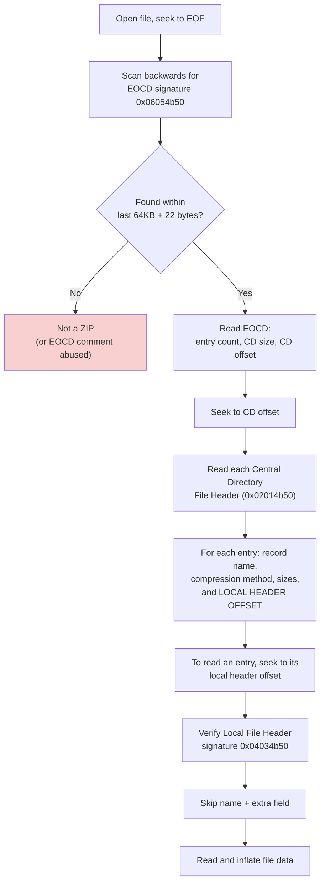
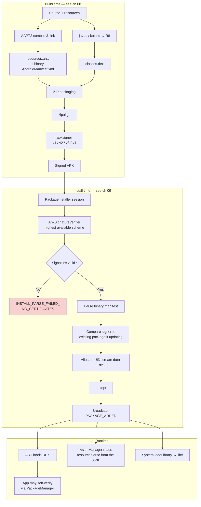
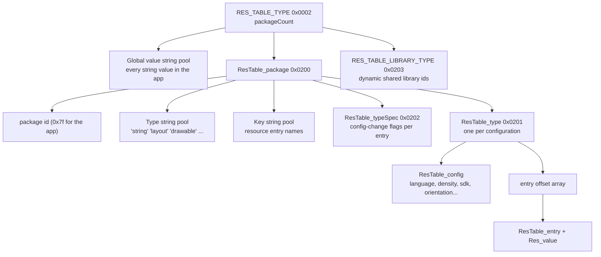
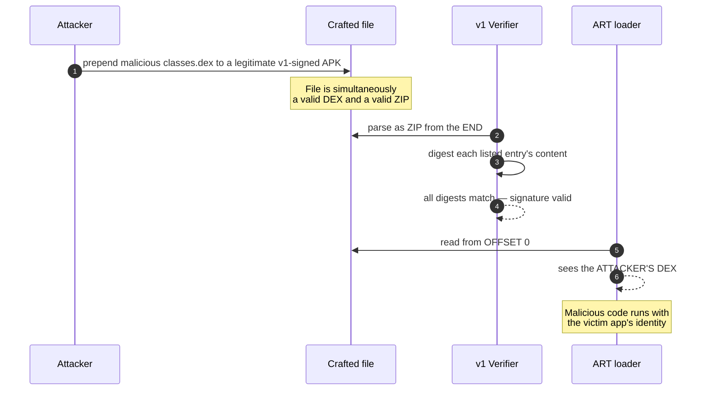
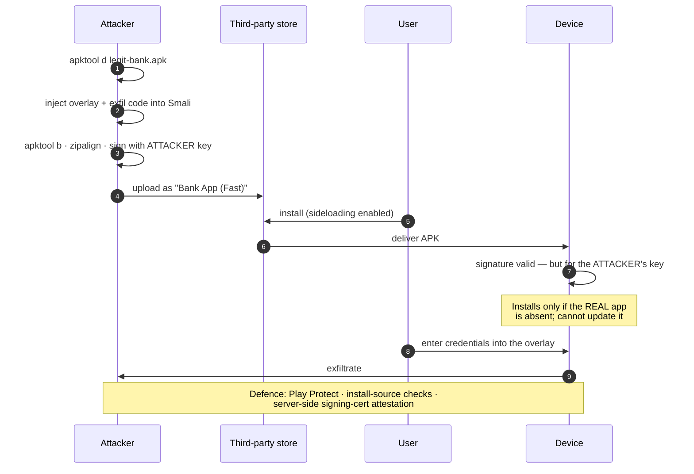
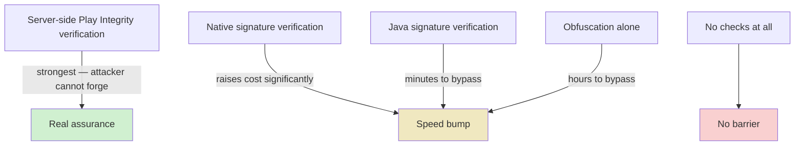
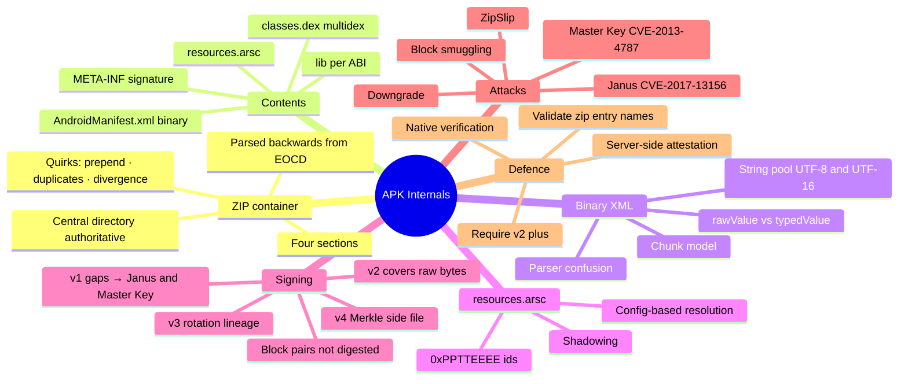

# 10 — APK Internals

> After this chapter you will be able to take any APK apart byte by byte, explain what every structure
> in it is for, verify its signatures by hand, recognise the tampering techniques that exploit the gaps
> between those structures, and rebuild a modified APK that installs.

**Prerequisites:** [02-Linux-Basics](../02-Linux-Basics/README.md),
[03-Programming-Fundamentals](../03-Programming-Fundamentals/README.md),
[09-Android-App-Internals](../09-Android-App-Internals/README.md)
**Applies to:** Android 5–16 (API 21–36); signing scheme availability noted per scheme

---

## Table of Contents

- [1. Introduction](#1-introduction)
  - [1.1 Why this chapter exists](#11-why-this-chapter-exists)
  - [1.2 What would happen without any of this](#12-what-would-happen-without-any-of-this)
  - [1.3 Learning objectives](#13-learning-objectives)
  - [1.4 Beginner explanation](#14-beginner-explanation)
  - [1.5 Real-world analogies](#15-real-world-analogies)
- [2. High-Level Architecture](#2-high-level-architecture)
  - [2.1 The APK as a byte layout](#21-the-apk-as-a-byte-layout)
  - [2.2 Parsing order — why it runs backwards](#22-parsing-order--why-it-runs-backwards)
  - [2.3 The full picture](#23-the-full-picture)
- [3. Deep Internal Working](#3-deep-internal-working)
  - [3.1 ZIP record types](#31-zip-record-types)
  - [3.2 APK contents in full](#32-apk-contents-in-full)
  - [3.3 Binary XML (AXML)](#33-binary-xml-axml)
  - [3.4 resources.arsc](#34-resourcesarsc)
  - [3.5 Signing — the heart of the chapter](#35-signing--the-heart-of-the-chapter)
  - [3.6 Native libraries and alignment](#36-native-libraries-and-alignment)
  - [3.7 Splits and App Bundles](#37-splits-and-app-bundles)
- [4. Source Code Walkthrough (AOSP)](#4-source-code-walkthrough-aosp)
- [5. Security Perspective](#5-security-perspective)
- [6. Reverse Engineering Perspective](#6-reverse-engineering-perspective)
- [7. Dynamic Analysis](#7-dynamic-analysis)
- [8. Static Analysis](#8-static-analysis)
- [9. Examples](#9-examples)
- [10. Common Interview Questions](#10-common-interview-questions)
- [11. Common Mistakes](#11-common-mistakes)
- [12. Hands-on Labs](#12-hands-on-labs)
- [13. Summary](#13-summary)
- [14. References](#14-references)

---

## 1. Introduction

Everything you will ever do to an Android application begins with a single file. Before there is a
process, before Zygote forks, before ART executes a single instruction, there is an APK sitting on
disk — a few megabytes of bytes that the operating system must parse, verify, and trust.

That parsing step is the most security-critical moment in an application's life, and it is the moment
almost nobody studies properly.

Consider what the platform has to decide when you tap "install". It must determine which app this
claims to be, whether the person who built it is the same person who built the version already
installed, what permissions it is asking for, which components it exposes to other apps, and whether
a single byte has been altered since the developer signed it. Every one of those decisions is made by
reading structures inside the APK. If an attacker can make the *verifier* read one thing while the
*loader* reads another, every downstream decision is wrong — and the app runs with the identity, the
permissions, and the user trust of something it is not.

That is not a hypothetical. It is precisely the shape of Janus (CVE-2017-13156) and of the
"Master Key" family (CVE-2013-4787), both covered in full in [section 5.4](#54-common-vulnerabilities).
Both were bugs not in cryptography but in *parsing*. The signature maths was flawless. The problem was
that two pieces of code disagreed about what the file contained.

### 1.1 Why this chapter exists

There are three practical reasons a security engineer needs the APK format at the byte level rather
than at the "it's a ZIP with some files in it" level.

**You cannot assess what you cannot open.** Every static analysis technique in
[52-StaticAnalysis](../52-StaticAnalysis/README.md) starts with unpacking, and the moment an app uses
a packer, an unusual compression method, or a deliberately malformed archive, your tools fail and you
are left reading hex. Knowing the format is the difference between "apktool crashed, I'm stuck" and
"apktool crashed because the EOCD comment length is lying; here is the real central directory".

**Tools disagree, and you must know which one to believe.** `apktool`, `jadx`, `aapt2` and
`PackageManager` each parse the same manifest with different code. When they disagree, that
disagreement is either a bug or an attack, and in both cases it is the finding. You can only notice it
if you know that three-way comparison is a thing you should be doing.

**Modification is a core testing capability.** Disabling certificate pinning by patching
`network_security_config.xml`, making an app debuggable, or removing a root check in Smali all end the
same way: rebuild, align, re-sign, install. Every step of that pipeline touches the structures in this
chapter, and every step has a failure mode that produces a confusing error message unless you know
what is actually happening.

### 1.2 What would happen without any of this

Suppose Android had no APK signing at all, and an APK were merely a ZIP the system unpacked and ran.

Anyone could modify any app and redistribute it, and the device would have no way to tell the modified
copy from the original. App updates would be an open door: any party who could put a file in front of
the installer could replace your banking app with theirs, inheriting its package name, its stored data
directory, its granted permissions, and its user's trust. There would be no meaningful notion of "the
same app" across versions, so `sharedUserId`, signature-level permissions, and update continuity would
all be impossible.

Signing is what turns a package name from a *label* into an *identity*. That is why four generations
of signing scheme exist, why each closed a specific coverage gap in its predecessor, and why the exact
byte ranges each scheme covers is the single most important table in this chapter.

> **Mental Model**
> An APK is a ZIP file wearing a uniform. The ZIP part is generic and forty years old, with all the
> ambiguity that implies. The uniform — the manifest, the resource table, the signing block — is what
> makes Android trust it. **Nearly every APK-level attack works by creating a gap between what the ZIP
> layer says and what the Android layer believes.**

### 1.3 Learning objectives

By the end of this chapter you will be able to:

1. Parse a ZIP archive by hand from the End of Central Directory backwards, and explain why the
   central directory — not the local file headers — is authoritative.
2. Name every file that appears in a real APK and state its purpose.
3. Decode Android binary XML (AXML) at the chunk level, including the string pool encoding.
4. Explain the `resources.arsc` structure and resolve a resource ID to a value by hand.
5. State precisely which bytes each of the four signing schemes covers, and which it does not.
6. Verify an APK's signature and extract its signing certificate from the command line.
7. Explain Janus and the Master Key class of vulnerabilities in terms of parser disagreement.
8. Unpack, modify, rebuild, align, sign and install an APK reliably, and diagnose each failure mode.
9. Detect an APK crafted to make analysis tools disagree with the platform.
10. Advise a developer on correct signing and tamper-detection practice, with code.

### 1.4 Beginner explanation

If you have never opened an APK, start here. Nothing in this section assumes you can program.

#### An APK is a ZIP file

That is not an analogy. It is literally true. If you rename `app.apk` to `app.zip`, your normal
unzipping software will open it.

```bash
# host — prove it to yourself
cp app.apk app.zip
unzip -l app.zip
```

You will see a listing something like this:

```
  Length      Date    Time    Name
---------  ---------- -----   ----
     4172  1981-01-01 01:01   AndroidManifest.xml
  8317460  1981-01-01 01:01   classes.dex
  3204112  1981-01-01 01:01   classes2.dex
   942088  1981-01-01 01:01   resources.arsc
    18404  1981-01-01 01:01   res/layout/activity_main.xml
  2118936  1981-01-01 01:01   lib/arm64-v8a/libnative.so
     1223  1981-01-01 01:01   META-INF/MANIFEST.MF
     1276  1981-01-01 01:01   META-INF/CERT.SF
     1181  1981-01-01 01:01   META-INF/CERT.RSA
```

> **Definition**
> A **ZIP archive** is a container format that holds many files, each optionally compressed, plus an
> index (the *central directory*) listing what is inside and where each item starts. It was designed
> in 1989 for floppy disks, which explains several of its odder properties.

The dates say 1981 because build tools deliberately zero the timestamps so that building the same
source twice produces an identical file. That is a *feature* — it is what makes reproducible builds
possible.

#### What each of those files is for

| File | In one sentence |
|---|---|
| `AndroidManifest.xml` | The app's declaration of identity, permissions, and which parts of it other apps may talk to |
| `classes.dex` | The app's compiled code |
| `resources.arsc` | A lookup table mapping every resource (text, colour, dimension) to its value for every language and screen configuration |
| `res/` | The individual resource files — layouts, images, XML |
| `assets/` | Raw files the developer bundled, untouched by the build system |
| `lib/<abi>/` | Compiled native code, one directory per CPU type |
| `META-INF/` | The signature — proof of who built this and that nobody changed it since |

#### Why it is not just a ZIP

Rename it back, modify one byte inside, and try to install it. Android will refuse.

The `META-INF/` directory holds a cryptographic signature. Changing anything covered by that signature
invalidates it, and the installer rejects the package. That is the entire security model in one
sentence: **anyone can read an APK, but only the holder of the original private key can produce one
Android will accept as an update to an existing app.**

> **Warning**
> "Anyone can read an APK" is not a flaw the developer can fix. If your app contains a secret, that
> secret is public. Obfuscation and native code raise the cost of finding it; they do not make it
> private. See [40-Obfuscation](../40-Obfuscation/README.md).

### 1.5 Real-world analogies

#### The shipping container

A shipping container has cargo inside and a manifest document listing what the cargo is. Customs reads
the manifest; the crane operator reads the cargo. If the manifest says "textiles" and the container
holds something else, the system fails — not because the lock was picked, but because *two parties
read different sources of truth about the same container*.

An APK's central directory is the manifest document; the file data is the cargo. Every ZIP-level
attack in this chapter is a variation on making the customs officer and the crane operator disagree.

#### The sealed exam paper

A national exam paper is printed, sealed, and shipped with a tamper-evident seal. Anyone can see the
envelope. Only an intact seal proves the contents were not altered.

APK signing is that seal. Crucially, the seal covers a *specific region* of the envelope. The v1 scheme
sealed only the contents of listed items — not the envelope's own index, and not items that were in the
box but absent from the list. Janus and Master Key are both "we put something in the box that wasn't on
the list, or altered the part of the envelope the seal didn't cover".

#### The building's key system

A landlord's master key system distinguishes "the same tenant" from "a different tenant" across lock
changes. Signature key rotation (v3) is exactly this: a way of proving that the new key is the
legitimate successor of the old one, so the operating system accepts the update as the *same app*
rather than an impostor with the same name.

#### The dictionary with regional editions

`resources.arsc` is a dictionary in which the same word has different definitions depending on which
region, language and screen size you are in. Looking up `@string/greeting` does not return a string —
it returns *the best matching* string for the current configuration. This is why a resource that looks
harmless in `values/` may have a very different value in `values-ru/` or `values-v29/`, and why you
must dump the whole table rather than reading one file.

---

## 2. High-Level Architecture

### 2.1 The APK as a byte layout

An APK is not a random collection of files. It has a strict physical order, and understanding that
order is what makes the signing schemes comprehensible.

```
    offset 0
    ┌────────────────────────────────────────────────────────────┐
    │  ENTRY DATA                                                │
    │                                                            │
    │  ┌──────────────────────────────────────────────────────┐  │
    │  │ Local File Header  (PK\x03\x04)                      │  │
    │  │ file name          "AndroidManifest.xml"             │  │
    │  │ extra field        (alignment padding)               │  │
    │  │ file data          (deflated or stored bytes)        │  │
    │  └──────────────────────────────────────────────────────┘  │
    │  ┌──────────────────────────────────────────────────────┐  │
    │  │ Local File Header  (PK\x03\x04)   "classes.dex"      │  │
    │  │ file data                                            │  │
    │  └──────────────────────────────────────────────────────┘  │
    │  ...one per entry...                                       │
    ├────────────────────────────────────────────────────────────┤  ← Section 1 ends
    │  APK SIGNING BLOCK               (v2 / v3 / v3.1)          │
    │  ┌──────────────────────────────────────────────────────┐  │
    │  │ uint64  size of block (excluding this field)         │  │
    │  │ id-value pair: 0x7109871a  → v2 signature            │  │
    │  │ id-value pair: 0xf05368c0  → v3 signature            │  │
    │  │ id-value pair: 0x1b93ad61  → v3.1 signature          │  │
    │  │ id-value pair: 0x42726577  → verity padding          │  │
    │  │ id-value pair: <vendor ids> → Play metadata etc.     │  │
    │  │ uint64  size of block (repeated, must match)         │  │
    │  │ char[16] magic  "APK Sig Block 42"                   │  │
    │  └──────────────────────────────────────────────────────┘  │
    ├────────────────────────────────────────────────────────────┤  ← Section 2 ends
    │  CENTRAL DIRECTORY                                         │
    │  ┌──────────────────────────────────────────────────────┐  │
    │  │ Central Directory File Header (PK\x01\x02)           │  │
    │  │   → authoritative offset of each Local File Header    │  │
    │  │   → authoritative compression method and sizes        │  │
    │  └──────────────────────────────────────────────────────┘  │
    │  ...one per entry...                                       │
    ├────────────────────────────────────────────────────────────┤  ← Section 3 ends
    │  END OF CENTRAL DIRECTORY  (PK\x05\x06)                    │  ← Section 4
    │   total entries · CD size · CD offset · comment            │
    └────────────────────────────────────────────────────────────┘
    end of file
```

Those four sections are numbered deliberately. The v2 signing scheme's digest is computed over
**sections 1, 3 and 4** — entry data, central directory, and EOCD — while deliberately *excluding*
section 2, the signing block itself. It has to exclude it, because the signature lives there and
cannot cover itself.

> **Under the Hood**
> There is a subtlety in that scheme. The EOCD contains the offset of the central directory. Inserting
> the signing block shifts the central directory later in the file, changing that offset. So when
> computing or verifying a v2 digest, the verifier takes the EOCD and **substitutes the central
> directory offset with the offset the signing block starts at**, then digests that patched copy. This
> makes the digest stable regardless of how large the signing block grows. If you ever implement APK
> verification yourself, this single detail is where you will get it wrong.

### 2.2 Parsing order — why it runs backwards

A ZIP parser cannot start at offset 0, because nothing at offset 0 tells it how many entries exist.
It must start at the *end*.



Three consequences follow from this, and all three are exploited in [section 5.4](#54-common-vulnerabilities):

1. **The central directory is authoritative.** The local file header duplicates the name, sizes and
   compression method, but the parser uses the central directory's copy to find and interpret data. If
   the two disagree, a well-written parser follows the central directory — but not every parser is
   well-written.
2. **Everything is offset-based.** Prepending bytes to the file shifts every absolute offset. A parser
   that reads from the tail recomputes correctly; a parser that reads from the head does not. That gap
   *is* Janus.
3. **The EOCD is found by scanning.** Because the EOCD ends with a variable-length comment, a parser
   must search backwards for the signature. A crafted comment containing a fake EOCD signature can make
   two parsers pick different EOCDs.

### 2.3 The full picture



Read that diagram as three trust transitions. At build time the developer's private key creates the
seal. At install time the platform verifies it and binds the package name to that signer. At runtime
the app can re-check its own seal — which is meaningful only if the check is anchored somewhere the
attacker does not control (see [38-TamperDetection](../38-TamperDetection/README.md)).

---

## 3. Deep Internal Working

### 3.1 ZIP record types

Every ZIP structure begins with a four-byte little-endian signature. Memorise the first four; the rest
you can look up.

| Signature (LE) | Bytes on disk | Record |
|---|---|---|
| `0x04034b50` | `50 4B 03 04` | Local File Header |
| `0x08074b50` | `50 4B 07 08` | Data Descriptor |
| `0x02014b50` | `50 4B 01 02` | Central Directory File Header |
| `0x06054b50` | `50 4B 05 06` | End of Central Directory |
| `0x06064b50` | `50 4B 06 06` | Zip64 EOCD Record |
| `0x07064b50` | `50 4B 06 07` | Zip64 EOCD Locator |

The ASCII `PK` at the start of each is Phil Katz's initials, which is why every ZIP file begins with
the bytes `50 4B`.

#### Local File Header

| Offset | Size | Field | Notes |
|---|---|---|---|
| 0 | 4 | signature `0x04034b50` | |
| 4 | 2 | version needed to extract | 20 = 2.0, the usual value |
| 6 | 2 | general purpose bit flag | bit 3 = sizes deferred to data descriptor; bit 11 = UTF-8 names |
| 8 | 2 | compression method | 0 = STORED, 8 = DEFLATE |
| 10 | 2 | last mod time | usually zeroed for reproducibility |
| 12 | 2 | last mod date | usually zeroed |
| 14 | 4 | CRC-32 | of the *uncompressed* data |
| 18 | 4 | compressed size | |
| 22 | 4 | uncompressed size | |
| 26 | 2 | file name length | |
| 28 | 2 | extra field length | where alignment padding lives |
| 30 | n | file name | |
| 30+n | m | extra field | |

> **Warning**
> **The local file header is not authoritative.** Its size, CRC and compression fields duplicate the
> central directory's and can be made to disagree. Any tool you write must read the central directory.
> Any tool you *use* should be checked for whether it does.

#### Central Directory File Header

Adds, beyond the local header's fields:

| Field | Why it matters |
|---|---|
| version made by | encodes the host OS in the high byte |
| file comment length / comment | rarely used, occasionally abused to hide data |
| disk number start | a floppy-disk relic, always 0 |
| internal file attributes | text/binary hint |
| external file attributes | carries the UNIX mode in the high 16 bits |
| **relative offset of local header** | **the authoritative pointer to the entry's data** |

#### End of Central Directory

| Offset | Size | Field |
|---|---|---|
| 0 | 4 | signature `0x06054b50` |
| 4 | 2 | number of this disk |
| 6 | 2 | disk with central directory start |
| 8 | 2 | entries on this disk |
| 10 | 2 | total entries |
| 12 | 4 | central directory size |
| 16 | 4 | **central directory offset** |
| 20 | 2 | comment length |
| 22 | n | comment |

The EOCD is exactly 22 bytes plus the comment. Since the comment length field is 16-bit, the comment
can be up to 65535 bytes — which is why a parser must scan backwards up to 64KB + 22 bytes to find the
signature reliably.

#### Zip64

When any size or offset would exceed `0xFFFFFFFF`, that field is set to the sentinel `0xFFFFFFFF` and
the real value lives in a Zip64 record. APKs rarely need this — the Play Store size limits keep them
well below 4GB — but a hand-crafted APK can include Zip64 structures specifically because some parsers
handle them and some do not.

#### Compression methods

| Value | Method | Android's behaviour |
|---|---|---|
| 0 | STORED (no compression) | Required for `resources.arsc` and for native libs when `extractNativeLibs="false"` |
| 8 | DEFLATE | The normal case |
| others | various | Rejected by the platform installer |

> **Pentester's Note**
> Some entries in a modern APK **must** be STORED and aligned, because Android memory-maps them
> directly from the APK rather than copying them out. This is why `zipalign` exists and why alignment
> must happen before signing. An entry that ought to be stored-and-aligned but is deflated is a build
> mistake worth noting, though rarely a security finding on its own.

### 3.2 APK contents in full

| Path | Contents | Chapter |
|---|---|---|
| `AndroidManifest.xml` | Binary XML: identity, permissions, components | [32](../32-Manifest/README.md) |
| `classes.dex`, `classes2.dex`, … | Compiled bytecode; multiple files past the 65536 method-reference limit | [12](../12-DEX-Internals/README.md) |
| `resources.arsc` | The compiled resource table | this chapter, §3.4 |
| `res/` | Individual resources; XML here is also binary | this chapter, §3.3 |
| `assets/` | Raw developer-supplied files, never processed by AAPT2 | [52](../52-StaticAnalysis/README.md) |
| `assets/dexopt/baseline.prof`, `baseline.profm` | Baseline profiles guiding AOT compilation | [13](../13-ART/README.md) |
| `lib/<abi>/*.so` | Native libraries, one directory per ABI | [15](../15-Native-Code/README.md) |
| `META-INF/MANIFEST.MF` | v1: per-entry digests | §3.5 |
| `META-INF/CERT.SF` | v1: digests of the manifest's sections |§3.5 |
| `META-INF/CERT.RSA` / `.DSA` / `.EC` | v1: PKCS#7 signature block containing the certificate | §3.5 |
| `META-INF/services/` | Java ServiceLoader registrations | — |
| `META-INF/com/android/build/gradle/app-metadata.properties` | AGP build metadata | [08](../08-Build-System/README.md) |
| `META-INF/version-control-info.textproto` | Optional VCS provenance stamp | — |
| `kotlin/`, `*.kotlin_builtins` | Kotlin metadata — a strong signal the app is Kotlin | [05](../05-Kotlin/README.md) |
| `DebugProbesKt.bin` | Coroutine debug probes; presence suggests a debug-ish build | [05](../05-Kotlin/README.md) |
| `stamp-cert-sha256` | Play source stamp | — |
| `<name>.apk.idsig` (sibling file) | v4 signature, stored *outside* the APK | §3.5 |

> **Pentester's Note**
> The presence of `kotlin/` tells you to expect `Intrinsics.checkNotNullParameter` calls and
> coroutine state machines in the decompiled output. The presence of `DebugProbesKt.bin` is worth
> checking against the build type — it is not itself a vulnerability, but it is an indicator that the
> release configuration may not be what the developer believes.

### 3.3 Binary XML (AXML)

Android does not ship XML as text. AAPT2 compiles it into a chunked binary format that is faster to
parse and smaller. Both `AndroidManifest.xml` and every XML file under `res/` are in this format.

> **Definition**
> **AXML** is a sequence of *chunks*. Every chunk begins with a `ResChunk_header` giving its type, the
> size of its own header, and the size of the whole chunk. Chunks nest: a parser walks the tree by
> arithmetic on these sizes rather than by scanning for delimiters.

#### The chunk header

| Offset | Size | Field | Meaning |
|---|---|---|---|
| 0 | 2 | `type` | Which chunk this is |
| 2 | 2 | `headerSize` | Bytes of header before the payload |
| 4 | 4 | `size` | Total bytes of this chunk including header |

#### Chunk types

| Value | Name | Purpose |
|---|---|---|
| `0x0001` | `RES_STRING_POOL_TYPE` | Every string in the document, once |
| `0x0003` | `RES_XML_TYPE` | The root chunk wrapping the document |
| `0x0100` | `RES_XML_START_NAMESPACE_TYPE` | Namespace declaration begins |
| `0x0101` | `RES_XML_END_NAMESPACE_TYPE` | Namespace declaration ends |
| `0x0102` | `RES_XML_START_ELEMENT_TYPE` | An opening tag |
| `0x0103` | `RES_XML_END_ELEMENT_TYPE` | A closing tag |
| `0x0104` | `RES_XML_CDATA_TYPE` | Character data |
| `0x0180` | `RES_XML_RESOURCE_MAP_TYPE` | Maps attribute name indices to framework resource IDs |

#### The string pool

This is where most parser divergence lives, so it is worth care.

| Field | Meaning |
|---|---|
| `stringCount` | Number of strings |
| `styleCount` | Number of styled spans |
| `flags` | `SORTED_FLAG = 0x1`, `UTF8_FLAG = 0x100` |
| `stringsStart` | Offset from chunk start to string data |
| `stylesStart` | Offset to style data |

Then `stringCount` 32-bit offsets, then the string data itself.

The encoding differs based on `UTF8_FLAG`:

- **UTF-16 (flag clear):** each string is preceded by a 16-bit character count. If the high bit is
  set, the length is 31 bits spread across *two* 16-bit values. The string is then UTF-16 code units,
  followed by a `0x0000` terminator.
- **UTF-8 (flag set):** each string is preceded by *two* length values — the character count and the
  byte count — each of which is one byte, or two bytes when the high bit of the first is set. Then the
  UTF-8 bytes and a `0x00` terminator.

> **Warning**
> The UTF-8 double-length encoding is genuinely confusing and is implemented subtly differently across
> tools. A string whose declared character count and byte count are mutually inconsistent will be read
> differently by `aapt2`, `apktool` and the platform. This is one of the most reliable ways to build an
> APK that analysis tools misreport.

#### Element and attribute records

A `START_ELEMENT` chunk carries:

| Field | Meaning |
|---|---|
| `lineNumber`, `comment` | Source position (often zeroed) |
| `ns`, `name` | String-pool references |
| `attributeStart` | Offset to the first attribute record |
| `attributeSize` | Size of each attribute record |
| `attributeCount` | How many attributes |
| `idIndex`, `classIndex`, `styleIndex` | 1-based indices of the `id`, `class`, `style` attributes, or 0 |

Each attribute record is:

| Field | Meaning |
|---|---|
| `ns` | Namespace string reference |
| `name` | Attribute name string reference |
| `rawValue` | String reference to the literal text, or `-1` |
| `typedValue` | A `Res_value` structure |

And `Res_value` is:

| Field | Meaning |
|---|---|
| `size` | Always 8 |
| `res0` | Reserved, must be 0 |
| `dataType` | One of the type constants below |
| `data` | The value, interpreted per `dataType` |

| `dataType` | Meaning |
|---|---|
| `0x00` | `TYPE_NULL` |
| `0x01` | `TYPE_REFERENCE` — `data` is a resource ID |
| `0x02` | `TYPE_ATTRIBUTE` |
| `0x03` | `TYPE_STRING` — `data` is a string pool index |
| `0x04` | `TYPE_FLOAT` |
| `0x05` | `TYPE_DIMENSION` |
| `0x06` | `TYPE_FRACTION` |
| `0x10` | `TYPE_INT_DEC` |
| `0x11` | `TYPE_INT_HEX` |
| `0x12` | `TYPE_INT_BOOLEAN` — `data` 0 = false, non-zero = true |
| `0x1c`–`0x1f` | Colour types |

> **Under the Hood**
> An attribute has **two** representations: `rawValue` (the original text) and `typedValue` (the parsed
> value). The platform reads `typedValue` for typed attributes. Some analysis tools display
> `rawValue` because it is human-readable. Craft an APK where `rawValue` says `"false"` and
> `typedValue` holds boolean `true` for `android:debuggable`, and your tool shows a non-debuggable app
> while the platform installs a debuggable one. **This is why you cross-check with `dumpsys package`,
> which reports what `PackageManager` actually parsed.**

### 3.4 resources.arsc

The resource table is a single chunked binary file mapping numeric resource IDs to values, per
configuration.



#### Resource IDs

A resource ID is a 32-bit value laid out as `0xPPTTEEEE`:

| Part | Bits | Meaning |
|---|---|---|
| `PP` | package | `0x01` = Android framework, `0x7f` = this application, `0x00` = dynamic (shared library) |
| `TT` | type | Index into the package's type string pool (1-based) |
| `EEEE` | entry | Index into that type's entry array |

So `0x7f0a0013` is "this app, type index 10, entry 19".

#### Type flags

| Flag | Effect |
|---|---|
| `FLAG_SPARSE` | The entry array is a sparse index/offset pair list rather than a dense array |
| `FLAG_OFFSET16` | Offsets are 16-bit rather than 32-bit, halving the array size |

#### Entry flags

| Flag | Effect |
|---|---|
| `FLAG_COMPLEX` | This is a "bag" — a map of parent/child values (styles, arrays, plurals) rather than a single value |
| `FLAG_PUBLIC` | Declared public in `public.xml` |
| `FLAG_COMPACT` | A space optimisation storing the value inline in the entry header |

#### Resolution

Looking up `@string/app_name` at runtime is a two-step process. First, `app_name` is found in the key
string pool to obtain an entry index, giving a resource ID. Second, among all `ResTable_type` chunks
for that type, the one whose `ResTable_config` best matches the device's current configuration
(language, density, orientation, API level, and a dozen more axes) wins, and its entry supplies the
value.

> **Pentester's Note**
> Because resolution is configuration-dependent, **reading `res/values/strings.xml` from an apktool
> decode does not tell you what the app will actually display or use**. A backend URL may be
> overridden in `values-v31/` or a locale-specific directory. Always dump the full table with
> `aapt2 dump resources` and grep across every configuration, not just the default.

### 3.5 Signing — the heart of the chapter

Four schemes exist. Each closed a specific gap. Understanding *which bytes each covers* is the single
most valuable thing in this chapter.

```mermaid
flowchart LR
    subgraph V1["v1 — JAR signing (all versions)"]
        A1["Digests the CONTENT of listed entries"]
        A2["Does not cover ZIP metadata"]
        A3["Does not cover unlisted entries"]
        A4["Does not cover the central directory"]
    end
    subgraph V2["v2 — APK Signature Scheme v2 (API 24+)"]
        B1["Digests sections 1, 3, 4 as raw bytes"]
        B2["Covers entry data + CD + EOCD"]
        B3["Any byte change breaks it"]
    end
    subgraph V3["v3 — key rotation (API 28+)"]
        C1["Everything v2 covers"]
        C2["+ minSdk/maxSdk in signed data"]
        C3["+ proof-of-rotation lineage"]
    end
    subgraph V4["v4 — incremental (API 30+)"]
        D1["Merkle tree in a side file .idsig"]
        D2["Enables streaming install"]
        D3["Requires v2 or v3 as well"]
    end
    V1 --> V2 --> V3 --> V4
    style A2 fill:#f9d0d0
    style A3 fill:#f9d0d0
    style A4 fill:#f9d0d0
```



#### v1 — JAR signing

Inherited directly from Java's JAR signing. Three files in `META-INF/`:

**`MANIFEST.MF`** lists every entry with a digest of its *uncompressed content*:

```
Manifest-Version: 1.0
Created-By: 1.8.0_202 (Oracle Corporation)

Name: classes.dex
SHA-256-Digest: kP3S1nQ8vZ2mT7xY0bC9dF4gH6jK8lM1nO3pQ5rS7tU=

Name: AndroidManifest.xml
SHA-256-Digest: aB1cD2eF3gH4iJ5kL6mN7oP8qR9sT0uV1wX2yZ3aB4c=
```

**`CERT.SF`** digests the *sections* of `MANIFEST.MF`:

```
Signature-Version: 1.0
SHA-256-Digest-Manifest: ...
X-Android-APK-Signed: 2, 3

Name: classes.dex
SHA-256-Digest: ...
```

**`CERT.RSA`** is a PKCS#7 / CMS `SignedData` structure containing the signature over `CERT.SF` and the
signer's X.509 certificate chain.

The three critical gaps, which together are the entire reason v2 exists:

1. Only the **content** of each entry is digested — not its name's position, not the compression
   method, not the ZIP structure around it.
2. Entries **not listed** in `MANIFEST.MF` are not covered at all. Historically an unlisted entry could
   be ignored by the verifier.
3. The **central directory and EOCD are not covered**, so ZIP metadata can be altered freely.

> **Definition**
> `X-Android-APK-Signed: 2, 3` is **downgrade protection**. It tells a v1-capable verifier "this APK
> also carries v2 and v3 signatures; if you are capable of checking them, you must". Without it, an
> attacker could strip the stronger signatures and present a v1-only APK to a modern device.

#### The APK Signing Block

Everything from v2 onward lives in a block inserted between the entry data and the central directory.

```
┌──────────────────────────────────────────────────┐
│ uint64  size of block (excluding this 8-byte field)│
├──────────────────────────────────────────────────┤
│ repeated ID-value pairs:                         │
│   uint64 pair length                             │
│   uint32 ID                                      │
│   byte[] value                                   │
├──────────────────────────────────────────────────┤
│ uint64  size of block (must equal the first)     │
│ char[16] "APK Sig Block 42"                      │
└──────────────────────────────────────────────────┘
```

| ID | Contents |
|---|---|
| `0x7109871a` | v2 signature |
| `0xf05368c0` | v3 signature |
| `0x1b93ad61` | v3.1 signature |
| `0x42726577` | Verity padding block (aligns the block to 4096) |
| vendor-specific | Play Store metadata, dependency info, source stamps |

> **Warning**
> **The ID-value pairs are not individually digested.** The v2 digest covers the file *outside* the
> signing block. An attacker who can already produce a validly-signed APK can therefore add arbitrary
> data under an unknown ID without breaking verification. Unknown IDs are ignored by design, for
> forward compatibility. This is a legitimate hiding place for a payload, and a place worth dumping
> during malware triage.

#### v2 — APK Signature Scheme v2 (API 24+)

The digest is computed over the file split into 1 MiB chunks. Each chunk is digested with a `0xa5`
prefix, then the list of chunk digests is digested with a `0x5a` prefix. This structure allows
parallel and incremental verification.

Covers sections 1, 3, and 4 — entry data, central directory, and EOCD (with the patched offset
described in [section 2.1](#21-the-apk-as-a-byte-layout)). Excludes section 2, the signing block.

The consequence is total: **any change to any byte outside the signing block invalidates the
signature.** Janus is impossible against a v2-signed APK, because prepending a DEX changes bytes in
section 1.

#### v3 — key rotation (API 28+)

Adds two things to the signed data: the `minSdkVersion`/`maxSdkVersion` range the signature applies to,
and a **proof-of-rotation lineage**.

The lineage is a chain: the old key signs a statement endorsing the new key, which may itself endorse a
further key. The platform can then accept an update signed by the new key as legitimately the *same
app*, while apps that granted signature-level permissions to the old key can be configured to continue
trusting it or not.

Each lineage node carries flags controlling what the previous key is still trusted for — installed-data
access and shared-UID membership among them.

#### v3.1 (API 33+)

Rotation targeted at newer platforms only. Some devices had bugs handling rotated v3 signatures, so
v3.1 lets an APK carry a rotated signature that only API 33+ devices act on, while older devices
continue to use the original v3 signature with the original key.

#### v4 — incremental install (API 30+)

Stores an fs-verity-style Merkle tree hash in a **separate file** alongside the APK,
`<name>.apk.idsig`. This enables installing and running an app while it is still downloading, because
any block can be verified independently on demand.

v4 does not stand alone — it requires a v2 or v3 signature in the APK itself.

#### Verification timing

| When | Who | Mechanism |
|---|---|---|
| Install | Platform | `ApkSignatureVerifier` picks the highest scheme the device supports |
| Update | Platform | Compares the signer against the installed package's signer, honouring lineage |
| Runtime | The app itself | `PackageManager.getPackageInfo(..., GET_SIGNING_CERTIFICATES)` |
| Runtime | Cross-app | `PackageManager.checkSignatures(pkgA, pkgB)` |
| Runtime | Lineage-aware | `PackageManager.hasSigningCertificate(...)` |

### 3.6 Native libraries and alignment

| Concern | Detail |
|---|---|
| `lib/arm64-v8a/` | 64-bit ARM — the dominant target |
| `lib/armeabi-v7a/` | 32-bit ARM — still present for compatibility |
| `lib/x86_64/`, `lib/x86/` | Emulator and a small number of devices |
| `extractNativeLibs="true"` | Libraries are copied out to the app's `lib/` directory at install |
| `extractNativeLibs="false"` | Libraries are **memory-mapped directly from the APK** — requires them to be STORED and page-aligned |
| 4 KB alignment | The classic requirement |
| 16 KB alignment | Required for Android 15+ device compatibility |
| `useLegacyPackaging` | Gradle flag restoring the old extract-based behaviour |

> **Pentester's Note**
> `extractNativeLibs="false"` means the `.so` you want to analyse exists *only* inside the APK, not as
> a separate file in the app's data directory. Pull it from the APK, not from `/data/app/.../lib/`.
> It also means patching the library requires repackaging the whole APK, which changes the signature.

### 3.7 Splits and App Bundles

| Artefact | Nature |
|---|---|
| `base.apk` | The core application |
| `split_config.arm64_v8a.apk` | ABI-specific native libraries |
| `split_config.xxhdpi.apk` | Density-specific resources |
| `split_config.en.apk` | Language-specific resources |
| `split_<feature>.apk` | On-demand dynamic feature module |
| `.aab` | **A build artifact, not an installable package** — Play generates APK sets from it |

All splits of an installed app must share the same signer. Installation uses
`adb install-multiple` or a session-based install.

> **Warning**
> When you pull an app with `adb shell pm path <pkg>` and get several paths, you must pull **all** of
> them. Analysing only `base.apk` will miss native libraries, resources, and sometimes whole features.
> A surprising number of reports contain findings like "the app has no native code" that are
> wrong because only the base split was examined.

---

## 4. Source Code Walkthrough (AOSP)

### 4.1 AOSP source references

These paths are stable and worth bookmarking. Read them on
[cs.android.com](https://cs.android.com/) — see [07-AOSP](../07-AOSP/README.md) for the navigation
technique.

| Area | AOSP path |
|---|---|
| APK signature verification entry point | `frameworks/base/core/java/android/util/apk/ApkSignatureVerifier.java` |
| v2 scheme verifier | `frameworks/base/core/java/android/util/apk/ApkSignatureSchemeV2Verifier.java` |
| v3 scheme verifier | `frameworks/base/core/java/android/util/apk/ApkSignatureSchemeV3Verifier.java` |
| v4 scheme verifier | `frameworks/base/core/java/android/util/apk/ApkSignatureSchemeV4Verifier.java` |
| Signing block utilities | `frameworks/base/core/java/android/util/apk/ApkSigningBlockUtils.java` |
| Signing certificate lineage | `frameworks/base/core/java/android/content/pm/SigningDetails.java` |
| Package parsing | `frameworks/base/core/java/android/content/pm/parsing/ApkLiteParseUtils.java` |
| Full manifest parsing | `frameworks/base/services/core/java/com/android/server/pm/pkg/parsing/ParsingPackageUtils.java` |
| Binary XML block parser | `frameworks/base/core/java/android/content/res/XmlBlock.java` |
| Native resource table | `frameworks/base/libs/androidfw/ResourceTypes.cpp` |
| Resource type definitions | `frameworks/base/libs/androidfw/include/androidfw/ResourceTypes.h` |
| AssetManager native | `frameworks/base/libs/androidfw/AssetManager2.cpp` |
| ZIP reading | `system/libziparchive/zip_archive.cc` |
| `apksigner` implementation | `tools/apksig/` |
| AAPT2 | `frameworks/base/tools/aapt2/` |
| `zipalign` | `build/tools/zipalign/` |

> **Under the Hood**
> `frameworks/base/libs/androidfw/include/androidfw/ResourceTypes.h` is the definitive reference for
> every AXML and `resources.arsc` structure in this chapter. Every constant in section 3.3 and 3.4 is
> declared there as a C++ struct or enum. If you ever need to write your own parser — and doing so is
> Lab 03 — that header is your specification.

### 4.2 Tracing an install signature check

Follow the path from `adb install` to a verdict.

**Step 1 — the session begins.** `PackageInstallerSession` receives the APK bytes and, on commit,
begins validation.

**Step 2 — a lightweight parse.** `ApkLiteParseUtils.parseApkLite()` reads just enough of the binary
manifest to obtain the package name, version code, split name and a few flags. This is deliberately
cheap, because the system needs identity before it commits to full parsing.

**Step 3 — signature verification.** `ApkSignatureVerifier.verify()` is called. Its logic is a
descending ladder:

```java
// Conceptual shape of ApkSignatureVerifier's scheme selection.
// Try the strongest scheme the platform supports; fall back only on "not found",
// never on "found but invalid".
if (minSignatureScheme <= SIGNING_BLOCK_V4) {
    result = verifyV4(apkPath);            // requires v2 or v3 underneath
    if (result != NOT_FOUND) return result;
}
if (minSignatureScheme <= SIGNING_BLOCK_V3) {
    result = verifyV3(apkPath);
    if (result != NOT_FOUND) return result;
}
if (minSignatureScheme <= SIGNING_BLOCK_V2) {
    result = verifyV2(apkPath);
    if (result != NOT_FOUND) return result;
}
return verifyV1(apkPath);                  // JAR signing, with downgrade protection
```

The distinction between "scheme not present" and "scheme present but invalid" is the crux. A present
but invalid v2 signature is a hard failure — it must **not** silently fall through to v1, because that
would reintroduce every v1 weakness. Downgrade protection via `X-Android-APK-Signed` handles the
reverse direction: a v1 verifier that sees that header knows stronger signatures exist and must be
checked.

**Step 4 — locating the signing block.** `ApkSigningBlockUtils.findSignature()` seeks to the end,
locates the EOCD, reads the central directory offset, steps backwards 16 bytes to check for the
`APK Sig Block 42` magic, reads the size field, and walks the ID-value pairs looking for the scheme's
ID.

**Step 5 — digesting.** For v2, the file is treated as the four sections. Sections 1, 3 and 4 are split
into 1 MiB chunks, each chunk digested with a `0xa5` prefix, and the concatenated chunk digests
digested with a `0x5a` prefix. Section 4 (the EOCD) is digested with the central-directory offset
replaced by the signing block's start offset.

**Step 6 — the verdict.** The computed digest is compared with the signed digest, the signature is
verified against the public key in the embedded certificate, and the certificate is returned as the
package's `SigningDetails`.

**Step 7 — update comparison.** If a package with this name is already installed,
`PackageManagerService` compares the new `SigningDetails` against the existing one, consulting the v3
lineage if present. A mismatch produces `INSTALL_FAILED_UPDATE_INCOMPATIBLE`.

### 4.3 Tracing a manifest read

`XmlBlock.java` wraps the native binary XML parser. When `ParsingPackageUtils` walks the manifest, each
`nextTag()` call descends into native code in `ResourceTypes.cpp`, which advances through the chunk
tree using the `size` fields described in [section 3.3](#33-binary-xml-axml).

Two details matter for security:

The parser trusts `headerSize` to know where a chunk's payload begins. An oversized `headerSize` causes
fields to be skipped rather than read — which is exactly the primitive behind AXML parser confusion.

Attribute values are read from `typedValue`, not `rawValue`. A tool that renders `rawValue` for human
readability is displaying something the platform never consults.

---

## 5. Security Perspective

One topic seen from five angles: what a tester looks for, what a developer must get right,
what malware does with the format, the vulnerability classes that follow from the format's
structure, and what actually defends against them.

### 5.1 Pentesting perspective

#### The APK-level checklist

| Check | Command | Finding if… |
|---|---|---|
| Signing schemes present | `apksigner verify -v` | v1-only on a modern app → Janus-class exposure |
| Debug key | `apksigner verify --print-certs` | `CN=Android Debug` → anyone can sign updates |
| `debuggable` | `dumpsys package` `flags=` | `DEBUGGABLE` present → `run-as`, JDWP, full data access |
| `allowBackup` | `dumpsys package` | true + sensitive local data → exfiltration path |
| `testOnly` | `dumpsys package` | shipped `TEST_ONLY` → build hygiene finding |
| Mapping file | `unzip -l \| grep -i mapping` | shipped → deobfuscation handed to the attacker |
| Prepended data | `xxd -l 4` | not `PK\x03\x04` → tampering |
| Duplicate entries | `unzip -l \| sort \| uniq -d` | duplicates → Master Key class |
| Tool divergence | three-way manifest diff | disagreement → deliberate evasion |
| Signing block extras | dump ID-value pairs | unknown large IDs → hidden payload |
| All splits pulled | `pm path` | only base analysed → incomplete assessment |

#### Severity guidance

Applying the rubric from [80-Appendix](../80-Appendix/README.md):

| Finding | Typical severity | Reasoning |
|---|---|---|
| Signed with the public debug key | High | Anyone can produce a valid update; identity model broken |
| `debuggable="true"` in production | High | `run-as` gives full private data access over USB |
| v1-only signing, `minSdk` ≥ 24 | Medium | Janus-class tampering possible; requires sideload delivery |
| Mapping file shipped in the APK | Low–Medium | Removes obfuscation benefit; no direct exploit |
| `allowBackup="true"` with a session token stored locally | Medium | Extraction without root, given device access |
| No runtime integrity check | Informational–Low | Only meaningful when the device owner is in the threat model |

> **Pentester's Note**
> Resist rating "no tamper detection" as anything but Informational unless the threat model genuinely
> includes a hostile device owner — banking, DRM, payments, gaming. For an internal enterprise app on
> managed devices, recommending it costs the client engineering effort and buys nothing. See
> [71-OWASP-Mobile](../71-OWASP-Mobile/README.md) on resilience being orthogonal, not a higher tier.

### 5.2 Developer perspective

#### Signing correctly

| Practice | Why |
|---|---|
| Enable v2 and v3 (`apksigner` does by default) | Closes every v1 coverage gap |
| Never ship a debug-signed release | The debug private key is public |
| Use Play App Signing | Google holds the app signing key; you hold only the upload key |
| Plan rotation before you need it | v3 lineage must be established while you still control the old key |
| Store the keystore in an HSM or a secrets manager | Losing it means you can never update the app again |
| Never commit `keystore.properties` | Obvious, and it still happens constantly |

```groovy
// build.gradle — signing config that reads from the environment, never from the repo
android {
    signingConfigs {
        release {
            storeFile     file(System.getenv("KEYSTORE_PATH")     ?: "/dev/null")
            storePassword System.getenv("KEYSTORE_PASSWORD")
            keyAlias      System.getenv("KEY_ALIAS")
            keyPassword   System.getenv("KEY_PASSWORD")

            enableV1Signing true   // keep for very old device support
            enableV2Signing true
            enableV3Signing true
            enableV4Signing true
        }
    }
    buildTypes {
        release {
            signingConfig signingConfigs.release
            minifyEnabled true
            shrinkResources true
            debuggable false
        }
    }
}
```

#### The build-hygiene checklist

- [ ] `debuggable false` in the release build type
- [ ] `minifyEnabled true` with rules reviewed (see [41](../41-ProGuard/README.md), [42](../42-R8/README.md))
- [ ] `mapping.txt` uploaded to Play, **not** packaged in the APK
- [ ] `allowBackup` set deliberately, with `dataExtractionRules` configured
- [ ] `android:networkSecurityConfig` present and reviewed
- [ ] No `<instrumentation>` tag in the release manifest
- [ ] `testOnly` not set
- [ ] Native libraries 16 KB-aligned for Android 15+
- [ ] `zipalign` before signing (AGP handles this; verify with `zipalign -c -v 4`)

### 5.3 Malware perspective

Android malware interacts with the APK format in four characteristic ways.

**Repackaging a legitimate app.** Take a popular app, decompile it, insert a malicious payload,
rebuild and re-sign with the attacker's key, and distribute through third-party stores. The package
name is preserved so it looks right to a user, but the signature differs — which is why it cannot
*update* the real app, only masquerade as it on devices where the real one is absent.

**Hiding payloads in the signing block.** Because unknown ID-value pairs are ignored by the verifier
and not covered by any digest, a payload can be stored there and read at runtime by the app's own code.
Static analysis tools that only enumerate ZIP entries will not see it.

**Dropping DEX from assets.** A small stub `classes.dex` decrypts a payload from `assets/` and loads it
with `DexClassLoader` or `InMemoryDexClassLoader`. The malicious code never exists as a ZIP entry the
scanner can inspect. See [11-Android-Runtime](../11-Android-Runtime/README.md) and
[40-Obfuscation](../40-Obfuscation/README.md).

**Exploiting parser divergence.** Craft an APK where the antivirus scanner, the app store's static
analyser, and `PackageManager` disagree about the contents — passing review with a benign-looking
manifest while installing something else.

#### Triage commands for a suspected malicious APK

```bash
# host — malware triage on the APK structure itself
sha256sum sample.apk
apksigner verify -v --print-certs sample.apk       # who signed it, self-signed?
unzip -l sample.apk | sort -k1 -nr | head -20      # where is the bulk?
unzip -l sample.apk | awk '{print $4}' | sort | uniq -d   # duplicate entries
xxd -l 16 sample.apk                               # prepended data?
unzip -o sample.apk -d /tmp/s >/dev/null
find /tmp/s/assets -type f -size +100k -exec sh -c \
  'echo "--- $1"; file "$1"; ent "$1" 2>/dev/null | head -2' _ {} \;
```

High-entropy blobs in `assets/` combined with a tiny `classes.dex` is the packer signature. Move to
[40-Obfuscation](../40-Obfuscation/README.md) for the memory-dump unpacking approach.

### 5.4 Common vulnerabilities

Each entry follows the repository's standard shape: how it works, root cause, why it exists, how to
find it, how to verify, impact, and the fix.

#### Janus — CVE-2017-13156

**How it works.** A DEX file and a ZIP file can coexist in one file. DEX is identified by its magic
bytes at offset 0 (`dex\n035\0`); ZIP is parsed from the end. Prepend a complete DEX file to a valid
APK, and the result is *both* a valid DEX and a valid ZIP.

Under v1 signing, the signature covers only the *content of the listed entries*. Prepending bytes does
not alter any entry's content, so the v1 signature still verifies. But the runtime, when loading the
file as a DEX container, reads the DEX from offset 0 — the attacker's code.



**Root cause.** v1's digest covers entry *content* but not the file's *framing*. The verifier and the
loader disagree about where the file begins.

**Why it existed.** JAR signing was designed in the 1990s for Java archives, where nothing read the
file from offset 0 as anything other than a ZIP.

**How to find it.**

```bash
# host — the whole test
xxd -l 8 target.apk
# 50 4b 03 04  → normal ZIP
# 64 65 78 0a  → "dex\n" — DEX PREPENDED, investigate immediately
```

**How to verify.** Confirm the APK carries only a v1 signature:

```bash
apksigner verify -v target.apk
# Verified using v1 scheme (JAR signing): true
# Verified using v2 scheme (APK Signature Scheme v2): false   ← vulnerable configuration
```

**Impact.** Complete app impersonation. The malicious APK updates the legitimate app in place,
inheriting its data directory, granted permissions, and user trust. Critical.

**Fix.** Sign with v2 or above. v2 digests the raw bytes of section 1, so prepending anything breaks
verification immediately. Modern `apksigner` does this by default; the vulnerability only survives in
apps deliberately configured for v1-only, or targeting very old platforms.

#### The Master Key class — CVE-2013-4787 and relatives

**How it works.** A ZIP may contain two entries with the same name. The verifier iterates entries and
digests one copy; the loader looks up the name and retrieves the *other* copy. Include a benign
`classes.dex` (which gets verified) and a malicious `classes.dex` (which gets loaded).

Related variants exploited integer truncation in the name-length fields, so that the same bytes parsed
as two different names by two different parsers.

**Root cause.** The ZIP format does not forbid duplicate entry names, and the platform's verifier and
loader used different lookup strategies.

**How to find it.**

```bash
# host
unzip -l target.apk | awk '{print $4}' | sort | uniq -d
```

Any output is a duplicate name and warrants immediate investigation.

**Impact.** Same as Janus — full impersonation with a valid signature. Critical.

**Fix.** Patched in the platform long ago, and structurally prevented by v2 signing, which digests the
raw bytes and therefore cannot be satisfied by a substituted entry. For *apps that extract ZIPs
themselves*, the defence is the duplicate-name rejection in the
[section 9.5 enterprise example](#95-enterprise--safe-zip-extraction).

#### ZipSlip path traversal

**How it works.** An app extracts a ZIP it received (an update bundle, imported data, downloaded
content) and constructs the output path as `new File(destDir, entry.getName())`. An entry named
`../../../../data/data/com.victim/files/config.xml` escapes the destination and writes into another
location the app can reach.

**Root cause.** `ZipEntry.getName()` returns attacker-controlled data that is used unvalidated as a
path component.

**Why developers write it.** The naive extraction loop appears in countless tutorials and Stack
Overflow answers, and works perfectly on well-formed archives.

**How to find it.**

```bash
# host — in a decompiled app
grep -rn "ZipInputStream\|ZipFile\|getNextEntry\|ZipEntry" /tmp/at/smali* | head
# then read each hit for a getName() flowing into a File constructor without validation
```

**How to verify.** Build a malicious ZIP and feed it through the app's import path.

```python
# host — craft a traversal archive for authorised testing
import zipfile
with zipfile.ZipFile("evil.zip", "w") as z:
    z.writestr("../../../../data/data/com.example.target/files/pwned.txt", "owned")
```

**Impact.** Arbitrary file write within the app's sandbox — frequently escalating to code execution if
the app loads DEX, native libraries, or configuration from a writable location. High to Critical
depending on what can be overwritten.

**Fix.** The canonical-path validation shown in [section 9.5](#95-enterprise--safe-zip-extraction). Since `targetSdk` 34,
Android's default `ZipPathValidator` provides a backstop, but it does not cover symlink escapes.

#### Signing block smuggling

**How it works.** Add an ID-value pair with an unrecognised ID to the APK Signing Block. Verifiers
ignore unknown IDs by design, and the pairs are not individually digested, so arbitrary data rides
along inside a validly-signed APK.

**Root cause.** Forward-compatibility design decision: unknown IDs must be ignored so that future
schemes do not break old verifiers.

**How to find it.** Dump the ID-value pairs and flag any ID that is not a known scheme or padding.

**Impact.** Not a signature bypass — the app's code is still what it claims. It is a *hiding place*,
relevant to malware analysis and data exfiltration rather than to app compromise. Medium in a malware
context, Informational otherwise.

**Fix.** Not fixable in the format without breaking forward compatibility. Detection is the answer:
enumerate and account for every pair during triage.

#### Signature downgrade

**How it works.** Strip the v2 and v3 signatures from the signing block, leaving only v1, then apply a
v1-only attack such as Janus.

**Root cause.** A verifier that falls back to v1 when stronger schemes are absent cannot distinguish
"never had them" from "had them and they were removed".

**How to find it.**

```bash
apksigner verify -v target.apk
unzip -p target.apk META-INF/CERT.SF | grep -i "X-Android-APK-Signed"
```

**Impact.** Re-enables the v1 vulnerability class. Critical when successful.

**Fix.** The `X-Android-APK-Signed: 2, 3` header in `CERT.SF`, which tells a v1 verifier that stronger
signatures must be present. This is why you should never strip that header when repackaging for
legitimate testing — it changes the security posture of what you are testing.

#### Shipped mapping file

**How it works.** `mapping.txt` is packaged into the APK by a misconfigured build, handing a reverse
engineer the complete obfuscated-to-original name mapping.

**How to find it.**

```bash
unzip -l target.apk | grep -iE "mapping|seeds|usage|\.pro$"
```

**Impact.** Removes the entire benefit of obfuscation. Low to Medium — it is not directly exploitable,
but it materially reduces attacker cost for every other finding.

**Fix.** Upload the mapping file to Play for crash deobfuscation and exclude it from
packaging.

### 5.5 Attack scenarios

#### Scenario A — repackaging a banking app for a third-party store

An attacker downloads a legitimate banking APK, decompiles it, inserts an overlay-based credential
harvester, rebuilds and signs with their own key, and distributes it through a third-party store with
convincing branding.



**What stops it:** the signature mismatch prevents *updating* the real app, so the attack requires the
victim not to have the genuine app installed. Play Protect flags known repackages. The strongest
defence is server-side: the backend requires a Play Integrity token whose `appRecognitionVerdict` is
`PLAY_RECOGNIZED`, which a repackaged APK cannot produce.

#### Scenario B — the Janus update

Against a v1-only app, the attacker prepends a malicious DEX. The signature still verifies, so the
package installs **as an update** to the legitimate app — inheriting its data directory, its granted
permissions, and its place on the user's home screen.

This is strictly worse than Scenario A, because it requires no user re-entry of credentials and no
absence of the genuine app. It is why v2 signing matters.

#### Scenario C — analysis evasion at store review

An attacker crafts an APK whose AXML makes analysis tools report `android:debuggable="false"` and no
exported components, while `PackageManager` parses `debuggable="true"` and several exported
components. Automated store review sees a clean app; the installed reality is different.

**What stops it:** the three-way comparison in [section 6.3](#63-three-way-manifest-comparison).
This is exactly why "the scanner said it was clean" is not an assessment.

### 5.6 Defensive techniques

#### For the platform-facing developer

| Control | Implementation | Defeats |
|---|---|---|
| v2+ signing | `enableV2Signing true` (default) | Janus, Master Key, all raw-byte tampering |
| Play App Signing | Enrol in Play | Key loss; enables rotation |
| v3 lineage | Establish before you need it | Key compromise recovery |
| Runtime signature pinning | [Section 9.5](#95-enterprise--safe-zip-extraction) | Naive repackaging |
| Native verification | [Section 6.5](#65-native--jni-perspective) | Java-level hooking |
| Server-side attestation | Play Integrity, verified **on the server** | Everything client-side can be bypassed |

#### The honest hierarchy



> **Mental Model**
> Every client-side integrity control answers the question "has this app been modified?" *using code
> that the modifier controls*. That is a fundamentally losing position. The only control that escapes
> it is one where the verdict is produced by hardware the attacker does not control and checked by a
> server they do not control — which is what Play Integrity with server-side verification provides.
> Everything else buys time, and time has real value; just do not confuse it with a boundary.

#### For the app that consumes archives

Apply, in this order: reject duplicate entry names; reject absolute paths and `..`; canonicalise and
confirm containment; bound extracted size; and set a maximum entry count. All five appear in the
[section 9.5 enterprise example](#95-enterprise--safe-zip-extraction).

#### Tamper response

When a check does fail, how the app responds matters as much as the check.

| Response | Assessment |
|---|---|
| Crash immediately | Tells the attacker exactly which check fired — easy to isolate and bypass |
| Show an error and exit | Same problem, marginally better UX |
| Silently degrade functionality | Harder to attribute; the attacker may not notice for a long time |
| Report to the server and let the server decide | **Best** — the decision moves outside the attacker's control |

> **Pentester's Note**
> The silent-degradation response is why you must be alert during dynamic analysis. An app that seems
> to work but "just doesn't load transactions" may have detected you twenty minutes ago. See
> [67-BypassingProtections](../67-BypassingProtections/README.md) on the silent-failure problem.

---

## 6. Reverse Engineering Perspective

### 6.1 First contact with an unknown APK

```bash
# host — the first sixty seconds, in order
sha256sum target.apk
file target.apk                              # should say "Android package"
xxd -l 16 target.apk                         # MUST begin 50 4B 03 04
unzip -l target.apk | tail -n +4 | sort -k1 -nr | head -20
apksigner verify -v --print-certs target.apk
aapt2 dump badging target.apk | head -30
```

Each command answers a specific question, and the order is deliberate:

| Command | Question it answers |
|---|---|
| `sha256sum` | What exactly am I looking at, for the report |
| `xxd -l 16` | Has anything been prepended? (Janus check) |
| `unzip -l ... \| sort -nr` | Where is the bulk? A huge asset often means a packer |
| `apksigner verify -v` | Which schemes, which certificate, is it self-signed |
| `aapt2 dump badging` | Package, version, SDK levels, permissions |

### 6.2 Recognising a packed APK

| Signal | What it suggests |
|---|---|
| `classes.dex` is tiny (< 100 KB) while the APK is large | A stub loader; the real code is elsewhere |
| A multi-megabyte file in `assets/` with high entropy | Encrypted payload DEX |
| A `.so` with a vendor-suggestive name (`libjiagu`, `libSecShell`, `libDexHelper`) | A known commercial protector |
| `Application` class in the manifest is a single obscure class | The packer's loader entry point |
| `apktool` fails but the APK installs fine | Deliberate anti-decompilation |

See [40-Obfuscation](../40-Obfuscation/README.md) for the unpacking methodology.

### 6.3 Three-way manifest comparison

This is the technique that catches AXML parser confusion, and almost nobody runs it.

```bash
# host — three independent parsers on the same manifest
apktool d -f target.apk -o /tmp/at >/dev/null 2>&1
cat /tmp/at/AndroidManifest.xml > /tmp/manifest-apktool.xml

aapt2 dump xmltree target.apk --file AndroidManifest.xml > /tmp/manifest-aapt2.txt

# and the authority: what PackageManager actually parsed, from a live device
adb install -r target.apk
adb shell dumpsys package com.example.target > /tmp/manifest-platform.txt
```

Then compare the security-relevant values across all three:

```bash
# host
grep -iE 'debuggable|allowBackup|usesCleartextTraffic|exported' /tmp/manifest-apktool.xml
grep -iE 'debuggable|allowBackup|usesCleartext|exported'        /tmp/manifest-aapt2.txt
grep -iE 'DEBUGGABLE|ALLOW_BACKUP|exported'                     /tmp/manifest-platform.txt
```

> **Warning**
> If the three disagree, **the platform is right and your tools are wrong** — and the disagreement
> itself is a high-value finding, because it means the APK was crafted to evade analysis. Report both
> the divergence and the real value.

### 6.4 In Smali

Signature checks have a very recognisable shape:

```smali
# PackageManager.getPackageInfo(pkg, GET_SIGNING_CERTIFICATES)
invoke-virtual {p0}, Landroid/content/Context;->getPackageManager()Landroid/content/pm/PackageManager;
move-result-object v0

invoke-virtual {p0}, Landroid/content/Context;->getPackageName()Ljava/lang/String;
move-result-object v1

const v2, 0x8000000              # GET_SIGNING_CERTIFICATES

invoke-virtual {v0, v1, v2}, Landroid/content/pm/PackageManager;->getPackageInfo(Ljava/lang/String;I)Landroid/content/pm/PackageInfo;
move-result-object v3

iget-object v4, v3, Landroid/content/pm/PackageInfo;->signingInfo:Landroid/content/pm/SigningInfo;
invoke-virtual {v4}, Landroid/content/pm/SigningInfo;->getApkContentsSigners()[Landroid/content/pm/Signature;
move-result-object v5
```

The constant to search for is `0x8000000` (`GET_SIGNING_CERTIFICATES`) or `0x40`
(`GET_SIGNATURES`, legacy). Grepping Smali for either finds every integrity check in the app in
seconds.

```bash
# host — locate every signature check in a decoded APK
grep -rn "GET_SIGNING_CERTIFICATES\|getPackageInfo\|signingInfo\|GET_SIGNATURES" \
  /tmp/at/smali* | head -40
```

### 6.5 Native / JNI perspective

Signature verification implemented in Java is trivially hookable, because
[13-ART](../13-ART/README.md) makes every Java method's entry point rewritable. Implementing the check
in native code raises the cost substantially — the attacker must now find and patch native code rather
than write six lines of Frida.

The strongest form parses the APK's ZIP structure and signing block *in C++*, without calling back into
`PackageManager` at all.

```cpp
// Sketch of a native APK self-check. The important property is that it never
// calls PackageManager, so hooking Java APIs achieves nothing.
//
// Realistic implementations parse the APK Signing Block and verify the v2
// signature directly. This sketch shows the structural checks that are cheap
// and already defeat naive repackaging.

#include <jni.h>
#include <fcntl.h>
#include <unistd.h>
#include <cstring>
#include <cstdint>

static const uint32_t EOCD_SIG = 0x06054b50;
static const char APK_SIG_BLOCK_MAGIC[16] = {
    'A','P','K',' ','S','i','g',' ','B','l','o','c','k',' ','4','2'
};

extern "C" JNIEXPORT jboolean JNICALL
Java_com_example_Integrity_hasSigningBlock(JNIEnv* env, jclass, jstring apkPath) {
    const char* path = env->GetStringUTFChars(apkPath, nullptr);
    int fd = open(path, O_RDONLY);
    env->ReleaseStringUTFChars(apkPath, path);
    if (fd < 0) return JNI_FALSE;

    off_t size = lseek(fd, 0, SEEK_END);
    if (size < 22) { close(fd); return JNI_FALSE; }

    // 1. The file must start with PK\x03\x04. A prepended DEX breaks this.
    uint8_t head[4];
    lseek(fd, 0, SEEK_SET);
    if (read(fd, head, 4) != 4 ||
        head[0] != 0x50 || head[1] != 0x4B || head[2] != 0x03 || head[3] != 0x04) {
        close(fd); return JNI_FALSE;
    }

    // 2. Scan backwards for the EOCD signature (comment may be up to 65535 bytes).
    off_t scanFrom = size - 22;
    off_t scanTo   = (size > 65557) ? size - 65557 : 0;
    off_t eocd = -1;
    for (off_t p = scanFrom; p >= scanTo; --p) {
        uint32_t sig;
        lseek(fd, p, SEEK_SET);
        if (read(fd, &sig, 4) != 4) break;
        if (sig == EOCD_SIG) { eocd = p; break; }
    }
    if (eocd < 0) { close(fd); return JNI_FALSE; }

    // 3. Read the central directory offset from the EOCD.
    uint32_t cdOffset;
    lseek(fd, eocd + 16, SEEK_SET);
    if (read(fd, &cdOffset, 4) != 4) { close(fd); return JNI_FALSE; }

    // 4. The 16 bytes immediately before the central directory must be the
    //    APK Signing Block magic if a v2+ signature is present.
    if (cdOffset < 16) { close(fd); return JNI_FALSE; }
    char magic[16];
    lseek(fd, cdOffset - 16, SEEK_SET);
    bool ok = (read(fd, magic, 16) == 16) &&
              (memcmp(magic, APK_SIG_BLOCK_MAGIC, 16) == 0);

    close(fd);
    return ok ? JNI_TRUE : JNI_FALSE;
}
```

> **Pentester's Note**
> When you meet an app whose tamper detection survives your Java hooks, this is what it is doing. Your
> route is `strings` on the `.so` looking for `APK Sig Block 42` or `META-INF`, then Ghidra to locate
> the function, then a Frida `Interceptor.attach` on it — or an inline patch to force the return value.
> See [16-JNI](../16-JNI/README.md) and [65-Hooking](../65-Hooking/README.md).

---

## 7. Dynamic Analysis

### 7.1 Confirming what the platform actually parsed

```bash
# adb shell — the authoritative view
dumpsys package com.example.target | grep -E \
  "versionName|versionCode|targetSdk|minSdk|flags=|privateFlags=|signatures|installerPackageName"
```

The `flags=` line is where `DEBUGGABLE`, `ALLOW_BACKUP` and `TEST_ONLY` appear as parsed by
`PackageManager`, which — as established above — is the only view that matters.

### 7.2 Hooking runtime signature checks

```javascript
// frida -U -f com.example.target -l bypass-signature-check.js
//
// Defeats the common runtime tamper check by returning the ORIGINAL signature
// regardless of how the APK is actually signed.
//
// Authorised testing only. See ../38-TamperDetection/ for the full technique
// catalogue and ../67-BypassingProtections/ for the methodology.

Java.perform(function () {
    // The digest of the app's ORIGINAL release certificate, obtained with:
    //   apksigner verify --print-certs original.apk
    var ORIGINAL_SIG_HEX = "308203...";   // full DER of the original Signature

    var Signature = Java.use("android.content.pm.Signature");
    var PackageManager = Java.use("android.content.pm.PackageManager");
    var ApplicationPackageManager =
        Java.use("android.app.ApplicationPackageManager");

    function originalSignature() {
        return Signature.$new(ORIGINAL_SIG_HEX);
    }

    // Legacy path: GET_SIGNATURES
    ApplicationPackageManager.getPackageInfo
        .overload("java.lang.String", "int")
        .implementation = function (pkg, flags) {
            var info = this.getPackageInfo(pkg, flags);

            if ((flags & 0x40) !== 0 && info.signatures.value !== null) {
                console.log("[*] Spoofing GET_SIGNATURES for " + pkg);
                info.signatures.value = [originalSignature()];
            }

            // Modern path: GET_SIGNING_CERTIFICATES
            if ((flags & 0x8000000) !== 0 && info.signingInfo.value !== null) {
                console.log("[*] Spoofing GET_SIGNING_CERTIFICATES for " + pkg);
                var SigningInfo = Java.use("android.content.pm.SigningInfo");
                var si = info.signingInfo.value;
                // Replace the backing array the getters read from.
                si.mSigningDetails.value.mSignatures.value =
                    [originalSignature()];
            }
            return info;
        };

    console.log("[+] Signature check bypass installed");
});
```

> **Warning**
> This defeats *Java-side* checks only. An app performing the check in native code
> ([section 6.5](#65-native--jni-perspective)) is unaffected, and you will need to hook or patch the
> native function instead. If your bypass "works" but the app still behaves oddly, assume a second
> check exists.

### 7.3 Observing which APK the process actually loaded

```javascript
// Frida REPL — confirm the loaded APK path and its first bytes.
Java.perform(function () {
    var ctx = Java.use("android.app.ActivityThread")
                  .currentApplication().getApplicationContext();
    var apk = ctx.getApplicationInfo().sourceDir.value;
    console.log("sourceDir: " + apk);
    console.log("splits:    " + ctx.getApplicationInfo().splitSourceDirs.value);
});
```

---

## 8. Static Analysis

### 8.1 What to extract, in order

| Artefact | Command | Looking for |
|---|---|---|
| Identity | `aapt2 dump badging target.apk` | package, versionCode, minSdk, **targetSdk** |
| Certificate | `apksigner verify -v --print-certs target.apk` | schemes present, self-signed, debug key |
| Manifest | `aapt2 dump xmltree target.apk --file AndroidManifest.xml` | exported components, flags |
| Resources | `aapt2 dump resources target.apk` | **all** configurations, not just default |
| Chunks | `aapt2 dump chunks target.apk` | structural anomalies in AXML/ARSC |
| Entries | `zipinfo -v target.apk` | compression methods, duplicate names |
| Native | `unzip -l target.apk \| grep '\.so'` | ABIs present |

### 8.2 The debug-key check

A release APK signed with the Android debug keystore is a genuine and surprisingly common finding.

```bash
# host
apksigner verify -v --print-certs target.apk | grep -i "Signer #1 certificate DN"
```

If the DN reads `CN=Android Debug, O=Android, C=US`, the app was signed with the universally-known
debug key. **Anyone can produce updates for it**, because everyone has that private key. That
undermines the entire identity model and is at minimum a High-severity finding for any app distributed
outside a controlled channel.

### 8.3 Detecting structural tampering

```bash
# host — quick structural sanity checks
# 1. Does the file start correctly?
xxd -l 4 target.apk       # expect: 504b 0304

# 2. Are there duplicate entry names?
unzip -l target.apk | awk '{print $4}' | sort | uniq -d

# 3. Is there data after the EOCD? (a crude but useful heuristic)
python3 - <<'PY'
import sys, struct
data = open("target.apk","rb").read()
idx = data.rfind(b"PK\x05\x06")
if idx == -1:
    print("no EOCD found"); sys.exit()
comment_len = struct.unpack("<H", data[idx+20:idx+22])[0]
expected_end = idx + 22 + comment_len
print(f"EOCD at {idx}, comment {comment_len} bytes, expected EOF {expected_end}, actual {len(data)}")
if expected_end != len(data):
    print(f"!! {len(data)-expected_end} trailing bytes after EOCD")
PY

# 4. How many EOCD signatures exist? More than one is suspicious.
grep -c $'PK\x05\x06' target.apk 2>/dev/null || \
  python3 -c "d=open('target.apk','rb').read(); print(d.count(b'PK\x05\x06'))"
```

A complete version of these checks lives in [`scripts/`](scripts/).

---

## 9. Examples

Five graded examples, simple through enterprise. Where the same idea reads differently in
the two languages, both are given; where it does not, one is enough.

### 9.1 Simple — read your own signature

#### Java — read your own signature

```java
// Retrieve this app's own signing certificate digest.
// Runs on API 28+; see the note below for older platforms.
public static String getOwnSignatureSha256(Context context) throws Exception {
    PackageManager pm = context.getPackageManager();
    PackageInfo info = pm.getPackageInfo(
            context.getPackageName(),
            PackageManager.GET_SIGNING_CERTIFICATES);

    SigningInfo signingInfo = info.signingInfo;
    Signature[] signatures = signingInfo.hasMultipleSigners()
            ? signingInfo.getApkContentsSigners()      // multiple co-signers
            : signingInfo.getSigningCertificateHistory(); // includes rotated keys

    MessageDigest md = MessageDigest.getInstance("SHA-256");
    byte[] digest = md.digest(signatures[0].toByteArray());

    StringBuilder sb = new StringBuilder();
    for (byte b : digest) sb.append(String.format("%02x", b));
    return sb.toString();
}
```

> **Warning**
> `GET_SIGNATURES` (the pre-API-28 constant) returns only the *original* signer and is not
> rotation-aware. Code still using it will break when a developer rotates keys. Use
> `GET_SIGNING_CERTIFICATES` on API 28+.

#### Kotlin — signature digest

```kotlin
fun Context.signingCertSha256(): String {
    val flags = PackageManager.GET_SIGNING_CERTIFICATES
    val info = packageManager.getPackageInfo(packageName, flags)

    val signatures = info.signingInfo?.let {
        if (it.hasMultipleSigners()) it.apkContentsSigners
        else it.signingCertificateHistory
    } ?: error("No signing info available")

    return MessageDigest.getInstance("SHA-256")
        .digest(signatures.first().toByteArray())
        .joinToString("") { "%02x".format(it) }
}
```

### 9.2 Intermediate — a tamper check, and why it is weak

#### Java — a tamper check, and why it is weak

```java
// A typical runtime integrity check. Read section 5.6 before shipping anything like this.
private static final String EXPECTED_SHA256 =
        "3a1f...";   // digest of the release certificate

public static boolean isSignatureValid(Context context) {
    try {
        return EXPECTED_SHA256.equalsIgnoreCase(getOwnSignatureSha256(context));
    } catch (Exception e) {
        return false;   // fail closed
    }
}
```

This is defeated in seconds by hooking `PackageManager.getPackageInfo` to return the original
signature — see [section 7.2](#72-hooking-runtime-signature-checks) and
[38-TamperDetection](../38-TamperDetection/README.md). It is still worth implementing, because it
raises cost; it is not worth *relying* on.

#### Kotlin — reading the APK's own ZIP structure

An app can open its own APK as a ZIP, which is how several native integrity checks work.

```kotlin
/**
 * Enumerate this APK's own entries and report anything structurally suspicious:
 * duplicate names, unexpected compression, or entries outside the expected set.
 */
fun Context.auditOwnApk(): List<String> {
    val findings = mutableListOf<String>()
    val apkPath = applicationInfo.sourceDir
    val seen = mutableSetOf<String>()

    ZipFile(apkPath).use { zf ->
        for (entry in zf.entries()) {
            if (!seen.add(entry.name)) {
                findings += "Duplicate entry: ${entry.name}"
            }
            // resources.arsc must be STORED for direct mmap.
            if (entry.name == "resources.arsc" &&
                entry.method != ZipEntry.STORED) {
                findings += "resources.arsc is compressed, expected STORED"
            }
        }
    }

    // The first four bytes must be the ZIP local file header signature.
    // A prepended DEX (Janus-style) breaks this invariant.
    RandomAccessFile(apkPath, "r").use { raf ->
        val magic = ByteArray(4)
        raf.readFully(magic)
        if (!magic.contentEquals(byteArrayOf(0x50, 0x4B, 0x03, 0x04))) {
            findings += "APK does not begin with PK\\x03\\x04 — possible prepended data"
        }
    }
    return findings
}
```

### 9.3 Advanced — the lineage-aware check

#### Java — the lineage-aware check

```java
// hasSigningCertificate understands v3 rotation: it returns true for any
// certificate in the app's rotation lineage, not just the current one.
public static boolean isTrustedSigner(Context context, byte[] expectedCertDer) {
    PackageManager pm = context.getPackageManager();
    return pm.hasSigningCertificate(
            context.getPackageName(),
            expectedCertDer,
            PackageManager.CERT_INPUT_RAW_X509);
}
```

#### Kotlin — verifying a peer with rotation awareness

```kotlin
private val EXPECTED_CERT_DER: ByteArray = /* embedded DER bytes */ byteArrayOf()

fun Context.isPeerTrusted(peerPackage: String): Boolean =
    packageManager.hasSigningCertificate(
        peerPackage,
        EXPECTED_CERT_DER,
        PackageManager.CERT_INPUT_RAW_X509
    )
```

### 9.4 Real application — verifying a *peer* app before trusting it

This is the pattern that actually matters. Before binding to another app's service or trusting data
from it, confirm who built it.

```java
/**
 * Verify that a peer package was signed by the expected certificate before
 * exchanging anything sensitive with it. See ch 24 and ch 25 for why this
 * matters — package name alone is NOT an identity.
 */
public static boolean isPeerTrusted(Context ctx, String peerPackage, byte[] expectedCertDer) {
    PackageManager pm = ctx.getPackageManager();

    // hasSigningCertificate is the correct API: rotation-aware and does not
    // require you to parse Signature objects yourself.
    boolean ok = pm.hasSigningCertificate(
            peerPackage, expectedCertDer, PackageManager.CERT_INPUT_RAW_X509);

    if (!ok) {
        Log.w(TAG, "Peer " + peerPackage + " is not signed by the expected key");
    }
    return ok;
}
```

> **Pentester's Note**
> When you review an app that binds to another app's service, check whether it verifies the peer's
> signature. Very often it checks only the package name — and any app can *claim* a package name on a
> device where the legitimate one is not installed. That is a real finding, and its severity depends on
> what the IPC channel carries.

### 9.5 Enterprise — safe ZIP extraction

#### Java — safe ZIP extraction

Apps that unpack ZIPs (OTA content, downloaded bundles, imported backups) must validate entry names.
This is the ZipSlip defence.

```java
/**
 * Extract a ZIP safely. Rejects absolute paths, traversal sequences, and any
 * entry that would resolve outside the destination directory.
 */
public static void safeExtract(File zipFile, File destDir) throws IOException {
    File canonicalDest = destDir.getCanonicalFile();

    try (ZipFile zf = new ZipFile(zipFile)) {
        Enumeration<? extends ZipEntry> entries = zf.entries();
        Set<String> seen = new HashSet<>();

        while (entries.hasMoreElements()) {
            ZipEntry entry = entries.nextElement();
            String name = entry.getName();

            // 1. Reject duplicate names outright — see the Master Key class in §5.4.
            if (!seen.add(name)) {
                throw new IOException("Duplicate entry in archive: " + name);
            }

            // 2. Reject absolute paths and obvious traversal early.
            if (name.startsWith("/") || name.contains("..")) {
                throw new IOException("Illegal entry name: " + name);
            }

            File target = new File(destDir, name);

            // 3. The authoritative check: does the resolved path stay inside destDir?
            //    Canonicalisation resolves symlinks and '..' that survived step 2.
            if (!target.getCanonicalPath().startsWith(
                    canonicalDest.getPath() + File.separator)) {
                throw new IOException("Entry escapes destination: " + name);
            }

            if (entry.isDirectory()) {
                if (!target.isDirectory() && !target.mkdirs()) {
                    throw new IOException("Cannot create directory: " + target);
                }
                continue;
            }

            File parent = target.getParentFile();
            if (parent != null && !parent.isDirectory() && !parent.mkdirs()) {
                throw new IOException("Cannot create parent: " + parent);
            }

            try (InputStream in = zf.getInputStream(entry);
                 OutputStream out = new FileOutputStream(target)) {
                byte[] buf = new byte[8192];
                int n;
                long total = 0;
                while ((n = in.read(buf)) != -1) {
                    total += n;
                    // 4. Bound the output to defeat zip bombs.
                    if (total > MAX_ENTRY_BYTES) {
                        throw new IOException("Entry too large: " + name);
                    }
                    out.write(buf, 0, n);
                }
            }
        }
    }
}
```

> **Definition**
> Since `targetSdkVersion` 34, Android installs a default `ZipPathValidator` that causes
> `ZipEntry` construction to throw on entry names containing `..` or starting with `/`. That is a
> useful backstop, **not** a substitute for the canonical-path check above — it does not cover
> symlink-based escapes or duplicate names.

#### Kotlin — pinning the signer of every bound service

```kotlin
/**
 * A ServiceConnection wrapper that refuses to hand over the binder unless the
 * remote package is signed by a trusted key. Combine with an explicit Intent —
 * see ch 28 on why implicit service binding is unsafe.
 */
class VerifiedServiceConnection(
    private val context: Context,
    private val expectedPackage: String,
    private val expectedCertDer: ByteArray,
    private val onVerified: (IBinder) -> Unit
) : ServiceConnection {

    override fun onServiceConnected(name: ComponentName, binder: IBinder) {
        if (name.packageName != expectedPackage) {
            Log.e(TAG, "Bound to unexpected package: ${name.packageName}")
            context.unbindService(this); return
        }
        val trusted = context.packageManager.hasSigningCertificate(
            expectedPackage, expectedCertDer, PackageManager.CERT_INPUT_RAW_X509)
        if (!trusted) {
            Log.e(TAG, "Peer signature mismatch for $expectedPackage")
            context.unbindService(this); return
        }
        onVerified(binder)
    }

    override fun onServiceDisconnected(name: ComponentName) { /* ... */ }
}
```

### 9.6 Practical exercises

1. **The magic bytes drill.** Take five APKs from your device. For each, run `xxd -l 16` and confirm
   the ZIP signature. Then use `dd` to prepend 64 bytes of junk to a copy, and observe exactly which
   tools still open it and which fail. Explain each result.

2. **Manual EOCD walk.** Without using `unzip`, use only `xxd` and arithmetic to find the EOCD, read
   the central directory offset, seek there, and read the name of the first entry. Write down each
   offset you computed.

3. **Signature scheme survey.** Run `apksigner verify -v` against twenty apps on your device. Tabulate
   which schemes each uses. Identify any that are v1-only and consider why.

4. **The debug key hunt.** Scan every APK on a test device for `CN=Android Debug`. Report what you find
   and reason about whether it matters for each.

5. **Resource shadowing.** Pick an app with multiple locales. Use `aapt2 dump resources` to find a
   string that differs between the default configuration and a locale-specific one. Explain why reading
   only `res/values/strings.xml` would have misled you.

6. **Round-trip fidelity.** Decode an APK with `apktool`, rebuild it without changing anything, and
   diff the entry list against the original. Explain every difference you find.

7. **Break it deliberately.** Sign an APK, then `zipalign` it *after* signing. Attempt to install.
   Read the exact error. Now do it in the correct order. Write down the error message so you recognise
   it in future.

8. **Signing block census.** Write a script that dumps every ID-value pair in the APK Signing Block of
   twenty apps. Catalogue the IDs you find and identify which are standard.

---

## 10. Common Interview Questions

### Beginner

**Q: What is an APK?**
A ZIP archive containing an Android application's compiled code (`classes.dex`), resources
(`resources.arsc` and `res/`), a binary manifest, native libraries, and a cryptographic signature in
`META-INF/`.

**Q: Why can you not edit a file inside an APK and install it?**
The APK is signed. Modifying covered bytes invalidates the signature, and the installer rejects it. You
must re-sign, which changes the signing certificate unless you hold the original private key.

**Q: What is `AndroidManifest.xml` and why can you not read it with a text editor?**
It declares the app's identity, permissions and components. Inside an APK it is stored as compiled
binary XML (AXML), not text, so it needs `apktool` or `aapt2 dump xmltree` to read.

### Intermediate

**Q: What is the difference between v1 and v2 signing?**
v1 (JAR signing) digests the *content* of entries listed in `MANIFEST.MF`. It does not cover ZIP
metadata, the central directory, the EOCD, or entries absent from the list. v2 digests the raw bytes of
the whole file except the signing block itself, so any byte change anywhere invalidates it. v2 is what
makes Janus impossible.

**Q: You find an APK whose first four bytes are `64 65 78 0a`. What is that and what do you do?**
That is `dex\n` — a DEX file has been prepended to the APK, which is the Janus signature. Verify which
signing schemes the APK carries; if it is v1-only, this is very likely a Janus-crafted package. Treat
it as malicious, preserve it, and do not install it on anything you care about.

**Q: Why must `zipalign` run before `apksigner`?**
Signing computes digests over the final bytes of the archive. `zipalign` rewrites the archive to place
entries on alignment boundaries, changing those bytes. Align first so the signature covers the aligned
file; the reverse order invalidates the signature.

**Q: `apktool` shows `debuggable="false"` but the app has `run-as` working. Explain.**
The APK is likely crafted so that the AXML parser in `apktool` reads a different value than
`PackageManager` does — for example by putting one value in `rawValue` and another in `typedValue`, or
by abusing `headerSize`. Confirm with `dumpsys package` and `aapt2 dump xmltree`; the platform's view is
authoritative, and the divergence itself is the finding.

### Senior

**Q: Explain precisely which bytes the v2 signature covers, and why the EOCD is treated specially.**
The APK is conceptually four sections: entry data, signing block, central directory, EOCD. v2 digests
sections 1, 3 and 4 in 1 MiB chunks (each chunk prefixed `0xa5`, the digest list prefixed `0x5a`),
excluding section 2 because the signature lives there. The EOCD contains the central directory offset,
which shifts when the signing block is inserted, so the verifier substitutes that field with the
signing block's start offset before digesting — making the digest independent of the signing block's
size.

**Q: An app performs a runtime signature check that survives your Frida Java hooks. What is happening
and how do you proceed?**
The check is implemented natively, parsing the APK's ZIP structure and signing block in C++ without
calling `PackageManager`, so Java-level hooks never fire. Locate it by running `strings` on the
libraries looking for `APK Sig Block 42`, `META-INF`, or `PK\x03\x04`; confirm in Ghidra; then either
`Interceptor.attach` the function and force the return value, or patch the branch statically. Also
assume more than one check exists.

**Q: Why is key rotation hard, and what does v3 actually add?**
Without rotation, an app's identity is permanently bound to one private key — compromise or loss is
unrecoverable, and the app can never be updated again. v3 adds a proof-of-rotation lineage in which
each key signs an endorsement of its successor, so the platform can accept an update signed by a new
key as the same app. The lineage nodes carry flags controlling what the old key remains trusted for,
such as shared-UID membership and installed-data access. The hard part is that the lineage must be
created while you still control the old key — after a compromise it is too late.

### Staff Engineer

**Q: Design an integrity strategy for a payments app, and be explicit about what each layer is worth.**
Expect a layered answer with honest assessment: v3 signing with a lineage established up front and the
key in an HSM; Play App Signing; R8 with reviewed rules; a native signature check to raise cost; and
critically, **server-side Play Integrity verification as the only layer with real assurance**, because
every client-side check runs on hardware the adversary controls. Tamper response should report to the
server rather than crash, so the decision is made outside the attacker's reach. A strong answer states
plainly that the client-side layers buy time, not security, and quantifies the time as hours-to-days
for a competent attacker.

**Q: How would you detect, at scale, APKs crafted to evade static analysis?**
Run multiple independent parsers over every submission and alert on disagreement — that divergence is
the signal, and it is cheap to compute. Additionally: verify the first four bytes; reject duplicate
entry names; enumerate and account for every signing block ID; validate that declared and actual string
pool lengths agree; and compare each tool's parsed manifest against a reference implementation built
directly from `ResourceTypes.h`.

### Principal Engineer

**Q: The APK format carries forty years of ZIP baggage. What would you change, and what breaks?**
A strong answer identifies the specific inherited weaknesses — dual metadata (local header and central
directory) that can disagree, offset-based structure that shifts when data is prepended, a
backwards-scanned EOCD with a variable-length comment, and permitted duplicate names — and proposes a
container with a single authoritative index, content-addressed entries, and a length-prefixed header at
offset 0. It then honestly accounts for the cost: every build tool, every analysis tool, every app
store pipeline, and a decade of devices would need to change, for a class of bug that v2 signing
already largely closed. The correct conclusion is usually that the format is not the point of attack —
the signing scheme was, and it worked.

**Q: Argue for and against making runtime integrity checks a platform-provided API rather than
something every app reimplements badly.**
For: apps consistently implement it wrong; a platform API could be hardware-anchored and consistent; it
would remove a whole class of ineffective code. Against: a single well-known API is a single well-known
hook target, and centralising it may make bypass easier rather than harder; it also risks legitimising
client-side integrity as a real control when the honest answer is that only server-side attestation
works. A good answer notes that Play Integrity is essentially this API, and that its design correctly
places the verdict evaluation on the server precisely because of the first objection.

---

## 11. Common Mistakes

### Developer mistakes

- Shipping a release signed with the public Android debug key.
- Packaging `mapping.txt` into the APK.
- Enabling only v1 signing for "compatibility" without checking the actual `minSdk`.
- Extracting user-supplied ZIPs without validating entry names.
- Treating a Java-side signature check as a security boundary.
- Committing the keystore or `keystore.properties` to the repository.
- Never establishing a v3 lineage, leaving the app permanently bound to one key.
- Crashing on tamper detection, which tells the attacker exactly what fired.

### Pentester mistakes

- **Analysing only `base.apk`** when the app is a split install, then reporting "no native code".
- Trusting `apktool`'s manifest without cross-checking `aapt2` and `dumpsys package`.
- Signing before aligning, then spending twenty minutes on a phantom signature error.
- Reading `res/values/strings.xml` and concluding that is the value the app uses, ignoring
  configuration-specific overrides.
- Reporting "no tamper detection" as a High finding on an app whose threat model does not include a
  hostile device owner.
- Assuming a bypassed Java signature check means the app has no integrity verification, when a native
  one is also present.
- Failing to record the APK's SHA-256, making the whole assessment unreproducible.

### Reverse engineer mistakes

- Assuming a `.so` listed in the APK is actually loaded — confirm with `/proc/<pid>/maps`.
- Believing a decompiler's manifest over the platform's.
- Missing that `extractNativeLibs="false"` means the library exists only inside the APK.
- Treating an entry's local file header sizes as authoritative rather than the central directory's.
- Not dumping the signing block's ID-value pairs during malware triage, and missing a hidden payload.

---

## 12. Hands-on Labs

Full lab material lives in [`labs/`](labs/).

| Lab | Objective | Difficulty |
|---|---|---|
| [Lab 01 — Dissecting the APK byte by byte](labs/lab-01-dissecting-the-apk-byte-by-byte.md) | Parse a real APK by hand from the EOCD backwards using only `xxd`, and locate every structure described in this chapter | Intermediate |
| [Lab 02 — Unpack, modify, rebuild, re-sign](labs/lab-02-unpack-modify-rebuild-resign.md) | Complete the full modification pipeline reliably, and deliberately trigger and diagnose each failure mode | Intermediate |
| [Lab 03 — Write your own AXML parser](labs/lab-03-write-your-own-axml-parser.md) | Implement a parser for binary XML from the specification in section 3.3, and use it to read a manifest that `apktool` refuses to decode | Advanced |
| [Lab 04 — CTF: The lying manifest](labs/lab-04-ctf-the-lying-manifest.md) | Given a crafted APK, determine what the platform *actually* parses versus what the tools report, and explain the mechanism | Advanced |

### Lab 03 — brief

Build a parser that reads `AndroidManifest.xml` from an APK and prints the element tree with
attributes. Requirements: handle both UTF-8 and UTF-16 string pools; use `headerSize` and `size` for
navigation rather than assuming fixed offsets; read `typedValue` rather than `rawValue`; and report any
structural inconsistency rather than silently continuing.

Then run it against the awkward-but-legal manifests you build in the lab, at least one of which at
least one mainstream decoder will not read, and explain why yours succeeds.

### Lab 04 — brief

You are given `challenge.apk`. Three questions:

1. Is `android:debuggable` true or false as parsed by `PackageManager`?
2. How many components are actually exported?
3. What specific structural technique makes the analysis tools disagree with the platform?

Success requires the three-way comparison method and a hex editor. The flag is the name of the AXML
field being abused.

---

## 13. Summary

### Key points

- An APK is a ZIP with four physical sections: entry data, APK Signing Block, central directory, EOCD.
  Those sections define what each signing scheme covers.
- ZIP parsing runs **backwards** from the EOCD, and the **central directory is authoritative** — not
  the local file headers.
- v1 (JAR) signing covers only listed entries' content, leaving ZIP metadata, the central directory,
  the EOCD, and unlisted entries uncovered. Those gaps are Janus and Master Key.
- v2 digests the raw bytes of everything except the signing block, which closes the entire class.
- v3 adds key rotation via a proof-of-rotation lineage; v3.1 targets rotation at newer platforms; v4
  adds a Merkle tree in a side file for incremental install.
- Signing block ID-value pairs are **not digested**, so unknown IDs are a legitimate hiding place.
- `AndroidManifest.xml` and everything in `res/` are binary XML; an attribute has both a `rawValue` and
  a `typedValue`, and **the platform reads `typedValue`**.
- `resources.arsc` resolves by configuration, so the default `values/` directory does not tell you what
  the app actually uses.
- When tools disagree with the platform, **the platform is right and the disagreement is the finding**.
- `zipalign` before `apksigner`, always.
- Client-side integrity checks buy time, not security. Only server-verified attestation is a boundary.

### Mind map

The full chapter mind map is in [`mindmap.md`](mindmap.md). Condensed:



### Cheat sheet

The full printable version is in [`cheatsheet.md`](cheatsheet.md). Condensed:

| Need | Command |
|---|---|
| Confirm it is a ZIP | `xxd -l 4 app.apk` → `504b 0304` |
| List contents | `unzip -l app.apk` |
| Find duplicates | `unzip -l app.apk \| awk '{print $4}' \| sort \| uniq -d` |
| Signing schemes + cert | `apksigner verify -v --print-certs app.apk` |
| Package / SDK / perms | `aapt2 dump badging app.apk` |
| Parsed manifest | `aapt2 dump xmltree app.apk --file AndroidManifest.xml` |
| All resources | `aapt2 dump resources app.apk` |
| Chunk structure | `aapt2 dump chunks app.apk` |
| Decode fully | `apktool d app.apk -o out/` |
| Rebuild | `apktool b out/ -o new.apk` |
| Align (**before** signing) | `zipalign -p -f -v 4 new.apk aligned.apk` |
| Sign | `apksigner sign --ks debug.keystore --out signed.apk aligned.apk` |
| Platform truth | `adb shell dumpsys package <pkg>` |

| Signature (LE) | Record |
|---|---|
| `0x04034b50` | Local File Header |
| `0x02014b50` | Central Directory File Header |
| `0x06054b50` | End of Central Directory |

| Signing block ID | Scheme |
|---|---|
| `0x7109871a` | v2 |
| `0xf05368c0` | v3 |
| `0x1b93ad61` | v3.1 |
| `0x42726577` | verity padding |

### Quick revision

- What are the four sections of an APK, and which does v2 signing exclude?
- Why must a ZIP parser start at the end of the file?
- Which is authoritative: the local file header or the central directory?
- What are the first four bytes of a normal APK, and what does `64 65 78 0a` mean?
- Name the three coverage gaps in v1 signing.
- What does `X-Android-APK-Signed: 2, 3` prevent?
- Why is the EOCD's central directory offset patched before digesting in v2?
- Which value does `PackageManager` read for an attribute — `rawValue` or `typedValue`?
- Why must `zipalign` run before signing?
- What does `CN=Android Debug` in a release APK mean for its security?

---

## 14. References

### AOSP source

- `frameworks/base/core/java/android/util/apk/ApkSignatureVerifier.java`
- `frameworks/base/core/java/android/util/apk/ApkSignatureSchemeV2Verifier.java`
- `frameworks/base/core/java/android/util/apk/ApkSignatureSchemeV3Verifier.java`
- `frameworks/base/core/java/android/util/apk/ApkSigningBlockUtils.java`
- `frameworks/base/libs/androidfw/include/androidfw/ResourceTypes.h` — the definitive AXML/ARSC spec
- `frameworks/base/libs/androidfw/ResourceTypes.cpp`
- `frameworks/base/core/java/android/content/res/XmlBlock.java`
- `system/libziparchive/zip_archive.cc`
- `tools/apksig/` — the `apksigner` implementation
- Android Code Search — https://cs.android.com/

### Official documentation

- Application signing — https://source.android.com/docs/security/features/apksigning
- APK Signature Scheme v2 — https://source.android.com/docs/security/features/apksigning/v2
- APK Signature Scheme v3 — https://source.android.com/docs/security/features/apksigning/v3
- APK Signature Scheme v4 — https://source.android.com/docs/security/features/apksigning/v4
- Sign your app — https://developer.android.com/studio/publish/app-signing
- Android App Bundle — https://developer.android.com/guide/app-bundle
- `apksigner` — https://developer.android.com/tools/apksigner
- `zipalign` — https://developer.android.com/tools/zipalign
- `aapt2` — https://developer.android.com/tools/aapt2
- Support 16 KB page sizes — https://developer.android.com/guide/practices/page-sizes

### Standards

- PKWARE `.ZIP` File Format Specification (APPNOTE.TXT) — https://pkware.cachefly.net/webdocs/casestudies/APPNOTE.TXT
- RFC 5652 — Cryptographic Message Syntax (CMS), the basis of `CERT.RSA`
- RFC 5280 — X.509 certificate and CRL profile

### Vulnerabilities

- CVE-2017-13156 — Janus
- CVE-2013-4787 — Master Key
- Android Security Bulletins — https://source.android.com/docs/security/bulletin

### OWASP

- MASVS-CODE — signing and build hygiene — https://mas.owasp.org/MASVS/
- MASVS-RESILIENCE — tamper detection and response
- MASTG — https://mas.owasp.org/MASTG/

### Related chapters

- [08-Build-System](../08-Build-System/README.md) — how the APK is produced
- [09-Android-App-Internals](../09-Android-App-Internals/README.md) — what happens after install
- [12-DEX-Internals](../12-DEX-Internals/README.md) — inside `classes.dex`
- [15-Native-Code](../15-Native-Code/README.md) — inside `lib/<abi>/*.so`
- [32-Manifest](../32-Manifest/README.md) — every manifest attribute in detail
- [38-TamperDetection](../38-TamperDetection/README.md) — runtime integrity in depth
- [40-Obfuscation](../40-Obfuscation/README.md) — packers and unpacking
- [52-StaticAnalysis](../52-StaticAnalysis/README.md) — the methodology this chapter serves
- [56-JADX](../56-JADX/README.md) — decompiling the DEX you extract here
