# 10 — APK Internals · Mind Map

One picture of the whole chapter. Read it outward from the centre: an APK is a ZIP container, that
container holds a small number of well-defined file formats, three of those formats have their own
byte-level structure worth knowing, and everything is wrapped by four generations of signing scheme
whose coverage gaps define the attack surface. Every branch below corresponds to a section of
[the chapter README](README.md); use it as a revision map before an assessment or an interview.

```mermaid
mindmap
  root((APK Internals))
    ZIP container
      Record signatures
        0x04034b50 Local File Header
        0x08074b50 Data Descriptor
        0x02014b50 Central Directory File Header
        0x06054b50 End Of Central Directory
        0x06064b50 Zip64 EOCD Record
        0x07064b50 Zip64 EOCD Locator
      Local File Header
        version needed
        general purpose bit flag
        compression method
        crc32
        compressed and uncompressed size
        name length and extra length
        NOT authoritative
      Central Directory
        one record per entry
        holds the authoritative local header offset
        holds the authoritative compression method
        external file attributes carry unix mode
        extra field used for alignment padding
      EOCD
        total record count
        central directory size
        central directory offset
        comment length and comment
        found by scanning backwards from EOF
      Zip64
        triggered by 0xFFFFFFFF sentinels
        locator sits between Zip64 EOCD and EOCD
        rarely needed for APKs
      Compression
        0 STORED
        8 DEFLATE
        other methods rejected by the installer
      Quirks abused
        prepended data shifts every offset
        duplicate entry names
        LFH and CDFH divergence
        oversized EOCD comment
        trailing bytes after EOCD
        data descriptor hides sizes
    APK contents
      AndroidManifest.xml binary XML
      classes.dex
      classes2.dex through classesN.dex
      resources.arsc
      res directory
      assets directory
        dexopt baseline.prof
        dexopt baseline.profm
      lib per abi
      META-INF
        MANIFEST.MF
        CERT.SF
        CERT.RSA or DSA or EC
        services registrations
        app-metadata.properties
        version-control-info.textproto
      kotlin metadata
      DebugProbesKt.bin
      stamp-cert-sha256
      sibling apk.idsig for v4
    Binary XML AXML
      Chunk model
        ResChunk_header type
        ResChunk_header headerSize
        ResChunk_header size
        chunks nest by size arithmetic
      Chunk types
        0x0001 RES_STRING_POOL_TYPE
        0x0003 RES_XML_TYPE
        0x0100 START_NAMESPACE
        0x0101 END_NAMESPACE
        0x0102 START_ELEMENT
        0x0103 END_ELEMENT
        0x0104 CDATA
        0x0180 RESOURCE_MAP
      String pool
        stringCount and styleCount
        stringsStart and stylesStart
        UTF8_FLAG 0x100
        SORTED_FLAG 0x1
        UTF-16 length prefix with high bit extension
        UTF-8 double length prefix
      Element record
        lineNumber and comment
        ns and name string refs
        attributeStart and attributeSize
        attributeCount
        idIndex classIndex styleIndex
      Attribute record
        ns reference
        name reference
        rawValue string reference
        typedValue Res_value
      Res_value
        size res0 dataType data
        TYPE_REFERENCE 0x01
        TYPE_STRING 0x03
        TYPE_INT_BOOLEAN 0x12
        TYPE_INT_DEC 0x10
        colour types 0x1c to 0x1f
      Parser confusion
        oversized headerSize skips fields
        bogus string pool counts
        unused fields read by one parser only
        extra chunks after the root element
        rawValue disagreeing with typedValue
        detection by three-way diff
    resources.arsc
      RES_TABLE_TYPE 0x0002
      global value string pool
      ResTable_package 0x0200
        package id
        type string pool
        key string pool
      ResTable_typeSpec 0x0202
        config change flags per entry
      ResTable_type 0x0201
        config qualifiers
        entry offset array
        FLAG_SPARSE
        FLAG_OFFSET16
      ResTable_entry
        FLAG_COMPLEX bag entries
        FLAG_PUBLIC
        FLAG_COMPACT
      RES_TABLE_LIBRARY_TYPE 0x0203
      Resource IDs
        layout 0xPPTTEEEE
        0x01 framework
        0x7f application
        0x00 dynamic shared library
      Resolution
        name to id through key pool
        id to value through best matching config
        overlays and shadowing across packages
        runtime resource overlays change the winner
    Native libraries
      lib arm64-v8a
      lib armeabi-v7a
      lib x86_64
      lib x86
      extractNativeLibs true copies to data app
      extractNativeLibs false mmaps from the APK
      uncompressed and aligned requirement
      4 KB page alignment classic
      16 KB page alignment Android 15 and later
      ABI splits reduce download size
      useLegacyPackaging restores old behaviour
    Signing
      v1 JAR signing
        MANIFEST.MF per entry SHA-256-Digest
        CERT.SF digests of manifest sections
        CERT.RSA PKCS7 CMS signed data
        X-Android-APK-Signed downgrade protection
        covers entry content only
        does not cover ZIP metadata
        does not cover unlisted entries
        does not cover the central directory
      APK Signing Block
        sits between entry data and central directory
        size prefix and identical size suffix
        magic APK Sig Block 42
        sequence of id value pairs
        pairs themselves are not digested
        verity padding block aligns to 4096
        Play and Gradle add their own pairs
      v2 scheme 0x7109871a
        min API 24
        chunked 1 MiB digests
        covers entry data
        covers central directory
        covers EOCD with patched offset
        excludes the signing block
      v3 scheme 0xf05368c0
        min API 28
        adds minSdk and maxSdk to signed data
        proof of rotation lineage
        SigningCertificateLineage file
      v3.1 scheme 0x1b93ad61
        min API 33
        rotation targeted at newer platforms only
        older platforms keep using v3
      v4 scheme
        side file apk.idsig
        fs-verity Merkle tree
        requires v2 or v3 as well
        enables incremental install
      Verification timing
        install time by the platform
        runtime by the app itself
        GET_SIGNING_CERTIFICATES
        SigningInfo apk contents signers
        checkSignatures between packages
        hasSigningCertificate lineage aware
    Splits and bundles
      base apk
      abi config split
      density config split
      language config split
      on demand feature split
      all splits share one signer
      install-multiple or session install
      AAB is a build artifact not an install artifact
      bundletool builds and installs apks sets
    Tooling
      unzip and zipinfo
      xxd and hexdump
      apktool decode and build
      aapt2 dump badging
      aapt2 dump xmltree
      aapt2 dump resources
      aapt2 dump chunks
      apksigner sign verify rotate lineage
      zipalign align and check
      keytool keystore generation
      jadx and jadx-gui
      baksmali and smali
      bundletool
      openssl for certificate inspection
      frida for runtime signature hooks
    Attack surface
      Janus CVE-2017-13156
        DEX prepended to a v1 only APK
        ZIP parsed from the tail still validates
        runtime reads DEX magic at offset zero
        mitigated by v2 and above
      Master Key class CVE-2013-4787
        duplicate entry names
        verifier and loader pick different copies
        related integer truncation variants
      ZipSlip path traversal
        ZipEntry getName not normalised
        writes outside the extraction root
        ZipPathValidator enforced for target 34
      Signing block smuggling
        payload in an unknown id value pair
        not covered by any digest
      Repackaging
        strip v2 and v3
        resign with an attacker key
        breaks runtime pinning if implemented
      Downgrade
        remove v2 and v3 leaving v1
        blocked by X-Android-APK-Signed
      Overlay and resource shadowing
      Manifest attribute confusion
        debuggable
        networkSecurityConfig
        exported components
    Defence and testing
      require v2 or higher
      pin your own certificate digest
      verify from native code not only Java
      validate zip entry names before extraction
      reject duplicate entry names
      check the first four bytes are PK 03 04
      compare tool output with platform output
      MASVS-RESILIENCE tamper response
      MASVS-CODE signing hygiene
```

