# 11 — The Android Runtime

> After this chapter you will be able to explain, without hand-waving, how a line of Kotlin you wrote
> becomes machine instructions executing on an ARM core inside an isolated Linux process — and you
> will know exactly which parts of that journey are a security boundary and which parts merely look
> like one.

**Prerequisites:**
[01 Computer Science Basics](../01-Computer-Science-Basics/README.md) ·
[02 Linux Basics](../02-Linux-Basics/README.md) ·
[03 Programming Fundamentals](../03-Programming-Fundamentals/README.md) ·
[04 Java](../04-Java/README.md) ·
[05 Kotlin](../05-Kotlin/README.md) ·
[06 Android Architecture](../06-Android-Architecture/README.md) ·
[09 Android App Internals](../09-Android-App-Internals/README.md) ·
[10 APK Internals](../10-APK-Internals/README.md)

**Applies to:** Android 1.0 through Android 16 (API 1–36). Baseline for all commands and behaviour is
Android 13–16 (API 33–36). Historical behaviour is called out in Version Matrix tables wherever it
still matters on real-world targets.

**Scope note — read this before you start.** This chapter is the **concept layer**. It answers *what
the runtime is, why it exists in this shape, and what that means for security*. Three sibling
chapters carry the implementation detail and deliberately are not duplicated here:

| Chapter | What it owns that this chapter will not repeat |
|---|---|
| [12 — DEX Internals](../12-DEX-Internals/README.md) | The byte-level `.dex` container: header, map list, string/type/proto/field/method ID tables, encoded items, and the full opcode table. |
| [13 — ART](../13-ART/README.md) | The ART implementation: OAT and VDEX file structure, `dex2oat` internals, the garbage collectors, quick/entrypoint dispatch, and method invocation mechanics. |
| [14 — Dalvik](../14-Dalvik/README.md) | The historical Dalvik VM, its trace JIT, and the detailed stack-machine versus register-machine bytecode comparison. |

When this chapter needs one of those facts, it links there. Follow the link when you want the depth;
you do not need it to finish this chapter.

---

## Table of Contents

- [1. Introduction](#1-introduction)
  - [1.1 The problem a runtime solves](#11-the-problem-a-runtime-solves)
  - [1.2 What "runtime" means, precisely](#12-what-runtime-means-precisely)
  - [1.3 Why Android could not ship a Java SE JVM](#13-why-android-could-not-ship-a-java-se-jvm)
  - [1.4 The 2008 hardware envelope](#14-the-2008-hardware-envelope)
  - [1.5 Register machines versus stack machines, from first principles](#15-register-machines-versus-stack-machines-from-first-principles)
  - [1.6 What "managed code" actually means](#16-what-managed-code-actually-means)
  - [1.7 Why any of this matters to a security researcher](#17-why-any-of-this-matters-to-a-security-researcher)
- [2. High-Level Architecture](#2-high-level-architecture)
  - [2.1 Where the runtime sits in the Android stack](#21-where-the-runtime-sits-in-the-android-stack)
  - [2.2 The complete lifecycle of code, source to silicon](#22-the-complete-lifecycle-of-code-source-to-silicon)
  - [2.3 The per-app process model](#23-the-per-app-process-model)
  - [2.4 Zygote: preload once, fork many](#24-zygote-preload-once-fork-many)
  - [2.5 Copy-on-write and what it costs you as an attacker](#25-copy-on-write-and-what-it-costs-you-as-an-attacker)
  - [2.6 The trust boundary map](#26-the-trust-boundary-map)
- [3. Deep Internal Working](#3-deep-internal-working)
  - [3.1 Execution modes: interpret, JIT, AOT](#31-execution-modes-interpret-jit-aot)
  - [3.2 Profile-guided compilation and Cloud Profiles](#32-profile-guided-compilation-and-cloud-profiles)
  - [3.3 The compilation filter table](#33-the-compilation-filter-table)
  - [3.4 The historical version matrix](#34-the-historical-version-matrix)
  - [3.5 The ART Mainline module](#35-the-art-mainline-module)
  - [3.6 What a ClassLoader IS](#36-what-a-classloader-is)
  - [3.7 The ClassLoader hierarchy on Android](#37-the-classloader-hierarchy-on-android)
  - [3.8 Parent delegation and what it protects](#38-parent-delegation-and-what-it-protects)
  - [3.9 DexPathList, Elements, and findClass](#39-dexpathlist-elements-and-findclass)
  - [3.10 Dynamic class loading as an attack technique](#310-dynamic-class-loading-as-an-attack-technique)
  - [3.11 java.lang.Runtime, Runtime.exec, and ProcessBuilder](#311-javalangruntime-runtimeexec-and-processbuilder)
  - [3.12 Bytecode verification](#312-bytecode-verification)
  - [3.13 Hidden API enforcement](#313-hidden-api-enforcement)
  - [3.14 JIT hardening, W^X, and CFI](#314-jit-hardening-wx-and-cfi)
  - [3.15 Deoptimization and why hooking frameworks depend on it](#315-deoptimization-and-why-hooking-frameworks-depend-on-it)
  - [3.16 The runtime and the sandbox](#316-the-runtime-and-the-sandbox)
- [4. Source Code Walkthrough (AOSP)](#4-source-code-walkthrough-aosp)
- [5. Security Perspective](#5-security-perspective)
- [6. Reverse Engineering Perspective](#6-reverse-engineering-perspective)
- [7. Dynamic Analysis](#7-dynamic-analysis)
- [8. Static Analysis](#8-static-analysis)
- [9. Examples](#9-examples)
- [10. Common Interview Questions](#10-common-interview-questions)
- [11. Common Mistakes](#11-common-mistakes)
- [12. Hands-on Labs](#12-hands-on-labs)
- [13. Summary](#13-summary)
- [14. References](#14-references)

---

## 1. Introduction

### 1.1 The problem a runtime solves

Imagine you have written a set of instructions for building a bookshelf, and you want those
instructions to work in every country on Earth. You do not know what units of measurement the reader
uses, whether they own a drill or only a screwdriver, or whether their timber comes in metric or
imperial thicknesses. You have two choices. You can write a different instruction sheet for every
country, or you can write **one** abstract instruction sheet and hire a translator in each country
who converts your abstract steps into the local units and the local tools, on the spot.

A **runtime** is that translator. You write your program once, in an abstract form. On each different
machine, a piece of software reads that abstract form and turns it into instructions the local
processor actually understands. The program does not need to know whether it is running on an ARM
Cortex-A53 from 2014, an ARM Cortex-X4 from 2024, or an x86-64 emulator on your laptop. The runtime
knows, and the runtime absorbs the difference.

> **Definition** — **Runtime** (also called a *managed runtime* or *virtual machine*). A piece of
> software that loads a program written in an abstract instruction set, and executes it — either by
> reading the abstract instructions one at a time and performing their effects (*interpretation*), or
> by translating them into the processor's real instruction set and letting the processor run them
> (*compilation*). While the program runs, the runtime also supplies services the program depends on:
> memory allocation, automatic memory reclamation, type checking, exception handling, thread
> scheduling hooks, and reflection.

> **Definition** — **Android Runtime (ART)**. The specific runtime Android has shipped since
> Android 5.0 Lollipop. It loads DEX bytecode, verifies it, executes it by a mixture of
> interpretation, just-in-time compilation, and ahead-of-time compilation, and manages the app's heap.
> Since Android 12 it is delivered as an updatable system module rather than being baked into the OS
> image. Its implementation is chapter [13 — ART](../13-ART/README.md); this chapter is about the
> role it plays.

Now consider what breaks if the runtime does not exist. Without it, every application would have to
ship pre-compiled machine code for every processor architecture Android has ever supported: ARMv5,
ARMv7, ARM64, x86, x86-64, and MIPS in the early years. Every app would be five times the download
size, or would silently fail on a device the developer never tested. Worse, every application would
be doing its own memory management in raw machine code, which means every application would be
capable of the entire catalogue of memory-corruption bugs — buffer overflows, use-after-free, double
free, type confusion — and the operating system would have no way to constrain that.

> **Mental Model** — Think of the runtime as a **shipping container standard**. Before containers,
> every port needed different equipment for every kind of cargo. After containers, the cargo is
> abstract: a box of a known shape. Ports specialise in moving boxes, not in moving bananas and cars
> and steel. DEX bytecode is Android's shipping container. The runtime is the crane at every port.

### 1.2 What "runtime" means, precisely

The word "runtime" is overloaded in computing and you will hear it used three different ways. Pin
down which one is meant, every time, because interviewers use the ambiguity as a filter.

| Usage | Meaning | Example sentence |
|---|---|---|
| Runtime as a *time period* | The period during which a program is executing, as opposed to compile time. | "The type is resolved at runtime, not at compile time." |
| Runtime as a *library* | A support library linked into a program that provides language services. | "The C runtime provides `malloc` and `printf`." |
| Runtime as an *execution engine* | The software that loads and executes an abstract instruction set. | "ART is Android's runtime." |

In this chapter, unless explicitly stated otherwise, **runtime means the execution engine**. When you
read "at runtime", that is the time-period sense and it will be obvious from context.

There is a fourth trap. `java.lang.Runtime` is a *class*, not the runtime. It is a small Java API
object that exposes a handful of facilities: reporting heap sizes, requesting garbage collection,
adding shutdown hooks, loading native libraries, and — the one that matters to you — spawning
operating-system processes through `Runtime.getRuntime().exec()`. Section 3.11 covers it in full,
because it is one of the most consequential single methods in Android application security.

> **Warning** — Do not confuse "the runtime" (ART, the execution engine) with `java.lang.Runtime`
> (a class with a `exec()` method). A junior report that says "the app uses the Runtime, which is
> dangerous" will be sent back. Say "the app calls `java.lang.Runtime.exec()` with a
> string it builds from attacker-controlled input", and the finding is actionable.

### 1.3 Why Android could not ship a Java SE JVM

This is the single most misunderstood piece of Android history, and the honest answer has three
independent strands: legal, technical, and strategic. All three pointed the same direction.

**Strand one — licensing.** In 2005–2008, Java was owned by Sun Microsystems (Oracle acquired Sun in
2010). Sun distributed the Java platform under a licensing regime that separated three editions:
Java SE for desktops and servers, Java EE for servers, and **Java ME** (Java Micro Edition, formerly
J2ME) for phones and embedded devices. Java ME was the licensed, blessed path for mobile phones, and
it came with a per-device royalty model and a certification process controlled by Sun and the mobile
carriers.

> **Definition** — **Java ME / J2ME**. Sun's cut-down Java platform for constrained devices,
> layered as a *configuration* (CLDC — Connected Limited Device Configuration, defining the VM and
> core libraries) plus a *profile* (MIDP — Mobile Information Device Profile, defining the UI and
> application model). Applications were called MIDlets. It dominated feature-phone software from
> roughly 2001 to 2008.

Google did not want Java ME. Java ME's application model was fragmented — every handset vendor
shipped a slightly different MIDP implementation with different screen sizes, different optional
APIs, and different security policies, so "write once, run anywhere" in practice meant "write once,
debug on forty handsets". Java ME was also carrier-gated: on most networks, a MIDlet needed a signed
certificate from a carrier-approved certificate authority to touch the network or the filesystem
without a permission prompt on every single call. That is the opposite of an open application
ecosystem.

Licensing Java SE was equally unattractive. Sun's Java SE license permitted use of the Java platform
only in implementations that passed the Technology Compatibility Kit and implemented the full
specification. A phone platform that implemented a *subset* of Java SE and swapped out the graphical
toolkit was not something the Java SE field-of-use license contemplated.

Google's answer was to build a platform that uses the **Java language** and a **Java-compatible class
library**, without licensing a Sun VM or the Java ME stack — and, critically, without calling itself
Java. Android compiles Java source with a standard `javac`, producing standard `.class` files
containing standard JVM bytecode, and then *translates* those `.class` files into a completely
different format, DEX, which is executed by a completely different VM that Google wrote from scratch.
The Java language specification is not owned in a way that stops you writing a compiler for it; the
JVM specification is a document you are free to not implement.

> **Under the Hood** — This design decision is why an Android app's build has that odd two-stage
> shape. You compile to JVM `.class` files that no Android device will ever execute, purely as an
> intermediate representation, and then a second tool (`dx` historically, `d8` and `r8` today)
> translates JVM stack-based bytecode into DEX register-based bytecode. It looks wasteful, and it is,
> slightly — but it means Android gets to reuse the entire world of Java compilers, Kotlin compilers,
> annotation processors, and bytecode-manipulation libraries without writing any of them.

**Strand two — the class library.** A language is nothing without its library. Java code expects
`java.lang.String`, `java.util.HashMap`, `java.io.InputStream`, and thousands more classes to exist.
Google needed an implementation of those classes it could ship freely. It took **Apache Harmony**, a
clean-room open-source reimplementation of the Java SE class library developed under the Apache
Software Foundation and licensed under the permissive Apache License 2.0.

> **Definition** — **Apache Harmony**. An open-source, clean-room implementation of the Java SE
> class library and VM, started by the Apache Software Foundation in 2005. Sun declined to grant
> Harmony a TCK license on acceptable terms, so Harmony could never be certified as "Java", and the
> project was retired in 2011. Android had already forked the class library by then and continued
> maintaining it independently as `libcore`.

Android's class library lives in AOSP at `libcore/`. Its ancestry is visible in the source to this
day: many files carry Apache Harmony copyright headers. Over the years Android has progressively
replaced Harmony-derived code with OpenJDK-derived code (Android 7.0 Nougat was the large migration
to OpenJDK-based `libcore`), but the architectural point stands: Android's class library has always
been a separately-maintained implementation, not a copy of Sun's.

This has a direct consequence you will hit constantly in reverse engineering. Android's `libcore`
contains classes that do not exist in Java SE at all, most importantly the entire `dalvik.system`
package: `dalvik.system.BaseDexClassLoader`, `dalvik.system.DexClassLoader`,
`dalvik.system.PathClassLoader`, `dalvik.system.InMemoryDexClassLoader`,
`dalvik.system.DexPathList`, `dalvik.system.DexFile`, and `dalvik.system.VMRuntime`. Every one of
those is a name you will grep for in a DEX file, and every one of them is Android-specific.

**Strand three — the litigation, and why it does not change the engineering.** Oracle sued Google in
2010 over the Java APIs reimplemented in Android. The case ran for a decade and ended at the US
Supreme Court in 2021, which held that Google's reuse of the Java API declarations was fair use. That
outcome is legally important and historically interesting, but it did not change a single line of the
runtime's design. The technical decisions were made in 2005–2008 and were driven by the constraints
in the next subsection.

### 1.4 The 2008 hardware envelope

Design decisions look arbitrary until you know the machine they were made for. The HTC Dream (the
T-Mobile G1), the first shipping Android device, is the machine the runtime was designed for.

| Resource | HTC Dream, 2008 | A mid-range phone, 2025 | Ratio |
|---|---|---|---|
| RAM | 192 MB | 8 GB | ~44× |
| Internal flash for apps | 256 MB | 128 GB | ~500× |
| CPU | 1 × ARM11 @ 528 MHz, in-order, ARMv6 | 8 × ARMv9 cores @ 2–3 GHz, out-of-order | Enormous |
| Instruction cache | 16 KB | 64 KB per core, plus large L2/L3 | ~4× per core |
| Swap space | None | None (Android still does not use disk swap; it uses ZRAM) | — |
| Battery | 1150 mAh | 5000 mAh | ~4× |

Four constraints fall out of that table, and each one shaped the runtime.

**Constraint 1 — RAM is the scarcest resource, and there is no swap.** On a desktop, when memory runs
out, the kernel writes least-recently-used pages to disk and carries on. Android has never done that
with app memory, because writing to NAND flash is slow and wears the flash out. So when Android runs
out of RAM, something has to *die*: the low-memory killer terminates a background process. Every byte
of RAM the runtime uses per app is a byte that pushes another app closer to being killed. This is why
the runtime aggressively shares memory between processes (Zygote, section 2.4) and why the DEX format
is designed around shared, memory-mappable constant pools rather than per-class files.

**Constraint 2 — storage is small and slow.** 256 MB of internal flash had to hold the system image,
every installed app, and every app's data. An application format that duplicated the string
`"java/lang/String"` once per class file — which is exactly what a JAR full of `.class` files does —
was unaffordable. DEX's single shared string pool per file is a direct response. Chapter
[12 — DEX Internals](../12-DEX-Internals/README.md) shows the byte layout that achieves it.

**Constraint 3 — the CPU is in-order and single-issue.** An **in-order** processor executes
instructions strictly in program order; if an instruction has to wait for data from memory, the whole
pipeline stalls. A modern **out-of-order** processor finds independent work to do while waiting. The
ARM11 in the G1 was in-order. That means every avoidable instruction is a real cost, and every
unpredictable branch is a real stall. Interpreter dispatch — the indirect branch that jumps to the
handler for the next bytecode — is exactly such an unpredictable branch. Reducing the *number of
dispatches* was therefore worth a great deal on this hardware, which is the entire argument for a
register-based bytecode (section 1.5).

**Constraint 4 — the battery budget.** Every instruction executed costs energy. A runtime that
executes three times as many instructions to do the same work drains the battery roughly
proportionally. In 2008 this was not a nice-to-have; a phone that lasted six hours was a phone
nobody bought.

> **Mental Model** — Do not think of the 2008 constraints as "they had a slow computer". Think of
> it as **designing a language runtime for a device that has less memory than a single modern browser
> tab, cannot page to disk, and must survive a day on a battery smaller than a deck of cards**. Under
> those constraints, "just ship a JVM" is not a conservative choice, it is a fantasy.

### 1.5 Register machines versus stack machines, from first principles

This is the design decision people quote most often and understand least. Here is the first-principles
version. The detailed opcode-by-opcode comparison belongs to
[14 — Dalvik](../14-Dalvik/README.md); what follows is the conceptual core you need to
reason about it.

A **virtual machine** executes an abstract instruction set. Somewhere it has to keep the values it is
working on — the operands. There are two classic ways to organise that storage.

> **Definition** — **Stack machine**. A virtual machine in which instructions take their operands
> from, and return their results to, an implicit last-in-first-out stack. Instructions do not name
> their operands; the operands are "whatever is on top of the stack". The JVM is a stack
> machine.

> **Definition** — **Register machine**. A virtual machine in which instructions explicitly name
> the storage locations they read from and write to. Those locations are called *virtual registers*,
> and each method frame has a fixed number of them. Dalvik and DEX are register machines.
> "virtual register" means a numbered slot in the method's frame, not a physical CPU register; the
> compiler decides later which virtual registers get real hardware registers.

Consider the expression `c = a + b`, where `a`, `b`, and `c` are local variables.

On a **stack machine**, the VM must first move `a` onto the stack, then move `b` onto the stack, then
execute an add instruction which pops two values and pushes their sum, then move the result off the
stack into `c`. That is four instructions:

```text
# conceptual stack-machine sequence — not literal JVM bytecode syntax
load  a        # push the value of a
load  b        # push the value of b
add            # pop two, push sum
store c        # pop the sum into c
```

On a **register machine**, the operands already live in numbered slots, so the addition names them
directly. That is one instruction:

```text
# conceptual register-machine sequence — not literal DEX syntax
add  c, a, b   # slot c receives slot a plus slot b
```

Now the key insight, and it is not "fewer instructions is faster" — that is the shallow version.

> **Definition** — **Dispatch**. The interpreter's inner loop: fetch the next instruction, decode
> its opcode, and branch to the block of native code that implements it. On a real CPU that branch is
> an *indirect* branch (the target address is computed from the opcode, usually via a jump table), and
> indirect branches are the hardest kind for a branch predictor to get right.

Every executed VM instruction costs one dispatch. A dispatch on an in-order ARMv6 core costs the
fetch, the decode, the indirect branch, and — when the branch predictor mispredicts, which it often
does on a jump table with dozens of equally-likely targets — a full pipeline flush. The *work* of the
addition itself is one ARM instruction. The *overhead* around it is the expensive part.

So the register machine's real win is this: **it does the same work with roughly a third of the
dispatches.** Published analyses of the two designs report that register bytecode for the same program
contains substantially fewer instructions (each instruction is individually larger, because it must
encode its operand slot numbers), and the reduction in dispatch count translates into a real
reduction in interpreted execution time. The bytecode gets bigger in bytes; the number of trips
around the interpreter loop gets smaller. On a device where the interpreter is doing most of the work
because there is no JIT yet, that trade is correct.

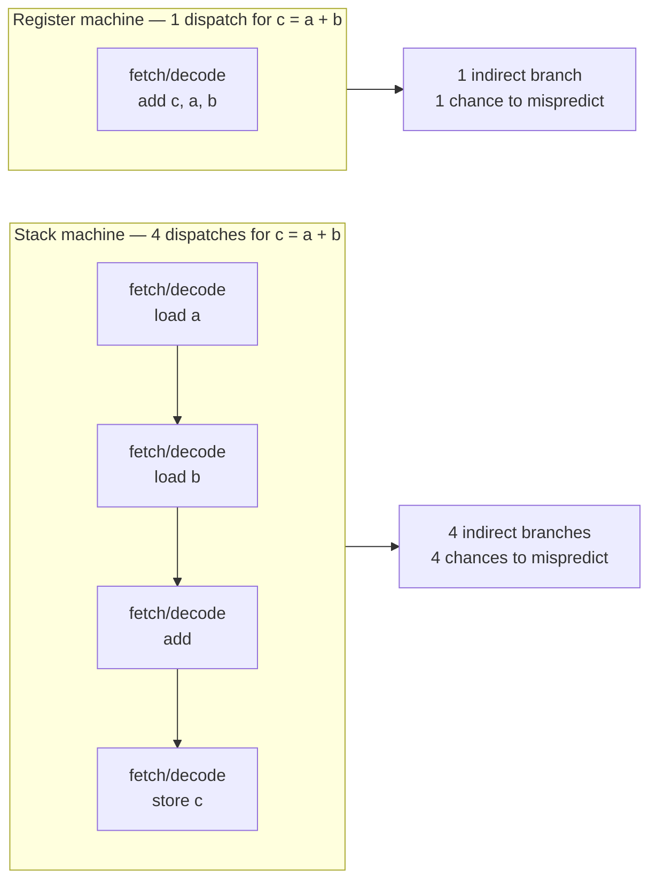

The diagram above contrasts the two designs on exactly the same source expression. Read it as a cost
model, not as a code listing. Each box in the stack-machine row is one full trip around the
interpreter's fetch–decode–execute loop, and each trip ends in an indirect branch to the handler for
the next opcode. The register machine collapses those four trips into one, because the operands were
never in transit; they were sitting in numbered slots the whole time. The two boxes on the right are
the thing that actually costs time on an in-order core: pipeline flushes from mispredicted indirect
branches.

There is a second, less-quoted benefit that matters enormously to you as a reverse engineer. Because
register bytecode names its operands explicitly, **DEX is easier to read than JVM bytecode**. When
you open Smali and see `add-int v0, v1, v2`, you know exactly which values are involved. In stack
bytecode you have to simulate the stack in your head to know what `iadd` is adding. Every hour you
spend reading Smali in chapter [68 — Reverse Engineering](../68-ReverseEngineering/README.md) is an
hour made cheaper by a decision made in 2007.

> **Warning** — Do not repeat the folk claim that "register-based is always faster". It is not a
> universal truth. Register bytecode is larger, which costs instruction-cache pressure and download
> size, and once a good JIT compiler exists the difference in the *interpreter* matters far less
> because hot code is not being interpreted at all. The design was correct **for a 2008 phone with no
> JIT**. State it that way and you will be right.

### 1.6 What "managed code" actually means

You will read "Android apps run managed code" everywhere. Almost nobody defines it. Here is the
precise version, decomposed into four independent properties. They are independent: a runtime can
have any subset of them.

> **Definition** — **Managed code**. Code that executes under the supervision of a runtime which
> takes responsibility for memory allocation and reclamation, enforces the type system at load and
> execution time, and mediates access to the underlying machine. The contrast is *unmanaged* or
> *native* code, which executes directly on the CPU with no supervisor between it and memory.

**Property 1 — automatic memory management (garbage collection).** The program requests memory by
constructing objects and never explicitly frees them. A **garbage collector** periodically determines
which objects are still reachable from live references and reclaims the rest.

> **Definition** — **Garbage collection (GC)**. The automatic reclamation of heap memory that the
> program can no longer reach. "Reachable" means there exists a chain of references starting from a
> *root* — a local variable on a thread's stack, a static field, a JNI global reference — that leads
> to the object. Unreachable objects are, by definition, objects the program can never use again, so
> reclaiming them is safe. ART's specific collectors are covered in [13 — ART](../13-ART/README.md).

The security consequence is large and specific: **use-after-free and double-free do not exist for
pure managed objects.** You cannot free an object, because there is no free. You cannot use a
dangling reference, because as long as you hold a reference the object is by definition reachable and
therefore not collected. An entire class of memory-corruption vulnerability is removed from the app's
own Java or Kotlin code.

**Property 2 — memory safety.** Array accesses are bounds-checked. Null dereferences raise
`NullPointerException` rather than reading address zero. Pointer arithmetic does not exist in the
language. You cannot fabricate a reference to an arbitrary address.

**Property 3 — type safety.** Every object has a runtime type. A reference of type `A` cannot be made
to point at an object of unrelated type `B` without an explicit cast, and the cast is checked at
runtime, throwing `ClassCastException` on failure. This blocks *type confusion*, in which an attacker
persuades code to treat bytes as the wrong kind of object and thereby reads or writes memory the
type system would have forbidden.

**Property 4 — verification.** Before the runtime executes a method, the bytecode has been checked
for structural well-formedness: the operand types flowing into each instruction are consistent on
every path, branches land on real instruction boundaries, register slots are initialised before use,
and the stack (in DEX's case, the register file) is consistent at every merge point. Section 3.12
covers this in detail. Verification is what makes properties 2 and 3 enforceable at all — without it,
hand-crafted bytecode could lie about types.

Now the part everybody skips.

> **Warning** — **Managed does not mean safe.** Managed means "this specific family of
> memory-corruption bugs is unreachable from pure managed code". It says nothing whatsoever about
> logic flaws, hardcoded secrets, broken cryptography, insecure IPC, path traversal, SQL injection,
> SSRF, insecure deserialization, command injection, or a `WebView` with `addJavascriptInterface`
> exposed to a remote page. In real Android engagements, **almost every finding you write will be in
> a category the runtime does not address at all.**

There are four specific holes even in the memory-safety claim, and you must know all four:

| Hole | Why it exists | Where to read more |
|---|---|---|
| **JNI and native libraries** | Managed code can call into C/C++ through JNI. Once execution is inside `libfoo.so`, none of the four properties apply. Most real Android memory-corruption CVEs are in native code. | [16 — JNI](../16-JNI/README.md), [15 — Native Code](../15-Native-Code/README.md) |
| **The runtime itself is native code** | ART is written in C++. A bug in the verifier, the JIT compiler, the GC, or the class linker is a native memory-corruption bug reachable from managed input. | [13 — ART](../13-ART/README.md) |
| **Reflection and `setAccessible`** | Reflection lets managed code reach private fields and methods, defeating encapsulation. Encapsulation was never a security boundary, but developers routinely assume it is. | Section 3.13, [04 — Java](../04-Java/README.md) |
| **`sun.misc.Unsafe` and equivalents** | Deliberate escape hatches exist for library authors and can be reached by app code. They perform unchecked memory access. | Section 5 |

> **Pentester's Note** — When a client tells you "our app is written in Kotlin so it is memory
> safe", the correct response is to ask what is in `lib/arm64-v8a/`. Ninety percent of the time there
> is a payments SDK, an analytics SDK, an anti-fraud SDK, and a media codec — all native, all outside
> the managed guarantees, and usually all built from an old vendored copy of something with known
> issues. Chapter [17 — Libraries](../17-Libraries/README.md) is the SDK-risk chapter.

### 1.7 Why any of this matters to a security researcher

Six concrete reasons. Each one is a thing you will actually do.

1. **Every Java-level hook you will ever write depends on the interpreter.** Frida, Xposed, and
   LSPosed hook managed methods by forcing the runtime to *deoptimize* — to stop running the fast
   compiled version of a method and go back to interpreting it, where a hook can be inserted at the
   method entry. If you do not understand that mechanism (section 3.15), then when a hook silently
   fails to fire you will have no hypothesis to test.

2. **Packers and protectors live entirely in the class-loading machinery.** Commercial protectors
   ship an APK whose visible DEX contains almost nothing, and decrypt the real DEX at startup into a
   `ByteBuffer` handed to an `InMemoryDexClassLoader`. Unpacking is a class-loading problem, not a
   cryptography problem. Section 3.10 and chapter [40 — Obfuscation](../40-Obfuscation/README.md).

3. **The compilation state of the target changes what you observe.** A method that is AOT-compiled
   behaves differently under instrumentation than one that is interpreted. Knowing how to force a
   package back to interpret-only (section 7) is the difference between a hook that works and an
   afternoon lost.

4. **Hidden API enforcement will block your instrumentation code**, and knowing the three bypasses
   (section 3.13) saves you every time you need to touch a `@hide` framework API from an injected
   agent.

5. **The runtime is a large native attack surface reachable by untrusted input.** Any process that
   parses a DEX file — the installer, `dex2oat`, the verifier — is parsing attacker-supplied bytes.
   Chapter [70 — Vulnerability Research](../70-VulnerabilityResearch/README.md) treats it as a fuzzing
   target.

6. **Since Android 12 the runtime updates independently of the OS.** ART is a Mainline module
   delivered through Google Play system updates. That means two devices reporting the same Android
   version can be running materially different runtimes, which affects both exploit longevity and the
   reproducibility of your test environment. Section 3.5 is dedicated to the consequences.

---

## 2. High-Level Architecture

### 2.1 Where the runtime sits in the Android stack

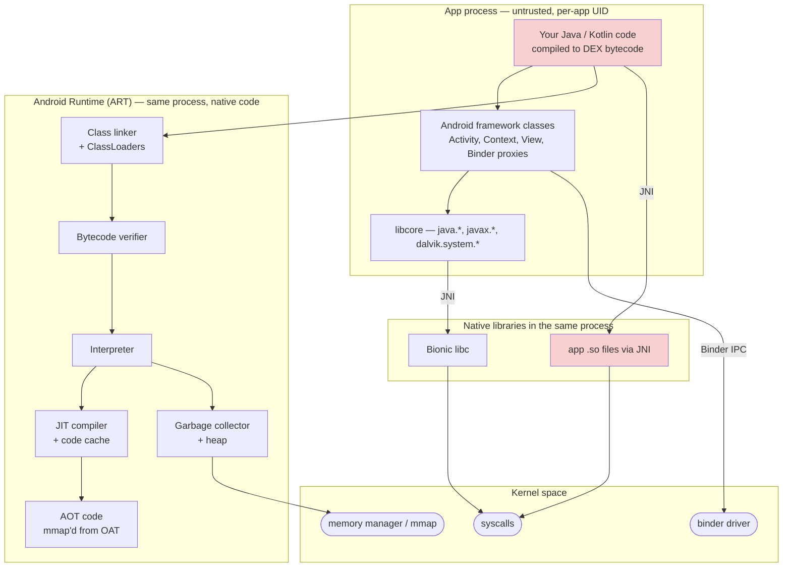

Read that diagram top to bottom as "who calls whom", and notice the three things that surprise
beginners.

First, **ART is not a separate process.** There is no "ART server" your app talks to. ART is a set of
native shared libraries (principally `libart.so`) mapped into *your app's own process*. Every app
process contains its own private copy of the runtime's state: its own heap, its own JIT code cache,
its own class-loader graph. When people say "the VM", they mean this in-process machinery, not a
daemon.

Second, **the framework classes are just more managed code.** `android.app.Activity` is a class in a
DEX file exactly like yours. It is not privileged. It happens to be loaded by a different ClassLoader
(the boot class loader, section 3.7) and it is mapped from a shared, already-compiled system file, but
it obeys the same rules. The privilege lives elsewhere — in `system_server`, on the far side of a
Binder call, running as a different UID. See [25 — Binder](../25-Binder/README.md).

Third, **the pink boxes are the untrusted ones.** Your app's DEX and its bundled `.so` files are
attacker-controlled from the platform's point of view: a malicious app author writes whatever they
like there. Nothing in the runtime stops a malicious app from doing malicious things *within its own
sandbox*. The runtime's job is correctness, not containment. Containment is the kernel's job, via UID
separation and SELinux — chapters [21 — App Sandbox](../21-App-Sandbox/README.md) and
[22 — SELinux](../22-SELinux/README.md).

### 2.2 The complete lifecycle of code, source to silicon

This is the diagram to memorise. Every arrow is explained underneath it.

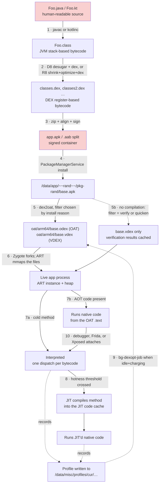

**Arrow 1 — source to `.class`.** `javac` (for Java) or `kotlinc` (for Kotlin) parses your source,
type-checks it, and emits JVM class files: stack-based bytecode in the format defined by the Java
Virtual Machine Specification. No Android device will ever execute these. They exist because the
entire Java tooling ecosystem speaks this format, so Android gets annotation processors, bytecode
weavers, coverage instrumenters, and Kotlin itself for free. Kotlin's compiler emits the *same*
format, which is why Kotlin and Java interoperate perfectly and why, in a decompiler,
Kotlin often looks like slightly odd Java with `Intrinsics.checkNotNullParameter` calls sprinkled in.

**Arrow 2 — `.class` to `.dex`.** The `d8` tool (and its optimizing superset `r8`) performs three
jobs. It **desugars**, rewriting newer language features into constructs the minimum supported API
level can execute — lambdas become classes or invoke-dynamic-free equivalents, default interface
methods get companion classes, and a subset of `java.time` and `java.util.stream` gets backported. It
**translates** stack bytecode into register bytecode, running a register allocator over the implicit
stack. And it **merges** many `.class` files into few `.dex` files with a single shared constant pool.
When you run R8 instead of plain D8, it additionally shrinks (removes unreachable code), optimizes
(inlines, devirtualizes, folds constants), and obfuscates (renames). Chapters
[41 — ProGuard](../41-ProGuard/README.md) and [42 — R8](../42-R8/README.md) own that.

**Arrow 3 — `.dex` into an APK.** The DEX files, the compiled resources, `AndroidManifest.xml`, the
assets, and the native libraries are zipped into an APK, uncompressed entries are 4-byte aligned (or
16 KB-page aligned on modern targets) so they can be `mmap`ed directly, and the archive is signed.
[10 — APK Internals](../10-APK-Internals/README.md) covers the container and every signature scheme.

**Arrow 4 — install.** `PackageManagerService` verifies the signature, allocates the app a UID,
creates its data directory with the right ownership and SELinux label, and copies the APK to a
randomly-named directory under `/data/app/`. The randomisation in the path (`~~xxxx~~/pkg-yyyy/`) is
an anti-enumeration measure; you cannot guess another app's APK path.

**Arrow 5 — `dex2oat`.** This is the ahead-of-time compiler. Given the DEX inside the APK, a target
architecture, and a **compilation filter**, it produces up to two output files: a **VDEX** containing
the (possibly de-quickened) DEX plus cached verification results, and an **OAT** file — an ELF shared
object whose `.text` section holds native code for compiled methods and whose data sections hold the
runtime's lookup tables. Which of those get produced depends entirely on the filter, and the filter
depends on why the install happened. The dashed branch **5b** is the common modern case: on a normal
Play Store install, Android does *not* fully AOT-compile. It verifies and caches, and lets the JIT
plus later background compilation do the rest. Chapter [13 — ART](../13-ART/README.md) has the file
formats.

**Arrow 6 — process start.** When something launches your app, `system_server` asks Zygote to fork.
The child process ends up with ART already initialised and the framework already loaded (section 2.4).
ART then `mmap`s your app's VDEX and OAT files into the new process. Notice the word `mmap`: the code
is not *read* into memory, it is *mapped*, so pages fault in on demand and identical pages can be
shared between processes.

**Arrow 7a / 7b — first execution.** Any method for which AOT code exists in the OAT file starts
executing native code immediately (7b). Any method without AOT code starts in the interpreter (7a).
In a modern app both are true simultaneously, method by method.

**Arrow 8 — JIT.** The runtime counts invocations and loop back-edges for interpreted methods. When
a method's **hotness counter** crosses a threshold, it is queued for the JIT compiler, which compiles
it into the process's JIT code cache — an anonymous memory mapping private to this process. Subsequent
calls run the compiled version.

**Arrow 9 — profiles and background compilation.** While executing, ART records which methods were
hot and which classes were used at startup, writing a **profile** to
`/data/misc/profiles/cur/<user>/<package>/primary.prof`. A scheduled job (`bg-dexopt-job`) runs when
the device is idle and charging, and re-invokes `dex2oat` with the profile, so the *next* launch of
the app has AOT code for exactly the methods that actually mattered. This is
**profile-guided compilation**, section 3.2.

**Arrow 10 — back to the interpreter.** When a debugger, a Java-level hooking framework, or anything
that needs per-invocation control attaches, the runtime *deoptimizes*: it stops using AOT and JIT code
for the affected methods and forces them back through the interpreter, where every entry can be
intercepted. Section 3.15. This arrow is the single most important one in the diagram for a
practitioner, because it is why your hooks work.

> **Mental Model** — The lifecycle is a **factory with a feedback loop**. Source goes in one end,
> machine code comes out the other, and telemetry from the shop floor (the profile) is fed back to
> the machine tool (`dex2oat`) so that next week's run is tuned to what the factory actually builds.
> Nothing about the pipeline is one-shot.

### 2.3 The per-app process model

> **Definition** — **Process**. The kernel's unit of isolation. A process has its own virtual
> address space (its own mapping from the addresses the program uses to physical memory), its own
> file descriptor table, and a set of credentials — a user ID (UID), group IDs, and on Android an
> SELinux security context. One process cannot read another's memory without going through a
> kernel-mediated mechanism such as `ptrace` or `process_vm_readv`, both of which require permission.

On a desktop Java system, one JVM process routinely hosts many logical applications: an application
server runs dozens of deployed web applications inside one JVM, separated only by ClassLoaders and,
historically, by a `SecurityManager`. Android rejected that model completely.

**On Android, every app gets its own Linux process, its own Linux UID, and therefore its own
completely separate instance of the runtime.**

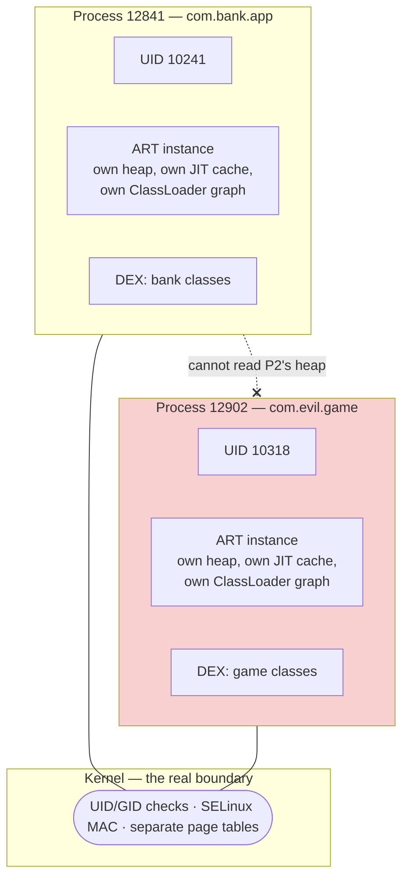

The diagram shows the crucial asymmetry. `com.evil.game` cannot read `com.bank.app`'s heap not
because ART forbids it, but because the two are different UIDs in different address spaces and the
kernel refuses. If both apps had run inside one runtime instance separated only by ClassLoaders, the
isolation would depend on the correctness of thousands of lines of Java library code — and history
teaches that ClassLoader-based isolation in the JVM has been escaped many times.

Four consequences follow, and each is load-bearing for the rest of this repository:

| Consequence | Detail |
|---|---|
| The runtime is not a security boundary against the app itself | Your own code runs in your own process with your own runtime. You can reflect on anything, hook anything, and patch your own memory. This is exactly why Frida, Xposed modules, and app-repackaging attacks work. |
| Isolation costs memory, so it must be made cheap | Every process needs the framework loaded. Loading it separately per app would be unaffordable, which is what Zygote solves (2.4). |
| Crashes are contained | An uncaught exception or a native segfault kills one app, not the phone. Compare the historical single-VM model where one bad tenant took down the server. |
| Shared UIDs break the model | The legacy `android:sharedUserId` manifest attribute let two co-signed apps share a UID and, optionally, a process. That collapses the boundary between them. It has been deprecated since API 29 and you should flag it whenever you see it. See [32 — Manifest](../32-Manifest/README.md). |

> **Pentester's Note** — `adb shell ps -A -o PID,USER,NAME | grep <package>` and
> `adb shell cat /proc/<pid>/status | grep -i uid` are the two commands that make this concrete. Two
> apps sharing a UID will show the same numeric UID; that is a finding worth writing up, because it
> means a compromise of the weaker app is a compromise of the stronger one.

### 2.4 Zygote: preload once, fork many

Here is the problem Zygote solves, stated as arithmetic. The Android framework is tens of megabytes
of classes. Initialising a runtime means allocating a heap, loading and verifying and linking the core
library classes, initialising the resource system, and warming up the graphics stack. Suppose that
costs a device 300 milliseconds and 12 megabytes of private memory. With twenty processes running,
that is six seconds of startup time already spent and 240 megabytes of duplicated identical data on a
device that had 192 megabytes in total.

The solution is to do the expensive work **once**, before any app exists, and then hand out copies.

> **Definition** — **Zygote**. A process started at boot by `init` which initialises an ART
> instance, preloads the framework classes and common resources into its heap, and then blocks
> listening on a Unix domain socket. When a new app process is needed, Zygote `fork()`s. The child
> inherits the fully-initialised runtime and the preloaded heap without doing any of the work. The
> name is biological: a zygote is the single cell every other cell descends from.

> **Definition** — **`fork()`**. The POSIX system call that creates a new process by duplicating
> the calling one. The child gets a copy of the parent's entire address space. Crucially, the copy is
> *lazy*: the kernel marks every page in both processes read-only and shared, and only makes a real
> private copy when one of them writes to a page. That mechanism is **copy-on-write**.

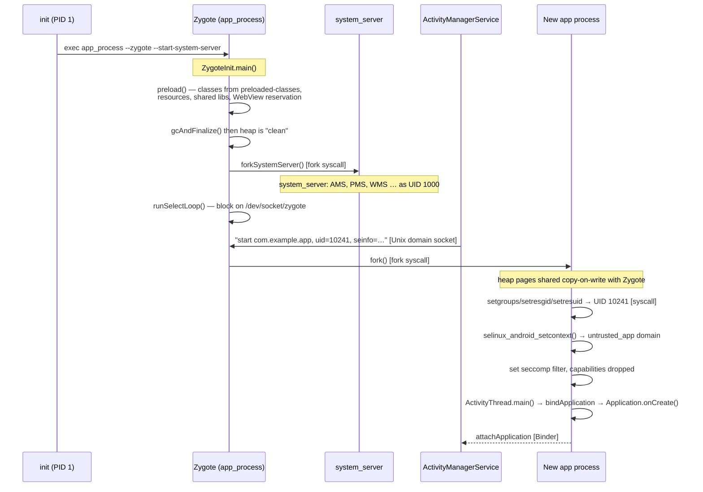

Walk the sequence and note what each step buys.

`init` starts Zygote from the `app_process` binary with the `--zygote` flag; `ZygoteInit.main()` in
`frameworks/base/core/java/com/android/internal/os/ZygoteInit.java` runs. The **preload** step loads
the class names listed in the platform's `preloaded-classes` file, preloads common drawables and
colours, opens shared libraries, and — on devices with the appropriate configuration — reserves the
WebView address space. Then Zygote deliberately runs a garbage collection and finalisation pass so
the heap it is about to share is compact and free of garbage. From that moment the heap is
effectively read-only in practice: the whole point is that children inherit it and nobody dirties it.

Zygote forks `system_server` first. That process becomes UID 1000 (`system`) and hosts
`ActivityManagerService`, `PackageManagerService`, `WindowManagerService` and dozens more. It is the
most security-relevant process on the device that is not the kernel.

Zygote then enters `runSelectLoop()` and blocks on the Unix domain socket `/dev/socket/zygote` (and
`/dev/socket/zygote_secondary` for the second ABI). When `ActivityManagerService` needs to start an
app, it writes an argument list to that socket: the UID and GID to become, the supplementary groups,
the target SDK version, the SELinux `seinfo` tag, the nice name, and the entry-point class.

The fork happens. **Then, and only then, does the child drop privilege.** The child calls
`setgroups`, `setresgid`, and `setresuid` to become the app's UID; installs its seccomp filter;
transitions its SELinux context to `untrusted_app` (or `platform_app`, `priv_app`, and so on
depending on `seinfo`); and drops Linux capabilities. Only after all of that does it call
`ActivityThread.main()` and eventually your `Application.onCreate()`.

> **Warning** — The ordering above is a genuine attack surface and has been the subject of real
> platform vulnerabilities in the past. Between `fork()` and the completion of the privilege drop, the
> child is still running with Zygote's credentials (root, in the classic design). Any bug that lets an
> attacker influence execution in that window is a privilege escalation. This is why the fork path is
> written defensively, why `Zygote.forkAndSpecialize` performs its steps in a fixed order, and why the
> code aborts the whole process rather than continuing if any step fails. Describe this as a *class*
> of issue; do not attach a CVE number to it unless you have verified one.

> **Under the Hood** — Zygote deliberately does **not** call `exec()` after `fork()`. A normal
> Unix process creation is fork-then-exec, which replaces the address space. Zygote forks *without*
> exec precisely so the child keeps the preloaded heap. A side effect is that ASLR (address space
> layout randomisation) is inherited: every Zygote child has the same library and heap layout as
> Zygote and therefore as every sibling. Android mitigates this with per-process randomisation applied
> where it can be, but the structural point is worth knowing — it is why "the address of `libart.so`
> in one app tells you a lot about its address in another" has historically been useful to exploit
> developers. See [19 — Memory](../19-Memory/README.md).

### 2.5 Copy-on-write and what it costs you as an attacker

> **Definition** — **Copy-on-write (COW)**. A memory optimisation in which two processes share the
> same physical page frames, marked read-only in both page tables. A read from either process is
> served from the shared frame. A write triggers a page fault; the kernel allocates a fresh frame,
> copies the contents, remaps it private and writable in the writing process, and lets the write
> proceed. The processes only diverge on the pages they actually modify.


The block diagram shows the steady state after a fork. Frames A and B hold the preloaded framework
objects; both Zygote and the child map them, and neither has written to them, so exactly one physical
copy exists no matter how many apps are running. Frame C is a page the child dirtied — a new object
it allocated — so it is private to the child.

Three consequences you should be able to state cold:

**Memory accounting is not what beginners think.** `dumpsys meminfo <package>` reports Pss
(Proportional Set Size), which divides each shared page's cost by the number of processes sharing it.
An app that looks like it uses 60 MB of Pss may have far less than 60 MB of genuinely private data.
When you are looking for where secrets live in memory, **the private dirty pages are where the
interesting data is**, because anything shared with Zygote is by definition framework code that
existed before your target app did.

**Dirtying shared pages costs the whole device.** Historically, garbage collectors that wrote to
object headers during marking would dirty every preloaded page in every process, exploding total
system memory. ART's collectors are designed to avoid touching Zygote-shared pages, and the runtime
keeps an explicitly "immune" Zygote space. That is a design detail owned by
[13 — ART](../13-ART/README.md), but the *reason* is here.

**For an attacker, the shared region is the boring region.** If you are dumping an app's heap looking
for a session token, filtering out the Zygote-shared space eliminates a large fraction of the search
volume immediately. Conversely, if you are hunting for a memory-corruption primitive in the runtime
itself, the shared region is interesting precisely because a write primitive that lands there affects
every process — although in practice COW makes that write private, which is one of the incidental
security benefits of the mechanism.

> **Pentester's Note** — Practical command to see the split, run as root on the device:
> `adb shell "su -c 'cat /proc/<pid>/smaps_rollup'"` — note the **outer** quotes, without which
> `adb shell` hands the device `su -c cat /proc/<pid>/smaps_rollup` and `cat` reads stdin instead.
> Compare `Private_Dirty` against `Shared_Clean`.
> On a freshly started app, `Shared_Clean` is dominated by the Zygote inheritance and the mapped OAT
> files; `Private_Dirty` is your target's own allocations.

### 2.6 The trust boundary map

Before going deeper, fix in your head where the actual boundaries are. This is the diagram that stops
you writing a bad finding.

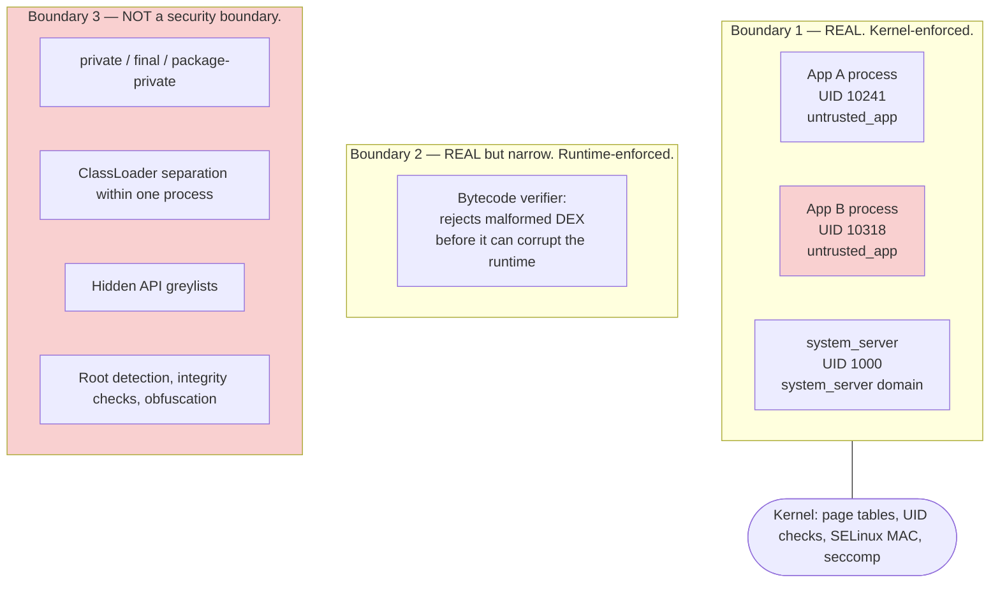

**Boundary 1 is real.** Two apps cannot touch each other. An app cannot touch `system_server`. That
holds because the kernel enforces it with page tables, credential checks, mandatory access control,
and seccomp filters. Breaking it is a platform vulnerability, and it is what chapters
[20](../20-Security-Architecture/README.md) through [23](../23-Permissions/README.md) are about.

**Boundary 2 is real but narrow.** The verifier genuinely stops a malformed or hostile DEX file from
corrupting the runtime's internal state. That is a defence of *the runtime* against *bad bytecode*,
which matters because the runtime is native code processing untrusted input. It is not a defence of
your app's logic against your app's user.

**Boundary 3 is not a boundary at all**, and treating it as one is the single most common category of
bad finding and bad remediation advice in mobile security. `private` is a compile-time courtesy that
reflection ignores. ClassLoader separation inside a process is bypassable by anyone with code
execution in that process, which the app author trivially has. Hidden API enforcement is an
*application-compatibility* mechanism, and Google says so explicitly. Root detection and obfuscation
are speed bumps whose value is raising the cost of mass automated attacks, not stopping a determined
analyst with the device in hand.

> **Mental Model** — The runtime is the **rules of chess**, not the **referee's authority**. It
> makes sure a bishop only moves diagonally, which keeps the game coherent. It does not stop the
> player from tipping the board over, because the player owns the board.

---

## 3. Deep Internal Working

This is the longest section. It works through **what** each mechanism is, **why** it exists, **when**
it runs, **where** it lives on disk and in memory, and **how** the runtime implements it — and then,
for each, what a security researcher does with that knowledge.

### 3.1 Execution modes: interpret, JIT, AOT

There are exactly three ways a managed method can be executed, and a single running app uses all
three at once, on different methods, at the same moment.

#### Mode 1 — Interpretation

> **Definition** — **Interpretation**. Executing bytecode by reading one instruction at a time and
> performing its effect in the runtime's own native code, without producing machine code for the
> program. The interpreter is a loop: fetch the next opcode, decode it, branch to a handler, execute
> the handler, advance the program counter, repeat.

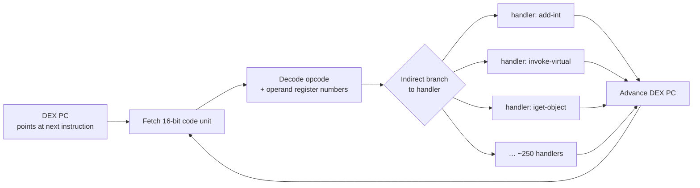

The diagram is the interpreter's inner loop, and the box labelled "Indirect branch to handler" is
where the cost lives. Every single bytecode instruction the program executes passes through that
branch. ART has more than one interpreter implementation — a portable C++ one used for correctness
and debugging, and a hand-written assembly one tuned to shave cycles off this loop. Which one is
active is an ART implementation detail owned by [13 — ART](../13-ART/README.md), but the shape of the
loop is universal.

| Property | Value |
|---|---|
| Startup latency | Best. There is nothing to compile; execution begins immediately. |
| Steady-state speed | Worst. Typically an order of magnitude slower than compiled code. |
| Memory | Best. No compiled code to hold. |
| Disk | Best. Nothing extra written. |
| Battery | Worst for long-running work, best for code executed once. |
| Attack surface for you | **Best.** Every method entry passes through runtime code you can intercept. This is why hooking frameworks force deoptimization. |

#### Mode 2 — Just-In-Time compilation

> **Definition** — **JIT (just-in-time) compilation**. Compiling bytecode into native machine code
> *while the program is running*, triggered by evidence that the code is hot enough to be worth
> compiling. The output is written into an executable memory region owned by the process (the **JIT
> code cache**) and subsequent calls jump into it directly.

> **Definition** — **Hotness counter**. A per-method counter the runtime increments on each
> invocation and on each backward branch (a loop iteration). Crossing a configurable threshold marks
> the method as a JIT candidate. Backward branches are counted because a method called once but
> looping a million times is just as hot as a method called a million times.

The JIT's decisive advantage over AOT is **information**. At compile time, a static compiler must
assume any subclass could override a method, so a virtual call must go through the vtable. A JIT
watching the running program can observe that in this app, at this moment, `List` is *always*
`ArrayList`, and compile a direct call with a cheap type guard that falls back if the assumption ever
breaks. That is **speculative optimization**, and it is why JITs can beat static compilers on
real-world object-oriented code.

| Property | Value |
|---|---|
| Startup latency | Poor on first execution — you pay interpretation until the threshold, then compilation cost on a background thread. |
| Steady-state speed | Excellent, potentially better than AOT because of speculative optimization on observed types. |
| Memory | Costs a code cache (a few hundred KB to a few MB per process) plus compiler working memory. |
| Disk | Nothing persisted; all work is lost when the process dies. |
| Battery | Compilation costs energy every launch, unless profiles let AOT take over. |
| Attack surface for you | The code cache is a writable-then-executable region, which is why W^X hardening exists (3.14). Its presence is detectable from `/proc/<pid>/maps`. |

#### Mode 3 — Ahead-Of-Time compilation

> **Definition** — **AOT (ahead-of-time) compilation**. Compiling bytecode into native machine code
> *before* the program runs, storing the result in a file, and loading that file at process start. On
> Android the compiler is `dex2oat` and the output is an OAT file — an ELF shared object carrying
> generated code plus runtime metadata.

| Property | Value |
|---|---|
| Startup latency | Best steady behaviour — no compilation at launch, code is `mmap`ed and runs. |
| Steady-state speed | Very good, but cannot exploit runtime type feedback unless a profile supplied it. |
| Memory | Good: OAT pages are file-backed and clean, so they are shareable and evictable under pressure. |
| Disk | **Worst.** This is the constraint that killed full AOT. Compiled code is several times the size of the DEX it came from. |
| Battery | Best at run time. The energy is spent once, at install or during an idle background job. |
| Attack surface for you | Compiled methods do not pass through the interpreter, so naive Java hooks miss them until deoptimization forces them back. Also, OAT files on disk are a static-analysis artefact you can carve. |

#### The comparison, side by side

| Dimension | Interpreter | JIT | AOT |
|---|---|---|---|
| When compilation happens | Never | During execution, on a background thread | Install time or idle background job |
| Cost paid at app launch | None | Warm-up on every launch | None |
| Cost paid on install | None | None | Minutes of CPU, hundreds of MB of storage (full AOT) |
| Peak throughput | 1× (baseline) | High | High |
| Persisted across launches | Not applicable | No | Yes |
| Uses runtime type feedback | Not applicable | Yes, directly | Only via a recorded profile |
| RAM cost | Lowest | Code cache, private dirty | OAT pages, file-backed clean |
| Storage cost | None | None | Large |
| Battery at run time | Highest | Medium | Lowest |
| Visible in `/proc/pid/maps` | — | Anonymous code-cache mappings | `base.odex` / `base.vdex` file mappings |
| Hookable at method entry without deopt | Yes | No | No |

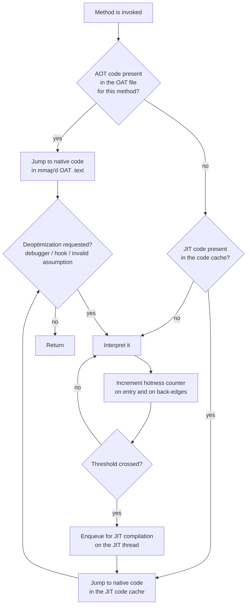

The flowchart is the dispatch decision made for every method call. The important structural point is
that the three modes are not alternatives chosen once for the whole app; they are chosen **per
method**, and a single method can move between them during one run. The bottom of the chart is the
deoptimization edge, which is the mechanism every Java hooking framework depends on (section 3.15).

> **Mental Model** — Interpretation is **reading a recipe aloud while cooking**. JIT is
> **memorising the steps you keep repeating, halfway through the meal**. AOT is **the meal-kit company
> pre-chopping everything before it ships**. A modern kitchen does all three.

### 3.2 Profile-guided compilation and Cloud Profiles

Full AOT compilation at install time was Android 5.0's design, and it created two problems that were
severe enough to force a redesign within two releases.

**Problem one — install time.** Every app had to be fully compiled before it could run. On a big app
this took minutes. Worse, an OS upgrade invalidated every OAT file on the device, so the first boot
after an update recompiled *every installed app*. The "Android is upgrading… optimising app 47 of
212" screen was a direct, visible consequence, and on a device with hundreds of apps it could take
half an hour.

**Problem two — storage.** Compiled code is several times larger than the DEX it was generated from,
and full AOT compiled *every method*, including code paths that would never execute on that device:
error handlers, debug branches, dead A/B-test arms, and the enormous quantity of library code that
apps link but barely touch.

Android 7.0 Nougat replaced this with a hybrid, and the mechanism at its centre is the profile.

> **Definition** — **ART profile**. A binary file recording which methods of an app were executed
> frequently and which classes were loaded during startup, gathered by the runtime while the app runs.
> It lives under `/data/misc/profiles/cur/<userId>/<package>/primary.prof` while being collected, and
> is merged into a reference profile under `/data/misc/profiles/ref/<package>/`. It is the input that
> lets `dex2oat` compile a small, high-value subset instead of everything.

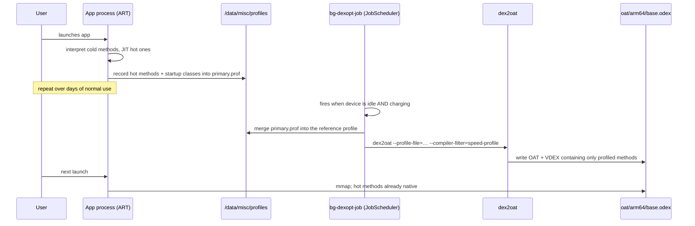

Read the sequence as a loop with a long period. Nothing happens immediately; the benefit accrues over
days of ordinary use. The compilation itself is deliberately scheduled for a moment when it costs the
user nothing — device idle and on a charger — which is why a freshly-flashed test device behaves
differently from a phone that has been in someone's pocket for a month.

> **Pentester's Note** — This is a genuine source of "it worked yesterday" confusion. Your target
> app's compilation state changes over the life of your test device. If you need determinism, pin it
> explicitly with `cmd package compile` (section 7) at the start of every test session, and record
> what you pinned it to in your notes.

**Cloud Profiles and Play-delivered profiles.** The obvious flaw in the scheme above is that a
*freshly installed* app has no profile, so the first few days of use are slow. Google's answer was to
aggregate profiles across users and ship the aggregate with the app. When developers upload an Android
App Bundle, Play can collect anonymised profile data from users on the early release tracks, merge it,
and deliver the resulting **Cloud Profile** alongside the app to subsequent installers, so a brand-new
install already knows which methods matter. Developers can also generate a **Baseline Profile**
themselves in continuous integration and check it into the app as a build artefact, which the build
tooling embeds so that even the very first launch benefits.

The security-relevant observations:

| Observation | Why it matters |
|---|---|
| A profile is metadata *about* code paths, derived from real user behaviour | Profiles describe which methods real users execute. That is a behavioural side channel, however coarse. |
| Profiles are per-app files in a system-owned directory | An app cannot read another app's profile without privilege. Root access can. During forensics, a profile is evidence that a method *was executed on this device*. |
| A shipped Baseline Profile is an APK artefact | It is a list of method signatures the developer thought were hot. During static triage, reading it tells you what the developer considers the app's main paths, which is a fast orientation aid. |
| Compilation state affects instrumentation | A method that is AOT-compiled because a profile said it was hot will not be interpreted, so it behaves differently under a naive hook. |

> **Under the Hood** — The profile format is versioned and internal, and it is not a stable public
> API. Tools exist to dump it (`profman --dump-only --profile-file=…`, where `profman` is available on
> the device or in an AOSP build), but do not build critical tooling on the byte format; it changes
> between releases, and since ART became a Mainline module it can change *within* a release.

### 3.3 The compilation filter table

`dex2oat` takes a `--compiler-filter` argument that decides how much work it does. This is the single
knob that most affects what you see when you attach to an app, so learn the values.

| Filter | Verifies? | Compiles? | Output | Typical use |
|---|---|---|---|---|
| `assume-verified` | No | No | Minimal | Trusted, pre-verified system code paths. |
| `verify` | Yes | No | VDEX with cached verification results | The default for a normal install on modern Android. |
| `quicken` *(historical)* | Yes | Rewrites some bytecodes into faster forms | VDEX | Used in the Nougat-to-Pie era; removed in later releases. |
| `space-profile` | Yes | Profiled methods, optimising for size | OAT + VDEX | Devices under storage pressure. |
| `space` | Yes | Everything, optimising for size | OAT + VDEX | Storage-constrained builds. |
| `speed-profile` | Yes | Only methods named in the profile | OAT + VDEX | The steady-state target for user apps after `bg-dexopt-job`. |
| `speed` | Yes | Every method, optimising for speed | OAT + VDEX | System apps, benchmarking, and what *you* force during testing. |
| `everything-profile` | Yes | Profiled methods including normally-excluded ones | OAT + VDEX | Debugging the compiler. |
| `everything` | Yes | Absolutely everything | OAT + VDEX | Debugging the compiler. Very slow, very large. |

Runtime knobs that matter to you:

| Property | Effect |
|---|---|
| `dalvik.vm.usejit` | Whether the JIT is enabled at all. Turning it off forces interpretation for anything not AOT-compiled. |
| `pm.dexopt.*` | The family of properties mapping an *install reason* (first install, install from Play, boot, background job, shared APK) onto a compiler filter. Read them with `getprop \| grep dexopt`. |
| `dalvik.vm.image-dex2oat-filter` | The filter used for the boot image itself. |
| `debug.generate-debug-info` | Makes `dex2oat` emit debug information so native profilers and debuggers can attribute frames to Java methods. Extremely useful during analysis. |

> **Pentester's Note** — The two commands you will use constantly:
>
> ```bash
> # adb shell — force a package to fully AOT compile, so it behaves like a "warm" install
> cmd package compile -m speed -f com.target.app
> ```
>
> ```bash
> # adb shell — throw away all compiled code, forcing interpretation (best for reliable Java hooks)
> cmd package compile --reset com.target.app
> ```
>
> Resetting before a hooking session removes an entire class of "my hook does not fire" problem.

### 3.4 The historical version matrix

You will meet every one of these states on real devices, in emulators, and in the wild. Knowing which
runtime you are standing on tells you which techniques apply.

| Android version | API | Runtime | Execution model | What changed and why it mattered |
|---|---|---|---|---|
| 1.0 – 2.1 (Cupcake–Eclair) | 1–7 | Dalvik | Pure interpretation | No compilation at all. The register-based bytecode design was carrying the entire performance argument. |
| 2.2 Froyo | 8 | Dalvik | Trace JIT | The first JIT. It compiled *traces* — hot linear paths through code, not whole methods — because a trace JIT needs far less memory than a method JIT. Detail in [14 — Dalvik](../14-Dalvik/README.md). |
| 2.3 – 4.3 | 9–18 | Dalvik | Trace JIT, refined | Incremental: concurrent GC in 2.3, larger heaps, multi-core support. |
| 4.4 KitKat | 19 | Dalvik default, **ART preview** | Dalvik trace JIT, or ART full AOT | ART shipped as a developer option under Settings, Developer options, Select runtime. Two runtimes coexisted, so apps had to work on both. |
| 5.0 Lollipop | 21 | **ART only**, Dalvik removed | Full AOT at install | Everything compiled at install. Fast at run time. Install times and storage consumption became a real user-visible problem, and OS updates triggered a full-device recompile. Also the release that made 64-bit real. |
| 6.0 Marshmallow | 23 | ART | Full AOT | Refinement of the Lollipop model. The install-time problem persisted. |
| 7.0 Nougat | 24 | ART | **Hybrid: interpreter + JIT + profile-guided AOT** | The redesign. Install becomes near-instant because nothing is compiled. The JIT handles the first runs and records a profile. `bg-dexopt-job` compiles the profiled subset when idle and charging. Also the release where `libcore` moved substantially to OpenJDK-based code. |
| 8.0 Oreo | 26 | ART | Hybrid | Concurrent compacting GC by default. `InMemoryDexClassLoader` becomes public API — from here on a packer can load a DEX from a byte buffer without ever touching the filesystem. |
| 8.1 | 27 | ART | Hybrid | `DelegateLastClassLoader` becomes public API. |
| 9 Pie | 28 | ART | Hybrid | **Hidden API enforcement** arrives (section 3.13). Cloud Profiles begin to be delivered through Play. |
| 10 | 29 | ART | Hybrid | `android:sharedUserId` deprecated. Continued hidden-API tightening. Project Mainline starts, though ART is not yet a module. |
| 11 | 30 | ART | Hybrid | More APIs move from the greylists to the blocklist. |
| **12** | **31** | **ART as a Mainline module (`com.android.art` APEX)** | Hybrid | The runtime becomes updatable through Google Play system updates, independent of the OS. Section 3.5. |
| 13 | 33 | ART Mainline | Hybrid | Continued module maturation; more of `libcore` moves inside the module. |
| 14 | 34 | ART Mainline | Hybrid | Further runtime improvements delivered out-of-band. |
| 15 – 16 | 35–36 | ART Mainline | Hybrid | 16 KB memory page size support work; continued out-of-band delivery. |

> **Warning** — Do not write "Android uses AOT" or "Android uses JIT" in a report. Since Nougat,
> both statements are wrong on their own. The accurate sentence is: *"Android uses an interpreter for
> cold code, a JIT for code that becomes hot within a session, and profile-guided AOT compilation
> performed by a background job for code that is hot across sessions."*

### 3.5 The ART Mainline module

> **Definition** — **Project Mainline**. Google's programme, starting with Android 10, of packaging
> selected OS components as **APEX** modules — signed, versioned containers that can be updated
> through Google Play system updates without a full OS image update from the device manufacturer.

> **Definition** — **APEX (Android Pony EXpress)**. The container format for Mainline modules. An
> APEX is a signed file containing a filesystem image that is mounted at a fixed path early in boot.
> The ART module mounts at `/apex/com.android.art/` and contains `libart.so`, `dex2oat`, the core boot
> classpath jars, and the runtime's supporting binaries.

From Android 12 onwards, ART is one of those modules. This has consequences that reach much further
than "the runtime gets patched faster".

**For defenders, and for exploit longevity.** Historically, a bug in `libart.so` required an OS
security patch from the device manufacturer, which meant many devices never received it. As a Mainline
module, an ART fix can reach the majority of the Android fleet within weeks, through the same channel
that delivers Play system updates. From an offensive standpoint, this collapses the window during
which a runtime bug is broadly exploitable. An exploit that once had a multi-year tail on unpatched
mid-range devices now has a much shorter one — although devices without Google Play services,
including many devices in some markets and most AOSP-derived custom ROMs, do not receive Mainline
updates at all and retain the long tail.

**For your test environment.** This is the practical one, and it bites people constantly.

> **Warning** — **Two devices reporting the same `ro.build.version.release` can be running
> different ART versions.** Since the ART module updates independently, `Build.VERSION.SDK_INT` no
> longer determines runtime behaviour. When you record a finding that depends on runtime internals —
> structure offsets, a hooking technique, a deoptimization behaviour — record the ART module version
> too, not just the Android version.

```bash
# adb shell — record ALL of these in your engagement notes, every time
getprop ro.build.version.release
getprop ro.build.version.sdk
getprop ro.build.version.security_patch
cmd package list packages --apex-only --show-versioncode | grep art
ls -l /apex/com.android.art/
```

**For tooling.** Frida, LSPosed, and any tool that reaches into ART's internal C++ structures depends
on the layout of those structures. When the ART module updates, those layouts can change, and tooling
breaks on devices that have taken the update — while working fine on a device of the *same Android
version* that has not. If a hooking framework suddenly stops working after a Play system update and
nothing else changed, this is your first hypothesis.

| Question | Pre-Android 12 answer | Android 12 and later answer |
|---|---|---|
| How do I know which runtime a device has? | The Android version determines it. | The Android version **plus** the `com.android.art` APEX version. |
| How fast does a runtime bug get fixed in the field? | OS security patch; months, or never. | Play system update; weeks, for devices with Play services. |
| Can a device get a newer runtime without an OS upgrade? | No. | Yes. |
| Are ART internals stable within one Android release? | Broadly yes. | No — treat them as a moving target. |
| Do AOSP-derived custom ROMs get this? | Not applicable. | Usually not; they ship the AOSP module version and update only when the ROM does. |

> **Under the Hood** — Because the boot classpath jars themselves live inside the APEX, a Mainline
> ART update can also change core library behaviour. That is why the boot image (`boot.art`, `boot.oat`
> and their companions) is regenerated after an ART module update: the pre-compiled boot image must
> match the classes it was compiled from. If it does not, the runtime falls back to compiling or
> interpreting, and the device feels slow until the background job catches up. The file formats are in
> [13 — ART](../13-ART/README.md).

### 3.6 What a ClassLoader IS

Start from the problem, not the API.

A program is not one file. It is thousands of classes, and the runtime cannot load them all at start;
that would be slow and would waste memory on classes never used. So classes are loaded **lazily**: the
first time execution needs a class that is not yet present, the runtime must go and find it. But "go
and find it" is a policy question. Find it *where*? In the APK? In a downloaded file? In a byte array
that was just decrypted? Over the network? The runtime deliberately does not hardcode an answer.
Instead it delegates that policy to an object.

> **Definition** — **ClassLoader**. An object responsible for producing a `Class` object when given
> a class's name. It encapsulates *where the bytes come from* and *how they are found*. `ClassLoader`
> is an abstract class in `java.lang`; concrete subclasses implement particular sourcing strategies.
> Every loaded class permanently remembers which ClassLoader defined it, and that pairing —
> `(ClassLoader, fully-qualified name)` — is the class's true identity inside the runtime.

That last sentence is the one that trips people up, so here it is again as a rule, because it is the
root of both a common bug and a useful attack.

> **Warning** — **A class's identity is `(defining ClassLoader, name)`, not just the name.** Two
> `Class` objects both named `com.example.Session`, loaded by two different ClassLoaders, are
> *different types*. Assigning one to a variable of the other's type throws `ClassCastException`, and
> the error message is maddening because it appears to say the class cannot be cast to itself.
> `instanceof` returns false. Static fields are separate. If you have ever seen
> `java.lang.ClassCastException: com.example.Session cannot be cast to com.example.Session`, this is
> exactly why.

Three responsibilities live in a ClassLoader:

| Responsibility | What it means |
|---|---|
| **Location** | Deciding where the class's bytes live: an APK on disk, a JAR, a raw byte array, an in-memory buffer, a network stream. |
| **Definition** | Handing those bytes to the runtime so it can create the internal class structure, verify the bytecode, and link it. |
| **Namespace** | Creating a scope. Classes loaded by the same loader can see each other's package-private members and share statics; classes in different loaders are distinct types. |

> **Mental Model** — A ClassLoader is a **librarian with one specific shelf**. You ask for a book by
> title. The librarian first asks their supervisor whether the supervisor has it (parent delegation);
> only if the supervisor does not, does the librarian search their own shelf. Two librarians with two
> shelves may each hold a book with the same title — and those are two different physical books, which
> is exactly why the runtime treats them as different types.

### 3.7 The ClassLoader hierarchy on Android

Android's set of loaders differs from Java SE's. Java SE has bootstrap, platform, and application
loaders reading `.class` files from a classpath. Android's read DEX from APKs, JARs, and buffers, and
they live in the `dalvik.system` package, which does not exist in Java SE at all.

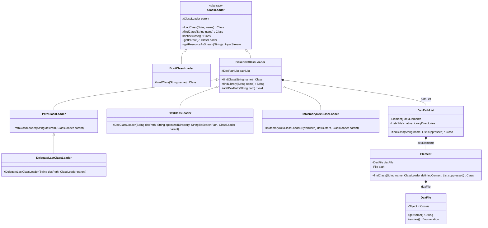

The class diagram shows both the inheritance tree and, more importantly, the composition beneath it.
Look at the three diamond-headed edges at the bottom: every `BaseDexClassLoader` **has a**
`DexPathList`, every `DexPathList` **has an array of** `Element`, and every `Element` **has an open**
`DexFile`. That chain — `loader.pathList.dexElements[i].dexFile` — is the single most important
private data structure in Android application security, because walking it tells you every DEX file
the process has open, including ones that were never written to disk. Section 3.9 and the Frida script
in section 7 do exactly that walk.

Now the loaders themselves, in the order you will meet them.

| ClassLoader | Package | Since | What it loads | Where you meet it |
|---|---|---|---|---|
| `BootClassLoader` | `java.lang` (package-private) | 1.0 | `java.*`, `javax.*`, `android.*`, `dalvik.*`, and the rest of the boot classpath, from the pre-compiled boot image. | The root of every chain. Its own `getParent()` returns `null`. |
| `PathClassLoader` | `dalvik.system` | 1.0 | DEX files already installed on disk: `base.apk`, split APKs, and declared shared libraries. | Your app's loader. `getClass().getClassLoader()` in app code returns it. |
| `DexClassLoader` | `dalvik.system` | 1.0 | Any DEX, JAR, or APK at a path the app can read. Historically distinguished by accepting an `optimizedDirectory`, which is deprecated and ignored on modern Android. | Plugin frameworks, hot-patch systems, packers, and malware. Seeing it is always worth investigating. |
| `InMemoryDexClassLoader` | `dalvik.system` | API 26 | DEX bytes from one or more `ByteBuffer`s. **No file is ever created.** | Modern packers and modern malware. The bytes exist only in the heap. |
| `DelegateLastClassLoader` | `dalvik.system` | API 27 | Same sources as `PathClassLoader`, but with the delegation order inverted. | Apps shipping their own version of a library that also exists on the boot classpath — and, as a side effect, a shadowing technique. |

> **Definition** — **Boot classpath**. The set of JARs containing the core library and framework
> classes, loaded by `BootClassLoader` and normally pre-compiled into a shared **boot image** so that
> every process maps the same already-linked class objects. On Android 12 and later many of these live
> inside the ART APEX.

A concrete chain, as you would print it from inside a running app:

```text
dalvik.system.PathClassLoader[DexPathList[[zip file "/data/app/~~aB3../com.example.app-Xy7../base.apk"],
    nativeLibraryDirectories=[/data/app/~~aB3../com.example.app-Xy7../lib/arm64, /system/lib64]]]
   parent -> java.lang.BootClassLoader@a1b2c3d
   parent -> null
```

That is the normal, boring, healthy shape for a simple app. The moment you see a third loader in the
chain, or a `DexPathList` with more elements than the app has split APKs, something is loading code
dynamically and you should find out what.

### 3.8 Parent delegation and what it protects

> **Definition** — **Parent delegation model**. The convention, implemented in
> `ClassLoader.loadClass`, that a loader asked for a class first checks whether it has already defined
> it, then asks its **parent** to load it, and only searches its own sources if the parent could not.
> The request therefore travels up to the boot loader first, and the class is defined by the *highest*
> loader in the chain that can find it.

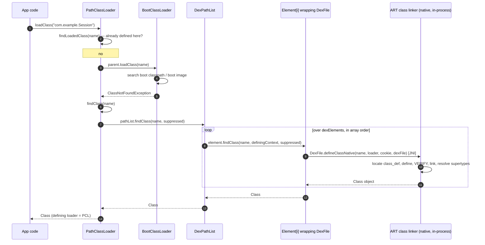

Follow the numbered steps. The request goes **up** first and only comes back **down** when the parent
has failed. Note the step where the class is actually created: it happens in native code, inside ART's
class linker, and **verification happens there** — a class is verified as part of being defined and
linked, not at some separate later stage under the app's control.

Also note the loop. `DexPathList.findClass` iterates `dexElements` **in array order** and returns the
first match. That ordering is the mechanism behind the classic multidex hot-patch trick, in which a
patch DEX is inserted at index 0 of the array so that its version of a class is found before the
original. Legitimate hot-patch frameworks and malicious loaders use precisely the same technique.

**What parent delegation protects.** The property it buys is that **core classes cannot be shadowed**.
Suppose an app ships a DEX containing its own `java.lang.String` with a modified `equals()`. Without
delegation, whichever loader searched first might define it, and every piece of code loaded by that
loader would use the hostile `String`. With delegation, the request goes to `BootClassLoader` first,
the genuine `java.lang.String` is found there, and the app's copy is never consulted. Modern Android
layers a second, stronger defence on top: the runtime rejects attempts to define classes in protected
core packages from an app's DEX outright, so this is belt and braces.

| Threat | Mitigated by | Residual risk |
|---|---|---|
| Shadowing a core class such as `java.lang.String` | Parent delegation plus explicit core-package restrictions in the runtime | Essentially none from app-level DEX |
| Shadowing a *framework* class such as `android.webkit.WebView` | Parent delegation, since `android.*` is on the boot classpath | Low |
| Shadowing an *app's own* class | **Nothing.** Delegation says nothing about classes only the app defines. | High — this is the hot-patch and repackaging surface |
| Shadowing a *bundled third-party library* class | Nothing, and `DelegateLastClassLoader` makes it easier | High |

> **Warning** — Parent delegation is a **correctness and compatibility** mechanism that has a
> useful security side effect. It is not, and was never designed as, a defence against an attacker who
> controls the app's own code. An attacker with code execution in the process can construct any
> ClassLoader they want, in any order they want.

**`DelegateLastClassLoader` inverts the model.** Introduced in API 27, it searches in this order: the
boot classpath first (so core classes are still safe), then **itself**, then its parent. The
legitimate use is real — an app that bundles a newer version of a library which also exists on the
boot classpath needs its own copy to win. But the effect is that a class name defined both in the app
and in a delegate-last loader now resolves to the delegate-last loader's version. As a technique for
shadowing an app's own classes, or for confusing an analyst reading a call graph, it is effective and
it looks entirely legitimate.

> **Pentester's Note** — When you find `DelegateLastClassLoader` in a target, ask two questions.
> Which classes does it define that also exist elsewhere in the app? And is the path it loads from
> writable by anything other than the app? A delegate-last loader pointed at a world-writable or
> externally-writable directory is a code-execution primitive: an attacker who can drop a DEX there
> gets their version of a class chosen in preference to the real one.

### 3.9 DexPathList, Elements, and findClass

Zoom in on the private data structure, because this is what your tooling manipulates.

```text
BaseDexClassLoader
 └── private final DexPathList pathList
      ├── private Element[] dexElements
      │     ├── Element[0] { DexFile dexFile; File path; }   <- searched first
      │     ├── Element[1] { DexFile dexFile; File path; }
      │     └── Element[n] { ... }
      ├── private final List<File> nativeLibraryDirectories
      ├── private final List<File> systemNativeLibraryDirectories
      └── private IOException[] dexElementsSuppressedExceptions

DexFile
 └── private Object mCookie      <- native handle to the runtime's open DEX
```

The fields are private and undocumented, which has never stopped anybody. The relevant AOSP sources
are `libcore/dalvik/src/main/java/dalvik/system/BaseDexClassLoader.java`,
`libcore/dalvik/src/main/java/dalvik/system/DexPathList.java`, and
`libcore/dalvik/src/main/java/dalvik/system/DexFile.java`.

| Field | Type | Why you care |
|---|---|---|
| `pathList` | `DexPathList` | The entry point for every reflective walk. |
| `dexElements` | `Element[]` | Search order is array order. Prepending an element makes your classes win. |
| `Element.dexFile` | `DexFile` | `getName()` gives the backing path, or something synthetic for an in-memory DEX. `entries()` enumerates class names. |
| `DexFile.mCookie` | `Object` | A native handle to the runtime's open DEX structure. |
| `nativeLibraryDirectories` | `List<File>` | Where `System.loadLibrary` searches. Injecting a directory here is a native-code-loading primitive. |
| `dexElementsSuppressedExceptions` | `IOException[]` | Records failures during construction. Occasionally reveals paths a packer tried and abandoned. |

The three operations you will perform on this structure:

**Operation 1 — enumerate.** Walk `loader.pathList.dexElements`, and for each element read
`element.dexFile.getName()`. This gives you every DEX the process has open, which is the fastest way
to spot dynamically loaded code. The Frida implementation is in section 7.

**Operation 2 — dump.** Given a `DexFile` you can ask the runtime for the class names it contains via
`entries()`, and given an in-memory DEX you can capture the `ByteBuffer` at construction time and
write it out. That is how you unpack a packer that never touches disk.

**Operation 3 — inject.** Build a new `Element[]` with your DEX at index 0, concatenate the original
array after it, and assign it back to `pathList.dexElements` reflectively. Your classes now win every
lookup. This is the mechanism behind essentially every Android hot-patch framework, and behind a
family of malicious loaders.

> **Under the Hood** — `mCookie` is really a native pointer (historically a `long`, later an object
> wrapping an array of them) to the runtime's open-DEX bookkeeping. Overwriting it from Java is a
> straightforward way to make the runtime dereference a value you chose. It is not a vulnerability —
> you already control the process — but it is a useful primitive when writing instrumentation, and it
> is one reason the field is not public API.

### 3.10 Dynamic class loading as an attack technique

Everything in 3.6 through 3.9 exists for legitimate reasons: plugin architectures, dynamic feature
modules, hot-patching, and A/B code delivery. The same machinery is the backbone of both commercial
protectors and Android malware. Here is the taxonomy.

| Technique | How it works | Why it is used | How you detect it |
|---|---|---|---|
| **DEX from assets** | Encrypted DEX shipped inside the APK under `assets/`; decrypted at startup to the app's private files directory; loaded with `DexClassLoader`. | Keeps the real code out of the DEX a static analyser sees. | The visible DEX is tiny and mostly loader code. A large high-entropy asset. `DexClassLoader` construction with a path under `getFilesDir()`. |
| **DEX from the network** | Payload downloaded at run time, written to private storage, loaded. | Lets the operator change the payload after install and after store review. | A network fetch followed by a write to a file that is then passed to a loader. Look for the write-then-load pair. |
| **In-memory DEX** | Decrypted into a `byte[]`, wrapped in a `ByteBuffer`, handed to `InMemoryDexClassLoader`. No file ever exists. | Defeats "just pull the dropped DEX off disk". | Nothing on disk. You must hook the constructor or scan the heap. Section 7 does the former. |
| **Native unpacking** | A JNI library decrypts and installs the DEX by calling into the runtime from C++. | Keeps the unpacking logic out of managed code entirely. | The managed code is trivially small; the `.so` is large and heavily obfuscated. `System.loadLibrary` very early in `Application.attachBaseContext`. |
| **`dexElements` prepending** | New `Element[]` with the attacker's DEX first, written back reflectively. | Replaces a class without replacing the APK. | Reflection on `pathList` and `dexElements` in the DEX; an element count that does not match the APK's splits. |
| **ClassLoader hijacking** | Replace the `mClassLoader` of a `LoadedApk`, or insert a custom loader as the parent of the app's loader, so lookups route through attacker code. | Total control over class resolution in the process. | The app's loader chain has an unexpected intermediate loader. |
| **Delegation inversion** | Use `DelegateLastClassLoader` so the attacker's copy of a class beats the app's. | Shadowing without touching the original DEX. | Presence of `DelegateLastClassLoader` where no library-conflict justification exists. |

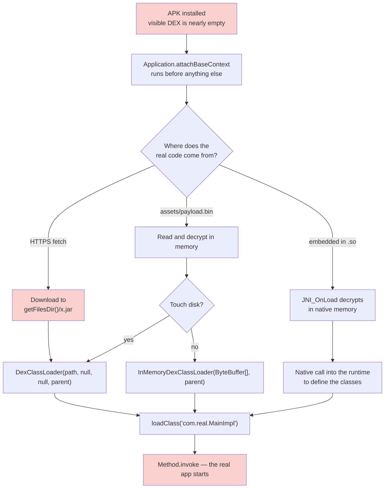

The flowchart is the shape of essentially every packed Android application. Learn to recognise it,
because that recognition turns a two-day reversing job into a twenty-minute one. The critical
observation is at the bottom: **whatever route the code took, it must eventually become a real class
in a real ClassLoader in this process, and at that instant it is fully visible to you.** You do not
need to break the packer's cryptography. You need to be present at the moment the runtime is handed
the plaintext. That is a hooking problem, and section 7 solves it.

> **Mental Model** — Unpacking is not code-breaking, it is **stakeout work**. The courier will
> eventually open the briefcase in front of the runtime, because the runtime is the only thing that
> can execute the contents. Your job is to be standing there when it does.

> **Pentester's Note** — Dynamic code loading from any source outside the signed APK is a finding
> in its own right, independent of what the loaded code does, because it means the shipped, reviewed,
> signed artefact is not the code that runs. Check the loaded artefact's integrity controls: is it
> fetched over TLS with pinning, is it signature-verified before loading, is it stored where only the
> app can write? A `DexClassLoader` pointed at external storage is a straightforward remote code
> execution vulnerability and always has been.

### 3.11 java.lang.Runtime, Runtime.exec, and ProcessBuilder

`java.lang.Runtime` is a singleton object giving managed code a handle on a few
process-and-machine-level facilities. Most of its methods are dull. One of them is not.

| Method | What it does | Security relevance |
|---|---|---|
| `Runtime.getRuntime()` | Returns the singleton. | The entry point you grep for. |
| `exec(String)` | **Spawns an OS process.** Splits the string on whitespace with a tokenizer and execs the result. | The command-injection sink. |
| `exec(String[])` | Spawns an OS process with an explicit argument vector. | Much safer: no shell, no word splitting. |
| `exec(String, String[], File)` | As above, with an environment and a working directory. | Environment injection surface. |
| `load(String)` / `loadLibrary(String)` | Loads a native library. | Native code entry; see [16 — JNI](../16-JNI/README.md). |
| `availableProcessors()` | CPU count. | Used in emulator-detection heuristics. |
| `totalMemory()` / `freeMemory()` / `maxMemory()` | Heap figures. | Used in emulator and analysis-environment detection. |
| `gc()` | Requests a collection. | Occasionally used to try to scrub secrets; unreliable. |
| `addShutdownHook(Thread)` | Registers cleanup. | Anti-analysis code sometimes hides here. |
| `exit(int)` / `halt(int)` | Terminates the VM. | The blunt end of a failed integrity check. |

**Why `exec(String)` is a command-injection sink.** Consider this pattern, which is not hypothetical;
variants of it appear in real apps and in real third-party SDKs.

```java
// Java — VULNERABLE. Do not ship this.
String host = intent.getStringExtra("host");            // attacker-controlled
Process p = Runtime.getRuntime().exec("ping -c 1 " + host);
```

The single-string form tokenises on whitespace, so a `host` value of `8.8.8.8 -c 100000` changes the
argument list — that is already argument injection. Worse, when the pattern is the extremely common
`exec("sh -c ...")` shape, the attacker's input reaches a shell, and shell metacharacters give
arbitrary command execution as the app's UID, with the app's permissions, its private data directory,
and its network access.

> **Warning** — There is a persistent myth that "`Runtime.exec` does not use a shell, so injection
> is impossible on Android". That is half true and dangerously misleading. `exec(String)` does not
> invoke a shell *by itself*, but it **does** split on whitespace, which is already argument
> injection; and the overwhelming majority of real-world uses explicitly invoke `sh -c` or `su -c`,
> which restores full shell metacharacter interpretation. Test it; do not assume it.

**`ProcessBuilder` is the modern API**, and `Runtime.exec` is implemented on top of it. It takes a
`List<String>` argument vector, which is inherently safer because there is no parsing step at which an
argument can split into two.

```java
// Java — safer: an explicit argument vector, no shell, no word splitting.
ProcessBuilder pb = new ProcessBuilder("/system/bin/ping", "-c", "1", host);
pb.redirectErrorStream(true);
Process p = pb.start();
```

Even this is only safe if `host` cannot begin with `-` (turning a value into a flag) and if invoking
this binary at all is acceptable. The genuinely correct remediation is usually to not spawn a process
at all and to use a library API instead.

**Where you will actually meet `Runtime.exec` on Android**, in descending order of frequency:

| Context | Typical code | Notes for the tester |
|---|---|---|
| Root detection | `exec("su")`, `exec("which su")`, `exec(new String[]{"/system/xbin/which","su"})` | Chapter [37 — Root Detection](../37-RootDetection/README.md). Hooking `exec` is the classic bypass. |
| Emulator and environment detection | `exec("getprop ro.kernel.qemu")`, `exec("mount")`, `exec("ps")` | Chapter [39 — Emulator Detection](../39-EmulatorDetection/README.md). |
| Tamper checks | `exec("pm list packages")` looking for Magisk, Frida, or Xposed package names | Trivially hooked, and trivially defeated by renaming. |
| Legitimate diagnostics | `exec("logcat -d")`, `exec("dumpsys")` | Often collects far more than intended into a crash report. That is a privacy finding. |
| Malware | `exec("sh")` with a pipe, or `exec("chmod 755 /data/data/…/payload")` before executing a dropped ELF | Chapter [69 — Malware Analysis](../69-MalwareAnalysis/README.md). |
| Command injection | User-controlled data concatenated into any of the above | The real vulnerability. |

> **Pentester's Note** — `Runtime.exec` and `ProcessBuilder.start` belong on your standing hook
> list for *every* Android engagement, not just the ones where you suspect injection. Logging every
> command a target spawns, with its full argument vector and a Java stack trace, routinely reveals root
> detection you had not found statically, telemetry you did not know about, and dropped binaries you
> would otherwise have missed. The script `scripts/runtime-recon.js` in this chapter does exactly this.

> **Under the Hood** — On Android, `ProcessBuilder.start` reaches `java.lang.ProcessImpl` and then
> native code performing the classic `fork` and `execve` pair through Bionic. Because the app process
> was itself forked from Zygote and has already dropped privileges, the child inherits the app's UID,
> its SELinux domain, and its seccomp filter. That is why `exec("su")` in a normal app on a non-rooted
> device fails at the `execve` stage or produces a process that immediately exits — and why root
> detection based on it is meaningful in the first place.

### 3.12 Bytecode verification

> **Definition** — **Bytecode verification**. A static analysis the runtime performs on a method's
> bytecode before allowing it to execute, proving properties that the interpreter and the compiler are
> then allowed to assume. The verifier performs an abstract interpretation over the method's control
> flow graph, tracking the type held in each virtual register at each program point and merging those
> types where control flow joins.

What the verifier proves, and what each property buys:

| Property proved | Consequence if it were not proved |
|---|---|
| Every branch target is a valid instruction boundary | Jumping into the middle of an instruction would let an attacker reinterpret operand bytes as opcodes — the bytecode equivalent of unaligned code reuse. |
| Register types are consistent at every merge point | The interpreter could be handed an integer where it expects an object reference and would dereference it. That is an arbitrary-address read or write. |
| Registers are definitely assigned before use | Reading an uninitialised register leaks whatever was previously in that frame slot. |
| Field and method accesses match their declared types and signatures | Type confusion, and frame corruption from mismatched argument counts. |
| Objects created with `new` are initialised before use | Using a half-constructed object bypasses constructor invariants, including security checks performed in constructors. |
| Exception handler ranges are well formed | Control transfer to arbitrary code when an exception is thrown. |

Because verification is expensive and its result does not change unless the code changes, ART caches
it. That is what the **VDEX** file is for: it stores the verification outcome so subsequent loads of
the same DEX can skip the work. The file format belongs to [13 — ART](../13-ART/README.md).

**This is where the runtime genuinely is a security boundary.** The verifier protects the *runtime*
from *hostile bytecode*. Without it, a maliciously crafted DEX could produce native memory corruption
inside `libart.so` by being executed, and that is a sandbox-escape primitive. With it, the
bytecode is proven well-typed before a single instruction runs.

> **Warning** — Verification says nothing about whether the program's *logic* is safe. A verified
> method can still delete your files, leak your token, and call `Runtime.exec` on attacker input. The
> verifier proves the program is a well-formed program, not a well-behaved one.

**Verification and the attacker.** Because the verifier is native C++ parsing attacker-controlled
input, it is itself a target. Historically there have been bugs in the DEX parsing and verification
path, in both Dalvik and ART, of the general shape "a crafted DEX causes an out-of-bounds read or an
inconsistent internal state". Describe this as a class when reporting; verify a specific identifier
before citing one. The structurally important insight for
[70 — Vulnerability Research](../70-VulnerabilityResearch/README.md) is that the verifier and
`dex2oat` are reachable **at install time**, before the app has ever run, by any app the user
installs — and in some flows by a file a browser merely downloaded.

> **Under the Hood** — There are historically two verification depths. Some classes can be verified
> fully at compile time and are marked as such; others depend on classes not available at compile time
> and must be re-verified at run time. The runtime tracks this as a per-class status, moving a class
> through states such as *not resolved*, *resolved*, *verified*, and *initialised*. This matters
> practically because a class whose verification was deferred takes a slower path on first use, and
> because "verified at compile time" is one of the assumptions a hot-patch that swaps DEX files can
> invalidate. The state machine is in [13 — ART](../13-ART/README.md).

### 3.13 Hidden API enforcement

Before Android 9, an app could reflect on any framework class, method, or field, including ones that
were never public API. Developers did so enthusiastically. The result was that Google could not change
internal framework implementation details without breaking large numbers of popular apps, because
those apps had reached into internals through reflection. Android 9 Pie introduced a mechanism to stop
that.

> **Definition** — **Hidden API enforcement**. A runtime mechanism that restricts an app's access,
> via reflection or JNI, to framework members that are not part of the public SDK. Members are
> annotated at build time and sorted into lists; at run time an access attempt is checked against the
> lists and is allowed, allowed-with-a-warning, or denied with an exception.

The lists, using the modern names:

| List | Historical name | Behaviour for an app targeting a recent SDK |
|---|---|---|
| **SDK** | whitelist | Public API. Always allowed. |
| **Unsupported** | light greylist | Allowed, but logged with a warning. May be restricted in a future release. |
| **Max-target-{X}** | dark greylist | Allowed only if the app's `targetSdkVersion` is at or below X. Above that, denied. This is how Google phases restrictions in without breaking old apps. |
| **Blocked** | blacklist | Always denied, regardless of target SDK. Produces `NoSuchMethodException`, `NoSuchFieldException`, or a security exception depending on the access path. |

Enforcement applies to reflection (`Class.getDeclaredMethod`, `getDeclaredField`, `Method.invoke`),
to JNI lookups (`GetMethodID`, `GetFieldID`), and to direct linking against hidden symbols. It applies
to normal apps and is skipped for platform-signed and certain system components.

**Controlling it during testing.** The enforcement policy is exposed as a global setting.

```bash
# adb shell — disable hidden API enforcement device-wide (TEST DEVICES ONLY)
settings put global hidden_api_policy 1

# adb shell — read the current value; an absent value means default enforcement
settings get global hidden_api_policy

# adb shell — restore default behaviour
settings delete global hidden_api_policy
```

| Value | Meaning |
|---|---|
| `0` | Disabled — everything allowed, nothing logged. |
| `1` | Just warn — access allowed and logged. |
| `2` | Enforce the dark greylist / max-target lists. |
| `3` | Enforce both the greylists and the blocklist (strictest). |

> **Warning** — Changing `hidden_api_policy` changes the behaviour of *every app on the device*. If
> your target detects the setting, or if you are measuring behaviour that depends on it, you have
> changed the thing you are measuring. Note it in your methodology. Never do this on a device that
> holds real user data.

**The three bypasses, and why they exist.** Hidden API enforcement checks the **caller**. The check is
based on which ClassLoader defined the calling class: code on the boot classpath is exempt, app code
is not. That design leads directly to the bypasses.

*Bypass 1 — reflection on reflection, "double reflection".* If the app calls `Class.getDeclaredMethod`
directly, the caller is app code and the check applies. If the app instead uses reflection to *invoke*
`Class.getDeclaredMethod`, then the immediate caller of the restricted lookup is
`java.lang.reflect.Method.invoke`, which is boot classpath code and therefore exempt. The naive form
of this worked directly when enforcement first shipped; later releases added checks that broke it,
which is why the technique evolved into the variants used by helper libraries today.

*Bypass 2 — `setHiddenApiExemptions`.* `dalvik.system.VMRuntime` exposes a method that adds signature
prefixes to an exemption list. Calling it — itself requiring bypass 1, since `VMRuntime` is hidden —
with a prefix of `"L"` exempts effectively everything. This is the mechanism behind the widely used
`HiddenApiBypass`-style helper libraries, and this is the shape you will see in instrumentation code:

```java
// Java — the shape of the exemption call. Reaching VMRuntime itself needs bypass 1 first.
Method getRuntime = Class.forName("dalvik.system.VMRuntime")
        .getDeclaredMethod("getRuntime");
Object vmRuntime = getRuntime.invoke(null);
Method setExemptions = vmRuntime.getClass()
        .getDeclaredMethod("setHiddenApiExemptions", String[].class);
setExemptions.invoke(vmRuntime, (Object) new String[]{"L"});
```

*Bypass 3 — get your code onto the exempt side.* Since the check is caller-based, code loaded by the
boot ClassLoader is exempt. A hooking framework that injects its classes so that they appear to come
from the boot classpath sidesteps the check entirely. Frida operates from native code and can also
flip the runtime's enforcement state in memory.

> **Warning** — **Hidden API enforcement is not a security boundary, and Google has never claimed
> it is.** It exists to keep apps from depending on internals so that the platform can evolve. Writing
> "the application bypasses hidden API restrictions" as a vulnerability in a client report is wrong.
> Writing "the application bypasses hidden API restrictions to access *this specific internal
> API*, which allows it to *this specific security-relevant effect*" may well be a finding — but the
> finding is the effect, not the bypass.

> **Pentester's Note** — Practically, hidden API enforcement is something that gets in *your* way
> more than the attacker's. When your injected Java agent throws `NoSuchMethodException` for a
> framework method you can plainly see in AOSP, this is why. Reach for the exemption call, or set the
> global policy on your test device, and move on.

### 3.14 JIT hardening, W^X, and CFI

The JIT compiler writes machine code into memory and then executes it. That is, in the abstract,
exactly the thing every exploit mitigation of the last twenty-five years has tried to prevent.

> **Definition** — **W^X (write xor execute)**, also called DEP or NX. The policy that a memory page
> may be writable or executable but never both simultaneously. It exists because the classic
> exploitation technique is to write shellcode into a writable page and jump to it; if writable pages
> are never executable, that fails.

A naive JIT breaks W^X by definition: it needs a region that is writable, to emit code into, and
executable, to run the code. ART's solution is **dual mapping**. The JIT code cache is backed by one
underlying memory object mapped twice into the process. One mapping is writable and not executable and
is used by the compiler thread to emit code; the other is executable and not writable and is used to
run it. No single virtual address is ever both. An attacker who obtains an arbitrary write and aims it
at the executable mapping finds it read-only; aiming it at the writable mapping is possible, but that
address is not executable, and it is not trivially discoverable.

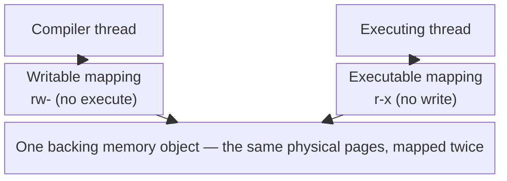

The block diagram shows the dual mapping. One region of physical memory, two virtual windows onto it
with different protections. The compiler writes through the left window; the CPU executes through the
right one. Neither window alone grants both capabilities, so an attacker who controls a write through
one of them still cannot execute what they wrote through that same address.

> **Pentester's Note** — This is directly observable. Dump `/proc/<pid>/maps` for a running app and
> look for anonymous mappings with `rw-p` and `r-xp` permissions and suspiciously similar sizes,
> sometimes carrying a name mentioning the JIT code cache depending on the release. Their presence
> tells you the JIT has been active in this process, which in turn tells you the app has been running
> long enough for methods to become hot. If you have forced `compile --reset` and you still see a
> populated code cache, the app has warmed up since.

> **Definition** — **Control Flow Integrity (CFI)**. A compiler-and-runtime mitigation that
> constrains indirect control transfers — indirect calls and returns — so that they can only target
> addresses valid for that call site. It defeats exploitation techniques that corrupt a function
> pointer or a vtable entry to redirect execution to an attacker-chosen address.

Android builds substantial parts of the native platform, including runtime components, with LLVM's CFI
schemes and with integer-overflow sanitisation on selected components. The practical effect for a
researcher is that a corrupted vtable pointer in a CFI-enabled module tends to produce an immediate,
deliberate abort rather than useful control-flow hijacking, which changes exploit strategy: you look
for data-only attacks, or for a module built without the mitigation. Chapter
[15 — Native Code](../15-Native-Code/README.md) covers the mitigation set in full, and
[70 — Vulnerability Research](../70-VulnerabilityResearch/README.md) covers working around them.

> **Under the Hood** — A CFI abort has a recognisable signature in `logcat` and in tombstones: the
> process aborts with a diagnostic naming a control-flow check failure, rather than segfaulting at a
> wild address. When you are fuzzing and you see that, you have found a control-flow corruption that
> the mitigation caught — which is still a bug worth reporting, and often still a denial of service.

### 3.15 Deoptimization and why hooking frameworks depend on it

This is the mechanism that makes your job possible. Understand it properly.

The problem: you want to intercept every call to `com.bank.app.RootCheck.isRooted()`. If that method
is running as AOT-compiled native code from the OAT file, there is no runtime code path at method
entry for you to hook — the caller jumps straight to compiled machine code, and the runtime is not
consulted at all. Worse, if the JIT or AOT compiler **inlined** the method into three different
callers, there is no single entry point in existence to hook.

> **Definition** — **Deoptimization**. Forcing the runtime to abandon compiled code for a method and
> execute it in the interpreter instead. The runtime resets the method's entry point to the generic
> interpreter bridge, discards or bypasses compiled versions, and, where a frame is currently executing
> compiled code, reconstructs an equivalent interpreter frame so execution can continue correctly from
> the same point.

The runtime already needs this capability for its own reasons, which is why it exists at all:

| Reason the runtime deoptimizes | Explanation |
|---|---|
| A debugger attached | Single-stepping, breakpoints, and variable inspection require interpreted execution. |
| A speculative assumption was invalidated | The JIT compiled a direct call assuming only one implementation of an interface existed. A second implementation is loaded. Every compiled method relying on the assumption must be discarded. |
| A class was redefined | Instrumentation agents and some frameworks redefine classes at run time. |
| A rarely-taken path was reached | Compilers sometimes omit code for cold paths and deoptimize if the path is entered. |

Java-level hooking frameworks reuse it:

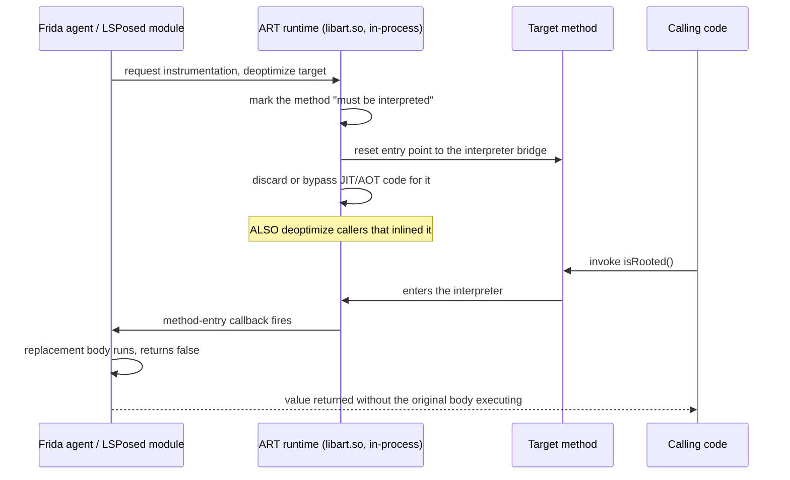

The sequence makes explicit the step people miss: **the framework must also deal with callers that
inlined the target.** This is why a hook can appear to "not fire" for some call sites and fire for
others, and why hooking a small, frequently-called method — a one-line getter, for example — is less
reliable than hooking a larger one. It is also why forcing the app into interpret-only mode before
attaching is such an effective troubleshooting step: an interpreted app has nothing inlined and
nothing compiled.

> **Pentester's Note** — Your standing checklist when a Java hook does not fire:
>
> 1. Is the method actually being called at all? Hook its caller and confirm.
> 2. Is the class loaded by a ClassLoader your tool is searching? Use `Java.enumerateClassLoaders` and
>    set `Java.classFactory.loader` to target the right one. This is the number one cause with packed
>    apps.
> 3. Is the method inlined? Run `cmd package compile --reset <pkg>`, force-stop the app, and retry.
> 4. Is the signature right, including overloads and compiler-generated bridge methods?
> 5. Is the implementation actually in native code, with the Java method a thin `native` stub? Then you
>    need a native hook, not a Java one. See [16 — JNI](../16-JNI/README.md).

> **Under the Hood** — There are two flavours. *Full deoptimization* switches the entire runtime
> into an interpret-everything mode, which is correct but slow and very obvious to timing-based
> anti-analysis. *Selective deoptimization* affects only named methods, which is faster and stealthier.
> Which one a framework uses depends on the operation; class redefinition tends to force the heavier
> mode. If a target performs timing-based anti-instrumentation checks, that distinction is the
> difference between being detected and not.

### 3.16 The runtime and the sandbox

Close the loop on the boundary question, because this is where junior analysts write bad findings.

**What the runtime enforces:**

| Enforced | Against whom |
|---|---|
| Bytecode is well-typed and structurally valid | Against malformed or hostile DEX corrupting the runtime |
| Managed memory safety: bounds checks, null checks, no pointer arithmetic | Against accidental memory-corruption bugs in the app's own managed code |
| Type identity across ClassLoaders | Against accidental type confusion; it is a correctness property |
| Hidden API access rules | Against apps depending on unstable internals — a *compatibility* control |

**What the runtime does not enforce:**

| Not enforced by the runtime | Who does enforce it |
|---|---|
| One app cannot read another app's data | The kernel: UID and GID checks, filesystem permissions, SELinux. See [21](../21-App-Sandbox/README.md) and [22](../22-SELinux/README.md). |
| An app cannot make arbitrary syscalls | The kernel: the seccomp-bpf filter Zygote installs in the child after fork. |
| An app cannot use the camera without permission | Framework permission checks in `system_server`, plus kernel-level restrictions. See [23](../23-Permissions/README.md). |
| `private` fields cannot be read | **Nobody.** Reflection reads them. It was never a security control. |
| The app's own code cannot be modified in memory | **Nobody.** The app owns its process. |
| The code that runs is the code that shipped | Verified Boot covers the system and APK signing covers the installed artefact, but neither covers DEX loaded dynamically at run time. |

The single sentence to remember, and to put in reports when a client asks why obfuscation did not stop
you:

> **Mental Model** — **The runtime executes the app's intentions; the kernel constrains the app's
> reach.** Any control implemented purely inside the app's own process is a control the app's own
> process can remove. That is not a flaw in the runtime; it is a consequence of the process being the
> app's. Real boundaries need a different UID on the other side of them.

---

## 4. Source Code Walkthrough (AOSP)

This chapter is the concept layer, so the walkthrough targets the **class-loading and code-loading**
paths rather than the compiler and GC internals that [13 — ART](../13-ART/README.md) owns.

### 4.1 The files that define class loading

| Path | What it defines |
|---|---|
| `libcore/ojluni/src/main/java/java/lang/ClassLoader.java` | The `ClassLoader` contract and `loadClass`'s parent-delegation loop |
| `libcore/dalvik/src/main/java/dalvik/system/BaseDexClassLoader.java` | The Android base class every DEX-capable loader extends |
| `libcore/dalvik/src/main/java/dalvik/system/PathClassLoader.java` | The loader used for the app's own APK |
| `libcore/dalvik/src/main/java/dalvik/system/DexClassLoader.java` | The loader for DEX outside the APK — the packer's tool |
| `libcore/dalvik/src/main/java/dalvik/system/InMemoryDexClassLoader.java` | Loads DEX from a `ByteBuffer`, never touching the filesystem |
| `libcore/dalvik/src/main/java/dalvik/system/DexPathList.java` | The search path: the `Element[]` array `findClass` walks |
| `libcore/dalvik/src/main/java/dalvik/system/DexFile.java` | The bridge from Java down to native DEX handling |
| `art/runtime/native/dalvik_system_DexFile.cc` | The JNI implementation behind `DexFile` |
| `art/runtime/class_linker.cc` | Where a DEX class definition becomes a live `mirror::Class` |
| `art/runtime/hidden_api.cc` | Non-SDK interface enforcement |
| `art/runtime/verifier/method_verifier.cc` | Bytecode verification |
| `frameworks/base/core/java/android/app/LoadedApk.java` | How the framework constructs an app's `ClassLoader` |
| `frameworks/base/core/java/android/app/ActivityThread.java` | `main()` — the entry point of every app process |

### 4.2 Trace 1 — how an app's own ClassLoader is built

This is the trace that explains why `Java.use()` sometimes cannot find a class.

**Step 1.** Zygote forks. The child calls `ActivityThread.main()`
(`frameworks/base/core/java/android/app/ActivityThread.java`), which creates the `ActivityThread`,
attaches to `ActivityManagerService` over Binder, and starts the main `Looper`.

**Step 2.** `handleBindApplication()` receives the `ApplicationInfo` and calls `getPackageInfo()`,
producing a `LoadedApk`.

**Step 3.** `LoadedApk.getClassLoader()` constructs the app's loader:

```java
// Conceptual shape of LoadedApk.getClassLoader().
// The real method also handles shared libraries, split APKs and a loader
// cache; this is the decision that matters.
public ClassLoader getClassLoader() {
    synchronized (this) {
        if (mClassLoader == null) {
            // zipPaths: base.apk plus every split APK
            // librarySearchPath: where System.loadLibrary looks
            mClassLoader = ApplicationLoaders.getDefault().getClassLoader(
                    zipPaths,
                    mApplicationInfo.targetSdkVersion,
                    isBundledApp,
                    librarySearchPath,
                    libraryPermittedPath,
                    mBaseClassLoader,     // parent — normally BootClassLoader
                    classLoaderName,
                    sharedLibraries,
                    nativeSharedLibraries);
        }
        return mClassLoader;
    }
}
```

**Step 4.** That yields a `PathClassLoader` whose parent is the `BootClassLoader`. Its `DexPathList`
holds one `Element` per DEX file across the base APK and every split.

**Step 5.** `makeApplication()` uses that loader to instantiate the `Application` subclass named in
the manifest, then calls `attachBaseContext()` and `onCreate()`.

> **Pentester's Note**
> Step 5 is the earliest app-controlled code in the process, which is exactly why packers put their
> decryption stub in `Application.attachBaseContext()`. It runs before any Activity and long before
> you could realistically attach with `frida -n`. This is the concrete reason you must spawn with
> `frida -U -f <pkg>`. See [`labs/lab-03-dynamic-dex-loading-and-hooking.md`](labs/lab-03-dynamic-dex-loading-and-hooking.md).

### 4.3 Trace 2 — `loadClass` and parent delegation

```java
// libcore/ojluni/src/main/java/java/lang/ClassLoader.java — the delegation loop.
protected Class<?> loadClass(String name, boolean resolve) throws ClassNotFoundException {
    // 1. Already loaded by THIS loader?
    Class<?> c = findLoadedClass(name);
    if (c == null) {
        try {
            if (parent != null) {
                // 2. Ask the parent FIRST. This is parent delegation.
                c = parent.loadClass(name, false);
            } else {
                c = findBootstrapClassOrNull(name);
            }
        } catch (ClassNotFoundException e) {
            // Parent could not find it — normal, fall through.
        }
        if (c == null) {
            // 3. Only now search our own DexPathList.
            c = findClass(name);
        }
    }
    return c;
}
```

`BaseDexClassLoader.findClass()` then delegates to `DexPathList.findClass()`, which walks its
`Element[]` in order and asks each backing `DexFile`.

**What delegation protects.** Because the parent answers first, an app cannot define its own
`java.lang.String` and have it used — the `BootClassLoader` wins. That shields platform classes from
shadowing. It protects nothing about the app's own classes, because the app is the one loading them.

> **Warning**
> `DelegateLastClassLoader` deliberately **inverts** this order, searching itself before the parent.
> It exists to resolve library version conflicts, but when you meet it in a target, note it: a class
> that looks like it comes from the framework may be coming from the app.

### 4.4 Trace 3 — `InMemoryDexClassLoader`, the packer's route

```java
// libcore/dalvik/src/main/java/dalvik/system/InMemoryDexClassLoader.java
public InMemoryDexClassLoader(ByteBuffer[] dexBuffers, String librarySearchPath,
                              ClassLoader parent) {
    super(dexBuffers, librarySearchPath, parent);
}
```

`BaseDexClassLoader`'s buffer constructor builds a `DexPathList` from the buffers, which calls into
`DexFile` and then native code in `art/runtime/native/dalvik_system_DexFile.cc`. The DEX is mapped
directly from the buffer and registered with the runtime.

The critical property: **no file is ever written**. A scanner enumerating APK entries, or watching the
filesystem, sees nothing. The payload exists only in process memory.

> **Under the Hood**
> That is precisely why the counter-technique is a runtime hook on the constructor rather than a
> static scan. [`examples/hook-classloaders.js`](examples/hook-classloaders.js) does exactly that, and
> [`../13-ART/scripts/dump-loaded-dex.js`](../13-ART/scripts/dump-loaded-dex.js) is a hardened version
> with a memory-sweep fallback for payloads assembled in native code that never pass through a Java
> constructor at all.

### 4.5 Trace 4 — hidden API enforcement

When code reflects on a framework member, `art/runtime/hidden_api.cc` classifies it:

| List | Behaviour |
|---|---|
| SDK (public) | Allowed |
| Blocklist | Denied — throws |
| Conditionally blocked (`max-target-*`) | Allowed only if the app's `targetSdk` is at or below the named level |
| Unsupported (greylist) | Allowed, with a warning logged |

The classification is carried by flags in the member's `access_flags_` — the same field described in
[13-ART §3.15](../13-ART/README.md). Enforcement happens in-process using in-process data, which is
the whole reason bypass libraries work: the app can reach in and change the answer.

```bash
# adb shell — relax enforcement for research (root; resets on reboot)
settings put global hidden_api_policy 1
# 0 = default enforcement · 1 = allow all · 2 = warn only
```

---

## 5. Security Perspective

### 5.1 What the runtime actually enforces

This table is the most useful thing in the chapter for report writing. Be precise about which column a
control lives in.

| Property | Enforced by | Security boundary? |
|---|---|---|
| Type safety of managed code | Bytecode verifier | **No** — correctness only; bypassed by any JNI call |
| Array bounds checks | Runtime | No — a correctness property |
| `private` / `internal` visibility | Compiler only | **No** — reflection ignores it |
| Hidden API restrictions | ART, in-process | **No** — in-process data, defeatable in-process |
| Which classes an app can load | ClassLoader delegation | Weakly — protects platform classes from shadowing |
| Memory isolation between apps | **Kernel** (UID, page tables) | **Yes** |
| Syscall restriction | **Kernel** (seccomp-bpf) | **Yes** |
| File access between apps | **Kernel** (DAC) + **SELinux** (MAC) | **Yes** |
| Permission enforcement | `system_server`, against the calling UID | **Yes** |

> **Mental Model**
> Everything in the "No" rows is a *language or runtime* feature that helps developers write correct
> code. Everything in the "Yes" rows is enforced by something the app cannot reach. When a client asks
> why obfuscation, hidden-API restrictions or verification did not stop the tester, this table is the
> answer.

### 5.2 How attackers abuse the runtime

**Dynamic code loading.** The dominant technique. `DexClassLoader` and `InMemoryDexClassLoader` let
code exist that was never in the APK, defeating any purely static assessment. See §3.10 and
[40-Obfuscation](../40-Obfuscation/README.md).

**Reflection to hide API calls.** `Class.forName(decrypt("..."))` followed by `getMethod` and `invoke`
breaks the static call graph. Detection is by hooking the reflection entry points, not by reading code.

**Hidden API bypass.** Clearing the classification bits, or reflecting through a permitted
intermediary. A legitimate research technique; also used by malware to reach unexported framework
functionality.

**`Runtime.exec` and `ProcessBuilder`.** Shelling out — most often for root detection (`which su`),
occasionally a genuine command-injection sink when the argument is attacker-influenced.

**Heap inspection.** Managed objects are just memory in a process the attacker controls. Enumerating
live instances and reading their fields recovers secrets regardless of language-level protection.

### 5.3 How developers misuse it

| Misuse | Why it fails |
|---|---|
| Treating `private` as a security control | `setAccessible(true)` ignores it |
| Treating the verifier as a sandbox | It gives type safety, not containment |
| Storing secrets in `String` | Immutable, possibly interned, recoverable from the heap |
| Loading DEX from a network source | The integrity of that DEX is now your problem, usually unsolved |
| Loading DEX from external storage | Any app with storage access can substitute it |
| Relying on hidden-API restrictions | In-process enforcement, in-process bypass |
| Java-only integrity checks | One entry-point patch removes them ([13-ART §3.17](../13-ART/README.md)) |

### 5.4 The vulnerability class that matters most

**Insecure dynamic code loading.**

```java
// VULNERABLE — the DEX lives on shared external storage.
File dexFile = new File(getExternalFilesDir(null), "plugin.dex");
DexClassLoader loader = new DexClassLoader(
        dexFile.getAbsolutePath(),
        getCodeCacheDir().getAbsolutePath(),
        null,
        getClassLoader());
Class<?> plugin = loader.loadClass("com.example.plugin.Main");
plugin.getMethod("run", Context.class).invoke(null, this);
```

**Why the developer wrote it.** A plugin architecture, an over-the-air feature update, or a hot-patch
framework to fix bugs without a Play release.

**Why it is broken.** External storage is not private. Historically any app with
`WRITE_EXTERNAL_STORAGE` could replace `plugin.dex`; even under scoped storage, ADB and root can, and
so can the app's own poorly-guarded import paths. The substituted code then runs **with the victim
app's UID, permissions and signature identity** — arbitrary code execution in the app's context.

**Detection — static:**

```bash
# host — the two lists that matter; their OVERLAP is the finding
grep -rn "DexClassLoader\|InMemoryDexClassLoader\|PathClassLoader\|DexFile" out/sources/
grep -rn "getExternalFilesDir\|getExternalStorageDirectory\|/sdcard" out/sources/
```

[`scripts/find-dynamic-loading.py`](scripts/find-dynamic-loading.py) automates the cross-reference.

**Detection — dynamic:** hook the ClassLoader constructors with
[`examples/hook-classloaders.js`](examples/hook-classloaders.js) and observe every path handed to them.

**Exploit:** replace the file, relaunch the app.

**Fix:**

```java
// SECURE — app-private storage, integrity verified against a pinned public key.
File dexFile = new File(getCodeCacheDir(), "plugin.dex");

// A bare hash is NOT sufficient: whoever can replace the DEX can usually
// replace a stored hash too. Verify a signature against a key pinned in the app.
if (!SignatureVerifier.verify(dexFile, PINNED_PUBLIC_KEY)) {
    throw new SecurityException("plugin integrity check failed");
}

DexClassLoader loader = new DexClassLoader(
        dexFile.getAbsolutePath(),
        getCodeCacheDir().getAbsolutePath(),
        null,
        getClassLoader());
```

**Honest severity.** **High** when the DEX is on shared storage or fetched without integrity
protection — arbitrary code execution in the app's context. **Medium** when app-private but
unverified, since exploitation then needs root or a separate write primitive. **Informational** when
app-private *and* signature-verified; that is the correct design.

### 5.5 OWASP mapping

| Control area | Relevance |
|---|---|
| **MASVS-CODE** | Dynamic code loading and the integrity of loaded code |
| **MASVS-RESILIENCE** | Anti-hooking, anti-debug, obfuscation |
| **MASVS-PLATFORM** | Reflection reaching unexported framework functionality |
| **MASVS-STORAGE** | Secrets recoverable from the managed heap |

### 5.6 How malware abuses the runtime

Overwhelmingly, **concealment**. A stub `Application` decrypts a payload from `assets/` and hands it to
`InMemoryDexClassLoader`, so the malicious DEX exists only in memory. Reflection hides the API calls
that would otherwise trigger static detection. `Runtime.exec` shells out for environment checks. Some
families inspect `/proc/self/maps` and quietly disable functionality rather than crashing — which is
why "the app runs but the feature is missing" deserves suspicion.

### 5.7 How forensic analysts use it

| Artefact | What it establishes |
|---|---|
| Secondary DEX artifacts in the app data dir | Dynamic code loading occurred |
| `code_cache/` contents | What was loaded and optimised |
| ART profiles | Which methods actually executed — [13-ART §3.11](../13-ART/README.md) |
| `logcat -s art` | Verification failures and dexopt events |

---

## 6. Reverse Engineering Perspective

### 6.1 The constructs you must recognise

| In JADX | Meaning | Priority |
|---|---|---|
| `DexClassLoader` / `InMemoryDexClassLoader` | Code exists outside the APK — **find it** | Highest |
| `Class.forName(...)` with a non-literal argument | Reflection hiding the target | High |
| `Method.invoke` / `setAccessible(true)` | Reflection bypassing visibility | High |
| `System.loadLibrary` early in `Application` | Native init, possibly a packer | High |
| `Runtime.getRuntime().exec` | Shelling out; usually root detection | Medium |
| `dalvik.system.VMRuntime` | Hidden-API bypass or heap tuning | Medium |
| `Debug.isDebuggerConnected` | Anti-debug | Medium |
| `ClassLoader.getParent` walking | Loader plumbing; often a packer | Medium |

```bash
# host — the runtime-surface sweep in one command
grep -rnE "DexClassLoader|InMemoryDexClassLoader|PathClassLoader|DexFile|Class\.forName|setAccessible|Method\.invoke|loadLibrary|Runtime\.getRuntime|VMRuntime|isDebuggerConnected" out/sources/ | sort -u
```

### 6.2 In Smali

Dynamic loading has an unmistakable shape:

```smali
# new InMemoryDexClassLoader(ByteBuffer.wrap(decryptedBytes), parentLoader)
invoke-static {v1}, Ljava/nio/ByteBuffer;->wrap([B)Ljava/nio/ByteBuffer;
move-result-object v2

new-instance v0, Ldalvik/system/InMemoryDexClassLoader;
invoke-direct {v0, v2, v3}, Ldalvik/system/InMemoryDexClassLoader;-><init>(Ljava/nio/ByteBuffer;Ljava/lang/ClassLoader;)V

const-string v4, "com.example.hidden.Payload"
invoke-virtual {v0, v4}, Ldalvik/system/InMemoryDexClassLoader;->loadClass(Ljava/lang/String;)Ljava/lang/Class;
move-result-object v5
```

The `byte[]` passed to `ByteBuffer.wrap` **is the payload**, and whatever produced it is the decryption
routine. That is your target.

Reflection looks like this:

```smali
const-string v0, "android.os.SystemProperties"
invoke-static {v0}, Ljava/lang/Class;->forName(Ljava/lang/String;)Ljava/lang/Class;
move-result-object v1

const-string v2, "get"
invoke-virtual {v1, v2, v3}, Ljava/lang/Class;->getMethod(Ljava/lang/String;[Ljava/lang/Class;)Ljava/lang/reflect/Method;
move-result-object v4
invoke-virtual {v4, v5, v6}, Ljava/lang/reflect/Method;->invoke(Ljava/lang/Object;[Ljava/lang/Object;)Ljava/lang/Object;
```

When the class-name string is a constant you can read it. When it is the output of a decryption call,
you must recover it at runtime — which is §7.

### 6.3 Recognising a packer

[`examples/ClassLoaderHijack.smali`](examples/ClassLoaderHijack.smali) is an annotated example. The
signature pattern:

| Signal | Meaning |
|---|---|
| Tiny `classes.dex` in a large APK | Stub loader only |
| Large high-entropy file in `assets/` | Encrypted payload |
| `<application android:name>` is one obscure class | The packer's entry point |
| Native library loaded in `attachBaseContext` | Decryption in native code |
| `apktool` fails but the app installs | Anti-decompilation |

---

## 7. Dynamic Analysis

### 7.1 Runtime reconnaissance

[`scripts/runtime-recon.js`](scripts/runtime-recon.js) automates this. Manually:

```javascript
// Frida — enumerate every ClassLoader in the process.
Java.perform(function () {
    Java.enumerateClassLoaders({
        onMatch: function (loader) { console.log("[loader] " + loader); },
        onComplete: function () { console.log("[*] done"); }
    });
});
```

If `Java.use()` cannot find a class, it lives in a loader other than the default. Switch to it:

```javascript
Java.perform(function () {
    Java.enumerateClassLoaders({
        onMatch: function (loader) {
            try {
                loader.loadClass("com.example.hidden.Payload");
                console.log("[+] found in " + loader);
                Java.classFactory.loader = loader;   // later Java.use() uses this
            } catch (e) { /* not here */ }
        },
        onComplete: function () {}
    });
});
```

> **Pentester's Note**
> This is the most common fix for `ClassNotFoundException` in a Frida script, and it is routinely
> misdiagnosed as anti-hooking. If a class is visible in JADX but not to `Java.use`, it is almost
> certainly a ClassLoader problem, not a protection.

### 7.2 Catching dynamically loaded code

```bash
# host — SPAWN, do not attach. Packers load during attachBaseContext.
frida -U -f com.example.target -l examples/hook-classloaders.js
```

For the hardened version with a memory-sweep fallback, use
[`../13-ART/scripts/dump-loaded-dex.js`](../13-ART/scripts/dump-loaded-dex.js).

### 7.3 Tracing reflection

```javascript
// Frida — reveal what reflection is really reaching for.
Java.perform(function () {
    var Class_ = Java.use("java.lang.Class");

    Class_.forName.overload("java.lang.String").implementation = function (name) {
        console.log("[forName] " + name);
        return this.forName(name);
    };

    Class_.getMethod.overload("java.lang.String", "[Ljava.lang.Class;")
        .implementation = function (name, params) {
            console.log("[getMethod] " + this.getName() + "." + name);
            return this.getMethod(name, params);
        };

    var Method = Java.use("java.lang.reflect.Method");
    Method.invoke.overload("java.lang.Object", "[Ljava.lang.Object;")
        .implementation = function (target, args) {
            console.log("[invoke] " + this.getDeclaringClass().getName() +
                        "." + this.getName());
            return this.invoke(target, args);
        };
});
```

This turns an obfuscated reflective chain into a readable log of what the app actually does.

### 7.4 Watching `Runtime.exec`

```javascript
Java.perform(function () {
    var Runtime = Java.use("java.lang.Runtime");
    Runtime.exec.overload("java.lang.String").implementation = function (cmd) {
        console.log("[exec] " + cmd);
        return this.exec(cmd);
    };
    Runtime.exec.overload("[Ljava.lang.String;").implementation = function (cmds) {
        console.log("[exec] " + cmds.join(" "));
        return this.exec(cmds);
    };
});
```

Most hits will be root detection — see [37-RootDetection](../37-RootDetection/README.md).

### 7.5 Inspecting compilation state

```bash
# adb shell
dumpsys package dexopt | grep -A5 "com.example.target"
cmd package compile -m verify -f com.example.target   # force interpreter
am force-stop com.example.target
```

[`scripts/dexopt-inspect.sh`](scripts/dexopt-inspect.sh) wraps this. Full treatment in
[13-ART §3.9–3.10](../13-ART/README.md).

### 7.6 Other channels

| Tool | Use |
|---|---|
| `logcat -s art` | Verification failures, dexopt, GC |
| `dumpsys meminfo <pkg>` | Managed heap vs native heap |
| `am dumpheap <pid> <file>` | `.hprof` for offline heap analysis |
| `strace -f -e trace=openat,mmap` | Watch DEX files being opened and mapped |

---

## 8. Static Analysis

### 8.1 What to look for

| Artefact | Command | Reveals |
|---|---|---|
| Manifest | `aapt2 dump xmltree app.apk --file AndroidManifest.xml` | `android:name`, `vmSafeMode`, `debuggable` |
| DEX | `grep -rn "DexClassLoader" out/sources/` | Dynamic loading |
| Assets | `unzip -l app.apk \| grep assets/` | Encrypted payload candidates |
| Native libs | `unzip -l app.apk \| grep '\.so'` | Packer or protector presence |

```bash
# host — find high-entropy assets, the packer tell
unzip -o app.apk -d /tmp/apk >/dev/null
find /tmp/apk/assets -type f -size +100k -exec sh -c \
  'printf "%-50s " "$1"; ent "$1" 2>/dev/null | head -1' _ {} \;
```

### 8.2 Manifest attributes that change runtime behaviour

| Attribute | Effect |
|---|---|
| `android:name` on `<application>` | The class whose `attachBaseContext` runs first — packer entry point |
| `android:vmSafeMode="true"` | Disables JIT and AOT optimisation; everything interpreted |
| `android:debuggable="true"` | JDWP, CheckJNI, forces interpretation in many paths |
| `android:largeHeap="true"` | Raises the heap cap |
| `android:extractNativeLibs="false"` | `.so` mapped from the APK rather than extracted |

> **Pentester's Note**
> Read `android:name` on `<application>` **first**. If it is a single obscurely-named class rather than
> something like `com.example.MyApplication`, you are very likely looking at a packer stub, and your
> entire approach changes.

### 8.3 Automating it

[`scripts/find-dynamic-loading.py`](scripts/find-dynamic-loading.py) scans a decoded APK for the
patterns in §6.1, cross-references dynamic-loading sites against external-storage usage, and reports
the overlap — which is the actual finding rather than either list alone.

---

## 9. Examples

Full source in [`examples/`](examples/).

### 9.1 Simple — inspecting the loader chain

[`examples/ClassLoaderInspector.java`](examples/ClassLoaderInspector.java) walks the loader hierarchy
upward and prints each loader with its DEX path list, so the structure in §3.7 becomes concrete.

```java
ClassLoader loader = getClassLoader();
while (loader != null) {
    Log.d(TAG, loader.getClass().getName() + " : " + loader);
    loader = loader.getParent();
}
// Typical output:
//   dalvik.system.PathClassLoader[DexPathList[[zip file "/data/app/.../base.apk"], ...]]
//   java.lang.BootClassLoader@...
```

### 9.2 Intermediate — dynamic DEX loading, both ways

[`examples/DynamicDexLoader.kt`](examples/DynamicDexLoader.kt) implements loading from a file and from
memory, with the insecure and secure variants side by side so the §5.4 difference is concrete.

### 9.3 Advanced — hidden API bypass

[`examples/HiddenApiBypass.java`](examples/HiddenApiBypass.java) reaches a non-SDK interface and
explains why it works: enforcement is in-process, driven by flags in the member's `access_flags_`.

> **Warning**
> Bypassing hidden-API restrictions is legitimate for research and testing, and Google actively works
> to prevent it — so any specific mechanism has a limited shelf life. Use it to understand a target,
> not as the foundation of a tool you expect to keep working.

### 9.4 Real application — `Runtime.exec` misuse

[`examples/RuntimeExecMisuse.java`](examples/RuntimeExecMisuse.java) shows the vulnerable pattern (a
shell command built from attacker-influenced input) beside the fix, plus the root-detection pattern you
will meet constantly.

### 9.5 Enterprise — a packer stub, annotated

[`examples/ClassLoaderHijack.smali`](examples/ClassLoaderHijack.smali) is a realistic stub
`Application` in Smali, annotated line by line: decryption from assets, then
`InMemoryDexClassLoader`. Read it before attempting
[`labs/lab-04-ctf-the-vanishing-class.md`](labs/lab-04-ctf-the-vanishing-class.md).

---

## 10. Common Interview Questions

### Beginner

**Q: What is a runtime, and why does Android need one?**
It loads a program written in an abstract instruction set and executes it, supplying memory
management, type checking and exception handling. Android needs one so a single APK runs across every
CPU architecture it supports, and so apps do not each hand-roll memory management in machine code.

**Q: What is the difference between compiled and interpreted code?**
Interpreted code is read and acted upon one instruction at a time by the runtime. Compiled code has
been translated into the processor's own instructions and runs directly. Android uses both, plus
just-in-time compilation, chosen per method.

**Q: What is a ClassLoader?**
The object that finds a class's definition and turns it into a usable `Class`. On Android the app's
classes come from a `PathClassLoader` over the APK, whose parent is the `BootClassLoader` holding the
framework.

### Intermediate

**Q: Frida throws `ClassNotFoundException` for a class you can see in JADX. Why?**
It is loaded by a `ClassLoader` other than the default one `Java.use()` searches — typically because
the app loaded it dynamically. Enumerate loaders with `Java.enumerateClassLoaders`, find the one that
can load it, and set `Java.classFactory.loader`. This is a loader problem, not anti-hooking.

**Q: What is parent delegation and what does it protect?**
`loadClass` asks the parent before searching itself. It stops an app shadowing platform classes — you
cannot define your own `java.lang.String` and have it used. It protects nothing about the app's own
classes. `DelegateLastClassLoader` inverts the order.

**Q: An app loads a DEX from `/sdcard`. Why is that a finding, and how severe?**
External storage is not private, so another app or anyone with device access can substitute the DEX.
The substituted code then executes with the victim app's UID, permissions and signature identity —
arbitrary code execution in the app's context. High severity when the file is on shared storage or
fetched without integrity protection.

**Q: Is the bytecode verifier a sandbox?**
No. It guarantees type safety within the runtime's model — field accesses match declared types, jumps
land on instruction boundaries, register types line up. It says nothing about what the app may do, and
is bypassed entirely the moment the app calls into its own native library.

### Senior

**Q: Explain what the runtime does and does not enforce, and why it matters in a report.**
Expect the §5.1 table: type safety, visibility, hidden-API restrictions and bounds checks are
*correctness* features enforced in-process and therefore removable in-process. Memory isolation,
syscall restriction, filesystem access and permission checks are enforced by the kernel and
`system_server` against the calling UID, and those are real boundaries. The reporting consequence is
that a bypassed in-process control is not itself the finding — what it protected is.

**Q: Why must you spawn rather than attach against a packed app?**
The packer's decryption and `ClassLoader` construction happen in `Application.attachBaseContext()`,
the earliest app-controlled code in the process. `frida -U -f <pkg>` starts the process suspended and
injects before any app code runs; `frida -n` arrives after the payload is already loaded, so the
constructor hook you installed never fires.

**Q: How does Zygote's design weaken ASLR, and how much does it matter?**
App processes are `fork`ed from Zygote rather than `exec`ed, so they inherit its address-space layout.
Every app therefore has the framework and its libraries at the same addresses until reboot, meaning an
address leaked from one process is useful against another. It matters for native exploitation and is
largely irrelevant to app-layer testing. Android has added mitigations, but the property follows from
the fork model itself, which exists for startup speed and memory sharing.

### Staff Engineer

**Q: A team wants a plugin architecture that loads DEX at runtime. Design it safely.**
Expect: app-private storage only, never shared. Signed by a key pinned in the app and verified before
loading — a bare hash is insufficient because whoever can replace the DEX can usually replace a stored
hash. The signing key held server-side with a real rotation story. The plugin run at least privilege,
ideally in an `isolatedProcess`. Play policy on downloading executable code checked. And the honest
question first: is the plugin architecture necessary at all, given that it converts a code-integrity
problem the platform already solved into one the team must now solve themselves?

**Q: Argue for and against the runtime enforcing more security properties.**
For: in-process enforcement is cheap, catches developer error early, and is uniform across apps.
Against: any in-process control is defeatable by in-process code, so adding more risks a *false* sense
of assurance — teams stop building server-side controls because the client "already checks". The
strongest position is that the runtime should enforce correctness aggressively while being explicit
that it enforces nothing against an adversary holding the device.

### Principal Engineer

**Q: Android chose a managed runtime with per-app processes forked from a preloaded template.
Evaluate that decision twenty years on.**
A strong answer covers: the managed runtime bought architecture independence, memory safety for app
code and a uniform security model, at a cost in startup time and memory that Zygote's fork model then
largely repaid. It also placed the security boundary at the *process* rather than the *runtime*, which
is architecturally cleaner than a language-level sandbox and has aged far better than approaches that
tried to sandbox within a shared runtime. The remaining weaknesses are consequences of the same
decisions — shared address-space layout from forking, and an in-process runtime the app can fully
subvert.the industry converged on this shape, and that the genuinely hard remaining problem,
trusting a client you do not control, is not one any runtime design can solve.

---

## 11. Common Mistakes

### Developer mistakes

- Loading DEX from external storage, or over a channel without integrity protection.
- Verifying loaded code with a stored hash rather than a signature against a pinned public key.
- Treating `private`, `internal` or hidden-API restrictions as security controls.
- Believing the verifier sandboxes the app.
- Keeping secrets in `String`, which is immutable and possibly interned.
- Shipping `android:debuggable="true"`, which enables `run-as` and JDWP.
- Leaving `android:vmSafeMode="true"` in place after the bug it worked around was fixed.

### Pentester mistakes

- **Diagnosing a ClassLoader problem as anti-hooking.** The most common error against packed apps.
- Attaching with `-n` instead of spawning with `-f`, missing everything in `attachBaseContext`.
- Reporting "the app uses reflection" as a finding. Reflection is a technique; the finding is what it
  reaches.
- Reporting a bypassed in-process control as the vulnerability rather than as a prerequisite.
- Analysing only the APK's DEX and missing dynamically loaded code entirely.
- Assuming a class named in the manifest exists in `classes.dex` — with a packer it usually does not.

### Reverse engineer mistakes

- Reading the stub `Application` class and concluding the app is trivial.
- Not checking `<application android:name>` first.
- Trying to statically resolve a reflective call whose class name is computed at runtime, instead of
  hooking and reading it.
- Missing that `DelegateLastClassLoader` inverts delegation, so a framework-looking class may come
  from the app.

---

## 12. Hands-on Labs

Full material in [`labs/`](labs/).

| Lab | Objective | Difficulty |
|---|---|---|
| [Lab 01 — Observing the runtime](labs/lab-01-observing-the-runtime.md) | Watch execution modes, compilation state and GC on a live device using only ADB | Beginner |
| [Lab 02 — ClassLoader archaeology](labs/lab-02-classloader-archaeology.md) | Map an app's full loader hierarchy and locate a class `Java.use` cannot find | Intermediate |
| [Lab 03 — Dynamic DEX loading and hooking](labs/lab-03-dynamic-dex-loading-and-hooking.md) | Build an app that loads DEX at runtime, then capture that DEX from outside | Advanced |
| [Lab 04 — CTF: The vanishing class](labs/lab-04-ctf-the-vanishing-class.md) | Recover a flag from a class that exists only in memory | Advanced |

---

## 13. Summary

### Key points

- A runtime exists so one APK runs on every architecture, and so apps do not hand-roll memory
  management. That is an engineering decision with security consequences, not a security feature.
- Android chose **register-based** bytecode and **per-app processes forked from Zygote** — for startup
  speed and memory sharing, at the cost of a shared address-space layout until reboot.
- The runtime enforces **correctness**: type safety, bounds checks, visibility, hidden-API rules. All
  in-process, therefore all removable in-process.
- The **kernel** enforces the real boundaries: UID isolation, seccomp, DAC and SELinux — plus
  permission checks in `system_server` against the calling UID.
- **Parent delegation** protects platform classes from shadowing and nothing else;
  `DelegateLastClassLoader` inverts it.
- **Dynamic code loading** is the most important runtime technique to recognise, both as attack surface
  and as an obstacle to static analysis.
- A class visible in JADX but invisible to `Java.use()` is a **ClassLoader problem**, not a protection.
- Packers run in `Application.attachBaseContext()`, so **spawn, do not attach**.
- Loading DEX from shared storage or without signature verification is arbitrary code execution in the
  app's context.

### Mind map

Full version in [`mindmap.md`](mindmap.md). Condensed:

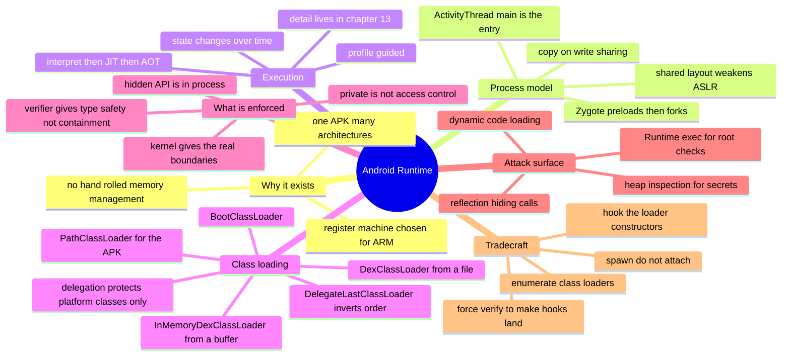

### Cheat sheet

Full version in [`cheatsheet.md`](cheatsheet.md). Condensed:

| Need | Action |
|---|---|
| Class not found by `Java.use` | `Java.enumerateClassLoaders`, then set `Java.classFactory.loader` |
| Catch a packer's payload | `frida -U -f <pkg>` with a ClassLoader-constructor hook |
| See what reflection reaches | Hook `Class.forName`, `getMethod`, `Method.invoke` |
| Make hooks land reliably | `cmd package compile -m verify -f <pkg>` |
| Find dynamic loading statically | `grep -rn "DexClassLoader\|InMemoryDexClassLoader"` |
| Identify a packer | Tiny `classes.dex` + big high-entropy asset + obscure `<application android:name>` |
| Relax hidden-API enforcement | `settings put global hidden_api_policy 1` |

### Quick revision

- Name three things the runtime enforces that are *not* security boundaries, and say who enforces the
  real ones.
- What does parent delegation protect, and what inverts it?
- Why must you spawn rather than attach against a packed app?
- Where does a packer's decryption stub run, and why there?
- What makes loading DEX from `/sdcard` a High-severity finding?
- Your hook target is visible in JADX but `Java.use` throws. What is the cause?
- Why does forking from Zygote weaken ASLR?

---

## 14. References

### AOSP source

- `libcore/ojluni/src/main/java/java/lang/ClassLoader.java` — parent delegation
- `libcore/dalvik/src/main/java/dalvik/system/BaseDexClassLoader.java`
- `libcore/dalvik/src/main/java/dalvik/system/DexPathList.java`
- `libcore/dalvik/src/main/java/dalvik/system/InMemoryDexClassLoader.java`
- `art/runtime/native/dalvik_system_DexFile.cc`
- `art/runtime/class_linker.cc`
- `art/runtime/hidden_api.cc`
- `art/runtime/verifier/method_verifier.cc`
- `frameworks/base/core/java/android/app/LoadedApk.java`
- `frameworks/base/core/java/android/app/ActivityThread.java`
- Android Code Search — https://cs.android.com/

### Official documentation

- ART and Dalvik — https://source.android.com/docs/core/runtime
- Restrictions on non-SDK interfaces — https://developer.android.com/guide/app-compatibility/restrictions-non-sdk-interfaces
- Configuring ART — https://source.android.com/docs/core/runtime/configure
- ART Mainline module — https://source.android.com/docs/core/ota/modular-system/art
- Google Play device and network abuse policy (downloading executable code) —
  https://support.google.com/googleplay/android-developer/answer/9888379

### OWASP

- MASVS-CODE — code quality and dynamic code loading — https://mas.owasp.org/MASVS/
- MASVS-RESILIENCE — anti-tampering and anti-hooking
- MASTG — https://mas.owasp.org/MASTG/

### Related chapters

- [12-DEX-Internals](../12-DEX-Internals/README.md) — the byte format this runtime consumes
- [13-ART](../13-ART/README.md) — the implementation: OAT, VDEX, `ArtMethod`, GC, entry points
- [14-Dalvik](../14-Dalvik/README.md) — the predecessor, and the Smali reference
- [09-Android-App-Internals](../09-Android-App-Internals/README.md) — process creation and app identity
- [21-App-Sandbox](../21-App-Sandbox/README.md) — the boundaries the runtime does *not* provide
- [40-Obfuscation](../40-Obfuscation/README.md) — packers and unpacking methodology
- [53-Frida](../53-Frida/README.md) — the instrumentation these techniques rely on
- [65-Hooking](../65-Hooking/README.md) — hooking across managed and native layers
