# 11 — Android Runtime · Mind Map

One picture of the whole chapter. Read it outward from the centre: a runtime exists so one APK runs
everywhere and apps do not hand-roll memory management; Android implements that with a register
machine and per-app processes forked from Zygote; the runtime enforces *correctness* while the kernel
enforces the actual *boundaries*; and the practical consequence for a tester is that class loading —
not compilation — is where most of the difficulty lives.

Every branch corresponds to a section of [the chapter README](README.md). Implementation detail (OAT,
VDEX, `ArtMethod`, garbage collection) belongs to [13-ART](../13-ART/mindmap.md) and is not repeated
here.

```mermaid
mindmap
  root((Android<br/>Runtime))
    Why a runtime exists
      One APK many architectures
        ARMv5 ARMv7 ARM64 x86 x86_64 MIPS
        without it every app ships N binaries
      No hand rolled memory management
        otherwise every app owns the whole
        memory corruption catalogue
      The translator analogy
        abstract instructions
        local units and local tools
      Shipping container analogy
        cargo becomes an abstract box
        ports specialise in moving boxes
    Design decisions
      Register machine not stack machine
        fewer instructions
        fewer dispatches
        better fit for ARM
        detail lives in chapter 14
      Could not ship a Java SE JVM
        licensing
        memory footprint
        class file format unsuited to mmap
      The 2008 hardware envelope
        tens of megabytes of RAM
        slow flash storage
        no always on power
      Managed code
        runtime allocates and reclaims
        runtime type checks
        runtime handles exceptions
    Process model
      Zygote
        preloads framework classes
        preloads resources
        maps the boot image once
        forks without exec
      Copy on write
        thousands of classes cost nothing per app
        pages diverge only when written
      ASLR consequence
        all apps share library layout
        until the next reboot
        leak in one process aids another
        matters for native exploitation
      ActivityThread main
        the entry point of every app process
        handleBindApplication
        makeApplication
        attachBaseContext runs first
    Class loading
      The hierarchy
        BootClassLoader for the framework
        PathClassLoader for the APK
        DexClassLoader from a file
        InMemoryDexClassLoader from a buffer
        DelegateLastClassLoader inverts order
      Parent delegation
        findLoadedClass first
        then ask the parent
        then search own DexPathList
        protects platform classes from shadowing
        protects nothing about app classes
      DexPathList
        Element array
        one per DEX across base and splits
        findClass walks it in order
      LoadedApk getClassLoader
        builds the app loader
        parent is BootClassLoader
        zip paths cover every split
    Dynamic code loading
      Why it matters most
        code that was never in the APK
        defeats purely static assessment
      InMemoryDexClassLoader
        no file ever written
        payload exists only in memory
        counter is a runtime hook not a scan
      Packer shape
        tiny classes dex
        big high entropy asset
        obscure application name
        native lib in attachBaseContext
        apktool fails but install succeeds
      Tradecraft
        spawn with -f never attach with -n
        hook the loader constructors
        memory sweep for the dex magic
    What the runtime enforces
      Correctness only
        bytecode verification is type safety
        array bounds checks
        private and internal are compiler only
        hidden API is in process data
      The verifier is not a sandbox
        bypassed by any JNI call
        it exists so the compiler can optimise
      Reflection ignores visibility
        setAccessible true
        never was a security control
    What the kernel enforces
      Memory isolation by UID
      Syscall restriction by seccomp bpf
      File access by DAC and SELinux
      Permission checks in system_server
      Against the calling UID
      These are the real boundaries
    Attack surface
      Dynamic code loading
        from shared storage is High severity
        from network without integrity is High
        app private but unverified is Medium
        signature verified is correct design
      Reflection hiding API calls
        breaks the static call graph
        hook forName getMethod invoke
      Runtime exec
        usually root detection
        occasionally command injection
      Heap inspection
        secrets are just memory
        String is immutable and interned
      Hidden API bypass
        clear the classification bits
        reflect through an intermediary
    Defence
      App private storage only
      Signature not hash
      Pinned public key in the app
      Key held server side with rotation
      Least privilege ideally isolatedProcess
      Ask whether plugins are needed at all
    Tradecraft summary
      Read application android name first
      Spawn do not attach
      Enumerate class loaders on ClassNotFound
      Force verify to make hooks land
      Cross reference loading against storage
      A bypassed in process control is a
      prerequisite not the finding
```

