# 12 — DEX Internals

> After this chapter you will be able to open an unknown `classes.dex` in a hex editor, read every
> header field by hand, walk the string, type, proto, field, method and class tables without a tool,
> decode raw bytecode into Smali by hand, patch an instruction, repair the checksum and signature so
> the runtime accepts your patch, and recognise a packed or deliberately malformed DEX for what it is.

**Prerequisites:**
[03 — Programming Fundamentals](../03-Programming-Fundamentals/README.md) ·
[04 — Java](../04-Java/README.md) ·
[09 — Android App Internals](../09-Android-App-Internals/README.md) ·
[10 — APK Internals](../10-APK-Internals/README.md) ·
[11 — Android Runtime](../11-Android-Runtime/README.md)

**Applies to:** All Android versions. DEX container versions `035` through `040`, covering API 1
through API 36 (Android 16). Baseline for worked examples is Android 13–16 (API 33–36) with an
`arm64-v8a` device.

**Scope boundary.** This chapter is about the **file format** — the bytes on disk and what each one
means. Three neighbouring chapters own the adjacent territory and this chapter does not repeat them:

| Chapter | Owns |
|---|---|
| [11 — Android Runtime](../11-Android-Runtime/README.md) | What a managed runtime *is*, class loading concepts, JIT/AOT as ideas |
| [13 — ART](../13-ART/README.md) | The ART implementation: OAT, VDEX, ODEX, `dex2oat`, GC, the interpreter, method dispatch |
| [14 — Dalvik](../14-Dalvik/README.md) | The historical Dalvik VM, and the full Smali *syntax* reference |

When you need the runtime's view of a structure described here, follow the cross-link rather than
expecting the answer in this chapter.

---

## Table of Contents

- [1. Introduction](#1-introduction)
  - [1.1 The problem that existed before DEX](#11-the-problem-that-existed-before-dex)
  - [1.2 What would break if DEX did not exist](#12-what-would-break-if-dex-did-not-exist)
  - [1.3 Why a security researcher must read bytes](#13-why-a-security-researcher-must-read-bytes)
- [2. High-Level Architecture](#2-high-level-architecture)
  - [2.1 The whole file at a glance](#21-the-whole-file-at-a-glance)
  - [2.2 The index-and-data split](#22-the-index-and-data-split)
  - [2.3 From `.java` to `classes.dex`](#23-from-java-to-classesdex)
  - [2.4 Where DEX sits inside an APK](#24-where-dex-sits-inside-an-apk)
- [3. Deep Internal Working](#3-deep-internal-working)
  - [3.1 Primitive types used by the format](#31-primitive-types-used-by-the-format)
  - [3.2 `header_item` field by field](#32-header_item-field-by-field)
  - [3.3 DEX version numbers and what each added](#33-dex-version-numbers-and-what-each-added)
  - [3.4 The checksum and the signature](#34-the-checksum-and-the-signature)
  - [3.5 LEB128, ULEB128, ULEB128p1 and SLEB128](#35-leb128-uleb128-uleb128p1-and-sleb128)
  - [3.6 MUTF-8 — Modified UTF-8](#36-mutf-8--modified-utf-8)
  - [3.7 Type descriptors and shorty descriptors](#37-type-descriptors-and-shorty-descriptors)
  - [3.8 `string_id_item` and `string_data_item`](#38-string_id_item-and-string_data_item)
  - [3.9 `type_id_item` and `type_list`](#39-type_id_item-and-type_list)
  - [3.10 `proto_id_item`](#310-proto_id_item)
  - [3.11 `field_id_item`](#311-field_id_item)
  - [3.12 `method_id_item`](#312-method_id_item)
  - [3.13 `class_def_item`](#313-class_def_item)
  - [3.14 `class_data_item`, `encoded_field`, `encoded_method`](#314-class_data_item-encoded_field-encoded_method)
  - [3.15 `encoded_value`, `encoded_array`, `encoded_annotation`](#315-encoded_value-encoded_array-encoded_annotation)
  - [3.16 `code_item` field by field](#316-code_item-field-by-field)
  - [3.17 `try_item` and the catch handler lists](#317-try_item-and-the-catch-handler-lists)
  - [3.18 `debug_info_item`](#318-debug_info_item)
  - [3.19 Annotations on disk](#319-annotations-on-disk)
  - [3.20 `call_site_id_item` and `method_handle_item`](#320-call_site_id_item-and-method_handle_item)
  - [3.21 `hiddenapi_class_data_item`](#321-hiddenapi_class_data_item)
  - [3.22 The `map_list`](#322-the-map_list)
  - [3.23 Access flags](#323-access-flags)
  - [3.24 The register machine](#324-the-register-machine)
  - [3.25 Instruction formats](#325-instruction-formats)
  - [3.26 The complete opcode set](#326-the-complete-opcode-set)
  - [3.27 Pseudo-instruction payloads](#327-pseudo-instruction-payloads)
  - [3.28 The 64K reference limit and multidex](#328-the-64k-reference-limit-and-multidex)
  - [3.29 DEX verification](#329-dex-verification)
- [4. Source Code Walkthrough (AOSP)](#4-source-code-walkthrough-aosp)
- [5. Security Perspective](#5-security-perspective)
- [6. Reverse Engineering Perspective](#6-reverse-engineering-perspective)
- [7. Dynamic Analysis](#7-dynamic-analysis)
- [8. Static Analysis](#8-static-analysis)
- [9. Examples](#9-examples)
- [10. Common Interview Questions](#10-common-interview-questions)
- [11. Common Mistakes](#11-common-mistakes)
- [12. Hands-on Labs](#12-hands-on-labs)
- [13. Summary](#13-summary)
- [14. References](#14-references)

---

## 1. Introduction

Imagine you are shipping a book to a village that has no bookshop, over a postal service that charges
by the gram, to a reader who has one small table and reads by candlelight. You would not send a
thousand loose pamphlets in a thousand envelopes. You would bind one volume, print the recurring
names once in an index at the front, and set the type so that the reader only ever has to open the
book at the page they need instead of carrying the whole thing to the table.

That is the entire idea behind the Dalvik Executable format. Everything else in this chapter is
detail.

> **📖 Definition — DEX**
> **DEX** stands for **Dalvik Executable**. A DEX file is a single binary file, conventionally named
> `classes.dex`, that contains *all* the compiled code and *all* the constant data for many Java or
> Kotlin classes at once. It is the format Android's runtime actually executes. It is not a ZIP, not
> an archive, and not a container of other files — it is one flat, self-describing binary blob with
> an index at the front.

> **📖 Definition — bytecode**
> **Bytecode** is a compact, machine-like instruction set that is *not* the instruction set of any
> real CPU. It is designed to be read and executed by a program called a virtual machine, or to be
> translated ahead of time into real CPU instructions. When you write `int x = a + b;` in Java, the
> compiler does not emit ARM instructions; it emits bytecode, and something on the device turns that
> bytecode into ARM instructions later.

> **📖 Definition — virtual machine (in this context)**
> A **virtual machine** here is not a whole simulated computer like VirtualBox. It is a program that
> reads bytecode and performs the operations the bytecode describes, maintaining its own notion of
> registers, a stack of method calls, and a heap of objects. On Android that program is ART, the
> Android Runtime, covered in [Chapter 13](../13-ART/README.md).

### 1.1 The problem that existed before DEX

Android inherited the Java language, the Java compiler, and a decade of Java libraries. What it
deliberately did **not** inherit was the Java class file format. To understand why, you need to know
what the Java format looks like and what it costs.

When `javac` compiles Java source code, it produces **one `.class` file per class**. A program with
four thousand classes is four thousand files. Those files are then normally bundled into a **JAR**
(Java Archive), which is simply a ZIP file containing all those `.class` files, each one individually
compressed with DEFLATE.

> **📖 Definition — `.class` file**
> A **`.class` file** is the Java Virtual Machine's compiled unit. It begins with the magic bytes
> `CA FE BA BE`, contains a **constant pool** listing every string, class name, field name, method
> name and type descriptor the class refers to, followed by field definitions, method definitions,
> and the JVM bytecode for each method.

> **📖 Definition — constant pool**
> A **constant pool** is a table of every literal and every symbolic name a compiled unit needs.
> Instead of embedding the text `"java/lang/String"` at every place it is used, the compiled code
> stores that text once in the pool and refers to it by an index number. Indexes are small; strings
> are not.

Four specific costs made the JAR-of-class-files model wrong for a phone in 2007.

**Cost one — constant pool duplication.** Every `.class` file has its own private constant pool. The
string `"java/lang/Object"` appears in the constant pool of essentially every class in the program.
So does `"()V"`, `"<init>"`, `"java/lang/String"`, and hundreds of other names. In a four-thousand
class application those strings are stored four thousand times. Measurements published when Android
was announced put the redundancy at roughly half the uncompressed size of a typical JAR — the same
handful of strings and type descriptors repeated across every unit.

**Cost two — you cannot share what you cannot see.** Because each `.class` file is a sealed unit, the
runtime cannot resolve a name once and reuse the answer across classes at the file-format level.
Every class re-resolves `"java/lang/Object"` for itself.

**Cost three — the ZIP problem.** A JAR is a ZIP. Each entry inside is DEFLATE-compressed
independently. To read a single class you must locate the ZIP central directory, find the entry,
allocate a buffer, and inflate the whole class into RAM. Nothing in a compressed ZIP entry can be
used in place. On a device with 96 MB of RAM and a slow flash chip — which is what the first Android
handsets had — that is a bad trade, repeated thousands of times per launch.

**Cost four — locality.** The methods that run together at application startup are scattered across
thousands of separate files in essentially random order. Every one of them is a separate seek, a
separate inflate, a separate allocation.

> **📖 Definition — mmap (memory mapping)**
> **`mmap`** is a Linux system call that tells the kernel: "make the contents of this file appear at
> this range of addresses in my process's memory." No data is copied at the time of the call. The
> kernel simply notes the mapping. When the program later touches an address in that range, the
> kernel faults the corresponding 4 KB page in from storage on demand. If two processes map the same
> file, they share the *same* physical memory pages. Reading a memory-mapped file therefore costs no
> up-front RAM, no copy, and — crucially — is shared between every process that maps it.

> **🧠 Mental Model**
> A JAR is a filing cabinet full of individually shrink-wrapped documents. To read one, you must
> unwrap it onto your desk, and every reader needs their own copy on their own desk. A DEX file is a
> single large printed reference book laid open on a shared table: everyone reads the same physical
> paper, nobody carries anything, and you turn straight to the page you need.

### 1.2 What would break if DEX did not exist

Remove DEX and replace it with JARs of class files, and four things break at once on a phone.

**Zygote sharing collapses.** Android starts every app by forking a pre-warmed process called
**Zygote**, which has already loaded and mapped the entire Android framework. Because the framework's
code lives in memory-mapped DEX files, all fifty running apps share one physical copy of the
framework's code and constants. With JARs, the framework classes would have to be inflated into each
process's private heap — fifty private copies of the same tens of megabytes. On a 2 GB device that
alone would halve the number of apps you could keep alive.

> **📖 Definition — Zygote**
> **Zygote** is a process started at boot that pre-loads the Android framework and then sits waiting.
> Every app process is created by `fork()`-ing Zygote, so it inherits Zygote's already-loaded,
> already-mapped framework for free. It is covered in
> [Chapter 06 — Android Architecture](../06-Android-Architecture/README.md).

**Ahead-of-time compilation gets much harder.** ART compiles DEX to native code before or during
first run. Whole-program optimisation — inlining across class boundaries, devirtualising calls — is
straightforward when the compiler holds one file describing thousands of classes with a single shared
symbol space. It is far more awkward across thousands of sealed units.

**Startup latency multiplies.** Cold-starting an app would mean thousands of inflate operations
instead of a handful of page faults on a mapped region.

**Install size grows.** Deduplicating the constant pool is a real, measurable win that survives
compression, because DEFLATE's sliding window is only 32 KB and cannot see repetitions that are
megabytes apart across separate ZIP entries.

### 1.3 Why a security researcher must read bytes

You will be tempted to skip this chapter because JADX exists. Resist. Here is the professional case,
stated plainly.

**Decompilers lie by omission.** JADX produces Java-like source from DEX bytecode. When it fails —
and on obfuscated, packed, or deliberately malformed input it fails constantly — it emits a comment
and moves on. The logic you needed is in the bytes it skipped.

**Attackers target the parser, not the program.** A whole class of Android attacks works by
constructing a file that *your tool* parses one way and *the device* parses another way. The
Janus-style class of APK/DEX header confusion, where a file is simultaneously a valid DEX and a valid
ZIP and different consumers disagree about which it is, only makes sense once you know that a DEX
starts with `dex\n035\0` at offset zero and a ZIP's central directory is located from the *end* of
the file. You cannot reason about that if the format is a black box.

**Patching is a byte operation.** Changing an app's behaviour for testing — forcing a root check to
return `false`, disabling a certificate pin — very often comes down to flipping a nibble in one
instruction and repairing two integrity fields. That is a five-minute job if you know the format and
an impossible one if you do not.

**Packers are DEX-format tricks.** Commercial protectors hide the real DEX and hand ART a decoy. Every
one of their tricks — bogus `header_size`, data outside the `map_list`, string pools that only one
parser can read — is a statement about the format. Unpacking them is format work.

> **🔍 Pentester's Note**
> On a real engagement, the single most common blocker is not a clever protection: it is that JADX
> shows you an empty class body and you assume there is nothing there. Nine times out of ten the code
> is present in the DEX and only the decompiler's control-flow reconstruction gave up. `baksmali`
> almost always still works, and if `baksmali` also fails, `dexdump -d` almost always still works,
> and if that fails you read the `code_item` yourself. Never conclude "there is no code" from one
> tool's silence.

---

## 2. High-Level Architecture

### 2.1 The whole file at a glance

A DEX file has four conceptual regions laid out in a fixed order: a fixed-size header, a set of
fixed-size index tables, a variable-size data region, and — almost always at the very end — a map
that describes everything else.

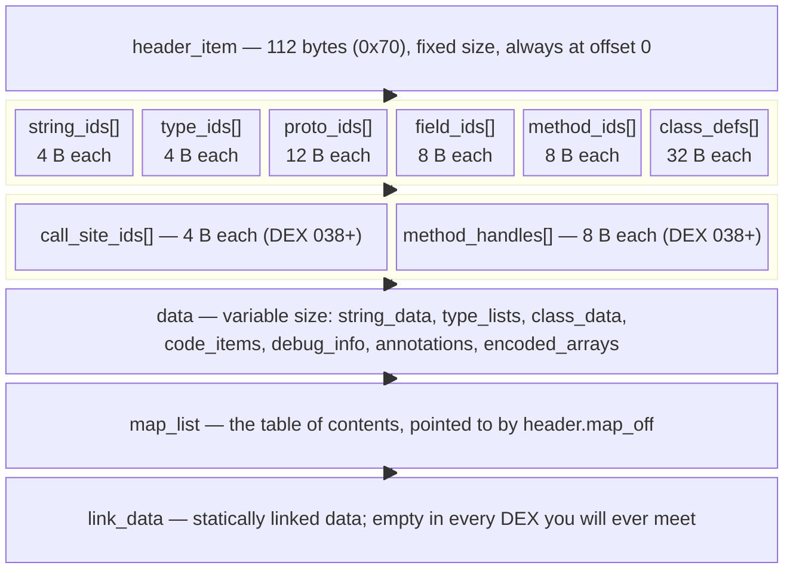

What you are looking at is a deliberate separation between **fixed-stride index tables** and a
**variable-length data pool**. Everything in the middle band is an array whose element size is a
compile-time constant, so element *n* is found by pure arithmetic: `table_off + n * element_size`. No
searching, no pointer chasing, no parsing. The variable-length material — the actual characters of
strings, the actual bytecode of methods — lives in the `data` region and is referenced by absolute
byte offsets from the start of the file.

That single design decision is why a DEX can be `mmap`-ed and used in place. To find the name of
method 4,211 you compute one address and read eight bytes. The kernel faults in the one 4 KB page
that contains those eight bytes, and nothing else.

Here is the same layout as a plain ASCII map with concrete offsets, for a small file:

```text
 offset      size        contents
 ────────    ────────    ────────────────────────────────────────────────────────────
 0x00000     0x70        header_item
                           0x00  magic          "dex\n035\0"     (8 bytes)
                           0x08  checksum       Adler-32          (uint)
                           0x0C  signature      SHA-1             (20 bytes)
                           0x20  file_size                        (uint)
                           0x24  header_size    = 0x70            (uint)
                           0x28  endian_tag     = 0x12345678      (uint)
                           0x2C  link_size / link_off             (2 x uint)
                           0x34  map_off                          (uint)
                           0x38  string_ids_size / string_ids_off (2 x uint)
                           0x40  type_ids_size  / type_ids_off    (2 x uint)
                           0x48  proto_ids_size / proto_ids_off   (2 x uint)
                           0x50  field_ids_size / field_ids_off   (2 x uint)
                           0x58  method_ids_size / method_ids_off (2 x uint)
                           0x60  class_defs_size / class_defs_off (2 x uint)
                           0x68  data_size / data_off             (2 x uint)
 ────────    ────────    ────────────────────────────────────────────────────────────
 0x00070     4*N_str     string_ids[]    each entry: uint string_data_off
 0x000xx     4*N_typ     type_ids[]      each entry: uint descriptor_idx
 0x000xx     12*N_pro    proto_ids[]     shorty_idx, return_type_idx, parameters_off
 0x000xx     8*N_fld     field_ids[]     class_idx(u2), type_idx(u2), name_idx(u4)
 0x000xx     8*N_mth     method_ids[]    class_idx(u2), proto_idx(u2), name_idx(u4)
 0x000xx     32*N_cls    class_defs[]    8 uints per class
 ────────    ────────    ────────────────────────────────────────────────────────────
 data_off    data_size   data section  (everything variable-length, 4-byte aligned
                           where the spec demands it: code_item, type_list,
                           annotation_set_item, map_list are all 4-byte aligned;
                           string_data_item, class_data_item, debug_info_item,
                           annotation_item, encoded_array_item are byte-aligned)
 ────────    ────────    ────────────────────────────────────────────────────────────
 map_off     variable    map_list: uint size, then `size` map_item entries of 12 bytes
 ────────    ────────    ────────────────────────────────────────────────────────────
 link_off    link_size   link_data — unused; both fields are 0 in practice
```

Two details in that map are worth stopping on now, because they cause more confusion than anything
else in the format. First, `data_off` and `data_size` describe a *region*, and the map_list normally
sits inside it — so the map is both part of the data section and the description of the whole file.
Second, alignment is not uniform. Some structures must begin at a 4-byte boundary and some may begin
anywhere, which means a parser that blindly assumes alignment will drift on real files.

### 2.2 The index-and-data split

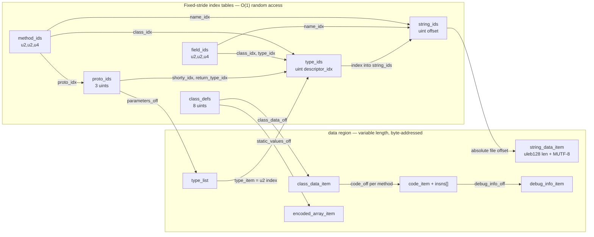

Read this diagram as a dependency graph and one fact jumps out: **`string_ids` is the root of
everything nameable**. A type is a string. A field's name is a string. A method's name is a string. A
prototype's shorty is a string. Every human-readable identifier in the entire file funnels down to
one entry in one deduplicated string table.

That is the deduplication payoff made concrete. The descriptor `Ljava/lang/String;` exists as
literal bytes exactly once in the file, no matter that ten thousand methods mention it.

It also tells you something operationally useful: if you want to know what an app *touches*, dumping
the string table alone gets you most of the way there in milliseconds, before any bytecode is parsed.
That is why `strings`-style triage on a DEX is so effective, and it is the first thing you should do
to an unknown sample.

> **🔬 Under the Hood**
> The string table is required by the specification to be **sorted by string content**, comparing by
> UTF-16 code point value. `type_ids` must be sorted by `descriptor_idx`. `proto_ids` sort by return
> type then parameters. `field_ids` sort by defining class, then name, then type. `method_ids` sort
> by defining class, then name, then prototype. Sorting is not cosmetic: it lets the runtime find an
> entry with a binary search instead of a linear scan, and it lets `dexmerge`-style tools combine
> files efficiently. It also gives you a cheap tamper signal — a DEX whose `string_ids` are not in
> sorted order was almost certainly produced by hand or by a packer, not by `d8`.

### 2.3 From `.java` to `classes.dex`

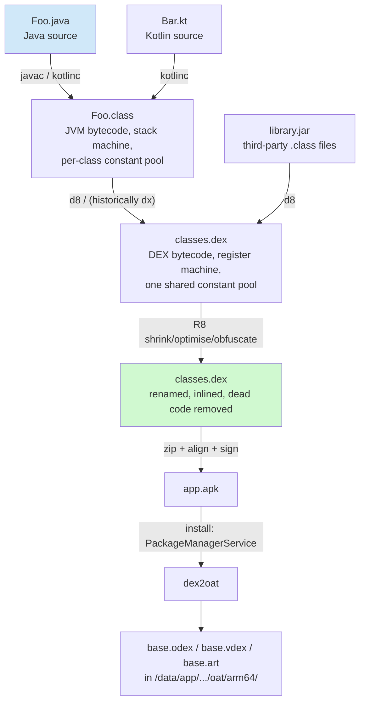

The pipeline has two compilations in it, and conflating them is the most common beginner error.
`javac` performs the **language-level** compilation: it resolves types, checks the type system,
desugars language features, and emits *stack-based* JVM bytecode into one `.class` file per class.
`d8` then performs a **format translation**: it takes those `.class` files, merges their constant
pools into one deduplicated set of tables, and re-expresses each method's stack-based bytecode as
*register-based* DEX bytecode.

> **📖 Definition — `d8` and `dx`**
> **`dx`** was the original Android tool that converted `.class` files to DEX. It was replaced by
> **`d8`**, which is faster, produces smaller output, and performs *desugaring* (rewriting newer Java
> language features such as lambdas and default interface methods into constructs older runtimes
> understand). **`R8`** is `d8` plus whole-program shrinking, optimisation and obfuscation; it is the
> default in release builds of modern Android Gradle Plugin versions. `R8` is covered in
> [Chapter 42](../42-R8/README.md).

The last two steps are worth noting because they explain a question every learner asks: if ART
compiles DEX to native code at install time, why does the DEX still matter? Because the compiled
artifact is a *companion*, not a replacement. `base.vdex` contains the DEX itself (verified,
sometimes with quickening applied), and `base.odex` contains native code for a subset of methods.
Anything not compiled is interpreted straight from the DEX bytes. The DEX is the ground truth for the
program's semantics on every Android version. The details of that arrangement belong to
[Chapter 13 — ART](../13-ART/README.md).

### 2.4 Where DEX sits inside an APK

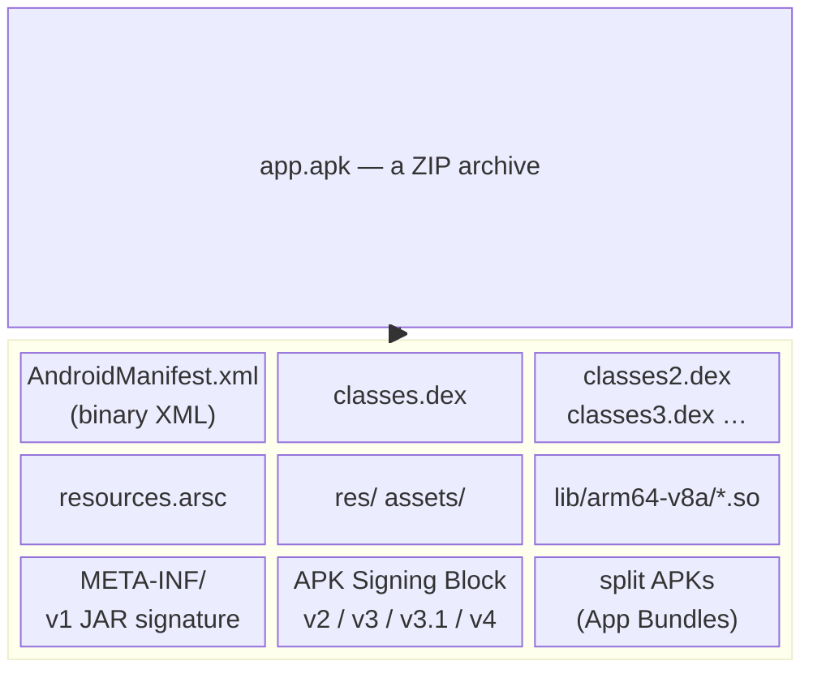

The DEX files sit inside the APK as ordinary ZIP entries named `classes.dex`, `classes2.dex`,
`classes3.dex` and so on. The numbering starts at `classes.dex` with **no** digit and the second file
is `classes2.dex` — there is no `classes1.dex`. Extracting them is a plain unzip; there is no Android
magic involved at that step.

Two practical notes follow from this. First, since Android 6.0 the platform prefers DEX entries to be
**stored uncompressed and 4-byte aligned** inside the ZIP so that the runtime can `mmap` them
directly out of the APK without a copy; `zipalign -p 4` and modern build tooling arrange this. If you
repack an APK carelessly and compress the DEX entries, the app still runs but loads more slowly and
uses more RAM. Second, the APK's signature covers the DEX bytes, so any byte you change inside a DEX
invalidates the APK signature and the APK must be re-signed. The signing schemes are covered in
[Chapter 10 — APK Internals](../10-APK-Internals/README.md).

> **⚠️ Warning**
> Re-signing an APK with your own key changes its signing certificate, which changes the app's
> identity as far as the platform is concerned. Any signature-check the app performs on itself will
> notice, `signature`-protection-level permissions shared with other apps of the same developer will
> stop working, and the app cannot be installed as an update over the store version — you must
> uninstall first. This is not a bug in your patching; it is the platform working correctly.

---

## 3. Deep Internal Working

This is the section you will come back to. It defines every structure in the format, in the order a
parser meets them, with the exact byte layout of each.

### 3.1 Primitive types used by the format

The DEX specification uses a small vocabulary of primitive types. Every larger structure is built
from these, and you must know them cold before any table below makes sense.

| Name | Size | Signed? | Meaning |
|---|---|---|---|
| `byte` | 1 byte | signed | 8-bit signed integer |
| `ubyte` | 1 byte | unsigned | 8-bit unsigned integer |
| `short` | 2 bytes | signed | 16-bit signed integer, little-endian |
| `ushort` | 2 bytes | unsigned | 16-bit unsigned integer, little-endian |
| `int` | 4 bytes | signed | 32-bit signed integer, little-endian |
| `uint` | 4 bytes | unsigned | 32-bit unsigned integer, little-endian |
| `long` | 8 bytes | signed | 64-bit signed integer, little-endian |
| `ulong` | 8 bytes | unsigned | 64-bit unsigned integer, little-endian |
| `sleb128` | 1–5 bytes | signed | signed variable-length integer (see §3.5) |
| `uleb128` | 1–5 bytes | unsigned | unsigned variable-length integer (see §3.5) |
| `uleb128p1` | 1–5 bytes | signed | `uleb128` whose decoded value is interpreted as *value − 1*, so it can represent −1 (see §3.5) |

> **📖 Definition — little-endian**
> **Endianness** is the order in which the bytes of a multi-byte number are stored. In
> **little-endian** order, the *least* significant byte comes first. The 32-bit number `0x12345678`
> is stored as the four bytes `78 56 34 12`. Android runs on ARM and x86, both of which are
> little-endian in practice, and every DEX file you will ever encounter is little-endian.

> **⚠️ Warning**
> This trips up every beginner exactly once. When you read a hexdump and see `70 00 00 00`, the value
> is `0x00000070` = 112, not `0x70000000`. Read multi-byte fields **right to left**.

> **📖 Definition — offset**
> An **offset** in DEX is always a byte count from the **very beginning of the file**, offset zero,
> unless the specification explicitly says otherwise. It is not relative to the containing structure
> and not relative to the data section. The one important exception is inside a `code_item`, where
> branch targets and `try` block addresses are counted in **16-bit code units from the start of that
> method's `insns[]` array**, not in bytes from the start of the file.

> **📖 Definition — index (`_idx`)**
> An **index** is a zero-based position into one of the fixed-stride tables. `name_idx` = 42 means
> "entry 42 of `string_ids`", which you find at `string_ids_off + 42 * 4`. The reserved value
> `NO_INDEX` = `0xFFFFFFFF` means "absent".

### 3.2 `header_item` field by field

The header is exactly 112 bytes (`0x70`) and always begins at file offset 0. Every field is
little-endian. This table is the one you will photocopy.

| Offset | Size | Type | Field | Meaning |
|---:|---:|---|---|---|
| `0x00` | 8 | `ubyte[8]` | `magic` | The literal bytes `64 65 78 0A` followed by three ASCII version digits and a NUL. Identifies the file as DEX and states the format version. |
| `0x08` | 4 | `uint` | `checksum` | **Adler-32** checksum of *every byte in the file after this field*, i.e. of `file[12:]`. Detects accidental corruption. |
| `0x0C` | 20 | `ubyte[20]` | `signature` | **SHA-1** hash of *every byte in the file after this field*, i.e. of `file[32:]`. Used by the runtime as a unique file identifier and as a stronger integrity check. |
| `0x20` | 4 | `uint` | `file_size` | Total size of the DEX file in bytes. Must equal the real file length. |
| `0x24` | 4 | `uint` | `header_size` | Size of this header. **Always `0x70` (112).** A constant that exists so the format could in principle grow; it never has. |
| `0x28` | 4 | `uint` | `endian_tag` | `0x12345678` (`ENDIAN_CONSTANT`), stored as the bytes `78 56 34 12`. The value `0x78563412` (`REVERSE_ENDIAN_CONSTANT`) would indicate a big-endian file. |
| `0x2C` | 4 | `uint` | `link_size` | Size of the link section. **0** in every DEX produced by real tooling. |
| `0x30` | 4 | `uint` | `link_off` | File offset of the link section, or 0 if `link_size` is 0. |
| `0x34` | 4 | `uint` | `map_off` | File offset of the `map_list`. Must be non-zero. Conventionally near the end of the file. |
| `0x38` | 4 | `uint` | `string_ids_size` | Number of entries in the string identifier list. |
| `0x3C` | 4 | `uint` | `string_ids_off` | File offset of `string_ids[]`, or 0 if the count is 0. Conventionally `0x70`, immediately after the header. |
| `0x40` | 4 | `uint` | `type_ids_size` | Number of type identifiers. **Must be ≤ 65,535.** |
| `0x44` | 4 | `uint` | `type_ids_off` | File offset of `type_ids[]`, or 0. |
| `0x48` | 4 | `uint` | `proto_ids_size` | Number of method prototype identifiers. **Must be ≤ 65,535.** |
| `0x4C` | 4 | `uint` | `proto_ids_off` | File offset of `proto_ids[]`, or 0. |
| `0x50` | 4 | `uint` | `field_ids_size` | Number of field identifiers. |
| `0x54` | 4 | `uint` | `field_ids_off` | File offset of `field_ids[]`, or 0. |
| `0x58` | 4 | `uint` | `method_ids_size` | Number of method identifiers. **This is the field behind the famous "64K limit".** |
| `0x5C` | 4 | `uint` | `method_ids_off` | File offset of `method_ids[]`, or 0. |
| `0x60` | 4 | `uint` | `class_defs_size` | Number of class definitions in this file. |
| `0x64` | 4 | `uint` | `class_defs_off` | File offset of `class_defs[]`, or 0. |
| `0x68` | 4 | `uint` | `data_size` | Size of the data section in bytes. Must be an even multiple of `sizeof(uint)`, i.e. divisible by 4. |
| `0x6C` | 4 | `uint` | `data_off` | File offset of the start of the data section. |

The `magic` field deserves its own treatment because it is the first thing you look at and the first
thing a hostile file lies about. Its eight bytes are:

```text
byte index :  0    1    2    3    4    5    6    7
ASCII      :  d    e    x   \n    0    3    5   \0
hex        : 64   65   78   0A   30   33   35   00
```

The first four bytes `64 65 78 0A` are the DEX magic proper and never change. The next three bytes
are the **version**, written as three ASCII digits, and the eighth byte is a NUL terminator. So a
DEX version `038` file begins `64 65 78 0A 30 33 38 00`.

Here is the header drawn as a block diagram, with the two integrity fields highlighted:

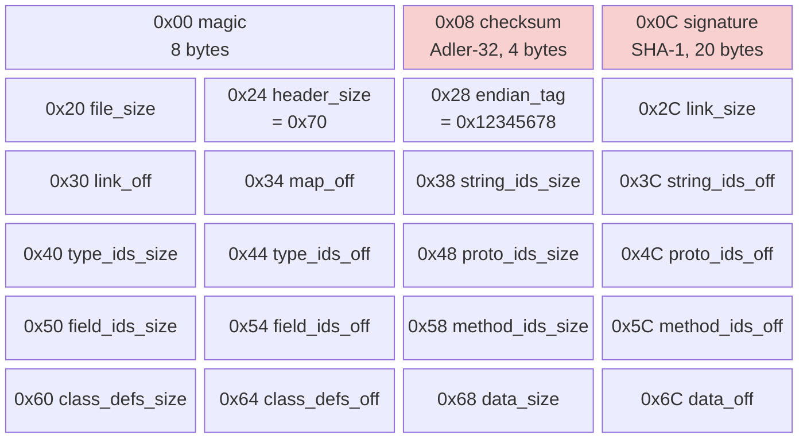

Reading that block diagram left to right and top to bottom gives you the exact byte order of the
header. The two red cells are the fields you must recompute after any edit, and they are red because
they are also the fields an attacker's tooling manipulates: a packer that stores its real payload
elsewhere often leaves a deliberately wrong checksum in the decoy DEX, on the theory that the
runtime path it uses does not check while your analysis tool does.

> **🔍 Pentester's Note**
> `dex\n` — with a real newline as the fourth byte — is your grep signature for finding embedded DEX
> blobs. Packers routinely store an encrypted payload in `assets/` that decrypts to a DEX; if it is
> only XOR-obfuscated you can often find the magic by searching for `dex` followed by any byte, or by
> XOR-ing `64 65 78 0A` against candidate single-byte keys. A memory dump of a running app scanned
> for `64 65 78 0A` at 4-byte-aligned addresses is the classic way to recover a DEX that a packer
> only ever materialises in RAM.

### 3.3 DEX version numbers and what each added

The three version digits are not decoration. The runtime refuses a version it does not understand,
and each bump corresponds to real new structures in the file.

| Version | Magic bytes | Introduced in | What it added |
|---|---|---|---|
| `035` | `64 65 78 0A 30 33 35 00` | Android 1.0 (API 1) | The baseline format. Everything in §3.8–§3.19. |
| `036` | `64 65 78 0A 30 33 36 00` | — (never shipped) | Skipped. It was used briefly during development for an experimental extension and abandoned; ART does not accept it. |
| `037` | `64 65 78 0A 30 33 37 00` | Android 7.0 (API 24) | Default and static interface methods, and the `invoke-polymorphic` / `invoke-polymorphic/range` opcodes for `MethodHandle` invocation. |
| `038` | `64 65 78 0A 30 33 38 00` | Android 8.0 (API 26) | `invoke-custom` / `invoke-custom/range`, plus the two new index tables `call_site_ids` and `method_handles` that make `invokedynamic`-style call sites expressible. |
| `039` | `64 65 78 0A 30 33 39 00` | Android 9.0 (API 28) | `const-method-handle` and `const-method-type` opcodes, and the `hiddenapi_class_data_item` used to mark restricted platform APIs. |
| `040` | `64 65 78 0A 30 34 30 00` | Android 10 (API 29) | Relaxed the rules for `SimpleName`, permitting a much wider set of Unicode code points — including spaces and many symbols — in identifiers. |

> **⚠️ Warning**
> A DEX declaring a version newer than the device supports is rejected at load time — the app will
> not install, or will fail on class loading with an error naming the bad version. If you hand-edit
> the magic to a *lower* version while leaving `038`-only structures in place, you get a file that
> some tools accept and the runtime rejects, which is precisely the kind of parser differential a
> packer wants.

> **🔍 Pentester's Note**
> The version digits are a dating tool. A DEX in the wild declaring `035` was produced by, or
> targeted at, older tooling; a `039` file cannot run below Android 9. When triaging malware, a
> mismatch between the DEX version and the manifest's `minSdkVersion` is worth a note: a `035` DEX in
> an app claiming `minSdkVersion 31` often means the DEX was generated by a custom builder or a
> packer rather than by `d8`.

### 3.4 The checksum and the signature

Two integrity fields sit near the front of the header, and they cover **overlapping but different**
regions. Getting this wrong is the single most common reason a hand-patched DEX fails to load.

```text
 file offset:  0        8       12          32                          EOF
               |        |        |           |                            |
               +--------+--------+-----------+----------------------------+
               | magic  |checksum|  SHA-1 signature (20 B)    | rest ..... |
               +--------+--------+-----------+----------------------------+
                                 |                                        |
                                 |<------ Adler-32 covers file[12:] ----->|
                                             |                            |
                                             |<-- SHA-1 covers file[32:]->|
```

Read that diagram carefully. The **Adler-32 checksum covers the signature field**, because the
signature starts at offset 12 and the checksum's coverage begins at offset 12. The **SHA-1 signature
does not cover the checksum field**, because SHA-1's coverage begins at offset 32, after the
signature itself ends.

> **⚠️ Warning — the repair order**
> Because the checksum covers the signature but not the reverse, after patching any byte you must
> repair in this order:
>
> 1. Recompute **SHA-1** over `file[32:]` and write the 20 bytes to offset `0x0C`.
> 2. Recompute **Adler-32** over `file[12:]` and write the 4 bytes to offset `0x08`.
>
> Do it the other way round and your freshly written checksum immediately becomes stale, because
> writing the signature afterwards changes bytes that the checksum covers. The file will be rejected.

> **📖 Definition — Adler-32**
> **Adler-32** is a checksum algorithm designed by Mark Adler for zlib. It maintains two running
> 16-bit sums: `A`, the sum of all bytes plus one, and `B`, the running sum of all intermediate
> values of `A`. Both are taken modulo 65521, the largest prime below 2^16. The result is
> `(B << 16) | A`. It is fast and catches accidental corruption, but it is **not** cryptographic —
> constructing a collision is trivial arithmetic. It exists to catch a bad flash write, not an
> attacker.

> **📖 Definition — SHA-1**
> **SHA-1** is a cryptographic hash producing a 160-bit (20-byte) digest. It has been considered
> broken for collision resistance since 2017, so its presence here should not be read as an
> anti-tamper control. ART uses it primarily as a **stable identity** for the DEX file: the same 20
> bytes reliably mean "the same DEX", which is exactly what a cache key needs. Real tamper resistance
> for an app comes from the APK signature ([Chapter 10](../10-APK-Internals/README.md)), which uses
> modern algorithms and a private key you do not have.

Here is the repair operation, written out so there is no ambiguity:

```python
# runs on your host machine — python3 repair.py <dex file>
import hashlib, sys, zlib

path = sys.argv[1]
data = bytearray(open(path, 'rb').read())

# Step 1: SHA-1 over everything from offset 32 to EOF, written to offset 12..31.
data[12:32] = hashlib.sha1(bytes(data[32:])).digest()

# Step 2: Adler-32 over everything from offset 12 to EOF, written to offset 8..11.
#         This MUST come second because it covers the signature we just wrote.
data[8:12] = (zlib.adler32(bytes(data[12:])) & 0xFFFFFFFF).to_bytes(4, 'little')

open(path, 'wb').write(bytes(data))
print("repaired", path)
```

Note the `& 0xFFFFFFFF` mask on the Adler-32 result: it makes the code correct on every Python
version regardless of whether `zlib.adler32` returns a signed value. Note also `'little'` on the
`to_bytes` call — the checksum is a `uint` and therefore little-endian like everything else in the
file.

> **🔬 Under the Hood**
> ART does verify these fields, but *when* it does so depends on the load path. `dex2oat` checks them
> when it compiles the file at install time. The runtime's `DexFile` open path, in
> `art/libdexfile/dex/dex_file_loader.cc` and `art/libdexfile/dex/dex_file_verifier.cc`, checks the
> magic, version, `file_size`, `header_size` and `endian_tag` structurally on every open, and there
> is a full checksum verification path used when the runtime cannot trust the origin of the bytes —
> for example when a DEX arrives through `InMemoryDexClassLoader`. Some load paths historically
> skipped the Adler-32 check for speed on files already validated at install time, which is exactly
> why you will sometimes find a patched DEX that runs despite a wrong checksum on one device and
> refuses to load on another. Repair both fields every time; never rely on a shortcut that happens to
> work on your test handset.

### 3.5 LEB128, ULEB128, ULEB128p1 and SLEB128

Fixed-width integers waste space when most values are small. The data section of a DEX is dense with
small numbers: field counts, register counts, index deltas, string lengths. The format therefore
encodes them variable-width.

> **📖 Definition — LEB128**
> **LEB128** stands for **Little-Endian Base 128**. It encodes an integer as a sequence of bytes in
> which the low 7 bits of each byte carry data and the high bit (`0x80`) is a **continuation flag**:
> set means "another byte follows", clear means "this is the last byte". The 7-bit groups are
> ordered least-significant-first. It originates in the DWARF debugging standard and is used by DEX,
> WebAssembly, and Protocol Buffers (where the same idea is called a varint).

In DEX a LEB128 value is limited to **five bytes maximum**, because five 7-bit groups give 35 bits,
which is more than enough for any 32-bit quantity.

#### Decoding ULEB128 step by step

The algorithm in words: start with a result of 0 and a shift of 0. Read a byte. Take its low 7 bits,
shift them left by the current shift, and OR them into the result. Add 7 to the shift. If the byte's
high bit was set, repeat; otherwise stop.

```python
# runs on your host machine — reference implementation
def read_uleb128(buf, pos):
    result = 0
    shift = 0
    while True:
        b = buf[pos]
        pos += 1
        result |= (b & 0x7F) << shift
        if not (b & 0x80):
            break
        shift += 7
    return result, pos
```

Now three worked examples, bit by bit.

**Example A — the bytes `00`.**

```text
byte 0 = 0x00 = 0b0000_0000
         continuation bit (0x80) = 0  -> last byte
         payload = 0b000_0000 = 0
result = 0 << 0 = 0
decoded value = 0        (1 byte consumed)
```

**Example B — the bytes `7F`.**

```text
byte 0 = 0x7F = 0b0111_1111
         continuation bit = 0 -> last byte
         payload = 0b111_1111 = 127
result = 127 << 0 = 127
decoded value = 127      (1 byte consumed)
```

`0x7F` is the largest value expressible in one ULEB128 byte. The value 128 needs two.

**Example C — the bytes `E5 8E 26`.**

```text
byte 0 = 0xE5 = 0b1110_0101
         continuation bit = 1 -> more follows
         payload = 0b110_0101 = 0x65 = 101
         result  = 101 << 0  = 101

byte 1 = 0x8E = 0b1000_1110
         continuation bit = 1 -> more follows
         payload = 0b000_1110 = 0x0E = 14
         result |= 14 << 7   = 14 * 128      = 1,792      -> result = 1,893

byte 2 = 0x26 = 0b0010_0110
         continuation bit = 0 -> last byte
         payload = 0b010_0110 = 0x26 = 38
         result |= 38 << 14  = 38 * 16,384   = 622,592    -> result = 624,485

decoded value = 624,485   (3 bytes consumed)
```

Check the arithmetic: 101 + 1,792 + 622,592 = 624,485, which is `0x98765` — a pleasing sanity check
that the 7-bit groups reassemble into the right 32-bit number.

#### Decoding SLEB128

**SLEB128** is the signed form. It works identically, except that after the final byte you must
**sign-extend**: if the sign bit of the final 7-bit payload (that is, bit 6, value `0x40`) is set,
every higher bit of the result is 1.

```python
# runs on your host machine — reference implementation
def read_sleb128(buf, pos):
    result = 0
    shift = 0
    while True:
        b = buf[pos]
        pos += 1
        result |= (b & 0x7F) << shift
        shift += 7
        if not (b & 0x80):
            if b & 0x40:                      # sign bit of the final group
                result |= -(1 << shift)       # sign-extend
            break
    return result, pos
```

**Example D — the bytes `7F` read as SLEB128.**

```text
byte 0 = 0x7F = 0b0111_1111
         continuation = 0, shift becomes 7
         payload = 0b111_1111 = 127
         sign bit (0x40) is SET
         result = 127 | -(1 << 7) = 127 - 128 = -1
decoded value = -1
```

So the byte `7F` means 127 when read as ULEB128 and −1 when read as SLEB128. The bytes are identical;
only the reader's expectation differs. That is why you must know which fields are signed, and it is
why the signed size field in `encoded_catch_handler` (§3.17) is such a good trick question.

**Example E — the bytes `80 7F`.**

```text
byte 0 = 0x80 = 0b1000_0000  continuation = 1, payload = 0
byte 1 = 0x7F = 0b0111_1111  continuation = 0, payload = 127
raw = 0 | (127 << 7) = 16,256 ; shift = 14
as ULEB128: 16,256
as SLEB128: sign bit of the final group (0x40) is SET
            16,256 | -(1 << 14) = 16,256 - 16,384 = -128
```

**Example F — the bytes `C0 BB 78` read as SLEB128.**

```text
byte 0 = 0xC0 = 0b1100_0000  cont=1, payload = 0b100_0000 = 0x40 = 64
byte 1 = 0xBB = 0b1011_1011  cont=1, payload = 0b011_1011 = 0x3B = 59
byte 2 = 0x78 = 0b0111_1000  cont=0, payload = 0b111_1000 = 0x78 = 120
raw = 64 | (59 << 7) | (120 << 14)
    = 64 + 7,552 + 1,966,080
    = 1,973,696 ; shift = 21
sign bit of the final group (0x40 & 0x78) is SET
value = 1,973,696 - (1 << 21) = 1,973,696 - 2,097,152 = -123,456
decoded value = -123,456
```

#### ULEB128p1

> **📖 Definition — ULEB128p1**
> **`uleb128p1`** is not a different encoding — the bytes are decoded exactly as ULEB128 — but the
> *interpretation* subtracts one: the represented value is `decoded_uleb128 − 1`. Its entire purpose
> is to let a field express **−1** (meaning "none" or "absent") in a single byte, `0x00`, while still
> encoding 0 in one byte (`0x01`), 1 in one byte (`0x02`), and so on.

You meet `uleb128p1` exactly where "no value" is a legal answer: in `debug_info_item`'s parameter
name indexes, where `0x00` means "this parameter has no recorded name", and inside the debug
bytecode stream for type and signature indexes. Do not confuse it with SLEB128; they are different
mechanisms for different jobs.

#### Encoding table

| Value | ULEB128 bytes | SLEB128 bytes | ULEB128p1 bytes |
|---:|---|---|---|
| −129 | n/a | `FF 7E` | n/a |
| −128 | n/a | `80 7F` | n/a |
| −2 | n/a | `7E` | n/a |
| −1 | n/a | `7F` | `00` |
| 0 | `00` | `00` | `01` |
| 1 | `01` | `01` | `02` |
| 2 | `02` | `02` | `03` |
| 63 | `3F` | `3F` | `40` |
| 64 | `40` | `C0 00` | `41` |
| 127 | `7F` | `FF 00` | `80 01` |
| 128 | `80 01` | `80 01` | `81 01` |
| 255 | `FF 01` | `FF 01` | `80 02` |
| 16,256 | `80 7F` | `80 80 01` | `81 7F` |
| 624,485 | `E5 8E 26` | `E5 8E 26` | `E6 8E 26` |
| 2,147,483,647 | `FF FF FF FF 07` | `FF FF FF FF 07` | `80 80 80 80 08` |

Look at the row for 64. As ULEB128 it fits in one byte, `0x40`. As SLEB128 it does **not**, because
`0x40` in a final group means the sign bit is set, which would decode as −64. The encoder must
therefore emit an extra byte, `C0 00`, to keep the sign bit clear. This asymmetry is a frequent
source of off-by-one bugs in hand-written parsers, and it is the reason a naive "just re-encode the
number" patch can change a structure's length and shift everything after it.

> **🔬 Under the Hood**
> AOSP's implementation lives in `art/libdexfile/dex/leb128.h`. It provides
> `DecodeUnsignedLeb128`, `DecodeSignedLeb128`, `DecodeUnsignedLeb128P1` and the corresponding
> encoders, plus "checked" variants that take an end pointer and refuse to run past the end of the
> buffer. The checked variants exist because unchecked LEB128 decoding of attacker-controlled bytes
> is a classic out-of-bounds read: a run of bytes that all have the continuation bit set walks the
> reader off the end of the mapping.

> **🔍 Pentester's Note**
> A deliberately over-long LEB128 encoding — for example `80 80 80 80 80 00`, six bytes encoding
> zero — is a well-known parser-differential trick. A strict parser rejects it because DEX caps the
> encoding at five bytes; a permissive parser keeps reading and silently produces zero, having
> consumed a different number of bytes than the strict parser. The two parsers then disagree about
> where the *next* field starts, and everything after that point diverges. Packers use this so that
> one tool sees one method body and the runtime sees another.

### 3.6 MUTF-8 — Modified UTF-8

Every string in a DEX file is stored in **MUTF-8**, which is *almost* UTF-8 but differs in two
specific, security-relevant ways. If you assume it is UTF-8 your parser will be subtly wrong, and
"subtly wrong" is exactly the property an attacker needs.

> **📖 Definition — code point**
> A **code point** is a single number assigned by the Unicode standard to a character. `A` is
> U+0041. The euro sign is U+20AC. The grinning face emoji is U+1F600. Code points above U+FFFF are
> called **supplementary** characters and live in the *astral planes*.

> **📖 Definition — UTF-8**
> **UTF-8** is a variable-length encoding of Unicode code points into bytes. Code points U+0000–
> U+007F take one byte, U+0080–U+07FF take two, U+0800–U+FFFF take three, and U+10000–U+10FFFF take
> **four**. The leading byte announces the length: `0xxxxxxx` for one byte, `110xxxxx` for two,
> `1110xxxx` for three, `11110xxx` for four; continuation bytes are `10xxxxxx`.

> **📖 Definition — UTF-16 and surrogate pairs**
> **UTF-16** encodes each code point into one or two 16-bit units. Code points up to U+FFFF are one
> unit. Supplementary code points are encoded as a **surrogate pair**: a *high surrogate* in the
> range U+D800–U+DBFF followed by a *low surrogate* in U+DC00–U+DFFF. Java's `String` and `char` are
> UTF-16, which is why `"😀".length()` returns 2 in Java.

> **📖 Definition — MUTF-8**
> **MUTF-8 (Modified UTF-8)** is the encoding used by the JVM class file format, by Java's
> `DataInput.readUTF`, by JNI's `NewStringUTF`, and by DEX. It differs from standard UTF-8 in exactly
> two respects, described below.

#### Difference one — U+0000 is encoded in two bytes

In standard UTF-8, the code point U+0000 (the NUL character) is encoded as the single byte `00`. In
MUTF-8 it is encoded as the **two bytes `C0 80`**.

Why? Because DEX (and the JVM, and JNI) terminates strings with a `00` byte, C-style. If NUL could
appear inside the string as a literal `00` byte, the terminator would be ambiguous. Encoding U+0000
as `C0 80` guarantees that the only `00` byte in a string's bytes is the terminator.

```text
code point U+0000

standard UTF-8 :  00
MUTF-8         :  C0 80

  C0 = 1100_0000   two-byte lead form, payload bits 00000
  80 = 1000_0000   continuation,       payload bits 000000
  combined payload = 00000_000000 = 0  ->  U+0000
```

Note that `C0 80` is an **over-long encoding** — standard UTF-8 forbids it precisely because
over-long forms create multiple byte sequences for the same character, which historically broke
security filters that scanned for `/` or `..` before decoding. MUTF-8 deliberately uses the form that
UTF-8 outlaws.

#### Difference two — supplementary characters use two three-byte sequences

In standard UTF-8, a supplementary code point such as U+1F600 is a single four-byte sequence. In
MUTF-8 there are **no four-byte sequences at all**. Instead the code point is first split into its
UTF-16 surrogate pair, and then *each surrogate is separately encoded as a three-byte sequence*,
giving six bytes total. This style is sometimes called **CESU-8**.

Worked example, the grinning face emoji U+1F600.

```text
Step 1 — split into a UTF-16 surrogate pair
    U+1F600
    subtract 0x10000        -> 0x0F600
    high 10 bits  = 0x0F600 >> 10      = 0x03D   -> high surrogate = 0xD800 + 0x03D = 0xD83D
    low  10 bits  = 0x0F600 & 0x3FF    = 0x200   -> low  surrogate = 0xDC00 + 0x200 = 0xDE00

Step 2 — encode EACH surrogate as a 3-byte UTF-8-style sequence
    0xD83D = 1101_1000_0011_1101
             split into 4 + 6 + 6 bits:  1101 | 100000 | 111101
             emit 1110_1101  10_100000  10_111101
                =  ED         A0         BD

    0xDE00 = 1101_1110_0000_0000
             split into 4 + 6 + 6 bits:  1101 | 111000 | 000000
             emit 1110_1101  10_111000  10_000000
                =  ED         B8         80

MUTF-8 bytes       :  ED A0 BD ED B8 80        (6 bytes)
standard UTF-8 bytes:  F0 9F 98 80             (4 bytes)
```

The `utf16_size` field that precedes the bytes in a `string_data_item` (§3.8) counts **UTF-16 code
units**, not code points and not bytes. For this emoji, `utf16_size` is **2**, the byte count is 6,
and the number of code points is 1. Three different numbers for one character. Every one of them is
correct for a different question, and confusing them is a rich source of bugs.

#### Full MUTF-8 encoding table

| Code point range | MUTF-8 bytes | Bit layout |
|---|---|---|
| U+0001 – U+007F | 1 byte | `0xxxxxxx` |
| **U+0000** | **2 bytes** `C0 80` | `11000000 10000000` |
| U+0080 – U+07FF | 2 bytes | `110xxxxx 10xxxxxx` |
| U+0800 – U+FFFF | 3 bytes | `1110xxxx 10xxxxxx 10xxxxxx` |
| U+10000 – U+10FFFF | **6 bytes** (two 3-byte sequences, one per surrogate) | `11101101 1010xxxx 10xxxxxx` then `11101101 1011xxxx 10xxxxxx` |

#### Why this matters for security

> **⚠️ Warning**
> Python's `bytes.decode('utf-8')` will **raise** on `C0 80` and will **mis-handle** surrogate pairs.
> If you write a DEX parser in Python and call `.decode('utf-8')` on string data, it will crash on
> perfectly legal DEX files. Use `.decode('utf-8', errors='replace')` for display only, or implement
> a real MUTF-8 decoder if you need fidelity. The parser script shipped with this chapter
> ([`examples/dex_parser.py`](examples/dex_parser.py)) implements MUTF-8 properly.

> **🔍 Pentester's Note — parser differentials**
> This is a genuine, exploited technique, not a curiosity. Consider a class name that a packer writes
> using an over-long MUTF-8 form. Tool A decodes strictly and rejects or replaces the character; tool
> B decodes leniently and produces the "real" name; ART decodes with its own rules and produces a
> third answer. If your static analysis says the app loads `com.example.Safe` and the device actually
> loads a class whose name decodes differently, your report is wrong. The same trick appears with
> lone surrogates — a high surrogate with no following low surrogate is legal MUTF-8 byte-wise, is
> representable in a Java `String`, and renders as nothing. A class or method named with lone
> surrogates looks blank in every GUI you own.
>
> Practical defence: when triaging an unknown DEX, dump the string table as **raw hex** alongside the
> decoded form and diff them. Anything where the byte length is inconsistent with the decoded text
> deserves a second look.

> **🔬 Under the Hood**
> AOSP's MUTF-8 handling is in `art/libdexfile/dex/utf.h` and `art/libdexfile/dex/utf.cc`, with
> functions such as `GetUtf16FromUtf8`, `CountModifiedUtf8Chars` and `ConvertModifiedUtf8ToUtf16`.
> The DEX verifier in `art/libdexfile/dex/dex_file_verifier.cc` contains a routine that walks a
> `string_data_item` byte by byte and checks that the declared `utf16_size` matches the number of
> UTF-16 units the bytes actually produce, and that the sequence is well-formed. This check exists
> because a lying `utf16_size` was historically a way to cause an out-of-bounds read in code that
> pre-allocated a buffer from the declared size and then filled it from the bytes.

### 3.7 Type descriptors and shorty descriptors

Every type in a DEX file is written as a short string called a **type descriptor**. This is the same
scheme the JVM uses, and once you know it you can read any DEX, Smali listing or stack trace.

> **📖 Definition — type descriptor**
> A **type descriptor** is a compact textual encoding of a Java type. Primitives are single letters,
> reference types are `L` followed by the fully-qualified class name with dots replaced by slashes
> and terminated by `;`, and each leading `[` adds one array dimension.

| Descriptor | Java type | Size in registers | Notes |
|---|---|---:|---|
| `V` | `void` | 0 | **Only valid as a return type.** Never a field or parameter type. |
| `Z` | `boolean` | 1 | `Z` for "boolean" because `B` was taken. |
| `B` | `byte` | 1 | signed 8-bit |
| `S` | `short` | 1 | signed 16-bit |
| `C` | `char` | 1 | **unsigned** 16-bit UTF-16 code unit |
| `I` | `int` | 1 | signed 32-bit |
| `J` | `long` | **2** | signed 64-bit. `J` because `L` was taken by references. |
| `F` | `float` | 1 | IEEE-754 single precision |
| `D` | `double` | **2** | IEEE-754 double precision |
| `Lpackage/Name;` | `package.Name` | 1 | a reference. Dots become slashes; the trailing `;` is mandatory. |
| `[X` | `X[]` | 1 | array of `X`. `[[I` is `int[][]`. Up to 255 dimensions. |

Worked descriptor examples:

| Descriptor | Java type |
|---|---|
| `Ljava/lang/String;` | `java.lang.String` |
| `Ljava/util/Map$Entry;` | `java.util.Map.Entry` (nested class; `$` is a literal character in the name) |
| `[I` | `int[]` |
| `[[Ljava/lang/String;` | `String[][]` |
| `[B` | `byte[]` — the single most common type in crypto and networking code |
| `Lcom/example/app/MainActivity;` | `com.example.app.MainActivity` |

> **⚠️ Warning**
> Note carefully that a long or a double occupies **two consecutive registers**, and that when you
> refer to such a value in bytecode you name the **lower-numbered** register of the pair. Writing to
> `v3` with `move-wide` clobbers `v3` and `v4`. Forgetting this is the number one cause of a
> hand-written Smali patch that verifies but computes nonsense.

#### Method descriptors

A full method signature is written as the parameter descriptors in order, inside parentheses,
followed immediately by the return descriptor. There are no separators.

| Method in Java | Descriptor |
|---|---|
| `void run()` | `()V` |
| `int add(int a, int b)` | `(II)I` |
| `String get(int index)` | `(I)Ljava/lang/String;` |
| `boolean equals(Object o)` | `(Ljava/lang/Object;)Z` |
| `byte[] doFinal(byte[] input)` | `([B)[B` |
| `void main(String[] args)` | `([Ljava/lang/String;)V` |
| `long f(int a, long b, double c, String d)` | `(IJDLjava/lang/String;)J` |

Learn to read these left to right without hesitating. `(IJDLjava/lang/String;)J` parses as: open
paren, `I` = int, `J` = long, `D` = double, `L...;` = one String reference, close paren, `J` = returns
long. Four parameters, not seventeen.

#### Shorty descriptors

> **📖 Definition — shorty descriptor**
> A **shorty** is a *lossy*, abbreviated form of a method descriptor in which every reference and
> array type collapses to the single letter `L`. Its purpose is to describe the **shape** of a call —
> how many registers each argument occupies and whether each is a 32-bit value, a 64-bit value or a
> reference — without needing to resolve any class names. The runtime uses it to lay out an
> argument frame quickly.

The shorty's first character is the return type (and it is the **only** place `V` may appear); the
remaining characters are the parameters in order.

| Full descriptor | Shorty | Reading |
|---|---|---|
| `()V` | `V` | returns void, no parameters |
| `(II)I` | `III` | returns int, two int parameters |
| `(I)Ljava/lang/String;` | `LI` | returns a reference, takes one int |
| `(Ljava/lang/Object;)Z` | `ZL` | returns boolean, takes one reference |
| `([B)[B` | `LL` | returns a reference (the array), takes one reference |
| `([Ljava/lang/String;)V` | `VL` | returns void, takes one reference |
| `(IJDLjava/lang/String;)J` | `JIJDL` | returns long; int, long, double, reference |

> **🔬 Under the Hood**
> The shorty is genuinely load-bearing, not redundant metadata. When ART sets up a call frame it
> needs to know, for each argument, whether it consumes one or two virtual register slots and whether
> it must be treated as a reference for garbage-collection root scanning. All three facts are
> derivable from a single shorty character with no class loading at all. Resolving
> `Ljava/util/concurrent/ConcurrentHashMap;` just to learn "it is a reference, one slot" would be
> absurdly expensive. This is why `proto_id_item` carries `shorty_idx` as a first-class field
> rather than deriving it.

> **🔍 Pentester's Note**
> Shorties are a fast filter when hunting for a method whose name you do not know. If you are looking
> for a root-detection routine, you are looking for something with shorty `Z` or `ZL` — returns a
> boolean, takes nothing or one argument. Grepping `dexdump` output for `(...)Z` methods in a
> suspicious class narrows a five-thousand-method app to a handful of candidates in seconds.

### 3.8 `string_id_item` and `string_data_item`

The string table is two structures working as a pair: a fixed-stride array of pointers, and the
variable-length data they point at.

**`string_id_item` — 4 bytes, in the `string_ids` table:**

| Offset | Size | Type | Field | Meaning |
|---:|---:|---|---|---|
| `+0x00` | 4 | `uint` | `string_data_off` | Absolute file offset of the corresponding `string_data_item`. Must point into the data section. |

**`string_data_item` — variable length, in the data section:**

| Order | Type | Field | Meaning |
|---|---|---|---|
| 1 | `uleb128` | `utf16_size` | The length of the string measured in **UTF-16 code units** — not bytes, not code points. |
| 2 | `ubyte[]` | `data` | The characters in MUTF-8, followed by a single `0x00` terminator byte. |

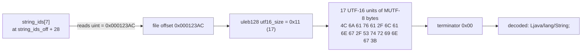

Walk that diagram as a parser would. You want string number 7. You compute `string_ids_off + 7 * 4`,
read a 32-bit little-endian value, and that value is an absolute file offset. You seek there, decode
a ULEB128 to learn the UTF-16 length, and then read MUTF-8 bytes until you hit the `0x00` terminator.

Note the redundancy: the string is *both* length-prefixed *and* NUL-terminated. That is deliberate.
The length lets a consumer allocate the right-sized UTF-16 buffer up front; the terminator lets C
code treat the bytes as a plain C string without copying. It also means there are **two** sources of
truth about where the string ends, and if they disagree, different consumers behave differently.

> **⚠️ Warning**
> `utf16_size` is *not* the byte count. For pure ASCII they happen to be equal, which is why sloppy
> parsers work on hand-made test files and fail on real ones. Any non-ASCII character makes them
> diverge; a supplementary character makes them diverge by a factor of three.

> **🔍 Pentester's Note**
> A string whose declared `utf16_size` disagrees with the bytes present is one of the classic
> anti-analysis tricks. Set `utf16_size` to a huge value and a tool that pre-allocates from it will
> either fail or read far past the terminator, dragging unrelated file content into what it displays
> as a "string". Set it to a small value and a tool that trusts it truncates the class name it shows
> you while the runtime, which scans to the terminator, loads a different class. Always cross-check.

The specification requires `string_ids` to be sorted by string content, comparing UTF-16 code point
values. That guarantees binary search works. It also gives you a cheap authenticity test: run down
the table checking that each string is greater than the last. A DEX from `d8` always passes; a DEX
assembled by a packer's own writer frequently does not.

### 3.9 `type_id_item` and `type_list`

**`type_id_item` — 4 bytes, in the `type_ids` table:**

| Offset | Size | Type | Field | Meaning |
|---:|---:|---|---|---|
| `+0x00` | 4 | `uint` | `descriptor_idx` | Index into `string_ids` of the string holding this type's descriptor, e.g. `Ljava/lang/String;` or `[I`. |

A type is therefore nothing but a pointer to a string. The indirection exists so that everything else
in the file can refer to a type with a **16-bit** index (`ushort`) rather than a 32-bit string index,
which halves the size of `field_id_item` and `method_id_item`. That economy is also the origin of the
hard cap: `type_ids_size` must be at most 65,535.

The table is sorted by `descriptor_idx`, which — because `string_ids` is itself sorted by content —
means it is transitively sorted by descriptor text.

**`type_list` — variable length, 4-byte aligned, in the data section:**

| Order | Type | Field | Meaning |
|---|---|---|---|
| 1 | `uint` | `size` | Number of entries in the list. |
| 2 | `type_item[size]` | `list` | Each `type_item` is a single `ushort` `type_idx`. |

A `type_list` is used for a method's parameter list (`proto_id_item.parameters_off`) and for a class's
implemented interfaces (`class_def_item.interfaces_off`). Because each element is only two bytes, the
structure needs padding to keep the *next* structure 4-byte aligned when `size` is odd; the padding
byte pair is not part of the list.

### 3.10 `proto_id_item`

> **📖 Definition — prototype**
> A **prototype** (or **proto**) is a method *signature without a name*: the return type plus the
> ordered list of parameter types. `(II)I` is a prototype. Many differently-named methods share one
> prototype, so DEX stores prototypes once and refers to them by index.

**`proto_id_item` — 12 bytes, in the `proto_ids` table:**

| Offset | Size | Type | Field | Meaning |
|---:|---:|---|---|---|
| `+0x00` | 4 | `uint` | `shorty_idx` | Index into `string_ids` of the shorty descriptor for this prototype (§3.7). |
| `+0x04` | 4 | `uint` | `return_type_idx` | Index into `type_ids` of the return type. |
| `+0x08` | 4 | `uint` | `parameters_off` | Absolute file offset of a `type_list` giving the parameter types, or **0** if the method takes no parameters. |

The table is sorted primarily by `return_type_idx` and secondarily by the parameter list, in
lexicographic order of parameter type indexes.

Notice that `parameters_off` = 0 encodes "no parameters" rather than pointing at an empty `type_list`.
This saves four bytes per no-argument prototype, and a no-argument prototype is extremely common.
A parser must special-case it; forgetting to do so causes an attempt to read a `type_list` at file
offset zero, which lands in the middle of the magic bytes and produces spectacular nonsense.

Worked example. Suppose `proto_ids[12]` contains, as raw bytes:

```text
offset in table : shorty_idx  return_type_idx  parameters_off
bytes           : 5A 00 00 00  0B 00 00 00      C0 12 00 00
little-endian   : 0x0000005A   0x0000000B       0x000012C0
meaning         : shorty = string_ids[90]
                  return = type_ids[11]
                  params at file offset 0x12C0
```

If `string_ids[90]` decodes to `"ZL"` and `type_ids[11]` resolves to `Z`, and the `type_list` at
`0x12C0` has `size` = 1 with one `type_idx` resolving to `Ljava/lang/String;`, then the prototype is
`(Ljava/lang/String;)Z` — a method taking a String and returning a boolean. The shorty `ZL` is
consistent with that: return `Z`, one reference parameter `L`.

Always perform that consistency check when analysing a suspicious file. The shorty and the real
descriptor are two independent statements of the same fact, and a file where they disagree is either
corrupt or deliberately hostile.

### 3.11 `field_id_item`

**`field_id_item` — 8 bytes, in the `field_ids` table:**

| Offset | Size | Type | Field | Meaning |
|---:|---:|---|---|---|
| `+0x00` | 2 | `ushort` | `class_idx` | Index into `type_ids` of the class that **defines** this field. Must be a class type, not an array or primitive. |
| `+0x02` | 2 | `ushort` | `type_idx` | Index into `type_ids` of the field's own type. |
| `+0x04` | 4 | `uint` | `name_idx` | Index into `string_ids` of the field's name. |

A `field_id_item` is a **reference**, not a definition. It says "somewhere there is a field called
*name* of type *type* on class *class*". Whether that field is actually defined in *this* DEX is a
separate question, answered by `class_data_item` (§3.14). Fields your code merely *reads* from the
framework — `android.os.Build.MODEL`, for instance — appear in `field_ids` but are defined nowhere in
your file.

The table is sorted by `class_idx`, then `name_idx`, then `type_idx`. Two fields on the same class
with the same name but different types are legal at the bytecode level even though Java forbids them
at the language level — which is why `type_idx` participates in the sort and in field identity.

> **🔍 Pentester's Note**
> `field_ids` is a superb map of what an app touches. A single pass over it, resolving `class_idx` and
> `name_idx`, tells you whether the app reads `Build.FINGERPRINT` (emulator detection), touches
> `SharedPreferences` keys with revealing names, or references fields on classes that are not present
> in the file at all — the last of which means either framework usage or a class that only exists
> after a packer decrypts it.

### 3.12 `method_id_item`

**`method_id_item` — 8 bytes, in the `method_ids` table:**

| Offset | Size | Type | Field | Meaning |
|---:|---:|---|---|---|
| `+0x00` | 2 | `ushort` | `class_idx` | Index into `type_ids` of the defining class. Must be a class or array type. |
| `+0x02` | 2 | `ushort` | `proto_idx` | Index into `proto_ids` of the method's prototype. |
| `+0x04` | 4 | `uint` | `name_idx` | Index into `string_ids` of the method's name. |

Sorted by `class_idx`, then `name_idx`, then `proto_idx`. Overloaded methods — same class, same name,
different signature — differ only in `proto_idx`, which is exactly how DEX represents overloading.

Two names are special and appear constantly:

| Name | Meaning |
|---|---|
| `<init>` | An instance constructor. Its prototype's return type is always `V`. Invoked with `invoke-direct`. |
| `<clinit>` | The static initialiser — the code that runs once when a class is first used. Prototype is always `()V`. Never invoked by bytecode; the runtime calls it. |

> **🔍 Pentester's Note**
> `<clinit>` is where string-decryption routines and native library loads hide, because it runs
> before any other code in the class and before any of your hooks that target ordinary methods. If
> you are chasing an obfuscated app and your Frida hook on `decrypt()` never fires, check whether the
> strings were already decrypted in `<clinit>` at class-load time. Similarly, `System.loadLibrary` in
> `<clinit>` means the native library is up before your JNI hooks attach unless you spawn the process
> suspended.

A `method_id_item` is 8 bytes and the whole table is contiguous, so the `method_ids` table alone is
`8 × method_ids_size` bytes. In an app with 60,000 method references that is 480 KB of pure index —
which puts the space savings of the shared table in perspective, since the alternative was that same
information repeated inside every class's private constant pool.

### 3.13 `class_def_item`

This is the structure that says "this DEX actually *defines* this class", as opposed to merely
referring to it. It is 32 bytes and has exactly eight fields, all `uint`.

| Offset | Size | Type | Field | Meaning |
|---:|---:|---|---|---|
| `+0x00` | 4 | `uint` | `class_idx` | Index into `type_ids` of the class being defined. Must be a class type — not an array, not a primitive. |
| `+0x04` | 4 | `uint` | `access_flags` | The class's modifiers: `public`, `final`, `interface`, `abstract`, `synthetic`, `annotation`, `enum`. See §3.23. |
| `+0x08` | 4 | `uint` | `superclass_idx` | Index into `type_ids` of the superclass, or `NO_INDEX` (`0xFFFFFFFF`) if there is none. Only `java.lang.Object` and interfaces have no superclass. |
| `+0x0C` | 4 | `uint` | `interfaces_off` | Absolute file offset of a `type_list` of directly implemented interfaces, or **0** if there are none. |
| `+0x10` | 4 | `uint` | `source_file_idx` | Index into `string_ids` of the original source file name (`"MainActivity.java"`), or `NO_INDEX` if unknown or stripped. |
| `+0x14` | 4 | `uint` | `annotations_off` | Absolute file offset of an `annotations_directory_item` for this class, or **0** if the class has no annotations anywhere. |
| `+0x18` | 4 | `uint` | `class_data_off` | Absolute file offset of the `class_data_item` holding the class's fields and methods, or **0** if the class has no fields and no methods. |
| `+0x1C` | 4 | `uint` | `static_values_off` | Absolute file offset of an `encoded_array_item` giving initial values for the static fields, or **0** if all statics default to zero/null. |

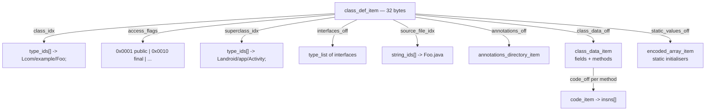

Everything a class *is* hangs off those eight fields. Follow `class_data_off` and you reach the
methods; follow each method's `code_off` and you reach the bytecode. That two-hop path — class_def to
class_data to code_item — is the route you will walk by hand more than any other in this chapter.

Three of the eight fields being zero is entirely normal. An interface with no default methods has
`class_data_off` = 0. A class with no annotations has `annotations_off` = 0. A class whose statics all
start at zero has `static_values_off` = 0. Zero means "absent", never "offset zero".

> **⚠️ Warning**
> `source_file_idx` is the field ProGuard and R8 rewrite. In a release build it is very often set to
> a constant such as `"SourceFile"` or removed entirely, which is why obfuscated stack traces lose
> their file names. If you see every class in an app reporting the same `source_file_idx`, that is a
> reliable fingerprint of shrinking having been applied. See
> [Chapter 41 — ProGuard](../41-ProGuard/README.md) and [Chapter 42 — R8](../42-R8/README.md).

> **🔬 Under the Hood**
> The specification requires that a class's superclass and implemented interfaces appear **earlier**
> in `class_defs` than the class itself, when they are defined in the same file. This lets a loader
> process the table in a single forward pass without needing to defer resolution. A DEX that violates
> the ordering is rejected. It is also the reason a class hierarchy split across multidex files needs
> care: the ordering constraint only applies within one file.

### 3.14 `class_data_item`, `encoded_field`, `encoded_method`

The `class_data_item` is where a class's actual members live. It sits in the data section, is
byte-aligned (no padding requirement), and is built almost entirely from ULEB128.

**`class_data_item`:**

| Order | Type | Field | Meaning |
|---|---|---|---|
| 1 | `uleb128` | `static_fields_size` | Number of static fields defined in this class. |
| 2 | `uleb128` | `instance_fields_size` | Number of instance fields defined in this class. |
| 3 | `uleb128` | `direct_methods_size` | Number of direct methods: `static`, `private`, and constructors. |
| 4 | `uleb128` | `virtual_methods_size` | Number of virtual methods: everything else — non-static, non-private, non-constructor. |
| 5 | `encoded_field[static_fields_size]` | `static_fields` | |
| 6 | `encoded_field[instance_fields_size]` | `instance_fields` | |
| 7 | `encoded_method[direct_methods_size]` | `direct_methods` | |
| 8 | `encoded_method[virtual_methods_size]` | `virtual_methods` | |

> **📖 Definition — direct versus virtual methods**
> A **direct** method is one whose target is known at compile time and needs no dynamic dispatch:
> `private` methods, `static` methods, and constructors. A **virtual** method is subject to
> **dynamic dispatch** — the actual code that runs depends on the runtime type of the receiver
> object, so the runtime must look the method up in the object's class at call time. This split is
> not cosmetic: it decides which `invoke-*` opcode the compiler emits, and it is why you cannot
> hook a `private` method the same way you hook a public one.

**`encoded_field`:**

| Order | Type | Field | Meaning |
|---|---|---|---|
| 1 | `uleb128` | `field_idx_diff` | **Delta** from the previous `encoded_field`'s index in this list. The first element's delta is the absolute index. |
| 2 | `uleb128` | `access_flags` | The field's modifiers (§3.23). |

**`encoded_method`:**

| Order | Type | Field | Meaning |
|---|---|---|---|
| 1 | `uleb128` | `method_idx_diff` | **Delta** from the previous `encoded_method`'s index in this list. The first element's delta is the absolute index. |
| 2 | `uleb128` | `access_flags` | The method's modifiers (§3.23). |
| 3 | `uleb128` | `code_off` | Absolute file offset of this method's `code_item`, or **0** if the method has no body (`abstract` or `native`). |

#### The delta-encoded index scheme

This is the detail that breaks every naive parser, so read it twice.

The `field_idx` and `method_idx` values are **not stored directly**. Each element stores the
*difference* between its index and the previous element's index. Because both lists are required to
be sorted in ascending index order, every delta is a small positive number, and small positive
numbers encode in one ULEB128 byte.

```text
Suppose a class defines four virtual methods with these absolute method_ids indexes:

    method_ids index:   1204,  1207,  1208,  1400

Stored as deltas:

    element 0: method_idx_diff = 1204     (absolute, since there is no previous)
    element 1: method_idx_diff =    3     (1207 - 1204)
    element 2: method_idx_diff =    1     (1208 - 1207)
    element 3: method_idx_diff =  192     (1400 - 1208)

Encoded ULEB128 bytes:

    1204 -> B4 09        (1204 = 0x4B4 ; low7 = 0x34 -> 0xB4 with cont bit ; next = 0x09)
       3 -> 03
       1 -> 01
     192 -> C0 01        (192 = 0xC0 ; low7 = 0x40 -> 0xC0 with cont bit ; next = 0x01)

Total: 6 bytes for four 32-bit indexes that would otherwise have cost 16.
```

Check the ULEB128 for 1204: `0x4B4` = `0b100_1011_0100`. Low seven bits are `0b0110100` = `0x34`;
with the continuation bit set that byte is `0xB4`. The remaining bits are `0b1001` = `9`, emitted as
`0x09` with the continuation bit clear. So `B4 09`. Decoding: `0x34 | (0x09 << 7)` = `52 + 1152` =
`1204`. Correct.

The running total resets **for each of the four lists**. Static fields start their own accumulator,
instance fields start a fresh one, direct methods start a fresh one, and virtual methods start a
fresh one. A parser that carries the accumulator across list boundaries produces indexes that are
wrong by an ever-growing amount, and — because the wrong indexes are still *valid* indexes — it
silently reports the wrong method names rather than crashing. This is the single most common bug in
amateur DEX parsers, and if you see a tool confidently naming methods that make no sense, this is
usually why.

> **🧠 Mental Model**
> Think of the delta scheme as reading a bus timetable that lists "3 minutes later, then 1 minute
> later, then 192 minutes later" instead of absolute clock times. It is compact, but you must know
> what time the first bus left, and you must start a new clock when you move to the next route.

> **🔬 Under the Hood**
> `art/libdexfile/dex/class_accessor-inl.h` and `art/libdexfile/dex/class_iterator.h` implement the
> iteration in AOSP. The accessor deliberately exposes an iterator interface rather than a random
> access one, precisely because the delta encoding makes random access impossible: to find member
> *n* you must decode members 0 through *n*−1 first. Any tool that claims O(1) access to a class's
> *k*-th method is caching, not indexing.

> **🔍 Pentester's Note**
> The delta encoding is a favourite target for anti-analysis. Because the encoding is variable
> length and cumulative, a single extra byte inserted at the right place shifts every subsequent
> field. A packer can craft a `class_data_item` where a tolerant parser and a strict parser resolve
> the same method to different names — the tolerant one shows you `doHarmlessThing`, the runtime
> executes `doHarmfulThing`. Cross-checking two independent tools (`dexdump` and `baksmali`) on the
> same class is the practical defence, and a disagreement between them is a finding in itself.

### 3.15 `encoded_value`, `encoded_array`, `encoded_annotation`

DEX needs a way to store arbitrary constant values in the data section: the initial values of static
fields, the parameters of an annotation, the bootstrap arguments of a call site. The `encoded_value`
family is that mechanism. It is a small self-describing type-length-value system.

**`encoded_value` — one header byte followed by 0 or more payload bytes.**

The header byte packs two numbers:

```text
  bit:  7   6   5   4   3   2   1   0
       +---+---+---+---+---+---+---+---+
       |   value_arg   |   value_type  |
       +---+---+---+---+---+---+---+---+
        (3 bits, 7..5)   (5 bits, 4..0)

  value_type = header & 0x1F      -> which kind of value this is
  value_arg  = header >> 5        -> usually (payload length - 1)
```

For the numeric and reference types, `value_arg` is `size − 1`, so a payload of one byte has
`value_arg` = 0 and a payload of eight bytes has `value_arg` = 7. That is why three bits suffice: the
maximum payload is eight bytes.

| `value_type` | Name | `value_arg` meaning | Payload | Notes |
|---:|---|---|---|---|
| `0x00` | `VALUE_BYTE` | must be 0 | 1 byte | signed |
| `0x02` | `VALUE_SHORT` | size − 1 (0–1) | 1–2 bytes | **sign-extended** to 16 bits |
| `0x03` | `VALUE_CHAR` | size − 1 (0–1) | 1–2 bytes | **zero-extended** to 16 bits |
| `0x04` | `VALUE_INT` | size − 1 (0–3) | 1–4 bytes | sign-extended to 32 bits |
| `0x06` | `VALUE_LONG` | size − 1 (0–7) | 1–8 bytes | sign-extended to 64 bits |
| `0x10` | `VALUE_FLOAT` | size − 1 (0–3) | 1–4 bytes | **zero-extended to the right** to 32 bits |
| `0x11` | `VALUE_DOUBLE` | size − 1 (0–7) | 1–8 bytes | zero-extended to the right to 64 bits |
| `0x15` | `VALUE_METHOD_TYPE` | size − 1 (0–3) | 1–4 bytes | zero-extended index into `proto_ids` (DEX 038+) |
| `0x16` | `VALUE_METHOD_HANDLE` | size − 1 (0–3) | 1–4 bytes | zero-extended index into `method_handles` (DEX 038+) |
| `0x17` | `VALUE_STRING` | size − 1 (0–3) | 1–4 bytes | zero-extended index into `string_ids` |
| `0x18` | `VALUE_TYPE` | size − 1 (0–3) | 1–4 bytes | zero-extended index into `type_ids` |
| `0x19` | `VALUE_FIELD` | size − 1 (0–3) | 1–4 bytes | zero-extended index into `field_ids` |
| `0x1A` | `VALUE_METHOD` | size − 1 (0–3) | 1–4 bytes | zero-extended index into `method_ids` |
| `0x1B` | `VALUE_ENUM` | size − 1 (0–3) | 1–4 bytes | zero-extended index into `field_ids` naming the enum constant |
| `0x1C` | `VALUE_ARRAY` | must be 0 | an `encoded_array` | nested |
| `0x1D` | `VALUE_ANNOTATION` | must be 0 | an `encoded_annotation` | nested |
| `0x1E` | `VALUE_NULL` | must be 0 | **none** | the whole value is one byte, `0x1E` |
| `0x1F` | `VALUE_BOOLEAN` | **0 = false, 1 = true** | **none** | the value is carried in `value_arg` itself |

Two rows in that table are unusual and both matter.

`VALUE_NULL` and `VALUE_BOOLEAN` carry **no payload at all**. A `false` is the single byte `0x1F`
(`value_arg` = 0, `value_type` = 0x1F); a `true` is the single byte `0x3F` (`value_arg` = 1, so
`1 << 5 | 0x1F` = `0x20 | 0x1F` = `0x3F`). If you are hunting for a hard-coded boolean in a static
initialiser, `0x1F` and `0x3F` are the bytes you look for.

`VALUE_FLOAT` and `VALUE_DOUBLE` are extended **to the right**, not to the left. A float whose low
bytes are all zero — which is true of many round values — can be stored in one or two bytes with the
rest implied. This is the opposite of how the integer types truncate, and it catches people out.

Worked example one — the bytes `22 17 00`:

```text
byte 0 = 0x22 = 0b0010_0010
    value_type = 0x22 & 0x1F = 0x02  -> VALUE_SHORT
    value_arg  = 0x22 >> 5   = 0x01  -> payload size = value_arg + 1 = 2 bytes
payload = 17 00 -> little-endian 0x0017 = 23 ; sign bit clear, no extension needed
decoded value: (short) 23      (3 bytes consumed in total)
```

Worked example two — encoding `Integer.MAX_VALUE` (2,147,483,647 = `0x7FFFFFFF`):

```text
The value needs all four bytes, so payload size = 4 and value_arg = size - 1 = 3.
header byte = (value_arg << 5) | value_type
            = (3 << 5) | 0x04
            = 0x60 | 0x04
            = 0x64
payload (little-endian) = FF FF FF 7F
full encoding: 64 FF FF FF 7F      (5 bytes)
```

Contrast that with the small integer 1, which needs only one payload byte: `value_arg` = 0, header =
`(0 << 5) | 0x04` = `0x04`, full encoding `04 01` — two bytes. Always compute the header from both
halves. Reading only the low five bits and assuming a fixed payload size is a classic mistake that
desynchronises the parser from the byte stream for everything that follows.

**`encoded_array`:**

| Order | Type | Field | Meaning |
|---|---|---|---|
| 1 | `uleb128` | `size` | Number of elements. |
| 2 | `encoded_value[size]` | `values` | The elements, back to back, each self-describing. |

An `encoded_array_item` in the data section is simply an `encoded_array`. `class_def_item`'s
`static_values_off` points at one, and its elements correspond **positionally** to the class's static
fields in the order they appear in `class_data_item.static_fields`. The array may be **shorter** than
the field list, in which case the remaining statics take their type's default value — zero, `false`,
or `null`.

**`encoded_annotation`:**

| Order | Type | Field | Meaning |
|---|---|---|---|
| 1 | `uleb128` | `type_idx` | Index into `type_ids` of the annotation's type. Must be a class type. |
| 2 | `uleb128` | `size` | Number of name/value pairs. |
| 3 | `annotation_element[size]` | `elements` | Sorted in increasing order of `name_idx`. |

Each `annotation_element` is a `uleb128 name_idx` (into `string_ids`) followed by an `encoded_value`.

> **🔍 Pentester's Note**
> Static initialiser arrays are a hiding place. A hard-coded AES key stored as
> `static final byte[] KEY = {0x2b, 0x7e, ...}` does **not** appear in the string table, so a
> `strings`-based triage misses it entirely. It lands either in a `static_values_off` encoded array
> or — more commonly for arrays — in a `fill-array-data-payload` inside `<clinit>` (§3.27). When you
> are hunting for key material, dump both. The parser script in
> [`examples/dex_parser.py`](examples/dex_parser.py) shows how to reach them.

### 3.16 `code_item` field by field

This is the structure that holds actual executable bytecode. It is 4-byte aligned in the data
section, and everything you will ever patch lives inside it.

| Offset | Size | Type | Field | Meaning |
|---:|---:|---|---|---|
| `+0x00` | 2 | `ushort` | `registers_size` | **Total** number of virtual registers this method uses, including those holding incoming parameters. |
| `+0x02` | 2 | `ushort` | `ins_size` | Number of register slots occupied by **incoming** arguments, including `this` for instance methods, and counting long/double as 2. |
| `+0x04` | 2 | `ushort` | `outs_size` | Number of register slots needed for the **outgoing** arguments of the largest call this method makes. Zero if the method calls nothing. |
| `+0x06` | 2 | `ushort` | `tries_size` | Number of `try_item` entries. Zero if the method has no `try` blocks. |
| `+0x08` | 4 | `uint` | `debug_info_off` | Absolute file offset of the `debug_info_item`, or **0** if there is no debug information. |
| `+0x0C` | 4 | `uint` | `insns_size` | Size of the instruction array measured in **16-bit code units**, not bytes. |
| `+0x10` | `2 × insns_size` | `ushort[]` | `insns` | The bytecode itself. |
| — | 0 or 2 | `ushort` | `padding` | Present **only if** `tries_size` is non-zero **and** `insns_size` is odd, to realign the following `tries` array to 4 bytes. |
| — | `8 × tries_size` | `try_item[]` | `tries` | Present only if `tries_size` is non-zero. |
| — | variable | `encoded_catch_handler_list` | `handlers` | Present only if `tries_size` is non-zero. |

> **📖 Definition — code unit**
> A **code unit** is 16 bits — two bytes. DEX bytecode is measured, addressed and aligned in code
> units, never in bytes. Every instruction is a whole number of code units long, from one to five.
> `insns_size` counts code units, so a method whose `insns_size` is 7 occupies 14 bytes of bytecode.
> Branch offsets are also expressed in code units.

> **📖 Definition — virtual register**
> A **virtual register** is a 32-bit storage slot local to one method invocation. DEX bytecode names
> them `v0`, `v1`, `v2`, and so on. They are not CPU registers; ART maps them to real registers or
> stack slots as it sees fit. A 64-bit value (long or double) occupies **two adjacent** virtual
> registers and is named by the lower of the two.

#### The register layout rule

This is the single most important fact about `code_item`, and it is the thing that makes hand-written
Smali either work or corrupt memory.

**Incoming parameters occupy the HIGHEST-numbered registers.** Locals occupy the lowest.

```text
registers_size = 8, ins_size = 3

  v0   v1   v2   v3   v4      v5     v6     v7
 +----+----+----+----+----+  +------+------+------+
 |          locals         |  |   parameters      |
 |     (5 = 8 - 3)         |  |   (ins_size = 3)  |
 +-------------------------+  +------+------+-----+
                                 ^      ^      ^
                                 p0     p1     p2
                              (= v5) (= v6) (= v7)
```

Therefore:

```text
  number of local registers = registers_size - ins_size
  first parameter register  = registers_size - ins_size = v(registers_size - ins_size)
```

For an **instance** method, `this` is always the first incoming argument, so `this` lives in
`v(registers_size − ins_size)`, which Smali writes as `p0`. For a **static** method there is no
`this`, so `p0` is the first declared parameter.

> **📖 Definition — `p` registers**
> Smali offers an alias syntax: `p0`, `p1`, `p2` … name the parameter registers directly, so you do
> not have to compute `registers_size − ins_size` yourself. **`pN` and `vM` are the same physical
> register** when `M = registers_size − ins_size + N`. They are two names for one slot, not two
> slots. A method declared `.registers 8` with three incoming arguments has `p0 == v5`,
> `p1 == v6`, `p2 == v7`.

> **⚠️ Warning**
> Smali has two mutually exclusive directives for declaring the frame:
>
> - `.registers N` declares the **total** register count, equal to `registers_size`.
> - `.locals N` declares only the **local** count, equal to `registers_size − ins_size`.
>
> The assembler computes the other from the method's signature. If you edit a method to need one more
> temporary register and you increase the wrong directive, you either silently overwrite a parameter
> or you shift every `pN` alias by one. Both produce code that assembles cleanly and misbehaves at
> runtime. When patching, prefer `.locals` and increase it, because it leaves the `pN` aliases
> anchored to the same physical registers.

Worked example of the arithmetic:

| Method | `registers_size` | `ins_size` | Locals | `this` | Parameter mapping |
|---|---:|---:|---:|---|---|
| `boolean isPremium()` (instance, no args) | 2 | 1 | 1 | `v1` = `p0` | none |
| `static int add(int, int)` | 4 | 2 | 2 | — | `p0` = `v2`, `p1` = `v3` |
| `void set(String, long)` (instance) | 6 | 4 | 2 | `v2` = `p0` | `p1` = `v3` (String), `p2` = `v4`–`v5` (long, two slots) |
| `static void main(String[])` | 3 | 1 | 2 | — | `p0` = `v2` |

Study row three. The method takes a `String` and a `long`. `ins_size` is 4, not 3: one slot for
`this`, one for the reference, and **two** for the long. The `long` is named `p2` in Smali and
occupies `v4` and `v5` physically.

#### `outs_size`

`outs_size` is the width of the outgoing-argument area the method needs. When ART sets up a call, the
arguments are placed in the callee's incoming register window; `outs_size` tells the frame builder
how much room to reserve. It equals the largest number of argument register slots across every
`invoke-*` in the method body. A method that only calls `foo(int)` on an object needs `outs_size` = 2
(receiver plus one int). A method that calls nothing has `outs_size` = 0.

> **⚠️ Warning**
> If you add a call to a method during patching and your new call needs more argument slots than the
> existing `outs_size`, you must raise `outs_size`. `baksmali`/`smali` recompute it for you when you
> reassemble, which is one of several reasons to patch via Smali rather than with a hex editor
> whenever you can afford to reassemble.

#### Reading a `code_item` from a hexdump

```text
file offset 0x00003A50, a code_item:

00003A50  02 00 01 00 02 00 00 00  00 00 00 00 04 00 00 00
00003A60  54 20 05 00 0F 00 ...

decode:
  +0x00  02 00        registers_size = 2
  +0x02  01 00        ins_size       = 1     -> instance method, no declared args
  +0x04  02 00        outs_size      = 2     -> makes a call with 2 argument slots
  +0x06  00 00        tries_size     = 0     -> no try blocks, no padding, no handlers
  +0x08  00 00 00 00  debug_info_off = 0     -> debug info stripped
  +0x0C  04 00 00 00  insns_size     = 4     -> 4 code units = 8 bytes of bytecode
  +0x10  54 20 05 00  insns[0..1]
         0F 00        insns[2]
         ...          insns[3]

  locals = registers_size - ins_size = 2 - 1 = 1
  so v0 is the only local, and v1 == p0 == this
```

The total on-disk size of this `code_item` is `16 + 2 × 4` = 24 bytes, and because `tries_size` is
zero there is no padding, no `tries` array and no handler list.

### 3.17 `try_item` and the catch handler lists

Exception handling in DEX is **table-driven**. There is no instruction that enters a `try` block. The
bytecode inside a `try` is completely ordinary; a side table says which address ranges are protected
and where to jump when a throw occurs inside them.

> **📖 Definition — exception table**
> An **exception table** is metadata that maps a range of instruction addresses to a handler address
> for a given exception type. When an exception is thrown, the runtime walks the current method's
> table looking for an entry whose address range contains the throwing instruction and whose type
> matches (or is a superclass of) the thrown exception. If none matches, the frame is popped and the
> search continues in the caller.

**`try_item` — 8 bytes, 4-byte aligned:**

| Offset | Size | Type | Field | Meaning |
|---:|---:|---|---|---|
| `+0x00` | 4 | `uint` | `start_addr` | Address of the first covered instruction, in **code units from the start of `insns`**. |
| `+0x04` | 2 | `ushort` | `insn_count` | Number of code units covered. The covered range is `[start_addr, start_addr + insn_count)`. |
| `+0x06` | 2 | `ushort` | `handler_off` | **Byte** offset from the start of the `encoded_catch_handler_list` to this try's `encoded_catch_handler`. |

Note the unit change in the third field: `start_addr` and `insn_count` are in code units, but
`handler_off` is in bytes and is relative to the start of the handler list, not to the file. Mixing
these up is a common parser bug.

The `try_item` array must be sorted by `start_addr` and the ranges must not overlap. Two `try_item`s
may share one handler, which is why `handler_off` is an offset rather than an inline structure.

**`encoded_catch_handler_list`:**

| Order | Type | Field | Meaning |
|---|---|---|---|
| 1 | `uleb128` | `size` | Number of `encoded_catch_handler` entries. |
| 2 | `encoded_catch_handler[size]` | `list` | The handlers. |

**`encoded_catch_handler`:**

| Order | Type | Field | Meaning |
|---|---|---|---|
| 1 | **`sleb128`** | `size` | See the sign convention below. |
| 2 | `encoded_type_addr_pair[abs(size)]` | `handlers` | One entry per typed `catch` clause. |
| 3 | `uleb128` | `catch_all_addr` | **Present only if `size` ≤ 0.** Address of the catch-all handler, in code units. |

**`encoded_type_addr_pair`:**

| Order | Type | Field | Meaning |
|---|---|---|---|
| 1 | `uleb128` | `type_idx` | Index into `type_ids` of the exception type caught. |
| 2 | `uleb128` | `addr` | Handler address in code units from the start of `insns`. |

#### The signed size convention

This is one of the format's genuinely elegant tricks and a favourite interview question.

> **📖 Definition — the `encoded_catch_handler` sign convention**
> The `size` field is **signed**. Its absolute value is the number of typed handlers. Its **sign**
> encodes whether a catch-all handler follows:
>
> - `size > 0` — there are `size` typed handlers and **no** catch-all. There is no `catch_all_addr`
>   field at all.
> - `size ≤ 0` — there are `abs(size)` typed handlers **and** a catch-all, whose address follows as a
>   `uleb128`.
> - `size == 0` — there are zero typed handlers and only a catch-all. This is what a bare `finally`
>   with no `catch` clauses compiles to.

Worked examples:

```text
Case 1 — try { } catch (IOException e) { } catch (SQLException e) { }
    size = +2   (sleb128 byte 0x02)
    two encoded_type_addr_pair entries follow
    NO catch_all_addr field

Case 2 — try { } catch (IOException e) { } finally { }
    size = -1   (sleb128 byte 0x7F)
    one encoded_type_addr_pair entry follows
    then a uleb128 catch_all_addr

Case 3 — try { } finally { }
    size =  0   (sleb128 byte 0x00)
    zero encoded_type_addr_pair entries
    then a uleb128 catch_all_addr
```

Case 3 is why the convention uses `≤ 0` and not `< 0`: a value of exactly zero must still be able to
mean "catch-all only", and with a plain unsigned count that would be indistinguishable from "no
handlers at all", which would be a useless entry.

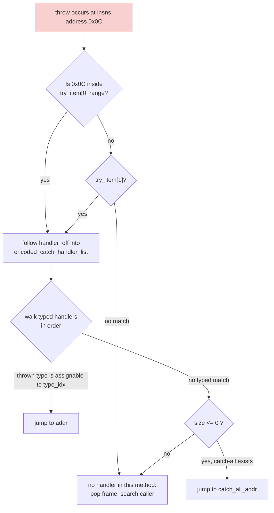

Follow that flow and one behaviour becomes obvious: **typed handlers are tested in the order they
appear in the list**, and the catch-all is only reached if none matched. That is exactly Java's
semantics, and it means the compiler must emit the `catch` clauses in source order. It also means a
patch that reorders handlers changes which one wins for a subtype — a subtle way to alter behaviour
without touching a single instruction.

> **🔍 Pentester's Note**
> Exception tables are how a lot of anti-tampering works, and how a lot of it is defeated. A common
> pattern is to wrap an integrity check in `try { check(); } catch (Throwable t) { exit(); }` so that
> even a Frida hook that throws is caught and treated as tampering. Reading the exception table tells
> you this before you waste time on a hook that will be swallowed. Conversely, the catch-all address
> is often the cleanest place to patch: redirect the catch-all to the success path and the check
> cannot fail.

### 3.18 `debug_info_item`

`debug_info_item` holds the line-number table and local variable names for a method. It is a stream
of a small state machine's opcodes, in the same spirit as DWARF's line number program.

| Order | Type | Field | Meaning |
|---|---|---|---|
| 1 | `uleb128` | `line_start` | Initial value of the `line` register. Never 0. |
| 2 | `uleb128` | `parameters_size` | Number of parameter names encoded. |
| 3 | `uleb128p1[parameters_size]` | `parameter_names` | Index into `string_ids` per parameter, or `−1` (encoded as byte `0x00`) for "no name". |
| 4 | `ubyte[]` | (bytecode) | The state machine program, terminated by `DBG_END_SEQUENCE` (`0x00`). |

The state machine maintains `address` (in code units) and `line`, and emits (address, line) pairs.

| Opcode | Name | Effect |
|---:|---|---|
| `0x00` | `DBG_END_SEQUENCE` | End of the sequence. |
| `0x01` | `DBG_ADVANCE_PC` | `uleb128` addr_diff; advance `address`, emit nothing. |
| `0x02` | `DBG_ADVANCE_LINE` | `sleb128` line_diff; advance `line`, emit nothing. |
| `0x03` | `DBG_START_LOCAL` | register, name (`uleb128p1`), type (`uleb128p1`); a local becomes live. |
| `0x04` | `DBG_START_LOCAL_EXTENDED` | as above plus a signature (`uleb128p1`) for generics. |
| `0x05` | `DBG_END_LOCAL` | register; the local goes out of scope. |
| `0x06` | `DBG_RESTART_LOCAL` | register; a previously ended local comes back into scope. |
| `0x07` | `DBG_SET_PROLOGUE_END` | marks the end of the method prologue for debuggers. |
| `0x08` | `DBG_SET_EPILOGUE_BEGIN` | marks the start of the epilogue. |
| `0x09` | `DBG_SET_FILE` | `uleb128p1` name index; the following entries come from a different source file. |
| `0x0A`–`0xFF` | special opcodes | Simultaneously advance address and line and emit a position entry. |

The special opcodes use the DWARF trick of packing two increments into one byte:

```text
  adjusted_opcode = opcode - DBG_FIRST_SPECIAL(0x0A)
  line   += DBG_LINE_BASE(-4) + (adjusted_opcode % DBG_LINE_RANGE(15))
  address += adjusted_opcode / DBG_LINE_RANGE(15)
  emit (address, line)
```

> **🔍 Pentester's Note**
> `debug_info_off` = 0 on every method is a strong signal that the app was built for release with
> debug information stripped, and it is why a crash in a production app gives you obfuscated frames
> with no line numbers. Conversely, a production app that *retains* full debug info is handing you
> original parameter names and local variable names for free. Check it first; it changes how much
> effort the rest of the analysis will take. `dexdump -d -l plain` shows the positions table when it
> is present.

### 3.19 Annotations on disk

Annotations are stored in a small hierarchy of structures hanging off
`class_def_item.annotations_off`.

**`annotations_directory_item` — 4-byte aligned:**

| Order | Type | Field | Meaning |
|---|---|---|---|
| 1 | `uint` | `class_annotations_off` | Offset of an `annotation_set_item` for the class itself, or 0. |
| 2 | `uint` | `fields_size` | Number of annotated fields. |
| 3 | `uint` | `annotated_methods_size` | Number of annotated methods. |
| 4 | `uint` | `annotated_parameters_size` | Number of methods with annotated parameters. |
| 5 | `field_annotation[fields_size]` | | each: `uint field_idx`, `uint annotations_off` |
| 6 | `method_annotation[annotated_methods_size]` | | each: `uint method_idx`, `uint annotations_off` |
| 7 | `parameter_annotation[annotated_parameters_size]` | | each: `uint method_idx`, `uint annotations_off` pointing at an `annotation_set_ref_list` |

**`annotation_set_item`** is a `uint size` followed by `size` `uint` offsets, each pointing at an
`annotation_item`. **`annotation_item`** is a single `ubyte visibility` followed by an
`encoded_annotation` (§3.15).

| `visibility` | Name | Meaning |
|---:|---|---|
| `0x00` | `VISIBILITY_BUILD` | Visible only at build time. Not retained at runtime. |
| `0x01` | `VISIBILITY_RUNTIME` | Visible to reflection at runtime. |
| `0x02` | `VISIBILITY_SYSTEM` | Visible to the runtime internals only. |

> **🔬 Under the Hood**
> Several things that look like language features are actually system annotations in the DEX.
> Generic type information survives erasure as a `dalvik.annotation.Signature` annotation whose value
> is an array of strings. Inner-class relationships are `dalvik.annotation.InnerClass` and
> `dalvik.annotation.EnclosingClass` / `EnclosingMethod`. A method's checked exceptions are
> `dalvik.annotation.Throws`. If a decompiler shows you generics in an app that was compiled with
> erasure, it read them out of these annotations. Strip them and JADX output gets noticeably worse —
> which some obfuscators do on purpose.

### 3.20 `call_site_id_item` and `method_handle_item`

These two tables arrived with DEX version `038` (Android 8.0) and exist to support `invokedynamic`
semantics — the mechanism behind Java lambdas, string concatenation in newer `javac`, and anything
built on `java.lang.invoke`.

> **📖 Definition — method handle**
> A **method handle** is a directly-executable, typed reference to a method or field. Unlike
> reflection, it is resolved once and then invoked with near-normal-call performance, and the
> runtime can verify its type signature statically.

> **📖 Definition — call site**
> A **call site** is a call whose target is decided the first time it executes, by running a
> **bootstrap method**. The bootstrap method receives a description of the call and returns a
> `CallSite` object holding the method handle that should actually be invoked. Thereafter the call
> site is linked and runs at full speed. This is how a Java lambda becomes an object without the
> compiler having to emit an anonymous inner class.

**`method_handle_item` — 8 bytes, in the `method_handles` table:**

| Offset | Size | Type | Field | Meaning |
|---:|---:|---|---|---|
| `+0x00` | 2 | `ushort` | `method_handle_type` | See the table below. |
| `+0x02` | 2 | `ushort` | (unused) | Must be 0. |
| `+0x04` | 2 | `ushort` | `field_or_method_id` | Index into `field_ids` for the accessor types, or into `method_ids` for the invoke types. |
| `+0x06` | 2 | `ushort` | (unused) | Must be 0. |

| Value | Name | Refers to |
|---:|---|---|
| `0x00` | `METHOD_HANDLE_TYPE_STATIC_PUT` | a `field_id` — writes a static field |
| `0x01` | `METHOD_HANDLE_TYPE_STATIC_GET` | a `field_id` — reads a static field |
| `0x02` | `METHOD_HANDLE_TYPE_INSTANCE_PUT` | a `field_id` — writes an instance field |
| `0x03` | `METHOD_HANDLE_TYPE_INSTANCE_GET` | a `field_id` — reads an instance field |
| `0x04` | `METHOD_HANDLE_TYPE_INVOKE_STATIC` | a `method_id` — invokes a static method |
| `0x05` | `METHOD_HANDLE_TYPE_INVOKE_INSTANCE` | a `method_id` — invokes an instance method |
| `0x06` | `METHOD_HANDLE_TYPE_INVOKE_CONSTRUCTOR` | a `method_id` — invokes a constructor |
| `0x07` | `METHOD_HANDLE_TYPE_INVOKE_DIRECT` | a `method_id` — invokes without virtual dispatch |
| `0x08` | `METHOD_HANDLE_TYPE_INVOKE_INTERFACE` | a `method_id` — invokes an interface method |

**`call_site_id_item` — 4 bytes, in the `call_site_ids` table:**

| Offset | Size | Type | Field | Meaning |
|---:|---:|---|---|---|
| `+0x00` | 4 | `uint` | `call_site_off` | Absolute file offset of a `call_site_item`. |

A **`call_site_item`** is an `encoded_array_item` whose first three elements are fixed by
specification: a `VALUE_METHOD_HANDLE` naming the bootstrap method, a `VALUE_STRING` giving the
method name to link, and a `VALUE_METHOD_TYPE` giving the expected signature. Everything after those
three is passed to the bootstrap method as extra arguments.

> **🔍 Pentester's Note**
> Lambdas compiled for API 26+ without desugaring become `invoke-custom` call sites, and JADX
> renders them as anonymous classes or as `(v0) -> { ... }` with the real body sitting in a
> synthetic method named something like `lambda$onCreate$0`. When you cannot find the code behind a
> click listener, look for those synthetic `lambda$` methods; they are ordinary methods with ordinary
> bytecode, and they hook exactly like any other. On builds where `d8` desugared instead, the same
> lambda becomes a real synthetic class implementing the interface — also perfectly hookable.

### 3.21 `hiddenapi_class_data_item`

Introduced with DEX `039` on Android 9, this structure carries the **hidden API restriction flags**
for each member of each class in a platform DEX.

| Order | Type | Field | Meaning |
|---|---|---|---|
| 1 | `uint` | `size` | Total size of this item in bytes. |
| 2 | `uint[class_defs_size]` | `offsets` | One offset per class def, relative to the start of this item, or 0 if the class has no flags. |
| 3 | `uleb128[]` | `flags` | Per-member restriction flags, in `class_data_item` member order. |

Note that this structure only appears in the **platform's** DEX files — the boot classpath — not in
your app's `classes.dex`. It is how the runtime knows that `android.os.SystemProperties.set` is
restricted while `android.os.Build.MODEL` is not. Hidden API enforcement itself is a runtime
behaviour and belongs to [Chapter 13 — ART](../13-ART/README.md); what the format chapter owes you is
the knowledge that the data has an on-disk representation you can read.

### 3.22 The `map_list`

The `map_list` is the file's table of contents. It appears at `header.map_off` and enumerates every
section in the file with its type, count and offset.

**`map_list` — 4-byte aligned:**

| Order | Type | Field | Meaning |
|---|---|---|---|
| 1 | `uint` | `size` | Number of `map_item` entries. |
| 2 | `map_item[size]` | `list` | The entries, sorted by ascending `offset`. |

**`map_item` — 12 bytes:**

| Offset | Size | Type | Field | Meaning |
|---:|---:|---|---|---|
| `+0x00` | 2 | `ushort` | `type` | A `TYPE_*` constant identifying what lives here. |
| `+0x02` | 2 | `ushort` | (unused) | Must be 0. |
| `+0x04` | 4 | `uint` | `size` | Number of items of this type. |
| `+0x08` | 4 | `uint` | `offset` | Absolute file offset of the first item of this type. |

Full table of `TYPE_*` codes:

| Code | Name | Item size (bytes) | Where it appears |
|---:|---|---:|---|
| `0x0000` | `TYPE_HEADER_ITEM` | 112 | exactly one, at offset 0 |
| `0x0001` | `TYPE_STRING_ID_ITEM` | 4 | the `string_ids` table |
| `0x0002` | `TYPE_TYPE_ID_ITEM` | 4 | the `type_ids` table |
| `0x0003` | `TYPE_PROTO_ID_ITEM` | 12 | the `proto_ids` table |
| `0x0004` | `TYPE_FIELD_ID_ITEM` | 8 | the `field_ids` table |
| `0x0005` | `TYPE_METHOD_ID_ITEM` | 8 | the `method_ids` table |
| `0x0006` | `TYPE_CLASS_DEF_ITEM` | 32 | the `class_defs` table |
| `0x0007` | `TYPE_CALL_SITE_ID_ITEM` | 4 | the `call_site_ids` table (DEX 038+) |
| `0x0008` | `TYPE_METHOD_HANDLE_ITEM` | 8 | the `method_handles` table (DEX 038+) |
| `0x1000` | `TYPE_MAP_LIST` | 4 + 12·N | exactly one — the map describing itself |
| `0x1001` | `TYPE_TYPE_LIST` | 4 + 2·N | data section |
| `0x1002` | `TYPE_ANNOTATION_SET_REF_LIST` | 4 + 4·N | data section |
| `0x1003` | `TYPE_ANNOTATION_SET_ITEM` | 4 + 4·N | data section |
| `0x2000` | `TYPE_CLASS_DATA_ITEM` | variable | data section |
| `0x2001` | `TYPE_CODE_ITEM` | variable | data section |
| `0x2002` | `TYPE_STRING_DATA_ITEM` | variable | data section |
| `0x2003` | `TYPE_DEBUG_INFO_ITEM` | variable | data section |
| `0x2004` | `TYPE_ANNOTATION_ITEM` | variable | data section |
| `0x2005` | `TYPE_ENCODED_ARRAY_ITEM` | variable | data section |
| `0x2006` | `TYPE_ANNOTATIONS_DIRECTORY_ITEM` | variable | data section |
| `0xF000` | `TYPE_HIDDENAPI_CLASS_DATA_ITEM` | variable | platform DEX only (DEX 039+) |

Notice the numbering scheme: `0x0000`–`0x0008` are the fixed-stride index tables in exactly the order
they appear in the file and in the header; `0x1000`-range codes are list-like structures; `0x2000`-
range codes are the variable-length data items. That grouping is a hint, not a rule, but it makes the
codes easy to remember.

The map must contain an entry for every section that is present, its entries must be sorted by
`offset`, and it must not contain duplicate types.

> **🧠 Mental Model**
> If the header is the book's spine label — title, edition, checksum — then the `map_list` is the
> table of contents at the front, listing every chapter with its page number and length. A parser can
> reconstruct the whole file from the map alone; indeed a robust parser should **cross-check** the
> header's offsets against the map's, because a mismatch between the two is not something `d8` ever
> produces.

> **🔍 Pentester's Note — the map is the tamper detector**
> This is the most practically useful paragraph in the section. Legitimate DEX files produced by `d8`
> have the property that **every byte of the file is accounted for by exactly one map entry**. Run
> down the map, add up `size × item_size` for the fixed-size types, walk the variable-size ones, and
> the covered ranges should tile the file with no gaps and no overlaps other than expected alignment
> padding.
>
> A large unaccounted region is a red flag with a short list of explanations: an encrypted payload
> parked inside the DEX by a packer, a second DEX appended to the first, a hidden configuration blob,
> or an overlay used to smuggle data past a scanner that only reads the map. Similarly, a `map_off`
> that points somewhere other than near the end of the file, or a map whose entries are not sorted by
> offset, means the file was not written by `d8`.

### 3.23 Access flags

`access_flags` appears on `class_def_item`, `encoded_field` and `encoded_method`. It is a bit mask,
and several bits mean different things depending on which structure carries them.

| Bit | Value | Class | Field | Method |
|---:|---:|---|---|---|
| 0 | `0x00001` | `ACC_PUBLIC` | `ACC_PUBLIC` | `ACC_PUBLIC` |
| 1 | `0x00002` | `ACC_PRIVATE` (nested only) | `ACC_PRIVATE` | `ACC_PRIVATE` |
| 2 | `0x00004` | `ACC_PROTECTED` (nested only) | `ACC_PROTECTED` | `ACC_PROTECTED` |
| 3 | `0x00008` | — | `ACC_STATIC` | `ACC_STATIC` |
| 4 | `0x00010` | `ACC_FINAL` | `ACC_FINAL` | `ACC_FINAL` |
| 5 | `0x00020` | — | — | `ACC_SYNCHRONIZED` |
| 6 | `0x00040` | — | `ACC_VOLATILE` | `ACC_BRIDGE` |
| 7 | `0x00080` | — | `ACC_TRANSIENT` | `ACC_VARARGS` |
| 8 | `0x00100` | — | — | `ACC_NATIVE` |
| 9 | `0x00200` | `ACC_INTERFACE` | — | — |
| 10 | `0x00400` | `ACC_ABSTRACT` | — | `ACC_ABSTRACT` |
| 11 | `0x00800` | — | — | `ACC_STRICT` (strictfp) |
| 12 | `0x01000` | `ACC_SYNTHETIC` | `ACC_SYNTHETIC` | `ACC_SYNTHETIC` |
| 13 | `0x02000` | `ACC_ANNOTATION` | — | — |
| 14 | `0x04000` | `ACC_ENUM` | `ACC_ENUM` | — |
| 16 | `0x10000` | — | — | `ACC_CONSTRUCTOR` |
| 17 | `0x20000` | — | — | `ACC_DECLARED_SYNCHRONIZED` |

Three of these are worth extra words.

**`ACC_SYNCHRONIZED` versus `ACC_DECLARED_SYNCHRONIZED`.** In DEX, the `0x20` bit on a method is
only meaningful for `native` methods, where the runtime performs the locking. For a normal Java
method declared `synchronized`, the compiler emits explicit `monitor-enter` and `monitor-exit`
instructions in the body and records the fact in the *separate* `ACC_DECLARED_SYNCHRONIZED` bit
(`0x20000`) purely so that reflection can report the modifier correctly. If you patch a method's
body and remove its `monitor-exit`, the lock is never released; the flag will not save you.

**`ACC_SYNTHETIC`.** Set on anything the compiler generated that the programmer did not write:
bridge methods, lambda bodies, accessors for outer-class private fields (`access$000`), the `values()`
and `valueOf()` methods on enums, and everything R8 creates. Filtering on this bit is how you separate
"code someone wrote" from "code the toolchain wrote" during triage.

**`ACC_CONSTRUCTOR`.** Set on `<init>` and `<clinit>`. Note that these also appear in the *direct*
methods list, never the virtual list — constructors are never virtually dispatched.

> **🔍 Pentester's Note**
> `ACC_NATIVE` on a method means the body is in a `.so` file, reached through JNI. There is no
> `code_item` — `code_off` is 0. When your DEX analysis hits a wall at a native method, the analysis
> continues in [Chapter 15 — Native Code](../15-Native-Code/README.md) and
> [Chapter 16 — JNI](../16-JNI/README.md). Counting `ACC_NATIVE` methods in a DEX is a fast way to
> gauge how much of an app's logic has been pushed into native code, which is a common
> anti-reverse-engineering measure.

### 3.24 The register machine

Everything up to here has described the file's *containers*. From here on we describe what is actually
inside `code_item.insns` — the instructions themselves.

> **📖 Definition — register machine**
> A **register machine** executes instructions that name their operands explicitly, as numbered slots
> in the current frame. `add-int v0, v1, v2` means "add the contents of v1 and v2, store in v0". A
> **stack machine** by contrast has instructions that implicitly consume and produce values on a
> stack: `iload_1; iload_2; iadd; istore_0`. The JVM is a stack machine. DEX is a register machine.

The comparison in full belongs to [Chapter 14 — Dalvik](../14-Dalvik/README.md). What matters here is
the consequence: a DEX instruction is typically wider than a JVM one but there are far fewer of them
per method, which means fewer dispatch cycles in the interpreter — the reason the design was chosen
for 2008-era ARM.

#### The frame

A method's frame is a flat array of 32-bit registers. Three `code_item` fields describe it:

| Field | Meaning |
|---|---|
| `registers_size` | Total registers in the frame |
| `ins_size` | How many of them, **at the top of the frame**, hold incoming arguments |
| `outs_size` | Size of the outgoing-argument area needed for the largest call this method makes |

The rule that governs everything: **incoming arguments occupy the *last* `ins_size` registers.**

```text
registers_size = 5, ins_size = 2      (an instance method taking one int)

  index:   v0    v1    v2    v3    v4
           |     |     |     |     |
           local local local |     |
                             p0    p1
                             this  the int argument

  first parameter register = registers_size - ins_size = 5 - 2 = 3
  so  p0 == v3,  p1 == v4
```

That is why Smali shows both `v` and `p` names for the same storage. `p0` is simply an alias for
`v(registers_size − ins_size)`. For an **instance** method, `p0` is always `this`; for a **static**
method, `p0` is the first declared parameter.

> **⚠️ Warning**
> This is the single most common source of error when hand-patching Smali. If you add a local variable
> you must increase `.registers`, and because parameters live at the *top*, increasing `.registers`
> **shifts every `p` alias to a different `v` number**. Smali's `.registers` directive handles the
> arithmetic for you; the `.locals` directive is usually safer because it counts only locals and lets
> the assembler compute the rest. Mixing the two in one method is a reliable way to produce a DEX that
> verifies but behaves wrongly.

#### Wide values

`long` and `double` occupy **two adjacent registers**, named by the lower number. `v3` holding a
`long` means the value lives in `v3` and `v4`, and `v4` must not be used for anything else. A method
taking `(long, int)` therefore consumes three parameter registers, not two.

```text
static void f(long a, int b)     registers_size=4, ins_size=3
    p0 == v1, p1 == v2   → the long 'a' occupies v1:v2
    p2 == v3             → the int  'b'
```

Miscounting wide pairs is the second most common Smali patching error.

#### The 16-register wall

Most instruction formats encode a register number in **4 bits**, so they can only address `v0`–`v15`.
Others use 8 bits (`v0`–`v255`) or 16 bits (`v0`–`v65535`). This is why the instruction set has so many
near-duplicate opcodes: `move`, `move/from16` and `move/16` do the same thing at three different
register widths.

> **🔍 Pentester's Note**
> When you insert code into a large method and the assembler complains it cannot encode a register,
> this is why: your new local landed above `v15` and the instruction you used only has a 4-bit field.
> The fix is either to use the `/from16` variant, or to `move/16` the value down into a low register
> first, operate, and move it back.

### 3.25 Instruction formats

Every DEX instruction has a **format identifier** such as `21c` or `35c`. The naming is systematic and
worth ten minutes of study, because once you can read the identifier you can decode any instruction
without a table.

> **📖 Definition — format identifier**
> A two-or-three character code `NAx` where:
> - **N** — the instruction's size in **16-bit code units** (1, 2, 3, 5…)
> - **A** — the number of registers the instruction addresses (`0`–`5`, or `r` for a range)
> - **x** — an optional letter naming what kind of extra operand follows

The letter suffixes:

| Suffix | Meaning |
|---|---|
| *(none)* | no extra operand beyond registers |
| `b` | immediate signed **b**yte |
| `c` | **c**onstant-pool index (string, type, field, method, call site, prototype) |
| `f` | inline **f**ield/method — used by quickened forms |
| `h` | immediate signed **h**at — the high bits of a 32/64-bit value, low bits zero |
| `i` | immediate signed **i**nt (32-bit) |
| `l` | immediate signed **l**ong (64-bit) |
| `m` | inline **m**ethod (quickened) |
| `n` | immediate signed **n**ibble (4-bit) |
| `s` | immediate signed **s**hort (16-bit) |
| `t` | branch **t**arget |
| `x` | no additional data |

Worked example, the one you will meet most often:

```text
const-string v0, "flag"          format 21c

  21c  →  2 code units (4 bytes)
       →  1 register addressed
       →  c: the operand is a constant-pool index

  on disk:   1A 00  0512
             ^^ ^^  ^^^^
             |  |   string_ids index 0x0512 (little-endian)
             |  register v0 (8-bit field)
             opcode 0x1A = const-string
```

Another, for method invocation:

```text
invoke-virtual {v1, v2}, Lcom/example/A;->f(I)V      format 35c

  35c  →  3 code units (6 bytes)
       →  5 registers MAX addressable (the '5' is a maximum, not a count)
       →  c: constant-pool index (a method_ids index)

  on disk:   6E 20  01A3  2100
             ^^ ^^  ^^^^  ^^^^
             |  |   |     register list, 4 bits each: v1, v2
             |  |   method_ids index 0x01A3
             |  A=2 (argument count) in the high nibble, G in the low
             opcode 0x6E = invoke-virtual
```

The `35c` register encoding is genuinely awkward: the argument count lives in the high nibble of byte
1, one register (`G`) lives in the low nibble of byte 1, and registers `C`, `D`, `E`, `F` are packed
two-per-byte in the final code unit. This is why `invoke-*/range` exists — with more than five
arguments, the `3rc` format takes a *first register* and a *count* instead, and requires the arguments
to sit in consecutive registers.

The formats you will actually meet:

| Format | Size | Shape | Typical instruction |
|---|---:|---|---|
| `10x` | 1 | opcode only | `nop`, `return-void` |
| `12x` | 1 | vA, vB (4-bit each) | `move v0, v1` |
| `11n` | 1 | vA, #+B (4-bit signed) | `const/4 v0, #1` |
| `11x` | 1 | vAA (8-bit) | `move-result v0`, `return v0`, `throw v0` |
| `10t` | 1 | +AA (8-bit branch) | `goto +5` |
| `20t` | 2 | +AAAA (16-bit branch) | `goto/16` |
| `21c` | 2 | vAA, index | `const-string`, `sget-object`, `new-instance`, `check-cast` |
| `21s` | 2 | vAA, #+BBBB | `const/16 v0, #1000` |
| `21h` | 2 | vAA, #+BBBB0000 | `const/high16 v0, #0x3f800000` |
| `21t` | 2 | vAA, +BBBB | `if-eqz v0, :label` |
| `22b` | 2 | vAA, vBB, #+CC | `add-int/lit8 v0, v1, #4` |
| `22c` | 2 | vA, vB, index | `iget v0, v1, Field`, `instance-of`, `new-array` |
| `22s` | 2 | vA, vB, #+CCCC | `add-int/lit16` |
| `22t` | 2 | vA, vB, +CCCC | `if-eq v0, v1, :label` |
| `22x` | 2 | vAA, vBBBB | `move/from16` |
| `23x` | 2 | vAA, vBB, vCC | `add-int v0, v1, v2`, `aget`, `aput`, `cmpl-float` |
| `30t` | 3 | +AAAAAAAA | `goto/32` |
| `31c` | 3 | vAA, index32 | `const-string/jumbo` |
| `31i` | 3 | vAA, #+BBBBBBBB | `const v0, #0x12345678` |
| `31t` | 3 | vAA, +BBBBBBBB | `packed-switch`, `fill-array-data` |
| `32x` | 3 | vAAAA, vBBBB | `move/16` |
| `35c` | 3 | {vC..vG}, index | `invoke-virtual`, `filled-new-array` |
| `3rc` | 3 | {vCCCC..}, index | `invoke-virtual/range` |
| `45cc` | 4 | {vC..vG}, meth, proto | `invoke-polymorphic` |
| `4rcc` | 4 | {vCCCC..}, meth, proto | `invoke-polymorphic/range` |
| `51l` | 5 | vAA, #+B (64-bit) | `const-wide v0, #0x...` |

### 3.26 The complete opcode set

Grouped by family. This is a reference to return to, not something to memorise in one pass — but the
*groupings* are worth internalising, because they let you read unfamiliar Smali by analogy.

#### Nop and moves — `0x00`–`0x1C` (partial)

| Opcode | Mnemonic | Notes |
|---:|---|---|
| `00` | `nop` | Also the first byte of the pseudo-instruction payloads (§3.27) |
| `01` `02` `03` | `move`, `move/from16`, `move/16` | 32-bit value between registers |
| `04` `05` `06` | `move-wide`, `move-wide/from16`, `move-wide/16` | 64-bit register pair |
| `07` `08` `09` | `move-object`, `move-object/from16`, `move-object/16` | object reference |
| `0A` | `move-result` | **Must immediately follow** an `invoke-*` returning 32-bit |
| `0B` | `move-result-wide` | after an invoke returning 64-bit |
| `0C` | `move-result-object` | after an invoke returning a reference |
| `0D` | `move-exception` | **Only valid as the first instruction of a catch handler** |

> **⚠️ Warning**
> `move-result*` is not a general instruction — the verifier requires it to directly follow the
> `invoke-*` (or `filled-new-array`) whose result it collects. Inserting *anything* between them,
> including a `nop` or a logging call, produces a DEX that fails verification. This bites people
> constantly when adding instrumentation to Smali. Put your inserted code **before** the invoke, or
> **after** the `move-result`.

#### Return — `0x0E`–`0x11`

| Opcode | Mnemonic |
|---:|---|
| `0E` | `return-void` |
| `0F` | `return vAA` |
| `10` | `return-wide vAA` |
| `11` | `return-object vAA` |

#### Constants — `0x12`–`0x1C`

| Opcode | Mnemonic | Loads |
|---:|---|---|
| `12` | `const/4 vA, #+B` | 4-bit signed, sign-extended |
| `13` | `const/16 vAA, #+BBBB` | 16-bit signed |
| `14` | `const vAA, #+BBBBBBBB` | full 32-bit |
| `15` | `const/high16 vAA, #+BBBB0000` | 16 bits into the **high** half |
| `16` | `const-wide/16` | 16-bit sign-extended to 64 |
| `17` | `const-wide/32` | 32-bit sign-extended to 64 |
| `18` | `const-wide vAA, #+B` | full 64-bit (format `51l`) |
| `19` | `const-wide/high16` | 16 bits into the **top** of a 64-bit value |
| `1A` | `const-string vAA, string@BBBB` | **the one you grep for** |
| `1B` | `const-string/jumbo vAA, string@BBBBBBBB` | 32-bit string index |
| `1C` | `const-class vAA, type@BBBB` | a `Class` object |

#### Monitors, casts and arrays — `0x1D`–`0x26`

| Opcode | Mnemonic | Notes |
|---:|---|---|
| `1D` `1E` | `monitor-enter`, `monitor-exit` | `synchronized` blocks |
| `1F` | `check-cast vAA, type@BBBB` | throws `ClassCastException` on failure |
| `20` | `instance-of vA, vB, type@CCCC` | result is 0 or 1 |
| `21` | `array-length vA, vB` | |
| `22` | `new-instance vAA, type@BBBB` | allocates but does **not** run `<init>` |
| `23` | `new-array vA, vB, type@CCCC` | |
| `24` `25` | `filled-new-array`, `filled-new-array/range` | array literal |
| `26` | `fill-array-data vAA, +BBBBBBBB` | branches to a payload (§3.27) |

> **🔬 Under the Hood**
> `new-instance` and the subsequent `invoke-direct {vX}, ...-><init>(...)V` are **two separate
> instructions**. Between them the register holds an *uninitialised* reference, and the verifier
> tracks this state precisely — you may not pass it anywhere, store it in a field, or return it. This
> is why decompiled code sometimes shows an odd-looking pattern, and why patching around object
> construction is delicate.

#### Throw and branches — `0x27`–`0x3D`

| Opcode | Mnemonic | Notes |
|---:|---|---|
| `27` | `throw vAA` | |
| `28` `29` `2A` | `goto`, `goto/16`, `goto/32` | 8/16/32-bit signed offsets |
| `2B` | `packed-switch vAA, +BBBBBBBB` | dense case values |
| `2C` | `sparse-switch vAA, +BBBBBBBB` | scattered case values |
| `2D`–`31` | `cmpl-float`, `cmpg-float`, `cmpl-double`, `cmpg-double`, `cmp-long` | produce −1, 0 or 1 |
| `32`–`37` | `if-eq`, `if-ne`, `if-lt`, `if-ge`, `if-gt`, `if-le` | two-register compare |
| `38`–`3D` | `if-eqz`, `if-nez`, `if-ltz`, `if-gez`, `if-gtz`, `if-lez` | compare against zero |

The `cmpl` / `cmpg` distinction is about NaN: `cmpl-*` returns −1 when either operand is NaN,
`cmpg-*` returns 1. Compilers choose whichever makes the following branch correct.

#### Array access — `0x44`–`0x51`

| Opcode range | Mnemonics |
|---|---|
| `44`–`4A` | `aget`, `aget-wide`, `aget-object`, `aget-boolean`, `aget-byte`, `aget-char`, `aget-short` |
| `4B`–`51` | `aput`, `aput-wide`, `aput-object`, `aput-boolean`, `aput-byte`, `aput-char`, `aput-short` |

All are format `23x`: `aget vAA, vBB, vCC` = `vAA = vBB[vCC]`.

#### Instance fields — `0x52`–`0x5F`

| Opcode range | Mnemonics |
|---|---|
| `52`–`58` | `iget`, `iget-wide`, `iget-object`, `iget-boolean`, `iget-byte`, `iget-char`, `iget-short` |
| `59`–`5F` | `iput`, `iput-wide`, `iput-object`, `iput-boolean`, `iput-byte`, `iput-char`, `iput-short` |

Format `22c`: `iget vA, vB, field@CCCC` = `vA = vB.field`.

#### Static fields — `0x60`–`0x6D`

| Opcode range | Mnemonics |
|---|---|
| `60`–`66` | `sget`, `sget-wide`, `sget-object`, `sget-boolean`, `sget-byte`, `sget-char`, `sget-short` |
| `67`–`6D` | `sput`, `sput-wide`, `sput-object`, `sput-boolean`, `sput-byte`, `sput-char`, `sput-short` |

Format `21c`: `sget-object vAA, field@BBBB`.

#### Invocation — `0x6E`–`0x78`, `0xFA`–`0xFD`

| Opcode | Mnemonic | Dispatch |
|---:|---|---|
| `6E` | `invoke-virtual` | vtable lookup on the receiver's class |
| `6F` | `invoke-super` | superclass implementation |
| `70` | `invoke-direct` | private methods and `<init>` — no virtual dispatch |
| `71` | `invoke-static` | no receiver |
| `72` | `invoke-interface` | interface method table |
| `74`–`78` | `invoke-*/range` | same five, with `3rc` encoding |
| `FA` `FB` | `invoke-polymorphic`, `/range` | `MethodHandle.invoke` (DEX 038+) |
| `FC` `FD` | `invoke-custom`, `/range` | call sites / lambdas (DEX 038+) |

> **🔍 Pentester's Note**
> The invoke kind tells you a great deal. `invoke-direct` on something that is not `<init>` means a
> **private** method. `invoke-static` means no `this`, so hooking it in Frida uses the class rather
> than an instance. And when you are searching for where a method is *called from*, remember the
> callee may be reached by `invoke-virtual` from a subclass reference or by `invoke-interface` through
> an interface — grep for the method name, not for one invoke kind.

#### Unary and binary operations — `0x7B`–`0xE2`

Rather than a hundred rows, learn the shape:

| Pattern | Meaning | Examples |
|---|---|---|
| `neg-*`, `not-*` | unary, format `12x` | `neg-int`, `not-long` |
| `*-to-*` | numeric conversion, format `12x` | `int-to-long`, `double-to-int`, `int-to-byte` |
| `<op>-<type>` | binary, three registers, format `23x` | `add-int`, `mul-long`, `xor-int`, `shl-long` |
| `<op>-<type>/2addr` | binary, two registers, dest = first source, format `12x` | `add-int/2addr` |
| `<op>-<type>/lit16` | binary with 16-bit literal, format `22s` | `add-int/lit16` |
| `<op>-<type>/lit8` | binary with 8-bit literal, format `22b` | `add-int/lit8`, `and-int/lit8` |

The operations are `add`, `sub`, `mul`, `div`, `rem`, `and`, `or`, `xor`, `shl`, `shr`, `ushr`; the
types are `int`, `long`, `float`, `double` (bitwise ops only on `int` and `long`).

The `/2addr` forms exist purely to save space, and they are why decompiled arithmetic sometimes looks
like it is mutating a variable in place when the source did not.

#### Unused and quickened

Opcodes `0x3E`–`0x43`, `0x73` and `0x79`–`0x7A` are **unused** and must not appear. The `0xE3`–`0xF9`
range historically held **quickened** opcodes (`iget-quick`, `invoke-virtual-quick`) used by the
Dalvik-era and early-ART optimisers.

> **⚠️ Warning**
> Quickened opcodes are **not valid standalone DEX** — they carry precomputed vtable indices and field
> offsets rather than symbolic references, so `baksmali` cannot render them without the accompanying
> metadata. If you extract DEX from an Android 8–10 device and the disassembler rejects instructions,
> you have hit quickening and need an unquickening step. The problem disappears from Android 11
> onwards. See [13-ART §3.5](../13-ART/README.md).

### 3.27 Pseudo-instruction payloads

Three instructions branch to a **payload** sitting elsewhere in `insns` rather than encoding their
data inline. All three payloads begin with the byte `0x00` — the `nop` opcode — followed by an
identifying byte, so that a naive linear disassembler walking the instruction stream skips them
harmlessly instead of misinterpreting them as code.

| Ident | Structure | Referenced by |
|---:|---|---|
| `0x0100` | `packed-switch-payload` | `packed-switch` |
| `0x0200` | `sparse-switch-payload` | `sparse-switch` |
| `0x0300` | `fill-array-data-payload` | `fill-array-data` |

**`packed-switch-payload`** — for consecutive case values:

| Order | Type | Field |
|---|---|---|
| 1 | `ushort` | ident = `0x0100` |
| 2 | `ushort` | `size` — number of cases |
| 3 | `int` | `first_key` — the lowest case value |
| 4 | `int[size]` | `targets` — branch offsets relative to the **switch instruction** |

**`sparse-switch-payload`** — for scattered case values:

| Order | Type | Field |
|---|---|---|
| 1 | `ushort` | ident = `0x0200` |
| 2 | `ushort` | `size` |
| 3 | `int[size]` | `keys` — **must be sorted ascending** |
| 4 | `int[size]` | `targets` |

**`fill-array-data-payload`** — a compiled array literal:

| Order | Type | Field |
|---|---|---|
| 1 | `ushort` | ident = `0x0300` |
| 2 | `ushort` | `element_width` — 1, 2, 4 or 8 |
| 3 | `uint` | `size` — number of elements |
| 4 | `ubyte[]` | `data` — padded to an even byte count |

> **🔍 Pentester's Note**
> `fill-array-data-payload` is where hardcoded key material usually lives. A developer writes
> `byte[] key = {0x2b, 0x7e, 0x15, ...}` and the compiler emits exactly this structure — a contiguous
> run of bytes in the data section that `strings` will not find because it is not text.
> `dexdump -d` renders the payload, and searching for `fill-array-data` in Smali finds every array
> literal in the app. It is one of the highest-yield greps for locating embedded keys. See
> [34-Cryptography](../34-Cryptography/README.md).

A worked switch:

```smali
    .method public static route(I)V
        packed-switch p0, :pswitch_data_0
        # default case falls through to here
        return-void

    :pswitch_1
        # case 0
        return-void
    :pswitch_2
        # case 1
        return-void

    :pswitch_data_0
    .packed-switch 0x0
        :pswitch_1
        :pswitch_2
    .end packed-switch
    .end method
```

Note that the `default` case is *fall-through*: `packed-switch` branches only when the value matches,
otherwise execution continues at the next instruction. That is why the default body appears
immediately after the switch, which reads oddly until you know the rule.

### 3.28 The 64K reference limit and multidex

A single DEX file's `method_ids`, `field_ids` and `type_ids` tables are indexed by **16-bit** fields in
several instruction formats. That caps each table at **65,536 entries**.

> **⚠️ Warning — the most misunderstood limit in Android**
> The limit is on **references**, not on methods you wrote. `method_ids` counts every distinct
> method *referenced* anywhere in the DEX — including every framework and library method your code
> calls. An app with 8,000 of its own methods can easily exceed 65,536 references through its
> dependencies alone. This is why the error reads `Cannot fit requested classes in a single dex file`
> and mentions a number far larger than the app's own method count.

The resolution is **multidex**: the build emits `classes.dex`, `classes2.dex`, `classes3.dex` and so
on, each with its own index tables.

| API level | Behaviour |
|---|---|
| ≤ 20 | Native multidex unsupported. Requires the `MultiDex` support library, which loads secondary DEX at startup — with a real startup cost |
| ≥ 21 | ART loads all `classes*.dex` natively; `multiDexEnabled true` is sufficient |

For a reverse engineer the practical consequences are:

- **Always process every `classes*.dex`.** `jadx` does this by default; a hand-rolled script may not.
  Missing `classes2.dex` is a real and embarrassing way to conclude an app does not contain a feature.
- **Index numbers are per-file.** `method@0x1234` in `classes.dex` and in `classes2.dex` are unrelated.
- Class placement across files is a build artefact with no semantic meaning; do not read anything into
  which DEX a class landed in.

```bash
# host — confirm you have them all
unzip -l app.apk | grep -E 'classes[0-9]*\.dex'
```

### 3.29 DEX verification

Before executing a class, ART verifies its bytecode. The verifier is a **data-flow analysis** that
simulates every path through each method, tracking the type held in every register at every
instruction.

What it proves:

| Check | Example of what it rejects |
|---|---|
| Type consistency | Using a register holding an `int` where an object reference is required |
| Register initialisation | Reading a register before anything wrote to it |
| Branch targets valid | A `goto` landing mid-instruction or outside `insns` |
| `move-result` placement | Not immediately following an invoke |
| Uninitialised references | Using a `new-instance` result before `<init>` ran |
| Wide-pair integrity | Reading `v3` as a `long` when only `v3` (not `v4`) was written |
| Return type match | `return-object` from a method declared to return `int` |
| Access rules | Calling a private method from another class |
| `structural` constraints | Duplicate fields, bad superclass, interface implementing a class |

Verification results are cached — that is exactly what the VDEX's verifier-dependency section records,
so the work is not repeated on every boot ([13-ART §3.4](../13-ART/README.md)).

> **⚠️ Warning — the crucial point for report writing**
> **The verifier is a correctness mechanism, not a sandbox.** It guarantees that managed code respects
> the runtime's own type model, which is what allows the compiler to omit checks and optimise
> aggressively. It says nothing whatever about what the app is *permitted* to do, and it is bypassed
> entirely the moment the app calls into its own native library through JNI. Never describe
> verification as a security boundary in a client report. See
> [11-Android-Runtime §5.1](../11-Android-Runtime/README.md).

Historically, **verifier bypasses** — crafted DEX that passes verification but violates type safety at
runtime — have been a genuine and high-value vulnerability class, because a type confusion in a
managed runtime gives a very powerful primitive. Describe such issues by class rather than inventing
identifiers; pull specifics from the relevant
[Android Security Bulletin](https://source.android.com/docs/security/bulletin).

---

## 4. Source Code Walkthrough (AOSP)

The DEX format has an unusual property among the things in this repository: it has a **normative
written specification** as well as an implementation. When the two appear to disagree, the
implementation is what runs on the device.

| Resource | Role |
|---|---|
| `dalvik/docs/dex-format.html` (historical) / [the online Dex format doc](https://source.android.com/docs/core/runtime/dex-format) | The normative specification. Read it beside this chapter |
| `libdexfile/dex/dex_file.h`, `dex_file.cc` | The runtime's parser and the authoritative structure definitions |
| `libdexfile/dex/dex_file_structs.h` | The C++ structs matching every table in §3 |
| `libdexfile/dex/dex_instruction.h`, `.cc` | The opcode enumeration and instruction decoding |
| `libdexfile/dex/dex_instruction_list.h` | **The single file that defines every opcode**, its format and its flags |
| `libdexfile/dex/leb128.h` | LEB128 encode/decode |
| `libdexfile/dex/modified_utf8.h`, `.cc` | MUTF-8 handling |
| `libdexfile/dex/dex_file_verifier.cc` | Structural validation of the container |
| `art/runtime/verifier/method_verifier.cc` | Bytecode data-flow verification (§3.29) |
| `art/dexdump/dexdump.cc` | The `dexdump` tool — a readable reference parser |
| `art/dexlayout/` | Rewrites DEX for locality; useful as a writer reference |
| `tools/dexter/` | A DEX instrumentation library, if you want to *modify* rather than read |
| `d8`/`r8` (`https://r8.googlesource.com/r8`) | The compiler that produces DEX |

> **🔬 Under the Hood**
> `dex_instruction_list.h` is worth opening once even if you never read AOSP otherwise. It is a single
> macro-expanded table listing every opcode with its mnemonic, format, index type and flags, and it is
> the ground truth behind every opcode table in every blog post — including the one in §3.26. If you
> ever need to answer "does this opcode exist on this Android version?", that file answers it in
> seconds.

### 4.1 Trace — how the runtime opens a DEX file

**Step 1 — mapping.** `DexFile::Open` (`libdexfile/dex/dex_file_loader.cc`) is handed a memory region:
from the APK via the ZIP reader, from a VDEX, or from a `ByteBuffer` supplied by
`InMemoryDexClassLoader`.

**Step 2 — header sanity.** The magic (`dex\n` plus version) is checked, then `header_size` and
`endian_tag`. A wrong endian tag is fatal; the runtime does not byte-swap.

**Step 3 — structural verification.** `DexFileVerifier::Verify` walks the `map_list` and every table,
checking that offsets are in bounds, sections do not overlap, arrays are sorted where the
specification requires, and sizes are self-consistent. **This is a container check, not a bytecode
check.**

**Step 4 — index table setup.** Pointers to `string_ids`, `type_ids`, `proto_ids`, `field_ids`,
`method_ids` and `class_defs` are computed from the header. Lookup is then O(1) arithmetic.

**Step 5 — lazy class loading.** Nothing else happens until a class is requested.
`ClassLinker::DefineClass` then reads the `class_def_item`, walks the `class_data_item`, and creates
`ArtMethod` and `ArtField` structures — the point at which [13-ART](../13-ART/README.md) takes over.

**Step 6 — bytecode verification.** Per class, on first use, `MethodVerifier` runs the data-flow
analysis of §3.29, unless a cached result in the VDEX says it already passed.

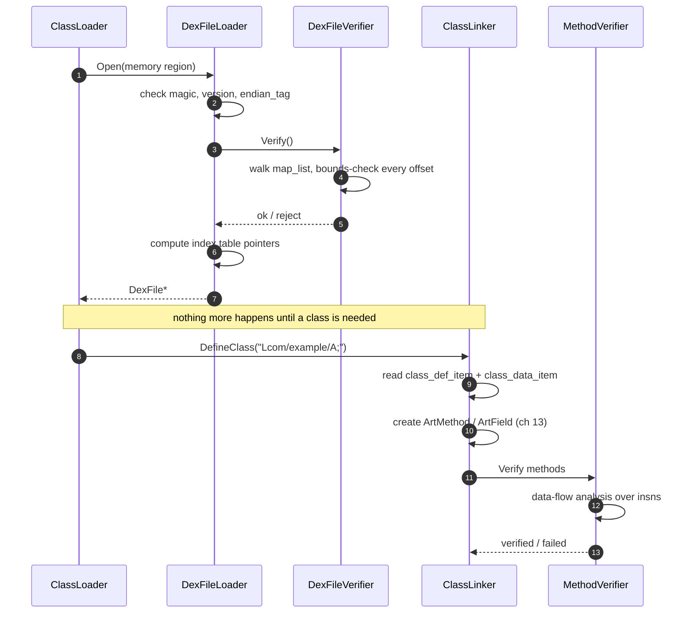

> **🔍 Pentester's Note**
> Steps 3 and 6 are **different verifications**, and conflating them causes real confusion. Step 3
> checks that the *file* is well-formed — a malformed container is rejected before any class loads.
> Step 6 checks that the *bytecode* is type-safe — and it happens lazily, per class, at first use. A
> DEX can therefore pass step 3, install perfectly, and only fail at step 6 when a particular class is
> touched. That is exactly the behaviour some anti-analysis DEX exploits: structurally valid, but
> containing a class that will never verify and is never actually loaded on a real run.

### 4.2 Reading the header by hand

```bash
# host — the first 112 bytes are the header
xxd -l 112 classes.dex
```

```text
00000000: 6465 780a 3033 3900 ....  magic "dex\n039\0"
00000008: <4 bytes>                 checksum (Adler-32)
0000000c: <20 bytes>                SHA-1 signature
00000020: <4> file_size   <4> header_size(0x70)  <4> endian_tag(0x12345678)
00000030: <4> link_size   <4> link_off  <4> map_off  <4> string_ids_size
...
```

Compare against the tool:

```bash
dexdump -f classes.dex | head -30
```

Every field printed there maps to a row in §3.2. Doing this once, by hand, is worth more than reading
the table three times.

---

## 5. Security Perspective

### 5.1 Why the format is a security topic at all

A file format becomes a security topic when **two parties parse it and can be made to disagree**.
DEX has several such parties: `d8` writes it, the platform verifier checks it, ART executes it, and
your tools (`jadx`, `apktool`, `baksmali`, MobSF) read it. Any divergence between the last group and
the first two is an evasion opportunity.

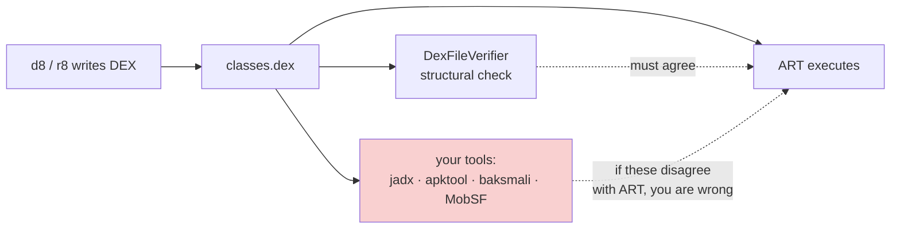

### 5.2 Vulnerability and evasion classes

#### Parser divergence (analysis evasion)

**How it works.** Craft a DEX that ART parses one way and analysis tools parse another. Levers include
unused header fields, a `map_list` that disagrees with the header, sections in an unexpected order,
`header_size` larger than 0x70, extra data in gaps not covered by the map, and string entries whose
declared `utf16_size` disagrees with the actual byte length.

**Impact.** A scanner reports a benign manifest and benign code; the device runs something else.
Automated store review is the primary target.

**Detection.** Run more than one parser and compare. Concretely:

```bash
# host — three independent readers over the same file
dexdump -f classes.dex        > /tmp/a.txt      # AOSP's own parser
baksmali list classes classes.dex | sort        > /tmp/b.txt
jadx --no-src -d /tmp/jx app.apk 2>&1 | tail -20
```

If the class lists disagree, that disagreement **is the finding**.

**Fix.** Not a developer-fixable issue — it is a property of the ecosystem. The defence is tooling
diversity and cross-checking, and treating disagreement as a signal rather than noise.

#### Map/header inconsistency and hidden payloads

**How it works.** §3.22's note is the key: in a legitimate `d8` output, every byte of the file is
accounted for by exactly one map entry. Packers and smugglers park data in the gaps.

**Detection.**

```bash
# host — sum the map's coverage and compare against the file size
python3 examples/dex_parser.py classes.dex --map-coverage
```

The parser in this chapter's `examples/` reports uncovered ranges explicitly.

**Impact.** Typically an encrypted secondary DEX or a configuration blob invisible to entry-based
scanners. Medium as a finding on its own; the payload it hides is what matters.

#### Checksum and signature stripping

**How it works.** After patching bytecode, the Adler-32 checksum and SHA-1 signature in the header no
longer match. Repackaging tools recompute them automatically — which is precisely why an app cannot
rely on those fields to detect tampering.

> **⚠️ Warning**
> The DEX header's checksum and signature are **integrity fields for corruption, not for security**.
> They are unkeyed, so anyone who modifies the file can recompute them. Real tamper detection lives in
> APK signing ([10-APK-Internals](../10-APK-Internals/README.md)), which is keyed. An app checking its
> own DEX checksum is checking nothing an attacker cannot trivially satisfy.

#### The 64K limit as an attack surface

Historically, apps that packed references close to the limit have hit edge cases in older tooling.
More usefully for a tester: multidex means **`classes2.dex` and beyond exist**, and any tool or
methodology that only reads `classes.dex` silently misses part of the app.

#### Verifier bypass

Crafted DEX that satisfies the data-flow verifier but violates type safety at execution, yielding type
confusion in the managed runtime. High-value, historically real, and version-specific. Describe by
class; cite the bulletin for specifics.

### 5.3 How developers misuse the format

| Misuse | Consequence |
|---|---|
| Hardcoding keys as array literals | Lands in `fill-array-data-payload`, findable with one grep |
| Believing the DEX checksum protects integrity | Unkeyed; trivially recomputed |
| Believing string encryption hides constants | The decryption routine is right there in the same DEX |
| Shipping full `debug_info_item` in release | Hands over original parameter and local variable names |
| Assuming `private` (an access flag) restricts access | Reflection ignores it; the flag is metadata |

### 5.4 How pentesters use the format

The practical uses, in the order they come up:

1. **String extraction.** `string_ids`/`string_data_item` is the single richest source of URLs,
   endpoints, keys and error messages.
2. **Method inventory.** Counting `ACC_NATIVE` methods gauges how much logic moved into native code.
3. **Array literal hunting.** `fill-array-data-payload` is where hardcoded keys live.
4. **Structural triage.** Map coverage, section ordering and header consistency identify packers.
5. **Patching.** Editing Smali, reassembling, recomputing the checksum — the modification workflow.
6. **Cross-checking tools.** Detecting deliberately malformed DEX.

### 5.5 How malware abuses it

Concealment, overwhelmingly. A stub `classes.dex` with an encrypted payload elsewhere; strings
encrypted so `string_ids` yields nothing; deliberately malformed structures to break `apktool`; and
data hidden in map-uncovered regions. See [40-Obfuscation](../40-Obfuscation/README.md) for the
unpacking methodology and [69-MalwareAnalysis](../69-MalwareAnalysis/README.md) for triage.

### 5.6 Forensic relevance

| Artefact | What it establishes |
|---|---|
| DEX SHA-1 signature field | A file identifier independent of the APK's hash |
| `debug_info_item` presence | Build configuration, and sometimes original source paths |
| String pool contents | Endpoints contacted, features present |
| Secondary DEX in app data | Dynamic loading occurred |

### 5.7 OWASP mapping

| Control area | Relevance |
|---|---|
| **MASVS-CODE** | Hardcoded secrets in the constant pool; debug info in release builds |
| **MASVS-CRYPTO** | Key material in array literals |
| **MASVS-RESILIENCE** | Obfuscation quality; anti-decompilation via malformed structures |

---

## 6. Reverse Engineering Perspective

### 6.1 The three views of the same bytes

| View | Tool | Use it when |
|---|---|---|
| Java | `jadx` | You want to understand *intent* quickly |
| Smali | `baksmali` / `apktool` | The decompiler failed, or you intend to **patch** |
| Raw bytes | `dexdump`, `xxd`, your own parser | Tools disagree, or the file is malformed |

The discipline: start at the top, drop down only when the level above fails you. And remember the
ordering of authority runs the other way — **the bytes are truth, Smali is a faithful rendering of
them, and Java is an interpretation.**

### 6.2 From bytes to Smali to Java

The same instruction at all three levels:

```text
bytes:   1A 00 12 05
```
```smali
smali:   const-string v0, "https://api.example.com"
```
```java
java:    String url = "https://api.example.com";
```

Decoding by hand: `0x1A` is `const-string`, format `21c`. Byte 1 (`0x00`) is the destination register
`v0`. Code unit 2 (`0x0512` little-endian) is an index into `string_ids`. Follow index `0x0512` to its
`string_data_item`, read the ULEB128 length, then the MUTF-8 bytes.

### 6.3 Reading a whole method

```smali
.method public static checkPin(Ljava/lang/String;)Z
    .registers 3               # 3 total; ins_size=1 so p0 == v2
    .param p0, "pin"

    const-string v0, "1337"    # 21c — load from string_ids

    invoke-virtual {p0, v0}, Ljava/lang/String;->equals(Ljava/lang/Object;)Z
    move-result v1             # MUST immediately follow the invoke

    return v1
.end method
```

Everything in §3.24–3.26 is visible here: the register/parameter aliasing, the `21c` constant load,
`35c` invocation, the mandatory `move-result` adjacency, and an `11x` return.

### 6.4 Patching, and the one rule that matters

To make `checkPin` always return true:

```smali
.method public static checkPin(Ljava/lang/String;)Z
    .registers 3
    const/4 v1, 0x1            # 11n — load literal 1
    return v1
.end method
```

Then reassemble, repackage, align and sign:

```bash
# host — the full cycle. Order matters.
apktool b work/ -o patched.apk
zipalign -p -f -v 4 patched.apk aligned.apk
apksigner sign --ks ~/.android/debug.keystore --ks-pass pass:android \
  --out signed.apk aligned.apk
apksigner verify -v signed.apk
adb install -r signed.apk
```

> **⚠️ Warning**
> `apktool` recomputes the DEX checksum and signature for you, and `apksigner` handles the APK
> signature. What neither does is fix a `.registers` count you got wrong, or a `move-result` you
> separated from its invoke. Those produce a DEX that fails **verification at class load**, which
> surfaces as the app crashing on the screen that uses the class — not at install. If a patched app
> installs but dies when you reach one feature, suspect the verifier and check
> `adb logcat -s art` for a rejection message naming the method.

### 6.5 Highest-yield greps

```bash
# host — against a decoded APK
# 1. Every hardcoded array literal — this is where keys live
grep -rn "fill-array-data" out/smali*/ | head -40

# 2. Native methods — how much logic left the DEX
grep -rn "\.method.*native" out/smali*/ | wc -l

# 3. Reflection
grep -rn "Ljava/lang/reflect/\|Class;->forName" out/smali*/

# 4. Dynamic loading
grep -rn "Ldalvik/system/.*ClassLoader" out/smali*/

# 5. Every string constant, ranked
grep -rhoE 'const-string [vp][0-9]+, ".*"' out/smali*/ \
  | sed 's/.*, "//;s/"$//' | sort | uniq -c | sort -rn | head -50
```

---

## 7. Dynamic Analysis

The DEX format is a static artefact, so this section is short by nature — but three runtime questions
are genuinely format questions.

### 7.1 Which DEX is actually running?

The APK's `classes.dex` is not necessarily what executes. On Android 8+ the bytecode the runtime uses
lives in the **VDEX**. Extract it from the device:

```bash
# adb shell as root
APK=$(pm path com.example.target | head -1 | sed 's/package://')
DIR=$(dirname $APK)
oatdump --vdex-file=$DIR/oat/arm64/base.vdex --export-dex-to=/data/local/tmp/dex_out
```

```bash
# host — compare against the APK's copy
adb pull /data/local/tmp/dex_out
unzip -o app.apk 'classes*.dex' -d /tmp/apkdex
sha256sum dex_out/*.dex /tmp/apkdex/*.dex
```

A mismatch means the installed bytecode differs from the APK — worth investigating. See
[13-ART §3.4](../13-ART/README.md).

### 7.2 Capturing dynamically loaded DEX

Code loaded through `InMemoryDexClassLoader` never exists as a file. Hook the constructor:

```bash
frida -U -f com.example.target -l ../13-ART/scripts/dump-loaded-dex.js
```

Then verify what you captured is really DEX:

```bash
xxd -l 8 dumped_0.dex     # expect 6465 780a  ("dex\n")
```

### 7.3 Resolving constant-pool indices at runtime

When an obfuscator has encrypted the string pool, the constants you want exist only after decryption.
Hook the decryption routine, or read the strings out of the heap:

```javascript
// Frida — dump every String instance currently live
Java.perform(function () {
    Java.choose("java.lang.String", {
        onMatch: function (s) {
            var v = s.toString();
            if (v.length > 8 && /^https?:\/\/|key|token|secret/i.test(v)) {
                console.log("[str] " + v);
            }
        },
        onComplete: function () {}
    });
});
```

### 7.4 Tool inventory

| Tool | Use |
|---|---|
| `dexdump -f` | Header fields |
| `dexdump -d` | Disassembly with resolved indices |
| `dexdump -l plain` | Include the positions/locals tables from `debug_info_item` |
| `baksmali`/`smali` | Disassemble and reassemble |
| `apktool` | Full decode/rebuild including resources |
| `jadx` | Java-level decompilation |
| `oatdump --export-dex-to` | Extract DEX from a device's VDEX |
| `010 Editor` + DEX template | Byte-level browsing with structure overlays |

---

## 8. Static Analysis

### 8.1 The triage pass

```bash
# host — DEX-level triage in one block
unzip -l app.apk | grep -E 'classes[0-9]*\.dex'      # multidex?
unzip -o app.apk 'classes*.dex' -d /tmp/dex >/dev/null

for f in /tmp/dex/classes*.dex; do
  echo "=== $f"
  xxd -l 8 "$f"                                       # magic + version
  dexdump -f "$f" | grep -E 'string_ids_size|type_ids_size|method_ids_size|class_defs_size'
done
```

The version byte tells you the minimum platform and which features may be present:

| Magic | Version | Introduced |
|---|---|---|
| `dex\n035\0` | 035 | The long-standing baseline |
| `dex\n037\0` | 037 | Android 7.0 — default/static interface methods |
| `dex\n038\0` | 038 | Android 8.0 — `invoke-polymorphic`, `invoke-custom`, method handles |
| `dex\n039\0` | 039 | Android 9 — hidden API data, `const-method-handle` |

### 8.2 What to extract, and why

| Table | Extract with | Yields |
|---|---|---|
| `string_ids` | `strings` / `dexdump` | URLs, endpoints, keys, error messages |
| `method_ids` | `dexdump -f` | The full call surface, including framework APIs used |
| `class_defs` | `baksmali list classes` | Package structure; obfuscation level |
| `fill-array-data` payloads | `grep` in Smali | **Hardcoded key material** |
| `access_flags` | `dexdump` | `native` method count; `synthetic` filtering |
| `debug_info_item` | `dexdump -l plain` | Original parameter and local names, if present |

### 8.3 Assessing obfuscation from the format alone

```bash
# host — class-name length distribution: heavy obfuscation makes them tiny
baksmali list classes classes.dex \
  | awk -F'/' '{print $NF}' | awk '{print length($0)}' \
  | sort -n | uniq -c
```

A distribution dominated by 1–2 character names means aggressive renaming. Then check what
*survived*: manifest-declared components, JNI method names, `Parcelable.CREATOR` fields, enum
`values()`/`valueOf()`, and anything with a keep rule. See
[41-ProGuard](../41-ProGuard/README.md).

### 8.4 The structural integrity check

```bash
# host — the packer detector from §3.22
python3 examples/dex_parser.py classes.dex --map-coverage --verify-header
```

Uncovered regions, unsorted map entries, a `header_size` other than 0x70, or a `map_off` that is not
near the end of the file all mean the file was not produced by `d8`.

---

## 9. Examples

Runnable material in [`examples/`](examples/).

### 9.1 Simple — decode one instruction by hand

Given `1A 05 3C 01`:

- `0x1A` = `const-string`, format `21c`
- byte 1 = `0x05` = destination register `v5`
- code unit 2 = `0x013C` = `string_ids` index 316

Result: `const-string v5, <string #316>`. Confirm with `dexdump -d`.

### 9.2 Intermediate — parse a header with Python

[`examples/dex_parser.py`](examples/dex_parser.py) implements §3.2 in about 200 lines, prints every
header field, lists the `map_list`, dumps strings, and — most usefully — reports **map coverage** so
you can spot hidden payloads.

```bash
python3 examples/dex_parser.py classes.dex
python3 examples/dex_parser.py classes.dex --strings | head -50
python3 examples/dex_parser.py classes.dex --map-coverage
```

### 9.3 Advanced — find hardcoded keys

[`examples/find_array_literals.py`](examples/find_array_literals.py) locates every
`fill-array-data-payload` in a DEX and prints its contents as hex, decimal and ASCII, flagging those
whose length matches a common key size (16, 24, 32 bytes).

### 9.4 Real application — patch a boolean return

[`examples/PatchDemo.smali`](examples/PatchDemo.smali) contains a before/after pair for the most
common patch you will ever make, annotated with the register-count and `move-result` pitfalls.

### 9.5 Enterprise — a repeatable DEX audit

[`scripts/dex-audit.sh`](scripts/dex-audit.sh) runs the §8.1 triage across every `classes*.dex` in an
APK, extracts the categories in §8.2, checks structural integrity, and emits a single report — the
form you want when auditing many builds of the same app.

---

## 10. Common Interview Questions

### Beginner

**Q: What is a DEX file?**
The container holding an Android app's compiled bytecode. Unlike Java's `.class` format, which stores
one class per file with its own constant pool, a single DEX holds many classes sharing one set of
index tables — which saves substantial space and I/O.

**Q: Why did Android not just use `.class` files?**
Per-class constant pools duplicate enormously across an application, and one file per class is poor
for a device reading from slow flash. DEX's shared index tables and single-file layout were a direct
response to the 2008 hardware envelope.

**Q: What is `classes2.dex`?**
Multidex. A single DEX can reference at most 65,536 methods, types or fields, so larger apps are split
across `classes.dex`, `classes2.dex` and so on. **Always process all of them.**

### Intermediate

**Q: The 64K limit — 64K of what, exactly?**
Of *references*, not of methods you wrote. `method_ids` counts every distinct method referenced
anywhere in that DEX, including every framework and library method called. An app with 8,000 of its
own methods can exceed the limit through dependencies alone.

**Q: What is the difference between `v0` and `p0` in Smali?**
They are the same storage under two names. Incoming arguments occupy the *last* `ins_size` registers
of the frame, so `p0` is an alias for `v(registers_size − ins_size)`. For an instance method `p0` is
`this`. This is why adding a local and bumping `.registers` shifts every `p` alias.

**Q: Why must `move-result` immediately follow an invoke?**
Because the verifier requires it. The result of an invocation lives in a distinguished result register
that is only valid for that one instruction slot. Inserting anything between — even a `nop` — produces
a DEX that fails verification. It is the most common mistake when adding instrumentation to Smali.

**Q: An app checks its own `classes.dex` checksum on startup. Is that meaningful tamper detection?**
No. The Adler-32 checksum and SHA-1 signature in the DEX header are unkeyed corruption checks. Anyone
who modifies the file recomputes them — `apktool` does it automatically. Real tamper detection has to
be keyed, which is what APK signing provides.

### Senior

**Q: Explain the `encoded_catch_handler` signed-size convention and why it exists.**
The `size` field is `sleb128`. Its absolute value is the count of typed handlers; its sign indicates
whether a catch-all follows. Positive means typed handlers only, with no `catch_all_addr` field
present at all. Zero or negative means a catch-all address follows as a `uleb128`. The convention uses
`≤ 0` rather than `< 0` specifically so that `size == 0` can mean "catch-all only" — which is what a
bare `finally` compiles to — without being indistinguishable from "no handlers", which would be a
useless entry.

**Q: How would you detect a DEX crafted to make analysis tools disagree with the runtime?**
Run multiple independent parsers and compare — `dexdump` (AOSP's own), `baksmali`, and `jadx` — and
treat any divergence in the class or method list as the finding. Then check structural invariants
directly: `header_size` must be 0x70, `endian_tag` must be `0x12345678`, `map_list` entries must be
sorted by offset with no duplicate types, and crucially **every byte of the file should be covered by
exactly one map entry**. Uncovered regions in a `d8`-produced file do not happen.

**Q: Where do hardcoded cryptographic keys end up in a DEX, and how do you find them?**
A `byte[]` literal compiles to a `fill-array-data-payload` — a contiguous run of raw bytes in the data
section, referenced by a `fill-array-data` instruction. Because it is not text, `strings` will not find
it. Grep Smali for `fill-array-data`, or parse the payloads directly and flag those of length 16, 24
or 32. It is one of the highest-yield techniques for locating embedded key material.

### Staff Engineer

**Q: Evaluate the DEX format's design decisions with twenty years of hindsight.**
Expect: the shared constant pool and single-file layout were the right call for the constraints and
still pay off. The register machine reduced dispatch overhead meaningfully on in-order ARM cores. The
16-bit index fields were the significant misjudgement — the 64K limit caused years of real developer
pain and a whole support library to work around it, and widening them would have cost little. The
unkeyed header checksum invites misuse as a security control. And the format's tolerance for
structural variation, while helpful for tool authors, is precisely what enables parser-divergence
evasion. A strong answer notes the tension: a format strict enough to eliminate divergence would also
have been harder to evolve.

**Q: You must build a DEX analysis pipeline for ten thousand APKs. What do you build on?**
Expect discussion of: parsing with a library rather than shelling out to `dexdump` per file; handling
multidex correctly; being resilient to deliberately malformed input rather than crashing; recording
*which parser produced which answer* so divergence is detectable; extracting structured data (strings,
method references, array literals, access flags) rather than text; and treating the map-coverage check
as a first-class signal. Also that ground truth for opcode semantics is
`libdexfile/dex/dex_instruction_list.h`, not a blog post.

### Principal Engineer

**Q: The DEX verifier is described as a security mechanism in a great deal of public writing. Assess
that claim.**
It is wrong, and the distinction matters. Verification proves that managed bytecode respects the
runtime's own type model — registers hold what instructions expect, branches land on instruction
boundaries, references are initialised before use. Its actual purpose is to let the compiler *omit
checks*: having proven type safety statically, generated code need not re-check dynamically. That is a
performance mechanism with a correctness proof attached.

It provides no containment. It says nothing about what the app may do with its permissions, it does
not constrain reflection, and it is bypassed entirely the moment execution enters JNI. Describing it
as a sandbox leads directly to real design errors — teams concluding that managed code is "safe" and
therefore skipping controls that actually matter. The genuine security value of verification is
narrower and worth stating precisely: it prevents a *malformed or malicious DEX* from corrupting the
runtime's own state, which protects ART from the app, not the user from the app.

---

## 11. Common Mistakes

### Developer mistakes

- Hardcoding keys as array literals, assuming that "not a string" means "not findable".
- Treating the DEX header checksum as tamper detection.
- Shipping release builds with full `debug_info_item`, handing over original names.
- Assuming `private` in the access flags restricts anything at runtime.
- Not testing on API ≤ 20 when relying on native multidex.

### Pentester mistakes

- **Processing only `classes.dex`** and concluding a feature is absent.
- Trusting one parser. When `apktool` and the platform disagree, the platform wins.
- Reporting the DEX checksum as a security control that was "bypassed".
- Analysing the APK's DEX when the installed VDEX differs.
- Forgetting that quickened opcodes on Android 8–10 need unquickening before `baksmali` will work.

### Reverse engineer mistakes

- **Inserting an instruction between `invoke` and `move-result`** — the classic patch failure.
- Miscounting registers after adding a local, shifting every `p` alias.
- Forgetting that `long` and `double` occupy **two** registers.
- Trying to encode `v16`+ in a 4-bit register field.
- Reading `try_item.handler_off` as a code-unit offset — it is in **bytes**, relative to the handler
  list, while `start_addr` and `insn_count` are in code units.
- Assuming the `default` branch of a switch is in the payload; it is fall-through.

---

## 12. Hands-on Labs

Full material in [`labs/`](labs/).

| Lab | Objective | Difficulty |
|---|---|---|
| [Lab 01 — Parse a DEX header by hand](labs/lab-01-parse-dex-by-hand.md) | Decode the header and `map_list` with `xxd` and arithmetic only, then verify against `dexdump` | Beginner |
| [Lab 02 — Decode instructions from raw bytes](labs/lab-02-decode-instructions.md) | Take a hex dump of a method's `insns` and produce the Smali by hand | Intermediate |
| [Lab 03 — Find the hidden key](labs/lab-03-find-the-hidden-key.md) | Locate hardcoded key material in `fill-array-data` payloads and use it to decrypt app data | Advanced |
| [Lab 04 — CTF: The lying DEX](labs/lab-04-ctf-the-lying-dex.md) | A DEX crafted so tools disagree with the runtime; determine what actually executes | Advanced |

---

## 13. Summary

### Key points

- A DEX file is **index tables plus a data section**. The tables are fixed-stride and referenced by
  index; everything variable-length lives in `data`.
- The `map_list` is the file's table of contents, and in a legitimate `d8` output **every byte is
  covered by exactly one entry**. Uncovered regions mean something is hidden there.
- LEB128 and MUTF-8 are used throughout; both differ subtly from the standards they resemble.
- Incoming arguments occupy the **last** `ins_size` registers, which is why `p0` aliases a `v` number
  that changes when you alter `.registers`.
- `long` and `double` occupy **two adjacent registers**.
- Instruction format identifiers (`21c`, `35c`, `3rc`) are systematic: size in code units, register
  count, operand kind. Learn the scheme rather than the table.
- `move-result` **must** immediately follow its invoke. This is the most common Smali patching error.
- `fill-array-data-payload` is where hardcoded keys live, and `strings` will not find them.
- The 64K limit is on **references**, not on methods you wrote.
- The header checksum and signature are **unkeyed** — corruption checks, not security.
- Verification proves type safety so the compiler can omit checks. It is **not** a sandbox.
- Quickened opcodes (Android 8–10) are not valid standalone DEX and need unquickening.

### Mind map

Full version in [`mindmap.md`](mindmap.md). Condensed:

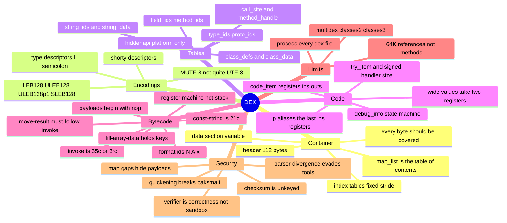

### Cheat sheet

Full version in [`cheatsheet.md`](cheatsheet.md). Condensed:

| Need | Command / fact |
|---|---|
| Header fields | `dexdump -f classes.dex` |
| Disassembly | `dexdump -d classes.dex` |
| With line numbers | `dexdump -d -l plain classes.dex` |
| Class list | `baksmali list classes classes.dex` |
| Magic bytes | `dex\n035\0` … `dex\n039\0` |
| Header size | always `0x70` |
| Endian tag | `0x12345678` |
| Find hardcoded keys | `grep -rn "fill-array-data" out/smali*/` |
| Count native methods | `grep -rn "\.method.*native" out/smali*/ \| wc -l` |
| All DEX files | `unzip -l app.apk \| grep -E 'classes[0-9]*\.dex'` |
| `p0` register number | `registers_size − ins_size` |
| Patch a boolean return | `const/4 v0, 0x1` then `return v0` |

### Quick revision

- What are the three parts of a DEX file, and which one does `map_list` describe?
- Why is `p0` not always `v0`?
- How many registers does a `long` occupy, and why does that matter when patching?
- Decode the format identifier `21c`.
- What must immediately follow an `invoke-*` that returns a value, and what happens if you break that?
- Where do hardcoded byte-array keys end up, and why does `strings` miss them?
- The 64K limit counts what, exactly?
- Is the DEX header checksum a security control? Justify the answer.
- Is the bytecode verifier a sandbox? Justify the answer.

---

## 14. References

### Normative specification

- Dalvik Executable format — https://source.android.com/docs/core/runtime/dex-format
- Dalvik bytecode reference — https://source.android.com/docs/core/runtime/dalvik-bytecode
- Instruction formats — https://source.android.com/docs/core/runtime/instruction-formats

### AOSP source

- `libdexfile/dex/dex_file.h`, `dex_file.cc` — the parser
- `libdexfile/dex/dex_file_structs.h` — every structure in §3
- `libdexfile/dex/dex_instruction_list.h` — **ground truth for every opcode**
- `libdexfile/dex/dex_instruction.h`, `.cc` — decoding
- `libdexfile/dex/leb128.h` — LEB128
- `libdexfile/dex/modified_utf8.h`, `.cc` — MUTF-8
- `libdexfile/dex/dex_file_verifier.cc` — structural validation
- `art/runtime/verifier/method_verifier.cc` — bytecode verification
- `art/dexdump/dexdump.cc` — a readable reference parser
- `art/dexlayout/` — DEX rewriting
- `tools/dexter/` — instrumentation library
- Android Code Search — https://cs.android.com/

### Tooling

- [smali/baksmali](https://github.com/google/smali) — the assembler and disassembler
- [apktool](https://apktool.org/) — full APK decode and rebuild
- [jadx](https://github.com/skylot/jadx) — Java decompilation
- [dex2jar](https://github.com/pxb1988/dex2jar) — DEX to JAR
- [R8/D8](https://r8.googlesource.com/r8) — the compiler that produces DEX
- [vdexExtractor](https://github.com/anestisb/vdexExtractor) — unquickening for Android 8–10
- 010 Editor DEX binary template — byte-level browsing with structure overlays

### OWASP

- MASVS-CODE and MASVS-RESILIENCE — https://mas.owasp.org/MASVS/
- MASTG — https://mas.owasp.org/MASTG/

### Related chapters

- [10-APK-Internals](../10-APK-Internals/README.md) — the container DEX ships inside, and real signing
- [11-Android-Runtime](../11-Android-Runtime/README.md) — the concept layer that consumes this format
- [13-ART](../13-ART/README.md) — OAT, VDEX, and the runtime implementation
- [14-Dalvik](../14-Dalvik/README.md) — the full Smali syntax reference and the stack/register comparison
- [15-Native-Code](../15-Native-Code/README.md) — where `ACC_NATIVE` methods lead
- [40-Obfuscation](../40-Obfuscation/README.md) — packers, string encryption, anti-decompilation
- [41-ProGuard](../41-ProGuard/README.md) — what survives renaming
- [56-JADX](../56-JADX/README.md) — decompiler limitations and when to drop to Smali
