# 12 — DEX Internals · Mind Map

One picture of the whole chapter. Read it outward from the centre: a DEX file is a header, a set of
fixed-stride index tables, a variable-length data section, and a map that should account for every
byte; the bytecode inside is a register machine whose instruction formats are systematic; and almost
everything a tester wants — strings, keys, native-method counts, hidden payloads — is recoverable by
reading those structures directly.

Every branch corresponds to a section of [the chapter README](README.md). Runtime behaviour (OAT,
VDEX, compilation, `ArtMethod`) belongs to [13-ART](../13-ART/mindmap.md); the full Smali syntax
reference belongs to [14-Dalvik](../14-Dalvik/README.md).

```mermaid
mindmap
  root((DEX))
    Why it exists
      class files waste space
        one file per class
        per class constant pool
        duplicated across the app
      2008 hardware envelope
        tens of megabytes of RAM
        slow flash storage
      shared index tables
        one string pool for everything
        one file for many classes
      register machine chosen
        fewer instructions per method
        fewer interpreter dispatches
        detail in chapter 14
    Container
      header_item 112 bytes
        magic dex newline version
        checksum adler32 unkeyed
        signature sha1 unkeyed
        file_size must match reality
        header_size always 0x70
        endian_tag 0x12345678
        offsets to every table
      Index tables fixed stride
        string_ids 4 bytes
        type_ids 4 bytes
        proto_ids 12 bytes
        field_ids 8 bytes
        method_ids 8 bytes
        class_defs 32 bytes
        call_site_ids 038 plus
        method_handles 038 plus
      Data section
        string_data_item
        type_list
        class_data_item
        code_item
        debug_info_item
        annotations
        encoded_array_item
      map_list
        the table of contents
        sorted by offset
        no duplicate types
        every byte should be covered
        gaps mean something is hidden
    Encodings
      ULEB128
        low seven bits data
        high bit means continue
      ULEB128p1
        value minus one
        zero byte means minus one
        means absent
      SLEB128
        sign extended
        used by catch handler size
      MUTF-8
        null is C0 80 not 00
        supplementary as surrogate pair
        four byte sequence is invalid
      Type descriptors
        V Z B S C I J F D
        L fully qualified semicolon
        bracket for arrays
      Shorty descriptors
        return type then params
        all references become L
    Code
      code_item
        registers_size
        ins_size arguments at the top
        outs_size for calls
        insns_size in code units
        tries and debug_info_off
      Register model
        first param equals registers minus ins
        p0 is an alias not a separate bank
        instance method p0 is this
        long and double take two registers
        four bit fields reach only v0 to v15
      try and catch
        table driven no instruction
        try_item start_addr in code units
        handler_off in bytes
        signed size convention
        positive means no catch all
        zero means catch all only
      debug_info_item
        state machine like DWARF
        line and address registers
        special opcodes pack both
        absent in stripped release builds
        present means free parameter names
    Bytecode
      Format identifiers
        N code units
        A registers
        x operand kind
        21c is const-string
        35c is invoke
        3rc is invoke range
      Instruction families
        moves and move-result
        returns
        constants
        monitors casts arrays
        throw and branches
        array access aget aput
        instance fields iget iput
        static fields sget sput
        invocation five kinds
        unary binary and 2addr forms
      Critical rules
        move-result must follow the invoke
        move-exception only starts a handler
        new-instance does not run init
        switch default is fall through
      Payloads start with nop
        packed switch payload
        sparse switch payload
        fill array data payload
        this is where keys live
      Quickened opcodes
        Android 8 to 10 only
        not valid standalone dex
        baksmali cannot parse
        needs unquickening
        gone from Android 11
    Limits
      64K references not methods
        counts everything referenced
        framework calls included
        16 bit index fields
      Multidex
        classes dex classes2 dex
        indices are per file
        always process all of them
        API 21 plus is native
    Verification
      Structural check of the container
        bounds and sorting
        happens before any class loads
      Bytecode data flow check
        per class on first use
        type consistency
        register initialisation
        branch targets
        move-result placement
        uninitialised references
        wide pair integrity
      Results cached in VDEX
      NOT a sandbox
        proves type safety
        so the compiler can omit checks
        bypassed by any JNI call
        never call it a boundary in a report
    Security perspective
      Parser divergence
        tools versus the runtime
        unused header fields
        map disagreeing with header
        oversized header_size
        run multiple parsers and compare
      Hidden payloads
        map coverage gaps
        appended second dex
        encrypted packer blob
      Unkeyed integrity fields
        checksum recomputed by apktool
        signature recomputed too
        real integrity is apk signing
      Hardcoded keys
        fill array data payload
        strings will not find them
        flag lengths 16 24 32
      Verifier bypass
        crafted dex passing verification
        type confusion primitive
        describe by class not by CVE
    Tradecraft
      Read the header by hand once
      Compare dexdump baksmali jadx
      Check map coverage first
      Grep fill-array-data for keys
      Count native methods
      Class name length shows obfuscation
      Extract from VDEX if installed differs
      Align before signing
      Logcat art for verification failures
```

