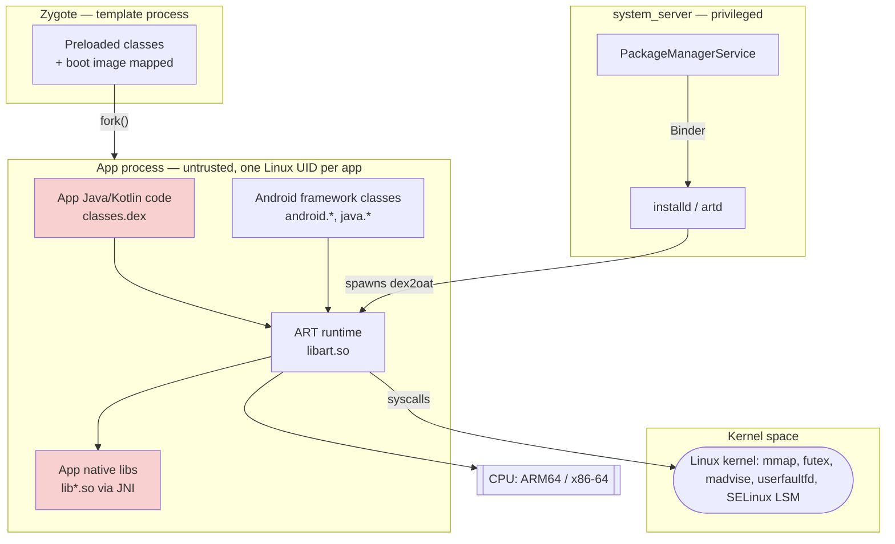
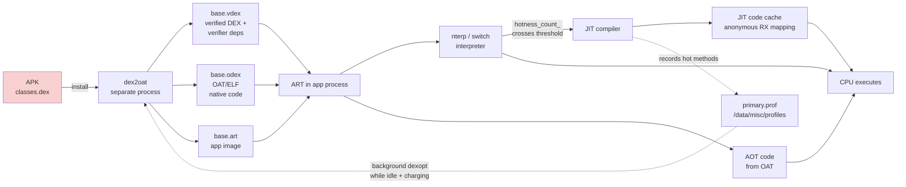
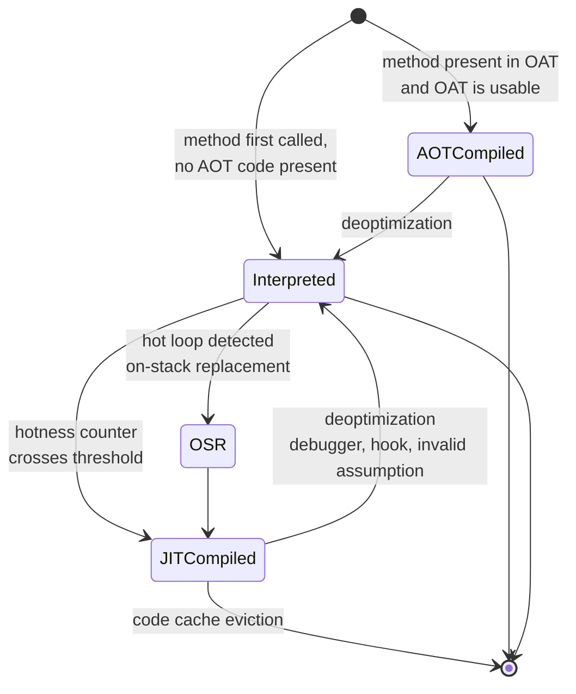
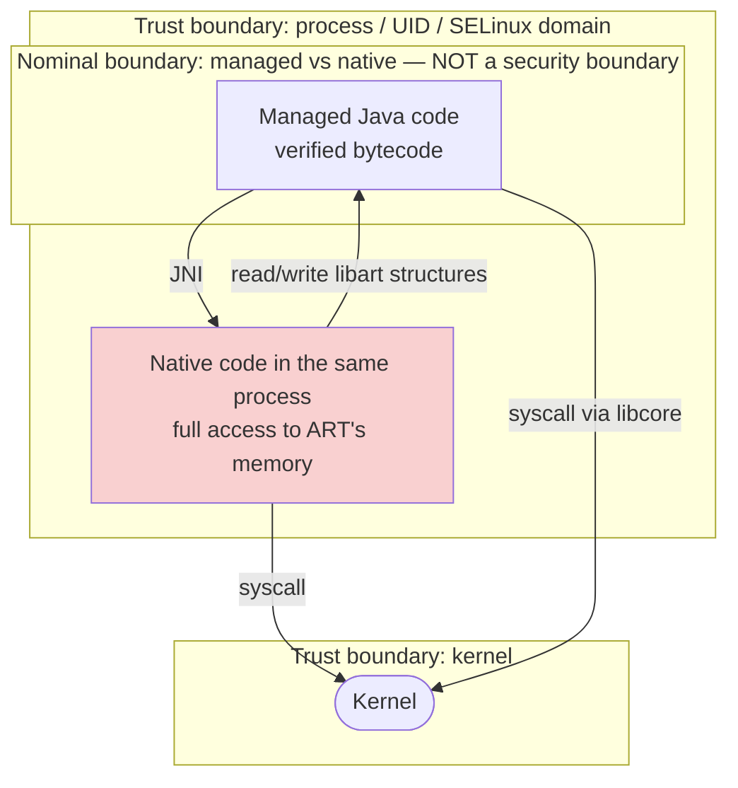
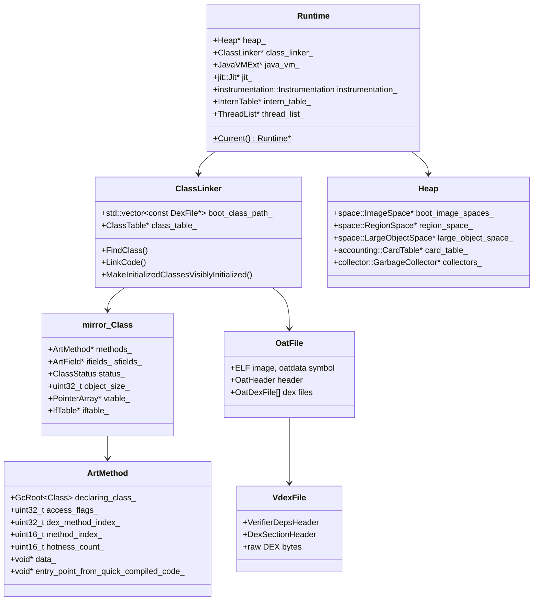
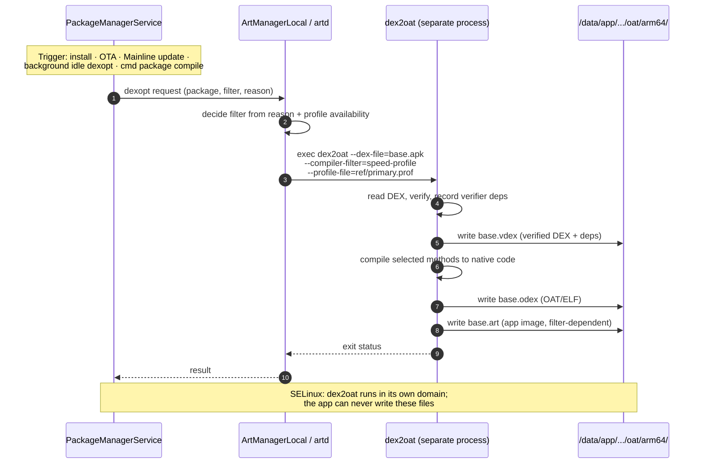
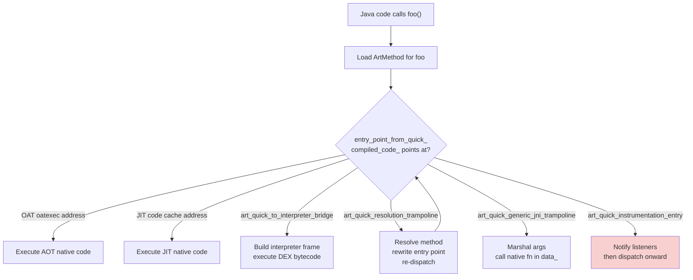
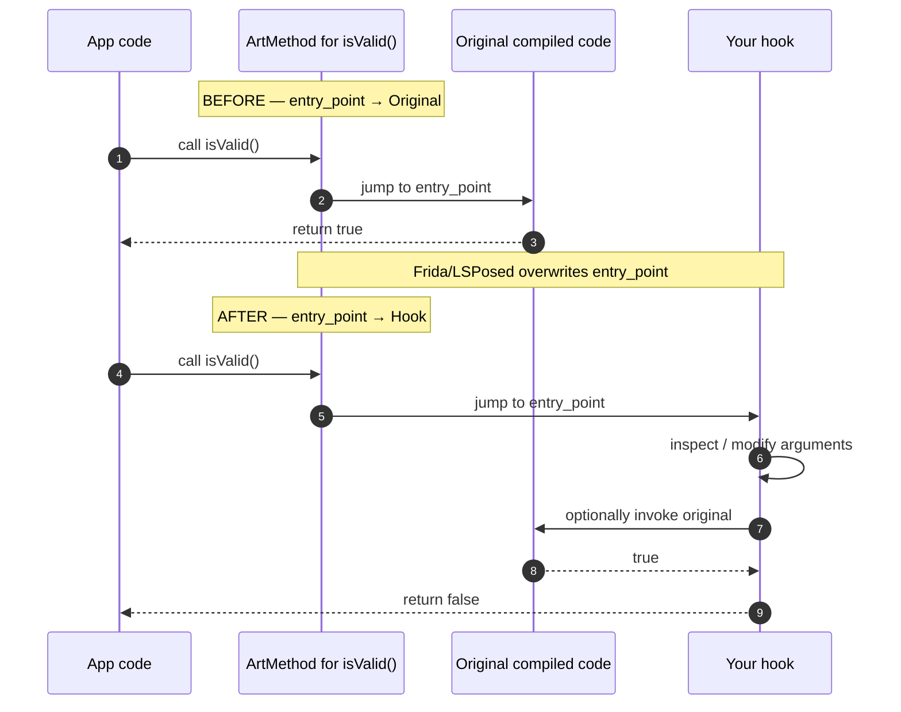
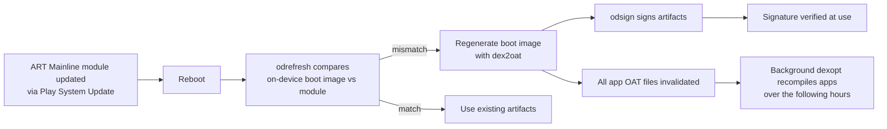
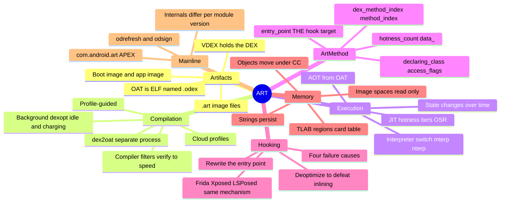

# 13 — ART (Android Runtime)

> After this chapter you will be able to explain, at the level of individual C++ structure fields, how
> a Java method call in an Android app reaches machine code — and therefore exactly where Frida,
> Xposed and LSPosed cut into that path to make a method do something else. You will also be able to
> read an OAT file's header, dump a VDEX, force a package to recompile at any compiler filter, read
> and reset a profile, and prove from a live process which of the three execution modes a given method
> is in right now.

**Prerequisites:** [01 Computer Science Basics](../01-Computer-Science-Basics/README.md) ·
[04 Java](../04-Java/README.md) · [09 Android App Internals](../09-Android-App-Internals/README.md) ·
[11 Android Runtime](../11-Android-Runtime/README.md) · [12 DEX Internals](../12-DEX-Internals/README.md)

**Applies to:** Android 5.0 (API 21) through Android 16 (API 36). ART is the only runtime from API 21
onward. Where a structure or file format changed between releases, the text states the version it
describes. Everything unversioned in this chapter is written against **Android 13–16 (API 33–36)**.

**Scope boundary.** Three neighbouring chapters own the adjacent territory, and this chapter does not
repeat them:

| Chapter | Owns | This chapter assumes you already read it |
|---|---|---|
| [11 — Android Runtime](../11-Android-Runtime/README.md) | The *concept* layer: what a managed runtime is, why Android needed one, class loading as an idea, JIT/AOT as ideas, Zygote, the ClassLoader hierarchy, hidden API enforcement | Yes |
| [12 — DEX Internals](../12-DEX-Internals/README.md) | The *DEX byte format*: header, index tables, `code_item`, opcodes, LEB128, checksum repair | Yes |
| [14 — Dalvik](../14-Dalvik/README.md) | The *historical* Dalvik VM, and the full **Smali syntax** reference | Read after this one |

This chapter is the **ART implementation**: the actual files ART writes to disk, the actual C++
structures it holds in memory, the actual decisions it makes per method, and the actual bytes that
every Java hooking framework overwrites.

---

## Table of Contents

- [1. Introduction](#1-introduction)
  - [1.1 The problem ART exists to solve](#11-the-problem-art-exists-to-solve)
  - [1.2 What ART actually chose](#12-what-art-actually-chose)
  - [1.3 What "compiled" means here, concretely](#13-what-compiled-means-here-concretely)
  - [1.4 Why a chapter this long](#14-why-a-chapter-this-long)
- [2. High-Level Architecture](#2-high-level-architecture)
  - [2.1 Where ART sits in the system](#21-where-art-sits-in-the-system)
  - [2.2 The compilation and execution pipeline](#22-the-compilation-and-execution-pipeline)
  - [2.3 On-disk layout](#23-on-disk-layout)
  - [2.4 The three execution modes, compared](#24-the-three-execution-modes-compared)
  - [2.5 Trust boundaries around ART](#25-trust-boundaries-around-art)
  - [2.6 The object graph inside libart](#26-the-object-graph-inside-libart)
- [3. Deep Internal Working](#3-deep-internal-working)
  - [3.1 ODEX — the historical artifact and the name that survived](#31-odex--the-historical-artifact-and-the-name-that-survived)
  - [3.2 The OAT file format](#32-the-oat-file-format)
  - [3.3 OatDexFile, OatClass and class status](#33-oatdexfile-oatclass-and-class-status)
  - [3.4 VDEX — verified DEX and verifier dependencies](#34-vdex--verified-dex-and-verifier-dependencies)
  - [3.5 Quickening, and why it disappeared](#35-quickening-and-why-it-disappeared)
  - [3.6 ART image files: boot.art, app images, image spaces](#36-art-image-files-bootart-app-images-image-spaces)
  - [3.7 The boot class path and how it is built](#37-the-boot-class-path-and-how-it-is-built)
  - [3.8 dex2oat: when it runs and what it does](#38-dex2oat-when-it-runs-and-what-it-does)
  - [3.9 The compiler filter table](#39-the-compiler-filter-table)
  - [3.10 Forcing compilation with `cmd package compile`](#310-forcing-compilation-with-cmd-package-compile)
  - [3.11 Profile-guided compilation and the profile files](#311-profile-guided-compilation-and-the-profile-files)
  - [3.12 Cloud Profiles](#312-cloud-profiles)
  - [3.13 The interpreter: switch, mterp, nterp](#313-the-interpreter-switch-mterp-nterp)
  - [3.14 The JIT: tiers, hotness counters, code cache, OSR](#314-the-jit-tiers-hotness-counters-code-cache-osr)
  - [3.15 ArtMethod — the most important structure in Android security](#315-artmethod--the-most-important-structure-in-android-security)
  - [3.16 Entry points and the trampolines they point at](#316-entry-points-and-the-trampolines-they-point-at)
  - [3.17 Method entrypoint patching: the mechanism behind ALL Java hooking](#317-method-entrypoint-patching-the-mechanism-behind-all-java-hooking)
  - [3.18 ArtField, mirror objects and the object header](#318-artfield-mirror-objects-and-the-object-header)
  - [3.19 Dispatch: direct, virtual, interface, IMT](#319-dispatch-direct-virtual-interface-imt)
  - [3.20 Deoptimization and instrumentation](#320-deoptimization-and-instrumentation)
  - [3.21 Garbage collection in ART](#321-garbage-collection-in-art)
  - [3.22 Reference types: strong, soft, weak, phantom, finalizer](#322-reference-types-strong-soft-weak-phantom-finalizer)
  - [3.23 JNI in ART: indirect reference tables](#323-jni-in-art-indirect-reference-tables)
  - [3.24 JNI check mode and the errors it catches](#324-jni-check-mode-and-the-errors-it-catches)
  - [3.25 Runtime flags and `dalvik.vm.*` properties](#325-runtime-flags-and-dalvikvm-properties)
  - [3.26 The ART Mainline module, odrefresh and odsign](#326-the-art-mainline-module-odrefresh-and-odsign)
- [4. Source Code Walkthrough (AOSP)](#4-source-code-walkthrough-aosp)
- [5. Security Perspective](#5-security-perspective)
- [6. Reverse Engineering Perspective](#6-reverse-engineering-perspective)
- [7. Dynamic Analysis](#7-dynamic-analysis)
- [8. Static Analysis](#8-static-analysis)
- [9. Examples](#9-examples)
- [10. Common Interview Questions](#10-common-interview-questions)
- [11. Common Mistakes](#11-common-mistakes)
- [12. Hands-on Labs](#12-hands-on-labs)
- [13. Summary](#13-summary)
- [14. References](#14-references)

---

## 1. Introduction

### 1.1 The problem ART exists to solve

Imagine you have written a recipe in English and you want a French chef to cook it. You have three
options, and each of them is a real strategy that real runtimes use.

The first option is to stand next to the chef and translate each line out loud as he reaches it. You
start instantly — no preparation at all — but you are doing translation work on every single line,
and if the chef repeats a step forty times you translate it forty times. This is **interpretation**.

The second option is to translate lines on the fly, but keep notes: the first time you translate a
step you write the French version on a card, and if the chef repeats that step you hand him the card
instead of translating again. You still start instantly, you pay translation cost only for steps that
actually get repeated, and you spend memory on the cards. This is **Just-In-Time compilation**,
usually shortened to JIT.

The third option is to translate the entire recipe into French the night before, print it, and hand
the chef a finished French cookbook. Cooking starts at full speed with zero translation cost, but
somebody had to spend a long evening translating, and the printed book takes up shelf space even for
the recipes the chef never cooks. This is **Ahead-Of-Time compilation**, or AOT.

> **Definition — runtime.** A *runtime* is the body of code that is present in a process to make a
> program's code actually run: it loads the program's code, allocates and frees its memory, resolves
> the names of things the code refers to, and either interprets the code or arranges for compiled
> machine code to be executed. It is not the operating system and it is not the application; it sits
> between them.

> **Definition — ART.** *ART*, the Android Runtime, is the runtime that executes the managed
> (Java/Kotlin) code of every Android application from Android 5.0 onward. It replaced
> [Dalvik](../14-Dalvik/README.md). It is implemented mostly in C++ and lives in the AOSP source tree
> under `art/`. Since Android 12 it ships as an updatable Mainline module named `com.android.art`.

The reason ART matters to a security researcher is blunt and practical: **ART is the machine that
decides which code runs when an app calls a method.** Every Java-level hook you will ever write —
every `Java.use(...).method.implementation = ...` in Frida, every Xposed `beforeHookedMethod`, every
LSPosed module — works by reaching into an ART data structure and changing that decision. If you
understand ART, hooking stops being magic and becomes a two-line explanation. If you do not, you will
be the person who says "the hook didn't take" and has no next step.

### 1.2 What ART actually chose

Android did not pick one of the three translation strategies. It picked all three, and it picks
between them *per method, at runtime, based on measured evidence*.

- When an app is installed, Android may compile some or all of its code ahead of time.
- When the app runs, methods that were not compiled ahead of time start out **interpreted**.
- A counter watches how often each interpreted method runs. When a method gets hot, the **JIT**
  compiles it and later calls go to the compiled version.
- The runtime writes down which methods got hot into a **profile** file.
- Later, while the phone is idle and charging, a background job re-compiles the app ahead of time
  **using that profile**, so that next time those specific methods are already native code.

That last loop — measure at runtime, compile offline using the measurements — is called
**profile-guided compilation**, and it is the single most important design idea in modern ART. It
also has a consequence you will feel on every engagement: **two devices running the same APK can be
executing genuinely different code**, one interpreting a method that the other runs as compiled ARM64.
A hook that lands on one device may behave differently on the other. Section 5 explains why.

### 1.3 What "compiled" means here, concretely

When Android says an app is compiled, it does not mean a `.exe` appeared. It means a file appeared
next to the APK — an **OAT file** — that is an ELF shared object containing native ARM64 (or x86-64)
instructions for some of the app's methods, plus references to the app's DEX and a great deal of
bookkeeping.

> **Mental Model.** Think of the APK as a book in a language the CPU cannot read, and the OAT file
> as a translated edition kept in the same drawer. The runtime always keeps the original book
> (because it needs the original for reflection, for debugging, and for methods that were never
> translated), and consults the translation when one exists for the page it is on.

Three files matter and you will meet all three on disk:

| File | Extension on disk | What it is, in one sentence |
|---|---|---|
| OAT | `.odex` (yes, really) | An ELF shared object containing compiled native code for the app's methods plus metadata describing every class and method. |
| VDEX | `.vdex` | The app's DEX bytecode after verification, plus a record of what the verifier assumed about other classes. |
| ART image | `.art` | A pre-built, memory-mappable snapshot of live runtime objects, `ArtMethod`s, `ArtField`s and class data. |

The confusing part — and it confuses everybody once — is that **the OAT file on disk is named
`base.odex`** even though ODEX was the Dalvik-era format. The name survived; the contents did not.
Section 3 pulls all three apart field by field.

### 1.4 Why a chapter this long

You can learn to type `frida -U -f com.target -l hook.js` in five minutes. This chapter exists for
the day that command prints `Failed to attach` or the hook silently does nothing, and you need to
answer questions like:

- Is this method compiled or interpreted right now, and does that change whether my hook works?
- The app calls a method through an interface; where does dispatch actually go?
- My hook works on a fresh install and breaks after the phone sits overnight. Why?
- Why does the object address I printed change between two Frida calls?
- The target is Android 14 with an updated ART Mainline module. Which of my assumptions just expired?
- The app deleted its own OAT file at startup and now every method is interpreted. Why would it do
  that, and what does it break for me?

Every one of those is an ART question, and every one of them has a precise answer.

---

## 2. High-Level Architecture

### 2.1 Where ART sits in the system



Read this diagram from the middle outward. The box labelled `libart.so` is ART. It is a native shared
library loaded into **every** app process, and also into `system_server`, and also into the Zygote
process from which both are forked. The app's own DEX code (coloured as attacker-controlled, because
on an engagement it is exactly that) is *data* to ART, not code that ART trusts. The app's native
libraries, loaded through [JNI](../16-JNI/README.md), are also coloured as untrusted because once
native code is running, ART's guarantees about memory safety no longer hold — a point Section 5
returns to at length.

`PackageManagerService` in `system_server` is what decides when compilation happens. On older
releases it called into `installd`; on Android 12 and later much of that work moved into the ART
module's own daemon, `artd`, driven by the `ArtManagerLocal` API in
`frameworks/base/services/core/java/com/android/server/pm/dex/` and the ART service under
`art/libartservice/`. Either way the compiler, `dex2oat`, runs as a **separate short-lived process**,
never inside the app.

### 2.2 The compilation and execution pipeline



This is the loop described in Section 1.2, drawn out. Notice the dotted feedback edge at the bottom:
the profile written during execution feeds back into the compiler for a *later* compilation. That
edge is why an app's on-disk compiled state changes over the days after installation without anyone
touching the APK, and it is the mechanism behind the "my hook worked yesterday" class of confusion.

Note also that there are **three** paths into the box marked "CPU executes". A given method can be
running as interpreted bytecode, as JIT-compiled code in an anonymous memory mapping, or as AOT code
mapped from the OAT file. Different methods in the same class can be in different states at the same
instant, and the same method can change state while you are looking at it.

### 2.3 On-disk layout

```text
/data/app/~~<random>/<package>-<random>/
├── base.apk                     ← the APK itself (contains classes.dex, classes2.dex, ...)
├── lib/arm64/*.so               ← extracted native libraries (if not uncompressed in the APK)
├── split_config.arm64_v8a.apk   ← split APKs, if an App Bundle
└── oat/
    └── arm64/                   ← one directory per instruction set (ISA)
        ├── base.odex            ← the OAT file: ELF, contains compiled code
        ├── base.vdex            ← verified DEX + verifier dependencies
        └── base.art             ← app image (only for some compiler filters)

/data/dalvik-cache/arm64/        ← legacy location; boot artifacts and some system app artifacts
        ├── system@framework@boot.art
        ├── system@framework@boot.oat
        └── system@framework@boot.vdex

/data/misc/apexdata/com.android.art/dalvik-cache/arm64/
        ├── boot.art  boot.oat  boot.vdex               ← primary boot image (ART module)
        └── boot-framework.art  boot-framework.oat ...  ← boot image extension
        (generated on device by odrefresh from Android 12 onward)

/apex/com.android.art/           ← the ART Mainline module (Android 12+)
        ├── bin/dex2oat64, bin/dex2oat32
        ├── bin/oatdump, bin/profman, bin/dexdump, bin/dexlist
        ├── lib64/libart.so, libartbase.so, libdexfile.so, libprofile.so
        └── javalib/core-oj.jar, core-libart.jar, okhttp.jar, bouncycastle.jar, ...

/data/misc/profiles/
        ├── cur/0/<package>/primary.prof   ← profile being written right now (per user)
        └── ref/<package>/primary.prof     ← reference profile, input to dexopt

/data/misc/profman/                        ← output of `cmd package snapshot-profile`
```

Every path above is one you will actually `ls` during an engagement. Several deserve immediate
comment. The `~~<random>` component in `/data/app` was introduced in Android 11 to stop apps from
guessing each other's install paths, so you cannot hard-code the directory in a script — you must
resolve it with `pm path <package>`. `/data/misc/profiles` is readable only to privileged users, so
profile inspection requires root or the `cmd package snapshot-profile` shell command. And on Android
12 and later the boot image no longer lives under `/data/dalvik-cache` on most devices: it lives
under `/data/misc/apexdata/com.android.art/dalvik-cache`, because the ART module can be updated
independently of the system image and its boot image must be regenerated when it is.

### 2.4 The three execution modes, compared



This state machine is the single most useful mental picture in the chapter. A method is always in
exactly one of these states, and the transitions are what tooling manipulates. The transition you
will use most as an attacker is the one labelled **deoptimization**: forcing a method back from
compiled code into the interpreter, because the interpreter reads the method's bytecode from a data
structure you can modify, whereas compiled code has already baked its decisions into machine
instructions.

> **Pentester's Note.** When someone says "Frida hooked the method but the app still took the
> other branch", nine times out of ten a compiled caller had *inlined* the callee, so the call the
> hook was waiting for no longer exists as a call instruction. The fix is to force the whole thing
> back to the interpreter or to hook the caller instead. Section 7 shows both.

### 2.5 Trust boundaries around ART



The important claim in this diagram is that the boundary between managed and native code inside a
single process is drawn with a dashed intent but is **not a security boundary**. Native code in an
app process can read and write ART's own data structures, including the `ArtMethod` objects that
decide where every method call goes. That is precisely why Frida — which injects native code — can
hook Java methods at all. The *real* boundaries are the process/UID boundary enforced by the kernel
and the SELinux domain, covered in [21 App Sandbox](../21-App-Sandbox/README.md) and
[22 SELinux](../22-SELinux/README.md).

> **Warning.** A common misreading of this diagram is "ART's bytecode verifier is a sandbox".
> It is not. The verifier guarantees *type safety of managed code within the runtime's own model* —
> that a `getfield` reads a field that exists at a type the code expects, that the stack and register
> types line up, that jumps land on instruction boundaries. It says nothing about what the app may
> do, and it is bypassed entirely the moment the app calls into its own `.so`. Treat verification as
> a correctness mechanism that ART relies on to *optimise*, not as a containment mechanism.

### 2.6 The object graph inside libart

Before the deep sections, here is the map of the C++ objects you will be reading with a debugger and
overwriting with a hook. Everything in Section 3 hangs off this picture.



Reading that class diagram top-down: there is exactly one `Runtime` object per process, reachable
from anywhere in ART's C++ code through the static `Runtime::Current()`. It owns the `Heap`, the
`ClassLinker` (which turns DEX class definitions into live `mirror::Class` objects), the `JavaVMExt`
(the `JavaVM` a JNI programmer sees), the JIT, and the instrumentation framework. Each loaded class
is a `mirror::Class` — a *managed* object that lives on the Java heap and is itself visible to Java
code as a `java.lang.Class`. Each method of that class is an `ArtMethod` — a *native* structure that
does **not** live on the Java heap (since Android 6.0) and is therefore never moved by the garbage
collector. That last property is what makes `ArtMethod` a stable thing to patch, and Section 3.15
develops it in full.

---

## 3. Deep Internal Working

### 3.1 ODEX — the historical artifact and the name that survived

Under [Dalvik](../14-Dalvik/README.md), a tool called `dexopt` took an app's `classes.dex` and produced
an *optimised* DEX — an **ODEX** file — written to `/data/dalvik-cache/`. The optimisations were
modest and entirely bytecode-level: byte-swapping structures into native order, inlining a handful of
known-safe methods such as `String.length()`, and replacing slow instructions with "quick" variants
that used precomputed offsets (Section 3.5).

An ODEX was not machine code. It was still DEX bytecode, just pre-chewed so the interpreter had less
work to do at runtime.

When ART replaced Dalvik in Android 5.0, the file *format* changed completely — the new artifact is an
ELF shared object containing real ARM64 machine code — but the *filename extension did not*. To this
day the compiled artifact ART produces is named `base.odex`.

> **Warning.** This trips up everyone exactly once. A file called `base.odex` on a modern device is
> an **OAT file**, not a Dalvik ODEX. Running a Dalvik-era "deodex" tool against it will fail or
> produce nonsense. Check with `file base.odex` — it will report ELF — or `xxd -l 8` and look for the
> ELF magic `7f 45 4c 46`.

There is one genuine survival worth knowing. The term "deodexing" — extracting DEX back out of a
compiled artifact so it can be decompiled — is still meaningful, but on ART the DEX you want lives in
the **VDEX** file (Section 3.4), not the OAT. Tools such as `vdexExtractor` and modern `baksmali`
builds handle this; the workflow appears in Section 7.

### 3.2 The OAT file format

An OAT file is a valid ELF shared object. That choice was deliberate: it means the existing dynamic
linker can map it, `readelf` can read its headers, and the kernel's normal `mmap` paths apply.

The ART-specific content lives inside ELF sections and is located through three exported symbols:

| Symbol | Points at |
|---|---|
| `oatdata` | The start of the OAT header and all metadata |
| `oatexec` | The start of the compiled machine code |
| `oatlastword` | The last word of OAT data, used for bounds checking |

```bash
# host or adb shell — confirm an .odex is really an ELF and find the OAT symbols
readelf -h base.odex | head -5
readelf -s base.odex | grep -E "oatdata|oatexec|oatlastword"
```

#### The OAT header

Immediately at `oatdata` sits the `OatHeader` structure. Its fields are declared in
`art/runtime/oat.h`. The security-relevant ones:

| Field | Meaning |
|---|---|
| `magic_` | `'o' 'a' 't' '\n'` — the four bytes `6f 61 74 0a` |
| `version_` | Four ASCII digits plus NUL, e.g. `"195\0"`. **Changes on nearly every Android release** |
| `adler32_checksum_` | Checksum over the header and metadata |
| `instruction_set_` | `kArm64`, `kX86_64`, etc. |
| `instruction_set_features_bitmap_` | CPU feature flags the code was compiled against |
| `dex_file_count_` | How many DEX files this OAT covers |
| `oat_dex_files_offset_` | Offset to the `OatDexFile` array |
| `executable_offset_` | Where `oatexec` begins relative to `oatdata` |
| `interpreter_to_interpreter_bridge_offset_` | Trampoline offsets (Section 3.16) |
| `interpreter_to_compiled_code_bridge_offset_` | " |
| `jni_dlsym_lookup_trampoline_offset_` | " |
| `quick_generic_jni_trampoline_offset_` | " |
| `quick_imt_conflict_trampoline_offset_` | " |
| `quick_resolution_trampoline_offset_` | " |
| `quick_to_interpreter_bridge_offset_` | " |
| `key_value_store_size_` | Size of the trailing key-value store |

After the fixed fields comes a **key–value store**: a sequence of NUL-terminated string pairs
recording how the file was produced.

| Key | Typical value | Why you care |
|---|---|---|
| `dex2oat-cmdline` | The full command line used | Reveals the exact compiler invocation |
| `compiler-filter` | `speed-profile`, `verify`, … | **The single most useful field** — tells you the compilation state |
| `concurrent-copying` | `true` | Which GC the code assumes |
| `native-debuggable` | `false` | Whether native debug info was emitted |
| `bootclasspath` | The full BCP string | Must match at load time or the OAT is rejected |
| `bootclasspath-checksums` | Checksums of every BCP jar | " |
| `apex-versions` | APEX module versions | " |
| `classpath` | The app's classpath | " |

```bash
# adb shell as root — read an app's compilation state straight from the OAT header
oatdump --oat-file=/data/app/~~*/com.example.target-*/oat/arm64/base.odex --header-only
```

> **Pentester's Note.** The `compiler-filter` key answers "is this app's code compiled or not?"
> without any guessing. If it reads `verify`, essentially nothing is compiled and almost everything
> runs in the interpreter — which is the friendliest possible state for hooking. If it reads `speed`,
> most methods are native code and inlining is aggressive, which is the state where hooks silently
> miss. Check it before you start debugging your own script.

#### OAT file validation

Before ART will use an OAT file it verifies a chain of preconditions. If any fails, the file is
discarded and execution falls back to the interpreter using the DEX from the VDEX or APK:

1. The OAT `version_` must match the running runtime's expected version.
2. The `instruction_set_` must match the device.
3. The boot class path string and its checksums must match the currently loaded BCP.
4. The APEX versions must match.
5. The checksum of each covered DEX file must match the DEX actually present.

> **Under the Hood.** Point 5 is why modifying `classes.dex` inside an installed APK does not
> silently execute stale compiled code — the DEX checksum in the OAT will not match, the OAT is
> rejected wholesale, and the runtime interprets your modified DEX. It is also why an ART Mainline
> module update invalidates every app's compiled artifacts at once, triggering a device-wide
> recompilation (Section 3.26).

### 3.3 OatDexFile, OatClass and class status

Within the OAT metadata, each covered DEX file gets an `OatDexFile` record, and within that, each
class gets an `OatClass`.

`OatDexFile` carries the DEX file's location string, its checksum, a pointer to where the DEX data
lives (in the VDEX from Android 8 onward), and an array of offsets — one per class — pointing to that
class's `OatClass`.

`OatClass` records three things:

| Field | Meaning |
|---|---|
| `status_` | The furthest verification/initialisation state reached at compile time |
| `type_` | Whether all, some, or none of this class's methods were compiled |
| bitmap + method offsets | If `kOatClassSomeCompiled`, a bitmap marking which methods have code |

`type_` takes one of three values, and the middle one is where profile-guided compilation shows up:

| `OatClassType` | Meaning |
|---|---|
| `kOatClassAllCompiled` | Every method has native code |
| `kOatClassSomeCompiled` | A bitmap says which methods do — the normal result of `speed-profile` |
| `kOatClassNoneCompiled` | No native code; every method starts interpreted |

#### Class status

`ClassStatus` (declared in `art/runtime/class_status.h`) is the state machine every class walks
through. Compilation can pre-advance a class along it, saving runtime work.

| Status | Meaning |
|---|---|
| `kNotReady` | Allocated, nothing done |
| `kRetired` | Superseded by a redefinition (JVMTI) |
| `kErrorResolved` / `kErrorUnresolved` | Failed permanently |
| `kIdx` | Loaded from DEX, superclass referenced by index only |
| `kLoaded` | Superclass and interfaces resolved |
| `kResolving` / `kResolved` | Field and method references resolved |
| `kVerifying` | Bytecode verification in progress |
| `kRetryVerificationAtRuntime` | Verification deferred — a dependency was missing |
| `kVerifiedNeedsAccessChecks` | Verified, but access checks must run at runtime |
| `kVerified` | Bytecode verified |
| `kSuperclassValidated` | Superclass consistency confirmed |
| `kInitializing` | `<clinit>` running |
| `kInitialized` | `<clinit>` complete |
| `kVisiblyInitialized` | Initialisation visible to all threads — the terminal state |

> **Definition — `kVisiblyInitialized`.** ART distinguishes "initialised" from "*visibly*
> initialised" because on weakly-ordered architectures such as ARM64, one thread finishing `<clinit>`
> does not guarantee another thread sees the resulting writes. Compiled code may only skip the
> initialisation check once a class is *visibly* initialised, which requires a memory barrier across
> all threads. This is a genuine correctness requirement, not bookkeeping.

### 3.4 VDEX — verified DEX and verifier dependencies

VDEX was introduced in Android 8.0 to solve a specific and expensive problem: **bytecode verification
is slow, and it was being repeated needlessly.**

Before VDEX, every time an app was recompiled — after an OTA, after a Mainline update, after a
background dexopt run — the verifier re-verified every method from scratch. VDEX caches the result.

A VDEX file contains:

| Section | Contents |
|---|---|
| `VdexFileHeader` | Magic `'v' 'd' 'e' 'x'`, version, section count |
| Section headers | Offsets and sizes of the sections below |
| **Verifier dependencies** | A record of every *assumption* verification relied on |
| **DEX section** | The raw DEX bytecode itself |
| Type lookup tables | Accelerated class-name lookup |

The verifier dependencies section is the clever part. When verifying `com.example.A`, the verifier may
have needed to know facts about classes outside the DEX being verified — "class `B` in the boot
classpath is assignable to `C`", "method `D.e()` exists and is public". Rather than re-deriving those
facts later, it records them as assertions. On the next run, ART checks only whether those recorded
assumptions still hold. If they do, verification is skipped entirely.

> **Pentester's Note.** **The VDEX is where the DEX bytecode physically lives on an installed
> app on Android 8+.** If you want the app's actual executing bytecode from the device rather than
> from the APK — which matters when the app modifies or generates DEX at install time — you extract it
> from the VDEX, not the OAT and not necessarily the APK. Section 7 gives the commands.

```bash
# adb shell as root — dump VDEX information
oatdump --vdex-file=/data/app/~~*/com.example.target-*/oat/arm64/base.vdex --header-only
```

### 3.5 Quickening, and why it disappeared

**Quickening** replaced generic bytecode instructions with faster variants that had resolution results
baked in.

The canonical example: `iget v0, v1, Lcom/example/A;->field:I` requires resolving the field reference
through the DEX index tables at execution time. Quickening rewrote it to
`iget-quick v0, v1, [obj+16]` — a direct memory offset, no resolution at all. Similarly
`invoke-virtual` became `invoke-virtual-quick` carrying a vtable index rather than a method index.

| Generic | Quickened |
|---|---|
| `iget` / `iput` | `iget-quick` / `iput-quick` |
| `iget-wide` / `iput-wide` | `iget-wide-quick` / `iput-wide-quick` |
| `iget-object` / `iput-object` | `iget-object-quick` / `iput-object-quick` |
| `invoke-virtual` | `invoke-virtual-quick` |
| `invoke-virtual/range` | `invoke-virtual-quick/range` |

Quickening created a real problem for reverse engineers: quickened bytecode is **not valid standalone
DEX**. `baksmali` cannot disassemble `iget-quick` without knowing the field layout, which lives in the
OAT metadata. Extracting usable DEX required *unquickening* — reversing the transformation using the
OAT's data. This is exactly what `vdexExtractor` was written to do.

The good news: **quickening was removed.** With the arrival of `nterp` (Section 3.13) in Android 11,
the new interpreter used inline caches instead, and quickening's benefit vanished. Modern VDEX files
contain plain, standard DEX.

> **Mental Model.** If you are testing a device on Android 8–10 and your extracted DEX contains
> instructions `baksmali` refuses to parse, you have hit quickening and need an unquickening tool. On
> Android 11+ this problem does not arise. Knowing which era you are in saves an hour.

### 3.6 ART image files: boot.art, app images, image spaces

An **ART image** (`.art`) is something unusual and powerful: a serialised snapshot of a live object
graph, laid out so it can be `mmap`ed straight into a process and used immediately, with no parsing
and no allocation.

#### The boot image

At boot, the framework must load thousands of classes — `java.lang.String`, `android.app.Activity`,
every class in `core-oj.jar` and `framework.jar`. Doing that from scratch in every process would be
ruinous. Instead, ART pre-builds a boot image containing those classes already loaded, linked,
initialised, and laid out in memory, together with their `ArtMethod` and `ArtField` arrays and a great
many pre-created objects (interned strings, boxed primitives, `Class` objects).

Zygote maps this image once. Every app process forked from Zygote inherits it **copy-on-write**, so
thousands of framework classes cost essentially nothing per app.

| File | Contents |
|---|---|
| `boot.art` | The primary boot image object graph |
| `boot.oat` | Compiled code for the primary boot classpath |
| `boot.vdex` | Verified DEX for it |
| `boot-framework.art` / `.oat` / `.vdex` | The boot image *extension* covering `framework.jar` and friends |

On Android 12+ these live under `/data/misc/apexdata/com.android.art/dalvik-cache/<isa>/` and are
regenerated on device by `odrefresh` (Section 3.26).

#### App images

Some compiler filters also produce an **app image** — `base.art` — containing pre-initialised objects
and resolved references for the app's own classes. It works the same way: mapped at startup, giving
the app a head start.

#### Image spaces and relocation

Inside the runtime, each image is an `ImageSpace` in the heap (Section 3.21). Because images contain
absolute pointers, they must be loaded at a compatible address or *relocated*. ART historically
performed relocation with a random slide as an ASLR measure for the boot image; modern releases
achieve the same effect through position-independent image layout.

> **Warning.** Objects living in an image space are **not** ordinary heap objects. Many are
> immutable and reside in read-only mappings shared across every process on the device. Attempting to
> write to a boot-image `String` from Frida will fault, and if you did succeed you would be corrupting
> memory shared by every app. When a memory write in a Frida script fails with a permission error and
> the target address is very low and shared, this is why.

### 3.7 The boot class path and how it is built

The **boot class path** (BCP) is the set of JARs whose classes are loaded by the `BootClassLoader` and
which every app implicitly has access to.

```bash
# adb shell — see the boot class path on the device you are testing
echo $BOOTCLASSPATH | tr ':' '\n'
```

The output is long, and its shape changed fundamentally with Mainline. Entries now come from three
places:

| Source | Examples |
|---|---|
| The ART APEX | `/apex/com.android.art/javalib/core-oj.jar`, `core-libart.jar`, `okhttp.jar`, `bouncycastle.jar`, `apache-xml.jar` |
| The system image | `/system/framework/framework.jar`, `ext.jar`, `telephony-common.jar` |
| Other APEXes | `/apex/com.android.conscrypt/javalib/conscrypt.jar`, `/apex/com.android.media/javalib/updatable-media.jar` |

Two related environment variables matter:

| Variable | Purpose |
|---|---|
| `BOOTCLASSPATH` | The runtime boot class path |
| `DEX2OATBOOTCLASSPATH` | The BCP used when compiling, which may differ |

> **Under the Hood.** The BCP string and the checksums of every jar in it are stored in the OAT
> key-value store (Section 3.2). Any change — a Conscrypt module update, an ART module update, an OTA
> touching `framework.jar` — changes those checksums, invalidates every app's OAT file, and forces
> recompilation. This is the mechanism behind the "phone is slow and hot for an hour after an update"
> phenomenon, and behind the fact that **a Mainline update can silently change your target's
> compilation state mid-engagement**.

### 3.8 dex2oat: when it runs and what it does

`dex2oat` is the ahead-of-time compiler. It is a standalone binary
(`/apex/com.android.art/bin/dex2oat64`), invoked as a separate process, never inside the app.



#### When it runs

| Trigger | Typical filter | Notes |
|---|---|---|
| App install from Play | `verify` or `speed-profile` | Fast install is prioritised; a cloud profile may be supplied |
| App install via `adb`/sideload | `verify` | No profile available |
| First launch | — | Interpreted; JIT begins collecting a profile |
| Background dexopt | `speed-profile` | Runs when idle **and** charging |
| OTA / Mainline update | varies | Everything invalidated and recompiled |
| `cmd package compile` | as specified | Manual override — your tool (Section 3.10) |

> **Pentester's Note.** "Idle and charging" is a real, observable condition. If you leave a test
> device plugged in overnight, background dexopt will run and your target's compilation state will
> change from `verify` to `speed-profile`. Methods that were interpreted yesterday are native code
> today, and hooks that worked may now miss because of inlining. **This is the single most common
> cause of "my Frida script worked yesterday and doesn't today."** The fix is Section 3.10.

### 3.9 The compiler filter table

The compiler filter is the dial controlling how much work `dex2oat` does. Learn this table.

| Filter | Verifies? | Compiles? | App image? | Notes |
|---|---|---|---|---|
| `assume-verified` | No | No | No | Trusts without checking; verification deferred to runtime |
| `extract` | No | No | No | Only unpacks DEX into VDEX |
| `verify` | Yes | No | No | **The default for sideloaded installs.** Everything interpreted |
| `quicken` | Yes | No (quickens) | No | **Removed** in Android 11+ (Section 3.5) |
| `space-profile` | Yes | Profile-selected, size-optimised | Yes | Optimises for size |
| `space` | Yes | Everything, size-optimised | Yes | |
| `speed-profile` | Yes | **Profile-selected methods only** | Yes | **The normal steady state** |
| `speed` | Yes | Everything | Yes | Largest, fastest, most inlining |
| `everything-profile` | Yes | Profile-selected + normally-skipped | Yes | Debug/analysis use |
| `everything` | Yes | Absolutely everything | Yes | Debug/analysis use |

Two filters matter most to a tester and they sit at opposite ends:

**`verify`** means essentially nothing is compiled. Every method enters the interpreter, every call is
a real call, nothing is inlined. This is the ideal state for hooking — everything is observable and
everything is patchable.

**`speed`** means everything is native code with aggressive inlining. Small methods disappear into
their callers, so a hook on `isRootedDevice()` may never fire because its body was inlined into the
caller and there is no longer a call instruction to intercept.

> **Mental Model.** The compiler filter is a slider between *observable* and *fast*. As a defender
> you want fast. As an analyst you want observable. Section 3.10 is how you move the slider.

### 3.10 Forcing compilation with `cmd package compile`

This is one of the most valuable commands in Android security testing and almost nobody uses it.

```bash
# adb shell — force full AOT compilation (fast, hard to hook)
cmd package compile -m speed -f com.example.target

# adb shell — force verify-only: EVERYTHING back to the interpreter (ideal for hooking)
cmd package compile -m verify -f com.example.target

# adb shell — wipe all compiled artifacts and start clean
cmd package compile --reset com.example.target

# adb shell — compile using the current profile
cmd package compile -m speed-profile -f com.example.target

# adb shell — run the background dexopt job immediately
cmd package bg-dexopt-job

# adb shell — see what dexopt state a package is in
dumpsys package dexopt | grep -A3 com.example.target
```

| Flag | Meaning |
|---|---|
| `-m <filter>` | The compiler filter to apply |
| `-f` | Force — recompile even if the current state already satisfies the request |
| `--reset` | Delete artifacts and return to the post-install state |
| `-a` | Apply to all packages |
| `--check-prof` | Control whether profile freshness is considered |
| `--secondary-dex` | Operate on secondary (dynamically loaded) DEX files |

> **Pentester's Note.** Make this your first move when a Java hook misbehaves:
> ```bash
> adb shell cmd package compile -m verify -f com.example.target
> adb shell am force-stop com.example.target
> ```
> Everything is now interpreted. If the hook fires after this and did not before, the cause was
> compilation — almost certainly inlining. That single diagnostic turns a vague failure into a known
> problem with known workarounds (Section 3.20).

### 3.11 Profile-guided compilation and the profile files

A **profile** records which methods and classes were actually used at runtime, so that the next
compilation targets them and ignores the rest.

| Path | Role |
|---|---|
| `/data/misc/profiles/cur/<userId>/<package>/primary.prof` | The *current* profile, written by the running app |
| `/data/misc/profiles/ref/<package>/primary.prof` | The *reference* profile, consumed by `dex2oat` |
| `/data/misc/profman/` | Output directory for `snapshot-profile` |

The lifecycle: the JIT records hot methods into the current profile as the app runs. Periodically the
current profile is merged into the reference profile by `profman`. Background dexopt then compiles
using the reference profile.

A profile records, per DEX file: hot method indices, startup methods (used during app startup), and
resolved class indices.

```bash
# adb shell — snapshot a profile without root, then inspect it
cmd package snapshot-profile com.example.target
ls -l /data/misc/profman/

# adb shell — human-readable dump
profman --dump-only --profile-file=/data/misc/profman/com.example.target-primary.prof

# adb shell — dump with method names resolved against the APK
profman --dump-only \
  --profile-file=/data/misc/profman/com.example.target-primary.prof \
  --apk=/data/app/~~*/com.example.target-*/base.apk \
  --dex-location=base.apk
```

> **Pentester's Note.** A profile is a **behavioural record of what the app actually executed**.
> Dumping it tells you which code paths ran on this device — which is genuinely useful for finding the
> live code in a huge obfuscated app, and for confirming whether a suspicious method ever executes at
> all. It is an underused triage technique.

### 3.12 Cloud Profiles

Waiting for every user's device to build its own profile is wasteful when millions of users run the
same app. **Cloud Profiles** solve this: Google Play aggregates profiles from real devices, and ships
an anonymised, merged profile alongside the APK in a `.dm` (DexMetadata) file.

The result is that a freshly installed app can be compiled with `speed-profile` immediately, using
real-world usage data, before the user has launched it once.

> **Warning.** This creates a difference between installation methods that will bite you.
> `adb install` supplies no `.dm`, so a sideloaded app starts at `verify` — everything interpreted.
> The same app installed from Play may arrive already compiled with a cloud profile. **Your test
> device may therefore be in a materially different execution state from a real user's device**, which
> matters when assessing timing-based checks or reproducing a user-reported behaviour. Note the
> install method in your report.

### 3.13 The interpreter: switch, mterp, nterp

ART has had three interpreters, and knowing which one you are dealing with matters for hooking.

| Interpreter | Era | Implementation |
|---|---|---|
| **Switch interpreter** | Always present | Portable C++; a giant `switch` over opcodes. Slow but correct — the fallback |
| **mterp** | Android 6–10 | Hand-written assembly, one handler per opcode, dispatched through a table. Inherited from Dalvik's design |
| **nterp** | Android 11+ | New template-based assembly interpreter with inline caches; fast enough that quickening became unnecessary |

The switch interpreter never went away. It is used whenever correctness or observability matters more
than speed: when a debugger is attached, when a method is being instrumented, when deoptimization has
occurred, and when the runtime is in a state the fast interpreters do not support.

> **Under the Hood.** This is why attaching a debugger or enabling instrumentation slows an app
> dramatically: the runtime switches from `nterp` (fast assembly) to the switch interpreter (portable
> C++), which can be an order of magnitude slower. It is also why some timing-based anti-debug checks
> work — they are not detecting the debugger directly, they are detecting the interpreter change. See
> [38-TamperDetection](../38-TamperDetection/README.md).

### 3.14 The JIT: tiers, hotness counters, code cache, OSR

The JIT compiles methods that prove themselves hot at runtime.

#### Hotness counting

Every `ArtMethod` carries a `hotness_count_` field (Section 3.15). The interpreter decrements or
increments it on method entry and on backward branches. When it crosses a threshold, the method is
queued for JIT compilation on a background thread.

| Property | Purpose |
|---|---|
| `dalvik.vm.jitthreshold` | Invocations before compilation is triggered |
| `dalvik.vm.jitwarmupthreshold` | Threshold for baseline (warm) compilation |
| `dalvik.vm.jitosrthreshold` | Threshold for on-stack replacement |
| `dalvik.vm.jitprithreadweight` | Weighting for the UI thread |
| `dalvik.vm.jitmaxsize` | Maximum JIT code cache size |
| `dalvik.vm.jitinitialsize` | Initial code cache size |

#### Tiered compilation

Modern ART compiles in two tiers. **Baseline** compilation is quick and produces unoptimised code with
profiling instrumentation still in place. If the method continues to be hot, the **optimizing**
compiler produces fully optimised code using the profiling data the baseline version collected.

#### The JIT code cache

Compiled code goes into the JIT code cache — an anonymous memory mapping created by the runtime, not
backed by any file. It is split into a code region and a data region, and because W^X is enforced, ART
maintains a dual mapping: one writable view used to emit code, one executable view used to run it.

> **Pentester's Note.** In `/proc/<pid>/maps` the JIT code cache appears as anonymous `r-xp`
> regions, often labelled `[anon:jit-code-cache]`. Finding executable anonymous memory that is not
> backed by a file is exactly how anti-Frida checks look for injected code — and it is also where
> legitimate JIT code lives, which is why naive "executable anonymous memory means injection"
> detection produces false positives. See [19-Memory](../19-Memory/README.md).

#### OSR — On-Stack Replacement

Consider a method containing a loop that runs ten million times. The method is entered *once*, so
invocation counting will never mark it hot, yet it dominates execution.

OSR solves this: the runtime compiles the method while it is still executing and transfers control
from the interpreted frame into the compiled frame *mid-execution*, reconstructing the compiled
frame's state from the interpreted one. The backward-branch counter is what triggers it.

#### Code cache eviction

The cache is bounded. When full, the JIT performs a collection, discarding code for methods that are
no longer hot. A method can therefore go from compiled back to interpreted with no source change —
another reason execution state is not stable over time.

### 3.15 ArtMethod — the most important structure in Android security

If you remember one thing from this chapter, remember this structure. **Every Java-level hooking
framework on Android works by modifying it.**

`ArtMethod` is declared in `art/runtime/art_method.h`. It is a plain C++ structure — *not* a managed
object, *not* on the Java heap, and therefore *never moved by the garbage collector*. That stability
is precisely what makes it patchable.

```cpp
// Conceptual layout of ArtMethod (art/runtime/art_method.h).
// Field order and presence vary by Android version — always verify against the
// source for the release you are testing.
class ArtMethod {
  // The class that declares this method. A GC root, so the GC keeps it alive.
  GcRoot<mirror::Class> declaring_class_;

  // Java access flags (public/private/static/final/native/synchronized...)
  // PLUS ART-internal bits in the high range.
  std::atomic<std::uint32_t> access_flags_;

  // Index of this method in its DEX file's method_ids table.
  uint32_t dex_method_index_;

  // Index into the declaring class's vtable (virtual) or IMT (interface).
  uint16_t method_index_;

  union {
    uint16_t hotness_count_;        // JIT invocation counter
    uint16_t imt_index_;            // interface method table index
  };

  struct PtrSizedFields {
    // For native methods: the JNI function pointer or a registration stub.
    // For others: profiling info, or the resolved-methods array.
    void* data_;

    // *** THE FIELD THAT MATTERS ***
    // Where execution goes when this method is called.
    void* entry_point_from_quick_compiled_code_;
  } ptr_sized_fields_;
};
```

#### The fields, and what each means to you

| Field | Meaning | Security relevance |
|---|---|---|
| `declaring_class_` | Owning class | Lets you walk from a method back to its class |
| `access_flags_` | Java modifiers **plus ART-internal bits** | Contains `kAccFastNative`, `kAccNative`, `kAccCompileDontBother`, and the **hidden-API** bits. Clearing hidden-API bits is one way to defeat non-SDK restrictions |
| `dex_method_index_` | Index into DEX `method_ids` | How you map a runtime method back to the DEX and thus to a name |
| `method_index_` | vtable/IMT slot | Used by virtual and interface dispatch (Section 3.19) |
| `hotness_count_` | JIT counter | Manipulating it influences whether a method gets compiled |
| `data_` | Native pointer / profiling info | For a native method, this is the **JNI function pointer** — overwrite it and you have redirected a native method without touching its code |
| `entry_point_from_quick_compiled_code_` | **Where calls actually go** | **The hook target. Everything else is detail.** |

> **Mental Model.** An `ArtMethod` is a **function pointer with paperwork attached**. The paperwork
> tells the runtime what the method is; the function pointer tells the CPU where to go. Change the
> pointer and you have changed what the method does, without touching a single byte of the app's DEX
> or its compiled code.

### 3.16 Entry points and the trampolines they point at

`entry_point_from_quick_compiled_code_` always points somewhere valid. What it points at encodes the
method's current execution state.

| Entry point value | Method state |
|---|---|
| Address inside the OAT file's `oatexec` | AOT-compiled — jumps straight to native code |
| Address in the JIT code cache | JIT-compiled |
| `art_quick_to_interpreter_bridge` | **Interpreted** — the bridge sets up an interpreter frame and executes bytecode |
| `art_quick_resolution_trampoline` | Not yet resolved; first call triggers resolution and the entry point is then rewritten |
| `art_quick_generic_jni_trampoline` | A native method whose JNI stub has not been specialised |
| `art_quick_imt_conflict_trampoline` | Interface dispatch hit an IMT collision; resolve the hard way |
| `art_quick_instrumentation_entry` | Instrumentation active — every call is reported to listeners |



> **Under the Hood.** The `art_quick_resolution_trampoline` state is why the *first* call to a
> method behaves differently from subsequent calls: the first call resolves, rewrites the entry point,
> and then dispatches. A hook installed after that rewrite sees a different entry point value than one
> installed before it. This is one reason `frida -f` (spawn) and `frida -n` (attach) can produce
> different results against the same app.

### 3.17 Method entrypoint patching: the mechanism behind ALL Java hooking

Here is the whole trick, and it is genuinely simple once the pieces are in place.

To hook `com.example.Auth.isValid()`:

1. Find the `mirror::Class` for `com.example.Auth`.
2. Walk its `methods_` array to find the `ArtMethod` for `isValid`.
3. Save the original `entry_point_from_quick_compiled_code_`.
4. Overwrite it with a pointer to your own code.
5. Your code runs on every call. To call the original, restore the entry point temporarily, or invoke
   through a saved copy of the `ArtMethod`.



#### How each framework does it

| Framework | Mechanism |
|---|---|
| **Frida (Java bridge)** | Replaces the entry point, and typically also forces deoptimization so callers stop using inlined copies. Its `Java.use(...).m.implementation = ...` is this operation wrapped in JavaScript |
| **Xposed (classic)** | Called `hookMethodNative`, which set the method's native flag and redirected its entry to a dispatcher |
| **LSPosed** | Same fundamental operation, injected via Zygisk into Zygote so it applies to every process — see [63-LSPosed](../63-LSPosed/README.md) |
| **Native inline hooking** | Ignores `ArtMethod` and patches the *compiled code itself* — see [65-Hooking](../65-Hooking/README.md) |

#### Why hooks fail — the four causes

This is the practical payoff of the whole chapter.

| Symptom | Cause | Fix |
|---|---|---|
| Hook installed, never fires | The method was **inlined** into its caller; no call instruction remains | `cmd package compile -m verify -f`, or hook the caller |
| Hook fires sometimes | Some call sites inlined, others not | Force deoptimization |
| Hook fires but the app takes the old branch | A compiled caller baked in the old result | Force interpretation |
| `ClassNotFoundException` in the hook | The class is loaded by a non-default `ClassLoader` | Enumerate class loaders — see [53-Frida](../53-Frida/README.md) |

> **Pentester's Note.** Notice that three of the four fixes are the same action: **force the target
> back to the interpreter**. That is why `cmd package compile -m verify -f <pkg>` is the highest-value
> single command in Android dynamic analysis, and why it belongs in your muscle memory alongside
> `frida -U -f`.

### 3.18 ArtField, mirror objects and the object header

`ArtField` is `ArtMethod`'s counterpart for fields, and much simpler:

| Field | Meaning |
|---|---|
| `declaring_class_` | Owning class |
| `access_flags_` | Java modifiers |
| `field_dex_idx_` | Index into the DEX `field_ids` table |
| `offset_` | **Byte offset of this field within an instance** |

That `offset_` is what `iget`/`iput` ultimately use, and what quickening (Section 3.5) used to bake
into the bytecode.

#### mirror objects

Classes under `art/runtime/mirror/` are the C++ views of Java objects. `mirror::Object` is the base;
`mirror::Class`, `mirror::String`, `mirror::Array` derive from it. They are called "mirror" classes
because their memory layout *mirrors* the Java object layout exactly — a `mirror::String*` in C++ and
a `java.lang.String` reference in Java point at the same bytes.

#### The object header

Every managed object begins with a small header:

```text
        ┌──────────────────────────────────────┐
  +0    │ klass_        (4 bytes, compressed)  │  → mirror::Class*
        ├──────────────────────────────────────┤
  +4    │ monitor_      (4 bytes)              │  → lock word: hash, thin/fat lock,
        │                                      │    GC forwarding address during copy
        ├──────────────────────────────────────┤
  +8    │ instance fields...                   │
        └──────────────────────────────────────┘
```

The `monitor_` word is genuinely multi-purpose: it holds the identity hash code, or thin-lock state,
or a pointer to a fat monitor, or — during a copying GC — the **forwarding address** the object is
being moved to.

> **Warning.** That last use is why an object's address is not stable. During a concurrent copying
> collection an object may be moved and its header repurposed to point at its new location. Caching a
> raw object address across a GC and dereferencing it later is a reliable way to crash the app. This
> is exactly why Frida hands you *handles* rather than raw pointers for Java objects.

### 3.19 Dispatch: direct, virtual, interface, IMT

How a call finds its `ArtMethod` depends on the invoke kind.

| DEX instruction | Dispatch | Mechanism |
|---|---|---|
| `invoke-static` | Static | Method resolved once, cached in the dex cache |
| `invoke-direct` | Direct | Private methods and constructors; no overriding, resolved directly |
| `invoke-super` | Super | Resolved against the superclass's vtable |
| `invoke-virtual` | Virtual | `method_index_` indexes the receiver class's **vtable** |
| `invoke-interface` | Interface | Uses the **IMT**, falling back to the `IfTable` |

#### Virtual dispatch

Each `mirror::Class` holds a `vtable_` — an array of `ArtMethod*`. A subclass's vtable begins as a
copy of its superclass's, with overridden slots replaced. `invoke-virtual` therefore costs one load of
the receiver's class pointer, one load from the vtable at a *compile-time constant index*, and an
indirect call.

#### Interface dispatch and the IMT

Interfaces break the neat indexing scheme, because a class may implement many interfaces and there is
no single consistent ordering. ART's answer is the **Interface Method Table (IMT)**: a small
fixed-size array (64 entries) into which interface methods are hashed.

If exactly one interface method hashes to a slot, dispatch is as cheap as a vtable call. If two or
more collide, the slot instead points at `art_quick_imt_conflict_trampoline`, which performs a full
lookup through the class's `IfTable`.

> **Pentester's Note.** When you hook an interface method and the hook does not fire, check whether
> the app calls it through the concrete class rather than the interface. `invoke-virtual` on the
> implementing class and `invoke-interface` on the interface reach the same `ArtMethod`, but if you
> hooked the *interface's* declaration rather than the *implementation's*, you patched the wrong
> `ArtMethod`. In Frida, hook the concrete class.

### 3.20 Deoptimization and instrumentation

**Deoptimization** is the runtime's ability to abandon compiled code and continue execution in the
interpreter — reconstructing an interpreter frame from a compiled frame mid-execution.

It exists because compiled code makes *assumptions*: that a class hierarchy will not change, that a
method will not be redefined, that no debugger is attached. When an assumption is invalidated, the
compiled code becomes incorrect and must be abandoned.

| Trigger | Why |
|---|---|
| Debugger attaches | Compiled code cannot support single-stepping or breakpoints |
| Instrumentation installed | Listeners must see every entry and exit |
| Class redefinition (JVMTI) | Old compiled code refers to the old definition |
| A speculative optimisation is invalidated | e.g. an assumed-monomorphic call site sees a second type |
| Explicit request | Which is what your hooking framework does |

| Kind | Effect |
|---|---|
| **Selective** | Specific methods forced to the interpreter |
| **Full** | The entire runtime switches to interpret-only |

The `Instrumentation` class (`art/runtime/instrumentation.h`) is the framework's own hooking system —
the mechanism JVMTI agents, the debugger, and method tracing all use. It supports listeners for method
entry, method exit, field read, field write, exception throw, and branch events.

> **Under the Hood.** When Frida hooks a Java method it typically also requests deoptimization for
> that method, precisely so that inlined copies in already-compiled callers stop being used. This is
> why hooking one method can measurably slow an app — you have forced a region of it back into the
> interpreter. It is also why an app can *detect* hooking by timing itself; see
> [38-TamperDetection](../38-TamperDetection/README.md).

### 3.21 Garbage collection in ART

ART's default collector is **Concurrent Copying (CC)**, a generational, region-based, mostly-concurrent
moving collector.

#### Heap spaces

| Space | Contents |
|---|---|
| `ImageSpace` | Boot image and app image objects; mapped from `.art` files, largely read-only and shared |
| `RegionSpace` | The main allocation space, divided into fixed-size regions; **objects here move** |
| `LargeObjectSpace` | Allocations above a threshold (typically large arrays); non-moving |
| `NonMovingSpace` | Objects that must not move — classes, and other internal structures |
| `ZygoteSpace` | Objects inherited from Zygote, shared copy-on-write across all apps |

#### How CC works

Allocation is fast: each thread has a **TLAB** (Thread-Local Allocation Buffer), a private slice of a
region, so allocation is usually just a pointer bump with no locking.

Collection proceeds concurrently with the application. Live objects are *copied* out of regions being
collected into fresh regions, and the vacated regions are reclaimed wholesale. Because objects move,
every reference must be updated — and because the app is running during this, ART inserts **read
barriers**: small pieces of code on every object-reference read that check whether the object has been
forwarded and, if so, follow the forwarding pointer.

The **card table** tracks which regions of the heap have been written to since the last collection, so
the collector need not scan the whole heap to find references into the collected region.

#### Security relevance

| Aspect | Consequence for you |
|---|---|
| Objects move | A raw address is valid only until the next GC — hence Frida's handles |
| Regions are reused | Freed memory is quickly overwritten, which *reduces* the window for finding stale secrets |
| `String` is immutable and interned | Secrets in `String` form persist and are findable — see [19-Memory](../19-Memory/README.md) |
| `char[]`/`byte[]` can be zeroed | Which is why sensitive material should use them and clear them |
| Image space objects never move | Stable targets, but read-only |

> **Pentester's Note.** This is the technical reason `String` is the wrong type for a password or
> key: it is immutable, so it cannot be zeroed, and it may be interned, so it may live for the process
> lifetime in a place your heap search will find. `char[]` with explicit clearing is the correct
> pattern, and its absence is a legitimate (if usually Low-severity) finding.

### 3.22 Reference types: strong, soft, weak, phantom, finalizer

| Type | Cleared when | Typical use | Notes |
|---|---|---|---|
| **Strong** | Never (while reachable) | Ordinary references | Keeps the object alive |
| **Soft** | Under memory pressure | Caches | ART clears them fairly aggressively |
| **Weak** | At the next GC, if no strong refs | Canonicalising maps | The basis of `WeakHashMap` |
| **Phantom** | After finalization | Post-mortem cleanup | `get()` always returns null |
| **Finalizer** | Internal | Runs `finalize()` | Deprecated; use `Cleaner` |

ART processes these in a defined order during collection and enqueues cleared references onto their
`ReferenceQueue`.

> **Warning.** Objects awaiting finalization stay alive longer than intuition suggests, sometimes
> across several collections. A sensitive object referenced only by a finalizer queue is still in
> memory and still findable. Do not rely on "it went out of scope" as a security property.

### 3.23 JNI in ART: indirect reference tables

When native code holds a reference to a Java object, it cannot hold a raw pointer — the GC moves
objects. Instead, JNI hands out **indirect references**: opaque handles that index into a table.

| Reference kind | Table | Lifetime |
|---|---|---|
| **Local** | Per-thread local reference table | Until the native method returns, or `DeleteLocalRef` |
| **Global** | Process-wide global reference table | Until `DeleteGlobalRef` |
| **Weak global** | Weak global table | Until the object is collected |

A `jobject` is therefore a tagged index, not an address. The low bits encode which table it belongs
to; the rest index into it. Dereferencing requires a table lookup, which is exactly what allows the GC
to move the underlying object and update the table entry.

| Limit | Value |
|---|---|
| Local references guaranteed available | 16 by default; more via `EnsureLocalCapacity` |
| Local reference table capacity | 512 entries per frame historically; exceeding it aborts the process |
| Global references | Large but bounded; leaks are a real crash cause |

> **Pentester's Note.** `local reference table overflow` in logcat is a native-code bug — a loop
> creating local references without deleting them or using `PushLocalFrame`/`PopLocalFrame`. It is
> worth reporting as a robustness finding, and occasionally it is a denial-of-service primitive if an
> attacker controls the loop count. See [16-JNI](../16-JNI/README.md).

### 3.24 JNI check mode and the errors it catches

ART includes an extensive JNI validation layer, `CheckJNI`, enabled by default on debuggable apps and
on `userdebug` builds.

```bash
# adb shell — enable CheckJNI globally (requires root; takes effect on next app start)
setprop dalvik.vm.checkjni true

# adb shell — enable for one app via the debug property
setprop debug.checkjni 1
```

What it catches:

| Error class | Example |
|---|---|
| Invalid arguments | Passing NULL where a `jclass` is required |
| Reference misuse | Using a local reference from the wrong thread, or after it was deleted |
| Reference table overflow | Creating too many local references |
| Missing exception checks | Calling a JNI function while an exception is pending |
| Thread state errors | Calling JNI without attaching the thread |
| UTF-8 validity | Malformed modified UTF-8 in strings |
| Array bounds | Out-of-range indices in `Get/SetArrayRegion` |

> **Pentester's Note.** Turning on CheckJNI against a target with substantial native code is a
> cheap way to surface latent memory-safety bugs. The abort messages name the exact JNI call and
> argument, which is often enough to locate the vulnerable function in Ghidra. Treat any CheckJNI
> abort as a lead worth pulling.

### 3.25 Runtime flags and `dalvik.vm.*` properties

ART is configured through system properties whose names still carry the Dalvik prefix.

| Property | Effect |
|---|---|
| `dalvik.vm.heapstartsize` | Initial heap |
| `dalvik.vm.heapgrowthlimit` | Per-app heap cap (raised by `android:largeHeap`) |
| `dalvik.vm.heapsize` | Absolute maximum heap |
| `dalvik.vm.heaptargetutilization` | GC tuning ratio |
| `dalvik.vm.image-dex2oat-filter` | Compiler filter for the boot image |
| `dalvik.vm.dex2oat-filter` | Default compiler filter for apps |
| `dalvik.vm.dex2oat-threads` | Compiler parallelism |
| `dalvik.vm.usejit` | Enable/disable the JIT |
| `dalvik.vm.usejitprofiles` | Enable profile recording |
| `dalvik.vm.jitthreshold` | JIT invocation threshold |
| `dalvik.vm.jitmaxsize` | JIT code cache cap |
| `dalvik.vm.checkjni` | Enable CheckJNI |
| `dalvik.vm.lockprof.threshold` | Lock contention profiling |
| `dalvik.vm.execution-mode` | e.g. `int:fast`, forcing interpreter behaviour |

```bash
# adb shell — dump every ART-relevant property at once
getprop | grep -E "dalvik\.vm|ro\.dalvik"
```

> **Pentester's Note.** `dalvik.vm.usejit false` disables the JIT entirely, forcing everything not
> already AOT-compiled into the interpreter. Combined with `cmd package compile -m verify -f`, this
> gives you a device where essentially all app code is interpreted — the maximally observable
> configuration. It costs performance, which is exactly the right trade for an analysis device.

### 3.26 The ART Mainline module, odrefresh and odsign

Since Android 12, ART ships as an **updatable Mainline module**: `com.android.art`, mounted at
`/apex/com.android.art/`. Google can update the runtime through Play System Updates without an OTA.

| Path | Contents |
|---|---|
| `/apex/com.android.art/bin/` | `dex2oat64`, `oatdump`, `profman`, `dexdump`, `dexlist` |
| `/apex/com.android.art/lib64/` | `libart.so`, `libartbase.so`, `libdexfile.so`, `libprofile.so` |
| `/apex/com.android.art/javalib/` | `core-oj.jar`, `core-libart.jar`, `okhttp.jar`, `bouncycastle.jar` |

#### odrefresh and odsign

When the ART module updates, every existing compiled artifact becomes invalid, because the OAT files
record the ART version and boot classpath checksums they were built against (Section 3.2).

**`odrefresh`** runs at boot, detects that the on-device boot image no longer matches the installed ART
module, and regenerates it into
`/data/misc/apexdata/com.android.art/dalvik-cache/`.

**`odsign`** then signs those regenerated artifacts, and the signature is verified before they are
used — so that a compromised `/data` cannot substitute malicious compiled code for the boot image.



> **Warning.** Three consequences matter for an engagement. First, **your target's compilation
> state can change without you doing anything**, if a Mainline update lands mid-test. Second, **ART
> internals can change between devices on the same Android release**, because one may have a newer ART
> module — so a Frida script depending on `ArtMethod` field offsets may work on one device and fail on
> another with the *same* Android version. Third, this shortens the useful life of runtime-specific
> exploits considerably, because a runtime bug can now be patched without an OTA. Always record the
> ART module version:
> ```bash
> adb shell dumpsys package com.google.android.art | grep versionName
> adb shell getprop ro.build.version.security_patch
> ```

---

## 4. Source Code Walkthrough (AOSP)

ART lives under `art/` in the AOSP tree. It is large — roughly half a million lines of C++ — but it is
navigable once you know the map. Read it on [cs.android.com](https://cs.android.com/); see
[07-AOSP](../07-AOSP/README.md) for the navigation technique.

### 4.1 The map of `art/`

| Directory | Contents |
|---|---|
| `art/runtime/` | The runtime itself: `Runtime`, `ClassLinker`, `ArtMethod`, interpreter, JNI, GC roots |
| `art/runtime/mirror/` | C++ views of managed objects: `Object`, `Class`, `String`, `Array` |
| `art/runtime/gc/` | Heap, spaces, collectors, allocators |
| `art/runtime/jit/` | JIT compiler driver, code cache, profiling info |
| `art/runtime/interpreter/` | Switch interpreter, `mterp`, `nterp` |
| `art/runtime/entrypoints/` | The trampolines from Section 3.16 |
| `art/runtime/native/` | JNI implementations of framework native methods |
| `art/compiler/` | The optimizing compiler backend |
| `art/dex2oat/` | The AOT compiler driver |
| `art/dexlayout/`, `art/dexdump/`, `art/dexlist/` | DEX inspection tools |
| `art/oatdump/` | The OAT/VDEX/image dumper you will use constantly |
| `art/profman/` | Profile manipulation |
| `art/libartbase/`, `art/libdexfile/`, `art/libprofile/` | Shared libraries |
| `art/libartservice/`, `art/artd/` | The Android 12+ ART Service and its daemon |
| `art/openjdkjvmti/` | JVMTI implementation |
| `art/tools/` | Helper scripts, including `art` (the launcher) |

### 4.2 The files that matter most

| File | Why you open it |
|---|---|
| `art/runtime/art_method.h` | The `ArtMethod` definition — **the single most important file in this chapter** |
| `art/runtime/art_method.cc` | Entry-point management, `GetOatMethodQuickCode`, invocation |
| `art/runtime/oat.h` | `OatHeader` field layout and the version constant |
| `art/runtime/oat_file.h` / `.cc` | OAT loading, validation, `OatDexFile`, `OatClass` |
| `art/runtime/vdex_file.h` | VDEX header and section layout |
| `art/runtime/class_status.h` | The `ClassStatus` enum |
| `art/runtime/class_linker.cc` | Class loading, linking, `LinkCode` — where entry points are first set |
| `art/runtime/mirror/class.h` | `mirror::Class` layout, vtable, IfTable |
| `art/runtime/mirror/object.h` | The object header |
| `art/runtime/instrumentation.h` / `.cc` | Deoptimization and the listener framework |
| `art/runtime/jit/jit.cc` | JIT policy, hotness thresholds |
| `art/runtime/jit/jit_code_cache.cc` | The dual RW/RX mapping |
| `art/runtime/gc/heap.cc` | Heap construction and space layout |
| `art/runtime/gc/collector/concurrent_copying.cc` | The default collector |
| `art/runtime/jni/jni_internal.cc` | The JNI function table implementation |
| `art/runtime/indirect_reference_table.h` | Local/global reference tables |
| `art/runtime/interpreter/interpreter.cc` | Interpreter entry, deopt handling |
| `art/dex2oat/dex2oat.cc` | Compiler driver and command-line handling |
| `art/runtime/entrypoints/quick/quick_trampoline_entrypoints.cc` | Every trampoline in Section 3.16 |

### 4.3 Trace 1 — how a method's entry point is first set

This is the trace that makes hooking comprehensible. Follow it once and Section 3.17 becomes obvious.

**Step 1 — the class is loaded.** `ClassLinker::DefineClass()` reads the class definition from DEX and
allocates a `mirror::Class` plus its `ArtMethod` array. At this moment every method's
`entry_point_from_quick_compiled_code_` is set to a placeholder.

**Step 2 — `LinkCode` decides.** During `ClassLinker::LinkCode()`, for each method the runtime asks:
is there AOT code for this method in the OAT file?

```cpp
// Conceptual shape of ClassLinker::LinkCode (art/runtime/class_linker.cc).
// The real function handles many more cases; this is the decision that matters.
void ClassLinker::LinkCode(ArtMethod* method,
                           const OatFile::OatClass* oat_class,
                           uint32_t class_def_method_index) {
  // Ask the OAT file whether this method was compiled ahead of time.
  const void* quick_code = nullptr;
  if (oat_class != nullptr) {
    OatFile::OatMethod oat_method = oat_class->GetOatMethod(class_def_method_index);
    quick_code = oat_method.GetQuickCode();       // null if not compiled
  }

  if (quick_code != nullptr) {
    // AOT code exists — point the entry point straight at it.
    method->SetEntryPointFromQuickCompiledCode(quick_code);
  } else if (method->IsNative()) {
    // Native method with no specialised stub: use the generic JNI trampoline,
    // which will marshal arguments and call the function pointer in data_.
    method->SetEntryPointFromQuickCompiledCode(GetQuickGenericJniStub());
  } else {
    // No compiled code: route to the interpreter bridge.
    // THIS is the state in which Java hooking is easiest.
    method->SetEntryPointFromQuickCompiledCode(GetQuickToInterpreterBridge());
  }
}
```

**Step 3 — execution.** A call site loads the `ArtMethod`, loads
`entry_point_from_quick_compiled_code_`, and branches to it. There is no further indirection. The
entry point *is* the dispatch decision.

**Step 4 — the JIT may rewrite it.** If the method proves hot, the JIT compiles it and calls
`ArtMethod::SetEntryPointFromQuickCompiledCode()` again with the address in the code cache.

**Step 5 — instrumentation may rewrite it.** If deoptimization or instrumentation is requested, the
entry point is replaced with `art_quick_instrumentation_entry` or the interpreter bridge, and the
original is stashed so it can be restored.

> **Mental Model.** Steps 4 and 5 are the runtime doing to itself exactly what a hooking framework
> does to it. Frida and LSPosed are not subverting ART; they are using the same mutation the runtime
> uses on itself every second. That is why the technique is so reliable — the field is *designed* to
> be rewritten at arbitrary times.

### 4.4 Trace 2 — `Java.use(...).method.implementation = ...` end to end

Mapping the Frida API onto the AOSP internals just described:

| Frida operation | What happens inside ART |
|---|---|
| `Java.perform(...)` | Attaches the calling thread to the runtime via `AttachCurrentThread`, obtaining a `JNIEnv` |
| `Java.use("com.example.Auth")` | `FindClass` through the appropriate `ClassLoader`, returning a `mirror::Class` |
| `.isValid` | Walks the class's `methods_` array to locate the `ArtMethod` |
| `.overload("java.lang.String")` | Disambiguates by comparing the DEX method signature |
| `.implementation = fn` | Requests deoptimization for the method, then rewrites `entry_point_from_quick_compiled_code_` to point at a Frida-generated stub |
| Calling `this.isValid(...)` inside the hook | Invokes through a saved copy of the original `ArtMethod`, bypassing the patched entry point |

### 4.5 Trace 3 — from `cmd package compile` to a new OAT file

**Step 1.** The `cmd` binary resolves the `package` service via `servicemanager` and issues a
`shellCommand` Binder transaction — see [25-Binder](../25-Binder/README.md).

**Step 2.** `PackageManagerShellCommand` parses `-m speed -f com.example.target` and calls into the
dexopt path.

**Step 3.** On Android 12+, `ArtManagerLocal` (in
`frameworks/base/services/core/java/com/android/server/art/`) and the ART Service under
`art/libartservice/` decide the parameters and call `artd`.

**Step 4.** `artd` execs `dex2oat64` with the chosen filter, the APK path, the profile path if
relevant, and the output paths.

**Step 5.** `dex2oat` (`art/dex2oat/dex2oat.cc`) opens the DEX, verifies it, writes the VDEX with
verifier dependencies, compiles the selected methods, and writes the OAT and optionally the app image.

**Step 6.** The old artifacts are replaced. The next launch of the app maps the new OAT.

> **Under the Hood.** `dex2oat` runs in its own SELinux domain and writes to a directory the app
> cannot write to. This matters: an app **cannot** forge its own compiled code, and a compromised app
> cannot persist by writing malicious native code into its OAT file. The compiled artifact is produced
> by a more-privileged component from inputs the app supplies, which is a meaningfully different trust
> position — see [22-SELinux](../22-SELinux/README.md).

---

## 5. Security Perspective

### 5.1 How attackers abuse ART

**Java method hooking.** The dominant use, and the subject of Section 3.17. Every SSL-pinning bypass,
root-detection bypass and biometric-callback bypass in this repository ultimately rewrites an
`ArtMethod` entry point.

**Dynamic code loading.** `DexClassLoader` and `InMemoryDexClassLoader` let an app load DEX that never
existed as a file in the APK. Malware uses this to keep its payload out of static analysis; packers
use it to keep the real application out of a decompiler. See
[40-Obfuscation](../40-Obfuscation/README.md).

**Reflection to reach hidden APIs.** The hidden-API blocklist is enforced by bits in `access_flags_`
and by checks in the reflection path. Both are in-process data, and both can be modified by in-process
native code — which is why hidden-API bypass libraries work.

**Heap scraping.** Because the managed heap is just memory in the process, an attacker with code
execution can enumerate live objects and read every `String`, key and token. `Java.choose()` is this,
packaged.

**Deoptimization as a weapon.** Forcing an app into the interpreter defeats optimisations the app's
own protections may depend on — for example a timing check calibrated against compiled code.

### 5.2 How developers misuse ART

| Misuse | Consequence |
|---|---|
| Storing secrets in `String` | Immutable and possibly interned; cannot be zeroed; findable in a heap dump |
| Believing the bytecode verifier is a sandbox | It is a correctness mechanism, not containment (Section 2.5) |
| Relying on Java-only integrity checks | Trivially hookable — see [38-TamperDetection](../38-TamperDetection/README.md) |
| Assuming `private` protects anything | Reflection and `setAccessible(true)` ignore it; the field offset is in `ArtField` regardless |
| Timing checks calibrated on one execution mode | Break when the compiler filter changes, producing false positives for real users |
| Deleting one's own OAT file to defeat analysis | Slows the app dramatically for everyone and defeats nothing |

### 5.3 Real vulnerability classes in the runtime itself

Runtime bugs are high value because the runtime is in every app process, and historically ART has seen
issues in these categories. Described as classes, since specific identifiers change with each bulletin:

| Class | Shape |
|---|---|
| Verifier bypass | Crafted DEX that passes verification but violates type safety at runtime, giving type confusion |
| OAT/VDEX parsing | Malformed compiled artifacts causing out-of-bounds reads or writes during load |
| DEX parser memory safety | Malformed DEX structures triggering corruption in `libdexfile` |
| JIT correctness | An optimisation that is invalid under some input, producing exploitable code |
| GC and reference handling | Use-after-free through mishandled references or races in concurrent collection |
| JNI boundary | Missing checks allowing native code to corrupt runtime structures |

> **Warning.** Do not invent CVE identifiers for these. When reporting, cite the class of issue and,
> if you have one, the specific bulletin entry from
> [source.android.com/docs/security/bulletin](https://source.android.com/docs/security/bulletin).

### 5.4 OWASP mapping

| Control area | Where ART matters |
|---|---|
| **MASVS-RESILIENCE** | Every anti-hooking, anti-debug and integrity control interacts with ART's execution model |
| **MASVS-CRYPTO** | Keys held as managed objects are recoverable from the heap; this is why the Keystore exists |
| **MASVS-CODE** | Dynamic code loading via `DexClassLoader` is a code-integrity concern |
| **MASVS-STORAGE** | Secrets in `String` persist in memory beyond their intended lifetime |

### 5.5 How pentesters use ART knowledge

The practical checklist:

1. Record the compiler filter before doing anything else (`oatdump --header-only`, or `dumpsys package dexopt`).
2. If Java hooks misbehave, force `verify` and retest — this isolates inlining immediately.
3. Dump the profile to learn which code actually executed on the device.
4. Extract DEX from the VDEX when the APK's DEX may not be what runs.
5. Use `Java.choose()` to find live secrets rather than guessing where they are stored.
6. Record the ART Mainline module version alongside the Android version in the report.

### 5.6 How malware abuses ART

Malware's relationship with ART is mostly about *concealment*. A packer's stub `Application` class
decrypts a payload and hands it to `InMemoryDexClassLoader`, so the malicious DEX exists only in
memory. Some families additionally hook their own methods to detect analysis, or check whether
deoptimization has occurred by timing a method that should be compiled.

### 5.7 How forensic analysts use ART

The artifacts ART leaves on disk are evidence:

| Artifact | What it proves |
|---|---|
| `/data/misc/profiles/ref/<pkg>/primary.prof` | Which methods actually executed — behavioural evidence |
| OAT `compiler-filter` and `dex2oat-cmdline` | When and how the app was compiled |
| VDEX contents | The bytecode as installed, which may differ from a fresh APK download |
| OAT file timestamps | When compilation last occurred, bounding when the app was used |
| Secondary DEX artifacts under the app's data dir | Evidence of dynamic code loading |

> **Pentester's Note.** The profile is the most underrated forensic artifact on Android. It is a
> record of executed code that survives across reboots, is not controlled by the app, and can
> distinguish "this malicious method exists in the APK" from "this malicious method actually ran on
> this device". Preserve it before doing anything that triggers recompilation.

---

## 6. Reverse Engineering Perspective

### 6.1 What ART artifacts look like on disk

```bash
# adb shell as root — locate everything for a package
PKG=com.example.target
APK=$(pm path $PKG | head -1 | sed 's/package://')
DIR=$(dirname $APK)
ls -la $DIR
ls -la $DIR/oat/arm64/
```

You will see `base.apk`, and under `oat/arm64/`, `base.odex`, `base.vdex`, and possibly `base.art`.

```bash
# adb shell — confirm base.odex is an ELF, not a Dalvik ODEX
xxd -l 8 $DIR/oat/arm64/base.odex
# 7f45 4c46 → ELF. A Dalvik ODEX would start "dey\n".
```

### 6.2 Getting the DEX back out

On Android 8+, the executing bytecode lives in the VDEX.

```bash
# adb shell as root — extract DEX from the VDEX
oatdump --vdex-file=$DIR/oat/arm64/base.vdex --export-dex-to=/data/local/tmp/dex_out
ls -la /data/local/tmp/dex_out
```

```bash
# host
adb pull /data/local/tmp/dex_out ./
jadx -d decompiled ./dex_out/*.dex
```

> **Pentester's Note.** Use this rather than the APK's DEX when you suspect the installed bytecode
> differs from what you downloaded — after an in-place patch, with a packer that rewrites DEX at
> install, or when analysing a preinstalled system app whose APK you cannot obtain cleanly.

### 6.3 Reading compiled code with `oatdump`

```bash
# adb shell as root — full dump (very large; redirect it)
oatdump --oat-file=$DIR/oat/arm64/base.odex > /data/local/tmp/oat.txt

# adb shell — just the header and key-value store
oatdump --oat-file=$DIR/oat/arm64/base.odex --header-only

# adb shell — one class only
oatdump --oat-file=$DIR/oat/arm64/base.odex --class-filter=com.example.Auth

# adb shell — one method only
oatdump --oat-file=$DIR/oat/arm64/base.odex \
        --class-filter=com.example.Auth --method-filter=isValid
```

`oatdump` output per method shows the DEX bytecode, the generated native code, the mapping between
them, GC maps, and vmap tables. It is the authoritative answer to "what did the compiler actually
produce for this method".

### 6.4 Recognising ART artifacts in a decompiler

Certain patterns in decompiled Java indicate ART-relevant behaviour worth investigating:

| Pattern in JADX | What it means |
|---|---|
| `DexClassLoader` / `InMemoryDexClassLoader` / `PathClassLoader` construction | Dynamic code loading — find the source of the DEX |
| `System.loadLibrary` early in `Application.onCreate` | Native initialisation, possibly a packer or protector |
| `Class.forName` with a computed string | Reflection hiding the real target |
| `Method.setAccessible(true)` | Reflection defeating access modifiers |
| `Runtime.getRuntime().exec` | Shelling out; frequently root detection |
| References to `dalvik.system.VMRuntime` | Hidden-API bypass or heap manipulation |
| `VMDebug.isDebuggerConnected` / `Debug.isDebuggerConnected` | Anti-debug |

```bash
# host — find dynamic loading and reflection in a decoded APK
grep -rn "DexClassLoader\|InMemoryDexClassLoader\|dalvik/system/VMRuntime\|setAccessible" \
  decompiled/ | head -30
```

### 6.5 In Smali

Dynamic DEX loading is unmistakable:

```smali
# new InMemoryDexClassLoader(byteBuffer, parentClassLoader)
new-instance v0, Ldalvik/system/InMemoryDexClassLoader;

invoke-static {v1}, Ljava/nio/ByteBuffer;->wrap([B)Ljava/nio/ByteBuffer;
move-result-object v2

invoke-virtual {p0}, Ljava/lang/Object;->getClass()Ljava/lang/Class;
move-result-object v3
invoke-virtual {v3}, Ljava/lang/Class;->getClassLoader()Ljava/lang/ClassLoader;
move-result-object v4

invoke-direct {v0, v2, v4}, Ldalvik/system/InMemoryDexClassLoader;-><init>(Ljava/nio/ByteBuffer;Ljava/lang/ClassLoader;)V

# then loadClass on the result
const-string v5, "com.example.hidden.Payload"
invoke-virtual {v0, v5}, Ldalvik/system/InMemoryDexClassLoader;->loadClass(Ljava/lang/String;)Ljava/lang/Class;
```

When you see this, the `byte[]` passed to `ByteBuffer.wrap` is the payload. Hook the constructor and
dump it — the script is in [`scripts/dump-loaded-dex.js`](scripts/dump-loaded-dex.js).

---

## 7. Dynamic Analysis

### 7.1 Determining execution state

```bash
# adb shell — what compiler filter is this package in?
dumpsys package dexopt | grep -A5 "\[com.example.target\]"
```

```bash
# adb shell as root — authoritative answer from the OAT header
APK=$(pm path com.example.target | head -1 | sed 's/package://')
oatdump --oat-file=$(dirname $APK)/oat/arm64/base.odex --header-only | grep -i "compiler-filter"
```

### 7.2 The single most useful manoeuvre

```bash
# adb shell — force everything to the interpreter, then restart the app
cmd package compile -m verify -f com.example.target
am force-stop com.example.target
```

Re-run your hook. If it now fires, the earlier failure was compilation — nearly always inlining.

To restore normal performance afterwards:

```bash
# adb shell
cmd package compile -m speed-profile -f com.example.target
```

### 7.3 Inspecting `ArtMethod` from Frida

The complete script is [`scripts/artmethod-inspect.js`](scripts/artmethod-inspect.js). The core idea:

```javascript
// Frida REPL — read a method's entry point and classify its execution state.
Java.perform(function () {
    var libart = Process.findModuleByName("libart.so");
    console.log("libart.so @ " + libart.base + " size " + libart.size);

    // Frida exposes the ArtMethod pointer for a resolved Java method.
    var Auth = Java.use("com.example.Auth");
    var m = Auth.isValid.overload();          // pick the overload you want
    console.log("ArtMethod* = " + m.handle);

    // Locate known trampolines so we can classify the entry point.
    ["art_quick_to_interpreter_bridge",
     "art_quick_generic_jni_trampoline",
     "art_quick_resolution_trampoline"].forEach(function (sym) {
        var a = Module.findExportByName("libart.so", sym);
        console.log(sym + " = " + a);
    });
});
```

### 7.4 Forcing deoptimization

```javascript
// Frida — ask ART to deoptimize everything, so all methods run interpreted.
// Equivalent in effect to `cmd package compile -m verify`, but without a restart.
// Requires the symbol to be exported, which varies by ART version — always guard.
var sym = DebugSymbol.findFunctionsMatching(
    "*Instrumentation*DeoptimizeEverything*");
if (sym.length > 0) {
    console.log("[+] Found DeoptimizeEverything at " + sym[0]);
    // Call it with the Instrumentation instance and a reason string.
    // See scripts/force-deoptimize.js for the full, guarded implementation.
} else {
    console.log("[-] Symbol not exported on this ART build — " +
                "use `cmd package compile -m verify -f <pkg>` instead");
}
```

> **Warning.** ART is a Mainline module (Section 3.26), so exported symbol names and structure
> offsets differ between builds *within the same Android release*. Any script that depends on them
> must check before it acts and fall back gracefully. Scripts in this repository do; many scripts you
> find online do not, which is why they crash target apps.

### 7.5 Enumerating class loaders

The most common cause of "class not found" in a hook.

```javascript
// Frida — enumerate every ClassLoader and search them all for a class.
Java.perform(function () {
    Java.enumerateClassLoaders({
        onMatch: function (loader) {
            try {
                loader.loadClass("com.example.hidden.Payload");
                console.log("[+] Found in loader: " + loader);
                Java.classFactory.loader = loader;   // switch context
            } catch (e) { /* not in this loader */ }
        },
        onComplete: function () { console.log("[*] Loader enumeration complete"); }
    });
});
```

### 7.6 Finding secrets on the managed heap

```javascript
// Frida — enumerate live instances of a class and read their fields.
Java.perform(function () {
    Java.choose("com.example.SessionManager", {
        onMatch: function (instance) {
            console.log("[+] Live instance: " + instance);
            try { console.log("    token = " + instance.token.value); } catch (e) {}
        },
        onComplete: function () {}
    });
});
```

See [19-Memory](../19-Memory/README.md) for raw-memory scanning when the class name is unknown.

### 7.7 Profile inspection

```bash
# adb shell — snapshot and dump the profile (no root needed for snapshot)
cmd package snapshot-profile com.example.target
APK=$(pm path com.example.target | head -1 | sed 's/package://')
profman --dump-only \
  --profile-file=/data/misc/profman/com.example.target-primary.prof \
  --apk=$APK --dex-location=base.apk
```

### 7.8 Other tooling

| Tool | Use |
|---|---|
| `logcat -s art` | ART's own log output: GC, dexopt, verification failures |
| `am start --track-allocation` | Allocation tracking |
| `dumpsys meminfo <pkg>` | Dalvik heap vs native heap split |
| `strace -f -p <pid>` | Observe `dex2oat` invocation and mmap of OAT files |
| Android Studio Profiler | Heap dump and allocation tracking against a debuggable app |
| `am dumpheap <pid> <file>` | Capture an `.hprof` for offline analysis |

```bash
# adb shell — capture a heap dump, then convert and open it on the host
am dumpheap $(pidof -s com.example.target) /data/local/tmp/heap.hprof
```

```bash
# host
adb pull /data/local/tmp/heap.hprof
hprof-conv heap.hprof heap-std.hprof     # convert Android format to standard
# open heap-std.hprof in Memory Analyzer (MAT) or Android Studio
```

---

## 8. Static Analysis

### 8.1 What to look for, and where

| Artefact | Command | Reveals |
|---|---|---|
| APK DEX | `unzip -l app.apk \| grep dex` | Multidex; number of DEX files |
| Manifest | `aapt2 dump xmltree app.apk --file AndroidManifest.xml` | `android:vmSafeMode`, `android:largeHeap`, `android:extractNativeLibs` |
| DEX code | `grep -rn "DexClassLoader" smali/` | Dynamic loading |
| Native libs | `unzip -l app.apk \| grep '\.so'` | Whether a packer or protector is present |
| OAT header | `oatdump --header-only` | Compiler filter, cmdline, BCP checksums |
| VDEX | `oatdump --vdex-file=... --export-dex-to=...` | The bytecode actually installed |
| Profile | `profman --dump-only` | Which methods executed |

### 8.2 Manifest attributes that change ART behaviour

| Attribute | Effect |
|---|---|
| `android:vmSafeMode="true"` | **Disables the JIT and AOT optimisation for this app.** Everything interpreted |
| `android:largeHeap="true"` | Raises the per-app heap cap from `heapgrowthlimit` to `heapsize` |
| `android:debuggable="true"` | Enables JDWP, CheckJNI, and forces interpretation in many paths |
| `android:extractNativeLibs="false"` | Native libraries mapped from the APK rather than extracted |

> **Pentester's Note.** `android:vmSafeMode="true"` in a production app is unusual and worth a
> question. It was designed as a workaround for JIT bugs. Its practical effect is that the app runs
> entirely interpreted — which is slower for users, and *much* friendlier for you. Occasionally it is
> set deliberately by developers who found that it made their own timing-based checks consistent.

### 8.3 Detecting packers statically

| Signal | Interpretation |
|---|---|
| `classes.dex` under ~100 KB in a multi-megabyte APK | Stub loader |
| High-entropy multi-megabyte file in `assets/` | Encrypted payload DEX |
| `.so` with a protector-suggestive name | Commercial protector |
| `Application` class is a single obscure class | Packer entry point |
| `apktool` fails but the app installs | Anti-decompilation |

See [40-Obfuscation](../40-Obfuscation/README.md) for the unpacking methodology, which relies on the
ART knowledge in this chapter — specifically, hooking the `ClassLoader` constructors and dumping DEX
from memory once the packer has decrypted it.

---

## 9. Examples

> **Verified against a compiler.** `examples/art_method_reference.cpp` compiles **clean** with
> `-Wall -Wextra` using `aarch64-linux-android21-clang++` from **NDK 25.2.9519653**, and links as a
> shared library. It is a *reference transcription* of ART's own structures for reading alongside
> AOSP, not a drop-in header — it does not include ART's private headers and is not ABI-compatible
> with any particular ART build. Compiling it proves the transcription is well-formed C++; it does
> not prove the offsets match the ART on your device, which is what
> [`scripts/`](scripts/) and a live `dumpsys`/`oatdump` reading are for.

### 9.1 Simple — observe execution mode change

```bash
# adb shell — watch a package move between compilation states
PKG=com.example.target

cmd package compile --reset $PKG
dumpsys package dexopt | grep -A3 "\[$PKG\]"        # expect: verify

cmd package compile -m speed -f $PKG
dumpsys package dexopt | grep -A3 "\[$PKG\]"        # expect: speed

cmd package compile -m verify -f $PKG
dumpsys package dexopt | grep -A3 "\[$PKG\]"        # expect: verify again
```

### 9.2 Intermediate — prove that inlining breaks a hook

Build a tiny app with a method small enough to be inlined:

```java
public class Check {
    // Small enough that the optimizing compiler will inline it into callers.
    public boolean isSecure() { return true; }

    public String describe() {
        return isSecure() ? "secure" : "insecure";
    }
}
```

```javascript
// hook.js — frida -U -f com.example.target -l hook.js
Java.perform(function () {
    var Check = Java.use("com.example.Check");
    Check.isSecure.implementation = function () {
        console.log("[+] isSecure() hooked — returning false");
        return false;
    };
});
```

Now run the experiment:

```bash
# adb shell — compile aggressively, then test
cmd package compile -m speed -f com.example.target
```

Call `describe()` repeatedly. With `speed`, `isSecure()` may be inlined into `describe()` and the hook
may never fire — `describe()` still returns `"secure"`.

```bash
# adb shell — now force interpretation and repeat
cmd package compile -m verify -f com.example.target
am force-stop com.example.target
```

The hook now fires and `describe()` returns `"insecure"`.

> **Mental Model.** This experiment is worth actually running, once. It converts "inlining breaks
> hooks" from something you read into something you have seen, and after that you will reach for
> `-m verify` reflexively.

### 9.3 Advanced — dump a dynamically loaded DEX

```javascript
// frida -U -f com.example.target -l dump-dex.js
// Hooks the ClassLoader constructors that packers use and writes the DEX to disk.
Java.perform(function () {
    var counter = 0;
    var OUT = "/data/local/tmp/dumped_";

    // InMemoryDexClassLoader(ByteBuffer, ClassLoader)
    var IMDCL = Java.use("dalvik.system.InMemoryDexClassLoader");
    IMDCL.$init.overload("java.nio.ByteBuffer", "java.lang.ClassLoader")
        .implementation = function (buf, parent) {
            dumpBuffer(buf, OUT + (counter++) + ".dex");
            return this.$init(buf, parent);
        };

    function dumpBuffer(buf, path) {
        try {
            var remaining = buf.remaining();
            var bytes = Java.array("byte", new Array(remaining).fill(0));
            buf.mark(); buf.get(bytes); buf.reset();

            var FOS = Java.use("java.io.FileOutputStream");
            var fos = FOS.$new(path);
            fos.write(bytes);
            fos.close();
            console.log("[+] Dumped " + remaining + " bytes to " + path);
        } catch (e) {
            console.log("[-] Dump failed: " + e);
        }
    }
});
```

The full, hardened version — covering `DexClassLoader`, `PathClassLoader` and `DexFile` as well — is
[`scripts/dump-loaded-dex.js`](scripts/dump-loaded-dex.js).

### 9.4 Real application — diagnosing a failing pinning bypass

A tester reports that a standard OkHttp pinning bypass "stopped working" against a banking app that it
defeated last week. The methodology:

**1. Establish the execution state.**

```bash
adb shell dumpsys package dexopt | grep -A3 "com.bank.app"
```

It reads `speed-profile`. Last week, immediately after install, it would have read `verify`. Background
dexopt ran overnight (Section 3.8).

**2. Test the hypothesis.**

```bash
adb shell cmd package compile -m verify -f com.bank.app
adb shell am force-stop com.bank.app
```

Re-run the bypass. It works again. The cause was compilation, not the app.

**3. Decide the durable fix.** Forcing `verify` each session is fine for a test device. If the goal is
a bypass that survives compilation, hook at a different level — the native BoringSSL verification
function, which is not subject to Java inlining. See
[36-CertificatePinning](../36-CertificatePinning/README.md).

**4. Record it.** The report should state that the finding reproduces regardless of compilation state,
and that `-m verify` was used only to make instrumentation reliable — not to create the vulnerability.

### 9.5 Enterprise — a reproducible ART-aware analysis harness

```bash
#!/usr/bin/env bash
# art-session.sh — put a device into a known, maximally observable ART state
# before dynamic analysis, and record what was changed so it can be restored.
set -uo pipefail
PKG="${1:?usage: $0 <package>}"
OUT="art-state-$(date +%Y%m%d-%H%M%S).txt"

{
  echo "== BEFORE =="
  adb shell dumpsys package dexopt | grep -A5 "\[$PKG\]"
  adb shell getprop ro.build.version.release
  adb shell getprop ro.build.version.security_patch
  echo "ART module:"
  adb shell dumpsys package com.google.android.art 2>/dev/null | grep versionName

  echo
  echo "== Snapshotting profile (behavioural evidence) =="
  adb shell cmd package snapshot-profile "$PKG" 2>/dev/null && \
    adb shell ls -la /data/misc/profman/ | grep "$PKG"

  echo
  echo "== Forcing interpreter mode =="
  adb shell cmd package compile -m verify -f "$PKG"
  adb shell am force-stop "$PKG"

  echo
  echo "== AFTER =="
  adb shell dumpsys package dexopt | grep -A5 "\[$PKG\]"
} | tee "$OUT"

echo
echo "State recorded in $OUT"
echo "Restore with: adb shell cmd package compile -m speed-profile -f $PKG"
```

---

## 10. Common Interview Questions

### Beginner

**Q: What is ART and what did it replace?**
ART is the Android Runtime, the component that executes an app's Java/Kotlin bytecode. It replaced
Dalvik, becoming the default in Android 5.0. It uses a hybrid of ahead-of-time compilation,
just-in-time compilation and interpretation.

**Q: What is the difference between AOT and JIT?**
AOT compiles before execution, so the app starts at full speed but compilation costs install time and
storage, including for code that never runs. JIT compiles during execution, so startup is immediate
and only code that actually runs is compiled, at the cost of compiling while the user waits. Android
uses both, plus interpretation, chosen per method.

**Q: What are the `.odex`, `.vdex` and `.art` files next to an installed APK?**
Despite the name, `.odex` is an **OAT** file — an ELF shared object containing compiled native code
and metadata. `.vdex` holds the verified DEX bytecode plus a record of the verifier's assumptions.
`.art` is an image file: a pre-built snapshot of objects that can be memory-mapped at startup.

### Intermediate

**Q: Where does the DEX bytecode of an installed app actually live on Android 8+?**
In the VDEX file, not the OAT. That is why extracting DEX from a device uses
`oatdump --vdex-file=... --export-dex-to=...`.

**Q: What is a compiler filter and which two matter most to a tester?**
It controls how much work `dex2oat` does. `verify` means nothing is compiled — everything runs
interpreted, which is ideal for hooking. `speed` means everything is compiled with aggressive
inlining, which is where hooks silently fail. `cmd package compile -m <filter> -f <pkg>` moves between
them.

**Q: Your Frida hook installs without error but never fires. Give three causes.**
The method was inlined into its caller by the optimizing compiler, so no call instruction remains.
The class is loaded by a non-default `ClassLoader`, so `Java.use` looked in the wrong place. Or you
hooked the interface declaration while the app calls the concrete implementation. The first is
diagnosed by forcing `verify`; the second by enumerating class loaders; the third by hooking the
implementing class.

**Q: Why is `String` a poor choice for a password in an Android app?**
`String` is immutable, so it cannot be overwritten after use, and it may be interned, so it can live
for the process lifetime. A heap dump or `Java.choose()` will find it. `char[]` that is explicitly
zeroed is the correct pattern.

### Senior

**Q: Explain precisely how Frida hooks a Java method.**
It locates the `mirror::Class`, walks its `methods_` array to find the target `ArtMethod`, saves the
existing `entry_point_from_quick_compiled_code_`, and overwrites it with a pointer to a generated
stub. It typically also requests deoptimization so that already-compiled callers stop using inlined
copies. Calling the original from inside the hook goes through a saved copy of the `ArtMethod`. The
key insight is that this is the same field the runtime itself rewrites when the JIT compiles a method
or when instrumentation is installed — it is designed to be mutable.

**Q: Why can two devices on the same Android version behave differently under instrumentation?**
Several reasons compound. ART is a Mainline module, so the runtime itself may differ in version.
Compilation state differs based on install method (Play supplies a cloud profile; `adb install` does
not) and on whether background dexopt has run. Profiles differ because usage differs. So the same APK
may be interpreted on one device and AOT-compiled with inlining on another, which changes whether a
given hook lands.

**Q: What is deoptimization, why does it exist, and how do you use it?**
It is the runtime's ability to abandon compiled code and continue in the interpreter, reconstructing
an interpreter frame from a compiled one. It exists because compiled code embeds assumptions — class
hierarchy stability, no debugger, no redefinition — and must be abandoned when those are invalidated.
As an analyst you induce it deliberately, because interpreted execution reads bytecode from a mutable
structure and honours entry-point patches at every call site, whereas compiled code may have inlined
the callee away.

**Q: An app deletes its own OAT file at startup. What is it trying to achieve and does it work?**
The intent is usually to defeat static analysis of compiled code or to force a known execution state
for timing checks. It does not meaningfully impede analysis — the DEX is still in the VDEX and the
APK, and the runtime interprets. It does make the app measurably slower for every user, and it
arguably makes analysis *easier* by guaranteeing interpretation. It is a poor trade.

### Staff Engineer

**Q: Design an anti-hooking strategy given what you know about ART, and assess it honestly.**
Expect: move critical checks into native code so `ArtMethod` patching does not reach them; verify the
integrity of critical native functions' prologues at runtime to detect inline hooks; detect
deoptimization by timing methods that should be compiled; scan `/proc/self/maps` for injected
libraries and anonymous executable regions — while acknowledging that the JIT code cache is
legitimately anonymous and executable, so this produces false positives. Then the honest assessment:
every one of these runs inside a process the attacker controls, so each buys time rather than
security. The only durable control is server-side attestation, because its verdict is evaluated
outside the attacker's reach. A strong answer quantifies the delay as hours to days for a competent
attacker.

**Q: How would ART's Mainline updatability change how you plan a security programme?**
It shortens the exploitation window for runtime bugs considerably, since a fix ships through Play
System Updates rather than an OEM OTA — which is a genuine improvement given historic OEM patch
latency. It also fragments the runtime surface: two devices on the same Android release may run
different ART versions, so both exploit reliability and tooling reliability drop. For a testing
programme this means recording the ART module version alongside the Android version, and writing
instrumentation that probes for structure offsets rather than hard-coding them.

### Principal Engineer

**Q: ART chose profile-guided compilation over pure AOT or pure JIT. Evaluate that decision.**
A strong answer covers the constraints: pure AOT (Android 5–6) inflated install times and storage,
and compiled a great deal of code that never ran; pure JIT wasted CPU and battery recompiling the
same methods every launch. PGC compiles only what is measured to matter, and does it while idle and
charging so the user never pays. The costs are real: execution state becomes non-deterministic and
time-varying, which complicates debugging, performance measurement, reproducibility and security
tooling; and profiles are a new data flow with privacy implications, addressed by anonymised
aggregation in Cloud Profiles. The decision is sound given Android's constraints — the alternative
was a permanent trade between install time and battery — but a candidate should state that the
non-determinism is a genuine and under-acknowledged tax paid by everyone who debugs Android.

**Q: The managed/native boundary inside a process is not a security boundary. What follows?**
It follows that the bytecode verifier is a correctness mechanism, not containment; that any app
shipping native code has voluntarily given up the runtime's guarantees within its own process; that
all client-side integrity checking is defeatable by an attacker who can execute native code, which on
a rooted device is everyone; and therefore that security architecture must place the real boundary at
the process/UID/SELinux line and at the server. A good answer connects this to why the Keystore is
designed the way it is — key material never enters the process precisely because the process is not
trustworthy — and notes that this is the correct general pattern: move the secret, or the decision,
outside the boundary the attacker controls.

---

## 11. Common Mistakes

### Developer mistakes

- Storing secrets in `String`, which cannot be zeroed and may be interned.
- Believing the bytecode verifier provides sandboxing.
- Implementing integrity or root checks only in Java, where a single entry-point patch defeats them.
- Writing timing-based anti-analysis checks calibrated against one compilation state, which then fire
  falsely for real users whose device compiled the app differently.
- Setting `android:vmSafeMode="true"` to work around a bug and never removing it, permanently
  disabling optimisation.
- Assuming `private` or `final` provide any protection against reflection.
- Deleting the app's own OAT artifacts as an anti-analysis measure, which harms users and helps
  analysts.

### Pentester mistakes

- **Not checking the compiler filter before debugging a failing hook.** This is the big one, and it
  costs people hours.
- Concluding "the app detected Frida" when the real cause was inlining.
- Hard-coding `ArtMethod` field offsets in a script, which then breaks on a device with a different
  ART Mainline module version.
- Analysing the APK's DEX when the installed VDEX differs.
- Leaving a test device plugged in overnight and being surprised that behaviour changed — background
  dexopt ran.
- Reporting that a bypass "only works with `-m verify`" as though the finding were conditional; the
  compiler filter affects your *instrumentation*, not the vulnerability.
- Caching a raw Java object address across a GC and crashing the target.
- Forgetting to record the ART module version, making results irreproducible.

### Reverse engineer mistakes

- Treating `base.odex` as a Dalvik ODEX and running Dalvik-era deodex tools against it.
- Expecting `baksmali` to parse quickened bytecode from an Android 8–10 VDEX without unquickening.
- Assuming compiled native code in the OAT is the only implementation — the DEX is still present and
  the method may execute interpreted.
- Reading `oatdump` output for a method and concluding it always runs that way; it may be deoptimized
  at runtime.
- Missing dynamically loaded DEX entirely because only the APK was examined.

---

## 12. Hands-on Labs

Full lab material lives in [`labs/`](labs/).

| Lab | Objective | Difficulty |
|---|---|---|
| [Lab 01 — Reading the artifacts](labs/lab-01-reading-art-artifacts.md) | Locate and dump a real app's OAT, VDEX and profile; extract DEX from the VDEX and decompile it | Beginner |
| [Lab 02 — Compiler filters and hook reliability](labs/lab-02-compiler-filters-and-hooks.md) | Prove experimentally that inlining breaks a Frida hook, and that forcing `verify` fixes it | Intermediate |
| [Lab 03 — ArtMethod archaeology](labs/lab-03-artmethod-archaeology.md) | Inspect `ArtMethod` structures from Frida, classify entry points, and patch one by hand without the Java bridge | Advanced |
| [Lab 04 — CTF: The vanishing method](labs/lab-04-ctf-the-vanishing-method.md) | A challenge app whose secret-checking method cannot be hooked by ordinary means; recover the flag | Advanced |

---

## 13. Summary

### Key points

- ART executes managed code using three modes — interpretation, JIT, and AOT — and chooses **per
  method, at runtime, based on measured evidence**.
- The compiled artifact is an **OAT file** (an ELF), confusingly still named `base.odex`. The
  bytecode lives in the **VDEX**. Pre-built object graphs live in **`.art` image files**.
- The **`compiler-filter`** key in the OAT header tells you an app's compilation state without
  guessing. `verify` means interpreted and observable; `speed` means compiled and inlined.
- **`cmd package compile -m verify -f <pkg>`** is the highest-value single command in Android dynamic
  analysis, because it makes execution observable.
- **`ArtMethod.entry_point_from_quick_compiled_code_` is where all Java hooking happens.** Frida,
  Xposed and LSPosed all rewrite this one pointer. The runtime rewrites it too, which is why the
  technique is reliable.
- Hooks fail for four reasons: inlining, wrong class loader, wrong overload, or a compiled caller with
  a baked-in result. Three of the four are fixed by forcing interpretation.
- The managed/native boundary inside a process is **not a security boundary**. The verifier is a
  correctness mechanism.
- Objects **move** during concurrent copying collection, so raw addresses are not stable — hence
  Frida's handles.
- ART is a **Mainline module**, so runtime internals can differ between two devices on the same
  Android release. Record the module version.
- Profiles are a **behavioural record of executed code** — valuable for triage and for forensics.

### Mind map

The full chapter mind map is in [`mindmap.md`](mindmap.md). Condensed:



### Cheat sheet

The full printable version is [`cheatsheet.md`](cheatsheet.md). Condensed:

| Need | Command |
|---|---|
| Compilation state | `dumpsys package dexopt \| grep -A3 <pkg>` |
| Authoritative filter | `oatdump --oat-file=... --header-only \| grep compiler-filter` |
| **Force interpreter** | `cmd package compile -m verify -f <pkg>` |
| Force full AOT | `cmd package compile -m speed -f <pkg>` |
| Reset | `cmd package compile --reset <pkg>` |
| Extract DEX from device | `oatdump --vdex-file=... --export-dex-to=<dir>` |
| Dump one method's code | `oatdump --oat-file=... --class-filter=X --method-filter=Y` |
| Snapshot profile | `cmd package snapshot-profile <pkg>` |
| Dump profile | `profman --dump-only --profile-file=... --apk=...` |
| Heap dump | `am dumpheap <pid> /data/local/tmp/h.hprof` |
| ART logs | `logcat -s art` |

### Quick revision

- Name the three execution modes and state what triggers the transition between each pair.
- What file actually contains an installed app's DEX bytecode on Android 8+?
- Which OAT header key tells you whether an app is compiled, and what are the two values that matter?
- Which single `ArtMethod` field does every Java hooking framework modify?
- Give the four reasons a Java hook fails to fire, and the fix for each.
- Why is `cmd package compile -m verify -f` the first thing to try when a hook misbehaves?
- Why is a raw Java object address unsafe to cache across a GC?
- Why can two devices on the same Android release have different ART internals?
- What does a profile file prove that the APK cannot?
- Why is the bytecode verifier not a sandbox?

---

## 14. References

### AOSP source

- `art/runtime/art_method.h` — the `ArtMethod` definition
- `art/runtime/art_method.cc` — entry-point management
- `art/runtime/oat.h` — `OatHeader`
- `art/runtime/oat_file.h`, `oat_file.cc` — OAT loading and validation
- `art/runtime/vdex_file.h` — VDEX layout
- `art/runtime/class_status.h` — `ClassStatus`
- `art/runtime/class_linker.cc` — `LinkCode`, where entry points are first set
- `art/runtime/mirror/class.h`, `object.h` — managed object layout
- `art/runtime/instrumentation.h`, `.cc` — deoptimization and listeners
- `art/runtime/jit/jit.cc`, `jit_code_cache.cc` — JIT policy and code cache
- `art/runtime/gc/collector/concurrent_copying.cc` — the default collector
- `art/runtime/indirect_reference_table.h` — JNI reference tables
- `art/runtime/entrypoints/quick/quick_trampoline_entrypoints.cc` — the trampolines
- `art/dex2oat/dex2oat.cc` — the AOT compiler driver
- `art/libartservice/` — the Android 12+ ART Service
- Android Code Search — https://cs.android.com/

### Official documentation

- ART and Dalvik — https://source.android.com/docs/core/runtime
- Configuring ART — https://source.android.com/docs/core/runtime/configure
- Implementing ART just-in-time compiler — https://source.android.com/docs/core/runtime/jit-compiler
- Dex format — https://source.android.com/docs/core/runtime/dex-format
- ART Mainline module — https://source.android.com/docs/core/ota/modular-system/art
- Baseline profiles — https://developer.android.com/topic/performance/baselineprofiles/overview
- Android Runtime resources — https://developer.android.com/topic/performance/

### OWASP

- MASVS-RESILIENCE — anti-tampering and anti-hooking — https://mas.owasp.org/MASVS/
- MASTG — reverse engineering and tampering techniques — https://mas.owasp.org/MASTG/

### Research and further reading

- Android Security Bulletins — https://source.android.com/docs/security/bulletin
- Google Project Zero — Android runtime and JIT research — https://googleprojectzero.blogspot.com/
- Frida documentation, Java API — https://frida.re/docs/javascript-api/#java

### Related chapters

- [11-Android-Runtime](../11-Android-Runtime/README.md) — the concept layer this chapter implements
- [12-DEX-Internals](../12-DEX-Internals/README.md) — the byte format ART consumes
- [14-Dalvik](../14-Dalvik/README.md) — the predecessor, and the Smali reference
- [16-JNI](../16-JNI/README.md) — the native bridge referenced throughout Section 3.23
- [19-Memory](../19-Memory/README.md) — heap layout and memory scanning
- [40-Obfuscation](../40-Obfuscation/README.md) — packers and DEX dumping
- [53-Frida](../53-Frida/README.md) — the tool that operationalises Section 3.17
- [63-LSPosed](../63-LSPosed/README.md) — persistent hooking via the same mechanism
- [65-Hooking](../65-Hooking/README.md) — hooking from first principles across all layers
