# 13 — ART · Mind Map

One picture of the whole chapter. Read it outward from the centre: ART is a runtime that decides, per
method and at runtime, whether code is interpreted, JIT-compiled or AOT-compiled; that decision is
recorded in files on disk and in one C++ structure in memory; and that one structure —
`ArtMethod` — is where every Java hooking framework on Android does its work. Every branch below
corresponds to a section of [the chapter README](README.md); use it as a revision map before an
engagement or an interview.

```mermaid
mindmap
  root((ART))
    Why it exists
      Interpretation
        instant start
        re-translate every time
      JIT
        instant start
        compile only what repeats
        costs CPU and battery
      AOT
        full speed immediately
        slow install
        compiles code never run
      Android chose all three
        chosen per method
        chosen at runtime
        chosen from measured evidence
      Profile guided compilation
        measure at runtime
        compile offline using measurements
        two devices same APK different code
    On-disk artifacts
      ODEX the surviving name
        Dalvik era dexopt output
        base.odex today is an ELF
        file base.odex says ELF
        deodexing now means VDEX extraction
      OAT file
        valid ELF shared object
        oatdata symbol
        oatexec symbol
        oatlastword symbol
        OatHeader
          magic oat newline
          version changes per release
          adler32 checksum
          instruction_set
          dex_file_count
          executable_offset
          trampoline offsets
        Key value store
          compiler-filter THE field to check
          dex2oat-cmdline
          bootclasspath
          bootclasspath-checksums
          apex-versions
          concurrent-copying
          native-debuggable
        Validation chain
          version matches runtime
          instruction set matches device
          bootclasspath checksums match
          apex versions match
          dex checksums match
          any failure means interpret
      OatDexFile and OatClass
        location string and checksum
        per class offsets
        kOatClassAllCompiled
        kOatClassSomeCompiled bitmap
        kOatClassNoneCompiled
      Class status ladder
        kNotReady kIdx kLoaded
        kResolving kResolved
        kVerifying kVerified
        kSuperclassValidated
        kInitializing kInitialized
        kVisiblyInitialized terminal
        error and retry states
      VDEX
        introduced Android 8
        verifier dependencies cached
        raw DEX bytes live here
        type lookup tables
        THE bytecode of an installed app
      Quickening
        iget-quick iput-quick
        invoke-virtual-quick
        not valid standalone DEX
        baksmali cannot parse it
        needs unquickening
        removed in Android 11 with nterp
      ART image files
        boot.art object graph snapshot
        boot.oat and boot.vdex
        boot-framework extension
        app image base.art
        mapped by Zygote once
        inherited copy on write
        image space objects never move
        image space is read only
      Boot class path
        BOOTCLASSPATH env
        DEX2OATBOOTCLASSPATH
        ART APEX jars
        system framework jars
        other APEX jars
        checksums recorded in OAT
        any change invalidates everything
    Compilation
      dex2oat
        separate short lived process
        never runs inside the app
        own SELinux domain
        app cannot forge its own OAT
      Triggers
        install from Play may use cloud profile
        sideload gets verify only
        first launch interpreted
        background dexopt idle and charging
        OTA and Mainline update
        manual cmd package compile
      Compiler filters
        assume-verified
        extract
        verify no compilation best for hooking
        quicken removed
        space-profile
        space
        speed-profile normal steady state
        speed everything inlined worst for hooking
        everything-profile
        everything
      cmd package compile
        -m filter
        -f force
        --reset
        -a all packages
        --secondary-dex
        bg-dexopt-job
      Profiles
        cur profile written by app
        ref profile consumed by dex2oat
        hot methods
        startup methods
        resolved classes
        snapshot-profile no root needed
        profman --dump-only
        behavioural record of executed code
        forensic evidence
      Cloud profiles
        Play aggregates real device profiles
        shipped in the dm file
        sideload has none
        test device differs from user device
    Execution modes
      Interpreter
        switch interpreter portable C++
        mterp Android 6 to 10 assembly
        nterp Android 11 plus templates
        switch used when debugging
        switch used when instrumenting
        interpreter change is timing detectable
      JIT
        hotness_count per method
        baseline tier then optimizing tier
        code cache anonymous mapping
        dual RW and RX mapping for W xor X
        appears as anon jit-code-cache
        OSR for long loops
        eviction can un-compile a method
      AOT
        code mapped from OAT
        aggressive inlining
        small methods disappear
      State machine
        interpreted to JIT via hotness
        interpreted to OSR via loop
        compiled to interpreted via deopt
        state changes while you watch
    ArtMethod
      not a managed object
      not on the Java heap
      never moved by GC
      therefore stable to patch
      Fields
        declaring_class_
        access_flags_ includes hidden API bits
        dex_method_index_
        method_index_ vtable or IMT slot
        hotness_count_
        data_ JNI fn ptr for native
        entry_point_from_quick_compiled_code_
      Entry point values
        OAT oatexec address means AOT
        JIT code cache address means JIT
        art_quick_to_interpreter_bridge means interpreted
        art_quick_resolution_trampoline unresolved
        art_quick_generic_jni_trampoline native
        art_quick_imt_conflict_trampoline
        art_quick_instrumentation_entry
      A function pointer with paperwork
    Hooking
      The mechanism
        find mirror Class
        walk methods array
        save original entry point
        overwrite entry point
        restore to call original
      Frameworks
        Frida Java bridge
        Xposed hookMethodNative
        LSPosed via Zygisk into Zygote
        native inline hooking patches code instead
      Runtime does this to itself
        JIT rewrites entry points
        instrumentation rewrites entry points
        designed to be mutable
      Why hooks fail
        inlining no call instruction remains
        wrong ClassLoader
        wrong overload
        caller baked in the result
        interface declaration vs implementation
        three of these fixed by forcing verify
    Memory and GC
      Concurrent copying collector
        generational
        region based
        mostly concurrent
        objects move
      Spaces
        ImageSpace read only shared
        RegionSpace objects move here
        LargeObjectSpace
        NonMovingSpace
        ZygoteSpace copy on write
      TLAB pointer bump allocation
      Card table tracks writes
      Read barriers follow forwarding pointers
      Object header
        klass_ pointer
        monitor_ word
        hash or thin lock or fat lock
        or GC forwarding address
      Consequences
        raw addresses invalid across GC
        Frida uses handles not pointers
        String immutable and interned persists
        char array can be zeroed
    Reference types
      strong never cleared
      soft cleared under pressure
      weak cleared at next GC
      phantom after finalization
      finalizer runs finalize
      finalizer queue extends lifetime
    JNI in ART
      Indirect reference tables
        local per thread
        global process wide
        weak global
      jobject is a tagged index not an address
      local table capacity limits
      overflow aborts the process
      CheckJNI
        dalvik.vm.checkjni
        debug.checkjni
        catches invalid arguments
        catches reference misuse
        catches missing exception checks
        catches thread state errors
        aborts name the exact call
    Configuration
      dalvik.vm heap properties
      dalvik.vm.usejit
      dalvik.vm.usejitprofiles
      dalvik.vm.jitthreshold
      dalvik.vm.dex2oat-filter
      dalvik.vm.execution-mode
      Manifest attributes
        vmSafeMode disables optimisation
        largeHeap raises cap
        debuggable forces interpretation
        extractNativeLibs
    Mainline module
      com.android.art APEX
      updatable via Play System Updates
      bin dex2oat oatdump profman
      lib64 libart libdexfile libprofile
      javalib core-oj core-libart
      odrefresh regenerates boot image
      odsign signs regenerated artifacts
      module update invalidates all app OAT
      internals differ per module version
      never hard code ArtMethod offsets
      record module version in the report
    Security perspective
      Attacker uses
        Java method hooking
        dynamic code loading
        reflection to reach hidden APIs
        heap scraping for secrets
        deoptimization to break timing checks
      Developer mistakes
        secrets in String
        verifier believed to be a sandbox
        Java only integrity checks
        private believed to protect
        timing checks tied to one filter
      Runtime vulnerability classes
        verifier bypass to type confusion
        OAT and VDEX parsing
        DEX parser memory safety
        JIT correctness bugs
        GC and reference races
        JNI boundary checks
      Not a security boundary
        managed versus native inside a process
        verifier is a correctness mechanism
        real boundary is process UID SELinux
        real boundary is the server
    Tradecraft
      Check compiler filter first
      Force verify to isolate inlining
      Extract DEX from VDEX not APK
      Dump profile to find live code
      Enumerate class loaders
      Java.choose to find live secrets
      Heap dump with am dumpheap
      logcat -s art for runtime events
      Record ART module version
      Snapshot profile before recompiling
```

