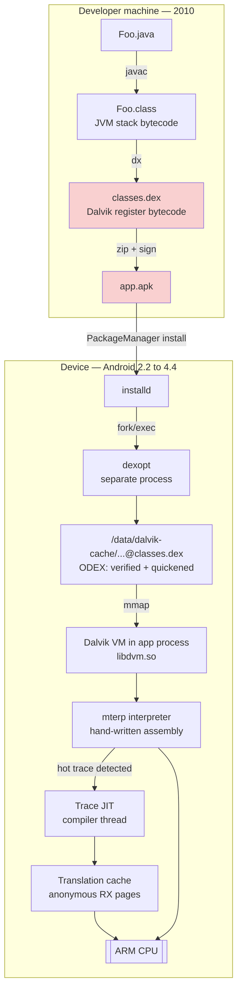
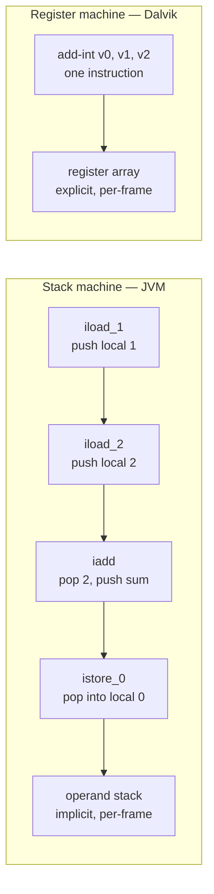
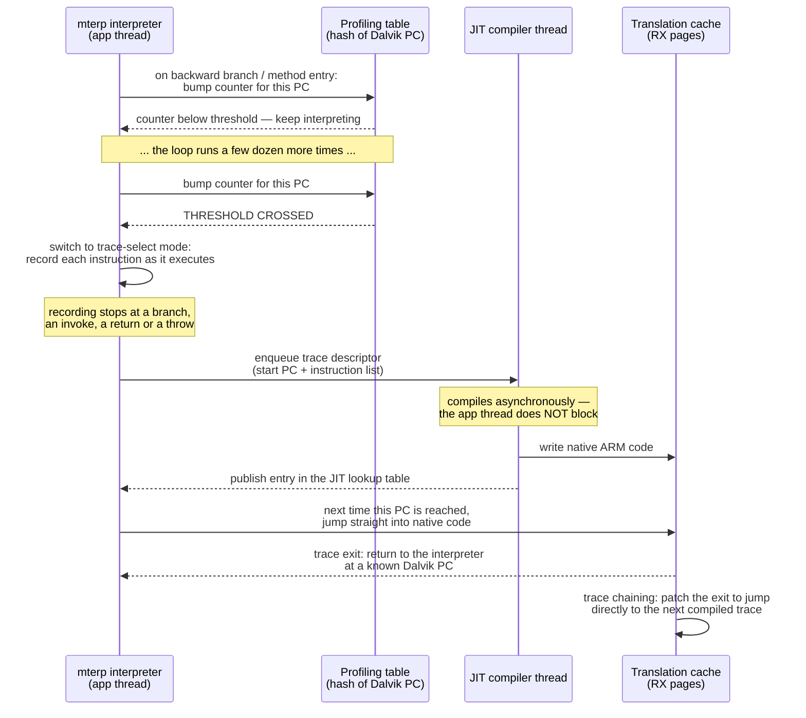
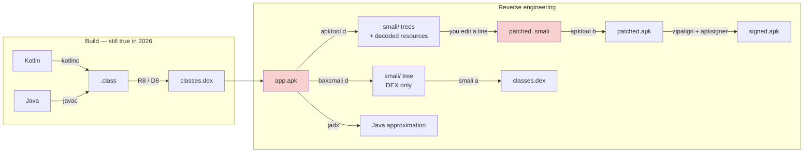
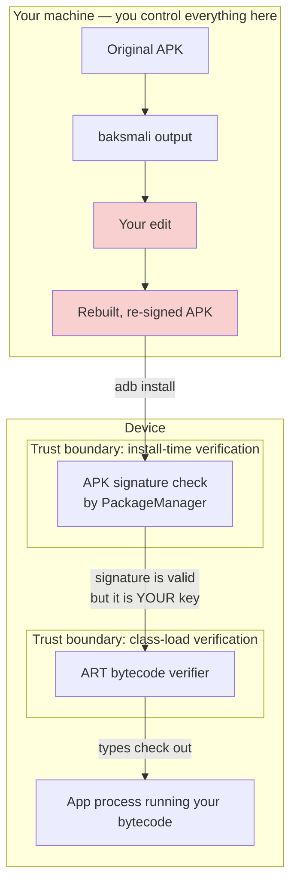
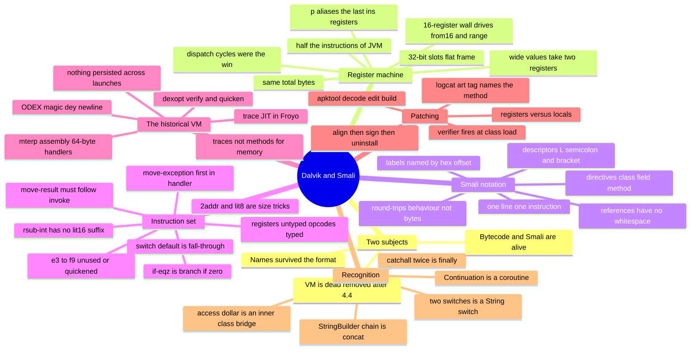

# 14 — Dalvik and the Smali Instruction Set

> After this chapter you will be able to read any Smali listing instruction by instruction without a
> lookup table, decode every one of the 256 Dalvik opcode slots, explain why Android chose a register
> machine over a stack machine and what that cost, run a full `baksmali` → edit → `smali` → repackage
> → sign → install round trip and have it actually boot, and explain the historical Dalvik VM — its
> `mterp` interpreter, its `dexopt` step and its trace JIT — well enough to say precisely which of its
> design decisions still constrain what you see on a 2026 device.

**Prerequisites:** [01 Computer Science Basics](../01-Computer-Science-Basics/README.md) ·
[04 Java](../04-Java/README.md) · [10 APK Internals](../10-APK-Internals/README.md) ·
[11 Android Runtime](../11-Android-Runtime/README.md) ·
[12 DEX Internals](../12-DEX-Internals/README.md) · [13 ART](../13-ART/README.md)

**Applies to:** The **Dalvik VM** sections describe Android 1.0 (API 1) through Android 4.4 (API 19).
Dalvik was removed from the platform after 4.4 and no shipping device has run it for a decade. The
**Smali and instruction-set** sections — which are the bulk of the chapter — apply to **every Android
version from 1.0 to 16 (API 36) and beyond**, because the instruction set they describe is the one
that `d8` still emits and that ART still executes today.

---

## The one thing to understand before you start

There are two subjects in this chapter and they have opposite life expectancies.

| Subject | Status | Why it is here |
|---|---|---|
| **The Dalvik virtual machine** — the `libdvm.so` interpreter, `dexopt`, the trace JIT, the `.odex` cache | **Dead.** Removed after Android 4.4. You will never attach a debugger to it | Its design decisions are load-bearing. The register machine, the 16-register wall, `p0` aliasing, `move-result` adjacency, the whole shape of the instruction set — all of it is Dalvik's, and all of it is still true |
| **Dalvik bytecode and its Smali notation** | **Completely alive.** `d8` emits it, ART executes it, `baksmali` renders it, you read it on every engagement | This is the chapter's centre of gravity. Smali is the assembly language of Android and you cannot avoid it |

The naming is a historical accident that confuses everyone once. The bytecode is still officially
called **Dalvik bytecode**; the file is still officially called a **Dalvik Executable**; the Android
documentation page you will bookmark is still called *Dalvik bytecode*. The VM those names were coined
for has been gone since 2014. Nobody renamed the format because renaming it would have broken every
tool on earth.

> **🧠 Mental Model.** Latin is a dead language. Nobody has spoken it natively for fifteen hundred
> years. Every doctor, lawyer and biologist still has to read it, because the vocabulary of their
> profession was written down in it and never re-coined. Dalvik is Latin. The VM is dead; the notation
> is professional literacy.

**Scope boundary.** Three neighbouring chapters own adjacent territory, and this chapter does not
restage them:

| Chapter | Owns | This chapter's relationship |
|---|---|---|
| [12 — DEX Internals](../12-DEX-Internals/README.md) | The DEX **file format at byte level**: `header_item`, index tables, `map_list`, LEB128, MUTF-8, `code_item`, and how each instruction is **encoded into bytes** | 12 tells you `const-string` is format `21c` and occupies 4 bytes laid out *so*. This chapter tells you what `const-string` **means**, when a compiler emits it, and what to do when you see it |
| [13 — ART](../13-ART/README.md) | The **modern runtime**: AOT/JIT/interpreter tiers, `ArtMethod`, OAT/VDEX, compiler filters, entrypoint patching | 13 owns the runtime you actually attack. This chapter owns its **predecessor**, and explains which of ART's behaviours are inherited constraints rather than choices |
| [40 — Obfuscation](../40-Obfuscation/README.md) | Obfuscation, packers, control-flow flattening, string encryption | 40 depends on the instruction-level literacy this chapter builds. You cannot recognise flattened control flow until you can read unflattened control flow |

---

## Table of Contents

- [1. Introduction](#1-introduction)
  - [1.1 The problem that existed in 2007](#11-the-problem-that-existed-in-2007)
  - [1.2 What would break if Dalvik bytecode did not exist](#12-what-would-break-if-dalvik-bytecode-did-not-exist)
  - [1.3 What Smali is, precisely](#13-what-smali-is-precisely)
  - [1.4 Why a reverse engineer reads Smali and not Java](#14-why-a-reverse-engineer-reads-smali-and-not-java)
  - [1.5 What you will be able to do](#15-what-you-will-be-able-to-do)
- [2. High-Level Architecture](#2-high-level-architecture)
  - [2.1 The Dalvik pipeline, end to end](#21-the-dalvik-pipeline-end-to-end)
  - [2.2 Stack machine versus register machine](#22-stack-machine-versus-register-machine)
  - [2.3 The same method, both ways](#23-the-same-method-both-ways)
  - [2.4 The register frame](#24-the-register-frame)
  - [2.5 The trace JIT](#25-the-trace-jit)
  - [2.6 Where Smali sits in the modern toolchain](#26-where-smali-sits-in-the-modern-toolchain)
  - [2.7 Trust boundaries when you rewrite Smali](#27-trust-boundaries-when-you-rewrite-smali)
- [3. Deep Internal Working](#3-deep-internal-working)
  - [3.1 The register machine, precisely](#31-the-register-machine-precisely)
  - [3.2 `v` registers and `p` registers](#32-v-registers-and-p-registers)
  - [3.3 Wide values occupy two registers](#33-wide-values-occupy-two-registers)
  - [3.4 The 16-register wall and the width families](#34-the-16-register-wall-and-the-width-families)
  - [3.5 The `.smali` file format, top to bottom](#35-the-smali-file-format-top-to-bottom)
  - [3.6 Type descriptors as they appear in Smali](#36-type-descriptors-as-they-appear-in-smali)
  - [3.7 Method and field references](#37-method-and-field-references)
  - [3.8 Labels and the label namespaces](#38-labels-and-the-label-namespaces)
  - [3.9 Annotations in Smali](#39-annotations-in-smali)
  - [3.10 The instruction reference](#310-the-instruction-reference)
    - [3.10.1 `nop` and the move family — `0x00`–`0x0D`](#3101-nop-and-the-move-family--0x000x0d)
    - [3.10.2 Returns — `0x0E`–`0x11`](#3102-returns--0x0e0x11)
    - [3.10.3 Constants — `0x12`–`0x1C`](#3103-constants--0x120x1c)
    - [3.10.4 Monitors and type checks — `0x1D`–`0x21`](#3104-monitors-and-type-checks--0x1d0x21)
    - [3.10.5 Object and array creation — `0x22`–`0x26`](#3105-object-and-array-creation--0x220x26)
    - [3.10.6 Throw and unconditional branches — `0x27`–`0x2C`](#3106-throw-and-unconditional-branches--0x270x2c)
    - [3.10.7 Comparisons and conditional branches — `0x2D`–`0x3D`](#3107-comparisons-and-conditional-branches--0x2d0x3d)
    - [3.10.8 Array element access — `0x44`–`0x51`](#3108-array-element-access--0x440x51)
    - [3.10.9 Instance fields — `0x52`–`0x5F`](#3109-instance-fields--0x520x5f)
    - [3.10.10 Static fields — `0x60`–`0x6D`](#31010-static-fields--0x600x6d)
    - [3.10.11 Invocation — `0x6E`–`0x78`](#31011-invocation--0x6e0x78)
    - [3.10.12 Unary operations and conversions — `0x7B`–`0x8F`](#31012-unary-operations-and-conversions--0x7b0x8f)
    - [3.10.13 Binary operations — `0x90`–`0xE2`](#31013-binary-operations--0x900xe2)
    - [3.10.14 Method handles and dynamic call sites — `0xFA`–`0xFF`](#31014-method-handles-and-dynamic-call-sites--0xfa0xff)
    - [3.10.15 Unused and quickened — `0x3E`–`0x43`, `0x73`, `0x79`–`0x7A`, `0xE3`–`0xF9`](#31015-unused-and-quickened--0x3e0x43-0x73-0x790x7a-0xe30xf9)
    - [3.10.16 The complete opcode map](#31016-the-complete-opcode-map)
  - [3.11 Payload pseudo-instructions in Smali syntax](#311-payload-pseudo-instructions-in-smali-syntax)
  - [3.12 `try`/`catch` in Smali](#312-trycatch-in-smali)
  - [3.13 `switch` in Smali](#313-switch-in-smali)
  - [3.14 Synthetic Smali — what the compiler adds that you never wrote](#314-synthetic-smali--what-the-compiler-adds-that-you-never-wrote)
  - [3.15 The Dalvik VM: `mterp`, the interpreter that was assembly](#315-the-dalvik-vm-mterp-the-interpreter-that-was-assembly)
  - [3.16 `dexopt`, the ODEX, and verification-at-install](#316-dexopt-the-odex-and-verification-at-install)
  - [3.17 The trace JIT in detail](#317-the-trace-jit-in-detail)
  - [3.18 Dalvik's heap and GC](#318-dalviks-heap-and-gc)
  - [3.19 Dalvik JNI and the local reference table](#319-dalvik-jni-and-the-local-reference-table)
  - [3.20 `dalvik.vm.*` properties and the `-X` flags](#320-dalvikvm-properties-and-the--x-flags)
  - [3.21 Why Dalvik was replaced — the version matrix](#321-why-dalvik-was-replaced--the-version-matrix)
  - [3.22 What ART inherited and cannot change](#322-what-art-inherited-and-cannot-change)
- [4. Source Code Walkthrough (AOSP)](#4-source-code-walkthrough-aosp)
  - [4.1 The `dalvik/` tree, then and now](#41-the-dalvik-tree-then-and-now)
  - [4.2 The interpreter dispatch loop](#42-the-interpreter-dispatch-loop)
  - [4.3 The JIT trace-selection path](#43-the-jit-trace-selection-path)
  - [4.4 `dexopt` and the ODEX header](#44-dexopt-and-the-odex-header)
  - [4.5 Where opcode ground truth lives today](#45-where-opcode-ground-truth-lives-today)
  - [4.6 The `smali`/`baksmali` source](#46-the-smalibaksmali-source)
- [5. Security Perspective](#5-security-perspective)
  - [5.1 Why an instruction set is a security topic](#51-why-an-instruction-set-is-a-security-topic)
  - [5.2 Smali patching as the universal bypass](#52-smali-patching-as-the-universal-bypass)
  - [5.3 How developers misuse the layer](#53-how-developers-misuse-the-layer)
  - [5.4 Attacker techniques at instruction level](#54-attacker-techniques-at-instruction-level)
  - [5.5 Verifier interaction and tool-divergence evasion](#55-verifier-interaction-and-tool-divergence-evasion)
  - [5.6 Historical Dalvik vulnerability classes](#56-historical-dalvik-vulnerability-classes)
  - [5.7 How malware abuses the instruction set](#57-how-malware-abuses-the-instruction-set)
  - [5.8 Forensic relevance](#58-forensic-relevance)
  - [5.9 OWASP MASVS and MASTG mapping](#59-owasp-masvs-and-mastg-mapping)
  - [5.10 How a pentester actually tests this](#510-how-a-pentester-actually-tests-this)
- [6. Reverse Engineering Perspective](#6-reverse-engineering-perspective)
  - [6.1 The Java-to-Smali recognition table](#61-the-java-to-smali-recognition-table)
  - [6.2 Reading a whole class, front to back](#62-reading-a-whole-class-front-to-back)
  - [6.3 The `baksmali` / `smali` round trip](#63-the-baksmali--smali-round-trip)
  - [6.4 Compiler idioms you must recognise](#64-compiler-idioms-you-must-recognise)
  - [6.5 Kotlin-specific Smali](#65-kotlin-specific-smali)
  - [6.6 What obfuscation does to Smali](#66-what-obfuscation-does-to-smali)
  - [6.7 Highest-yield greps](#67-highest-yield-greps)
- [7. Dynamic Analysis](#7-dynamic-analysis)
  - [7.1 Choosing between a Smali patch and a Frida hook](#71-choosing-between-a-smali-patch-and-a-frida-hook)
  - [7.2 Injecting a log line into Smali](#72-injecting-a-log-line-into-smali)
  - [7.3 Frida: tracing what your patch should have hit](#73-frida-tracing-what-your-patch-should-have-hit)
  - [7.4 Proving the patch landed](#74-proving-the-patch-landed)
  - [7.5 Reading verifier rejections in logcat](#75-reading-verifier-rejections-in-logcat)
- [8. Static Analysis](#8-static-analysis)
  - [8.1 Getting Smali out of an APK, four ways](#81-getting-smali-out-of-an-apk-four-ways)
  - [8.2 The grep catalogue](#82-the-grep-catalogue)
  - [8.3 Counting and ranking instructions](#83-counting-and-ranking-instructions)
  - [8.4 Cross-referencing without a database](#84-cross-referencing-without-a-database)
- [9. Examples](#9-examples)
- [10. Common Interview Questions](#10-common-interview-questions)
- [11. Common Mistakes](#11-common-mistakes)
- [12. Hands-on Labs](#12-hands-on-labs)
- [13. Summary](#13-summary)
- [14. References](#14-references)

---

## 1. Introduction

### 1.1 The problem that existed in 2007

Imagine you are asked to design the software that will run applications on a phone that has just been
built. Here is the hardware you are given: a single CPU core running at about 200–400 MHz, 64 to 128
megabytes of RAM, no memory-management unit tricks you can rely on, a battery the size of a credit
card, and a flash chip that is slow to read and wears out if you write to it too often.

Now here is the constraint that makes it hard. Applications must be written in Java, because in 2007
that is the language a million developers already know, and you will not get a phone platform off the
ground by inventing a language. But Java's standard execution model was designed in 1995 for desktop
workstations and servers. It assumes memory is not precious.

Three specific parts of that assumption were fatal on the hardware above.

**First: one class, one file.** A Java program compiles to `.class` files, one per class, and they are
distributed inside a `.jar`, which is a ZIP archive. Every one of those class files carries its own
**constant pool** — its own private table of every string, every type name, every method name and every
field name it mentions. Two hundred classes that all call `java.lang.String.equals` store the strings
`"java/lang/String"` and `"equals"` two hundred times each.

> **📖 Definition — constant pool.** A table at the front of a compiled class file holding every
> symbolic name and literal that the class's code refers to. Instructions do not contain names; they
> contain *indices into this table*. It is a deduplication mechanism — but in the JVM it deduplicates
> only within a single class.

**Second: the JVM is a stack machine.** Its instructions do not name their operands. `iadd` means
"pop two integers off an implicit operand stack, add them, push the result". Adding two local
variables and storing the result therefore takes four instructions — two loads, an add, a store — where
naming the operands directly would take one. Each instruction is short, often a single byte, but there
are many of them, and **every single one costs a trip through the interpreter's dispatch loop.** On a
2007 ARM core with no branch predictor worth the name, that dispatch is the dominant cost.

**Third: `.jar` is a ZIP, and ZIP is not memory-mappable.** Class files inside a JAR are DEFLATE-
compressed. To run them you must decompress them into RAM. On a device with 64 MB of RAM shared
between every running application, permanently resident decompressed class data is expensive.

Dan Bornstein's answer, shipped with Android 1.0 in 2008, addressed all three at once, and it is named
after Dalvík, a fishing village in Iceland where some of his ancestors came from.

| Java's choice | Dalvik's choice | What it bought |
|---|---|---|
| One `.class` per class, each with its own constant pool | **One `.dex` per application**, with a single set of shared index tables | Each string, type, method and field name is stored exactly once for the whole app |
| Stack machine — operands implicit | **Register machine** — operands named | Roughly half as many instructions per method, so roughly half as many dispatch cycles |
| DEFLATE-compressed entries inside a ZIP | **Uncompressed, 4-byte-aligned, fixed-stride tables** | The file can be `mmap`ed and shared read-only between every process that uses it |

That third row is the one people forget, and it matters more than the other two combined. Because a
DEX file is laid out so it can be memory-mapped, the Zygote process can map the entire framework's DEX
once, and every app process forked from it shares those physical pages. On a 64 MB device that is the
difference between running four apps and running one. [11 — Android Runtime](../11-Android-Runtime/README.md)
covers Zygote in full.

> **🔬 Under the Hood.** "Memory-mapped" means the kernel is told *this region of virtual address space
> corresponds to this region of this file*, and pages are faulted in from flash on first touch,
> shared physically between every process that maps the same file, and dropped under memory pressure
> without ever being written back. A decompressed-into-RAM class file can do none of those things: it
> is anonymous dirty memory, private to one process, and it must be swapped or killed rather than
> dropped. See chapter **19 — Memory** once written, and
> [02 — Linux Basics](../02-Linux-Basics/README.md) for `mmap` itself.

### 1.2 What would break if Dalvik bytecode did not exist

Suppose Android had shipped standard JVM class files instead. Trace the consequences.

Every app would carry duplicated symbol tables, so APKs would be larger and installs slower. Every
process would need private decompressed copies of the framework classes, so the Zygote sharing trick
would not work and per-app memory would rise by tens of megabytes. Interpretation would cost roughly
twice the dispatch cycles per method, so everything would be slower and the battery would drain
faster. And Sun's licensing position on the Java virtual machine specification in 2007 was, to put it
gently, unhelpful — a point that later became eight years of litigation.

For you specifically, one thing would be different and it is the one you would notice: **you would be
reading JVM bytecode instead of Smali.** The tooling would be different, the mnemonics would be
different, but the job would be identical. Reading the machine's own notation, rather than a
decompiler's guess at the developer's intent, is not an Android-specific skill. Android just happens
to have an unusually good notation for it.

### 1.3 What Smali is, precisely

Dalvik bytecode is *bytes*. Nobody reads bytes.

> **📖 Definition — Smali.** *Smali* is the assembly language for Dalvik bytecode: a human-readable,
> line-oriented textual notation in which every line corresponds to exactly one bytecode instruction or
> one piece of class metadata. **`smali`** is the assembler that turns `.smali` text into a `.dex`
> file; **`baksmali`** is the disassembler that turns a `.dex` file back into `.smali` text. The names
> are Icelandic for "assembler" and "disassembler", continuing the naming joke. The pair was written by
> Ben Gruver ("JesusFreke") and now lives at `github.com/google/smali`.

Three properties make Smali different from a decompiler's output, and all three matter:

1. **It is lossless in the direction that counts.** `baksmali` renders every instruction in the DEX. It
   does not skip anything it cannot understand, it does not guess at structure, and it does not fail
   on constructs that have no Java equivalent.
2. **It round-trips.** Text produced by `baksmali` can be fed back to `smali` and produces a working
   DEX. This is the whole basis of APK patching. A decompiler cannot do this: JADX produces Java that
   frequently does not compile, and even when it does, recompiling it produces *different* bytecode.
3. **It is one-to-one with the instruction stream.** One Smali line, one instruction. When you change
   a line you know exactly which four bytes moved.

> **⚠️ Warning — "lossless" has an important exception.** `baksmali` is lossless with respect to
> *instructions*, not with respect to everything in the file. Some DEX-level details are regenerated
> rather than preserved on reassembly: the ordering of items in the data section, the debug info if you
> disassemble without it, and the layout the original `d8` chose. A `baksmali`-then-`smali` round trip
> of an untouched DEX produces a file that *behaves* identically but is **not byte-identical**, and its
> SHA-256 will differ. Never use "the hash changed" as evidence that you modified behaviour.

### 1.4 Why a reverse engineer reads Smali and not Java

You have JADX. JADX produces Java. Java is easier to read. So why learn assembly at all?

Because JADX is an *interpretation*, and interpretations fail in exactly the places you care about.

| Situation | What JADX does | What Smali does |
|---|---|---|
| Obfuscated control flow (a `while(true)` + `switch` state machine) | Often produces a tangle, sometimes gives up on the method with `// decompilation failed` | Renders every instruction. Ugly, but complete |
| Kotlin coroutines, `invokedynamic` lambdas, synthetic bridge methods | Approximates, sometimes wrongly | Shows the actual generated class and the actual `invoke-custom` |
| Deliberately malformed DEX produced to break tools | May silently drop a method, or show code that never runs | You can see the divergence and go down to bytes with [12](../12-DEX-Internals/README.md) |
| **You want to change the behaviour** | Gives you Java that will not recompile into the same app | Edit the line, reassemble, rebuild, sign, install |

That last row is the decisive one. **Smali is not primarily a reading format. It is the writing
format.** Every "bypass the root check", "disable certificate pinning without Frida", "flip the
licence check" workflow ends in a Smali edit, because it is the only representation you can modify and
reliably put back.

> **🔍 Pentester's Note.** The correct workflow is not "Smali instead of Java" — it is **Java to
> understand, Smali to change**. Read JADX output to find the method that matters in ten minutes.
> Then open that one method in Smali to patch it correctly. People who skip the first step waste hours;
> people who skip the second step produce APKs that crash.

### 1.5 What you will be able to do

By the end of this chapter you should be able to sit down in front of an unfamiliar `.smali` file and,
without opening a reference:

- Say what every line does, including the ones with `/2addr`, `/lit8`, `/from16`, `/jumbo` and `/range`
  suffixes.
- Say which register holds `this`, which hold parameters, and why the numbers are what they are.
- Recognise a `for` loop, a `try`/`finally`, a `switch`, a string concatenation, a Kotlin `data class`
  and a lambda from their bytecode shape alone.
- Change a method's return value, insert a log call, redirect a call to a different method, and
  neutralise a check — and know, before you rebuild, whether the verifier will accept it.
- Explain what `dexopt` did in 2010, what a trace JIT is, why Froyo compiled traces rather than
  methods, and why ART abandoned that design.

---

## 2. High-Level Architecture

### 2.1 The Dalvik pipeline, end to end



Read this left to right, then top to bottom. On the developer's machine, `javac` produced ordinary JVM
class files and a second tool called **`dx`** translated them into Dalvik bytecode. That two-step
arrangement — compile to the stack machine, then translate to the register machine — survived until
2017, when `d8` replaced `dx`; `d8` still consumes JVM class files, so the two-step shape is
*unchanged to this day*. That fact has a consequence you will see constantly in Section 6: **Dalvik
bytecode is not what a compiler would write if it were targeting Dalvik directly.** It is a mechanical
translation of stack code, and it carries the fingerprints of that translation.

On the device, `PackageManagerService` handed the freshly installed APK to `installd`, which forked a
short-lived **`dexopt`** process. `dexopt` verified the bytecode and rewrote parts of it — the
"quickening" pass in §3.16 — and wrote the result to `/data/dalvik-cache` as an **ODEX** file. The
running VM memory-mapped that ODEX rather than the APK's DEX.

Inside the process, `libdvm.so` interpreted the bytecode using `mterp`, a dispatch loop hand-written
in ARM assembly. A profiling counter watched for hot code. When a piece of code got hot, a **separate
compiler thread** compiled it — not the whole method, but a **trace** — into native ARM instructions
in a translation cache, and the interpreter jumped into that cache instead.

Compare this to the ART diagram in [13 §2.2](../13-ART/README.md). The shapes rhyme: a separate
compilation process, a cache on disk, an interpreter, a JIT, a code cache. What changed is *when* the
compiler runs and *what unit* it compiles. Everything else in modern ART is a refinement of this
picture.

### 2.2 Stack machine versus register machine



Both diagrams describe the same computation: `local0 = local1 + local2`. The JVM needs four
instructions and an invisible operand stack that every one of them mutates. Dalvik needs one
instruction that names all three storage locations outright.

> **📖 Definition — stack machine.** An execution model in which instructions take their operands from,
> and leave their results on, an implicit last-in-first-out **operand stack** belonging to the current
> frame. Instructions are short — usually one byte — because they encode no operand names.

> **📖 Definition — register machine.** An execution model in which instructions name their operands
> explicitly as numbered slots in a flat per-frame array. Instructions are wider — usually two to six
> bytes — because the operand numbers must be encoded, but far fewer are needed.

The trade-off, stated honestly:

| | Stack machine (JVM) | Register machine (Dalvik) |
|---|---|---|
| Instructions per unit of work | More — roughly double | Fewer |
| Bytes per instruction | 1–3 typically | 2–10, most commonly 2 or 4 |
| **Total bytes** | Slightly smaller | Slightly larger |
| **Interpreter dispatch cycles** | Roughly double | Roughly half |
| Ease of writing a compiler *to* it | Very easy — expression trees map straight onto push/pop | Harder — needs register allocation |
| Ease of writing a fast interpreter *for* it | Harder — every instruction touches the stack pointer | Easier — operands are array indices |
| Ease of writing a JIT *for* it | Harder — must reconstruct data flow from stack effects | Easier — data flow is already explicit |

The last two rows are why Android chose it. On a 2007 ARM core, an interpreted instruction's cost was
dominated not by the work it did but by the **dispatch**: fetch the opcode, index a table of handler
addresses, branch to it, and take the pipeline flush that an indirect branch causes. Halving the
instruction count halves that cost, and it does not matter that each instruction is a couple of bytes
wider — the bytes are in a memory-mapped, shared, read-only page and cost nothing extra to hold.

> **⚠️ Warning — a claim you will hear that is not quite true.** "Dalvik bytecode is smaller than Java
> bytecode." At the level of a single method's instruction stream it is usually slightly *larger*. The
> size win of a DEX file comes almost entirely from **sharing one constant pool across the whole
> application**, not from the instruction encoding. Keep the two claims separate; conflating them is a
> reliable way to be corrected in an interview.

### 2.3 The same method, both ways

Here is the method, in Java:

```java
// The method both listings below implement.
static int sum(int[] a) {
    int t = 0;
    for (int i = 0; i < a.length; i++) {
        t += a[i];
    }
    return t;
}
```

Compiled by `javac` to JVM stack bytecode, as `javap -c` renders it:

```text
static int sum(int[]);
   0: iconst_0          // push 0
   1: istore_1          // t = pop            (local 1 = t)
   2: iconst_0          // push 0
   3: istore_2          // i = pop            (local 2 = i)
   4: iload_2           // push i
   5: aload_0           // push a
   6: arraylength       // pop a, push a.length
   7: if_icmpge 22      // pop 2, branch if i >= a.length
  10: iload_1           // push t
  11: aload_0           // push a
  12: iload_2           // push i
  13: iaload            // pop a,i; push a[i]
  14: iadd              // pop 2, push t + a[i]
  15: istore_1          // t = pop
  16: iinc 2, 1         // i++   (the one instruction that does not touch the stack)
  19: goto 4
  22: iload_1           // push t
  23: ireturn           // pop and return
```

**18 instructions, 24 bytes.** Notice how much of it is pure stack plumbing: `iload_2`, `aload_0`,
`iload_1` do no computation at all, they only move values into position.

The same method compiled to Dalvik bytecode and rendered by `baksmali`:

```smali
.method static sum([I)I
    .registers 4
    # ins_size = 1, so p0 == v3 == the array argument.
    # v0 = t, v1 = i, v2 = scratch.

    const/4 v0, 0x0                 # t = 0
    const/4 v1, 0x0                 # i = 0

    :goto_2
    array-length v2, v3             # v2 = a.length
    if-ge v1, v2, :cond_b           # if i >= a.length, leave the loop
    aget v2, v3, v1                 # v2 = a[i]
    add-int/2addr v0, v2            # t += v2
    add-int/lit8 v1, v1, 0x1        # i = i + 1
    goto :goto_2

    :cond_b
    return v0
.end method
```

**9 instructions, 24 bytes.** Exactly the same size, exactly half the instruction count.

That is the whole comparison, and it is worth staring at until it is obvious. Every JVM instruction
whose only job was to shuffle a value onto the stack has vanished, because the Dalvik instructions name
their operands. `iload_1; aload_0; iload_2; iaload; iadd; istore_1` — six instructions — becomes
`aget v2, v3, v1` followed by `add-int/2addr v0, v2` — two.

The bytes did not shrink, and they were never going to: naming three registers costs bits that an
implicit stack does not spend. But the interpreter now goes round its dispatch loop nine times instead
of eighteen, and in 2008 that was the entire ball game.

> **🔬 Under the Hood.** Count the code units yourself against the format table in
> [12 §3.25](../12-DEX-Internals/README.md): `const/4` is `11n`, 1 unit; `array-length` is `12x`, 1
> unit; `if-ge` is `22t`, 2 units; `aget` is `23x`, 2 units; `add-int/2addr` is `12x`, 1 unit;
> `add-int/lit8` is `22b`, 2 units; `goto` is `10t`, 1 unit; `return` is `11x`, 1 unit. Total
> 1+1+1+2+2+1+2+1+1 = 12 code units = **24 bytes.**

Two details in that listing are the whole of §3.2 and §3.4 in miniature, and you should notice them
now even if they do not yet make sense:

- **`p0` is `v3`.** The array argument arrives in the *last* register, not the first.
- **`:goto_2` and `:cond_b`.** `baksmali` names labels after the hexadecimal code-unit offset of the
  instruction they mark. `:goto_2` sits at code unit `0x2`; `:cond_b` at code unit `0xb`. The names
  carry information, which is why they look random and why you should not rename them casually.

### 2.4 The register frame

Mermaid cannot draw a memory layout honestly, so this one is ASCII.

```text
    A method's frame is a flat array of 32-bit registers.
    Three code_item fields describe it (see 12-DEX-Internals section 3.16):

        registers_size  total registers in the frame
        ins_size        how many of them hold INCOMING arguments
        outs_size       size of the outgoing-argument window for the biggest call

    THE RULE:  incoming arguments occupy the LAST ins_size registers.

    Example:  public int transfer(String to, long amount)
              an instance method: this + String + long(2) = 4 incoming words
              suppose the compiler needs 3 locals, so registers_size = 7

      index      v0     v1     v2     v3     v4     v5     v6
               +------+------+------+------+------+------+------+
               | loc  | loc  | loc  |this  | to   |    amount   |
               +------+------+------+------+------+------+------+
      alias                          p0     p1     p2     p3
                                                   \___________/
                                                    ONE long, TWO registers

      first parameter register = registers_size - ins_size = 7 - 4 = 3
                            so  p0 == v3,  p1 == v4,  p2:p3 == v5:v6
```

Everything painful about hand-editing Smali is visible in that picture.

Parameters live at the **top** of the frame, not the bottom. That is not an arbitrary choice: it is
what makes a method call cheap. The caller arranges its outgoing arguments in a contiguous window at
the top of *its* frame (`outs_size` reserves it), and the callee's frame is laid out so that window
lands exactly on the callee's parameter registers. No copying is required. The cost of that
optimisation is paid by you, every time you add a local variable and every `p` alias shifts.

The second thing the picture shows is that `p` numbering counts **registers, not parameters**. A
`long` or a `double` occupies two adjacent registers and consumes two `p` numbers. In the example,
`amount` is `p2` — there is no `p3` you can meaningfully name on its own, because `p3` is the high
half of `amount`.

> **🔍 Pentester's Note.** When you write a hook or a patch that needs "the second argument", count
> registers, not commas in the signature. A method `f(long, String)` has its `String` in `p2` for a
> static method and `p3` for an instance method. Getting this wrong produces a `VerifyError` if you are
> lucky and silent garbage if you are not.

### 2.5 The trace JIT



This is the design that shipped in Android 2.2 (Froyo, 2010) and it is worth understanding properly,
because "why did they compile *traces*" is a genuinely good question with a genuinely good answer.

> **📖 Definition — trace.** A **trace** is a single linear path through the code — a run of
> instructions that were actually executed one after another, with no branches in the middle. It
> typically begins at a loop header or a method entry and ends at the first branch, call, return or
> throw. It is not a method, and it is not a basic block; it is *the path the program actually took*.

A **method JIT** — which is what the HotSpot JVM and modern ART both use — takes an entire method,
builds a control-flow graph of it, optimises across the whole graph, and emits native code for all of
it. A **trace JIT** takes one hot linear path and compiles only that.

Froyo chose traces for four reasons, and the first is the one that decided it:

1. **Memory.** A method JIT must hold the whole method's intermediate representation in memory while
   compiling, and must store native code for every path in the method including the ones that never
   run. On a device where the entire application heap was capped at 16–24 MB, that was not affordable.
   A trace's IR is a few dozen instructions and its native code is a few hundred bytes.
2. **Latency.** Traces compile in microseconds. A method JIT's compile times are long enough that you
   need a sophisticated tiering scheme to hide them. Froyo's JIT ran on a background thread and the
   app thread simply kept interpreting until the translation appeared.
3. **It profiles itself for free.** You do not need a separate profiling pass to find a trace: the
   trace *is* the profile. What you record is by construction what actually executed.
4. **It handles the common Android case.** Most of the time that a 2010 Android app spent in
   interpreted code was in tight loops — layout passes, pixel loops, parsing. A trace JIT catches
   loops extremely well.

And here is what it cost, which is the part most write-ups skip:

| Cost | Consequence |
|---|---|
| **No whole-method optimisation.** The compiler can only see the trace, so it cannot hoist a computation out of a loop it cannot see all of, and cannot do global register allocation | Generated code was maybe 2–5× faster than interpretation, where a good method JIT is 10–50× |
| **Trace exits are expensive.** Leaving a trace means writing every live register back into the interpreter's frame and resuming at a Dalvik PC | Branchy code — anything with unpredictable `if`s — gained almost nothing, and could be slower |
| **Duplication.** A loop body containing an `if` becomes two traces, each with its own copy of the shared code | Translation cache pressure, and the cache was small and flushed when full |
| **Almost no inlining.** A call ends a trace. `dalvik/vm/compiler/InlineTransformation.cpp` special-cased a handful of tiny methods and nothing else | Getter/setter-heavy Java — that is, all Java — kept paying full call overhead |
| **Nothing was persisted.** The translation cache lived in anonymous memory and died with the process | Every app paid the warm-up cost again at every single launch, every day, forever |

That last row is the one that killed it. A trace JIT makes an app fast *after it has been running for a
while*. Android apps are launched, used for forty seconds and killed. The steady state a trace JIT
optimises for is a state that phone applications rarely reach.

ART's answer in Android 5.0 was to move compilation to install time — full AOT, whole methods,
persisted to disk — which fixed warm-up completely and created two new problems: installs took
minutes, and the OAT files were enormous. Android 7.0 then reintroduced a JIT, but a **method** JIT
with a **profile** that gets written to disk and fed back into an offline compiler. That design —
described in [13 §3.11](../13-ART/README.md) — is the synthesis: JIT-quality profiling, AOT-quality
compilation, and none of it thrown away at process exit.

> **🧠 Mental Model.** Froyo's JIT learned a route through a city every morning and forgot it every
> night. Lollipop printed a complete road atlas once, at install time, including every street nobody
> ever drives. Nougat and later keep a diary of the routes you actually took and redraw a small,
> accurate map overnight while the phone charges.

### 2.6 Where Smali sits in the modern toolchain



The top half is the modern build and it has not changed in shape since 2008: source becomes JVM class
files, and a separate tool converts those into Dalvik bytecode. `dx` became `d8`; `d8` gained an
optimiser called `R8`. The output is the same instruction set.

The bottom half is your workflow. Three tools take an APK apart and they are not interchangeable:

| Tool | Produces | Use when |
|---|---|---|
| **`jadx`** | Java source approximation | You are **reading** and want speed of comprehension |
| **`baksmali`** | Smali, DEX only | You want Smali from a bare `.dex`, or maximum control over disassembly options |
| **`apktool`** | Smali **plus** decoded `AndroidManifest.xml`, `res/`, and everything needed to rebuild | You are **patching** an APK. This is the normal case |

The distinction between the last two catches everyone once: `apktool` uses `baksmali` internally, but
it also decodes the binary XML and resource table, and it can put the whole APK back together.
`baksmali`/`smali` alone give you a `.dex`, and you are then on your own for re-zipping, aligning and
signing. **For APK patching, use `apktool`.** Use `baksmali` directly when you have a DEX that did not
come from an APK — a dumped-from-memory DEX, a payload extracted from a packer, a `.dex` pulled out of
a VDEX.

### 2.7 Trust boundaries when you rewrite Smali



Two gates stand between your edited Smali and a running app, and confusing them wastes enormous
amounts of time.

The **first gate is the APK signature**, checked at install. It does not care what you changed. It
cares only that the APK is self-consistently signed by *some* key. Because you re-signed the APK with
your own debug key, it passes — and because the signing key changed, the OS treats it as a *different
application*, which is why you must uninstall the original first and why `signatureLevel` permissions,
Google Play licensing, and any server that pins the app's signing certificate will now refuse to work.
[10 — APK Internals](../10-APK-Internals/README.md) covers signing schemes in full.

The **second gate is the ART bytecode verifier**, and it runs at *class load*, not at install. It
checks that your instruction stream is internally consistent: that registers hold the types the
instructions expect, that branches land on instruction boundaries, that a `move-result` follows an
invoke, that you did not use a register number the frame does not have.

> **⚠️ Warning — the single most useful diagnostic fact in this chapter.** A verifier failure does
> **not** appear at install time. It appears when the *class containing your edit* is first loaded,
> which is usually when the user navigates to the screen that uses it. Symptom: the app installs, the
> launcher icon works, and it dies the moment you open one particular screen. If that happens, do not
> re-check your signing — run `adb logcat -s art:* AndroidRuntime:*` and read the rejection, which
> names the method and the instruction offset.

---
## 3. Deep Internal Working

This section is the reference the rest of the repository points at. It is long on purpose. Read
§3.1–§3.9 linearly once — they are the model, and nothing after them makes sense without them. Then
treat §3.10 as a lookup table you return to for years.

### 3.1 The register machine, precisely

Every Dalvik method executes against a **frame**: a flat array of 32-bit slots called registers,
allocated when the method is entered and destroyed when it returns.

| Property | Value | Consequence |
|---|---|---|
| Register width | **32 bits** | A `long` or `double` needs two |
| Number of registers | Fixed per method, declared in the `code_item` | Cannot grow at runtime; the assembler must know the count |
| Typed? | **No.** A register is 32 bits of storage | The same register can hold an `int` at one instruction and an object reference at the next — and the *verifier* tracks which, statically |
| Addressable range | Depends on the instruction format: 4, 8 or 16 bits | The 16-register wall, §3.4 |
| Initial contents | Parameters in the top `ins_size`; everything else **undefined** | Reading a register before writing it is a verification error, not a zero |

That third row is the one to internalise, because it explains the entire design of the instruction set.

> **📖 Definition — the registers are untyped, the *verifier* is not.** There is no bit anywhere
> recording that `v3` currently holds a `String`. The instruction does the typing: `aget-object` says
> "the thing in this register is an object reference", `add-int` says "these are integers". Before the
> class is ever executed, ART's verifier walks every path through the method and computes what type
> each register holds at each instruction, and rejects the method if an instruction's expectation ever
> disagrees with what could be there. This is why there are separate `aget`, `aget-object`,
> `aget-boolean`, `aget-byte`, `aget-char` and `aget-short` opcodes instead of one polymorphic `aget`:
> the opcode is where the type information lives.

That single fact accounts for most of the instruction set's apparent bloat. There is no `move` that
works on anything; there is `move` for 32-bit non-object values, `move-wide` for 64-bit values, and
`move-object` for references, and using the wrong one is a verification failure. Likewise `return`,
`return-wide` and `return-object`; likewise every field and array accessor.

> **🔍 Pentester's Note.** This has a direct practical consequence when patching. If a method returns
> `Ljava/lang/String;` you cannot make it return your constant with `const/4 v0, 0x1` and `return v0` —
> you need `const-string v0, "whatever"` and `return-object v0`. Getting the family wrong is the single
> most common cause of a patched APK that installs and then dies with a `VerifyError`.

### 3.2 `v` registers and `p` registers

Smali gives every register **two possible names**, and this is the first thing that confuses people.

- **`vN`** — the register's actual index in the frame. `v0` is the first slot, `v1` the second.
- **`pN`** — a *parameter alias*. `p0` is the first incoming argument's register, `p1` the second, and
  so on.

They are not two kinds of register. They are two ways of writing down the same storage. The
translation is one line of arithmetic:

```text
    pN  ==  v(registers_size - ins_size + N)
```

For an **instance** method, `p0` is always `this`. For a **static** method, `p0` is the first declared
parameter and there is no `this` at all.

A worked case:

```smali
# public boolean check(java.lang.String s, int n)   -- an INSTANCE method
.method public check(Ljava/lang/String;I)Z
    .registers 6
    # ins_size = 3  (this, the String, the int)
    # first parameter register = 6 - 3 = 3
    #   p0 == v3   this
    #   p1 == v4   s
    #   p2 == v5   n
    # v0, v1, v2 are free for locals.
```

Both names work everywhere. `iget-object v0, v3, ...` and `iget-object v0, p0, ...` assemble to
**identical bytes**. `baksmali` prints the `p` form for parameter registers and the `v` form for
locals, because that is what a human wants to read.

> **🧠 Mental Model.** The frame is a row of numbered lockers. `v` numbers are the numbers painted on
> the lockers. `p` numbers are sticky notes saying "argument 1", "argument 2", stuck on the *last few*
> lockers. Move the wall — change `.registers` — and the sticky notes stay with the arguments while
> the painted numbers underneath them change.

**Why the top and not the bottom?** Because it makes calls free. When a method calls another, the
caller places the outgoing arguments in a contiguous block at the top of its own frame — the
`outs_size` window. The callee's frame is laid out so that block *is* its parameter registers. No
copying, no shuffling. The price is that `p0`'s `v` number depends on the total frame size, which is
exactly the thing you change when you add a local.

Two directives declare the frame, and choosing between them is a real decision:

| Directive | Means | Use when |
|---|---|---|
| `.registers N` | The frame has **N registers in total**, parameters included | You are reading `baksmali` output — it always emits this form |
| `.locals N` | The frame has **N registers *in addition to* the parameters**; the assembler computes the total | You are **writing** or editing Smali. Safer: adding a local means `.locals 3` → `.locals 4` and nothing else moves |

> **⚠️ Warning — never mix them in one method, and never edit `.registers` casually.** If a method
> says `.registers 6` with three incoming words, `p0` is `v3`. Change it to `.registers 7` to make room
> for a local and `p0` becomes `v4` — but every existing `v3` reference in the body still says `v3`,
> and now points at a local instead of `this`. The method will verify (the types may happen to work)
> and behave wrongly. If you must add registers, the safe move is to convert the method to `.locals`
> form, or to raise `.registers` **and rewrite every `vN` in the body that was a parameter to its `pN`
> alias first**, so the assembler renumbers them for you.

### 3.3 Wide values occupy two registers

A `long` or a `double` is 64 bits and a register is 32. Dalvik stores them in **two adjacent
registers**, named by the lower number.

```smali
    const-wide v2, 0x1122334455667788L    # occupies v2 AND v3
    move-wide  v4, v2                     # copies v2:v3 into v4:v5
```

Rules that follow from this, all of which are enforced by the verifier:

- Writing a wide value to `vN` **destroys `vN+1`**. Anything that was there is gone.
- You may not use `vN+1` on its own while `vN` holds a wide value.
- A wide value must not straddle the end of the frame: `const-wide v5` in a 6-register frame is invalid,
  because `v6` does not exist.
- A wide *parameter* consumes two `p` numbers. `f(long a, int b)` static gives `a` = `p0:p1` and
  `b` = `p2`.

```smali
# static long expiry(long base)
.method static expiry(J)J
    .registers 4
    # ins_size = 2, first parameter register = 4 - 2 = 2
    #   p0 == v2, and the long 'base' occupies v2:v3
    const-wide/32 v0, 0x15180        # 86400 -- occupies v0:v1
    add-long/2addr v0, v2            # v0:v1 += v2:v3
    return-wide v0
.end method
```

> **🔍 Pentester's Note.** Miscounting wide pairs is the second most common Smali patching error after
> `.registers`. When a method signature contains `J` (long) or `D` (double), stop and count on paper
> before you touch it. A useful habit: write the frame diagram from §2.4 in a comment above the method
> before you edit it, and leave it there.

### 3.4 The 16-register wall and the width families

Most Dalvik instruction formats encode a register number in **4 bits**. Four bits addresses `v0`
through `v15`. That is the wall, and it is the reason the instruction set looks bloated with
near-duplicates.

| Field width | Range | Formats | Notation in the spec |
|---|---|---|---|
| 4 bits | `v0`–`v15` | `12x`, `11n`, `22c`, `22s`, `22t`, `23x` (partly), `35c` | `vA`, `vB` |
| 8 bits | `v0`–`v255` | `11x`, `21c`, `21s`, `21h`, `21t`, `22b`, `22x`, `23x`, `31i`, `31t`, `31c` | `vAA`, `vBB`, `vCC` |
| 16 bits | `v0`–`v65535` | `32x`, `22x` (source), `3rc`, `4rcc` | `vAAAA`, `vBBBB` |

Hence three near-identical families:

| Base | `/from16` | `/16` |
|---|---|---|
| `move vA, vB` — both 4-bit | `move/from16 vAA, vBBBB` — 8-bit dest, 16-bit source | `move/16 vAAAA, vBBBB` — both 16-bit |
| `move-wide` | `move-wide/from16` | `move-wide/16` |
| `move-object` | `move-object/from16` | `move-object/16` |

And a fourth family for calls, which have the same problem in a worse form. `invoke-virtual` uses
format `35c`, which packs **up to five** register numbers into 4 bits each. Two consequences: you
cannot call a method with more than five argument *words* using `35c`, and none of those arguments may
live above `v15`.

The escape hatch is the `/range` variant:

```smali
    # 35c form: up to 5 registers, any of v0-v15, listed individually
    invoke-virtual {v1, v2, v3}, Lcom/example/A;->f(II)V

    # 3rc form: a CONTIGUOUS RUN of registers, 16-bit start, 8-bit count
    invoke-virtual/range {v20 .. v26}, Lcom/example/A;->g(IIIIII)V
```

> **📖 Definition — `/range`.** The `/range` instruction variants take a **first register** and a
> **count** instead of an explicit list. This lets them address any register up to `v65535` and pass
> any number of arguments up to 255 — but it **requires the arguments to already sit in consecutive
> registers**, in order. The compiler arranges this when it emits the call. If you are writing the call
> by hand you must arrange it yourself, usually with a run of `move` instructions.

> **🔍 Pentester's Note — the error you will actually hit.** You insert two lines into a large method,
> bump `.locals`, and `smali` refuses with a message about a register being out of range. What has
> happened is that your new local landed above `v15` and the instruction you wrote only has a 4-bit
> field for it. Three fixes, in order of preference: (1) use a **low** register that is dead at that
> point instead of allocating a new one; (2) use the `/from16` variant of the instruction; (3) `move/16`
> the value down into a low register, operate on it, and move it back.

### 3.5 The `.smali` file format, top to bottom

One `.smali` file describes exactly one class. `baksmali` writes it to a path that mirrors the package:
`Lcom/example/Foo;` becomes `smali/com/example/Foo.smali`. Nested classes get their own files with
`$` in the name: `Foo$Inner.smali`.

Here is a complete, small, annotated file. Everything in it is explained below.

```smali
# smali/com/example/Vault.smali
.class public final Lcom/example/Vault;
.super Ljava/lang/Object;
.source "Vault.java"

# interfaces
.implements Ljava/io/Closeable;


# static fields
.field private static final TAG:Ljava/lang/String; = "Vault"
.field private static instances:I


# instance fields
.field private final key:[B
.field private open:Z


# direct methods
.method static constructor <clinit>()V
    .registers 1
    const/4 v0, 0x0
    sput v0, Lcom/example/Vault;->instances:I
    return-void
.end method

.method public constructor <init>([B)V
    .registers 2
    .param p1, "key"    # [B

    invoke-direct {p0}, Ljava/lang/Object;-><init>()V
    iput-object p1, p0, Lcom/example/Vault;->key:[B
    const/4 v0, 0x1
    iput-boolean v0, p0, Lcom/example/Vault;->open:Z
    return-void
.end method


# virtual methods
.method public close()V
    .registers 2
    const/4 v0, 0x0
    iput-boolean v0, p0, Lcom/example/Vault;->open:Z
    return-void
.end method

.method public isOpen()Z
    .registers 2
    iget-boolean v0, p0, Lcom/example/Vault;->open:Z
    return v0
.end method
```

The directives, in the order they can appear:

| Directive | Meaning | Notes |
|---|---|---|
| `.class <flags> <TypeDescriptor>;` | Declares the class. **Mandatory, must be first** | Flags are the access-flag words in §3.5.1 |
| `.super <TypeDescriptor>;` | The superclass | Absent only for `Ljava/lang/Object;` itself |
| `.source "<name>"` | The original source file name | Debug information; harmless to delete, and its absence is a good obfuscation indicator |
| `.implements <TypeDescriptor>;` | One interface. Repeated per interface | |
| `.field <flags> <name>:<TypeDescriptor>` | A field | May be followed by ` = <value>` for `static final` primitives and strings |
| `.method <flags> <name>(<params>)<ret>` | Opens a method body | Closed by `.end method` |
| `.annotation` … `.end annotation` | An annotation, at class, field, method or parameter level | §3.9 |

Inside a method body:

| Directive | Meaning |
|---|---|
| `.registers N` / `.locals N` | Frame size. **Exactly one of these, and it must come first** |
| `.param pN, "name"` | Names a parameter. Optionally carries an annotation block |
| `.prologue` | Marks the end of the parameter setup. Emitted by older `baksmali`; purely debug metadata |
| `.line N` | Original source line number. Debug metadata; drives stack traces |
| `.local vN, "name":<Type>` / `.end local vN` / `.restart local vN` | Debug metadata mapping a register to a source variable name over a range |
| `:label` | A branch target. Not an instruction; occupies no bytes |
| `.catch <Type> {:start .. :end} :handler` | An exception handler entry, §3.12 |
| `.catchall {:start .. :end} :handler` | Catches everything, including `Throwable` — this is how `finally` is built |
| `.packed-switch` / `.sparse-switch` / `.array-data` … `.end …` | Payload pseudo-instructions, §3.11 |
| `.end method` | Closes the body |

#### 3.5.1 Access flags as Smali writes them

| Smali keyword | Bit | Valid on |
|---|---:|---|
| `public` | `0x0001` | class, field, method |
| `private` | `0x0002` | class (nested), field, method |
| `protected` | `0x0004` | class (nested), field, method |
| `static` | `0x0008` | class (nested), field, method |
| `final` | `0x0010` | class, field, method |
| `synchronized` | `0x0020` | method |
| `volatile` | `0x0040` | field |
| `bridge` | `0x0040` | method — compiler-generated forwarding for generics/covariance |
| `transient` | `0x0080` | field |
| `varargs` | `0x0080` | method |
| `native` | `0x0100` | method — **no body; the implementation is in a `.so`** |
| `interface` | `0x0200` | class |
| `abstract` | `0x0400` | class, method |
| `strictfp` | `0x0800` | class, method |
| `synthetic` | `0x1000` | class, field, method — **compiler-generated, not written by a human** |
| `annotation` | `0x2000` | class |
| `enum` | `0x4000` | class, field |
| `constructor` | `0x10000` | method — `<init>` and `<clinit>` |
| `declared-synchronized` | `0x20000` | method |

Note that `0x0040` and `0x0080` mean different things on fields and methods; the bit is the same, the
interpretation depends on what it is attached to. [12 §3.23](../12-DEX-Internals/README.md) has the
raw table.

> **🔍 Pentester's Note.** `synthetic` is a gift. It marks everything the compiler invented: lambda
> classes, the `access$000` bridges that let an inner class touch its outer class's private fields, the
> `$VALUES` array in an enum, Kotlin's `DefaultImpls`. When you are trying to find *the code the
> developer wrote*, `grep -L synthetic` is a cheap first filter. And `native` is the other one:
> `grep -rn "\.method.*native" smali*/` tells you in one line how much of the app's logic has left the
> DEX for a `.so`, which is where chapter **15 — Native Code** and
> [57 — Ghidra](../57-Ghidra/README.md) take over.

### 3.6 Type descriptors as they appear in Smali

Smali writes types exactly as the DEX format stores them. There is no shorthand and no `int`.

| Descriptor | Java type | Notes |
|---|---|---|
| `V` | `void` | **Return types only.** There is no `void` variable |
| `Z` | `boolean` | Z for "boolean", because B was taken |
| `B` | `byte` | |
| `S` | `short` | |
| `C` | `char` | 16-bit, unsigned |
| `I` | `int` | |
| `J` | `long` | J because L was taken by object types |
| `F` | `float` | |
| `D` | `double` | |
| `L<fully/qualified/Name>;` | An object type | **The trailing semicolon is part of the descriptor.** Omitting it is the most common typo in hand-written Smali |
| `[<descriptor>` | An array of that type | `[I` is `int[]`, `[[I` is `int[][]`, `[Ljava/lang/String;` is `String[]` |

Package separators are `/`, never `.`. Nested classes use `$`:
`Lcom/example/Outer$Inner;`.

A method's **shorty** — the compressed signature used internally by the format — collapses every
object and array type to `L`. You will not write shorties, but you will see them in `dexdump` output
and in ART log messages.

```text
    Java:        boolean check(String s, int[] a, long n)
    Descriptor:  (Ljava/lang/String;[IJ)Z
    Shorty:      ZLLJ            <- return type first, then arguments
```

> **⚠️ Warning.** In a method descriptor the parameter types run together with **no separators**:
> `(Ljava/lang/String;[IJ)Z` is three parameters, not one. The `;` after `String` is the terminator of
> that one descriptor, not a delimiter between parameters. Read them by walking the string one
> descriptor at a time.

### 3.7 Method and field references

Every instruction that touches a field or calls a method names it in full, as a single token with no
spaces:

```text
    Field:    L<owner>;-><name>:<type>
    Method:   L<owner>;-><name>(<param descriptors>)<return descriptor>
```

```smali
    # a field reference
    iget-object v0, p0, Lcom/example/Vault;->key:[B

    # a method reference
    invoke-virtual {p0, v1}, Lcom/example/Vault;->unlock(Ljava/lang/String;)Z

    # a static field on another class
    sget-object v0, Ljava/lang/System;->out:Ljava/io/PrintStream;
```

Three details that matter:

1. **The owner is where the reference points, not necessarily where the method is defined.** If `Vault`
   inherits `toString()` from `Object`, a call may be written against `Lcom/example/Vault;->toString()`
   or `Ljava/lang/Object;->toString()` depending on what the compiler knew. When grepping for callers,
   grep for the **method name**, not the whole reference.
2. **There is no whitespace inside a reference.** `Lcom/example/Vault;->unlock` is one token. This is
   what makes Smali so grep-friendly.
3. **`<init>` and `<clinit>` are legal method names.** `<init>` is an instance constructor;
   `<clinit>` is the static initialiser that runs once when the class is first used. Both are invoked
   with `invoke-direct` / never called directly by user code.

> **🔍 Pentester's Note.** The single highest-value grep in Android reverse engineering is a method
> reference. `grep -rn "Ljavax/crypto/Cipher;->getInstance" smali*/` finds every place the app sets up
> encryption, in one command, with no false positives, on an obfuscated app — because framework class
> names cannot be renamed. Build a personal library of these; §6.7 is a starting set.

### 3.8 Labels and the label namespaces

There is exactly **one** label namespace per method, despite appearances. Every label is just a name
for a position in the instruction stream, and any instruction can branch to any label.

What confuses people is that `baksmali` *generates* label names with role prefixes, so it looks like
there are several kinds:

| Generated prefix | Marks | Example |
|---|---|---|
| `:goto_N` | The target of an unconditional `goto` | `:goto_2` |
| `:cond_N` | The target of a conditional branch | `:cond_b` |
| `:try_start_N` / `:try_end_N` | The bounds of a protected region | `:try_start_0` |
| `:catch_N` | A typed exception handler | `:catch_0` |
| `:catchall_N` | The `finally` / catch-everything handler | `:catchall_0` |
| `:pswitch_N` / `:pswitch_data_N` | A `packed-switch` case / its payload | `:pswitch_data_0` |
| `:sswitch_N` / `:sswitch_data_N` | A `sparse-switch` case / its payload | `:sswitch_0` |
| `:array_N` | A `fill-array-data` payload | `:array_0` |

**The suffix is not a counter — for `goto` and `cond` it is the hexadecimal code-unit offset of the
labelled instruction.** `:cond_b` sits at code unit `0xb`, i.e. byte offset 22. For the `try`, `catch`,
`switch` and `array` prefixes it *is* a plain counter within the method.

Three practical consequences:

1. **The names are meaningful, so do not casually renumber them.** If you insert instructions, the
   offsets change and `baksmali` would name them differently — but `smali` does not care, so your file
   is still correct, merely inconsistent with what a fresh disassembly would produce. That is fine for
   a patch, and annoying if you later diff against a re-disassembly.
2. **You can invent your own label names.** `:my_patch_exit` assembles perfectly. When hand-patching,
   use obviously non-generated names so a later reader can see what you added.
3. **A label is not an instruction and occupies no bytes.** You cannot "jump past" a label; you jump to
   the instruction after it.

### 3.9 Annotations in Smali

Annotations survive into the DEX only when their retention policy demands it, and Smali renders them
as nested blocks.

```smali
.method public getUser(Ljava/lang/String;)Lcom/example/User;
    .annotation runtime Lretrofit2/http/GET;
        value = "/api/v1/user"
    .end annotation

    .annotation system Ldalvik/annotation/Signature;
        value = {
            "(",
            "Ljava/lang/String;",
            ")",
            "Lcom/example/User;"
        }
    .end annotation
    ...
.end method
```

| Visibility keyword | Meaning |
|---|---|
| `build` | `RetentionPolicy.SOURCE`-like — present in the DEX but not visible at runtime |
| `runtime` | `RetentionPolicy.RUNTIME` — readable via reflection at runtime |
| `system` | Compiler/VM internal. `Ldalvik/annotation/Signature;`, `EnclosingClass`, `InnerClass`, `MemberClasses`, `Throws`, `AnnotationDefault` |

The `system` annotations are how the DEX format stores information that Java's type system needs but
Dalvik's does not:

| Annotation | Carries |
|---|---|
| `Ldalvik/annotation/Signature;` | The **generic** signature. Dalvik erases generics; this string is the only record that `List<String>` was not just `List` |
| `Ldalvik/annotation/EnclosingClass;` / `EnclosingMethod;` | Which class or method an inner/anonymous class was declared inside |
| `Ldalvik/annotation/InnerClass;` | The simple name and access flags of a nested class |
| `Ldalvik/annotation/MemberClasses;` | The nested classes a class declares |
| `Ldalvik/annotation/Throws;` | The checked exceptions in the `throws` clause |

> **🔍 Pentester's Note.** Runtime annotations are a goldmine and obfuscators usually cannot strip
> them, because the app reads them reflectively at runtime and would break. Retrofit endpoints
> (`@GET`, `@POST`, `@Path`), Gson field names (`@SerializedName`), Room schema, Dagger bindings and
> Jackson mappings all survive full ProGuard/R8 obfuscation as annotation blocks in Smali. When class
> and method names are `a`, `b`, `c`, the annotations still say `"/api/v1/user"`. Grep for
> `.annotation runtime` before you grep for anything else.

### 3.10 The instruction reference

What follows is the complete Dalvik instruction set as Smali writes it, grouped by family. Every
opcode value and format identifier here was checked against
`libdexfile/dex/dex_instruction_list.h` in AOSP, which is the definition the runtime itself is built
from.

**How to use it.** Do not memorise the tables. Memorise the **naming scheme**, which is almost
perfectly regular, and use the tables to confirm:

```text
    <operation> - <type> [ / <variant> ]

    operation   move, const, if, invoke, iget, add, ...
    type        int, long, float, double, object, boolean, byte, char, short, wide
    variant     /2addr   destination is also the first source
                /lit8    last operand is an 8-bit literal, not a register
                /lit16   last operand is a 16-bit literal
                /from16  source register field widened to 16 bits
                /16      both register fields widened to 16 bits
                /32      operand widened to 32 bits
                /jumbo   constant-pool index widened to 32 bits
                /range   register list replaced by a first-register + count
                /high16  the literal supplies the HIGH bits, low bits are zero
```

Given that scheme, `ushr-int/lit8 v0, v1, 0x3` decodes without a lookup: unsigned right shift, on
integers, where the shift amount is an 8-bit literal. And a mnemonic you have never seen, like
`rem-double/2addr`, is `v0 = v0 % v1` on doubles.

For **how each instruction is encoded into bytes**, see
[12 §3.25](../12-DEX-Internals/README.md) — that is where the format identifiers such as `21c` and
`35c` are dissected bit by bit. This section is about what the instructions *mean*.

#### 3.10.1 `nop` and the move family — `0x00`–`0x0D`

| Op | Format | Smali | Meaning |
|---:|---|---|---|
| `00` | `10x` | `nop` | Do nothing. Also used as padding to 4-byte-align a payload, and as the first code unit of every payload |
| `01` | `12x` | `move vA, vB` | Copy a 32-bit non-object value. `vA`, `vB` ≤ `v15` |
| `02` | `22x` | `move/from16 vAA, vBBBB` | Same, source may be any register up to `v65535` |
| `03` | `32x` | `move/16 vAAAA, vBBBB` | Same, both registers 16-bit |
| `04` | `12x` | `move-wide vA, vB` | Copy a 64-bit value: `vA:vA+1` = `vB:vB+1` |
| `05` | `22x` | `move-wide/from16 vAA, vBBBB` | |
| `06` | `32x` | `move-wide/16 vAAAA, vBBBB` | |
| `07` | `12x` | `move-object vA, vB` | Copy an object **reference** |
| `08` | `22x` | `move-object/from16 vAA, vBBBB` | |
| `09` | `32x` | `move-object/16 vAAAA, vBBBB` | |
| `0a` | `11x` | `move-result vAA` | Collect a 32-bit return value from the immediately preceding invoke |
| `0b` | `11x` | `move-result-wide vAA` | Collect a 64-bit return value |
| `0c` | `11x` | `move-result-object vAA` | Collect a reference return value |
| `0d` | `11x` | `move-exception vAA` | Put the caught exception into `vAA`. **Only legal as the first instruction of a catch handler** |

> **⚠️ Warning — the `move-result` adjacency rule.** `move-result*` is not a general-purpose
> instruction. The verifier requires it to **immediately follow** the `invoke-*` or
> `filled-new-array` whose result it collects. Putting *anything* in between — even a `nop`, even a
> `.line` directive's worth of debug info is fine but an actual instruction is not — produces a DEX
> that fails verification at class load.
>
> This is the rule that bites when you add logging. You cannot do this:
>
> ```smali
>     invoke-virtual {p0}, Lcom/example/A;->check()Z
>     const-string v2, "LOG"                       # WRONG -- breaks adjacency
>     invoke-static {v2, v3}, Landroid/util/Log;->d(...)I
>     move-result v0                               # collects Log.d's result, not check()'s!
> ```
>
> Put your inserted code **before** the invoke, or **after** the `move-result`.

There is a symmetrical rule for `move-exception`: it must be the *first* instruction of a handler,
because the exception object is handed over in a slot that is only valid at handler entry. Inserting a
line above it in a catch block is the exception-handling equivalent of the same mistake.

#### 3.10.2 Returns — `0x0E`–`0x11`

| Op | Format | Smali | Meaning |
|---:|---|---|---|
| `0e` | `10x` | `return-void` | Return from a `V` method |
| `0f` | `11x` | `return vAA` | Return a 32-bit value |
| `10` | `11x` | `return-wide vAA` | Return a 64-bit value from `vAA:vAA+1` |
| `11` | `11x` | `return-object vAA` | Return a reference |

Choosing the wrong one is a verification error, and the mapping is determined entirely by the method's
declared return descriptor:

| Return descriptor | Instruction |
|---|---|
| `V` | `return-void` |
| `Z B S C I F` | `return` |
| `J D` | `return-wide` |
| `L…;` or `[…` | `return-object` |

> **🔍 Pentester's Note — the three most-used patches in the world.** Almost every "bypass the check"
> patch is one of these three, and all three are two lines:
>
> ```smali
> # make a boolean method always return true
>     const/4 v0, 0x1
>     return v0
>
> # make a boolean method always return false
>     const/4 v0, 0x0
>     return v0
>
> # make a void method do nothing at all
>     return-void
> ```
>
> You still need a correct `.registers`/`.locals` count — `v0` must exist. If the original method had
> `.locals 0`, raise it to `.locals 1`.

#### 3.10.3 Constants — `0x12`–`0x1C`

| Op | Format | Smali | Loads |
|---:|---|---|---|
| `12` | `11n` | `const/4 vA, #+B` | A 4-bit signed literal, −8 to +7, sign-extended to 32 bits |
| `13` | `21s` | `const/16 vAA, #+BBBB` | 16-bit signed, sign-extended |
| `14` | `31i` | `const vAA, #+BBBBBBBB` | A full 32-bit value |
| `15` | `21h` | `const/high16 vAA, #+BBBB0000` | 16 bits placed in the **high** half; low 16 bits zero |
| `16` | `21s` | `const-wide/16 vAA, #+BBBB` | 16-bit signed, sign-extended to 64 |
| `17` | `31i` | `const-wide/32 vAA, #+BBBBBBBB` | 32-bit signed, sign-extended to 64 |
| `18` | `51l` | `const-wide vAA, #+BBBBBBBBBBBBBBBB` | A full 64-bit value. The only 5-code-unit instruction |
| `19` | `21h` | `const-wide/high16 vAA, #+BBBB000000000000` | 16 bits at the **top** of a 64-bit value |
| `1a` | `21c` | `const-string vAA, "…"` | A `String` object from `string_ids` |
| `1b` | `31c` | `const-string/jumbo vAA, "…"` | Same, with a 32-bit string index — needed past 65,535 strings |
| `1c` | `21c` | `const-class vAA, L…;` | A `java.lang.Class` object for the named type |

The `/high16` forms exist because floating-point constants are overwhelmingly "nice" values whose low
bits are zero. `1.0f` is `0x3F800000`; its low 16 bits are zero, so `const/high16 v0, 0x3f800000`
encodes it in 4 bytes instead of 6.

> **🔍 Pentester's Note.** `const-string` is *the* grep. Every URL, every API key a developer was
> foolish enough to hardcode, every log tag, every SharedPreferences key, every JSON field name in
> hand-rolled parsing code appears as a `const-string`. See §6.7. And note the corollary: **an app
> whose Smali contains almost no `const-string` is not a simple app, it is a string-encrypted one** —
> the constants have been moved into a `fill-array-data` payload or a resource and are decrypted at
> runtime. [40 — Obfuscation](../40-Obfuscation/README.md) covers what to do about that.

`const-class` is worth knowing for a different reason: it is how reflection starts.
`const-class v0, Lcom/example/Secret;` followed by `invoke-virtual … getDeclaredMethod` is the shape of
a reflective call that JADX may render unhelpfully.

#### 3.10.4 Monitors and type checks — `0x1D`–`0x21`

| Op | Format | Smali | Meaning |
|---:|---|---|---|
| `1d` | `11x` | `monitor-enter vAA` | Acquire the monitor of the object in `vAA` |
| `1e` | `11x` | `monitor-exit vAA` | Release it |
| `1f` | `21c` | `check-cast vAA, L…;` | Throw `ClassCastException` unless `vAA` is of that type. Does **not** write a register |
| `20` | `22c` | `instance-of vA, vB, L…;` | `vA` = 1 if `vB` is an instance of the type, else 0 |
| `21` | `12x` | `array-length vA, vB` | `vA` = length of the array in `vB` |

A `synchronized (obj) { … }` block compiles to `monitor-enter` … body … `monitor-exit`, wrapped in a
`catchall` handler that also does `monitor-exit` before rethrowing, so the lock is released on the
exception path. A `synchronized` *method* has no such instructions at all: the `declared-synchronized`
access flag tells the runtime to take the lock on entry.

> **⚠️ Warning.** If you are deleting code from inside a `synchronized` block, count your
> `monitor-enter`/`monitor-exit` pairs. An unbalanced pair produces a method the verifier rejects on
> some paths, and — worse — if it slips through, a lock that is never released and a deadlock that
> looks like the app hanging for no reason.

`check-cast` is subtle and worth a note: it validates, it does not convert, and **it leaves the
register alone**. That is why you see it immediately after `move-result-object` on the result of a
method returning `Object`. If you are patching around it, deleting the `check-cast` usually works at
runtime and usually fails verification, because the verifier used that instruction to *narrow the
register's type* and now the following instruction's expectations are unmet.

#### 3.10.5 Object and array creation — `0x22`–`0x26`

| Op | Format | Smali | Meaning |
|---:|---|---|---|
| `22` | `21c` | `new-instance vAA, L…;` | Allocate an uninitialised instance. **Does not run the constructor** |
| `23` | `22c` | `new-array vA, vB, L…;` | Allocate an array of length `vB` of the given array type |
| `24` | `35c` | `filled-new-array {vC..vG}, L…;` | Allocate an array and fill it from up to 5 registers; result via `move-result-object` |
| `25` | `3rc` | `filled-new-array/range {vCCCC..vNNNN}, L…;` | Same, range form |
| `26` | `31t` | `fill-array-data vAA, :array_N` | Fill an existing array from a payload elsewhere in the method |

Object construction is **always two instructions**, and this trips up everyone patching around
constructors:

```smali
    new-instance v0, Ljava/lang/StringBuilder;              # v0 is UNINITIALISED here
    invoke-direct {v0}, Ljava/lang/StringBuilder;-><init>()V # NOW v0 is a usable StringBuilder
```

> **🔬 Under the Hood.** Between those two instructions the verifier tracks `v0` in a special
> "uninitialised reference" state. In that state you may not pass it to a method, store it in a field,
> return it, or use it in any way except as the receiver of its own `<init>`. This is the bytecode-level
> enforcement of "you cannot touch a half-constructed object". It is also why inserting code between
> `new-instance` and `invoke-direct` is almost always a verification failure.

> **🔍 Pentester's Note.** `fill-array-data` is where hardcoded keys live. A developer writes
> `byte[] KEY = {0x2b, 0x7e, 0x15, ...}` and the compiler emits `new-array` + `fill-array-data`
> pointing at a `.array-data` payload full of raw bytes. `strings` will never find it, because it is
> not text. `grep -rn "fill-array-data" smali*/` finds every array literal in the application in one
> command, and it is one of the highest-yield searches in Android reverse engineering. See
> [34 — Cryptography](../34-Cryptography/README.md) for what to do with what you find.

#### 3.10.6 Throw and unconditional branches — `0x27`–`0x2C`

| Op | Format | Smali | Meaning |
|---:|---|---|---|
| `27` | `11x` | `throw vAA` | Throw the `Throwable` in `vAA` |
| `28` | `10t` | `goto :label` | Unconditional branch, 8-bit signed offset |
| `29` | `20t` | `goto/16 :label` | 16-bit signed offset |
| `2a` | `30t` | `goto/32 :label` | 32-bit signed offset |
| `2b` | `31t` | `packed-switch vAA, :pswitch_data_N` | Dense switch, §3.13 |
| `2c` | `31t` | `sparse-switch vAA, :sswitch_data_N` | Scattered switch, §3.13 |

`goto +0` — a branch to itself — is explicitly invalid, because it is an infinite loop the verifier can
detect trivially. Beyond that, `goto` is unremarkable. You will write it constantly when patching,
because the standard technique for neutralising a block of code is to branch over it rather than delete
it, which preserves all the offsets in the exception table.

#### 3.10.7 Comparisons and conditional branches — `0x2D`–`0x3D`

Dalvik has **no** combined compare-and-branch for floating point or `long`. Those go in two steps:
first a `cmp*` instruction that produces −1, 0 or 1 in a register, then an ordinary `if-*z` on that
register.

| Op | Format | Smali | Result in `vAA` |
|---:|---|---|---|
| `2d` | `23x` | `cmpl-float vAA, vBB, vCC` | −1 / 0 / 1; **−1 if either operand is NaN** |
| `2e` | `23x` | `cmpg-float vAA, vBB, vCC` | −1 / 0 / 1; **+1 if either operand is NaN** |
| `2f` | `23x` | `cmpl-double vAA, vBB, vCC` | as `cmpl-float`, on 64-bit pairs |
| `30` | `23x` | `cmpg-double vAA, vBB, vCC` | as `cmpg-float`, on 64-bit pairs |
| `31` | `23x` | `cmp-long vAA, vBB, vCC` | −1 / 0 / 1. No NaN case exists for integers |

The `l`/`g` distinction is entirely about NaN, and the compiler picks whichever makes the *following*
branch produce the correct Java semantics. `a < b` where either may be NaN must be false; `a > b` must
also be false. You cannot get both from one comparison instruction, hence two.

| Op | Format | Smali | Branches if |
|---:|---|---|---|
| `32` | `22t` | `if-eq vA, vB, :label` | `vA == vB` |
| `33` | `22t` | `if-ne vA, vB, :label` | `vA != vB` |
| `34` | `22t` | `if-lt vA, vB, :label` | `vA < vB` |
| `35` | `22t` | `if-ge vA, vB, :label` | `vA >= vB` |
| `36` | `22t` | `if-gt vA, vB, :label` | `vA > vB` |
| `37` | `22t` | `if-le vA, vB, :label` | `vA <= vB` |
| `38` | `21t` | `if-eqz vAA, :label` | `vAA == 0` |
| `39` | `21t` | `if-nez vAA, :label` | `vAA != 0` |
| `3a` | `21t` | `if-ltz vAA, :label` | `vAA < 0` |
| `3b` | `21t` | `if-gez vAA, :label` | `vAA >= 0` |
| `3c` | `21t` | `if-gtz vAA, :label` | `vAA > 0` |
| `3d` | `21t` | `if-lez vAA, :label` | `vAA <= 0` |

`if-eq` and `if-ne` work on **references** as well as integers, and mean reference identity, exactly
like Java's `==` on objects. The `*z` forms therefore double as null checks: `if-eqz v0, :label` on an
object register means "if `v0` is null". A `boolean` is an `int` that is 0 or 1, so `if-eqz` on a
boolean means "if false".

> **⚠️ Warning — the polarity trap.** The single most common patching mistake after register counting
> is inverting a branch and getting it backwards. **The condition is the condition under which the
> branch is TAKEN.** `if-eqz v0, :cond_5` means "if `v0` is zero, jump to `:cond_5`" — so the code
> *immediately following* is the non-zero path. Java's `if (x) { A } else { B }` normally compiles to
> `if-eqz vX, :else` / `A` / `goto :end` / `:else` / `B` / `:end`, which means **the Smali tests the
> opposite of what the Java source says.** Read it twice before you flip it.

The most common single-instruction patch in existence is turning `if-eqz` into `if-nez` (or the
reverse) to invert a check. It is one character in the text and two bits on disk. It is also the
easiest thing in the world to get backwards, so always confirm by running the app rather than by
reading.

#### 3.10.8 Array element access — `0x44`–`0x51`

All twelve are format `23x` and all take three 8-bit register operands.

| Op | Smali | Meaning |
|---:|---|---|
| `44` | `aget vAA, vBB, vCC` | `vAA = vBB[vCC]` — `int` or `float` |
| `45` | `aget-wide vAA, vBB, vCC` | `long` or `double`, into `vAA:vAA+1` |
| `46` | `aget-object vAA, vBB, vCC` | reference element |
| `47` | `aget-boolean vAA, vBB, vCC` | |
| `48` | `aget-byte vAA, vBB, vCC` | **sign-extended** to 32 bits |
| `49` | `aget-char vAA, vBB, vCC` | **zero-extended** to 32 bits |
| `4a` | `aget-short vAA, vBB, vCC` | sign-extended |
| `4b` | `aput vAA, vBB, vCC` | `vBB[vCC] = vAA` |
| `4c` | `aput-wide vAA, vBB, vCC` | |
| `4d` | `aput-object vAA, vBB, vCC` | May throw `ArrayStoreException` at runtime |
| `4e` | `aput-boolean vAA, vBB, vCC` | |
| `4f` | `aput-byte vAA, vBB, vCC` | |
| `50` | `aput-char vAA, vBB, vCC` | |
| `51` | `aput-short vAA, vBB, vCC` | |

Note the operand order of `aput`: **value first, then array, then index.** That is the reverse of what
most people expect and the reverse of `aget`'s destination-first reading. `aput v0, v1, v2` stores `v0`
into `v1[v2]`.

The `byte`/`char` sign-extension difference is a genuine source of bugs when hand-writing code:
`aget-byte` of `0xFF` gives you `-1`, `aget-char` of `0xFFFF` gives you `65535`.

> **🔍 Pentester's Note.** `aput-object` is the only array store that can throw. Java's arrays are
> covariant — `Object[] o = new String[1];` is legal — so the runtime must check on every store that
> the value fits the array's actual element type. If you are patching around an array store and see an
> exception handler you did not expect, this is why.

#### 3.10.9 Instance fields — `0x52`–`0x5F`

All fourteen are format `22c`: two 4-bit registers plus a `field_ids` index. **The 4-bit register
fields mean instance field access cannot directly touch `v16` and above** — one of the most common
causes of a register-allocation headache when patching.

| Op | Smali | Meaning |
|---:|---|---|
| `52` | `iget vA, vB, L…;-><name>:I` | `vA = vB.name` — `int`/`float` |
| `53` | `iget-wide vA, vB, …:J` | into `vA:vA+1` |
| `54` | `iget-object vA, vB, …:L…;` | |
| `55` | `iget-boolean vA, vB, …:Z` | |
| `56` | `iget-byte vA, vB, …:B` | |
| `57` | `iget-char vA, vB, …:C` | |
| `58` | `iget-short vA, vB, …:S` | |
| `59` | `iput vA, vB, …:I` | `vB.name = vA` |
| `5a` | `iput-wide vA, vB, …:J` | |
| `5b` | `iput-object vA, vB, …:L…;` | |
| `5c` | `iput-boolean vA, vB, …:Z` | |
| `5d` | `iput-byte vA, vB, …:B` | |
| `5e` | `iput-char vA, vB, …:C` | |
| `5f` | `iput-short vA, vB, …:S` | |

As with `aput`, the store form reads **value, object, field**:

```smali
    iget-object v0, p0, Lcom/example/Vault;->key:[B    # v0 = this.key
    iput-boolean v1, p0, Lcom/example/Vault;->open:Z   # this.open = v1
```

The instruction's type suffix must match the field's declared descriptor exactly. Using `iget` on a
`Z` field is a verification failure even though both are 32-bit — the verifier checks the descriptor,
not the width.

#### 3.10.10 Static fields — `0x60`–`0x6D`

Identical semantics, one register instead of two, format `21c` (8-bit register, so `v0`–`v255`).

| Op | Smali | Meaning |
|---:|---|---|
| `60` | `sget vAA, L…;-><name>:I` | `vAA = Class.name` |
| `61` | `sget-wide vAA, …:J` | |
| `62` | `sget-object vAA, …:L…;` | |
| `63` | `sget-boolean vAA, …:Z` | |
| `64` | `sget-byte vAA, …:B` | |
| `65` | `sget-char vAA, …:C` | |
| `66` | `sget-short vAA, …:S` | |
| `67` | `sput vAA, …:I` | `Class.name = vAA` |
| `68` | `sput-wide vAA, …:J` | |
| `69` | `sput-object vAA, …:L…;` | |
| `6a` | `sput-boolean vAA, …:Z` | |
| `6b` | `sput-byte vAA, …:B` | |
| `6c` | `sput-char vAA, …:C` | |
| `6d` | `sput-short vAA, …:S` | |

> **🔬 Under the Hood.** An `sget` or `sput` on a class that has not been initialised yet triggers
> **class initialisation** — the `<clinit>` runs at that moment. This is the bytecode-level definition
> of Java's lazy class initialisation, and it is why a static field read can execute arbitrary code and
> throw `ExceptionInInitializerError`. When you are tracing why some initialisation ran earlier than
> you expected, look for the first `sget`/`sput`/`new-instance`/`invoke-static` touching that class.

#### 3.10.11 Invocation — `0x6E`–`0x78`

This is the family you will read most, and the one whose Smali syntax people find strangest.

| Op | Format | Smali | Dispatch |
|---:|---|---|---|
| `6e` | `35c` | `invoke-virtual {vC..vG}, L…;->m(…)…` | Virtual dispatch: look the method up in the **receiver's actual class** vtable |
| `6f` | `35c` | `invoke-super {vC..vG}, …` | The **superclass's** implementation, bypassing the override |
| `70` | `35c` | `invoke-direct {vC..vG}, …` | No dispatch at all. `private` methods and `<init>` |
| `71` | `35c` | `invoke-static {vC..vG}, …` | No receiver |
| `72` | `35c` | `invoke-interface {vC..vG}, …` | Interface dispatch |
| `73` | — | *unused* | |
| `74` | `3rc` | `invoke-virtual/range {vCCCC .. vNNNN}, …` | as `6e`, range encoding |
| `75` | `3rc` | `invoke-super/range {…}, …` | |
| `76` | `3rc` | `invoke-direct/range {…}, …` | |
| `77` | `3rc` | `invoke-static/range {…}, …` | |
| `78` | `3rc` | `invoke-interface/range {…}, …` | |

**Why the braces.** The register list is in braces because it is a *list*, and the instruction encodes
a count alongside it. It is not an addressing mode and it is not a set — the order is the argument
order. For an instance method, **the first register in the braces is the receiver** (`this`), and the
remaining ones are the declared arguments in order.

```smali
    # this.unlock(s)  where s is in v1
    invoke-virtual {p0, v1}, Lcom/example/Vault;->unlock(Ljava/lang/String;)Z
    move-result v0

    # a static call with no arguments
    invoke-static {}, Ljava/lang/System;->currentTimeMillis()J
    move-result-wide v2

    # a wide argument takes TWO consecutive registers in the list
    invoke-static {v2, v3}, Lcom/example/Util;->fmt(J)Ljava/lang/String;
    move-result-object v4
```

Three rules that follow, and all three are checked by the verifier:

1. **A `long` or `double` argument occupies two consecutive entries in the brace list.** `{v2, v3}` for
   a single `long` parameter is correct and `{v2}` is not.
2. **The total number of register entries is capped at 5 for the `35c` form.** Count *words*, not
   parameters: a static method taking three `long`s needs six entries and must use `/range`.
3. **The return value is not in the instruction.** It is collected by the `move-result*` that must
   immediately follow — or discarded, if you do not care about it, by simply not writing one.

The dispatch kind is genuinely informative when you are reading:

| You see | You can conclude |
|---|---|
| `invoke-direct` on something that is not `<init>` | The method is **`private`** |
| `invoke-direct` on `<init>` | Object construction, or a `super()` / `this()` chain |
| `invoke-static` | No `this`; in Frida you hook the class, not an instance |
| `invoke-super` | An override calling up. Frequently the thing you want to keep when you neuter the override |
| `invoke-interface` | The static type at the call site was an interface — so the actual implementation could be **any** class implementing it. Grepping for the interface name will not find the implementation |

> **🔍 Pentester's Note.** When you want to know where a method is called from, grep for the **method
> name**, not for an invoke kind and not for the whole reference. The same target may be reached by
> `invoke-virtual` on a subclass reference, by `invoke-interface` through an interface, and by
> `invoke-super` from an override — three different reference strings for one method.

> **⚠️ Warning — `/range` is not cosmetic.** `invoke-virtual/range {v4 .. v7}` requires the four
> arguments to *already* be in `v4`, `v5`, `v6`, `v7` in that order. If you are writing a `/range`
> call by hand you must emit the `move` instructions to marshal them first. Converting a `35c` call to
> a `3rc` call is not a textual change.

#### 3.10.12 Unary operations and conversions — `0x7B`–`0x8F`

All twenty-one are format `12x`: two 4-bit registers, `vA = op(vB)`.

| Op | Smali | Op | Smali |
|---:|---|---:|---|
| `7b` | `neg-int vA, vB` | `86` | `long-to-double vA, vB` |
| `7c` | `not-int vA, vB` | `87` | `float-to-int vA, vB` |
| `7d` | `neg-long vA, vB` | `88` | `float-to-long vA, vB` |
| `7e` | `not-long vA, vB` | `89` | `float-to-double vA, vB` |
| `7f` | `neg-float vA, vB` | `8a` | `double-to-int vA, vB` |
| `80` | `neg-double vA, vB` | `8b` | `double-to-long vA, vB` |
| `81` | `int-to-long vA, vB` | `8c` | `double-to-float vA, vB` |
| `82` | `int-to-float vA, vB` | `8d` | `int-to-byte vA, vB` |
| `83` | `int-to-double vA, vB` | `8e` | `int-to-char vA, vB` |
| `84` | `long-to-int vA, vB` | `8f` | `int-to-short vA, vB` |
| `85` | `long-to-float vA, vB` | | |

Points worth noticing:

- **There is no `boolean` conversion.** A `boolean` *is* an `int` that happens to be 0 or 1.
- **`int-to-byte`, `int-to-char` and `int-to-short` are narrowing casts within 32 bits.** They exist
  because Java's `(byte) x` must truncate and sign-extend, and there is no 8-bit register.
- **Widening a value into a wide register pair changes the register footprint.** `int-to-long v0, v5`
  writes `v0:v1`, so `v1` is clobbered.
- `not-int` is `xor` with −1; the compiler emits the dedicated opcode because it is one code unit
  shorter than loading −1 and XORing.

#### 3.10.13 Binary operations — `0x90`–`0xE2`

Eighty-three opcodes, four shapes, one naming scheme. Learn the scheme and the tables become a
formality.

| Shape | Format | Syntax | `v0 =` |
|---|---|---|---|
| Three-register | `23x` | `add-int vAA, vBB, vCC` | `vBB + vCC` |
| `/2addr` | `12x` | `add-int/2addr vA, vB` | `vA + vB`, result into `vA` |
| `/lit16` | `22s` | `add-int/lit16 vA, vB, #+CCCC` | `vB + literal` |
| `/lit8` | `22b` | `add-int/lit8 vAA, vBB, #+CC` | `vBB + literal` |

**Three-register forms, `0x90`–`0xAF`** — eleven integer operations, eleven `long`, five `float`, five
`double`:

| Op | Smali | Op | Smali | Op | Smali | Op | Smali |
|---:|---|---:|---|---:|---|---:|---|
| `90` | `add-int` | `9b` | `add-long` | `a6` | `add-float` | `ab` | `add-double` |
| `91` | `sub-int` | `9c` | `sub-long` | `a7` | `sub-float` | `ac` | `sub-double` |
| `92` | `mul-int` | `9d` | `mul-long` | `a8` | `mul-float` | `ad` | `mul-double` |
| `93` | `div-int` | `9e` | `div-long` | `a9` | `div-float` | `ae` | `div-double` |
| `94` | `rem-int` | `9f` | `rem-long` | `aa` | `rem-float` | `af` | `rem-double` |
| `95` | `and-int` | `a0` | `and-long` | | | | |
| `96` | `or-int` | `a1` | `or-long` | | | | |
| `97` | `xor-int` | `a2` | `xor-long` | | | | |
| `98` | `shl-int` | `a3` | `shl-long` | | | | |
| `99` | `shr-int` | `a4` | `shr-long` | | | | |
| `9a` | `ushr-int` | `a5` | `ushr-long` | | | | |

Bitwise and shift operations exist only for `int` and `long`; there is no `and-float`, because there is
no such Java operator.

**`/2addr` forms, `0xB0`–`0xCF`** — the same thirty-two operations in the same order, one code unit
instead of two:

| Range | Operations |
|---|---|
| `b0`–`ba` | `add-int/2addr`, `sub-int/2addr`, `mul-int/2addr`, `div-int/2addr`, `rem-int/2addr`, `and-int/2addr`, `or-int/2addr`, `xor-int/2addr`, `shl-int/2addr`, `shr-int/2addr`, `ushr-int/2addr` |
| `bb`–`c5` | the same eleven, `-long/2addr` |
| `c6`–`ca` | `add-float/2addr`, `sub-float/2addr`, `mul-float/2addr`, `div-float/2addr`, `rem-float/2addr` |
| `cb`–`cf` | the same five, `-double/2addr` |

> **🔬 Under the Hood.** `/2addr` exists purely to save two bytes, and it is why decompiled arithmetic
> sometimes looks like the source mutated a variable in place when it did not. `int c = a + b;` where
> the compiler happened to reuse `a`'s register for `c` becomes `add-int/2addr v0, v1`, and a naive
> reading says "a += b". Do not infer source-level intent from `/2addr`.

**`/lit16` forms, `0xD0`–`0xD7`** — format `22s`, 4-bit registers, 16-bit signed literal:

| Op | Smali | Computes |
|---:|---|---|
| `d0` | `add-int/lit16 vA, vB, #+CCCC` | `vB + lit` |
| `d1` | `rsub-int vA, vB, #+CCCC` | **`lit − vB`** — note the reversed operands, and note it has **no `/lit16` suffix** |
| `d2` | `mul-int/lit16 vA, vB, #+CCCC` | `vB * lit` |
| `d3` | `div-int/lit16 vA, vB, #+CCCC` | `vB / lit` |
| `d4` | `rem-int/lit16 vA, vB, #+CCCC` | `vB % lit` |
| `d5` | `and-int/lit16 vA, vB, #+CCCC` | `vB & lit` |
| `d6` | `or-int/lit16 vA, vB, #+CCCC` | `vB` OR `lit` |
| `d7` | `xor-int/lit16 vA, vB, #+CCCC` | `vB ^ lit` |

**`/lit8` forms, `0xD8`–`0xE2`** — format `22b`, 8-bit registers, 8-bit signed literal:

| Op | Smali | Op | Smali |
|---:|---|---:|---|
| `d8` | `add-int/lit8 vAA, vBB, #+CC` | `de` | `or-int/lit8 vAA, vBB, #+CC` |
| `d9` | `rsub-int/lit8 vAA, vBB, #+CC` | `df` | `xor-int/lit8 vAA, vBB, #+CC` |
| `da` | `mul-int/lit8 vAA, vBB, #+CC` | `e0` | `shl-int/lit8 vAA, vBB, #+CC` |
| `db` | `div-int/lit8 vAA, vBB, #+CC` | `e1` | `shr-int/lit8 vAA, vBB, #+CC` |
| `dc` | `rem-int/lit8 vAA, vBB, #+CC` | `e2` | `ushr-int/lit8 vAA, vBB, #+CC` |
| `dd` | `and-int/lit8 vAA, vBB, #+CC` | | |

Three asymmetries in this block are worth memorising, because noticing them is the difference between
reading the tables and knowing the instruction set:

1. **There is no `sub-int/lit8` or `sub-int/lit16`.** There does not need to be: `x - 5` is
   `add-int/lit8 vA, vB, -5`. What *is* needed is the other direction — `5 - x` — because a literal
   cannot go in a register field. That is `rsub-int`, **r**everse **sub**tract.
2. **`rsub-int` is the only mnemonic in the literal blocks with no width suffix.** Its 8-bit sibling is
   `rsub-int/lit8`, so the 16-bit one should logically be `rsub-int/lit16`. It is not. This is a wart
   in the spec, it has been there since 2008, and both `smali` and the AOSP tables spell it
   `rsub-int`.
3. **The shift operations have `/lit8` but no `/lit16`.** A shift amount is masked to 5 bits for `int`
   and 6 bits for `long`, so a 16-bit literal would be pointless.

> **⚠️ Warning — shift amounts are masked, not clamped.** `shl-int` uses only the low 5 bits of the
> shift operand for `int` (low 6 bits for `long`). `x << 32` is therefore `x << 0`, which is `x`, not
> zero. This is a real source of "the obfuscator's arithmetic does not do what I think" confusion when
> you are reverse-engineering a hand-rolled hash or string-decryption routine.

#### 3.10.14 Method handles and dynamic call sites — `0xFA`–`0xFF`

These arrived with **DEX version 038** (Android 8.0, API 26) and version 039, and they exist to support
Java 8 language features — lambdas, default interface methods, `MethodHandle` — and the
`invokedynamic` model that the JVM has had since Java 7.

| Op | Format | Smali | Meaning |
|---:|---|---|---|
| `fa` | `45cc` | `invoke-polymorphic {vC..vG}, L…;->m(…)…, (…)…` | Call a signature-polymorphic method — `MethodHandle.invoke` / `invokeExact`. Carries **two** constant-pool references: a method and a prototype |
| `fb` | `4rcc` | `invoke-polymorphic/range {vCCCC..vNNNN}, …, …` | Range form |
| `fc` | `35c` | `invoke-custom {vC..vG}, call_site@BBBB` | Invoke a **dynamic call site**: run a bootstrap method once, cache the resulting `CallSite`, then call it |
| `fd` | `3rc` | `invoke-custom/range {…}, call_site@BBBB` | Range form |
| `fe` | `21c` | `const-method-handle vAA, method_handle@BBBB` | Load a `MethodHandle` constant |
| `ff` | `21c` | `const-method-type vAA, proto@BBBB` | Load a `MethodType` constant |

You will meet `invoke-custom` in exactly one common situation: **string concatenation compiled by a
recent toolchain**. Java 9's `makeConcatWithConstants` bootstrap, when D8 chooses to preserve it,
turns `"a" + b + "c"` into an `invoke-custom` rather than the `StringBuilder` chain you expect. D8's
default for most `minSdk` values is still to *desugar* it back into `StringBuilder`, so which one you
see tells you something about the app's build configuration.

> **🔍 Pentester's Note.** Lambdas are the other place. A Java or Kotlin lambda may compile to a
> synthetic class implementing the functional interface (older desugaring), or to an `invoke-custom`
> with `LambdaMetafactory` as the bootstrap (newer). If you are hunting for the body of a lambda and
> cannot find a class for it, look for `invoke-custom` and follow the call-site reference — the actual
> body is a `synthetic private static` method on the enclosing class, usually named
> `lambda$methodName$0`.

#### 3.10.15 Unused and quickened — `0x3E`–`0x43`, `0x73`, `0x79`–`0x7A`, `0xE3`–`0xF9`

| Range | Status | Notes |
|---|---|---|
| `3e`–`43` | **Unused.** Must not appear in a valid DEX | Six slots. Historically reserved and never allocated |
| `73` | **Unused** | A gap in the middle of the invoke block |
| `79`–`7a` | **Unused** | |
| `e3`–`f9` | **Unused in current AOSP.** Twenty-three slots | Used by ART on **Android 8.0–10** for *quickened* instructions, and by Dalvik before that for its own ODEX-only forms |

> **📖 Definition — quickening.** An optimisation in which a symbolic instruction is rewritten into a
> faster, non-symbolic one after the field or method it refers to has been resolved. `iget v0, v1,
> Lcom/example/A;->x:I` — which requires a name lookup — becomes `iget-quick v0, v1, offset@12`, which
> just reads 12 bytes into the object. It is faster and it is **not portable**: the offset is only
> valid against the exact class layout the optimiser saw.

The ART-era quickened opcodes, present in DEX inside a VDEX on Android 8.0 through 10, occupied
`0xE3`–`0xF2`:

| Op | Mnemonic | Op | Mnemonic |
|---:|---|---:|---|
| `e3` | `iget-quick` | `eb` | `iput-boolean-quick` |
| `e4` | `iget-wide-quick` | `ec` | `iput-byte-quick` |
| `e5` | `iget-object-quick` | `ed` | `iput-char-quick` |
| `e6` | `iput-quick` | `ee` | `iput-short-quick` |
| `e7` | `iput-wide-quick` | `ef` | `iget-boolean-quick` |
| `e8` | `iput-object-quick` | `f0` | `iget-byte-quick` |
| `e9` | `invoke-virtual-quick` | `f1` | `iget-char-quick` |
| `ea` | `invoke-virtual/range-quick` | `f2` | `iget-short-quick` |

> **⚠️ Warning — this is a real problem you will hit on old devices.** DEX extracted from a VDEX on an
> Android 8–10 device contains these opcodes. They carry vtable indices and field offsets instead of
> symbolic references, so `baksmali` cannot render them meaningfully and `jadx` will produce nonsense
> or refuse. The symptom is a disassembler complaining about unknown or invalid instructions in an
> app that runs perfectly. The fix is an **unquickening** pass — `vdexExtractor` is the usual tool —
> which uses the VDEX's own metadata to restore the symbolic form. Quickening was removed in Android
> 11, so the problem disappears from API 30 onwards. See [13 §3.5](../13-ART/README.md).

#### 3.10.16 The complete opcode map

Every slot from `0x00` to `0xFF`, for when you are decoding by hand and need the whole space in one
screen. This is the same information as the tables above, arranged for lookup.

```text
00 nop                    01 move                   02 move/from16            03 move/16
04 move-wide              05 move-wide/from16       06 move-wide/16           07 move-object
08 move-object/from16     09 move-object/16         0a move-result            0b move-result-wide
0c move-result-object     0d move-exception         0e return-void            0f return
10 return-wide            11 return-object          12 const/4                13 const/16
14 const                  15 const/high16           16 const-wide/16          17 const-wide/32
18 const-wide             19 const-wide/high16      1a const-string           1b const-string/jumbo
1c const-class            1d monitor-enter          1e monitor-exit           1f check-cast
20 instance-of            21 array-length           22 new-instance           23 new-array
24 filled-new-array       25 filled-new-array/range 26 fill-array-data        27 throw
28 goto                   29 goto/16                2a goto/32                2b packed-switch
2c sparse-switch          2d cmpl-float             2e cmpg-float             2f cmpl-double
30 cmpg-double            31 cmp-long               32 if-eq                  33 if-ne
34 if-lt                  35 if-ge                  36 if-gt                  37 if-le
38 if-eqz                 39 if-nez                 3a if-ltz                 3b if-gez
3c if-gtz                 3d if-lez                 3e (unused)               3f (unused)
40 (unused)               41 (unused)               42 (unused)               43 (unused)
44 aget                   45 aget-wide              46 aget-object            47 aget-boolean
48 aget-byte              49 aget-char              4a aget-short             4b aput
4c aput-wide              4d aput-object            4e aput-boolean           4f aput-byte
50 aput-char              51 aput-short             52 iget                   53 iget-wide
54 iget-object            55 iget-boolean           56 iget-byte              57 iget-char
58 iget-short             59 iput                   5a iput-wide              5b iput-object
5c iput-boolean           5d iput-byte              5e iput-char              5f iput-short
60 sget                   61 sget-wide              62 sget-object            63 sget-boolean
64 sget-byte              65 sget-char              66 sget-short             67 sput
68 sput-wide              69 sput-object            6a sput-boolean           6b sput-byte
6c sput-char              6d sput-short             6e invoke-virtual         6f invoke-super
70 invoke-direct          71 invoke-static          72 invoke-interface       73 (unused)
74 invoke-virtual/range   75 invoke-super/range     76 invoke-direct/range    77 invoke-static/range
78 invoke-interface/range 79 (unused)               7a (unused)               7b neg-int
7c not-int                7d neg-long               7e not-long               7f neg-float
80 neg-double             81 int-to-long            82 int-to-float           83 int-to-double
84 long-to-int            85 long-to-float          86 long-to-double         87 float-to-int
88 float-to-long          89 float-to-double        8a double-to-int          8b double-to-long
8c double-to-float        8d int-to-byte            8e int-to-char            8f int-to-short
90 add-int                91 sub-int                92 mul-int                93 div-int
94 rem-int                95 and-int                96 or-int                 97 xor-int
98 shl-int                99 shr-int                9a ushr-int               9b add-long
9c sub-long               9d mul-long               9e div-long               9f rem-long
a0 and-long               a1 or-long                a2 xor-long               a3 shl-long
a4 shr-long               a5 ushr-long              a6 add-float              a7 sub-float
a8 mul-float              a9 div-float              aa rem-float              ab add-double
ac sub-double             ad mul-double             ae div-double             af rem-double
b0 add-int/2addr          b1 sub-int/2addr          b2 mul-int/2addr          b3 div-int/2addr
b4 rem-int/2addr          b5 and-int/2addr          b6 or-int/2addr           b7 xor-int/2addr
b8 shl-int/2addr          b9 shr-int/2addr          ba ushr-int/2addr         bb add-long/2addr
bc sub-long/2addr         bd mul-long/2addr         be div-long/2addr         bf rem-long/2addr
c0 and-long/2addr         c1 or-long/2addr          c2 xor-long/2addr         c3 shl-long/2addr
c4 shr-long/2addr         c5 ushr-long/2addr        c6 add-float/2addr        c7 sub-float/2addr
c8 mul-float/2addr        c9 div-float/2addr        ca rem-float/2addr        cb add-double/2addr
cc sub-double/2addr       cd mul-double/2addr       ce div-double/2addr       cf rem-double/2addr
d0 add-int/lit16          d1 rsub-int               d2 mul-int/lit16          d3 div-int/lit16
d4 rem-int/lit16          d5 and-int/lit16          d6 or-int/lit16           d7 xor-int/lit16
d8 add-int/lit8           d9 rsub-int/lit8          da mul-int/lit8           db div-int/lit8
dc rem-int/lit8           dd and-int/lit8           de or-int/lit8            df xor-int/lit8
e0 shl-int/lit8           e1 shr-int/lit8           e2 ushr-int/lit8          e3 (unused / quick)
e4 (unused / quick)       e5 (unused / quick)       e6 (unused / quick)       e7 (unused / quick)
e8 (unused / quick)       e9 (unused / quick)       ea (unused / quick)       eb (unused / quick)
ec (unused / quick)       ed (unused / quick)       ee (unused / quick)       ef (unused / quick)
f0 (unused / quick)       f1 (unused / quick)       f2 (unused / quick)       f3 (unused)
f4 (unused)               f5 (unused)               f6 (unused)               f7 (unused)
f8 (unused)               f9 (unused)               fa invoke-polymorphic     fb invoke-polymorphic/range
fc invoke-custom          fd invoke-custom/range    fe const-method-handle    ff const-method-type
```

### 3.11 Payload pseudo-instructions in Smali syntax

Three instructions do not carry their data inline. They branch to a **payload** parked elsewhere in the
same method's instruction stream, and Smali renders each payload as a directive block. Because every
payload's first code unit begins with byte `0x00` — the `nop` opcode — a naive linear disassembler
walking the stream steps over them harmlessly instead of decoding them as code.

| Referenced by | Smali directive block | Contains |
|---|---|---|
| `packed-switch` | `.packed-switch <first_key>` … `.end packed-switch` | A list of labels, one per consecutive case value |
| `sparse-switch` | `.sparse-switch` … `.end sparse-switch` | `key -> :label` pairs, keys sorted ascending |
| `fill-array-data` | `.array-data <element_width>` … `.end array-data` | Raw element values |

```smali
    # an int[] literal:  int[] a = { 10, 20, 30 };
    const/4 v0, 0x3
    new-array v0, v0, [I
    fill-array-data v0, :array_0
    ...
    return-void

    nop                        # alignment padding -- payloads must be 4-byte aligned

    :array_0
    .array-data 4              # element width in bytes: 1, 2, 4 or 8
        0xa
        0x14
        0x1e
    .end array-data
```

The `element_width` is in **bytes** and must match the array's element type: 1 for `byte`/`boolean`, 2
for `short`/`char`, 4 for `int`/`float`, 8 for `long`/`double`. Get it wrong and you either fail
verification or silently read garbage.

> **⚠️ Warning.** A payload must be **4-byte aligned**, which is why `baksmali` sometimes emits a bare
> `nop` immediately before one. If you insert or delete an odd number of code units earlier in the
> method, the alignment changes; the assembler will insert or remove the padding for you, but only if
> you left the `nop` alone or removed it entirely. Do not "clean up" a stray `nop` sitting just before
> a payload label.

Payloads also cannot be reached by falling through. They are data. The instruction before a payload
label must be an unconditional transfer — `return*`, `goto`, or `throw` — or the verifier will reject
the method for having a path that runs into data.

### 3.12 `try`/`catch` in Smali

Exception handling has **no instructions**. It is entirely a table in the `code_item` describing which
ranges of instructions are protected and where their handlers are. Smali writes that table as
directives placed at the end of the protected region.

```smali
.method public static parse(Ljava/lang/String;)I
    .registers 3

    :try_start_0
    invoke-static {p0}, Ljava/lang/Integer;->parseInt(Ljava/lang/String;)I
    move-result v0
    :try_end_0
    .catch Ljava/lang/NumberFormatException; {:try_start_0 .. :try_end_0} :catch_0

    return v0

    :catch_0
    move-exception v1              # MUST be the first instruction of the handler
    const/4 v0, -0x1
    return v0
.end method
```

Reading rules:

- **`.catch <Type> {:start .. :end} :handler`** protects the instructions from `:start` up to but **not
  including** `:end`. The range is half-open.
- **The directive is placed textually after the region**, not before it. This looks backwards until you
  realise it is describing a table entry, not opening a block.
- **`.catchall`** has no type and catches everything. It is how `finally` is implemented: the compiler
  duplicates the `finally` body into both the normal path and a `catchall` handler that rethrows.
- **Handlers are tried in the order the directives appear.** A `.catch` for a subclass must come before
  the `.catch` for its superclass, exactly as in Java source.
- **`move-exception` must be the handler's first instruction** if the handler wants the exception
  object at all. A handler that ignores the exception simply omits it.

A `finally` block therefore appears **twice** in the Smali, sometimes three or four times if there are
several exit paths. This is normal and is not obfuscation.

```smali
    # try { A } finally { F }   compiles to roughly:
    :try_start_0
    # A
    :try_end_0
    .catchall {:try_start_0 .. :try_end_0} :catchall_0
    # F   <- copy 1, the normal path
    return-void

    :catchall_0
    move-exception v0
    # F   <- copy 2, the exception path
    throw v0
```

> **🔍 Pentester's Note.** Exception tables are an underrated hiding place. Because the table is
> separate from the instruction stream, you can have a protected range that no linear reading of the
> code makes obvious, and a handler that a decompiler renders as unreachable. Anti-tamper code
> sometimes uses a deliberately thrown exception as its control transfer: the "check" is a `throw` and
> the "response" is in a handler far away. If a method has an exception table entry whose handler you
> cannot account for, read the handler.

> **⚠️ Warning — the trap when patching.** If you delete instructions from inside a `try` range, the
> `:try_start`/`:try_end` labels move with the surrounding text and the assembler recomputes the
> offsets, which is fine. If you delete the *entire* body of a `try` so the range becomes empty, the
> assembler will reject it — a `try_item` covering zero instructions is invalid. Replace the body with
> a `nop` rather than emptying it.

### 3.13 `switch` in Smali

Two instructions, chosen by the compiler based on how dense the case values are.

**`packed-switch`** — for consecutive or near-consecutive case values. The payload stores a single
`first_key` and then one branch target per value, so lookup is an array index.

```smali
.method public static route(I)Ljava/lang/String;
    .registers 2

    packed-switch p0, :pswitch_data_0

    # THE DEFAULT CASE IS FALL-THROUGH -- it is right here, not in the payload
    const-string v0, "many"
    return-object v0

    :pswitch_0
    const-string v0, "zero"
    return-object v0

    :pswitch_1
    const-string v0, "one"
    return-object v0

    :pswitch_2
    const-string v0, "two"
    return-object v0

    :pswitch_data_0
    .packed-switch 0x0            # first_key
        :pswitch_0                # case 0
        :pswitch_1                # case 1
        :pswitch_2                # case 2
    .end packed-switch
.end method
```

**`sparse-switch`** — for scattered values. The payload stores explicit key/target pairs, and the
runtime binary-searches them, so **the keys must be sorted ascending**.

```smali
    sparse-switch p0, :sswitch_data_0
    # default falls through to here
    ...

    :sswitch_data_0
    .sparse-switch
        0x1 -> :sswitch_0
        0x64 -> :sswitch_1
        0x3e8 -> :sswitch_2
    .end sparse-switch
```

> **⚠️ Warning — the fall-through default.** Neither switch instruction encodes a default target. If
> the value matches no case, execution simply **continues at the next instruction**. That is why the
> default body appears immediately after the switch, which reads oddly until you know the rule, and
> why a "`switch` with no default" in Java produces Smali where the code after the switch is the
> default *and* the join point.

> **🔍 Pentester's Note.** A `switch` on a very large, apparently meaningless set of integers, sitting
> inside a `while(true)` loop, with each case ending in an assignment to the switch variable, is the
> signature of **control-flow flattening**. The original straight-line code has been chopped into
> basic blocks and reassembled as a state machine. See
> [40 — Obfuscation](../40-Obfuscation/README.md); this chapter's job is to make sure you can read the
> individual blocks once you have identified the pattern.

### 3.14 Synthetic Smali — what the compiler adds that you never wrote

A large fraction of the Smali in any real APK corresponds to no line of source code. Recognising these
shapes instantly is what separates fluent reading from slow decoding.

| Java/Kotlin source | Smali shape |
|---|---|
| `"a" + x + "b"` | `new-instance … StringBuilder` / `invoke-direct <init>` / a chain of `append(…)` / `toString()` — **or**, on newer toolchains, a single `invoke-custom` |
| `for (T t : collection)` | `invoke-interface … Iterable;->iterator()` / loop on `hasNext()` / `next()` / `check-cast` |
| `for (T t : array)` | `array-length` / an index register / `aget-object` — no iterator at all |
| `switch (someString)` | **Two** switches: a `sparse-switch` on `hashCode()`, then `equals()` to resolve collisions, then a `packed-switch` on the resulting index |
| An inner class touching the outer's private field | A `synthetic static` bridge named `access$000`, `access$100`, … |
| An `enum` | A class extending `Ljava/lang/Enum;` with a `synthetic static [L…;` field named `$VALUES` and a `<clinit>` that builds it |
| A generic method override | A `synthetic bridge` method with the erased signature that casts and forwards to the real one |
| `assert` | A `synthetic static final Z` field named `$assertionsDisabled`, tested by `sget-boolean` |
| Autoboxing | `invoke-static … Ljava/lang/Integer;->valueOf(I)Ljava/lang/Integer;` |
| String `switch`, `try-with-resources`, lambdas | Desugared into extra synthetic methods and classes by D8 |

> **🔍 Pentester's Note.** `access$000`-style bridges are a quiet gift on obfuscated apps. R8 renames
> them like everything else, but the *shape* survives: a `synthetic static` method whose whole body is
> one `iget`/`iput` and a return. When you find one, you have found a private field that an inner class
> cares about — often the state variable of a check you are trying to defeat.

### 3.15 The Dalvik VM: `mterp`, the interpreter that was assembly

Everything from here to §3.21 is about the dead VM. It is here because the design choices are the
ancestors of things you still see, and because "how does an interpreter actually work" is a question
you should be able to answer concretely.

Dalvik's interpreter lived in `dalvik/vm/mterp/` — **m**odular in**terp**reter — and it existed in two
forms, selectable at build and at runtime:

| Variant | What it was | Used for |
|---|---|---|
| **portable** | Plain C, one giant function, dispatch by computed `goto` where the compiler supported it | Bring-up on a new architecture; debugging; the reference semantics |
| **fast** | **Hand-written assembly**, one file per architecture (`armv5te`, `armv7-a`, `x86`, `mips`) | Every shipping device |

The fast interpreter's structure is the interesting part, and its README states it directly: **each
instruction handler is allocated a fixed-size area — 64 bytes on ARM — and dispatch is computed as
`table_start + (opcode * handler_size)`.**

```text
    The mterp dispatch table on ARM

    dvmAsmInstructionStart
      +0x0000  handler for opcode 0x00 (nop)          64 bytes
      +0x0040  handler for opcode 0x01 (move)         64 bytes
      +0x0080  handler for opcode 0x02 (move/from16)  64 bytes
      ...
      +0x3FC0  handler for opcode 0xFF                64 bytes

    Dispatch for the next instruction is therefore:
        fetch the next 16-bit code unit
        mask off the low byte -> opcode
        target = dvmAsmInstructionStart + (opcode << 6)
        branch to target
    -- a shift and an add. No table lookup, no switch, no bounds check.
```

Three things follow from that layout, and all three are instructive:

1. **Handlers that do not fit in 64 bytes jump out to an overflow area.** The common, short handlers
   are inline and fast; the rare, long ones pay one extra branch.
2. **There is no `switch` statement anywhere.** A C `switch` compiles to a bounds check plus an indirect
   jump through a table in memory; the `shift-and-add` form removes both the check and the memory
   load.
3. **Profiling and debugging were implemented by swapping the whole table.** To enable the debugger or
   the profiler, Dalvik pointed the dispatch base at an *alternate* table whose handlers all trapped
   first. That is the direct ancestor of ART's `instrumentation` mechanism, and of the deoptimisation
   that [13 §3.20](../13-ART/README.md) describes.

The interpreter's per-instruction cost, on 2010 ARM, was dominated by that dispatch branch: an
indirect branch that the branch predictor could not predict, flushing a short pipeline. That is the
number the register machine was designed to halve.

### 3.16 `dexopt`, the ODEX, and verification-at-install

When an APK was installed on a Dalvik device, `installd` forked a process called **`dexopt`** which
read the APK's `classes.dex` and wrote an optimised copy into `/data/dalvik-cache/`.

The output file's name encoded the source path with `@` separating the components, so
`/data/app/com.example-1.apk` produced `data@app@com.example-1.apk@classes.dex`. That flattening was
necessary because `dalvik-cache` was a single flat directory.

The file itself is an **ODEX**: a header, then the original DEX embedded verbatim, then two extra
tables. From `dalvik/libdex/DexFile.h`:

```c
#define DEX_MAGIC       "dex\n"
#define DEX_MAGIC_VERS  "036\0"
#define DEX_OPT_MAGIC   "dey\n"
#define DEX_OPT_MAGIC_VERS "036\0"

struct DexOptHeader {
    u1  magic[8];      /* includes version number */
    u4  dexOffset;     /* file offset of DEX header */
    u4  dexLength;
    u4  depsOffset;    /* offset of optimized DEX dependency table */
    u4  depsLength;
    u4  optOffset;     /* file offset of optimized data tables */
    u4  optLength;
    u4  flags;         /* some info flags */
    u4  checksum;      /* adler32 checksum covering deps/opt */
};
```

Note the magic: `dey\n` for an optimised file against `dex\n` for a plain one. One character apart, a
detail that has confused file-type detection scripts for fifteen years.

`dexopt` did four things:

| Pass | What it did | Why it could not be done at build time |
|---|---|---|
| **Verification** | Ran the bytecode verifier over every method and recorded the result | Verification depends on the *device's* framework classes, which the app developer does not have |
| **Quickening** | Rewrote `iget`/`iput`/`invoke-virtual` into offset- and index-based `-quick` forms | The offsets depend on the exact framework class layout on this device |
| **Byte-swapping / alignment** | Ensured the structures were in the device's native byte order and alignment | |
| **Dependency recording** | Wrote the `deps` table naming every DEX the optimisation assumed | So the ODEX could be invalidated when the framework updated |

That dependency table is the reason for a phenomenon everybody who owned an Android phone in 2012
remembers: after a system update, the phone displayed **"Optimising app 47 of 312"** for several
minutes on first boot. Every ODEX's dependencies had just been invalidated by the new framework, so
every one had to be regenerated.

> **🔬 Under the Hood.** ART kept the mechanism and changed the artefact. The compiled file is still
> written next to the app, still named `.odex`, and still regenerated when the boot classpath changes.
> But it is now an **ELF shared object containing native code**, not a rewritten DEX — the name
> survived the format change entirely. That is why [13 §3.1](../13-ART/README.md) has to spend a
> section explaining that `base.odex` is not an ODEX.

`dexopt`'s verification step is also the origin of a design rule that still holds: **verification is
expensive and is therefore done once, ahead of time, and cached.** ART's VDEX file exists for exactly
this reason.

### 3.17 The trace JIT in detail

The JIT shipped in Android 2.2 (Froyo, May 2010) and its source is preserved at
`dalvik/vm/compiler/` and `dalvik/vm/interp/Jit.cpp` in any pre-Lollipop AOSP branch.

**How a trace was found.** The interpreter maintained a profiling table indexed by a hash of the
current Dalvik PC. Two events bumped a counter: a **backward branch** (the bottom of a loop) and a
**method entry**. When a counter crossed a threshold, the interpreter switched into *trace selection*
mode and began recording each instruction as it executed it. Recording stopped at the first branch,
call, return or throw, or when a maximum length was reached. The recorded list — the trace descriptor
— was pushed onto a queue.

**How it was compiled.** A dedicated compiler thread drained that queue. `Frontend.cpp` turned the
descriptor into an intermediate representation, `Dataflow.cpp` and `SSATransformation.cpp` analysed
it, `Loop.cpp` handled simple counted loops, `Ralloc.cpp` allocated registers, and the architecture
back-end under `codegen/arm/` emitted native instructions into the translation cache. The application
thread never blocked: it kept interpreting until the translation showed up.

**How the translation was used.** A lookup table mapped Dalvik PC to native entry point. On reaching a
PC with a translation, the interpreter jumped into it. On leaving — a *trace exit* — the generated code
wrote every live value back into the interpreter's register frame and returned control with a Dalvik
PC to resume at.

**Trace chaining** was the key optimisation. When trace A's exit repeatedly landed on trace B, the
runtime **patched A's exit branch to jump directly into B**, cutting out the return to the
interpreter. Chains of chained traces effectively reconstructed the hot path of a method — a method
JIT built lazily, one exit patch at a time.

**Inlining** barely existed. `dalvik/vm/compiler/InlineTransformation.cpp` special-cased a small set of
trivially inlinable methods; everything else ended the trace.

Now the honest accounting, which is what the chapter promised:

| What traces bought | What traces cost |
|---|---|
| Compilation latency in microseconds, so no tiering machinery was needed | Optimisation scope limited to one linear path — no loop-invariant hoisting across a branch, no global register allocation |
| Native code footprint measured in hundreds of bytes per trace | Duplicated code where paths merge; a small translation cache that got flushed under pressure |
| Profiling for free — the trace *is* the observed behaviour | Branchy code gained little; every trace exit spilled all live state |
| It worked well on the loops that dominated 2010 UI code | Method calls terminated traces, so getter-heavy code stayed slow |
| Simple to implement and to keep correct | **Nothing was persisted.** Every process re-JITted from scratch at every launch |

That last row is the fatal one for a phone. An application is launched, used for under a minute, and
killed. A trace JIT is optimising for a steady state that phone apps rarely reach, and it pays the
warm-up cost every single time.

> **🧠 Mental Model.** A trace JIT is a person who learns the fastest route from the front door to the
> kitchen by walking it, and writes it on a sticky note. Very cheap, very effective for that one
> route, and the sticky notes are thrown away every night. A method JIT surveys the whole house once
> and draws a floor plan. ART's modern design keeps a diary of which rooms you actually used and
> redraws the floor plan overnight.

### 3.18 Dalvik's heap and GC

Brief, because [13 §3.21](../13-ART/README.md) owns modern GC and this is context rather than working
knowledge.

| Property | Dalvik | Why it mattered |
|---|---|---|
| Collector | **Mark-and-sweep**, mostly stop-the-world; concurrent marking added in Gingerbread (2.3) | Pauses of tens to hundreds of milliseconds were normal, and visible as dropped frames |
| Compaction | **None.** The heap fragmented and stayed fragmented | Long-running apps could fail an allocation with plenty of free memory available |
| Heap layout | A single heap plus a *zygote* heap of preloaded objects shared copy-on-write with every process | The core memory-sharing trick of the whole platform |
| Size limits | `dalvik.vm.heapstartsize`, `dalvik.vm.heapgrowthlimit`, `dalvik.vm.heapsize` system properties | `heapgrowthlimit` (typically 48–192 MB) was the cap ordinary apps hit; `heapsize` was the higher cap available with `android:largeHeap="true"` |
| Allocation | A `dlmalloc`-based allocator | Slower than ART's thread-local bump allocator |

The famous consequence is `OutOfMemoryError` on a device with free RAM: the app had hit
`heapgrowthlimit`, or had fragmented the heap so no contiguous run was large enough. ART's later move
to a compacting, region-based collector was aimed squarely at this.

### 3.19 Dalvik JNI and the local reference table

Dalvik's JNI implementation used **indirect references**: a `jobject` handed to native code was not a
pointer to the object, it was an index into a per-thread table. That indirection is what let the GC
move objects — in principle — and what let `CheckJNI` detect misuse.

| Mechanism | Dalvik | Modern ART |
|---|---|---|
| `jobject` representation | Indirect reference into a table | Same idea, `IndirectReferenceTable` in `art/runtime/indirect_reference_table.h` |
| Local reference capacity | Small and fixed; overflow aborted the VM | Larger, still bounded |
| `CheckJNI` | Enabled with `dalvik.vm.checkjni=true` or `-Xcheck:jni` | Same property still works today |

The practical inheritance: `adb shell setprop dalvik.vm.checkjni true` followed by a restart still
turns on aggressive JNI validation on a modern device, and it is still one of the fastest ways to find
out why an app's native library is crashing. Chapter **16 — JNI** covers this properly.

### 3.20 `dalvik.vm.*` properties and the `-X` flags

Dalvik was configured through system properties read by `app_process` at startup, and through `-X`
flags. Many of the property names survived into ART verbatim, which is why you still see
`dalvik.vm.*` on a 2026 device — another piece of the naming fossil record.

| Property | Then | Now |
|---|---|---|
| `dalvik.vm.heapstartsize` | Initial heap size | **Still read by ART** |
| `dalvik.vm.heapgrowthlimit` | Normal per-app heap cap | **Still read by ART** |
| `dalvik.vm.heapsize` | Cap with `largeHeap` | **Still read by ART** |
| `dalvik.vm.checkjni` | Enable `CheckJNI` | **Still read by ART** |
| `dalvik.vm.execution-mode` | `int:fast`, `int:portable`, `int:jit` — choose the interpreter or enable the JIT | Gone. ART has no equivalent |
| `dalvik.vm.dexopt-flags` | Verification and optimisation policy for `dexopt` | Replaced by ART compiler filters |
| `dalvik.vm.stack-trace-file` | Where `SIGQUIT` dumps thread stacks | Still meaningful |
| `dalvik.vm.lockprof.threshold` | Contended-lock profiling threshold | Largely historical |

Historical `-X` flags worth recognising if you read old material or old bug reports:

| Flag | Meaning |
|---|---|
| `-Xint`, `-Xint:fast`, `-Xint:portable`, `-Xint:jit` | Force an execution mode |
| `-Xjitthreshold:<n>` | How hot a PC must get before a trace is selected |
| `-Xjitblocking` | Block the app thread until the translation is ready — a debugging aid |
| `-Xjitverbose`, `-Xjitprofile` | JIT diagnostics |
| `-Xcheck:jni` | Enable `CheckJNI` |
| `-Xverify:none` | **Skip verification.** Existed, was used to speed up installs, and was a genuinely bad idea |
| `-Xdeadlockpredict:<mode>` | Lock-ordering deadlock prediction |

> **⚠️ Warning.** Do not carry `-Xverify:none` advice forward. Modern ART ignores it, and on the
> platforms where it worked it disabled the only structural check standing between a malformed DEX and
> the interpreter. Old blog posts recommending it as a "speed tip" are a good marker that the post is
> from 2012 and should be read with suspicion throughout.

### 3.21 Why Dalvik was replaced — the version matrix

| Android | API | Runtime situation |
|---|---:|---|
| 1.0 – 2.1 | 1–7 | Dalvik, **interpreter only**. No JIT at all |
| 2.2 Froyo | 8 | Dalvik + **trace JIT** |
| 2.3 – 4.3 | 9–18 | Dalvik + trace JIT, with incremental GC improvements |
| 4.4 KitKat | 19 | Dalvik is the default; **ART is available as a developer option** under Settings → Developer options → Select runtime |
| 5.0 Lollipop | 21 | **ART only. Dalvik removed.** Full AOT compilation at install time |
| 7.0 Nougat | 24 | ART gains a **method JIT** plus profile-guided AOT recompilation while idle |
| 8.0 Oreo | 26 | Concurrent compacting GC; DEX 038 opcodes; quickening in VDEX |
| 10 | 29 | Last release using quickened opcodes |
| 11 | 30 | Quickening removed; `nterp` (a new fast interpreter) introduced |
| 12 | 31 | ART becomes an updatable **Mainline module** |

The reasons for the replacement, in the order they mattered:

1. **Warm-up.** A trace JIT gives you nothing for the first few seconds of every launch, and app
   launches are the thing users perceive.
2. **Nothing persisted.** Every process paid the compilation cost again.
3. **GC pauses.** Non-concurrent, non-compacting mark-and-sweep produced visible jank and unavoidable
   fragmentation.
4. **64-bit.** Dalvik's interpreter was hand-written assembly per architecture. ARM64 arrived in 2013
   and porting `mterp` again was work nobody wanted to do for a design already being abandoned.
5. **Optimisation ceiling.** A trace JIT cannot inline, and Java is a language in which not inlining
   getters is expensive.

> **⚠️ Warning — an important nuance for interviews.** ART did **not** replace Dalvik bytecode. It
> replaced the *virtual machine that executed it*. The instruction set, the DEX format, the register
> model and every opcode in §3.10 are unchanged. Saying "ART uses a different bytecode" is wrong and
> is a common enough error that interviewers use it as a filter.

### 3.22 What ART inherited and cannot change

| Inherited constraint | Where it came from | Still true because |
|---|---|---|
| Register machine, 32-bit registers, wide values in pairs | Dalvik, 2008 | The DEX format encodes it; changing it means a new format and a new toolchain |
| The 16-register wall in most formats | Dalvik's compact encoding | Same |
| `move-result` must follow its invoke | Dalvik's verifier | The verifier still enforces it |
| Parameters in the top registers | Dalvik's calling convention | Still how `code_item` is defined |
| The `.odex` filename | Dalvik's `dexopt` | Nobody wants to break every tool that looks for it |
| `dalvik.vm.*` property names | Dalvik | Same |
| DEX as a memory-mappable, shared, uncompressed format | Dalvik's Zygote design | The whole platform's memory model depends on it |
| Verification as a separate, cached, ahead-of-time step | Dalvik's `dexopt` | VDEX is `dexopt`'s verification cache under a new name |

The takeaway for a reverse engineer: **almost everything you will ever need to know about how Android
bytecode behaves was decided before 2009 and has not changed.** The runtime around it has been
rewritten twice. The notation you are about to spend years reading has not.

---
## 4. Source Code Walkthrough (AOSP)

### 4.1 The `dalvik/` tree, then and now

The `platform/dalvik` repository still exists in AOSP. What is in it changed dramatically.

**Then** — any branch up to and including `kitkat-release`:

```text
dalvik/
├── vm/                      ← THE VIRTUAL MACHINE. Gone after KitKat.
│   ├── alloc/               ← heap and GC
│   ├── analysis/            ← the bytecode verifier and the dexopt optimiser
│   ├── arch/                ← per-architecture calling-convention glue
│   ├── compiler/            ← THE TRACE JIT
│   │   ├── codegen/         ← per-architecture native code emission
│   │   ├── template/        ← hand-written assembly code templates
│   │   ├── Frontend.cpp     ← trace descriptor → intermediate representation
│   │   ├── Dataflow.cpp     ← data-flow analysis over the trace
│   │   ├── SSATransformation.cpp
│   │   ├── Loop.cpp         ← the only loop optimisation there was
│   │   ├── Ralloc.cpp       ← register allocation, trace-local
│   │   └── InlineTransformation.cpp  ← the very limited inliner
│   ├── interp/
│   │   ├── Interp.cpp       ← interpreter entry, exception dispatch
│   │   ├── Jit.cpp          ← profiling counters, trace selection, chaining
│   │   └── Stack.cpp        ← frame setup and teardown
│   ├── mterp/               ← THE INTERPRETER
│   │   ├── README.txt       ← explains the 64-byte handler layout
│   │   ├── config-*         ← one per interpreter variant
│   │   └── out/             ← generated InterpC-<arch>.c and InterpAsm-<arch>.S
│   ├── native/              ← JNI implementations of core library natives
│   ├── oo/                  ← object model, class linking, vtables
│   ├── jdwp/                ← the debugger wire protocol
│   ├── hprof/               ← heap dumps
│   └── reflect/             ← reflection
├── libdex/                  ← the DEX reader. STILL PRESENT TODAY.
├── dexdump/                 ← the disassembler. STILL PRESENT TODAY.
├── dx/                      ← the original .class → .dex converter
├── dexgen/                  ← DEX emission library used by dx
├── opcode-gen/              ← generates every opcode table from one source of truth
└── docs/                    ← the original specification documents
```

**Now** — `android10-release` and later:

```text
dalvik/
├── libdex/
├── dexdump/
├── dexgen/
├── dx/
├── opcode-gen/
├── docs/
├── tools/
├── Android.bp
└── OWNERS
```

**The `vm/` directory is simply gone.** That single fact is the clearest possible statement of what
this chapter is about: the virtual machine was deleted from the Android source tree, and the format
tooling — the DEX reader, the disassembler, the opcode tables and the documentation — was kept.

To read the deleted code, check out an old branch on
[android.googlesource.com](https://android.googlesource.com/platform/dalvik/) and switch the branch
selector to `kitkat-release` or earlier. Everything cited below is at those paths on those branches.

### 4.2 The interpreter dispatch loop

`dalvik/vm/mterp/README.txt` describes the design in its own words. Two statements from it are the
whole architecture:

- **"each instruction handler is allocated a fixed-size area (e.g. 64 byte)"**
- dispatch is computed as **"table-start-address + (opcode \* handler-size)"**

Trace the path a single instruction takes:

1. The interpreter holds the current Dalvik PC in a register (`rPC` on ARM), pointing at the next
   16-bit code unit in the method's `insns` array.
2. It loads that code unit and masks the low byte to get the opcode.
3. It computes `dvmAsmInstructionStart + (opcode << 6)` and branches there. On ARM this is one shift
   and one add — the `<< 6` is the 64-byte handler stride.
4. The handler extracts its operands from the same code unit's high byte and any following units,
   performs the operation against the frame's register array (`rFP` on ARM), advances `rPC`, and falls
   into the `FINISH` macro, which does step 2 again for the next instruction.

The build machinery is worth understanding because it explains why the code looks the way it does.
`dalvik/vm/mterp/config-*` files list, per architecture, which opcodes have a hand-written assembly
handler and which fall back to the C implementation. `opcode-gen` and the mterp generator combine
those into `out/InterpC-<arch>.c` and `out/InterpAsm-<arch>.S`, which are the files actually compiled.
Nobody hand-edited the generated output; you edit the per-opcode fragment and regenerate.

> **🔬 Under the Hood.** The debugger and profiler were implemented by pointing the dispatch base at
> an **alternate handler table** whose entries all trap into the runtime first. Flipping one pointer
> converted the entire interpreter into an instrumented interpreter. ART's `instrumentation_` object
> and its deoptimisation machinery — [13 §3.20](../13-ART/README.md) — are the direct descendants of
> this trick, and it is ultimately why forcing a method back to the interpreter is the reliable way to
> make a hook stick.

### 4.3 The JIT trace-selection path

The interesting code is in `dalvik/vm/interp/Jit.cpp`, with `dalvik/vm/interp/Jit.h` defining the
structures. The flow, following the names in that file:

1. **Profiling.** The interpreter calls into the JIT's profiling hook on backward branches and method
   entries. The hook hashes the current Dalvik PC into a fixed-size table and increments a counter.
2. **Threshold.** When a counter crosses the threshold — settable with `-Xjitthreshold:` — the
   interpreter switches its dispatch table to the *trace-building* variant.
3. **Selection.** In that mode, every executed instruction is appended to a trace descriptor.
   Recording ends on a branch, an invoke, a return, a throw, or a length limit.
4. **Hand-off.** The descriptor is queued for the compiler thread. `dalvik/vm/compiler/Compiler.cpp`
   runs that thread's main loop.
5. **Compilation.** `Frontend.cpp` builds the IR; `Dataflow.cpp` and `SSATransformation.cpp` analyse
   it; `Loop.cpp` handles counted loops; `Ralloc.cpp` assigns machine registers;
   `codegen/arm/` emits instructions into the translation cache.
6. **Publication.** The Dalvik-PC-to-native-entry mapping is updated, and the next time the
   interpreter reaches that PC it jumps into native code instead.
7. **Chaining.** When a trace's exit repeatedly targets another compiled trace, the exit branch is
   **patched in place** to jump straight there.

Step 7 is the one to remember. Self-modifying generated code, patched at runtime to shortcut a
dispatch — that is exactly the mechanism modern hooking frameworks use when they overwrite an
`ArtMethod`'s entry point. The technique is thirty years old and Android has been doing it since 2010.

### 4.4 `dexopt` and the ODEX header

`dalvik/libdex/DexFile.h` defines both magics and the optimised header, quoted in §3.16.
`dalvik/libdex/DexOptData.cpp` and `.h` read the optimised sections. `dalvik/libdex/OptInvocation.cpp`
builds the flattened `data@app@…@classes.dex` cache filename from a source path.

The optimiser itself lived in `dalvik/vm/analysis/`, alongside the verifier. `dalvik/docs/dexopt.html`
is the original design document and is still the clearest explanation of why quickening is
device-specific.

`dalvik/docs/verifier.html` is the companion document for verification, and
`dalvik/docs/dalvik-constraints.html` and `java-constraints.html` enumerate what a valid DEX must
satisfy. Those two are unusually useful if you are building a malformed-DEX test corpus: they are a
checklist of every rule an attacker might try to violate.

### 4.5 Where opcode ground truth lives today

Two trees hold authoritative opcode tables, and they must agree:

| Path | Repository | Role |
|---|---|---|
| `libdexfile/dex/dex_instruction_list.h` | `platform/art` | **The definition the runtime is built from.** One macro-expanded table: opcode number, enum name, mnemonic string, format, index type, flags |
| `libdexfile/dex/dex_instruction.h`, `.cc` | `platform/art` | Decoding and operand extraction |
| `opcode-gen/bytecode.txt` | `platform/dalvik` | The **source of truth for the tooling side**. `opcode-gen.awk` generates the opcode tables in `libdex` and the documentation from it |
| `libdex/DexOpcodes.h`, `.cpp` | `platform/dalvik` | Generated opcode enums and names used by `dexdump` |
| `libdex/InstrUtils.h`, `.cpp` | `platform/dalvik` | Instruction width and format tables used to walk an instruction stream |

> **🔍 Pentester's Note.** When a tool tells you an opcode does not exist and you think it does, open
> `dex_instruction_list.h` for the AOSP branch matching the device, and `opcode-gen/bytecode.txt` for
> the tooling. The `invoke-polymorphic` family exists only from DEX 038; a `baksmali` old enough not to
> know about it will reject a perfectly valid modern APK. The version mismatch, not the file, is
> usually the problem.

`dalvik/opcode-gen/README.txt` explains the generation pipeline, and `regen-all` is the script that
runs it. This is a small but genuinely instructive piece of engineering: one text file defines the
instruction set, and the C headers, the tooling tables and the published documentation are all
generated from it, which is why they have never drifted apart.

### 4.6 The `smali`/`baksmali` source

`smali` is not AOSP. It lives at [github.com/google/smali](https://github.com/google/smali), is
written in Java, and is built around three pieces you should know the names of:

| Component | Role |
|---|---|
| `dexlib2` | The DEX reading and writing library. Independent of the assembler, and genuinely usable on its own if you want to write DEX tooling in Java or Kotlin |
| `smali` | The assembler. An ANTLR grammar plus a tree walker that emits `dexlib2` structures |
| `baksmali` | The disassembler. Reads `dexlib2` structures and formats them as text |

Two things are worth knowing about it in practice:

1. **`dexlib2` is the reference implementation for a lot of edge-case behaviour.** When `apktool`,
   `jadx` and `dexdump` disagree about a file, `dexlib2` is a fourth opinion from a codebase that has
   seen a great deal of hostile input.
2. **`baksmali` has options that matter.** `--allow-odex-opcodes` lets it render quickened
   instructions instead of failing. `--api <level>` sets which opcodes and format versions it expects.
   `--parameter-registers` / `--no-parameter-registers` controls whether it prints `p0` or `v3` — and
   turning `p` names *off* is sometimes exactly what you want when you are debugging a register
   miscount.

---

## 5. Security Perspective

### 5.1 Why an instruction set is a security topic

Three reasons, in increasing order of importance.

**First, it is the only representation you can reliably modify.** Everything an app does that you
want to change — a root check, a pinning check, a licence check, a "this device is rooted, exit"
branch — is a sequence of instructions, and Smali is the notation in which you can edit that sequence
and put it back. Every "patched APK" in existence is a Smali edit.

**Second, it is the layer at which security decisions are actually visible.** A decompiler can be
fooled, a string can be encrypted, a class name can be renamed — but `if-eqz` on the result of
`Ljava/io/File;->exists()Z` is a root check no matter what the surrounding names say.

**Third, the gap between what a tool thinks the bytecode says and what the runtime executes is an
exploitable gap.** That is a general principle of security engineering — two parsers, one input, a
disagreement — and Android has produced several notable instances of it.

### 5.2 Smali patching as the universal bypass

Here is the complete workflow, and then the honest assessment of when it is the wrong choice.

```bash
# host -- the full cycle
apktool d target.apk -o work/                      # 1. decode to Smali + resources
# 2. edit work/smali*/com/example/Foo.smali
apktool b work/ -o patched.apk                     # 3. reassemble
zipalign -p -f -v 4 patched.apk aligned.apk        # 4. align (BEFORE signing)
apksigner sign --ks ~/.android/debug.keystore \
    --ks-pass pass:android --out signed.apk aligned.apk    # 5. sign
apksigner verify -v signed.apk                     # 6. prove it is signed
adb uninstall com.example.target                   # 7. the key changed -- must uninstall
adb install signed.apk
```

Four checks that are worth building into muscle memory, because each one corresponds to a whole
afternoon someone has lost:

| Check | Why |
|---|---|
| `zipalign` **before** `apksigner`, never after | Aligning after signing invalidates the signature. The v2/v3 signature covers the whole file |
| `adb uninstall` first | The signing key changed, so the OS sees a different app. `adb install -r` fails with `INSTALL_FAILED_UPDATE_INCOMPATIBLE` |
| `apksigner verify -v` before installing | Confirms which signature schemes are present. A v1-only signature is rejected outright on modern Android |
| Read `adb logcat -s art:*` on first launch | Verifier rejections appear here and nowhere else |

**When Smali patching is the right tool:**

| Situation | Why |
|---|---|
| The check is in a method you can find, and the app is not integrity-protected | Fastest and most permanent |
| You need the change to persist across restarts with no tooling on the device | A patched APK is just an app |
| The device is not rooted and you cannot run Frida | Patching needs nothing on the device |
| You need to distribute the modified app to a colleague | Hand them the APK |

**When it is the wrong tool:**

| Situation | Use instead |
|---|---|
| The app verifies its own signature or a hash of its DEX | Frida — see [37 — Root Detection](../37-RootDetection/README.md) and chapter **38 — Tamper Detection** |
| The logic is in a `.so` | [57 — Ghidra](../57-Ghidra/README.md) and native hooking |
| The app is packed and the real DEX only exists in memory | Dump first — [13 §3](../13-ART/README.md) — then patch the dump |
| You need to *observe* rather than change | [53 — Frida](../53-Frida/README.md) |
| You need to change behaviour based on runtime state | Frida. Smali is static |

> **🔍 Pentester's Note.** The professional answer is that these are complementary, not competing.
> The normal engagement rhythm is: Frida to explore quickly and find what matters, then a Smali patch
> if you need the change to be permanent, reproducible, or usable by someone without Frida — for
> example, to hand a client a proof-of-concept APK that demonstrates the finding on a stock device.

### 5.3 How developers misuse the layer

Every item here is something that appears in real applications and that a client will argue about.

**Client-side authorisation.** A method returns `boolean isPremium()` and the UI believes it. The
patch is two instructions. The developer's mistake is not the check, it is that the *server* also
believes the client.

```smali
# vulnerable, as shipped
.method public isPremium()Z
    .registers 2
    iget-boolean v0, p0, Lcom/example/Account;->premium:Z
    return v0
.end method

# after a ten-second patch
.method public isPremium()Z
    .registers 2
    const/4 v0, 0x1
    return v0
.end method
```

*Why developers write it:* because the check has to exist somewhere in the UI to grey out a button,
and it is easy to forget that the same method is the only thing gating the feature.

*Detection, statically:* grep for methods returning `Z` whose names contain `is`, `has`, `check`,
`verify`, `valid`, `allow`, `enabled`, and read the callers.

*Detection, dynamically:* hook the method with Frida and force `true`; if the feature unlocks with no
server round trip, the finding is confirmed.

*The fix, as code:* the server must enforce entitlement on every request. The client check becomes a
UI hint with no security role.

```kotlin
// Correct: the client asks, the server decides, and the server decides again
// on every privileged request -- never once at login.
suspend fun exportReport(id: String): Result<ByteArray> =
    api.exportReport(id)          // 403 if the account is not entitled; the
                                  // client never evaluates entitlement itself
```

*Severity:* High when it gates paid features or data; Critical when it gates another user's data.

**Secrets as constants.** An API key in a `const-string`, an AES key in a `fill-array-data` payload,
an HMAC secret assembled from four `const-string`s to defeat `strings`.

*Why developers write it:* because there is no good answer to "where do I put this key" on a client,
and obfuscation feels like an answer.

*Detection:* §6.7's greps, plus [`scripts/smali-hunt.sh`](scripts/smali-hunt.sh) in this chapter.

*The fix:* the key must not be on the client. If a client-side key is genuinely unavoidable — for
example a certificate pin — the mitigation is that compromising it must not be catastrophic. See
[34 — Cryptography](../34-Cryptography/README.md) and [49 — KeyStore](../49-KeyStore/README.md).

*Severity:* depends entirely on what the key opens. A read-only public API key is Informational; a
signing key is Critical.

**Debug and test code shipped in release.** `if (BuildConfig.DEBUG)` blocks that R8 failed to strip
because the flag was read reflectively, backdoor accounts behind a hidden gesture, a
`setHostnameVerifier` that accepts everything under a "staging" flag.

*Detection:* grep for `sget-boolean` on `->DEBUG:Z`, and for any `const-string` containing `test`,
`staging`, `debug`, `bypass`.

**Anti-tamper implemented in Java.** A `checkSignature()` method in the DEX, protecting the DEX.

*Why developers write it:* because it is the layer they can write in.

*Why it fails:* the check is in the thing it is checking. Patch it out, or patch the comparison, or
patch the method that acts on its result. See §5.4.

*The fix:* if you need tamper detection at all, it must be in native code, must be checked in several
independent places, must not use an obvious method name, and must fail in a delayed and non-obvious
way. And it must never be the *only* control. Chapter **38 — Tamper Detection** covers
this properly.

### 5.4 Attacker techniques at instruction level

| Technique | Instructions involved | Notes |
|---|---|---|
| **Constant return** | `const/4` + `return` | The basic bypass |
| **Branch inversion** | `if-eqz` ↔ `if-nez` | Two bits. Easiest to get backwards |
| **Branch removal** | Replace `if-*` with `goto`, or with `nop` `nop` | `nop` padding keeps offsets stable, which keeps the exception table valid |
| **Method neutering** | Replace the whole body with `return-void` | Best for `void` methods that "report" something |
| **Call redirection** | Change the target in an `invoke-*` | Point a `SSLContext.init` at your own class |
| **Logging injection** | `const-string` + `invoke-static Log;->d` | Must not break `move-result` adjacency, §3.10.1 |
| **Return-value tampering** | Insert after `move-result`, overwrite the register | Cleanest way to change a call's result without touching the callee |
| **Field forcing** | `sput`/`iput` a constant in `<clinit>` or `<init>` | Turns a runtime-computed flag into a constant |
| **Class replacement** | Add a whole new `.smali` file, redirect calls to it | Full control; useful when a small edit will not do |

The logging-injection pattern is the workhorse and it is worth writing out exactly, because the
adjacency rule makes the obvious version wrong:

```smali
# GOAL: log the result of check() without breaking it.
# The insertion goes AFTER move-result, never between invoke and move-result.

    invoke-virtual {p0}, Lcom/example/A;->check()Z
    move-result v0

    # --- inserted ---
    const-string v1, "PATCH"
    invoke-static {v0}, Ljava/lang/String;->valueOf(Z)Ljava/lang/String;
    move-result-object v2
    invoke-static {v1, v2}, Landroid/util/Log;->d(Ljava/lang/String;Ljava/lang/String;)I
    # note: no move-result here -- we do not care about Log.d's return value
    # --- end inserted ---

    if-eqz v0, :cond_fail
```

Two details make this correct rather than nearly correct. The inserted block needs `v1` and `v2` to
exist, so `.registers` or `.locals` must be raised. And `Log.d` returns an `int` which we simply do not
collect — omitting `move-result` entirely is legal and discards the value.

### 5.5 Verifier interaction and tool-divergence evasion

The bytecode verifier is a correctness mechanism, not a sandbox — [12 §3.29](../12-DEX-Internals/README.md)
argues that at length and this chapter agrees. But it is the thing that decides whether your patch
runs, so its rules are operational knowledge:

| Rule | Symptom when violated |
|---|---|
| Register types must be consistent on every path into an instruction | `VerifyError` naming the method and offset |
| `move-result*` immediately follows its invoke | `VerifyError` |
| `move-exception` is a handler's first instruction | `VerifyError` |
| Every register used must be within `registers_size` | Assembler rejects it, before you even get to the device |
| A wide value must not straddle the end of the frame | Assembler or verifier rejects it |
| No fall-through into a payload | `VerifyError` |
| An uninitialised reference must not escape | `VerifyError` |
| Branch targets must be instruction boundaries inside the method | Assembler rejects it |

Now the offensive direction. **Divergence** attacks exploit the fact that several different programs
read the same bytes: the verifier, the interpreter, `baksmali`, `jadx`, `dexdump`, and whatever the
scanner uses. If two of them disagree, an attacker can show benign code to one and malicious code to
the other.

| Divergence | Mechanism |
|---|---|
| Disassembler versus runtime | Data placed where a linear disassembler will decode it as instructions, but which no execution path reaches |
| Decompiler versus runtime | Constructs that have no Java equivalent, so `jadx` renders something plausible and wrong |
| Old tool versus new format | A DEX 039 opcode in a file a scanner parses with a DEX 035 table |
| Signature verifier versus DEX loader | The Janus class of bug, §5.6 |

> **⚠️ Warning — do not treat "jadx rendered it" as ground truth.** When an app's behaviour and the
> decompiled Java disagree, the Java is wrong. Drop to Smali. When Smali and behaviour disagree, drop
> to bytes with [12](../12-DEX-Internals/README.md). The ordering of authority runs: the bytes are
> truth, Smali is a faithful rendering, Java is an interpretation.

### 5.6 Historical Dalvik vulnerability classes

Two named issues are worth knowing precisely, because they are the canonical examples of the
"two parsers, one file" pattern and both get misremembered.

**Janus — CVE-2017-13156.** A DEX file's header sits at offset 0 and the format ignores anything after
the data it describes. A ZIP file's directory is found by scanning *backwards* from the end. So a file
can be a valid DEX **and** a valid APK at the same time, by prepending a DEX to an APK. On affected
versions the v1 (JAR) signature check read the file as a ZIP and validated the original, untouched
entries, while the runtime read it as a DEX and executed the attacker's prepended code. Affected
Android 5.0 through 8.0; the fix is **APK Signature Scheme v2 and later**, which sign a digest of the
whole file rather than of individual ZIP entries. This is the single best argument for why v2+ signing
matters, and it belongs jointly to this chapter and
[10 — APK Internals](../10-APK-Internals/README.md).

**"Master Key" — CVE-2013-4787.** Frequently miscited as a Dalvik bug. It is not: it is a
**ZIP-parsing** bug. A ZIP archive could contain two entries with the same name; the Java code that
verified signatures processed one of them and the C++ code that extracted files processed the other.
The payload was a duplicate `classes.dex`. It belongs to chapter 10, and it is listed here only so you
do not attribute it to the VM in a report.

For everything else, the honest position this repository takes:

> **Note on CVE citation.** Verifier and runtime vulnerabilities are numerous, version-specific and
> easy to misattribute. This chapter names identifiers only where it is certain of them, and otherwise
> describes the *class* of issue. When you need a specific reference for a report, take it from the
> [Android Security Bulletin](https://source.android.com/docs/security/bulletin) for the affected
> release rather than from memory. A misattributed CVE in a client deliverable is worse than no
> citation at all.

The recurring **classes** of runtime-level issue, which is the durable knowledge:

| Class | Shape |
|---|---|
| Verifier logic errors | A type confusion the verifier fails to catch, letting bytecode treat an `int` as a reference — the classic path to arbitrary memory access from managed code |
| Parser memory safety | A malformed `code_item`, `try_item` or payload driving an out-of-bounds read or write in the native DEX reader |
| Format-versus-verifier divergence | Structural checks and semantic checks disagreeing about what a field means |
| Quickened-instruction confusion | An offset-carrying instruction applied to a class with a different layout |
| JIT/compiler bugs | Generated native code that does not match the bytecode's semantics — a bounds check optimised away on a false premise |

### 5.7 How malware abuses the instruction set

| Technique | What it looks like in Smali |
|---|---|
| **String encryption** | Almost no `const-string`; instead `fill-array-data` payloads and a single decrypt method called everywhere. Look for a `static` method taking `[B` or `Ljava/lang/String;` and returning `Ljava/lang/String;`, called hundreds of times |
| **Reflection to hide call targets** | `const-string` of a class name → `Class;->forName` → `getDeclaredMethod` → `Method;->invoke`. The actual target never appears in `method_ids` |
| **Dynamic loading** | `Ldalvik/system/DexClassLoader;`, `PathClassLoader`, `InMemoryDexClassLoader`. The real payload is not in the APK at all |
| **Native offloading** | `.method … native`, with the logic in a `.so` |
| **Control-flow flattening** | A `while(true)` + big `switch` state machine, §3.13 |
| **Junk instruction insertion** | Long runs of arithmetic on registers whose results are never read |
| **Time bombs / environment checks** | `Build;->FINGERPRINT`, `Build;->MODEL`, `TelephonyManager;->getDeviceId`, checks against emulator values before doing anything |

The consistent giveaway across all of these is **statistical**. A normal application has a
recognisable instruction-frequency profile: lots of `invoke-virtual`, lots of `iget-object`, a
healthy number of `const-string`. An app with almost no `const-string` and an unusual concentration of
`xor-int` and `aget-byte` is decrypting something. This chapter's
[`scripts/smali_stats.py`](scripts/smali_stats.py) computes exactly that profile, and §8.3 explains how
to read it.

### 5.8 Forensic relevance

When you are handed a suspicious APK and asked what it did, Smali answers questions the decompiler
cannot:

| Question | How Smali answers it |
|---|---|
| What network endpoints does it contact? | Every `const-string` matching a URL shape, plus every `Retrofit`/`OkHttp` annotation |
| What did it exfiltrate? | Trace `invoke-*` chains from `TelephonyManager`, `ContactsContract`, `LocationManager` to any output stream |
| Was code loaded from outside the APK? | Any reference to `dalvik/system/*ClassLoader`, `openDexFile`, or `System;->load` |
| Which build produced it? | `.source` directives, `.line` numbers, `Ldalvik/annotation/Signature;` blocks — all debug metadata that release builds usually strip. Their **presence** is itself evidence |
| Was it modified after signing? | Compare `baksmali` output against a known-good build. Instruction-level diff, not hash diff — remember §1.3's warning |
| Is this a repackaged version of a legitimate app? | Diff the Smali trees. Repackagers usually add classes rather than modify them, so a new package under the original's namespace is the signal |

> **🔍 Pentester's Note.** The `.line` directives are a genuinely underused forensic artefact. They map
> instructions to original source line numbers. If a release APK retains them, you can reconstruct the
> approximate shape of the developer's source file — including how many blank lines were between
> methods — which is occasionally enough to match an APK to a leaked source tree.

### 5.9 OWASP MASVS and MASTG mapping

| MASVS control | Relevance to this chapter |
|---|---|
| **MASVS-CODE** | Hardcoded secrets found in `const-string` and `fill-array-data`; debug artefacts (`.line`, `.source`, `BuildConfig.DEBUG`) retained in release builds |
| **MASVS-RESILIENCE** | The entire chapter. Obfuscation quality, anti-tampering, anti-debugging and integrity checks are all assessed by reading and modifying bytecode |
| **MASVS-CRYPTO** | Key material located in array-literal payloads; algorithm and mode identified from `const-string` arguments to `Cipher;->getInstance` |
| **MASVS-AUTH** | Client-side authorisation decisions visible as `boolean` methods and `if-*` branches |
| **MASVS-PLATFORM** | Component and permission use traced from the `invoke-*` sites rather than only from the manifest |

The MASTG's reverse-engineering and tampering chapters describe the `apktool` round trip this chapter
teaches. Cite them by name in a report — "MASTG reverse engineering and tampering procedures" — rather
than by a test ID, since the identifiers have been renumbered between MASTG versions and a stale ID is
worse than a description.

### 5.10 How a pentester actually tests this

A repeatable procedure, in the order a competent tester runs it:

1. **Decode.** `apktool d target.apk -o work/`. Confirm every `classes*.dex` produced a `smali*/`
   directory — a multidex app produces `smali/`, `smali_classes2/`, and so on, and missing one is an
   embarrassing way to conclude a feature is absent.
2. **Profile.** Run [`scripts/smali_stats.py`](scripts/smali_stats.py) over the trees. Note the
   `const-string` count, the native-method count, the reflection count, the synthetic ratio. This
   tells you what kind of app you are dealing with before you read a line.
3. **Grep.** Run the §6.7 catalogue. Record every hit with its file and line.
4. **Read.** Open the top ten hits in JADX for comprehension, then in Smali for detail.
5. **Hypothesise.** Name the specific method you believe gates the behaviour.
6. **Test dynamically first.** Hook it with Frida and force the value. This confirms or kills the
   hypothesis in minutes without a rebuild.
7. **Patch.** Only once the hypothesis is confirmed, make the Smali edit and do the full round trip.
8. **Verify.** Install, run, and confirm on the device. Read `logcat` for verifier complaints.
9. **Write it up.** Include the original Smali, the patched Smali, the exact commands, and the
   observable effect. A finding that says "the check can be bypassed" without the diff is not a
   finding.

---

## 6. Reverse Engineering Perspective

### 6.1 The Java-to-Smali recognition table

The skill this section builds is **pattern recognition**, not decoding. You should reach the point
where you see a shape and know what it was, without reading the individual instructions.

| Java / Kotlin | Smali shape |
|---|---|
| `int x = 5;` | `const/4 v0, 0x5` |
| `String s = "abc";` | `const-string v0, "abc"` |
| `this.field = x;` | `iput v0, p0, L…;->field:I` |
| `x = this.field;` | `iget v0, p0, L…;->field:I` |
| `Foo.STATIC` | `sget v0, L…;->STATIC:I` |
| `obj.method(a)` | `invoke-virtual {v1, v2}, L…;->method(…)…` |
| `Foo.staticMethod()` | `invoke-static {}, L…;->staticMethod()…` |
| `new Foo(a)` | `new-instance v0, L…;` then `invoke-direct {v0, v1}, L…;-><init>(…)V` |
| `if (x) { A } else { B }` | `if-eqz vX, :else` / A / `goto :end` / `:else` / B / `:end` |
| `if (s == null)` | `if-eqz vS, :label` |
| `if (a.equals(b))` | `invoke-virtual … equals` / `move-result` / `if-eqz` |
| `while (cond) { B }` | `:goto_N` / test / `if-* :exit` / B / `goto :goto_N` / `:exit` |
| `for (int i…)` | as `while`, plus `add-int/lit8 vI, vI, 0x1` |
| `for (T t : list)` | `iterator()` / `:goto_N` / `hasNext()` / `if-eqz :exit` / `next()` / `check-cast` |
| `for (T t : array)` | `array-length` / index register / `aget-object` |
| `switch (i)` dense | `packed-switch` + `.packed-switch` payload |
| `switch (i)` sparse | `sparse-switch` + `.sparse-switch` payload |
| `switch (s)` on a String | `hashCode()` → `sparse-switch` → `equals()` → `packed-switch` |
| `try/catch` | `:try_start_N` … `:try_end_N` + `.catch` directive + `:catch_N` with `move-exception` |
| `try/finally` | `.catchall` + the `finally` body appearing **twice** |
| `synchronized (o) { }` | `monitor-enter` / body / `monitor-exit`, plus a `catchall` that also exits the monitor |
| `"a" + x` | `StringBuilder` chain, or a single `invoke-custom` |
| `x instanceof Foo` | `instance-of v0, v1, L…;` |
| `(Foo) x` | `check-cast v1, L…;` |
| `int[] a = {1,2,3}` | `new-array` + `fill-array-data` + `.array-data` payload |
| `return true` | `const/4 v0, 0x1` / `return v0` |
| `throw new E("m")` | `new-instance` / `const-string` / `invoke-direct <init>` / `throw` |
| A lambda | A synthetic class, or `invoke-custom` with a `lambda$…$0` synthetic method |
| `assert x` | `sget-boolean` on `$assertionsDisabled` / `if-nez` / … |
| An `enum` constant | `sget-object v0, L…;->NAME:L…;` |
| Autoboxing `Integer i = 5` | `invoke-static … Integer;->valueOf(I)Ljava/lang/Integer;` |

### 6.2 Reading a whole class, front to back

Here is a realistic class as `baksmali` renders it, with every line explained. This is the exercise
that turns the tables above into fluency.

```smali
.class public final Lcom/example/net/Pinner;
.super Ljava/lang/Object;
.source "Pinner.java"

# implements javax.net.ssl.HostnameVerifier
.implements Ljavax/net/ssl/HostnameVerifier;


# static fields
.field private static final PIN:Ljava/lang/String; = "sha256/AAAAAAAAAAAAAAAAAAAAAAAAAAAAAAAAAAAAAAAAAAA="


# instance fields
.field private final strict:Z


# direct methods
.method public constructor <init>(Z)V
    .registers 2
    .param p1, "strict"    # Z

    invoke-direct {p0}, Ljava/lang/Object;-><init>()V
    iput-boolean p1, p0, Lcom/example/net/Pinner;->strict:Z
    return-void
.end method


# virtual methods
.method public verify(Ljava/lang/String;Ljavax/net/ssl/SSLSession;)Z
    .registers 7
    .param p1, "host"       # Ljava/lang/String;
    .param p2, "session"    # Ljavax/net/ssl/SSLSession;

    iget-boolean v0, p0, Lcom/example/net/Pinner;->strict:Z
    if-nez v0, :cond_8

    const/4 v0, 0x1
    return v0

    :cond_8
    :try_start_8
    invoke-interface {p2}, Ljavax/net/ssl/SSLSession;->getPeerCertificates()[Ljava/security/cert/Certificate;
    move-result-object v1

    const/4 v2, 0x0
    aget-object v2, v1, v2

    invoke-static {v2}, Lcom/example/net/Pinner;->sha256Pin(Ljava/security/cert/Certificate;)Ljava/lang/String;
    move-result-object v3

    const-string v4, "sha256/AAAAAAAAAAAAAAAAAAAAAAAAAAAAAAAAAAAAAAAAAAA="
    invoke-virtual {v4, v3}, Ljava/lang/String;->equals(Ljava/lang/Object;)Z
    move-result v5
    :try_end_25
    .catch Ljavax/net/ssl/SSLPeerUnverifiedException; {:try_start_8 .. :try_end_25} :catch_27

    return v5

    :catch_27
    move-exception v6
    const/4 v5, 0x0
    return v5
.end method
```

Read it in this order, which is the order that gets you to the answer fastest:

**The header.** `.class public final` — the class cannot be subclassed. `.implements
Ljavax/net/ssl/HostnameVerifier;` — this is a **certificate pinning implementation**, and you know
that from one line without reading any code. `.source "Pinner.java"` — debug info survived, so this is
not a heavily obfuscated build.

**The fields.** `PIN` is a `static final String` with an inline initialiser value, so the pin is a
compile-time constant sitting right there in the file. `strict` is a `final boolean` set in the
constructor.

**The constructor.** `invoke-direct {p0}, Ljava/lang/Object;-><init>()V` is the mandatory `super()`
call. `iput-boolean p1, p0, …->strict:Z` stores the argument. `.registers 2` with two incoming words
(`this` and the boolean) means there are **zero** free locals: `p0 == v0`, `p1 == v1`.

**The method.** `.registers 7` with three incoming words means the first parameter register is
`7 − 3 = 4`, so `p0 == v4`, `p1 == v5`, `p2 == v6` — and note that the body *also* uses `v4`, `v5` and
`v6` as scratch after the parameters are dead. That is normal and legal; it is also exactly the kind
of overlap that will destroy you if you raise `.registers` without care.

Then the logic:

1. `iget-boolean v0, p0, …->strict:Z` / `if-nez v0, :cond_8` — **if `strict` is non-zero, jump to the
   real check.** So the fall-through is the *not strict* path.
2. `const/4 v0, 0x1` / `return v0` — the not-strict path **returns true unconditionally**. This is the
   finding. A `HostnameVerifier` that returns `true` accepts any hostname on any certificate.
3. `:cond_8` onwards is the genuine pin comparison, wrapped in a `try` whose handler returns `0` —
   false — on `SSLPeerUnverifiedException`, which is correct behaviour.

**The finding, stated properly:** the class implements pinning correctly but has a bypass flag. The
question for the client is where `strict` comes from — search for `new-instance …Pinner;` and read the
argument at the construction site. If it is `false` in any release code path, pinning is off.

**The patch, if you want to test the endpoint anyway:** change `if-nez v0, :cond_8` to
`if-eqz v0, :cond_8`, or simply put `const/4 v0, 0x1` / `return v0` at the top of `verify`.

### 6.3 The `baksmali` / `smali` round trip

Two tools, two modes, and knowing which to use is half the battle.

**Route A — `apktool`, for patching a whole APK.** This is the normal case.

```bash
# host
apktool d target.apk -o work/          # decode: Smali + resources + manifest
# ... edit work/smali*/... ...
apktool b work/ -o patched.apk         # build
```

`apktool` flags worth knowing:

| Flag | Effect |
|---|---|
| `-r` / `--no-res` | Do not decode resources. **Much faster**, and it means resources are copied through byte-identically. Use whenever you only need Smali |
| `-s` / `--no-src` | Do not decode DEX. The opposite: resources only |
| `--only-main-classes` | Decode only `classes*.dex` at the archive root |
| `-f` | Overwrite the output directory |
| `-b` / `--no-debug-info` | Omit `.line`, `.local`, `.param` directives. Produces much cleaner Smali to read, but you lose the source-line mapping |
| `--use-aapt2` | Resource encoding backend; occasionally the fix for a rebuild that fails on resources |

> **🔍 Pentester's Note.** `apktool d -r` is the flag that turns a five-minute decode into a
> twenty-second one, and it removes an entire class of rebuild failure, because resource
> re-encoding is where `apktool b` fails most often. If your edit is purely in Smali, use it.

**Route B — `baksmali` / `smali`, for a bare DEX.** Use this for a dumped DEX, a payload pulled out of
a packer, or DEX extracted from a VDEX.

```bash
# host
baksmali d classes.dex -o out/                 # disassemble
# ... edit out/... ...
smali a out/ -o classes.dex                    # reassemble
```

| Flag | Effect |
|---|---|
| `baksmali d --api 34` | Target API level — controls which opcodes are recognised |
| `baksmali d --allow-odex-opcodes` | Render quickened instructions instead of failing (§3.10.15) |
| `baksmali d --no-parameter-registers` | Print `v4` instead of `p0`. Invaluable when debugging a register miscount |
| `baksmali d --no-debug-info` | Cleaner output |
| `baksmali d --classes com/example/Foo` | Disassemble only what you need |
| `smali a --api 34` | Must match, or the assembler may reject valid instructions |
| `baksmali list classes classes.dex` | Just the class names. A fast triage command |

**Putting a patched DEX back into an APK by hand**, when you used route B:

```bash
# host
zip -j target.apk classes.dex                # replace the entry in place
zipalign -p -f -v 4 target.apk aligned.apk
apksigner sign --ks ~/.android/debug.keystore --ks-pass pass:android \
    --out signed.apk aligned.apk
```

> **⚠️ Warning.** A `baksmali` → `smali` round trip of an **unmodified** DEX produces a file that
> behaves identically but is not byte-identical: item ordering in the data section, debug info, and
> layout choices are regenerated. Always establish your baseline by round-tripping the *original*
> first, then diffing your patched build against that baseline — never against the untouched original
> APK, or you will drown in irrelevant differences.

### 6.4 Compiler idioms you must recognise

Six shapes account for most of the "why does this look so strange" reaction:

**1. The `StringBuilder` chain.** Every `+` on strings becomes this. It is verbose and it is not
obfuscation.

```smali
    new-instance v0, Ljava/lang/StringBuilder;
    invoke-direct {v0}, Ljava/lang/StringBuilder;-><init>()V
    const-string v1, "user="
    invoke-virtual {v0, v1}, Ljava/lang/StringBuilder;->append(Ljava/lang/String;)Ljava/lang/StringBuilder;
    move-result-object v0
    invoke-virtual {v0, p1}, Ljava/lang/StringBuilder;->append(Ljava/lang/String;)Ljava/lang/StringBuilder;
    move-result-object v0
    invoke-virtual {v0}, Ljava/lang/StringBuilder;->toString()Ljava/lang/String;
    move-result-object v0
```

Note the `move-result-object v0` after every `append`: `append` returns the builder, so the chain
threads the same object through. Recognise the shape and read only the `const-string` arguments.

**2. The String `switch`, which is two switches.** Java's `switch` on a `String` is compiled as a
`hashCode()` lookup followed by an `equals()` confirmation followed by a second, dense switch on an
index.

```smali
    invoke-virtual {p0}, Ljava/lang/String;->hashCode()I
    move-result v0
    sparse-switch v0, :sswitch_data_0        # first switch: on the hash
    ...
    :sswitch_0
    const-string v1, "admin"
    invoke-virtual {p0, v1}, Ljava/lang/String;->equals(Ljava/lang/Object;)Z
    move-result v1
    if-eqz v1, :cond_x                       # confirm -- hashes can collide
    const/4 v2, 0x0
    goto :goto_dispatch
    ...
    :goto_dispatch
    packed-switch v2, :pswitch_data_0        # second switch: on the index
```

The `const-string` values in the first stage are the actual case labels. Read those and ignore the
machinery.

**3. Ternaries and short-circuit operators become branches.** `a && b` compiles to two conditional
branches, not to an `and-int`. If you see `and-int` on two booleans, the source used `&`, not `&&` —
a genuine semantic difference and occasionally a bug worth reporting.

**4. `try-with-resources` explodes.** One Java statement becomes nested `try` ranges, a `catchall`, a
`Throwable.addSuppressed` call and several duplicated `close()` invocations. It looks like heavy
obfuscation and is not.

**5. Boxing everywhere.** Any generic collection forces `Integer.valueOf` / `intValue` pairs. In a
tight loop this is dozens of extra instructions with no semantic content.

**6. `access$NNN` bridges.** An inner class reading an outer class's private field cannot do it
directly, so the compiler generates a `synthetic static` accessor on the outer class. Following the
data flow means following one extra hop.

### 6.5 Kotlin-specific Smali

Kotlin compiles to the same instruction set, but its runtime library leaves distinctive marks.

| Kotlin construct | Smali evidence |
|---|---|
| Any Kotlin class | A `Lkotlin/Metadata;` runtime annotation on the class |
| Non-null parameter | `invoke-static {p1, "name"}, Lkotlin/jvm/internal/Intrinsics;->checkNotNullParameter(Ljava/lang/Object;Ljava/lang/String;)V` at the top of nearly every method |
| `data class` | Generated `component1()`, `copy()`, `equals()`, `hashCode()`, `toString()` |
| `object` singleton | A `static final` field named `INSTANCE` of the class's own type |
| `companion object` | A nested class named `Companion` and a `static final Companion` field |
| Extension function | A `static` method whose **first parameter is the receiver** |
| Default parameter values | A `synthetic` method with a `$default` suffix and an extra `int` bitmask parameter |
| `suspend` function | An extra `Lkotlin/coroutines/Continuation;` parameter, and a state machine in an inner class extending `ContinuationImpl` with a `label` field driving a `switch` |
| `lateinit` access | `Intrinsics;->throwUninitializedPropertyAccessException` |
| Inline function | The body is **copied into the caller**; the original may still exist but is not called |
| `sealed class` | A normal hierarchy plus `Lkotlin/Metadata;` recording the sealedness |

> **🔍 Pentester's Note — the coroutine state machine is the one that surprises people.** A `suspend`
> function does not look like a function. It becomes a class with an integer `label` field and a
> `switch` on it, where each case is one segment between suspension points. This is structurally
> identical to control-flow flattening, and reverse engineers regularly mistake it for obfuscation.
> The tell is the `Continuation` parameter and the `Lkotlin/coroutines/jvm/internal/` superclass.

`Intrinsics;->checkNotNullParameter` deserves a note of its own: it appears at the top of essentially
every public Kotlin method, which makes it excellent **noise** and excellent **signal**. As noise, it
is the first thing to filter out when reading. As signal, its *absence* in a Kotlin app means either
the method is internal or the build stripped the checks — and `grep -c` on it gives you a fast
estimate of how much of the app is Kotlin.

### 6.6 What obfuscation does to Smali

| Transformation | Effect on Smali | What still works |
|---|---|---|
| **Identifier renaming** (R8/ProGuard) | Classes, methods and fields become `a`, `b`, `c`; package structure collapses | **Framework references are untouched.** `Ljavax/crypto/Cipher;->doFinal` still says exactly that. Grep for API calls, not app names |
| **String encryption** | `const-string` count collapses; a decrypt method appears | The decrypt call sites are still `invoke-static`. Hook the decryptor once and dump every string |
| **Control-flow flattening** | `while(true)` + big `switch` state machine | The individual blocks are ordinary instructions. Read them; reconstruct order from the state assignments |
| **Junk code insertion** | Arithmetic on dead registers | Dead-store elimination in your head, or in a script: a register written and never read is noise |
| **Reflection wrapping** | Direct calls replaced by `Method;->invoke` | The class and method **names** are still strings somewhere. If they are encrypted, hook `getDeclaredMethod` |
| **Class merging / inlining** | Methods disappear into their callers | The instructions still exist, just relocated |
| **Native offloading** | Method bodies replaced by `.method … native` | The JNI boundary is a chokepoint you can hook — see chapter **16 — JNI** |
| **Packing** | The APK's DEX is a stub; the real DEX is decrypted at runtime | Dump from memory, then everything above applies to the dump |
| **Anti-baksmali tricks** | Deliberately malformed structures that the assembler rejects | Drop to bytes with [12](../12-DEX-Internals/README.md), or use `dexlib2` directly |

The strategic point: **obfuscation degrades names and structure; it cannot degrade semantics.** The
app must still call `Cipher.doFinal` to decrypt, must still call `SSLContext.init` to set up TLS, must
still call `File.exists` to look for `su`. Those calls are the ground truth. Everything this chapter
teaches you to read survives obfuscation, which is precisely why instruction-level literacy is worth
the effort. [40 — Obfuscation](../40-Obfuscation/README.md) is the full treatment.

### 6.7 Highest-yield greps

Run these against a decoded APK's `smali*/` trees. They are ordered by how often they produce
something worth reading.

```bash
# host -- from the apktool output directory

# 1. Every string constant, ranked by frequency. Start here, every time.
grep -rhoE 'const-string(/jumbo)? [vp][0-9]+, ".*"' smali*/ \
  | sed 's/.*, "//; s/"$//' | sort | uniq -c | sort -rn | head -60

# 2. URLs and endpoints
grep -rhoE '"https?://[^"]+"' smali*/ | sort -u

# 3. Crypto setup -- algorithm and mode are the arguments
grep -rn 'Ljavax/crypto/Cipher;->getInstance' smali*/
grep -rn 'Ljavax/crypto/spec/SecretKeySpec;-><init>' smali*/
grep -rn 'Ljava/security/MessageDigest;->getInstance' smali*/

# 4. Hardcoded byte arrays -- where keys actually live
grep -rn 'fill-array-data' smali*/ | wc -l
grep -rn -A2 '\.array-data 1' smali*/ | head -50

# 5. TLS trust decisions
grep -rn 'HostnameVerifier\|X509TrustManager\|SSLContext;->init\|setDefaultHostnameVerifier' smali*/

# 6. Root / emulator / tamper detection
grep -rn '"su"\|/system/xbin\|/system/bin/su\|Superuser\|magisk\|test-keys' smali*/
grep -rn 'Landroid/os/Build;->FINGERPRINT\|->MODEL:\|->PRODUCT:' smali*/
grep -rn 'getPackageInfo\|GET_SIGNATURES\|signingInfo' smali*/

# 7. Reflection
grep -rn 'Ljava/lang/Class;->forName\|getDeclaredMethod\|Ljava/lang/reflect/Method;->invoke' smali*/

# 8. Dynamic code loading
grep -rn 'Ldalvik/system/\(Dex\|Path\|InMemoryDex\|DelegateLast\)ClassLoader' smali*/
grep -rn 'Ljava/lang/System;->load\(Library\)\?' smali*/

# 9. Native boundary -- how much logic left the DEX
grep -rn '\.method.*native' smali*/ | wc -l
grep -rn '\.method.*native' smali*/ | sed 's/.*native //' | sort -u | head -40

# 10. Retrofit / Gson / Room annotations -- these survive obfuscation
grep -rn -A3 '\.annotation runtime Lretrofit2/http/' smali*/
grep -rn -A2 'SerializedName' smali*/

# 11. Boolean gate methods -- candidate patch targets
grep -rn '^\.method.*\(is\|has\|check\|verify\|valid\|allow\|enable\)[A-Za-z]*(.*)Z$' smali*/

# 12. Logging left in a release build
grep -rn 'Landroid/util/Log;->' smali*/ | wc -l
```

> **🔍 Pentester's Note.** Greps 1 and 11 together will, on a majority of real applications, put you
> within one screen of the thing you were hired to find. Grep 1 tells you what the app talks about;
> grep 11 tells you what it decides. Everything else is refinement.

---
## 7. Dynamic Analysis

Smali is a static artefact, so this section is about the *interface* between static editing and
runtime observation — which is where most of the real work happens.

### 7.1 Choosing between a Smali patch and a Frida hook

| Dimension | Smali patch | Frida hook |
|---|---|---|
| Needs a rooted device | No | Usually yes, or a repackaged app with a gadget |
| Needs the app re-signed | Yes — and that breaks signature-pinned services | No |
| Survives reboot / works with no tooling | Yes | No |
| Iteration speed | Minutes per change (rebuild, sign, install) | Seconds — edit the script and re-run |
| Can react to runtime state | No | Yes |
| Can read and print arbitrary values | Only via injected logging | Trivially |
| Defeated by DEX integrity checks | Yes | No |
| Defeated by Frida detection | No | Yes |
| Works when the logic is in a `.so` | No | Yes |

The professional rhythm is **Frida to find, Smali to fix**:

1. Read JADX to form a hypothesis about which method matters.
2. Hook it with Frida and confirm — in seconds, with no rebuild.
3. Only then, if you need permanence or the client needs a demonstrable APK, make the Smali edit.

Inverting that order — patching first and discovering your hypothesis was wrong after a fifteen-minute
rebuild cycle — is the single largest waste of time in this discipline.

### 7.2 Injecting a log line into Smali

Sometimes you genuinely need logging inside the app, with no Frida: an unrooted device, a
Frida-detecting app, or a check that runs before you can attach.

The complete, correct insertion:

```smali
# BEFORE
.method private computeToken(Ljava/lang/String;)Ljava/lang/String;
    .registers 4
    invoke-static {p1}, Lcom/example/Crypto;->hmac(Ljava/lang/String;)Ljava/lang/String;
    move-result-object v0
    return-object v0
.end method

# AFTER -- note .registers raised from 4 to 6 to make room for v1 and v2
.method private computeToken(Ljava/lang/String;)Ljava/lang/String;
    .registers 6
    invoke-static {p1}, Lcom/example/Crypto;->hmac(Ljava/lang/String;)Ljava/lang/String;
    move-result-object v0

    const-string v1, "SMALIPATCH"
    invoke-static {v1, v0}, Landroid/util/Log;->d(Ljava/lang/String;Ljava/lang/String;)I

    return-object v0
.end method
```

Four things had to be right and each of them is a way to fail:

1. **`.registers` was raised**, because the insertion needs `v1`. It went from 4 to 6 to leave headroom.
2. **Raising `.registers` shifted `p1`** from `v3` to `v5` — but because the body refers to it as `p1`,
   the assembler renumbers it automatically. **This is why you use `p` names.** Had the original body
   said `v3`, the patch would now be reading a local.
3. **The insertion is after `move-result-object`**, not between the invoke and it.
4. **No `move-result` after `Log.d`.** It returns an `int` we do not want, and discarding a return
   value by simply not collecting it is legal.

Then:

```bash
# host
apktool b work/ -o patched.apk && zipalign -p -f 4 patched.apk aligned.apk && \
apksigner sign --ks ~/.android/debug.keystore --ks-pass pass:android --out signed.apk aligned.apk && \
adb uninstall com.example.target ; adb install signed.apk

# host -- watch for it
adb logcat -s SMALIPATCH:D
```

> **⚠️ Warning.** `Landroid/util/Log;->d` takes two `String`s. If the value you want to print is not a
> `String`, you must convert it first — `String;->valueOf(I)`, `valueOf(Z)`, `valueOf(J)`, or for an
> object `String;->valueOf(Ljava/lang/Object;)`. Passing an `int` register where a `String` is expected
> is a verification failure, not a compile warning.

For a byte array, the idiomatic conversion is:

```smali
    invoke-static {v0}, Ljava/util/Arrays;->toString([B)Ljava/lang/String;
    move-result-object v1
```

### 7.3 Frida: tracing what your patch should have hit

This script is the companion to a Smali read: you have found a method in the disassembly and you want
to see it run, with its arguments and return value, before you decide whether to patch it.

```javascript
// scripts/trace-method.js
// frida -U -f com.example.target -l scripts/trace-method.js \
//        --no-pause -- --target 'com.example.net.Pinner!verify'
//
// Or edit the TARGETS array below and run without arguments.
'use strict';

// Each entry: "fully.qualified.ClassName!methodName"  (methodName optional -> all methods)
var TARGETS = [
    'com.example.net.Pinner!verify',
    'com.example.Account!isPremium'
];

var MAX_STRING = 300;

function describe(v) {
    if (v === null || v === undefined) return String(v);
    try {
        if (typeof v === 'object' && v.$className !== undefined) {
            if (v.$className === '[B') {
                var J = Java.use('java.util.Arrays');
                return '[B ' + J.toString(v);
            }
            var s = v.toString();
            return v.$className + ' ' + (s.length > MAX_STRING ? s.substring(0, MAX_STRING) + '...' : s);
        }
        var t = String(v);
        return t.length > MAX_STRING ? t.substring(0, MAX_STRING) + '...' : t;
    } catch (e) {
        return '<toString failed: ' + e.message + '>';
    }
}

function hookOne(className, methodName) {
    var clazz;
    try {
        clazz = Java.use(className);
    } catch (e) {
        console.log('[!] class not loaded (yet): ' + className);
        return 0;
    }

    var names = methodName ? [methodName] : Object.keys(clazz).filter(function (k) {
        return k !== '$init' && typeof clazz[k] === 'function' && clazz[k].overloads !== undefined;
    });

    var count = 0;
    names.forEach(function (name) {
        var m = clazz[name];
        if (m === undefined || m.overloads === undefined) {
            console.log('[!] no such method: ' + className + '.' + name);
            return;
        }
        m.overloads.forEach(function (ov) {
            var sig = ov.argumentTypes.map(function (a) { return a.className; }).join(', ');
            ov.implementation = function () {
                var args = [];
                for (var i = 0; i < arguments.length; i++) args.push(describe(arguments[i]));
                console.log('\n--> ' + className + '.' + name + '(' + args.join(', ') + ')');
                var ret;
                try {
                    ret = ov.apply(this, arguments);
                } catch (e) {
                    console.log('<-- ' + name + ' THREW ' + e);
                    throw e;
                }
                console.log('<-- ' + name + ' = ' + describe(ret));
                console.log(Java.use('android.util.Log')
                    .getStackTraceString(Java.use('java.lang.Exception').$new())
                    .split('\n').slice(1, 8).join('\n'));
                return ret;
            };
            count++;
            console.log('[+] hooked ' + className + '.' + name + '(' + sig + ')');
        });
    });
    return count;
}

Java.perform(function () {
    var total = 0;
    TARGETS.forEach(function (t) {
        var parts = t.split('!');
        total += hookOne(parts[0], parts.length > 1 ? parts[1] : null);
    });
    console.log('[*] ' + total + ' method(s) hooked. Waiting.');
});
```

What this gives you that reading Smali cannot: the **actual argument values**, the **actual return
value**, and a **stack trace** naming the caller — which is usually the thing you actually needed,
because the interesting question is rarely "what does this method do" but "who calls it and with
what".

> **🔍 Pentester's Note.** If the class is loaded by a non-default `ClassLoader` — very common in
> packed or multi-DEX apps — `Java.use` will fail with "class not found" even though the class exists.
> The fix is `Java.enumerateClassLoaders` and `Java.classFactory.loader = <the right one>`;
> [53 — Frida](../53-Frida/README.md) covers it, and [13 §3](../13-ART/README.md) explains why there is
> more than one loader in the first place.

### 7.4 Proving the patch landed

Never assume. Three independent confirmations, in increasing order of strength:

**1. Confirm the DEX in the installed APK contains your change.**

```bash
# host
adb shell pm path com.example.target
adb pull /data/app/~~XXXX/com.example.target-YYYY/base.apk pulled.apk
unzip -o pulled.apk 'classes*.dex' -d pulled_dex/
baksmali d pulled_dex/classes.dex -o pulled_smali/ --classes com/example/net/Pinner
grep -A5 'method public verify' pulled_smali/com/example/net/Pinner.smali
```

This proves the bytes on the device are the bytes you wrote. It does not prove they executed.

**2. Confirm the code ran** — the injected `Log.d` from §7.2, visible in `logcat`.

**3. Confirm the behaviour changed** — the actual observable effect. Traffic now appears in Burp; the
premium feature unlocks; the root check no longer fires.

> **⚠️ Warning.** Only the third is a finding. "I patched the method" is not a result; "the app now
> sends the request without pinning, and here is the intercepted traffic" is. Clients and reviewers
> reject the first and accept the second.

### 7.5 Reading verifier rejections in logcat

When a patched app installs and then dies on one screen, this is the command:

```bash
# host
adb logcat -c && adb logcat -s art:* AndroidRuntime:* dalvikvm:*
```

The messages you are looking for name the class, the method and usually the instruction offset:

| Message fragment | Meaning |
|---|---|
| `java.lang.VerifyError` | The verifier rejected a method. The message names it |
| `Verifier rejected class …` | Same, from ART's own logging |
| `register vN has type X but expected Y` | A type mismatch — you used the wrong instruction family for the data |
| `invalid register vN` | Register number ≥ `registers_size`. Raise `.registers`/`.locals` |
| `move-result not permitted here` | You broke the adjacency rule of §3.10.1 |
| `expected move-exception` | You inserted an instruction at the top of a catch handler |
| `Rejecting opcode 0x… at 0x…` | An opcode the verifier will not accept in this position |
| `java.lang.NoSuchMethodError` | Not a verifier issue — you referenced a method that does not exist. Check the descriptor character by character |
| `java.lang.ClassNotFoundException` | Same for a type. Usually a missing `;` or a `.` where a `/` belongs |

Translate the offset the verifier reports back to your source by disassembling the installed DEX
(§7.4, step 1) — `baksmali` prints instruction offsets when you ask for them, and the number in the
error is a code-unit offset into the method, exactly as in §3.8's label naming.

---

## 8. Static Analysis

### 8.1 Getting Smali out of an APK, four ways

| Route | Command | Use when |
|---|---|---|
| **`apktool`** | `apktool d app.apk -o work/` | You intend to **rebuild**. Also gives you decoded `AndroidManifest.xml` and `res/` |
| **`apktool` fast** | `apktool d -r -b app.apk -o work/` | You only want Smali. `-r` skips resources, `-b` drops debug directives |
| **`baksmali`** | `unzip -o app.apk 'classes*.dex' -d dex/` then `baksmali d dex/classes.dex -o smali/` | You have a bare DEX, or you need `baksmali`'s options |
| **`jadx`** | `jadx -d out/ --show-bad-code app.apk` | You want Java **and** Smali side by side. `jadx-gui` shows both panes for the same class |

Multidex demands attention. An app with several DEX files produces several Smali trees:

```bash
# host -- confirm you got everything
unzip -l app.apk | grep -E 'classes[0-9]*\.dex'
ls -d work/smali*                       # smali/  smali_classes2/  smali_classes3/ ...
```

> **⚠️ Warning.** Every grep in this chapter uses `smali*/`, with the glob, for exactly this reason.
> Searching only `smali/` and concluding a feature is absent because it lives in `classes3.dex` is a
> genuine and embarrassing failure mode.

### 8.2 The grep catalogue

The catalogue is in [§6.7](#67-highest-yield-greps) and it is packaged as a runnable script:

```bash
# host
./scripts/smali-hunt.sh work/
```

`smali-hunt.sh` runs every search in §6.7 against a decoded APK, groups the output by category, and
writes a summary. It is deliberately noisy: its job is to give you a starting list, not a verdict.

### 8.3 Counting and ranking instructions

An instruction-frequency profile tells you what kind of application you have before you read any of
it. [`scripts/smali_stats.py`](scripts/smali_stats.py) computes it:

```bash
# host
python3 scripts/smali_stats.py work/ --top 25
python3 scripts/smali_stats.py work/ --heuristics
python3 scripts/smali_stats.py work/ --json > profile.json
```

What the numbers mean:

| Observation | Interpretation |
|---|---|
| Very low `const-string` per method | **String encryption.** The constants moved into payloads or resources |
| Very high `xor-int*` / `aget-byte` relative to everything else | A decryption routine, or a hand-rolled hash |
| High `invoke-static` on `Ljava/lang/reflect/` | Reflection-based call hiding |
| High ratio of `synthetic` methods | Heavy lambda/desugaring use, or an obfuscator that generated wrappers |
| Many `.method … native` | Logic has left the DEX. Switch to [57 — Ghidra](../57-Ghidra/README.md) |
| A single method with thousands of instructions and one huge `packed-switch` | **Control-flow flattening** |
| `goto` density far above normal | Flattening, or an opaque-predicate obfuscator |
| Almost no `.line` directives | Release build with debug info stripped — normal |
| `.line` directives everywhere in a production APK | Debug build shipped by accident. **Report it** |

The absolute numbers matter less than the comparison. Profile three or four ordinary applications
first so you know what normal looks like; then an abnormal profile is obvious at a glance.

### 8.4 Cross-referencing without a database

You do not need a specialised tool to answer "who calls this method".

```bash
# host -- every call site of a method, regardless of invoke kind
grep -rn 'Lcom/example/net/Pinner;->verify' smali*/

# every reference to a class at all -- definition, calls, field types, casts
grep -rln 'Lcom/example/net/Pinner;' smali*/

# every construction of a class -- where the constructor argument is decided
grep -rn -A4 'new-instance .*Lcom/example/net/Pinner;' smali*/

# every write to a field -- what sets this flag?
grep -rn 'iput-boolean .*->strict:Z\|sput-boolean .*->strict:Z' smali*/

# a call graph edge list, crude but effective, for a single class
grep -rn 'invoke-' smali/com/example/net/Pinner.smali \
  | sed 's/.*, //' | sort | uniq -c | sort -rn
```

The reason this works so well is §3.7's third point: **a Smali method reference contains no
whitespace and is globally unique.** `Lcom/example/net/Pinner;->verify` cannot accidentally match
anything else. That property makes plain `grep` a surprisingly capable cross-referencer, and it is
often faster than loading a 200 MB APK into a GUI tool.

For anything more structured — actual call graphs, reachability, taint — the right answer is a real
analysis framework rather than a bigger `grep`. See chapters **52 — Static Analysis** and
**56 — JADX**.

---

## 9. Examples

Five graded examples, from a single instruction to an enterprise procedure. Full source for each is
in [`examples/`](examples/).

### 9.1 Simple — decode one line without a table

```smali
    ushr-int/lit8 v2, v1, 0x18
```

Decode it from the naming scheme in §3.10, not from a lookup:

- `ushr` — unsigned (logical) right shift, so the vacated high bits are filled with zero, unlike
  `shr` which sign-extends.
- `-int` — operating on 32-bit integers.
- `/lit8` — the last operand is an 8-bit signed literal, not a register. Format `22b`, 4 bytes.
- Therefore: `v2 = v1 >>> 24`.

And the reason a reverse engineer cares: `>>> 24`, `>>> 16`, `>>> 8` and `& 0xFF` in sequence is the
shape of **serialising an integer into four bytes**, which is the shape of a hand-rolled binary
protocol or a hash function's finalisation step. Recognising the idiom is worth more than decoding the
instruction.

### 9.2 Intermediate — the register frame of a real method

```smali
.method public transfer(Ljava/lang/String;JLjava/lang/String;)Z
    .registers 9
```

Work out the frame with no tools:

1. It is an **instance** method, so there is a hidden `this`.
2. Count incoming **words**, not parameters: `this` (1) + `String` (1) + `long` (**2**) + `String` (1)
   = `ins_size` **5**.
3. First parameter register = `registers_size − ins_size` = `9 − 5` = **`v4`**.
4. Therefore:

| Alias | Register | Holds |
|---|---|---|
| `p0` | `v4` | `this` |
| `p1` | `v5` | the first `String` |
| `p2` | `v6` | the `long`, low half |
| `p3` | `v7` | the `long`, high half |
| `p4` | `v8` | the second `String` |
| — | `v0`–`v3` | free locals |

The second `String` is `p4`, not `p3`. Getting that wrong — because you counted parameters instead of
words — produces a patch that passes a half of a `long` where a `String` is expected. Full worked
version with the `.smali` source in [`examples/InstructionTour.smali`](examples/InstructionTour.smali).

### 9.3 Advanced — read the pinning class and produce the finding

The class in §6.2. The exercise is not "patch it"; it is to produce the **finding a client will
accept**:

> **Finding.** `com.example.net.Pinner` implements `HostnameVerifier` with a bypass flag. When the
> instance is constructed with `strict = false`, `verify()` returns `true` unconditionally for every
> hostname and every certificate, disabling both hostname verification and the certificate pin.
>
> **Evidence.** `Pinner.smali` lines: `iget-boolean v0, p0, …->strict:Z` / `if-nez v0, :cond_8` /
> `const/4 v0, 0x1` / `return v0`. Construction sites found with
> `grep -rn -A4 'new-instance .*Pinner;' smali*/` show `const/4 v1, 0x0` immediately before
> `invoke-direct` in `NetworkModule.smali`, so the release build constructs it with `strict = false`.
>
> **Impact.** Any network-position attacker with a certificate trusted by the device — including a user
> who has installed a proxy CA — can intercept and modify all traffic. The pin is present in the code
> and has no effect.
>
> **Remediation.** Remove the flag. Use `okhttp3.CertificatePinner` or Android's Network Security
> Configuration, both of which are declarative and cannot be silently disabled by a constructor
> argument. See chapters **36 — Certificate Pinning** and
> **44 — Network Security Config**.
>
> **Severity.** High.

The complete annotated class is [`examples/Pinner.smali`](examples/Pinner.smali).

### 9.4 Real application — the patch cookbook

[`examples/PatchCookbook.smali`](examples/PatchCookbook.smali) contains the nine patches you will
actually make, each with the original, the patched version, the register accounting, and the specific
way each one goes wrong:

| # | Patch | Principal trap |
|---|---|---|
| 1 | Force a `boolean` method to `true` | `.locals 0` needs raising to 1 |
| 2 | Force it to `false` | Same |
| 3 | Neuter a `void` method | Check for a `catchall` that expects the body to run |
| 4 | Invert a branch | Polarity — the condition is when the branch is **taken** |
| 5 | Skip a block with `goto` | Do not jump into or out of a `try` range |
| 6 | Overwrite a call's return value | Must go after `move-result`, not before |
| 7 | Inject a log line | `.registers`, and `String;->valueOf` for non-strings |
| 8 | Redirect a call to your own class | Descriptor must match exactly, including `this` for virtual calls |
| 9 | Return a constant `String` | `const-string` + `return-object`, not `const/4` + `return` |

### 9.5 Enterprise — a repeatable bytecode audit

For a large application, or for the same application every release, the work has to be scripted. The
procedure:

```bash
# host
APK=target.apk
OUT=audit-$(date +%Y%m%d)

apktool d -r -f "$APK" -o "$OUT/decoded"                # fast, Smali only
python3 scripts/smali_stats.py "$OUT/decoded" --json > "$OUT/profile.json"
python3 scripts/smali_stats.py "$OUT/decoded" --heuristics | tee "$OUT/heuristics.txt"
./scripts/smali-hunt.sh "$OUT/decoded" | tee "$OUT/hunt.txt"

# Diff against the previous release to see only what changed
diff -ru prev-audit/decoded/smali "$OUT/decoded/smali" > "$OUT/delta.diff" || true
grep -c '^+' "$OUT/delta.diff"
```

What makes this valuable is the **diff**, not the absolute scan. On a monthly release cadence, the
question "what changed in the security-relevant bytecode since last month" is answerable in one
command, and it is the question that actually finds regressions — a pinning check quietly removed, a
new `native` method, a `Log.d` of a token that appeared in a hotfix.

> **🔍 Pentester's Note.** Store the profile JSON with the report. Six months later, when the client
> asks whether a finding was present in an earlier version, you can answer from data instead of from
> memory. This is also how you demonstrate that obfuscation was *added* — the `const-string` density
> falls off a cliff between two releases.

---

## 10. Common Interview Questions

### Beginner

**Q: What is Smali?**
The assembly language for Dalvik bytecode. `baksmali` disassembles a `.dex` into `.smali` text;
`smali` assembles it back. One line of Smali is one bytecode instruction, which is what makes it
suitable for patching.

**Q: Is Dalvik still used on Android?**
The Dalvik **virtual machine** was removed after Android 4.4; ART replaced it. **Dalvik bytecode** —
the instruction set — is still what `d8` emits and what ART executes. The names survived the VM.

**Q: What is the difference between `v0` and `p0`?**
They are two names for storage in the same frame. `vN` is the raw register index; `pN` is an alias for
the register holding incoming argument N. Since arguments occupy the *last* `ins_size` registers,
`pN == v(registers_size − ins_size + N)`. For an instance method `p0` is `this`.

**Q: Why does `invoke-virtual` list its registers in braces?**
Because the register list is a list with a count, and the count is encoded in the instruction. The
braces are Smali's notation for that list. For an instance call, the first entry is the receiver.

**Q: What does `/range` mean?**
It is an instruction variant that takes a first register plus a count instead of an explicit list. It
allows more than five arguments and register numbers above 15, but requires the arguments to already
be in consecutive registers.

### Intermediate

**Q: Why did Android use a register machine instead of a stack machine?**
To halve interpreter dispatch cost on 2007-era ARM hardware. A stack machine needs separate
instructions to push operands; a register machine names them in the instruction. The same method needs
roughly half as many instructions, at roughly the same total byte count. Fewer instructions means
fewer trips through the dispatch loop, and dispatch — an unpredictable indirect branch — was the
dominant per-instruction cost.

**Q: What is the `move-result` rule and why does it exist?**
`move-result*` must immediately follow the `invoke-*` or `filled-new-array` whose value it collects.
It exists because the return value lives in a transient slot that is only valid at that point, rather
than in a register the instruction stream names. The verifier enforces it, and violating it is the
most common cause of a patched APK failing at class load.

**Q: You add a local variable to a Smali method and the app breaks. Why?**
Because raising `.registers` moves the parameter registers. Parameters live at the top of the frame,
so `p0`'s `v` number is `registers_size − ins_size`; increasing the total shifts every `p` alias.
Anything in the body written as a raw `vN` that used to be a parameter now points at a local. Use
`.locals` and `p` names, which make the assembler do the arithmetic.

**Q: What is `/2addr`?**
A two-operand form of a binary operation where the destination is also the first source:
`add-int/2addr v0, v1` is `v0 = v0 + v1`. It exists to save one code unit. It is why decompiled
arithmetic sometimes appears to mutate a variable in place when the source did not.

**Q: How do you find hardcoded key material in an APK?**
`const-string` for anything textual, and `fill-array-data` for byte arrays — which is where real keys
live, because a `byte[]` literal compiles to a payload of raw bytes that `strings` cannot see.
`grep -rn 'fill-array-data' smali*/` finds every array literal in the app.

### Senior

**Q: Explain what quickening was, and why it breaks your tools.**
Quickening rewrites a symbolic instruction into a non-symbolic one after resolution: `iget` with a
`field_ids` index becomes `iget-quick` with a byte offset into the object. It is faster and it is only
valid against the exact class layout the optimiser saw. Dalvik did it in `dexopt`; ART did it inside
VDEX on Android 8.0–10, using opcodes `0xE3`–`0xF2`. DEX extracted from such a device contains
instructions `baksmali` cannot render symbolically, so you need an unquickening pass. Removed in
Android 11.

**Q: Why did Froyo's JIT compile traces rather than methods?**
Memory and latency. A method JIT must hold the whole method's IR while compiling and store native code
for paths that never execute, which was unaffordable when an app's whole heap was capped at tens of
megabytes. A trace is a few dozen instructions, compiles in microseconds on a background thread, and
is its own profile. The costs were no cross-branch optimisation, expensive trace exits, almost no
inlining, and — decisively — nothing persisted, so every launch re-JITted from scratch.

**Q: A patched APK installs but crashes when the user opens one screen. Diagnose it.**
That is the signature of a **verifier rejection**, because verification happens at class load, not at
install. Run `adb logcat -s art:*` and read the rejection, which names the class, method and offset.
The usual causes, in order: a register number beyond `.registers`; a broken `move-result` adjacency;
the wrong instruction family for the type (`return` where `return-object` was needed); an instruction
inserted above `move-exception`; or `.registers` raised without fixing raw `vN` parameter references.

**Q: How does obfuscation change your approach at this level?**
It degrades names, not semantics. Framework references cannot be renamed, so `Ljavax/crypto/Cipher;->doFinal`
still reads exactly that in a fully obfuscated app. You stop grepping for application identifiers and
start grepping for platform API calls, runtime annotations (which survive because the app reads them
reflectively), and structural shapes. Control-flow flattening changes the order of blocks, not the
blocks.

**Q: When is Smali patching the wrong tool?**
When the app verifies its own signature or DEX hash; when the logic is native; when the app is packed
so the shipped DEX is a stub; when you need to react to runtime state; or when you need iteration
speed. Frida for the first, fourth and fifth; Ghidra for the second; dump-then-patch for the third.

### Staff Engineer

**Q: Design a system that detects whether a shipped APK has been repackaged, and explain why the
obvious approach fails.**
The obvious approach is a client-side integrity check: hash the DEX, compare to a constant, exit on
mismatch. It fails because the check is inside the artefact it is checking — a Smali patch removes it,
and the constant is right there to be updated. Any purely client-side check is at best a speed bump.
A defensible design moves the decision server-side: the client attests using a signal it cannot
forge — Play Integrity, or hardware key attestation, the subject of chapter **50 — Hardware-Backed Security**
— and the server refuses service on a failed attestation. The client-side check remains, but only as
telemetry, and it must be assumed bypassed. Explicitly state the residual risk: attestation can be
defeated on some devices and the design must degrade to *reduced* function, not to full trust.

**Q: You are asked to choose between shipping obfuscated Java and shipping the same logic in a native
library. Argue both sides at instruction level.**
Java in DEX is verified, memory-safe within the runtime's model, and trivially readable — `baksmali`
renders 100% of it, and the semantics are recoverable no matter how the names are mangled. Native code
is not memory-safe and introduces a whole vulnerability class the DEX did not have, but it raises the
cost of static analysis substantially: no verifier-guaranteed structure, no symbol table if stripped,
and architecture-specific decompilation. The honest conclusion is that native code buys **time**, not
**secrecy**, and that it trades a class of exploitable bug for a delay measured in days. Recommend it
only for a small, well-audited surface, and never as a substitute for a server-side control.

**Q: Instruction-set design: what would you change about Dalvik bytecode if compatibility were not a
constraint?**
Defensible answers include: widen the common register fields past 4 bits, since the 16-register wall
distorts code generation and forces `move` churn; drop the `/2addr` and `/lit16` families, which buy
little on a modern memory hierarchy and triple the opcode count; make `move-result` an operand of the
invoke rather than a separate adjacency-constrained instruction; and reconsider the untyped-register
plus typed-opcode split, which is the root cause of having seven `iget` variants. The strongest answer
also notes the counter-argument: every one of these increases code size, and DEX is memory-mapped and
shared, so size is not free.

### Principal Engineer

**Q: Trace the full chain of trust from a developer's `.kt` file to executed machine code, and name
every point where an attacker with device access can intervene.**
`kotlinc` produces JVM class files; `R8`/`D8` produce DEX; the APK is signed (v2+ signs the whole
file); `PackageManagerService` verifies the signature at install; `dex2oat` verifies and compiles,
writing OAT/VDEX; ART maps those and executes, interpreting or running compiled code per method.
Intervention points: modify the DEX before signing and re-sign (defeated only by signature pinning
server-side); modify the APK after signing (defeated by v2+, and this is exactly what Janus exploited
before v2); tamper with the OAT/VDEX on a rooted device; patch `ArtMethod` entry points at runtime
(Frida/Xposed — [13 §3.17](../13-ART/README.md)); inject a native library and bypass the managed layer
entirely; and, below all of it, modify the boot image or the kernel. The correct framing is that each
layer's integrity depends on the layer below, and the only root is hardware-backed.

**Q: A vendor claims their SDK "makes the app impossible to reverse engineer". Evaluate the claim.**
The claim is false as stated and the reasoning should be structural, not empirical. The application
must execute, so its semantics must be present in some form at the moment of execution; any
transformation applied before that moment can be undone after it. Packing moves the DEX into memory —
so dump memory. Native offloading moves logic into a `.so` — so disassemble the `.so`. String
encryption requires a decryptor in the process — so call it. Anti-debug detects a debugger — so patch
the detector or use a non-debugger technique. What such SDKs genuinely provide is *cost*: they raise
the hours required, which is a legitimate control against low-effort attackers and a mass-market
piracy deterrent. Evaluate them on that basis, ask for a specific attacker model and time budget, and
reject any claim framed as impossibility.

**Q: How do you make instruction-level knowledge scale across a team?**
Codify recognition, not decoding. The individually valuable skill is reading an instruction; the
organisationally valuable asset is a shared, versioned library of *patterns* — the greps in §6.7, a
profile baseline for "normal", a diff-based release audit, and written findings that include the
original and patched Smali so a junior can reproduce them. Tooling that answers "what changed" beats
tooling that answers "what is here", because the first is actionable on a release cadence and the
second is a one-time exercise that nobody repeats.

---

## 11. Common Mistakes

### Developer mistakes

| Mistake | Consequence |
|---|---|
| Treating a client-side `boolean` check as an authorisation control | Two-instruction bypass. The server must enforce |
| Hardcoding keys, believing ProGuard hides them | `const-string` and `fill-array-data` find them in seconds |
| Writing anti-tamper checks in Java, inside the DEX they protect | Patched out with the same technique they try to prevent |
| Leaving `Log` calls in release builds | Tokens and PII in `logcat`, readable by anything with the right permission on older releases |
| Shipping debug info (`.line`, `.source`) in production | Reveals source structure, file names and line numbers |
| Believing obfuscation renames framework APIs | It cannot. `Ljavax/crypto/Cipher;` is `Ljavax/crypto/Cipher;` forever |
| Adding a `strict`/`debug`/`bypass` flag to a security control | The flag becomes the vulnerability. §6.2 is a real shape |
| Using `&` instead of `&&` on booleans | Not a security bug by itself, but it removes short-circuiting and evaluates both sides — occasionally a real one |
| Assuming a `SecurityException` in a `catch` block will never fire | Exception handlers are a favourite hiding place for logic nobody reviews |

### Pentester mistakes

| Mistake | Consequence |
|---|---|
| Searching only `smali/` on a multidex app | You conclude a feature is absent when it is in `classes3.dex`. **Always `smali*/`** |
| Editing `.registers` without checking raw `vN` parameter references | The app verifies and behaves wrongly. Silent, and very hard to debug |
| Inserting code between `invoke-*` and `move-result` | `VerifyError` at class load, on one screen only |
| Counting parameters instead of register **words** for `p` numbering | `long`/`double` take two. Off-by-one on every subsequent argument |
| Signing before aligning | `zipalign` after signing invalidates the signature |
| Forgetting to uninstall before installing a re-signed APK | `INSTALL_FAILED_UPDATE_INCOMPATIBLE`, then twenty minutes of confusion |
| Patching before confirming the hypothesis with a hook | Fifteen-minute rebuild cycles to test a guess |
| Reporting "the check can be bypassed" with no diff and no observed effect | Not a finding. Show the patch and the resulting behaviour |
| Diffing a patched build against the **original** APK | Round-tripping alone changes layout. Diff against a round-tripped baseline |
| Treating a changed DEX hash as evidence of a behavioural change | See §1.3 |
| Assuming `jadx` output is what executes | It is an interpretation. Bytes, then Smali, then Java, in that order of authority |

### Reverse engineer mistakes

| Mistake | Consequence |
|---|---|
| Reading `if-eqz` as "if true" | It is "branch if zero". Java's `if (x)` compiles to a test of the **opposite** |
| Assuming `/2addr` means the source mutated a variable | It is a size optimisation. Do not infer source-level intent |
| Mistaking a Kotlin coroutine state machine for obfuscation | The `Continuation` parameter and `ContinuationImpl` superclass are the tell |
| Mistaking a `finally` block's duplication for obfuscation | The compiler emits the body on both paths. Normal |
| Mistaking the string-`switch` two-stage lookup for obfuscation | Also normal. Read the `const-string` values in stage one |
| Trying to `baksmali` quickened DEX from an Android 8–10 device without unquickening | Bogus errors about invalid instructions in an app that runs fine |
| Assuming a payload's `.array-data` width matches the array type | Check it. The width is in bytes and mismatches silently corrupt reads |
| Deleting a `nop` sitting just before a payload label | It is 4-byte alignment padding |
| Believing `strings` finds all constants | Byte-array literals are not text. `fill-array-data` is where keys live |
| Assuming a method reference names where the method is **defined** | It names where the reference points. Grep the method name, not the reference |
| Trusting an old `baksmali` on a modern APK | DEX 038/039 opcodes did not exist when it was built |

---

## 12. Hands-on Labs

Full material in [`labs/`](labs/). Do them in order; each depends on the previous one.

| Lab | Objective | Difficulty |
|---|---|---|
| [Lab 01 — Read Smali by hand](labs/lab-01-read-smali-by-hand.md) | Write a small Java class, disassemble it, and map every Smali line back to its source construct. Compute the register frame with no tools | Beginner |
| [Lab 02 — Patch, rebuild, verify](labs/lab-02-patch-and-rebuild.md) | The full round trip on a real APK you build yourself: four patches of increasing difficulty, each installed on a device and **proved** to have taken effect | Intermediate |
| [Lab 03 — Break the verifier on purpose](labs/lab-03-break-the-verifier.md) | Deliberately induce five distinct `VerifyError`s, read each rejection in `logcat`, and fix it. The fastest way to stop fearing them | Advanced |
| [Lab 04 — CTF: The Latin VM](labs/lab-04-ctf-the-latin-vm.md) | An app whose flag check runs in a hand-written interpreter *inside* the Smali. Decode its instruction set from the bytecode that implements it, then recover the flag | Advanced |

---

## 13. Summary

### Key points

- **The Dalvik VM is dead; Dalvik bytecode and Smali are not.** The VM was removed after Android 4.4;
  the instruction set is still what `d8` emits and ART executes.
- Dalvik is a **register machine**: instructions name their operands as numbered 32-bit slots. The JVM
  is a stack machine. The same method takes about **half as many instructions** at about the **same
  total byte count** — the win is dispatch cycles, not size.
- The DEX size win comes from **one shared constant pool per application**, not from the instruction
  encoding. Keep those two claims separate.
- **Incoming arguments occupy the last `ins_size` registers.** `pN == v(registers_size − ins_size + N)`.
  For an instance method `p0` is `this`.
- **`long` and `double` occupy two adjacent registers** and two `p` numbers. Count words, not commas.
- Most instruction formats encode a register in **4 bits**, hence `v0`–`v15`, hence the `/from16`,
  `/16` and `/range` families.
- **Registers are untyped; opcodes are typed.** That is why there are seven `iget` variants and three
  `return` variants, and why using the wrong family is a `VerifyError`.
- **`move-result*` must immediately follow its invoke.** `move-exception` must be a handler's first
  instruction. These two rules cause most patch failures.
- **`if-eqz` branches when the value is zero.** Java's `if (x)` compiles to a test of the *opposite*
  condition. Read branch polarity twice.
- **The `switch` default is fall-through**, not a payload entry.
- Exception handling is a **table**, not instructions. `finally` bodies appear more than once.
- `baksmali` → `smali` round-trips **behaviour**, not bytes. A changed hash proves nothing.
- **Two gates stand between an edit and a running app:** the APK signature at install, and the ART
  verifier at class load. A verifier failure appears when the screen using the class is opened.
- Froyo's JIT compiled **traces** — single linear paths — because a method JIT's memory and latency
  were unaffordable in 2010. It bought fast, cheap compilation and paid with no cross-branch
  optimisation, no inlining, and **nothing persisted across launches**.
- ART replaced the VM, not the bytecode. The register model, the opcode set, the `.odex` filename and
  the `dalvik.vm.*` properties are all inherited and unchanged.
- **Obfuscation degrades names, not semantics.** Framework references survive everything.

### Mind map

Full version in [`mindmap.md`](mindmap.md). Condensed:



### Cheat sheet

Full version in [`cheatsheet.md`](cheatsheet.md). Condensed:

| Need | Command / fact |
|---|---|
| Decode an APK for patching | `apktool d app.apk -o work/` |
| Decode fast, Smali only | `apktool d -r -b app.apk -o work/` |
| Rebuild | `apktool b work/ -o patched.apk` |
| Align then sign | `zipalign -p -f 4 …` **then** `apksigner sign …` |
| Bare DEX round trip | `baksmali d classes.dex -o out/` / `smali a out/ -o classes.dex` |
| Quickened DEX | `baksmali d --allow-odex-opcodes …` |
| `p0` register number | `registers_size − ins_size` |
| Force `true` | `const/4 v0, 0x1` + `return v0` |
| Force a `String` | `const-string v0, "x"` + `return-object v0` |
| Do nothing | `return-void` |
| Invert a branch | `if-eqz` ↔ `if-nez` |
| Hardcoded keys | `grep -rn 'fill-array-data' smali*/` |
| Native surface | `grep -rn '\.method.*native' smali*/ \| wc -l` |
| Verifier errors | `adb logcat -s art:* AndroidRuntime:*` |
| Opcode ground truth | `libdexfile/dex/dex_instruction_list.h` |
| Historic VM source | `platform/dalvik`, branch `kitkat-release` or earlier, `vm/` |

### Quick revision

- Which is dead, the Dalvik VM or Dalvik bytecode? Justify the answer to someone who thinks both are.
- Why is a register machine faster to interpret than a stack machine, and what does it cost?
- Where does the DEX file-size win actually come from?
- Compute `p0`'s register number for `public boolean f(long a, String b)` with `.registers 8`.
- What must immediately follow an `invoke-*` that returns a value, and what happens if you break it?
- Why does raising `.registers` break a method that used raw `vN` for its parameters?
- What does `if-eqz v0, :cond_5` do, and what does the code immediately after it represent?
- Where does a `switch`'s default case live?
- Name three instructions whose Smali mnemonic tells you the operand is a literal, not a register.
- What is `rsub-int` for, and why is there no `sub-int/lit8`?
- Why can `baksmali` not render a DEX pulled from an Android 9 device's VDEX?
- Why did Froyo's JIT compile traces, and what were the three biggest costs of that choice?
- Which gate rejects a bad patch at install, and which one rejects it at class load?
- Name four things that survive full R8 obfuscation.
- Why is a changed DEX hash not evidence that you changed behaviour?

---

## 14. References

### Normative specification

- Dalvik bytecode — https://source.android.com/docs/core/runtime/dalvik-bytecode
- Instruction formats — https://source.android.com/docs/core/runtime/instruction-formats
- Dalvik Executable format — https://source.android.com/docs/core/runtime/dex-format

### AOSP source — the instruction set today

- `libdexfile/dex/dex_instruction_list.h` (`platform/art`) — **ground truth for every opcode**
- `libdexfile/dex/dex_instruction.h`, `.cc` — decoding and operand extraction
- `opcode-gen/bytecode.txt` (`platform/dalvik`) — the tooling side's source of truth
- `libdex/DexOpcodes.h`, `.cpp`, `libdex/InstrUtils.h`, `.cpp` — generated tables used by `dexdump`
- Android Code Search — https://cs.android.com/

### AOSP source — the historical VM

Browse at https://android.googlesource.com/platform/dalvik/ with the branch set to `kitkat-release`
or earlier. The `vm/` directory does not exist on later branches.

- `vm/mterp/README.txt` — the interpreter's own description of its 64-byte handler layout
- `vm/mterp/config-*`, `vm/mterp/out/InterpC-*.c`, `InterpAsm-*.S` — the generated interpreter
- `vm/interp/Interp.cpp`, `vm/interp/Jit.cpp`, `vm/interp/Stack.cpp` — interpretation and JIT profiling
- `vm/compiler/Frontend.cpp`, `Dataflow.cpp`, `SSATransformation.cpp`, `Loop.cpp`, `Ralloc.cpp`,
  `InlineTransformation.cpp`, `codegen/`, `template/` — the trace JIT
- `vm/analysis/` — the verifier and the `dexopt` optimiser
- `vm/alloc/` — the mark-and-sweep heap
- `libdex/DexFile.h` — `DEX_MAGIC`, `DEX_OPT_MAGIC`, `DexOptHeader`
- `libdex/DexOptData.cpp`, `libdex/OptInvocation.cpp` — ODEX data and cache-filename construction
- `docs/dexopt.html`, `docs/verifier.html`, `docs/embedded-vm-control.html`,
  `docs/dalvik-constraints.html`, `docs/java-constraints.html`, `docs/hello-world.html` — the original
  design documents

### Tooling

- [smali / baksmali](https://github.com/google/smali) — the assembler and disassembler, plus `dexlib2`
- [apktool](https://apktool.org/) — full APK decode and rebuild
- [jadx](https://github.com/skylot/jadx) — Java decompilation with a Smali pane
- [vdexExtractor](https://github.com/anestisb/vdexExtractor) — unquickening for Android 8–10
- `dexdump` — Android SDK build-tools; `-d` for disassembly
- [R8/D8](https://r8.googlesource.com/r8) — the compiler that emits the bytecode you read

### OWASP

- MASVS — https://mas.owasp.org/MASVS/ — MASVS-RESILIENCE, MASVS-CODE, MASVS-CRYPTO
- MASTG — https://mas.owasp.org/MASTG/ — reverse engineering and tampering procedures

### Security research

- Android Security Bulletins — https://source.android.com/docs/security/bulletin — the place to
  source a real identifier rather than recalling one
- Google Project Zero — https://googleprojectzero.blogspot.com/
- Android VRP rules — https://bughunters.google.com/about/rules/android-friends

### Talks and papers

- Dan Bornstein, *Dalvik VM Internals*, Google I/O 2008 — the original design rationale for the
  register machine and the shared constant pool
- Ben Cheng and Bill Buzbee, *A JIT Compiler for Android's Dalvik VM*, Google I/O 2010 — the trace JIT
  from the people who wrote it
- Google I/O 2014, *The ART runtime* — the replacement, and why

### Related chapters

- [10 — APK Internals](../10-APK-Internals/README.md) — signing, and why re-signing changes app identity
- [11 — Android Runtime](../11-Android-Runtime/README.md) — the concept layer: Zygote, class loading
- [12 — DEX Internals](../12-DEX-Internals/README.md) — the byte-level format and instruction encodings
- [13 — ART](../13-ART/README.md) — the modern runtime that executes this bytecode
- [40 — Obfuscation](../40-Obfuscation/README.md) — what happens to the Smali you just learned to read
- [53 — Frida](../53-Frida/README.md) — the dynamic counterpart to static patching
- [57 — Ghidra](../57-Ghidra/README.md) — where `native` methods lead
- [04 — Java](../04-Java/README.md) and [05 — Kotlin](../05-Kotlin/README.md) — the source languages
  whose constructs §6.1 and §6.5 map back to


