# 14 — Dalvik and Smali · Mind Map

One diagram covering the whole chapter. Read the branches in order: the framing first, then the
register model, then the instruction set, then the tooling, then the history.

```mermaid
mindmap
  root((Dalvik and Smali))
    Framing
      The VM is dead
        shipped Android 1.0 in 2008
        removed after Android 4.4
        vm directory deleted from AOSP
      The bytecode is alive
        d8 still emits it
        ART still executes it
        baksmali still renders it
      Names survived the format
        Dalvik Executable is still the format name
        base.odex is not an ODEX
        dalvik.vm properties still read
      Smali is the writing format
        Java to understand
        Smali to change
        bytes are truth
    Why a register machine
      2007 hardware constraints
        200 to 400 MHz single core
        64 to 128 MB RAM
        slow flash
      JVM problems
        one constant pool per class
        stack machine doubles instruction count
        jar entries are deflate compressed
      Dalvik answers
        one shared constant pool per app
        operands named explicitly
        uncompressed and memory mappable
        zygote shares the pages
      The honest trade
        about half the instructions
        about the same total bytes
        dispatch cycles were the win
        size win comes from the constant pool
    Register model
      Frame is a flat array
        registers are 32 bits
        registers are untyped
        opcodes carry the type
        verifier tracks types statically
      Parameters live at the top
        p N equals v of registers minus ins plus N
        p0 is this for instance methods
        p0 is arg one for static methods
        makes calls free no copying
      Wide values
        long and double take two registers
        named by the lower number
        consume two p numbers
        count words not commas
      The sixteen register wall
        most formats use four bits
        hence from16 and slash16
        hence range for invokes
        range needs contiguous registers
      Directives
        registers means total
        locals means locals only
        prefer locals when editing
        never mix them
    Smali notation
      One line one instruction
      File structure
        class super source implements
        field with optional initialiser
        method to end method
        annotation blocks
      Type descriptors
        V Z B S C I J F D
        L package slash Name semicolon
        bracket prefix for arrays
        slashes never dots
        trailing semicolon is mandatory
      References
        owner arrow name colon type for fields
        owner arrow name parens ret for methods
        no whitespace inside
        globally unique so grep works
      Labels
        one namespace per method
        baksmali prefixes by role
        goto and cond suffix is a hex offset
        try catch switch array suffix is a counter
      Annotations
        build runtime system
        runtime survives obfuscation
        Signature carries erased generics
        Retrofit and Gson names survive R8
    Instruction families
      Moves
        move move wide move object
        from16 and slash16 widths
        move result must follow invoke
        move exception first in handler
      Returns
        return void return return wide return object
        family must match the descriptor
      Constants
        const slash 4 through const wide
        high16 for float and double literals
        const string is the top grep
        const class starts reflection
      Type checks
        check cast validates does not convert
        instance of yields zero or one
        array length
      Creation
        new instance does not run the constructor
        new array plus fill array data
        uninitialised reference cannot escape
        payloads hold hardcoded keys
      Branches
        goto in three widths
        if eq through if le on two registers
        if eqz through if lez against zero
        condition is when the branch is taken
        Java if compiles to the opposite test
      Comparisons
        cmpl gives minus one on NaN
        cmpg gives plus one on NaN
        cmp long has no NaN case
        no combined compare and branch for float or long
      Fields and arrays
        aget and aput families
        aput takes value array index
        iget and iput use four bit registers
        sget and sput trigger class initialisation
      Invocation
        virtual super direct static interface
        braces are a counted argument list
        first entry is the receiver
        wide argument takes two entries
        five word maximum in the 35c form
        direct on non init means private
      Arithmetic
        three register base forms
        slash 2addr saves a code unit
        slash lit8 and slash lit16
        rsub int has no lit16 suffix
        no sub int lit forms exist
        shift amounts are masked not clamped
      Dynamic
        invoke polymorphic for MethodHandle
        invoke custom for call sites
        const method handle and method type
        lambdas and string concat land here
      Unused and quickened
        3e to 43 and 73 and 79 to 7a unused
        e3 to f9 unused today
        e3 to f2 were quickened on API 26 to 29
        quickened DEX needs unquickening first
    Structure without instructions
      Exception handling is a table
        catch and catchall directives
        range is half open
        directive sits after the region
        finally body appears twice
      Switches
        packed switch for dense keys
        sparse switch for scattered keys
        default is fall through
        payloads are four byte aligned
      Payloads
        packed switch data
        sparse switch data
        array data with a byte width
        every payload starts with a nop byte
        cannot be reached by falling through
    Reading real code
      Compiler idioms
        StringBuilder chain is concatenation
        two switches is a String switch
        try with resources explodes
        boxing everywhere in generics
        access dollar bridges for inner classes
      Kotlin marks
        Metadata annotation on every class
        checkNotNullParameter at method top
        INSTANCE field for object
        Companion nested class
        Continuation parameter for suspend
        coroutine state machine looks like flattening
      Obfuscation
        renaming cannot touch framework APIs
        string encryption collapses const string
        flattening is a while true switch
        reflection hides call targets
        packing moves the DEX into memory
        semantics always survive
    Tooling
      apktool
        decode edit build
        dash r skips resources and is much faster
        dash b drops debug directives
        use it for whole APK patching
      baksmali and smali
        for a bare DEX
        allow odex opcodes for quickened files
        no parameter registers for debugging counts
        api level must match
      Round trip truth
        behaviour round trips
        bytes do not
        hash change proves nothing
        diff against a round tripped baseline
      Rebuild pipeline
        build then align then sign
        never align after signing
        uninstall first because the key changed
        verify with apksigner before installing
    Two gates
      Install time signature check
        cares only about self consistency
        your key makes it a different app
        breaks signature pinned services
      Class load verification
        fires when the screen opens not at install
        register type consistency
        move result adjacency
        move exception position
        read it in logcat under the art tag
    The historical VM
      mterp interpreter
        hand written assembly per architecture
        sixty four byte handler stride
        dispatch is a shift and an add
        alternate table enabled the debugger
      dexopt
        verified once and cached the result
        quickened field offsets and vtable indices
        recorded dependencies
        optimising apps after every system update
        ODEX magic is dey newline
      Trace JIT in Froyo
        unit is a linear path not a method
        profiling counters on backward branches
        compiled on a background thread
        translation cache in anonymous memory
        trace chaining patched exits
      Why traces
        method JIT memory was unaffordable
        traces compile in microseconds
        the trace is its own profile
        loops dominated 2010 UI code
      What traces cost
        no cross branch optimisation
        expensive trace exits
        duplicated code at merges
        almost no inlining
        nothing persisted across launches
      Heap and GC
        mark and sweep non compacting
        fragmentation caused OOM with free RAM
        heapgrowthlimit was the real cap
        zygote heap shared copy on write
    Security
      Patch techniques
        constant return
        branch inversion
        branch removal with nop
        method neutering
        call redirection
        logging injection
        return value tampering
      Developer failures
        client side authorisation
        secrets in const string and array payloads
        anti tamper written in the DEX it protects
        debug code shipped in release
        a bypass flag on a security control
      Divergence attacks
        disassembler versus runtime
        decompiler versus runtime
        old tool versus new DEX version
        signature verifier versus DEX loader
      Named issues
        Janus prepends a DEX to an APK
        fixed by APK signature scheme v2
        Master Key is a ZIP bug not a VM bug
      Method
        decode then profile then grep then read
        hypothesise then hook then patch
        prove behaviour changed not just bytes
        a finding needs the diff and the effect
```

---

## How to use this map

| If you are | Start at |
|---|---|
| New to Smali entirely | **Framing** → **Register model** → **Smali notation** |
| Trying to read a listing right now | **Instruction families** → **Reading real code** |
| Trying to patch something | **Tooling** → **Two gates** → **Security / Patch techniques** |
| Asked a history question | **Why a register machine** → **The historical VM** |
| Writing a finding | **Security / Method** |
