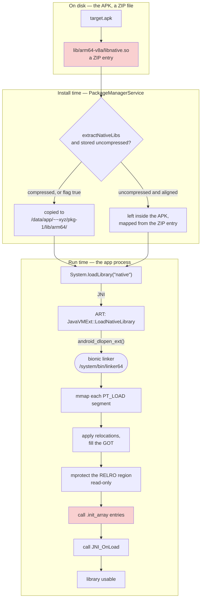
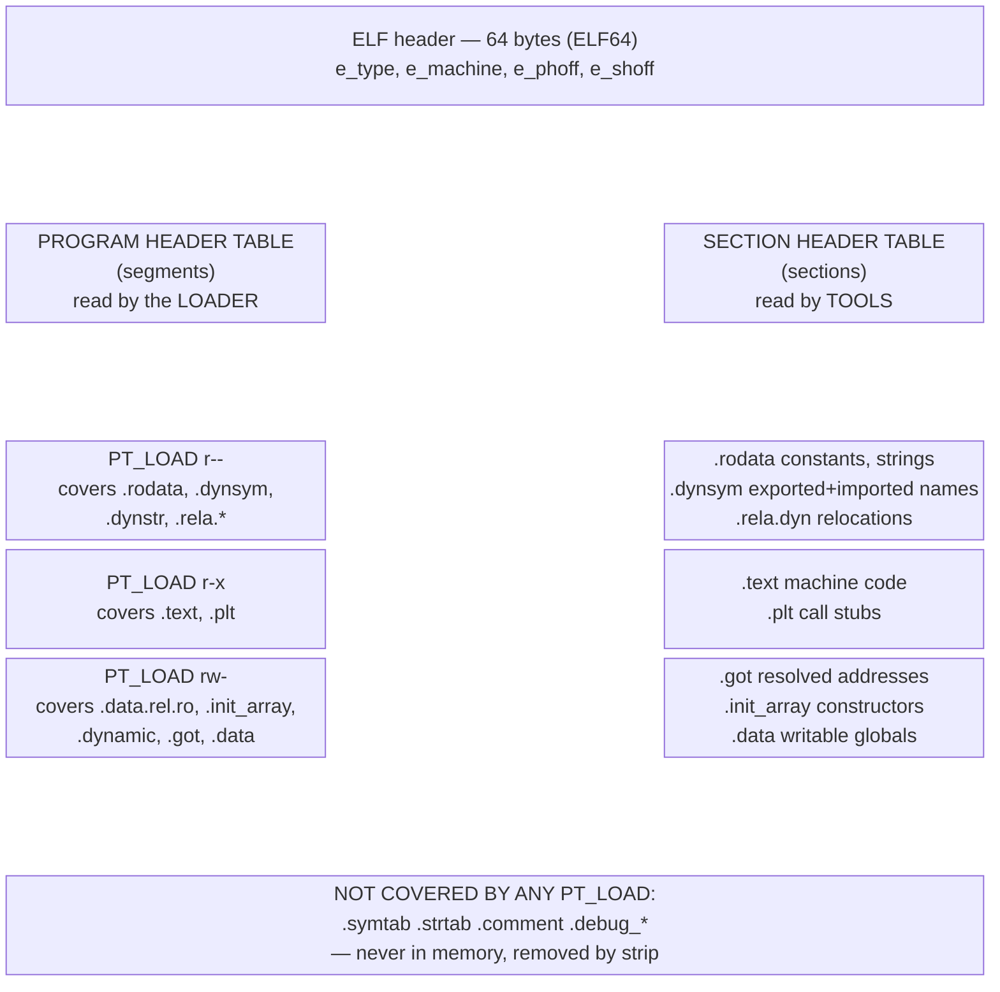
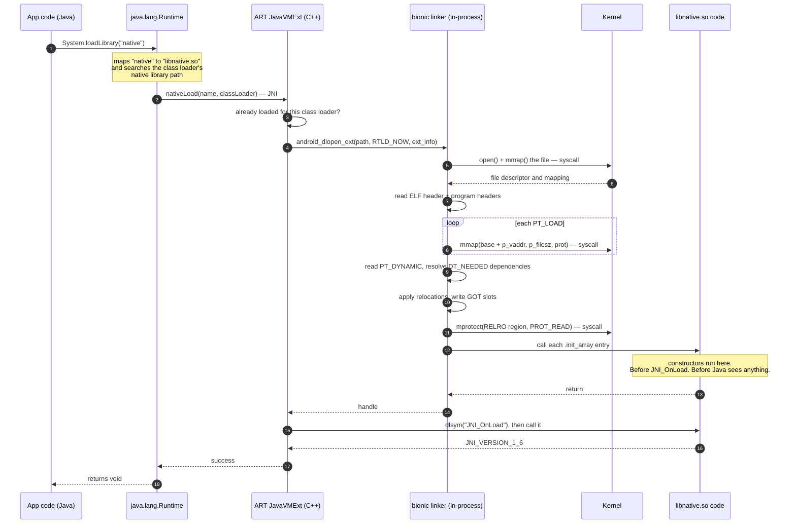
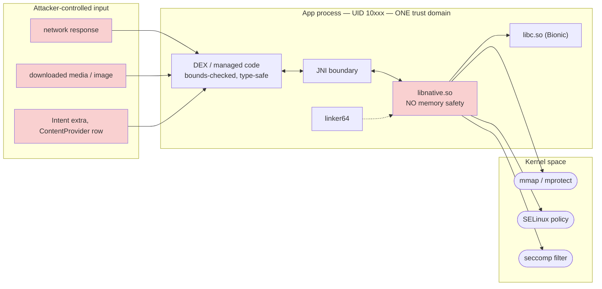
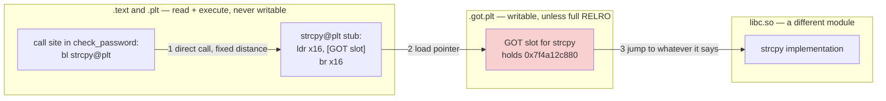
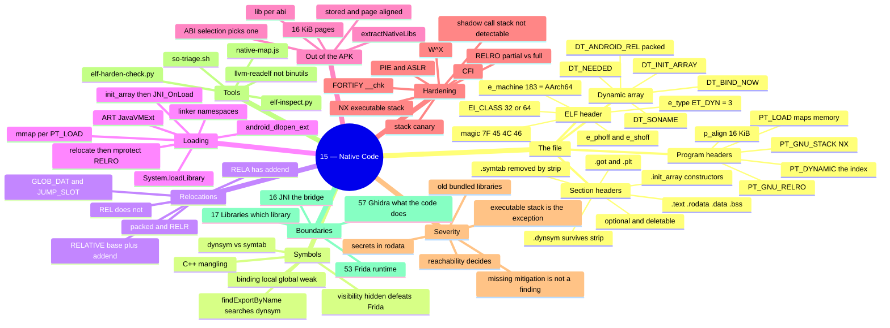

# 15 — Native Code

> After this chapter you will be able to open any Android `.so` file with nothing but a hex editor
> and Python, read its ELF header, segments, sections, symbols and relocations by hand, explain
> exactly what the dynamic linker does with each of them, run a hardening checklist against it that
> distinguishes a missing mitigation from a finding, and say precisely which memory-safety guarantees
> the app lost the moment execution crossed into it.

**Prerequisites:** [01-Computer-Science-Basics](../01-Computer-Science-Basics/README.md) (memory, the
stack, processes, virtual memory), [02-Linux-Basics](../02-Linux-Basics/README.md) (processes and
`/proc`), [10-APK-Internals](../10-APK-Internals/README.md) (what is inside an APK),
[11-Android-Runtime](../11-Android-Runtime/README.md) (what managed code guarantees),
[12-DEX-Internals](../12-DEX-Internals/README.md) (`ACC_NATIVE`, and where those methods lead)

**Applies to:** Android 5.0 – 16 (API 21 – 36). ELF itself is version-independent; the Android
specifics — PIE enforcement, text-relocation rejection, `extractNativeLibs`, packed relocations, 16
KiB pages — are called out with a version matrix in §3.18.

---

## Table of Contents

1. [Introduction](#1-introduction)
2. [High-Level Architecture](#2-high-level-architecture)
3. [Deep Internal Working](#3-deep-internal-working)
4. [Source Code Walkthrough (AOSP)](#4-source-code-walkthrough-aosp)
5. [Security Perspective](#5-security-perspective)
6. [Reverse Engineering Perspective](#6-reverse-engineering-perspective)
7. [Dynamic Analysis](#7-dynamic-analysis)
8. [Static Analysis](#8-static-analysis)
9. [Examples](#9-examples)
10. [Common Interview Questions](#10-common-interview-questions)
11. [Common Mistakes](#11-common-mistakes)
12. [Hands-on Labs](#12-hands-on-labs)
13. [Summary](#13-summary)
14. [References](#14-references)

---

## 1. Introduction

### 1.1 The shop and the back room

Imagine a shop. The front of the shop is glass. Everything on the shelves is labelled, priced and
arranged so that customers can find things; the till is in plain view; the staff wear name badges.
Anyone can walk in, look around, and work out how the business operates in about ten minutes.

Behind the shop is a back room. There are no labels. There are no windows. The shelves hold
unmarked boxes that the staff recognise by position and habit rather than by name. Nothing in there
is *hidden* exactly — you could walk in — but nothing helps you either. Working out what happens in
the back room takes an afternoon, not ten minutes.

An Android application has both. The front of the shop is the DEX file: Java and Kotlin compiled to
Dalvik bytecode, carrying full class names, method names, field names and type signatures, in a
format Google publishes a specification for. Point `jadx` at it and you get something close to the
original source, with the original names, in seconds. That is not a flaw in DEX; it is what the
format is *for*. The runtime needs those names to do reflection, to resolve virtual calls, to
enforce access, and to load classes by name.

The back room is the `lib/arm64-v8a/libsomething.so` file sitting a few directories away in the same
APK. It holds machine code for the CPU. There are no method names in it except the handful that had
to be published so that other code could call them. There are no local variable names. There are no
types. There is no line-number table. Nothing about it is encrypted, but nothing about it is
helpful. It is the back room.

**This chapter is about the back room, and specifically about the box it comes in.** That box has a
name: ELF.

### 1.2 What problem existed before this, and what breaks without it

Before shared libraries, every program that wanted to draw a JPEG carried its own copy of the JPEG
decoder. A phone with forty apps that each decode images would carry forty decoders, in forty files,
occupying forty copies of physical memory. Fixing a bug in the decoder meant rebuilding all forty.

> **📖 Definition — shared library**
> A file of machine code and data that several running programs use *at the same time*, with the
> operating system arranging for exactly one copy of the code to exist in physical memory no matter
> how many processes are using it. On Linux and Android the file extension is `.so`, for **s**hared
> **o**bject. On Windows the same idea is a `.dll`; on macOS a `.dylib`.

Take shared libraries away from Android and three things break immediately.

1. **Memory use explodes.** `libc.so` — the C library, with `malloc`, `strcpy`, `open`, `socket` and
   about fifteen hundred other functions — is used by every single process on the device, including
   `system_server` and every app. One shared copy costs a couple of megabytes of physical RAM. Two
   hundred private copies would cost hundreds.
2. **Security patching becomes impossible.** When a bug is found in the system's SSL implementation,
   the fix has to reach every app. If every app had baked in its own copy, every app would need
   rebuilding and reshipping. Shared libraries mean the fix lands once.
3. **The Android platform itself stops working.** The Android framework is not Java all the way
   down. `system_server`, the media stack, the graphics stack, Binder, Bionic, ART itself — these are
   C and C++. They live in `.so` files. Managed code is a layer on top of native code, not a
   replacement for it.

### 1.3 What a `.so` actually is, in one paragraph

It is a file. The first four bytes are `7F 45 4C 46` — a byte with the value 127, then the ASCII
letters `E`, `L`, `F`. After that comes a small fixed-size header describing the file, then two
tables. One table tells the *loader* which ranges of the file to copy into memory, where to put
them, and whether each range should be readable, writable or executable. The other table tells
*tools* — linkers, debuggers, disassemblers — what each region contains and what it is called. Then
comes the content those tables describe: machine code, constants, string literals, tables of
addresses, and a list of names the file exports or needs. That is all. There is no compression, no
encryption and no obfuscation in the format itself.

> **🧠 Mental Model**
> An ELF file is a **shipping container with two manifests**. One manifest is for the crane operator
> who has to move the container: it says which sections are heavy, which must stay upright, and
> where each goes. The other manifest is for customs: it lists the contents by name and category.
> The crane operator never reads the customs manifest, and the container moves perfectly well
> without it — which is exactly why release builds throw the customs manifest away, and why doing so
> costs the reader far less than developers imagine.

### 1.4 Why an app would put code here on purpose

Four reasons, in the order you will meet them.

| Reason | What it looks like | How common |
|---|---|---|
| **Performance** | Video codecs, image processing, physics, machine-learning inference, cryptography | Very common |
| **Reusing existing C/C++** | OpenSSL, SQLite, FFmpeg, libpng, Skia, a game engine, a vendor SDK | Extremely common — most native code in an APK is somebody else's |
| **Access to something Java cannot reach** | Direct syscalls, `/proc` reading that the framework filters, hardware features, `ptrace` | Occasional |
| **To make it harder to read** | Root detection, integrity checks, licence validation, request signing, key derivation | Common in anything with money or DRM in it |

The last row is the one this chapter and the ones after it exist for. When a developer decides that
a check "must not be bypassable", the near-universal reaction is to move it out of Java and into C.
That reaction is understandable and it does raise the cost of an attack. It does not change the
outcome. Everything in the `.so` runs in the *app's own process*, on hardware you control, and every
decision it makes eventually has to be expressed as a value handed back across the JNI boundary,
where it is plaintext again.

> **🔍 Pentester's Note**
> "We moved the root check into native code" is a statement about *effort*, not about *possibility*.
> The check still runs in a process you can attach to, in memory you can read and write, and its
> answer still has to travel back to Java. [37-RootDetection](../37-RootDetection/README.md) has a
> whole lab on exactly this. Your job in the report is to say honestly how much the migration raised
> the bar — because it does raise it — and then to demonstrate the bypass anyway.

### 1.5 The part chapter 11 promised you: what is lost at the boundary

[11-Android-Runtime](../11-Android-Runtime/README.md) makes a careful claim about managed code, and
lists four holes in it. This chapter is the first hole, so here is the claim stated precisely and
then dismantled.

Managed code — Java and Kotlin running on ART — guarantees four things about memory:

| Property | What it means | Enforced by |
|---|---|---|
| **Bounds checking** | `a[i]` where `i` is outside the array throws `ArrayIndexOutOfBoundsException` instead of touching neighbouring memory | The bytecode verifier and runtime checks |
| **Type safety** | A reference to a `String` cannot be reinterpreted as a reference to a `File` | The verifier |
| **No manual free** | There is no `free()`, so there is no use-after-free and no double-free | Garbage collection |
| **No pointer arithmetic** | There is no way to compute an address and dereference it | The language has no syntax for it |

Cross into `libfoo.so` and **all four are gone at once**. Not weakened — gone. C has no bounds
checks, so `buf[i] = c` writes wherever `i` points. C has no type safety at run time, so a `char*`
becomes a function pointer with a cast. C requires manual `free()`, so use-after-free and
double-free are ordinary programming errors rather than impossibilities. And pointer arithmetic is
the language's central idiom.

The consequence is blunt: **an app written entirely in Kotlin that links one C library has a
memory-corruption attack surface, and an app written entirely in Kotlin that links none does not.**
Historically, the overwhelming majority of remotely-triggerable Android memory-corruption
vulnerabilities have been in native code — media parsers, image decoders, font rasterisers, network
protocol implementations — because that is where untrusted bytes meet a language with no guard
rails.

This is *why* the mitigation checklist in §3.14 exists. Every item on it is a mechanism for making a
memory-safety bug harder to turn into code execution, invented precisely because C cannot be relied
on not to have one.

> **⚠️ Warning**
> Do not over-rotate. A memory-corruption *attack surface* is not a memory-corruption
> *vulnerability*, and a native library in an app is not a finding. Most Android native code
> processes only data the app itself produced, is never reached by attacker-controlled bytes, and
> will never be exploited by anyone. §5.7 is the section on saying this honestly, and it is the
> section other chapters cite when they need a severity judgement.

### 1.6 What this chapter owns, and what it does not

This repository splits the native layer across several chapters on purpose, because they are
genuinely different skills. Getting the boundaries right will save you hours.

| Question | Chapter |
|---|---|
| What is in the file, byte by byte? How does the linker load it? What hardening does it have? | **15 — this chapter** |
| How does Java call into it, and it back into Java? What is `JNIEnv`? How are methods registered? | [16-JNI](../16-JNI/README.md) |
| *Which* third-party library is this, and what version? Is that version vulnerable? | [17-Libraries](../17-Libraries/README.md) |
| What does this function actually do? How do I read the decompiled C? | [57-Ghidra](../57-Ghidra/README.md) |
| How do I hook it at run time? | [53-Frida](../53-Frida/README.md) |
| What does this AArch64 instruction mean? | 18-ARM |
| How is the heap laid out, and how do I groom it? | 19-Memory |

A useful test: if the answer comes out of `readelf`, it belongs here. If it comes out of a
decompiler, it belongs in 57. If it comes out of a running process, it belongs in 53.

### 1.7 Six questions this chapter answers

1. What are the bytes at the start of `libfoo.so`, and what does each one mean?
2. When `System.loadLibrary("foo")` returns, what has physically happened to this device's memory?
3. Where did the function names go, why do some survive stripping, and what is
   `Module.findExportByName` actually searching?
4. What are PLT and GOT, why does that indirection exist, and why is it the classic hooking target?
5. What is the complete set of hardening mitigations, how do I observe each one in a file, and what
   is each one actually protecting against?
6. When is a missing mitigation a finding, and when is writing it up as one simply wrong?

---

## 2. High-Level Architecture

### 2.1 From APK entry to mapped page



Read the diagram from the top. The library begins life as an ordinary entry in a ZIP archive —
nothing more special than an icon or a layout file. At install time the package manager makes one
decision that has consequences all the way down: whether to extract the library to a private
directory, or to leave it in the APK and map it directly from there. §3.11 covers why that decision
exists and what it costs.

At run time, `System.loadLibrary` is a Java method, but it does almost nothing itself: it works out
the file name, and hands the job to ART, which hands it to the dynamic linker. The linker does the
real work in five distinct steps, and all five matter to you:

- **`mmap`** copies nothing. It tells the kernel "when someone touches this address range, fetch
  those bytes from that file". This is why loading a 40 MB library is fast and why the library's
  code is shared between processes.
- **Relocation** patches the addresses. A shared library does not know where it will be loaded, so
  every absolute address in it is a blank the linker fills in. §3.7.
- **RELRO** then makes the patched region read-only, so nothing can rewrite it later. §3.8.
- **`.init_array`** runs the library's constructors. **This is app code executing, and it happens
  before `JNI_OnLoad` and before `System.loadLibrary` has returned to Java.** It is coloured as
  attacker-relevant in the diagram because it is where anti-analysis code lives. §3.12.
- **`JNI_OnLoad`** is the first function the *runtime* calls by name, and is where dynamic method
  registration happens — chapter 16's subject.

### 2.2 The two tables, and who reads which



This diagram is the single most useful thing to hold in your head about ELF, and almost every
confusion about the format dissolves once you have it.

**Segments and sections describe the same bytes at different granularities.** A segment is a
contiguous run of the file that gets mapped into memory with one set of permissions. A section is a
named region with a purpose. One segment typically covers several sections — the read-execute
segment covers `.text` and `.plt`; the read-write segment covers `.data`, `.got` and `.init_array`.

**The loader reads only the program header table.** It does not know that `.text` exists. It knows
that bytes 0xab4 through 0xf00 of the file should be mapped read-execute. Section names are
irrelevant to execution.

**Which is why stripping works, and why it works less well than developers hope.** Removing the
section header table costs the program nothing. But the *dynamic* symbol table, `.dynsym`, is
covered by a `PT_LOAD` segment and pointed at by the dynamic array, because the linker genuinely
needs it at run time to resolve names between libraries. It cannot be removed. So a stripped library
still tells you every function it exports — including every statically registered JNI entry point.
§3.6 is the full treatment.

### 2.3 What `System.loadLibrary` sets in motion



Every arrow labelled *syscall* is a boundary you can observe with `strace`, and every step between
them is something you can hook with Frida. The two facts worth memorising:

1. **Constructors run before `JNI_OnLoad`, which runs before `loadLibrary` returns.** If an app
   wants a check to happen before your instrumentation is in place, `.init_array` is the earliest
   opportunity it has. Attaching Frida *after* the app has started means all of this already
   happened; spawning with `-f` and instrumenting at the linker is how you get in front of it.
2. **The linker runs inside the app's process.** It is not a separate program. `linker64` is mapped
   into every process and its code, data and internal structures are all readable and writable by
   anything else in that process — including you.

### 2.4 Trust boundaries at the native layer



The critical observation is what is *inside* one box. The managed code and the native code are in
**the same process, the same UID, the same address space, and the same trust domain**. There is no
boundary between them. A memory-corruption bug in `libnative.so` does not "escape into" the app's
privileges — it already has them, all of them, from the first instruction.

The boundaries that do exist are below: the kernel, SELinux
([21-App-Sandbox](../21-App-Sandbox/README.md) and 22-SELinux), and seccomp. Native code reaches
those directly rather than through the framework, which is exactly why it can bypass framework-level
controls, and exactly why `syscall` appearing in a library's import table is worth a second look.

The red boxes on the left are where the analysis starts. Trace attacker-controlled bytes from where
they enter to whether they reach the red box on the right. If they do, the mitigation checklist
suddenly matters a great deal. If they do not, it is hygiene.

---

## 3. Deep Internal Working

This is the long section. It answers **what**, **why**, **when**, **where** and **how** for every
part of the format and the loading process, and every table in it is something you will reread
during an engagement.

### 3.1 What "shared object" means, precisely

**What.** A shared object is an ELF file with `e_type == ET_DYN` (the value 3) that is designed to
be mapped into an already-running process, at an address chosen at load time, and to have its
unresolved references filled in by the dynamic linker.

**Why it works at all.** Two mechanisms, both of which you need to understand before relocations
make sense:

- **Position-independent code.** The compiler emits code that never hard-codes an absolute address.
  On AArch64, references to nearby code and data use PC-relative addressing (`adrp` + `add`), which
  computes an address relative to the current instruction. Move the whole library and every such
  reference still works, because the *distance* did not change.
- **Indirection through a table for everything else.** Anything the compiler cannot express as a
  fixed distance — a call into another library, the address of a global that another library might
  also define — goes through a table of pointers filled in at load time. That table is the GOT.
  §3.8.

**When it is decided.** At compile and link time. `-fPIC` tells the compiler to emit
position-independent code; `-shared` tells the linker to produce an `ET_DYN` file with no entry
point requirement. On Android there is no alternative: since API 21 the linker refuses to load a
non-PIE executable at all.

**Where the sharing actually happens.** In the kernel's page cache. When two processes `mmap` the
same file with the same offset and `PROT_READ | PROT_EXEC`, the kernel maps the same *physical*
pages into both address spaces. The read-write segment is different: it is mapped
`MAP_PRIVATE`, so the first write to a page triggers copy-on-write and each process gets its own
copy of just that page. Code is shared; data is not.

> **🔬 Under the Hood**
> This is why `.data` and `.got` being writable has a memory cost and `.text` does not, and it is
> why full RELRO is nearly free: the RELRO region is written once during relocation, taking the
> copy-on-write hit anyway, and then made read-only. The pages are already private by then.

### 3.2 The ELF header, field by field

**What.** The first 64 bytes of a 64-bit ELF file (52 on 32-bit). Fixed size, fixed layout, always
at offset 0.

**Why it is first and fixed.** Nothing else can be read until it has been. It answers "how wide are
the pointers in this file", "what byte order", "which CPU", and "where are the two tables" — every
one of which you must know before you can parse anything else.

The first 16 bytes are `e_ident`, and they are **identical in layout in every ELF file that has
ever existed**, regardless of width or byte order. They have to be, for the same reason.

| Offset | Field | Size | Meaning | Values you will see on Android |
|---|---|---|---|---|
| `0x00` | `e_ident[EI_MAG0..3]` | 4 | Magic | `7F 45 4C 46` |
| `0x04` | `e_ident[EI_CLASS]` | 1 | Width | `1` = ELF32 (`armeabi-v7a`, `x86`), `2` = ELF64 (`arm64-v8a`, `x86_64`) |
| `0x05` | `e_ident[EI_DATA]` | 1 | Byte order | `1` = little-endian. Always, on every Android ABI |
| `0x06` | `e_ident[EI_VERSION]` | 1 | ELF version | `1` |
| `0x07` | `e_ident[EI_OSABI]` | 1 | OS ABI | `0` (System V). Android does **not** set the Linux value |
| `0x08` | `e_ident[EI_ABIVERSION]` | 1 | ABI version | `0` |
| `0x09` | `e_ident[EI_PAD]` | 7 | Padding | zero |

From offset `0x10` the layout diverges by width. The **field order is identical**; only the sizes of
the three offset/address fields change, which shifts everything after them by 12 bytes.

| Field | ELF64 offset | ELF32 offset | Size (64/32) | Meaning |
|---|---|---|---|---|
| `e_type` | `0x10` | `0x10` | 2 / 2 | Object type — see below |
| `e_machine` | `0x12` | `0x12` | 2 / 2 | Architecture |
| `e_version` | `0x14` | `0x14` | 4 / 4 | `1` |
| `e_entry` | `0x18` | `0x18` | 8 / 4 | Entry point. `0` in a plain shared library |
| `e_phoff` | `0x20` | `0x1C` | 8 / 4 | **Program header table offset** |
| `e_shoff` | `0x28` | `0x20` | 8 / 4 | **Section header table offset** — `0` means there is none |
| `e_flags` | `0x30` | `0x24` | 4 / 4 | Architecture-specific flags |
| `e_ehsize` | `0x34` | `0x28` | 2 / 2 | Size of this header: `64` or `52` |
| `e_phentsize` | `0x36` | `0x2A` | 2 / 2 | Size of one program header: `56` or `32` |
| `e_phnum` | `0x38` | `0x2C` | 2 / 2 | Number of program headers |
| `e_shentsize` | `0x3A` | `0x2E` | 2 / 2 | Size of one section header: `64` or `40` |
| `e_shnum` | `0x3C` | `0x30` | 2 / 2 | Number of section headers |
| `e_shstrndx` | `0x3E` | `0x32` | 2 / 2 | Index of the section holding section *names* |

**`e_type` — the four values, and the one you will see.**

| Value | Name | What it is |
|---|---|---|
| 1 | `ET_REL` | A relocatable object file — a `.o`, the output of one compilation |
| 2 | `ET_EXEC` | An executable with a fixed load address. **Refused by Android's linker since API 21** |
| 3 | `ET_DYN` | A shared object, or a position-independent executable. **Everything on Android** |
| 4 | `ET_CORE` | A core dump |

> **🔬 Under the Hood**
> `e_type == 3` for both a `.so` and a PIE executable is not sloppiness; it is the point. A PIE
> executable *is* a shared object that happens to have an entry point. It is loaded at a randomised
> base like any library, which is precisely what makes ASLR possible for the main program. The two
> can be told apart by `e_entry` being non-zero and by `DF_1_PIE` (`0x08000000`) appearing in
> `DT_FLAGS_1`. That one byte at offset `0x10` is a security policy expressed in a file format.

**`e_machine` — which `lib/<abi>/` directory this belongs in.**

| Value | Hex | Name | APK directory |
|---|---|---|---|
| 3 | `0x03` | `EM_386` | `lib/x86/` |
| 40 | `0x28` | `EM_ARM` | `lib/armeabi-v7a/` |
| 62 | `0x3E` | `EM_X86_64` | `lib/x86_64/` |
| 183 | `0xB7` | `EM_AARCH64` | `lib/arm64-v8a/` |
| 243 | `0xF3` | `EM_RISCV` | `lib/riscv64/` (Android 14 onwards, experimental) |

> **🔍 Pentester's Note**
> Check that `e_machine` agrees with the directory the file was stored in. A 64-bit library sitting
> in `lib/armeabi-v7a/` is either never loaded — the device picks the directory by ABI, finds a
> library it cannot use, and the load fails — or it is a deliberate hiding place for a payload that
> the app `dlopen`s by absolute path later. `elf-harden-check.py --apk` reports the mismatch
> explicitly for this reason.

### 3.3 Program headers: what the loader reads

**What.** An array of `e_phnum` entries, each `e_phentsize` bytes, starting at file offset
`e_phoff`. Each entry describes one *segment*.

**Why they exist separately from sections.** Because the loader's question is different from the
linker's question. The loader asks "which bytes go where in memory, with what permissions". It does
not care what the bytes are called. Keeping that answer in its own compact table means the loader
reads a few hundred bytes and never touches the rest of the file's metadata.

**ELF64 program header layout — 56 bytes:**

| Offset | Field | Size | Meaning |
|---|---|---|---|
| `0x00` | `p_type` | 4 | What kind of segment |
| `0x04` | `p_flags` | 4 | Permissions: `PF_R`=4, `PF_W`=2, `PF_X`=1 |
| `0x08` | `p_offset` | 8 | Offset in the **file** |
| `0x10` | `p_vaddr` | 8 | Virtual address, **relative to the load base** |
| `0x18` | `p_paddr` | 8 | Physical address — unused on Android |
| `0x20` | `p_filesz` | 8 | Bytes to take from the file |
| `0x28` | `p_memsz` | 8 | Bytes to occupy in memory |
| `0x30` | `p_align` | 8 | Required alignment |

**ELF32 program header layout — 32 bytes. Note that `p_flags` MOVES:**

| Offset | Field | Size |
|---|---|---|
| `0x00` | `p_type` | 4 |
| `0x04` | `p_offset` | 4 |
| `0x08` | `p_vaddr` | 4 |
| `0x0C` | `p_paddr` | 4 |
| `0x10` | `p_filesz` | 4 |
| `0x14` | `p_memsz` | 4 |
| `0x18` | `p_flags` | 4 |
| `0x1C` | `p_align` | 4 |

> **⚠️ Warning**
> That relocation of `p_flags` from offset 4 to offset 0x18 is the single most common bug in a
> hand-written ELF parser. The symptom is nonsensical permissions on 32-bit files — a `PT_LOAD`
> that appears to be `--X` or `-W-` with no read bit. If you see that, check this field before you
> conclude anything about the binary. `examples/elf_header_by_hand.py` gets it right and comments
> the trap.

**Segment types that matter.**

| `p_type` | Value | What it means | Why you care |
|---|---|---|---|
| `PT_NULL` | 0 | Unused entry | Ignore |
| `PT_LOAD` | 1 | **Map this into memory** | The only type that creates memory. Everything else is metadata |
| `PT_DYNAMIC` | 2 | Points at the dynamic array | How the linker finds everything else. §3.9 |
| `PT_INTERP` | 3 | Path of the interpreter | `/system/bin/linker64`. Present in executables, absent in libraries |
| `PT_NOTE` | 4 | Notes | Build ID, `.note.android.ident` |
| `PT_PHDR` | 6 | The program header table itself | Lets loaded code find its own headers |
| `PT_TLS` | 7 | Thread-local storage template | Each thread gets a copy |
| `PT_GNU_EH_FRAME` | `0x6474E550` | Exception unwind tables | Used by C++ exceptions and by backtraces |
| `PT_GNU_STACK` | `0x6474E551` | **Stack permissions** | If `PF_X` is set, the stack is executable. §3.14 |
| `PT_GNU_RELRO` | `0x6474E552` | **Region to make read-only after relocation** | The RELRO mitigation. §3.14 |
| `PT_GNU_PROPERTY` | `0x6474E553` | Architecture feature notes | Carries BTI/PAC/shadow-stack markers on newer toolchains |

**How to read a `PT_LOAD` row, in one sentence:** take `p_filesz` bytes starting at file offset
`p_offset`, map them at `load_base + p_vaddr` with permissions `p_flags`, and zero-fill from there
up to `p_memsz`.

That last clause is `.bss`. Uninitialised globals occupy no bytes in the file at all — the gap
between `p_filesz` and `p_memsz` is how many zeroed bytes to conjure. A library with a 1 MB static
buffer costs nothing on disk.

**A real example**, from `libdemo-hard.so` built in `examples/`:

```text
# host — python3 scripts/elf-inspect.py libdemo-hard.so --segments
  #   type           offset     vaddr              filesz     memsz      flg  align
  0   PHDR           0x40       0x40               0x230      0x230      R--  0x8
  1   LOAD           0x0        0x0                0xab4      0xab4      R--  0x4000
  2   LOAD           0xab4      0x4ab4             0x44c      0x44c      R-X  0x4000
  3   LOAD           0xf00      0x8f00             0x228      0x228      RW-  0x4000
  4   LOAD           0x1128     0xd128             0x8        0x8        RW-  0x4000
  5   DYNAMIC        0xf20      0x8f20             0x1a0      0x1a0      RW-  0x8
  6   GNU_RELRO      0xf00      0x8f00             0x228      0x1100     R--  0x1
  7   GNU_EH_FRAME   0x860      0x860              0x8c       0x8c       R--  0x4
  8   GNU_STACK      0x0        0x0                0x0        0x0        RW-  0x0
  9   NOTE           0x270      0x270              0x98       0x98       R--  0x4
```

Four things to read out of that, in order:

1. **Four `PT_LOAD` segments, with distinct permissions.** Read-only data, then read-execute code,
   then two read-write regions. Modern linkers separate these tightly so that no page is ever both
   writable and executable. Older binaries often had three.
2. **`GNU_STACK` is `RW-`.** No execute bit. NX is in effect.
3. **`GNU_RELRO` has `memsz` (0x1100) much larger than `filesz` (0x228).** The region to protect
   extends past the bytes that came from the file, because it includes `.bss`-like relocated data.
4. **`align` is `0x4000`.** 16 KiB. This library was linked with `-Wl,-z,max-page-size=16384` and
   will load on a 16 KiB-page device. The default is `0x1000` and will not. §3.11.

### 3.4 `ET_DYN`, load bias, and the address arithmetic you will do constantly

**What.** Every address inside an `ET_DYN` file is *relative*. The linker picks a base address `L`
at load time, maps everything at `L + p_vaddr`, and from then on the runtime address of anything is
`L + its_file_virtual_address`.

**Why the base is random.** Address Space Layout Randomisation. If an attacker has a memory-safety
bug and wants to redirect execution to a useful piece of code, they need that code's address. If the
base is randomised on every process start, they have to leak it first. ASLR does not fix the bug; it
adds a required step.

> **📖 Definition — ASLR**
> Address Space Layout Randomisation: the kernel and linker place the executable, each shared
> library, the heap, the stack and the thread stacks at addresses chosen randomly at process start,
> so that no address is predictable between runs. Android has had ASLR since 4.0 and full PIE
> enforcement since 5.0. On 64-bit ARM the entropy is large enough that brute forcing is not
> practical; on 32-bit ARM it is considerably weaker.

**The arithmetic, which you will do a hundred times:**

```text
runtime_address = module_base + file_virtual_address
file_virtual_address = runtime_address - module_base
```

This is why the address you noted in Ghidra (`0x4b04`) never matches what Frida prints
(`0x7b2c14ab04`), and why the *difference* between the two is the same for every address in that
module. Get the base once and every subsequent conversion is arithmetic.

```javascript
// Frida REPL — the conversion, both directions
var base = Module.findBaseAddress('libnative.so');
var runtime = base.add(0x4b04);            // Ghidra address -> live address
var back = runtime.sub(base);              // live address -> Ghidra address
console.log(base, runtime, back);
```

```bash
# adb shell (root) — the same base, from the kernel's own bookkeeping
grep -m1 libnative.so /proc/$(pidof com.example.app)/maps
# 7b2c146000-7b2c14b000 r--p 00000000 fd:03 123456  /data/app/.../libnative.so
#  ^ the first r--p mapping of the file is the load base
```

> **⚠️ Warning**
> Take the base from the **first** mapping of the file, the one with file offset `00000000`. A
> library appears in `/proc/<pid>/maps` as several consecutive lines, one per `PT_LOAD`, and taking
> the `r-xp` line instead gives you an address that is off by whatever `p_vaddr` the code segment
> had. `Module.findBaseAddress` already gets this right; hand-reading `maps` is where people get it
> wrong.

### 3.5 Sections: what tools read, and what you will name in findings

**What.** An array of `e_shnum` entries, each `e_shentsize` bytes, at file offset `e_shoff`, each
describing one named region. Section *names* live in a string table whose index is `e_shstrndx`,
which is why parsing sections takes two passes.

**Why they can be deleted.** The loader never reads them. `strip` removes the ones not covered by a
`PT_LOAD`, and a packer can remove the whole table by zeroing `e_shoff` and `e_shnum` — leaving a
file that loads and runs perfectly while most naive tools report nothing.

**ELF64 section header layout — 64 bytes:**

| Offset | Field | Size | Meaning |
|---|---|---|---|
| `0x00` | `sh_name` | 4 | Offset into the section-name string table |
| `0x04` | `sh_type` | 4 | What kind of section |
| `0x08` | `sh_flags` | 8 | `SHF_WRITE`=1, `SHF_ALLOC`=2, `SHF_EXECINSTR`=4 |
| `0x10` | `sh_addr` | 8 | Virtual address, or **0 if never mapped** |
| `0x18` | `sh_offset` | 8 | File offset |
| `0x20` | `sh_size` | 8 | Size |
| `0x28` | `sh_link` | 4 | Index of a related section — for `.dynsym` this is its string table |
| `0x2C` | `sh_info` | 4 | Type-dependent extra |
| `0x30` | `sh_addralign` | 8 | Alignment |
| `0x38` | `sh_entsize` | 8 | Size of one entry, for table-like sections |

On ELF32 every field is 4 bytes and the header is 40 bytes; the order is identical.

**The sections you will actually name.**

| Section | `sh_type` | Mapped? | Contents | Why it matters to you |
|---|---|---|---|---|
| `.text` | `PROGBITS` | r-x | Machine code | What you disassemble |
| `.rodata` | `PROGBITS` | r-- | Constants, string literals, jump tables | **Where hardcoded keys, URLs and paths live** |
| `.data` | `PROGBITS` | rw- | Initialised writable globals | Function pointers here are not protected by RELRO |
| `.bss` | `NOBITS` | rw- | Zero-initialised globals | No bytes in the file |
| `.data.rel.ro` | `PROGBITS` | rw- then r-- | Globals needing relocation, e.g. C++ vtables | Inside the RELRO region |
| `.plt` | `PROGBITS` | r-x | Call stubs for imports | §3.8 |
| `.got` | `PROGBITS` | rw- / r-- | Addresses of resolved symbols | **The classic hooking target** |
| `.got.plt` | `PROGBITS` | rw- | Addresses for lazily-bound functions | Writable unless full RELRO |
| `.dynamic` | `DYNAMIC` | r-- | The `DT_*` array | §3.9 |
| `.dynsym` | `DYNSYM` | r-- | Exported and imported symbols | **Survives stripping. Your symbol source** |
| `.dynstr` | `STRTAB` | r-- | Names for `.dynsym` | |
| `.rela.dyn` / `.rel.dyn` | `RELA` / `REL` | r-- | Data relocations | §3.7 |
| `.rela.plt` / `.rel.plt` | `RELA` / `REL` | r-- | PLT relocations | The GOT-slot-to-import map |
| `.init_array` | `INIT_ARRAY` | rw- then r-- | Constructor pointers | **Runs before `JNI_OnLoad`** |
| `.fini_array` | `FINI_ARRAY` | rw- then r-- | Destructor pointers | Runs at unload |
| `.gnu.hash` / `.hash` | | r-- | Symbol lookup acceleration | Lets you count symbols with no section headers |
| `.note.gnu.build-id` | `NOTE` | r-- | Unique build hash | Match a stripped `.so` to an unstripped one |
| `.note.android.ident` | `NOTE` | r-- | NDK target API level | Dates the build |
| `.symtab` | `SYMTAB` | **not mapped** | All symbols, including internal | **Removed by `strip`** |
| `.strtab` | `STRTAB` | not mapped | Names for `.symtab` | Removed by `strip` |
| `.comment` | `PROGBITS` | not mapped | Compiler and linker banner | Exact NDK and clang version |
| `.debug_*` | `PROGBITS` | not mapped | DWARF debug info | Jackpot when present; almost never is |

> **🔍 Pentester's Note**
> `.init_array` is the most under-examined region in an Android native library, and it takes ten
> seconds to look at. Every pointer in it runs at load time. C++ static constructors land there
> legitimately, so the count is rarely zero — but a C library with four `.init_array` entries and no
> C++ is telling you something. Read them before anything else:
>
> ```bash
> # host
> python3 scripts/elf-inspect.py libnative.so --init
> ```

### 3.6 Symbols: `.dynsym`, `.symtab`, and what `findExportByName` searches

This is the section that answers the question 53-Frida sends readers here for, so it is worth
reading slowly.

**What a symbol is.** A name paired with an address, a size, a type and a binding. The compiler
emits one for every function and global variable. The linker uses them to connect a call in one
object file to a definition in another.

**The two tables, and the difference between them.**

| | `.symtab` | `.dynsym` |
|---|---|---|
| Contains | **Every** symbol: global, local, static functions, file names | Only symbols involved in **dynamic** linking: exports and imports |
| Mapped into memory? | **No** — `sh_addr` is 0 | **Yes** — covered by a `PT_LOAD` |
| Needed at run time? | No | **Yes** — the linker cannot resolve anything without it |
| Removed by `strip`? | **Yes** | **No, and it cannot be** |
| Typical size in a release `.so` | absent | tens to a few thousand entries |

**Symbol table entry layout — ELF64, 24 bytes:**

| Offset | Field | Size | Meaning |
|---|---|---|---|
| `0x00` | `st_name` | 4 | Offset into the associated string table |
| `0x04` | `st_info` | 1 | Binding in the high nibble, type in the low nibble |
| `0x05` | `st_other` | 1 | Low two bits are **visibility** |
| `0x06` | `st_shndx` | 2 | Section index. **`0` (`SHN_UNDEF`) means this is an IMPORT** |
| `0x08` | `st_value` | 8 | Address, or 0 for an import |
| `0x10` | `st_size` | 8 | Size in bytes |

**ELF32, 16 bytes — and the field order genuinely differs, it is not just narrower:**
`st_name` (4), `st_value` (4), `st_size` (4), `st_info` (1), `st_other` (1), `st_shndx` (2).

**Binding** — `st_info >> 4`:

| Value | Name | Meaning |
|---|---|---|
| 0 | `STB_LOCAL` | Not visible outside this object file. `static` functions |
| 1 | `STB_GLOBAL` | Visible to the linker |
| 2 | `STB_WEAK` | Global, but another definition wins if one exists |

**Type** — `st_info & 0xF`:

| Value | Name | Meaning |
|---|---|---|
| 0 | `STT_NOTYPE` | Unspecified — most imports |
| 1 | `STT_OBJECT` | A variable |
| 2 | `STT_FUNC` | A function |
| 3 | `STT_SECTION` | A section, used internally |
| 4 | `STT_FILE` | A source file name |
| 10 | `STT_GNU_IFUNC` | Resolved by calling a chooser function at load time |

**Visibility** — `st_other & 0x3`. This is the one that decides whether Frida can find it:

| Value | Name | Meaning |
|---|---|---|
| 0 | `STV_DEFAULT` | Normal — exported, and interposable |
| 1 | `STV_INTERNAL` | Reserved |
| 2 | `STV_HIDDEN` | **Not placed in `.dynsym` at all.** Invisible outside the library |
| 3 | `STV_PROTECTED` | In `.dynsym`, but references inside this library always bind locally |

**Now the payoff. `Module.findExportByName("libnative.so", "decrypt")` searches `.dynsym` and only
`.dynsym`.** Not `.symtab`. Not the source. Not a database. It walks the dynamic symbol table of the
named module — via `.gnu.hash` for speed — looking for a defined symbol with that exact name.

Which produces four consequences you must be able to recite:

1. **Stripping does not break it.** `strip` removes `.symtab`. `.dynsym` is required at run time and
   stays. Every exported function in a stripped release library still resolves by name.
2. **Hidden visibility does break it.** A function compiled with
   `__attribute__((visibility("hidden")))`, or in a library built with `-fvisibility=hidden` (which
   is common, and good practice), is not in `.dynsym`. It is still in `.text`, still executes, and
   simply has no name at run time. Frida cannot find it, `nm -D` cannot list it, and the only way to
   reach it is by offset from something that *is* exported.
3. **C++ names are mangled.** `Crypto::decrypt(char const*)` is not the symbol `decrypt`; it is
   something like `_ZN6Crypto7decryptEPKc`. Searching for the source-level name finds nothing.
   `llvm-cxxfilt` demangles; `Module.enumerateExports()` with a substring filter is the practical
   approach.
4. **`null` as the module name searches everything.** `Module.findExportByName(null, "open")` walks
   every loaded module in link order and returns the first match. If two libraries export the same
   name, you get the linker's answer, which may not be the one the code you are studying is calling.
   Name the module whenever it matters.

Here is the effect demonstrated on the chapter's own fixture. `internal_checksum` is declared
hidden; `public_checksum` is not:

```text
# host — python3 scripts/elf-inspect.py libdemo-hard.so --symbols --grep checksum
.symtab -- 2 shown of 53
  value              size     type     bind       vis    name
  0x4df8             40       FUNC     LOCAL      HIDDEN internal_checksum
  0x4e20             40       FUNC     GLOBAL     DEFAULT public_checksum

# host — the SAME library, stripped, looking at .dynsym instead
# python3 scripts/elf-inspect.py libdemo-hard-stripped.so --dynsyms --defined-only
  0x4b04             188      FUNC     GLOBAL     DEFAULT check_password
  0x4bc0             72       FUNC     GLOBAL     DEFAULT build_command
  0x4cac             84       FUNC     GLOBAL     DEFAULT run_helper
  0x4db0             16       FUNC     GLOBAL     DEFAULT set_logger
  0xd128             8        OBJECT   GLOBAL     DEFAULT g_logger
  0x4dc0             24       FUNC     GLOBAL     DEFAULT emit
  0x4e20             40       FUNC     GLOBAL     DEFAULT public_checksum
```

`internal_checksum` is in the unstripped `.symtab` as `LOCAL`/`HIDDEN`, and is **absent from
`.dynsym` entirely**. After stripping there is no trace of the name anywhere in the file — but the
code is still at `0x4df8`, and `public_checksum` at `0x4e20` calls it, which is exactly how you find
it: land on the export, follow the call.

> **🧠 Mental Model**
> `.dynsym` is the **reception desk**: the list of people the building will admit visitors for.
> `.symtab` is the **staff directory**: everyone who works there, including people who never meet
> visitors. Stripping shreds the staff directory. The reception desk stays, because without it
> nobody can be let in at all.

**Counting symbols with no section headers.** If a packer has removed the section header table, the
symbol table is still reachable: `DT_SYMTAB` in the dynamic array points at it, `DT_STRTAB` at its
names. But neither says how many entries there are. The trick is `DT_HASH`, whose second 32-bit word
is `nchain`, which by construction equals the number of dynamic symbols. If only `DT_GNU_HASH` is
present — increasingly common — you have to walk the bucket and chain arrays to find the highest
index. `scripts/elf-harden-check.py` implements both, and says so in its output when it falls back.

### 3.7 Relocations: the blanks the linker fills in

**What.** A relocation is an instruction to the loader: "at this address, write this value". The
compiler emits one wherever it needed an address it could not know.

**Why they are needed.** Two situations. First, the library does not know its own load base, so any
absolute address stored *as data* — a pointer in a table, a C++ vtable entry, a string pointer in a
static struct — has to be adjusted by however far the library got moved. Second, the library calls
functions in *other* libraries, whose addresses are not known until those libraries are loaded.

**Two encodings, and the difference bites.**

| | `REL` | `RELA` |
|---|---|---|
| Entry size (64-bit) | 16 bytes | **24 bytes** |
| Fields | `r_offset`, `r_info` | `r_offset`, `r_info`, **`r_addend`** |
| Where the value comes from | Already stored **in the slot** | The **addend** field |
| Used by | ARM32 (`armeabi-v7a`) | AArch64, x86-64 |
| Dynamic tags | `DT_REL`, `DT_RELSZ` | `DT_RELA`, `DT_RELASZ` |

`r_offset` is the address to patch. `r_info` packs a symbol index and a relocation type: on 64-bit,
`symbol = r_info >> 32` and `type = r_info & 0xFFFFFFFF`; on 32-bit, `symbol = r_info >> 8` and
`type = r_info & 0xFF`.

> **⚠️ Warning — the trap that will cost you an hour**
> On AArch64, which uses `RELA`, the slot in the **file** is usually **zero**, and the real value
> lives in the addend. Read `.init_array` straight out of an arm64 `.so` with a hex editor and you
> get a list of zeros, and conclude — wrongly — that there are no constructors. On ARM32, which uses
> `REL` and has no addend, the value genuinely is in the slot and reading it works.
>
> This chapter's `elf-inspect.py` resolves the addend and says so explicitly:
>
> ```text
> .init_array at 0x8f18, 1 entries
>       [0] 0x4dd8   (slot is 0 in the file; the value comes from the RELATIVE relocation addend)
> ```

**The relocation types that appear in an Android shared library.** These four cover nearly
everything you will meet; the numeric values below were confirmed by building libraries with the NDK
and reading the raw `r_info` fields back, not from memory.

| AArch64 | Value | ARM32 | Value | What it does |
|---|---|---|---|---|
| `R_AARCH64_RELATIVE` | 1027 | `R_ARM_RELATIVE` | 23 | `*r_offset = load_base + addend`. No symbol. **The overwhelming majority of relocations in any library** |
| `R_AARCH64_GLOB_DAT` | 1025 | `R_ARM_GLOB_DAT` | 21 | `*r_offset = address of symbol`. Used for data references through the GOT |
| `R_AARCH64_JUMP_SLOT` | 1026 | `R_ARM_JUMP_SLOT` | 22 | `*r_offset = address of symbol`. Used for **function** calls through the PLT |
| `R_AARCH64_ABS64` | 257 | `R_ARM_ABS32` | 2 | `*r_offset = symbol + addend`, full width |
| `R_AARCH64_IRELATIVE` | 1032 | `R_ARM_IRELATIVE` | 160 | Call the function at `addend` and store what it returns. `STT_GNU_IFUNC` dispatch |

Here is a real relocation table, from the chapter's fixture:

```text
# host — python3 scripts/elf-inspect.py libdemo-hard.so --relocs
.rela.dyn at vaddr 0x688, 144 bytes
  r_offset           type                     symbol                 addend
  0x8f00             R_AARCH64_RELATIVE       -                      0x8f00
  0x8f08             R_AARCH64_RELATIVE       -                      0x4acc
  0x8f10             R_AARCH64_RELATIVE       -                      0x4ab4
  0x8f18             R_AARCH64_RELATIVE       -                      0x4dd8
  0xd128             R_AARCH64_RELATIVE       -                      0x4da0
  0x90c0             R_AARCH64_GLOB_DAT       g_logger               0x0

PLT relocations at vaddr 0x718, 216 bytes
  0x90e0             R_AARCH64_JUMP_SLOT      __cxa_finalize         0x0
  0x90f0             R_AARCH64_JUMP_SLOT      __strcpy_chk           0x0
  0x90f8             R_AARCH64_JUMP_SLOT      __stack_chk_fail       0x0
  0x9110             R_AARCH64_JUMP_SLOT      system                 0x0
```

Read it as a to-do list the linker works through. The `RELATIVE` entries say "add the load base to
the value you find here" — no name involved, purely internal pointer fixing. The `GLOB_DAT` and
`JUMP_SLOT` entries name a symbol and say "look this up and write the answer here". Every "here" in
the second group is a GOT slot, which is §3.8's subject.

**Android's two space-saving formats.** Relocation tables in a large C++ library are enormous —
hundreds of thousands of `RELATIVE` entries, each 24 bytes, most of them describing consecutive
addresses. Android has shipped two compressions:

| Format | Dynamic tags | Introduced | Notes |
|---|---|---|---|
| **Packed relocations** | `DT_ANDROID_REL` `0x6000000F`, `DT_ANDROID_RELA` `0x60000011` | API 23 | A custom LEB128 group encoding. **binutils `readelf` cannot decode it**; `llvm-readelf` can |
| **RELR** | `DT_RELR` 36 (standard), or Android's earlier `DT_ANDROID_RELR` `0x6FFFE000` | API 28 (Android tag), API 30 (standard tag) | Bitmap encoding of relative relocations only. Very compact |

> **🔬 Under the Hood**
> These values are easy to misremember, and one of them is a genuine trap:
> `DT_ANDROID_RELRENT` is **`0x6FFFE003`**, not `0x6FFFE002`. Every constant in this section was
> checked against the NDK sysroot's own `usr/include/elf.h`, which ships with any NDK r21 or newer
> and is the most convenient primary source you already have on disk. When a tool disagrees with
> your parser about an Android-specific tag, that header is the tiebreaker.

If your parser reports `.init_array` entries as zero *and* there is no matching `RELATIVE`
relocation, the file almost certainly uses packed relocations. That is a fact about the build, not
about malice — but it does mean your tooling is blind and you should switch to `llvm-readelf -r`.

### 3.8 PLT and GOT: the indirection that makes hooking possible

This is the mechanism that most confuses people the first time, so it is built up from the problem
rather than from the answer.

**The problem.** `libnative.so` calls `strcpy`, which lives in `libc.so`. At the moment
`libnative.so` is compiled, `strcpy`'s address is unknown — it depends on where `libc.so` happens to
be mapped in this particular process, this particular boot. The compiler must emit *something*.

**The naive answer, and why it is rejected.** The compiler could emit a `bl <placeholder>` and let
the linker patch the instruction at load time. That would mean writing into `.text` — which means
`.text` has to be writable during load, which means either giving up on read-only code pages or
accepting text relocations. Both are unacceptable: writable code is an exploitation gift, and
patching every call site of `strcpy` individually is slow when there are two hundred of them.

**The actual answer: two tables.**

> **📖 Definition — GOT (Global Offset Table)**
> An array of pointers in a *writable* data section. Slot *n* holds the resolved runtime address of
> some external symbol. Written by the linker at load time; read by the code.

> **📖 Definition — PLT (Procedure Linkage Table)**
> An array of tiny code stubs in the *executable* code section. Stub *n* loads the pointer from GOT
> slot *n* and jumps to it. The code calls the stub instead of calling the function.



Follow the numbers. The call site does a *direct* branch to the stub — a fixed distance the compiler
knows, needing no relocation, in read-only code. The stub loads a pointer from data and jumps
through it. Only the data was patched.

**Why this is the classic hooking target.** Every call to `strcpy` from anywhere in `libnative.so`
goes through *one* GOT slot. Write a different address into that slot and every future call goes
where you say, without touching a single instruction, without any code-integrity check on `.text`
noticing, and without needing to find all two hundred call sites.

That is GOT hooking. It is what `LD_PRELOAD` achieves on desktop Linux; it is one of several
mechanisms Frida can use; and it is why the RELRO mitigation exists.

**Lazy binding, and why Android does not use it.** Classically, the GOT slot initially points back
into the PLT stub itself, which calls the linker's resolver, which looks up the symbol and *then*
writes the real address into the slot. The first call is slow, the rest are fast, and symbols never
called are never resolved. It also means the GOT must stay writable for the entire life of the
process.

Android's linker links with `-z now` by default: everything is resolved at load time, the GOT is
written once, and then the RELRO region is made read-only. Startup costs a little more; the GOT
stops being a writable function-pointer table for the process's whole life.

**RELRO, precisely.**

| State | What it means | How you observe it |
|---|---|---|
| **No RELRO** | No `PT_GNU_RELRO`. `.got`, `.init_array`, `.data.rel.ro` all writable forever | No `GNU_RELRO` program header |
| **Partial RELRO** | `PT_GNU_RELRO` present, but no `BIND_NOW`. `.init_array`, `.data.rel.ro` and `.got` become read-only; **`.got.plt` stays writable** for lazy binding | `GNU_RELRO` present, no `DT_BIND_NOW` / `DF_BIND_NOW` / `DF_1_NOW` |
| **Full RELRO** | `PT_GNU_RELRO` **and** eager binding. Everything resolved at load, then the whole region made read-only | `GNU_RELRO` present **and** one of `DT_BIND_NOW` (tag 24), `DT_FLAGS & DF_BIND_NOW` (0x8), or `DT_FLAGS_1 & DF_1_NOW` (0x1) |

> **🔍 Pentester's Note — cuts both ways**
> Full RELRO is good hardening *and* an obstacle to your own tooling. When a GOT hook fails
> silently, check the page permission first:
>
> ```javascript
> // Frida REPL
> Process.findRangeByAddress(gotSlot).protection    // "r--" means RELRO won
> Memory.protect(gotSlot, Process.pointerSize, 'rw-');   // then write
> ```
>
> Frida's `Interceptor.attach` does not have this problem, because it patches `.text` at the
> function's own entry rather than rewriting a pointer.

**What RELRO does not protect.** Only relocated data. A function pointer the program stores in
`.data` itself — a logging callback, a vtable the program builds at run time, a struct of handlers —
is writable for the life of the process no matter what RELRO says. `examples/hardening-demo.c` has
`g_logger` for exactly this demonstration. An attacker with an arbitrary write does not need the GOT
when a target like that exists, which is the honest limit of the mitigation.

### 3.9 The dynamic array: the linker's index

**What.** A `PT_DYNAMIC` segment (and usually a `.dynamic` section covering the same bytes) holding
an array of `(tag, value)` pairs, terminated by a pair whose tag is `DT_NULL` (0). On ELF64 each
entry is 16 bytes; on ELF32, 8.

**Why it exists.** It is the linker's table of contents. Section headers are optional and may be
gone; the dynamic array is mandatory and mapped. Everything the linker needs to do its job is
reachable from here: where the symbols are, where the strings are, where the relocations are, which
libraries to load first, what to run at startup.

**Why it matters to you.** When a packer strips section headers, this is what you parse instead.
Every fallback in `scripts/elf-harden-check.py` goes through `PT_DYNAMIC`.

| Tag | Value | Holds | Why you care |
|---|---|---|---|
| `DT_NULL` | 0 | — | End of array |
| `DT_NEEDED` | 1 | String offset | **A dependency.** Appears once per library. `libc.so`, `liblog.so`, `libssl.so` |
| `DT_PLTRELSZ` | 2 | Bytes | Size of the PLT relocation table |
| `DT_PLTGOT` | 3 | Address | Base of `.got.plt` |
| `DT_HASH` | 4 | Address | SysV symbol hash. Its `nchain` word is the exact symbol count |
| `DT_STRTAB` | 5 | Address | The dynamic string table |
| `DT_SYMTAB` | 6 | Address | The dynamic symbol table |
| `DT_RELA` / `DT_REL` | 7 / 17 | Address | Relocation table |
| `DT_RELASZ` / `DT_RELSZ` | 8 / 18 | Bytes | Its size |
| `DT_STRSZ` | 10 | Bytes | String table size |
| `DT_SYMENT` | 11 | Bytes | Size of one symbol entry: 24 or 16 |
| `DT_INIT` | 12 | Address | Legacy single constructor, run before `.init_array` |
| `DT_FINI` | 13 | Address | Legacy single destructor |
| `DT_SONAME` | 14 | String offset | **The library's canonical name.** May differ from the file name |
| `DT_RPATH` | 15 | String offset | Legacy library search path — **deprecated, and a smell** |
| `DT_TEXTREL` | 22 | — | **Text relocations required.** Rejected by Android from API 23 |
| `DT_JMPREL` | 23 | Address | The PLT relocation table |
| `DT_BIND_NOW` | 24 | — | Resolve everything eagerly. One of the three full-RELRO signals |
| `DT_INIT_ARRAY` | 25 | Address | **Constructor pointer array** |
| `DT_FINI_ARRAY` | 26 | Address | Destructor pointer array |
| `DT_INIT_ARRAYSZ` | 27 | Bytes | Divide by pointer size for the count |
| `DT_FINI_ARRAYSZ` | 28 | Bytes | |
| `DT_RUNPATH` | 29 | String offset | Modern library search path |
| `DT_FLAGS` | 30 | Bitmask | `DF_TEXTREL` 0x4, `DF_BIND_NOW` 0x8, `DF_ORIGIN` 0x1 |
| `DT_PREINIT_ARRAY` | 32 | Address | Runs **before** `.init_array`. Executables only, per spec |
| `DT_RELRSZ` / `DT_RELR` / `DT_RELRENT` | 35 / 36 / 37 | | Standard RELR compressed relocations |
| `DT_GNU_HASH` | `0x6FFFFEF5` | Address | Modern symbol hash, faster than `DT_HASH` |
| `DT_FLAGS_1` | `0x6FFFFFFB` | Bitmask | `DF_1_NOW` 0x1, `DF_1_NODELETE` 0x8, `DF_1_PIE` `0x08000000` |
| `DT_ANDROID_REL` / `RELA` | `0x6000000F` / `0x60000011` | Address | Android packed relocations |
| `DT_ANDROID_RELR` | `0x6FFFE000` | Address | Android's pre-standard RELR |

> **🔍 Pentester's Note — `DT_SONAME` versus the file name**
> The linker records a loaded library under its `SONAME`, not its path. A file called
> `libinnocent.so` whose `DT_SONAME` says `libssl.so.1.1` will appear in the module list as
> `libssl.so.1.1`, and a `DT_NEEDED` for `libssl.so.1.1` in another library will be satisfied by it.
> Mismatched name and `SONAME` is not proof of anything by itself — renaming happens in build
> systems — but it is worth a line in your notes, and it explains why the module you were looking
> for is not in the list under the name you expected.

**`DT_RPATH` and `DT_RUNPATH`, and honest severity.** Both are library search paths baked into the
file, consulted before the default locations. On a desktop Linux system, an `RPATH` pointing at a
world-writable directory is a straightforward local privilege escalation: drop a malicious
`libfoo.so` there and the next process to start loads it.

On Android this is much weaker, because the linker's namespace rules restrict where an app's
libraries may be loaded from regardless of what the file asks for. So:

- `RUNPATH=$ORIGIN/...` — normal and fine.
- `RUNPATH=/data/local/tmp` or any path an unprivileged process can write — **worth reporting**,
  with the honest note that linker namespaces likely prevent exploitation in an app context, and the
  honest note that a native binary shipped in the APK and executed directly is not protected the
  same way.
- `RPATH` at all in a shipping library — a build-hygiene observation, not a finding.

### 3.10 The Bionic linker: how the file becomes a mapping

**What.** `/system/bin/linker64` (and `linker` for 32-bit). Not a service, not a daemon: it is code
mapped into every process, and it is the first thing that runs.

**Why Android has its own instead of glibc's `ld.so`.** Bionic is Android's C library, written for a
device that starts thousands of processes by forking Zygote, has tight memory limits, and needs a
permission model for which libraries an app may load at all. `bionic/linker/` is the implementation.

**How, step by step.** The complete sequence for one `dlopen`:

| Step | What happens | Where it is observable |
|---|---|---|
| 1 | Resolve the name to a path using the calling namespace's search paths | `strace` shows `openat` attempts |
| 2 | Check whether an object with this `SONAME` is already loaded; if so, bump its reference count and return | No syscalls at all — a fast path that surprises people hooking `open` |
| 3 | `open` the file, read the ELF header and program headers | `openat`, `read`, `mmap` |
| 4 | Reserve one contiguous region big enough for every `PT_LOAD` | one large `mmap` with `PROT_NONE` |
| 5 | `mmap` each `PT_LOAD` into that reservation at its own permissions | one `mmap` per segment |
| 6 | Parse `PT_DYNAMIC`; recursively load every `DT_NEEDED` | recursion, more `openat` |
| 7 | Apply relocations, writing GOT slots and pointer tables | no syscalls, just writes |
| 8 | `mprotect` the `PT_GNU_RELRO` region to read-only | `mprotect` |
| 9 | Call `DT_INIT`, then every `DT_INIT_ARRAY` entry, **dependencies first** | **library code executes** |
| 10 | Return the handle | |

Two subtleties that catch people out:

- **Step 4 matters for exploitation and for analysis.** The whole library is one reservation, so
  segments are at fixed offsets from each other. Knowing the base gives you every address.
- **Step 9 runs dependencies first.** If `libA.so` needs `libB.so`, `libB`'s constructors run
  before `libA`'s. A packer can exploit this ordering.

> **📖 Definition — linker namespace**
> Android's mechanism for restricting which libraries a given caller may load. Introduced in Android
> 7.0 to stop apps loading private platform libraries. An app's namespace can see its own
> `lib/<abi>/` directory and the public system libraries listed in
> `/system/etc/public.libraries.txt`, and nothing else. This is why `dlopen("/system/lib64/libart.so")`
> from app code fails with "library is not accessible for the namespace" even though the file is
> readable. [17-Libraries](../17-Libraries/README.md) covers namespaces properly.

### 3.11 How the library gets out of the APK

This is the part [10-APK-Internals](../10-APK-Internals/README.md) sends readers here for, and it
turns on one manifest attribute with an outsized effect.

**The problem.** An APK is a ZIP. A ZIP entry may be `DEFLATED` (compressed) or `STORED`
(uncompressed). The kernel can only `mmap` bytes that are laid out contiguously and unmodified.
A compressed entry is neither. So a compressed library cannot be mapped out of the APK and must be
decompressed to a real file first.

**The two paths.**

| | `extractNativeLibs="true"` or compressed | `extractNativeLibs="false"` and stored + aligned |
|---|---|---|
| Where the library physically lives | Copied at install to `/data/app/~~<random>/<pkg>-<n>/lib/<arch>/` | Stays inside the APK |
| Disk cost | Library exists **twice**: once compressed in the APK, once extracted | Once |
| Loaded by | `mmap` of the extracted file | `mmap` of the APK file at the entry's offset |
| Update size | Larger | Smaller |
| Requirement | none | entry must be `STORED` **and** aligned to the page size |
| Default since AGP 4.2 / API 23 | | **this one** |

**What the alignment requirement is really about.** `mmap` requires the file offset to be a multiple
of the page size. If the library's data starts at an arbitrary offset in the ZIP, it cannot be mapped
at all. `zipalign -p 4` (and now 16 KiB variants) pads the ZIP so that native library entries begin
on a page boundary. This is why "uncompressed and page-aligned" is always said as one phrase: either
half alone is useless.

```bash
# host — is this APK's native library mappable in place?
python3 scripts/elf-harden-check.py --apk target.apk
#   in APK: STORED (uncompressed), data at offset 16384, 16384-byte aligned
#
#   in APK: STORED (uncompressed), data at offset 137, 1-byte aligned
#            -> stored uncompressed BUT NOT page-aligned, so it still cannot be
#               mapped in place: mmap needs a page-multiple file offset.
#
#   in APK: DEFLATED (compressed), data at offset 4863, 1-byte aligned
#            -> compressed, so the library must be extracted to
#               /data/app/.../lib/ at install time.
```

Three outcomes, and only the first one gets the benefit. This is why the checker reports the storage
method **and** the alignment rather than just the method: an APK that sets
`extractNativeLibs="false"` and was never run through `zipalign` gets neither the disk saving nor a
working in-place mapping, and looks correct in the manifest.

```xml
<!-- AndroidManifest.xml — the attribute that decides it -->
<application
    android:extractNativeLibs="false"
    ... >
```

**Why a pentester cares, honestly.** Three reasons, in descending order of importance:

1. **It tells you where the file is on the device**, which is where you `adb pull` from and where a
   root-level attacker would tamper. Extracted libraries live in a path that is readable by the app
   and, on a rooted device, writable by you.
2. **It affects tamper-detection design.** An app that checksums its own `.so` must know which copy
   it is checksumming. Apps get this wrong: they verify the extracted file while the loaded pages
   came from the APK, or vice versa. Chapter 38-TamperDetection is the full
   treatment, but the mismatch is worth checking.
3. **It is not a finding.** `extractNativeLibs="true"` is not a vulnerability. Do not write it up as
   one. It is a build configuration with a disk-space cost.

**The 16 KiB page transition.** Android has historically assumed 4 KiB pages. Newer devices use 16
KiB kernel pages, and a library whose `PT_LOAD` segments are aligned to only 4 KiB **cannot be
loaded at all** on such a device — the app fails to start. The fix is a link flag:

```bash
# in the build: link with 16 KiB-compatible alignment
-Wl,-z,max-page-size=16384
```

```text
# host — how the checker reports it
[MISS] 16 KiB page compatibility          only 0x1000 (4 KiB)
[ ok ] 16 KiB page compatibility          aligned to 0x4000
```

This is a **compatibility** defect, not a security one. Report it as such. It is nonetheless one of
the highest-value lines in the checker's output, because an app that does not start is a problem
everybody agrees about.

**ABI selection.** A device reports a prioritised list of supported ABIs. A 64-bit ARM device reports
`arm64-v8a`, then `armeabi-v7a`. At install time the package manager picks **one** directory — the
highest-priority one present — and extracts or maps only that. This is why an APK can ship four
`lib/<abi>/` directories and only one ever runs, and it is why an ABI mismatch between a file's
`e_machine` and its directory means the file is dead weight or a deliberate stash.

### 3.12 `.init_array` and the pre-`JNI_OnLoad` window

**What.** An array of function pointers, located by `DT_INIT_ARRAY`, sized by `DT_INIT_ARRAYSZ`. The
linker calls every one, in order, at step 9 of §3.10.

**Why it exists.** C++ requires global objects to be constructed before `main`, and there is no
`main` in a library. `__attribute__((constructor))` in C uses the same mechanism.

**When it runs.** After relocation, after RELRO, **before** `DT_INIT`... no — precisely: `DT_INIT`
first (the legacy single-function hook), then `DT_INIT_ARRAY` in order. And all of it before
`dlopen` returns, therefore before ART calls `JNI_OnLoad`, therefore before `System.loadLibrary`
returns to Java.

**Why an attacker — and a defender — cares.** It is the earliest code the library can run. Anything
that wants to happen before observation happens here:

| Use | What it looks like |
|---|---|
| C++ static constructors | Legitimate, and the reason the count is rarely zero |
| Unpacking | Decrypt a blob in `.rodata`, `mprotect` a region executable, jump into it |
| Anti-debugging | `ptrace(PTRACE_TRACEME)` so nothing else can attach; read `TracerPid` from `/proc/self/status` |
| Anti-Frida | Scan `/proc/self/maps` for `frida-agent`, check for the default port |
| Integrity checks | Hash `.text` and compare |
| Licence and root checks | Run before Java can be hooked |

**How you get in front of it.** Attaching to a running process is too late — it has already
happened. You must spawn:

```bash
# host — spawn, do not attach. Frida gets in before the app's own code.
frida -U -f com.example.app -l scripts/native-map.js --no-pause
```

```javascript
// Frida — see constructors run, by hooking the loader itself
// frida -U -f com.example.app -l scripts/native-map.js
rpc.exports.watchload();      // reports every dlopen from now on
```

To read them statically first, which costs nothing:

```bash
# host
python3 scripts/elf-inspect.py libnative.so --init
```

Then take each address into a decompiler — [57-Ghidra](../57-Ghidra/README.md) §3.9 covers naming
and navigating them there.

### 3.13 Bionic is not glibc, and four differences matter

Native code written for Linux and dropped into Android meets a different C library. Most of the
differences are invisible; these four are not.

| Difference | Consequence |
|---|---|
| **No `LD_PRELOAD` for app processes in practice** | The classic library-interposition trick is not the route in. Frida injects instead |
| **Much smaller** | Many glibc extensions are simply absent, which is why some ported libraries statically link their own copies of things — and why `lib-fingerprint.py` exists |
| **Different `malloc`** | Scudo since Android 11, jemalloc before. Heap layout, and therefore heap-grooming technique, differs by version — 19-Memory |
| **Namespaces and a restricted symbol set** | `dlopen` of a platform library fails even when the file is readable. `/system/etc/public.libraries.txt` is the allowlist |

`bionic/libc/include/elf.h` in the NDK sysroot is, incidentally, the most convenient authoritative
list of Android-specific ELF constants you will find, and it is already on your disk if you have an
NDK.

### 3.14 The mitigation set, in full

This is the checklist the rest of the repository points here for. Each row is: what the mitigation
is, what it actually stops, how you observe it in a file, and what it does **not** do.

#### NX — non-executable stack and heap

**What it stops.** Writing shellcode into a buffer and jumping to it. That was the standard
exploitation technique until roughly 2005; NX ended it.

**What it does not stop.** Return-oriented programming, which reuses fragments of code that are
already executable. NX made exploitation harder, not impossible.

**How you observe it.** The `PT_GNU_STACK` program header. If `PF_X` (0x1) is set in its `p_flags`,
the stack is executable.

```text
# host — the difference, on two builds of the same source
[ ok ] NX / non-executable stack          yes (stack is RW, not X)
[MISS] NX / non-executable stack          EXECUTABLE STACK (RWE)
```

**Honest severity.** This is the one item on the whole checklist that comes close to being a finding
on its own. No modern Android build needs an executable stack; the flag that produces it
(`-Wl,-z,execstack`) is either a mistake or a sign of hand-written assembly with a missing
`.note.GNU-stack` marker. Report it. Still describe impact conditionally: it raises the severity of
any memory-corruption bug, and by itself corrupts nothing.

#### PIE and ASLR

**What it stops.** Knowing in advance where any code or data is.

**What it does not stop.** Anything, once an address leaks. A single leaked pointer into the library
defeats ASLR for that library completely, because the base is a fixed subtraction away.

**How you observe it.** `e_type == 3` (`ET_DYN`) at file offset `0x10`. For an executable rather
than a library, also `DF_1_PIE` in `DT_FLAGS_1`.

**Honest severity.** On Android, effectively never a finding: the linker has refused non-PIE
executables since API 21, so anything you can actually run is PIE. If you find `ET_EXEC`, you have
found a binary that will not load, which is a different and usually more interesting story.

#### RELRO

Covered fully in §3.8. Observe `PT_GNU_RELRO` plus one of three binding signals.

**Honest severity.** Partial RELRO on Android is unusual because the NDK defaults to `-z relro -z
now`. Its absence indicates unusual link flags. Report as a missing mitigation with the honest note
that it primarily matters when an arbitrary-write primitive already exists.

#### Stack canaries

**What it is.** A random value the compiler stores between local variables and the saved return
address on function entry, and checks on exit. A linear buffer overflow that reaches the return
address must pass through the canary first, and the mismatch aborts the process via
`__stack_chk_fail`.

**What it stops.** *Linear, contiguous* stack overflows — the classic `strcpy` into a fixed buffer.

**What it does not stop.** Any of: heap overflows; overflows that skip the canary by writing at a
computed index; overwriting other local variables *before* the canary (a length field, a flag, a
function pointer that gets used before the function returns); anything that does not involve
returning.

**Compiler flags, and which one you are looking at.**

| Flag | Coverage |
|---|---|
| `-fno-stack-protector` | None. Explicitly off |
| `-fstack-protector` | Only functions with a `char` array of 8+ bytes |
| `-fstack-protector-strong` | Functions with any array, or any local whose address is taken. **The sensible default, and the NDK build systems' default** |
| `-fstack-protector-all` | Every function. Measurable overhead, rarely used |

**How you observe it.** A reference to `__stack_chk_fail` (and often `__stack_chk_guard`) in the
symbol tables. Nothing more precise is available statically without disassembly.

```text
[ ok ] Stack canaries                     referenced (__stack_chk_fail)
[MISS] Stack canaries                     no reference found
```

> **⚠️ Warning — the false negative you will hit**
> "No `__stack_chk_fail`" has **three** possible causes and only one of them is "hardening is off":
>
> 1. Compiled without `-fstack-protector*`.
> 2. Compiled *with* it, but **no function in the library qualified**. A small library of leaf
>    functions with no arrays gets no canaries and needs none. This chapter's own `libjnisurface.so`
>    is exactly this case: built with `-fstack-protector-strong`, and the checker correctly reports
>    no canary reference, because none of its four functions has a local array.
> 3. Statically linked against a libc that resolves the symbol internally, so it never appears as an
>    import.
>
> Writing "no stack canaries" in a report without checking which of the three applies is how a
> credible report loses its credibility. The checker's `--verbose` output states all three.

**Honest severity.** A missing canary is **not a finding on its own**. It is a missing mitigation.
It matters exactly when a stack overflow exists and is reachable, and then it matters a great deal.
§5.7 is the full rubric.

#### `_FORTIFY_SOURCE`

**What it is.** A compiler and libc collaboration. When the compiler can prove the size of a
destination buffer at compile time, it rewrites `strcpy(dst, src)` into
`__strcpy_chk(dst, src, sizeof(dst))`, which aborts rather than overflowing.

**What it does not stop.** Anything whose destination size is not a compile-time constant. A
`malloc` of a computed size gets no protection at all — `examples/hardening-demo.c`'s
`build_command` is precisely this case, and it is deliberately in the file so that "we enabled
FORTIFY" can be shown not to be an answer to "is this safe".

**How you observe it.** Imports named `__*_chk`: `__strcpy_chk`, `__memcpy_chk`, `__sprintf_chk`,
`__vsprintf_chk`, `__snprintf_chk`, `__read_chk`.

> **🔬 Under the Hood — the tell that surprises people**
> Enabling FORTIFY makes the import list **shrink**, not grow. `strcpy` disappears and
> `__strcpy_chk` appears in its place. On the chapter's fixtures the "imports worth reading" count
> drops from 3 to 1 between the default and hardened builds, because two of the three flagged
> imports were replaced by their checked variants. If you are diffing two versions of a library and
> the dangerous-import list suddenly empties, check for `_chk` before concluding the code was fixed.

#### Control Flow Integrity (CFI)

**What it is.** LLVM CFI restricts indirect calls — calls through a function pointer or a C++ virtual
call — to a statically computed set of valid targets. Overwriting a function pointer with an
arbitrary address then fails a check instead of transferring control.

**How you observe it.** `__cfi_check`, `__cfi_slowpath`, `__cfi_check_fail` symbols. Absence is not
proof it is off, because a fully-inlined CFI build can leave no exported trampoline.

**Honest severity.** Not a finding. Note its presence as a positive; note its absence as an
observation, at most.

#### Shadow Call Stack, PAC and BTI

| Mitigation | What it does | Statically detectable? |
|---|---|---|
| **Shadow Call Stack** (`-fsanitize=shadow-call-stack`) | Keeps a second copy of return addresses in a register-reserved region (`x18` on AArch64), so a stack overflow cannot alter the return address at all | **No.** It reserves a register and leaves no symbol. Say so rather than guessing |
| **PAC (Pointer Authentication)** | ARMv8.3 hardware: signs pointers with a key so a forged pointer fails authentication | Only by disassembling and looking for `paciasp` / `autiasp`, or via `PT_GNU_PROPERTY` notes |
| **BTI (Branch Target Identification)** | ARMv8.5: indirect branches may only land on a `bti` instruction | Via `PT_GNU_PROPERTY` on newer toolchains |
| **MTE (Memory Tagging)** | ARMv8.5: tags allocations and pointers; a mismatched access faults. The strongest memory-safety mitigation to date | A process and allocator property, not a file property |

Being honest about what is *not* observable in the file is part of the checklist's value.
`elf-harden-check.py` prints "not statically detectable" for SCS rather than inventing an answer.

#### The whole set, at a glance

| Mitigation | Observed in the file by | Stops | Does not stop |
|---|---|---|---|
| NX | `PT_GNU_STACK` without `PF_X` | Executing injected data | ROP |
| PIE / ASLR | `e_type == ET_DYN` | Predicting addresses | Anything, after a leak |
| Full RELRO | `PT_GNU_RELRO` + `BIND_NOW` | GOT overwrite | Pointers in `.data` |
| Stack canary | `__stack_chk_fail` reference | Linear stack overflow reaching the return address | Heap bugs, non-linear writes, local-variable overwrite |
| `_FORTIFY_SOURCE` | `__*_chk` imports | Overflows with compile-time-known sizes | Computed sizes, heap |
| CFI | `__cfi_*` symbols | Arbitrary indirect-call targets | Data-only attacks |
| Shadow Call Stack | **not detectable** | Return-address overwrite | Everything else |
| W^X | no `PT_LOAD` with `PF_W|PF_X` | Writing then executing the same page | Runtime `mprotect` |
| Text relocations absent | no `DT_TEXTREL` | Writable code during load | — |

### 3.15 What memory safety is lost, concretely

§1.5 stated the four properties. Here is what their absence produces, as bug classes you will
actually name in a report.

| Bug class | The C that causes it | What an attacker gets |
|---|---|---|
| **Stack buffer overflow** | `char b[64]; strcpy(b, input);` | Overwrite of locals, saved registers, return address |
| **Heap buffer overflow** | `p = malloc(n); memcpy(p, in, m);` with `m > n` | Corruption of adjacent heap metadata or objects |
| **Out-of-bounds read** | `return table[idx];` with unchecked `idx` | Information disclosure — often the ASLR leak that makes everything else work |
| **Use-after-free** | `free(p); ... p->fn();` | Control of a freed object's contents, then of a call |
| **Double free** | `free(p); free(p);` | Allocator metadata corruption |
| **Integer overflow into allocation** | `malloc(count * size)` where the product wraps | An allocation far smaller than the code believes, then an overflow |
| **Off-by-one** | `for (i = 0; i <= n; i++)` | One byte past the end. Historically enough for full compromise |
| **Format string** | `printf(user_input)` | Arbitrary read via `%s`, arbitrary write via `%n` |
| **Type confusion** | `(struct A *)ptr_to_B` | Fields interpreted at wrong offsets, often a function pointer |
| **Uninitialised memory use** | `struct S s; use(s.field);` | Stale stack or heap contents disclosed |

None of these is possible from pure Java or Kotlin. All of them are ordinary mistakes in C.

> **🧠 Mental Model**
> Managed code is a **road with guard rails**. Native code is the **same road with the rails
> removed** — the road has not changed, and most journeys are fine, but nothing catches a mistake.
> The mitigations in §3.14 are not rails. They are **crumple zones**: they change what a crash costs,
> not whether it happens.

### 3.16 ABIs, and the four directories

| ABI | `e_machine` | Pointer width | Notes |
|---|---|---|---|
| `arm64-v8a` | 183 (`EM_AARCH64`) | 64 | The only one that matters on modern devices. Google Play has required 64-bit support since August 2019 |
| `armeabi-v7a` | 40 (`EM_ARM`) | 32 | Legacy devices, and the 32-bit process on a device that still supports both |
| `x86_64` | 62 | 64 | Emulators, Chromebooks, a few tablets |
| `x86` | 3 | 32 | Old emulators |
| `riscv64` | 243 | 64 | Android 14 onwards, experimental |

**Which one runs.** The device reports a prioritised ABI list; the package manager picks the highest
supported ABI for which a `lib/<abi>/` directory exists and uses only that. So an APK carrying all
four ships four copies of everything and uses one — which is what App Bundles and split APKs exist
to fix.

> **🔍 Pentester's Note**
> Analyse the ABI the *target device* uses, which is almost always `arm64-v8a`. Analysing the
> `armeabi-v7a` copy because it is smaller is a real mistake people make: the 32-bit build can have
> different code paths, different inlining, and in some apps genuinely different features. If the
> only interesting logic appears in one ABI's copy and not another's, that is itself a finding worth
> a sentence.

### 3.17 Reading `/proc/<pid>/maps`, and what it tells you that the file cannot

The file says what the linker was *asked* to do. `/proc/<pid>/maps` says what actually happened.

```text
# adb shell (root) — one library, four lines, one per PT_LOAD
7b2c146000-7b2c147000 r--p 00000000 fd:03 4123 /data/app/.../lib/arm64/libnative.so
7b2c147000-7b2c148000 r-xp 00001000 fd:03 4123 /data/app/.../lib/arm64/libnative.so
7b2c148000-7b2c149000 r--p 00002000 fd:03 4123 /data/app/.../lib/arm64/libnative.so
7b2c149000-7b2c14a000 rw-p 00003000 fd:03 4123 /data/app/.../lib/arm64/libnative.so
7b2c14a000-7b2c14b000 rw-p 00000000 00:00 0    [anon:.bss]
```

Read the columns: address range, permissions, offset into the file, device, inode, path. The `p`
means `MAP_PRIVATE` — writes are copy-on-write and never reach the file.

Three things this gives you that the file cannot:

1. **The load base** — the start of the first mapping with file offset `00000000`.
2. **What RELRO did.** The third line is `r--p` at file offset `0x2000`, a region that the file's
   program headers say is part of a `RW` `PT_LOAD`. The linker `mprotect`ed it after relocating. If
   you see it as `rw-p` instead, RELRO did not happen.
3. **Anything that is not in the file at all.** Anonymous `rwx` regions are unpacked code. A library
   mapped from a path in `/data/local/tmp` was loaded at run time, not at install. A library missing
   from the list that you know is loaded has unlinked itself from the linker's bookkeeping — which
   is a finding in its own right.

### 3.18 Version matrix

| Behaviour | API level | Detail |
|---|---|---|
| ASLR for libraries | 4.0 (14) | Full PIE for executables came later |
| **Non-PIE executables refused** | **5.0 (21)** | The linker rejects `ET_EXEC` |
| Text relocations refused | 6.0 (23) | `DT_TEXTREL` causes the load to fail |
| Packed relocations (`DT_ANDROID_REL/RELA`) | 6.0 (23) | Size optimisation |
| Linker namespaces | 7.0 (24) | Private platform libraries become unreachable to apps |
| Non-public platform libraries hard-blocked | 7.0–9 (24–28) | Warning, then error |
| `DT_ANDROID_RELR` | 9 (28) | Android's pre-standard RELR |
| `extractNativeLibs="false"` becomes the AGP default | AGP 4.2 era, min API 23 | Uncompressed and page-aligned in the APK |
| Standard `DT_RELR` (tag 36) | 11 (30) | The tag that got standardised |
| Scudo becomes the default allocator | 11 (30) | Changes heap layout and grooming |
| MTE available on supporting hardware | 12 (31) onwards | Device-dependent |
| 16 KiB page devices; `max-page-size=16384` required | 15 (35) era | Google Play requirement for new and updated apps on recent targets |

---

## 4. Source Code Walkthrough (AOSP)

Every path below is a real path in the AOSP tree, browsable at
[cs.android.com](https://cs.android.com/). [07-AOSP](../07-AOSP/README.md) covers the navigation
technique. **No line numbers are quoted anywhere in this chapter**, because they change between
releases and a wrong line number is worse than none.

### 4.1 The map

| Concern | Where it lives |
|---|---|
| The dynamic linker | `bionic/linker/` |
| ELF constants — the authoritative Android list | `bionic/libc/include/elf.h`, `bionic/libc/include/link.h` |
| `dlopen` / `dlsym` public entry points | `bionic/libdl/libdl.cpp`, `bionic/linker/dlfcn.cpp` |
| Program header parsing and `mmap` | `bionic/linker/linker_phdr.cpp` |
| Relocation processing | `bionic/linker/linker_relocate.cpp` |
| Per-library bookkeeping | `bionic/linker/linker_soinfo.cpp`, `linker_soinfo.h` |
| Namespaces and search paths | `bionic/linker/linker_namespaces.cpp`, `linker_config.cpp` |
| Public library allowlist | `system/core/rootdir/etc/public.libraries.android.txt` |
| ART's side of library loading | `art/runtime/jni/java_vm_ext.cc` |
| `System.loadLibrary` in Java | `libcore/ojluni/src/main/java/java/lang/Runtime.java`, `System.java` |
| Class-loader native library paths | `libcore/dalvik/src/main/java/dalvik/system/BaseDexClassLoader.java`, `DexPathList.java` |
| The JNI glue for `nativeLoad` | `art/runtime/native/java_lang_Runtime.cc` |
| NDK default build flags | `build/soong/cc/config/global.go`, and the NDK's `build/cmake/android.toolchain.cmake` |

### 4.2 Trace one: `System.loadLibrary("native")` to `mmap`

**Step 1 — Java.** `libcore/ojluni/src/main/java/java/lang/System.java` forwards to
`Runtime.getRuntime().loadLibrary0(...)`, in `Runtime.java`. That method:

- turns `"native"` into `"libnative.so"` using `System.mapLibraryName`;
- asks the caller's `ClassLoader` for its native library search path — this is why a library loaded
  by one class loader is not automatically visible to another;
- walks the path and calls the private native method `nativeLoad`.

**Step 2 — the JNI glue.** `art/runtime/native/java_lang_Runtime.cc` implements `nativeLoad` and
calls into the VM.

**Step 3 — ART.** `art/runtime/jni/java_vm_ext.cc` contains `JavaVMExt::LoadNativeLibrary`, and it
does more than you would guess:

- looks the path up in a table of already-loaded libraries. **If it is already loaded by a
  *different* class loader, the load fails** with a message about the library being loaded by
  another class loader — a real source of confusion in apps with plugin architectures;
- calls `android_dlopen_ext` with the namespace derived from the class loader;
- on success, looks up `JNI_OnLoad` with `dlsym` and, if present, calls it, checking the returned
  JNI version;
- records the library so a later `loadLibrary` of the same name is a no-op.

**Step 4 — the linker.** `bionic/linker/dlfcn.cpp` receives the call, takes the linker's global
mutex, and enters `find_library` in `bionic/linker/linker.cpp`. From there:

- `load_library` opens the file and reads the ELF header;
- `bionic/linker/linker_phdr.cpp` — the `ElfReader` class — verifies the header, reads the program
  headers, and computes the total memory span across all `PT_LOAD` segments;
- `ReserveAddressSpace` makes **one** `mmap` of that whole span with `PROT_NONE`, which is what
  guarantees the segments stay at fixed offsets from each other;
- `LoadSegments` then `mmap`s each `PT_LOAD` into that reservation at its own permissions, and
  zero-fills the `p_memsz` beyond `p_filesz`;
- `FindPhdr` locates the program headers in the now-mapped image so the loaded code can find its own
  metadata.

**Step 5 — dependencies and relocation.** Back in `linker.cpp`, the `DT_NEEDED` list is walked and
each dependency loaded recursively. Then `bionic/linker/linker_relocate.cpp` applies relocations.
This file is worth reading once: it is where `R_AARCH64_RELATIVE`, `R_AARCH64_GLOB_DAT` and
`R_AARCH64_JUMP_SLOT` are actually implemented, and where the packed and RELR formats are decoded.

**Step 6 — RELRO and constructors.** `phdr_table_protect_gnu_relro` in `linker_phdr.cpp` issues the
`mprotect` that turns the RELRO region read-only. Then `soinfo::call_constructors` in
`linker_soinfo.cpp` calls `DT_INIT` and walks `DT_INIT_ARRAY`, **dependencies first**.

**Step 7 — back up.** The handle returns through `dlopen` to ART, which calls `JNI_OnLoad`, which
returns to `Runtime.loadLibrary0`, which returns `void` to your Java code — which by now has already
run an unknown quantity of the library's own logic.

### 4.3 Trace two: a call to `strcpy`, from instruction to libc

This is §3.8's diagram as source code.

1. **In `libnative.so`'s `.text`:** `bl <plt stub>`. A direct branch, fixed distance, patched by
   nothing.
2. **The PLT stub, in `.plt`:** on AArch64, `adrp x16, <got page>` / `ldr x17, [x16, #off]` /
   `br x17`. It loads a pointer from the GOT and branches to it.
3. **The GOT slot** was written during step 5 above. The relocation that describes it is a
   `R_AARCH64_JUMP_SLOT` entry in `.rela.plt`, naming the symbol `strcpy`.
4. **The value written** came from resolving `strcpy` against the loaded dependency list. Bionic's
   symbol lookup lives in `linker_soinfo.cpp` (`soinfo_do_lookup`) and uses `.gnu.hash` where
   available.
5. **The target** is `strcpy` in `libc.so`, whose implementation on AArch64 is hand-written assembly
   under `bionic/libc/arch-arm64/`.

You can watch every one of those five with `elf-inspect.py --plt`, which prints the GOT slot address
and the import each slot will hold.

### 4.4 Where the hardening defaults come from — and a surprise worth knowing

A recurring confusion is "the NDK enables stack protector by default, so why does this library have
no canary?" The answer is that **the defaults live in the build system, not in the compiler
driver.**

- `build/soong/cc/config/global.go` sets the flags for **platform** code built inside AOSP.
- The NDK's `build/cmake/android.toolchain.cmake` and `build/core/default-build-commands.mk`
  (for `ndk-build`) set them for **app** code.
- Invoking `aarch64-linux-android21-clang` **directly** applies neither.

This is easy to verify and worth verifying yourself, because it explains a lot of otherwise puzzling
checker output. Building `examples/hardening-demo.c` by invoking the NDK's clang driver with no
extra flags produces a library with:

```text
[ ok ] RELRO                              full
[ ok ] NX / non-executable stack          yes (stack is RW, not X)
[MISS] Stack canaries                     no reference found
[MISS] _FORTIFY_SOURCE                    no __*_chk imports
```

RELRO and NX come from the **linker driver's** own defaults, which Android's clang configuration
sets. The canary and FORTIFY come from **compiler flags the build system adds**, and nobody added
them. Same toolchain, same source, different answer depending on how it was invoked — which is
exactly why you check the artefact and not the build configuration.

### 4.5 The ELF structures, as Android declares them

`bionic/libc/include/elf.h` is the definitive Android list, and it ships in every NDK sysroot as
`usr/include/elf.h`. It is where the Android-only constants are defined, with comments explaining
their history:

```c
/* bionic/libc/include/elf.h -- the Android-specific packed relocation tags */
#define SHT_ANDROID_RELR   0x6fffff00
#define DT_ANDROID_RELR    0x6fffe000
#define DT_ANDROID_RELRSZ  0x6fffe001
#define DT_ANDROID_RELRENT 0x6fffe003
#define DT_ANDROID_REL     0x6000000f   /* DT_LOOS + 2 */
#define DT_ANDROID_RELA    0x60000011   /* DT_LOOS + 4 */
```

> **🔬 Under the Hood**
> Note `DT_ANDROID_RELRENT` is `0x6fffe003`, breaking the run of consecutive values — the sort of
> detail that is wrong in half the blog posts about this. If you have an NDK on disk you have this
> header, and checking it takes ten seconds. Do that rather than trusting a table, including this
> one.

`bionic/libc/include/link.h` declares `struct link_map` and `dl_iterate_phdr`, which is how code
inside a process enumerates its own loaded libraries — the same list Frida's
`Process.enumerateModules()` reports, and the same list a library can unlink itself from to hide.

### 4.6 The Java side, in AOSP, and what it means for you

`libcore/dalvik/src/main/java/dalvik/system/DexPathList.java` builds the native library search path
from the APK's `lib/<abi>/` directory and the extracted library directory. Reading it explains two
practical things:

- **Why `System.loadLibrary` can find a library inside an APK at all.** The path list includes the
  APK itself with a `!/lib/<abi>` suffix when the library is stored uncompressed, and the linker
  understands that syntax via `android_dlopen_ext` with a `ZIP` extension flag.
- **Why loading the same library from two class loaders fails.** ART tracks loaded libraries per
  class loader in `java_vm_ext.cc`, and refuses the second.

---

## 5. Security Perspective

### 5.1 How attackers use the native layer

| Goal | Technique |
|---|---|
| **Extract a secret** | `strings` on `.rodata`, then follow the cross-reference. No bug required |
| **Bypass a check** | Find the exported function, hook it, return the value the app wants |
| **Corrupt memory** | Find a parser that reads attacker-controlled bytes, fuzz it, escalate |
| **Persist and hide** | Load code from `.init_array` and unlink the module from the linker's list |
| **Escape framework controls** | Call syscalls directly rather than through the framework, which has no visibility below JNI |
| **Defeat integrity checks** | Patch the check in the file, or hook it at run time; both are §7's subject |

### 5.2 How developers misuse it

**"It is compiled, so it is safe."** The single most common misconception, and it produces the
single most common finding: a secret in `.rodata`. Compilation is not encryption. A string constant
in C is a string constant in the binary, at a known offset, findable in under a second.

```c
// The pattern, in real code, over and over
static const char *kHmacKey = "9f2b7c...";   // in .rodata, plaintext, forever
```

```bash
# host — the entire attack
python3 scripts/elf-inspect.py libnative.so --strings --min 12
```

**"We check for root in native code, so it cannot be bypassed."** It can. The function is exported
or reachable, it runs in your process, and its answer crosses back to Java where it becomes a
`boolean`. See [37-RootDetection](../37-RootDetection/README.md), whose lab 02 is exactly this.

**"We stripped the binary, so there are no symbols."** `.dynsym` survives. Every export, including
every statically registered JNI method, still has its name. §3.6.

**"We obfuscated the Java, so the logic is hidden."** [40-Obfuscation](../40-Obfuscation/README.md)
covers what R8 does and does not do. Pushing logic into native code moves it to a layer where
obfuscation is *less* common, not more — most native code in an APK is an unobfuscated third-party
library.

**Copying a vulnerable snippet from the internet.** Native Android code is disproportionately
written by people whose main language is Java, from examples that predate modern C practice.
`strcpy` into a fixed buffer from a `jstring` is a pattern you will meet.

### 5.3 Vulnerability classes, each with the full treatment

Each of the following follows the repository's standard: vulnerable code, why a developer writes it,
how to find it statically and dynamically, what an attacker gets, the fix as code, and honest
severity.

#### 5.3.1 Stack buffer overflow at the JNI boundary

**Vulnerable code:**

```c
// libnative.so -- reachable from Java as a native method
JNIEXPORT jboolean JNICALL
Java_com_example_Auth_check(JNIEnv *env, jobject self, jstring token) {
    const char *s = (*env)->GetStringUTFChars(env, token, NULL);
    char buf[128];
    strcpy(buf, s);                              // no bound. s can be any length.
    (*env)->ReleaseStringUTFChars(env, token, s);
    return validate(buf);
}
```

**Why a developer writes it.** Because in Java, `String` has a length and nothing overflows, so the
habit of asking "how long can this be?" was never formed. The `jstring` came from Java, which feels
trusted — but a `jstring` can carry megabytes, and on many apps it originates from a server response
or an `Intent` extra.

**Static detection.** `strcpy` in the import list, then find its call sites. A `Java_*` export whose
body calls `GetStringUTFChars` and then an unbounded copy is the shape.

```bash
# host
python3 scripts/elf-harden-check.py libnative.so --verbose | grep -A2 'Imports worth'
```

**Dynamic detection.** Hook the export and feed it increasing lengths.

```javascript
// Frida REPL — is length bounded anywhere?
var f = Module.findExportByName('libnative.so', 'Java_com_example_Auth_check');
Interceptor.attach(f, { onEnter: function (a) { this.t = a[2]; } });
// then call the Java method with a 4096-byte string and watch for SIGSEGV/SIGABRT
```

**What an attacker gets.** With no canary: the saved return address, and therefore control of
execution. With a canary: a controlled abort — a denial of service, and a strong signal that the
overflow is real.

**Fix, as code:**

```c
JNIEXPORT jboolean JNICALL
Java_com_example_Auth_check(JNIEnv *env, jobject self, jstring token) {
    const char *s = (*env)->GetStringUTFChars(env, token, NULL);
    if (s == NULL) { return JNI_FALSE; }
    char buf[128];
    size_t n = strlen(s);
    if (n >= sizeof(buf)) {                       // reject, do not truncate silently
        (*env)->ReleaseStringUTFChars(env, token, s);
        return JNI_FALSE;
    }
    memcpy(buf, s, n + 1);
    (*env)->ReleaseStringUTFChars(env, token, s);
    return validate(buf);
}
```

**Honest severity.** **High to Critical** *if* the input is attacker-controlled and the method is
reachable — for example, called on data from a server response or an exported component. **Low to
Informational** if the only caller passes a value the app generated and constrained. The bug is the
same; the severity is not. State the reachability path in the finding or the finding is not
defensible.

#### 5.3.2 Heap overflow from an integer overflow

**Vulnerable code:**

```c
uint8_t *decode(const uint8_t *in, uint32_t count, uint32_t elem) {
    uint8_t *out = malloc(count * elem);         // 32-bit multiply, silently wraps
    if (!out) return NULL;
    for (uint32_t i = 0; i < count; i++) {
        memcpy(out + i * elem, in + i * elem, elem);
    }
    return out;
}
```

**Why a developer writes it.** Because `count * elem` reads as obviously correct, and in Java it
would be a `long` or would throw. In C, `0x10000 * 0x10000` on 32-bit unsigned arithmetic is `0`.
`malloc(0)` succeeds and returns a small allocation, and the loop then writes 4 GB past it.

**Static detection.** Look for `malloc` with a computed argument in the decompiler; the pattern is a
multiply feeding an allocation with no preceding comparison. Media, image and font parsers are where
this class lives.

**Dynamic detection.** Fuzz the parser with sizes near `2^16` and `2^32` boundaries. A crash on a
size boundary rather than a content boundary is the signature.

**Fix:**

```c
uint8_t *decode(const uint8_t *in, uint32_t count, uint32_t elem) {
    if (elem != 0 && count > SIZE_MAX / elem) { return NULL; }   // check BEFORE
    size_t total = (size_t)count * elem;
    uint8_t *out = malloc(total);
    ...
}
```

**Honest severity.** **Critical** in a media parser that processes downloaded content — this is the
class the Stagefright family of vulnerabilities belonged to, including CVE-2015-1538, an integer
overflow in Android's MP4 handling reachable from an MMS. **Informational** in a routine that only
ever parses the app's own bundled asset.

#### 5.3.3 Use-after-free across the JNI boundary

**Vulnerable code:**

```c
// A native handle stored in a Java long field
JNIEXPORT void JNICALL Java_com_example_Session_close(JNIEnv *e, jobject o, jlong h) {
    free((void *)(intptr_t)h);                   // freed, but Java still holds the long
}
JNIEXPORT jint JNICALL Java_com_example_Session_read(JNIEnv *e, jobject o, jlong h) {
    struct session *s = (struct session *)(intptr_t)h;
    return s->fd;                                // use-after-free if close() ran
}
```

**Why a developer writes it.** The "native handle in a `long`" idiom is standard and works. What is
missing is that Java's garbage collector does not manage the native object, and nothing stops Java
calling `read` after `close`, or two threads calling `close` at once.

**Static detection.** Any `Java_*` export taking a `jlong` and casting it to a pointer. Search the
export list for the pattern; it is the single most reliable native-code smell in Android apps.

**Dynamic detection.** Call `close` then `read` from Java and watch. Under Scudo, a use-after-free is
often caught immediately; under older allocators it may silently return stale data.

**Fix.** Null the field under a lock, use a handle table with generation counters rather than raw
pointers, and validate the handle on every entry.

**Honest severity.** **Medium to High** if reachable from a component another app can invoke;
**Low** if the API is internal and single-threaded. Note that this class is *reachable from Java*,
which makes it far more interesting than a bug buried three parsers deep.

#### 5.3.4 A secret in `.rodata`

**Vulnerable code:**

```c
static const unsigned char kAesKey[32] = { 0x8f, 0x2a, /* ... */ };
static const char *kApiSecret = "sk_live_51H8x...";
```

**Why a developer writes it.** Because the alternative — deriving the key from something the device
holds, or not having the secret on the device at all — requires a server-side design change, and
"put it in the native library" was offered as the fix.

**Detection.** Ten seconds, statically:

```bash
# host
python3 scripts/elf-inspect.py libnative.so --strings --min 16
python3 scripts/elf-inspect.py libnative.so --hex .rodata | head -40
```

High-entropy byte runs in `.rodata` that are not strings are candidate keys. Cross-reference them in
a decompiler to see what consumes them.

**Fix.** There is no client-side fix that makes a shipped secret secret. The real fixes are: move
the operation server-side; use a device-bound key from the Keystore
([49-KeyStore](../49-KeyStore/README.md)); or accept that the value is public and design the
protocol so that knowing it is not sufficient.

**Honest severity.** Depends entirely on what the secret unlocks, and this is where reports most
often go wrong in both directions. A hardcoded HMAC key used only to sign requests that the server
re-validates against the authenticated session is **Low**. A hardcoded API key granting access to a
back-end that treats it as authentication is **Critical**.
[34-Cryptography](../34-Cryptography/README.md) has the decision procedure.

### 5.4 Real vulnerability families

Named identifiers are given only where certain; elsewhere the class is described rather than an ID
invented.

| Family | What it was | Why it belongs here |
|---|---|---|
| **Stagefright** (CVE-2015-1538 among others) | Integer overflows and buffer overflows in Android's media framework, reachable by sending an MMS | The canonical demonstration that a native parser handling untrusted bytes is the highest-value target on the device |
| **Dirty COW** (CVE-2016-5195) | A Linux kernel copy-on-write race, used on Android for root | Not native *app* code, but the same discipline: a memory bug in C reached from userspace |
| **Binder use-after-free** (CVE-2019-2215) | A UAF in the kernel Binder driver, exploited in the wild | Shows the path from a native memory bug to full device compromise |
| Image and font parsing overflows | Repeatedly in `libpng`, `libjpeg`, FreeType, Skia, `libwebp` | Bundled into apps as third-party code. [17-Libraries](../17-Libraries/README.md) is how you find out which version an app ships |
| SSL/TLS implementation bugs | Repeatedly in OpenSSL and its forks | Apps bundle their own copies and never update them |
| App-specific JNI handle misuse | Not a named CVE class, but extremely common in bug bounty | The `jlong` handle pattern of §5.3.3 |

> **⚠️ Warning**
> Do not cite a CVE identifier you have not checked. A wrong CVE in a report destroys the reader's
> trust in every other number in it. Where you are unsure, write "an integer-overflow class
> vulnerability of the kind seen repeatedly in media parsers" — which is true, useful and
> unfalsifiable in the right way.

### 5.5 Bug bounty patterns

| Pattern | What to look for | Typical outcome |
|---|---|---|
| Hardcoded key in `.rodata` | `--strings` on the shipped library | Accepted when the key reaches a back end; often duplicate |
| Native method reachable from an exported component | A `Java_*` export whose Java caller is reachable via `Intent` | High value — this is the reachability that turns a memory bug into a finding |
| Outdated bundled library with a known CVE | `lib-fingerprint.py`, then OSV | Accepted when reachability is demonstrated, rejected when not |
| Client-side check enforced only in native code | Root, emulator, tamper or licence check | Usually informational unless it protects a server-side control |
| `jlong` handle without validation | Every `Java_*` taking a `jlong` | Under-reported and genuinely interesting |
| Executable stack | One line of checker output | Usually low, occasionally accepted as a hardening issue |
| Missing canary alone | — | **Rejected.** Do not submit it. §5.7 |

### 5.6 OWASP MASVS and MASTG mapping

| Identifier | Relevance to this chapter |
|---|---|
| **MASVS-CODE-4** | Binary-level protections and secure compiler settings — the §3.14 checklist maps directly |
| **MASVS-CODE-1 / -2** | Third-party components kept up to date, and platform APIs used correctly |
| **MASVS-CRYPTO-1** | Secrets and keys in `.rodata` |
| **MASVS-RESILIENCE-1 / -2 / -3 / -4** | Anti-tampering, obfuscation, integrity checks — the layer where they are implemented |
| **MASVS-STORAGE-2** | Secrets recoverable from the shipped app package |
| MASTG-TEST "Make sure that free security features are activated" | The literal name of the test this chapter's checker automates |
| MASTG Android technique pages on native code | The procedural companions |

Cite the identifier in a finding. "The library has no stack canaries" is an observation; mapping it
to MASVS-CODE-4 turns it into something a programme can track.

### 5.7 Honest severity — the section other chapters cite

**A missing mitigation is not a vulnerability.** This is the most important paragraph in the
chapter, and getting it wrong is the fastest way to lose a client's trust.

A stack canary does nothing on its own. It is a mechanism that turns *one specific kind of
already-existing bug* — a linear stack overflow that reaches the saved return address — from
exploitable into a crash. If the library has no such bug, the canary would never have fired, and its
absence changed nothing. Reporting "missing stack canaries" as a standalone High is wrong in the
same way that reporting "the front door has no second lock" as a burglary is wrong.

**The rubric.** For each checklist item, ask four questions in order. Stop at the first "no".

1. **Is there a memory-safety bug?** If no memory-safety bug exists in this library, no memory
   mitigation matters. This alone downgrades most of these observations to Informational.
2. **Is it reachable from attacker-controlled input?** Trace the data. A parser only ever fed the
   app's own bundled asset is not reachable.
3. **Would this mitigation have changed the outcome?** A canary does not stop a heap overflow.
   RELRO does not protect a `.data` function pointer. FORTIFY does nothing for a computed size.
4. **What does the attacker gain?** Code execution *inside the app's own sandbox*, with the app's
   own permissions. That is real, and it is not root, and it is not other apps' data.

**The severity table this repository uses.**

| Observation | Severity, standalone | What makes it rise |
|---|---|---|
| Executable stack (`GNU_STACK` `RWE`) | **Low** hardening defect, report it | Any memory bug at all in the library |
| `RWX` `PT_LOAD` segment | **Low–Medium**, and always investigate | It usually indicates a packer, which is a different conversation |
| No RELRO / partial RELRO | **Informational** | An arbitrary-write primitive exists |
| **No stack canary** | **Informational — NOT a finding** | A stack overflow exists and is reachable. Then it is part of that finding's impact, not a finding of its own |
| No `_FORTIFY_SOURCE` | **Informational** | Same |
| No CFI | **Informational** | Rarely rises |
| Not stripped | **Informational** | Never rises. It helps you; it does not harm the user |
| DWARF debug info present | **Low** information disclosure | Source paths and internal structure disclosed |
| `RPATH`/`RUNPATH` to a writable path | **Medium** | The binary is executed outside an app namespace |
| 4 KiB-only alignment | **Low compatibility defect** | Not security. Report it in a different section |
| Hardcoded secret in `.rodata` | **Low to Critical** | Entirely determined by what it unlocks |
| Reachable memory-corruption bug | **High to Critical** | Missing mitigations are then listed as *impact multipliers* |

**How to write the good version.** The right way to use the checklist in a report is as **impact
context inside a real finding**, not as a finding:

> *Finding: Stack buffer overflow in `Java_com_example_Auth_check` (High).*
> A `jstring` of arbitrary length is copied into a 128-byte stack buffer using `strcpy` with no
> length check. The method is invoked on the `token` field of the server's login response.
> **The library is compiled without stack protection (`__stack_chk_fail` is absent from `.dynsym`)
> and without `_FORTIFY_SOURCE`**, so the overflow overwrites the saved return address without
> detection. Full RELRO is present, which removes the GOT as a target but not `g_logger` in `.data`.

Every mitigation in that paragraph earns its place by changing the impact of a bug that was
demonstrated. That is the standard.

> **🔍 Pentester's Note**
> Automated tools — MobSF among them — report the whole checklist as findings, one per line, often
> as Medium or High. That is why clients arrive with a list of forty "vulnerabilities" that are
> forty missing mitigations in one library. Being the person who can explain, calmly and precisely,
> why thirty-eight of them are not findings is worth more than any exploit you will write that week.
> §7 of [01-Computer-Science-Basics](../01-Computer-Science-Basics/README.md) makes the same point
> about false positives generally.

### 5.8 How a pentester tests the native layer

A repeatable order of operations:

1. **Inventory.** Every `.so` in every `lib/<abi>/`, with hashes. `so-triage.sh --apk`.
2. **Identify.** Which are third-party and which are the app's own —
   [17-Libraries](../17-Libraries/README.md) and `lib-fingerprint.py`. Most of what you find will be
   somebody else's code, and old versions of somebody else's code are the highest-yield finding.
3. **Hardening.** `elf-harden-check.py` across all of them. Record, do not report yet.
4. **Surface.** Exports, especially `Java_*`; imports, especially the dangerous families;
   `.init_array`.
5. **Secrets.** `--strings` on `.rodata`, plus a high-entropy scan.
6. **Reachability.** For each interesting native method, find its Java caller and work out whether
   attacker-controlled data reaches it. **This is the step that produces findings.**
7. **Confirm dynamically.** Hook, trace, fuzz the reachable entry points.
8. **Write up**, with the §5.7 rubric applied to every line.

### 5.9 How malware uses native code

| Technique | What it looks like in the ELF |
|---|---|
| Payload in `.init_array` | Constructors present in a library with no C++ |
| Encrypted payload unpacked at run time | Very few strings, `mprotect` and `mmap` imports, an `RWX` region at run time |
| Anti-analysis | `ptrace`, `prctl`, `/proc/self/status`, `TracerPid` strings |
| Anti-Frida | Strings such as `frida`, `gum-js-loop`, `gadget`, or a scan of `/proc/self/maps` |
| Hiding from the module list | Nothing visible in the file; the library unlinks its `link_map` entry at run time |
| Direct syscalls | `syscall` in the import list, or `svc #0` in the disassembly with no libc call |
| Dropping and loading a second stage | `dlopen` plus file writes to the app's data directory |

`so-triage.sh` step 5 looks for exactly these markers. Chapter 69-MalwareAnalysis *(not yet
written)* is the discipline that uses them.

### 5.10 How forensic analysts use it

- **Build ID** (`.note.gnu.build-id`) uniquely identifies one build. It links a library found on a
  compromised device to a specific sample in a corpus, and it detects that a "new" app version did
  not rebuild its native layer.
- **`.comment`** usually names the exact clang and NDK version, which dates the build and sometimes
  narrows the toolchain to a specific vendor's SDK.
- **`.note.android.ident`** carries the target API level.
- **Section layout and padding** are a weak toolchain fingerprint: the same builder produces
  recognisably similar files.
- **Tombstones** — Android's native crash dumps — contain the fault address, register state and the
  memory map. Chapter 01 §7.5 reads one; the load base in a tombstone is what lets you map a crash
  address back to a file offset and thence to a function.

---

## 6. Reverse Engineering Perspective

### 6.1 Where the library sits, and what surrounds it

```text
target.apk                                    (a ZIP file)
├── AndroidManifest.xml                       ← extractNativeLibs lives here
├── classes.dex, classes2.dex, ...            ← JADX territory; the Java side of the boundary
├── resources.arsc
├── assets/
│   └── payload.bin                           ← often the encrypted blob the .so decrypts
├── lib/
│   ├── arm64-v8a/                            ← the one that runs on a modern device
│   │   ├── libnative.so                      ← THIS CHAPTER
│   │   ├── libcrypto.so                      ← third-party: chapter 17
│   │   └── libc++_shared.so                  ← the C++ runtime, usually uninteresting
│   ├── armeabi-v7a/                          ← same code, 32-bit, may differ
│   └── x86_64/
└── META-INF/                                 ← signatures: chapter 10
```

```bash
# host — extract and inventory in one go
python3 scripts/elf-harden-check.py --apk target.apk | grep -E '====|Architecture|in APK'
```

### 6.2 The Java side of the boundary, in JADX

You will almost always start here, because the Java tells you *what to look for* in the native
library.

```java
// JADX output — the shape you are looking for
public class Crypto {
    static {
        System.loadLibrary("native");          // ← which .so
    }
    public native String decrypt(String input);            // ← a native method
    public native byte[] sign(byte[] payload, long ts);
    private static native boolean isDeviceRooted();
}
```

Three facts to extract from that, immediately:

1. **The library name.** `"native"` means `lib/<abi>/libnative.so`.
2. **The method names and signatures.** These map to symbol names if registration is static.
3. **The class name.** `com.example.Crypto` plus `decrypt` gives the expected symbol
   `Java_com_example_Crypto_decrypt`.

Then check whether that symbol actually exists:

```bash
# host
python3 scripts/elf-inspect.py libnative.so --dynsyms --grep Java_
```

If it does, registration is static and you have your entry point. If the list is empty but
`JNI_OnLoad` is exported, registration is dynamic, the mapping exists only at run time, and you need
[57-Ghidra](../57-Ghidra/README.md) §7.2 or [53-Frida](../53-Frida/README.md) to recover it. The
mechanism itself is [16-JNI](../16-JNI/README.md)'s subject.

### 6.3 In Smali

A native method in DEX has no code — just the `native` access flag. This is what
[12-DEX-Internals](../12-DEX-Internals/README.md) means by "where `ACC_NATIVE` methods lead".

```smali
# apktool output — smali/com/example/Crypto.smali
.class public Lcom/example/Crypto;
.super Ljava/lang/Object;

# The static initialiser that loads the library. Hook THIS to get in early.
.method static constructor <clinit>()V
    .locals 1
    const-string v0, "native"
    invoke-static {v0}, Ljava/lang/System;->loadLibrary(Ljava/lang/String;)V
    return-void
.end method

# A native method: declaration only. No .prologue, no instructions, no .end local.
# The body is in the .so.
.method public native decrypt(Ljava/lang/String;)Ljava/lang/String;
.end method

.method private static native isDeviceRooted()Z
.end method
```

The absence of a body is the whole signal. In a Smali dump, `grep` for it:

```bash
# host — every native method declaration in the app
grep -rn "^\.method.* native " smali*/ | sed 's/.*\/\(.*\)\.smali:.*native /\1 -> /'
```

### 6.4 In a hex editor

This is the view lab 01 makes you work through by hand. The first 64 bytes of any 64-bit Android
library:

```text
offset    bytes                                             meaning
00000000  7f 45 4c 46 02 01 01 00  00 00 00 00 00 00 00 00  |.ELF............|
          ^^^^^^^^^^^ magic        ^^ EI_OSABI = 0
                      ^^ ELF64
                         ^^ little-endian
                            ^^ EI_VERSION
00000010  03 00 b7 00 01 00 00 00  00 00 00 00 00 00 00 00  |................|
          ^^^^^ e_type = 3, ET_DYN
                ^^^^^ e_machine = 0xB7 = 183, AArch64
                      ^^^^^^^^^^^ e_version = 1
                                  ^^^^^^^^^^^^^^^^^^^^^^^ e_entry = 0
00000020  40 00 00 00 00 00 00 00  08 12 00 00 00 00 00 00  |@...............|
          ^^^^^^^^^^^^^^^^^^^^^^^ e_phoff = 0x40 = 64
                                   ^^^^^^^^^^^^^^^^^^^^^^^ e_shoff = 0x1208 = 4616
00000030  00 00 00 00 40 00 38 00  0a 00 40 00 17 00 16 00  |....@.8...@.....|
          ^^^^^^^^^^^ e_flags     ^^^^^ e_phnum = 10
                      ^^^^^ e_ehsize = 64
                            ^^^^^ e_phentsize = 56
                                          ^^^^^ e_shentsize = 64
                                                ^^^^^ e_shnum = 0x17 = 23
                                                      ^^^^^ e_shstrndx = 22
```

Everything is little-endian: `b7 00` is `0x00B7`, not `0xB700`. That single habit will save you more
confusion than any other in this chapter.

```bash
# host — produce the same view yourself
python3 examples/elf_header_by_hand.py libnative.so --hexdump
xxd -l 64 libnative.so        # if you have xxd
od -A x -t x1z -N 64 libnative.so   # if you only have od
```

### 6.5 Recognisable code patterns

You are not expected to read AArch64 fluently here — that is 18-ARM, and reading
the decompiled C is [57-Ghidra](../57-Ghidra/README.md). But four shapes are worth recognising
because they tell you something about the *file*, which is this chapter's business.

**A PLT stub.** Three instructions, always the same shape, one per import:

```asm
; AArch64 PLT entry
adrp    x16, #0x3000          ; page containing the GOT slot
ldr     x17, [x16, #0xea0]    ; load the resolved address
br      x17                   ; jump through it
```

Seeing this tells you the call leaves the module. The `0xea0` is the GOT slot, and
`elf-inspect.py --plt` tells you which import lives there.

**A stack-canary prologue and epilogue.** Present only in functions the compiler protected:

```asm
; prologue
adrp    x8, __stack_chk_guard
ldr     x8, [x8, #off]
ldr     x8, [x8]              ; read the guard value
str     x8, [sp, #0x58]       ; store it just below the saved registers
; ... function body ...
; epilogue
ldr     x8, [sp, #0x58]
ldr     x9, [x9]              ; re-read the guard
cmp     x8, x9
b.ne    <call __stack_chk_fail>
```

If you are checking whether *this specific function* is protected rather than whether the library
references the symbol at all, this is what you look for.

**A `.rodata` string reference.** PC-relative, two instructions:

```asm
adrp    x0, #0x0
add     x0, x0, #0x778        ; address of the string at file vaddr 0x778
```

The `0x778` is a *link-time* address. `elf-inspect.py --strings` prints link-time addresses for
exactly this reason, so the two line up without arithmetic.

**A dynamic registration table in `.rodata`.** Three pointers per entry: two into the string area,
one into `.text`. In a hex dump it looks like a run of pointers with an obvious stride, and the
strings it points at are method names and JNI signatures:

```text
# host — python3 scripts/elf-inspect.py libjnisurface.so --strings --min 3
  0x680        sign
  0x685        (Ljava/lang/String;)Ljava/lang/String;
  0x6ac        verifyIntegrity
  0x6bc        configFlags
  0x6c8        ()Z
  0x6cc        (J)J
  0x6d1        decrypt
  0x6d9        ()I
```

Those eight strings are the fingerprint of `RegisterNatives`: names and JNI type signatures, in
`.rodata`, in a library whose `.dynsym` contains **no** `Java_*` symbols at all. Finding them tells
you the library has four hidden native methods and gives you their names and signatures without any
dynamic analysis. Locating the table itself, and reading the function pointers out of it, is
[57-Ghidra](../57-Ghidra/README.md) §9.2.

### 6.6 What obfuscation and packing do to the file

| Technique | What changes in the ELF | How you notice | What to do |
|---|---|---|---|
| **Stripping** | `.symtab`, `.strtab` gone | `elf-harden-check.py` says "stripped" | Nothing — `.dynsym` remains |
| **Hidden visibility** | Most functions absent from `.dynsym` | A large `.text` with six exports | Navigate by offset from the exports you have |
| **Section headers removed** | `e_shoff = 0`, `e_shnum = 0` | The checker prints a warning and falls back to `PT_DYNAMIC` | Parse the dynamic array; everything the linker needs is still there |
| **String encryption** | `.rodata` holds no readable strings | Very low string density for the file size | Decrypt dynamically — hook the decryption routine |
| **Packing** | Tiny `.text`, huge `.rodata` or an appended blob, `mprotect`/`mmap` imports, work done in `.init_array` | String density plus the import list | Let it unpack, then dump the `RWX` region at run time |
| **Packed relocations** | `DT_ANDROID_REL/RELA` instead of `DT_RELA` | Your parser reports zero relocations | Use `llvm-readelf -r`; binutils `readelf` cannot |
| **Control-flow flattening** | Nothing in the ELF metadata | Only visible in the decompiler | 57-Ghidra §6.5 |
| **Anti-debug in `.init_array`** | Constructors in a C library | `--init` count | Spawn rather than attach; hook `ptrace` before it runs |
| **Self-unlinking module** | Nothing in the file | Module absent from Frida's list but present in `/proc/self/maps` | Read `maps` directly; the absence is the finding |

**String density is the single most informative number in triage.** A normal 2 MB native library has
thousands of printable strings. A 2 MB library with sixty has encrypted them, and you now know
before opening anything that you are dealing with a protected target and should plan for dynamic
dumping rather than static reading.

```bash
# host — the density check
python3 scripts/elf-inspect.py libnative.so --strings --min 6 | tail -3
```

### 6.7 The handoff to a decompiler

At the point where you stop asking "what is in this file" and start asking "what does this function
do", you leave this chapter. Take with you:

| What you carry over | Why 57-Ghidra needs it |
|---|---|
| The architecture, from `e_machine` | Ghidra picks its language from this; a wrong guess produces nonsense |
| The list of `Java_*` exports, with offsets | Your entry points |
| The `.init_array` addresses | Read these first, before anything else |
| The dangerous-import list, with GOT slots | Where to set cross-references and look for call sites |
| Whether it is stripped | Decides whether you will see names or `FUN_00004b04` everywhere |
| Whether relocations are packed | Decides whether Ghidra's own loader will resolve imports correctly |
| The link-time addresses of interesting `.rodata` strings | Ghidra shows the same addresses, so they line up directly |

---

## 7. Dynamic Analysis

### 7.1 The arithmetic, once more, because everything depends on it

```text
runtime = module_base + file_virtual_address
```

Every technique below is an application of that line. Get the base wrong and everything after it is
wrong in the same direction, which is a uniquely frustrating way to waste an afternoon.

```javascript
// Frida REPL
var base = Module.findBaseAddress('libnative.so');
console.log('base =', base);
console.log('the function Ghidra calls FUN_00004b04 is at', base.add(0x4b04));
```

### 7.2 `/proc` — free reconnaissance, no tooling

```bash
# adb shell — which native libraries has this process loaded?
PID=$(pidof com.example.app)
run-as com.example.app cat /proc/$PID/maps | grep '\.so' | awk '{print $6}' | sort -u

# adb shell (root) — the same, plus the load base of one of them
su -c "grep -m1 libnative.so /proc/$PID/maps"

# adb shell — anything writable AND executable? Nothing legitimate should be
su -c "grep 'rwx' /proc/$PID/maps"
```

> **⚠️ Warning — a quoting trap this repository has been bitten by**
> `adb shell` does **not** preserve quoting across the host shell. Writing
> `adb shell su -c "grep x /proc/1/maps"` reaches the device as <!-- lint:allow SU-DASH-C SU-DASH-C-BARE -- the broken form, quoted as the counter-example this warning teaches -->
> `su -c grep x /proc/1/maps`, and `su -c` then runs only `grep`. Quote for the device explicitly:
>
> ```bash
> adb shell 'su -c "grep -m1 libnative.so /proc/1234/maps"'
> ```

### 7.3 Frida: `scripts/native-map.js`

The chapter ships a complete script. Its purpose is to connect the file you have been reading to the
mapping in a live process; run it and read its output alongside `elf-inspect.py` on the same file.

```bash
# host — spawn, so you are in before .init_array runs
frida -U -f com.example.app -l scripts/native-map.js --no-pause
```

```javascript
// Frida REPL — the six things it does
rpc.exports.modules();                        // every app library, base and size
rpc.exports.detail('libnative.so');           // ranges, exports, imports, JNI surface
rpc.exports.got('libnative.so');              // every GOT slot, its value and its permission
rpc.exports.find('libnative.so', 'strcpy');   // findExportByName, explained as it runs
rpc.exports.wx();                             // writable+executable pages
rpc.exports.watchload();                      // report every future dlopen
```

**What `rpc.exports.got()` shows you that the file cannot.** The file says a GOT slot *will* hold
`strcpy`. The live process says what it holds *now*, and whether the page is writable. That is the
difference between "full RELRO was requested" and "full RELRO happened", and it is also how you
detect that something got there before you:

```text
  strcpy                       slot 0x7b2c149ea0 [r--] -> libc.so!+0x8a340
  malloc                       slot 0x7b2c149ec8 [r--] -> libc.so!+0x71a20

  10 import slots, 0 currently writable.
  Every slot is read-only: full RELRO is in effect and binding already
  happened. Overwriting one now needs an mprotect first.
```

A slot pointing at `unmapped/unknown` — outside every loaded module — is either a JIT trampoline or
an existing hook. Investigate every one.

### 7.4 Getting in front of `.init_array`

Attaching to a running process is always too late. Three approaches, in increasing order of effort:

```bash
# 1. spawn with Frida and instrument at the earliest opportunity
frida -U -f com.example.app -l scripts/native-map.js --no-pause
```

```javascript
// 2. hook the loader itself, before the target library is loaded
// scripts/native-map.js does this for you:
rpc.exports.watchload();
// [dlopen] android_dlopen_ext("/data/app/.../libnative.so") -> 0xb400007...
//          mapped at 0x7b2c146000, 20480 bytes, 17 exports
```

```javascript
// 3. neutralise the most common anti-debug BEFORE it runs
Interceptor.replace(Module.findExportByName(null, 'ptrace'),
    new NativeCallback(function () { return 0; }, 'long', ['int','pointer','pointer','pointer']));
```

That third snippet is the crudest possible version and is here to make the point that the *mechanism*
is trivial once you are early enough. [37-RootDetection](../37-RootDetection/README.md) and
[53-Frida](../53-Frida/README.md) do it properly.

### 7.5 Hooking through the GOT, and when to prefer it

```javascript
// Frida REPL -- redirect every call to strcpy made BY libnative.so, and only by it
var m = Process.findModuleByName('libnative.so');
var imp = m.enumerateImports().filter(function (i) { return i.name === 'strcpy'; })[0];
if (imp && imp.slot) {
    var range = Process.findRangeByAddress(imp.slot);
    console.log('slot', imp.slot, 'protection', range.protection);
    if (range.protection.indexOf('w') < 0) {
        Memory.protect(imp.slot, Process.pointerSize, 'rw-');   // full RELRO made it r--
    }
    var real = Memory.readPointer(imp.slot);
    var hook = new NativeCallback(function (dst, src) {
        console.log('strcpy len=' + Memory.readCString(src).length);
        return new NativeFunction(real, 'pointer', ['pointer','pointer'])(dst, src);
    }, 'pointer', ['pointer', 'pointer']);
    Memory.writePointer(imp.slot, hook);
}
```

| Approach | Scope | Survives | Use when |
|---|---|---|---|
| `Interceptor.attach(addr)` | That one function, all callers | Everything | The default. Simpler and more robust |
| GOT slot rewrite | Calls **from one module only** | RELRO, after `mprotect` | You need per-module scoping — for instance, hooking `open` for the app's library but not for the runtime |
| `Interceptor.replace` | All callers, original discarded | Everything | Neutralising a check entirely |

### 7.6 `strace`, and what the linker looks like from the kernel's side

```bash
# adb shell (root) — watch a library being loaded
strace -f -e trace=openat,mmap,mprotect -p $(pidof com.example.app) 2>&1 | grep -i '\.so'
```

You will see, per library: one `openat`, one large `mmap` with `PROT_NONE`, then one `mmap` per
`PT_LOAD`, then an `mprotect` shrinking permissions on the RELRO region. That sequence is §3.10
steps 3 to 8, observable directly.

`ltrace` is rarely available on Android; the GOT-hooking technique above is its practical
replacement.

### 7.7 Dumping a library back out of memory

When a library is unpacked at run time, the file on disk is not the code that runs. Dump the mapped
image instead:

```javascript
// Frida REPL -- dump one module's mapped image to a file on the host
var m = Process.findModuleByName('libnative.so');
var buf = Memory.readByteArray(m.base, m.size);
var f = new File('/data/local/tmp/dumped.so', 'wb');
f.write(buf);
f.close();
console.log('dumped', m.size, 'bytes from', m.base);
```

```bash
# host
adb pull /data/local/tmp/dumped.so
python3 scripts/elf-harden-check.py dumped.so
```

> **⚠️ Warning**
> A dumped image is **not** the original file. Its GOT slots hold runtime addresses rather than
> relocation placeholders, its RELRO region is already read-only, and its `p_vaddr` values no longer
> match its file offsets — because in the file, segments are packed, and in memory they are
> page-aligned. Tools that load it will complain or silently misinterpret it. [57-Ghidra](../57-Ghidra/README.md)
> §7.4 covers loading a dump correctly.

### 7.8 Debuggers

| Tool | When |
|---|---|
| **LLDB** via Android Studio | The supported path for debugging your own NDK code, and usable against an app you can rebuild as debuggable |
| **`lldb-server` pushed to the device** | Attaching to an arbitrary process on a rooted device |
| **`gdbserver`** | Older NDKs. Largely superseded |
| **Frida `Stalker`** | Instruction-level tracing without a debugger. Heavy, but it works where `ptrace` is blocked |

An anti-debug check that calls `ptrace(PTRACE_TRACEME)` makes every one of the first three fail,
because a process can only be traced once. That is why Frida — which injects rather than traces — is
the default tool at this layer.

---

## 8. Static Analysis

### 8.1 Ninety seconds of triage, before anything else

```bash
# host
bash scripts/so-triage.sh lib/arm64-v8a/libnative.so
bash scripts/so-triage.sh --apk target.apk
```

The script answers five questions in order — what is it, what does it need, what does it offer, how
is it hardened, what might it be hiding — and works with or without `readelf` installed, because
`readelf` is absent from Windows, from most containers and from the average corporate laptop image.

### 8.2 The hardening checklist, runnable

```bash
# host — one library
python3 scripts/elf-harden-check.py lib/arm64-v8a/libnative.so

# every library in an APK, with ZIP storage and alignment
python3 scripts/elf-harden-check.py --apk target.apk

# the evidence behind every line, and what it does and does not imply
python3 scripts/elf-harden-check.py libnative.so --verbose

# machine-readable, for a portfolio baseline
python3 scripts/elf-harden-check.py --apk target.apk --json > hardening.json

# CI gate: exit 1 if any check is MISSING
python3 scripts/elf-harden-check.py lib/arm64-v8a/*.so --strict
```

**With `readelf` available**, the equivalent by hand — worth knowing so you can work on a machine
that has the binutils but not this repository:

```bash
# host — the hardening checklist with readelf, one line per item
SO=lib/arm64-v8a/libnative.so
readelf -h "$SO"          | grep -E 'Type|Machine'                 # PIE and ABI
readelf -lW "$SO"         | grep GNU_STACK                         # NX: must not show RWE
readelf -lW "$SO"         | grep GNU_RELRO                         # RELRO: partial or none
readelf -d "$SO"          | grep -E 'BIND_NOW|FLAGS'               # RELRO: full?
readelf --dyn-syms -W "$SO" | grep -c __stack_chk_fail             # canary reference
readelf --dyn-syms -W "$SO" | grep -E '_chk$'                      # FORTIFY
readelf -SW "$SO"         | grep -E '\.symtab|\.debug'             # stripped?
readelf -d "$SO"          | grep -E 'RPATH|RUNPATH|TEXTREL'        # search paths, textrel
readelf -lW "$SO"         | awk '/LOAD/ {print $NF}' | sort -u     # 16 KiB alignment
readelf -n "$SO"          | grep -A1 'Build ID'                    # provenance
```

> **🔍 Pentester's Note**
> Use `llvm-readelf` rather than binutils `readelf` on Android targets. Binutils cannot decode
> Android's packed relocations and will report a library with `DT_ANDROID_RELA` as having no
> relocations at all — which looks like a finding and is a tooling failure. `llvm-readelf` ships in
> every NDK.

### 8.3 Finding it with no tools at all

Sometimes you have a shell and nothing else.

```bash
# is this an ELF?
head -c 4 libnative.so | od -c | head -1        # expect 177 E L F

# 32 or 64 bit? byte 4: 1 = 32, 2 = 64
od -A d -t u1 -j 4 -N 1 libnative.so

# architecture? bytes 18-19, little-endian. b7 00 = 183 = AArch64
od -A d -t x1 -j 18 -N 2 libnative.so

# is it stripped? section names live near the end
strings -a libnative.so | grep -E '^\.(symtab|debug_info|dynsym)$'

# what does it need?
strings -a libnative.so | grep -E '^lib.*\.so$' | sort -u

# does it reference a canary?
strings -a libnative.so | grep -c __stack_chk_fail
```

Every one of those is crude and every one works. The `strings`-based checks in particular are
approximations — a name appearing in the string table is not proof it is in `.dynsym` — but for
triage on a machine with nothing installed they are enough to decide whether the file is worth
pulling.

### 8.4 In the APK, the manifest, and the build files

```bash
# host — which ABIs does the app ship?
unzip -l target.apk | awk '/lib\// {split($4,a,"/"); print a[2]}' | sort -u

# is extractNativeLibs set? (needs the manifest decoded -- chapter 10 or apktool)
apktool d -f target.apk -o out/ >/dev/null && \
  grep -o 'extractNativeLibs="[^"]*"' out/AndroidManifest.xml

# which entries are stored uncompressed?
unzip -v target.apk | awk '/lib\/.*\.so/ {print $7, $8}'   # method, name
```

In source, when you have it:

```bash
# host — where native code enters the build
find . -name 'CMakeLists.txt' -o -name 'Android.mk' -o -name 'Application.mk'
grep -rn 'externalNativeBuild\|ndkVersion\|abiFilters' --include='build.gradle*' .

# the flags that decide the hardening checklist
grep -rn 'cppFlags\|cFlags\|arguments\|CMAKE_C_FLAGS\|LOCAL_CFLAGS\|LOCAL_LDFLAGS' \
     --include='*.gradle*' --include='CMakeLists.txt' --include='*.mk' .

# and the specific ones worth looking for
grep -rnE 'fno-stack-protector|_FORTIFY_SOURCE=0|-z,?\s*execstack|-z,?\s*norelro|max-page-size' .
```

Finding `-fno-stack-protector` in a `CMakeLists.txt` is far stronger evidence than inferring it from
a missing symbol, and it lets you write the remediation as a one-line diff.

### 8.5 Cross-referencing the Java and native sides

The highest-value static task in the whole chapter: for each native method, decide whether
attacker-controlled data reaches it.

```bash
# host — 1. every native method declared in the app
jadx -d out/ target.apk >/dev/null 2>&1
grep -rn 'native ' out/sources/ --include='*.java' | grep -v '//' | \
  sed 's/^\(.*\)\.java:[0-9]*: *\(.*\)$/\2   [\1]/'

# 2. every Java_* export actually present in the libraries
for so in out_apk/lib/arm64-v8a/*.so; do
  echo "== $so"
  python3 scripts/elf-inspect.py "$so" --dynsyms --defined-only --grep Java_
done

# 3. the difference is the interesting part:
#    declared in Java but absent from the export table -> dynamic registration
#    exported but not declared in any Java class      -> dead code, or a second app
```

Then, for each surviving candidate, find the Java caller and trace backwards to an entry point: an
exported `Activity`, a `BroadcastReceiver`, a network response handler, a `ContentProvider`. That
trace is what turns "there is a `strcpy`" into a finding.

### 8.6 What to grep for, as a checklist

| Looking for | Command |
|---|---|
| Native libraries in an APK | `unzip -l app.apk \| grep '\.so$'` |
| JNI entry points | `elf-inspect.py x.so --dynsyms --grep Java_` |
| Dynamic registration | `--dynsyms --grep JNI_OnLoad`, plus JNI signature strings in `.rodata` |
| Constructors | `elf-inspect.py x.so --init` |
| Secrets | `elf-inspect.py x.so --strings --min 16` |
| Dangerous imports | `elf-harden-check.py x.so --verbose \| grep -A2 'Imports worth'` |
| Anti-debug | `strings -a x.so \| grep -E 'TracerPid\|ptrace\|/proc/self/status'` |
| Anti-Frida | `strings -a x.so \| grep -iE 'frida\|gum-js\|gadget\|re\.frida'` |
| Root check | `strings -a x.so \| grep -E '/system/bin/su\|magisk\|superuser'` |
| Third-party libraries | `python3 ../17-Libraries/scripts/lib-fingerprint.py app.apk` |

---

## 9. Examples

Five graded examples. Every command shown was run, and every block of tool output below is **real
output from a real build**, not an illustration — the fixtures come from
[`examples/build-fixtures.sh`](examples/build-fixtures.sh) compiled with NDK r25c
(clang 14.0.7) targeting API 21. Your addresses will differ; the states will not.

### 9.1 Simple — read an ELF header with your own eyes

**Goal:** answer four questions about a library without any specialised tool.

```bash
# host
python3 examples/elf_header_by_hand.py /tmp/ch15-fixtures/libdemo-hard-stripped.so
```

```text
e_ident, file offsets 0x00-0x0F
  0x00  EI_MAG        7F 45 4C 46
  0x04  EI_CLASS      2  -> ELF64
  0x05  EI_DATA       1  -> little-endian
  0x06  EI_VERSION    1
  0x07  EI_OSABI      0
  0x08  EI_ABIVERSION 0

ELF header, from offset 0x10
  0x10  e_type       3  <- DYN (shared object, or a position-independent executable)
  0x12  e_machine    183  <- EM_AARCH64, belongs in lib/arm64-v8a/
  0x14  e_version    1
  0x18  e_entry      0x0
  0x20  e_phoff      64
  0x28  e_shoff      4616
  0x30  e_flags      0x0
  0x34  e_ehsize     64
  0x36  e_phentsize  56
  0x38  e_phnum      10
  0x3A  e_shentsize  64
  0x3C  e_shnum      23
  0x3E  e_shstrndx   22
```

Four answers, from four fields:

| Question | Field | Answer |
|---|---|---|
| Which ABI directory? | `e_machine` = 183 | `lib/arm64-v8a/` |
| Position independent? | `e_type` = 3 | Yes, `ET_DYN` |
| Pointer width? | `EI_CLASS` = 2 | 64-bit; symbol entries are 24 bytes, program headers 56 |
| Where are the tables? | `e_phoff` = 64, `e_shoff` = 4616 | Program headers immediately after the header; sections near the end |

**Why this matters before anything else:** if `e_machine` were 40 and the file were in
`lib/arm64-v8a/`, you would already know the file never loads. If `e_shoff` were 0, you would know to
expect no section names and to reach for the `PT_DYNAMIC` fallbacks.

### 9.2 Intermediate — the hardening delta across three builds of one source

**Goal:** prove to yourself that hardening is a build flag, and learn to read the checklist.

```bash
# host
python3 scripts/elf-harden-check.py /tmp/ch15-fixtures/libdemo-default.so \
                                    /tmp/ch15-fixtures/libdemo-hard.so \
                                    /tmp/ch15-fixtures/libdemo-weak.so | grep '^\['
```

| Check | `default` | `hard` | `weak` |
|---|---|---|---|
| PIE | ok | ok | ok |
| NX / non-executable stack | ok | ok | **MISSING — executable stack (RWE)** |
| W^X across `PT_LOAD` | ok | ok | ok |
| RELRO | **full** | **full** | **MISSING — none** |
| Stack canaries | **MISSING** | ok (`__stack_chk_fail`) | **MISSING** |
| `_FORTIFY_SOURCE` | **MISSING** | ok (2 fortified imports) | **MISSING** |
| Text relocations | ok | ok | ok |
| 16 KiB page compatibility | **MISSING — 0x1000** | ok — `0x4000` | **MISSING — 0x1000** |
| Imports worth reading | 3 | **1** | 3 |
| Constructors before `JNI_OnLoad` | 1 | 1 | 1 |

Three things to take from that table, in order of how often they matter:

1. **RELRO and NX are on in the `default` build, and the canary and FORTIFY are not.** The linker
   driver's own defaults give you RELRO and NX; the canary and FORTIFY come from compiler flags that
   the *build system* adds and that a direct compiler invocation does not. §4.4.
2. **The "imports worth reading" count drops from 3 to 1 in the hardened build.** Nothing about the
   source changed. `strcpy` became `__strcpy_chk` and `sprintf` became `__vsprintf_chk`, so two
   flagged imports left the list. If you are diffing two versions of a shipped library and the
   dangerous-import list suddenly shrinks, check for `_chk` before concluding the code was fixed.
3. **Only one line here is close to a finding.** The executable stack in `weak`. Everything else is
   a missing mitigation, and §5.7 says what to do with those.

Now read the evidence rather than the verdict:

```bash
# host
python3 scripts/elf-harden-check.py /tmp/ch15-fixtures/libdemo-weak.so --verbose
```

```text
[MISS] Stack canaries                     no reference found
        evidence: none of __stack_chk_fail, __stack_chk_guard, __stack_smash_handler
                  in .dynsym or .symtab
        Compiled without -fstack-protector, OR with it but with no function
        that qualified, OR statically linked against a libc that resolves the
        symbol internally. THIS IS NOT A FINDING ON ITS OWN. It is a missing
        mitigation: it raises the exploitability of a stack overflow that
        already exists. With no overflow, there is nothing for it to have
        stopped.
```

That paragraph is the script's whole reason for existing. Any tool can print "MISSING". Printing why
the answer might be wrong, and what it does and does not imply, is what makes the output usable in a
report.

### 9.3 Advanced — find what runs before `JNI_OnLoad`

**Goal:** enumerate every function that executes at load time, statically, on both ABIs — and meet
the `RELA` addend trap.

```bash
# host — arm64
python3 scripts/elf-inspect.py /tmp/ch15-fixtures/libdemo-hard.so --init
```

```text
Load-time and unload-time code
  .init_array at 0x8f18, 1 entries
      [0] 0x4dd8   (slot is 0 in the file; the value comes from the RELATIVE relocation addend)
  .fini_array at 0x8f08, 2 entries
      [0] 0x4acc   (slot is 0 in the file; the value comes from the RELATIVE relocation addend)
      [1] 0x4ab4   (slot is 0 in the file; the value comes from the RELATIVE relocation addend)
```

```bash
# host — the SAME source, built for armeabi-v7a
python3 scripts/elf-inspect.py /tmp/ch15-fixtures/libdemo-arm32.so --init
```

```text
Load-time and unload-time code
  .init_array at 0x896c, 1 entries
      [0] 0x4824
  .fini_array at 0x8964, 2 entries
      [0] 0x467c
      [1] 0x4668
```

**Why the two differ, and why it matters.** AArch64 uses `RELA` relocations, which carry the value
in an addend and leave the slot in the file as zero. ARM32 uses `REL`, which has no addend, so the
value is stored in the slot. Dump `.init_array` from an arm64 library with a hex editor and you get
zeros; conclude "no constructors" and you have missed the first code that runs.

Confirm the address against an independent source, so you are not trusting one parser:

```bash
# host, with an NDK available
llvm-readelf --syms -W /tmp/ch15-fixtures/libdemo-hard.so | grep -i 0000000000004dd8
#     27: 0000000000004dd8    32 FUNC    LOCAL  DEFAULT    13 on_load
```

`0x4dd8` is `on_load`, the `__attribute__((constructor))` function in
[`examples/hardening-demo.c`](examples/hardening-demo.c). Two independent parsers agree.

**Then take it further**, dynamically, because a static list does not tell you what the constructor
*does*:

```bash
# host — spawn so you arrive before it runs
frida -U -f com.example.app -l scripts/native-map.js --no-pause
```

```javascript
// Frida REPL
rpc.exports.watchload();   // then trigger whatever loads the library
```

### 9.4 Real application — audit every library in an APK and write the finding

**Goal:** go from an APK to a defensible paragraph.

```bash
# host — step 1: inventory and hardening, in one command
python3 scripts/elf-harden-check.py --apk target.apk
```

```text
==============================================================================
fixture.apk!lib/arm64-v8a/libjnisurface.so
==============================================================================
[info] Architecture                       AArch64 / arm64-v8a / 64-bit
[ ok ] PIE / position independence        yes (shared library, inherently relocatable)
[ ok ] NX / non-executable stack          yes (stack is RW, not X)
[ ok ] RELRO                              full
[MISS] Stack canaries                     no reference found
[MISS] _FORTIFY_SOURCE                    no __*_chk imports
[info] Symbols and debug info             stripped (.symtab absent, 6 dynamic symbols remain)
[ ok ] 16 KiB page compatibility          aligned to 0x4000
[info] JNI surface                        2 statically registered Java_* export(s), JNI_OnLoad present
  DT_NEEDED: libdl.so, libc.so
  in APK: STORED (uncompressed), data at offset 137, 1-byte aligned
           -> stored uncompressed BUT NOT page-aligned, so it still cannot be mapped
              in place: mmap needs a page-multiple file offset. Both conditions
              are required. Run zipalign. See README section 3.11.

==============================================================================
fixture.apk!lib/arm64-v8a/libdemo-hard.so
==============================================================================
  in APK: STORED (uncompressed), data at offset 16384, 16384-byte aligned

==============================================================================
fixture.apk!lib/armeabi-v7a/libdemo-arm32.so
==============================================================================
  in APK: DEFLATED (compressed), data at offset 4863, 1-byte aligned
           -> compressed, so the library must be extracted to /data/app/.../lib/
              at install time rather than mapped straight out of the APK.
```

> Three entries, three outcomes, and only one of them is mapped in place. The middle case —
> uncompressed but unaligned — is the one that catches real apps out: the manifest says
> `extractNativeLibs="false"`, the entry is `STORED`, the build looks correct, and because nobody ran
> `zipalign` the library is extracted at install anyway.

```bash
# step 2: what is the JNI surface, and does it match the Java?
python3 scripts/elf-inspect.py libjnisurface.so --dynsyms --defined-only
```

```text
  0x48fc             8        FUNC     GLOBAL     DEFAULT Java_com_example_native_1demo_Native_addNumbers
  0x4904             8        FUNC     GLOBAL     DEFAULT Java_com_example_native_1demo_Native_isDeviceRooted
  0x493c             12       FUNC     GLOBAL     DEFAULT JNI_OnLoad
```

```bash
# step 3: JNI_OnLoad is present -- are there methods that are NOT in the export table?
python3 scripts/elf-inspect.py libjnisurface.so --strings --min 3
```

```text
  0x685        (Ljava/lang/String;)Ljava/lang/String;
  0x6ac        verifyIntegrity
  0x6bc        configFlags
  0x6c8        ()Z
  0x6cc        (J)J
  0x6d1        decrypt
  0x6d9        ()I
```

**The finding this produces.** Four method names and four JNI type signatures in `.rodata`, in a
library whose export table shows only two `Java_*` symbols, means four native methods are registered
dynamically and are invisible to symbol-level inspection. That is not a vulnerability — it is a fact
about the app's structure, and it is the fact that determines the next two days of work.

**The write-up, done properly:**

> **Observation (Informational): four native methods are registered dynamically.**
> `lib/arm64-v8a/libjnisurface.so` exports `Java_com_example_native_1demo_Native_addNumbers` and
> `..._isDeviceRooted`, plus `JNI_OnLoad`. Four further method names (`decrypt`, `sign`,
> `verifyIntegrity`, `configFlags`) and their JNI signatures are present in `.rodata` but not in the
> dynamic symbol table, indicating registration via `RegisterNatives` at load time. These four
> methods are not discoverable by static symbol inspection and were enumerated at run time; see
> Appendix A. This is a legitimate implementation choice and is reported for completeness, because
> an automated scan of the export table alone would under-report this library's attack surface by
> two thirds.
>
> **Not a finding:** the library is compiled without stack protection and without
> `_FORTIFY_SOURCE`. No memory-safety defect was identified in it, so these are recorded as
> hardening observations rather than vulnerabilities. Should a memory-safety defect be found in a
> later assessment, their absence would materially increase its severity.

That second paragraph is the one that earns trust, and it is the one most reports do not write.

### 9.5 Enterprise — a reproducible hardening baseline across a portfolio

**Goal:** answer "is our native hardening getting better or worse across forty apps and every
release" with numbers rather than impressions.

```bash
#!/usr/bin/env bash
# host -- adapt and keep this in your own tooling; it is deliberately not
#         shipped in this chapter, because it is four lines and yours will
#         differ
set -euo pipefail
OUT=baseline-$(date +%F).json
echo '[' > "$OUT"
first=1
for apk in releases/*.apk; do
  [ $first -eq 1 ] || echo ',' >> "$OUT"
  first=0
  python3 scripts/elf-harden-check.py --apk "$apk" --json | \
    python3 -c "import json,sys; d=json.load(sys.stdin); print(json.dumps({'apk':'$apk','libs':d})[1:-1])" \
    >> "$OUT"
done
echo ']' >> "$OUT"
```

Then query it:

```bash
# host -- which libraries in which apps have an executable stack?
python3 - <<'PY'
import json
for rec in json.load(open('baseline-2026-08-05.json')):
    for lib in rec['libs']:
        for c in lib.get('checks', []):
            if c['key'] == 'nx' and c['state'] == 'MISSING':
                print(rec['apk'], lib['target'], c['value'])
PY
```

**And the CI gate**, which is where this belongs long-term:

```yaml
# .github/workflows/native-hardening.yml -- fail the build on a regression
- name: Native hardening gate
  run: |
    python3 tools/elf-harden-check.py --apk app/build/outputs/apk/release/app-release.apk \
      --strict || {
        echo "::error::A native library regressed on the hardening checklist"
        exit 1
      }
```

> **⚠️ Warning — use `--strict` for regressions, never for severity**
> A CI gate that fails on any `MISSING` will fail on the first build, because the 16 KiB alignment
> and canary checks report `MISSING` for perfectly ordinary libraries. The useful gate is
> **comparative**: compare today's JSON against the last release's and fail only on a check that
> changed from `GOOD` to `MISSING`. That measures regression, which is a real question, rather than
> compliance with a checklist that was never a standard.

**What a good baseline report says**, and it is three sentences:

> Across 41 release APKs, 118 native libraries were audited. Two libraries in one app
> (`libanalytics.so`, `libcompat.so`) are linked with an executable stack; both are third-party and
> a supplier ticket is open. Eleven libraries are aligned only to 4 KiB and will not load on 16 KiB
> page devices — this is a release blocker for the next target-SDK bump and is tracked separately
> from security work.

---

## 10. Common Interview Questions

### Beginner

**Q. What is a `.so` file?**
A shared object: an ELF-format file of machine code and data that the operating system maps into a
running process, with one copy of the code shared between every process using it. On Android they
live in `lib/<abi>/` inside the APK. The first four bytes are `7F 45 4C 46`.

**Q. Why does an APK have four `lib/` directories, and which one runs?**
One per CPU ABI. The device reports a prioritised list of ABIs it supports, and the package manager
picks the highest-priority directory that is present — usually `arm64-v8a`. The other three are
never used on that device and are pure download weight, which is what App Bundles fix.

**Q. What does "stripped" mean?**
The `.symtab` and `.strtab` sections have been removed. Those hold every symbol, including internal
static functions. What survives is `.dynsym`, the dynamic symbol table, which the linker needs at
run time and so cannot be removed. Every exported function still has its name in a stripped library.

**Q. Why does `strings` on a library sometimes show almost nothing useful?**
Three possible reasons: the strings are there but you are looking at the whole file rather than
`.rodata` and drowning in symbol names; the library is small and genuinely has few constants; or the
strings are encrypted and decrypted at run time, which is an obfuscation technique and is itself a
signal. Compare the string count to the file size — a 2 MB library with sixty strings has encrypted
them.

**Q. What is the difference between a section and a segment?**
A segment is a run of the file that gets mapped into memory with one set of permissions; the *loader*
reads segments. A section is a named region with a purpose; *tools* read sections. One segment
usually covers several sections. Sections can be deleted without affecting whether the file runs.

### Intermediate

**Q. What does `System.loadLibrary` actually do?**
Maps the short name to a file name, searches the calling class loader's native library path, calls
into ART, which calls `android_dlopen_ext`. The linker maps each `PT_LOAD` segment, loads the
dependencies from `DT_NEEDED`, applies relocations, `mprotect`s the RELRO region read-only, and runs
`DT_INIT` and every `.init_array` entry. Only then does ART look up `JNI_OnLoad` and call it.

**Q. What are PLT and GOT, and why does the indirection exist?**
The GOT is an array of pointers in writable data; the PLT is an array of code stubs that load a
pointer from the GOT and jump through it. The indirection exists so that patching an external call's
target means writing to *data* rather than to *code*, which lets code pages stay read-only and lets
one write redirect every call site at once.

**Q. What is RELRO, and what is the difference between partial and full?**
RELRO makes relocated data read-only after relocation. Partial RELRO protects `.init_array`,
`.data.rel.ro` and `.got`, but leaves `.got.plt` writable so lazy binding can keep updating it. Full
RELRO additionally binds every symbol eagerly at load time, so the whole region including `.got.plt`
can be locked. Observe it as `PT_GNU_RELRO` plus one of `DT_BIND_NOW`, `DF_BIND_NOW` or `DF_1_NOW`.

**Q. Is a missing stack canary a vulnerability?**
No. It is a missing mitigation. A canary only matters when a linear stack overflow already exists and
reaches the saved return address; with no such bug, the canary would never have fired. Report it as
impact context inside a real memory-corruption finding, not as a finding of its own. Its absence also
has three possible causes, only one of which is "hardening was disabled" — the others are "no
function qualified" and "statically linked libc".

**Q. What does `Module.findExportByName` search?**
The `.dynsym` table of the named module. Not `.symtab`, not the source. Which is why it works on a
stripped library, why it fails on a hidden-visibility function, why C++ names must be given mangled,
and why passing `null` as the module returns whichever loaded library the linker found first.

### Senior

**Q. Walk me through what happens between `dlopen` returning and `JNI_OnLoad` being called.**
Nothing, from the linker's point of view — everything happened before `dlopen` returned.
Specifically: the RELRO `mprotect`, then `DT_INIT`, then every `DT_INIT_ARRAY` entry with
dependencies first. `JNI_OnLoad` is called *after* `dlopen` returns, by ART, via `dlsym`. The
practical consequence is that attaching a debugger or instrumentation after the app has started
means all of the constructor code has already run; you must spawn to get in front of it.

**Q. You read `.init_array` out of an arm64 `.so` with a hex editor and every entry is zero. What
happened?**
AArch64 uses `RELA` relocations. The value lives in the relocation's addend and the slot in the file
is left zero for the linker to fill. Cross-reference `.rela.dyn` for `R_AARCH64_RELATIVE` entries
whose `r_offset` falls inside `.init_array`, and read their addends. On ARM32, which uses `REL`, the
value genuinely is in the slot. If there is also no matching relocation, the file uses Android's
packed relocation format and you need `llvm-readelf`.

**Q. A GOT hook silently does nothing. Diagnose it.**
Check the page permission of the slot. With full RELRO the linker `mprotect`ed the region read-only
after binding, so the write either faulted or was made to a copy. `Memory.protect` first. Then check
you have the right slot — `enumerateImports()` gives per-module slots, and hooking the slot in
`libfoo.so` does nothing to calls made from `libbar.so`. Then check the call is not being inlined or
made via a direct branch because the symbol was resolved within the same module.

**Q. How would you find a function that is not exported?**
Land on something that is. Find the nearest export, or a string in `.rodata` that only that function
references, and follow the cross-reference in a decompiler. If the library is not stripped, `.symtab`
has it as a `LOCAL` symbol. If it is stripped, the function is at a fixed offset from the module
base, so once you have found it once in the file you can reach it at run time with
`base.add(offset)` forever — until the next build.

**Q. Why can Android reject a library that loads perfectly well on desktop Linux?**
Several reasons, each a version boundary: `ET_EXEC` rather than `ET_DYN` since API 21; `DT_TEXTREL`
since API 23; a `DT_NEEDED` on a platform library outside the app's linker namespace since API 24;
`PT_LOAD` alignment of only 4 KiB on a 16 KiB-page device. Each fails at a different stage and gives
a different `logcat` message, which is how you tell them apart.

### Staff Engineer

**Q. Design a native hardening policy for an organisation shipping forty Android apps.**
Separate three things that get conflated. **First, build flags**, which are cheap and should be
mandatory in a shared toolchain configuration: `-fstack-protector-strong`, `-D_FORTIFY_SOURCE=2`,
`-Wl,-z,relro,-z,now,-z,noexecstack`, `-Wl,-z,max-page-size=16384`, `-fvisibility=hidden`. **Second,
third-party libraries**, which you do not control and where the real risk lives; the policy there is
inventory and update cadence, not compiler flags. **Third, the CI gate**, which must be comparative —
fail on a check that regressed from `GOOD` to `MISSING`, not on absolute state, or the first build
fails and everyone disables it. Measure the portfolio, publish the trend, and do not report missing
canaries to product teams as vulnerabilities, because doing so trains them to ignore you.

**Q. When is moving logic into native code a defensible security decision?**
When it raises attacker cost for an attacker whose budget is limited, and when you have written down
that it does not raise it to infinity. Defensible: putting a request-signing routine in native code
so that a casual repackager cannot lift it out of Smali in five minutes. Not defensible: putting a
secret in native code and treating it as confidential, or asserting that a native root check cannot
be bypassed. The honest framing is a time-to-bypass estimate, not a binary.

**Q. How do you decide whether an old bundled native library is worth fixing?**
Reachability, then data, then cost. A five-year-old `libpng` that only ever decodes the app's own
bundled icons is a hygiene item. The same `libpng` decoding images from a URL in a chat message is a
release blocker. The trap is that dependency scanners report both identically, so the engineering
judgement is entirely in the reachability analysis, which is manual.
[17-Libraries](../17-Libraries/README.md) §8.1 has the rubric.

### Principal Engineer

**Q. Android has spent fifteen years adding mitigations to native code. Was that the right
investment?**
Partly. The mitigations are individually cheap and collectively they did make exploitation
substantially more expensive — the era of a reliable one-shot remote exploit against a media parser
is over. But every one of them is a crumple zone: they change what a bug costs, not whether it
exists. The strategic answer has turned out to be eliminating the bug class rather than mitigating
it, which is why AOSP has been rewriting new native components in Rust and why MTE is the most
significant thing on this list. The right framing for a report is that mitigations buy time for a
migration; they are not the destination.

**Q. What would you change about ELF if you could?**
The two-table design is genuinely good — the loader's view being separable from the tool's view is
what makes stripping cheap and safe. The costly parts are that so much is optional and so little is
authenticated: a file can lie about its section headers, remove them entirely, or disagree between
its dynamic array and its sections, and everything still runs. That ambiguity is why every ELF parser
has fallback paths and why the same file can be described differently by two correct tools. A format
with a single authoritative table and an integrity check over the metadata would remove a whole
category of anti-analysis technique at essentially no cost — but it would break thirty years of
tooling, which is why nobody has.

**Q. An automated scanner reports forty native findings across your portfolio. How do you respond?**
Triage them into three buckets before responding at all: mitigations that are missing (most of
them), compatibility defects (16 KiB alignment, usually), and actual reachable defects (very few).
Then answer with the reachability analysis rather than with the checklist. The organisational risk
is not the forty findings; it is that reporting all forty at the same severity teaches every product
team that native security findings can be ignored — after which the one that mattered is ignored
too. Credibility is the scarce resource, and it is spent by over-reporting, not by under-reporting.

---

## 11. Common Mistakes

### 11.1 Developer mistakes

| Mistake | Why it happens | What to do instead |
|---|---|---|
| **Treating compilation as encryption** | "It is a binary, nobody can read it" | Nothing shipped to a device is secret. Move the operation server-side or bind the key to hardware — [49-KeyStore](../49-KeyStore/README.md) |
| **`strcpy`/`sprintf` on data from a `jstring`** | The value came from Java, which "feels" trusted | Bound every copy. A `jstring` can be megabytes and often originates from the network |
| **The `jlong` handle with no validation** | The idiom is standard and works in testing | Validate on entry, null under a lock, and consider a handle table with generation counters |
| **Assuming the build system's flags apply** | The NDK's defaults come from CMake or `ndk-build`, not the compiler driver | Check the artefact with `elf-harden-check.py`, not the configuration |
| **Shipping 4 KiB-aligned segments** | The default, and invisible until a device fails | `-Wl,-z,max-page-size=16384` |
| **Exporting everything** | `-fvisibility=default` is the default | `-fvisibility=hidden` plus explicit `JNIEXPORT`. Smaller `.dynsym`, faster loading, less handed to an analyst |
| **Believing a native check cannot be bypassed** | It is genuinely harder than a Java check | Treat it as a delay. Enforce server-side |
| **Never updating a bundled library** | It was vendored once and works | Inventory and update. This is where the real vulnerabilities are |

### 11.2 Pentester mistakes

| Mistake | Why it is wrong |
|---|---|
| **Reporting missing canaries as a finding** | A missing mitigation is not a vulnerability. §5.7. This single habit destroys more report credibility than any other |
| **Reporting `extractNativeLibs="true"`** | It is a build configuration with a disk-space cost, not a security defect |
| **Analysing the `armeabi-v7a` copy** | The device runs `arm64-v8a`. The 32-bit build can differ, and sometimes materially |
| **Stopping at the export table** | Zero `Java_*` exports plus `JNI_OnLoad` means dynamic registration, not "no JNI surface". §9.4 |
| **Trusting binutils `readelf` on Android** | It cannot decode packed relocations and reports zero where there are thousands. Use `llvm-readelf` |
| **Attaching instead of spawning** | `.init_array` already ran. Everything you wanted to see happened before you arrived |
| **Taking the load base from the wrong `maps` line** | Use the first mapping of the file, the one with offset `00000000` |
| **Reporting an old bundled library with no reachability analysis** | Half of these are rejected, and rightly. The analysis is the finding |
| **Confusing a dumped image with the file** | Its GOT holds runtime addresses and its vaddrs no longer match file offsets |
| **Assuming a native crash is exploitable** | Most are null-dereference denial of service. Say what you demonstrated |

### 11.3 Reverse engineer mistakes

| Mistake | The symptom | The fix |
|---|---|---|
| **Reading `.init_array` on arm64 without resolving relocations** | Every entry is `0x0`; you conclude there are no constructors | Look up the `R_AARCH64_RELATIVE` addend. §3.7 |
| **Getting `p_flags` wrong on ELF32** | Nonsensical segment permissions like `--X` | On ELF32 `p_flags` is at offset `0x18`, not `0x04`. §3.3 |
| **Forgetting little-endian** | `e_machine` reads as `0xB700` instead of `0x00B7` | Every multi-byte field on every Android ABI is little-endian |
| **Assuming Ghidra's addresses are runtime addresses** | Your Frida hook lands nowhere | `runtime = base + file_vaddr`. §3.4 |
| **Searching for an unmangled C++ name** | `findExportByName` returns null for a function you can see | `_ZN6Crypto7decryptEPKc`. Use `llvm-cxxfilt` or a substring search over `enumerateExports()` |
| **Concluding "no symbols" from a stripped file** | You stop too early | `.dynsym` is still there and cannot be removed |
| **Not noticing the file name and `DT_SONAME` disagree** | The module is not in the list under the name you expected | The linker records libraries by `SONAME` |
| **Ignoring `.comment` and the build ID** | You miss free provenance | The exact clang and NDK version, and a hash that uniquely identifies the build |

---

## 12. Hands-on Labs

Five labs, in order. Lab 01 uses **no tools at all** and is the one that makes the rest make sense —
do not skip it because a script exists that does the same job. Lab 05 is the CTF.

| Lab | Title | What you build | Time |
|---|---|---|---|
| 01 | [Parse an ELF by hand](labs/lab-01-elf-by-hand.md) | An ELF header, program header and section header parser, written by you, in a hex editor first and then in fifty lines of Python | 90 min |
| 02 | [Run the hardening checklist](labs/lab-02-hardening-audit.md) | The same source compiled six ways, audited, and one finding written up correctly and one written up wrongly | 60 min |
| 03 | [Symbols, stripping and `findExportByName`](labs/lab-03-symbols-and-linking.md) | Prove what stripping removes, find a hidden function by offset, and walk PLT to GOT to import | 75 min |
| 04 | [From APK entry to mapped page](labs/lab-04-apk-to-mapping.md) | Trace one library from ZIP entry to `/proc/<pid>/maps`, and reconcile the file's segments with the live mapping | 75 min |
| 05 | [**CTF** — the honest header](labs/lab-05-ctf-the-honest-header.md) | Four flags from one deliberately hostile library that lies in its section headers and hides its constructors | 2–3 h |

### How to use these labs

Every lab builds its own fixtures from [`examples/`](examples/), so nothing is downloaded and no
binary is committed to this repository.

```bash
# host — once, before lab 01
export ANDROID_HOME="$HOME/Android/Sdk"
cd examples && ./build-fixtures.sh /tmp/ch15-fixtures
```

If you have no NDK, labs 01, 03 and 04 work against **any** ELF file you can find — a library from
any APK you legitimately have, or `/system/lib64/libc.so` pulled from a device you own. Lab 02 and
lab 05 need the fixtures, because their whole point is comparing builds of identical source.

Labs 04 and 05 have optional device sections. Everything essential works entirely on the host with
Python and a hex editor.

---

## 13. Summary

### 13.1 Key points

- A `.so` is an **ELF file**: four magic bytes, a fixed header, two tables, and content. Nothing in
  the format is compressed, encrypted or obfuscated.
- The **program header table** describes segments and is read by the **loader**. The **section
  header table** describes sections and is read by **tools**. One segment covers several sections,
  and the loader never looks at sections at all.
- That split is why **stripping works**: `.symtab` is not mapped and can go. It is also why
  stripping achieves less than developers hope: `.dynsym` is mapped, is required at run time, and
  cannot go — so every export keeps its name.
- **`Module.findExportByName` searches `.dynsym`.** Stripping does not defeat it; hidden visibility
  does; C++ mangling does; passing `null` for the module gives you the linker's first match rather
  than necessarily the right one.
- Everything in an `ET_DYN` file is **relative**. `runtime = module_base + file_virtual_address`,
  always, in both directions.
- **PLT and GOT** exist so that patching an external call means writing to data, not to code. One
  GOT slot serves every call site of one import from one module, which is why it is the classic
  hooking target and why RELRO exists.
- **`.init_array` runs before `JNI_OnLoad`, which runs before `System.loadLibrary` returns.** If you
  attached rather than spawned, it already happened.
- On **AArch64**, `.init_array` slots are zero in the file and the address is in the `RELA` addend.
  On **ARM32** the address is in the slot. This difference will confuse you exactly once.
- Crossing into native code loses **all four** of managed code's memory guarantees at once: bounds
  checking, type safety, automatic memory management and the absence of pointer arithmetic.
- The **mitigation set** — NX, PIE, RELRO, canaries, FORTIFY, CFI, SCS, W^X — consists of crumple
  zones. They change what a memory bug costs, not whether it exists.
- **A missing mitigation is not a finding.** It is impact context inside a real finding. The one
  item that comes close to standing alone is an executable stack.
- The highest-value native findings in practice are, in order: **a secret in `.rodata`**, **an
  outdated bundled third-party library that is reachable**, and **a reachable memory-safety bug**.
  Note that two of the three require no memory-corruption skill at all.

### 13.2 Chapter mind map



### 13.3 Condensed cheat sheet

| Question | Where the answer is | Command |
|---|---|---|
| Which ABI? | `e_machine`, offset 18 | `elf-inspect.py x.so --header` |
| Position independent? | `e_type`, offset 16 | same |
| Executable stack? | `PT_GNU_STACK` `p_flags` | `elf-harden-check.py x.so` |
| RELRO state? | `PT_GNU_RELRO` + `BIND_NOW` | same |
| Canary? | `__stack_chk_fail` in symbols | same |
| FORTIFY? | `__*_chk` imports | same |
| Stripped? | `.symtab` present? | same |
| What runs at load? | `DT_INIT_ARRAY` | `elf-inspect.py x.so --init` |
| What does it need? | `DT_NEEDED` | `elf-inspect.py x.so --dynamic` |
| What does it export? | `.dynsym`, defined | `elf-inspect.py x.so --dynsyms --defined-only` |
| What does it import? | `.dynsym`, `SHN_UNDEF` | `--dynsyms --undefined-only` |
| Which GOT slot per import? | `.rela.plt` | `elf-inspect.py x.so --plt` |
| Secrets? | `.rodata` | `elf-inspect.py x.so --strings --min 16` |
| Mapped or extracted? | ZIP method + alignment | `elf-harden-check.py --apk app.apk` |
| Load base at run time? | first `maps` line, offset 0 | `Module.findBaseAddress(name)` |
| Everything at once | | `so-triage.sh x.so` |

**The constants worth memorising:**

| Thing | Value |
|---|---|
| ELF magic | `7F 45 4C 46` |
| `ET_DYN` | 3 |
| `EM_AARCH64` | 183 (`0xB7`) |
| `EM_ARM` | 40 (`0x28`) |
| `PT_LOAD` / `PT_DYNAMIC` | 1 / 2 |
| `PT_GNU_STACK` / `PT_GNU_RELRO` | `0x6474E551` / `0x6474E552` |
| `PF_R` / `PF_W` / `PF_X` | 4 / 2 / 1 |
| `DT_NEEDED` / `DT_SONAME` | 1 / 14 |
| `DT_BIND_NOW` / `DT_INIT_ARRAY` | 24 / 25 |
| `DT_FLAGS` / `DT_FLAGS_1` | 30 / `0x6FFFFFFB` |
| `DF_BIND_NOW` / `DF_1_NOW` | `0x8` / `0x1` |
| ELF64 header / phdr / shdr / sym sizes | 64 / 56 / 64 / 24 |
| ELF32 header / phdr / shdr / sym sizes | 52 / 32 / 40 / 16 |
| `R_AARCH64_RELATIVE` / `GLOB_DAT` / `JUMP_SLOT` | 1027 / 1025 / 1026 |

### 13.4 Quick revision

One line each. Cover the right-hand side.

- First four bytes of any `.so` → `7F 45 4C 46`
- Offset of `e_type`, and its value on Android → 16, and 3 (`ET_DYN`)
- Offset and value of `e_machine` for arm64 → 18, and 183
- Which table the loader reads → the program header table
- Which table `strip` can delete entirely → the section header table
- The section stripping cannot remove → `.dynsym`
- What `findExportByName` searches → `.dynsym` of the named module
- Why a hidden function is unfindable at run time → it is not in `.dynsym`
- The address conversion → `runtime = base + file_vaddr`
- What a PLT stub does → loads a pointer from the GOT and jumps through it
- Partial versus full RELRO → full also has `BIND_NOW`, so `.got.plt` is locked too
- Which runs first, `.init_array` or `JNI_OnLoad` → `.init_array`, before `dlopen` even returns
- Why arm64 `.init_array` slots read as zero → the value is in the `RELA` addend
- The four guarantees lost at the JNI boundary → bounds checks, type safety, GC, no pointer arithmetic
- Is a missing canary a finding → no; a missing mitigation, impact context only
- The one hardening item that nearly stands alone → an executable stack (`GNU_STACK` `RWE`)
- What `extractNativeLibs="false"` requires → the ZIP entry stored uncompressed and page-aligned
- What breaks a library on a 16 KiB-page device → `PT_LOAD` `p_align` of only `0x1000`
- Which `readelf` to use on Android → `llvm-readelf`; binutils cannot read packed relocations
- Where the load base is in `/proc/<pid>/maps` → the first mapping of the file, offset `00000000`

---

## 14. References

### The specification

| Resource | Why open it |
|---|---|
| [System V ABI — ELF, chapters 4 and 5](https://refspecs.linuxfoundation.org/elf/gabi4+/contents.html) | **The normative source.** Chapter 4 is the header, sections and symbols; chapter 5 is segments, the dynamic array and relocations. Every table in §3 comes from here |
| [ELF specification PDF](https://refspecs.linuxfoundation.org/elf/elf.pdf) | The classic single-document version, easier to read start to finish |
| [ARM ELF for the Arm Architecture (AAELF32)](https://github.com/ARM-software/abi-aa) | ARM32 relocation types and `PT_ARM_EXIDX` |
| [ARM ELF for the Arm 64-bit Architecture (AAELF64)](https://github.com/ARM-software/abi-aa) | The `R_AARCH64_*` relocation numbering |
| [Linux `elf(5)` man page](https://man7.org/linux/man-pages/man5/elf.5.html) | The fastest lookup for a structure layout |

### Android specifics

| Resource | Why |
|---|---|
| [Android ABI Management](https://developer.android.com/ndk/guides/abis) | Which ABIs exist, how the device picks one, what `abiFilters` does |
| [Support 16 KB page sizes](https://developer.android.com/guide/practices/page-sizes) | The alignment requirement and the link flag |
| [`extractNativeLibs`](https://developer.android.com/guide/topics/manifest/application-element#extractNativeLibs) | The attribute, and its default |
| [Android NDK guides](https://developer.android.com/ndk/guides) | Toolchain, CMake and `ndk-build` configuration |
| [Android security enhancements by release](https://source.android.com/docs/security/enhancements) | Where PIE enforcement, text-relocation rejection and namespace restrictions landed |
| [Android's "Native Code" documentation](https://source.android.com/docs/core/architecture/hidl/binder-ipc) | Platform-side context for native components |

### AOSP source paths

Read on [cs.android.com](https://cs.android.com/); [07-AOSP](../07-AOSP/README.md) is the navigation
technique. **File paths are stable; line numbers are not, and none are quoted anywhere here.**

| Path | What is in it |
|---|---|
| `bionic/linker/linker.cpp` | `find_library`, `load_library`, dependency resolution |
| `bionic/linker/linker_phdr.cpp` | `ElfReader`: header verification, `ReserveAddressSpace`, `LoadSegments`, `phdr_table_protect_gnu_relro` |
| `bionic/linker/linker_relocate.cpp` | Where `R_AARCH64_RELATIVE`, `GLOB_DAT` and `JUMP_SLOT` are actually applied, and where packed and RELR relocations are decoded |
| `bionic/linker/linker_soinfo.cpp` | `soinfo`, symbol lookup, `call_constructors` |
| `bionic/linker/linker_namespaces.cpp`, `linker_config.cpp` | Namespace isolation and search paths |
| `bionic/libc/include/elf.h` | **The authoritative Android ELF constants**, including the packed-relocation tags. Ships in every NDK sysroot as `usr/include/elf.h` |
| `bionic/libc/include/link.h` | `struct link_map`, `dl_iterate_phdr` |
| `bionic/libdl/libdl.cpp`, `bionic/linker/dlfcn.cpp` | The `dlopen` / `dlsym` entry points |
| `art/runtime/jni/java_vm_ext.cc` | `JavaVMExt::LoadNativeLibrary` — the class-loader check and the `JNI_OnLoad` call |
| `art/runtime/native/java_lang_Runtime.cc` | The `nativeLoad` JNI glue |
| `libcore/ojluni/src/main/java/java/lang/Runtime.java` | `loadLibrary0` |
| `libcore/dalvik/src/main/java/dalvik/system/DexPathList.java` | How the native library search path is built |
| `system/core/rootdir/etc/public.libraries.android.txt` | Which platform libraries an app may load |
| `build/soong/cc/config/global.go` | Platform build flags, including the hardening defaults |

### Tools

| Tool | Note |
|---|---|
| `llvm-readelf`, `llvm-objdump`, `llvm-nm`, `llvm-strip` | **Ship in every NDK.** Use these on Android targets; binutils `readelf` cannot decode packed relocations |
| `readelf`, `objdump`, `nm`, `strings` (binutils) | Fine for anything not using Android-specific formats |
| `pyelftools` | The reference Python ELF library. This chapter's scripts deliberately do not use it, so that they run anywhere |
| [Ghidra](https://ghidra-sre.org/) | Where you go after this chapter — [57-Ghidra](../57-Ghidra/README.md) |
| [Frida](https://frida.re/) | Runtime — [53-Frida](../53-Frida/README.md) |
| `zipalign`, `apksigner` | APK-side alignment — [10-APK-Internals](../10-APK-Internals/README.md) |

### OWASP

| Identifier | Relevance |
|---|---|
| MASVS-CODE-4 | Free security features enabled — this chapter's checklist |
| MASVS-CODE-1, MASVS-CODE-2 | Third-party components and platform API use |
| MASVS-CRYPTO-1 | Keys in `.rodata` |
| MASVS-RESILIENCE-1 through -4 | Where anti-tampering is implemented |
| [MASTG Android techniques](https://mas.owasp.org/MASTG/techniques/android/) | Procedural companions, including native reverse engineering |
| [MASTG](https://mas.owasp.org/MASTG/) | The testing guide |

### CVEs and vulnerability history

Only identifiers verified as real are listed. Where a class matters more than an instance, the class
is described instead.

| Identifier | One line |
|---|---|
| CVE-2015-1538 | Integer overflow in Android's `libstagefright` MP4 handling, reachable by MMS — the archetypal native-parser vulnerability |
| CVE-2016-5195 | "Dirty COW", a Linux kernel copy-on-write race widely used to root Android devices |
| CVE-2019-2215 | Use-after-free in the kernel Binder driver, exploited in the wild |
| *(class)* | Repeated integer-overflow and heap-overflow findings in bundled `libpng`, `libjpeg`, FreeType, `libwebp` and OpenSSL forks — the reason [17-Libraries](../17-Libraries/README.md) exists |

### Reading worth the time

| Resource | Why |
|---|---|
| Ulrich Drepper, *How To Write Shared Libraries* | The definitive explanation of PLT, GOT, symbol visibility and why `-fvisibility=hidden` matters. Dense and worth it |
| Eli Bendersky, "Position Independent Code (PIC) in shared libraries" | The clearest short explanation of why the GOT exists |
| "Load-time relocation of shared libraries" (same author) | The companion piece on relocation |
| Airs / Ian Lance Taylor, the twenty-part "Linkers" series | How linkers work, from someone who wrote one |
| The Android Developers Blog posts on 16 KB page sizes | The practical migration guidance |

### Related chapters

#### Prerequisites

| Chapter | Why |
|---|---|
| [01-Computer-Science-Basics](../01-Computer-Science-Basics/README.md) | Memory, the stack, processes, virtual memory, endianness. §3.23 there introduces ELF; this chapter is that section's full treatment |
| [02-Linux-Basics](../02-Linux-Basics/README.md) | Processes, `/proc`, `ptrace`, file permissions |
| [10-APK-Internals](../10-APK-Internals/README.md) | The ZIP structure that `lib/<abi>/` lives inside, and `zipalign` |
| [11-Android-Runtime](../11-Android-Runtime/README.md) | The four memory-safety properties this chapter shows you losing |
| [12-DEX-Internals](../12-DEX-Internals/README.md) | `ACC_NATIVE` — the flag whose methods lead here |

#### Companions

| Chapter | Why |
|---|---|
| [16-JNI](../16-JNI/README.md) | **Read next.** The bridge itself: `JNIEnv`, registration, name mangling, the calling convention |
| [17-Libraries](../17-Libraries/README.md) | *Which* library this is and what version. Its `lib-fingerprint.py` shares this chapter's approach for exactly that reason |
| [53-Frida](../53-Frida/README.md) | The runtime half. `Module.findExportByName` is §3.6 here |
| [57-Ghidra](../57-Ghidra/README.md) | What the code *does*, once you know where to look |
| [37-RootDetection](../37-RootDetection/README.md) | The commonest reason a check was moved into a `.so` |
| [40-Obfuscation](../40-Obfuscation/README.md) | Packing, string encryption, and what degrades static analysis |
| [21-App-Sandbox](../21-App-Sandbox/README.md) | The boundary native code sits *inside*, and the ones below it |
| [34-Cryptography](../34-Cryptography/README.md) | What to do about the key you found in `.rodata` |
| [49-KeyStore](../49-KeyStore/README.md) | The correct answer to "where should this key live" |
| [13-ART](../13-ART/README.md) | The runtime that calls `JNI_OnLoad`, itself written in C++ |
| [08-Build-System](../08-Build-System/README.md) | Where the compiler flags in §4.4 are configured |
| [77-UsefulCommands](../77-UsefulCommands/README.md) | The command index |

#### Referenced here as plain text, and all now written

[18-ARM](../18-ARM/README.md), [19-Memory](../19-Memory/README.md),
[22-SELinux](../22-SELinux/README.md), [38-TamperDetection](../38-TamperDetection/README.md),
[51-DynamicAnalysis](../51-DynamicAnalysis/README.md),
[52-StaticAnalysis](../52-StaticAnalysis/README.md), [58-IDA](../58-IDA/README.md),
[59-radare2](../59-radare2/README.md), [65-Hooking](../65-Hooking/README.md),
[68-ReverseEngineering](../68-ReverseEngineering/README.md),
[69-MalwareAnalysis](../69-MalwareAnalysis/README.md),
[70-VulnerabilityResearch](../70-VulnerabilityResearch/README.md).

---

*Chapter 15 of the Android Pentesting Notes. Written to the contract in
[STYLE-GUIDE.md](../STYLE-GUIDE.md).*

