# 15 — Native Code · Mind Map

One map of the whole chapter. Read it outward from the centre: the **file**, what the **loader** does
with it, what you can **observe**, and what any of it is **worth in a report**.

```mermaid
mindmap
  root((15 Native Code<br/>the .so and the ELF format))
    1 What it is
      Shared object
        machine code for the CPU
        one physical copy shared by every process
        code shared, data copy-on-write
        lib/abi/ inside the APK
      Why apps use it
        performance
        reusing existing C and C++
        reaching what Java cannot
        making logic harder to read
      What is lost at the boundary
        bounds checking gone
        type safety gone
        garbage collection gone
        pointer arithmetic arrives
        the 4 guarantees chapter 11 promised
      Not this chapter
        16 JNI the bridge
        17 Libraries which library and version
        57 Ghidra what the code does
        53 Frida runtime
        18 ARM the instructions
        19 Memory the heap
    2 The file
      ELF header 64 or 52 bytes
        magic 7F 45 4C 46
        EI_CLASS 1 or 2
        EI_DATA always little endian
        e_type 3 ET_DYN
        e_machine 183 AArch64 40 ARM
        e_phoff and e_shoff
        e_shoff 0 means no sections
      Program headers THE LOADER
        PT_LOAD maps memory
          p_offset p_vaddr p_filesz p_memsz
          memsz minus filesz is bss
          p_align decides 16 KiB support
        PT_DYNAMIC the index
        PT_GNU_STACK NX bit
        PT_GNU_RELRO region to lock
        PT_NOTE build id
        ELF32 moves p_flags to 0x18
      Section headers TOOLS ONLY
        .text .rodata .data .bss
        .plt and .got
        .dynsym and .dynstr
        .symtab and .strtab
        .init_array and .fini_array
        .comment and .debug
        optional deletable and able to lie
      Dynamic array DT_
        DT_NEEDED dependencies
        DT_SONAME canonical name
        DT_STRTAB DT_SYMTAB DT_HASH
        DT_INIT_ARRAY constructors
        DT_BIND_NOW eager binding
        DT_TEXTREL rejected API 23
        DT_RPATH and DT_RUNPATH
        DT_ANDROID_REL packed
        DT_RELR bitmap
    3 Symbols
      dynsym
        exports and imports
        mapped and required
        strip cannot remove it
        what findExportByName searches
      symtab
        everything including static
        not mapped
        strip removes it
      Binding local global weak
      Type FUNC OBJECT NOTYPE IFUNC
      Visibility
        DEFAULT exported
        HIDDEN never in dynsym
        PROTECTED binds locally
      st_shndx 0 means import
      C++ names are mangled
      Counting with no sections
        DT_HASH nchain is exact
        DT_GNU_HASH needs chain walking
    4 Relocations
      RELA has an addend AArch64
      REL has none ARM32
      RELATIVE base plus addend no symbol
      GLOB_DAT data through the GOT
      JUMP_SLOT function through the PLT
      IRELATIVE call a resolver
      init_array reads as zero on arm64
      Android packed formats
        binutils readelf cannot decode
        llvm-readelf can
    5 PLT and GOT
      Problem address unknown at compile time
      Rejected answer patch the code
      Actual answer patch a data table
      PLT stub loads a pointer and jumps
      One GOT slot serves every call site
      Therefore the classic hooking target
      RELRO
        none
        partial got.plt still writable
        full BIND_NOW then read only
      RELRO does not cover .data pointers
    6 Loading
      System.loadLibrary
      ART JavaVMExt LoadNativeLibrary
      android_dlopen_ext
      reserve then map each PT_LOAD
      load DT_NEEDED recursively
      relocate and fill the GOT
      mprotect the RELRO region
      DT_INIT then init_array deps first
      then and only then JNI_OnLoad
      linker namespaces restrict what loads
    7 Out of the APK
      lib per abi one directory per ABI
      device picks the highest supported
      extractNativeLibs true copies to data app
      false needs STORED and page aligned
      16 KiB pages or it will not load
      ABI mismatch means dead weight or a stash
    8 Hardening
      NX no PF_X on PT_GNU_STACK
      PIE e_type ET_DYN
      W^X no writable executable segment
      RELRO full needs BIND_NOW
      Canary __stack_chk_fail referenced
      FORTIFY __chk imports
      CFI __cfi symbols
      Shadow Call Stack not detectable
      TEXTREL absent
      RPATH absent or ORIGIN
      16 KiB alignment
      Defaults come from the build system
        not from the compiler driver
    9 Severity honestly
      A missing mitigation is not a finding
      Four questions
        is there a memory safety bug
        is it reachable
        would this mitigation have changed it
        what does the attacker actually gain
      Executable stack nearly stands alone
      Canary absence is impact context only
      16 KiB is compatibility not security
      Secrets in rodata scale by what they unlock
      Old bundled libraries need reachability
      Over reporting spends credibility
    10 Doing the work
      Static
        so-triage.sh ninety seconds
        elf-harden-check.py the checklist
        elf-inspect.py the readelf you always have
        strings on rodata only
        density relative to file size
        cross reference Java native declarations
      Dynamic
        runtime equals base plus file vaddr
        proc pid maps for the truth
        native-map.js modules got wx watchload
        spawn never attach for init_array
        GOT hook needs mprotect under full RELRO
        dump rwx regions for unpacked code
      Obfuscation
        stripping removes the least
        hidden visibility removes more
        section headers deleted or lying
        packed relocations blind naive tools
        encrypted strings
        self unlinking modules
```

---

## How to use it

| If you are | Start at |
|---|---|
| Meeting ELF for the first time | branch 2, then [Lab 01](labs/lab-01-elf-by-hand.md) |
| Asked "is this library hardened" | branch 8, then branch 9, then `scripts/elf-harden-check.py` |
| Wondering why Frida cannot find a function | branch 3 — visibility and mangling |
| Wondering why a GOT hook does nothing | branch 5 — full RELRO made the slot read-only |
| Chasing code that runs before you attach | branches 4 and 6 — `.init_array` and the addend |
| Writing a report | **branch 9, before anything else** |
| Holding a file your tools disagree about | branch 10, then [Lab 05](labs/lab-05-ctf-the-honest-header.md) |

Branches 2 to 7 are facts about a format and will not change. Branch 9 is judgement, and it is the
one that separates a useful report from a scanner's output.
