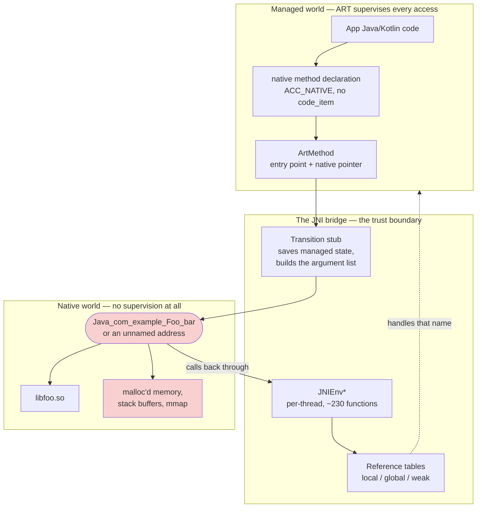
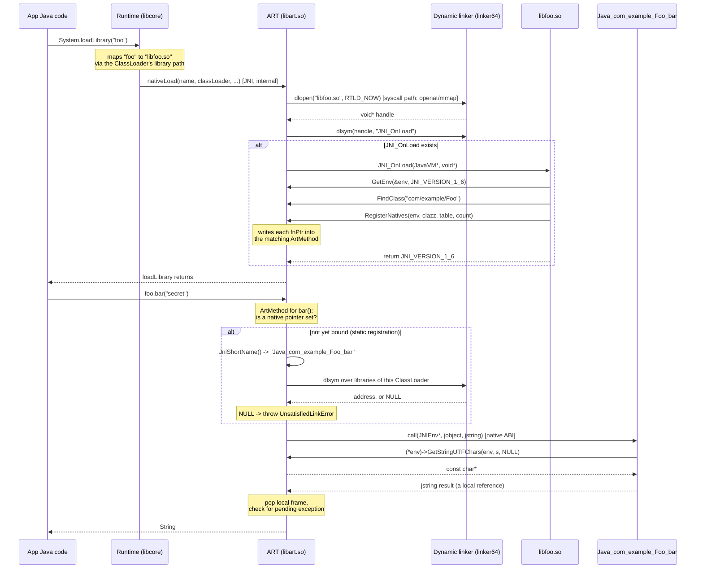
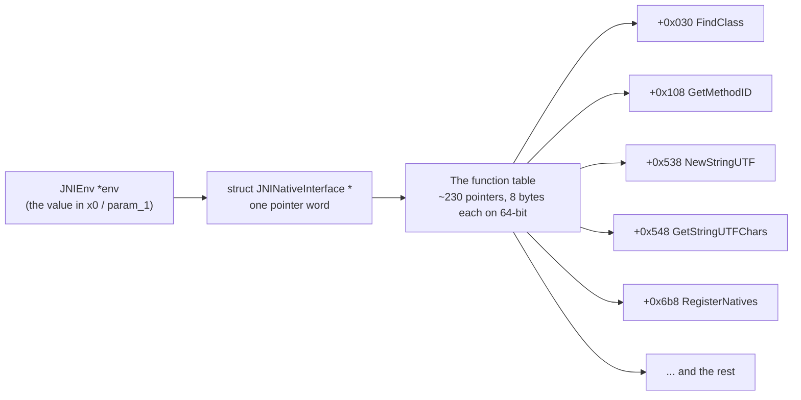
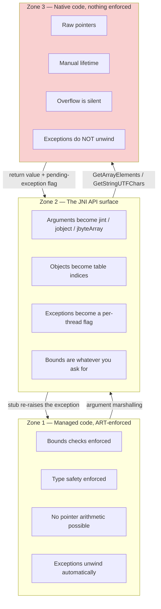
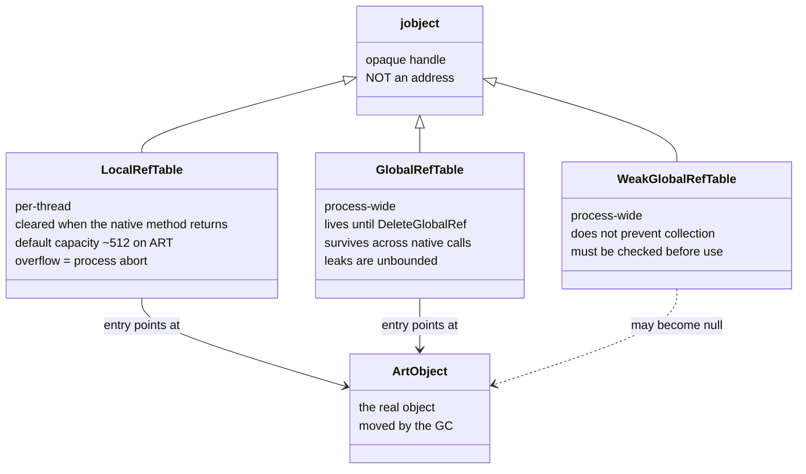
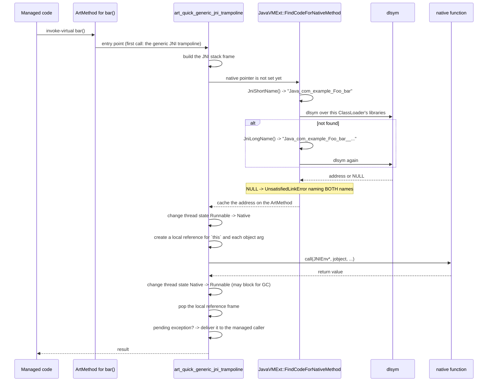
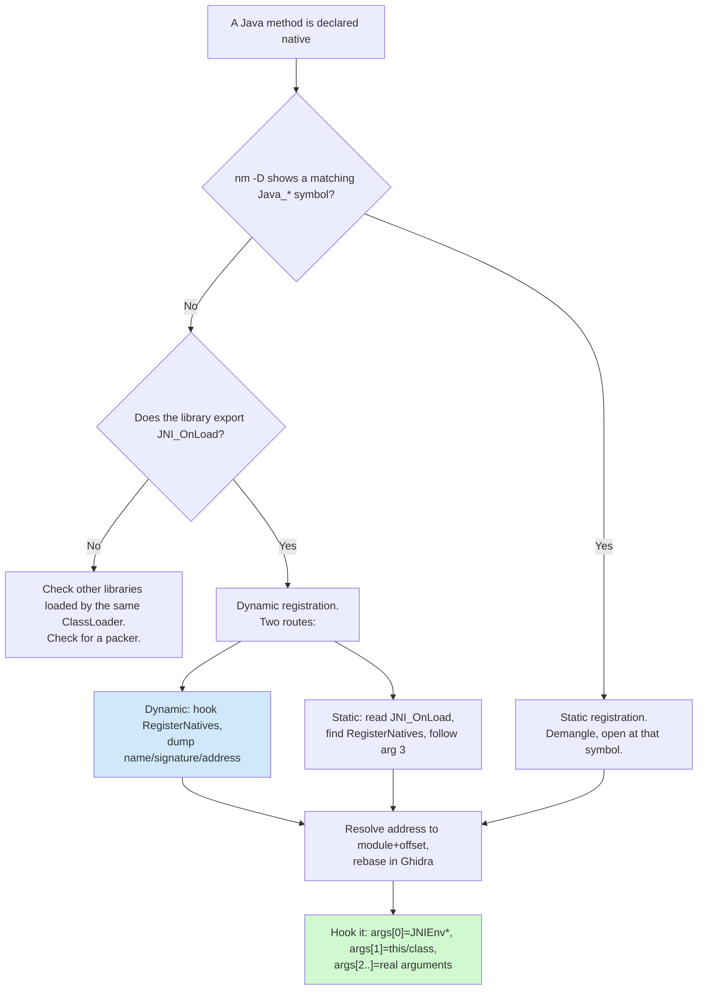

# 16 — JNI (Java Native Interface)

> After this chapter you will be able to look at any Android app that ships native code and say
> exactly how each `native` method is wired to a C function, mangle and demangle a JNI symbol by hand,
> read the argument registers of a native hook without guessing, recover a registration table that
> static analysis cannot see, and explain — with the code in front of you — the precise line at which
> Java's memory safety stops applying.

**Prerequisites:** [01 Computer Science Basics](../01-Computer-Science-Basics/README.md) ·
[03 Programming Fundamentals](../03-Programming-Fundamentals/README.md) ·
[04 Java](../04-Java/README.md) ·
[11 Android Runtime](../11-Android-Runtime/README.md) ·
[12 DEX Internals](../12-DEX-Internals/README.md) ·
[13 ART](../13-ART/README.md)

**Applies to:** Android 5.0 (API 21) through Android 16 (API 36). JNI itself is a Java-platform
specification that predates Android by a decade and has been stable since JNI 1.6; the *bindings* are
therefore version-independent. What does change across Android releases is ART's implementation of
them — reference table internals, `jmethodID` encoding, the `@FastNative`/`@CriticalNative`
optimisations, and CheckJNI's strictness. Every version-sensitive claim in this chapter is marked, and
§3.24 collects them into one matrix.

---

## Scope boundary — what this chapter does and does not own

JNI sits in the middle of four other chapters. Reading them in the wrong order wastes your time, so
the split is explicit:

| Chapter | Owns | Relationship to this chapter |
|---|---|---|
| **15 — Native Code** (directory `15-Native-Code/`) | The ELF container itself: program headers, sections, `.dynsym` versus `.symtab`, relocations, `DT_NEEDED`, PLT/GOT, stripping, and the native hardening checklist | The *box* the JNI functions are shipped in. This chapter never re-explains ELF; it assumes a symbol table exists and asks what the symbols *mean*. |
| [13 — ART](../13-ART/README.md) | `ArtMethod`, the runtime's representation of a method, entry points, the GC that moves objects | The *engine* on the Java side of the bridge. When this chapter says "a `jmethodID` is an `ArtMethod*`", chapter 13 is where `ArtMethod` is defined field by field. |
| [17 — Libraries](../17-Libraries/README.md) | Library packaging, ABI splits, `jniLibs`, linker namespaces, third-party SDK inventory | *Which* `.so` files exist and how they got into the APK. |
| [53 — Frida](../53-Frida/README.md) | Frida as a tool: `Interceptor`, `Java.perform`, the agent lifecycle | The *instrument*. This chapter supplies the model that makes a native hook readable; 53 supplies the API. |
| [57 — Ghidra](../57-Ghidra/README.md) | The decompiler workflow, type archives, scripting Ghidra | Consumes this chapter's `JNIEnv` layout to retype `param_1`. Its §3.8 says to read this chapter first, and it means it. |
| [37 — RootDetection](../37-RootDetection/README.md) | Root detection logic | Already ships a working `RegisterNatives` example in `examples/native_root_check.c`. This chapter cross-references it rather than restaging it. |

> **Mental Model.** Chapter 15 teaches you to read the shipping container. Chapter 16 — this one —
> teaches you to read the *customs declaration*: what is being handed across the border, in which
> direction, under whose responsibility, and what happens when the paperwork lies.

---

## Table of Contents

- [1. Introduction](#1-introduction)
  - [1.1 Two worlds that do not speak the same language](#11-two-worlds-that-do-not-speak-the-same-language)
  - [1.2 What would break if JNI did not exist](#12-what-would-break-if-jni-did-not-exist)
  - [1.3 What JNI is, precisely](#13-what-jni-is-precisely)
  - [1.4 The security thesis of this chapter](#14-the-security-thesis-of-this-chapter)
  - [1.5 Why a security researcher cannot skip this](#15-why-a-security-researcher-cannot-skip-this)
- [2. High-Level Architecture](#2-high-level-architecture)
  - [2.1 The bridge, drawn](#21-the-bridge-drawn)
  - [2.2 The life of a native call, end to end](#22-the-life-of-a-native-call-end-to-end)
  - [2.3 The `JNIEnv` double indirection](#23-the-jnienv-double-indirection)
  - [2.4 Trust boundaries at the bridge](#24-trust-boundaries-at-the-bridge)
  - [2.5 The reference tables, drawn](#25-the-reference-tables-drawn)
- [3. Deep Internal Working](#3-deep-internal-working)
  - [3.1 `System.loadLibrary` and `System.load`](#31-systemloadlibrary-and-systemload)
  - [3.2 `JNI_OnLoad` and `JNI_OnUnload`](#32-jni_onload-and-jni_onunload)
  - [3.3 Type descriptors — the signature language](#33-type-descriptors--the-signature-language)
  - [3.4 Method signatures](#34-method-signatures)
  - [3.5 Name mangling — the complete rules](#35-name-mangling--the-complete-rules)
  - [3.6 Demangling by hand](#36-demangling-by-hand)
  - [3.7 Static registration — binding by symbol lookup](#37-static-registration--binding-by-symbol-lookup)
  - [3.8 Dynamic registration — `RegisterNatives`](#38-dynamic-registration--registernatives)
  - [3.9 The calling convention every native hook sees](#39-the-calling-convention-every-native-hook-sees)
  - [3.10 `JNIEnv`, `JavaVM`, and what each is for](#310-jnienv-javavm-and-what-each-is-for)
  - [3.11 The function table, index by index](#311-the-function-table-index-by-index)
  - [3.12 The JNI type system on the C side](#312-the-jni-type-system-on-the-c-side)
  - [3.13 References — local, global, weak global](#313-references--local-global-weak-global)
  - [3.14 The local reference table and its capacity limit](#314-the-local-reference-table-and-its-capacity-limit)
  - [3.15 Strings and modified UTF-8](#315-strings-and-modified-utf-8)
  - [3.16 Arrays, pinning, and release modes](#316-arrays-pinning-and-release-modes)
  - [3.17 Fields, methods, and IDs](#317-fields-methods-and-ids)
  - [3.18 Exceptions — JNI does not unwind](#318-exceptions--jni-does-not-unwind)
  - [3.19 Threads — attaching, detaching, and the per-thread `JNIEnv`](#319-threads--attaching-detaching-and-the-per-thread-jnienv)
  - [3.20 Direct `ByteBuffer` and the critical region](#320-direct-bytebuffer-and-the-critical-region)
  - [3.21 `@FastNative` and `@CriticalNative`](#321-fastnative-and-criticalnative)
  - [3.22 The managed-to-native transition inside ART](#322-the-managed-to-native-transition-inside-art)
  - [3.23 CheckJNI](#323-checkjni)
  - [3.24 Version matrix](#324-version-matrix)
- [4. Source Code Walkthrough (AOSP)](#4-source-code-walkthrough-aosp)
  - [4.1 The files that matter](#41-the-files-that-matter)
  - [4.2 Trace A — `System.loadLibrary` to `dlopen` to `JNI_OnLoad`](#42-trace-a--systemloadlibrary-to-dlopen-to-jni_onload)
  - [4.3 Trace B — calling an unbound `native` method](#43-trace-b--calling-an-unbound-native-method)
  - [4.4 Trace C — `RegisterNatives` inside ART](#44-trace-c--registernatives-inside-art)
  - [4.5 Where mangling actually happens](#45-where-mangling-actually-happens)
- [5. Security Perspective](#5-security-perspective)
  - [5.1 The thesis, stated exactly](#51-the-thesis-stated-exactly)
  - [5.2 Vulnerability class 1 — the Java check that the native code does not honour](#52-vulnerability-class-1--the-java-check-that-the-native-code-does-not-honour)
  - [5.3 Vulnerability class 2 — the missing exception check](#53-vulnerability-class-2--the-missing-exception-check)
  - [5.4 Vulnerability class 3 — local reference exhaustion](#54-vulnerability-class-3--local-reference-exhaustion)
  - [5.5 Vulnerability class 4 — the `jlong` handle](#55-vulnerability-class-4--the-jlong-handle)
  - [5.6 Vulnerability class 5 — string length confusion](#56-vulnerability-class-5--string-length-confusion)
  - [5.7 Vulnerability class 6 — leaked and unreleased resources](#57-vulnerability-class-6--leaked-and-unreleased-resources)
  - [5.8 How attackers abuse the bridge](#58-how-attackers-abuse-the-bridge)
  - [5.9 How developers misuse it](#59-how-developers-misuse-it)
  - [5.10 Real vulnerabilities, honestly described](#510-real-vulnerabilities-honestly-described)
  - [5.11 OWASP MASVS / MASTG mapping](#511-owasp-masvs--mastg-mapping)
  - [5.12 How a pentester tests the JNI layer](#512-how-a-pentester-tests-the-jni-layer)
  - [5.13 How malware abuses it](#513-how-malware-abuses-it)
  - [5.14 How a forensic analyst investigates it](#514-how-a-forensic-analyst-investigates-it)
- [6. Reverse Engineering Perspective](#6-reverse-engineering-perspective)
  - [6.1 In JADX](#61-in-jadx)
  - [6.2 In Smali and in the DEX](#62-in-smali-and-in-the-dex)
  - [6.3 In the shared object](#63-in-the-shared-object)
  - [6.4 What obfuscation does to it](#64-what-obfuscation-does-to-it)
  - [6.5 Recognising a `JNINativeMethod` table by eye](#65-recognising-a-jninativemethod-table-by-eye)
  - [6.6 The decision tree](#66-the-decision-tree)
- [7. Dynamic Analysis](#7-dynamic-analysis)
  - [7.1 Enumerating statically registered natives](#71-enumerating-statically-registered-natives)
  - [7.2 Dumping the dynamic registration table](#72-dumping-the-dynamic-registration-table)
  - [7.3 Hooking a native method correctly](#73-hooking-a-native-method-correctly)
  - [7.4 Reading arguments by descriptor](#74-reading-arguments-by-descriptor)
  - [7.5 Calling back into Java from a native hook](#75-calling-back-into-java-from-a-native-hook)
  - [7.6 Turning on CheckJNI](#76-turning-on-checkjni)
  - [7.7 `strace`, `ltrace`, logcat and LLDB](#77-strace-ltrace-logcat-and-lldb)
- [8. Static Analysis](#8-static-analysis)
  - [8.1 From the APK, without running anything](#81-from-the-apk-without-running-anything)
  - [8.2 From Java or Kotlin source](#82-from-java-or-kotlin-source)
  - [8.3 From Smali](#83-from-smali)
  - [8.4 From the shared object](#84-from-the-shared-object)
  - [8.5 A complete triage sequence](#85-a-complete-triage-sequence)
- [9. Examples](#9-examples)
  - [9.1 Simple — hello, two worlds](#91-simple--hello-two-worlds)
  - [9.2 Intermediate — strings and arrays, done correctly](#92-intermediate--strings-and-arrays-done-correctly)
  - [9.3 Advanced — the unsafe function and its fix](#93-advanced--the-unsafe-function-and-its-fix)
  - [9.4 Real application — dynamic registration in a licence check](#94-real-application--dynamic-registration-in-a-licence-check)
  - [9.5 Enterprise — a disciplined JNI layer](#95-enterprise--a-disciplined-jni-layer)
- [10. Common Interview Questions](#10-common-interview-questions)
- [11. Common Mistakes](#11-common-mistakes)
- [12. Hands-on Labs](#12-hands-on-labs)
- [13. Summary](#13-summary)
- [14. References](#14-references)

---

## 1. Introduction

### 1.1 Two worlds that do not speak the same language

Imagine a large hospital. Inside the building, every doctor writes prescriptions on a standard form,
in a standard vocabulary, and a pharmacist checks every form before anything is dispensed: wrong dose,
wrong units, unknown drug — rejected at the counter. Mistakes still happen, but the *category* of
mistake "the patient received a substance nobody wrote down" cannot happen, because nothing leaves the
pharmacy without a form.

Next door there is a chemistry lab. It is far faster and can make things the pharmacy cannot. It has
no forms. You walk in, take what you want off the shelf, and walk out. Everything depends on the
person doing it being careful.

Java on Android is the hospital. C and C++ are the lab. The corridor connecting them — the door, the
sign-in book, the rule about what you may carry through in each direction — is the **Java Native
Interface**, and this chapter is about that corridor.

The analogy carries further than it looks. In the hospital, if you ask for the twelfth item on a list
of ten, a clerk stops you and says "there is no twelfth item". In the lab, if you reach for the twelfth
shelf on a rack of ten, your hand closes on whatever happens to be mounted there — a fire extinguisher,
a window, the next room. Nobody stops you, and *nothing tells you it went wrong*. That difference is
not a detail. It is the entire security content of this chapter.

> **Definition — native code.** *Native code* is machine code compiled ahead of time for a specific
> processor architecture — ARM64, ARM32, x86-64 — that the CPU executes directly. It is contrasted with
> *managed code* (Java, Kotlin), which is compiled to DEX bytecode and executed by a runtime
> ([ART](../13-ART/README.md)) that supervises it. On Android, native code arrives inside an APK as
> shared object files, `lib*.so`, under `lib/<abi>/`.

> **Definition — JNI.** The *Java Native Interface* is a specification, first published by Sun in
> 1997 and part of the Java platform ever since, that defines exactly how compiled native code and
> Java code call each other, exchange data, and share objects. It defines a naming scheme, a type
> encoding, a table of about 230 functions the native side may call, and a set of rules about object
> lifetime. Android implements it in ART. It is not an Android invention and its rules are not Android
> rules — which is why the JNI specification, not an Android document, is the authority when the two
> disagree.

### 1.2 What would break if JNI did not exist

Strip JNI out of Android and the following stops working:

| Capability | Why it needs native code |
|---|---|
| Playing an MP4 | The codecs are C. Decoding a frame in interpreted bytecode would drop frames on any device. |
| Taking a photo | The camera HAL is a native library talking to a driver over `ioctl`. |
| TLS | BoringSSL is C. Every HTTPS connection your app makes runs native code. |
| SQLite | The database engine is C, and `android.database.sqlite` is a thin Java jacket over it. |
| Games | Unity and Unreal are C++ engines. The Java side is a launcher. |
| Any hardware feature at all | Every HAL, every driver interface, every `/dev` node is reached from C. |

But there is a second, less obvious reason JNI exists, and it is the reason a security researcher
meets it constantly:

| Motivation | What the developer is really doing |
|---|---|
| Hiding a secret | Moving an API key from a Java string constant into a `.so`, believing it is now safe |
| Slowing down analysis | Forcing the analyst to leave `jadx` and open a disassembler |
| Attestation and integrity | Doing root/tamper/debugger checks in native code, where Java hooking cannot reach |
| Licence and DRM logic | Keeping the decision that decides "paid or not" outside the decompiler's comfort zone |

Every one of those motivations is covered elsewhere in this repository —
[37 RootDetection](../37-RootDetection/README.md), [38 TamperDetection](../38-TamperDetection/README.md),
[40 Obfuscation](../40-Obfuscation/README.md) — and every one of them lands on the same bridge. You
cannot attack any of them without understanding it.

### 1.3 What JNI is, precisely

JNI is four things bolted together. Confusing them is the single most common source of beginner
frustration, so here they are separated:

1. **A binding mechanism.** How the runtime finds the C function that implements a Java method
   declared `native`. There are exactly two mechanisms — a symbol name lookup (**static registration**)
   and an explicit runtime call (**dynamic registration**, `RegisterNatives`). §3.7 and §3.8.

2. **A naming and type encoding.** A deterministic, reversible scheme for turning
   `com.example.Crypto.decrypt(String)` into the C identifier `Java_com_example_Crypto_decrypt`, and
   for turning the Java type `byte[]` into the four characters `[B`. §3.3 to §3.6.

3. **A calling convention.** The native function does not receive only the Java arguments. It receives
   two synthetic arguments first, always, in a fixed order. §3.9. Get this wrong and every hook you
   write reads the wrong register.

4. **An API surface.** About 230 functions, reachable only through a per-thread pointer called
   `JNIEnv`, that let native code do everything Java code can do: create objects, call methods, read
   fields, throw exceptions, take locks. §3.10 to §3.20.

> **Mental Model.** JNI is not "a way to call C from Java". It is a **two-way, fully symmetric
> interoperability layer** that happens to be used mostly in one direction. Native code calling *back*
> into Java through `JNIEnv` is not an exotic case — it is how every callback, every `onProgress`,
> every result delivery works, and it is where the most interesting bugs live.

### 1.4 The security thesis of this chapter

Here is the sentence this whole chapter exists to make precise:

> **A bounds check written in Java protects nothing once the value crosses into C.**

Java is memory-safe in a specific, mechanical sense: every array access is bounds-checked by the
runtime, every reference is either a valid object or `null`, there is no pointer arithmetic, and there
is no way to fabricate a reference to an address of your choosing. Chapter
[03 Programming Fundamentals](../03-Programming-Fundamentals/README.md) develops this properly.

C offers none of that. The moment `nativeProcess(buffer, length)` executes, three things become true
simultaneously:

- The `length` the Java code was so careful to validate is now just an `int` in a register. It is
  *documentation*, not enforcement.
- The `byte[]` has become a `jbyteArray`, and a call to `GetByteArrayElements` turns it into a raw
  `jbyte*` — a pointer into memory that can be written past its end with no complaint from anyone.
- If the native code writes 300 bytes into a 256-byte stack buffer, the only entity that will notice
  is the stack canary, and only if the compiler emitted one, and only on function return. Chapter 15
  covers what hardening exists and what it costs to defeat.

And there is a compounding factor unique to JNI, which developers routinely miss: **the Java wrapper
that performs the check is not the only way to reach the native function.** A `native` method is a
method. It can be called by reflection. It can be called by a repackaged version of the app in which
the wrapper's check has been deleted. If the native side is registered dynamically it can even be
called from another thread while the wrapper is mid-validation. The check and the use are in different
languages, in different trust domains, separated by an interface that copies neither of them.

That is the thesis. Sections 5.2 through 5.7 turn it into six concrete, exploitable bug classes with
code.

### 1.5 Why a security researcher cannot skip this

A short list of things you will not be able to do without this chapter:

- **Hook a native function and read its arguments.** You will read `args[0]` and get a pointer to a
  pointer to a function table, wonder why your "first argument" is garbage, and stop. (§3.9)
- **Explain why obfuscation left one class name intact.** ProGuard/R8 cannot rename a class that
  declares a statically registered native method without breaking the symbol lookup, so it does not.
  That surviving name is a free anchor into an otherwise renamed app. (§6.4)
- **Find a function that has no symbol.** When `nm -D` shows no `Java_*` at all, the app used
  `RegisterNatives`, and the mapping exists only in memory, only after `JNI_OnLoad` has run.
  Static analysis alone cannot recover it. (§3.8, §7.2, Lab 03)
- **Explain a crash you caused.** `JNI DETECTED ERROR IN APPLICATION` in logcat with your Frida script
  attached is usually your fault, and the message tells you which rule you broke — if you know the
  rules. (§3.23)
- **Write a credible finding.** "The app uses JNI" is not a finding. "`Java_com_x_Native_decode`
  trusts its `len` parameter, which the Java wrapper validates but reflection bypasses, giving a
  256-byte stack overflow at `libx.so+0x4A18`" is a finding.

---

## 2. High-Level Architecture

### 2.1 The bridge, drawn



What you are looking at, left to right and top to bottom.

On the **managed** side, an app declares a method with the keyword `native` and no body. In the DEX
file that method carries the access flag `ACC_NATIVE` (`0x0100`) and has no `code_item` — there is
literally no bytecode for it, which is why [12 DEX Internals](../12-DEX-Internals/README.md) notes
that counting `ACC_NATIVE` methods is a fast way to size up an app's native surface. ART still creates
an `ArtMethod` for it, exactly as for any other method, but the `ArtMethod`'s native-code pointer is
initially a *trampoline* that means "I do not know where this lives yet".

In the **bridge**, a transition stub runs. It does three jobs that the native function will never see:
it changes the thread's state from "running managed code" to "running native code" (so a garbage
collection can proceed without waiting for this thread), it wraps every object argument in a local
reference, and it prepends the two synthetic arguments described in §3.9. On the way back it does the
reverse, and — critically — it checks whether the native code left an exception pending.

On the **native** side there is a function. If the app used static registration it has a name, and
that name is in the ELF dynamic symbol table where `nm -D` will show it. If the app used dynamic
registration it may have no name at all: it is an address that appeared in a table passed to
`RegisterNatives`. Once inside, the code can `malloc`, write to the stack, `mmap` an executable page,
open a socket, or read `/proc/self/maps` — and ART neither knows nor cares. The two red-tinted boxes
are drawn that way because everything inside them is outside the runtime's guarantees.

### 2.2 The life of a native call, end to end



Read this diagram twice; almost every question a learner asks about JNI is answered somewhere on it.

The **upper half** is load time. `System.loadLibrary("foo")` is a Java method that does string
manipulation and then calls into ART. ART calls `dlopen`, the same `dlopen` any Linux program uses —
which is why the FAQ answer to "is `loadLibrary` the same as `dlopen`?" is "it contains one, but it is
not one". After the library is mapped, ART looks for one specific exported symbol, `JNI_OnLoad`. If it
exists, ART calls it *immediately*, before `loadLibrary` returns. Anything the library wants to do
before the app can use it — decrypting its own code, checking for Frida, registering its methods
dynamically — happens here. That is why `JNI_OnLoad` is the single most interesting function in a
hostile library.

The **lower half** is call time. When the app finally calls `foo.bar(...)`, ART looks at the
`ArtMethod`. If dynamic registration already filled in the native pointer, the call goes straight
through. If not, ART performs the symbol lookup *lazily, at first call* — not at load time. This is
why an app can load a library successfully and still throw `UnsatisfiedLinkError` ten seconds later
when a particular button is pressed, and why "the library loaded fine" tells you nothing about whether
a given method is bound.

### 2.3 The `JNIEnv` double indirection



This is the structure that makes unretyped JNI decompilation unreadable, and it is worth being exact
about because chapter 57's entire §3.8 depends on it.

`JNIEnv` is **not** a struct you dereference once. In C, `JNIEnv` is defined as
`const struct JNINativeInterface *`, and the native function receives a `JNIEnv *` — a pointer *to*
that pointer. So calling `FindClass` requires two dereferences: one to reach the table, one to reach
the function pointer inside it. In C the call is written `(*env)->FindClass(env, "java/lang/String")`.
In C++, `jni.h` defines `JNIEnv` as a struct with inline member functions that perform the same two
dereferences for you, so you write `env->FindClass("java/lang/String")`. **Both compile to identical
machine code.** The difference is source-level sugar only, and it explains a common confusion: two
tutorials showing "different" syntax for the same call.

Why the indirection at all? Because it lets the runtime hand different threads different function
tables. That is precisely how CheckJNI works: enabling it swaps the table pointer for one whose
entries are validating wrappers. Nothing in the native library changes; the table it calls through
does. §3.23.

The consequence for reverse engineering: an untyped decompilation of a JNI call looks like
`(**(code **)(*(long *)param_1 + 0x548))(param_1, param_3, 0)`. That is not obfuscation. That is what
the source compiles to, and once you know the offset table (§3.11) you can read it directly.

### 2.4 Trust boundaries at the bridge



The three zones are not decorative. They are the model you should carry into every review.

**Zone 1** is where every guarantee you learned about Java holds. An `int[]` access out of range throws
`ArrayIndexOutOfBoundsException` before any memory is touched.

**Zone 2** is a translation layer that is *deliberately neutral*. `GetByteArrayElements` does not ask
what you intend to do with the pointer. `GetIntArrayRegion` will check its own start and length
arguments against the array (and throw if they are wrong) — but nothing checks the destination buffer
you are copying into, because JNI has no idea how big it is. This asymmetry is the crux: **JNI
validates its own arguments against the Java object, never against your C memory.**

**Zone 3** has no enforcement whatsoever. Note the last row especially: an exception raised in Zone 1
by a callback does **not** stop Zone 3 code. Execution continues on the next C statement with a flag
set somewhere. §3.18 develops this into a bug class.

### 2.5 The reference tables, drawn



The single most important fact on this diagram: **a `jobject` is not a pointer to an object.** It is
an opaque handle that indexes one of three tables. ART's garbage collector is a moving collector — the
concurrent copying collector relocates live objects — so a raw address handed to native code would go
stale the moment a GC ran. The indirection means the GC updates the table entry and the handle the
native code holds stays valid.

This one design decision generates a long tail of rules that native developers break constantly:

- You cannot compare two `jobject` values with `==` to test object identity. Two different handles can
  name the same object. Use `IsSameObject`.
- You cannot store a local reference in a `static` C variable and use it on the next call. It is dead
  the moment the native method returns.
- You cannot pass a local reference to another thread.
- You cannot print a `jobject` and expect the number to mean anything, or to be stable.

§3.13 and §3.14 give the full rules and the crash signatures that each violation produces.

---

## 3. Deep Internal Working

### 3.1 `System.loadLibrary` and `System.load`

Everything native in an app starts with one of two calls. They differ in exactly one respect, and the
difference matters to an attacker.

```java
// Java — anywhere, but conventionally a static initialiser
static {
    System.loadLibrary("crypto-native");   // resolves to libcrypto-native.so
    System.load("/data/data/com.x/files/payload.so");  // absolute path, verbatim
}
```

| | `System.loadLibrary(String)` | `System.load(String)` |
|---|---|---|
| Argument | Short name, no `lib` prefix, no `.so` suffix | Absolute filesystem path |
| Resolution | ART maps the short name via `System.mapLibraryName` and searches the ClassLoader's native library search path | None. The path is used as given |
| Typical source | The APK's `lib/<abi>/` directory, extracted or mapped in place | A file the app wrote at runtime |
| Security signal | Normal | **High interest.** An app loading a `.so` from its own writable data directory is loading code that was not in the APK, was not signed with the APK, and was probably downloaded |

> **Pentester's Note.** `System.load` with a path under `/data/data/<pkg>/` or the external storage
> is one of the highest-signal single lines in an APK. It means the code that will run was not
> reviewed by the store, not covered by the APK signature, and may differ per user or per session.
> Hook `dlopen` (§7.7) and you will see it arrive. Chapter [40 Obfuscation](../40-Obfuscation/README.md)
> covers packers that use exactly this to stage their payload.

**What `loadLibrary` actually does**, in order:

1. `System.loadLibrary(name)` calls `Runtime.getRuntime().loadLibrary0(callerClass, name)` in
   `libcore/ojluni/src/main/java/java/lang/Runtime.java`.
2. The caller's `ClassLoader` is obtained. This matters: **the library is associated with the
   ClassLoader that loaded the calling class**, and that association is what later restricts which
   libraries ART will search for a given native method's symbol.
3. The ClassLoader's library search path is walked. For an app this is normally
   `/data/app/<...>/lib/<abi>` plus the APK itself (modern Android maps uncompressed `.so` files
   straight out of the APK without extracting them — see [17 Libraries](../17-Libraries/README.md)).
4. `System.mapLibraryName("foo")` produces `"libfoo.so"`.
5. `Runtime.nativeLoad(...)` crosses into ART, which is where §4.2 picks the trace up.

**Duplicate loads are cheap and idempotent.** Calling `loadLibrary` twice for the same library does
not run `JNI_OnLoad` twice; ART keeps a table of loaded libraries keyed by path and returns early.
This is why the idiom of putting `loadLibrary` in a `static` block is safe even if several classes do
it.

**Failure modes and what each tells you:**

| Exception / message | Meaning |
|---|---|
| `UnsatisfiedLinkError: dlopen failed: library "libfoo.so" not found` | The `.so` is missing for this device's ABI. Very often the app ships `arm64-v8a` only and you are on an x86 emulator. |
| `UnsatisfiedLinkError: dlopen failed: cannot locate symbol "..."` | The library depends on a symbol that no loaded library provides — commonly an NDK API newer than the device, or a private libc symbol that the linker namespace blocks. |
| `UnsatisfiedLinkError: No implementation found for ...` | The library loaded, but the *method* could not be bound. This is the static-registration lookup failing, and the message prints both names ART tried. §3.7. |
| `java.lang.UnsatisfiedLinkError: JNI_OnLoad returned bad version` | `JNI_OnLoad` returned something ART does not support. §3.2. |

### 3.2 `JNI_OnLoad` and `JNI_OnUnload`

```c
// C — the canonical shape of JNI_OnLoad
#include <jni.h>

JNIEXPORT jint JNICALL JNI_OnLoad(JavaVM *vm, void *reserved) {
    JNIEnv *env = NULL;
    if ((*vm)->GetEnv(vm, (void **)&env, JNI_VERSION_1_6) != JNI_OK) {
        return JNI_ERR;             /* -1: refuses the load */
    }
    /* ... registration, initialisation, anti-analysis, anything ... */
    return JNI_VERSION_1_6;         /* 0x00010006 */
}
```

Four facts about this function that you must internalise:

1. **ART calls it during `loadLibrary`, before that call returns.** Any code here runs before a single
   line of the app's own logic that follows the `static` block.
2. **Its return value is a JNI version, not a status code.** Returning `JNI_ERR` (`-1`) or any version
   ART does not support causes the load to fail with `UnsatisfiedLinkError`. ART reports JNI 1.6, so
   `JNI_VERSION_1_6` (`0x00010006`) is the universally safe return.
3. **The `JavaVM*`, not a `JNIEnv*`, is what it receives.** `JavaVM` is process-wide and thread-safe;
   `JNIEnv` is per-thread. You obtain the latter from the former with `GetEnv`. §3.10.
4. **It is exported, and it survives stripping**, because the dynamic linker must be able to find it
   by name. `nm -D libfoo.so | grep JNI_OnLoad` is therefore reliable even against a fully stripped
   library — a rare gift, and the reason it is always the first place to look.

`JNI_OnUnload` is the mirror image and you will almost never see it, because Android does not unload
app libraries in practice. Treat its presence as a curiosity, not a hook point.

**Version constants** (from `jni.h`, unchanged since the JNI specification defined them):

| Constant | Value |
|---|---|
| `JNI_VERSION_1_1` | `0x00010001` |
| `JNI_VERSION_1_2` | `0x00010002` |
| `JNI_VERSION_1_4` | `0x00010004` |
| `JNI_VERSION_1_6` | `0x00010006` |
| `JNI_VERSION_1_8` | `0x00010008` |

**Return codes used throughout the JNI API:**

| Constant | Value | Meaning |
|---|---|---|
| `JNI_OK` | `0` | Success |
| `JNI_ERR` | `-1` | Unspecified error |
| `JNI_EDETACHED` | `-2` | The calling thread is not attached to the VM |
| `JNI_EVERSION` | `-3` | The requested JNI version is not supported |
| `JNI_ENOMEM` | `-4` | Out of memory |
| `JNI_EEXIST` | `-5` | VM already created |
| `JNI_EINVAL` | `-6` | Invalid argument |

> **Pentester's Note.** If a library is doing anti-analysis, `JNI_OnLoad` is where it starts. Set
> your Frida hooks *before* the library loads, not after. The standard technique is to hook `dlopen`
> (or `android_dlopen_ext`) and install your `JNI_OnLoad`-relative hooks in its `onLeave`, which fires
> after the library is mapped but — for `dlopen` — before ART has called `JNI_OnLoad`. §7.2 gives the
> script.

### 3.3 Type descriptors — the signature language

JNI needs a compact, unambiguous, ASCII-safe way to name a Java type in a C string. It reuses the
descriptor language of the JVM class file format, which the DEX format also uses
([12 DEX Internals](../12-DEX-Internals/README.md) §3.9 covers the DEX side). Learning it takes ten
minutes and pays for the rest of your career.

**Primitive types** — one uppercase letter each:

| Descriptor | Java type | C type (`jni.h`) | Size | Notes |
|---|---|---|---|---|
| `Z` | `boolean` | `jboolean` | 1 byte | Unsigned. `JNI_TRUE` = 1, `JNI_FALSE` = 0. The letter is `Z` because `B` was taken. |
| `B` | `byte` | `jbyte` | 1 byte | **Signed**, range −128..127. A constant source of bugs against unsigned C code. |
| `C` | `char` | `jchar` | 2 bytes | **Unsigned** UTF-16 code unit, not a character. |
| `S` | `short` | `jshort` | 2 bytes | Signed. |
| `I` | `int` | `jint` | 4 bytes | Signed. `jsize` is a typedef of `jint`. |
| `J` | `long` | `jlong` | 8 bytes | Signed. `J` because `L` introduces a class name. |
| `F` | `float` | `jfloat` | 4 bytes | IEEE 754 single. |
| `D` | `double` | `jdouble` | 8 bytes | IEEE 754 double. |
| `V` | `void` | `void` | — | Return types only. |

**Reference types:**

| Descriptor form | Java type | Example |
|---|---|---|
| `L` + fully qualified name with `/` + `;` | a class or interface | `Ljava/lang/String;` |
| `[` + any descriptor | an array of that type | `[I` is `int[]`, `[[I` is `int[][]` |
| `[L…;` | an array of objects | `[Ljava/lang/String;` is `String[]` |

Three details that trip people up, every time:

1. **The package separator is a forward slash, not a dot.** `Ljava/lang/String;` is correct;
   `Ljava.lang.String;` is not, and ART will fail to find the method.
2. **The trailing semicolon is part of the descriptor**, not punctuation you can omit. `[Ljava/lang/String;`
   ends in a semicolon even though it is an array.
3. **Nested classes use `$`, and `$` stays a `$` in a descriptor.** `Outer.Inner` is
   `Lcom/example/Outer$Inner;`. (It becomes `_00024` only in a *mangled symbol name* — a different
   encoding, §3.5. Confusing the two is the most common mangling error.)

**Worked descriptor exercise.** Write the descriptor for each Java type:

| Java type | Descriptor | Reasoning |
|---|---|---|
| `int` | `I` | primitive |
| `int[]` | `[I` | one `[` prefix |
| `int[][][]` | `[[[I` | one `[` per dimension |
| `String` | `Ljava/lang/String;` | `L`, slashed name, `;` |
| `String[]` | `[Ljava/lang/String;` | array prefix on the whole thing |
| `byte[]` | `[B` | the single most common JNI parameter type |
| `Object` | `Ljava/lang/Object;` | |
| `android.content.Context` | `Landroid/content/Context;` | |
| `com.example.Outer$Inner` | `Lcom/example/Outer$Inner;` | `$` unchanged |
| `boolean[][]` | `[[Z` | |
| `long` | `J` | not `L` |

### 3.4 Method signatures

A method signature concatenates the parameter descriptors inside parentheses, then the return
descriptor immediately after the closing parenthesis:

```
(parameter descriptors with no separators)return descriptor
```

There are **no commas and no spaces**. The descriptors are self-delimiting: a primitive is one
character, an object type ends at its `;`, and `[` binds to whatever follows it. That is why
`(I[BLjava/lang/String;)Z` parses unambiguously as `(int, byte[], String) -> boolean`.

| Java declaration | Signature |
|---|---|
| `void f()` | `()V` |
| `int f()` | `()I` |
| `void f(int a)` | `(I)V` |
| `void f(int a, int b)` | `(II)V` |
| `String f(String s)` | `(Ljava/lang/String;)Ljava/lang/String;` |
| `byte[] f(byte[] in, int len)` | `([BI)[B` |
| `boolean f(int a, byte[] b, String c)` | `(I[BLjava/lang/String;)Z` |
| `void f(Object... args)` (varargs) | `([Ljava/lang/Object;)V` — varargs *is* an array |
| `Outer.Inner f()` | `()Lcom/example/Outer$Inner;` |
| a constructor | `(...)V` with the name `<init>` |
| a static initialiser | `()V` with the name `<clinit>` |

> **Warning — the return type is not part of overload resolution in Java, but it *is* part of a JNI
> signature.** `GetMethodID(env, cls, "f", "()I")` will not find a method declared `void f()`. The
> signature you pass must match the declared return type exactly, or `GetMethodID` returns `NULL` and
> raises `NoSuchMethodError`.

**Worked signature exercise.** Given the Java declaration, produce the signature; then given the
signature, produce the declaration.

```java
// Java
public native byte[] transform(byte[] input, int offset, int length, String key);
```

Work it left to right:

1. Parameters: `byte[]` is `[B`; `int` is `I`; `int` is `I`; `String` is `Ljava/lang/String;`.
2. Concatenate inside parentheses: `([BIILjava/lang/String;)`.
3. Return type `byte[]` is `[B`.
4. Result: `([BIILjava/lang/String;)[B`.

Now the reverse. Given `(Landroid/content/Context;[[JZ)Ljava/lang/String;`, decode it:

1. Open paren; first parameter starts with `L`, so read to the `;`: `Landroid/content/Context;` is
   `android.content.Context`.
2. Next character is `[`, then another `[`, then `J`: a `long[][]`.
3. Next is `Z`: a `boolean`.
4. Close paren. Return `Ljava/lang/String;` is `String`.
5. Result: `String m(android.content.Context, long[][], boolean)`.

The script `scripts/jni_mangle.py` in this chapter does both directions mechanically, and §7 uses it
to label the arguments of a live hook.

### 3.5 Name mangling — the complete rules

This is the section other chapters point at. It must be complete enough that you can mangle and
demangle by hand, with no tool, on a whiteboard.

**The scheme.** A statically registered native method's C symbol is:

```
Java_<mangled fully qualified class name>_<mangled method name>[__<mangled argument signature>]
```

- The prefix is exactly `Java_` — capital J, lowercase `ava`, one underscore.
- The class name is fully qualified, with `.` (or `/`) replaced by `_`.
- One `_` separates the class from the method name.
- The trailing `__<args>` part is present **only for overloaded native methods**, and is the *long
  name*. §3.7 explains when ART looks for which.

**The escape table.** Applied to the class name, the method name, and the argument signature —
*after* the package separators have been turned into `_`:

| Character in the Java name | Encoded in the symbol as | Why |
|---|---|---|
| `.` or `/` (package separator) | `_` | joins the qualified name into one identifier |
| `_` (a literal underscore in an identifier) | `_1` | otherwise it would be read as a separator |
| `;` | `_2` | appears in argument signatures |
| `[` | `_3` | appears in argument signatures |
| Any other character that is not an ASCII letter or digit | `_0` followed by the **four** lowercase hexadecimal digits of its UTF-16 code unit | covers `$`, and every non-ASCII identifier character |

The escapes `_2` and `_3` exist only because argument signatures contain `;` and `[`. They never
appear from a class or method name alone, since Java identifiers cannot contain `;` or `[`.

> **Warning — `$` is `_00024`, not `_0024`.** The escape is `_0` followed by *four* hex digits, and
> `$` is U+0024, so the four digits are `0024` and the whole escape is six characters: `_00024`. This
> is the single most frequently mis-remembered rule in JNI, and getting it wrong means your `grep` for
> an inner class's native method finds nothing. Verify it yourself the moment you have a real APK: any
> library with a native method on an inner class will contain the string `_00024`.

**Hex digit case.** Toolchains generate these escapes from a plain hexadecimal conversion that emits
lowercase digits, so `_0abcd` is what you will see in practice. ART performs the same mangling when it
looks a symbol up and then does an exact string comparison, so the two agree. Do not hand-write an
uppercase variant and expect it to bind.

**Worked mangling, step by step.**

*Case 1 — the simple one.*

```java
package com.example;
public class Crypto {
    public native String decrypt(String s);
}
```

1. Prefix: `Java_`
2. Class `com.example.Crypto`, dots to underscores: `com_example_Crypto`
3. Separator: `_`
4. Method `decrypt`: no escapes needed
5. Not overloaded, so no `__` suffix

Result: `Java_com_example_Crypto_decrypt`

*Case 2 — an underscore inside the package name.*

```java
package com.my_app.core;
public class Guard {
    public native boolean check_root();
}
```

1. Prefix: `Java_`
2. Class `com.my_app.core.Guard`: the package dots become `_`, and the *literal* underscore in
   `my_app` becomes `_1`, giving `com_my_1app_core_Guard`
3. Separator: `_`
4. Method `check_root`: the literal underscore becomes `_1`, giving `check_1root`

Result: `Java_com_my_1app_core_Guard_check_1root`

Note carefully what this means for searching: grepping for `check_root` in a binary finds **nothing**.
You must grep for `check_1root`, or for the class prefix. This alone accounts for a large share of
"the symbol isn't there" confusion.

*Case 3 — an inner class.*

```java
package com.example;
public class Outer {
    public static class Inner {
        public native int compute();
    }
}
```

The runtime class name is `com.example.Outer$Inner`.

1. Prefix: `Java_`
2. Dots to underscores: `com_example_Outer$Inner`
3. `$` is not a letter or digit, so it becomes `_0` + `0024` = `_00024`, giving
   `com_example_Outer_00024Inner`
4. Separator `_`, then `compute`

Result: `Java_com_example_Outer_00024Inner_compute`

*Case 4 — an overloaded native method.*

```java
package com.example;
public class Codec {
    public native void write(int b);
    public native void write(byte[] b);
    public native void write(byte[] b, int off, int len);
}
```

All three collide on the short name `Java_com_example_Codec_write`, so each gets a **long name**:
the short name, then `__`, then the mangled *parameter* descriptors — with no parentheses and **no
return type**.

| Java declaration | Parameter descriptors | Mangled args | Full symbol |
|---|---|---|---|
| `write(int)` | `I` | `I` | `Java_com_example_Codec_write__I` |
| `write(byte[])` | `[B` | `_3B` | `Java_com_example_Codec_write___3B` |
| `write(byte[], int, int)` | `[BII` | `_3BII` | `Java_com_example_Codec_write___3BII` |

Look at the second and third rows. The `__` overload marker is followed by `_3B`, so the symbol
contains **three** consecutive underscores. That is not a typo and it is not an obfuscation artefact —
it is the marker plus the escape for `[`.

*Case 5 — an overload taking an object.*

```java
public native void log(String msg);   // overloaded elsewhere with log(int)
```

Parameter descriptor `Ljava/lang/String;`. Mangle it: `/` becomes `_`, `;` becomes `_2`, giving
`Ljava_lang_String_2`.

Result: `Java_com_example_Codec_log__Ljava_lang_String_2`

**Rule summary in one box:**

```text
symbol  = "Java_" + mangle(FQCN) + "_" + mangle(method) + [ "__" + mangle(paramDescriptors) ]
mangle  : "."|"/"  ->  "_"
          "_"      ->  "_1"
          ";"      ->  "_2"
          "["      ->  "_3"
          other non-alphanumeric-ASCII c -> "_0" + lowercase 4-digit hex of the UTF-16 unit
```

### 3.6 Demangling by hand

Reversing the scheme is what you will actually do in the field: `nm -D` gives you a symbol and you need
the Java method it implements.

**The algorithm:**

1. Strip the leading `Java_`. If it is not there, this is not a statically registered JNI entry point.
2. Find `__` (two underscores in a row) that is **not** part of an escape. Everything after it is the
   argument signature; everything before it is class-plus-method. If there is no such `__`, there is no
   overload suffix and the whole remainder is class-plus-method.
3. Scan left to right, decoding escapes as you go: `_1` becomes `_`, `_2` becomes `;`, `_3` becomes
   `[`, `_0XXXX` becomes the character with that UTF-16 value, and any *other* `_` is a package
   separator, which you turn back into `.`.
4. The **last** package separator you decoded splits the class name from the method name.

Step 4 is where ambiguity theoretically lurks and in practice does not: a class name is a sequence of
identifiers, and the method name is the final one. Since escaped underscores were consumed in step 3,
every remaining `_` is a genuine separator.

**Worked demangling.**

Given `Java_com_my_1app_core_Guard_check_1root`:

1. Strip `Java_` leaves `com_my_1app_core_Guard_check_1root`.
2. No unescaped `__`, so there is no overload suffix.
3. Decode: `com` `.` `my` + `_1`→`_` + `app` `.` `core` `.` `Guard` `.` `check` + `_1`→`_` + `root`.
   That yields the token sequence `com . my_app . core . Guard . check_root`.
4. Last separator splits: class `com.my_app.core.Guard`, method `check_root`.

Given `Java_com_example_Codec_write___3BII`:

1. Strip `Java_` leaves `com_example_Codec_write___3BII`.
2. The run `___` is `__` (the overload marker) followed by `_3B…`. So the split is
   class-plus-method `com_example_Codec_write`, arguments `_3BII`.
3. Class-plus-method decodes to `com.example.Codec.write`.
4. Arguments decode: `_3`→`[`, `B`, `I`, `I` giving `[BII`, i.e. `(byte[], int, int)`.

Result: `void com.example.Codec.write(byte[], int, int)` — except that the return type is *not*
recoverable from the symbol, because the long name deliberately omits it. If you need the return type,
you must read it from the Java side (`jadx`, or the DEX `method_id`). That asymmetry is worth
remembering: **a JNI symbol tells you the class, the method and the parameters, never the return
type.**

**The ambiguity you should know about but will rarely hit.** A method literally named `f_` in a class
`C` produces `Java_pkg_C_f_1` — fine. But consider a method named `f` in a class whose *name* ends in
a digit sequence that could be mistaken for an escape; the escapes are all `_` followed by `0`, `1`,
`2` or `3`, and a class name cannot begin with a digit, so the grammar stays unambiguous. Where
demanglers do go wrong is on the `__` split when a method name itself ends with `_` and the next
character is `_`: `Java_pkg_C_f_1__I` is `C.f_(int)`. Decode escapes *before* looking for the overload
marker and this resolves; `scripts/jni_mangle.py` implements exactly that ordering.

### 3.7 Static registration — binding by symbol lookup

**What it is.** You declare a method `native` in Java, you export a C function whose name is the
mangled form from §3.5, and you do nothing else. ART finds the function by name when the method is
first called.

```java
// Java
package com.example;
public class Hasher {
    static { System.loadLibrary("hash"); }
    public native String sha256(String input);
}
```

```c
// C — libhash.c
#include <jni.h>

JNIEXPORT jstring JNICALL
Java_com_example_Hasher_sha256(JNIEnv *env, jobject thiz, jstring input) {
    /* ... */
}
```

`JNIEXPORT` expands to `__attribute__((visibility("default")))` on Android — it forces the symbol into
the dynamic symbol table even when the library is built with `-fvisibility=hidden`. `JNICALL` expands
to nothing on ARM and ARM64; it exists for platforms with multiple calling conventions.

**When the lookup happens.** Not at `loadLibrary` time. At **first call** of that specific method.
ART's `ArtMethod` for a native method starts with a generic JNI trampoline as its entry point; the
trampoline performs the resolution once and caches the resulting function pointer. This is why:

- Loading a library never tells you whether its methods are bound.
- An app can ship a Java class with ten `native` methods and a library implementing only three; the
  other seven throw `UnsatisfiedLinkError` if anyone ever calls them, and are invisible until then.

**Short name, then long name.** ART tries the short name first (`Java_pkg_Class_method`). If `dlsym`
returns `NULL`, it tries the long name with the argument suffix (`Java_pkg_Class_method__ARGS`). The
error message when both fail names both, which makes it the fastest available oracle for "what exactly
is ART looking for":

```text
java.lang.UnsatisfiedLinkError: No implementation found for
  java.lang.String com.example.Hasher.sha256(java.lang.String)
  (tried Java_com_example_Hasher_sha256 and Java_com_example_Hasher_sha256__Ljava_lang_String_2)
```

> **Pentester's Note.** That message is a gift. Delete or rename a symbol in a copy of the library,
> call the method, and logcat prints the exact two strings ART wanted. You never have to guess a
> mangling — you can make the runtime tell you. Lab 01 uses this deliberately.

**Which libraries are searched.** Not all of them. ART searches the libraries that were loaded by the
**same ClassLoader** as the class declaring the native method. A library loaded by the app's own
ClassLoader cannot satisfy a native method on a framework class, and vice versa. When a symbol is
found in a library associated with a different ClassLoader, ART treats it as a failure and says so.
This is a deliberate isolation property, and it is why dynamically loaded plugin DEX plus a library
loaded from the parent ClassLoader does not "just work".

**Why the class name survives obfuscation — and why that is a gift to you.**

ProGuard and R8 rename classes and methods aggressively ([40 Obfuscation](../40-Obfuscation/README.md),
[41 ProGuard](../41-ProGuard/README.md), [42 R8](../42-R8/README.md)). But a statically registered
native method's binding is a *string match against a symbol inside a prebuilt binary that the shrinker
cannot rewrite*. If R8 renamed `com.example.Hasher` to `a.b.c`, ART would look for
`Java_a_b_c_sha256` and find nothing.

So the shrinker must not rename:

- the class that declares the native method, **and**
- the native method itself.

The standard keep rule is exactly this:

```proguard
# proguard-rules.pro — the rule that creates the anchor
-keepclasseswithmembernames class * {
    native <methods>;
}
```

This is present in the default `proguard-android.txt` that ships with the Android Gradle plugin, so it
applies to the overwhelming majority of obfuscated apps *whether or not the developer thought about
it*.

> **Pentester's Note — the anchor.** In a fully obfuscated app where every class is `a.b.c` and
> every method is `a()`, the classes with native methods keep **real, meaningful names**. That is a
> free foothold: it tells you what the app considered important enough to move into native code, and
> it gives you a starting class name to trace outward from. Chapter
> [37 RootDetection](../37-RootDetection/references/README.md) cites this chapter for exactly that
> reason. Run `nm -D lib*.so | grep ' T Java_'` on any obfuscated APK and read the surviving names —
> they are the app's own table of contents for its most sensitive logic.

**The corollary, which is the whole point of §3.8:** a developer who does not want to hand you that
anchor uses dynamic registration instead. Then the Java class *can* be renamed, the C function need
not be exported, and `nm -D` shows nothing.

### 3.8 Dynamic registration — `RegisterNatives`

**What it is.** Instead of relying on symbol names, the library tells ART directly: "for class `C`,
method `name` with signature `sig` is implemented at address `fnPtr`".

```c
// C — the structure, from the NDK's jni.h
typedef struct {
    const char *name;        /* "sha256"                                  */
    const char *signature;   /* "(Ljava/lang/String;)Ljava/lang/String;"  */
    void       *fnPtr;       /* address of the implementation             */
} JNINativeMethod;
```

On a 64-bit target that is **24 bytes**: three pointers. On 32-bit, 12 bytes. That size is what you
use to walk the table by eye in a hex view (§6.5).

```c
// C — the canonical registration
static jstring native_sha256(JNIEnv *env, jobject thiz, jstring in) { /* ... */ }

static const JNINativeMethod kMethods[] = {
    { "sha256", "(Ljava/lang/String;)Ljava/lang/String;", (void *)native_sha256 },
};

JNIEXPORT jint JNICALL JNI_OnLoad(JavaVM *vm, void *reserved) {
    JNIEnv *env;
    if ((*vm)->GetEnv(vm, (void **)&env, JNI_VERSION_1_6) != JNI_OK) return JNI_ERR;

    jclass cls = (*env)->FindClass(env, "com/example/Hasher");
    if (cls == NULL) return JNI_ERR;          /* FindClass threw; do not continue */

    if ((*env)->RegisterNatives(env, cls, kMethods,
                                sizeof(kMethods) / sizeof(kMethods[0])) != JNI_OK) {
        return JNI_ERR;
    }
    (*env)->DeleteLocalRef(env, cls);
    return JNI_VERSION_1_6;
}
```

Note `native_sha256` is `static`. It has **internal linkage**: it is not in `.dynsym`, `nm -D` will
never show it, and in a stripped library it has no name anywhere at all. Its address exists only
inside `kMethods`, and `kMethods` is just 24 bytes of pointers in `.data.rel.ro`.

**What ART validates, and what it does not.**

| Checked by `RegisterNatives` | Not checked |
|---|---|
| The class exists and is loaded | That `fnPtr` points at code |
| A method with that exact name **and** exact signature exists on that class | That the code has the right prototype |
| The method is declared `native` | That the code is inside the library |
| — | That the code is inside the process's own mappings at all |

If the name or signature does not match, `RegisterNatives` returns a negative value and raises
`NoSuchMethodError`. If `fnPtr` is nonsense, nothing complains until the method is called and the
process jumps to it.

That last row is not a hypothetical. It is the mechanism behind an entire class of native hooking:
call `RegisterNatives` again with the same name and signature and *your own* function pointer, and
ART overwrites the binding. Re-registration is explicitly allowed and is how Zygisk-style modules
([62 Magisk](../62-Magisk/README.md)) intercept framework natives.

**The analysis consequences, side by side.** This table is the reason both chapter 53 and chapter 57
send readers here:

| | Static registration | Dynamic registration |
|---|---|---|
| Symbol in `.dynsym`? | Yes, `Java_*` | Usually no |
| Visible to `nm -D` / `readelf --dyn-syms`? | Yes | No |
| Java class name survives obfuscation? | Yes, forced by the keep rule | **No** — free to be renamed to `a.b.c` |
| Recoverable by pure static analysis? | Yes, trivially | Only by reading `JNI_OnLoad`'s code and resolving the table pointer |
| Recoverable at runtime? | Yes | Yes — hook `RegisterNatives` and read the table |
| When binding happens | First call of the method | During `JNI_OnLoad`, i.e. during `loadLibrary` |
| Typical user | Ordinary apps, NDK samples, most open-source libraries | Packers, DRM, commercial obfuscators, anti-tamper SDKs, and anyone who read this chapter |
| Cost to the analyst | Minutes | Hours, if you do not know the technique; minutes if you do |

> **Mental Model.** Static registration publishes a phone book. Dynamic registration makes the calls
> unlisted and hands out the numbers privately at start-up. You cannot read the book — but you can tap
> the line while the numbers are being handed out. That is what §7.2's script does.

> **Pentester's Note.** A library that exports **only** `JNI_OnLoad` and no `Java_*` symbols at all
> is telling you something loud: everything is registered dynamically, deliberately. Treat it as an
> indicator that the developer expected analysis. It is also, in practice, correlated with the code
> being worth reading. In [37-RootDetection](../37-RootDetection/README.md), `examples/native_root_check.c`
> is a worked example of a root check registered this way; read it alongside Lab 03 here.

**Partial registration and mixed modes.** An app can register some methods dynamically and leave
others to static lookup, in the same library, in the same class. Never assume one mode. Always run
both enumerations (§7.1 and §7.2) and diff them against the `ACC_NATIVE` methods you found in the DEX
(§8.3). Methods present in the DEX but in neither enumeration are either never called or bound by a
mechanism you have not found yet — both are worth a look.

`UnregisterNatives(env, clazz)` removes **all** registrations for a class, returning its methods to the
unbound state. It is rare, and a library calling it is usually doing something defensive.

### 3.9 The calling convention every native hook sees

This is the section that chapters 53 and 57 explicitly depend on. Read it slowly.

**The rule.** A native method's C function does **not** receive only the arguments declared in Java.
It receives two synthetic arguments first, in this fixed order:

| Position | C parameter | What it is |
|---|---|---|
| 1st | `JNIEnv *env` | The per-thread JNI interface pointer. **Always.** |
| 2nd | `jobject thiz` for an **instance** method | A local reference to the receiver — the object the method was called on |
| 2nd | `jclass clazz` for a **static** method | A local reference to the declaring class |
| 3rd onward | the declared parameters | In declaration order, one C parameter each |

Written out:

```java
// Java
public class Crypto {
    public native byte[] encrypt(byte[] plain, int mode);          // instance
    public static native boolean verify(String sig, byte[] data);  // static
}
```

```c
// C — the corresponding prototypes. Note argument 2 differs.
JNIEXPORT jbyteArray JNICALL
Java_com_example_Crypto_encrypt(JNIEnv *env, jobject thiz, jbyteArray plain, jint mode);

JNIEXPORT jboolean JNICALL
Java_com_example_Crypto_verify(JNIEnv *env, jclass clazz, jstring sig, jbyteArray data);
```

**Now the operational form.** In Frida, `Interceptor.attach`'s `args` array indexes the native
argument registers in order. Therefore:

| `args[n]` | Contains | Notes |
|---|---|---|
| `args[0]` | `JNIEnv *` | Always. Not your first parameter. |
| `args[1]` | `jobject` (instance) or `jclass` (static) | Still not your first parameter. |
| `args[2]` | **The first declared Java parameter** | This is where your data starts. |
| `args[3]` | The second declared parameter | |
| `args[n]` | The (n−2)th declared parameter | |

```javascript
// Frida REPL — the shape of every native JNI hook
Interceptor.attach(target, {
  onEnter(args) {
    const env  = args[0];   // JNIEnv*   — synthetic
    const self = args[1];   // jobject / jclass — synthetic
    const p1   = args[2];   // FIRST declared Java parameter
    const p2   = args[3];   // second
  }
});
```

> **Warning — the most common single mistake in native Android instrumentation.** Reading `args[0]`
> as "the first argument" gives you a `JNIEnv*`. It is a valid pointer, it prints as a plausible
> address, and `args[0].readCString()` will either return garbage or crash the process. If your
> arguments look like nonsense, count again from `args[2]`.

**Why is the environment pointer there at all?** Because a native function has no other way to reach
the runtime. It is not running inside the VM; it is plain machine code that the VM jumped to. There is
no implicit "current VM" it can consult, and using a global would break the moment two threads called
in at once — `JNIEnv` is *per thread* and encodes which thread is calling. Passing it explicitly is the
only design that is both thread-correct and free of global state. §3.10 and the FAQ expand on this.

**Why is `thiz` there?** Because a native method is still a method. In Java, `this` is an implicit
argument passed in a register; JNI makes it explicit. For a static method there is no receiver,
so JNI passes the class instead — which is genuinely useful, because static native methods routinely
need their own `jclass` to look up static fields and would otherwise have to call `FindClass`.

**The one exception, and you must know it: `@CriticalNative`.** A method annotated
`@dalvik.annotation.optimization.CriticalNative` receives **neither** `JNIEnv*` **nor** `jclass`. Its
first declared parameter is `args[0]`. These are rare, restricted to static methods with only
primitive parameters and a primitive return, and are used mostly inside the framework and libcore —
but if you hook one with the normal assumption, every argument is off by two. §3.21 gives the full
rules and how to spot one.

**Return values.** The function returns the JNI type corresponding to the Java return type. For object
returns (`jstring`, `jobject`, `jbyteArray`, …) the returned handle must be a **local reference valid
in the current frame** — typically one you just created with `NewStringUTF`, `NewByteArray` or
similar. Returning a global reference works too. Returning a stale local reference from an earlier call
is undefined behaviour and CheckJNI will abort on it.

**The register mapping**, for when you are in a disassembler rather than Frida, on the two ABIs you
will meet on Android:

| ABI | Integer/pointer argument registers, in order | Return |
|---|---|---|
| ARM64 (`arm64-v8a`) | `x0, x1, x2, x3, x4, x5, x6, x7`, then the stack | `x0` |
| ARM32 (`armeabi-v7a`) | `r0, r1, r2, r3`, then the stack | `r0` (`r0:r1` for 64-bit) |
| x86-64 | `rdi, rsi, rdx, rcx, r8, r9`, then the stack | `rax` |

So on ARM64, in a statically registered instance native method: `x0` is `JNIEnv*`, `x1` is the
receiver, `x2` is your first real argument. Floating-point arguments go in `v0`–`v7` and are counted
separately, which is a classic source of off-by-one confusion when a method mixes `int` and `float`
parameters — see chapter [18 ARM](../18-ARM/README.md) for the full procedure call standard.

### 3.10 `JNIEnv`, `JavaVM`, and what each is for

Two pointers, constantly confused. The distinction is simple and load-bearing.

| | `JavaVM *` | `JNIEnv *` |
|---|---|---|
| Scope | One per process | One per **thread** |
| Thread-safe to share? | **Yes** | **No — never** |
| Where you get it | `JNI_OnLoad`'s first parameter, or `(*env)->GetJavaVM(env, &vm)` | Passed to every native method; or `(*vm)->GetEnv(...)`; or `AttachCurrentThread` |
| What it offers | ~8 functions: `DestroyJavaVM`, `AttachCurrentThread`, `AttachCurrentThreadAsDaemon`, `DetachCurrentThread`, `GetEnv` | ~230 functions: everything else |
| Cache it in a global? | **Yes, this is the correct idiom** | **No, this is a bug** |

```c
// C — the standard idiom: cache the VM, derive the env per thread
static JavaVM *g_vm = NULL;

JNIEXPORT jint JNICALL JNI_OnLoad(JavaVM *vm, void *reserved) {
    g_vm = vm;                       /* correct: process-wide, thread-safe */
    return JNI_VERSION_1_6;
}

/* Called later from a pthread the library created itself. */
static void worker(void) {
    JNIEnv *env = NULL;
    jint rc = (*g_vm)->GetEnv(g_vm, (void **)&env, JNI_VERSION_1_6);
    if (rc == JNI_EDETACHED) {
        if ((*g_vm)->AttachCurrentThread(g_vm, &env, NULL) != JNI_OK) return;
        /* ... use env ... */
        (*g_vm)->DetachCurrentThread(g_vm);
    } else if (rc == JNI_OK) {
        /* already attached; do NOT detach — you did not attach it */
    }
}
```

The `JNI_EDETACHED` branch is the whole reason this idiom exists, and §3.19 explains what happens if
you skip it: not an exception, an immediate process abort.

> **Under the Hood.** In ART, the `JNIEnv*` a native method receives is a pointer to a
> `JNIEnvExt` (`art/runtime/jni/jni_env_ext.h`), which begins with the function-table pointer so that
> it is layout-compatible with the specification's `JNIEnv`, and then carries ART's own per-thread
> state: the owning `Thread*`, the local reference table, and the flags CheckJNI uses. That is why
> `args[0]` in a Frida hook is also, in effect, a handle to the calling thread — and why passing it to
> another thread corrupts that thread's reference bookkeeping rather than merely failing.

### 3.11 The function table, index by index

`JNINativeInterface` begins with **four reserved pointers**, so the first real function is at index 4.
On a 64-bit target the byte offset is `index × 8`; on 32-bit, `index × 4`. The order is fixed by the
JNI specification and has not changed, which is why these offsets are safe to use across Android
versions. The complete table lives in `cheatsheet.md`; here are the groups and the entries you will
meet in practice.

| Group | Index range | What it does |
|---|---|---|
| Reserved | 0–3 | Four null pointers. The reason the first function is at index 4. |
| Version | 4 | `GetVersion` |
| Class operations | 5–12 | `DefineClass`, `FindClass`, reflection conversions, `GetSuperclass`, `IsAssignableFrom` |
| Exceptions | 13–18 | `Throw`, `ThrowNew`, `ExceptionOccurred`, `ExceptionDescribe`, `ExceptionClear`, `FatalError` |
| References | 19–26 | `PushLocalFrame`, `PopLocalFrame`, `NewGlobalRef`, `DeleteGlobalRef`, `DeleteLocalRef`, `IsSameObject`, `NewLocalRef`, `EnsureLocalCapacity` |
| Object creation | 27–32 | `AllocObject`, `NewObject{,V,A}`, `GetObjectClass`, `IsInstanceOf` |
| Instance methods | 33–93 | `GetMethodID`, then `Call<Type>Method{,V,A}` and `CallNonvirtual<Type>Method{,V,A}` for every type |
| Instance fields | 94–112 | `GetFieldID`, `Get<Type>Field`, `Set<Type>Field` |
| Static methods | 113–143 | `GetStaticMethodID`, `CallStatic<Type>Method{,V,A}` |
| Static fields | 144–162 | `GetStaticFieldID`, `GetStatic<Type>Field`, `SetStatic<Type>Field` |
| Strings | 163–170 | `NewString`, `GetStringLength`, `GetStringChars`, `ReleaseStringChars`, `NewStringUTF`, `GetStringUTFLength`, `GetStringUTFChars`, `ReleaseStringUTFChars` |
| Arrays | 171–214 | `GetArrayLength`, `New<Type>Array`, `Get/Release<Type>ArrayElements`, `Get/Set<Type>ArrayRegion` |
| Registration | 215–216 | **`RegisterNatives`**, `UnregisterNatives` |
| Monitors | 217–218 | `MonitorEnter`, `MonitorExit` |
| VM | 219 | `GetJavaVM` |
| String regions | 220–221 | `GetStringRegion`, `GetStringUTFRegion` |
| Critical | 222–225 | `Get/ReleasePrimitiveArrayCritical`, `Get/ReleaseStringCritical` |
| Weak references | 226–227 | `NewWeakGlobalRef`, `DeleteWeakGlobalRef` |
| Exception check | 228 | `ExceptionCheck` |
| Direct buffers | 229–231 | `NewDirectByteBuffer`, `GetDirectBufferAddress`, `GetDirectBufferCapacity` |
| Reference type | 232 | `GetObjectRefType` |

**The offsets worth memorising**, because they are the ones that appear in unretyped decompilation of
real targets:

| Function | Index | Offset (64-bit) | Offset (32-bit) | Why it appears |
|---|---|---|---|---|
| `FindClass` | 6 | `0x30` | `0x18` | Which Java class the native code reaches into |
| `Throw` | 13 | `0x68` | `0x34` | The native side raising a Java exception |
| `ExceptionOccurred` | 15 | `0x78` | `0x3c` | A correctly written callback |
| `ExceptionClear` | 17 | `0x88` | `0x44` | Often a *silently swallowed* error |
| `NewGlobalRef` | 21 | `0xa8` | `0x54` | The library caching an object across calls |
| `GetObjectClass` | 31 | `0xf8` | `0x7c` | About to call back into Java |
| `GetMethodID` | 33 | `0x108` | `0x84` | Paired with a name and signature string |
| `GetFieldID` | 94 | `0x2f0` | `0x178` | Native code reading a Java field directly |
| `GetStaticMethodID` | 113 | `0x388` | `0x1c4` | Same, static |
| `NewStringUTF` | 167 | `0x538` | `0x29c` | The result being handed back to Java |
| `GetStringUTFChars` | 169 | `0x548` | `0x2a4` | The input being consumed — often the thing you want |
| `ReleaseStringUTFChars` | 170 | `0x550` | `0x2a8` | Pairs with the above |
| `GetArrayLength` | 171 | `0x558` | `0x2ac` | The correct way to size a buffer |
| `GetByteArrayElements` | 184 | `0x5c0` | `0x2e0` | Crypto input, almost always |
| `ReleaseByteArrayElements` | 192 | `0x600` | `0x300` | |
| `GetByteArrayRegion` | 200 | `0x640` | `0x320` | The *safer* copy-out API |
| `SetByteArrayRegion` | 208 | `0x680` | `0x340` | The *safer* copy-in API |
| `RegisterNatives` | 215 | `0x6b8` | `0x35c` | **The dynamic registration table** |
| `GetJavaVM` | 219 | `0x6d8` | `0x36c` | Caching the VM for later thread attachment |
| `ExceptionCheck` | 228 | `0x720` | `0x390` | Correct exception discipline |
| `GetObjectRefType` | 232 | `0x740` | `0x3a0` | Debugging reference lifetime |

> **Warning.** Chapter [57 Ghidra](../57-Ghidra/README.md) §3.8 reproduces the most-used rows of
> this table and tells you to verify against the NDK `jni.h` you believe the target was built with
> before putting an offset in a report. That advice applies here too. The order is specified and
> stable, but a report that states an offset without saying which word size it assumes is a report
> that will eventually be wrong.

### 3.12 The JNI type system on the C side

```c
// C — the primitive typedefs, from jni.h
typedef uint8_t  jboolean;   /* JNI_TRUE = 1, JNI_FALSE = 0 */
typedef int8_t   jbyte;
typedef uint16_t jchar;
typedef int16_t  jshort;
typedef int32_t  jint;
typedef int64_t  jlong;
typedef float    jfloat;
typedef double   jdouble;
typedef jint     jsize;
```

Two of these are traps:

- **`jboolean` is a byte, not a bit, and it is unsigned.** Any nonzero value is truthy to C but ART
  only ever *produces* 0 or 1. If your native code returns `2` for a `boolean` method, what Java sees
  is implementation-defined territory. Return `JNI_TRUE`/`JNI_FALSE`.
- **`jbyte` is signed.** A byte array containing `0xFF` arrives in C as `-1`. Comparing `data[i] > 0x7F`
  is always false. This is behind a surprising number of parsing bugs where the developer assumed
  `unsigned char`.

**Reference types.** In C they are all `void*`-shaped opaque handles arranged in a fake hierarchy:

```c
// C — reference typedefs (the C view; C++ uses real class types)
typedef void *jobject;
typedef jobject jclass;
typedef jobject jstring;
typedef jobject jarray;
typedef jarray  jobjectArray;
typedef jarray  jbooleanArray;
typedef jarray  jbyteArray;
typedef jarray  jcharArray;
typedef jarray  jshortArray;
typedef jarray  jintArray;
typedef jarray  jlongArray;
typedef jarray  jfloatArray;
typedef jarray  jdoubleArray;
typedef jobject jthrowable;
typedef jobject jweak;
```

In **C** these are all the same type, so the compiler will happily let you pass a `jstring` where a
`jbyteArray` is expected. In **C++** `jni.h` defines them as distinct empty classes with an inheritance
relationship, so the compiler catches the mistake. That is a genuine argument for building JNI glue as
C++ even if the library body is C.

**`jmethodID` and `jfieldID` are not references.**

```c
typedef struct _jmethodID *jmethodID;
typedef struct _jfieldID  *jfieldID;
```

They are opaque tokens, not objects. They are *not* in any reference table, they are *not* affected by
the GC, and you must not call `DeleteLocalRef` on them. Their validity is tied to the class remaining
loaded: as long as you keep a reference (ideally a global one) to the `jclass`, its IDs stay valid.
Caching them in `static` variables is the standard, correct optimisation — and is why §3.17 says to
cache the `jclass` as a global reference at the same time.

> **Under the Hood.** In ART, with the default configuration, a `jmethodID` **is** an `ArtMethod*`
> and a `jfieldID` **is** an `ArtField*` — the decode is a cast, not a table lookup. That is why
> chapter [13 ART](../13-ART/README.md) §3.15 matters here: a `jmethodID` you print in a Frida hook is
> an address you can inspect as an `ArtMethod`. ART also supports indirect `jmethodID` encodings for
> JVMTI support (see `art/runtime/jni_id_type.h`), so treat the pointer identity as an
> implementation detail you can exploit while testing, not as a guarantee to build a report on.

**`jvalue`** is the union used by the `…MethodA` call variants:

```c
typedef union jvalue {
    jboolean z; jbyte b; jchar c; jshort s;
    jint i;     jlong j; jfloat f; jdouble d;
    jobject l;
} jvalue;
```

### 3.13 References — local, global, weak global

Every `jobject` you touch belongs to exactly one of three kinds. Getting the kind wrong is the most
common cause of JNI crashes, and the crash usually happens far from the mistake.

| Kind | Created by | Lives until | Valid on other threads? | Survives the native method returning? |
|---|---|---|---|---|
| **Local** | Every JNI function returning an object; every object argument to a native method | The native method returns, or `DeleteLocalRef`, or the enclosing `PopLocalFrame` | **No** | **No** |
| **Global** | `NewGlobalRef` | `DeleteGlobalRef` | Yes | Yes |
| **Weak global** | `NewWeakGlobalRef` | `DeleteWeakGlobalRef`, or the object is collected | Yes | Yes, but may have become null |

**The rules, stated as prohibitions**, because that is how they are broken:

1. **Do not store a local reference in a global or `static` C variable.** It is dead after the return.
   The next call will read a table slot that has been reused by an unrelated object, and you will
   operate on the wrong object with no error at all — until CheckJNI is on, when you get an immediate,
   informative abort.
2. **Do not pass a local reference to another thread.** Local reference tables are per thread. The
   handle is meaningless in the other thread's table.
3. **Do not compare references with `==`.** Two distinct handles can name one object; one handle can
   name an object that was moved. `IsSameObject(env, a, b)` is the only correct test.
   `IsSameObject(env, weakRef, NULL)` is also the correct way to test whether a weak global has been
   cleared.
4. **Do not assume the numeric value means anything.** It is a tagged index, not an address.
5. **Do not forget `DeleteGlobalRef`.** Global references are roots: the object they name can never be
   collected. A leaked global reference is a permanent memory leak that also pins whatever the object
   transitively holds — an `Activity`, a `Bitmap`, a whole view hierarchy.

**Promoting and demoting:**

```c
// C — the two conversions you will actually write
jobject g = (*env)->NewGlobalRef(env, localObj);   /* keep beyond this call */
/* ... much later, possibly another thread ... */
(*env)->DeleteGlobalRef(env, g);

jweak  w = (*env)->NewWeakGlobalRef(env, localObj);  /* keep, but allow collection */
jobject strong = (*env)->NewLocalRef(env, w);        /* promote before using */
if (strong == NULL) { /* the object is gone; bail out */ }
```

The promote-before-use step for weak globals is not optional. A weak global can be cleared at any GC,
including between the `IsSameObject(w, NULL)` check and the use. `NewLocalRef` either gives you a
strong local reference that keeps the object alive for the duration, or `NULL`.

**`GetObjectRefType`** answers "what kind is this?" at runtime, which is invaluable when debugging
someone else's library:

| Return value | Constant |
|---|---|
| 0 | `JNIInvalidRefType` |
| 1 | `JNILocalRefType` |
| 2 | `JNIGlobalRefType` |
| 3 | `JNIWeakGlobalRefType` |

> **Under the Hood.** ART implements these as *indirect reference tables* — see
> `art/runtime/indirect_reference_table.h`, and, on recent releases, `art/runtime/jni/local_reference_table.h`
> for the local table specifically. The handle encodes which table it belongs to in its low bits plus
> an index and a serial number used to detect use-after-delete. Chapter
> [13 ART](../13-ART/README.md) §3.23 summarises the same structure from the runtime's side. The exact
> bit layout has changed across releases; `GetObjectRefType` is the portable way to ask.

### 3.14 The local reference table and its capacity limit

Local references are created *implicitly*, and that is why they overflow.

Every one of these creates a local reference without you writing the word "reference":

- Each object argument to the native method.
- `FindClass`, `GetObjectClass`, `GetSuperclass`.
- `NewStringUTF`, `NewString`, `NewObject`, `AllocObject`.
- `NewByteArray` and every other `New<Type>Array`.
- `GetObjectArrayElement`, `GetObjectField`, `GetStaticObjectField`.
- Every `Call<Type>Method` that returns an object.

They are released automatically when the native method returns — **but not before**. A loop is
therefore the classic failure:

```c
// C — WRONG. Creates n local references and frees none of them.
for (jint i = 0; i < n; i++) {
    jobject elem = (*env)->GetObjectArrayElement(env, arr, i);
    process(env, elem);
    /* elem is never deleted; the table grows every iteration */
}
```

With `n` in the hundreds, this aborts the process:

```text
JNI ERROR (app bug): local reference table overflow (max=512)
```

The default capacity on ART is **512 entries per thread**, and the abort message names the maximum, so
you never have to remember the number — you only have to recognise the message. The JNI specification
itself only guarantees **16** local references without an explicit request, which is why portable code
calls `EnsureLocalCapacity`.

**The three correct fixes:**

```c
// C — fix 1: delete each reference as you finish with it
for (jint i = 0; i < n; i++) {
    jobject elem = (*env)->GetObjectArrayElement(env, arr, i);
    process(env, elem);
    (*env)->DeleteLocalRef(env, elem);
}

// C — fix 2: scope the whole loop body in a frame
for (jint i = 0; i < n; i++) {
    if ((*env)->PushLocalFrame(env, 16) != JNI_OK) return;   /* OOM */
    jobject elem = (*env)->GetObjectArrayElement(env, arr, i);
    process(env, elem);
    (*env)->PopLocalFrame(env, NULL);   /* frees everything created in the frame */
}

// C — fix 3: ask for the capacity up front, when you genuinely need many at once
if ((*env)->EnsureLocalCapacity(env, n) != JNI_OK) return;   /* throws OutOfMemoryError */
```

`PopLocalFrame(env, result)` returns a local reference **in the outer frame** that names the same
object as `result`, or `NULL` if you pass `NULL`. That is how you get one value out of a frame you are
discarding.

> **Pentester's Note — this is a genuine denial-of-service surface, not just a robustness nit.**
> If the loop count comes from data you control — the number of elements in a JSON array, the number
> of certificates in a chain, the number of entries in a ZIP — then you can drive the local reference
> table to overflow and **abort the process**. It is an unconditional `abort()`, not a catchable
> exception: the app dies instantly and the crash log names the JNI rule. Report it as availability
> impact with a clear repro. Chapter [13 ART](../13-ART/README.md) §3.23 makes the same point from the
> runtime side. Lab 02 has you build and trigger it.

**Reading the table state at runtime.** ART dumps reference table contents on overflow, and you can
force a dump from a debug build. The most practical live check is to instrument
`GetObjectArrayElement`/`NewStringUTF` counts against `DeleteLocalRef` counts in a Frida script; a
monotonically growing difference inside one native call is the signature.

### 3.15 Strings and modified UTF-8

Java strings are UTF-16 internally. C code usually wants bytes. JNI offers two families, and choosing
wrongly is a classic bug.

| Function | Gives you | Encoding | Must be released with |
|---|---|---|---|
| `GetStringChars` | `const jchar *` | UTF-16, not NUL-terminated | `ReleaseStringChars` |
| `GetStringUTFChars` | `const char *` | **Modified UTF-8**, NUL-terminated | `ReleaseStringUTFChars` |
| `GetStringRegion` | copies into your `jchar` buffer | UTF-16 | nothing |
| `GetStringUTFRegion` | copies into your `char` buffer | Modified UTF-8 | nothing |
| `GetStringCritical` | `const jchar *`, possibly unpinned direct pointer | UTF-16 | `ReleaseStringCritical`, immediately |

> **Definition — modified UTF-8 (MUTF-8).** A variant of UTF-8 used by the JVM and by DEX. It differs
> from standard UTF-8 in two ways: the code point U+0000 is encoded as the two bytes `0xC0 0x80`
> instead of a single zero byte, and characters outside the Basic Multilingual Plane are encoded as a
> **pair** of three-byte sequences representing their UTF-16 surrogates, rather than as a single
> four-byte sequence. Chapter [12 DEX Internals](../12-DEX-Internals/README.md) §3.6 covers the decoder.

Two consequences that matter:

1. **A MUTF-8 string never contains a zero byte**, which is precisely why it is safe to hand to C
   string functions — a Java string containing U+0000 does not truncate.
2. **A MUTF-8 buffer is not valid UTF-8** when the string contains U+0000 or an astral character. If
   you pass it to a library that expects real UTF-8 (a JSON parser, a protobuf encoder) you can get
   silent corruption or a validation failure. Use `GetStringChars` and convert properly if this
   matters.

**The length trap.** Three different "lengths" exist and they are not interchangeable:

| Call | Returns |
|---|---|
| `GetStringLength(env, s)` | the number of **UTF-16 code units** |
| `GetStringUTFLength(env, s)` | the number of **bytes** in the MUTF-8 form, excluding the terminator |
| `strlen(GetStringUTFChars(...))` | the same byte count (MUTF-8 has no embedded NUL) |

```c
// C — WRONG. Sizes a byte buffer from a UTF-16 length.
jsize n = (*env)->GetStringLength(env, s);
char *buf = malloc(n + 1);
(*env)->GetStringUTFRegion(env, s, 0, n, buf);   /* writes up to 3n bytes */
```

A single non-ASCII character makes the MUTF-8 form longer than the UTF-16 unit count, so this
overflows on any string with an accent in it. This is a real, shipped bug pattern, and it is
attacker-triggerable whenever the string comes from input.

```c
// C — RIGHT. Size from the UTF-8 length, and check for allocation failure.
jsize bytes = (*env)->GetStringUTFLength(env, s);
char *buf = (char *)malloc((size_t)bytes + 1);
if (buf == NULL) { /* throw OutOfMemoryError and return */ }
(*env)->GetStringUTFRegion(env, s, 0, (*env)->GetStringLength(env, s), buf);
buf[bytes] = '\0';
```

`GetStringUTFRegion` takes a *start and length in UTF-16 units* but writes *bytes*. That
mismatch is the whole trap. The `…Region` functions do bounds-check their start/length against the
string and throw `StringIndexOutOfBoundsException` if wrong — but, as always, they cannot check your
destination buffer.

**Null handling.** `GetStringUTFChars` returns `NULL` if it cannot allocate. Every real code path must
check, because dereferencing the result is otherwise a NULL-pointer crash on memory pressure.

**The `isCopy` parameter.** `GetStringUTFChars(env, s, jboolean *isCopy)` optionally reports whether
you got a copy or a direct pointer. Passing `NULL` is normal. If you got a direct pointer, writing
through it corrupts a live Java string — and since Java strings are immutable and interned, that can
corrupt a string other code is using. The pointer is `const` for a reason; casting the `const` away is
a genuine memory-corruption primitive that appears in obfuscated code deliberately.

### 3.16 Arrays, pinning, and release modes

Two families again, and the choice has security consequences.

**Family 1 — direct access with `Get<Type>ArrayElements`:**

```c
// C
jboolean isCopy = JNI_FALSE;
jbyte *p = (*env)->GetByteArrayElements(env, arr, &isCopy);
if (p == NULL) return;                      /* OOM, exception already pending */
jsize len = (*env)->GetArrayLength(env, arr);
/* ... use p[0..len-1] ... */
(*env)->ReleaseByteArrayElements(env, arr, p, 0);
```

The runtime may **pin** the array (give you a pointer into the Java heap) or **copy** it. ART's moving
collector means a copy is common. `isCopy` tells you which happened, and it changes what the release
mode means.

**Release modes**, the third argument to every `Release<Type>ArrayElements`:

| Mode | Value | Copy-back? | Free the buffer? | Use when |
|---|---|---|---|---|
| `0` | 0 | Yes | Yes | You modified the data and are done. The normal case. |
| `JNI_COMMIT` | 1 | Yes | No | You want intermediate results visible to Java but will keep writing. |
| `JNI_ABORT` | 2 | **No** | Yes | Read-only access, or you want to discard your changes. |

> **Warning.** `JNI_ABORT` on a *pinned* (non-copied) array cannot undo your writes — you were
> writing into the real array the whole time. Code that relies on `JNI_ABORT` to discard changes is
> correct only when a copy was made, which is not under its control. Never treat `JNI_ABORT` as a
> rollback.

**Family 2 — bounded copies with `Get/Set<Type>ArrayRegion`:**

```c
// C — the safer API, and the one to recommend in a remediation
jbyte tmp[256];
jsize len = (*env)->GetArrayLength(env, arr);
if (len > (jsize)sizeof(tmp)) { /* reject, or allocate */ }
(*env)->GetByteArrayRegion(env, arr, 0, len, tmp);
```

`GetByteArrayRegion` **does** validate `start` and `len` against the array and throws
`ArrayIndexOutOfBoundsException` if they are out of range. It does **not** and cannot validate `tmp`.
That is the asymmetry from §2.4 in its most concrete form, and it is exactly the bug in
`examples/unsafe_jni.c`.

**Family 3 — `GetPrimitiveArrayCritical`:**

```c
// C — a critical region. Do the minimum and get out.
void *p = (*env)->GetPrimitiveArrayCritical(env, arr, NULL);
memcpy(dst, p, n);
(*env)->ReleasePrimitiveArrayCritical(env, arr, p, JNI_ABORT);
```

Between the get and the release you are in a **critical region**: you must not call any other JNI
function, must not call anything that could block, and must not allocate in Java. The runtime may
suspend garbage collection for the duration, so a long critical region stalls every thread in the
process. Attacker-controlled data driving a long loop inside a critical region is a real availability
issue, and a `GetPrimitiveArrayCritical` in a decompilation is worth a second look for exactly that
reason.

**Choosing, as a rule:**

| Situation | Use |
|---|---|
| Small, fixed-size, read-only | `GetArrayRegion` into a stack buffer, after checking the length |
| Large, read-only | `GetArrayElements` with `JNI_ABORT` release |
| Modify in place | `GetArrayElements` with mode `0` |
| Performance-critical, tiny window | `GetPrimitiveArrayCritical`, with nothing but `memcpy` inside |

### 3.17 Fields, methods, and IDs

To call a Java method or read a Java field from C, you need an ID, and you get the ID by name and
signature.

```c
// C — the full call-back-into-Java sequence, written out
jclass    cls  = (*env)->FindClass(env, "com/example/Callback");
if (cls == NULL) return;                                     /* ClassNotFoundException pending */

jmethodID mid  = (*env)->GetMethodID(env, cls, "onResult", "(I[B)V");
if (mid == NULL) { (*env)->DeleteLocalRef(env, cls); return; } /* NoSuchMethodError pending */

jbyteArray out = (*env)->NewByteArray(env, (jsize)n);
if (out == NULL) { /* OOM pending */ }
(*env)->SetByteArrayRegion(env, out, 0, (jsize)n, (const jbyte *)buf);

(*env)->CallVoidMethod(env, callbackObj, mid, (jint)code, out);
if ((*env)->ExceptionCheck(env)) {
    /* the Java callback threw. Decide: propagate, or clear and continue. */
}

(*env)->DeleteLocalRef(env, out);
(*env)->DeleteLocalRef(env, cls);
```

Six JNI calls, five of which can fail, and every failure leaves an exception pending. That density is
why JNI code is so bug-prone, and why §3.18 exists.

**The method call families:**

| Family | Form | Notes |
|---|---|---|
| `Call<Type>Method(env, obj, mid, ...)` | varargs | Virtual dispatch: the *runtime* class of `obj` decides |
| `Call<Type>MethodV(env, obj, mid, va_list)` | `va_list` | For wrapping in your own variadic function |
| `Call<Type>MethodA(env, obj, mid, jvalue*)` | array | The safest; no varargs promotion surprises |
| `CallNonvirtual<Type>Method(env, obj, cls, mid, ...)` | varargs | **Non-virtual**: calls the implementation in `cls`, bypassing overrides. This is how you call `super.foo()`, and how you call a constructor on an already-allocated object |
| `CallStatic<Type>Method(env, cls, mid, ...)` | varargs | Static methods |

`<Type>` is one of `Void`, `Object`, `Boolean`, `Byte`, `Char`, `Short`, `Int`, `Long`, `Float`,
`Double` — the return type, not the argument types.

> **Warning — varargs promotion.** The varargs forms are not type-checked by the compiler against
> the signature. Passing a C `int` where the signature says `J` (long) reads the wrong number of bytes
> off the argument list and produces silent garbage; passing a `float` literal promotes it to `double`
> and corrupts every subsequent argument. Always cast explicitly: `(jint)x`, `(jlong)y`. The `…A`
> variant with an explicit `jvalue[]` avoids the whole category and is what a careful codebase uses.

**Constructors** use the method name `<init>` and a return descriptor of `V`:

```c
// C
jclass    cls  = (*env)->FindClass(env, "java/lang/String");
jmethodID ctor = (*env)->GetMethodID(env, cls, "<init>", "([B)V");
jobject   s    = (*env)->NewObject(env, cls, ctor, byteArray);
```

**Fields** work the same way with `GetFieldID` / `Get<Type>Field` / `Set<Type>Field` and the static
variants. A field's signature is just its type descriptor, with no parentheses: `"I"`, `"[B"`,
`"Ljava/lang/String;"`.

**Caching IDs.** ID lookup is not free: it walks the class's method or field list comparing names and
signatures. The correct pattern caches them once, and the *only* correct time to do that is when you
also hold a global reference to the class:

```c
// C — the standard cache, initialised from JNI_OnLoad or a registered init method
static jclass    g_cbClass = NULL;   /* GLOBAL ref, or the IDs can go stale */
static jmethodID g_onResult = NULL;

static int cache_ids(JNIEnv *env) {
    jclass local = (*env)->FindClass(env, "com/example/Callback");
    if (local == NULL) return -1;
    g_cbClass  = (*env)->NewGlobalRef(env, local);
    (*env)->DeleteLocalRef(env, local);
    if (g_cbClass == NULL) return -1;
    g_onResult = (*env)->GetMethodID(env, g_cbClass, "onResult", "(I[B)V");
    return g_onResult != NULL ? 0 : -1;
}
```

Caching the `jmethodID` while letting the `jclass` be collected is a use-after-free waiting to happen:
the ID's validity is tied to the class staying loaded, and the global reference is what guarantees it.

> **Pentester's Note.** `GetMethodID` and `GetFieldID` calls are the loudest possible signal in a
> decompilation, because the name and signature are string constants sitting right next to the call.
> A single `strings libfoo.so | grep '^(' ` pass over a library recovers most of the signatures, and
> `grep 'Ljava/'` recovers the classes it touches. You often learn what a stripped library does from
> its JNI signature strings alone, before you disassemble a single instruction.

### 3.18 Exceptions — JNI does not unwind

This is the rule that surprises every C++ programmer and produces some of the nastiest bugs in the
Android ecosystem.

**In Java**, throwing an exception transfers control immediately. Everything after the throwing
statement is skipped.

**In JNI, it does not.** When a JNI function fails, or when a Java method you called throws, the
runtime records a *pending exception* on the current thread and **returns to your C code normally**.
The next C statement executes. And the one after that.

```c
// C — WRONG, and this exact shape ships in production
jclass cls = (*env)->FindClass(env, "com/example/Missing");   /* throws, returns NULL */
jmethodID m = (*env)->GetMethodID(env, cls, "go", "()V");     /* cls is NULL! */
(*env)->CallVoidMethod(env, obj, m);                          /* m is garbage */
```

Two distinct disasters are packed into three lines:

1. `cls` is `NULL` and is dereferenced by `GetMethodID`. On Android that is a segfault at a low
   address — usually survivable-looking, always a crash.
2. Even if it were not NULL, calling most JNI functions **while an exception is pending is itself
   undefined behaviour**. The specification permits only a small set of calls in that state.

**The functions that are legal with a pending exception** — memorise this short list, it is the whole
recovery vocabulary:

| Function | Purpose |
|---|---|
| `ExceptionOccurred` | Get a local reference to the pending `jthrowable` |
| `ExceptionCheck` | Cheaper boolean form; returns `JNI_TRUE` if one is pending |
| `ExceptionDescribe` | Print it to logcat (and clear it) — debugging only |
| `ExceptionClear` | Clear it |
| `DeleteLocalRef`, `DeleteGlobalRef`, `DeleteWeakGlobalRef` | Release references |
| `PopLocalFrame` | Unwind a frame |
| `MonitorExit` | Release a lock you hold |
| `ReleaseStringChars` / `Release<Type>ArrayElements` and friends | Release resources |
| `Throw`, `ThrowNew` | Replace the pending exception |

Everything else is off limits until you clear it.

**The two correct patterns:**

```c
// C — pattern 1: propagate. Return to Java and let the exception surface there.
jclass cls = (*env)->FindClass(env, "com/example/Callback");
if (cls == NULL) {
    return;              /* the pending ClassNotFoundException is thrown at the Java caller */
}
```

```c
// C — pattern 2: handle it here. You MUST clear before doing anything else.
(*env)->CallVoidMethod(env, obj, mid);
if ((*env)->ExceptionCheck(env)) {
    jthrowable e = (*env)->ExceptionOccurred(env);
    (*env)->ExceptionClear(env);                 /* clear FIRST */
    log_the_error(env, e);                        /* now other JNI calls are legal */
    (*env)->DeleteLocalRef(env, e);
}
```

**Raising an exception from C:**

```c
// C — the two ways
jclass ex = (*env)->FindClass(env, "java/lang/IllegalArgumentException");
(*env)->ThrowNew(env, ex, "length out of range");   /* construct and throw */
(*env)->DeleteLocalRef(env, ex);
return;    /* ALWAYS return immediately after throwing */
```

`ThrowNew` does not stop your function. If you do not `return`, execution continues with an exception
pending, and you are back in undefined behaviour. **Throw, then return, on the very next line.**

**Which JNI functions can leave an exception pending?** Nearly all of them. The ones you will meet
most: `FindClass`, `GetMethodID`, `GetFieldID`, `GetStaticMethodID`, `NewObject`, `NewStringUTF`, every
`New<Type>Array`, every `Get/Set<Type>ArrayRegion` (bounds), every `Call…Method` (whatever the Java
code threw), `GetStringUTFChars` (OOM), `EnsureLocalCapacity`, `RegisterNatives`.

> **Pentester's Note — how to find this bug class from the outside.** Missing exception checks are
> *reachable* precisely when you can make a JNI call fail. Feed the app inputs that cause allocation
> failure (huge arrays), or that make a callback throw (a listener whose Java method you have hooked to
> throw), and watch for a native crash rather than a clean Java exception. CheckJNI (§3.23) turns most
> of these into an immediate, labelled abort — it is the fastest way to enumerate them. Chapter
> [13 ART](../13-ART/README.md) §3.24 lists what CheckJNI catches.

### 3.19 Threads — attaching, detaching, and the per-thread `JNIEnv`

A `JNIEnv*` is valid **only** on the thread it was obtained on. A native thread the library created
itself — with `pthread_create`, or a thread pool inside a third-party C library — has no `JNIEnv` at
all until it asks for one.

```c
// C — the complete, correct pattern for a library-created thread
static JavaVM *g_vm;

static void *worker(void *arg) {
    JNIEnv *env = NULL;
    int attached = 0;

    jint rc = (*g_vm)->GetEnv(g_vm, (void **)&env, JNI_VERSION_1_6);
    if (rc == JNI_EDETACHED) {
        JavaVMAttachArgs args = { JNI_VERSION_1_6, "native-worker", NULL };
        if ((*g_vm)->AttachCurrentThread(g_vm, &env, &args) != JNI_OK) return NULL;
        attached = 1;
    } else if (rc != JNI_OK) {
        return NULL;
    }

    /* ... env is now usable on THIS thread only ... */

    if (attached) (*g_vm)->DetachCurrentThread(g_vm);   /* mandatory before the thread exits */
    return NULL;
}
```

Three points that are not optional:

1. **Using a `JNIEnv*` on the wrong thread is undefined behaviour**, not an error. It corrupts the
   other thread's local reference table. With CheckJNI on you get an immediate abort naming the
   thread; without it you get a crash somewhere else, later, that looks unrelated.
2. **A thread that attached must detach before it exits.** ART aborts the process if an attached thread
   dies without detaching. The idiomatic solution is a `pthread_key_create` destructor that
   calls `DetachCurrentThread`.
3. **`AttachCurrentThreadAsDaemon`** attaches without preventing VM shutdown, and is what you want for
   background workers. The `JavaVMAttachArgs.name` field sets the thread name visible in `ps -T` and in
   ANR traces — which, incidentally, is a fingerprinting opportunity: unusual attached-thread names are
   a reliable indicator of which SDK is running.

**What thread is your hook on?** In Frida, `Process.getCurrentThreadId()` inside the hook and
`Java.vm.getEnv()` will tell you; the latter throws if the thread is not attached, which is itself the
answer. This is why "why does my hook crash when I call a Java method from a native thread?" is in the
FAQ: the thread the native callback runs on is frequently *not* attached, and `Java.perform` from an
unattached native thread is the error.

### 3.20 Direct `ByteBuffer` and the critical region

`java.nio.ByteBuffer.allocateDirect(n)` allocates memory **outside** the Java heap that both worlds can
see with no copying. JNI exposes it:

| Function | Direction |
|---|---|
| `NewDirectByteBuffer(env, void *addr, jlong capacity)` | Wrap native memory in a Java object |
| `GetDirectBufferAddress(env, jobject buf)` | Get the raw `void*` from a Java buffer |
| `GetDirectBufferCapacity(env, jobject buf)` | Its capacity in bytes |

This is the fastest possible Java-to-native data path and it is used heavily in media, graphics and
networking code.

> **Warning — this is a memory-safety hole by construction.** `NewDirectByteBuffer` hands Java a
> window onto arbitrary native memory, with a capacity that *you* asserted. If the capacity is wrong,
> or the underlying allocation is freed while the buffer object is alive, Java code can now read and
> write freed or unrelated memory **using ordinary, memory-safe-looking Java**. There is no lifetime
> link between the Java object and the native allocation; nothing frees the memory when the buffer is
> collected. A `NewDirectByteBuffer` whose capacity is computed from attacker-influenced data is a
> serious finding.

`GetDirectBufferAddress` returns `NULL` for a non-direct buffer. Code that omits the check and then
dereferences is a straightforward NULL crash triggerable by passing a heap-backed `ByteBuffer` where a
direct one was expected — and nothing in the Java signature distinguishes the two.

### 3.21 `@FastNative` and `@CriticalNative`

ART supports two annotations, in the package `dalvik.annotation.optimization`, that change the
transition performed before a native method runs. They are not part of the public SDK, and they are
used heavily inside libcore and the framework.

| | Normal | `@FastNative` | `@CriticalNative` |
|---|---|---|---|
| Receives `JNIEnv*` | Yes | Yes | **No** |
| Receives `jobject`/`jclass` | Yes | Yes | **No** |
| Thread state transition to "native" | Yes | **No** | **No** |
| GC can run while it executes | Yes | No — it blocks GC | No — it blocks GC |
| Allowed parameter types | Any | Any | **Primitives only** |
| Allowed return types | Any | Any | **Primitives only** |
| Must be `static` | No | No | **Yes** |
| Can call JNI functions | Yes | Yes | **No** — it has no `JNIEnv` |

The trade is latency for GC responsiveness: skipping the transition makes the call much cheaper, but
because the thread never reports itself as "in native code", a garbage collection cannot proceed while
the method runs. Both annotations therefore come with the requirement that the method be **short** and
never block. A long-running `@FastNative` method stalls every thread in the process at the next GC.

**Why you care as an analyst.** A `@CriticalNative` method breaks the `args[0] == JNIEnv*` rule:

```java
// Java — a @CriticalNative declaration
@dalvik.annotation.optimization.CriticalNative
static native int fastHash(long ptr, int len);
```

```c
// C — the corresponding native function. No env, no jclass.
jint fastHash(jlong ptr, jint len);
```

In a Frida hook on `fastHash`, `args[0]` is `ptr` and `args[1]` is `len`. If you assume the standard
convention you will read the length as the pointer.

**How to spot one before you hook it.** The annotation is visible in the DEX and therefore in `jadx`
and in Smali:

```smali
# smali — the annotation on a native method
.method static native fastHash(JI)I
    .annotation runtime Ldalvik/annotation/optimization/CriticalNative;
    .end annotation
.end method
```

```bash
# host — find them across a decompiled app
grep -rn "CriticalNative\|FastNative" smali*/ | head
```

Because `@CriticalNative` methods cannot call JNI functions and take only primitives, they are almost
always tiny numeric helpers. If you find one doing something interesting, the `long` parameter is
nearly always a raw pointer being passed across the boundary — which takes you straight to §5.5.

### 3.22 The managed-to-native transition inside ART

What actually happens between `foo.bar()` in Java and the first instruction of your C function.



The steps in the stub are worth naming individually, because each one is a place where behaviour you
observe comes from:

- **Building the frame.** The stub constructs the native argument list, inserting `JNIEnv*` and the
  receiver at the front. This is where §3.9's convention is physically implemented.
- **The thread state change.** ART tracks whether each thread is running managed code (`kRunnable`) or
  native code (`kNative`). A GC must wait for all `kRunnable` threads to reach a safe point, but it can
  proceed freely past threads in `kNative`. The transition back to `kRunnable` is a **suspend point**:
  it can block, which is why a native method returning can pause for the duration of a GC. This is the
  cost `@FastNative` removes and the reason it must be short.
- **Local reference creation.** Each object argument gets a local reference in a fresh frame. This is
  why you never have to delete the arguments yourself.
- **Exception delivery.** On return, the stub checks the thread's pending exception and, if set, raises
  it in the managed caller. This is the *only* point at which an exception raised in C becomes a real
  Java exception — which is precisely why C code keeps running after `ThrowNew`.

> **Under the Hood.** The trampoline is
> `art/runtime/entrypoints/quick/quick_trampoline_entrypoints.cc`, the resolution is
> `JavaVMExt::FindCodeForNativeMethod` in `art/runtime/jni/java_vm_ext.cc`, and the two name forms come
> from `ArtMethod::JniShortName()` and `ArtMethod::JniLongName()` in `art/runtime/art_method.cc`.
> Chapter [13 ART](../13-ART/README.md) §3.16 covers entry points and trampolines in general.

### 3.23 CheckJNI

ART ships a validating implementation of the entire JNI function table. Turning it on replaces the
`JNIEnv`'s table pointer with one whose entries check their arguments before delegating.

```bash
# adb shell — on, globally, for apps started after this (root required)
setprop dalvik.vm.checkjni true

# adb shell — the per-app debug property
setprop debug.checkjni 1

# adb shell — confirm what a running app got
adb shell ps -A | grep com.target
adb logcat | grep -i checkjni
```

It is **on by default** for debuggable apps and on `userdebug`/`eng` builds, and off for release apps
on user builds. That default is why a bug that aborts instantly on a developer's device silently
corrupts memory on a user's.

What it catches — see chapter [13 ART](../13-ART/README.md) §3.24 for the runtime's own summary:

| Class | Example message fragment |
|---|---|
| Wrong reference kind or a stale reference | `use of deleted local reference` |
| Reference used on the wrong thread | `accessed stale local reference` / thread mismatch |
| Local reference table overflow | `local reference table overflow (max=512)` |
| A JNI call made with an exception pending | `JNI call made with exception pending` |
| Unattached thread calling JNI | `native thread has not been attached` |
| Bad UTF-8 in `NewStringUTF` | `input is not valid Modified UTF-8` |
| Array region out of bounds | `Get/SetArrayRegion` with bad start/length |
| `NULL` where an object is required | `null jclass` |
| Static/instance method confusion | calling a static method with `CallVoidMethod` |

> **Pentester's Note — this is one of the highest yield-per-minute techniques in the whole
> repository.** Take a target with substantial native code, make it debuggable (or run it on a
> `userdebug` build), turn CheckJNI on, and exercise it. Every abort is a labelled, located bug with a
> stack trace naming the exact JNI call and argument. You are borrowing the runtime's own conformance
> checker as a fuzzing oracle. The aborts are not themselves vulnerabilities, but they point at code
> that does not respect the contract — and that code is where the memory-safety bugs are.

### 3.24 Version matrix

| Behaviour | API 21–23 | API 24–27 | API 28–30 | API 31–33 | API 34–36 |
|---|---|---|---|---|---|
| JNI version reported by `GetVersion` | 1.6 | 1.6 | 1.6 | 1.6 | 1.6 |
| `jmethodID` encoding | `ArtMethod*` | `ArtMethod*` | `ArtMethod*` | `ArtMethod*`, with alternative encodings selectable for JVMTI | same |
| Local reference table implementation | `IndirectReferenceTable` | same | same | same | dedicated local table (`art/runtime/jni/local_reference_table.h`) on recent releases |
| Default local reference cap | 512 | 512 | 512 | 512 | 512 |
| `@FastNative` / `@CriticalNative` | not available to apps | introduced for platform use | platform use | platform use, greylisted for apps | platform use |
| Namespace restrictions on `dlopen` | none | **enforced**: private platform libraries blocked | tightened further | tightened | tightened |
| `.so` extracted from APK at install | yes | optional (`extractNativeLibs=false` with uncompressed libs) | `false` is the default for App Bundles | same | same |
| CheckJNI default for release apps | off | off | off | off | off |
| Text relocations in `.so` | warned | **rejected** | rejected | rejected | rejected |

The two rows an analyst feels most are the linker namespace enforcement (API 24+), which is why old
native libraries that used private platform symbols stopped loading, and the `extractNativeLibs`
change, which is why on a modern device there may be **no `.so` file on disk at all** — the library is
mapped directly out of the APK, and `/proc/<pid>/maps` shows the APK path with an offset rather than a
`.so` path. Chapter [17 Libraries](../17-Libraries/README.md) covers both in depth.

---

## 4. Source Code Walkthrough (AOSP)

### 4.1 The files that matter

| Path | What lives there |
|---|---|
| `art/runtime/jni/jni_internal.cc` | The implementation of every one of the ~230 `JNIEnv` functions. When you want to know what `GetByteArrayElements` *actually* does, this is the file. |
| `art/runtime/jni/java_vm_ext.cc` | `JavaVMExt` — library loading, the loaded-library table, and `FindCodeForNativeMethod`, the function that performs the `dlsym` lookup for static registration. |
| `art/runtime/jni/jni_env_ext.h`, `.cc` | `JNIEnvExt` — what a `JNIEnv*` really points at on ART, including the per-thread local reference table. |
| `art/runtime/jni/check_jni.cc` | The entire CheckJNI validating table. Read it to learn precisely which rules are enforced and what each message means. |
| `art/runtime/art_method.cc`, `.h` | `ArtMethod::JniShortName()` and `JniLongName()` — ART's own mangling, and `RegisterNative`/`UnregisterNative`. |
| `art/runtime/indirect_reference_table.h`, `.cc` | The global/weak-global reference tables and the handle encoding. |
| `art/runtime/jni/local_reference_table.h` | The dedicated local reference table on recent releases. |
| `art/runtime/entrypoints/quick/quick_trampoline_entrypoints.cc` | The generic JNI trampoline — the transition described in §3.22. |
| `art/runtime/native/java_lang_Runtime.cc` | The native side of `Runtime.nativeLoad`. |
| `libcore/ojluni/src/main/java/java/lang/System.java` | `System.loadLibrary`, `System.load`, `System.mapLibraryName`. |
| `libcore/ojluni/src/main/java/java/lang/Runtime.java` | `loadLibrary0` — the ClassLoader association and path search. |
| `libnativehelper/include/nativehelper/JNIHelp.h` | The AOSP-internal helper API: `jniThrowException`, `jniRegisterNativeMethods`, and the `ScopedLocalRef` / `ScopedUtfChars` RAII wrappers every framework native uses. |
| `libnativehelper/include_jni/jni.h` | AOSP's copy of the JNI header — the authoritative `JNINativeInterface` field order. |

> **Warning.** Cite these paths, never line numbers. The paths have been stable for years; the line
> numbers change every release, and a report that quotes one is a report that ages badly. Read them on
> [cs.android.com](https://cs.android.com/) — chapter [07 AOSP](../07-AOSP/README.md) explains the
> navigation.

### 4.2 Trace A — `System.loadLibrary` to `dlopen` to `JNI_OnLoad`

Follow one call all the way down.

**Step 1 — the public API.** `libcore/ojluni/src/main/java/java/lang/System.java`:

```java
// libcore — System.java, illustrative excerpt
public static void loadLibrary(String libname) {
    Runtime.getRuntime().loadLibrary0(VMStack.getCallingClassLoader(), libname);
}
```

The important thing here is not the body but the argument: the **calling ClassLoader** is captured and
passed down. Everything about which libraries can satisfy which native methods flows from this.

**Step 2 — path resolution.** `libcore/ojluni/src/main/java/java/lang/Runtime.java`, `loadLibrary0`:

- Ask the ClassLoader for the library search path (`findLibrary` on a `BaseDexClassLoader`, which
  consults the `nativeLibraryDirectories` it was constructed with).
- Turn `"foo"` into `"libfoo.so"` via `System.mapLibraryName`.
- If a path is found, call `doLoad(name, loader)`; otherwise throw `UnsatisfiedLinkError`.
- `doLoad` calls the private native method `nativeLoad(String filename, ClassLoader loader, Class<?> caller)`.

**Step 3 — into ART.** `art/runtime/native/java_lang_Runtime.cc` implements `nativeLoad` and forwards
to `JavaVMExt::LoadNativeLibrary` in `art/runtime/jni/java_vm_ext.cc`. That function:

1. Looks the path up in a table of already-loaded libraries. If present and loaded by the same
   ClassLoader, return success immediately — this is the idempotence from §3.1. If present but
   associated with a *different* ClassLoader, it is an error.
2. Calls `android::OpenNativeLibrary` (in `system/core/libnativeloader/`), which applies the linker
   namespace policy and ultimately calls `android_dlopen_ext`. This is the API-24+ namespace
   enforcement from §3.24.
3. On success, records a `SharedLibrary` object holding the handle, the path, and **the ClassLoader**.
4. Calls `dlsym(handle, "JNI_OnLoad")`.
5. If found, calls it with the process `JavaVM*`, having first set the current thread's "class loader
   override" so that `FindClass` inside `JNI_OnLoad` resolves against the *right* ClassLoader. This
   detail matters: `FindClass` from a thread ART did not create resolves against the system class
   loader and fails to find app classes, but `FindClass` from inside `JNI_OnLoad` works, because ART
   arranged it. That asymmetry is the reason libraries do all their `FindClass` work in `JNI_OnLoad`
   and cache the results.
6. Validates the returned version; an unsupported value produces `UnsatisfiedLinkError`.

**Step 4 — the kernel.** `android_dlopen_ext` is the dynamic linker (`bionic/linker/`). It opens the
file (`openat`), reads the ELF headers, `mmap`s the segments with the right protections, applies
relocations, and runs `DT_INIT` / `DT_INIT_ARRAY` constructors. Chapter 15 (`15-Native-Code/`) owns
this half; the security-relevant point for us is that **constructors run before `JNI_OnLoad`**, so a
library that wants to act even earlier puts its code in `__attribute__((constructor))`.

> **Pentester's Note.** That last sentence is the answer to "I hooked `JNI_OnLoad` and the
> anti-debug check had already run." Hook `android_dlopen_ext`'s return, or `dlopen`'s, and act there —
> or use Frida's spawn-gating so you are attached before the process runs any app code at all. Chapter
> [53 Frida](../53-Frida/README.md) covers the timing problem in general.

### 4.3 Trace B — calling an unbound `native` method

**Step 1.** Managed code executes `invoke-virtual {v0, v1}, Lcom/example/Foo;->bar(...)`.

**Step 2.** ART resolves the `ArtMethod` and calls its quick entry point. For a native method that has
not been bound yet, the class linker installed `art_quick_generic_jni_trampoline`
(`art/runtime/entrypoints/quick/quick_trampoline_entrypoints.cc`).

**Step 3.** The trampoline sees that the `ArtMethod`'s native-code pointer is still the "resolution
stub" and calls `ArtMethod::RegisterNative`'s counterpart path — concretely,
`JavaVMExt::FindCodeForNativeMethod`.

**Step 4.** That function computes both candidate names. `ArtMethod::JniShortName()` produces
`Java_<mangled class>_<mangled method>`; `ArtMethod::JniLongName()` appends `__` and the mangled
parameter descriptors. It then walks the `Libraries` table calling `dlsym` on each library **whose
ClassLoader matches the declaring class's ClassLoader**, short name first, then long name.

**Step 5.** On success, the address is cached in the `ArtMethod` so subsequent calls skip all of this.
On failure, ART throws `UnsatisfiedLinkError` with the message quoted in §3.7 — which names both
attempted symbols, because the code that builds the message has both strings in hand.

**Step 6.** The trampoline performs the transition from §3.22 and calls the function.

The security-relevant conclusion: **binding is lazy and per method.** Two consequences you can use:

- Removing or renaming a symbol in a patched library produces a failure only when that specific method
  is first called, which is a precise way to test reachability. Lab 01 uses it.
- An `ArtMethod`'s cached native pointer is a single word in memory. Overwriting it re-points the
  method — which is what native-level hooking frameworks do, and is the native analogue of the
  entry-point patching in chapter [13 ART](../13-ART/README.md) §3.17.

### 4.4 Trace C — `RegisterNatives` inside ART

`JNI::RegisterNatives` in `art/runtime/jni/jni_internal.cc` does, in order:

1. Decode the `jclass` to a `mirror::Class*`.
2. For each of the `nMethods` entries: read `name` and `signature` as C strings.
3. Find a method on that class with the given name and signature. ART looks at both direct and virtual
   methods. If not found, it raises `NoSuchMethodError` and returns `JNI_ERR`.
4. Check the found method is actually declared `native`; if not, `NoSuchMethodError` again.
5. Call `ArtMethod::RegisterNative(fnPtr)`, which stores the pointer in the `ArtMethod`'s
   native-code field.

Two observations that matter operationally:

- **Signature matching is exact string comparison.** A mismatched signature is the single most common
  cause of "`RegisterNatives` returns −1" and the exception message names the method it could not
  find. If you are re-registering a native to hook it, your signature string must match to the
  character.
- **Nothing validates `fnPtr`.** ART stores whatever you give it. That is what makes re-registration a
  complete, reliable hooking primitive: no code patching, no instruction cache flush, no inline
  trampoline — one pointer store, and the runtime cooperates fully. Chapter
  [62 Magisk](../62-Magisk/README.md) §on Zygisk uses exactly this for framework natives.

`UnregisterNatives` walks the class's methods and clears the native pointer on each, returning them to
the resolution stub, so the next call re-runs Trace B.

### 4.5 Where mangling actually happens

Two independent implementations of the same rules exist in the Android world, and they must agree:

1. **At build time.** `javac -h <dir>` (the modern replacement for `javah`) generates the C header with
   the mangled prototypes. This is the tool developers use, and it is the ground truth for what a
   symbol should be called.
2. **At run time.** ART computes the same names in `ArtMethod::JniShortName()` and `JniLongName()`
   (`art/runtime/art_method.cc`), which use a mangling helper — historically `MangleForJni()` in
   `art/runtime/utils.cc`, and in more recent trees under `art/libartbase/base/`. Whichever tree you
   are reading, search for `MangleForJni`.

> **Pentester's Note.** If you ever doubt a mangling, do not argue with the rules — make the runtime
> tell you. Declare the native method, call it without providing an implementation, and read the
> `UnsatisfiedLinkError` message. It prints exactly the two strings ART searched for. This chapter's
> `scripts/jni_mangle.py` implements the same rules so you can do it offline, and Lab 01 has you check
> the script against the runtime on a real device.

---
## 5. Security Perspective

### 5.1 The thesis, stated exactly

> **A validation performed in Java constrains only the Java call path. The native function is a
> separate entry point with its own reachability, and it enforces exactly what its own code enforces —
> which is usually nothing.**

Three independent reasons the Java-side check fails to protect the native code:

1. **The native method is separately callable.** It is a method on a class. Reflection reaches it.
   `Method.setAccessible(true)` reaches a private one. A repackaged APK with the wrapper's check
   deleted reaches it. A malicious app in the same process (via a loaded plugin DEX) reaches it. If
   the method is dynamically registered, an attacker who can call `RegisterNatives` reaches the
   address directly.
2. **The check and the use are separated in time.** In multithreaded code, a `byte[]` validated on
   thread A can be mutated by thread B before thread C's native call reads it. This is a
   time-of-check/time-of-use window that Java's memory model does not close, because JNI reads the
   array *again*, in native code, after the check.
3. **The native code frequently re-derives the length wrongly.** Even when the array itself is
   trustworthy, code that trusts a separately passed `len`, or that uses a fixed-size destination
   buffer, has thrown the check away.

Everything in §5.2 to §5.7 is an instance of one of those three.

### 5.2 Vulnerability class 1 — the Java check that the native code does not honour

**The vulnerable code**, as it is actually written:

```java
// Java — the "safe" wrapper. This is the code a reviewer sees.
public final class Codec {
    static { System.loadLibrary("codec"); }

    private static final int MAX = 256;

    public byte[] decode(byte[] input) {
        if (input == null || input.length > MAX) {
            throw new IllegalArgumentException("input too large");
        }
        return nativeDecode(input, input.length);   // length is validated... in Java
    }

    // Package-private, but still a method. Reflection does not care.
    native byte[] nativeDecode(byte[] input, int length);
}
```

```c
// C — the implementation. This is the code that actually runs.
JNIEXPORT jbyteArray JNICALL
Java_com_example_Codec_nativeDecode(JNIEnv *env, jobject thiz,
                                    jbyteArray input, jint length) {
    unsigned char scratch[256];                       /* fixed size, matches "MAX" */
    jbyte *p = (*env)->GetByteArrayElements(env, input, NULL);

    memcpy(scratch, p, (size_t)length);               /* <-- trusts `length` entirely */

    (*env)->ReleaseByteArrayElements(env, input, p, JNI_ABORT);
    /* ... transform scratch ... */
    jbyteArray out = (*env)->NewByteArray(env, length);
    (*env)->SetByteArrayRegion(env, out, 0, length, (jbyte *)scratch);
    return out;
}
```

**Why developers write this.** The check exists — the developer *did* think about bounds. The mental
model is "the wrapper is the API; the native method is an implementation detail". In a memory-safe
language that model would be sound, because a private method is genuinely unreachable from outside.
In JNI it is not, because `native` methods are ordinary methods and because the constant `256`
appears twice, in two languages, maintained by hand.

**Static detection.**

```bash
# host — find native declarations that take an explicit length alongside an array
grep -rn "native .*\(byte\[\].*int\|int.*byte\[\]\)" --include=*.java .

# host — in the library, find memcpy whose size is a parameter rather than sizeof
# (read the decompilation; this grep only narrows the candidate set)
nm -D --defined-only libcodec.so | grep ' T Java_'
```

In Ghidra, the pattern is unmistakable once `JNIEnv` is retyped: a stack buffer of fixed size, a
`memcpy` whose third argument traces back to a function parameter, and no comparison between that
parameter and the buffer size. Chapter [57 Ghidra](../57-Ghidra/README.md) §3.8 sets up the retyping.

**Dynamic detection and exploitation.**

```javascript
// frida -U -f com.example.app -l poc.js
// Call the native method directly, bypassing the Java wrapper entirely.
Java.perform(function () {
  const Codec = Java.use('com.example.Codec');
  const inst  = Codec.$new();

  // 4096 bytes into a 256-byte stack buffer.
  const big = Java.array('byte', new Array(4096).fill(0x41));

  // nativeDecode is package-private; Java.use exposes it regardless.
  inst.nativeDecode(big, 4096);
});
```

The wrapper's check never runs. On a device without a stack canary on that function, or with one that
you overwrite consistently, this is stack corruption with attacker-controlled bytes. With a canary it
is a reliable crash — still a denial of service, and still a reportable memory-safety defect.

**The fix, as code.** Two changes, and both are needed:

```c
// C — corrected. Derive the length from the object, and bound the destination.
JNIEXPORT jbyteArray JNICALL
Java_com_example_Codec_nativeDecode(JNIEnv *env, jobject thiz,
                                    jbyteArray input, jint length) {
    if (input == NULL) {
        jniThrowNullPointerException(env, "input");   /* or FindClass/ThrowNew */
        return NULL;
    }

    const jsize actual = (*env)->GetArrayLength(env, input);

    /* Do not trust `length`. Use it only as an upper bound request. */
    if (length < 0 || length > actual || actual > 256) {
        jclass ex = (*env)->FindClass(env, "java/lang/IllegalArgumentException");
        if (ex != NULL) (*env)->ThrowNew(env, ex, "bad length");
        return NULL;                                   /* throw, then return, immediately */
    }

    unsigned char scratch[256];
    (*env)->GetByteArrayRegion(env, input, 0, length, (jbyte *)scratch);
    if ((*env)->ExceptionCheck(env)) return NULL;      /* region call can throw */

    /* ... transform ... */
    jbyteArray out = (*env)->NewByteArray(env, length);
    if (out == NULL) return NULL;
    (*env)->SetByteArrayRegion(env, out, 0, length, (jbyte *)scratch);
    return out;
}
```

The principle, stated so you can write it in a report: **the native function must re-derive every
constraint it depends on, from the objects it was given, on every call.** `GetArrayLength` is free
and authoritative. A separately passed length is a hint.

**Honest severity.** On a modern Android device this is usually a **medium**: stack canaries, ASLR,
and the fact that the attacker is normally the app's own user limit the impact. It becomes **high** or
**critical** when the input crosses a trust boundary — an exported component, a `WebView` bridge, a
network response, an intent from another app — because then a *remote or cross-app* attacker controls
the overflow. Always state which of those you demonstrated.

### 5.3 Vulnerability class 2 — the missing exception check

**The vulnerable code:**

```c
// C — a callback dispatcher, missing every check
static void deliver(JNIEnv *env, jobject listener, const char *json) {
    jclass    cls = (*env)->GetObjectClass(env, listener);
    jmethodID mid = (*env)->GetMethodID(env, cls, "onData", "(Ljava/lang/String;)V");
    jstring   s   = (*env)->NewStringUTF(env, json);
    (*env)->CallVoidMethod(env, listener, mid, s);
    (*env)->DeleteLocalRef(env, s);
    (*env)->DeleteLocalRef(env, cls);
}
```

Four failure points, none checked:

- `GetObjectClass` on a NULL listener.
- `GetMethodID` returns `NULL` if the listener does not have `onData` with that exact signature — for
  example after an app update changed it — leaving `NoSuchMethodError` pending and `mid` NULL.
- `NewStringUTF` returns `NULL` on OOM, or if `json` is not valid modified UTF-8. **A NULL `jstring`
  is passed to the callback as a valid `null`**, so the Java code receives `null` where it expects a
  string, and any subsequent JNI call is made with an exception pending.
- `CallVoidMethod` runs Java code that may itself throw. That exception stays pending across the two
  `DeleteLocalRef` calls (legal) and then into whatever the caller does next (not legal).

**Why developers write it.** Because it works in testing. Every one of those failures requires an
unusual condition, and the happy path never exercises them. And because JNI's failure convention is
*silence*: nothing about the source shape suggests that `mid` could be NULL.

**How an attacker reaches it.** Make one of the failures happen:

- Hook the Java callback to throw. Now every subsequent JNI call in that native function is UB.
- Supply a string containing an unpaired surrogate or a lone `0x80` byte so `NewStringUTF` rejects it.
- Drive the app to memory pressure so an allocation fails.

**Detection.** CheckJNI catches this class immediately and by name:

```text
JNI DETECTED ERROR IN APPLICATION: JNI CallVoidMethodV called with pending exception
  java.lang.NoSuchMethodError: no non-static method "Lcom/example/L;.onData(Ljava/lang/String;)V"
```

Statically, in a decompilation: a sequence of JNI calls with **no branch between them**. Correct JNI
code is visually branch-heavy — a NULL test after almost every call. Straight-line JNI code is
suspicious by shape alone, before you read a single argument.

**The fix:**

```c
// C — corrected
static void deliver(JNIEnv *env, jobject listener, const char *json) {
    if (listener == NULL || json == NULL) return;

    jclass cls = (*env)->GetObjectClass(env, listener);
    if (cls == NULL) return;

    jmethodID mid = (*env)->GetMethodID(env, cls, "onData", "(Ljava/lang/String;)V");
    if (mid == NULL) { (*env)->ExceptionClear(env); (*env)->DeleteLocalRef(env, cls); return; }

    jstring s = (*env)->NewStringUTF(env, json);
    if (s == NULL) { (*env)->ExceptionClear(env); (*env)->DeleteLocalRef(env, cls); return; }

    (*env)->CallVoidMethod(env, listener, mid, s);
    if ((*env)->ExceptionCheck(env)) {
        (*env)->ExceptionDescribe(env);   /* logs and clears; use only in debug builds */
        (*env)->ExceptionClear(env);
    }

    (*env)->DeleteLocalRef(env, s);
    (*env)->DeleteLocalRef(env, cls);
}
```

**Honest severity.** Usually **low to medium** on its own: the direct consequence is a crash or a
swallowed error. It escalates when the pending exception causes the function to continue with a NULL
or stale reference into code that writes memory — then it is the *precondition* for a memory-safety
bug, and should be reported as such.

### 5.4 Vulnerability class 3 — local reference exhaustion

**The vulnerable code:**

```c
// C — parses an attacker-supplied list, one local reference per element
JNIEXPORT void JNICALL
Java_com_example_Parser_nativeParse(JNIEnv *env, jobject thiz, jobjectArray items) {
    jsize n = (*env)->GetArrayLength(env, items);
    for (jsize i = 0; i < n; i++) {
        jstring s = (*env)->GetObjectArrayElement(env, items, i);   /* local ref */
        const char *c = (*env)->GetStringUTFChars(env, s, NULL);
        handle(c);
        (*env)->ReleaseStringUTFChars(env, s, c);
        /* s is never deleted */
    }
}
```

**The exploit** is one line: pass an array with 600 elements.

```javascript
// frida -U -f com.example.app -l dos.js
Java.perform(function () {
  const P = Java.use('com.example.Parser');
  const arr = Java.array('java.lang.String', new Array(600).fill('x'));
  P.$new().nativeParse(arr);      // process aborts
});
```

```text
JNI ERROR (app bug): local reference table overflow (max=512)
```

This is an `abort()`, not an exception. The process dies. There is no `catch` that helps, no
`Thread.UncaughtExceptionHandler`, no graceful degradation. If the array's size comes from a network
response, an intent extra, a `ContentProvider` query result, or a parsed file, **a remote or cross-app
party can terminate the app at will**.

**Why developers write it.** Because the leak is invisible in short tests: with ten elements it never
overflows, and the references *are* cleaned up when the method returns, so there is no long-term leak
to notice.

**Detection.** Statically, look for a JNI object-producing call inside a loop with no matching
`DeleteLocalRef` and no `PushLocalFrame`. Dynamically, the abort message is unambiguous.

**The fix** is §3.14's fix 1 or fix 2. Add `(*env)->DeleteLocalRef(env, s);` at the end of the body, or
wrap the body in `PushLocalFrame(env, 16)` / `PopLocalFrame(env, NULL)`.

**Honest severity.** **Medium** when the attacker is the local user. **High** when the count is
attacker-supplied across a trust boundary and the app is one users depend on being available. State
the boundary you crossed.

### 5.5 Vulnerability class 4 — the `jlong` handle

A very common Android pattern: a native object's address is stored in a Java `long`.

```java
// Java — the pattern, everywhere in NDK-backed libraries
public class Session implements Closeable {
    private long nativeHandle;                       // a raw C pointer, in a Java field

    public Session() { nativeHandle = nativeCreate(); }
    public void write(byte[] b) { nativeWrite(nativeHandle, b); }
    @Override public void close() { nativeDestroy(nativeHandle); nativeHandle = 0; }

    private static native long nativeCreate();
    private static native void nativeWrite(long handle, byte[] b);
    private static native void nativeDestroy(long handle);
}
```

```c
// C — the naive implementation
JNIEXPORT void JNICALL
Java_com_example_Session_nativeWrite(JNIEnv *env, jclass c, jlong handle, jbyteArray b) {
    Session *s = (Session *)(intptr_t)handle;     /* an arbitrary integer becomes a pointer */
    session_write(s, ...);
}
```

**This is a pointer that Java code can set to any value.** Three distinct bugs live here, and real
libraries have shipped all three:

| Bug | Trigger | Consequence |
|---|---|---|
| **Arbitrary pointer dereference** | Call `nativeWrite(0x41414141, ...)` by reflection | Controlled-address read/write, i.e. a memory-corruption primitive handed to you by design |
| **Use after free** | Call `close()` then `write()` from another thread, or twice | Classic UAF; the field write `nativeHandle = 0` is not atomic with the native free |
| **Double free** | Call `close()` twice concurrently | Heap corruption |

**Why developers write it.** Because there is no better option in plain JNI: Java has no way to hold a
C++ object. The pattern is idiomatic and appears in AOSP itself. What separates safe uses from unsafe
ones is discipline, not the pattern.

**How to find it, statically:**

```bash
# host — Java side: native methods taking a long that is not obviously a number
grep -rn "native .*(long \|native .*(.*long handle\|nativeHandle\|nativePtr\|mNativePtr" --include=*.java .

# host — Smali side, after apktool
grep -rn "\.method.*native.*(J" smali*/ | head -40
```

In a decompilation the tell is a cast from `param_3` (or `param_2` for a static method) straight into
a struct pointer, with no validity check.

**The exploit:**

```javascript
// frida -U -f com.example.app -l handle.js
Java.perform(function () {
  const S = Java.use('com.example.Session');
  // Static native, so no instance needed. Pass a pointer of our choosing.
  S.nativeWrite(ptr('0x4141414141414141'), Java.array('byte', [1, 2, 3]));
});
```

If the process crashes at `0x4141414141414141`, you have proved arbitrary-pointer control. That is a
finding you can write up with confidence, and the crash address in the tombstone is the evidence.

**The fix, as code.** The reliable approaches, in increasing order of safety:

```java
// Java — 1. make the handle inaccessible and the lifetime explicit
public final class Session implements Closeable {
    private final AtomicLong handle = new AtomicLong();   // atomic close
    ...
    @Override public void close() {
        long h = handle.getAndSet(0);
        if (h != 0) nativeDestroy(h);                     // exactly-once destroy
    }
}
```

```c
// C — 2. validate the handle against a registry the native side controls
static int handle_is_live(Session *s);   /* e.g. a hash set of live sessions, or a magic word */

JNIEXPORT void JNICALL
Java_com_example_Session_nativeWrite(JNIEnv *env, jclass c, jlong handle, jbyteArray b) {
    Session *s = (Session *)(intptr_t)handle;
    if (s == NULL || !handle_is_live(s)) {
        jclass ex = (*env)->FindClass(env, "java/lang/IllegalStateException");
        if (ex != NULL) (*env)->ThrowNew(env, ex, "invalid session");
        return;
    }
    ...
}
```

3. Better still, do not expose a raw address at all: use an integer index into a native-side table so a
   forged value is merely an out-of-range index, or use `NativeAllocationRegistry` so the runtime owns
   the lifetime.

**Honest severity.** As a *primitive*, this is **high**: it gives controlled pointer dereference inside
the app's own process. As a *vulnerability*, its severity depends entirely on who can call it. In a
single-app threat model where the user is the attacker it may be worth little; where the native library
is reachable from an exported component or a `@JavascriptInterface`
([43 WebView](../43-WebView/README.md)), it is a serious remote memory-corruption bug.

### 5.6 Vulnerability class 5 — string length confusion

Covered mechanically in §3.15; here is the exploitable form.

```c
// C — vulnerable
JNIEXPORT void JNICALL
Java_com_example_Log_write(JNIEnv *env, jclass c, jstring msg) {
    char buf[128];
    jsize n = (*env)->GetStringLength(env, msg);          /* UTF-16 units */
    if (n >= (jsize)sizeof(buf)) return;                  /* looks like a bounds check */
    (*env)->GetStringUTFRegion(env, msg, 0, n, buf);      /* writes MUTF-8 BYTES */
    buf[n] = '\0';
    real_log(buf);
}
```

The check compares a **UTF-16 unit count** against a **byte** buffer size. Every character outside
ASCII takes two or three MUTF-8 bytes, and an astral character takes six (two three-byte surrogate
encodings). A 127-character string of emoji writes up to 762 bytes into a 128-byte buffer.

**The exploit** is a string, not a script: pass 127 copies of any emoji. The Java caller looks
completely ordinary.

**The fix:**

```c
// C — corrected: size from the byte length, and let the API bound the copy
jsize bytes = (*env)->GetStringUTFLength(env, msg);
if (bytes < 0 || bytes >= (jsize)sizeof(buf)) return;
(*env)->GetStringUTFRegion(env, msg, 0, (*env)->GetStringLength(env, msg), buf);
if ((*env)->ExceptionCheck(env)) return;
buf[bytes] = '\0';
```

**Honest severity.** Same calculus as §5.2. The distinguishing feature is how easy it is to trigger by
accident, which means it is often found by users before attackers — and that in turn means crash
telemetry is a good place to look for it.

### 5.7 Vulnerability class 6 — leaked and unreleased resources

Not memory corruption, but real, and frequently the finding that gets fixed because it is
uncontroversial.

| Leak | Cause | Consequence |
|---|---|---|
| Global reference leak | `NewGlobalRef` without `DeleteGlobalRef` | The object and everything it holds can never be collected. Leaking an `Activity` this way retains its whole view hierarchy. |
| Array elements never released | `GetByteArrayElements` without `Release…` | If a copy was made, that copy leaks; if pinned, the array stays pinned, which degrades GC. |
| String chars never released | `GetStringUTFChars` without `Release…` | Same. |
| Critical region never exited | `GetPrimitiveArrayCritical` and an early `return` | GC blocked; the process eventually becomes unresponsive. |
| Attached thread never detached | `AttachCurrentThread` with no `DetachCurrentThread` | ART aborts the process when the thread exits. |

**The universal cause** is an early `return` on an error path that skips the release. This is why
AOSP's own native code uses RAII wrappers from `libnativehelper` — `ScopedLocalRef`,
`ScopedUtfChars`, `ScopedByteArrayRO` — which release in their destructors and make the error path
correct by construction. Recommending those wrappers is a good, concrete remediation to write into a
report for any C++ codebase.

```cpp
// C++ — the AOSP idiom, from libnativehelper. Release is automatic.
#include <nativehelper/ScopedUtfChars.h>
#include <nativehelper/ScopedLocalRef.h>

static void doWork(JNIEnv* env, jobject thiz, jstring path) {
    ScopedUtfChars p(env, path);        // GetStringUTFChars
    if (p.c_str() == nullptr) return;   // release happens in the destructor anyway
    ...
}                                       // ReleaseStringUTFChars called here, on every path
```

### 5.8 How attackers abuse the bridge

| Technique | What it achieves |
|---|---|
| **Calling native methods directly** | Bypasses every Java-side validation. Frida's `Java.use` or plain reflection. |
| **Re-registering natives** | `RegisterNatives` with your own function replaces the implementation with no code patching. Survives inline-hook detection that scans for trampolines. |
| **Hooking at the JNI table** | Replacing entries in the `JNINativeInterface` table intercepts *all* JNI traffic from every library at once, including libraries you have not identified. |
| **`JNI_OnLoad` interception** | Attach before the library's own anti-analysis runs. |
| **Forged `jlong` handles** | Turn a design pattern into an arbitrary-pointer primitive (§5.5). |
| **Overflowing the local reference table** | A reliable, one-line process kill (§5.4). |
| **Reading secrets from the boundary** | Keys and plaintext are unavoidably in the clear at the JNI call. `GetStringUTFChars` and `GetByteArrayElements` are where they materialise, which is why chapter [40 Obfuscation](../40-Obfuscation/README.md) calls the JNI boundary "plaintext". |

### 5.9 How developers misuse it

| Misuse | Why it is wrong |
|---|---|
| "The key is in the `.so`, so it is safe" | The key must be in memory when it is used. Hook the JNI call or the crypto primitive and read it. Native code raises the cost of extraction; it does not change the outcome. |
| Validating only in the Java wrapper | §5.1. |
| Caching a `jmethodID` without a global `jclass` reference | The ID's validity depends on the class staying loaded. |
| Storing a local reference in a `static` | Dangling after return. |
| Treating `jobject` as an address | It is a tagged handle. |
| Using `==` on references | Use `IsSameObject`. |
| No exception checks | §5.3. |
| Doing anti-tamper checks in native and returning a `boolean` to Java | The decision is now a single Java-visible return value — the easiest possible hook target. Chapter [37 RootDetection](../37-RootDetection/README.md) develops this. |
| `System.load` on a downloaded file | Executing unsigned code. Also usually a policy violation. |
| Assuming `jbyte` is unsigned | It is signed. |

### 5.10 Real vulnerabilities, honestly described

**This chapter does not list JNI-specific CVE identifiers, and the omission is deliberate.** When a
memory-safety bug is found in an Android app's or the platform's native code, the CVE is filed against
the *component* — a media parser, an image decoder, a font shaper — not against the JNI bridge. The
bridge is how the untrusted data reached the vulnerable parser; it is not itself the vulnerable code.
Quoting a CVE number as "a JNI vulnerability" would be inaccurate, and this repository's rules forbid
inventing or misattributing identifiers.

What is accurate and useful:

- **The Stagefright family (2015 onward)** — a long series of memory-safety bugs in Android's native
  media stack. Their significance here is structural: Java code received a media file, handed the bytes
  across the JNI boundary to a C++ parser, and every guarantee ended at that handoff. The pattern —
  *managed code as a thin transport for attacker bytes into a native parser* — is the shape you are
  looking for in any target.
- **Native library CVEs in third-party SDKs.** Analytics, ad, DRM and image-processing SDKs ship
  prebuilt `.so` files that are frequently years old. The finding you can write with confidence is a
  version finding: identify the bundled library and version (chapter
  [17 Libraries](../17-Libraries/README.md) covers fingerprinting) and cite the CVEs published against
  *that* library and version, from its own advisory. That is a citation you can defend.
- **The classes in §5.2 to §5.7** are what you will actually find in app code, and they rarely receive
  CVEs at all because they are in a single vendor's app.

> **Pentester's Note.** In a report, prefer "an out-of-bounds write in
> `Java_com_x_Codec_nativeDecode`, reachable by reflection, demonstrated with a 4 KB input against a
> 256-byte stack buffer" over any CVE reference. The first is verifiable by the client in ten minutes;
> the second invites an argument about applicability.

### 5.11 OWASP MASVS / MASTG mapping

| Identifier | Relevance to this chapter |
|---|---|
| **MASVS-CODE-4** — the app validates and sanitises all untrusted input | The core control for §5.2 and §5.6. Validation must happen where the data is *used*, in native code. |
| **MASVS-CODE-2** — the app uses up-to-date, supported third-party components | Bundled `.so` files are the least-audited dependency in most apps. |
| **MASVS-CODE-3** — the app is built with hardening features enabled | Stack canaries, RELRO, PIE, `_FORTIFY_SOURCE` on the native build. Owned by chapter 15's checklist; referenced here because they are what stands between §5.2 and code execution. |
| **MASVS-RESILIENCE-2 / -3 / -4** — anti-tampering, anti-hooking, obfuscation | The reason native code exists in many apps, and the reason `RegisterNatives` is used. |
| **MASVS-STORAGE-1 / -2** — sensitive data handling | Secrets moved into native code are still in memory at the JNI boundary. |
| **MASTG-TEST — "Testing for Memory Corruption Bugs" (Android)** | The direct MASTG procedure for §5.2 through §5.6. |
| **MASTG-TEST — "Make Sure That Free Security Features Are Activated"** | The native hardening check, chapter 15. |
| **MASTG-TECH — reverse engineering native code, dynamic analysis with Frida** | The techniques in §6 and §7. |

Chapter [71 OWASP-Mobile](../71-OWASP-Mobile/README.md) holds the full mapping; the identifiers above
are the ones a JNI finding is filed under.

### 5.12 How a pentester tests the JNI layer

A repeatable sequence. Everything here is expanded in §7 and §8.

1. **Inventory.** Which `.so` files ship, for which ABIs, and which are third-party?
   (`unzip -l app.apk 'lib/*'`)
2. **Enumerate the Java surface.** Every `native` method in the DEX, with its class and signature.
   (§8.3)
3. **Enumerate the static bindings.** `nm -D --defined-only lib*.so | grep ' T Java_'`. Demangle each
   (`scripts/jni_mangle.py --demangle`).
4. **Diff.** Native methods in the DEX that have no matching symbol are dynamically registered — or
   never implemented.
5. **Recover the dynamic bindings at runtime.** `scripts/dump-registernatives.js` (§7.2).
6. **Reconcile.** You should now have every native method mapped to an address. Anything unaccounted
   for is where you look next.
7. **Read the signatures.** `strings lib*.so | grep -E '^\(|^L[a-z]+/'` recovers the JNI signature and
   class-name constants, which tell you what the library touches.
8. **Turn on CheckJNI** and exercise the app hard. Every abort is a lead. (§7.6)
9. **Hook the boundary.** Trace arguments and returns for every native method of interest, using the
   `args[2]`-onward convention. (§7.3, §7.4)
10. **Attack the boundary.** For each native method taking a length, an index, a `long` handle, or a
    buffer: call it directly with hostile values, bypassing the Java wrapper.
11. **Check the hardening.** Canaries, RELRO, PIE, fortify — chapter 15's checklist — because it
    determines the severity you report.
12. **Write it up** with the mangled symbol, the module-relative address, the reachable path, the
    hostile input, and the observed effect.

### 5.13 How malware abuses it

| Behaviour | Detail |
|---|---|
| **Staged payloads** | `System.load` on a file dropped at runtime, decrypted in `JNI_OnLoad`. Nothing malicious is in the APK as shipped. |
| **DEX loading from native** | The native library calls back into Java to invoke `DexClassLoader`, keeping the loader call out of the app's own DEX. |
| **Anti-analysis in `JNI_OnLoad`** | Ptrace self-attach, `/proc/self/status` `TracerPid` checks, Frida port scans, `/proc/self/maps` scans — all before any Java code runs. Chapters [38](../38-TamperDetection/README.md) and [39](../39-EmulatorDetection/README.md). |
| **Dynamic registration everywhere** | No `Java_*` symbols at all, so static tooling and signature scanners see nothing. |
| **String and API hiding** | Class names and method signatures assembled at runtime and passed to `FindClass`/`GetMethodID`, defeating `strings`. |
| **JNI table hooking of its own process** | Replacing `JNINativeInterface` entries to detect or defeat analysis tooling. |

The countermeasure to almost all of these is the same: **you cannot hide the `RegisterNatives` call and
you cannot hide the `FindClass`/`GetMethodID` arguments at the moment they are used.** Hook the table,
and the runtime hands you the plaintext names. That is §7.2 and Lab 03.

### 5.14 How a forensic analyst investigates it

| Artefact | Where | What it tells you |
|---|---|---|
| Loaded library list | `/proc/<pid>/maps` | Which `.so` files are mapped, including ones loaded from the data directory or mapped out of an APK |
| Tombstones | `/data/tombstones/` | The faulting address, the register state, and the backtrace of a native crash — often the first evidence of an overflow |
| ANR traces | `/data/anr/traces.txt` | Attached thread names, which fingerprint SDKs |
| Logcat | live or bugreport | `UnsatisfiedLinkError` (which method), `JNI DETECTED ERROR`, `local reference table overflow`, `dlopen failed` |
| The APK's `lib/` | the file itself | Hashes, build IDs (`readelf -n`), and version fingerprints |
| `dlopen` history | Frida or `strace` at runtime | Every path loaded, including ones deleted afterwards |

A native crash tombstone plus the mangled symbol name is usually enough to reconstruct which JNI entry
point was executing, because the backtrace names the library and offset and the symbol table (if not
stripped) names the function.

---

## 6. Reverse Engineering Perspective

### 6.1 In JADX

A native method decompiles to a declaration with no body:

```java
// jadx output
public class Crypto {
    static {
        System.loadLibrary("crypto");
    }

    public native byte[] encrypt(byte[] bArr, int i);

    private static native boolean nativeVerify(String str, byte[] bArr);
}
```

Three things to read off this immediately:

1. **The `static` block names the library.** `libcrypto.so` under `lib/<abi>/`. If the argument is a
   variable or a decrypted string rather than a literal, that is itself a signal.
2. **The signature gives you the descriptor**, which gives you the long-name mangling if you need it.
3. **The parameter names are gone** (`bArr`, `i`) but the *types* are not. Types are all you need for
   the descriptor.

If the class name is meaningful in an otherwise obfuscated app, the reason is §3.7's keep rule.

### 6.2 In Smali and in the DEX

```smali
# smali — a native method, from apktool output
.method public native encrypt([BI)[B
.end method

.method private static native nativeVerify(Ljava/lang/String;[B)Z
.end method
```

Note there is **no `.locals` directive and no body**: a native method has no `code_item`. The
descriptor is written out in full on the declaration line, which makes Smali the fastest place to
harvest signatures.

```bash
# host — every native method in a decompiled app, with its signature
grep -rn "\.method.*\bnative\b" smali*/ | sed 's/.*\.method //'
```

In the DEX itself, the access flag is `ACC_NATIVE = 0x0100` on the `encoded_method`, and the method's
`code_off` is `0`. Chapter [12 DEX Internals](../12-DEX-Internals/README.md) §3.13 covers
`encoded_method`; its own note observes that counting `ACC_NATIVE` methods is a fast way to size the
native surface, and [12-DEX-Internals](../12-DEX-Internals/README.md)'s `examples/dex_parser.py` will
list them.

The complete access-flag context, since you will read these together:

| Flag | Value | Meaning |
|---|---|---|
| `ACC_PUBLIC` | `0x0001` | |
| `ACC_PRIVATE` | `0x0002` | |
| `ACC_STATIC` | `0x0008` | Determines whether `args[1]` is a `jclass` or a `jobject` |
| `ACC_FINAL` | `0x0010` | |
| `ACC_SYNCHRONIZED` | `0x0020` | On a native method, the runtime takes the monitor around the call |
| `ACC_NATIVE` | `0x0100` | **No bytecode; implemented in a shared object** |
| `ACC_ABSTRACT` | `0x0400` | Mutually exclusive with `ACC_NATIVE` |

### 6.3 In the shared object

```bash
# host — the two enumerations that matter, on the library from lib/arm64-v8a/
nm -D --defined-only libcrypto.so | grep ' T Java_'
readelf --dyn-syms -W libcrypto.so | grep ' Java_'

# host — is there dynamic registration?
nm -D libcrypto.so | grep -E 'JNI_OnLoad|JNI_OnUnload'

# host — the signature and class-name string constants
strings -a libcrypto.so | grep -E '^\([A-Z\[L]' | sort -u
strings -a libcrypto.so | grep -E '^L[a-z]+(/[A-Za-z0-9_$]+)+;$' | sort -u
```

What each result means:

| Observation | Interpretation |
|---|---|
| Several `Java_*` symbols | Static registration. Demangle them and you have the class and method names. |
| `JNI_OnLoad` and **no** `Java_*` | Everything is dynamically registered. Go to §7.2. |
| `JNI_OnLoad` **and** `Java_*` | Mixed. Enumerate both. |
| Neither | Either not a JNI library at all (a helper `.so` loaded as a dependency) or the entry points are reached some other way. Check `DT_NEEDED` of the other libraries. |
| Signature strings present | Even with dynamic registration, the `signature` field of each `JNINativeMethod` is a string in the binary. Finding `(Ljava/lang/String;)Ljava/lang/String;` in `strings` output tells you a method with that shape exists, even if you cannot yet say where. |

That last row is a genuinely useful trick: **dynamic registration hides the function name from the
symbol table, but the name and signature are still string constants in the data section**, because
`RegisterNatives` needs them. A stripped, dynamically-registering library will still leak its method
names to `strings` unless the author went further and encrypted them.

### 6.4 What obfuscation does to it

| Obfuscation | Effect on JNI | Effect on you |
|---|---|---|
| **R8/ProGuard class and method renaming** | Cannot rename classes or methods with statically registered natives — the default keep rule prevents it | The surviving names are an anchor into the app's most sensitive code |
| **Switching to `RegisterNatives`** | Removes the anchor entirely: the class can be renamed to `a.b.c`, the C function needs no symbol | Static enumeration fails; runtime recovery still works |
| **Symbol stripping** (`strip`, `--strip-unneeded`) | Removes `.symtab` but **not** `.dynsym` — exported `Java_*` symbols survive stripping because the linker needs them | Static registration is never fully hidden by stripping alone |
| **`-fvisibility=hidden` plus dynamic registration** | The implementation functions are not exported at all | Only `JNI_OnLoad` remains in `.dynsym` |
| **String encryption** | The `name` and `signature` constants are decrypted at runtime | `strings` yields nothing; the runtime hook still sees the plaintext at the `RegisterNatives` call |
| **Packers** | The real library is decrypted and loaded at runtime, often with `dlopen` on a `memfd` or a temp file | Hook `dlopen`/`android_dlopen_ext`; dump the mapped library from memory. Chapter [40 Obfuscation](../40-Obfuscation/README.md) Lab 04 |
| **Control-flow flattening in the native code** | Does not touch the bridge at all | The JNI calls are still identifiable by their table offsets |

> **Mental Model.** Obfuscation can hide *where* the code is and *what it is called*. It cannot hide
> *the moment it talks to the runtime*, because at that moment it must present plaintext class names,
> method names and signatures to ART. The bridge is a mandatory chokepoint, and that is why it is such
> a productive place to instrument.

### 6.5 Recognising a `JNINativeMethod` table by eye

The table is three pointers per entry, `n` entries, in a read-only data section — usually
`.data.rel.ro` because the pointers need relocating.

```text
Address              +0x00 (name)         +0x08 (signature)    +0x10 (fnPtr)
0x00000000000a1230:  0x000000000009f100   0x000000000009f108   0x0000000000045a10
0x00000000000a1248:  0x000000000009f130   0x000000000009f140   0x0000000000045c80
0x00000000000a1260:  0x000000000009f150   0x000000000009f168   0x0000000000046010
```

The recognisable shape, in a hex or a disassembler data view:

- A run of pointers in **groups of three**, 24 bytes apart on 64-bit.
- The **first two** of each group point into a string section, and those strings are short identifiers
  and descriptors (a descriptor starts with `(`).
- The **third** points into `.text`, and to an address with no symbol.
- The run ends where the pattern breaks.

To find it from `JNI_OnLoad` instead of by eye: the table address is `RegisterNatives`' third argument,
and the count is its fourth. In ARM64 that is `x2` and `x3` at the call site. Follow `x2` to the data
and you have the table. Chapter [57 Ghidra](../57-Ghidra/README.md) §3.9 walks this in the GUI, and
[57-Ghidra](../57-Ghidra/README.md)'s `scripts/RecoverRegisterNatives.py` automates it.

### 6.6 The decision tree



The dynamic route is drawn separately because it is the one that always works. Static recovery of a
`RegisterNatives` table fails whenever the table is built at runtime, decrypted, or assembled from
several fragments — and commercial protectors do all three. Hooking the call cannot be defeated by any
of that, because ART must receive plaintext.

---

## 7. Dynamic Analysis

### 7.1 Enumerating statically registered natives

```bash
# host — from the APK, without a device
mkdir -p /tmp/jni && unzip -o app.apk 'lib/*' -d /tmp/jni
for so in /tmp/jni/lib/arm64-v8a/*.so; do
  echo "== $so"
  nm -D --defined-only "$so" 2>/dev/null | grep ' T Java_' | awk '{print $3}'
done
```

```javascript
// frida -U -n com.example.app -l enum-static.js
// From a live process: every exported Java_* symbol in every loaded module.
Process.enumerateModules().forEach(function (m) {
  var hits = [];
  try {
    m.enumerateExports().forEach(function (e) {
      if (e.type === 'function' && e.name.indexOf('Java_') === 0) {
        hits.push('  ' + e.name + '  @ ' + m.name + '+0x' +
                  e.address.sub(m.base).toString(16));
      }
    });
  } catch (err) { return; }
  if (hits.length) { console.log('[' + m.name + ']'); console.log(hits.join('\n')); }
});
```

The live version finds symbols in libraries that were loaded from outside the APK, which the offline
version cannot. Run both.

### 7.2 Dumping the dynamic registration table

This is the technique the whole chapter builds toward, and this chapter ships it as
`scripts/dump-registernatives.js`.

Two hook points exist and they have different trade-offs:

| Hook point | Pros | Cons |
|---|---|---|
| `art::JNI<...>::RegisterNatives` in `libart.so` | One hook catches every library in the process, including ones loaded later | The C++ symbol is mangled and its exact form varies by Android version |
| The `RegisterNatives` slot in the `JNINativeInterface` table (offset `0x6b8` on 64-bit) | Version-independent; no symbol lookup at all | You need a `JNIEnv*` first, and you must be careful to hook the function the table points at rather than rewriting the table |

The script implements the symbol route with several candidate names and falls back to the table route.
Chapter [53 Frida](../53-Frida/README.md) §on native hooking ships a compact version inside a larger
signing-oracle script; this chapter's version is the standalone, fully annotated tool, and it also
resolves each address to `module+offset` so you can rebase it in Ghidra.

```bash
# host — spawn the app so the hook is installed before JNI_OnLoad runs
frida -U -f com.example.app -l scripts/dump-registernatives.js --no-pause
```

Typical output:

```text
[+] RegisterNatives hooked via _ZN3art3JNIILb0EE15RegisterNativesEP7_JNIEnvP7_jclassPK15JNINativeMethodi
[jni] class=com/example/Crypto  count=3
      encrypt              ([BI)[B                                  -> libcrypto.so+0x45a10
      decrypt              ([BI)[B                                  -> libcrypto.so+0x45c80
      nativeVerify         (Ljava/lang/String;[B)Z                   -> libcrypto.so+0x46010
```

Every line of that output is directly actionable: the class tells you where to look in `jadx`, the
signature tells you what each `args[n]` is, and `module+offset` is what you type into Ghidra's *Go To*
after setting the image base.

> **Warning — you must be attached before `JNI_OnLoad` runs.** `RegisterNatives` is normally called
> during `System.loadLibrary`, which for most apps is in a `static` initialiser that runs very early.
> Use `-f` (spawn) rather than `-n` (attach), or you will hook a function that has already done its
> work. If the library is loaded later — on a button press, or after a download — attaching is fine.

### 7.3 Hooking a native method correctly

```javascript
// frida -U -f com.example.app -l hook-native.js
'use strict';

// 1. Resolve the target. Three ways, in order of preference.
function resolveTarget() {
  // (a) statically registered: by exported symbol
  var a = Module.findExportByName('libcrypto.so', 'Java_com_example_Crypto_encrypt');
  if (a !== null) return a;

  // (b) dynamically registered: module + offset recovered from §7.2
  var m = Process.findModuleByName('libcrypto.so');
  if (m !== null) return m.base.add(0x45a10);

  return null;
}

var target = resolveTarget();
if (target === null) { console.log('[-] target not found'); }
else {
  Interceptor.attach(target, {
    onEnter: function (args) {
      // THE CONVENTION. args[0] and args[1] are synthetic.
      this.env  = args[0];      // JNIEnv*
      this.self = args[1];      // jobject (instance) or jclass (static)
      this.data = args[2];      // jbyteArray  <- first declared parameter
      this.mode = args[3].toInt32();  // jint    <- second declared parameter
      console.log('[encrypt] mode=' + this.mode);
    },
    onLeave: function (retval) {
      // retval is a jbyteArray local reference, not a pointer to bytes.
      console.log('[encrypt] returned handle ' + retval);
    }
  });
}
```

Note the comment on `onLeave`. **A returned `jbyteArray` is a handle, not a buffer.** Reading memory at
that address gives you ART's internal reference table entry, not your data. To see the bytes you must
go back through JNI, which is §7.4.

### 7.4 Reading arguments by descriptor

Frida gives you a `JNIEnv` wrapper through `Java.vm.getEnv()`, which is the practical way to turn a
handle into data.

```javascript
// frida -U -f com.example.app -l read-args.js
'use strict';

function jstringToJs(jstr) {
  if (jstr.isNull()) return null;
  var env = Java.vm.getEnv();
  var p = env.getStringUtfChars(jstr, null);
  var s = p.readCString();
  env.releaseStringUtfChars(jstr, p);   // pairs with the get; do not leak
  return s;
}

function jbyteArrayToBuf(jarr) {
  if (jarr.isNull()) return null;
  var env = Java.vm.getEnv();
  var len = env.getArrayLength(jarr);
  var p   = env.getByteArrayElements(jarr, null);
  var buf = Memory.readByteArray(p, len);
  env.releaseByteArrayElements(jarr, p, 2 /* JNI_ABORT: do not copy back */);
  return buf;
}

Java.perform(function () {
  var addr = Module.findExportByName('libcrypto.so',
                                     'Java_com_example_Crypto_nativeVerify');
  if (addr === null) { console.log('[-] not found'); return; }

  // static native boolean nativeVerify(String sig, byte[] data)
  //   args[0]=JNIEnv*  args[1]=jclass  args[2]=jstring  args[3]=jbyteArray
  Interceptor.attach(addr, {
    onEnter: function (args) {
      console.log('sig  = ' + jstringToJs(args[2]));
      var b = jbyteArrayToBuf(args[3]);
      if (b !== null) console.log(hexdump(b, { length: Math.min(b.byteLength, 64) }));
    },
    onLeave: function (retval) {
      console.log('verify -> ' + (retval.toInt32() ? 'true' : 'false'));
      // Force it true:
      // retval.replace(ptr(1));
    }
  });
});
```

Three rules this script demonstrates and that you must not skip:

1. **Release what you get.** `getStringUtfChars` and `getByteArrayElements` allocate or pin. Not
   releasing leaks, and with CheckJNI on, leaks are reported.
2. **Use `JNI_ABORT` (2) for read-only access.** Passing `0` copies your (unmodified) buffer back,
   which is wasted work and, if you *did* modify it, an unintended mutation of the app's data.
3. **Do this on the hooked thread.** `Java.vm.getEnv()` returns the calling thread's environment. Inside
   `onEnter` you are on the app's thread, which is attached — correct. From a `setTimeout` callback or
   a Frida-created thread you are not, and §3.19 applies.

**A generic argument dumper driven by the signature** is what `scripts/dump-registernatives.js` builds
toward: once you know a method's descriptor, you know exactly how many arguments there are and what
each one is, so you can decode `args[2]` onward automatically. `scripts/jni_mangle.py --parse` prints
the parameter list for a descriptor in a form you can paste into a hook.

### 7.5 Calling back into Java from a native hook

```javascript
// frida -U -n com.example.app -l callback.js
Java.perform(function () {
  Interceptor.attach(target, {
    onEnter: function (args) {
      // We are on an app thread that ART attached. Java.* is safe here.
      var Log = Java.use('android.util.Log');
      Log.d('probe', 'native entered');
    }
  });
});
```

But from a thread the app's native code created itself:

```javascript
// This is the failure mode people hit and cannot explain.
Interceptor.attach(someNativeThreadEntry, {
  onEnter: function () {
    // If this thread was created with pthread_create and never attached,
    // Java.vm.getEnv() throws, and Java.use() from here is undefined behaviour.
    Java.perform(function () { /* ... */ });   // <- may abort the process
  }
});
```

The correct form is to attach explicitly, or to marshal the work onto a thread you know is attached:

```javascript
var env = null;
try { env = Java.vm.getEnv(); }
catch (e) { env = Java.vm.attachCurrentThread(); /* detach when finished */ }
```

This is exactly §3.19's `GetEnv`/`JNI_EDETACHED`/`AttachCurrentThread` dance, expressed in Frida.

### 7.6 Turning on CheckJNI

```bash
# adb shell — requires root. Applies to processes started afterwards.
adb root
adb shell setprop dalvik.vm.checkjni true
adb shell am force-stop com.example.app
adb shell am start -n com.example.app/.MainActivity

# adb shell — watch for the aborts
adb logcat -c && adb logcat | grep -E 'JNI (DETECTED )?ERROR|checkjni|local reference table'
```

If you cannot get root, make the app debuggable instead — repackage with
`android:debuggable="true"` (chapter [10 APK Internals](../10-APK-Internals/README.md) covers
repackaging and re-signing), and CheckJNI turns on automatically.

Every abort looks like this and every field in it is useful:

```text
JNI DETECTED ERROR IN APPLICATION: JNI GetByteArrayElements called with pending exception
  java.lang.OutOfMemoryError: ...
    at com.example.Codec.nativeDecode(Native Method)
    at com.example.Codec.decode(Codec.java:31)
  in call to GetByteArrayElements
  from byte[] com.example.Codec.nativeDecode(byte[], int)
```

Read it as: *which JNI function* was misused, *what rule* was broken, *which native method* was
executing, and *the Java stack that got there*. That is enough to write the finding without opening a
disassembler.

### 7.7 `strace`, `ltrace`, logcat and LLDB

```bash
# adb shell as root — see every library the process opens, including runtime drops
strace -f -e trace=openat,mmap -p $(pidof com.example.app) 2>&1 | grep '\.so'
```

```javascript
// frida — the portable equivalent, and it also catches memfd and APK-relative loads
['dlopen', 'android_dlopen_ext'].forEach(function (name) {
  var a = Module.findExportByName(null, name);
  if (a === null) return;
  Interceptor.attach(a, {
    onEnter: function (args) { this.p = args[0].isNull() ? '' : args[0].readCString(); },
    onLeave: function (r) { console.log('[dlopen] ' + this.p + ' -> ' + r); }
  });
});
```

```bash
# host — logcat filters that matter for this chapter
adb logcat | grep -E 'UnsatisfiedLinkError|No implementation found|JNI_OnLoad|dlopen failed'
```

For LLDB, attach with `lldb-server` on the device and set a breakpoint on the mangled symbol directly:

```text
(lldb) breakpoint set --name Java_com_example_Crypto_encrypt
(lldb) register read x0 x1 x2 x3
```

`x0` is the `JNIEnv*`, `x1` the receiver, `x2` your first argument — §3.9 in a debugger. For
dynamically registered functions with no symbol, set the breakpoint at `module base + offset` using
the offset recovered in §7.2.

---

## 8. Static Analysis

### 8.1 From the APK, without running anything

```bash
# host — what native code ships, and for which architectures
unzip -l app.apk 'lib/*'

# host — extract just the libraries
unzip -o app.apk 'lib/*' -d ./extracted

# host — are they compressed? (affects whether they exist as files on the device)
unzip -v app.apk 'lib/*' | head
```

An `extractNativeLibs=false` app stores its `.so` files **uncompressed and page-aligned** so the linker
can map them straight out of the APK. You will see a `Stored` method rather than `Defl:N` in the
`unzip -v` output, and on the device there will be no `.so` file in the app's `lib` directory at all.
Chapter [17 Libraries](../17-Libraries/README.md) covers the packaging side.

### 8.2 From Java or Kotlin source

```bash
# host — every native declaration
grep -rn "\bnative\b" --include=*.java --include=*.kt . | grep -v "// "

# host — every library load, including the interesting non-literal cases
grep -rn "System\.loadLibrary\|System\.load\b\|Runtime\.getRuntime()\.load" \
     --include=*.java --include=*.kt .

# host — the ProGuard/R8 keep rules that create the anchor
grep -rn "native <methods>" --include=*.pro --include=*.txt .
```

In Kotlin the modifier is `external`:

```kotlin
// Kotlin — the same thing, different keyword
class Crypto {
    external fun encrypt(data: ByteArray, mode: Int): ByteArray
    companion object { init { System.loadLibrary("crypto") } }
}
```

```bash
# host — Kotlin's spelling
grep -rn "external fun" --include=*.kt .
```

### 8.3 From Smali

```bash
# host — decompile, then enumerate
apktool d app.apk -o app_out

# every native method, with class and descriptor
grep -rn "^\.method.*\bnative\b" app_out/smali*/ \
  | sed -E 's#^([^:]+):[0-9]+:\.method (.*)#\1 :: \2#'

# just the count, per class — a quick map of where the native surface is
grep -rl "^\.method.*\bnative\b" app_out/smali*/ | sort | uniq -c | sort -rn | head -20

# the FastNative/CriticalNative annotations from 3.21
grep -rn "optimization/CriticalNative\|optimization/FastNative" app_out/smali*/
```

The output of the first command is exactly what you feed to `scripts/jni_mangle.py` to produce the
symbol names you should expect in the library.

### 8.4 From the shared object

```bash
# host — static registration
nm -D --defined-only lib/arm64-v8a/libcrypto.so | grep ' T Java_'

# host — dynamic registration indicator
nm -D lib/arm64-v8a/libcrypto.so | grep -E 'JNI_OnLoad|JNI_OnUnload'

# host — the JNI signature constants (present even with dynamic registration)
strings -a lib/arm64-v8a/libcrypto.so | grep -E '^\([A-Z\[L]' | sort -u

# host — the classes it reaches into
strings -a lib/arm64-v8a/libcrypto.so | grep -E '^[a-z]+(/[A-Za-z0-9_$]+)+$' | sort -u

# host — what it links against (third-party crypto, JSON, compression)
readelf -d lib/arm64-v8a/libcrypto.so | grep NEEDED

# host — build ID, useful for matching a known library version
readelf -n lib/arm64-v8a/libcrypto.so | grep -A1 'Build ID'
```

Note the second `strings` pattern: `FindClass` takes a slash-separated class name **without** the `L`
and `;`, so `com/example/Crypto` appears as a bare string, while a *descriptor* used in a signature
appears as `Lcom/example/Crypto;`. Both are worth grepping, and the difference tells you which API the
string was destined for.

### 8.5 A complete triage sequence

```bash
# host — put it together. Run from a directory containing app.apk.
set -e
apktool d app.apk -o app_out >/dev/null
unzip -oq app.apk 'lib/*' -d libs

echo "=== Java native methods ==="
grep -rhn "^\.method.*\bnative\b" app_out/smali*/ | sed 's/^.*\.method //' | sort -u

echo "=== Exported JNI symbols ==="
for so in libs/lib/*/*.so; do
  echo "-- $so"
  nm -D --defined-only "$so" 2>/dev/null | grep ' T Java_' | awk '{print $3}'
done

echo "=== Libraries with JNI_OnLoad (dynamic registration likely) ==="
for so in libs/lib/*/*.so; do
  nm -D "$so" 2>/dev/null | grep -q 'JNI_OnLoad' && echo "$so"
done

echo "=== JNI signature strings ==="
for so in libs/lib/*/*.so; do
  strings -a "$so" | grep -E '^\([A-Z\[L]' | sed "s#^#$(basename "$so"): #"
done | sort -u
```

Diff the first list against the second. Every native method in the first list without a matching
symbol in the second is a candidate for dynamic registration — go to §7.2 and recover it at runtime.
This chapter ships the same logic as `scripts/jni-triage.sh`.

---

## 9. Examples

All five examples ship as files under `examples/`. They are **sources with build instructions**, not
prebuilt binaries: this repository never commits `.so`, `.class` or `.apk` artefacts, and the build
requires an NDK and a JDK that are not assumed to be present.

### 9.1 Simple — hello, two worlds

`examples/HelloJni.java` and `examples/hello_jni.c`. A single statically registered method that
returns a string, written to show the minimum correct shape and nothing more.

```java
// examples/HelloJni.java
package com.example.jnidemo;

public class HelloJni {
    static { System.loadLibrary("hellojni"); }

    public native String greeting(String name);

    public static void main(String[] args) {
        System.out.println(new HelloJni().greeting("world"));
    }
}
```

```c
/* examples/hello_jni.c */
#include <jni.h>
#include <stdio.h>
#include <string.h>
#include <stdlib.h>

JNIEXPORT jstring JNICALL
Java_com_example_jnidemo_HelloJni_greeting(JNIEnv *env, jobject thiz, jstring name) {
    const char *n = (*env)->GetStringUTFChars(env, name, NULL);
    if (n == NULL) return NULL;                 /* OOM: exception already pending */

    char buf[128];
    snprintf(buf, sizeof(buf), "hello, %s", n); /* bounded: snprintf, not sprintf */

    (*env)->ReleaseStringUTFChars(env, name, n);
    return (*env)->NewStringUTF(env, buf);      /* a local reference; correct to return */
}
```

Three things to notice, because every later example builds on them: the two synthetic parameters, the
NULL check after `GetStringUTFChars`, and the paired release.

### 9.2 Intermediate — strings and arrays, done correctly

`examples/safe_jni.c`. Demonstrates the full, disciplined pattern: length derived from the object,
`…Region` APIs, exception checks after every fallible call, and no leaks on any path.

```c
/* examples/safe_jni.c — excerpt: the disciplined shape */
JNIEXPORT jbyteArray JNICALL
Java_com_example_jnidemo_SafeCodec_transform(JNIEnv *env, jobject thiz, jbyteArray in) {
    if (in == NULL) { throw_iae(env, "input is null"); return NULL; }

    const jsize n = (*env)->GetArrayLength(env, in);       /* authoritative length */
    if (n < 0 || n > MAX_INPUT) { throw_iae(env, "input too large"); return NULL; }

    jbyte *tmp = (jbyte *)malloc((size_t)n ? (size_t)n : 1);
    if (tmp == NULL) { throw_oom(env); return NULL; }

    (*env)->GetByteArrayRegion(env, in, 0, n, tmp);        /* bounds-checked by JNI */
    if ((*env)->ExceptionCheck(env)) { free(tmp); return NULL; }

    for (jsize i = 0; i < n; i++) tmp[i] = (jbyte)(tmp[i] ^ 0x5A);

    jbyteArray out = (*env)->NewByteArray(env, n);
    if (out == NULL) { free(tmp); return NULL; }           /* OOM pending */
    (*env)->SetByteArrayRegion(env, out, 0, n, tmp);
    free(tmp);
    if ((*env)->ExceptionCheck(env)) return NULL;
    return out;
}
```

### 9.3 Advanced — the unsafe function and its fix

`examples/unsafe_jni.c` and `examples/fixed_jni.c`, with `examples/UnsafeDemo.java` as the Java side.

This is the pair the chapter's security thesis rests on. `unsafe_jni.c` contains three deliberate
defects — the trusted `length` from §5.2, the UTF-16-versus-bytes confusion from §5.6, and a missing
exception check from §5.3 — each marked with a `VULN:` comment explaining the trigger.
`fixed_jni.c` is the same three functions written correctly, so the two can be read side by side.

The Java side deliberately includes both a "safe" wrapper that validates and a package-private native
method that does not, so that the reflection bypass in §5.2 can be demonstrated exactly as written.

> **Warning.** `examples/unsafe_jni.c` is intentionally vulnerable. Build it only inside a test
> app on a device you control. Do not copy any function from it into real code — copy from
> `fixed_jni.c` instead.

### 9.4 Real application — dynamic registration in a licence check

`examples/dynamic_registration.c`. A realistic shape: a library that exports **only** `JNI_OnLoad`,
registers three methods with internal-linkage implementations, caches a `jclass` global reference and
two `jmethodID`s, and calls back into Java to deliver a result.

It is the artefact Lab 03 asks you to analyse, and it is deliberately written the way a protection
vendor writes one: no exported implementation symbols, class name assembled from a byte array rather
than a literal string, and the registration performed from `JNI_OnLoad` so it has already happened by
the time the app's own code runs.

Chapter [37 RootDetection](../37-RootDetection/README.md)'s `examples/native_root_check.c` is the
same technique applied to root detection; read them together rather than treating either as the
canonical version.

### 9.5 Enterprise — a disciplined JNI layer

`examples/EnterpriseBridge.java` and, beside it, `enterprise_bridge.cpp`. What a large codebase's JNI
layer looks like when someone senior owns it:

- C++, so the compiler enforces the `jstring`/`jbyteArray` distinction.
- RAII wrappers so every path releases.
- Every ID cached once, behind a global `jclass` reference.
- A single `throwJavaException` helper so error handling is uniform.
- The `long` handle pattern from §5.5 implemented **safely**, with a registry of live handles and an
  atomic close.
- Dynamic registration, with the table and the `JNI_OnLoad` written out in full.
- An explicit thread-attachment helper with a `pthread_key` destructor.

---
## 10. Common Interview Questions

### Beginner

**Q. What is JNI, in one sentence?**
A specification that defines how compiled native code and Java code call each other, exchange data and
share objects — including a naming scheme, a type encoding, a calling convention and an API of about
230 functions.

**Q. How does a Java `native` method get connected to a C function?**
Two ways, and only two. **Static registration**: the C function is exported with a mangled name derived
from the Java class and method, and ART finds it with `dlsym` at the method's first call.
**Dynamic registration**: the library calls `RegisterNatives` with a table of name, signature and
function pointer, usually from `JNI_OnLoad`.

**Q. What does `System.loadLibrary("foo")` do?**
Maps `"foo"` to `"libfoo.so"`, finds it on the calling ClassLoader's native library search path, calls
`dlopen` on it, and then calls the library's `JNI_OnLoad` if it exports one — all before returning.

**Q. What is the type descriptor for `byte[]`? For `String`? For `boolean`?**
`[B`, `Ljava/lang/String;`, `Z`.

**Q. Write the signature for `int f(String s, byte[] b)`.**
`(Ljava/lang/String;[B)I`.

**Q. What is `JNIEnv`?**
A per-thread pointer to a table of JNI function pointers. It is how native code talks back to the
runtime, and it is passed as the first argument to every native method.

### Intermediate

**Q. In a Frida hook on a native JNI function, what is `args[0]`?**
The `JNIEnv*`. `args[1]` is the receiver — a `jobject` for an instance method, a `jclass` for a static
one. The first *declared* Java parameter is `args[2]`. The one exception is a `@CriticalNative` method,
which receives neither synthetic argument.

**Q. Mangle `com.my_app.Guard.check_root`.**
`Java_com_my_1app_Guard_check_1root`. Each literal underscore becomes `_1`; the package dots become
plain `_`.

**Q. What is `_00024` in a symbol name?**
The escape for `$`, which appears in inner class names. It is `_0` followed by the four hex digits of
U+0024. `Outer$Inner` becomes `Outer_00024Inner`.

**Q. Why does an obfuscated app still contain a readable class name like `com.vendor.security.Checker`?**
Because that class declares a statically registered native method. R8's default keep rule
(`-keepclasseswithmembernames class * { native <methods>; }`) prevents renaming it, since the binding is
a string match against a symbol in a prebuilt library that R8 cannot rewrite.

**Q. What is a `jobject`?**
An opaque handle into one of three reference tables, not an address. ART's collector moves objects, so
native code is given an index that the runtime can keep pointing at the right place.

**Q. Local versus global reference?**
A local reference dies when the native method returns and is valid only on the creating thread. A
global reference, created with `NewGlobalRef`, lives until `DeleteGlobalRef` and is usable from any
thread — and prevents collection until it is deleted.

**Q. What does `local reference table overflow` mean?**
Native code created more than the table's capacity (512 by default on ART) of local references without
deleting them, usually in a loop. It is an unconditional process abort, not a catchable exception.

### Senior

**Q. Explain why a bounds check in Java does not protect the native code behind it.**
Three reasons. The native method is a separately reachable entry point — reflection or a repackaged
app calls it without the wrapper. The check and the use are separated in time, so another thread can
mutate the array in between. And the native code frequently re-derives the length wrongly, trusting a
passed `int` or copying into a fixed-size buffer. The correct rule is that the native function must
re-derive every constraint it depends on from the objects it is given, on every call, using
`GetArrayLength`.

**Q. What happens if a JNI function fails and you do not check?**
Nothing visible, immediately. JNI does not unwind: the runtime records a pending exception on the
thread and returns to your C code normally. Your next statement executes with a NULL handle, and any
further JNI call except a small permitted set is undefined behaviour. It is one of the highest-density
bug classes in Android native code.

**Q. Which JNI calls are legal while an exception is pending?**
`ExceptionOccurred`, `ExceptionCheck`, `ExceptionDescribe`, `ExceptionClear`, the `Delete*Ref` family,
`PopLocalFrame`, `MonitorExit`, the `Release*` family, and `Throw`/`ThrowNew`. Everything else must
wait until you clear it.

**Q. You hook a native function and every argument looks like garbage. What went wrong?**
Almost certainly you counted from `args[0]` instead of `args[2]`. If the offsets are right and it is
still wrong, check whether the method is `@CriticalNative` (no synthetic arguments at all), whether it
is static versus instance (which changes what `args[1]` is but not the offset), and whether floating
point parameters are in play — those use a separate register bank and are not in the integer `args`
sequence at all.

**Q. Why does `RegisterNatives` make analysis harder, and how do you defeat it?**
It removes the exported symbol, so `nm -D` shows nothing and the Java class is free to be obfuscated.
You defeat it by hooking `RegisterNatives` itself — the runtime must be given the plaintext name,
signature and address, so the mapping is recoverable at runtime no matter how well it is hidden
statically. Spawn the process rather than attaching, because registration normally happens during
`JNI_OnLoad`.

**Q. How would you find a use-after-free reachable from Java?**
Look for the `jlong` handle pattern: a Java field holding a native pointer, `native` methods taking a
`long` first parameter, and a `close()`/`release()` method. Then check three things — whether the
native side validates the handle, whether close is atomic, and whether the handle field is reachable
from a second thread. Calling the native method by reflection with a forged handle proves the
arbitrary-pointer case immediately.

### Staff Engineer

**Q. Design the JNI layer for a large product so this class of bug cannot recur.**
Make the boundary narrow and generated rather than hand-written. Concretely: one small C++ facade with
every entry point going through RAII wrappers so no path can leak; all lengths derived from
`GetArrayLength`/`GetStringUTFLength`, never from parameters; a single `throwJavaException` helper so
error handling is uniform; IDs cached once behind global `jclass` references at load time; handles
exposed as opaque indices into a native registry rather than raw addresses, with an atomic close; and
CheckJNI enabled in every debug and CI build so contract violations fail the build rather than shipping.
Then enforce it: a lint rule that rejects `GetArrayElements` outside the facade, and fuzzing that drives
the facade directly rather than through the Java wrappers.

**Q. What are the trade-offs of `@FastNative` and `@CriticalNative`?**
They remove the managed-to-native thread state transition, which is a real per-call cost, but the
thread then never reports itself as being in native code, so a garbage collection cannot proceed while
the method runs. That makes them correct only for short, non-blocking methods.
`@CriticalNative` goes further and removes the `JNIEnv*` and `jclass` arguments entirely, restricting
the method to static, primitives-only, and unable to call any JNI function. The security-relevant
consequence is that it breaks the universal calling convention, so tooling that assumes
`args[0] == JNIEnv*` reads every argument wrongly.

**Q. Your product moved a secret into native code. What did that actually buy?**
Time, and nothing else. The secret must be in process memory when it is used, and the JNI boundary is
where it materialises as a `const char*` or a `jbyte*`. An attacker hooks `GetStringUTFChars`, or the
crypto primitive the library must call, and reads it. What native code genuinely buys is a higher
skill floor and slower iteration for the attacker — which is worth something in a fraud model where you
care about scale, and worth nothing in a model where a single extraction is fatal. Design accordingly:
prefer server-side secrets, hardware-backed keys ([49 KeyStore](../49-KeyStore/README.md)), and
attestation over obfuscation.

**Q. How would you monitor for JNI-layer defects in production?**
Native crash telemetry is the primary signal: tombstones with faults in your own `Java_*` frames, and
the specific `abort` messages ART emits for JNI contract violations. Add a build variant with CheckJNI
on for internal dogfood so contract violations surface before release. Track the local-reference
overflow message specifically — it indicates an unbounded loop over attacker-influenced data and is
often the first visible symptom of a DoS.

### Principal Engineer

**Q. Argue for and against the JNI design itself.**
For: it is explicit. Every crossing is visible in the source, the object model is not shared, and the
runtime keeps control of object lifetime through the reference tables, which is what makes a moving
collector possible at all. A design that let native code hold raw object pointers would have forced a
non-moving collector on the entire platform. Against: it makes correctness a matter of unenforced
convention. Nothing in the type system stops you from ignoring a pending exception, leaking a local
reference, or trusting a length. The API is large, uniform in shape and unforgiving in detail, which is
exactly the combination that produces high-frequency, low-visibility defects. Newer designs — Panama's
downcall handles on the JVM, and Rust-based FFI layers — move the safety obligations into the type
system and the tooling. Android's practical answer has been the same: `libnativehelper`'s RAII
wrappers, CheckJNI, and increasingly writing new native code in Rust so the boundary is the only unsafe
part.

**Q. Where should the trust boundary for a mobile product actually be?**
Not at the JNI boundary. A boundary is only meaningful if the two sides have different privileges, and
here they do not: both sides are the same UID, the same process, the same address space, and both are
fully controlled by whoever holds the device. Treating "it is in native code" as a security boundary is
a category error — it is a *cost* control, not a *trust* control. The real boundary is the network edge
and the hardware-backed keystore, and the correct role for native code is to raise the cost of
tampering with a client that the server already assumes may be hostile.

**Q. If you could change one thing about how Android apps use JNI, what would it be?**
Make dynamic registration the default in the tooling, and generate the glue. Today the default path —
`javac -h`, statically registered symbols — leaks the app's most sensitive class names into the symbol
table by construction, and the hand-written glue is where every bug in §5 lives. Generated bindings
with checked lengths, automatic release, and mandatory exception propagation would eliminate the
majority of the bug classes in this chapter without any developer having to learn the rules that took
this chapter thirty pages to state.

---

## 11. Common Mistakes

### Developer mistakes

| Mistake | Consequence | Fix |
|---|---|---|
| Validating only in the Java wrapper | Reflection bypasses the check entirely | Re-derive every constraint in C from the objects passed |
| Trusting a passed `length` instead of `GetArrayLength` | Buffer overflow | Use the array's own length as the authority |
| Sizing a byte buffer from `GetStringLength` | Overflow on any non-ASCII input | Use `GetStringUTFLength` |
| No NULL check after `FindClass` / `GetMethodID` / `NewStringUTF` | NULL dereference, plus UB from calling JNI with an exception pending | Check every fallible call; return or clear |
| `ThrowNew` without an immediate `return` | Execution continues with an exception pending | Throw, then return on the next line |
| Local reference created in a loop, never deleted | `local reference table overflow`, process abort | `DeleteLocalRef`, or `PushLocalFrame`/`PopLocalFrame` |
| Local reference stored in a `static` | Dangling handle on the next call | `NewGlobalRef`, and delete it when done |
| `jmethodID` cached without a global `jclass` reference | ID goes stale when the class is unloaded | Cache the class as a global reference alongside the ID |
| `Get…ArrayElements` without a matching `Release…` | Leak, or a permanently pinned array | Pair every get with a release on every path; use RAII in C++ |
| `GetPrimitiveArrayCritical` with a JNI call or a long loop inside | Blocks GC process-wide | Nothing but `memcpy` between get and release |
| Attaching a thread and never detaching | Process abort when the thread exits | `pthread_key` destructor calling `DetachCurrentThread` |
| Using `JNIEnv*` on another thread | Corrupts that thread's reference table | One `JNIEnv` per thread; cache the `JavaVM` instead |
| Comparing `jobject`s with `==` | Wrong answer, silently | `IsSameObject` |
| Assuming `jbyte` is unsigned | Comparisons against values above `0x7F` never match | Cast explicitly, or use `unsigned char` locally |
| Passing an unpromoted `int` for a `J` parameter in a varargs call | Silent argument corruption | Cast explicitly, or use the `…MethodA` form |
| `NewDirectByteBuffer` with a capacity that outlives the allocation | Java code reads and writes freed memory | Tie the lifetimes explicitly, or do not expose the buffer |
| `System.load` on a downloaded file | Executing unsigned code | Do not; if unavoidable, verify a signature you control before loading |

### Pentester mistakes

| Mistake | Consequence |
|---|---|
| Reading `args[0]` as the first argument | Every argument off by two. The single most common error in native Android instrumentation. |
| Attaching instead of spawning when recovering `RegisterNatives` | `JNI_OnLoad` already ran; you see nothing and conclude there is no dynamic registration |
| Assuming no `Java_*` symbols means no JNI | It means dynamic registration, which is a stronger signal, not a weaker one |
| Grepping for the Java method name in the binary | `check_root` is `check_1root` in the symbol; the grep finds nothing and you conclude the symbol is absent |
| Reading a returned `jbyteArray` as a pointer to bytes | It is a handle. Go back through `JNIEnv` to get the data |
| Forgetting to release in a Frida hook | You introduce the very leak you are hunting, and CheckJNI blames the app |
| Calling `Java.perform` from an unattached native thread | Process abort, and you spend an hour blaming the target's anti-debug |
| Testing only the Java wrapper | You miss every bug that the wrapper's validation was hiding |
| Reporting "the app uses JNI" as a finding | It is not a finding. The finding is a specific function, a specific input, and a specific effect |
| Quoting a CVE for a bug you found in app code | App-specific memory-safety bugs rarely have CVEs. Describe the bug; do not borrow an identifier |
| Ignoring CheckJNI | The cheapest bug oracle available, skipped because it needs one `setprop` |

### Reverse engineer mistakes

| Mistake | Consequence |
|---|---|
| Not retyping `param_1` as `JNIEnv*` | Every JNI call reads as an unreadable double indirection; you give up on a function you could have read in five minutes |
| Memorising offsets for the wrong word size | `0x548` is `GetStringUTFChars` on 64-bit; on 32-bit that offset is a different function entirely |
| Assuming the `RegisterNatives` table is static data | Protectors build it at runtime, decrypt it, or assemble it in fragments. Hook the call instead |
| Assuming stripping removes `Java_*` symbols | Exported symbols live in `.dynsym`, which stripping does not touch |
| Demangling by looking for `__` before decoding escapes | `Java_pkg_C_f_1__I` is misparsed. Decode escapes first, then split |
| Expecting the return type in the symbol | The long name encodes parameters only. Get the return type from the Java side |
| Treating `$` as `_0024` | It is `_00024` — four hex digits after `_0` |
| Ignoring the signature strings in a stripped library | They are usually still there, and they tell you the shape of every registered method |
| Reading `JNI_OnLoad` and stopping at the first `RegisterNatives` | Libraries commonly register several classes in sequence, and packers register again later |

---

## 12. Hands-on Labs

Four labs, increasing in difficulty. The last is a CTF, per this repository's convention. Every lab
states what you can complete without an NDK or a device, because not every reader has both.

| Lab | Focus | Difficulty |
|---|---|---|
| [Lab 01 — Building the bridge, and breaking it on purpose](labs/lab-01-building-the-bridge.md) | Mangling by hand, the `UnsatisfiedLinkError` oracle, static enumeration, first hook | Beginner |
| [Lab 02 — References, exceptions, and the crash you can cause](labs/lab-02-references-and-exceptions.md) | Local reference overflow as a DoS, the missing exception check, CheckJNI as an oracle | Intermediate |
| [Lab 03 — Recovering dynamically registered natives](labs/lab-03-recovering-dynamic-natives.md) | `RegisterNatives` recovery at runtime, rebasing into Ghidra, the static/dynamic diff | Advanced |
| [Lab 04 — CTF: The Unlisted Number](labs/lab-04-ctf-the-unlisted-number.md) | Everything, against a target built to defeat each technique in turn | CTF |

Supporting material used by the labs:

- `scripts/jni_mangle.py` — mangle, demangle and parse descriptors offline.
- `scripts/dump-registernatives.js` — the runtime recovery tool for Lab 03 and Lab 04.
- `scripts/jni-triage.sh` — the §8.5 triage sequence as a runnable script.
- `scripts/jni-arg-tracer.js` — hook by symbol or by module+offset and decode arguments from a
  descriptor.
- `examples/` — the five graded examples, including the deliberately unsafe pair used by Lab 02.

---

## 13. Summary

### Key points

- JNI is four things at once: a **binding mechanism**, a **name and type encoding**, a **calling
  convention**, and an **API of about 230 functions** reached through a per-thread `JNIEnv*`.
- There are exactly two binding mechanisms. **Static registration** matches an exported symbol whose
  name is mangled from the Java class and method; **dynamic registration** calls `RegisterNatives` with
  a table of name, signature and address.
- The mangling scheme is `Java_` + class + `_` + method, with `_`→`_1`, `;`→`_2`, `[`→`_3`, and any
  other non-alphanumeric character as `_0` plus four hex digits — so `$` is `_00024`. Overloads add
  `__` and the mangled parameter descriptors, never the return type.
- Type descriptors are `Z B C S I J F D V`, `L…;` for classes with slashes, `[` for arrays. A method
  signature is `(params)return` with no separators.
- **`args[0]` is `JNIEnv*`. `args[1]` is the `jobject` receiver or the `jclass`. Real arguments start
  at `args[2]`.** The only exception is `@CriticalNative`, which receives neither.
- A `jobject` is a handle into a reference table, not an address, because ART's collector moves
  objects. Local references die when the native method returns; global ones live until deleted; weak
  globals must be promoted before use.
- The local reference table holds 512 entries by default on ART. Overflowing it **aborts the process**,
  which makes it a real denial-of-service primitive when the count is attacker-controlled.
- **JNI does not unwind.** A failed call sets a pending exception and returns normally. You must check
  explicitly, and almost no JNI function is legal while one is pending.
- Statically registered natives force their class and method names to survive obfuscation, which hands
  you an anchor into the app's most sensitive code. `RegisterNatives` removes that anchor deliberately
  — and is defeated by hooking the registration call, because ART must be handed plaintext.
- **The security thesis:** a bounds check written in Java protects nothing once the value crosses into
  C. The native function must re-derive every constraint from the objects it was given, on every call.

### Mind map

```mermaid
mindmap
  root((JNI))
    Binding
      Static registration
        Java_ mangled symbol
        dlsym at first call
        short name then long name
        survives obfuscation
      Dynamic registration
        RegisterNatives
        JNINativeMethod table
        no exported symbol
        recover at runtime
    Encoding
      Descriptors
        Z B C S I J F D V
        L pkg/Class semicolon
        bracket for arrays
      Signatures
        parens params then return
      Mangling
        underscore to _1
        semicolon to _2
        bracket to _3
        dollar to _00024
        overload double underscore
    Calling convention
      args0 JNIEnv pointer
      args1 jobject or jclass
      args2 first real argument
      CriticalNative has neither
    JNIEnv
      per thread
      table of ~230 functions
      double indirection
      JavaVM is per process
    References
      Local
        dies on return
        table cap 512
        overflow aborts
      Global
        NewGlobalRef
        leaks are permanent
      Weak global
        promote before use
    Failure model
      no unwinding
      pending exception flag
      ExceptionCheck
      throw then return
    Security
      Java check does not bind C
      trusted length overflow
      UTF16 versus MUTF8 length
      jlong handle as raw pointer
      local ref exhaustion DoS
      NewDirectByteBuffer window
    Tooling
      nm -D grep Java_
      strings for signatures
      CheckJNI as an oracle
      Frida RegisterNatives dump
      Ghidra JNIEnv retype
```

### Condensed cheat sheet

| Thing | Answer |
|---|---|
| Symbol prefix | `Java_` |
| Package separator in a symbol | `_` |
| Literal `_` in a name | `_1` |
| `;` | `_2` |
| `[` | `_3` |
| `$` | `_00024` |
| Overload marker | `__` then parameter descriptors, no return type |
| `boolean` / `byte` / `char` | `Z` / `B` / `C` |
| `short` / `int` / `long` | `S` / `I` / `J` |
| `float` / `double` / `void` | `F` / `D` / `V` |
| `String` | `Ljava/lang/String;` |
| `byte[]` | `[B` |
| Method signature | `(params)return` |
| First native argument | `JNIEnv *` |
| Second | `jobject` (instance) or `jclass` (static) |
| Third | the first declared Java parameter |
| `RegisterNatives` index / 64-bit offset | 215 / `0x6b8` |
| `GetStringUTFChars` index / offset | 169 / `0x548` |
| `GetByteArrayElements` index / offset | 184 / `0x5c0` |
| Local reference cap on ART | 512 (the abort message states it) |
| Guaranteed local references per JNI spec | 16 |
| Release modes | `0` copy and free, `JNI_COMMIT` (1) copy only, `JNI_ABORT` (2) free only |
| Legal with a pending exception | `ExceptionCheck/Occurred/Describe/Clear`, `Delete*Ref`, `PopLocalFrame`, `MonitorExit`, `Release*`, `Throw*` |
| `JNI_OnLoad` returns | a JNI version, normally `JNI_VERSION_1_6` = `0x00010006` |
| Enable CheckJNI | `setprop dalvik.vm.checkjni true`, then restart the app |

### Quick revision

Answer these without looking back.

1. What are `args[0]` and `args[1]` in a native JNI hook, and where do the real arguments start?
2. Mangle `com.a_b.C$D.e_f`.
3. Demangle `Java_com_x_Y_z__Ljava_lang_String_2I`.
4. Write the signature of `boolean check(byte[] data, int off, String tag)`.
5. Why is a `jobject` not an address?
6. What is the default local reference cap on ART, and what happens when you exceed it?
7. Name four JNI functions that are legal while an exception is pending.
8. Why does an obfuscated app still contain a real class name for its native code?
9. What does `RegisterNatives` remove, and what does it fail to hide?
10. Which is authoritative for an array's length inside a native function: the `jint` parameter, or
    `GetArrayLength`?
11. What does `JNI_ABORT` do, and when does it fail to do what you expect?
12. Why must you not call `Java.perform` from an unattached native thread?
13. What breaks the `args[0] == JNIEnv*` rule?
14. Where does `GetStringUTFLength` differ from `GetStringLength`, and why does it matter?
15. What is the fastest way to make ART tell you the exact symbol it is looking for?

---

## 14. References

Full annotated list with a related-chapters table: [`references/README.md`](references/README.md).

### The specification

- **The Java Native Interface Specification** — the normative document for the mangling rules, the type
  descriptors, the function table order, the reference rules and the exception model. Everything in §3
  of this chapter is checkable against it. Published by Oracle as part of the Java SE documentation
  (*Java Native Interface Specification*, the "Design Overview", "Types and Data Structures" and
  "JNI Functions" chapters).
- **The Java Virtual Machine Specification**, chapter 4 — the descriptor grammar that JNI reuses.

### Official Android documentation

- **JNI tips** — the Android developer guide's JNI page. The authoritative statement of Android's
  specifics: local versus global references, `JNIEnv` per thread, thread attachment,
  `extractNativeLibs`, and the "FAQ: why do I get `UnsatisfiedLinkError`" section.
- **NDK guides** — `jni.h`, ABI management, and the `Application.mk`/CMake integration.
- **`javac -h`** — the JDK tool that generates JNI headers; ground truth for what a symbol is called.

### AOSP source

| Path | Why |
|---|---|
| `art/runtime/jni/jni_internal.cc` | Every `JNIEnv` function, implemented |
| `art/runtime/jni/java_vm_ext.cc` | Library loading and `FindCodeForNativeMethod` |
| `art/runtime/jni/check_jni.cc` | Exactly which rules CheckJNI enforces |
| `art/runtime/art_method.cc` | `JniShortName`, `JniLongName`, `RegisterNative` |
| `art/runtime/indirect_reference_table.h` | The reference table and handle encoding |
| `art/runtime/jni/local_reference_table.h` | The local table on recent releases |
| `art/runtime/entrypoints/quick/quick_trampoline_entrypoints.cc` | The generic JNI trampoline |
| `libnativehelper/include/nativehelper/JNIHelp.h` | `jniRegisterNativeMethods`, `jniThrowException`, the RAII scoped wrappers |
| `libcore/ojluni/src/main/java/java/lang/Runtime.java` | `loadLibrary0` |

### OWASP

- **MASVS-CODE-2, -3, -4** — dependency currency, build hardening, input validation.
- **MASVS-RESILIENCE-2, -3, -4** — anti-tampering, anti-hooking, obfuscation.
- **MASTG** — "Testing for Memory Corruption Bugs (Android)", "Make Sure That Free Security Features
  Are Activated", and the reverse-engineering and dynamic-analysis techniques.

### Related chapters

| Chapter | Relationship |
|---|---|
| `15-Native-Code/` | The ELF container, symbols, relocations and native hardening — the box this chapter's functions ship in |
| [13-ART](../13-ART/README.md) | `ArtMethod`, entry points, and the runtime side of the reference tables |
| [12-DEX-Internals](../12-DEX-Internals/README.md) | `ACC_NATIVE`, `encoded_method`, and MUTF-8 |
| [11-Android-Runtime](../11-Android-Runtime/README.md) | `load` / `loadLibrary` in the ClassLoader model |
| [17-Libraries](../17-Libraries/README.md) | Packaging, ABI splits, linker namespaces, SDK fingerprinting |
| [37-RootDetection](../37-RootDetection/README.md) | A working `RegisterNatives` root check, and native checks in general |
| [40-Obfuscation](../40-Obfuscation/README.md) | Why the JNI boundary is plaintext, and packers that stage libraries |
| [53-Frida](../53-Frida/README.md) | The instrumentation API; this chapter supplies the model it operates on |
| [57-Ghidra](../57-Ghidra/README.md) | Retyping `JNIEnv` and recovering registration tables in the decompiler |
| [04-Java](../04-Java/README.md) | Reflection, which is how the Java-side wrapper gets bypassed |
| [21-App-Sandbox](../21-App-Sandbox/README.md) | Why "native code" is not a privilege boundary |
| [34-Cryptography](../34-Cryptography/README.md) | The keys that materialise at this boundary |
