# 16 — JNI · Mind Map

One map of the whole chapter. Read it outward from the centre; each leaf is a section of
[`README.md`](README.md).

```mermaid
mindmap
  root((JNI<br/>the Java to native bridge))

    Why it exists
      Codecs cameras TLS SQLite are all C
      Every HAL and driver is reached from C
      Secrets moved out of the decompiler
      Root and tamper checks out of Java hooking reach
      Licence and DRM decisions
      Section 1.2

    Entry points
      System.loadLibrary short name
        maps foo to libfoo.so
        searches the ClassLoader path
      System.load absolute path
        HIGH SIGNAL
        unsigned code from the data directory
      dlopen underneath both
      JNI_OnLoad
        called during loadLibrary
        before any app code runs
        returns a VERSION not a status
        JNI_VERSION_1_6 is 0x00010006
      ELF constructors run even earlier
      Section 3.1 and 3.2

    Binding
      Static registration
        exported Java_ mangled symbol
        dlsym at FIRST CALL not at load
        short name then long name
        UnsatisfiedLinkError prints BOTH
        searched only within the same ClassLoader
        keep rule forces the class name to survive
        THE OBFUSCATION ANCHOR
      Dynamic registration
        RegisterNatives env clazz table count
        JNINativeMethod name signature fnPtr
        24 bytes per entry on 64 bit
        implementations can be static
        no symbol no anchor
        ART validates name and signature exactly
        ART does NOT validate fnPtr
        re registration is legal and overwrites
      Mixed modes are common
      Section 3.7 and 3.8

    Encoding
      Type descriptors
        Z boolean B byte C char S short
        I int J long F float D double V void
        L pkg slash Class semicolon
        bracket prefix per array dimension
        byte array is bracket B
      Method signature
        open paren params close paren return
        no separators self delimiting
        return type IS part of the signature
      Mangling
        prefix Java underscore
        dot or slash becomes underscore
        literal underscore becomes _1
        semicolon becomes _2
        bracket becomes _3
        other chars become _0 plus FOUR hex digits
        dollar becomes _00024
        overload adds double underscore plus params
        return type is NEVER encoded
      Demangling
        decode escapes FIRST
        then split on the unescaped double underscore
        last separator splits class from method
      Section 3.3 to 3.6

    Calling convention
      args0 is JNIEnv pointer ALWAYS
      args1 is jobject for instance
      args1 is jclass for static
      args2 is the FIRST declared parameter
      ARM64 x0 x1 x2 x3
      ARM32 r0 r1 r2 r3
      floats travel in v0 to v7 separately
      CriticalNative has NEITHER synthetic argument
      Section 3.9

    JNIEnv and JavaVM
      JNIEnv is PER THREAD
        never share between threads
        never cache in a global
        pointer to a pointer to a table
        about 230 function pointers
        four reserved slots first
        index times 8 on 64 bit
      JavaVM is per PROCESS
        safe to cache
        GetEnv AttachCurrentThread DetachCurrentThread
      Key offsets
        FindClass 6 is 0x30
        GetMethodID 33 is 0x108
        NewStringUTF 167 is 0x538
        GetStringUTFChars 169 is 0x548
        GetArrayLength 171 is 0x558
        GetByteArrayElements 184 is 0x5c0
        RegisterNatives 215 is 0x6b8
        GetJavaVM 219 is 0x6d8
        ExceptionCheck 228 is 0x720
      Section 3.10 and 3.11

    References
      jobject is a HANDLE not an address
        the GC moves objects
        low bits encode the table
      Local
        created implicitly by almost everything
        dies when the native method returns
        thread confined
        ART cap 512 per thread
        overflow is a PROCESS ABORT
        DeleteLocalRef or PushLocalFrame
      Global
        NewGlobalRef and DeleteGlobalRef
        survives calls and threads
        leaks pin whole object graphs
      Weak global
        promote with NewLocalRef before use
      Never compare with equals equals
        use IsSameObject
      GetObjectRefType tells you which
      jmethodID and jfieldID are NOT references
        in ART they are ArtMethod and ArtField pointers
      Section 3.13 and 3.14

    Data crossing
      Strings
        GetStringUTFChars gives MODIFIED UTF 8
        NUL is C0 80 astral is surrogate pairs
        never contains a zero byte
        not valid standard UTF 8
        GetStringLength counts UTF 16 UNITS
        GetStringUTFLength counts BYTES
        sizing a buffer from the wrong one overflows
      Arrays
        GetArrayElements may pin or copy
        isCopy tells you which
        release mode 0 copies back and frees
        JNI_COMMIT copies back only
        JNI_ABORT frees only and CANNOT undo a pinned write
        Region APIs bound THEIR arguments not your buffer
        PrimitiveArrayCritical blocks the GC
      Direct ByteBuffer
        NewDirectByteBuffer hands Java a window on native memory
        capacity is an assertion nobody checks
      Section 3.15 3.16 3.20

    Failure model
      JNI DOES NOT UNWIND
      failure sets a pending exception and RETURNS
      only a short list of calls is legal after that
        ExceptionCheck Occurred Describe Clear
        Delete refs PopLocalFrame MonitorExit
        Release family Throw ThrowNew
      ThrowNew does not stop your function
        throw then RETURN on the next line
      correct JNI code is branch heavy
      straight line JNI code is suspicious by shape
      Section 3.18

    Threads
      a JNIEnv is valid on ONE thread
      GetEnv returns JNI_EDETACHED for a native thread
      AttachCurrentThread then Detach before exit
      an attached thread dying undetached ABORTS the process
      FindClass from an unattached thread resolves wrongly
      which is why libraries do it in JNI_OnLoad
      Section 3.19

    ART internals
      generic JNI trampoline builds the frame
      thread state Runnable to Native
      GC may proceed past a Native thread
      return transition is a suspend point
      exception delivered to the managed caller here
      FastNative skips the transition
      CriticalNative skips transition AND both synthetic args
      CheckJNI swaps the function table for validating wrappers
      Section 3.21 3.22 3.23

    Security thesis
      A JAVA BOUNDS CHECK BINDS NOTHING IN C
      the native method is separately reachable
        reflection repackaging instrumentation
      check and use are separated in time
      native code re derives the length wrongly
      Bug classes
        trusted length into a fixed buffer
        UTF 16 units against a byte buffer
        missing exception check
        local reference exhaustion as DoS
        jlong handle as an arbitrary pointer
        unreleased arrays strings and threads
      Severity depends on WHO can reach it
        same UID same process is not a boundary
      Section 5

    Analysis
      Static
        nm -D grep space T space Java_
        JNI_OnLoad with zero Java_ means dynamic
        strings finds signatures even then
        smali dot method native lines
        ACC_NATIVE is 0x0100 with no code_item
        diff DEX natives against exported symbols
      Dynamic
        SPAWN do not attach
        hook art JNI RegisterNatives
        or the table slot at index 215
        resolve to module plus offset
        rebase into Ghidra
        CheckJNI as a bug oracle
        hook dlopen to catch late loads
      Obfuscation
        cannot rename a statically registered class
        RegisterNatives removes that anchor
        stripping does not remove dynamic symbols
        string encryption loses at the runtime hook
        the bridge is a MANDATORY CHOKEPOINT
      Section 6 7 8

    Neighbours
      15 Native Code owns ELF and hardening
      13 ART owns ArtMethod and the runtime
      17 Libraries owns packaging and namespaces
      53 Frida owns the instrumentation API
      57 Ghidra retypes JNIEnv against this chapter
      37 RootDetection ships a RegisterNatives example
      40 Obfuscation explains why this boundary is plaintext
```

---

## How to use this map

| If you are | Start at |
|---|---|
| New to JNI | **Why it exists**, then **Encoding**, then **Calling convention** |
| Hooking a native and seeing garbage | **Calling convention** — and check `@CriticalNative` |
| Looking at a stripped `.so` with no symbols | **Binding → Dynamic registration**, then **Analysis → Dynamic** |
| Reading a decompilation full of double indirections | **JNIEnv and JavaVM → Key offsets** |
| Reviewing native code for defects | **Failure model**, then **Security thesis → Bug classes** |
| Chasing a crash you caused | **References**, then **Threads** |
| Writing a finding | **Security thesis → Severity depends on WHO can reach it** |
