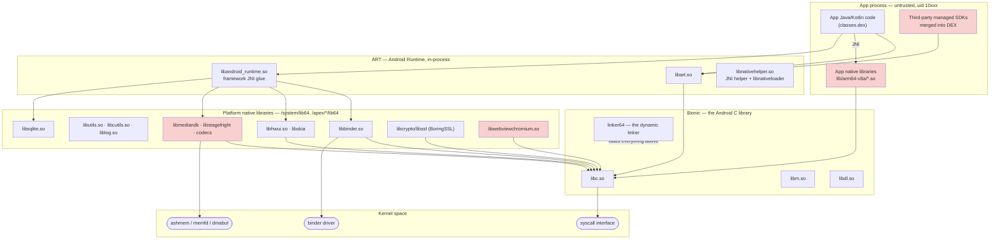
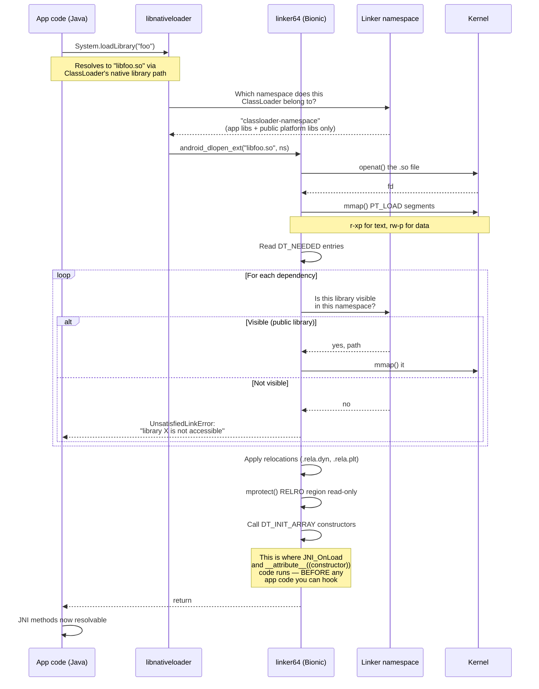
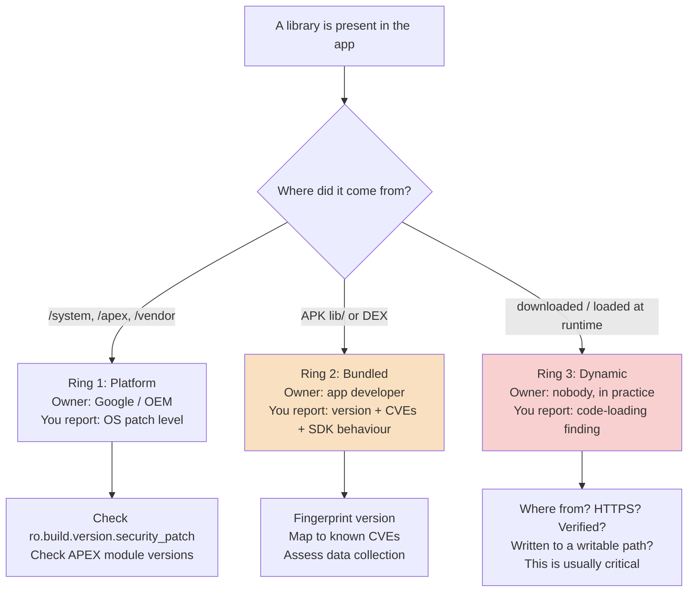
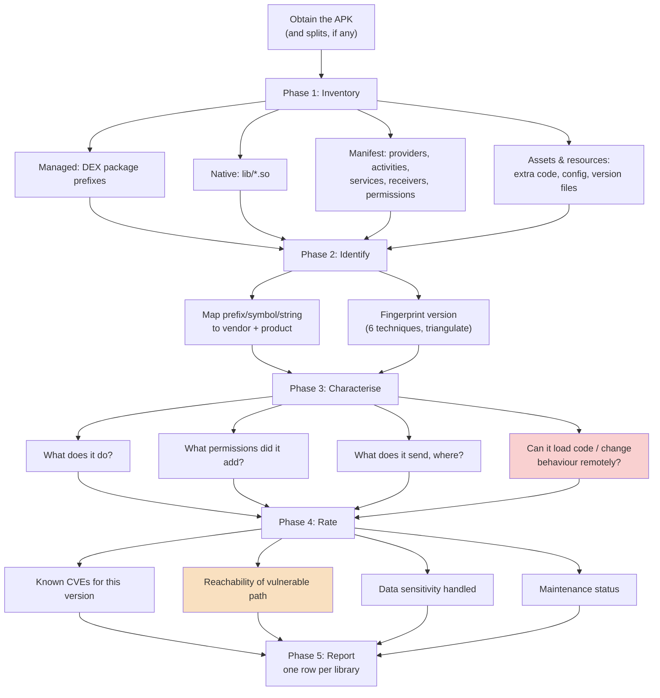
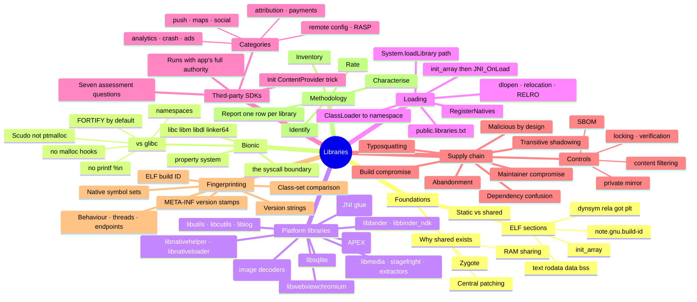

# 17 — Libraries: the shared-code layer as attack surface

> After this chapter you will be able to open any APK, enumerate every library it carries — system,
> native, managed, and third-party SDK — identify the version of each even when the build files are
> gone, explain what each library does and how it has historically failed, and produce a defensible
> risk rating for every one of them.

**Prerequisites:** [15-Native-Code](../15-Native-Code/README.md), [16-JNI](../16-JNI/README.md),
[10-APK-Internals](../10-APK-Internals/README.md), [11-Android-Runtime](../11-Android-Runtime/README.md)
**Applies to:** Android 5–16 (API 21–36), with a version matrix where behaviour changed

---

## Table of Contents

1. [Introduction](#1-introduction)
2. [High-Level Architecture](#2-high-level-architecture)
3. [Deep Internal Working](#3-deep-internal-working)
4. [Source Code Walkthrough (AOSP)](#4-source-code-walkthrough-aosp)
5. [Security Perspective](#5-security-perspective)
6. [Reverse Engineering Perspective](#6-reverse-engineering-perspective)
7. [Dynamic Analysis](#7-dynamic-analysis)
8. [Static Analysis](#8-static-analysis)
9. [Examples](#9-examples)
10. [Common Interview Questions](#10-common-interview-questions)
11. [Common Mistakes](#11-common-mistakes)
12. [Hands-on Labs](#12-hands-on-labs)
13. [Summary](#13-summary)
14. [References](#14-references)

---

## 1. Introduction

### The problem that existed before libraries

Imagine you are writing the very first programs for a computer that has none. You need to add two
numbers, so you write the code for addition. You need to print a character to the screen, so you
write the code that talks to the display hardware. You need to open a file, so you write the code
that walks the disk's directory structure.

Now your colleague at the next desk writes a second program. They also need to print characters and
open files. They write that code again, from scratch, slightly differently, with slightly different
bugs.

Multiply that by every program on the machine and you have three separate disasters:

1. **Wasted effort.** The same problem is solved hundreds of times.
2. **Wasted memory and disk.** Every program carries its own copy of the same routines.
3. **Unfixable bugs.** When someone finds a flaw in the "open a file" routine, there is no single
   place to fix it. There are three hundred copies, each subtly different, each shipped inside a
   different program.

A **library** is the answer to all three. It is a collection of already-written, already-tested code
that many programs share.

> **Definition**
> A **library** is a file containing compiled code and data that is designed to be used by other
> programs rather than run on its own. A **static library** is copied *into* each program at build
> time. A **shared library** (also called a *dynamic library*; on Linux and Android the file
> extension is `.so`, for *shared object*) stays as a separate file and is loaded into a program's
> memory when the program starts or when the program explicitly asks for it.

The distinction between static and shared matters enormously for security, and we will return to it
repeatedly. Here is the one-sentence version you should carry with you: **a shared library can be
patched once and every program benefits; a static library must be re-linked into every program that
used it, and if the vendor of that program has gone out of business, the bug is permanent.**

### Why Android has an unusual library story

On a desktop Linux system, almost everything is shared. When a security fix lands in the system's C
library, every program on the machine gets the fix on the next reboot.

Android is different in three ways that shape the entire chapter.

**First, Android has its own C library.** It is not the GNU C Library (glibc) that desktop Linux
uses. It is called **Bionic**, and Google wrote it from scratch, mostly for licensing reasons
(glibc is LGPL; Google wanted a BSD-licensed userspace so that device manufacturers could ship
closed-source products without LGPL obligations) but also for size and startup speed on phones.
Bionic behaves differently from glibc in ways that change how exploits work.

**Second, Android apps ship their own copies of libraries.** An APK contains a `lib/` directory
holding `.so` files that the app brought with it, and DEX bytecode that includes every Java/Kotlin
library the app depends on, merged into the app's own code. This means that an app is a **frozen
snapshot** of a set of libraries from the day it was built. A vulnerability fixed in OkHttp in
January does not reach the user until the app developer updates their Gradle dependency, rebuilds,
and ships — and until the user installs that update. Many apps never do.

**Third, since Android 10 Google has been pulling critical libraries *out* of the monolithic OS
image and into separately updatable modules** called **Mainline modules**, delivered as **APEX**
packages through Google Play. Conscrypt (the TLS provider), the media codecs, DNS resolution, and
several others now update independently of the manufacturer's system image. This is a direct,
deliberate response to the "the vendor never ships an update" problem.

> **Mental Model**
> Think of the libraries reachable from an Android app as three concentric rings.
>
> The **inner ring** is the platform: Bionic, the ART runtime, `libbinder`, Skia, and everything
> else in `/system/lib64` and the APEX modules. You do not control it, the app does not control it,
> and it is updated (or not) by Google and the device manufacturer.
>
> The **middle ring** is what the app shipped in its own APK: native `.so` files under `lib/`, and
> third-party Java/Kotlin libraries compiled into the DEX. This ring is entirely the app
> developer's responsibility and is where most of your findings will live.
>
> The **outer ring** is what the app loads at runtime from somewhere else: a downloaded DEX file, a
> plugin `.so`, a dynamic feature module, a `System.load()` of a path in external storage. This
> ring is small, rare, and almost always the most severe finding in the report.

### What would break if libraries did not exist

If Android had no shared libraries, every app would statically link everything. The consequences
are worth stating precisely because they explain several design decisions you will meet later:

- **APK sizes would explode.** A trivial app statically linking libc, libm, the compiler runtime,
  and the C++ standard library would be tens of megabytes before it did anything.
- **RAM usage would multiply.** A shared library's read-only, executable pages are mapped into
  every process from the *same physical memory*. One copy of `libc.so`'s code exists in physical
  RAM no matter how many hundreds of processes use it. Static linking would give every process its
  own private copy.
- **Zygote could not work.** Android's app startup model (see
  [11-Android-Runtime](../11-Android-Runtime/README.md)) depends on a template process, Zygote,
  that pre-loads shared libraries and classes and then `fork()`s. Everything the child inherits is
  shared copy-on-write. Static linking would destroy the benefit entirely.
- **Security patching would become impossible.** A flaw in the JPEG decoder would require every app
  that decodes a JPEG to ship a new build.

So libraries are not an optimisation. They are load-bearing structure.

### Why the library layer is where the bugs are

Here is the observation that should reframe how you approach an assessment.

Application code — the code the developer wrote — is usually the smallest part of an app by volume.
A typical commercial Android app is, by line count, somewhere between 80% and 98% code that
somebody else wrote: analytics SDKs, ad networks, crash reporters, image loaders, networking
stacks, JSON parsers, payment SDKs, map SDKs, chat SDKs, A/B testing frameworks, and the transitive
dependencies of all of those.

That code:

- Was not written for this app's threat model.
- Runs with the *full* privileges of the app: its UID, its permissions, its network access, its
  file access, its keystore access.
- Is frequently a **parser**, and parsers are the single most dangerous category of code in
  existence, because a parser's entire job is to take input from someone you do not trust and turn
  it into structured data.
- Is often not even inventoried. Ask a developer to list every library in their app and most will
  name eight. The dependency tree has two hundred nodes.

> **Pentester's Note**
> When you get a new APK, the very first substantive thing you should do — before you read a single
> line of the app's own code — is enumerate the libraries. It takes ten minutes, it tells you what
> kind of app you are looking at, it tells you where the parsers are, and roughly one engagement in
> four produces a real finding from that step alone: a known-vulnerable version of a shipped
> library, or an SDK that exfiltrates data the client did not know it was sending.

### The two questions this chapter answers

Everything that follows serves two practical questions:

1. **"What is in this app, exactly?"** — enumeration and version fingerprinting, including when the
   build files are unavailable and the code is obfuscated.
2. **"How bad is each thing I found?"** — a repeatable rating process that produces defensible
   severity rather than a wall of dependency-scanner noise.

---

## 2. High-Level Architecture

### The library stack, from app code to kernel



Read that diagram as a set of trust statements rather than a call graph.

The red boxes are the components that most commonly process attacker-controlled bytes. Third-party
managed SDKs are red because you did not audit them and they run with the app's full authority. The
app's own `.so` files are red because native code has no memory safety and the developer wrote them
under schedule pressure. `libstagefright` and the media codecs are red because their entire job is
parsing untrusted container and codec data. `libwebviewchromium` is red because it renders arbitrary
web content, though it is also the single most heavily defended piece of code on the device.

Everything funnels through Bionic, and Bionic funnels through the syscall interface. There is no way
to reach the kernel from an Android process that does not pass through `libc.so` — with one
exception worth knowing: code can issue an `svc #0` instruction directly and bypass libc entirely,
which is exactly what malware does to evade libc-level hooking. We cover that in
[18-ARM](../18-ARM/README.md).

### How a library gets into a process



Three things in that sequence deserve emphasis, because each one produces a real-world problem you
will meet.

**Linker namespaces are a security boundary, not a convenience.** Before Android 7.0 an app could
`dlopen()` any platform library it liked, including internal ones with unstable interfaces. From
Android 7.0 the dynamic linker maintains *namespaces*: an app's `ClassLoader` is associated with a
namespace whose search path covers the app's own `lib/` directory and a curated allow-list of
"public" platform libraries defined in `/system/etc/public.libraries.txt` and the per-APEX
equivalents. If you see `UnsatisfiedLinkError: dlopen failed: library "libfoo.so" is not accessible
for the namespace "classloader-namespace"`, this is why. It is not a missing file; it is a policy
decision.

**Constructors run before you can hook.** Everything in `DT_INIT_ARRAY` executes inside `dlopen()`,
before `System.loadLibrary()` returns and long before any Java code you might have hooked. Native
anti-debugging, root detection, and string decryption routinely live there precisely because of
this timing. If you attach Frida after the app has started, you have already lost. Spawn with
`frida -U -f` and use `Module.load`/`dlopen` interception if you need to be earlier still.

**Relocation and RELRO.** After mapping, the linker patches addresses into the library (relocation),
then calls `mprotect()` to make the relocated GOT read-only (**RELRO** — RELocation Read-Only).
Full RELRO plus `BIND_NOW` means the Global Offset Table cannot be overwritten at runtime, which
removes a classic exploitation primitive. Android builds everything with full RELRO by default;
third-party prebuilt `.so` files in an APK sometimes do not, and that is a checkable finding.

### Where libraries physically live

```
ON DISK (device)
├── /system/lib64/                    Platform libraries in the system image
│   ├── libc.so  libm.so  libdl.so    (on newer releases these live in the runtime APEX)
│   ├── libbinder.so  libutils.so  libcutils.so  liblog.so
│   ├── libhwui.so  libandroid_runtime.so  libnativehelper.so
│   └── libsqlite.so  libmedia.so  libstagefright.so ...
├── /system/lib/                      32-bit equivalents (shrinking; many devices are 64-bit only)
├── /apex/                            Mainline modules — updatable via Play
│   ├── com.android.runtime/lib64/    Bionic + ART core on Android 10+
│   ├── com.android.art/lib64/        libart.so and friends (Android 12+ split)
│   ├── com.android.conscrypt/lib64/  libssl/libcrypto (BoringSSL) + libjavacrypto
│   ├── com.android.media/            media extractors
│   ├── com.android.media.swcodec/    software codecs, in their own hardened process
│   └── com.android.resolv/           DNS resolver
├── /vendor/lib64/                    SoC/OEM libraries — HALs, GPU drivers, DRM
├── /system_ext/lib64/                OEM additions layered on system
└── /data/app/~~<hash>/<pkg>-<hash>/
    ├── base.apk                       app code + resources
    ├── lib/arm64-v8a/                 extracted .so files (if extractNativeLibs=true)
    └── oat/arm64/base.odex            AOT-compiled app code

INSIDE AN APK (zip)
├── AndroidManifest.xml               binary XML; SDK init providers declared here
├── classes.dex, classes2.dex, ...    app code AND every managed dependency, merged
├── lib/
│   ├── arm64-v8a/*.so                native libraries for 64-bit ARM
│   ├── armeabi-v7a/*.so              32-bit ARM
│   └── x86_64/*.so                   emulator/Chromebook
├── assets/                           often contains SDK config, models, extra DEX, extra .so
├── res/ + resources.arsc             SDK version strings frequently hide here
└── META-INF/                         signatures; also legacy library metadata files
```

That layout is the map for the rest of this chapter. Almost every enumeration technique in section 8
is "look in exactly one of those places and interpret what you find".

Two details in it are load-bearing.

`extractNativeLibs="false"` (the default since Android Gradle Plugin 3.6 for apps targeting API 23+)
means the `.so` files are **not** unpacked to `/data/app/.../lib/`. They stay compressed-free inside
the APK and are mapped directly from it. On a running device you will then see the *APK path* in
`/proc/<pid>/maps` with an offset, not a `.so` path — a detail that confuses people the first time
they see it, and which we dissect in [19-Memory](../19-Memory/README.md).

The APEX directories are read-only mounts of signed images. You cannot drop a patched
`libcrypto.so` into `/apex/com.android.conscrypt/lib64/` the way you could once patch
`/system/lib64/`. This is the reason the old "copy your Burp CA into `/system/etc/security/cacerts`"
trick stopped working on Android 14 — the CA store moved into the Conscrypt APEX.

### The three rings, as a decision tree



Use this triage on every library you find. It stops you from writing "outdated OpenSSL" in a report
when what you actually found was the platform BoringSSL that the OEM controls, and it stops you from
under-reporting a bundled copy of a TLS library that the app statically linked three years ago and
has never touched since.

---

## 3. Deep Internal Working

### 3.1 Bionic — Android's C library

> **Definition**
> **Bionic** is the Android platform's implementation of the standard C library, math library, and
> dynamic linker. It comprises `libc.so`, `libm.so`, `libdl.so` and `linker`/`linker64`. Its source
> lives in the AOSP tree under `bionic/`. It is licensed under BSD terms, unlike glibc's LGPL.

Bionic exists because of a specific set of constraints, and each constraint left a visible mark on
its design.

| Constraint | Design consequence | Security consequence |
|---|---|---|
| BSD licence required, so OEMs can link statically without source obligations | Written from scratch using BSD-derived code, mostly from OpenBSD and FreeBSD | Different code lineage means different bugs from glibc; glibc exploit write-ups often do not transfer |
| Must be small — early devices had ~64–128 MB RAM | No full locale support, no `iconv`, minimal wide-char support, no NSS plugin system | Fewer parsers in libc means less libc attack surface than glibc |
| Must start fast — every app forks from Zygote | Simpler linker, lazy features avoided, `.so` count kept low | Predictable layout; combined with Zygote fork this weakens ASLR (see below) |
| Runs on a system where every process is sandboxed by UID and SELinux | No `setuid` helper machinery, no `LD_PRELOAD` for privileged binaries in the desktop sense | Some classic Unix privilege-escalation techniques do not exist |
| Google controls the whole platform | Aggressive adoption of hardening (FORTIFY, Scudo, MTE readiness) without ABI-compatibility fear | Modern Android libc is meaningfully harder to exploit than glibc |

#### Bionic versus glibc — the differences that change exploitation

This table is the one to memorise. Every row corresponds to a technique that either works or does
not work depending on which libc you are attacking.

| Area | glibc (desktop Linux) | Bionic (Android) | Why it matters to you |
|---|---|---|---|
| **Heap allocator** | ptmalloc2 — bins, tcache, unsorted bin, `__malloc_hook` historically | **Scudo** (hardened, from Android 11 as system default; earlier on some paths), previously **jemalloc**, before that **dlmalloc** | Every glibc heap-exploitation primitive (tcache poisoning, unsorted-bin attack, House of *) is **irrelevant** on modern Android. Do not waste time on them. |
| **Malloc hooks** | `__malloc_hook`, `__free_hook` (removed in glibc 2.34) | Never existed | A very common CTF primitive is absent |
| **`stdio` implementation** | Full BSD-derived `FILE` with vtable pointers historically exploitable | Simpler `FILE`, no exploitable vtable in the glibc sense | "FSOP" (File Stream Oriented Programming) does not transfer |
| **Dynamic linker** | `ld-linux.so`, `LD_PRELOAD` honoured widely, `dl_resolve` lazy binding | `linker64`, namespaces enforced, RELRO + BIND_NOW by default, `LD_PRELOAD` ignored for most processes and blocked by SELinux for system ones | `ret2dl_resolve` is generally not available; `LD_PRELOAD` injection is not the easy path it is on desktop |
| **Thread-local storage / stack guard** | Stack canary in TLS via `%fs` | Stack canary in TLS reached via `TPIDR_EL0`; `__stack_chk_guard` | Same concept, different register; you need this for [18-ARM](../18-ARM/README.md) |
| **`FORTIFY_SOURCE`** | Optional, distro-dependent, `_FORTIFY_SOURCE=2` | Compiled in by default and more aggressive; Bionic implements clang's `_FORTIFY_SOURCE` with `__builtin_object_size` and diagnoses many cases at compile time | Many trivially exploitable `strcpy` patterns abort instead of corrupting |
| **Locale / charset conversion** | Enormous surface: `iconv`, `gconv` modules loaded from disk | Effectively UTF-8 only, no loadable conversion modules | An entire class of glibc local privilege escalation has no analogue |
| **`printf` `%n`** | Supported | **Not supported** — Bionic deliberately omits `%n` | Classic format-string write-what-where via `%n` **does not work** on Android. Format-string *reads* (`%s`, `%p`) still leak memory. |
| **DNS resolution** | NSS plugin architecture, `/etc/nsswitch.conf`, loadable modules | Fixed resolver, since Android 10 in the `com.android.resolv` APEX, netd-mediated | No NSS module hijacking |
| **`syslog`** | Writes to `/dev/log` socket | `liblog` writes to the Android logging daemon | Different forensic artefacts |
| **`system()` / `popen()`** | `/bin/sh` (bash or dash) | `/system/bin/sh` (mksh); many apps have no shell access under SELinux | Command injection payloads must be mksh-compatible |
| **Symbol versioning** | Extensive (`GLIBC_2.x` version nodes) | Minimal; Bionic uses `LIBC` version tags but far fewer | Simpler symbol resolution when you are patching |
| **Static binaries** | Common and fully supported | Supported but discouraged; `libc` static builds lose `dlopen` | Relevant when analysing embedded tools dropped by malware |

> **Warning**
> The single most common mistake made by people coming to Android from Linux CTFs is to assume
> glibc heap internals. If you find yourself drawing tcache freelists while looking at an Android
> `malloc`, stop. Look up which allocator the target Android version uses (Scudo on anything modern),
> and read [19-Memory](../19-Memory/README.md) §Allocators before going further.

#### What Bionic actually provides

| Component | File | Contents | Notable for security |
|---|---|---|---|
| C library | `libc.so` | `malloc`/`free`, `str*`/`mem*`, `stdio`, `pthread`, syscall wrappers, `dlmalloc`→Scudo, property access (`__system_property_get`), `getauxval` | The syscall boundary; `__system_property_get` is how apps read `ro.*` properties, hence a hook point for root/emulator detection bypass |
| Math library | `libm.so` | `sin`, `cos`, `pow`, IEEE-754 handling | Rarely security relevant; occasionally a source of undefined-behaviour bugs |
| Dynamic linker stub | `libdl.so` | `dlopen`, `dlsym`, `dlclose`, `dladdr`, `dl_iterate_phdr` | `dlopen`/`dlsym` are the primary anti-analysis and dynamic-loading hooks; `dl_iterate_phdr` is used by both crash reporters and Frida-detectors to walk loaded modules |
| Dynamic linker | `linker64` / `linker` | The actual ELF loader; namespaces; relocation; `DT_INIT_ARRAY` execution | Where injection, namespace policy, and load-order all live |
| C++ runtime | `libc++.so` (or app-bundled `libc++_shared.so`) | STL, `operator new`, exception handling | An app bundling its own `libc++_shared.so` is normal; two different copies loaded in one process is a real bug source |

> **Under the Hood**
> `dlsym(RTLD_DEFAULT, "name")` on Android searches only the caller's linker namespace, not the whole
> process. This is why a Frida script that resolves a symbol from the wrong module gets `NULL` on
> Android where the same code works on desktop Linux. Use `Module.findExportByName("libfoo.so", ...)`
> with an explicit module name rather than `null`, and when that fails, enumerate with
> `Process.enumerateModules()` to see the exact name and path the linker used.

#### The property system, because you will hook it constantly

Bionic implements Android's system properties as a shared-memory area mapped read-only into every
process, with a small trie structure. `__system_property_get()`, `__system_property_find()` and
`__system_property_read_callback()` read it.

This matters because `getprop ro.debuggable`, `ro.build.tags`, `ro.boot.verifiedbootstate`,
`ro.build.fingerprint` and friends are the raw material of root and emulator detection. An app
written in Java calls `SystemProperties.get()` which calls down to
`android_os_SystemProperties_get()` in `libandroid_runtime.so`, which calls
`__system_property_read_callback()` in `libc.so`.

If you hook only the Java layer, native code that calls `__system_property_get` directly sails past
you. Hooking in Bionic catches both. This is a recurring theme: **hook as low as you can afford to.**

```javascript
// Frida REPL — catch every property read, including from native code
const libc = Module.findExportByName("libc.so", "__system_property_get");
Interceptor.attach(libc, {
  onEnter(args) { this.key = args[0].readCString(); this.buf = args[1]; },
  onLeave(retval) {
    console.log("__system_property_get(" + this.key + ") -> " + this.buf.readCString());
  }
});
```

### 3.2 The platform library catalogue

You will meet these names constantly in `/proc/<pid>/maps`, in stack traces, in `DT_NEEDED` lists
and in crash dumps. Knowing what each one does turns an opaque backtrace into a readable story.

| Library | What it is | Who calls it | Security relevance |
|---|---|---|---|
| `libbinder.so` | C++ client/server implementation of Binder IPC: `Parcel`, `IBinder`, `IPCThreadState`, the `ioctl(BINDER_WRITE_READ)` loop | Every framework service, every app indirectly | The transport for nearly all privilege boundaries on Android. `Parcel` deserialisation bugs are a classic path from app to `system_server`. See [25-Binder](../25-Binder/README.md) |
| `libbinder_ndk.so` | The stable NDK/AIDL-in-C++ surface (`AIBinder`, `AParcel`) used by vendor and APEX code | HALs, APEX modules, NDK apps | Same risks, different API shape; increasingly what you see on modern devices |
| `libutils.so` | Foundational C++ utilities: `RefBase` (intrusive reference counting), `sp<>`/`wp<>` smart pointers, `String8`/`String16`, `Vector`, `Looper`, `Thread` | Almost all platform C++ | `RefBase` misuse produces use-after-free; `String8`/`String16` conversions have produced integer-overflow bugs |
| `libcutils.so` | C-level platform utilities: `ashmem` wrappers, `properties`, `sockets` (`android_get_control_socket`), `atomic`, `sched_policy`, `native_handle` | Platform daemons and HALs | `native_handle` marshalling across Binder is a recurring source of FD-confusion bugs |
| `liblog.so` | The logging client: `__android_log_print`, `__android_log_buf_write` | Everything | Where your `logcat` findings originate; hooking it is the reliable way to capture logs an app tries to suppress |
| `libnativehelper.so` | Thin JNI convenience layer (`jniThrowException`, `jniGetFDFromFileDescriptor`, `JNI_CreateJavaVM` wrapper) and, historically, hosts **libnativeloader** which implements the namespace policy for `System.loadLibrary` | ART, framework JNI code | The gatekeeper deciding which platform `.so` an app may `dlopen` |
| `libandroid_runtime.so` | **The JNI glue for the entire framework.** Contains the `android_*_*` native methods that back `android.*` Java classes: `android_os_Parcel`, `android_view_Surface`, `android_graphics_Bitmap`, `android_os_Binder`, `android_database_sqlite_*`, `android_media_*` | ART, on behalf of framework Java code | Enormous. This is the boundary where a Java-level call becomes native, and where type confusion between the Java and native views of an object lives. Nearly every "framework" native CVE lands here or one layer below |
| `libhwui.so` | Hardware-accelerated UI rendering: display lists, the render thread, the GPU pipeline, `RenderNode` | The View system | Renders untrusted content indirectly; historically fewer direct app-reachable bugs than Skia |
| `libskia` (inside `libhwui.so` on many builds) | Google's 2D graphics engine — and, critically, the **image decoders**: PNG (libpng), JPEG (libjpeg-turbo), WebP (libwebp), GIF, and more | `BitmapFactory`, WebView, everything that draws an image | **Very high.** Any app that decodes an image from the network reaches this code with attacker bytes. Image-decoder heap overflows have repeatedly been remote-attack primitives across the industry |
| `libmedia.so`, `libstagefright.so`, `libmediandk.so`, media extractors in `com.android.media` APEX | Media framework: container parsing (MP4, MKV, OGG, MPEG-TS), codec negotiation, buffer management | `MediaPlayer`, `MediaExtractor`, `MediaCodec`, browsers, messaging apps | **The canonical example of parser danger.** See the dedicated subsection below |
| `libsqlite.so` | SQLite, the embedded relational database engine | `SQLiteDatabase`, every app storing structured data, many system services | SQL injection at the app level; at the native level, a *corrupted database file* is attacker input to a large C parser |
| `libcrypto.so` / `libssl.so` (BoringSSL) | Google's fork of OpenSSL. Provides the primitives and the TLS implementation | Conscrypt, WebView, native networking | The TLS state machine and the X.509/ASN.1 parser are both attacker-facing |
| `libjavacrypto.so` + Conscrypt | The JCA/JSSE provider that implements `javax.net.ssl` and `java.security` on Android, backed by BoringSSL. Since Android 10 it is a **Mainline APEX module** (`com.android.conscrypt`) | Every Java-level TLS connection, `SSLContext`, `TrustManager`, `KeyStore` (partly) | Where certificate validation and pinning actually happen. The target of essentially every pinning bypass |
| `libwebviewchromium.so` | The Chromium rendering engine, loaded from the WebView provider APK (`com.google.android.webview` or `com.android.chrome`) | Any app with a `WebView` | Enormous surface, but independently updated via Play and heavily sandboxed. The app-level bugs are usually configuration (`addJavascriptInterface`, file access), not memory corruption. See [43-WebView](../43-WebView/README.md) |
| `libz.so` | zlib — DEFLATE compression | APK/ZIP handling, PNG, HTTP `Content-Encoding: gzip`, and dozens of others | Decompression is parsing; also the source of "zip bomb" resource-exhaustion issues |
| `libicu*.so` / `libandroidicu.so` | ICU — Unicode, collation, date formatting, IDNA | Text handling everywhere | Unicode normalisation differences cause security-relevant *logic* bugs (homograph attacks, filter bypass) more often than memory bugs |
| `libselinux.so` | Userspace SELinux API: `getcon`, `security_check_context`, label lookup | `init`, `installd`, `zygote` | Read it when you are reasoning about why an operation is denied. See [22-SELinux](../22-SELinux/README.md) |
| `libbase.so` | Modern C++ helpers used across AOSP: `android::base::ReadFileToString`, `StringPrintf`, `unique_fd`, logging | Most modern AOSP C++ | `unique_fd` adoption fixed a whole class of FD-lifetime bugs; older code that does not use it is worth a second look |

> **Mental Model**
> Sort platform libraries into three buckets by *what kind of input they see*:
> **(a) parsers of untrusted bytes** — media, image, font, archive, ASN.1, SQLite file format. These
> are where memory-corruption CVEs come from.
> **(b) trust-boundary crossers** — `libbinder`, `libandroid_runtime`. These are where privilege
> escalation comes from.
> **(c) policy engines** — Conscrypt, `libselinux`. These are where *logic* bugs and bypasses come
> from, not crashes.
> Your testing technique differs completely between the three.

### 3.3 Why parsers are dangerous — media as the canonical case

If you take one idea from this chapter, take this one.

A **parser** is a piece of code whose job is to read a sequence of bytes produced by someone else and
convert it into structured data — objects, buffers, lengths, offsets. That description already
contains the danger: the parser must trust the input enough to act on it, while the input is chosen
by an adversary.

Consider what an MP4 file actually is. It is a tree of nested "boxes", each with a 32-bit size field
and a four-character type. The parser reads a size, allocates or indexes based on it, then reads that
many bytes. Now enumerate the ways an adversary can lie:

| The lie | The parser's mistake | The consequence |
|---|---|---|
| Size field says 0xFFFFFFFF | `size - 8` computed in 32-bit arithmetic wraps to a huge or tiny value | Integer overflow → undersized allocation → heap overflow on the subsequent copy |
| Size field says 8 (header only) but the parser assumes a payload | Reads past the end of the box | Out-of-bounds read → information disclosure or crash |
| A box claims a child count of 100000 but the file ends | Loop runs off the buffer | OOB read |
| Two boxes declare the same track ID | Second registration frees or overwrites the first's state | Use-after-free or type confusion |
| A codec-specific-data blob declares dimensions 65535×65535 | `width * height * bytes_per_pixel` overflows | Undersized frame buffer → overflow when the decoder writes |
| Nested boxes 10000 deep | Recursive descent parser | Stack exhaustion |
| A sample table entry points outside the file | Offset used directly in a read | OOB read |

Every one of those is a real bug pattern that has appeared in real media parsers, in every operating
system, repeatedly.

**Stagefright** is the name of Android's media framework, and in 2015 a set of vulnerabilities in it
became the most widely reported Android security story of the decade. The publicly assigned
identifiers included **CVE-2015-1538**, **CVE-2015-1539**, **CVE-2015-3824**, **CVE-2015-3826**,
**CVE-2015-3827**, **CVE-2015-3828** and **CVE-2015-3829**. What made them severe was not their
individual sophistication — they were ordinary integer-overflow and out-of-bounds bugs in MP4 box
parsing — but their **reachability**: at the time, the messaging application would automatically
process an incoming MMS's media to generate a preview. Receiving a message was sufficient. There was
no user interaction. The media server process ran with significant privileges and a broad set of
device access.

The *response* to Stagefright is more instructive than the bugs themselves, and it is a textbook
example of how to fix a class rather than an instance:

| Mitigation | What it did | Which attack property it removed |
|---|---|---|
| Split `mediaserver` into `mediaextractor`, `mediacodec`, `mediadrmserver`, `audioserver`, `cameraserver` (Android 7.0) | One compromised parser no longer yields all media privileges | Blast radius |
| Tight SELinux domains per media process, and a very restrictive `mediaextractor` domain | A compromised extractor cannot open the camera or the network | Post-exploitation capability |
| Move software codecs into `com.android.media.swcodec` APEX, running in a **seccomp-filtered**, highly constrained process | Even a full RCE in a software codec faces a tiny syscall allow-list | Escape to kernel |
| Make media extractors **Mainline-updatable** (`com.android.media` APEX) | A parser fix reaches devices via Play, not via an OEM image update | Patch latency |
| Disable auto-retrieval of MMS by default in the messaging app | Removed zero-click reachability | Reachability |
| Compile media code with integer-overflow sanitisation (`-fsanitize=integer` subsets, `signed-integer-overflow` traps) in AOSP media components | Turns a silent wrap into a controlled abort | Exploitability of the primary bug class |

> **Pentester's Note**
> When you test a modern app, the Stagefright-shaped question is not "does the media parser have a
> bug" — you are unlikely to find one by fuzzing from an app context in a week. The question is
> **"does this app hand attacker-controlled media to a parser it does not need to use, in a context
> where it is doing something more privileged than displaying a picture?"** Concretely: does a chat
> app auto-download and thumbnail media before the user opens it? Does it pass a URL straight to
> `MediaPlayer.setDataSource()`? Does it use a *bundled* media library (ExoPlayer, FFmpeg, a custom
> `.so`) instead of the platform's Mainline-updated one? That last case is the finding: a bundled
> FFmpeg from 2019 in an app that plays user-supplied video is a genuine, reportable issue, because
> it opts out of every mitigation in the table above.

### 3.4 SQLite, BoringSSL, Conscrypt and OkHttp — four libraries you must know cold

#### SQLite

SQLite is a complete relational database implemented as a single C library with no server. Android
uses it for `SharedPreferences`' larger cousins, `ContentProvider` backing stores, the framework's
own settings, contacts, SMS, and essentially every app that stores structured data.

Two entirely different security stories live here, and confusing them is a common error.

**Story one: SQL injection.** An app builds a query by string concatenation
(`"SELECT * FROM t WHERE name='" + input + "'"`) and an attacker supplies `' OR '1'='1`. On Android
this reaches you through `ContentProvider` `selection`, `projection`, and `sortOrder` parameters —
including from another app on the device, if the provider is exported. This is an *application*
vulnerability that happens to involve SQLite. Covered in
[27-ContentProviders](../27-ContentProviders/README.md).

**Story two: the database file itself is untrusted input.** If an app opens a `.db` file that an
attacker can write — from external storage, from a downloaded backup, from a "restore" feature —
then the entire SQLite file-format parser, plus the B-tree code, plus the query planner, becomes
attacker-facing native code. SQLite's own documentation is explicit that opening an untrusted
database file is not a supported security boundary without the specific hardening options. This is a
memory-corruption story, not an injection story.

> **Pentester's Note**
> "The app imports a `.db` file chosen by the user" is a finding worth writing up on its own,
> independent of whether you can demonstrate memory corruption. The remediation is straightforward
> to state: do not open foreign database files; parse an explicit export format instead, or at
> minimum open with `SQLITE_DBCONFIG_DEFENSIVE`, `PRAGMA trusted_schema=OFF`, and integrity checks.

#### BoringSSL

BoringSSL is Google's fork of OpenSSL, created in 2014 after Heartbleed (**CVE-2014-0160**) made the
case that OpenSSL's accumulated complexity was itself a security problem. Google removed features,
removed the ability to configure dangerous things, and changed the API deliberately so that it is
*not* a drop-in replacement.

For you, three practical facts:

1. On Android it ships as `libcrypto.so` and `libssl.so`, and on Android 10+ it lives inside the
   Conscrypt APEX and is therefore **Mainline-updatable**.
2. Version identification via the usual OpenSSL strings is misleading. BoringSSL reports an OpenSSL
   compatibility version (historically `OpenSSL 1.1.0` shaped strings) that does **not** correspond
   to a real OpenSSL release with real CVEs. Reporting "OpenSSL 1.1.0 — 47 CVEs" because a scanner
   matched that string in a BoringSSL binary is a false positive, and a well-known one.
3. Apps sometimes bundle their **own** OpenSSL (genuinely OpenSSL, not BoringSSL) inside a `.so` for
   a cross-platform C/C++ core. *That* one is real, is frozen at build time, and should be
   fingerprinted. Section 8 shows how.

#### Conscrypt

Conscrypt is the Java Cryptography Architecture (JCA) and Java Secure Socket Extension (JSSE)
provider that Android uses. It implements `SSLContext`, `SSLSocket`, `TrustManager`,
`HostnameVerifier`, `Cipher`, `MessageDigest`, `Signature` — the Java-visible cryptographic surface —
by delegating to BoringSSL through `libjavacrypto.so`.

Since Android 10 it is a Mainline module, `com.android.conscrypt`. That has two consequences you will
feel:

- TLS improvements and certificate-validation fixes reach devices without an OEM update. Good.
- The **system CA trust store** moved under APEX control. The classic technique of remounting
  `/system` and dropping a hashed CA file into `/system/etc/security/cacerts` stops working on
  Android 14 and later. You now need a Magisk module that overlays the APEX-provided store, or you
  use a different interception approach. This is the single most common "why doesn't my Burp setup
  work any more" cause on modern devices. See [35-SSL](../35-SSL/README.md).

Conscrypt is also where certificate pinning bypasses land. Whatever the app's pinning library is —
OkHttp's `CertificatePinner`, `TrustKit`, a custom `X509TrustManager`, or a native check — the
verification eventually flows through Conscrypt's `TrustManagerImpl.checkTrustedRecursive` or through
BoringSSL's verification callback. Hooking at the Conscrypt level catches pinning implementations
that a per-library hook would miss.

#### OkHttp

OkHttp is Square's HTTP client. It is not part of the platform; apps bundle it. It is so ubiquitous
that in practice it *is* the Android HTTP stack. Retrofit sits on top of it. Picasso, Coil, Glide and
most image loaders use it. Many other SDKs embed it.

What you need to know:

| Fact | Consequence for testing |
|---|---|
| It is bundled, therefore frozen at the app's build date | Old versions persist for years in shipped apps |
| It has its own `CertificatePinner` | A pinning bypass must handle it specifically, or hook lower |
| It has its own connection pool, DNS, and `Interceptor` chain | An `Interceptor` may add auth headers you will not see in the app's own code |
| It reads the JVM's proxy settings by default but an app can pass `Proxy.NO_PROXY` | This is the number-one reason `settings put global http_proxy` appears to do nothing |
| It ships an `okhttp3.internal.platform` layer that picks the TLS backend | Determines whether your Conscrypt hook or your `SSLSocketFactory` hook fires |
| Class names are stable and distinctive (`okhttp3.OkHttpClient`, `okhttp3.internal.Util`) | Excellent fingerprinting target — see section 8 |

> **Under the Hood**
> When an app "ignores your proxy", walk this list in order: (1) `Proxy.NO_PROXY` or a custom
> `ProxySelector` passed to `OkHttpClient.Builder`; (2) certificate pinning causing a silent failure
> and a fallback path; (3) the traffic is not HTTP at all (gRPC over HTTP/2 still is, but a custom
> TCP protocol is not); (4) the app uses Cronet (Chromium's network stack, shipped as a library),
> which does not consult the same proxy settings; (5) the app uses a native networking stack inside a
> `.so` that never touches the JVM. Frida-hooking `okhttp3.OkHttpClient$Builder.proxy` and
> `java.net.Socket.connect` distinguishes cases 1–3 from 4–5 in about a minute.

### 3.5 Third-party SDKs — the real attack surface

> **Definition**
> An **SDK** (Software Development Kit) in the Android sense is a third-party library that an app
> developer adds to gain a feature — analytics, advertising, crash reporting, payments, maps,
> authentication, chat, push notifications, A/B testing, attribution. It is distributed as an AAR
> (Android ARchive: a JAR plus Android resources, manifest fragments, and optionally native
> libraries) from a Maven repository, and merged into the app at build time.

The security-relevant property of an SDK is not primarily "does it have a memory-corruption bug". It
is this:

**An SDK runs inside the app's process, with the app's UID, holding the app's permissions, able to
read the app's private files, able to see the app's network traffic, able to read the app's memory,
and able to make network requests to its own servers.** There is no sandbox between the app and the
SDK. None. The Android security model draws its boundary at the process, and the SDK is inside it.

That means every SDK is a **transitive trust decision**: by adding it, the developer has decided
that the SDK's vendor, the SDK vendor's security practices, and the SDK vendor's build pipeline are
all as trustworthy as their own.

#### SDK categories and what each actually does

| Category | Typical capabilities requested | What it typically collects | Characteristic risk |
|---|---|---|---|
| **Analytics** (usage measurement) | `INTERNET`, `ACCESS_NETWORK_STATE`; often an init `ContentProvider` | Screen names, event names and parameters, session length, install source, device model, OS version, locale, an advertising or app-scoped identifier | Developers log *event parameters* carelessly. Order IDs, email addresses, account numbers and search terms end up in an analytics payload leaving the device |
| **Crash reporting** | `INTERNET`, often a native signal handler and a `breakpad`/`crashpad`-style `.so` | Stack traces, thread dumps, device state, custom keys, **breadcrumb logs**, and in some configurations a slice of memory | Stack traces and custom keys leak tokens, file paths, and user identifiers. Native minidumps can contain heap contents including secrets |
| **Advertising / mediation** | `INTERNET`, `ACCESS_NETWORK_STATE`, sometimes `ACCESS_COARSE_LOCATION`, `AD_ID` | Advertising ID, device fingerprint signals, coarse or precise location, installed-app signals where available, ad interaction | Ad SDKs load **remote content into WebViews** and sometimes remote code/config. Mediation SDKs pull in a dozen further ad SDKs transitively. The largest uncontrolled surface in a typical consumer app |
| **Attribution / MMP** (mobile measurement partners) | `INTERNET`, install-referrer access | Install referrer, device identifiers, first-open time, deep-link data, sometimes clipboard historically | Correlates the device across apps and campaigns; deep-link handling has produced real hijacking bugs |
| **Payments** | `INTERNET`, sometimes `CAMERA` (card scan), `NFC` | Card data (ideally tokenised in-SDK), billing address, device risk signals | The highest-consequence SDK in the app. Also the one whose integration errors (client-side amount, unverified receipt) produce the most severe findings |
| **Push / messaging** | `INTERNET`, `POST_NOTIFICATIONS`, a `Service` and `Receiver` | Device push token, app open events | Push tokens are credentials. Deep links carried in push payloads are attacker-influenced if the backend is loose |
| **Maps / location** | `ACCESS_FINE_LOCATION`, `INTERNET` | Precise location, frequently and in the background | Background location is the highest-sensitivity ordinary permission on the platform |
| **Social login / SDKs** | `INTERNET`, custom URL schemes, browser handoff | Profile data, OAuth tokens | Redirect-URI and custom-scheme handling; see [45-OAuth](../45-OAuth/README.md) |
| **Chat / support** | `INTERNET`, often WebView, file access | Conversation content, user identifiers | WebView configuration and file-upload paths |
| **A/B testing / feature flags / remote config** | `INTERNET` | Nothing much outbound; but **inbound configuration changes app behaviour** | A remote-config service that can flip a security control (disable pinning, enable a debug menu) is a control-plane compromise waiting to happen. Some of these SDKs can deliver *code*, not just values |
| **Image loading** (Glide, Coil, Picasso, Fresco) | `INTERNET`, disk cache | — | Fetches and decodes untrusted images; cache poisoning; SSRF-adjacent behaviour if the URL is attacker-controlled |
| **Obfuscation / RASP / anti-fraud** | Broad; native `.so`, sometimes root detection, sometimes device fingerprinting | Extensive device fingerprint, sensor data, sometimes accessibility state | The thing you will spend your week bypassing. Also, ironically, often the largest single native binary in the app |

#### The initialisation `ContentProvider` trick — and why it matters for enumeration

Many SDKs need to run code at app startup without requiring the developer to add anything to
`Application.onCreate()`. Android's component lifecycle gives them a way: **`ContentProvider`s are
created before `Application.onCreate()` runs.** So the SDK declares a no-op `ContentProvider` in its
manifest fragment, whose `onCreate()` does the SDK's initialisation and returns `false`.

The manifest merger folds these into the app's final `AndroidManifest.xml`. AndroidX formalised the
pattern as `androidx.startup.InitializationProvider`.

This is enormously useful to you, because it means **the merged manifest is a reliable inventory of
every SDK that initialises itself**, even when the DEX is obfuscated. Provider authorities are
usually of the form `${applicationId}.<sdk-name>-provider` or contain the SDK's package prefix, and
authorities cannot be obfuscated because they are strings the system resolves.

```bash
# host — every auto-initialising SDK, from the manifest alone
apktool d -f target.apk -o work/ >/dev/null
grep -oE '<provider[^>]*android:name="[^"]*"[^>]*>' work/AndroidManifest.xml
grep -oE 'android:authorities="[^"]*"' work/AndroidManifest.xml | sort -u
```

> **Pentester's Note**
> Run that on any large consumer app and count the providers. Ten to thirty is normal. Each one is a
> vendor whose code runs before the app's own code does. Present that count to the client — it is
> often the first time anyone has said it out loud, and it reframes the whole conversation about
> third-party risk.

#### What "assess an SDK" concretely means

For each SDK you find, answer these seven questions. This is the rubric used in section 8's
methodology and in `scripts/`.

| # | Question | How you answer it |
|---|---|---|
| 1 | **What is it and who publishes it?** | Package prefix → vendor. Cross-check against the vendor's documented Maven coordinates |
| 2 | **What version is it?** | Fingerprinting — see §3.7. Never trust a `BuildConfig` string alone |
| 3 | **What permissions does it contribute?** | Diff the app's merged manifest against a build without the SDK, or read the SDK's published AAR manifest |
| 4 | **What does it send, to where, and how often?** | Dynamic: proxy the app and attribute each host to an SDK. Static: extract hardcoded endpoint strings |
| 5 | **What does it collect that the client did not intend?** | Inspect actual payload bodies. Look specifically at event *parameters* and crash *custom keys* |
| 6 | **Can it change its own behaviour remotely?** | Look for remote config, `DexClassLoader`, `dlopen` of a downloaded path, WebView with remote content, JS bridges |
| 7 | **What is its known vulnerability history and current support status?** | Vendor advisories, GitHub security advisories, the OSV database, and whether the artifact is still maintained |

Question 6 is the one that separates a routine SDK from a critical finding. An SDK that can download
and execute code is a permanent backdoor into the app, regardless of the vendor's intentions,
because it means the app's security now depends on the vendor's server not being compromised.

### 3.6 Supply chain risk

> **Definition**
> A **software supply chain attack** compromises software not by attacking it directly but by
> attacking something it depends on, or the process by which it is built and delivered. The victim
> installs the malicious code themselves, through their normal, trusted update process.

Android apps consume dependencies from Maven repositories — Google's Maven, Maven Central, JitPack,
and sometimes a company's internal Artifactory or Nexus. Gradle resolves coordinates of the form
`group:artifact:version` against a list of repositories. Every step of that has been attacked
somewhere in the industry.

#### The classes of supply chain attack

| Class | Mechanism | Why it works | Mobile-specific note |
|---|---|---|---|
| **Dependency confusion** | An internal package name (`com.acme.internal:auth-sdk`) also exists on a **public** repository, published by an attacker with a higher version number. The build tool, configured to check both, picks the public one | Resolution order and version-preference rules were designed for convenience, not adversaries. Publicly demonstrated at scale by researcher Alex Birsan in 2021 across npm, PyPI and RubyGems ecosystems | Gradle is affected wherever `repositories { mavenCentral(); maven { url internalRepo } }` is declared without `exclusiveContent`/`content` filters. Fix: pin internal groups to internal repos explicitly |
| **Typosquatting** | An attacker publishes `com.squareup.okhtttp:okhttp` or a plausible near-miss group ID | Developers copy coordinates from blog posts and Stack Overflow answers | Maven's group-ID-as-reverse-domain convention helps, because taking `com.squareup` requires more than an account, but JitPack-style `com.github.<user>` coordinates are trivially squattable |
| **Compromised maintainer account** | Attacker steals credentials or a publishing token and pushes a malicious version of a legitimate, popular package | The package is genuine; only the new version is malicious. Signature checks pass if the attacker has the signing key | Documented repeatedly in the npm ecosystem — the 2018 `event-stream` incident and the 2021 `ua-parser-js` compromise are two publicly reported examples of the class |
| **Compromised build infrastructure** | The attacker modifies the artifact during the vendor's build, so the source repository is clean but the shipped binary is not | Nobody diffs the binary against the source | The reason reproducible builds and artifact attestation exist |
| **Malicious-by-design SDK** | The SDK does what it says *and* also harvests data or provides a remote code channel | It is not a "compromise" at all; it is the product | The most common real-world case in mobile. Investigated by traffic analysis, not by vulnerability scanning |
| **Abandoned package takeover** | A maintainer transfers or abandons a package; a new owner ships something different | Downstream consumers pin a range, or never look again | Watch for artifacts whose last release predates the app by years |
| **Transitive shadowing** | A deep transitive dependency you have never heard of is the actual vector | The dependency tree is 200 nodes deep and nobody has read it | `./gradlew app:dependencies` output routinely surprises the team that wrote the app |

> **Warning**
> Be precise in reports. Say "this app bundles version X of library Y, which is affected by
> CVE-NNNN-NNNN, and here is the code path that reaches the vulnerable function" — or say "this app
> bundles version X of library Y, which is affected by CVE-NNNN-NNNN; reachability was not
> confirmed". Do not say "supply chain attack" about a merely outdated dependency. And never assert
> that a specific named vendor was compromised unless you can cite the vendor's own advisory.

#### Defences, and how to check for them

| Defence | What it does | How you verify it in an assessment |
|---|---|---|
| **Dependency locking** (`gradle/dependency-locks/`, `dependencyLocking {}`) | Pins the exact resolved version of every transitive dependency | Ask for the lockfiles. Their absence in a mature codebase is a process finding |
| **Repository content filtering** (`exclusiveContent`, `content { includeGroup }`) | Ensures internal groups resolve only from the internal repository | Read `settings.gradle`/`build.gradle` `repositories` blocks. This is the concrete dependency-confusion fix |
| **Checksum and signature verification** (`gradle/verification-metadata.xml`) | Gradle verifies SHA-256 and PGP signatures of every artifact | Presence of `verification-metadata.xml` is a strong positive signal |
| **A private mirror/proxy** (Artifactory, Nexus) with an allow-list | No direct fetches from the public internet during a build | Ask about it; check `repositories` blocks |
| **SBOM generation in CI** | Produces a machine-readable inventory per build | Ask for the SBOM. If it exists, your enumeration job becomes verification instead of discovery |
| **Automated dependency scanning** (OWASP Dependency-Check, OSV-Scanner, Gradle's own, GitHub Dependabot) | Flags known-vulnerable versions | Confirm it runs on the *release* configuration, not just `debug`, and that findings are triaged rather than ignored |
| **Reproducible builds** | Anyone can rebuild the artifact and get identical bytes | Rare in Android; worth noting as a maturity indicator |

#### SBOM for mobile

> **Definition**
> An **SBOM** (Software Bill of Materials) is a machine-readable inventory of every component in a
> piece of software, with versions, licences, and often supplier and hash information. The two
> dominant formats are **SPDX** (an ISO standard, ISO/IEC 5962) and **CycloneDX** (an OWASP project).

For mobile, an SBOM has to answer a question that server-side SBOMs often dodge: **what is actually
in the shipped artifact**, not what the build file asked for. Those differ, because:

- R8/ProGuard removes unused classes, so a declared dependency may be almost entirely absent.
- Native `.so` files often statically link other libraries (OpenSSL, zlib, libpng, curl) whose
  presence appears nowhere in Gradle.
- Some SDKs bundle a *second copy* of a library under a shaded/relocated package name.
- Assets can contain further code (extra DEX, Lua, JavaScript, models).

So there are two SBOMs, and you should ask for both, or generate the second yourself:

| SBOM type | Generated from | Answers | Blind spots |
|---|---|---|---|
| **Build-time SBOM** | Gradle's resolved dependency graph (CycloneDX Gradle plugin, SPDX tooling) | "What did we intend to include, at which versions, transitively" | Native static linking, shading, runtime-loaded code, post-R8 reality |
| **Artifact-derived SBOM** | The APK itself — DEX class prefixes, `.so` symbol sets, embedded version strings, asset scanning | "What is actually shipping" | Version precision is lower; obfuscation degrades it |

> **Pentester's Note**
> Asking a client "can I have the SBOM for this build?" is a diagnostic question in itself. If the
> answer is yes, and the SBOM matches what you find in the APK, you are dealing with a mature
> engineering organisation and you can spend your time on deeper issues. If the answer is "the
> what?", your third-party findings are going to be the most valuable part of the report.

### 3.7 Fingerprinting a library's version inside a shipped APK

This is the section that separates a professional assessment from a scanner run. You will very often
have only the APK: no `build.gradle`, no lockfile, no SBOM, R8 has renamed everything, and you must
still say *which version* of a library is present, because "outdated OkHttp" is not a finding and
"OkHttp 3.12.1, which predates the fix for the connection-reuse issue in 3.12.x, and here is the
evidence" is.

There are six independent techniques. Use several and corroborate — any single one can mislead.

#### Technique 1 — embedded version strings and constants

Many libraries carry their own version as a string constant, precisely so they can report it in a
`User-Agent` or telemetry.

| Library | Where the version lives | How to extract |
|---|---|---|
| OkHttp | `okhttp3.internal.Version` / `okhttp3.OkHttp.VERSION` (Kotlin), and a `okhttp/3.x.y` `User-Agent` fragment | `grep -a -oE 'okhttp/[0-9]+\.[0-9]+\.[0-9]+' classes*.dex` |
| Retrofit | Rarely a literal; infer from OkHttp requirement and class shape | Class-signature technique below |
| Firebase / Play Services | `res/values/values.xml` entries such as `com.google.firebase.components:firebase-*` and `@string/google_app_id`; also `META-INF/*.version` files in the AAR that survive into the APK's `META-INF/` occasionally | `unzip -l app.apk \| grep -i version`, and grep `resources.arsc` |
| AndroidX libraries | `META-INF/androidx.*.version` files inside the APK | `unzip -l app.apk \| grep 'META-INF/androidx'` |
| Gson | `com.google.gson.internal.` class layout; no literal version | Class-signature technique |
| SQLite (native) | `sqlite3_libversion()` returns a string; the constant `SQLITE_VERSION` is in `.rodata` | `strings -a libsqlite.so \| grep -E '^3\.[0-9]+\.[0-9]+$'` |
| OpenSSL (genuinely bundled) | `OPENSSL_VERSION_TEXT`, e.g. `OpenSSL 1.1.1k  25 Mar 2021` | `strings -a lib.so \| grep -i '^OpenSSL '` |
| BoringSSL | No real version; look for `BoringSSL` and Google-specific symbol names | `strings -a lib.so \| grep -i boringssl` |
| zlib | `ZLIB_VERSION`, e.g. `1.2.11` plus `inflate 1.2.11 Copyright` | `strings -a lib.so \| grep -E 'inflate [0-9.]+ Copyright'` |
| libpng | `libpng version 1.6.37` in the copyright banner | `strings -a lib.so \| grep -i 'libpng version'` |
| libjpeg-turbo | Version in the copyright/`jpeg_std_error` area | `strings -a lib.so \| grep -iE 'jpeg|libjpeg-turbo'` |
| FFmpeg | Full configure line: `--enable-...` and `FFmpeg version n4.2.2` | `strings -a lib.so \| grep -E 'FFmpeg version|--enable-'` |
| curl | `libcurl/7.x.y` in the `User-Agent` | `strings -a lib.so \| grep -oE 'libcurl/[0-9.]+'` |
| Unity | `assets/bin/Data/` layout and `UnityVersion` string | `unzip -l app.apk \| grep 'assets/bin/Data'` |
| Flutter | `libflutter.so` and `flutter_assets/`; engine hash in `.rodata` | `strings -a libflutter.so \| grep -E '^[0-9a-f]{40}$'` |
| React Native | `assets/index.android.bundle` header and `com.facebook.react` classes | `unzip -p app.apk assets/index.android.bundle \| head -c 400` |

The FFmpeg case deserves a note: an FFmpeg build embeds its **entire configure command line** in
`.rodata`. That tells you the version, which codecs and demuxers were compiled in (i.e. exactly how
much parser surface the app exposes), and whether hardening flags were used. It is one of the
highest-value single strings you can find in an APK.

#### Technique 2 — class-name signatures (which classes exist)

Libraries add and remove classes between versions. The *set* of classes present is a fingerprint,
and it survives obfuscation of the *app's* code because library classes are usually kept (they are
part of the SDK's public API, or protected by `-keep` rules the SDK ships in its `consumer-rules.pro`).

The method:

1. List every class in the APK: `jadx --no-src -d out app.apk` then read `out/resources`, or
   `unzip -p app.apk classes.dex | strings` for a rough pass, or better, use `dexdump`/`baksmali`.
2. Filter to the library's package prefix.
3. Compare that set against the class sets of candidate versions of the library, which you obtain by
   downloading the AARs/JARs from Maven and listing their contents.

That comparison is mechanical and scriptable. `scripts/lib-fingerprint.py` in this chapter implements
it: give it a package prefix and a directory of reference JARs, and it reports the best-matching
version by Jaccard similarity of class sets.

| Signal | Strength | Notes |
|---|---|---|
| A class that exists only from version X onward | Strong lower bound | e.g. a feature class added in a known release |
| A class removed in version Y | Strong upper bound | Combine with the above to bracket the version |
| A method signature that changed | Strong, but needs `dexdump` to see | Kotlin default-argument synthetics (`method$default`) are useful markers |
| Package renamed between major versions | Very strong | e.g. `com.squareup.okhttp` (v2) versus `okhttp3` (v3+) |

#### Technique 3 — native symbol sets

For a `.so`, the exported and defined symbol list is a strong version fingerprint even when strings
are stripped, because symbol names come from the source.

```bash
# host — all dynamic symbols
readelf --dyn-syms --wide lib/arm64-v8a/libfoo.so | awk '{print $8}' | sort -u > syms.txt

# host — everything, if not stripped
nm -C lib/arm64-v8a/libfoo.so 2>/dev/null | sort -u

# host — dependencies, which alone tell you a lot
readelf -d lib/arm64-v8a/libfoo.so | grep NEEDED
```

Interpretation guide:

| Observation | Conclusion |
|---|---|
| `SSL_CTX_new`, `EVP_*`, `X509_*` exported | OpenSSL or BoringSSL is **statically linked into this .so** |
| `SSL_get_finished` present but `SSL_export_keying_material` absent | Narrows the OpenSSL era |
| `png_create_read_struct`, `png_read_info` | libpng statically linked |
| `av_register_all` present | FFmpeg older than 4.0 (the function was deprecated in 4.0 and removed later) — a genuinely useful version marker |
| `sqlite3_*` symbols | SQLite statically linked rather than using the platform's |
| `curl_easy_setopt` | libcurl statically linked |
| `Java_com_example_...` | JNI entry points; the class/method names survive even when the Java side is obfuscated, because JNI resolution is by name |
| `JNI_OnLoad` present | The library registers natives dynamically (`RegisterNatives`) — expect obfuscated/dynamic JNI binding |
| No `JNI_*` symbols at all | Not loaded by Java directly; a dependency of another `.so` |

> **Under the Hood**
> Statically linked third-party code inside an app's `.so` is the biggest blind spot in mobile
> dependency scanning, and it is why "the Gradle file says we have no OpenSSL" is not an answer. A
> cross-platform C++ core (common in fintech, VPN, media and games) routinely links OpenSSL, zlib,
> libpng, SQLite, curl and Protobuf directly into a single `libcore.so`. None of it appears in any
> build-time SBOM. Symbol enumeration is how you find it.

#### Technique 4 — the ELF build ID

An ELF file can carry a `.note.gnu.build-id` section: a hash (usually SHA-1, 20 bytes) computed over
the binary's contents at link time. It uniquely identifies that exact build.

```bash
# host
readelf -n lib/arm64-v8a/libfoo.so | grep -A1 'Build ID'
# or
file lib/arm64-v8a/libfoo.so
```

Uses:

- **Correlation across apps.** If two different apps ship a `.so` with the same build ID, it is
  byte-identical — the same vendor SDK. Build a database of build IDs you have seen and you can
  identify a stripped, renamed SDK instantly.
- **Correlation with a known-good build.** If the vendor publishes their AAR, extract its `.so`,
  compare build IDs, and you have proven (or disproven) that the app ships the genuine artifact.
- **Symbol recovery.** Debug-symbol servers key on build ID. If the vendor publishes symbols, this
  is how you find them.
- **Tamper evidence.** A modified `.so` will not match the vendor's build ID.

Absence of a build ID is itself a signal: it suggests a non-standard build, or deliberate stripping.

#### Technique 5 — resource and asset artifacts

| Artifact | What it tells you |
|---|---|
| `META-INF/<group>_<artifact>.version` files | AndroidX and some Google libraries write these; they contain the literal version. The single easiest win |
| `res/raw/`, `assets/` config files | SDK config JSON/XML often includes an `sdk_version` field |
| `resources.arsc` string pool | Merged from all AAR resources; grep it for version-shaped strings |
| `assets/dexopt/baseline.prof` | Baseline profiles list class and method names — a class inventory even for classes you cannot easily list otherwise |
| `kotlin/*.kotlin_builtins`, `META-INF/*.kotlin_module` | Kotlin metadata, tells you the Kotlin version and the modules present |
| `assets/` containing another `.dex` or `.so` | Runtime-loaded code — a finding in its own right, and a place to repeat the whole enumeration |
| `proguard.txt` / `META-INF/proguard/` rules retained in an AAR | Names the classes the SDK insists on keeping — a free list of stable, unobfuscated class names |

```bash
# host — the fastest version inventory that exists, when it works
unzip -l app.apk | grep -E 'META-INF/.*\.version'
for f in $(unzip -l app.apk | grep -oE 'META-INF/[^ ]*\.version'); do
  printf "%-60s %s\n" "$f" "$(unzip -p app.apk "$f")"
done
```

#### Technique 6 — behavioural and structural fingerprints

When everything above fails — a heavily obfuscated, stripped, string-encrypted SDK — you still have:

- **Network behaviour.** The endpoint hostnames, URL paths, and request body shape identify the
  vendor and often the SDK major version. `https://<vendor>.com/api/v3/events` tells you it is v3.
- **The `User-Agent` header.** Frequently contains the SDK name and version verbatim.
- **File and directory names created in the app sandbox.** SDKs create characteristic files
  (`<sdk>_prefs.xml`, a cache directory named after the vendor).
- **`SharedPreferences` keys.** Distinctive and rarely obfuscated because they are string literals
  used as persistent keys.
- **Thread names.** `Process.enumerateThreads()` or `/proc/<pid>/task/*/comm` shows names such as
  `OkHttp ConnectionPool`, `FirebaseInit`, `<vendor>-worker`. Thread names are not obfuscated.
- **Log tags.** Even in release builds many SDKs keep their tag strings.

```bash
# adb shell — thread names are an excellent library fingerprint at runtime
for t in /proc/$(pidof -s com.example.target)/task/*; do cat "$t/comm"; done | sort -u
```

> **Mental Model**
> Version fingerprinting is triangulation, not lookup. Each technique gives you a constraint —
> "at least 3.12", "at most 4.0", "built with these codecs", "byte-identical to the vendor's 2.7.1
> AAR". Intersect the constraints. Report the range you can actually defend, and state your evidence.
> An honest "OkHttp 3.12.x–3.14.x, evidenced by the presence of class A and absence of class B" is
> worth more than a confident wrong number.

### 3.8 Version matrix — library-layer changes across Android releases

| Android | API | Change affecting the library layer | Consequence for testing |
|---|---|---|---|
| 4.4 | 19 | ART introduced alongside Dalvik (experimental) | Two runtimes in the wild; different native interfaces |
| 5.0 | 21 | ART becomes the only runtime; full PIE required for all executables | Non-PIE native binaries dropped from malware toolkits |
| 6.0 | 23 | Runtime permissions; `dlopen` of private platform libs starts producing warnings | Apps relying on internal `.so` begin to break |
| 7.0 | 24 | **Linker namespaces enforced.** Private platform libraries no longer `dlopen`-able by apps. `mediaserver` split into several processes. User CA store no longer trusted by default for apps targeting 24+ | The two biggest single changes in this chapter's scope. Pinning testing and native-library assumptions both change here |
| 8.0 | 26 | Project Treble: `/vendor` partition and HIDL HALs; stricter vendor/system library separation | Vendor `.so` files become separately versioned |
| 9 | 28 | Non-SDK interface restrictions (greylist/blacklist) for Java APIs; TLS 1.3 by default via Conscrypt; cleartext traffic disabled by default | Reflection-based library tricks start failing; network testing changes |
| 10 | 29 | **Mainline modules and APEX introduced.** Conscrypt, DNS resolver, media components become updatable. Scudo available | Library patch latency drops dramatically for covered components |
| 11 | 30 | **Scudo becomes the default native allocator.** Package visibility restrictions. `libbinder_ndk` broadly adopted. GWP-ASan enabled probabilistically for platform processes | Heap exploitation assumptions change completely |
| 12 | 31 | ART itself becomes a Mainline module (`com.android.art`). `PendingIntent` mutability required | Runtime updates without OS updates |
| 13 | 33 | More Mainline coverage; `POST_NOTIFICATIONS` runtime permission; photo picker reduces broad storage grants | Push SDKs must request a permission — visible in the manifest diff |
| 14 | 34 | **System CA store moved under APEX/Conscrypt control.** Minimum installable target SDK raised. Restrictions on dynamic code loading for `targetSdk` 34: files opened for execution must be read-only | The `/system/etc/security/cacerts` technique dies. The dynamic-code restriction directly targets ring-3 loading |
| 15 | 35 | Continued Mainline expansion; further restrictions on background activity launches and implicit intents | Fewer SDK tricks available |
| 16 | 36 | Ongoing hardening; MTE availability expands on capable hardware | Memory-safety testing options improve |

> **Warning**
> Version-dependent behaviour is a frequent source of false conclusions. An app that fails to load a
> library on your Android 14 test device may work fine on the Android 11 device the client's users
> actually have. Always record the API level in your evidence, and test the range your client
> supports, not the range your drawer contains.

---

## 4. Source Code Walkthrough (AOSP)

### 4.1 The map

| Area | AOSP path | What you learn by reading it |
|---|---|---|
| Bionic C library | `bionic/libc/` | The actual `malloc` selection logic, `FORTIFY` implementations, syscall stubs |
| Bionic headers | `bionic/libc/include/` | The exact prototypes you will hook |
| Dynamic linker | `bionic/linker/` | Namespace creation, `dlopen` path, relocation, RELRO |
| Namespace policy | `bionic/linker/linker_namespaces.cpp`, `system/core/rootdir/etc/public.libraries*.txt` | Which platform libraries an app may load |
| Native loader | `libnativehelper/` and `system/core/libnativeloader/` (path has moved across releases) | How a `ClassLoader` maps to a linker namespace |
| Framework JNI | `frameworks/base/core/jni/` | Every `android_*` native method backing the framework |
| Binder C++ | `frameworks/native/libs/binder/` | `Parcel`, `IPCThreadState`, the `ioctl` loop |
| libutils | `system/core/libutils/` | `RefBase`, `String8`/`String16`, `Looper` |
| libcutils | `system/core/libcutils/` | `ashmem`, properties, sockets, `native_handle` |
| liblog | `system/logging/liblog/` | The logging client protocol |
| Media framework | `frameworks/av/media/` | Extractors, codecs, the `MediaCodec` service |
| Media extractor APEX | `frameworks/av/media/extractors/` | The MP4/MKV/OGG parsers themselves |
| Skia | `external/skia/` | The 2D renderer and image codecs |
| SQLite | `external/sqlite/` | The AOSP-patched SQLite, plus Android's `SQLiteConnection` JNI |
| BoringSSL | `external/boringssl/` | The crypto and TLS implementation |
| Conscrypt | `external/conscrypt/` | The JCA/JSSE provider and its JNI layer |
| zlib | `external/zlib/` | Compression |
| ICU | `external/icu/` | Unicode |
| APEX definitions | `system/apex/`, and each module's `apex/` directory | How Mainline modules are packaged, signed and mounted |

### 4.2 Tracing `System.loadLibrary` from Java to `mmap`

This is the single most useful trace in the chapter, because it explains every "library not
accessible" error, every constructor-runs-too-early surprise, and every namespace question.

**Step 1 — Java entry point.**
`frameworks/base/core/java/java/lang/Runtime.java` (Android's Runtime, distinct from OpenJDK's) and
`java/lang/System.java`:

```java
// java.lang.System
public static void loadLibrary(String libname) {
    Runtime.getRuntime().loadLibrary0(Reflection.getCallerClass(), libname);
}
```

The caller's class is captured because the **ClassLoader of the calling class** determines the
native library search path *and* the linker namespace. That is why calling `System.loadLibrary` from
a class loaded by a different ClassLoader (a plugin framework, a `DexClassLoader`) behaves
differently.

**Step 2 — path resolution.**
`Runtime.loadLibrary0` asks the `ClassLoader` for the library path via
`ClassLoader.findLibrary(name)`, which for an app is `PathClassLoader`'s `DexPathList.findLibrary`.
That searches the app's native library directories: `/data/app/.../lib/arm64` when
`extractNativeLibs=true`, or the `!/lib/arm64-v8a/` in-APK path when it is `false`.

**Step 3 — the JNI bridge.**
`Runtime.nativeLoad` is a native method implemented in `art/runtime/native/java_lang_Runtime.cc`,
which calls `JavaVMExt::LoadNativeLibrary` in `art/runtime/jni/java_vm_ext.cc`.

**Step 4 — namespace decision.**
`LoadNativeLibrary` calls into **libnativeloader** (`OpenNativeLibrary`), which looks up the
namespace associated with this ClassLoader. If none exists it creates one via
`android_create_namespace()` with:

- a search path of the app's own library directories,
- a *permitted* path,
- a link to the default namespace exposing only the libraries listed in
  `/system/etc/public.libraries.txt` plus the per-APEX public library lists,
- and a `type` that determines isolation strictness.

**Step 5 — the linker.**
`android_dlopen_ext()` in `bionic/linker/dlfcn.cpp` enters the linker with the namespace. The linker:

1. Finds the file, honouring the namespace's permitted paths.
2. Reads the ELF header and program headers.
3. `mmap()`s each `PT_LOAD` segment with the protection from `p_flags` — typically one `r-xp`
   mapping for `.text` and one `rw-p` for `.data`/`.bss`.
4. Walks `DT_NEEDED` and recursively loads dependencies **within the same namespace**, failing with
   the familiar "not accessible for the namespace" message when a dependency is not exported.
5. Processes relocations from `.rela.dyn` and `.rela.plt`.
6. Applies RELRO by `mprotect()`ing the `PT_GNU_RELRO` region read-only.
7. Runs `DT_PREINIT_ARRAY` (executables only), then `DT_INIT`, then `DT_INIT_ARRAY`.

**Step 6 — `JNI_OnLoad`.**
Back in ART, after `dlopen` returns, `LoadNativeLibrary` does `dlsym(handle, "JNI_OnLoad")` and calls
it if present. The library returns the JNI version it wants. This is where `RegisterNatives` is
usually called to bind native methods dynamically rather than relying on name mangling.

> **Under the Hood**
> There are therefore **two** distinct "early" hook points in a native library, and they run in this
> order: `DT_INIT_ARRAY` constructors (inside `dlopen`, step 5.7) and then `JNI_OnLoad` (step 6).
> Anti-analysis code that must run before anything else goes in a constructor. If you want to see it,
> you must intercept `dlopen`/`android_dlopen_ext` itself, or spawn with Frida and hook
> `android_dlopen_ext` before the target library is loaded. Hooking `JNI_OnLoad` is already too late
> for constructor-resident checks.

### 4.3 `libandroid_runtime` — the framework's JNI glue, concretely

`frameworks/base/core/jni/` contains one C++ file per framework area. A representative selection:

| File | Backs | Why you care |
|---|---|---|
| `android_os_Parcel.cpp` | `android.os.Parcel` | Every Binder marshalling operation; where a malformed Parcel meets native code |
| `android_os_Binder.cpp` | `android.os.Binder`, `BinderProxy` | The Java↔native Binder object bridge; object lifetime bugs here are severe |
| `android_util_Binder.cpp` | Binder helpers and the death-recipient machinery | |
| `android_graphics_Bitmap.cpp` (now largely under `frameworks/base/libs/hwui/jni/`) | `android.graphics.Bitmap` | Bitmap memory, `ashmem` sharing, the `reconfigure` paths; a historical source of type-confusion issues |
| `android_media_*` | `MediaPlayer`, `MediaCodec`, `MediaExtractor` | The Java-side entry into the media parsers |
| `android_database_sqlite_SQLiteConnection.cpp` | `SQLiteDatabase` internals | The bridge to `libsqlite`; where a Java `String` becomes a C string |
| `android_net_LocalSocket*.cpp` | UNIX-domain sockets | Local IPC that is not Binder |
| `android_view_Surface.cpp` | `Surface` | Graphics buffer handles crossing processes |
| `AndroidRuntime.cpp` | The runtime bootstrap itself: `startVm`, `startReg` | Lists every JNI registration table — effectively an index of the whole file set |

The registration pattern is worth recognising because you will see it in third-party libraries too:

```cpp
// frameworks/base/core/jni/ — the shape every framework JNI file uses
static const JNINativeMethod gMethods[] = {
    { "nativeCreate",  "(II)J",  (void*) android_example_nativeCreate },
    { "nativeDestroy", "(J)V",   (void*) android_example_nativeDestroy },
};

int register_android_example(JNIEnv* env) {
    return RegisterMethodsOrDie(env, "android/example/Thing", gMethods, NELEM(gMethods));
}
```

Two observations for reverse engineering:

- The **method signature strings** (`"(II)J"`) are in `.rodata` and are not obfuscated. Searching a
  third-party `.so` for JNI descriptor strings such as `(Ljava/lang/String;)Ljava/lang/String;`
  quickly locates its `RegisterNatives` table even when everything else is stripped.
- The `long` return type (`J`) carrying a native pointer back to Java is the standard "native handle"
  idiom. It means a Java-side integer is dereferenced as a pointer in native code. If an attacker can
  influence that long — through a bug, through reflection, through a serialisable field — the result
  is an arbitrary-pointer dereference. This idiom is worth flagging whenever you see it in a
  third-party library.

### 4.4 Reading the public library list

```bash
# adb shell — exactly which platform libraries an ordinary app may dlopen
cat /system/etc/public.libraries.txt
ls /apex/*/etc/public.libraries.txt 2>/dev/null
cat /vendor/etc/public.libraries.txt 2>/dev/null
```

A typical `public.libraries.txt` contains entries such as `libandroid.so`, `libaaudio.so`,
`libc.so`, `libcamera2ndk.so`, `libdl.so`, `libEGL.so`, `libGLESv1_CM.so`, `libGLESv2.so`,
`libjnigraphics.so`, `liblog.so`, `libmediandk.so`, `libm.so`, `libnativewindow.so`,
`libOpenMAXAL.so`, `libOpenSLES.so`, `libRS.so`, `libstdc++.so`, `libsync.so`, `libvulkan.so`,
`libwebviewchromium_plat_support.so`, and `libz.so`. The exact list varies by release and by device.

That list is a security boundary written as a text file. Everything not on it — `libbinder.so`,
`libutils.so`, `libcutils.so`, `libhwui.so`, `libsqlite.so`, `libcrypto.so` — is unavailable to an
app's `dlopen`, because those are internal interfaces with no ABI stability guarantee and, in several
cases, meaningful privilege.

> **Pentester's Note**
> An app that manages to use `libbinder.so` or other private libraries directly has done something
> unusual: it has either bundled its own copy, or it is exploiting a namespace-escape technique, or
> it is using a very old `targetSdk`. All three are worth investigating. Check with
> `readelf -d <app .so> | grep NEEDED` and compare against the public list.

### 4.5 An APEX module on disk

```bash
# adb shell — what a Mainline module looks like
ls -l /apex/
ls -l /apex/com.android.conscrypt/lib64/
cat /apex/com.android.conscrypt/apex_manifest.pb 2>/dev/null | strings | head
```

```bash
# adb shell — module versions, which is what you actually report
cmd package list packages --apex-only
for p in $(cmd package list packages --apex-only | sed 's/package://'); do
  echo "$p $(dumpsys package "$p" | grep -m1 versionCode)"
done
```

The reason this belongs in your evidence pack: on a Mainline-covered device, the OEM's
`ro.build.version.security_patch` no longer tells the whole story. A device can have an old system
image and a current Conscrypt. Reporting "device is on the 2023-04 patch level, therefore vulnerable
to X" without checking whether X is in a Mainline module is a real and common analytical error.

---

## 5. Security Perspective

### 5.1 How attackers abuse the library layer

**Exploiting a parser reachable from a remote input.** The classical path: attacker sends media,
image, font, or archive data; the app decodes it; a memory-safety bug in the decoder yields code
execution in the app's process. On modern Android the platform parsers are hardened, sandboxed and
Mainline-updated, so the productive target is a *bundled* parser: an old FFmpeg, a custom image
codec, a hand-written protocol parser in the app's own `.so`.

**Exploiting a bundled library with a public, unpatched vulnerability.** The app froze a library at
build time. The library has since had a fix. The attacker reads the fix commit, derives the bug, and
attacks the shipped app. This requires no novel research and is the most likely real-world path.

**Abusing a legitimate SDK's capabilities.** If an SDK can fetch and execute configuration or code
from a server, compromising that server compromises every app that embeds the SDK. This is a
one-to-many attack and does not require any memory-safety bug.

**Hijacking library loading.** If an app loads a `.so` or `.dex` from a location another app or the
user can write — external storage, a world-writable directory, a downloaded file whose integrity is
not verified — then loading it is arbitrary code execution. Android 14's requirement that files
opened for dynamic code loading be read-only targets exactly this.

**Supply chain compromise.** Covered in §3.6. The attacker never touches the app; they touch
something the app builds against.

**Library confusion within the process.** Two copies of the same library at different versions
loaded into one process (a common consequence of two SDKs each bundling `libc++_shared.so` or each
shading a different OkHttp) produces symbol-resolution ambiguity, ODR violations in C++, and
occasionally exploitable type confusion.

### 5.2 How developers misuse libraries

| Misuse | Why it happens | What you will observe |
|---|---|---|
| Never updating dependencies after launch | No process; fear of regression; "it works" | Versions years older than the app's release date |
| Adding an SDK to solve a small problem and inheriting a huge dependency tree | Convenience | A dozen unexpected transitive libraries and permissions |
| Logging sensitive values into an analytics or crash SDK | The SDK API makes it trivial (`setCustomKey`, `logEvent`) | PII and tokens in outbound telemetry payloads |
| Shipping a debug/verbose SDK configuration in release | Build-variant mistakes | Verbose logging, test endpoints, disabled certificate validation |
| Bundling their own OpenSSL/curl/SQLite in a native core | Cross-platform code reuse | Statically linked, invisible to Gradle, never updated |
| Trusting an SDK's default TLS configuration | Assumption | An SDK with its own `TrustManager` that ignores the app's pinning |
| Using a `debug`-signed or unverified prebuilt AAR from a file share | Vendor delivery process | An `.aar` with no provenance anywhere in the build |
| Loading code from assets or downloads | Feature demands (plugin systems, hot patching) | `DexClassLoader`, `System.load` on a non-`lib/` path |
| Copying a native library into a writable directory before loading | Misunderstanding of `System.load` | The most directly exploitable version of the above |
| Disabling dependency verification because it broke the build | Deadline pressure | Absent `verification-metadata.xml`, or one with `trusted-artifacts` wildcards |

### 5.3 Real vulnerabilities and vulnerability classes

Stated carefully. Where I name an identifier, it is one that is widely and publicly documented.

| Case | Identifier(s) | Class | Lesson |
|---|---|---|---|
| Android Stagefright media parsing | CVE-2015-1538, CVE-2015-1539, CVE-2015-3824, CVE-2015-3826, CVE-2015-3827, CVE-2015-3828, CVE-2015-3829 | Integer overflow and out-of-bounds access in MP4 box parsing | Reachability (zero-click MMS) turned ordinary parser bugs into a platform emergency. The architectural response — process split, SELinux, seccomp, Mainline — is the model for defending any parser |
| OpenSSL "Heartbleed" | CVE-2014-0160 | Out-of-bounds read from a missing length check in the TLS heartbeat extension | A single missing bounds check in a ubiquitous library affected a large fraction of the internet. Directly motivated the creation of BoringSSL |
| The npm `event-stream` incident (2018) | No CVE; publicly reported by the npm ecosystem | Compromised maintainer account / malicious dependency injected into a popular package | Popularity is a target, not a safety signal. Applies identically to Maven |
| The npm `ua-parser-js` compromise (2021) | Publicly reported by the maintainer and npm | Compromised publishing credentials | Same class, different ecosystem, three years later |
| Dependency confusion research (2021, Alex Birsan) | Research disclosure, not a CVE | Resolution-order abuse across public and private registries | Demonstrated the class works at scale against major organisations. Gradle is in scope |
| Image and font decoder overflows (industry-wide, recurring) | Many, across libpng, libjpeg, libwebp, FreeType, and platform decoders on every OS | Heap overflow from attacker-controlled dimensions or chunk lengths | Any code path where a network-supplied image is decoded is a real attack surface. The mitigation is sandboxing plus memory-safe decoders, not code review |

> **Warning**
> Do not copy CVE identifiers from a scanner into a report without verifying (a) that the identifier
> applies to the library you actually found, (b) that it applies to the version you actually found,
> and (c) whether the vulnerable code path is present and reachable in this app. Scanners match
> strings. On Android the most common false positive is a BoringSSL binary matched against OpenSSL
> CVEs. The second most common is a CVE in a library's server-side component matched against the
> client artifact.

### 5.4 Bug bounty patterns in the library layer

These are the shapes that get paid, described generically:

- **A known-vulnerable bundled library with a demonstrated reachable path.** The report must show the
  version evidence, the vulnerable function, and a call path from app input to that function.
  Reachability is what turns a scanner line into a bounty.
- **An SDK exfiltrating data outside the app's stated privacy policy.** Evidence is a proxied request
  with the payload decoded and attributed to the SDK. This is often handled through privacy channels
  rather than security ones, but it is frequently the highest-impact finding.
- **Remote code loading with weak verification.** The app downloads a DEX/`.so`/JS bundle over a
  channel you can influence (no pinning, a hostname you can take over, no signature check) and
  executes it.
- **A third-party SDK's exported component reachable from another app.** SDKs contribute activities,
  services and receivers to the merged manifest, sometimes exported. The app developer never saw
  them. `dumpsys package` shows them.
- **Deep-link or custom-scheme handling contributed by an SDK.** Attribution and social SDKs register
  schemes; the handling code is in the SDK, not the app, and the app's team has never reviewed it.
- **A `debug` variant of an SDK shipped in release**, exposing a developer console, a test endpoint,
  or disabled validation.

### 5.5 OWASP MASVS / MASTG mapping

| Control area | Relevance to this chapter | Typical test |
|---|---|---|
| **MASVS-CODE** (code quality and build settings) | The core mapping. Third-party components, their versions, known vulnerabilities, and build hardening flags | Enumerate every dependency; check versions against advisories; check `.so` hardening (`checksec`-style) |
| **MASVS-PLATFORM** | SDK-contributed components in the merged manifest; WebView usage by ad and chat SDKs | Manifest audit including provider/activity/service contributed by SDKs |
| **MASVS-NETWORK** | SDK network behaviour; SDKs with their own TLS configuration; bundled HTTP clients | Proxy and attribute every host; check each stack's validation |
| **MASVS-STORAGE** | SDK caches and preference files in the app sandbox | Enumerate files created by each SDK |
| **MASVS-CRYPTO** | Bundled crypto libraries and their versions; SDK-implemented crypto | Identify the provider actually used |
| **MASVS-PRIVACY** | SDK data collection, identifiers, and consent handling | Payload inspection; compare against the app's declared data-safety disclosures |
| **MASVS-RESILIENCE** | RASP/anti-tamper SDKs; also obfuscation applied to third-party code | Identify the protection SDK and its version |

Relevant MASTG test areas include the platform's "Testing for Third-Party Libraries" material and the
code-quality tests concerning outdated components and build hardening. Consult the current MASTG for
exact test identifiers, since they were renumbered when MASVS v2 landed.

### 5.6 How malware abuses libraries

Android malware uses the library layer in four recognisable ways.

**Packing and native string decryption.** The real payload is encrypted in `assets/`; a small native
`.so` decrypts and `DexClassLoader`s it at runtime. The DEX you can see does almost nothing. The
detection signal is a tiny DEX, a large asset blob, and a `.so` importing `dlopen`, `mmap`,
`mprotect`, and crypto functions.

**Constructor-resident anti-analysis.** `__attribute__((constructor))` functions check `TracerPid`,
scan `/proc/self/maps` for `frida`, verify the APK signature, and exit or alter behaviour. Because
they run inside `dlopen`, they beat naive dynamic analysis.

**Syscall-direct execution.** Rather than calling `libc` wrappers (which Frida can hook), the payload
issues `svc #0` inline with the syscall number in `x8`. This evades every libc-level hook. See
[18-ARM](../18-ARM/README.md) §system instructions.

**Masquerading as a legitimate SDK.** A malicious library is named and packaged to resemble a
well-known analytics or utility SDK, so a casual manifest review passes over it. Build-ID
correlation against the genuine vendor artifact defeats this.

### 5.7 How forensic analysts investigate the library layer

The forensic questions differ from the pentest questions:

- **What was loaded?** `/proc/<pid>/maps` from a live capture, or the modules list from a memory
  image, gives the definitive answer — including libraries loaded from unusual paths.
- **What was loaded that is not in the APK?** Compare the maps output against the APK contents. Any
  `.so` or `.dex` mapped from `/data/data/<pkg>/`, `/data/local/tmp/`, external storage, or an
  anonymous executable mapping is a strong indicator of runtime code loading.
- **When was it written?** Timestamps on files in the app's `code_cache` and `files` directories.
- **What is its provenance?** Hash the artifact and compare against the vendor's published build;
  check the build ID; check whether it is signed.
- **What did it talk to?** DNS cache, netstat at capture time, and the app's own SDK caches.

The order-of-volatility rule applies with force here: capture `/proc/<pid>/maps`, the process memory,
and the open file descriptors *before* stopping the app, because a runtime-loaded library that was
deleted after loading exists only in memory and in the `(deleted)` marker on its mapping.

---

## 6. Reverse Engineering Perspective

### 6.1 What libraries look like in JADX

Open any large app in JADX and the package tree is your first inventory. The top-level structure is
immediately informative:

```
com.example.myapp          <- the app's own code (may be obfuscated)
a, b, c, d, ...            <- R8-renamed classes (the app's code, and anything not kept)
androidx.*                 <- AndroidX (Jetpack) libraries
kotlin.*, kotlinx.*        <- Kotlin stdlib and coroutines
com.google.android.gms.*   <- Google Play services
com.google.firebase.*      <- Firebase
com.google.gson.*          <- Gson
okhttp3.*, okio.*          <- OkHttp and Okio
retrofit2.*                <- Retrofit
io.reactivex.*             <- RxJava
com.squareup.picasso.*     <- Picasso
com.bumptech.glide.*       <- Glide
org.apache.commons.*       <- Apache Commons
com.facebook.*             <- Facebook SDK / Fresco / React Native
```

> **Pentester's Note**
> A library package that appears **un-obfuscated** while the app's own code is renamed is telling you
> something: the SDK shipped `consumer-rules.pro` keep rules, because it needs reflection or a stable
> API. That is convenient for you and it is also a reliable fingerprinting anchor — those class names
> are stable across builds of the *app*, so a name you learn on one version transfers to the next.

Conversely, a package that has been **shaded** — relocated into the app's namespace, e.g.
`com.example.myapp.shaded.okhttp3` or `com.example.myapp.a.b.c` with recognisable OkHttp method
shapes — is deliberate. Shading avoids version conflicts, and it also frustrates dependency scanners.
Recognise it by structure: the class *shapes* (fields, method counts, string constants) survive
renaming.

### 6.2 In the APK on disk

```bash
# host — the whole library inventory in four commands
unzip -l app.apk | grep -E '\.so$'                      # native libraries
unzip -l app.apk | grep -E 'META-INF/.*\.version'       # AndroidX/Google version stamps
unzip -l app.apk | grep -E 'classes[0-9]*\.dex'         # how much code there is
unzip -l app.apk | grep -E '^.*assets/' | head -50      # runtime-loadable material
```

Interpretation:

| Observation | What it means |
|---|---|
| Many `classes*.dex` files | A large dependency tree; the 64K method limit was crossed several times over |
| `lib/` present with several ABIs | Universal APK; a Play-delivered split would carry one |
| `lib/` absent entirely | Pure managed app — no native attack surface of its own |
| A single very large `.so` | A cross-platform core, a game engine, or a protection SDK. Highest-value native target |
| `.so` files under `assets/` rather than `lib/` | Deliberate: they will be extracted and `System.load`ed at runtime. Always investigate |
| An `.apk`, `.jar`, `.dex`, or `.zip` inside `assets/` | Runtime code loading. Always investigate |
| `META-INF/services/` entries | Java `ServiceLoader` providers — a reflection-driven extension point |

### 6.3 In Smali

Library loading has a small number of recognisable Smali signatures. These are the ones to burn into
memory.

**Standard native library load:**

```smali
# System.loadLibrary("native-lib")
const-string v0, "native-lib"
invoke-static {v0}, Ljava/lang/System;->loadLibrary(Ljava/lang/String;)V
```

**Loading from an absolute path — always investigate the path:**

```smali
# System.load("/data/data/com.example/files/payload.so")
invoke-virtual {p0}, Landroid/content/Context;->getFilesDir()Ljava/io/File;
move-result-object v0
new-instance v1, Ljava/io/File;
const-string v2, "payload.so"
invoke-direct {v1, v0, v2}, Ljava/io/File;-><init>(Ljava/io/File;Ljava/lang/String;)V
invoke-virtual {v1}, Ljava/io/File;->getAbsolutePath()Ljava/lang/String;
move-result-object v3
invoke-static {v3}, Ljava/lang/System;->load(Ljava/lang/String;)V
```

`System.load` with a constructed path is a different risk from `System.loadLibrary` with a constant.
The question to answer is: **can anything other than this app write to that path?**

**Dynamic DEX loading:**

```smali
# new DexClassLoader(dexPath, optimizedDirectory, librarySearchPath, parent)
new-instance v0, Ldalvik/system/DexClassLoader;
invoke-direct {v0, v1, v2, v3, v4}, Ldalvik/system/DexClassLoader;-><init>(Ljava/lang/String;Ljava/lang/String;Ljava/lang/String;Ljava/lang/ClassLoader;)V
invoke-virtual {v0, v5}, Ldalvik/system/DexClassLoader;->loadClass(Ljava/lang/String;)Ljava/lang/Class;
move-result-object v6
```

**In-memory DEX loading (Android 8.0+), which leaves no file to find:**

```smali
# new InMemoryDexClassLoader(ByteBuffer, ClassLoader)
new-instance v0, Ldalvik/system/InMemoryDexClassLoader;
invoke-direct {v0, v1, v2}, Ldalvik/system/InMemoryDexClassLoader;-><init>(Ljava/nio/ByteBuffer;Ljava/lang/ClassLoader;)V
```

**Reflection used to call into a library whose name is a decrypted string** — the packing signature:

```smali
invoke-static {v0}, Lcom/example/Crypto;->decrypt(Ljava/lang/String;)Ljava/lang/String;
move-result-object v1
invoke-static {v1}, Ljava/lang/Class;->forName(Ljava/lang/String;)Ljava/lang/Class;
move-result-object v2
```

Search commands for each:

```bash
# host — after apktool d
grep -rn "Ljava/lang/System;->loadLibrary" work/smali*/ | sort -u
grep -rn "Ljava/lang/System;->load(" work/smali*/ | sort -u
grep -rn "Ldalvik/system/DexClassLoader" work/smali*/ | sort -u
grep -rn "Ldalvik/system/InMemoryDexClassLoader" work/smali*/ | sort -u
grep -rn "Ldalvik/system/PathClassLoader" work/smali*/ | sort -u
grep -rn "Ljava/lang/Class;->forName" work/smali*/ | wc -l
```

### 6.4 In a native library

Open `lib/arm64-v8a/libfoo.so` in Ghidra, IDA or radare2. The orientation sequence is the same every
time.

| Step | Command / action | What you learn |
|---|---|---|
| 1 | `readelf -h` | Architecture, type (`DYN` = PIE shared object), entry point |
| 2 | `readelf -d \| grep NEEDED` | Its dependency list — immediately tells you if it uses OpenSSL, curl, SQLite, C++ |
| 3 | `readelf --dyn-syms` | Exported and imported symbols; find `JNI_OnLoad` and `Java_*` |
| 4 | `readelf -S` | Section list; note `.init_array` size — nonzero means constructors run at load |
| 5 | `readelf -n` | Build ID |
| 6 | `strings -a -n 8` | Version banners, URLs, file paths, error messages, format strings |
| 7 | Disassemble `.init_array` targets | The earliest-executing code — anti-analysis lives here |
| 8 | Disassemble `JNI_OnLoad` | Find `RegisterNatives` and recover the Java↔native method map |
| 9 | Cross-reference `dlopen`/`dlsym` calls | Dynamically resolved APIs — a hiding technique |
| 10 | Cross-reference `mprotect`/`mmap` with `PROT_EXEC` | Self-modifying or unpacking code |

The ELF sections you will actually care about:

| Section | Contents | Why it matters |
|---|---|---|
| `.text` | Executable code | The disassembly target |
| `.rodata` | Read-only data: string literals, jump tables, constants | Version strings, URLs, crypto constants (an S-box here identifies AES; specific 32-bit constants identify SHA-256) |
| `.data` | Initialised writable data | Function pointer tables that malware overwrites |
| `.bss` | Zero-initialised writable data | Runtime state |
| `.init_array` | Pointers to constructors run at load | **Run before `JNI_OnLoad`**; anti-analysis lives here |
| `.fini_array` | Destructors | Occasionally used for cleanup that hides evidence |
| `.dynsym` / `.dynstr` | Dynamic symbols and their names | Exported/imported functions |
| `.rela.dyn` / `.rela.plt` | Relocations | How imports get patched at load |
| `.got` / `.got.plt` | Global Offset Table | The classic hooking and hijack target; read-only under full RELRO |
| `.plt` | Procedure Linkage Table stubs | Recognisable call-through-GOT pattern in disassembly |
| `.note.gnu.build-id` | The build ID hash | Identity |
| `.gnu.hash` / `.hash` | Symbol lookup acceleration | Rarely interesting directly |
| `.comment` | Compiler identification string | Tells you the NDK/clang version used — a build-date proxy |

```bash
# host — the compiler string is a surprisingly good dating tool
readelf -p .comment lib/arm64-v8a/libfoo.so
# e.g. "Android (7284624, based on r416183b) clang version 12.0.5"
```

That output pins the NDK release used, which pins a rough build date, which cross-checks your version
fingerprint.

### 6.5 What obfuscation does, and does not do, to libraries

| Technique | Effect on library identification | Counter |
|---|---|---|
| R8/ProGuard renaming of app code | None on library identification, unless the library is also renamed | — |
| R8 renaming of library code (no keep rules) | Class names become `a.b.c` | Use class-*structure* signatures, string constants, and `META-INF` version files |
| **Shading / relocation** (moving `okhttp3` to `com.app.shaded.okhttp3`) | Package prefix lookup fails | Method-shape and string-constant matching; distinctive constants such as HTTP/2 frame names survive |
| String encryption | `strings` yields nothing useful | Hook the decryption routine at runtime and dump; or find the constant tables |
| Native symbol stripping (`-s`, `--strip-all`) | `nm`/`readelf --syms` empty | `.dynsym` still lists *exported* symbols (required for linking); imports are always visible in `.rela.plt` |
| Native packing (encrypted `.text`, decrypted at load) | Static disassembly yields garbage | Dump from memory at runtime after the constructor has run |
| Control-flow flattening | Manual reading becomes painful | Focus on the data: strings, constants, imports, and dynamic behaviour |
| Removal of the build ID | Loses that fingerprint | Fall back to symbol sets and `.comment` |
| Resource shrinking | Removes some `META-INF/*.version` files | Fall back to class sets |

> **Mental Model**
> Obfuscation removes *names*. It cannot remove *structure*, *imports*, or *behaviour*. A library
> still has to call `mmap`, still has to reference `SSL_CTX_new` if it uses OpenSSL, still has to
> send its distinctive request shape to its own server, and still has to have the same number of
> fields in the same order. Every fingerprinting technique in §3.7 that does not depend on a name
> survives obfuscation. Reach for those first when the easy ones fail.

---

## 7. Dynamic Analysis

### 7.1 Enumerating loaded libraries at runtime

The definitive answer to "what is loaded" comes from the process itself, not the APK.

```bash
# adb shell — every mapped file in the target process
PID=$(pidof -s com.example.target)
awk '{print $6}' /proc/$PID/maps | grep -E '\.(so|apk|dex|odex|vdex|art|jar)$' | sort -u
```

```bash
# adb shell — just the native libraries, with their paths
grep -E '\.so' /proc/$PID/maps | awk '{print $6}' | sort -u
```

```bash
# adb shell — anything mapped from a suspicious location
grep -E '/data/(local/tmp|data)/|/sdcard|/storage|memfd|\(deleted\)' /proc/$PID/maps
```

That last command is one of the highest-value single commands in this chapter. Anything executable
mapped from `/data/local/tmp`, external storage, a `memfd`, or a deleted file is code the app
obtained at runtime.

With Frida:

```javascript
// Frida REPL — modules with base, size and path
Process.enumerateModules().forEach(m => {
  console.log(m.base + "  " + ("0x" + m.size.toString(16)).padEnd(10) + "  " + m.name + "  " + m.path);
});
```

```javascript
// Frida REPL — exports of a specific module, filtered
Module.enumerateExports("libfoo.so")
  .filter(e => e.type === "function" && /^(Java_|JNI_)/.test(e.name))
  .forEach(e => console.log(e.address + "  " + e.name));
```

### 7.2 Catching libraries as they load

To see constructor-resident code, you must be attached before `dlopen` completes. Spawn, do not
attach.

```javascript
// frida -U -f com.example.target -l trace-dlopen.js --no-pause
// Logs every library load, including those triggered from native code.
const opens = ["android_dlopen_ext", "dlopen"];
opens.forEach(function (name) {
  const addr = Module.findExportByName(null, name);
  if (!addr) return;
  Interceptor.attach(addr, {
    onEnter(args) { this.path = args[0].isNull() ? "(null)" : args[0].readCString(); },
    onLeave(retval) {
      console.log("[" + name + "] " + this.path + " -> " + retval);
    }
  });
});
```

To run *your* code before a specific library's constructors, use Frida's `Module` load callback:

```javascript
// frida -U -f com.example.target -l early-hook.js
// Installs hooks the instant libtarget.so appears, before most of its init work.
Process.setExceptionHandler(function () { return false; });

const dlopenExt = Module.findExportByName(null, "android_dlopen_ext");
Interceptor.attach(dlopenExt, {
  onEnter(args) { this.path = args[0].readCString(); },
  onLeave(retval) {
    if (this.path && this.path.indexOf("libtarget.so") !== -1) {
      console.log("[+] libtarget.so loaded; installing hooks");
      const m = Process.findModuleByName("libtarget.so");
      const sym = Module.findExportByName("libtarget.so", "check_integrity");
      if (sym) {
        Interceptor.replace(sym, new NativeCallback(function () {
          console.log("    check_integrity() neutralised");
          return 1;
        }, "int", []));
      }
    }
  }
});
```

> **Warning**
> `Interceptor.replace` inside an `onLeave` of `dlopen` runs while the linker's internal state is
> still in flux on some Android versions. If you see crashes, defer with `setImmediate()` or hook
> `JNI_OnLoad` instead and accept that constructors have already run.

### 7.3 Attributing network traffic to SDKs

The practical problem: you have Burp open, you see forty hosts, and you need to say which SDK each
belongs to and what it is sending.

**Step 1 — capture with attribution.** Hook the socket and HTTP layers and print a stack trace with
each request. The stack trace names the SDK.

```javascript
// frida -U -f com.example.target -l attribute-http.js
// Prints every OkHttp request with the Java stack trace, which identifies the calling SDK.
Java.perform(function () {
  const Log = Java.use("android.util.Log");
  const Exception = Java.use("java.lang.Exception");

  function stack() {
    return Log.getStackTraceString(Exception.$new());
  }

  try {
    const RealCall = Java.use("okhttp3.internal.connection.RealCall");
    RealCall.execute.implementation = function () {
      const req = this.request();
      console.log("\n[OkHttp] " + req.method() + " " + req.url().toString());
      console.log(stack());
      return this.execute();
    };
  } catch (e) { console.log("okhttp3.internal.connection.RealCall not present: " + e); }

  // Also catch the platform stack, used by SDKs that avoid OkHttp
  const URL = Java.use("java.net.URL");
  URL.openConnection.overload().implementation = function () {
    console.log("\n[URLConnection] " + this.toString());
    console.log(stack());
    return this.openConnection();
  };
});
```

**Step 2 — read the bodies.** Analytics and crash SDKs frequently compress and sometimes encrypt
their payloads. Hook the SDK's serialisation call rather than the socket, or hook
`java.util.zip.GZIPOutputStream.write` to catch the plaintext before compression.

**Step 3 — build the attribution table.** For the report:

| Host | SDK | Purpose | Data observed | Frequency | Consented? |
|---|---|---|---|---|---|
| (fill from your capture) | | | | | |

That table, filled in honestly, is often the most valuable page in a mobile report.

### 7.4 Checking whether a bundled library's vulnerable path is reachable

A version match is a hypothesis. Reachability is the proof. The technique:

1. Identify the vulnerable function from the upstream fix commit.
2. Find it in the shipped `.so` (by symbol, or by matching the constant patterns from the source).
3. Attach Frida and set a hook on it.
4. Drive the app through the workflows that plausibly reach it.
5. If it fires, capture the arguments and the backtrace.

```javascript
// Frida REPL — does this function ever execute, and with what?
const target = Module.findExportByName("libfoo.so", "vulnerable_parse");
Interceptor.attach(target, {
  onEnter(args) {
    console.log("[!] vulnerable_parse hit");
    console.log("    buf=" + args[0] + " len=" + args[1].toInt32());
    console.log(Thread.backtrace(this.context, Backtracer.ACCURATE)
      .map(DebugSymbol.fromAddress).join("\n    "));
    if (!args[0].isNull() && args[1].toInt32() > 0) {
      console.log(hexdump(args[0], { length: Math.min(args[1].toInt32(), 128) }));
    }
  }
});
```

If the symbol is stripped, you can still locate the function by searching for a distinctive constant
or string it uses:

```javascript
// Frida REPL — find a byte pattern in a module's executable memory
const m = Process.getModuleByName("libfoo.so");
Memory.scan(m.base, m.size, "de ad be ef", {
  onMatch(address) { console.log("match at " + address); },
  onComplete() { console.log("done"); }
});
```

### 7.5 Objection shortcuts

```bash
# host
objection -g com.example.target explore
```

```
# inside objection
memory list modules                       # every loaded module
memory list exports libfoo.so             # its exports
memory search --string "OpenSSL"          # version strings, live
android hooking list classes              # every loaded class, i.e. every managed library
android hooking search classes okhttp     # confirm a library is present and loaded
android hooking watch class_method okhttp3.OkHttpClient.newCall --dump-args --dump-backtrace
```

`android hooking list classes` is materially better than a static class dump for one reason: it shows
what is **actually loaded**, which excludes dead code kept alive only by an over-broad keep rule.

### 7.6 Native-level tracing

```bash
# adb shell as root — which files does the app open? finds runtime-loaded libraries
strace -f -e trace=openat,mmap,mprotect -p $(pidof -s com.example.target) 2>&1 | grep -E '\.so|\.dex|\.jar'
```

```bash
# host — trace every dlopen with frida-trace, no script writing needed
frida-trace -U -f com.example.target -i "dlopen*" -i "android_dlopen_ext"
```

```bash
# host — trace all of a library's exports at once
frida-trace -U -f com.example.target -I "libfoo.so"
```

`frida-trace -I` generates a handler stub for every export in a module. On a large library that is
thousands of files and will be slow, but on a small SDK `.so` it is the fastest possible way to see
what the library does.

---

## 8. Static Analysis

### 8.1 The methodology — "enumerate every library in this APK and rate each"

This is the repeatable process. Run it the same way every time, and the output is a table you can put
straight into a report.



#### Phase 1 — Inventory

```bash
# host — inventory.sh, the first phase. Full version in scripts/lib-inventory.sh
set -euo pipefail
APK="$1"
OUT="${APK%.apk}-libs"
mkdir -p "$OUT"

echo "== Native libraries =="
unzip -l "$APK" | grep -oE 'lib/[^/]+/[^ ]+\.so' | sort -u | tee "$OUT/native.txt"

echo "== ABIs present =="
unzip -l "$APK" | grep -oE 'lib/[^/]+/' | sort -u

echo "== AndroidX / Google version stamps =="
unzip -l "$APK" | grep -oE 'META-INF/[^ ]+\.version' | while read -r f; do
  printf "%-60s %s\n" "$f" "$(unzip -p "$APK" "$f" 2>/dev/null | tr -d '\r\n')"
done | tee "$OUT/versions.txt"

echo "== Extra code in assets =="
unzip -l "$APK" | grep -E 'assets/.*\.(dex|jar|apk|zip|so|bundle|js)$' || echo "  (none)"

echo "== Managed package prefixes (top 60) =="
apktool d -f -s "$APK" -o "$OUT/apktool" >/dev/null 2>&1 || true
# -s keeps DEX intact; use baksmali or dexdump for class listing
```

For the managed class inventory, the cleanest method is to list class descriptors from the DEX:

```bash
# host — every class in the APK, then collapse to package prefixes
baksmali list classes app.apk 2>/dev/null | sed 's#/[^/]*$##' | sort | uniq -c | sort -rn | head -60
```

If `baksmali` is unavailable, `jadx --no-src -d out app.apk` followed by walking the produced tree, or
`dexdump -f`, will do. `scripts/lib-inventory.sh` handles the fallbacks.

#### Phase 2 — Identify

Map prefixes to vendors using this reference table (extend it as you work; it becomes one of your
most valuable personal assets):

| Package prefix / `.so` name | Library / SDK | Category |
|---|---|---|
| `okhttp3.`, `okio.` | OkHttp / Okio | HTTP |
| `retrofit2.` | Retrofit | HTTP |
| `com.google.gson.` | Gson | JSON |
| `com.squareup.moshi.` | Moshi | JSON |
| `com.fasterxml.jackson.` | Jackson | JSON |
| `io.reactivex.` / `rx.` | RxJava | Async |
| `kotlinx.coroutines.` | Coroutines | Async |
| `androidx.` | Jetpack | Platform support |
| `com.google.android.gms.` | Google Play services | Platform services |
| `com.google.firebase.` | Firebase (analytics, messaging, crashlytics, config) | Multiple |
| `com.google.android.datatransport.` | Firebase/GMS transport layer | Telemetry |
| `com.bumptech.glide.` | Glide | Image loading |
| `coil.` / `coil3.` | Coil | Image loading |
| `com.squareup.picasso.` | Picasso | Image loading |
| `com.facebook.drawee.`, `com.facebook.imagepipeline.` | Fresco | Image loading |
| `com.facebook.react.`, `libreactnativejni.so`, `libhermes.so` | React Native | Framework |
| `io.flutter.`, `libflutter.so` | Flutter | Framework |
| `com.unity3d.`, `libunity.so`, `libil2cpp.so` | Unity | Game engine |
| `org.cocos2dx.`, `libcocos2d*.so` | Cocos2d-x | Game engine |
| `com.google.android.exoplayer2.` / `androidx.media3.` | ExoPlayer / Media3 | Media |
| `libavcodec.so`, `libavformat.so`, `libffmpeg.so` | FFmpeg | Media |
| `com.google.protobuf.` | Protocol Buffers | Serialisation |
| `io.grpc.` | gRPC | RPC |
| `org.apache.commons.` | Apache Commons | Utility |
| `org.bouncycastle.` / `org.spongycastle.` | BouncyCastle / SpongyCastle | Crypto |
| `com.google.crypto.tink.` | Tink | Crypto |
| `net.sqlcipher.`, `libsqlcipher.so` | SQLCipher | Encrypted DB |
| `io.realm.`, `librealm-jni.so` | Realm | Database |
| `androidx.room.` | Room | Database |
| `com.j256.ormlite.` | ORMLite | Database |
| `com.crashlytics.`, `com.google.firebase.crashlytics.`, `libcrashlytics*.so` | Crashlytics | Crash reporting |
| `io.sentry.` | Sentry | Crash reporting |
| `com.bugsnag.` | Bugsnag | Crash reporting |
| `com.microsoft.appcenter.` | App Center | Crash + analytics |
| `com.amplitude.` | Amplitude | Analytics |
| `com.mixpanel.` | Mixpanel | Analytics |
| `com.segment.analytics.` | Segment | Analytics |
| `com.appsflyer.` | AppsFlyer | Attribution |
| `com.adjust.sdk.` | Adjust | Attribution |
| `com.google.android.gms.ads.` | Google Mobile Ads | Advertising |
| `com.applovin.` | AppLovin | Advertising |
| `com.ironsource.` | ironSource | Advertising |
| `com.unity3d.ads.` | Unity Ads | Advertising |
| `com.stripe.android.` | Stripe | Payments |
| `com.braintreepayments.` | Braintree | Payments |
| `com.paypal.` | PayPal | Payments |
| `com.android.billingclient.` | Google Play Billing | Payments |
| `com.facebook.android.`, `com.facebook.login.` | Facebook SDK | Social / login |
| `com.google.android.gms.auth.` | Google Sign-In | Login |
| `net.openid.appauth.` | AppAuth | OAuth |
| `com.auth0.` | Auth0 | Auth |
| `com.onesignal.` | OneSignal | Push |
| `com.urbanairship.` / `com.airship.` | Airship | Push / engagement |
| `com.braze.` / `com.appboy.` | Braze | Engagement |
| `zendesk.`, `com.zendesk.` | Zendesk | Support |
| `com.intercom.` | Intercom | Support |
| `com.google.android.play.core.` | Play Core (in-app updates, dynamic features) | Platform |
| `libconscrypt_jni.so` | Conscrypt (app-bundled variant) | TLS |
| `libsqlcipher.so`, `libcrypto.so` inside an app's `lib/` | App-bundled crypto | Crypto |
| `librealm-jni.so`, `libjniPdfium.so`, `libpl_droidsonroids_gif.so` | Various single-purpose natives | Varies |

> **Warning**
> That table is a starting point, not an authority. Vendors rename, merge, rebrand and relocate
> packages. Always confirm the vendor from the SDK's own strings, endpoints, or documentation before
> you name them in a report.

#### Phase 3 — Characterise

For each identified library, record:

| Field | Source |
|---|---|
| Vendor and product | §8.1 Phase 2 table, plus endpoint strings |
| Version (with confidence) | §3.7 triangulation |
| Ring (platform / bundled / dynamic) | §2 decision tree |
| Permissions contributed | Manifest diff, or the SDK's published AAR |
| Components contributed | `grep` merged manifest for the SDK's package prefix |
| Endpoints contacted | Static strings plus dynamic capture |
| Data observed in transit | Dynamic capture |
| Remote behaviour change capability | Search for remote config, `DexClassLoader`, `dlopen`, WebView |
| Native code present | `lib/*.so` attribution |
| Maintained? | Vendor's release history |

```bash
# host — which components did each SDK contribute to the merged manifest?
apktool d -f app.apk -o work/ >/dev/null
for p in com.facebook com.google.firebase com.appsflyer io.sentry com.onesignal; do
  echo "== $p =="
  grep -oE '<(activity|service|receiver|provider)[^>]*android:name="'"$p"'[^"]*"' work/AndroidManifest.xml
done
```

```bash
# host — permissions, and which are unusual for this app's stated purpose
grep -oE '<uses-permission[^>]*android:name="[^"]*"' work/AndroidManifest.xml \
  | grep -oE 'android\.permission\.[A-Z_]+' | sort -u
```

#### Phase 4 — Rate

Use this rubric. It produces consistent, defensible severity instead of scanner noise.

| Factor | 0 | 1 | 2 | 3 |
|---|---|---|---|---|
| **Known vulnerability in this version** | None known | Low-severity, or only in an unused component | Medium/high severity, plausible path | Critical, and the vulnerable API is present |
| **Reachability** | Code not present after R8 | Present, no path from external input | Reachable from app-internal data only | Reachable from network or another app |
| **Data sensitivity handled** | None | Device metadata only | Behavioural / usage data | Credentials, financial, health, precise location |
| **Remote behaviour control** | None | Config values only, no security impact | Config can alter a security control | Can deliver executable code |
| **Maintenance** | Actively maintained, current version | Maintained, 1–2 versions behind | Last release > 2 years | Abandoned / archived |
| **Provenance** | From Google/Maven Central with verification | From Maven Central, unverified | From JitPack or a third-party repo | Prebuilt AAR/`.so` of unknown origin |

Sum the factors. My working thresholds, which you should calibrate to your client:

| Total | Rating | Report treatment |
|---|---|---|
| 0–3 | Informational | Listed in the inventory appendix |
| 4–7 | Low | Inventory plus a recommendation to update |
| 8–11 | Medium | Its own finding with evidence |
| 12–14 | High | Its own finding with a demonstrated path |
| 15+ | Critical | Its own finding, escalate immediately |

Any library scoring 3 on **Remote behaviour control** is at least High regardless of the total,
because "a third party can run code in this app" is not something a total should be able to average
away.

#### Phase 5 — Report

One row per library. This is the deliverable:

| Library | Version (confidence) | Ring | Purpose | Permissions added | Endpoints | Known issues | Rating | Recommendation |
|---|---|---|---|---|---|---|---|---|
| OkHttp | 4.9.3 (high — `META-INF` stamp + class set) | Bundled | HTTP client | none | — | none for this version | Info | Keep current |
| Bundled OpenSSL in `libcore.so` | 1.1.1k (high — `OPENSSL_VERSION_TEXT`) | Bundled | TLS in native core | none | — | advisories after 1.1.1k apply | Medium | Rebuild against a current release; prefer platform TLS |
| (SDK name) | (version) | Bundled | Analytics | `INTERNET`, `AD_ID` | `api.vendor.example` | — | Medium | Review data sent; document in privacy notice |

### 8.2 Grep and command reference for library hunting

```bash
# host — native library hardening check across every .so in an APK
mkdir -p x && cd x && unzip -o ../app.apk 'lib/*' >/dev/null
for so in $(find lib -name '*.so'); do
  echo "=== $so"
  readelf -h "$so" | grep -E 'Type|Machine'
  echo -n "  RELRO:  "; readelf -l "$so" | grep -q GNU_RELRO && echo "yes" || echo "NO"
  echo -n "  BIND_NOW: "; readelf -d "$so" | grep -q 'BIND_NOW\|FLAGS.*NOW' && echo "yes" || echo "NO"
  echo -n "  Canary: "; readelf --dyn-syms "$so" | grep -q '__stack_chk_fail' && echo "yes" || echo "NO"
  echo -n "  Build ID: "; readelf -n "$so" | grep -A1 'Build ID' | tail -1 | tr -d ' '
  echo -n "  Deps: "; readelf -d "$so" | grep NEEDED | grep -oE '\[.*\]' | tr '\n' ' '; echo
  echo -n "  init_array entries: "
  readelf -S "$so" | grep -A1 '\.init_array' | grep -oE 'Size.*' | head -1
done
```

```bash
# host — find statically linked third-party code by imported/defined symbols
for so in $(find lib -name '*.so'); do
  syms=$(readelf --dyn-syms --wide "$so" 2>/dev/null | awk '{print $8}')
  echo "=== $so"
  echo "$syms" | grep -qE '^(SSL_|EVP_|X509_)' && echo "  OpenSSL/BoringSSL"
  echo "$syms" | grep -qE '^png_'      && echo "  libpng"
  echo "$syms" | grep -qE '^jpeg_'     && echo "  libjpeg"
  echo "$syms" | grep -qE '^sqlite3_'  && echo "  SQLite"
  echo "$syms" | grep -qE '^curl_'     && echo "  libcurl"
  echo "$syms" | grep -qE '^av_|^avcodec_' && echo "  FFmpeg"
  echo "$syms" | grep -qE '^BZ2_|^lzma_|^ZSTD_' && echo "  compression library"
  echo "$syms" | grep -qE '^Java_'     && echo "  JNI entry points present"
done
```

```bash
# host — version banners, in one pass
for so in $(find lib -name '*.so'); do
  echo "=== $so"
  strings -a -n 6 "$so" | grep -aoiE \
    'OpenSSL [0-9][^ ]*|libcurl/[0-9.]+|FFmpeg version [^ ]+|libpng version [0-9.]+|inflate [0-9.]+ Copyright|^3\.[0-9]{1,2}\.[0-9]{1,2}$|okhttp/[0-9.]+' \
    | sort -u | sed 's/^/  /'
done
```

```bash
# host — the manifest side of the inventory
apktool d -f app.apk -o work >/dev/null
echo "== Providers (SDK auto-init) =="
grep -oE '<provider[^>]*android:name="[^"]*"' work/AndroidManifest.xml | sort -u
echo "== Exported components (including SDK-contributed) =="
grep -oE '<(activity|service|receiver|provider)[^>]*android:exported="true"[^>]*' work/AndroidManifest.xml
echo "== Permissions =="
grep -oE 'android\.permission\.[A-Z_]+' work/AndroidManifest.xml | sort -u
echo "== Meta-data (SDK API keys and config) =="
grep -oE '<meta-data[^>]*/>' work/AndroidManifest.xml | sort -u
```

The `meta-data` sweep matters: SDK API keys, app IDs, and feature switches are conventionally
declared there, and they frequently reveal both which SDKs are present and which environment
(production vs staging) the build points at.

### 8.3 Gradle-side analysis, when you have the source

```bash
# host, in the project root — the full transitive dependency tree
./gradlew :app:dependencies --configuration releaseRuntimeClasspath > deps.txt
wc -l deps.txt   # the number will surprise the development team

# which dependency pulled in a specific library
./gradlew :app:dependencyInsight --configuration releaseRuntimeClasspath \
  --dependency okhttp

# are lockfiles present?
ls gradle/dependency-locks/ 2>/dev/null || echo "no dependency locking"

# is verification configured?
ls gradle/verification-metadata.xml 2>/dev/null || echo "no dependency verification"
```

Then read `settings.gradle`/`build.gradle` `repositories` blocks and check for the dependency
confusion fix:

```groovy
// Good — internal group can ONLY come from the internal repository
repositories {
    exclusiveContent {
        forRepository { maven { url = uri("https://artifactory.internal.example/repo") } }
        filter { includeGroupByRegex("com\\.acme\\..*") }
    }
    google()
    mavenCentral()
}
```

```groovy
// Vulnerable to dependency confusion — public repos can satisfy internal coordinates
repositories {
    google()
    mavenCentral()
    maven { url = uri("https://artifactory.internal.example/repo") }
}
```

The difference between those two blocks is the entire dependency-confusion finding. Being able to
show the client the exact five lines to change is what makes the finding actionable.

### 8.4 Automated tooling, and its limits

| Tool | What it does | Where it fails on Android |
|---|---|---|
| OWASP Dependency-Check | Matches components to the NVD | Needs the build files; poor at APK-derived analysis; noisy on shaded and Android-specific artifacts |
| OSV-Scanner | Queries the OSV database from lockfiles or SBOMs | Same dependency on build metadata |
| CycloneDX Gradle plugin | Generates a build-time SBOM | Blind to native static linking and runtime loading |
| MobSF | Broad APK analysis including some library detection | Library detection is prefix-based and shallow; treat as a starting inventory |
| `jadx` + manual review | Ground truth for managed code | Slow; that is the point |
| `apkid` | Identifies packers, obfuscators and compilers from DEX/ELF signatures | Excellent for its niche; not a dependency scanner |
| `LiME`/`checksec`-style ELF checks | Hardening flags | Tell you about the build, not the version |
| Play Console / Play SDK Index | Google's own view of SDK versions and policy status | Only available to the app owner; ask the client for it — it is genuinely useful and often overlooked |

> **Pentester's Note**
> Ask the client whether they have looked at the SDK information in their Play Console. Google
> surfaces SDK versions and known issues for SDKs it recognises. Many development teams have never
> opened that page. It costs you nothing to ask and it sometimes hands you a corroborated inventory
> for free.

---

## 9. Examples

> **Verified against a compiler.** Both C files in `examples/` compile **clean** with
> `-Wall -Wextra` using `aarch64-linux-android21-clang` from **NDK 25.2.9519653** and link as shared
> libraries. `init_array_guard.c` in particular depends on the `.init_array` mechanism this chapter
> describes, and the built library does carry exactly one constructor entry — measured:
>
> ```text
> $ llvm-readelf -S libinitguard.so | grep init_array
>   [17] .init_array   INIT_ARRAY   0000000000002dc8 000dc8 000008 00  WA  0  0  8
> $ llvm-readelf -x .init_array libinitguard.so
>   0x00002dc8 00000000 00000000                   ........
> ```
>
> **Read those two outputs together or you will draw the wrong conclusion.** The section exists and is
> eight bytes — one 64-bit pointer — but the bytes are **zero on disk**, because the constructor's
> absolute address is not known until the library is mapped. The linker leaves the slot blank and
> emits an `R_AARCH64_RELATIVE` relocation whose addend is the real offset; the loader writes it in.
> A hexdump therefore shows nothing while the constructor is plainly there, which is why
> `llvm-readelf -r` (or a disassembler that applies relocations) is the tool for this question and
> `strings`-style inspection is not. That distinction is the whole basis of §5's argument about code
> that runs before any Java does.

### 9.1 Simple — a native library and its JNI entry point

The smallest complete example of the library layer: an app with one native library.

```c
/* app/src/main/cpp/native-lib.c — a deliberately naive native function */
#include <jni.h>
#include <string.h>
#include <stdio.h>
#include <android/log.h>

#define TAG "nativelib"

/* Runs inside dlopen(), BEFORE JNI_OnLoad and before any Java code.
   This is where anti-analysis code hides in real libraries. */
__attribute__((constructor))
static void on_library_load(void) {
    __android_log_print(ANDROID_LOG_INFO, TAG, "constructor ran");
}

JNIEXPORT jint JNICALL JNI_OnLoad(JavaVM *vm, void *reserved) {
    __android_log_print(ANDROID_LOG_INFO, TAG, "JNI_OnLoad ran");
    return JNI_VERSION_1_6;
}

/* Name-mangled JNI export: Java_<package with _ for .>_<class>_<method> */
JNIEXPORT jstring JNICALL
Java_com_example_libdemo_MainActivity_greet(JNIEnv *env, jobject thiz, jstring name) {
    const char *c_name = (*env)->GetStringUTFChars(env, name, NULL);

    /* A fixed 32-byte buffer with an unbounded copy: the classic stack overflow.
       On Android this is caught at compile time by FORTIFY when the size is known,
       and at run time by the stack canary otherwise. It is here to be seen, not shipped. */
    char buf[32];
    strcpy(buf, "Hello, ");
    strcat(buf, c_name);

    (*env)->ReleaseStringUTFChars(env, name, c_name);
    return (*env)->NewStringUTF(env, buf);
}
```

```java
// app/src/main/java/com/example/libdemo/MainActivity.java
package com.example.libdemo;

import android.app.Activity;
import android.os.Bundle;
import android.util.Log;

public class MainActivity extends Activity {
    static {
        // Resolves to lib/<abi>/libnativedemo.so inside the APK
        System.loadLibrary("nativedemo");
    }

    public native String greet(String name);

    @Override protected void onCreate(Bundle b) {
        super.onCreate(b);
        Log.i("libdemo", greet("world"));
    }
}
```

What to observe, in order:

```bash
# host
readelf -d libnativedemo.so | grep NEEDED          # liblog.so, libc.so
readelf --dyn-syms libnativedemo.so | grep Java_   # the mangled entry point
readelf -S libnativedemo.so | grep init_array      # the constructor is registered here
readelf --dyn-syms libnativedemo.so | grep __stack_chk_fail  # canary present
```

```bash
# adb logcat — ordering proof
adb logcat -c && adb shell am start -n com.example.libdemo/.MainActivity && adb logcat -d | grep nativelib
# I nativelib: constructor ran
# I nativelib: JNI_OnLoad ran
```

The constructor logs before `JNI_OnLoad`. That ordering is the whole point of the example.

### 9.2 Intermediate — enumerate every library in a running process

<!-- lint:allow SU-DASH-C SU-DASH-C-BARE -- a comment inside this script quotes the broken form to explain why the real call is quoted; the call itself is correct -->
```python
#!/usr/bin/env python3
"""
enumerate-runtime-libs.py — list every library loaded by a running Android app,
classify each by origin, and flag anything loaded from a writable location.

Usage:
    python3 enumerate-runtime-libs.py com.example.target
Requires: adb on PATH, a rooted device (or a debuggable app + run-as).
"""
import re
import subprocess
import sys
from collections import OrderedDict


def sh(cmd):
    return subprocess.run(cmd, shell=True, capture_output=True, text=True).stdout


def classify(path):
    """Map a mapping path to the trust ring it belongs to."""
    if path.startswith("/apex/"):
        return "RING1-apex", "Mainline module, updatable via Play"
    if path.startswith(("/system/", "/system_ext/")):
        return "RING1-system", "System image; tied to OEM patch level"
    if path.startswith("/vendor/"):
        return "RING1-vendor", "SoC/OEM library"
    if re.match(r"/data/app/.*\.apk$", path):
        return "RING2-inapk", "Mapped directly from the APK (extractNativeLibs=false)"
    if "/data/app/" in path:
        return "RING2-extracted", "Extracted from the APK at install time"
    if path.startswith(("/data/local/tmp", "/sdcard", "/storage")):
        return "RING3-DANGER", "Loaded from a location other processes may write"
    if "/data/data/" in path or "/data/user/" in path:
        return "RING3-runtime", "Loaded from the app's own writable storage"
    if path.startswith("/memfd:") or "(deleted)" in path:
        return "RING3-DANGER", "Anonymous or deleted backing file — runtime-generated code"
    return "UNKNOWN", ""


def main():
    if len(sys.argv) != 2:
        sys.exit(__doc__)
    pkg = sys.argv[1]

    pid = sh(f"adb shell pidof -s {pkg}").strip()
    if not pid:
        sys.exit(f"{pkg} is not running. Launch it first.")
    print(f"pid = {pid}\n")

    # The OUTER quotes are load-bearing: adb shell joins its arguments with
    # spaces, so `adb shell su -c 'cat FILE'` arrives as `su -c cat FILE`,
    # su runs `cat` with no argument, and you get an empty read with no error.
    maps = sh(f"adb shell \"su -c 'cat /proc/{pid}/maps'\"")
    if not maps.strip():
        maps = sh(f"adb shell run-as {pkg} cat /proc/{pid}/maps")
    if not maps.strip():
        sys.exit("Could not read maps. Need root or a debuggable app.")

    # Collect the union of protections seen for each backing file.
    files = OrderedDict()
    for line in maps.splitlines():
        parts = line.split(None, 5)
        if len(parts) < 6:
            continue
        perms, path = parts[1], parts[5].strip()
        if not path.startswith("/") and "memfd" not in path:
            continue
        files.setdefault(path, set()).add(perms)

    interesting = [(p, v) for p, v in files.items()
                   if re.search(r"\.(so|apk|dex|odex|vdex|art|jar)$", p)
                   or "memfd" in p or "(deleted)" in p]

    print(f"{'RING':<16} {'EXEC':<5} PATH")
    print("-" * 100)
    danger = []
    for path, perms in sorted(interesting, key=lambda x: classify(x[0])[0]):
        ring, note = classify(path)
        executable = "yes" if any("x" in p for p in perms) else "no"
        print(f"{ring:<16} {executable:<5} {path}")
        if ring.endswith("DANGER") and executable == "yes":
            danger.append((path, note))

    print(f"\nTotal mapped code artifacts: {len(interesting)}")
    if danger:
        print("\n*** EXECUTABLE CODE FROM AN UNTRUSTED LOCATION ***")
        for path, note in danger:
            print(f"  {path}\n    {note}")
    else:
        print("\nNo executable mappings from untrusted locations.")


if __name__ == "__main__":
    main()
```

Running it on a well-behaved app produces only `RING1-*` and `RING2-*` rows. Running it on a packed
app, or on one with a plugin framework, produces `RING3-*` rows — and those rows are your finding.

### 9.3 Advanced — fingerprint a bundled library's version by class set

```python
#!/usr/bin/env python3
"""
class-set-fingerprint.py — identify which version of a managed library is bundled
in an APK by comparing its class set against reference JAR/AAR files.

Usage:
    # 1. Download candidate versions from Maven, e.g.
    #    mvn dependency:get -Dartifact=com.squareup.okhttp3:okhttp:4.9.3
    #    (or curl them from repo1.maven.org) into ./refs/
    # 2. Run:
    python3 class-set-fingerprint.py app.apk okhttp3 ./refs

Requires: python3, and either `baksmali` or `dexdump` on PATH for class listing.
"""
import os
import re
import subprocess
import sys
import zipfile


def apk_classes(apk, prefix):
    """Return the set of class names in the APK under the given package prefix."""
    dotted = prefix.replace(".", "/")
    out = subprocess.run(["baksmali", "list", "classes", apk],
                         capture_output=True, text=True)
    if out.returncode == 0 and out.stdout.strip():
        names = out.stdout.split()
    else:
        # Fallback: pull class descriptors straight out of the DEX string pools.
        names = []
        with zipfile.ZipFile(apk) as z:
            for entry in z.namelist():
                if re.fullmatch(r"classes\d*\.dex", entry):
                    blob = z.read(entry)
                    names += [m.decode() for m in
                              re.findall(rb"L([A-Za-z0-9_$/]{3,200});", blob)]
    return {n.strip("L;") for n in names if n.strip("L;").startswith(dotted)}


def jar_classes(path, prefix):
    dotted = prefix.replace(".", "/")
    names = set()
    with zipfile.ZipFile(path) as z:
        for entry in z.namelist():
            if entry.endswith(".class"):
                name = entry[:-len(".class")]
                if name.startswith(dotted):
                    names.add(name)
            elif entry == "classes.jar":          # an AAR wraps its code in classes.jar
                import io
                with zipfile.ZipFile(io.BytesIO(z.read(entry))) as inner:
                    for e2 in inner.namelist():
                        if e2.endswith(".class") and e2.startswith(dotted):
                            names.add(e2[:-len(".class")])
    return names


def jaccard(a, b):
    if not a or not b:
        return 0.0
    return len(a & b) / len(a | b)


def main():
    if len(sys.argv) != 4:
        sys.exit(__doc__)
    apk, prefix, refdir = sys.argv[1], sys.argv[2], sys.argv[3]

    target = apk_classes(apk, prefix)
    if not target:
        sys.exit(f"No classes with prefix '{prefix}' found in {apk}. "
                 f"The library may be absent, or shaded under another name.")
    print(f"APK contains {len(target)} classes under {prefix}\n")

    results = []
    for fn in sorted(os.listdir(refdir)):
        if not fn.endswith((".jar", ".aar")):
            continue
        ref = jar_classes(os.path.join(refdir, fn), prefix)
        if not ref:
            continue
        score = jaccard(target, ref)
        only_in_ref = ref - target      # classes R8 stripped, or a newer reference
        only_in_apk = target - ref      # classes this reference does not have
        results.append((score, fn, len(ref), len(only_in_ref), len(only_in_apk)))

    results.sort(reverse=True)
    print(f"{'score':>6}  {'reference':<45} {'ref#':>5} {'-apk':>5} {'-ref':>5}")
    print("-" * 76)
    for score, fn, n, missing, extra in results[:15]:
        print(f"{score:6.3f}  {fn:<45} {n:>5} {missing:>5} {extra:>5}")

    if results:
        best = results[0]
        print(f"\nBest match: {best[1]}  (Jaccard {best[0]:.3f})")
        print("Interpretation:")
        print("  - A score above ~0.90 with few '-ref' classes is a confident match.")
        print("  - Many '-apk' classes present in the APK but absent from every reference")
        print("    means the APK is NEWER than your reference set, or the library is shaded")
        print("    together with something else.")
        print("  - Many '-ref' classes missing from the APK is normal: R8 strips unused code.")
        print("    Judge the match on classes PRESENT in the APK, not on completeness.")


if __name__ == "__main__":
    main()
```

The final note in the output is the important one. R8 removes unused library classes, so the APK's
class set is a *subset* of the real library. A naive Jaccard score therefore under-reports. The
correct reading is: **which reference version contains every class the APK has, and is the smallest
such version?** That is the version bracket.

### 9.4 Real application — auditing an SDK's data collection

You have a retail app. The client says it "sends anonymous analytics". Prove or disprove it.

**Step 1 — inventory the SDKs.**

```bash
# host
unzip -l retail.apk | grep -oE 'META-INF/[^ ]+\.version' | while read -r f; do
  printf "%-70s %s\n" "$f" "$(unzip -p retail.apk "$f" | tr -d '\r\n')"
done
apktool d -f retail.apk -o work >/dev/null
grep -oE 'android:authorities="[^"]*"' work/AndroidManifest.xml | sort -u
```

**Step 2 — hook the analytics call sites and print what is actually sent.**

```javascript
// frida -U -f com.example.retail -l analytics-audit.js
// Captures analytics events and their parameter bundles at the API boundary,
// BEFORE any batching, compression or encryption the SDK applies.
Java.perform(function () {

  function dumpBundle(bundle) {
    if (bundle === null) return "null";
    var out = [];
    var keys = bundle.keySet().toArray();
    for (var i = 0; i < keys.length; i++) {
      var k = keys[i].toString();
      var v = bundle.get(k);
      out.push("    " + k + " = " + (v === null ? "null" : v.toString()));
    }
    return out.join("\n");
  }

  // Firebase Analytics
  try {
    var FA = Java.use("com.google.firebase.analytics.FirebaseAnalytics");
    FA.logEvent.overload("java.lang.String", "android.os.Bundle")
      .implementation = function (name, params) {
        console.log("\n[FirebaseAnalytics] " + name);
        console.log(dumpBundle(params));
        return this.logEvent(name, params);
      };
    FA.setUserProperty.implementation = function (k, v) {
      console.log("\n[FirebaseAnalytics] userProperty " + k + " = " + v);
      return this.setUserProperty(k, v);
    };
    FA.setUserId.implementation = function (id) {
      console.log("\n[FirebaseAnalytics] setUserId(" + id + ")   <-- identifier, not anonymous");
      return this.setUserId(id);
    };
  } catch (e) { console.log("[-] Firebase Analytics not present"); }

  // Crashlytics custom keys and logs — a very common leak channel
  try {
    var FC = Java.use("com.google.firebase.crashlytics.FirebaseCrashlytics");
    ["setCustomKey"].forEach(function (m) {
      FC[m].overloads.forEach(function (ov) {
        ov.implementation = function () {
          console.log("\n[Crashlytics] " + m + "(" +
            Array.prototype.slice.call(arguments).join(", ") + ")");
          return ov.apply(this, arguments);
        };
      });
    });
    FC.log.implementation = function (msg) {
      console.log("\n[Crashlytics] log: " + msg);
      return this.log(msg);
    };
    FC.setUserId.implementation = function (id) {
      console.log("\n[Crashlytics] setUserId(" + id + ")");
      return this.setUserId(id);
    };
  } catch (e) { console.log("[-] Crashlytics not present"); }

  // Anything gzipped on its way out — catches SDKs that compress before sending
  try {
    var GZOS = Java.use("java.util.zip.GZIPOutputStream");
    GZOS.write.overload("[B", "int", "int").implementation = function (b, off, len) {
      try {
        var s = Java.use("java.lang.String").$new(b, off, Math.min(len, 2048));
        if (/[{\[]/.test(s)) console.log("\n[gzip->] " + s);
      } catch (e) {}
      return this.write(b, off, len);
    };
  } catch (e) {}
});
```

**Step 3 — drive the app** through browse, search, add-to-cart and checkout, and read the output.

What you are looking for, specifically:

| Observation | Verdict |
|---|---|
| `setUserId("<the customer's account id>")` | Not anonymous. The analytics vendor now holds a stable identifier that joins to the client's own customer records |
| `logEvent("search", {query: "..."})` | Search terms leave the device. Depending on the vertical (health, finance, legal) this may be a regulated disclosure |
| `logEvent("purchase", {email: "...", order_id: "..."})` | PII in analytics. A finding |
| Crashlytics `setCustomKey("auth_token", ...)` | A credential in a crash reporting service. A serious finding |
| Crashlytics `log("Response: {...}")` breadcrumbs | Response bodies in breadcrumbs; check them for secrets |
| Traffic to a host not in the client's vendor list | An SDK nobody knew about |

**Step 4 — write it up** with the exact event names, parameter names, values (redacted appropriately),
destination hosts, and frequency. Do not editorialise; the raw table is the argument.

### 9.5 Enterprise — a repeatable library assessment pipeline

```bash
#!/usr/bin/env bash
# host — library-audit.sh
# End-to-end library assessment for one APK, producing a timestamped evidence directory
# and a machine-readable inventory that can be diffed against the previous build.
#
# Usage: ./library-audit.sh target.apk
# Requires: unzip, apktool, readelf (binutils), strings, python3, and optionally baksmali.
set -euo pipefail

APK="${1:?usage: library-audit.sh <apk>}"
NAME="$(basename "$APK" .apk)"
STAMP="$(date +%Y%m%d-%H%M%S)"
OUT="audit/$NAME/$STAMP"
mkdir -p "$OUT"/{native,manifest,managed}

echo "==> Identity"
sha256sum "$APK"       | tee "$OUT/apk.sha256"
unzip -l "$APK" | tail -1 | tee "$OUT/apk.size"

echo "==> Extracting"
apktool d -f "$APK" -o "$OUT/apktool" >/dev/null 2>&1
mkdir -p "$OUT/raw" && (cd "$OUT/raw" && unzip -o "../../../../$APK" >/dev/null 2>&1) || \
  unzip -o "$APK" -d "$OUT/raw" >/dev/null

echo "==> Native library inventory"
find "$OUT/raw/lib" -name '*.so' 2>/dev/null | sort > "$OUT/native/list.txt" || true
while read -r so; do
  [ -z "$so" ] && continue
  base="$(basename "$so")"
  {
    echo "### $so"
    echo "-- header"
    readelf -h "$so" | grep -E 'Class|Type|Machine'
    echo "-- build-id"
    readelf -n "$so" 2>/dev/null | grep -A1 'Build ID' | tail -1 | tr -d ' ' || echo "(none)"
    echo "-- compiler"
    readelf -p .comment "$so" 2>/dev/null | sed -n '3p' || echo "(none)"
    echo "-- needed"
    readelf -d "$so" 2>/dev/null | grep NEEDED || echo "(none)"
    echo "-- hardening"
    readelf -l "$so" 2>/dev/null | grep -q GNU_RELRO && echo "RELRO=yes" || echo "RELRO=NO"
    readelf -d "$so" 2>/dev/null | grep -qE 'BIND_NOW|FLAGS.*NOW' && echo "BINDNOW=yes" || echo "BINDNOW=NO"
    readelf --dyn-syms "$so" 2>/dev/null | grep -q '__stack_chk_fail' && echo "CANARY=yes" || echo "CANARY=NO"
    echo "-- statically linked third-party (symbol evidence)"
    syms="$(readelf --dyn-syms --wide "$so" 2>/dev/null | awk '{print $8}')"
    echo "$syms" | grep -qE '^(SSL_|EVP_|X509_)' && echo "OpenSSL/BoringSSL"
    echo "$syms" | grep -qE '^png_'     && echo "libpng"
    echo "$syms" | grep -qE '^jpeg_'    && echo "libjpeg"
    echo "$syms" | grep -qE '^sqlite3_' && echo "SQLite"
    echo "$syms" | grep -qE '^curl_'    && echo "libcurl"
    echo "$syms" | grep -qE '^(av_|avcodec_|avformat_)' && echo "FFmpeg"
    echo "-- version banners"
    strings -a -n 6 "$so" | grep -aoiE \
      'OpenSSL [0-9][^ ]*|libcurl/[0-9.]+|FFmpeg version [^ ]+|libpng version [0-9.]+|inflate [0-9.]+ Copyright' \
      | sort -u || true
    echo "-- JNI entry points"
    readelf --dyn-syms --wide "$so" 2>/dev/null | grep -oE 'Java_[A-Za-z0-9_]+' | sort -u | head -40 || true
    echo
  } >> "$OUT/native/$base.txt"
done < "$OUT/native/list.txt"

echo "==> Version stamps"
unzip -l "$APK" | grep -oE 'META-INF/[^ ]+\.version' | while read -r f; do
  printf "%-70s %s\n" "$f" "$(unzip -p "$APK" "$f" 2>/dev/null | tr -d '\r\n')"
done > "$OUT/managed/version-stamps.txt" || true

echo "==> Manifest surface"
M="$OUT/apktool/AndroidManifest.xml"
grep -oE '<provider[^>]*android:name="[^"]*"' "$M" | sort -u > "$OUT/manifest/providers.txt" || true
grep -oE 'android:authorities="[^"]*"' "$M" | sort -u   > "$OUT/manifest/authorities.txt" || true
grep -oE 'android\.permission\.[A-Z_]+' "$M" | sort -u  > "$OUT/manifest/permissions.txt" || true
grep -oE '<meta-data[^>]*/>' "$M" | sort -u             > "$OUT/manifest/metadata.txt" || true
grep -oE '<(activity|service|receiver|provider)[^>]*android:exported="true"[^>]*' "$M" \
  | sort -u > "$OUT/manifest/exported.txt" || true

echo "==> Managed package prefixes"
if command -v baksmali >/dev/null 2>&1; then
  baksmali list classes "$APK" 2>/dev/null \
    | sed 's#/[^/]*$##' | cut -d/ -f1-3 | sort | uniq -c | sort -rn \
    > "$OUT/managed/prefixes.txt"
else
  echo "(baksmali not installed — install smali/baksmali for the managed inventory)" \
    > "$OUT/managed/prefixes.txt"
fi

echo "==> Runtime code loading indicators"
{
  echo "-- System.load / DexClassLoader / InMemoryDexClassLoader in smali"
  grep -rl 'Ljava/lang/System;->load(' "$OUT/apktool"/smali* 2>/dev/null || true
  grep -rl 'Ldalvik/system/DexClassLoader' "$OUT/apktool"/smali* 2>/dev/null || true
  grep -rl 'Ldalvik/system/InMemoryDexClassLoader' "$OUT/apktool"/smali* 2>/dev/null || true
  echo "-- executable-looking assets"
  find "$OUT/raw/assets" -type f \( -name '*.dex' -o -name '*.jar' -o -name '*.so' \
    -o -name '*.apk' -o -name '*.zip' \) 2>/dev/null || true
} > "$OUT/managed/code-loading.txt"

echo
echo "==> Summary"
printf "  native libraries : %s\n" "$(wc -l < "$OUT/native/list.txt" 2>/dev/null || echo 0)"
printf "  version stamps   : %s\n" "$(wc -l < "$OUT/managed/version-stamps.txt" 2>/dev/null || echo 0)"
printf "  providers        : %s\n" "$(wc -l < "$OUT/manifest/providers.txt" 2>/dev/null || echo 0)"
printf "  permissions      : %s\n" "$(wc -l < "$OUT/manifest/permissions.txt" 2>/dev/null || echo 0)"
printf "  exported comps   : %s\n" "$(wc -l < "$OUT/manifest/exported.txt" 2>/dev/null || echo 0)"
echo
echo "Evidence written to $OUT"
echo "Diff against the previous build with:  diff -ru audit/$NAME/<prev> $OUT"
```

The last line is what makes this *enterprise* rather than merely scripted. On the second and every
subsequent build, you do not re-read everything; you read the diff. A new provider authority, a new
`.so`, a changed build ID, a new permission — those are the things that need human attention.

---

## 10. Common Interview Questions

### Beginner

**Q: What is the difference between a static and a shared library?**
A static library is copied into the program at build time, so the program contains its own private
copy of the code. A shared library (`.so` on Android) remains a separate file, is loaded into memory
at run time, and its code pages are shared between every process that uses it. The security
consequence is patching: fixing a shared library fixes every user of it at once, whereas fixing a
static library requires re-linking and re-shipping every program that included it.

**Q: What is Bionic?**
Bionic is Android's implementation of the C library, the math library, and the dynamic linker. It
replaces glibc, which desktop Linux uses. Google wrote it under a BSD licence, for size and startup
speed, and for licensing freedom for device manufacturers.

**Q: Where are an app's own native libraries stored?**
Inside the APK under `lib/<abi>/`. Depending on the `extractNativeLibs` setting, they are either
extracted at install time to a directory under `/data/app/.../lib/<arch>/`, or left in the APK and
mapped directly from it.

**Q: What does `System.loadLibrary("foo")` actually do?**
It asks the calling class's `ClassLoader` for the path to `libfoo.so`, then calls into ART, which
calls libnativeloader to pick the right linker namespace, which calls `android_dlopen_ext()` in the
dynamic linker. The linker maps the file, resolves and loads its dependencies, applies relocations,
makes the RELRO region read-only, and runs the library's constructors. ART then calls `JNI_OnLoad`
if it exists.

**Q: Why does an app ship its own copy of a library instead of using the system's?**
Because the system's version is not guaranteed to be present, is not a stable API in most cases, and
varies by device and Android version. Bundling gives the developer a known, consistent version. The
cost is that the bundled copy is frozen and must be updated by the developer.

### Intermediate

**Q: An app fails with `dlopen failed: library "libutils.so" is not accessible for the namespace
"classloader-namespace"`. Explain and fix.**
Since Android 7.0 the dynamic linker enforces namespaces. An app's namespace exposes the app's own
libraries plus the platform libraries listed in `public.libraries.txt`. `libutils.so` is a private
platform library, deliberately not on that list, because it has no stable ABI. The fix is not a
workaround — the app must stop depending on it and either bundle equivalent functionality or use a
public NDK API. In an assessment, an app that reaches private libraries is worth investigating for
how it is doing so.

**Q: How do you determine which version of OkHttp an APK uses when the build files are unavailable?**
Triangulate. Look for `META-INF/okhttp*.version` or a `okhttp/3.x.y` `User-Agent` fragment in the
DEX strings. Check whether the package is `com.squareup.okhttp` (version 2) or `okhttp3` (version 3
and later). Compare the class set present against reference JARs from Maven to bracket the version.
Corroborate at run time by hooking `okhttp3.OkHttp.VERSION` or reading it reflectively. Report the
range you can defend and the evidence for it.

**Q: Why is a bundled media parsing library more concerning than the platform's?**
Because the platform's media extractors are Mainline-updatable, run in a separate, SELinux-confined,
seccomp-filtered process, and are compiled with integer-overflow sanitisation. A bundled parser runs
inside the app process with the app's full privileges, has none of those mitigations, and is frozen
at the app's build date. The same bug class has a much larger blast radius and a much longer
lifetime.

**Q: What is an initialisation `ContentProvider` and why do you care?**
`ContentProvider.onCreate()` runs before `Application.onCreate()`, so SDKs declare a stub provider in
their manifest fragment to bootstrap themselves without requiring developer code. You care because
the merged manifest's provider list is a reliable inventory of every self-initialising SDK, resistant
to code obfuscation, and because it tells you that this vendor's code executes before the app's own.

**Q: The client says "our Gradle file has no OpenSSL". Why might that be wrong?**
Because a native `.so` in the app can statically link OpenSSL, and static linking is invisible to
Gradle. Check by looking for `SSL_`, `EVP_` and `X509_` symbols in the `.so` files and for an
`OpenSSL x.y.z` banner in `.rodata`. Cross-platform C++ cores routinely bundle OpenSSL, zlib,
libpng, SQLite and curl this way.

### Senior

**Q: Walk me through everything that happens between `System.loadLibrary("x")` and the first
instruction of `Java_com_example_Foo_bar` executing.**
Expect the full chain: `System.loadLibrary` → `Runtime.loadLibrary0` capturing the caller class →
`ClassLoader.findLibrary` resolving the path from `DexPathList` → `Runtime.nativeLoad` →
`JavaVMExt::LoadNativeLibrary` in ART → libnativeloader resolving the ClassLoader's linker namespace
(creating it via `android_create_namespace` with the app's library path and a link to the default
namespace restricted to the public library list) → `android_dlopen_ext` → the linker opening and
`mmap`ing `PT_LOAD` segments with `r-xp`/`rw-p` protections → recursive `DT_NEEDED` resolution
subject to namespace visibility → relocation processing from `.rela.dyn`/`.rela.plt` →
`mprotect` of the `PT_GNU_RELRO` region → `DT_INIT`/`DT_INIT_ARRAY` constructors → return to ART →
`dlsym("JNI_OnLoad")` and call → optional `RegisterNatives` binding, otherwise lazy name-mangled
resolution at first call → the JNI method executes. The candidate should volunteer that constructors
run before `JNI_OnLoad` and that this is where anti-analysis code lives.

**Q: You have an APK, no source, R8-obfuscated, stripped `.so` files. Produce a defensible library
inventory. How?**
Layer the techniques and state confidence per row. Manifest providers and authorities give you
self-initialising SDKs by name. `META-INF/*.version` gives exact versions for AndroidX and Google
libraries. Native `DT_NEEDED`, `.dynsym`, build IDs and `.comment` give native dependencies, static
linkage evidence and a build-date proxy. `.rodata` banners give versions for common C libraries.
Class-set comparison against Maven references brackets managed library versions. Runtime module and
thread enumeration confirms what actually loads. Network capture with stack-trace attribution
identifies vendors that the static picture missed. Report each row with its evidence and confidence,
and be explicit about what you could not determine.

**Q: How would you decide whether a CVE in a bundled library is actually exploitable in this app?**
Establish three things in order. First, version applicability: is the shipped version within the
affected range, verified by more than a scanner string match? Second, code presence: is the
vulnerable function actually in the artifact after R8 or after the native build's dead-code
elimination? Third, reachability: is there a call path from input the attacker controls to that
function? Confirm reachability dynamically with a Frida hook on the function and by driving the app.
Report reachability status explicitly; a version match with unconfirmed reachability is a legitimate
finding at reduced severity, but it must be labelled as such.

**Q: A third-party SDK can fetch and execute code from its vendor's server. How do you rate it and
what do you recommend?**
Rate it High at minimum, independent of any known vulnerability, because the app's security now
depends on a third party's server and build pipeline. The impact is full compromise of the app's
process, which means its data, its permissions, its network session and its keystore-backed
operations. Recommendations, in order of preference: remove the capability by configuration if the
SDK supports it; require the SDK to verify a signature over any downloaded payload against a pinned
key; pin the SDK's TLS connection; if none of that is available, replace the SDK. Also recommend
that the contract with the vendor include a security addendum, because this is a supplier-risk
question as much as a technical one.

### Staff Engineer

**Q: Design a third-party dependency governance programme for a company shipping five Android apps.**
Expect coverage of: an approved-SDK list with a documented intake process including a security and
privacy review; dependency locking and Gradle dependency verification enabled on all release
configurations; repository content filtering so internal groups can only resolve internally, closing
dependency confusion; an internal Maven proxy with an allow-list; automated SBOM generation per
build in both build-time and artifact-derived forms, stored with the release artifact; continuous
vulnerability scanning against OSV/NVD with a triage SLA distinguishing "affected" from "reachable";
a periodic re-review of every SDK's data collection against the published privacy disclosure; a
contractual requirement for vendor security contact and disclosure timelines; and a rehearsed
process for emergency SDK removal, because the day you need it you will not have time to design it.

**Q: Argue for and against bundling a library versus depending on the platform's.**
For bundling: version certainty across the whole device population; features not available in older
platform versions; behaviour that does not change under you when a device updates; testability.
Against bundling: the copy is frozen and you own its patching forever; it increases APK size and
memory footprint; you lose platform sandboxing and Mainline updates; you may end up with two copies
in one process. The correct resolution is per-library and depends on whether the platform's version
is Mainline-updatable and whether the ABI you need is public. TLS is the clearest case for using the
platform, because Conscrypt is Mainline and certificate handling benefits from central updates.

**Q: How would you detect that a vendor shipped you a different binary from the one they published?**
Compare build IDs between the vendor's published AAR and the `.so` in your build output. Hash the
artifact and compare against the vendor's published checksum, if they publish one. Enable Gradle
dependency verification with PGP signature checking. In the longer term, require the vendor to
publish provenance attestation and, ideally, reproducible builds.if the vendor's own build
pipeline is compromised, all of these confirm only that you received what the vendor produced.

### Principal Engineer

**Q: Android has moved libraries into APEX modules for updatability. Evaluate that decision, including
the costs.**
The benefit is decisive on the metric that matters most: patch latency. Before Mainline, a fix in a
media extractor or in TLS depended on the OEM producing and shipping a full system image, which for
much of the device population meant never. Mainline decouples that. The costs are real, though. The
attack surface of the update mechanism itself is now security-critical: APEX signing and verification
must be sound, because a compromise there is a platform compromise. Version fragmentation becomes
two-dimensional — a device now has a system image version *and* a set of module versions — which
complicates both vulnerability management and incident response, and invalidates the long-standing
practice of inferring patch status from `ro.build.version.security_patch`. It concentrates more of
the platform's security posture in Google rather than in OEMs, which is good for consistency and bad
for ecosystem diversity. And it broke long-standing techniques such as modifying the system CA store,
which is a cost borne by defenders and researchers rather than by attackers. On balance the trade is
correct, but the versioning and observability story is still weaker than it should be: there
is no simple, universally available way for an app or an auditor to enumerate module versions and
map them to known issues.

**Q: The industry keeps having supply chain incidents. What would actually fix this for mobile?**
A strong answer resists the temptation to name a single tool. The failure is systemic: build systems
default to convenience over safety in resolution order; artifacts are trusted because they came from
a repository rather than because they were verified; there is no widely deployed provenance chain
from source commit to shipped binary; static linking makes the shipped artifact's contents
unknowable from build metadata; and consumers have no efficient way to react when a component turns
out to be bad. A real fix needs all of: verified provenance attestation as a default and enforced
build step rather than an opt-in; reproducible builds so that attestation can be independently
checked; artifact-derived SBOMs so that what actually ships is inventoried, including statically
linked code; resolution semantics that are secure by default, where a private coordinate can never
be satisfied publicly without an explicit decision; and a distribution-level ability to identify and
notify every affected app quickly. Note also that the incentive structure matters more than the
technology: SDK vendors bear little of the cost of their own defects, and until that changes the
technical controls will be adopted unevenly.

**Q: Should the Android security model draw a boundary between an app and the SDKs it embeds?**
The honest answer is that the current model — one process, one UID, everything inside is equally
trusted — does not match the actual trust relationship, and everyone knows it. But every proposal to
change it runs into the same wall. In-process isolation requires either separate processes (which
breaks the synchronous APIs SDKs expose, adds IPC cost, and multiplies memory), or hardware-assisted
in-process compartmentalisation (which needs both silicon support and a large amount of runtime and
toolchain work), or a language-level capability model (which requires rewriting the ecosystem).
Meanwhile the practical mitigations — permission attribution per SDK, network attribution, declared
data collection, and Play policy enforcement — address the *privacy* half of the problem without
addressing the *code execution* half at all. A defensible position is that the platform should
prioritise making SDK behaviour *observable and attributable* first, because attribution changes
incentives and is achievable now, and pursue isolation for the highest-risk categories (ads, which
render remote content, and anything that can load code) rather than attempting a general solution.

---

## 11. Common Mistakes

### Developer mistakes

- **Never updating dependencies after launch.** The most common single issue in this chapter. Set up
  automated dependency updates and treat the resulting churn as a cost of doing business.
- **Adding an SDK without reading what it collects.** The integration guide describes the feature,
  not the telemetry. Read the SDK's privacy documentation and, better, proxy it before shipping.
- **Putting user data in analytics event parameters or crash custom keys.** `setCustomKey("user_email",
  email)` is one line and it sends personal data to a third party forever.
- **Bundling a native library that statically links OpenSSL, then never rebuilding it.** The build
  freezes a TLS implementation that will be years old by the time the app is retired.
- **Loading code from a writable location.** `System.load(getExternalFilesDir() + "/plugin.so")` is
  arbitrary code execution by any process that can write there.
- **Assuming R8 removes unused library code, therefore the dependency is harmless.** R8 removes code
  it can prove is unreachable. Reflection, `ServiceLoader`, and keep rules defeat that proof
  routinely.
- **Declaring `repositories { mavenCentral(); maven { url = internal } }` without content filtering.**
  This is the dependency confusion exposure, and the fix is five lines.
- **Trusting an SDK's default TLS configuration.** An SDK with its own `OkHttpClient` does not inherit
  the app's pinning, and an SDK with its own `TrustManager` may not validate at all.
- **Shipping a debug build variant of an SDK.** Debug variants log verbosely, point at test
  endpoints, and sometimes disable validation.
- **Confusing "the SDK vendor is reputable" with "the SDK is safe".** Reputation is about intent.
  The risk here is capability, and capability is identical regardless of intent.

### Pentester mistakes

- **Reporting scanner output as findings.** "OpenSSL 1.1.0 — 47 CVEs" against a BoringSSL binary is
  the canonical false positive. Verify the library, verify the version, verify presence, verify
  reachability.
- **Stopping at the Gradle file.** Statically linked native dependencies, shaded packages,
  runtime-loaded code and asset-embedded DEX are all invisible there.
- **Only enumerating from the APK, never from the running process.** `/proc/<pid>/maps` shows what
  actually loads, including things that were never in the APK.
- **Attaching Frida after the app has started** and then concluding there is no native anti-analysis.
  Constructors ran before you arrived.
- **Reading `strings` output as ground truth.** Dead constants, unused keep-rule-retained classes and
  vendor copyright banners all mislead.
- **Assuming glibc heap internals.** Modern Android is Scudo. See
  [19-Memory](../19-Memory/README.md).
- **Treating the platform's `libcrypto.so` as the app's dependency.** It is Ring 1. Reporting it as
  the developer's problem is wrong, and the client will correctly reject it.
- **Not recording the API level of the test device.** Library loading, namespace policy, CA trust,
  and allocator all vary by release.
- **Naming a specific vendor as compromised without a citation.** Describe the class. Cite the
  vendor's own advisory or do not make the claim.
- **Ignoring the manifest `meta-data` block.** SDK API keys, environment switches and feature flags
  live there and are frequently the fastest route to an interesting finding.

### Reverse engineer mistakes

- **Assuming a `.so` present in `lib/` is loaded.** Many APKs ship libraries for code paths that never
  execute, or for ABIs the device does not use. Confirm with `/proc/<pid>/maps`.
- **Assuming a class present in the DEX is used.** Confirm with `android hooking list classes` in
  Objection, or by hooking a constructor.
- **Trusting a package prefix.** Shading relocates packages; malware imitates well-known prefixes.
  Corroborate with structure and behaviour.
- **Ignoring `.init_array`.** The earliest and most important code in a hostile library is there,
  and it never appears in a call graph rooted at `JNI_OnLoad`.
- **Missing `RegisterNatives`.** If a library binds its natives dynamically, searching for
  `Java_com_example_...` symbols finds nothing and you may wrongly conclude there is no JNI. Look for
  JNI descriptor strings in `.rodata` and disassemble `JNI_OnLoad`.
- **Treating a stripped binary as opaque.** `.dynsym` still lists exports, `.rela.plt` still lists
  imports, and `.rodata` still has strings.
- **Forgetting that the APK may be a split.** Analysing only `base.apk` misses code and libraries in
  `split_config.arm64_v8a.apk` and dynamic feature modules. Pull every path `pm path` returns.

---

## 12. Hands-on Labs

Full lab material lives in [`labs/`](labs/).

| Lab | Objective | Difficulty |
|---|---|---|
| [Lab 01 — Build the inventory](labs/lab-01-library-inventory.md) | Produce a complete, evidence-backed library inventory for a real APK using every enumeration technique in §8 | Beginner |
| [Lab 02 — Version fingerprinting without build files](labs/lab-02-version-fingerprint.md) | Determine the exact version of three bundled libraries in a stripped, obfuscated APK, and defend each answer with evidence | Intermediate |
| [Lab 03 — SDK data-collection audit](labs/lab-03-sdk-audit.md) | Attribute every outbound request to an SDK, decode the payloads, and produce the data-collection table | Intermediate |
| [Lab 04 — Catch the constructor](labs/lab-04-constructor-hook.md) | Defeat a native anti-analysis check that runs in `.init_array` before `JNI_OnLoad` | Advanced |
| [Lab 05 — CTF: The library that lied](labs/lab-05-ctf-library-that-lied.md) | An APK ships a library claiming to be a well-known SDK. Prove it is not, identify what it actually does, and recover the flag | Advanced |

**Assignment.** Take an app you use daily, pull it with `adb`, and run the full §8.1 methodology on
it end to end. Write the one-row-per-library table. You will find something that surprises you, and
you will have built the muscle memory that makes the next one take twenty minutes instead of a day.

---

## 13. Summary

### Key points

- A library is shared, pre-written code. Shared libraries can be patched centrally; static libraries
  and bundled copies cannot, and that single difference drives most of this chapter.
- Android uses **Bionic**, not glibc. Its heap is **Scudo**, it has no `__malloc_hook`, and it does
  not implement `printf("%n")`. Desktop Linux heap and format-string exploitation techniques largely
  do not transfer.
- The dynamic linker enforces **namespaces** from Android 7.0. An app may only `dlopen` its own
  libraries plus the platform libraries listed in `public.libraries.txt`.
- Library **constructors in `.init_array` run inside `dlopen`, before `JNI_OnLoad`, before any Java
  code**. Anti-analysis lives there. Spawn, do not attach.
- Sort every library into three rings: **platform** (Google/OEM's problem, check patch level and
  APEX versions), **bundled** (the developer's problem, fingerprint and rate it), **dynamically
  loaded** (usually the finding).
- **Parsers are the dangerous code.** Media, image, font, archive and database-file parsers take
  adversary-chosen bytes and compute with them. Stagefright is the canonical case, and the
  architectural response — process splitting, SELinux, seccomp, Mainline updatability, integer
  sanitisation — is the template for defending any parser.
- A **bundled** parser opts out of every one of those mitigations. That is why an old bundled FFmpeg
  matters more than the platform's media stack.
- **Every SDK runs with the app's full authority.** There is no boundary. Adding an SDK is a
  transitive trust decision about the vendor, their security practices, and their build pipeline.
- **Initialisation `ContentProvider`s** in the merged manifest are a reliable, obfuscation-resistant
  inventory of self-starting SDKs.
- **Fingerprint versions by triangulation**: version strings, `META-INF/*.version` stamps, class-set
  comparison, native symbol sets, ELF build IDs, and behavioural signals. Report the range you can
  defend, with evidence.
- **Statically linked native dependencies are the biggest blind spot** in dependency scanning.
  Symbol enumeration finds them; Gradle never will.
- Supply chain risk is a set of distinct classes — dependency confusion, typosquatting, maintainer
  compromise, build compromise, malicious-by-design, abandonment, transitive shadowing. Name the
  class precisely and recommend the specific control.
- Mobile needs **two SBOMs**: what the build intended, and what the artifact actually contains.
- Rate libraries with a rubric covering known vulnerabilities, reachability, data sensitivity, remote
  behaviour control, maintenance and provenance. Anything that can deliver executable code is High
  regardless of the total.

### Mind map



### Condensed cheat sheet

| Need | Command |
|---|---|
| Native libraries in an APK | `unzip -l app.apk \| grep '\.so$'` |
| AndroidX/Google versions | `unzip -l app.apk \| grep 'META-INF/.*\.version'` |
| A library's dependencies | `readelf -d lib.so \| grep NEEDED` |
| Exported/imported symbols | `readelf --dyn-syms --wide lib.so` |
| ELF build ID | `readelf -n lib.so \| grep -A1 'Build ID'` |
| Compiler / NDK version | `readelf -p .comment lib.so` |
| Version banners | `strings -a lib.so \| grep -iE 'OpenSSL \|libcurl/\|FFmpeg version\|libpng version'` |
| Constructors present? | `readelf -S lib.so \| grep init_array` |
| Hardening | `readelf -l lib.so \| grep GNU_RELRO` and `readelf --dyn-syms lib.so \| grep __stack_chk_fail` |
| Self-initialising SDKs | `grep -oE 'android:authorities="[^"]*"' AndroidManifest.xml` |
| SDK API keys and config | `grep -oE '<meta-data[^>]*/>' AndroidManifest.xml` |
| Runtime code loading | `grep -rn 'DexClassLoader\|System;->load(' smali*/` |
| What is actually loaded | `adb shell "grep '\.so' /proc/$(adb shell pidof -s pkg)/maps"` |
| Suspicious mappings | `adb shell "grep -E '/data/local/tmp\|/sdcard\|memfd\|deleted' /proc/<pid>/maps"` |
| Modules, in Frida | `Process.enumerateModules().forEach(m => console.log(m.path))` |
| Trace library loads | `frida-trace -U -f pkg -i "android_dlopen_ext" -i "dlopen*"` |
| Thread names as a fingerprint | `adb shell 'for t in /proc/<pid>/task/*; do cat $t/comm; done \| sort -u'` |
| Public platform libraries | `adb shell cat /system/etc/public.libraries.txt` |
| APEX module versions | `adb shell cmd package list packages --apex-only` |
| Full dependency tree (with source) | `./gradlew :app:dependencies --configuration releaseRuntimeClasspath` |
| Who pulled in a dependency | `./gradlew :app:dependencyInsight --dependency okhttp --configuration releaseRuntimeClasspath` |

### Quick revision

- Name three ways Bionic differs from glibc in a way that changes exploitation.
- What runs first: a `.init_array` constructor or `JNI_OnLoad`? Why does it matter?
- What file defines which platform libraries an app may `dlopen`?
- Which three rings do you sort a library into, and what do you report for each?
- Name six techniques for fingerprinting a library's version inside a shipped APK.
- Why is a bundled media parser worse than the platform's?
- What is an initialisation `ContentProvider` and why is it useful to you?
- Name five distinct classes of supply chain attack and the specific Gradle control for each where
  one exists.
- Why does a build-time SBOM miss things, and what fills the gap?
- What single SDK capability makes a finding High regardless of everything else?
- Which allocator does modern Android use, and why does that invalidate most CTF heap knowledge?
- What broke about `/system/etc/security/cacerts` on Android 14, and why?

---

## 14. References

### AOSP source

- `bionic/` — the C library, math library and dynamic linker
- `bionic/linker/` — namespaces, `dlopen`, relocation, RELRO
- `bionic/libc/malloc_debug/` and Scudo integration — allocator instrumentation
- `system/core/libnativeloader/` (and `libnativehelper/`) — ClassLoader-to-namespace mapping
- `frameworks/base/core/jni/` — the framework's JNI implementations (`libandroid_runtime`)
- `frameworks/native/libs/binder/` — Binder C++ (`libbinder`)
- `system/core/libutils/`, `system/core/libcutils/` — platform C++ and C utilities
- `system/logging/liblog/` — the logging client
- `frameworks/av/media/` — the media framework and extractors
- `external/skia/` — 2D graphics and image codecs
- `external/sqlite/` — SQLite as shipped on Android
- `external/boringssl/` — BoringSSL
- `external/conscrypt/` — the JCA/JSSE provider
- `system/apex/` — APEX packaging and mounting
- Android Code Search — https://cs.android.com/

### Official documentation

- Android NDK guides — https://developer.android.com/ndk/guides
- Native libraries and `extractNativeLibs` — https://developer.android.com/topic/performance/reduce-apk-size
- Linker namespaces / private API restrictions — https://source.android.com/docs/core/architecture/vndk
- Modular System Components (Mainline) — https://source.android.com/docs/core/ota/modular-system
- APEX file format — https://source.android.com/docs/core/ota/apex
- Bionic documentation — https://android.googlesource.com/platform/bionic/+/master/docs/
- Android security bulletins — https://source.android.com/docs/security/bulletin
- Play SDK Index — https://play.google.com/sdks
- Dependency verification in Gradle — https://docs.gradle.org/current/userguide/dependency_verification.html
- Dependency locking in Gradle — https://docs.gradle.org/current/userguide/dependency_locking.html
- Repository content filtering — https://docs.gradle.org/current/userguide/declaring_repositories.html

### OWASP

- OWASP MASVS — https://mas.owasp.org/MASVS/
- OWASP MASTG — https://mas.owasp.org/MASTG/
- MASVS-CODE (code quality, third-party components) and MASVS-PRIVACY are the primary mappings
- OWASP Dependency-Check — https://owasp.org/www-project-dependency-check/
- OWASP CycloneDX — https://cyclonedx.org/

### Vulnerability data

- NVD — https://nvd.nist.gov/
- OSV (Open Source Vulnerabilities) — https://osv.dev/
- GitHub Advisory Database — https://github.com/advisories
- Google Project Zero blog — https://googleprojectzero.blogspot.com/

### Standards

- SPDX (ISO/IEC 5962) — https://spdx.dev/
- CycloneDX — https://cyclonedx.org/
- ELF specification (System V ABI) — the definitive reference for sections, relocations and notes
- AArch64 ELF ABI — https://github.com/ARM-software/abi-aa

### Related chapters

- [10-APK-Internals](../10-APK-Internals/README.md) — the APK container these libraries ship in
- [15-Native-Code](../15-Native-Code/README.md) — writing and analysing native code
- [16-JNI](../16-JNI/README.md) — the Java↔native boundary in detail
- [18-ARM](../18-ARM/README.md) — reading the disassembly of the libraries you find here
- [19-Memory](../19-Memory/README.md) — allocators, mappings, and how library memory is laid out
- [25-Binder](../25-Binder/README.md) — what `libbinder` actually does
- [34-Cryptography](../34-Cryptography/README.md) — the crypto libraries in this chapter, used correctly
- [35-SSL](../35-SSL/README.md) — Conscrypt, BoringSSL and the CA store
- [36-CertificatePinning](../36-CertificatePinning/README.md) — where pinning is implemented
- [40-Obfuscation](../40-Obfuscation/README.md) — what obfuscation does to library identification
- [43-WebView](../43-WebView/README.md) — `libwebviewchromium` and its configuration risks
- [52-StaticAnalysis](../52-StaticAnalysis/README.md) — the wider static methodology
- [53-Frida](../53-Frida/README.md) — the instrumentation used throughout section 7
- [69-MalwareAnalysis](../69-MalwareAnalysis/README.md) — packers and runtime code loading
- [70-VulnerabilityResearch](../70-VulnerabilityResearch/README.md) — taking a library bug further
