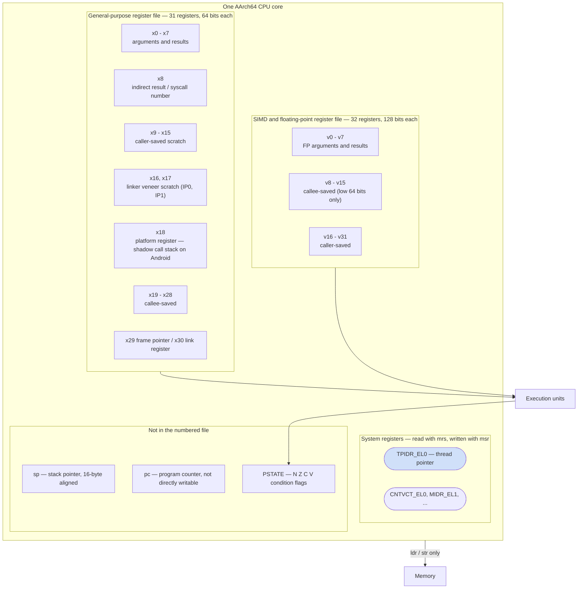
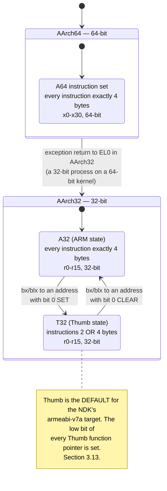
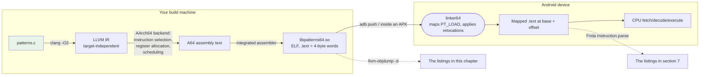
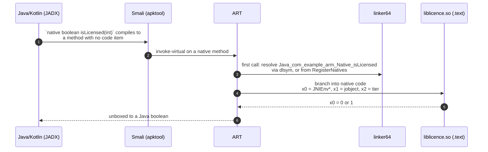
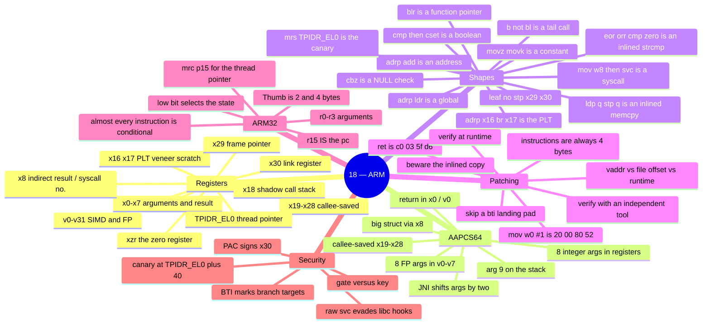

# 18 — ARM

> After this chapter you can read AArch64 disassembly without a decompiler, name every register and
> say what the calling convention puts in it, recognise the twenty-odd instruction shapes that make
> up almost all real Android native code, find the four bytes that decide a security question, and
> change them — and you can explain, honestly, when changing them accomplishes nothing.

**Prerequisites:** [01-Computer-Science-Basics](../01-Computer-Science-Basics/README.md) (hex,
endianness, stack frames), [15-Native-Code](../15-Native-Code/README.md) (ELF structure, sections,
PLT/GOT), [17-Libraries](../17-Libraries/README.md) (which library you are looking at and why)
**Useful alongside:** [16-JNI](../16-JNI/README.md), [57-Ghidra](../57-Ghidra/README.md),
[53-Frida](../53-Frida/README.md)
**Applies to:** every Android device. `arm64-v8a` since API 21 (Android 5.0) and mandatory for Play
Store uploads since August 2019; `armeabi-v7a` on 32-bit devices and in the 32-bit slice of split
APKs. API levels are called out where behaviour differs.

---

## Table of Contents

| § | Section | What you get |
|---|---|---|
| [1](#1-introduction) | Introduction | Why a processor has an instruction set at all, in plain English |
| [2](#2-high-level-architecture) | High-Level Architecture | The register file, the execution states, and the pipeline from `.c` to silicon |
| [3](#3-deep-internal-working) | Deep Internal Working | Registers, AAPCS64, encodings, the twenty-four-shape pattern catalogue, the stack canary, Thumb |
| [4](#4-source-code-walkthrough-aosp) | Source Code Walkthrough (AOSP) | Bionic's TLS and syscall stubs, the linker's PLT, ART's ARM64 assembler |
| [5](#5-security-perspective) | Security Perspective | What patching buys you, what it does not, MASVS mapping, the inlining trap |
| [6](#6-reverse-engineering-perspective) | Reverse Engineering Perspective | JADX → Smali → native, recognisable shapes, virtual address versus file offset |
| [7](#7-dynamic-analysis) | Dynamic Analysis | Frida, `Instruction.parse`, LLDB, tombstones |
| [8](#8-static-analysis) | Static Analysis | `llvm-objdump`, `llvm-readelf`, `find-check-shapes.py`, grep-able signatures |
| [9](#9-examples) | Examples | Five graded, all compiled and disassembled for real |
| [10](#10-common-interview-questions) | Common Interview Questions | Five tiers with model answers |
| [11](#11-common-mistakes) | Common Mistakes | Developer, pentester, reverse engineer |
| [12](#12-hands-on-labs) | Hands-on Labs | Four labs; the last is a CTF |
| [13](#13-summary) | Summary | Mind map, condensed tables, quick revision |
| [14](#14-references) | References | Arm's own documents, AOSP, MASTG, tools |

---

> **📖 Every listing in this chapter is real output.**
> Nothing below was written from memory. Each disassembly block was produced by compiling
> [`examples/patterns.c`](examples/patterns.c) or [`examples/licence-check.c`](examples/licence-check.c)
> with the **Android NDK 25.2.9519653** (clang 14.0.7, LLVM 14.0.7git), targeting API 21, and
> disassembling the result with that NDK's `llvm-objdump`. The build is one command —
> [`examples/build-arm-fixtures.sh`](examples/build-arm-fixtures.sh) — and you can reproduce every
> address on this page. On a different NDK you will get the same *shapes* at different addresses and
> occasionally a different instruction choice; where that matters, it is said so explicitly.

---

## 1. Introduction

### 1.1 The problem that existed first

A processor is a machine that does exactly one thing, over and over, forever: it fetches a number
from memory, decides what that number means, does the thing the number means, and moves on to the
next number. That is the whole job. Everything else — Android, your banking app, this sentence on a
screen — is built out of that loop running a few billion times a second.

The numbers are the problem. Nothing about the number `0xD65F03C0` announces that it means "return to
whoever called me". Somebody had to *decide* that it does, write the decision down, and build silicon
that honours it. That written-down decision is an **instruction set architecture**, and the one in
every Android phone is Arm's.

> **📖 Definition — instruction set architecture (ISA)**
> The contract between software and silicon. It defines what registers exist, what each instruction
> word means, how memory is addressed, and what the processor does when something goes wrong. It is
> a *specification*, not a chip: Qualcomm, Samsung, MediaTek and Google all build different chips
> that honour the same Arm specification, which is why one APK runs on all of them.

Imagine a factory with a very literal-minded worker. The worker has sixty-four numbered pigeonholes
on the bench in front of them, and a warehouse behind them. Every instruction they can follow is one
of a small set: *fetch the contents of warehouse shelf 4096 into pigeonhole 3*; *add pigeonhole 3 to
pigeonhole 5 and put the answer in pigeonhole 0*; *if pigeonhole 0 is empty, skip the next eleven
instructions*. The worker cannot improvise, cannot infer, and cannot ask questions. Give them a list
of these instructions and they will follow it perfectly and mindlessly, faster than you can watch.

The pigeonholes are **registers**. The warehouse is **memory**. The list of instructions is a
**program**. Reading disassembly is nothing more than reading somebody else's instruction list,
translated back from numbers into words, and working out what job the worker was actually doing.

### 1.2 What would break without it

Nothing would run. That is the honest answer, and it is worth sitting with for a moment, because it
explains why this chapter sits where it does in the repository.

Every layer you have met so far collapses onto this one. Kotlin compiles to Java bytecode; Java
bytecode is packed into DEX; DEX is compiled by the ART compiler into — **AArch64 instructions**.
JNI is a bridge between two worlds, and the far side of that bridge is AArch64. Frida's Stalker
rewrites code as it executes, and the code it rewrites is AArch64. Ghidra's decompiler is a very
clever program whose entire input is AArch64. When the decompiler produces nonsense, when the app is
packed, when the check you need is inlined into forty callers, when the tombstone says the crash was
at `pc 0x7b3c04a8c8` and you have nothing else — the instructions are what is left.

There is also a blunter reason. **A native check is a few instructions, and a few instructions can be
changed.** A licence test, a root test, a certificate-pin comparison: each ultimately produces one
bit, and that bit is produced by an instruction sitting at a known address in a file you can open in
a hex editor. That is the mechanism behind an enormous fraction of real-world mobile app cracking,
and it is why "the check is in native code" is not the protection developers think it is.

### 1.3 Why Arm and not something else

Phones run on batteries. That single fact decided the architecture of the entire mobile industry.

Arm's original design goal in the 1980s was not raw speed; it was to do useful work in a tiny power
and transistor budget. The design choices that followed — a **load/store architecture**, where
arithmetic happens only between registers and memory is touched only by dedicated load and store
instructions; **fixed-width instructions**, so the decoder does not have to work out how long each
instruction is before it can find the next one; a **large register file**, so the common case does
not touch memory at all — all reduce the work the chip does per useful operation.

> **📖 Definition — load/store architecture**
> An ISA where no arithmetic instruction may name a memory location. To add a number in memory to a
> number in a register you must first `ldr` (load register) the memory value into a register, then
> `add`, then `str` (store register) the result back. The x86 family lets you write
> `add [rax], rbx` and touch memory directly; AArch64 does not, ever. This is the single most
> important structural difference, and it is why AArch64 listings are longer but far more regular
> than x86 ones.

The comparison table below is the shortest useful summary. You do not need to know x86 to read this
chapter, but a great deal of security literature is written about x86, and knowing which of its
habits do not transfer will save you from several confident mistakes.

| Property | x86-64 | AArch64 | Why it matters to you |
|---|---|---|---|
| Instruction length | 1 to 15 bytes, variable | **Always exactly 4 bytes** | You can disassemble AArch64 starting anywhere 4-byte-aligned and be right. On x86 you can start in the middle of an instruction and get plausible garbage — the basis of a whole family of anti-disassembly tricks that mostly do not work here |
| Arithmetic on memory | Yes | **No** | Every AArch64 function that touches a global has an `ldr`, some arithmetic, and an `str`. The shape is unmissable |
| General registers | 16 | **31 plus a zero register** | Far fewer stack spills. Small functions often have no stack frame at all |
| Argument passing | Varies by ABI; typically 6 in registers | **8 in `x0`–`x7`**, rest on the stack | See §3.4 |
| Return address | Pushed on the stack by `call` | Placed in **`x30` (the link register)** by `bl` | A leaf function never touches the stack. Stack-smashing a leaf function does not get you the return address, because it is not there |
| Condition flags | Set by almost everything | Set only by instructions with an explicit `s` suffix (`subs`, `adds`, `ands`) or by `cmp`/`cmn`/`tst` | You can tell at a glance which instruction produced the flags a branch is reading |
| Thread-local storage base | `%fs` segment register | **`TPIDR_EL0` system register** | This is where the stack canary lives. §3.11 |
| Stack alignment | 16 bytes at a `call` | **16 bytes always**, and `sp` must be 16-byte aligned whenever it is used as a base address | Frame sizes are always multiples of 16, which is a useful sanity check when you are reading a prologue |

> **🧠 Mental Model**
> AArch64 is *boring*, and boring is exactly what you want when you are reading it. Fixed-width
> instructions, a regular encoding, a huge register file and a strict load/store discipline mean that
> almost every listing you will ever meet is assembled from a small vocabulary of recognisable
> phrases. Learn the phrases — that is §3.10 — and reading becomes pattern-matching rather than
> decoding.

### 1.4 What this chapter owns, and what it does not

This repository divides the native-code territory deliberately, so that no chapter has to be an
encyclopedia. The boundaries below are the contract.

| Question | Chapter |
|---|---|
| What is an ELF file, what are sections and segments, how do PLT and GOT work as a *format*? | [15-Native-Code](../15-Native-Code/README.md) |
| **What does this instruction mean? What is in `x0` when I land here? How do I change what this code decides?** | **This chapter** |
| How do I drive a decompiler, name types, fix a broken function signature? | [57-Ghidra](../57-Ghidra/README.md) |
| What does `JNIEnv*` mean, how does `RegisterNatives` work, what is a `jstring`? | [16-JNI](../16-JNI/README.md) |
| How do I hook this at runtime, and what does Stalker do to it? | [53-Frida](../53-Frida/README.md) |
| How does the app know it has been tampered with? | 38-TamperDetection |
| What does the heap look like, and how do I groom it? | 19-Memory |

The overlap with 15 is precise and worth stating: **15 owns the container, 18 owns the contents.**
15 will tell you that `.text` is executable, that `.plt` holds stubs, and that a `JUMP_SLOT`
relocation names an imported function. This chapter tells you what the four instructions inside a PLT
stub actually are, and why they are those four.

The overlap with 57 is equally precise. **57 owns the decompiler; 18 owns the disassembly.** Ghidra
is a much faster way to understand a two-hundred-line function than reading it instruction by
instruction, and you should use it. But Ghidra's decompiler fails — on obfuscated code, on hand-
written assembly, on code it has mis-identified the boundaries of — and when it does, this chapter is
what you fall back on. 57's own §6.6 says exactly that and points here.

---

## 2. High-Level Architecture

### 2.1 What is actually on the chip



What you are looking at is the complete state a running AArch64 program can see. Read it as three
groups.

The **general-purpose register file** is thirty-one 64-bit registers named `x0` through `x30`. Each
one has a 32-bit alias — `w0` is the bottom half of `x0` — and writing to a `w` register **zeroes the
top 32 bits** of the corresponding `x` register, which is a rule that catches people out constantly.
There is no `x31`; the encoding slot that would name it means either the stack pointer or a
hard-wired zero, depending on the instruction. Almost every division in this file is a *software*
convention rather than a hardware one: the silicon does not care that `x0` holds the first argument,
and nothing stops a compiler from using `x19` as scratch in a function that calls nothing. The
convention is AAPCS64, and it is the subject of §3.4.

The **SIMD and floating-point file** is thirty-two 128-bit registers, `v0` through `v31`, with
narrower views of the same storage named `q` (128-bit), `d` (64-bit), `s` (32-bit), `h` (16-bit) and
`b` (8-bit). Integer code touches these more often than you would expect, because the compiler uses
them for bulk memory movement — you will see this in pattern 15 of the catalogue, where a 32-byte
`memcpy` becomes one `ldp q1, q0` and one `stp q1, q0`.

The **special and system registers** are the ones with no number. `sp` and `pc` you know. `PSTATE`
holds the four condition flags — **N** (negative), **Z** (zero), **C** (carry) and **V** (overflow) —
which are the bridge between a comparison and a branch. The system registers are a large, mostly
privileged space read with `mrs` and written with `msr`; user-space code touches almost none of them,
which is exactly what makes `TPIDR_EL0` conspicuous when it appears. It is highlighted in the diagram
because §3.11 is built on it.

### 2.2 The execution states, and why a phone has three

Arm did not get to start over in 2011. Billions of devices already ran 32-bit ARM code, so AArch64
was specified as a new **execution state** alongside the old one rather than as a replacement, and a
processor can switch between them at defined boundaries.



Three things follow from this diagram, and all three will bite you eventually.

First, **a 64-bit Android device runs 32-bit apps by putting the core into AArch32 at exception
return**. The kernel is AArch64; the process is AArch32; this is entirely normal and is why an
`armeabi-v7a`-only APK still installs on a modern phone. It is also why `Process.arch` in Frida can
report `arm` on a device whose CPU is `arm64` — the script is running inside a 32-bit process.

Second, **AArch32 itself has two instruction sets**, not one. A32 (historically just "ARM") is
fixed-width 4 bytes. T32 ("Thumb") is a mixed 2-and-4-byte encoding designed for code density, and it
is what the NDK emits by default for `armeabi-v7a`. Switching between them is done by branching to an
address whose **low bit** encodes the target state.

Third — and this is the fact that produces the most confusion — **that low bit lives in function
pointers and in ELF symbol tables**. A Thumb function at address `0x1cac` has `st_value == 0x1cad` in
`.dynsym`. The address is still `0x1cac`; the odd number is an address *and* a state selector packed
into one word. §3.13 works this through with real output from both builds of the same source file.

AArch64 has no equivalent. There is one instruction set, it is 4 bytes wide, and every function
address is a multiple of 4. If you only ever work on `arm64-v8a`, you can forget this entire
paragraph — right up until the day you pull a library out of `lib/armeabi-v7a/`.

### 2.3 From C to silicon



The diagram makes one point that is worth more than the rest of this section combined: **the
disassembly is not a property of the source code.** It is a property of the source, the target, the
optimisation level, the compiler version, and — once the linker has been at it — the load address.

Beginners routinely assume that `return a + b;` "is" `add w0, w1, w0`. It is, at `-O2`, on this
compiler. At `-O0` the same function is seven instructions and touches the stack twice, because the
compiler is no longer allowed to keep the parameters in registers. §3.10 shows both, from the same
file, built by the same script in the same run.

The two dotted lines matter too. `llvm-objdump` reads the *file*; Frida reads the *mapped memory*.
They agree for ordinary libraries and disagree for packed ones, for self-modifying ones, and for any
process another hooking framework has already touched. §7 is about the second line, and §6.6 is about
the arithmetic that connects them.

### 2.4 The one arithmetic fact everything depends on

```text
   FILE ON DISK                         PROCESS MEMORY
   ────────────                         ──────────────
   liblicence.so                        /data/app/.../liblicence.so
   ┌───────────────────┐  0x0000        ┌────────────────────────┐  0x7b3c040000  <- module base
   │ ELF header        │                │ (mapped PT_LOAD 0)     │                   (ASLR: changes
   │ .dynsym .dynstr   │                │                        │                    every launch)
   │ .rodata     0x660 │                │                        │
   ├───────────────────┤  0x874         ├────────────────────────┤  0x7b3c044874
   │ .text             │  <- FILE       │ .text                  │  <- RUNTIME
   │   lc_is_licensed  │     OFFSET     │   lc_is_licensed       │     ADDRESS
   │             0x8c4 │                │            0x7b3c0448c4│
   └───────────────────┘                └────────────────────────┘

   VIRTUAL ADDRESS (what objdump, Ghidra and Frida all print) = 0x48c4
   FILE OFFSET     (what you must write to when patching)     = 0x8c4
   DELTA for this segment                                     = 0x4000

   runtime address = module base + virtual address
                   = 0x7b3c040000 + 0x48c4
```

Three different numbers name the same instruction, and mixing them up is the single most common way a
patch silently lands in the wrong place. The diagram above is not invented: those are the real
numbers for `liblicence.so` as built by this chapter's fixture script, and you can see the tool
compute the delta for you:

```text
# host -- python3 scripts/arm64-patch.py out/liblicence.so --symbol lc_is_licensed --show
symbol   : lc_is_licensed  (from .dynsym)
arch     : aarch64 (ELF64)
vaddr    : 0x48c4
file off : 0x8c4   (segment vaddr 0x4874 -> offset 0x874, delta -0x4000)
size     : 12 bytes (3 instructions)
```

The delta comes from the ELF program headers, not from the section headers, because the program
headers are what the loader reads. [`scripts/arm64-patch.py`](scripts/arm64-patch.py) computes it by
walking `PT_LOAD` segments and finding the one that contains the address; that is what its
`vaddr_to_offset` method does, and it exists because doing this arithmetic by hand is where patches
go wrong. §6.6 covers the failure modes in detail.

> **⚠️ Warning**
> The delta is **not constant across a file**. A library has several `PT_LOAD` segments with
> different `p_vaddr - p_offset` deltas — in `liblicence.so`, `.rodata` at virtual address `0x660`
> sits at file offset `0x660` (delta 0), while `.text` at `0x4874` sits at `0x874` (delta `0x4000`).
> Computing the delta once from the first segment and applying it everywhere is a real bug that
> produces a patch which writes over your string table.

---

## 3. Deep Internal Working

This is the long section. It is organised so that you can read it once, front to back, and then use
§3.10 as a lookup table forever after.

### 3.1 The registers, named and explained

**What.** Thirty-one general-purpose registers, one stack pointer, one program counter, four
condition flags, and thirty-two vector registers.

**Why in this arrangement.** Because a register is the only storage a processor can reach in a single
cycle, and every one you add costs transistors, power, and bits in the instruction encoding. Arm
settled on thirty-one because the encoding gives five bits per register operand (2⁵ = 32 slots) and
the thirty-second slot was worth more as a special case than as another register.

| Register | 32-bit alias | AAPCS64 role | What you conclude when you see it |
|---|---|---|---|
| `x0`–`x7` | `w0`–`w7` | Arguments 1–8; `x0` also holds the return value | Reading `x0` at a function's first instruction tells you argument one. Reading it after `ret` tells you the answer |
| `x8` | `w8` | Indirect result location register (`XR`); also the **syscall number** in a raw `svc` | An `x8` written just before `svc #0` is a direct kernel call, bypassing libc entirely. §3.12 |
| `x9`–`x15` | `w9`–`w15` | Caller-saved ("corruptible") scratch | The compiler's favourite temporaries. Values here do not survive a `bl` |
| `x16`, `x17` | `w16`, `w17` | Intra-procedure-call scratch, `IP0` and `IP1` | **A `br x16` or `br x17` is almost always a PLT stub or a long-branch veneer, not app logic.** This is a strong recognition signal |
| `x18` | `w18` | Platform register. On Android it is the **shadow call stack pointer** | Reserved. Compiler-generated code will not use it as scratch on Android, and code that does is either hand-written or from a different platform |
| `x19`–`x28` | `w19`–`w28` | Callee-saved | A function that writes these **must** restore them. Seeing `stp x20, x19, [sp, #80]` in a prologue tells you the function makes calls and needs values to survive them |
| `x29` | — | Frame pointer, `FP` | `mov x29, sp` or `add x29, sp, #N` immediately after the prologue's `stp` establishes the frame |
| `x30` | — | Link register, `LR` — the return address | `bl` writes it, `ret` reads it. A **leaf function never spills it**, so a leaf function's return address is not on the stack |
| `sp` | `wsp` | Stack pointer. Must be 16-byte aligned when used as a base | Frame sizes are always multiples of 16 |
| `xzr` | `wzr` | The zero register: reads as 0, writes are discarded | `mov w0, wzr` is how the compiler writes "return false". Recognise it instantly |
| `pc` | — | Program counter. Not a general register on AArch64 | You cannot `mov pc, x0`. On ARM32 you can, and that difference matters — §3.13 |
| `v0`–`v31` | `q`/`d`/`s`/`h`/`b` views | FP and SIMD; `v0`–`v7` pass FP arguments | `ldp q1, q0, [x1]` in the middle of integer code is an inlined bulk copy, not floating-point maths |

> **⚠️ Warning — the `w`-register zero-extension rule**
> Writing to a `w` register **zeroes the upper 32 bits of the `x` register**. It does not leave them
> alone. `mov w0, #1` sets `x0` to exactly `0x0000000000000001`. This is why `mov w0, wzr` is a
> perfectly good way to zero the whole 64-bit register, and it is why you cannot use a `w` write to
> patch only the low half of a pointer.

There is one more register-shaped thing worth naming now, because it appears in every listing in this
chapter and is not in the numbered file:

> **📖 Definition — `xzr` / `wzr`, the zero register**
> Register number 31 read as a *value* is hard-wired to zero, and written as a destination discards
> the write. This is not a trick; it removes the need for a separate "clear register" instruction, a
> separate "compare" instruction (`cmp x0, #1` is really `subs xzr, x0, #1`), and a separate "discard"
> mechanism. When the same register number 31 is used as a *base address*, it means `sp` instead.
> Which meaning applies is fixed per instruction, and it is why `add x0, sp, #8` and
> `add x0, xzr, #8` are different instructions with the same register field.

### 3.2 PSTATE, the four flags, and how a comparison reaches a branch

**The problem.** A branch has to decide something, but a branch instruction has no room in 32 bits to
carry both a full comparison and a branch target. So the comparison and the branch are separated: one
instruction computes flags, a later one reads them.

**The four flags**, all set together, all living in `PSTATE`:

| Flag | Name | Set when |
|---|---|---|
| `N` | Negative | The result's top bit is 1 (i.e. the result is negative if interpreted as signed) |
| `Z` | Zero | The result is exactly zero |
| `C` | Carry | An unsigned addition carried out, or an unsigned subtraction did **not** borrow |
| `V` | oVerflow | A signed operation produced a result that does not fit |

**What sets them.** Only instructions with the `s` suffix (`adds`, `subs`, `ands`, `bics`, `negs`)
and the aliases built on them. `cmp x0, #17` *is* `subs xzr, x0, #17` — it does the subtraction,
throws the result away into `xzr`, and keeps the flags. `tst w0, #0x40` is `ands wzr, w0, #0x40`.
Plain `add`, `sub`, `mov`, `ldr` and `str` **do not touch the flags**, which is why the compiler can
schedule other work between a `cmp` and its `b.cond` without breaking it.

**What reads them.** The condition codes. There are sixteen, in eight complementary pairs:

| Code | Meaning | Flag test | Typical source |
|---|---|---|---|
| `eq` / `ne` | equal / not equal | `Z==1` / `Z==0` | `a == b` |
| `hs` (`cs`) / `lo` (`cc`) | unsigned ≥ / unsigned < | `C==1` / `C==0` | comparing sizes, lengths, indices |
| `mi` / `pl` | negative / non-negative | `N==1` / `N==0` | sign tests |
| `vs` / `vc` | overflow set / clear | `V==1` / `V==0` | rare in compiler output |
| `hi` / `ls` | unsigned > / unsigned ≤ | `C==1 && Z==0` / else | `switch` range checks |
| `ge` / `lt` | signed ≥ / signed < | `N==V` / `N!=V` | `int` comparisons |
| `gt` / `le` | signed > / signed ≤ | `Z==0 && N==V` / else | `int` comparisons |
| `al` / `nv` | always / (also always) | — | `al` is the default and is not printed |

> **🔍 Pentester's Note**
> **The signed/unsigned pair is where misreadings happen.** `b.lt` is signed; `b.lo` is unsigned. If
> a length check compiles to `cmp x0, #17` followed by `b.lo`, then a length that appears negative as
> a signed value is a *huge* unsigned value and passes. That is an entire class of bug. When you see
> `hi`/`hs`/`lo`/`ls`, the operands are being treated as unsigned; when you see `gt`/`ge`/`lt`/`le`,
> they are signed. The compiler chose based on the C types, and if the C types were wrong, the
> condition code is where you can see it.

### 3.3 Instruction encoding: what a 4-byte word actually contains

Every A64 instruction is exactly 32 bits. You will not often need to decode one by hand, but you need
to know that you *can*, because it is what makes patching possible at all.

Take the single most useful encoding in this chapter, `mov w0, #1`:

```text
  0x52800020

   31  29 28    23 22 21 20                     5 4     0
  ┌──┬───┬────────┬────┬─────────────────────────┬───────┐
  │ 0│ 10│ 100101 │ 00 │ 0000000000000001        │ 00000 │
  └──┴───┴────────┴────┴─────────────────────────┴───────┘
    sf opc  family   hw          imm16               Rd

   sf    = 0    -> 32-bit destination (w0, not x0)
   opc   = 10   -> movz  (move wide with zero)
   hw    = 00   -> shift the immediate left by 0 bits
   imm16 = 1    -> the value
   Rd    = 0    -> destination register 0

  in the file, little-endian:   20 00 80 52
```

Two consequences fall straight out of that picture.

**Patching is arithmetic, not magic.** To make a function return 7 instead of 1, you change `imm16`.
The immediate sits at bits 5–20, so the word becomes `0x52800000 | (7 << 5) = 0x520000E0`… and this is
exactly the calculation `assemble()` in [`scripts/arm64-patch.py`](scripts/arm64-patch.py) performs:

```python
# scripts/arm64-patch.py -- the mov encoder, in full
base = 0xD2800000 if wide else 0x52800000
return [base | (val << 5) | rd]
```

**A one-instruction patch is always exactly four bytes.** You are never inserting or deleting; you
are overwriting one word with another. This is why AArch64 patching is so much less error-prone than
x86 patching, where replacing a 2-byte instruction with a 5-byte one means either finding a cave or
padding with `nop`s.

The verified encodings you will actually use are printed by the tool itself:

```text
# host -- python3 scripts/arm64-patch.py --show-encodings
Verified AArch64 encodings
  round trip: aarch64-linux-android21-clang -c -x assembler enc.s
              llvm-objdump -d enc.o
  NDK 25.2.9519653, clang 14.0.7

  instruction                word         bytes in file (LE)
  ret                        0xd65f03c0   c0 03 5f d6
  nop                        0xd503201f   1f 20 03 d5
  mov w0, #0                 0x52800000   00 00 80 52
  mov w0, #1                 0x52800020   20 00 80 52
  mov w0, #2                 0x52800040   40 00 80 52
  mov w0, #42                0x52800540   40 05 80 52
  mov w0, #65535             0x529fffe0   e0 ff 9f 52
  mov x0, #0                 0xd2800000   00 00 80 d2
  mov x0, #1                 0xd2800020   20 00 80 d2
  mov w0, wzr                0x2a1f03e0   e0 03 1f 2a
  b   . (offset 0)           0x14000000   00 00 00 14
  bl  . (offset 0)           0x94000000   00 00 00 94
  cmp w0, #1                 0x7100041f   1f 04 00 71
  cset w0, gt                0x1a9fd7e0   e0 d7 9f 1a
  cset w0, eq                0x1a9f17e0   e0 17 9f 1a
  csel w0, w0, w1, lt        0x1a81b000   00 b0 81 1a
  cbz  x0, .                 0xb4000000   00 00 00 b4
  cbnz x0, .                 0xb5000000   00 00 00 b5
  stp x29, x30, [sp,#-16]!   0xa9bf7bfd   fd 7b bf a9
  ldp x29, x30, [sp],#16     0xa8c17bfd   fd 7b c1 a8
  mrs x8, TPIDR_EL0          0xd53bd048   48 d0 3b d5
  svc #0                     0xd4000001   01 00 00 d4
  brk #0                     0xd4200000   00 00 20 d4
  blr x8                     0xd63f0100   00 01 3f d6
  br  x16                    0xd61f0200   00 02 1f d6
  bti c  (= hint #34)        0xd503245f   5f 24 03 d5
```

> **🔬 Under the Hood**
> Notice that the byte order in a hex editor is **reversed** relative to how the word is written.
> `ret` is the word `0xD65F03C0` and the bytes `c0 03 5f d6`. AArch64 on Android is always
> little-endian (Arm supports big-endian; no Android ABI uses it, and `arm64-patch.py` refuses to
> open a big-endian ELF for that reason). When you grep a binary for an instruction, you grep for the
> reversed byte string.

### 3.4 AAPCS64 — the calling convention

This is the part [15-Native-Code](../15-Native-Code/README.md) explicitly hands to this chapter, and
it is the single most valuable thing here. Everything you do with a native function — hooking it,
tracing it, patching it, calling it from Frida — depends on knowing where its arguments are.

> **📖 Definition — AAPCS64**
> The *Procedure Call Standard for the Arm 64-bit Architecture*. A document published by Arm that
> specifies which registers hold arguments, which hold results, which a function must preserve, and
> how the stack is arranged at a call boundary. It is the treaty that lets code compiled by different
> compilers, in different languages, call each other. The processor does not enforce any of it.

**The problem it solves.** A function is a contract between two pieces of code that may never have
been compiled together — your app's C and Bionic's `strlen`, or ART's generated code and a JNI
method. Without a written-down convention, the caller and callee cannot agree on anything.

#### The rules you need

**Integer and pointer arguments** go in `x0`, `x1`, `x2`, `x3`, `x4`, `x5`, `x6`, `x7`, in that
order. Arguments narrower than 64 bits use the `w` view; the caller is *not* required to clear the
upper bits, so a callee that cares must extend the value itself.

**Argument nine and beyond go on the stack**, at `[sp]`, `[sp, #8]`, and so on at the moment of the
call. Here is that fact, compiled:

```text
# host -- llvm-objdump -d --no-show-raw-insn out/libpatterns64.so   (NDK 25.2.9519653)
0000000000005378 <pat_nine_args>:
    5378:       add     w8, w1, w0
    537c:       ldr     w9, [sp]              <-- the ninth argument, read off the stack
    5380:       add     w8, w8, w2
    5384:       add     w8, w8, w3
    5388:       add     w8, w8, w4
    538c:       add     w8, w8, w5
    5390:       add     w8, w8, w6
    5394:       add     w8, w8, w7
    5398:       add     w0, w8, w9
    539c:       ret

00000000000053a0 <pat_nine_args_caller>:
    53a0:       sub     sp, sp, #32
    53a4:       stp     x29, x30, [sp, #16]
    53a8:       add     x29, sp, #16
    53ac:       ldp     w8, w1, [x0]
    53b0:       ldp     w2, w3, [x0, #8]
    53b4:       ldp     w4, w5, [x0, #16]
    53b8:       ldp     w6, w7, [x0, #24]
    53bc:       ldr     w9, [x0, #32]
    53c0:       mov     w0, w8
    53c4:       str     w9, [sp]              <-- the caller puts argument nine there
    53c8:       bl      0x5570 <pat_nine_args@plt>
    53cc:       ldp     x29, x30, [sp, #16]
    53d0:       add     sp, sp, #32
    53d4:       ret
```

That is the whole rule, visible in ten lines: eight arguments arrive in `w0`–`w7`, the caller writes
the ninth to `[sp]` before the `bl`, and the callee reads it from `[sp]` after. Note that the caller
reserved 32 bytes of stack (`sub sp, sp, #32`) even though it only needed 4 for the argument — because
`sp` must stay 16-byte aligned, and 16 of those bytes hold the saved `x29`/`x30`.

**Floating-point and vector arguments** use a *separate* sequence, `v0`–`v7`, and consume no integer
registers. This is the rule people get wrong most often when writing a Frida `NativeFunction`
signature:

```text
# host -- llvm-objdump -d --no-show-raw-insn out/libpatterns64.so
0000000000005368 <pat_float_args>:
    5368:       fcvt    d1, s1
    536c:       scvtf   d2, w0
    5370:       fmadd   d0, d0, d1, d2
    5374:       ret
```

The C prototype was `double pat_float_args(double a, float b, int c)`. The `double` arrived in `d0`,
the `float` in `s1` — the *second* FP slot, not the second argument slot — and the `int` in `w0`,
the *first* integer slot. Three arguments, two register files, two independent counters.

**Return values.** An integer or pointer comes back in `x0`. A floating-point value comes back in
`v0`. A struct of 16 bytes or less comes back in `x0` and `x1`. Anything larger uses the **indirect
result location**: the caller passes a pointer to space it has already reserved in `x8`, and the
callee writes through it. Both halves of that rule, compiled:

```text
# host -- llvm-objdump -d --no-show-raw-insn out/libpatterns64.so
00000000000053d8 <pat_big_return>:              ; struct big { long a,b,c,d; }  -- 32 bytes
    53d8:       adrp    x9, 0x0
    53dc:       dup     v1.2d, x0
    53e0:       str     x0, [x8]                <-- writes through the caller's x8
    53e4:       ldr     q0, [x9, #3184]
    53e8:       add     x9, x0, #3
    53ec:       add     v0.2d, v1.2d, v0.2d
    53f0:       str     x9, [x8, #24]
    53f4:       stur    q0, [x8, #8]
    53f8:       ret

00000000000053fc <pat_small_return>:            ; struct pair { long lo, hi; } -- 16 bytes
    53fc:       mvn     x1, x0                  <-- hi in x1
    5400:       ret                             ;   lo was already in x0
```

`pat_big_return` never touches `x0` as a result: `x0` is still the `seed` argument, and the answer
goes to `[x8]`. `pat_small_return` returns both fields in registers and never touches memory at all.

> **🔍 Pentester's Note**
> **`x8` on entry is the tell for a large struct return.** If you hook a function and `x0` looks like
> a plausible first argument but the return value seems to be nowhere, check whether `x8` held a
> writable pointer on entry — the result was written there. Frida's `Interceptor` gives you
> `this.context.x8` in `onEnter`.

**Callee-saved versus caller-saved.** This is the rule that produces prologues.

| Registers | Rule | Consequence in a listing |
|---|---|---|
| `x0`–`x18`, `v16`–`v31` | **Caller-saved.** A callee may destroy them freely | If a value must survive a `bl`, it cannot live here |
| `x19`–`x28` | **Callee-saved.** A callee that uses them must restore them | Their presence in a prologue means the function makes calls |
| `x29`, `x30` | Special but effectively callee-saved | The `stp x29, x30` prologue |
| `v8`–`v15` | Callee-saved, **but only the low 64 bits** | A subtle rule that matters if you write assembly; rarely visible in compiler output |

Here is the rule producing exactly the prologue you would predict:

```text
# host -- llvm-objdump -d --no-show-raw-insn out/libpatterns64.so
00000000000051b0 <pat_callee_saved>:
    51b0:       stp     x29, x30, [sp, #-48]!   <-- allocate 48 bytes AND save FP/LR
    51b4:       str     x21, [sp, #16]
    51b8:       mov     x29, sp
    51bc:       stp     x20, x19, [sp, #32]     <-- save the callee-saved registers we will use
    51c0:       mov     w19, w2                 <-- park argument 3 somewhere calls cannot destroy
    51c4:       mov     w20, w1                 <-- and argument 2
    51c8:       bl      0x5520 <pat_opaque@plt>
    51cc:       mov     w21, w0
    51d0:       mov     w0, w20
    51d4:       bl      0x5520 <pat_opaque@plt>
    51d8:       mov     w20, w0
    51dc:       mov     w0, w19
    51e0:       bl      0x5520 <pat_opaque@plt>
    51e4:       add     w8, w20, w21
    51e8:       ldr     x21, [sp, #16]
    51ec:       ldp     x20, x19, [sp, #32]     <-- restore them
    51f0:       add     w0, w8, w0
    51f4:       ldp     x29, x30, [sp], #48     <-- deallocate AND restore FP/LR
    51f8:       ret
```

The C was three calls whose results are summed. The compiler had three values that needed to survive
`bl` instructions, so it moved them into `x19`, `x20` and `x21`, and — because AAPCS64 obliges it —
saved and restored those three. Every part of that prologue is the calling convention made visible.

#### The AAPCS64 summary table

| What | Where |
|---|---|
| Integer/pointer arguments 1–8 | `x0`–`x7` (or `w0`–`w7`) |
| Integer/pointer argument 9+ | `[sp]`, `[sp,#8]`, … at the call |
| FP/vector arguments 1–8 | `v0`–`v7` (as `d`, `s`, `q` as appropriate) |
| Integer/pointer return | `x0` |
| FP return | `v0` |
| Struct return ≤ 16 bytes | `x0`, `x1` |
| Struct return > 16 bytes | Caller-allocated buffer, pointer passed in `x8` |
| Return address | `x30` |
| Preserved across a call | `x19`–`x28`, `x29`, `x30`, `sp`, low 64 bits of `v8`–`v15` |
| Destroyed by a call | `x0`–`x18`, `v0`–`v7`, `v16`–`v31`, condition flags |
| Stack alignment | `sp` is 16-byte aligned whenever used as a base address |

> **⚠️ Warning — variadic functions are different**
> AAPCS64 has a separate rule for arguments in the variadic part of a `printf`-style call, and it
> differs between platforms. Apple's ARM64 ABI puts *all* variadic arguments on the stack; the
> standard AAPCS64 that Android follows continues to use registers. This is why hooking `__android_log_print`
> or `snprintf` with a naive fixed-arity signature works on Android and breaks on iOS. If you are
> reading a function whose C prototype ends in `...`, do not assume argument *n* is in `x(n-1)`
> without checking the disassembly.

#### Where JNI meets AAPCS64

[16-JNI](../16-JNI/README.md) owns the JNI convention itself. What is *this* chapter's is the fact
that JNI sits **on top of** AAPCS64 rather than beside it: a `Java_*` function is an ordinary C
function, so `JNIEnv*` occupies `x0` and `jobject`/`jclass` occupies `x1`, which pushes the first
argument the Java programmer wrote into `x2`.

Compiled, that fact is three instructions long:

```text
# host -- llvm-objdump -d out/liblicence.so
00000000000048c4 <lc_is_licensed>:                       ; int lc_is_licensed(int tier)
    48c4: 1f 04 00 71   cmp     w0, #1                   ; tier is in w0
    48c8: e0 d7 9f 1a   cset    w0, gt
    48cc: c0 03 5f d6   ret

0000000000004b84 <Java_com_example_arm_Native_isLicensed>: ; (JNIEnv*, jobject, jint tier)
    4b84: 5f 04 00 71   cmp     w2, #1                   ; tier is in w2
    4b88: e0 d7 9f 1a   cset    w0, gt
    4b8c: c0 03 5f d6   ret
```

Same three instructions, one register different, and that one register is the entire JNI ABI shift.
Note also that the compiler **inlined** `lc_is_licensed` into the JNI wrapper rather than calling it —
a fact that will matter enormously in §5.4.

> **🧠 Mental Model**
> When you land on a `Java_*` function in a disassembler, mentally cross out `x0` and `x1` before you
> read anything. The Java-visible arguments start at `x2`. For a `static` native method the second
> slot is a `jclass` rather than a `jobject`, but the shift is identical.

### 3.5 Prologues, epilogues, and the frame

**Why a prologue exists at all.** A function needs somewhere to put things that do not fit in
registers or that must survive calls, and it must not destroy its caller's state. The prologue
acquires that space; the epilogue gives it back.

**The canonical minimal prologue**, and the single most recognisable pair of instructions in AArch64:

```text
stp     x29, x30, [sp, #-16]!    ; fd 7b bf a9   allocate 16 bytes, store FP and LR in them
mov     x29, sp                  ;               x29 now points at the saved FP
...
ldp     x29, x30, [sp], #16      ; fd 7b c1 a8   reload FP and LR, then deallocate
ret                              ; c0 03 5f d6
```

Two addressing modes are doing the work, and you need both:

| Form | Name | Meaning |
|---|---|---|
| `[sp, #-16]!` | **Pre-index** | Subtract 16 from `sp` *first*, then use the new `sp` as the address, and keep the new `sp`. One instruction that both allocates and stores |
| `[sp], #16` | **Post-index** | Use `sp` as the address, then add 16 to `sp`. One instruction that both loads and deallocates |
| `[sp, #16]` | **Offset** | Use `sp + 16` as the address; `sp` is unchanged |

For frames larger than the ±512-byte range of the pre-index form, the compiler splits it:

```text
# host -- llvm-objdump -d --no-show-raw-insn out/libpatterns64.so
0000000000005308 <pat_stack_canary>:
    5308:       sub     sp, sp, #112             <-- allocate first
    530c:       stp     x29, x30, [sp, #80]      <-- then store at a positive offset
    5310:       add     x29, sp, #80             <-- frame pointer points at the saved pair
    5314:       str     x19, [sp, #96]
```

**Leaf functions have no prologue at all.** If a function calls nothing, `x30` is never overwritten,
so it never needs saving, and if it needs no stack space it never touches `sp`:

```text
# host -- llvm-objdump -d --no-show-raw-insn out/libpatterns64.so
000000000000519c <pat_leaf_add>:
    519c:       add     w0, w1, w0
    51a0:       ret
```

Two instructions. `int pat_leaf_add(int a, int b) { return a + b; }` compiled at `-O2`.

> **🔍 Pentester's Note**
> **A leaf function's return address is not on the stack.** On x86, `call` pushes it and a linear
> stack overflow will reach it. On AArch64 a leaf function keeps it in `x30` for the whole of its
> life, so overflowing a buffer in a leaf function corrupts locals and whatever is above the frame,
> but *not* the return address of that function. You need to reach the frame of a caller that spilled
> its `x30`. This changes the exploitability arithmetic for stack bugs, and it is why
> [15-Native-Code §5](../15-Native-Code/README.md) is careful to say that a missing stack canary is
> not by itself a finding.

**The frame pointer is optional but usual.** Android builds `-fno-omit-frame-pointer` by default for
the NDK's release configuration, which is why `x29` chains reliably enough for unwinders and for
`adb shell` tombstones. You will occasionally meet a library built without it, and the giveaway is a
prologue that saves `x30` but never sets `x29`.

**Textbook prologues at `-O0`.** The same two functions built with no optimisation, so you can see
what the compiler is *allowed* to elide:

```text
# host -- llvm-objdump -d --no-show-raw-insn out/libpatterns64-O0.so
00000000000051bc <pat_leaf_add>:
    51bc:       sub     sp, sp, #16
    51c0:       str     w0, [sp, #12]        <-- every parameter spilled to the stack
    51c4:       str     w1, [sp, #8]
    51c8:       ldr     w8, [sp, #12]        <-- and immediately reloaded
    51cc:       ldr     w9, [sp, #8]
    51d0:       add     w0, w8, w9
    51d4:       add     sp, sp, #16
    51d8:       ret

00000000000051dc <pat_nonleaf>:
    51dc:       sub     sp, sp, #32
    51e0:       stp     x29, x30, [sp, #16]
    51e4:       add     x29, sp, #16
    51e8:       stur    w0, [x29, #-4]
    51ec:       ldur    w0, [x29, #-4]
    51f0:       mov     w1, #7
    51f4:       bl      0x58e0 <pat_leaf_add@plt>   <-- the call the -O2 build inlined away
    51f8:       lsl     w0, w0, #1
    51fc:       ldp     x29, x30, [sp, #16]
    5200:       add     sp, sp, #32
    5204:       ret
```

At `-O0`, `pat_leaf_add` is seven instructions instead of two, every parameter is round-tripped
through memory, and `pat_nonleaf` genuinely calls it. At `-O2` the same `pat_nonleaf` is:

```text
00000000000051a4 <pat_nonleaf>:
    51a4:       lsl     w8, w0, #1
    51a8:       add     w0, w8, #14
    51ac:       ret
```

The call is gone, inlined and then constant-folded: `(a + 7) * 2` became `a*2 + 14`. **Debug builds
are honest and verbose; release builds are compressed and surprising.** Almost everything that looks
mysterious in a real listing is the compiler having done something like this.

### 3.6 Forming addresses: `adrp` and its partner

**The problem.** A 32-bit instruction cannot contain a 64-bit address. It cannot even contain a
32-bit one, since it needs bits for the opcode and the destination register. But code has to be
position-independent (Android has required PIE executables since API 21 and shared objects always
were), so absolute addresses baked in at compile time are not an option either.

**The solution** is `adrp` — "address of page, PC-relative". It takes a signed 21-bit immediate,
multiplies it by 4096, adds it to the current PC with the low 12 bits cleared, and puts the result in
a register. That gives a ±4 GiB range in one instruction, at 4 KiB granularity. A second instruction
then supplies the low 12 bits.

> **📖 Definition — `adrp Xd, label`**
> Sets `Xd` to `(PC & ~0xFFF) + (imm21 << 12)`. It computes the base of the 4 KiB **page** containing
> the target, never the target itself. The low 12 bits are always zero. This is why `adrp` never
> appears alone.

There are exactly two partners, and telling them apart is the whole skill:

```text
# host -- llvm-objdump -d --no-show-raw-insn out/libpatterns64.so

0000000000005248 <pat_string_literal>:           ; const char *f(void) { return "/system/bin/su"; }
    5248:       adrp    x0, 0x0
    524c:       add     x0, x0, #3208            <-- ADD: x0 is now the ADDRESS 0xc88
    5250:       ret

0000000000005254 <pat_global_read>:              ; int f(void) { return g_counter; }
    5254:       adrp    x8, 0x9000
    5258:       ldr     x8, [x8, #1816]          <-- LDR from the GOT: x8 is now the address of g_counter
    525c:       ldr     w0, [x8]                 <-- second LDR: w0 is now the CONTENTS
    5260:       ret
```

And here is the proof that `0xc88` is what the first one computed:

```text
# host -- llvm-objdump -s -j .rodata out/libpatterns64.so
Contents of section .rodata:
 0c80 75736572 3d257300 2f737973 74656d2f  user=%s./system/
 0c90 62696e2f 73750000 41000000 9c000000  bin/su..A.......
```

`0xc88` is `2f 73 79 73 ...` — `/system/bin/su`, exactly the literal in the source.

| Pattern | Meaning | How to read it |
|---|---|---|
| `adrp Xd, page` + `add Xd, Xd, #off` | **Address of** something in this library | The result is a pointer. Add `page + off` and look at that offset in the file |
| `adrp Xd, page` + `ldr Xd, [Xd, #off]` | Load a pointer **from the GOT** | The result is whatever the linker resolved. Common for globals and for imported data |
| `adrp Xd, page` + `ldr Wd, [Xd, #off]` | Load a 32-bit **value** directly | Reading a constant or a non-exported global |

> **⚠️ Warning — `llvm-objdump` prints a misleading symbol next to `adrp`**
> Look at the raw output above: `adrp x0, 0x0 <pat_tbz>` in the full listing. The `<pat_tbz>`
> annotation is objdump naming the nearest preceding symbol to the *page base*, which is meaningless.
> The page base of a `.rodata` string is not a function. **Ignore the `< >` annotation on an `adrp`
> line entirely** and read the number. This confuses almost everyone the first time.

Because the two-instruction pair is so regular, it is also how you find string references without a
decompiler: compute the target of every `adrp`/`add` pair and check whether it lands in `.rodata`.
That is one of the things [`scripts/find-check-shapes.py`](scripts/find-check-shapes.py) leans on.

### 3.7 Loads and stores: width, sign, and why it matters

Because AArch64 is load/store, every interaction with memory is explicit and typed. The mnemonic
tells you the width and whether the value is sign-extended.

| Mnemonic | Bytes moved | Extension | C type it usually came from |
|---|---|---|---|
| `ldrb` / `strb` | 1 | **Zero**-extend on load | `unsigned char`, `uint8_t`, `char` on Android (where `char` is unsigned by default on ARM) |
| `ldrsb` | 1 | **Sign**-extend on load | `signed char`, `int8_t` |
| `ldrh` / `strh` | 2 | Zero-extend | `unsigned short`, `uint16_t` |
| `ldrsh` | 2 | Sign-extend | `short`, `int16_t` |
| `ldr w` / `str w` | 4 | Zero-extend into the `x` register | `int`, `unsigned`, `float` |
| `ldrsw` | 4 | Sign-extend to 64 bits | `int` being widened to a 64-bit index |
| `ldr x` / `str x` | 8 | — | `long`, pointers, `double` |
| `ldr q` / `str q` | 16 | — | Bulk copies, SIMD |
| `ldp` / `stp` | 2 registers at once | — | Prologues, struct copies, adjacent locals |
| `ldur` / `stur` | as above | — | **Un**scaled: a *negative* or unaligned offset. Very common relative to `x29` |

All four common widths, in one function:

```text
# host -- llvm-objdump -d --no-show-raw-insn out/libpatterns64.so
00000000000052e8 <pat_load_widths>:
    52e8:       ldrb    w8, [x0]             <-- p[0]                      unsigned char
    52ec:       ldrsb   w9, [x0, #1]         <-- (int)(int8_t)p[1]         SIGNED
    52f0:       ldrh    w10, [x0, #2]        <-- *(uint16_t*)(p+2)
    52f4:       ldr     w11, [x0, #4]        <-- *(int32_t*)(p+4)
    52f8:       add     w8, w9, w8
    52fc:       add     w8, w8, w10
    5300:       add     w0, w8, w11
    5304:       ret
```

> **🔍 Pentester's Note**
> **`ldrb` versus `ldrsb` decides whether `0xFF` is 255 or −1.** If a length or index is loaded with
> `ldrsb` and then compared with `b.lt`, a byte of `0xFF` becomes −1 and passes a "less than the
> maximum" test — and then gets used as an unsigned index. This is a real and recurring bug class in
> hand-written parsers, and the *only* place it is visible is the load instruction. A decompiler will
> often show you `(char)` versus `(unsigned char)` correctly, but when the decompiler has guessed the
> type wrongly, the instruction is the ground truth.

`ldur`/`stur` deserve a sentence of their own because they look like typos. The scaled forms (`ldr`,
`str`) encode an unsigned offset multiplied by the access size, so they cannot express a negative
offset. The **un**scaled forms encode a signed 9-bit byte offset and can. Since locals live *below*
the frame pointer, anything addressed as `[x29, #-N]` uses `ldur`/`stur` — and the stack canary is
always at `[x29, #-8]`:

```text
    48e8: a8 83 1f f8   stur    x8, [x29, #-8]      ; store the canary
    ...
    4990: a9 83 5f f8   ldur    x9, [x29, #-8]      ; reload it to check
```

### 3.8 Branches: all six kinds

| Instruction | Range | Writes `x30`? | Meaning |
|---|---|---|---|
| `b label` | ±128 MiB | No | Unconditional jump. Also how a **tail call** is compiled |
| `b.cond label` | ±1 MiB | No | Jump if the flags satisfy `cond` |
| `bl label` | ±128 MiB | **Yes** | Call. Return address into `x30` |
| `br Xn` | anywhere | No | Indirect jump. **PLT stubs and jump tables** |
| `blr Xn` | anywhere | **Yes** | Indirect call. Function pointers, C++ virtual calls |
| `ret` (`ret Xn`) | anywhere | No | Return. `ret` alone means `ret x30` |
| `cbz`/`cbnz Xn, label` | ±1 MiB | No | Compare against zero and branch, **without touching the flags** |
| `tbz`/`tbnz Xn, #bit, label` | ±32 KiB | No | Test one bit and branch, without touching the flags |

The last two are the ones that surprise people, because they combine a comparison and a branch in one
instruction and therefore leave no `cmp` for you to find:

```text
# host -- llvm-objdump -d --no-show-raw-insn out/libpatterns64.so
00000000000051fc <pat_cbz>:                  ; if (s == NULL) return -1; return s[0];
    51fc:       cbz     x0, 0x5208           <-- no cmp anywhere
    5200:       ldrb    w0, [x0]
    5204:       ret
    5208:       mov     w0, #-1
    520c:       ret
```

**Tail calls are branches, not calls.** When the last thing a function does is call something and
return its result, the compiler jumps instead, leaving the callee to return directly to the original
caller:

```text
0000000000005294 <pat_calls_import>:         ; size_t f(const char*s){ return strlen(s); }
    5294:       b       0x5530 <strlen@plt>  <-- b, not bl. No ret. The function is one instruction

0000000000005298 <pat_tail_call>:            ; int f(const char*s){ return puts(s); }
    5298:       b       0x5540 <puts@plt>
```

> **⚠️ Warning**
> **A tail-called function has no return of its own, and hooking it with `Interceptor.attach` will
> not fire `onLeave` where you expect.** More practically for reading: a "function" that is a single
> `b` is not a stub or a bug. It is a complete, correct, optimised function.

**Indirect calls** are the shape of every function pointer, every C++ virtual method, and every
callback:

```text
000000000000529c <pat_indirect_call>:        ; int f(handler_t fn, int arg){ return fn(arg)+1; }
    529c:       stp     x29, x30, [sp, #-16]!
    52a0:       mov     x29, sp
    52a4:       mov     x8, x0               <-- the function pointer
    52a8:       mov     w0, w1               <-- shuffle arg into place
    52ac:       blr     x8                   <-- the indirect call
    52b0:       add     w0, w0, #1
    52b4:       ldp     x29, x30, [sp], #16
    52b8:       ret
```

**A PLT stub is exactly four instructions**, and once you have seen it you will never mistake it:

```text
# host -- llvm-objdump -d out/liblicence.so
0000000000004bd0 <strlen@plt>:
    4bd0: 30 00 00 90   adrp    x16, 0x8000        <-- page of the GOT
    4bd4: 11 ea 46 f9   ldr     x17, [x16, #3536]  <-- load the resolved address from the GOT slot
    4bd8: 10 42 37 91   add     x16, x16, #3536    <-- x16 = address of the slot (for the resolver)
    4bdc: 20 02 1f d6   br      x17                <-- jump to it
```

`x16` and `x17` are `IP0` and `IP1`, reserved by AAPCS64 for exactly this. [15-Native-Code
§3.7](../15-Native-Code/README.md) owns *why* the GOT is there and what `JUMP_SLOT` relocations do;
what is yours is the recognition rule: **`adrp x16` … `br x17` means "call an imported function", and
nothing else on Android looks like it.**

**A jump table** is the other common `br`, though clang on AArch64 usually prefers an indexed load:

```text
00000000000052bc <pat_switch>:
    52bc:       cmp     w0, #7
    52c0:       b.hi    0x52d4               <-- range check: anything above 7 is default
    52c4:       adrp    x8, 0x0
    52c8:       add     x8, x8, #3224        <-- the table, in .rodata at 0xc98
    52cc:       ldr     w0, [x8, w0, sxtw #2]<-- table[op], scaled by 4, index sign-extended
    52d0:       ret
    52d4:       mov     w0, #-1
    52d8:       ret
```

The unsigned `b.hi` is not an accident: by comparing unsigned, one branch catches both `op > 7` and
`op < 0`, since a negative `int` is a huge unsigned value. That is a standard compiler idiom, and
recognising it saves you from thinking a negative-index check is missing.

### 3.9 Deciding without branching: `cset`, `csel`, `csinc`

This is the most important single shape in this chapter, because **it is what a security check
usually compiles to.**

**Why it exists.** A branch that the processor predicts wrongly costs ten to twenty cycles. For a
two-way choice between two cheap values, it is faster to compute both and select. So the compiler
emits a *conditional select* instead of a branch wherever it can.

| Instruction | Meaning |
|---|---|
| `csel Xd, Xn, Xm, cond` | `Xd = cond ? Xn : Xm` |
| `csinc Xd, Xn, Xm, cond` | `Xd = cond ? Xn : Xm + 1` |
| `cset Xd, cond` | `Xd = cond ? 1 : 0`. An alias for `csinc Xd, xzr, xzr, !cond` |
| `csinv`, `csneg` | Same idea, inverting or negating the false operand |

```text
# host -- llvm-objdump -d --no-show-raw-insn out/libpatterns64.so
000000000000521c <pat_cset>:                 ; int f(int v) { return v > 100; }
    521c:       cmp     w0, #100
    5220:       cset    w0, gt               <-- the entire boolean, in one instruction
    5224:       ret

0000000000005228 <pat_csel>:                 ; int f(int a,int b){ return a<b ? a : b; }
    5228:       cmp     w0, w1
    522c:       csel    w0, w0, w1, lt       <-- branchless min()
    5230:       ret

0000000000005234 <pat_tbz>:                  ; if (flags & 0x40) return 100; return 200;
    5234:       mov     w8, #100
    5238:       tst     w0, #0x40            <-- ands wzr, w0, #0x40
    523c:       mov     w9, #200
    5240:       csel    w0, w9, w8, eq       <-- both values computed, one selected
    5244:       ret
```

Note `pat_tbz`: the source has an `if` with two returns, and the compiler produced **no branch at
all**. Both constants are materialised and one is selected. If you are looking for "the branch that
decides whether this is licensed", and there is no branch, this is why.

> **🧠 Mental Model — the three-instruction check**
> ```
> cmp   w0, #<something>
> cset  w0, <cond>
> ret
> ```
> **That is what "return true if the condition holds" looks like at `-O2`, and it is the shape of an
> enormous number of real security checks.** Learn to spot it from across the room. The `cset` is the
> instruction that produces the answer, and replacing it with `mov w0, #1` is a four-byte patch that
> makes the function always say yes. §5 and [`labs/lab-02`](labs/lab-02-patch-the-licence-check.md)
> do exactly that, on a real binary, and prove it at runtime.

`cset`'s encoding is worth one more look, because it is where the "inverted condition" confusion comes
from. `cset w0, gt` is really `csinc w0, wzr, wzr, le` — the *inverse* condition is what is stored in
the instruction. This is why the built-in decoder in `arm64-patch.py` XORs the condition field with 1
when it prints a `cset`:

```python
# scripts/arm64-patch.py -- the cset special case
if op2 == 1 and rn == 31 and rm == 31:
    return "%-5s %s, %s" % ("cset", _rz(rd, sf), COND[((w >> 12) & 0xF) ^ 1])
```

If you ever hand-assemble a `cset`, invert the condition. If you are just reading, the disassembler
has already done it for you.

### 3.10 The pattern catalogue

[57-Ghidra's FAQ](../57-Ghidra/faq.md) tells the reader that "you will meet the same twenty patterns
constantly" and points here. This is that catalogue. Each entry is a shape you will meet in real
Android native libraries, the C that produced it, and the actual `llvm-objdump` output.

**How this was made, and how you reproduce it.** [`examples/patterns.c`](examples/patterns.c) is one
small C function per shape. [`examples/build-arm-fixtures.sh`](examples/build-arm-fixtures.sh)
compiles it three ways for AArch64 and twice for ARM32:

```bash
# host -- Git Bash, WSL, Linux or macOS
export ANDROID_HOME="$HOME/Android/Sdk"
cd 18-ARM/examples
./build-arm-fixtures.sh /tmp/ch18
llvm-objdump -d --no-show-raw-insn /tmp/ch18/libpatterns64.so | less
```

Everything below is from `libpatterns64.so`, built `-O2 -fPIC -fstack-protector-strong` with NDK
25.2.9519653 targeting API 21, unless a listing says otherwise.

> **⚠️ Addresses will differ on your build.** The *shapes* are stable across clang versions; the
> exact addresses, register allocation and instruction scheduling are not. Compare shapes, not
> numbers.

#### Pattern 1 — the leaf function

```c
int pat_leaf_add(int a, int b) { return a + b; }
```
```text
000000000000519c <pat_leaf_add>:
    519c:       add     w0, w1, w0
    51a0:       ret
```
No prologue, no stack, no frame pointer. **If a function has no `stp x29, x30`, it calls nothing.**
That single observation prunes an enormous amount of a large library.

#### Pattern 2 — the non-leaf function, after inlining

```c
int pat_nonleaf(int a) { return pat_leaf_add(a, 7) * 2; }
```
```text
00000000000051a4 <pat_nonleaf>:
    51a4:       lsl     w8, w0, #1
    51a8:       add     w0, w8, #14
    51ac:       ret
```
The call vanished. At `-O2` clang inlined `pat_leaf_add` and then algebraically folded `(a+7)*2` into
`a*2 + 14`. Compare with the `-O0` build in §3.5, where the `bl` is right there. **Inlining is the
single biggest reason a function you can see in the source is not a function you can find in the
binary**, and §5.4 is about what that costs an attacker.

#### Pattern 3 — callee-saved registers around calls

Shown in full in §3.4. The recognition rule: `stp x20, x19, [sp, #N]` near the top and
`ldp x20, x19, [sp, #N]` near the bottom means values had to survive `bl` instructions.

#### Pattern 4 — `cbz` / `cbnz`, the NULL check

```c
int pat_cbz(const char *s) { if (s == NULL) return -1; return (int)s[0]; }
```
```text
00000000000051fc <pat_cbz>:
    51fc:       cbz     x0, 0x5208
    5200:       ldrb    w0, [x0]
    5204:       ret
    5208:       mov     w0, #-1
    520c:       ret
```
**Almost every `cbz Xn` at the top of a function is a NULL-pointer check on an argument.** No `cmp`
precedes it and no flags are set.

#### Pattern 5 — `cmp` plus a conditional branch

```c
int pat_cmp_branch(int v) { if (v == 42) return 1; return 0; }
```
```text
0000000000005210 <pat_cmp_branch>:
    5210:       cmp     w0, #42
    5214:       cset    w0, eq
    5218:       ret
```
Note what happened: the source has an `if` and two `return`s, and the compiler produced a `cset`. At
`-O2`, "compare and return a boolean" is *always* worth collapsing. The `b.cond` you expected only
appears when the two branches do genuinely different work.

#### Pattern 6 — `cset` and `csel`, the branchless boolean

Covered in §3.9. This is the highest-value shape in the catalogue.

#### Pattern 7 — `tst`, and testing a single bit

```c
int pat_tbz(uint32_t flags) { if (flags & 0x40u) return 100; return 200; }
```
```text
0000000000005234 <pat_tbz>:
    5234:       mov     w8, #100
    5238:       tst     w0, #0x40
    523c:       mov     w9, #200
    5240:       csel    w0, w9, w8, eq
    5244:       ret
```
`tst` is `ands wzr` — it ANDs and keeps only the flags. The immediate `0x40` is encoded as a
*logical immediate*, a compressed repeating-bit-pattern format that can express `0x40` in thirteen
bits but cannot express `0x41`. That is why some constants appear as `tst w0, #0x40` and others force
a `mov` plus an `ands`.

> **🔬 Under the Hood**
> The logical-immediate encoding is genuinely strange and worth knowing about, because it explains
> otherwise baffling instruction choices. Thirteen bits (`N:immr:imms`) encode a bit pattern that
> repeats at a power-of-two period. Every constant of the form "a run of *k* set bits, rotated" is
> expressible; `0x41` (two isolated bits) is not. `arm64-patch.py` implements Arm's `DecodeBitMasks`
> pseudocode in `_decode_bitmask()` so it can print these correctly.

#### Pattern 8 — `adrp` + `add`: the address of a string

```c
const char *pat_string_literal(void) { return "/system/bin/su"; }
```
```text
0000000000005248 <pat_string_literal>:
    5248:       adrp    x0, 0x0
    524c:       add     x0, x0, #3208
    5250:       ret
```
Target = `0x0 + 3208` = `0xc88`, and `.rodata` at `0xc88` is `/system/bin/su`. **This is the single
most important pattern in the catalogue**, because it is how every constant address in
position-independent code is formed, and therefore how you find every string reference without a
decompiler.

#### Pattern 9 — `adrp` + `ldr`: reading a global

```c
int g_counter = 0;
int  pat_global_read(void)   { return g_counter; }
void pat_global_write(int v) { g_counter = v; }
```
```text
0000000000005254 <pat_global_read>:
    5254:       adrp    x8, 0x9000
    5258:       ldr     x8, [x8, #1816]    <-- GOT slot: the ADDRESS of g_counter
    525c:       ldr     w0, [x8]           <-- the CONTENTS
    5260:       ret

0000000000005264 <pat_global_write>:
    5264:       adrp    x8, 0x9000
    5268:       ldr     x8, [x8, #1816]
    526c:       str     w0, [x8]
    5270:       ret
```
Two loads to read one `int`: the first fetches the pointer from the GOT, the second dereferences it.
The extra indirection is because the variable is exported and could be interposed by another library.
Compare with pattern 8: **`add` gives you the address, `ldr` gives you the contents.**

#### Pattern 10 — `movz` + `movk`: building a large constant

```c
uint64_t pat_big_constant(void)    { return 0x1122334455667788ULL; }
uint32_t pat_medium_constant(void) { return 0xDEADBEEFu; }
```
```text
0000000000005274 <pat_big_constant>:
    5274:       mov     x0, #30600            ; movz x0, #0x7788
    5278:       movk    x0, #21862, lsl #16   ;      #0x5566
    527c:       movk    x0, #13124, lsl #32   ;      #0x3344
    5280:       movk    x0, #4386,  lsl #48   ;      #0x1122
    5284:       ret

0000000000005288 <pat_medium_constant>:
    5288:       mov     w0, #48879            ; 0xBEEF
    528c:       movk    w0, #57005, lsl #16   ; 0xDEAD
    5290:       ret
```
Sixteen bits at a time, because that is all a 32-bit instruction has room for. `movz` zeroes the rest
of the register and writes one 16-bit field; each `movk` *keeps* the rest and overwrites one field.

> **🔍 Pentester's Note**
> **A `movz`/`movk` chain is how a hard-coded key, magic number or hash constant appears in a
> binary.** It will not show up in `strings`, and it will not appear as a contiguous byte sequence in
> `.rodata` either — the constant is scattered across four instructions in `.text`. Searching for the
> literal bytes of an AES round constant or a magic value and finding nothing does *not* mean it is
> absent. §3.10 pattern 24 shows a real string comparison hidden this way.

#### Pattern 11 — calling an import through the PLT

```c
size_t pat_calls_import(const char *s) { return strlen(s); }
```
```text
0000000000005294 <pat_calls_import>:
    5294:       b       0x5530 <strlen@plt>
```
and the stub itself:
```text
0000000000005530 <strlen@plt>:
    5530:       adrp    x16, 0x9000
    5534:       ldr     x17, [x16, #1872]
    5538:       add     x16, x16, #1872
    553c:       br      x17
```
The `adrp x16` … `br x17` quartet is unmistakable. See §3.8.

#### Pattern 12 — the tail call

Covered in §3.8. `b` where you expected `bl`, and no `ret`.

#### Pattern 13 — the indirect call, `blr`

Covered in §3.8. `blr Xn` is a function pointer, a C++ virtual method, or a callback.

#### Pattern 14 — a `switch` compiled to a table

Covered in §3.8. Range check with an unsigned condition, then `ldr w0, [x8, w0, sxtw #2]`.

#### Pattern 15 — an inlined `memcpy`

```c
void pat_inline_memcpy(char *dst, const char *src) { memcpy(dst, src, 32); }
```
```text
00000000000052dc <pat_inline_memcpy>:
    52dc:       ldp     q1, q0, [x1]     <-- 32 bytes loaded in one instruction
    52e0:       stp     q1, q0, [x0]     <-- and stored in one
    52e4:       ret
```
There is no call to `memcpy`. A fixed, small size becomes vector loads and stores. **This is why
hooking `memcpy` to watch a buffer copy so often catches nothing**: the copy you care about was never
a call.

#### Pattern 16 — load widths and sign extension

Covered in §3.7. `ldrb` zero-extends; `ldrsb` sign-extends.

#### Pattern 17 — the stack canary prologue

See §3.11, which is devoted to it.

#### Pattern 18 — floating-point arguments

Covered in §3.4. `d0`, `s1`, `w0` for `(double, float, int)`.

#### Pattern 19 — the ninth argument

Covered in §3.4. `[sp]` at the call.

#### Pattern 20 — large struct return via `x8`

Covered in §3.4.

#### Pattern 21 — a raw syscall

```c
register long x8 __asm__("x8") = 172;   /* SYS_getpid on AArch64 Linux */
__asm__ volatile("svc #0" : "=r"(x0) : "r"(x8) : "memory");
```
```text
0000000000005404 <pat_raw_syscall>:
    5404:       mov     w8, #172
    5408:       svc     #0
    540c:       ret
```
Three instructions and the kernel has been called, with no libc involvement whatsoever.

> **🔍 Pentester's Note**
> **This is why hooking libc is not the same as blocking a behaviour.** An app that wants to check
> for root without your `access()` hook noticing can issue the syscall directly. The recognition rule
> is trivial and worth grepping for: **`svc #0` is the bytes `01 00 00 d4`, and the immediately
> preceding `mov w8, #N` tells you which syscall.** [37-RootDetection](../37-RootDetection/README.md)
> covers the detection logic; what is yours is knowing that three instructions can bypass every
> user-space hook you installed.

#### Pattern 22 — reading a system register

```text
0000000000005410 <pat_read_thread_pointer>:
    5410:       mrs     x0, TPIDR_EL0
    5414:       ret
```
`mrs` moves *from* a system register; `msr` moves *to* one. User space can read very few of them, so
any `mrs` is worth a look: `TPIDR_EL0` is thread-local storage (§3.11), `CNTVCT_EL0` is the virtual
counter (used for timing-based anti-debug), and `MIDR_EL1` identifies the CPU (used for emulator
detection, though it traps on most configurations).

#### Pattern 23 — a counted loop, and what `-O2` does to it

```c
int pat_loop_sum(const int *a, int n) {
    int s = 0;
    for (int i = 0; i < n; i++) s += a[i];
    return s;
}
```
```text
0000000000005418 <pat_loop_sum>:
    5418:       cmp     w1, #1
    541c:       b.lt    0x5438                 <-- n < 1: return 0
    5420:       mov     w9, w1
    5424:       cmp     w1, #8
    5428:       b.hs    0x5440                 <-- n >= 8: take the vectorised path
    542c:       mov     x10, xzr
    5430:       mov     w8, wzr
    5434:       b       0x5480                 <-- otherwise the scalar tail
    5438:       mov     w0, wzr
    543c:       ret
    5440:       and     x10, x9, #0xfffffff8   <-- round n down to a multiple of 8
    5444:       add     x8, x0, #16
    5448:       movi    v0.2d, #0000000000000000
    544c:       mov     x11, x10
    5450:       movi    v1.2d, #0000000000000000
    5454:       ldp     q2, q3, [x8, #-16]     <-- 8 ints per iteration
    5458:       add     x8, x8, #32
    545c:       subs    x11, x11, #8
    5460:       add     v0.4s, v2.4s, v0.4s
    5464:       add     v1.4s, v3.4s, v1.4s
    5468:       b.ne    0x5454                 <-- the vector loop
    546c:       add     v0.4s, v1.4s, v0.4s
    5470:       cmp     x10, x9
    5474:       addv    s0, v0.4s              <-- horizontal sum of the 4 lanes
    5478:       fmov    w8, s0
    547c:       b.eq    0x5498
    5480:       add     x11, x0, x10, lsl #2
    5484:       sub     x9, x9, x10
    5488:       ldr     w10, [x11], #4         <-- the scalar remainder loop
    548c:       subs    x9, x9, #1
    5490:       add     w8, w10, w8
    5494:       b.ne    0x5488
    5498:       mov     w0, w8
    549c:       ret
```
Twenty-three instructions for a four-line loop. **This is the shape of automatic vectorisation**, and
it is worth studying once so you recognise it and stop trying to read it instruction by instruction.
The parts are always: a trip-count guard, a "is it worth vectorising" guard, a main loop over 4 or 8
elements, a horizontal reduction (`addv`), and a scalar remainder loop. When you meet this, the
answer to "what does it do" is in the scalar tail at `0x5488`, which is a faithful transcription of
the source.

#### Pattern 24 — the boolean security check, and the inlined `strcmp`

This is the shape everything in §5 attacks.

```c
int pat_boolean_check(const char *token) {
    if (token == NULL) return 0;
    if (strlen(token) != 16) return 0;
    if (token[0] != 'A') return 0;
    return 1;
}
```
```text
00000000000054a0 <pat_boolean_check>:
    54a0:       stp     x29, x30, [sp, #-32]!
    54a4:       str     x19, [sp, #16]
    54a8:       mov     x29, sp
    54ac:       cbz     x0, 0x54d4             <-- NULL check       (pattern 4)
    54b0:       mov     x19, x0                <-- park it          (pattern 3)
    54b4:       bl      0x5530 <strlen@plt>    <-- call an import   (pattern 11)
    54b8:       cmp     x0, #16
    54bc:       b.ne    0x54d0                 <-- length check
    54c0:       ldrb    w8, [x19]              <-- first byte       (pattern 16)
    54c4:       cmp     w8, #65                <-- 'A'
    54c8:       cset    w0, eq                 <-- the answer       (pattern 6)
    54cc:       b       0x54d4
    54d0:       mov     w0, wzr                <-- return false
    54d4:       ldr     x19, [sp, #16]
    54d8:       ldp     x29, x30, [sp], #32
    54dc:       ret
```

Seven of the catalogue's patterns in fifteen instructions. Notice the structure: **every failing path
converges on `mov w0, wzr`, and the one succeeding path ends in a `cset`.** That convergence is what
makes these functions mechanically findable — and it is precisely the heuristic
[`scripts/find-check-shapes.py`](scripts/find-check-shapes.py) scores on.

Now the harder version, from `liblicence.so`, where `strcmp` against a 17-byte constant was **fully
inlined into arithmetic**:

```text
# host -- llvm-objdump -d out/liblicence.so
    493c: e8 27 40 a9   ldp     x8, x9, [sp]          ; the first 16 bytes of the token
    4940: 2a 48 8a d2   mov     x10, #21057
    4944: ac c5 89 d2   mov     x12, #20013
    4948: aa c9 a6 f2   movk    x10, #13901, lsl #16
    494c: ec 89 aa f2   movk    x12, #21583, lsl #16
    4950: 8a a6 c5 f2   movk    x10, #11572, lsl #32
    4954: eb 23 40 79   ldrh    w11, [sp, #16]        ; byte 17 plus the NUL
    4958: ac 05 c9 f2   movk    x12, #18477, lsl #32
    495c: 2a 69 ea f2   movk    x10, #21321, lsl #48
    4960: 2c 48 ea f2   movk    x12, #21057, lsl #48
    4964: 08 01 0a ca   eor     x8, x8, x10           ; XOR gives zero iff equal
    4968: 29 01 0c ca   eor     x9, x9, x12
    496c: 8a 08 80 52   mov     w10, #68              ; 'D'
    4970: 6a 01 0a ca   eor     x10, x11, x10
    4974: 08 01 09 aa   orr     x8, x8, x9            ; OR the differences together
    4978: 08 01 0a aa   orr     x8, x8, x10
    497c: 1f 01 00 f1   cmp     x8, #0
    4980: e0 17 9f 1a   cset    w0, eq                ; equal iff every difference was zero
```

There is no `bl strcmp` here. Reconstruct the constant from the `movz`/`movk` chains and you recover
the expected token without ever running the program:

| Register | Fields, low to high | 64-bit value | Little-endian bytes |
|---|---|---|---|
| `x10` | `0x5241`, `0x364D`, `0x2D34`, `0x5349` | `0x53492D34364D5241` | `41 52 4D 36 34 2D 49 53` = `ARM64-IS` |
| `x12` | `0x4E2D`, `0x544F`, `0x482D`, `0x5241` | `0x5241482D544F4E2D` | `2D 4E 4F 54 2D 48 41 52` = `-NOT-HAR` |
| `w10` | `68` | `0x44` | `D` |

Concatenated: **`ARM64-IS-NOT-HARD`**. That is the licence token, extracted from four `movk`
instructions and one `mov`, in a binary where `strings` shows the constant only because the source
also stored it in `.rodata` for the `strcmp` call the compiler then optimised away.

> **🧠 Mental Model**
> A comparison against a constant does not have to look like a comparison. `eor` followed by `orr`
> followed by `cmp #0` is "are these equal", spelled so that it runs in constant time and without a
> branch. Whenever you see a chain of `eor`s ORed together and compared against zero, you are looking
> at an inlined `memcmp`, and the constants are right there in the `movk`s.

#### Catalogue index

| # | Shape | Recognise it by | Section |
|---|---|---|---|
| 1 | Leaf function | No `stp x29, x30` | §3.10 |
| 2 | Non-leaf / inlined | `bl` present, or suspiciously absent | §3.10, §3.5 |
| 3 | Callee-saved spill | `stp x20, x19, [sp,#N]` in the prologue | §3.4 |
| 4 | NULL check | `cbz x0` with no preceding `cmp` | §3.10 |
| 5 | Compare and branch | `cmp` then `b.cond` | §3.10 |
| 6 | **Branchless boolean** | `cmp` then `cset` | §3.9 |
| 7 | Bit test | `tst Wn, #imm` or `tbz`/`tbnz` | §3.10 |
| 8 | **Address of a constant** | `adrp` + `add` | §3.6 |
| 9 | Global variable access | `adrp` + `ldr` + `ldr` | §3.6 |
| 10 | Large immediate | `movz` + `movk` chain | §3.10 |
| 11 | **PLT call** | `adrp x16` … `br x17` | §3.8 |
| 12 | Tail call | `b` to another function, no `ret` | §3.8 |
| 13 | Indirect call | `blr Xn` | §3.8 |
| 14 | Jump table | Unsigned range check then indexed `ldr` | §3.8 |
| 15 | Inlined `memcpy` | `ldp q`/`stp q` in integer code | §3.10 |
| 16 | Typed load | `ldrb` vs `ldrsb` vs `ldrh` vs `ldr` | §3.7 |
| 17 | **Stack canary** | `mrs Xn, TPIDR_EL0` + `ldr [Xn,#40]` | §3.11 |
| 18 | FP arguments | `d0`, `s1`, `v0`–`v7` | §3.4 |
| 19 | Ninth argument | `ldr Wn, [sp]` early in a function | §3.4 |
| 20 | Large struct return | Stores through `x8` | §3.4 |
| 21 | **Raw syscall** | `mov w8, #N` then `svc #0` | §3.10 |
| 22 | System register read | `mrs` | §3.10 |
| 23 | Vectorised loop | Trip guard, `movi v0.2d`, `addv`, scalar tail | §3.10 |
| 24 | **Boolean check / inlined `strcmp`** | Paths converging on `mov w0, wzr`; `eor`/`orr`/`cmp #0` | §3.10 |

### 3.11 The stack canary, `TPIDR_EL0`, and `__stack_chk_guard`

[17-Libraries](../17-Libraries/README.md) prints the x86-versus-ARM comparison and cites this chapter
for the ARM half. This is that half.

**The problem.** A linear buffer overflow on the stack overwrites everything between the buffer and
the saved return address. If the attacker controls the data, they control where the function returns.

**The mitigation.** The compiler places a random value — the *canary* — between the local buffers and
the saved registers. Before returning, it re-reads the value and compares. A linear overflow that
reached the return address must have crossed the canary, so a mismatch means an overflow happened,
and the program aborts.

> **📖 Definition — stack canary (stack protector, `__stack_chk_guard`)**
> A per-process random 8-byte value stored in thread-local storage, copied onto the stack in the
> prologue of a protected function and verified in its epilogue. On mismatch, Bionic calls
> `__stack_chk_fail`, which raises `SIGABRT`. The canary detects *linear* stack overflows only.

**Where it lives, and this is the ARM-specific part.** x86-64 Linux reaches thread-local storage
through the `%fs` segment register and reads the guard at `%fs:0x28`. AArch64 has no segment
registers. It has `TPIDR_EL0`, a system register holding the thread pointer, read with `mrs`. Bionic
places its `__stack_chk_guard` in its TLS block, and on 64-bit Android it sits at offset **40
(0x28)** from the thread pointer — the same numeric offset as x86-64's, which is a coincidence of
layout rather than a shared design, but a memorable one.

Here is the whole mechanism, real:

```text
# host -- llvm-objdump -d out/liblicence.so   (built -fstack-protector-strong)
00000000000048d0 <lc_verify_signature>:
    48d0: ff 83 01 d1   sub     sp, sp, #96
    48d4: fd 7b 04 a9   stp     x29, x30, [sp, #64]
    48d8: fd 03 01 91   add     x29, sp, #64
    48dc: f4 4f 05 a9   stp     x20, x19, [sp, #80]
    48e0: 54 d0 3b d5   mrs     x20, TPIDR_EL0        <-- 1. read the thread pointer
    48e4: 88 16 40 f9   ldr     x8, [x20, #40]        <-- 2. load the guard from TLS+0x28
    48e8: a8 83 1f f8   stur    x8, [x29, #-8]        <-- 3. plant it just below the saved FP
    ...   function body ...
    498c: 88 16 40 f9   ldr     x8, [x20, #40]        <-- 4. re-read the guard
    4990: a9 83 5f f8   ldur    x9, [x29, #-8]        <-- 5. re-read the planted copy
    4994: 1f 01 09 eb   cmp     x8, x9                <-- 6. compare
    4998: a1 00 00 54   b.ne    0x49ac                <-- 7. mismatch: do not return
    499c: f4 4f 45 a9   ldp     x20, x19, [sp, #80]
    49a0: fd 7b 44 a9   ldp     x29, x30, [sp, #64]
    49a4: ff 83 01 91   add     sp, sp, #96
    49a8: c0 03 5f d6   ret
    49ac: 8d 00 00 94   bl      0x4be0 <__stack_chk_fail@plt>
```

Seven steps, and every one is visible. Note that `x20` — a callee-saved register — is dedicated to
holding the thread pointer for the whole function, so the guard can be re-read at the end without a
second `mrs`.

**And here is the same source function with the protector off**, so you can see exactly what the
canary costs and what it adds:

```text
# host -- llvm-objdump -d --no-show-raw-insn out/libpatterns64-nocanary.so
                                                     ; built -O2 -fno-stack-protector
00000000000052c8 <pat_stack_canary>:
    52c8:       sub     sp, sp, #80              <-- 80 bytes, not 112
    52cc:       stp     x29, x30, [sp, #64]
    52d0:       add     x29, sp, #64
    52d4:       adrp    x2, 0x0
    52d8:       mov     x3, x0
    52dc:       add     x2, x2, #3136
    52e0:       mov     x0, sp
    52e4:       mov     w1, #64
    52e8:       bl      0x54f0 <snprintf@plt>
    52ec:       mov     x0, sp
    52f0:       bl      0x54d0 <strlen@plt>
    52f4:       ldp     x29, x30, [sp, #64]
    52f8:       add     sp, sp, #80
    52fc:       ret
```

versus the protected build of the identical function:

```text
# host -- llvm-objdump -d --no-show-raw-insn out/libpatterns64.so
0000000000005308 <pat_stack_canary>:
    5308:       sub     sp, sp, #112             <-- 32 bytes more: canary + a saved x19
    530c:       stp     x29, x30, [sp, #80]
    5310:       add     x29, sp, #80
    5314:       str     x19, [sp, #96]
    5318:       mrs     x19, TPIDR_EL0
    531c:       adrp    x2, 0x0
    5320:       ldr     x8, [x19, #40]
    5324:       mov     x3, x0
    5328:       add     x2, x2, #3200
    532c:       add     x0, sp, #8
    5330:       mov     w1, #64
    5334:       stur    x8, [x29, #-8]
    5338:       bl      0x5550 <snprintf@plt>
    533c:       add     x0, sp, #8
    5340:       bl      0x5530 <strlen@plt>
    5344:       ldr     x8, [x19, #40]
    5348:       ldur    x9, [x29, #-8]
    534c:       cmp     x8, x9
    5350:       b.ne    0x5364
    5354:       ldp     x29, x30, [sp, #80]
    5358:       ldr     x19, [sp, #96]
    535c:       add     sp, sp, #112
    5360:       ret
    5364:       bl      0x5560 <__stack_chk_fail@plt>
```

Five extra instructions, one extra callee-saved register, and thirty-two extra bytes of stack. Note
also that the buffer moved from `[sp]` to `[sp, #8]` — the compiler rearranged the frame so that
arrays sit *above* scalars, which is the other half of what `-fstack-protector-strong` does and is
easy to miss.

#### Comparison with x86-64

| | x86-64 Linux/Android | AArch64 Android |
|---|---|---|
| TLS base | `%fs` segment register | `TPIDR_EL0` system register |
| How it is read | Implicit in the `%fs:` addressing prefix | Explicit `mrs Xn, TPIDR_EL0` |
| Guard offset | `%fs:0x28` | `[Xn, #40]` (= `0x28`) |
| Prologue | `mov rax, fs:0x28` / `mov [rbp-8], rax` | `mrs`/`ldr`/`stur` (three instructions) |
| Epilogue check | `sub rax, fs:0x28` / `jne __stack_chk_fail` | `ldr`/`ldur`/`cmp`/`b.ne` |
| Visible in a listing? | Yes, but easy to skim past | **Very** — `mrs` is otherwise rare |

> **🔍 Pentester's Note**
> **`mrs Xn, TPIDR_EL0` is the fastest way to find every canary-protected function in a library**, and
> it is a fixed 4-byte pattern per destination register. `mrs x8, TPIDR_EL0` is `48 d0 3b d5`; the
> low five bits change with the destination register, so `mrs x19, TPIDR_EL0` is `53 d0 3b d5` and
> `mrs x20, TPIDR_EL0` is `54 d0 3b d5`. Search for `d0 3b d5` at a 4-byte-aligned offset and you have
> them all. The complementary check — is `__stack_chk_fail` in `.dynsym` at all — is
> [15-Native-Code's](../15-Native-Code/README.md) `elf-harden-check.py`.

> **⚠️ Warning — a canary is not a finding**
> [15-Native-Code §5.7](../15-Native-Code/README.md) makes this argument in full and it is worth
> repeating here: the *absence* of a canary is a missing mitigation, not a vulnerability. A canary
> only ever matters when a linear stack overflow already exists and reaches the saved return address.
> Reporting "no stack canary" with no such bug is how automated-scanner output ends up in reports
> nobody trusts.

**What a canary does not stop**, and every one of these is visible in the code above: a heap overflow
(the canary is not on the heap); an overflow that writes at a computed index and skips over the
canary; an overwrite of a *local variable* that sits below the canary — including the pointer
`lc_verify_signature` is about to `memcpy` through; and any information leak, since the canary is
never read out.

### 3.12 System instructions, `svc`, and the hint space

**`svc #0` — the supervisor call.** This is the only way user-space code enters the kernel. The
syscall number goes in `x8`, arguments in `x0`–`x5`, and the result comes back in `x0`. §3.10 pattern
21 shows it. The numbers differ between AArch64 and the 32-bit EABI — `getpid` is 172 on AArch64 and
20 on ARM32 — which is a genuine trap when carrying knowledge across the ABI boundary.

**`mrs` / `msr` — system register access.** §3.10 pattern 22.

**`brk #N` — the breakpoint.** Raises a debug exception. Encoded `0xD4200000` for `brk #0`. This is
what a debugger writes over an instruction to set a software breakpoint, and it is also what a
deliberate `__builtin_trap()` compiles to. Overwriting an instruction with `brk #0` is a legitimate
patching technique when you want the process to stop rather than continue.

**The hint space — `nop`, and the pointer-authentication and BTI instructions.** `nop` is
`hint #0` = `0xD503201F`. The hint encoding space is deliberately designed so that a processor which
does not implement a given hint executes it as a no-op, which is how Arm ships new security features
without breaking old binaries.

Two of those hints are all over modern Android binaries, and you have already seen one:

```text
# host -- llvm-objdump -d out/liblicence.so
0000000000004874 <__on_dlclose>:
    4874: 5f 24 03 d5   hint    #34
```

`hint #34` **is `bti c`** — a Branch Target Identification landing pad.

> **📖 Definition — BTI (Branch Target Identification, Armv8.5-A)**
> A `bti` instruction marks an address as a legal target for an indirect branch. On a CPU with BTI
> enabled, a `br` or `blr` that lands on anything *other* than a `bti` raises an exception. The
> purpose is to shrink the gadget space available to jump-oriented programming: a gadget in the
> middle of a function is no longer reachable indirectly. On a CPU without BTI, `hint #34` is a
> 4-byte no-op, which is why the NDK can emit it unconditionally.

> **📖 Definition — PAC (Pointer Authentication, Armv8.3-A)**
> The processor signs a pointer with a secret key, storing the signature in the unused high bits of
> the 64-bit address, and verifies the signature before using it. `paciasp` signs `x30` against `sp`
> at function entry; `autiasp` authenticates it before `ret`. A corrupted return address fails
> authentication and faults. In a listing you will see `paciasp` (`7f 23 03 d5`) as the *first*
> instruction of a protected function and `autiasp` or the combined `retaa` at the end. Like BTI,
> the sign/authenticate instructions sit in the hint space and are no-ops on older cores. The NDK
> emits these only when built with `-mbranch-protection=`; the default NDK 25 configuration used for
> this chapter's fixtures emits `bti` but not `pac`, which is why you see `hint #34` above and no
> `paciasp`.

| Hint | Encoding | Meaning | Armv8 extension |
|---|---|---|---|
| `nop` | `0xD503201F` | Do nothing | Base |
| `bti c` | `0xD503245F` | Landing pad for `blr` | 8.5 (BTI) |
| `bti j` | `0xD503249F` | Landing pad for `br` | 8.5 |
| `bti jc` | `0xD50324DF` | Landing pad for either | 8.5 |
| `paciasp` | `0xD503233F` | Sign `x30` using key A and `sp` | 8.3 (PAC) |
| `autiasp` | `0xD50323BF` | Authenticate `x30` | 8.3 |

> **⚠️ Warning**
> **Do not patch over a `bti` or a `paciasp`.** Replacing the first instruction of a function with
> `mov w0, #1` on a BTI-enforcing configuration removes the landing pad, and any indirect call to
> that function now faults. If the first instruction is `hint #34`, patch at `+4` instead — which is
> exactly what `arm64-patch.py --skip 1` is for.

### 3.13 armeabi-v7a: ARM state, Thumb state, and the low bit

You will meet 32-bit libraries. Some apps still ship `armeabi-v7a` only; split APKs contain both; and
plenty of third-party SDKs have not been rebuilt in years. This section is enough not to be stranded.

**The registers.** Sixteen of them, `r0`–`r15`, all 32 bits. `r13` is `sp`, `r14` is `lr`, and — this
is the crucial difference — **`r15` is `pc`, and it is a general-purpose register you can write.**
`mov pc, lr` is a legal return. `pop {r4, r5, r11, pc}` is a legal return that also restores
registers, and you will see it constantly. On AArch64 there is no such thing; `pc` is not addressable.

**The calling convention (AAPCS32).** Arguments in `r0`–`r3`, then the stack. Return in `r0`, or `r0`
and `r1` for a 64-bit value. `r4`–`r11` are callee-saved. `r12` is `IP`, the scratch/veneer register —
the ARM32 equivalent of `x16`/`x17`.

| | AArch64 (AAPCS64) | ARM32 (AAPCS32) |
|---|---|---|
| Argument registers | `x0`–`x7` (8) | `r0`–`r3` (4) |
| Return | `x0` | `r0`, or `r0`+`r1` |
| Return address | `x30` (`lr`) | `r14` (`lr`) |
| Callee-saved | `x19`–`x28` | `r4`–`r11` |
| Veneer scratch | `x16`, `x17` | `r12` (`ip`) |
| `pc` writable? | **No** | **Yes** |
| Syscall number in | `x8` | `r7` |
| Thread pointer | `mrs Xn, TPIDR_EL0` | `mrc p15, 0, Rn, c13, c0, 3` |

The last row is worth seeing, because the two look nothing alike:

```text
# host -- llvm-objdump -d --no-show-raw-insn out/libpatterns32-arm.so
00001d0c <pat_read_thread_pointer>:
    1d0c:       mov     r1, #0
    1d10:       mrc     p15, #0, r0, c13, c0, #3    <-- the ARM32 thread pointer read
    1d14:       bx      lr
```

`mrc` is a *coprocessor* read — the pre-Armv8 mechanism for reaching system state. If you go looking
for `mrs` in a 32-bit library to find canaries, you will find nothing.

#### ARM state versus Thumb state, same source

The fixture script builds `patterns.c` twice for `armeabi-v7a`, once with `-marm` and once with
`-mthumb`. Here is the same function from both:

```text
# host -- llvm-objdump -d out/libpatterns32-arm.so        (ARM state, -marm)
00001a60 <pat_leaf_add>:
    1a60:       add     r0, r1, r0                  ; 4 bytes
    1a64:       bx      lr                          ; 4 bytes

# host -- llvm-objdump -d out/libpatterns32-thumb.so      (Thumb state, -mthumb)
00001a60 <pat_leaf_add>:
    1a60: 08 44        add     r0, r1              ; 2 bytes -- and a DESTRUCTIVE two-operand form
    1a62: 70 47        bx      lr                  ; 2 bytes
```

Thumb halved the function. That is the point of Thumb: 16-bit encodings for the common cases, with
32-bit encodings available (`.w` suffix) when the short form cannot express what is needed. Look at
the mixture:

```text
# host -- llvm-objdump -d out/libpatterns32-thumb.so
00001a94 <pat_cbz>:
    1a94: 00 28        cmp     r0, #0              ; 2 bytes
    1a96: 14 bf        ite     ne                  ; 2 bytes -- IF-THEN-ELSE block
    1a98: 00 78        ldrbne  r0, [r0]            ; 2 bytes -- executes if ne
    1a9a: 4f f0 ff 30  moveq.w r0, #4294967295     ; 4 bytes -- executes if eq
    1a9e: 70 47        bx      lr
```

Two instruction lengths in one function, and an `ite` block — Thumb's mechanism for conditional
execution, where one `ite` instruction declares the condition for up to four following instructions.
AArch64 has nothing like this; it uses `csel` instead.

#### The low bit of a function pointer

This is the fact that strands people, and it is worth stating as plainly as possible.

**An address is an address. The instruction set state is carried in bit 0 of the value you branch
to.** `bx r0` with bit 0 set enters Thumb; with bit 0 clear it enters ARM. Since instructions are at
least 2-byte aligned, bit 0 of a real code address is always zero, so it is free to carry the state.

The linker and the ELF symbol table therefore store Thumb function addresses **with the low bit set**,
and the build script prints exactly this:

```text
# host -- ./build-arm-fixtures.sh /tmp/ch18
Thumb vs ARM -- st_value for the same three functions:
  symbol                   ARM state    Thumb state
  pat_leaf_add             0x00001a60   0x00001a61
  pat_cbz                  0x00001aa8   0x00001a95
  pat_boolean_check        0x00001d8c   0x00001cad
```

Confirmed directly against the symbol table:

```text
# host -- llvm-readelf --dyn-syms out/libpatterns32-thumb.so
    16: 00001cad    32 FUNC    GLOBAL DEFAULT    12 pat_boolean_check
    23: 00001a61     4 FUNC    GLOBAL DEFAULT    12 pat_leaf_add
```

and against the disassembly, where the same function begins at the **even** address:

```text
# host -- llvm-objdump -d out/libpatterns32-thumb.so
00001cac <pat_boolean_check>:
    1cac: d0 b5        push    {r4, r6, r7, lr}
```

`st_value` says `0x1cad`; the code is at `0x1cac`. **They are both right.**

| Situation | What to do with the low bit |
|---|---|
| Disassembling at a symbol address | **Clear it.** The code starts at the even address |
| Calling the function through a pointer | **Keep it.** `bx` needs it to enter Thumb |
| Frida `Module.findExportByName` on ARM32 | Frida returns the address **with** the bit set; `Instruction.parse` handles it correctly |
| Computing a file offset for patching | **Clear it**, then map virtual address to file offset as usual |
| Reading a vtable or a callback table | The bit is set for Thumb entries — that is how the dispatcher knows |

[`scripts/arm64-patch.py`](scripts/arm64-patch.py) does this for you and tells you it did:

```python
# scripts/arm64-patch.py -- inside Elf.symbols()
if self.arch == "arm" and (st_info & 0xF) == 2 and (st_value & 1):
    st_value &= ~1
    thumb = True
```

> **⚠️ Warning — do not patch Thumb with a fixed-width tool**
> `arm64-patch.py` deliberately **refuses** to assemble patches for 32-bit ELF files. Thumb is a
> variable-length encoding, so writing a 4-byte instruction over what you assumed was one 4-byte
> instruction may actually clobber two 2-byte instructions plus half of a third, producing code that
> disassembles as plausible nonsense. For 32-bit targets, assemble the replacement with the NDK's own
> assembler at the right address, check the length, and only then write bytes. Or hook it at runtime
> instead, which is usually the better answer anyway.

#### The 32-bit boolean check, for comparison

```text
# host -- llvm-objdump -d out/libpatterns32-arm.so       (ARM state)
00001d8c <pat_boolean_check>:
    1d8c:       push    {r4, r5, r11, lr}
    1d90:       add     r11, sp, #8
    1d94:       mov     r4, #0
    1d98:       cmp     r0, #0
    1d9c:       beq     0x1dbc
    1da0:       mov     r5, r0
    1da4:       bl      0x1e20                  ; strlen
    1da8:       cmp     r0, #16
    1dac:       ldrbeq  r0, [r5]                ; conditionally executed
    1db0:       subeq   r0, r0, #65
    1db4:       clzeq   r0, r0                  ; count leading zeros
    1db8:       lsreq   r4, r0, #5              ; ...to turn 0 into 1 and non-zero into 0
    1dbc:       mov     r0, r4
    1dc0:       pop     {r4, r5, r11, pc}       ; return by popping into pc
```

Three things here have no AArch64 equivalent. **Almost every ARM32 instruction can be conditional** —
`ldrbeq`, `subeq`, `clzeq`, `lsreq` all execute only if `Z` is set, which is why there is no branch
around them. The `clz`/`lsr #5` pair is a branchless "is this zero" idiom: `clz` of zero is 32, and
`32 >> 5` is 1, while `clz` of anything non-zero is less than 32 and shifts to 0. And the function
returns by **popping directly into `pc`**.

### 3.14 SIMD and NEON, briefly

You do not need to write NEON, but you need to recognise it so you do not mistake it for something
else.

| Sign | Meaning |
|---|---|
| `v0.4s`, `v1.2d`, `v2.16b` | A vector register with a lane arrangement: 4×32-bit, 2×64-bit, 16×8-bit |
| `ldp q0, q1, [x0]` in integer code | A 32-byte bulk copy, not floating-point |
| `movi v0.2d, #0` | Zeroing an accumulator before a vectorised loop |
| `addv s0, v0.4s` | Horizontal reduction — sum the lanes into one scalar |
| `fmov w8, s0` | Move a vector lane into a general register |
| `dup v1.2d, x0` | Broadcast one value into every lane |

The two places this matters in practice: **vectorised loops** (§3.10 pattern 23) and **crypto**.
Armv8's optional Cryptographic Extension provides `aese`, `aesmc`, `sha256h` and friends; when you see
those mnemonics, you have found the AES or SHA implementation without reading a single line of logic,
and the round keys are in the registers those instructions read.

### 3.15 Version matrix

| Feature | Armv8 level | Android API | What changes for you |
|---|---|---|---|
| AArch64 (A64) | 8.0 | 21 (5.0) | 64-bit apps possible; `arm64-v8a` ABI exists |
| 64-bit-only devices possible | 8.0 | 30+ in practice | Some devices ship with no 32-bit support; an `armeabi-v7a`-only APK will not run |
| Pointer Authentication (PAC) | 8.3 | Hardware-dependent | `paciasp`/`autiasp` appear when built with `-mbranch-protection=pac-ret` |
| Branch Target Identification (BTI) | 8.5 | Hardware-dependent | `bti c` (`hint #34`) landing pads; do not patch over them |
| Memory Tagging Extension (MTE) | 8.5 | 31+ (12) opt-in via manifest | Heap and stack allocations carry tags; use-after-free faults. 19-Memory's subject |
| Scudo hardened allocator | — | 28+ (default 30+) | Not an ISA feature, but changes what heap corruption looks like |
| 16 KiB page size support | — | 15+ (API 35) | `-Wl,-z,max-page-size=16384` at link time. [15-Native-Code](../15-Native-Code/README.md) §3.11 owns this |
| Shadow call stack (`x18`) | 8.0 (software) | 29+ for platform code | `x18` is reserved; a separate stack holds return addresses |

> **⚠️ Warning**
> **Play Store has required a 64-bit version of every app since 1 August 2019.** An APK today
> normally carries `arm64-v8a`, and may or may not also carry `armeabi-v7a`. Which one *runs* depends
> on the device and on whether the app process was started 32- or 64-bit. Do not assume you have the
> right library because you found *a* library; check `Process.arch` at runtime, or check which
> `lib/<abi>/` directory the loaded path came from. [17-Libraries](../17-Libraries/README.md) covers
> the selection rules.

---

## 4. Source Code Walkthrough (AOSP)

Everything in §3 is observable behaviour. This section traces four of those behaviours down to the
AOSP source that produces them, so you can check the claims yourself rather than taking them on
trust.

> **File paths in AOSP are stable; line numbers are not.** No line numbers are cited anywhere in this
> chapter. Read these on [cs.android.com](https://cs.android.com/);
> [07-AOSP](../07-AOSP/README.md) is the navigation technique.

### 4.1 The stack guard, from `mrs` to Bionic

The instruction you saw in §3.11 was `ldr x8, [x20, #40]` — the guard at offset 40 from the thread
pointer. That 40 is not arbitrary, and here is where it comes from.

| File | What it defines |
|---|---|
| `bionic/libc/platform/bionic/tls_defines.h` | The **TLS slot numbering**, including `TLS_SLOT_STACK_GUARD` |
| `bionic/libc/private/bionic_tls.h` | The `bionic_tls` structure that hangs off one of those slots |
| `bionic/libc/bionic/__stack_chk_fail.cpp` | `__stack_chk_fail()`, the function the epilogue calls on mismatch |
| `bionic/libc/bionic/pthread_internal.h` | `pthread_internal_t`, which holds the per-thread TLS array |
| `bionic/libc/bionic/libc_init_static.cpp` and `libc_init_common.cpp` | Where the guard value is generated at process start |

`tls_defines.h` gives each slot a number, and `TLS_SLOT_STACK_GUARD` is slot **5**. Slots are one
pointer wide, so on AArch64 that is `5 × 8 = 40` bytes from the thread pointer — exactly the offset
in the disassembly. On a 32-bit ARM build the same slot number gives `5 × 4 = 20`.

**Trace the full path.** At process start, `libc_init_common.cpp` seeds the guard from
`AT_RANDOM` — the sixteen random bytes the kernel places in the auxiliary vector — and writes it into
slot 5 of the main thread's TLS array. `pthread_create` copies it into each new thread's array, which
is why **every thread in a process shares one guard value**, and why leaking it from one thread
defeats it in all of them. The compiler's prologue reads slot 5 through `TPIDR_EL0`; the epilogue
re-reads it and compares; on mismatch, `__stack_chk_fail()` calls `async_safe_fatal()` and the process
dies with `SIGABRT` and a tombstone that names the function.

> **🔬 Under the Hood**
> The guard's low byte is deliberately zero on many platforms so that a string-copy overflow which
> stops at a NUL cannot leak the whole value byte by byte. Whether Bionic does this on any given
> release is worth checking in the source rather than assuming; the mechanism is what matters here,
> and the source above is where to check it.

### 4.2 Syscall stubs — where `mov w8, #N` / `svc #0` comes from

| File | What it is |
|---|---|
| `bionic/libc/SYSCALLS.TXT` | The **table**: one line per syscall, with per-architecture numbers |
| `bionic/libc/tools/gensyscalls.py` | The **generator** that turns that table into assembly |
| `bionic/libc/arch-arm64/syscalls/` | The generated `.S` stubs, one per syscall |
| `bionic/libc/kernel/uapi/asm-generic/unistd.h` | The kernel's own numbering, imported verbatim |

A generated AArch64 stub is four instructions and looks exactly like §3.10 pattern 21 with error
handling bolted on: load the number into `x8`, `svc #0`, compare the result against the error window,
and either return it or jump to `__set_errno_internal`. Reading two or three of these is the fastest
way to internalise the syscall convention.

The practical consequence for you is in `SYSCALLS.TXT` itself: it lists the number for `arm`,
`arm64`, `x86` and `x86_64` **separately**, because they differ. `getpid` is 172 on AArch64 and 20 in
the ARM EABI, as [`examples/patterns.c`](examples/patterns.c) demonstrates by using both. Any tool
that maps a syscall number to a name without knowing the architecture will lie to you.

### 4.3 The dynamic linker and the PLT stub

| File | What it does |
|---|---|
| `bionic/linker/linker.cpp` | `soinfo::link_image`, symbol lookup, relocation processing |
| `bionic/linker/linker_relocate.cpp` | The relocation loop that fills GOT slots |
| `bionic/linker/arch/arm64/begin.S` | The linker's own AArch64 entry point |
| `bionic/linker/linker_soinfo.cpp` | `find_symbol_by_name`, the lookup order across the namespace |

The four-instruction PLT stub in §3.8 is emitted by **LLD**, not by Bionic, but the GOT slot it reads
is written by the code above. [15-Native-Code §3.7](../15-Native-Code/README.md) owns the relocation
format; what belongs here is the instruction-level consequence: **because the stub loads its target
from a writable GOT slot, overwriting that slot redirects every future call to the imported function
without touching a single byte of `.text`.** That is the mechanism behind GOT hooking, it survives
`.text` integrity checks, and it is why an app that checksums its own code section can still be hooked
trivially.

Whether it is *possible* depends on RELRO: `-Wl,-z,relro,-z,now` makes the linker resolve everything
at load time and then `mprotect` the GOT read-only. [15-Native-Code](../15-Native-Code/README.md)'s
`elf-harden-check.py` reports it.

### 4.4 ART's ARM64 code generator

The AArch64 you disassemble in an app is not all from C. A large fraction of what runs is generated
by ART from DEX bytecode, and reading ART's generator tells you what its output looks like.

| File | What it is |
|---|---|
| `art/compiler/optimizing/code_generator_arm64.cc` | The optimising compiler's AArch64 backend — one `Visit` method per HIR instruction |
| `art/compiler/utils/arm64/assembler_arm64.h` / `.cc` | ART's own AArch64 assembler, built on the `vixl` library |
| `art/runtime/arch/arm64/quick_entrypoints_arm64.S` | Hand-written assembly: the entry and exit trampolines between managed and native code |
| `art/runtime/arch/arm64/asm_support_arm64.h` | The register assignments ART reserves for itself |
| `art/runtime/arch/arm64/registers_arm64.h` | Names for the AArch64 registers as ART sees them |

The single most useful fact from `asm_support_arm64.h` and `registers_arm64.h`: **ART reserves `x19`
as the `Thread*` self pointer and `x18` per the platform ABI** in its generated code. So in
JIT-compiled or AOT-compiled managed code — which is what you are looking at when you land in
`libartbase.so` or in a `.oat` file's `.text` — `x19` is not a general callee-saved register; it is
the current `Thread`. That is how a hook can reach ART's internal state from a native frame, and it is
why [13-ART](../13-ART/README.md)'s material connects here.

`quick_entrypoints_arm64.S` is worth reading once even if you never touch ART again, because it is
some of the clearest hand-written AArch64 in AOSP and it shows the *complete* register save/restore
sequences that a compiler only ever emits partially.

### 4.5 Where a tombstone's `pc` comes from

| File | What it does |
|---|---|
| `system/core/debuggerd/libdebuggerd/tombstone.cpp` | Formats the tombstone text |
| `system/core/debuggerd/libdebuggerd/tombstone_proto.cpp` | Builds the protobuf that becomes that text |
| `system/core/debuggerd/handler/debuggerd_handler.cpp` | The signal handler installed in every app process |
| `system/unwinding/libunwindstack/` | The unwinder that walks `x29` chains and `.eh_frame` |

When a native crash happens, `debuggerd_handler.cpp` catches the fatal signal, and libunwindstack
produces the backtrace by following frame pointers and DWARF unwind information. The `pc` values it
prints are **runtime** addresses; the `<library>+0xNNNN` suffix is the offset you feed to a
disassembler. §7.4 shows the arithmetic.

---

## 5. Security Perspective

### 5.1 How attackers abuse the instruction set

**Patching a decision.** The core technique of this chapter. A security check produces one bit; that
bit is produced by one instruction; that instruction is four bytes in a file. Replace it and the
answer changes. §5.4 is a complete worked example, run on a real device.

**Redirecting control flow without touching `.text`.** Overwrite a GOT slot (§4.3) and every call to
an imported function goes somewhere else. Overwrite a vtable pointer and every virtual call on that
object does. Neither shows up in a `.text` checksum.

**Return-oriented and jump-oriented programming.** With a memory-corruption primitive, an attacker
chains fragments of existing code ("gadgets") that each end in `ret` or `br`. AArch64's fixed-width
encoding *helps the defender* here — you cannot jump into the middle of an instruction to
manufacture a gadget the way you can on x86 — which is one reason Arm's gadget-space mitigations (PAC
and BTI, §3.12) target the ends rather than the middles.

**Direct syscalls to evade user-space hooks.** §3.10 pattern 21. Three instructions defeat every
`Interceptor.attach` on libc.

**Speculative-execution side channels.** The 2018 Spectre family applies to Arm as it does to x86;
Arm publishes its own advisory listing which Cortex-A cores are affected by which variant.
**CVE-2017-5753** (bounds-check bypass) and **CVE-2017-5715** (branch target injection) both affect
Arm cores. Arm subsequently documented **straight-line speculation**, where a core speculatively
executes instructions *after* an unconditional change of flow such as `ret` or `br`; the compiler
mitigation is `-mharden-sls=`, which inserts a speculation barrier after those instructions. If you
see `dsb sy` / `isb` or `csdb` immediately after every `ret` in a library, that is what you are
looking at, not obfuscation.

### 5.2 How developers misuse it

| Mistake | What actually happens | Where you see it |
|---|---|---|
| "The check is in C, so it is safe" | It is four bytes in a file the user owns | §5.4 |
| Hard-coding a key as a `movz`/`movk` chain to "hide it from `strings`" | It is trivially recoverable from four instructions | §3.10 pattern 10 |
| Comparing secrets with `strcmp`/`memcmp` | Early-exit comparison is a timing oracle. The compiler's *inlined* version (§3.10 pattern 24) is often constant-time by accident, but the called version is not | §3.10 |
| Building without `-fstack-protector-strong` | Nothing detects a linear stack overflow | §3.11 |
| Building at `-O0` for release | Every local is on the stack, every call is real, and the binary is far easier to read and patch | §3.5 |
| Shipping unstripped binaries | `.symtab` names every internal function. `find-check-shapes.py` gets a free index | §8 |
| Assuming `char` is signed | On Android ARM, plain `char` is **unsigned**. Code ported from x86 that relies on `char` being signed changes behaviour, visibly, as `ldrb` versus `ldrsb` | §3.7 |
| Trusting the client's answer at all | A boolean computed on a device the attacker controls is not evidence | §5.4 |

### 5.3 Vulnerability classes visible at the instruction level

Every entry here follows the repository's rule: vulnerable code, why it gets written, how to detect
it statically and dynamically, the exploit, the fix as code, and honest severity.

#### 5.3.1 Sign-extension confusion in a length check

**Vulnerable code.**
```c
int parse(const char *buf, char len_field) {   /* note: plain char */
    if (len_field > 64) return -1;             /* "bounds check" */
    char tmp[64];
    memcpy(tmp, buf, (size_t)len_field);       /* len_field promoted to size_t */
    return 0;
}
```

**Why developers write it.** `char` is the natural type for a byte read out of a protocol header, and
`> 64` reads like a bounds check.

**What the instructions say.** On a build where `char` is signed (a port from x86, or an explicit
`signed char`), the compare is signed and `0xFF` is −1, which passes. The `memcpy` then converts −1
to `size_t`, which is `0xFFFFFFFFFFFFFFFF`. The disassembly shows it plainly: `ldrsb` for the load
and `b.gt`/`b.le` for the compare, rather than `ldrb` and `b.hi`/`b.ls`.

**Static detection.** Look for `ldrsb` followed by a signed conditional branch on a value that later
feeds a length. `llvm-objdump -d lib.so | grep -n -A6 ldrsb` is a crude but effective first pass.

**Dynamic detection.** Hook the function with [`scripts/dump-function.js`](scripts/dump-function.js)
and feed it `0xFF`; the argument print shows `dec=-1`.

**Fix.**
```c
int parse(const char *buf, unsigned char len_field) {
    if (len_field > sizeof(tmp)) return -1;
    memcpy(tmp, buf, (size_t)len_field);
    return 0;
}
```

**Honest severity.** High *if* the length is attacker-controlled and the destination is a fixed
buffer; otherwise nothing. The instruction pattern alone is not a finding — you must show the input
path.

#### 5.3.2 A "constant-time" comparison that is not

**Vulnerable code.**
```c
int check_mac(const uint8_t *got, const uint8_t *want) {
    return memcmp(got, want, 32) == 0;
}
```

**Why developers write it.** It is the obvious code, and it is correct — functionally.

**What the instructions say.** If the compiler emits a `bl memcmp@plt`, Bionic's `memcmp` returns as
soon as it finds a difference. The number of bytes compared leaks through timing. If instead the
compiler *inlines* it into the `eor`/`orr`/`cmp #0` shape of §3.10 pattern 24, it is constant-time —
by accident, and only for that size, on that compiler, at that optimisation level.

**Detection.** Read the disassembly. `bl memcmp@plt` is a call and is not constant-time; a chain of
`eor` and `orr` is. **This is a case where the instruction listing is more reliable than the source**,
because the source does not say which you got.

**Fix, as code.**
```c
static int ct_eq(const uint8_t *a, const uint8_t *b, size_t n) {
    uint8_t d = 0;
    for (size_t i = 0; i < n; i++) d |= (uint8_t)(a[i] ^ b[i]);
    return d == 0;                    /* one branch, at the end, on a value that
                                         does not depend on WHERE they differed */
}
```

**Honest severity.** Usually low to medium on a phone, where the attacker has to measure across
processes and noise. Genuinely high in an oracle setting — a server-side check, or a native function
an attacker can call in a tight loop through a JNI wrapper they control.

#### 5.3.3 A hook-visible check that is also a direct syscall

**Vulnerable pattern (from the defender's point of view: an ineffective control).**
```c
if (access("/system/bin/su", F_OK) == 0) return 1;   /* hookable */
```
versus
```c
long r;
register long x8 __asm__("x8") = 48;   /* faccessat */
__asm__ volatile("svc #0" : "=r"(r) : "r"(x8), ... );
```

**Why developers write the second.** Because they read a blog post saying "Frida hooks libc".

**What the instructions say.** The first is `bl access@plt`. The second is `mov w8, #48` / `svc #0`
and there is no import to hook. Both are visible in `.text`; only one is visible in `.dynsym`.

**Detection.** Grep the raw bytes for `01 00 00 d4` at 4-byte-aligned offsets. Every hit is an `svc`.

**Counter, as a pentester.** Do not hook libc; hook the syscall boundary, or patch the `svc` itself,
or use Frida's `Stalker` to observe it. [37-RootDetection](../37-RootDetection/README.md) covers the
detection catalogue; [53-Frida](../53-Frida/README.md) covers Stalker.

**Honest severity.** Not a vulnerability at all — it is an anti-analysis control. Report it as
"root detection implemented via direct syscalls, resistant to libc hooking", with the offsets.

### 5.4 The worked example: what patching a check actually buys you

This is the most important section in the chapter, and it is the one that separates a bypass from a
break. Everything below was **actually run**, on a physical arm64-v8a device (Android 13, API 33),
against libraries built by [`examples/build-arm-fixtures.sh`](examples/build-arm-fixtures.sh).

#### Step 0 — the baseline

```text
# host -- adb shell, pristine library, wrong token
library            : /data/local/tmp/liblicence.so
token              : WRONG-TOKEN-HERE
lc_is_licensed(0)  : 0
lc_is_licensed(1)  : 0
lc_is_licensed(2)  : 1
lc_verify_signature: 0
lc_is_device_rooted: 0
lc_decrypt_flag    : refused (-1)
```

```text
# host -- adb shell, pristine library, correct token
token              : ARM64-IS-NOT-HARD
lc_verify_signature: 1
lc_decrypt_flag    : ANDROID-ARM64-FLAG
```

So the program works, and the token recovered from the `movk` chain in §3.10 pattern 24 is correct.

#### Step 1 — the one-instruction patch, and it works

`lc_is_licensed` is the three-instruction check of §3.9:

```text
# host -- llvm-objdump -d out/liblicence.so
00000000000048c4 <lc_is_licensed>:
    48c4: 1f 04 00 71   cmp     w0, #1
    48c8: e0 d7 9f 1a   cset    w0, gt
    48cc: c0 03 5f d6   ret
```

Replace the `cset` with `mov w0, #1`. Four bytes, at file offset `0x8c8`:

```text
# host -- python3 scripts/arm64-patch.py liblicence.so --symbol lc_is_licensed \
#            --skip 1 --patch "mov w0,#1" --write
vaddr    : 0x48c8
file off : 0x8c8   (segment vaddr 0x4874 -> offset 0x874, delta -0x4000)

PATCH    : mov w0,#1
  0x000048c8  word 0x52800020  bytes 20 00 80 52  -> mov   w0, #1
written  : 4 bytes at file offset 0x8c8
```

`llvm-objdump` reading the file back from disk:

```text
# host -- llvm-objdump -d --start-address=0x48c4 --stop-address=0x48d0 liblicence-patched.so
00000000000048c4 <lc_is_licensed>:
    48c4: 1f 04 00 71   cmp     w0, #1
    48c8: 20 00 80 52   mov     w0, #1
    48cc: c0 03 5f d6   ret
```

And on the device:

```text
# host -- adb shell, PATCHED library, wrong token
lc_is_licensed(0)  : 1        <-- was 0
lc_is_licensed(1)  : 1        <-- was 0
lc_is_licensed(2)  : 1
```

Four bytes; the licence tier check now always says yes. **This is the whole technique.**

#### Step 2 — the same patch on a bigger function, and it also works

`lc_verify_signature` is 224 bytes with a canary. Rather than find its `cset`, overwrite the *first
two* instructions with `mov w0, #1` / `ret` — legal here because nothing has been pushed yet, so
returning immediately leaves the stack exactly as it was found:

```text
# host -- python3 scripts/arm64-patch.py liblicence-verify.so --symbol lc_verify_signature \
#            --patch "mov w0,#1" --patch ret --write
PATCH    : mov w0,#1 ; ret
  0x000048d0  word 0x52800020  bytes 20 00 80 52  -> mov   w0, #1
  0x000048d4  word 0xd65f03c0  bytes c0 03 5f d6  -> ret
written  : 8 bytes at file offset 0x8d0
```

```text
# host -- llvm-objdump -d liblicence-verify.so
00000000000048d0 <lc_verify_signature>:
    48d0: 20 00 80 52   mov     w0, #1
    48d4: c0 03 5f d6   ret
    48d8: fd 03 01 91   add     x29, sp, #64      <-- orphaned remains of the old prologue
    48dc: f4 4f 05 a9   stp     x20, x19, [sp, #80]
```

#### Step 3 — and here is where it stops working

```text
# host -- adb shell, lc_verify_signature forced to 1, WRONG token
lc_verify_signature: 1        <-- the patch worked
lc_decrypt_flag    : refused (-1)   <-- and the thing you actually wanted still refuses
```

**Read that twice.** The exported function `lc_verify_signature` now returns 1 unconditionally, and
is *observably* returning 1. `lc_decrypt_flag` still refuses. The C source says:

```c
if (!lc_verify_signature(token)) {
    return -1;
}
```

so why did it not see the patched answer?

**Because there is no call.** At `-O2` clang inlined the entire body of `lc_verify_signature` into
`lc_decrypt_flag`. There are now **two copies** of that logic in the binary, and you patched the one
nothing calls:

```text
# host -- llvm-objdump -d out/liblicence.so   (the ORIGINAL, unpatched)
0000000000004a40 <lc_decrypt_flag>:
    ...
    4a70: 58 00 00 94   bl      0x4bd0 <strlen@plt>   <-- its OWN strlen call
    4a74: 1f 44 00 f1   cmp     x0, #17               <-- its OWN length check
    4a78: 01 04 00 54   b.ne    0x4af8
    ...
    4ab4: e8 27 40 a9   ldp     x8, x9, [sp]          <-- its OWN inlined strcmp
    4ab8: 2a 48 8a d2   mov     x10, #21057
    ...
    4af4: 68 01 00 b4   cbz     x8, 0x4b20            <-- its OWN decision
    4af8: 00 00 80 12   mov     w0, #-1               <-- "refused"
```

There is no `bl lc_verify_signature` anywhere in `lc_decrypt_flag`. The check was copied, not called.

> **🧠 Mental Model — the inlining trap**
> **Patching an exported function only changes the behaviour of code that calls it.** At `-O2`,
> small functions are routinely inlined into every caller, and the standalone copy survives only
> because it is exported and the linker cannot prove nothing needs it. You can patch it, watch it
> return the value you wanted, and change nothing at all. This is the single most common reason a
> patch "does not work", and the symptom is exactly this: the function you patched demonstrably
> returns the new value, and the behaviour is unchanged.

#### Step 4 — patching the copy that actually runs

The decision inside `lc_decrypt_flag` is the branch at `0x4a78` and the `cbz` at `0x4af4`. The
simplest single-instruction fix is to jump from the length check straight to the success path at
`0x4b20`:

```text
# host -- python3 scripts/arm64-patch.py liblicence-flag.so --vaddr 0x4a74 \
#            --patch "b 0x4b20" --write
PATCH    : b 0x4b20
  0x00004a74  word 0x1400002b  bytes 2b 00 00 14  -> b     0x4b20
written  : 4 bytes at file offset 0xa74
```

```text
# host -- llvm-objdump -d liblicence-flag.so
    4a70: 58 00 00 94   bl      0x4bd0 <strlen@plt>
    4a74: 2b 00 00 14   b       0x4b20 <lc_decrypt_flag+0xe0>
    4a78: 01 04 00 54   b.ne    0x4af8          <-- now unreachable
```

On the device:

```text
# host -- adb shell, decrypt gate forced, WRONG token
lc_decrypt_flag    : WNF*<IY1'YLOQ U[Q

# host -- adb shell, decrypt gate forced, CORRECT token
lc_decrypt_flag    : ANDROID-ARM64-FLAG
```

#### Step 5 — the lesson

The gate is now open and the function runs to completion with any token. **And the answer is still
garbage**, because the flag is derived from the token:

```c
out[i] = (char)(ct[i] ^ (unsigned char)token[i % 17]);
```

> **⚠️ Warning — bypassing an authorisation decision is not the same as obtaining the protected
> value.**
> Three patches, all successful, all verified at runtime:
> 1. `lc_is_licensed` — **complete win.** The check was the whole protection.
> 2. `lc_verify_signature` — **no effect.** The check that ran was an inlined copy.
> 3. `lc_decrypt_flag`'s own gate — **partial win.** The gate opened; the data stayed encrypted,
>    because the key was the thing being checked.
>
> Case 3 is what real cryptography looks like from an attacker's side, and it is the honest answer to
> "why can't I just patch it?" A check that *gates* a computation can be patched. A check that
> *supplies input to* a computation cannot. When you write a finding, say which one you found.

### 5.5 OWASP MASVS and MASTG mapping

| MASVS control | Relevance to this chapter |
|---|---|
| **MASVS-CODE-4** — the app validates and sanitises all untrusted input | §5.3.1: the sign-extension bug is only visible at the instruction level |
| **MASVS-CRYPTO-1 / -2** — cryptography is used correctly, with proven implementations | §3.14: `aese`/`sha256h` tell you which primitive was used; §3.10 pattern 10 tells you where the key is |
| **MASVS-RESILIENCE-1** — the app validates the integrity of the platform | §5.3.3: root checks by direct syscall; [37-RootDetection](../37-RootDetection/README.md) |
| **MASVS-RESILIENCE-2** — the app implements anti-debugging | §3.12: `brk`, `ptrace`, `CNTVCT_EL0` timing |
| **MASVS-RESILIENCE-3** — the app detects and responds to tampering | §5.4: the whole point. Patching `.text` is the tamper these controls exist to catch |
| **MASVS-RESILIENCE-4** — the app obfuscates its business logic | §3.10: what obfuscation does and does not hide at instruction level; [40-Obfuscation](../40-Obfuscation/README.md) |
| **MASVS-STORAGE / -NETWORK** | Indirect: keys and pinned certificates are found by reading `.rodata` references (§3.6) |

| MASTG test area | What you do with this chapter |
|---|---|
| Reverse engineering and tampering | Read the disassembly, find the check, patch it, prove the change |
| Testing anti-reversing defences | Locate `svc`, `brk`, `mrs CNTVCT_EL0`, integrity loops |
| Testing code quality and build settings | Confirm the canary, PIE and RELRO are actually present in the instructions and not just in a flag |

### 5.6 How a pentester actually tests this

1. **Identify the ABI you are looking at.** `unzip -l app.apk | grep lib/`. If both are present,
   decide which the device will load.
2. **Triage the library.** [`scripts/find-check-shapes.py`](scripts/find-check-shapes.py) gives you a
   ranked reading list in one command. It is a shape score, not a finding.
3. **Read the top candidates by hand**, using §3.10 as a lookup table. Confirm the shape.
4. **Confirm at runtime before patching.** [`scripts/dump-function.js`](scripts/dump-function.js)
   proves the function is reached and shows you its arguments.
5. **Patch, and prove it.** Disassemble before and after; run the app; observe the changed behaviour.
   §5.4 step 3 is why "the bytes changed" is not proof.
6. **Check for the inlined copy.** Search the whole library for the same constant, the same string
   reference, or the same `movk` chain. If the check appears twice, patch both or patch the caller.
7. **Ask whether the answer crosses a trust boundary.** If the decision is re-made on a server, none
   of this matters and you should say so in the report.

### 5.7 How malware abuses it

Malware uses the same instructions with the opposite intent. The recurring patterns:

- **Packed native payloads.** The `.so` on disk is mostly an encrypted blob; a constructor in
  `.init_array` decrypts it in place. The disassembly on disk is meaningless and the disassembly in
  memory is the real code — §7 is how you get it.
- **Direct syscalls** to avoid API-level monitoring, exactly as in §5.3.3.
- **`ptrace(PTRACE_TRACEME)` self-attach** so that no debugger can attach afterwards, implemented as
  a raw `svc` so it cannot be hooked in libc.
- **Timing checks** with `mrs Xn, CNTVCT_EL0` around a short code sequence: a debugger's
  single-stepping inflates the delta.
- **Self-modifying comparisons**, where the constant a check compares against is written into `.text`
  at runtime, so the on-disk value is wrong.

Every one of those is defeated by looking at memory instead of the file, which is the entire argument
for §7.

### 5.8 How a forensic analyst investigates

The artefact is the **tombstone**, written to `/data/tombstones/` and mirrored into logcat:

```text
# adb shell -- the shape of the block you care about
signal 11 (SIGSEGV), code 1 (SEGV_MAPERR), fault addr 0x0000000000000000
    x0  0000000000000000  x1  0000007b3c05a120  x2  0000000000000011  x3  ...
    ...
    x28 0000000000000000  x29 0000007fe3a4c0b0
    lr  0000007b3c0448f4  sp  0000007fe3a4c090  pc  0000007b3c0448f8  pst 0000000060000000

backtrace:
      #00 pc 00000000000048f8  /data/app/.../liblicence.so (lc_verify_signature+40)
      #01 pc 0000000000001234  /data/app/.../libapp.so
```

Four things to take from it, and all four are this chapter's material:

1. **`pc` is a runtime address; `#00 pc 00000000000048f8` is already the module-relative offset.**
   Feed `0x48f8` straight to `llvm-objdump --start-address=`.
2. **The register dump is an AAPCS64 snapshot.** `x0`–`x7` at the crash are the arguments *if* the
   crash was near function entry, and `fault addr 0x0` with `x0 = 0` is a NULL dereference of
   argument one.
3. **`lr` tells you the caller** even when the unwinder fails, because AArch64 keeps the return
   address in a register.
4. **`pst` is `PSTATE`.** Bit 30 is `Z`, bit 31 is `N` — so `0x60000000` means `Z` and `C` set.

---

## 6. Reverse Engineering Perspective

### 6.1 The path from Java down to the instruction



The diagram's point is that **every layer above the last one can be bypassed by the layer below it.**
Hooking the Java method is defeated by an app that calls the native function through its own
resolved pointer. Hooking the exported symbol is defeated by `RegisterNatives` with a non-exported
implementation. Patching the instructions is defeated by nothing except the app noticing.

### 6.2 What it looks like in JADX

```java
// JADX output -- com/example/arm/Native.java
public class Native {
    static { System.loadLibrary("licence"); }
    public native boolean isLicensed(int tier);
}
```

That is the entire Java side. JADX has nothing more to show you, because there is no bytecode: the
method is `native` and its implementation is in the `.so`. **This is the moment the decompiler stops
and this chapter starts.**

### 6.3 What it looks like in Smali

```smali
# out/smali/com/example/arm/Native.smali  (apktool d app.apk)
.class public Lcom/example/arm/Native;
.super Ljava/lang/Object;

# static constructor
.method static constructor <clinit>()V
    .locals 1
    const-string v0, "licence"
    invoke-static {v0}, Ljava/lang/System;->loadLibrary(Ljava/lang/String;)V
    return-void
.end method

# the native method -- declaration only, no .locals, no code
.method public native isLicensed(I)Z
.end method
```

```smali
# the call site, somewhere in the app
    new-instance v0, Lcom/example/arm/Native;
    invoke-direct {v0}, Lcom/example/arm/Native;-><init>()V
    const/4 v1, 0x1
    invoke-virtual {v0, v1}, Lcom/example/arm/Native;->isLicensed(I)Z
    move-result v2
    if-eqz v2, :cond_locked
```

Two observations you can act on. The `native` method has **no body in Smali at all** — a method
declaration with no `.locals` and no instructions is always a native method, and it tells you to go
looking in `lib/`. And the string passed to `loadLibrary` tells you the file name: `"licence"` means
`liblicence.so`.

### 6.4 Mapping a Java name to a native symbol

The default JNI naming rule (owned by [16-JNI](../16-JNI/README.md), reproduced here because you need
it to *find* the code):

```text
Java_<fully.qualified.Class with . -> _>_<methodName>
com.example.arm.Native.isLicensed  ->  Java_com_example_arm_Native_isLicensed
```

```bash
# host -- find it in the symbol table
llvm-readelf --dyn-syms liblicence.so | grep isLicensed
python3 scripts/arm64-patch.py liblicence.so --list-symbols | grep -i licen
```

```text
Java_com_example_arm_Native_isLicensed               0x00004b84   12       .dynsym
```

**When that grep finds nothing**, the app used `RegisterNatives` to bind the method to an arbitrary,
possibly non-exported function. Then the symbol table will not help, and you must find the
`JNINativeMethod` table in `.rodata` — an array of `{name, signature, function pointer}` triples —
or hook `RegisterNatives` at runtime. [16-JNI](../16-JNI/README.md) covers both.

### 6.5 Recognising shapes in a decompiler's Listing view

[57-Ghidra](../57-Ghidra/README.md) owns the tool. What is worth saying here is what to do when the
*decompiler* pane fails and you are left with the *listing* pane — which happens on obfuscated code,
on hand-written assembly, and whenever Ghidra has mis-detected a function boundary.

| You see | It means | Do |
|---|---|---|
| `undefined8 FUN_00104874(void)` with a body of `halt_baddata` | Ghidra started disassembling at the wrong offset | Re-disassemble at a 4-byte-aligned address; AArch64 has no misalignment to recover from, so this is always fixable |
| A function whose whole body is `b` to another address | A tail call (§3.8) | Follow it; that is the real function |
| A `switch` Ghidra will not recover | An indexed load through `.rodata` (§3.8) | Read the table manually at the `adrp`+`add` target |
| A parameter Ghidra thinks is `undefined8` | No type information | Read the *uses*: `ldrb` means a byte, `ldr w` an `int`, `bl strlen` a string |
| Constants that never appear as data | A `movz`/`movk` chain (§3.10 pattern 10) | Reassemble the halves by hand, as §3.10 pattern 24 does |
| No `bl` to the function you expected | It was inlined (§5.4) | Look for its *contents*, not its name |

### 6.6 The address arithmetic, and the mistakes that come from it

This is the section [`scripts/arm64-patch.py`](scripts/arm64-patch.py) exists to prevent errors in.

| Number | What produces it | What it is for |
|---|---|---|
| **Virtual address** | `llvm-objdump`, `llvm-readelf`, Frida, and Ghidra minus its image base | Reading. Every listing in this chapter uses it |
| **File offset** | ELF program headers | Patching. The byte you must write |
| **Runtime address** | `module.base + virtual address` | Hooking, breakpoints, live disassembly |
| **Ghidra address** | Ghidra image base (default `0x00100000` for a `.so`) + virtual address | Only inside Ghidra |

The four classic mistakes:

1. **Patching at the virtual address.** You open the file in a hex editor, seek to `0x48c8`, and write
   four bytes — into `.rela.plt`, because `0x48c8` as a *file offset* is somewhere else entirely.
   This is by far the most common patching failure and it produces a library that either crashes or,
   worse, works.
2. **Assuming one delta for the whole file.** §2.4's warning. Compute it per segment.
3. **Forgetting Ghidra's image base.** Ghidra shows `0x001048c4`; the file's virtual address is
   `0x48c4`. Subtract `0x00100000` (or set Ghidra's image base to 0).
4. **Forgetting the Thumb bit on ARM32.** §3.13.

The tool prints all of it so you do not have to:

```text
symbol   : lc_is_licensed  (from .dynsym)
arch     : aarch64 (ELF64)
vaddr    : 0x48c4
file off : 0x8c4   (segment vaddr 0x4874 -> offset 0x874, delta -0x4000)
size     : 12 bytes (3 instructions)
```

### 6.7 What obfuscation does to these shapes

[40-Obfuscation](../40-Obfuscation/README.md) owns the subject. At the instruction level, here is what
survives and what does not.

| Technique | Effect on the shapes in §3.10 | Still findable? |
|---|---|---|
| Symbol stripping | Names go; shapes remain | **Yes.** `find-check-shapes.py` loses its name heuristic and keeps the rest |
| String encryption | `adrp`+`add` now points at ciphertext; a decode loop precedes each use | Yes, but you must run or emulate the decoder |
| Control-flow flattening | The function becomes a dispatcher loop; the `cset` is still in one of the blocks | Yes, with effort. Trace it instead |
| Instruction substitution | `add` becomes `sub` of a negation; `mov` becomes `eor` with zero | Yes. The *data flow* is unchanged |
| Opaque predicates | Extra `cmp`/`b.cond` that always go one way | Yes; the dead half has no incoming edges |
| Bogus control flow | Function size inflates | Yes; `--max-insns` in the triage script exists for this |
| Anti-disassembly (data in `.text`) | Much less effective than on x86 — fixed-width decoding recovers immediately | Yes |
| Native packing | Nothing on disk is real | **No, statically.** Dump from memory (§7) |
| VM obfuscation | The logic is bytecode for a custom interpreter | The hardest case. Reverse the VM first |

> **🧠 Mental Model**
> Obfuscation attacks *names, strings and structure*. It rarely attacks *data flow*, because the code
> still has to compute the right answer. The `cset` that produces a boolean has to exist somewhere,
> the constant it compares against has to reach a register somehow, and the caller has to receive the
> answer in `x0`. Follow the data, not the names.

---

## 7. Dynamic Analysis

### 7.1 Why the file is not enough

`llvm-objdump` reads bytes on disk. The CPU executes bytes in memory. Those are the same thing right
up until they are not:

| Situation | File and memory differ because |
|---|---|
| A packed library | An `.init_array` constructor decrypted `.text` in place |
| A self-modifying check | The function rewrote its own comparison constant |
| Another hooking framework is loaded | The first instructions are a trampoline somebody else installed |
| Relocations | The GOT on disk is zeros; in memory it holds resolved addresses |
| The wrong ABI was loaded | You disassembled `arm64-v8a` and the process is running `armeabi-v7a` |

Dynamic disassembly also gives you the one number static analysis cannot: **the load base**, which is
what every Ghidra address must be corrected by.

### 7.2 Frida: `dump-function.js`

[`scripts/dump-function.js`](scripts/dump-function.js) disassembles a function as it exists in
memory, prints its AAPCS64 argument registers on entry and its return value on exit, and can save the
live bytes for import into Ghidra.

```bash
# host -- by exported symbol name, spawning the app
frida -U -f com.example.target -l 18-ARM/scripts/dump-function.js --no-pause \
      -P '{"module":"liblicence.so","symbol":"lc_verify_signature"}'

# host -- by module offset, for a function with no symbol
frida -U -f com.example.target -l 18-ARM/scripts/dump-function.js --no-pause \
      -P '{"module":"liblicence.so","offset":"0x48d0","count":40}'

# host -- attach to something already running, and trace it
frida -U -n com.example.target -l 18-ARM/scripts/dump-function.js \
      -P '{"module":"liblicence.so","symbol":"lc_is_licensed","trace":true}'
```

The script waits for the library if it is not loaded yet, by hooking `android_dlopen_ext` — which
matters because with `-f` the process is spawned before its libraries exist:

```javascript
// scripts/dump-function.js -- the wait, in full
if (Process.findModuleByName(PARAMS.module) !== null) {
    go();
} else {
    console.log('[.] waiting for ' + PARAMS.module + ' to be loaded...');
    var dlopen = Module.findExportByName(null, 'android_dlopen_ext') ||
                 Module.findExportByName(null, 'dlopen');
    Interceptor.attach(dlopen, {
        onEnter: function (a) { this.path = a[0].readCString(); },
        onLeave: function () {
            if (this.path && this.path.indexOf(PARAMS.module) >= 0) { go(); }
        }
    });
}
```

What it prints, and why each line is there:

| Line | Why you need it |
|---|---|
| `module` / `base` | The load base, for the Ghidra arithmetic |
| `offset` | The module-relative offset — the number to type into a disassembler |
| `protection` | `(unmapped!)` here means the pages are not decrypted yet; wait longer |
| The instruction listing | Capstone's rendering of what is *actually* in memory |
| `lr (x30, caller)` on `--trace` | Who called this, even when the unwinder fails |
| `x0`–`x7` on entry | AAPCS64 argument registers, printed three ways |

The three-way printing exists because AAPCS64 tells you **where** arguments are and never **what**
they are:

```javascript
// scripts/dump-function.js -- describe(), in full
function describe(v) {
    if (v.isNull()) { return 'NULL'; }
    var parts = [v.toString(), 'dec=' + v.toInt32()];
    try {
        var s = v.readUtf8String(64);
        if (s !== null && s.length > 0 && /^[\x20-\x7e]*$/.test(s)) {
            parts.push('str=' + JSON.stringify(s));
        }
    } catch (e) { /* not a readable string; entirely normal */ }
    return parts.join('  ');
}
```

### 7.3 Frida one-liners you will use constantly

```javascript
// Frida REPL -- what is loaded, and where?
Process.enumerateModules()
    .filter(function (m) { return m.name.indexOf('licence') >= 0; })
    .forEach(function (m) { console.log(m.name, m.base, '0x' + m.size.toString(16)); });

// Frida REPL -- disassemble 12 instructions at a module offset
(function (mod, off, n) {
    var p = Module.findBaseAddress(mod).add(off);
    for (var i = 0; i < n; i++) {
        var ins = Instruction.parse(p);
        console.log('+0x' + p.sub(Module.findBaseAddress(mod)).toString(16) +
                    '  ' + ins.mnemonic + '\t' + ins.opStr);
        p = ins.next;
    }
})('liblicence.so', 0x48c4, 12);

// Frida REPL -- patch memory instead of the file: make lc_is_licensed return 1
(function () {
    var a = Module.findExportByName('liblicence.so', 'lc_is_licensed');
    Memory.protect(a, 16, 'rwx');
    // mov w0, #1 ; ret   -- encodings from arm64-patch.py --show-encodings
    a.writeByteArray([0x20, 0x00, 0x80, 0x52, 0xc0, 0x03, 0x5f, 0xd6]);
    console.log('patched in memory at ' + a);
})();

// Frida REPL -- read the return value AND the arguments of an existing function
Interceptor.attach(Module.findExportByName('liblicence.so', 'lc_verify_signature'), {
    onEnter: function (args) { this.tok = args[0].readCString(); },
    onLeave: function (r)    { console.log(JSON.stringify(this.tok), '->', r.toInt32()); }
});
```

> **🔍 Pentester's Note**
> **The in-memory patch is often better than the on-disk patch**, and it is entirely this chapter's
> material — the encodings are the same, the address arithmetic is simpler (no file offset), and the
> `.so` on disk is untouched so any integrity check over the file still passes. What it does not
> survive is a restart, and it requires Frida to be running, which is itself detectable. Choose
> deliberately, and say which you did in the report.

### 7.4 Reading a crash back to an instruction

```bash
# host -- reproduce the crash and capture the tombstone
adb logcat -c
# ... trigger the crash ...
adb logcat -d | sed -n '/^--------- beginning of crash/,$p' | head -60
adb shell ls -t /data/tombstones/ | head -1
```

Given `#00 pc 00000000000048f8 /data/.../liblicence.so (lc_verify_signature+40)`:

```bash
# host -- disassemble exactly that instruction and its neighbours
llvm-objdump -d --start-address=0x48e8 --stop-address=0x4908 liblicence.so
```

The `+40` in the tombstone and the `0x48f8` are consistent: `lc_verify_signature` starts at `0x48d0`,
and `0x48d0 + 40 = 0x48f8`. If they are *not* consistent, the library on the device is not the
library you are disassembling — which is itself a finding.

### 7.5 LLDB

The NDK ships `lldb-server`. It is heavier than Frida and worth it when you need single-stepping or a
watchpoint rather than a hook.

```bash
# host -- push and start the server
adb push $NDK/toolchains/llvm/prebuilt/*/lib64/clang/*/lib/linux/aarch64/lldb-server \
         /data/local/tmp/
adb shell /data/local/tmp/lldb-server platform --listen "*:5039" --server &
adb forward tcp:5039 tcp:5039
```

```text
(lldb) platform select remote-android
(lldb) platform connect connect://localhost:5039
(lldb) process attach --pid <pid>
(lldb) image list -o -f                     # module load offsets -- the base you need
(lldb) disassemble --start-address 0x... --count 20
(lldb) register read x0 x1 x2 x8 x29 x30    # the AAPCS64 registers that matter
(lldb) breakpoint set --address 0x...
(lldb) watchpoint set expression -s 8 -- 0x...   # catch a canary being overwritten
(lldb) memory read --format x --size 4 --count 8 $pc
```

`register read x0 x1 x2` at a breakpoint on a `Java_*` function is the fastest possible confirmation
of the JNI shift described in §3.4: `x0` will be a pointer into `libart.so`'s data (the `JNIEnv*`),
`x1` a local reference, and `x2` your first real argument.

### 7.6 `strace`, and why it sees what hooks do not

```bash
# adb shell, root -- every syscall a process makes, including raw svc
strace -f -p <pid> -e trace=openat,faccessat,access,ptrace 2>&1 | head -50
```

`strace` uses `ptrace` and therefore observes the **syscall boundary**, below every user-space hook.
A root check implemented as a raw `svc` (§5.3.3) is invisible to a Frida hook on `access()` and
perfectly visible here. It is also, for the same reason, defeated by an app that detects being
traced — which is the arms race [37-RootDetection](../37-RootDetection/README.md) documents.

### 7.7 Running a native binary on a device, and one thing that will go wrong

[`examples/licence-runner.c`](examples/licence-runner.c) exists so that "the patch changed the
behaviour" is something you *watch happen*:

```bash
# host
adb push /tmp/ch18/licence-runner /tmp/ch18/liblicence.so /data/local/tmp/
adb shell chmod 755 /data/local/tmp/licence-runner
adb shell /data/local/tmp/licence-runner /data/local/tmp/liblicence.so
adb shell /data/local/tmp/licence-runner /data/local/tmp/liblicence.so ARM64-IS-NOT-HARD
```

> **⚠️ Warning — some devices refuse to execute from `/data/local/tmp`**
> On the device used to verify this chapter (a vendor Android 13 build), a correctly built,
> `chmod 755`, correctly labelled `arm64-v8a` PIE executable failed with:
> ```text
> /system/bin/sh: /data/local/tmp/licence-runner: No such device or address
> ```
> and a stock `toybox` copied to the same directory failed the same way with
> `Interrupted system call`. **This is not a build problem.** Some OEM builds carry a vendor security
> module that blocks `execve` on `/data`. The workaround is to invoke the dynamic linker explicitly
> and let it load your executable:
> ```bash
> adb shell /system/bin/linker64 /data/local/tmp/licence-runner /data/local/tmp/liblicence.so
> ```
> That works because the thing being executed is `/system/bin/linker64`, which lives on a partition
> the policy allows. Every runtime result in §5.4 was produced this way. If your own device runs the
> binary directly, nothing changes — use the shorter command.

---

## 8. Static Analysis

### 8.1 Getting a disassembly at all

```bash
# host -- the whole library, no raw bytes, easiest to read
llvm-objdump -d --no-show-raw-insn liblicence.so | less

# host -- with the bytes, which you need for patching
llvm-objdump -d liblicence.so | less

# host -- one function, by address range
llvm-objdump -d --start-address=0x48c4 --stop-address=0x48d0 liblicence.so

# host -- one function, by name, with sed
llvm-objdump -d --no-show-raw-insn liblicence.so | sed -n '/<lc_verify_signature>:/,/^$/p'

# host -- interleave the source, if the library has debug info
llvm-objdump -d -S liblicence.so | less

# host -- everything in .rodata, for resolving adrp+add targets
llvm-objdump -s -j .rodata liblicence.so
```

The NDK's copies live in
`$ANDROID_HOME/ndk/<version>/toolchains/llvm/prebuilt/<host>/bin/`. Use them rather than your
distribution's `objdump`, which may not know AArch64.

### 8.2 Symbols, imports and hardening

```bash
# host -- exported functions: what an app or Frida can call by name
llvm-readelf --dyn-syms -W liblicence.so | grep ' FUNC '

# host -- internal functions too, if the library is not stripped
llvm-readelf --symbols -W liblicence.so | grep ' FUNC '

# host -- what it imports, which tells you what it does
llvm-readelf --dyn-syms -W liblicence.so | grep ' UND '

# host -- is it protected?
llvm-readelf --dyn-syms -W liblicence.so | grep -c __stack_chk_fail
llvm-readelf -d liblicence.so | grep -E 'BIND_NOW|FLAGS'

# host -- which ABI, and which API level was it built for?
llvm-readelf -h liblicence.so | grep Machine
llvm-readelf --notes liblicence.so | head -6
```

`.note.android.ident` is worth knowing about: the NDK stamps the API level and NDK version into every
binary it produces, and `llvm-readelf --notes` prints it. It tells you which toolchain to reach for
when your disassembly and the chapter's diverge.

### 8.3 Triage: `find-check-shapes.py`

Reading a 4 MB stripped library function by function is not a plan.
[`scripts/find-check-shapes.py`](scripts/find-check-shapes.py) sweeps `.text` for the shapes in
§3.10, scores them, and prints the exact address to hand to the patcher.

```bash
# host
python3 18-ARM/scripts/find-check-shapes.py /tmp/ch18/liblicence.so
python3 18-ARM/scripts/find-check-shapes.py /tmp/ch18/liblicence.so --show --min-score 5
python3 18-ARM/scripts/find-check-shapes.py /tmp/ch18/liblicence.so --json
```

Real output against the fixture:

```text
liblicence.so -- 5 candidate check-shaped functions (score >= 3)
Shape score only. Nothing here is a finding; it is a reading list.

========================================================================
lc_verify_signature                       0x000048d0  224 bytes  score 10
   - cset at +0xb0 (the boolean is produced here)
   - returns a literal boolean on at least one path
   - calls strlen (length check)
   - compares against 65 ('A') at +0x4c -- a literal character test
   - 6 conditional branches -- several checks feeding one answer
   - name contains 'verify'
   calls: __stack_chk_fail, strlen
   try  : python3 arm64-patch.py liblicence.so --vaddr 0x4980 --show
          (replace the cset that computes the answer)

========================================================================
lc_is_licensed                            0x000048c4  12 bytes  score 7
   - cset at +0x4 (the boolean is produced here)
   - only 12 bytes -- a whole function this small is doing one thing
   - name contains 'is_'
   try  : python3 arm64-patch.py liblicence.so --vaddr 0x48c8 --show
          (replace the cset that computes the answer)

========================================================================
lc_is_device_rooted                       0x000049b0  144 bytes  score 7
   - returns a literal boolean on at least one path
   - calls fopen (filesystem probe)
   - 5 conditional branches -- several checks feeding one answer
   - name contains 'is_'
   calls: fclose, fopen  x5
   try  : python3 arm64-patch.py liblicence.so --vaddr 0x49b0 --show
          (overwrite the first two instructions of the function)
```

The scoring rules, and what each one is really detecting:

| Signal | Points | What it is really detecting |
|---|---|---|
| A `cset` anywhere in the function | +3 | §3.9's branchless boolean — the answer is produced here |
| Returns a literal `0` **and** a literal `1` on different paths | +2 | §3.10 pattern 24's convergence shape |
| Function is ≤ 64 bytes | +2 | A function this small does one thing |
| Calls `strcmp`/`access`/`fopen`/`ptrace`/… (each import counted once) | +2 each | A decision about the outside world, not arithmetic |
| Compares against a printable ASCII constant | +1 | A magic-byte or first-character test |
| Three or more conditional branches | +1 | Several checks feeding one answer |
| Name contains `check`, `verify`, `licen`, `root`, `auth`, `tamper`… | +2 | Weakest signal, and absent entirely on a stripped library |

> **⚠️ Warning — a score is not a finding**
> The script says so itself, in its own output. A high score on `isEmpty()` is not a bug in the
> script; a boolean-returning function *is* the shape it looks for. And the biggest blind spot is the
> one §5.4 is about: **an inlined check has no function to find.** If the sweep comes back empty on a
> library you know has a check, the check is inside its caller.

### 8.4 Grep-able instruction signatures

Because AArch64 encodings are fixed, several important things are literal byte strings. All of these
are 4-byte-aligned; a match at an odd offset is a coincidence in data.

| Looking for | Bytes (little-endian) | Note |
|---|---|---|
| `ret` | `c0 03 5f d6` | Function ends |
| `nop` | `1f 20 03 d5` | Padding, or a removed instruction |
| `svc #0` | `01 00 00 d4` | **Direct syscall** — §5.3.3 |
| `brk #0` | `00 00 20 d4` | Deliberate trap or a breakpoint |
| `mrs Xn, TPIDR_EL0` | `.. d0 3b d5` | **Stack canary or TLS access** — §3.11 |
| `bti c` | `5f 24 03 d5` | BTI landing pad |
| `paciasp` | `3f 23 03 d5` | Pointer authentication |
| `mov w0, #1` | `20 00 80 52` | What you are about to write |
| `mov w0, wzr` | `e0 03 1f 2a` | "return false" |

```bash
# host -- every direct syscall in a library, with its offset
python3 - "$SO" <<'PY'
import sys, struct
d = open(sys.argv[1], 'rb').read()
for off in range(0, len(d) - 4, 4):
    w = struct.unpack_from('<I', d, off)[0]
    if w == 0xD4000001:                       # svc #0
        prev = struct.unpack_from('<I', d, off - 4)[0] if off >= 4 else 0
        num = (prev >> 5) & 0xFFFF if (prev & 0x7F800000) == 0x52800000 else None
        print('svc  at file offset 0x%x   syscall=%s'
              % (off, num if num is not None else '?'))
PY
```

That script is deliberately printed inline rather than shipped: it is eight lines, and the point is
that you can write it yourself once you know the encoding.

### 8.5 Where the strings actually are

```bash
# host -- the naive pass
llvm-strings -t x liblicence.so | head -40

# host -- .rodata with offsets, so you can match adrp+add targets
llvm-objdump -s -j .rodata liblicence.so
```

```text
Contents of section .rodata:
 0660 2f737973 74656d2f 6170702f 53757065  /system/app/Supe
 0670 72757365 722e6170 6b002f73 62696e2f  ruser.apk./sbin/
 0680 7375002f 64617461 2f6c6f63 616c2f74  su./data/local/t
 0690 6d702f66 72696461 2d736572 76657200  mp/frida-server.
 06a0 2f737973 74656d2f 62696e2f 73750072  /system/bin/su.r
 06b0 0041524d 36342d49 532d4e4f 542d4841  .ARM64-IS-NOT-HA
 06c0 5244002f 73797374 656d2f78 62696e2f  RD./system/xbin/
 06d0 73750000 1c09647b 640d7e6c 1c026219  su....d{d.~l..b.
 06e0 65071e05 06                          e....
```

Everything the library cares about is in eight lines: five root-detection paths, the `"r"` mode
string, the expected token, and — at `0x6d3` — the eighteen ciphertext bytes of
`lc_decrypt_flag.ct`. Which confirms the tool:

```text
# host -- python3 scripts/arm64-patch.py liblicence.so --list-symbols | grep ct
lc_decrypt_flag.ct                                   0x000006d3   18       .symtab
```

and the instruction that reaches it:

```text
    4b30: ea ff ff 90   adrp    x10, 0x0
    4b3c: 4a 4d 1b 91   add     x10, x10, #1747      ; 1747 == 0x6d3
```

> **🔍 Pentester's Note**
> **The ciphertext is in the file.** That is the lesson of `lc_decrypt_flag`, and it generalises: an
> app that decrypts something at runtime must carry both the ciphertext and the means to decrypt it.
> Finding the ciphertext is easy; the work is finding the key, and §5.4 shows the case where the key
> is user input and therefore genuinely not in the file.

### 8.6 Checklist

| Question | Command |
|---|---|
| Which ABI? | `llvm-readelf -h lib.so \| grep Machine` |
| Which NDK / API level? | `llvm-readelf --notes lib.so` |
| Is it stripped? | `llvm-readelf --symbols lib.so \| wc -l` (tiny means stripped) |
| What does it import? | `llvm-readelf --dyn-syms -W lib.so \| grep UND` |
| Canary? | `llvm-readelf --dyn-syms lib.so \| grep __stack_chk_fail` |
| Where are the checks? | `python3 scripts/find-check-shapes.py lib.so` |
| What does one look like? | `llvm-objdump -d --no-show-raw-insn lib.so \| sed -n '/<name>:/,/^$/p'` |
| Direct syscalls? | grep for `01 00 00 d4` at 4-byte alignment |
| Where would I patch? | `python3 scripts/arm64-patch.py lib.so --symbol name --show` |

---

## 9. Examples

Five graded examples. Every listing was produced by the fixture build; nothing is hypothetical.

### 9.1 Simple — read a two-instruction function and say what it does

```c
/* examples/patterns.c */
int pat_leaf_add(int a, int b) { return a + b; }
```
```text
000000000000519c <pat_leaf_add>:
    519c:       add     w0, w1, w0
    51a0:       ret
```

**Reading it.** `w0` is argument 1 (§3.4) and also the return value. `w1` is argument 2. `add w0, w1,
w0` computes `w1 + w0` into `w0`. `ret` returns to `x30`. Therefore: it returns the sum of its two
`int` arguments, and it is a leaf function because nothing was saved.

**Why the operands are in that order.** `add Rd, Rn, Rm` computes `Rn + Rm`. The compiler chose
`w1 + w0` rather than `w0 + w1` because addition is commutative and the register allocator preferred
it; nothing is being said about argument order.

### 9.2 Intermediate — find the token in a binary without running it

**Task.** `liblicence.so` checks a token. Recover it statically.

**Step 1 — triage.**
```bash
python3 scripts/find-check-shapes.py liblicence.so
```
`lc_verify_signature` scores 10, with `compares against 65 ('A')`.

**Step 2 — read it.**
```bash
llvm-objdump -d liblicence.so | sed -n '/<lc_verify_signature>:/,/^$/p'
```

**Step 3 — the length.**
```text
    48f4: b7 00 00 94   bl      0x4bd0 <strlen@plt>
    48f8: 1f 44 00 f1   cmp     x0, #17
    48fc: 61 04 00 54   b.ne    0x4988
```
Seventeen characters.

**Step 4 — the first three bytes.**
```text
    491c: 3f 05 01 71   cmp     w9, #65     ; 'A'
    4928: 1f 49 01 71   cmp     w8, #82     ; 'R'
    4934: 1f 35 01 71   cmp     w8, #77     ; 'M'
```

**Step 5 — the rest, from the `movk` chain.** As worked through in §3.10 pattern 24:
`x10` = `ARM64-IS`, `x12` = `-NOT-HAR`, `w10` = `D`.

**Answer: `ARM64-IS-NOT-HARD`.** No debugger, no device, no decompiler.

### 9.3 Advanced — a four-byte patch, verified three ways

**Task.** Make `lc_is_licensed` return 1 for every tier, and prove it.

```bash
# host -- 1. look before you leap
python3 scripts/arm64-patch.py liblicence.so --symbol lc_is_licensed --show

# host -- 2. dry run: no --write, nothing changes
python3 scripts/arm64-patch.py liblicence.so --symbol lc_is_licensed \
        --skip 1 --patch "mov w0,#1" --dry-run

# host -- 3. apply, with an automatic .bak
python3 scripts/arm64-patch.py liblicence.so --symbol lc_is_licensed \
        --skip 1 --patch "mov w0,#1" --write

# host -- 4. verify with an independent tool, reading the file from disk
llvm-objdump -d --start-address=0x48c4 --stop-address=0x48d0 liblicence.so

# host -- 5. verify at runtime
adb push liblicence.so /data/local/tmp/
adb shell /system/bin/linker64 /data/local/tmp/licence-runner /data/local/tmp/liblicence.so
```

**The three verifications are not redundant.** Step 3 shows what the patcher believes it wrote; step
4 shows what an independent disassembler reads back from the bytes on disk; step 5 shows what the CPU
actually does with them. §5.4 step 3 is the case where 3 and 4 both pass and 5 fails.

**`--skip 1` is doing real work here.** The function's first instruction is the `cmp`; the second is
the `cset` that produces the answer. Patching at `+0` would replace the `cmp` and leave the `cset`
reading stale flags — a patch that changes the bytes and produces an unpredictable answer.

### 9.4 Real application — mapping a Java call to an instruction and back

This is the full loop you will run on a real target.

```bash
# host -- 1. which ABIs does the APK ship?
unzip -l target.apk | grep 'lib/'

# host -- 2. extract the one the device will load
unzip -o target.apk 'lib/arm64-v8a/*' -d /tmp/target

# host -- 3. what does the Java side declare?
jadx -d /tmp/jadx target.apk
grep -rn "native " /tmp/jadx/sources | head

# host -- 4. map the Java name to the JNI symbol
llvm-readelf --dyn-syms -W /tmp/target/lib/arm64-v8a/libnative.so | grep Java_

# host -- 5. read it. Remember: JNIEnv* in x0, jobject in x1, first real arg in x2
llvm-objdump -d --no-show-raw-insn /tmp/target/lib/arm64-v8a/libnative.so \
    | sed -n '/<Java_com_example_Foo_check>:/,/^$/p'

# host -- 6. triage the rest of the library for the real implementation
python3 18-ARM/scripts/find-check-shapes.py /tmp/target/lib/arm64-v8a/libnative.so

# host -- 7. confirm at runtime, with the load base
frida -U -n com.example.target -l 18-ARM/scripts/dump-function.js \
      -P '{"module":"libnative.so","symbol":"Java_com_example_Foo_check","trace":true}'
```

Step 4 failing is informative rather than fatal: it means `RegisterNatives` was used, and §6.4 says
what to do next.

Step 7 is what turns a static guess into a fact. If `trace` never fires, you found a function nothing
calls — which is exactly the trap of §5.4, and much cheaper to discover here than after patching.

### 9.5 Enterprise application — a hardened library, and an honest assessment

A production library from a banking or DRM SDK will differ from the fixtures in specific, predictable
ways. Here is how to work through one, and what each observation is worth.

| Observation | What it tells you | What to write in the report |
|---|---|---|
| `.symtab` absent, `.dynsym` holds only `JNI_OnLoad` | Stripped, and bound via `RegisterNatives` | Not a finding. Note the analysis cost |
| `find-check-shapes.py` returns nothing above score 3 | The checks are inlined, or the library is packed | Investigate; do not conclude "no checks" |
| A large `.init_array` and a `.text` of mostly high-entropy bytes | Packed. The disk image is not the code | **Dump from memory** (§7.1). Note the packer's presence |
| `svc #0` at dozens of offsets | Direct syscalls; libc hooks will not see them | Report as an anti-analysis control with offsets |
| `mrs Xn, CNTVCT_EL0` around short sequences | Timing-based anti-debug | Same |
| Several copies of the same `movk` constant chain | The check is inlined into several callers | **Patch every copy or patch the caller.** This is §5.4 |
| A loop reading the library's own `.text` and hashing it | Self-integrity check | Your `.text` patch will be detected. Patch in memory after the check, or patch the check. 38-TamperDetection's subject |
| The decision is sent to a server and the response gates the feature | The client-side check is decoration | **Say so.** Patching it proves nothing and fixes nothing |

> **⚠️ Warning — the honest conclusion is sometimes "this cannot be usefully patched"**
> A senior report says which of the eight rows above applied, what was tried, and why the outcome is
> what it is. "Bypassed the licence check" is a claim; "patched the client-side tier comparison at
> `+0x48c8`, confirmed at runtime, but the entitlement is re-validated server-side at every launch,
> so the bypass survives one session and no more" is a finding.

---

## 10. Common Interview Questions

### 10.1 Beginner

**Q. What is a register, and why does a processor have them?**
Storage inside the CPU that can be read or written in a single cycle. Memory is hundreds of times
slower, so keeping working values in registers is the difference between a program running and a
program crawling. AArch64 has thirty-one general-purpose 64-bit registers plus a zero register.

**Q. What is the difference between `x0` and `w0`?**
They are the same physical register. `x0` is all 64 bits; `w0` is the low 32. Writing to `w0`
**zeroes** the upper 32 bits of `x0` — it does not leave them alone.

**Q. How long is an AArch64 instruction?**
Exactly four bytes, always. This is why you can disassemble from any 4-byte-aligned address and be
correct, and why every patch is a whole-word replacement.

**Q. What does `ret` do?**
Branches to the address in `x30`, the link register. `ret` with no operand means `ret x30`.

**Q. Where does a function's first argument live?**
`x0` (or `w0` if it is 32 bits or narrower). Arguments two to eight are in `x1`–`x7`; the ninth
onwards are on the stack.

**Q. What is `xzr`?**
The zero register. Reading it gives zero; writing to it discards the value. `mov w0, wzr` is the
idiomatic "return false".

### 10.2 Intermediate

**Q. What is AAPCS64 and why does it exist?**
The Procedure Call Standard for the Arm 64-bit Architecture: the written agreement about which
registers carry arguments, which carry results, and which a callee must preserve. It exists so that
code compiled separately — by different compilers, in different languages, at different times — can
call each other. The hardware enforces none of it.

**Q. Explain `adrp x0, page` followed by `add x0, x0, #off`.**
`adrp` computes the base address of the 4 KiB page containing a target, PC-relative, giving a ±4 GiB
range in one 4-byte instruction. The `add` supplies the low 12 bits. Together they form a full
address without any absolute value in the file, which is what position-independent code requires.
Replace the `add` with an `ldr` and you get the *contents* of that address instead — usually a GOT
slot.

**Q. You see `cmp w0, #100` followed by `cset w0, gt`. What is the C?**
`return v > 100;`. `cset` is a branchless "produce 1 or 0 from the condition flags", and it is the
single most common way a boolean-returning function is compiled at `-O2`.

**Q. How do you tell a leaf function from a non-leaf one at a glance?**
A leaf function has no `stp x29, x30, [sp, ...]`. It never spills the link register because nothing
overwrites it.

**Q. What is the difference between `b` and `bl`?**
`bl` writes the return address into `x30`; `b` does not. A `b` to another function is a tail call —
the callee returns directly to the original caller.

**Q. Why is there no `cmp` before a `cbz`?**
`cbz` compares against zero and branches in one instruction, without touching the condition flags.
Same for `cbnz`, `tbz` and `tbnz`.

**Q. Where is the AArch64 stack canary read from?**
Thread-local storage, reached through the `TPIDR_EL0` system register with `mrs`, at offset 40
(`TLS_SLOT_STACK_GUARD` is slot 5, and slots are 8 bytes on a 64-bit build). On x86-64 the equivalent
is `%fs:0x28`.

### 10.3 Senior

**Q. You patched an exported check to return 1, confirmed the patch with `objdump`, and the app's
behaviour did not change. What happened and how do you find out?**
Almost certainly the check was **inlined** into its callers at `-O2`, so the copy you patched is
called by nothing. Confirm by searching the caller for the check's *contents* rather than its name —
the same `movk` constant chain, the same `.rodata` reference, the same `strlen` call followed by the
same length comparison. Then patch the inlined copy, or patch the caller's use of the result. A
runtime trace that never fires on the patched function is the fastest confirmation.

**Q. What is the difference between a virtual address, a file offset and a runtime address, and where
does each come from?**
The virtual address is what disassemblers print and comes from the ELF program headers' `p_vaddr`.
The file offset is where the bytes actually live and comes from `p_offset`. The delta is per-segment
and is not constant across a file. The runtime address is `module_base + virtual address`, where the
base is ASLR-randomised per launch. Patching uses the file offset; hooking uses the runtime address;
reading uses the virtual address.

**Q. How would you find every function in a stripped library that might be a security check?**
Sweep `.text` for the shapes: a `cset`, paths converging on `mov w0, wzr` and `mov w0, #1`, small
function size, and calls to `strcmp`/`memcmp`/`access`/`fopen`/`ptrace`. Score them and read the top
candidates. That is what `find-check-shapes.py` does, and the honest caveat is that inlined checks
have no function to find.

**Q. An app implements root detection with a raw `svc` instead of calling `access()`. Why, and what
do you do?**
Because a raw syscall bypasses every user-space hook — Frida's `Interceptor` on `access` never fires.
You respond by moving below the hook: `strace` at the syscall boundary, Frida's `Stalker` to observe
the instruction stream, or by patching the `svc` site itself. The recognition signature is `mov w8,
#N` followed by `svc #0`, four bytes of which (`01 00 00 d4`) are greppable.

**Q. Why does a missing stack canary not automatically constitute a finding?**
A canary is a mitigation for one specific bug class: a linear stack overflow that reaches the saved
return address. Without such a bug the canary would never have fired, so its absence changed no
outcome. It becomes relevant only as *impact context* on an overflow you have already demonstrated.

**Q. Explain the Thumb bit.**
On AArch32, bit 0 of a branch target selects the instruction-set state: set means Thumb, clear means
ARM. Because instructions are at least 2-byte aligned, bit 0 of a real code address is always zero
and is free to carry that flag. ELF symbol tables therefore store Thumb function addresses with the
low bit set — `st_value == 0x1cad` for a function whose code starts at `0x1cac`. Clear it to
disassemble or to compute a file offset; keep it to call through a pointer.

### 10.4 Staff Engineer

**Q. A team wants to move a licence check from Java into C "so it can't be reversed". Write the
response.**
The move raises the cost of analysis; it does not change the trust model. The check still runs on
hardware the user controls, and its result is still one bit produced by one instruction. Demonstrate:
find the `cset`, patch four bytes, show the behaviour change. Then explain what *would* change the
model — the decision being made server-side, with the client receiving a signed entitlement it cannot
forge, or the protected data being encrypted under a key the check itself supplies. Point at the
`lc_decrypt_flag` case: a check that *gates* a computation can be patched; a check that *supplies
input to* a computation cannot.

**Q. How do PAC and BTI change exploitation on Android, and what are their limits?**
PAC signs return addresses (and optionally other pointers) with a key the process cannot read, so a
corrupted `x30` fails authentication and faults — this closes off naive ROP against saved return
addresses. BTI requires every indirect branch target to be a `bti` landing pad, which removes
mid-function gadgets from the reachable set for JOP. Their limits: both depend on hardware support
(Armv8.3 and 8.5 respectively) *and* on the binary being built for them, so coverage across a real
device fleet is partial; neither addresses data-only attacks, heap corruption, or overwriting a
function pointer that is then called through a legitimate `bti`-marked entry point.

**Q. You are designing native code that must resist patching. What actually helps?**
Nothing makes patching impossible. What raises cost, roughly in order of value: make the decision
somewhere the attacker does not control (server-side); derive real work from the secret rather than
gating it with a boolean; avoid a single decision point by making the check's result feed many
computations; check integrity of the code region *and* of the checker; use `RegisterNatives` with
non-exported implementations so there is no symbol to find; and build with optimisation on so checks
inline into many callers. Note that the last item is a *side effect* of good practice, not a security
feature, and that all of it is defeated by an attacker with enough time.

**Q. Two libraries in the same APK disagree about a value. How do you determine which one runs?**
Determine the process's ABI at runtime (`Process.arch` in Frida, or `/proc/<pid>/maps`), then find the
loaded path in the maps. `dlopen` order, `android:extractNativeLibs`, and per-ABI split APKs all
matter. Then disassemble the file that is actually mapped, not the one you happened to extract.

### 10.5 Principal Engineer

**Q. Argue for and against fixed-width instruction encoding from a security standpoint.**
**For:** disassembly is unambiguous, so anti-disassembly tricks that rely on misalignment do not
work; unintended gadgets cannot be manufactured by jumping into the middle of an instruction, which
materially shrinks the ROP/JOP gadget space; verification and rewriting tools (CFI, Stalker, binary
instrumentation) are far more reliable. **Against:** code density is worse, which costs cache
pressure and therefore performance and power, which is why Thumb existed at all; and predictability
helps the attacker too — a patcher knows every instruction boundary, so a four-byte overwrite is
always a clean substitution. On balance the defensive case wins, which is why Arm dropped Thumb from
AArch64 and invested in PAC and BTI at the ends of gadgets rather than in the middles.

**Q. Where should the boundary sit between the instruction set and the decompiler in a training
curriculum, and why?**
The decompiler is the right default tool and should be taught first for throughput. The instruction
set must be taught as the *fallback and the arbiter*: when the decompiler and the disassembly
disagree, the disassembly is the ground truth, and every high-value case (packing, obfuscation,
hand-written assembly, mis-detected boundaries, inlined checks) lands exactly there. A curriculum
that teaches only the decompiler produces analysts who stop when the tool stops. This repository
splits it that way deliberately: [57-Ghidra](../57-Ghidra/README.md) owns the workflow, this chapter
owns the ground truth.

**Q. You have a fleet of ten thousand apps and want to find those with client-side-only entitlement
checks at scale. Design it.**
Statically, per app: extract each ABI's libraries; run a shape sweep for boolean-check patterns
(`cset` convergence, `strcmp`/`memcmp` against a constant, small function size); cross-reference the
JNI export names against the Java call sites for entitlement-shaped identifiers; and score.
Dynamically, on a sample: patch the top candidate, run the app, and diff observable behaviour. The
expensive part is the ground truth, so treat the static sweep as a *ranker* feeding a small dynamic
budget. And design the reporting so that "check found and patchable" is separated from "patch changed
behaviour", because §5.4 shows how often those diverge.

**Q. How does the AAPCS64 register allocation constrain what a hooking framework can do?**
A hook must save and restore everything the interrupted code expects to survive, which is
`x19`–`x28`, `x29`, `x30`, `sp`, and the low halves of `v8`–`v15`, plus the condition flags. It may
freely use `x0`–`x18` only if it restores them before continuing — which is why trampolines are
larger than people expect. `x16`/`x17` are the natural scratch for a veneer precisely because AAPCS64
says nothing may rely on them across a call boundary, and `x18` must be left alone on Android because
it is the shadow call stack pointer. A framework that clobbers `x18` corrupts unwinding in ways that
appear as unrelated crashes much later.

---

## 11. Common Mistakes

### 11.1 Developer mistakes

| Mistake | Consequence | Fix |
|---|---|---|
| Believing native code is not reversible | A four-byte patch defeats the check | Move the decision server-side, or derive real work from the secret (§5.4) |
| Hiding a key as `movz`/`movk` constants | Recoverable in minutes from four instructions | Do not ship keys. [49-KeyStore](../49-KeyStore/README.md) |
| Comparing secrets with `strcmp`/`memcmp` | Early exit is a timing oracle | Constant-time compare (§5.3.2) |
| Assuming `char` is signed | Bounds checks pass on `0xFF`; behaviour differs from the x86 build | Use `uint8_t` for bytes and `size_t` for lengths (§5.3.1) |
| Shipping without `-fstack-protector-strong` | Nothing detects a linear stack overflow | Add the flag; verify it in the *disassembly*, not the build file |
| Shipping `-O0` release builds | Every local on the stack, every call real, trivially readable | Build releases at `-O2` |
| Shipping unstripped | `.symtab` names every internal function | `-s` at link time, or `llvm-strip` |
| Assuming a JNI wrapper hides the implementation | `Java_*` is an ordinary C function following AAPCS64 | Nothing hides it; plan accordingly |
| Patching over a `bti` landing pad in your own hot-fix tooling | Indirect calls to that function fault on BTI hardware | Patch at `+4` (§3.12) |

### 11.2 Pentester mistakes

| Mistake | Why it goes wrong | Do instead |
|---|---|---|
| **Patching at the virtual address in a hex editor** | Writes into the wrong section entirely | Use the program headers to map it, or `arm64-patch.py` (§6.6) |
| Assuming one segment delta for the whole file | Corrupts data while "patching code" | Compute per segment (§2.4) |
| Patching an exported function and stopping | The real copy is inlined elsewhere (§5.4) | Verify at runtime, always |
| Reporting "no stack canary" as a vulnerability | It is a missing mitigation, not a bug | Report as impact context on a demonstrated overflow |
| Hooking libc to block a behaviour | Raw `svc` bypasses it entirely | Observe at the syscall boundary (§7.6) |
| Forgetting Ghidra's `0x00100000` image base | Every address is off by exactly 1 MiB | Set the image base to 0, or subtract |
| Patching the wrong ABI's library | The device loaded the other one | Check `/proc/<pid>/maps` |
| Treating a shape score as a finding | A boolean getter has the same shape as a licence check | Read the candidate; confirm at runtime |
| Claiming "protection bypassed" after a local patch | Server-side validation, integrity checks and signature checks all survive it | Say precisely what you changed and what still holds |
| Patching Thumb with a 4-byte write | Clobbers one and a half instructions | Assemble with the NDK and check the length (§3.13) |

### 11.3 Reverse engineer mistakes

| Mistake | Symptom | Correction |
|---|---|---|
| Reading `<symbol>` next to an `adrp` | You "find" a function reference that is really a string | Ignore the annotation; read the number (§3.6) |
| Expecting a `cmp` before every branch | `cbz`, `cbnz`, `tbz`, `tbnz` set no flags | Learn the four (§3.8) |
| Mistaking `ldp q`/`stp q` for floating-point maths | Chasing NEON in an integer function | It is an inlined `memcpy` (§3.10 pattern 15) |
| Reading a vectorised loop instruction by instruction | Twenty-three instructions for four lines of C | Find the scalar remainder loop; it is the readable transcription (§3.10 pattern 23) |
| Confusing `ldrb` with `ldrsb` | Misreading a comparison against a value above `0x7f` | The mnemonic is the ground truth (§3.7) |
| Confusing signed and unsigned condition codes | Misjudging whether a bounds check is safe | `hi/hs/lo/ls` unsigned; `gt/ge/lt/le` signed (§3.2) |
| Assuming a single-`b` function is a stub | Skipping the real logic | It is a tail call; follow it (§3.8) |
| Looking for a constant in `.rodata` and concluding it is absent | It was in a `movz`/`movk` chain in `.text` | Reassemble from the immediates (§3.10 pattern 10) |
| Forgetting the low bit on ARM32 symbols | Disassembling one byte into the middle of an instruction | Clear it (§3.13) |
| Trusting the decompiler when it and the listing disagree | Confidently wrong conclusions | The listing wins. That is what this chapter is for |

---

## 12. Hands-on Labs

Four labs, increasing in difficulty; the last is a CTF. All of them use the fixtures built by
[`examples/build-arm-fixtures.sh`](examples/build-arm-fixtures.sh), and all of them can be done on a
host with no device except where a lab says otherwise.

| Lab | Title | Difficulty | Needs a device? | What you come out with |
|---|---|---|---|---|
| [01](labs/lab-01-read-your-first-disassembly.md) | Read your first disassembly | Beginner | No | You can read a function and say what it does, and you have seen the same source compiled five ways |
| [02](labs/lab-02-patch-the-licence-check.md) | Patch the licence check | Intermediate | Optional | You have changed a program's behaviour by editing four bytes, and proved it three ways |
| [03](labs/lab-03-runtime-truth.md) | Runtime truth: memory versus the file | Intermediate–Hard | Yes (or an emulator) | You can disassemble a live process, correct for ASLR, and patch in memory |
| [04](labs/lab-04-ctf-four-decisions.md) | **CTF — four decisions** | Hard | No | Four flags, four different instruction-level techniques, no decompiler |

**Before you start any of them:**

```bash
# host -- Git Bash, WSL, Linux or macOS
export ANDROID_HOME="$HOME/Android/Sdk"     # or wherever your SDK lives
cd 18-ARM/examples
./build-arm-fixtures.sh /tmp/ch18
```

The output directory **must be outside this repository**. Compiled binaries are build artefacts and
this repository commits none.

---

## 13. Summary

### 13.1 Key points

- **AArch64 instructions are exactly four bytes, always.** Disassembly is unambiguous, and every
  patch is a whole-word replacement rather than an insertion.
- **AArch64 is a load/store architecture.** Arithmetic happens only between registers; every touch of
  memory is an explicit, typed `ldr` or `str`.
- **AAPCS64 puts the first eight integer arguments in `x0`–`x7`** and the return value in `x0`.
  Floating-point arguments use a separate sequence, `v0`–`v7`. Argument nine goes on the stack, and a
  struct larger than 16 bytes comes back through a caller-supplied pointer in `x8`.
- **`x19`–`x28` are callee-saved.** Their presence in a prologue tells you the function makes calls.
- **`x30` holds the return address.** A leaf function never spills it, which changes the arithmetic
  of stack-overflow exploitation compared with x86.
- **`cmp` + `cset` + `ret` is what a security check looks like at `-O2`**, and replacing the `cset`
  with `mov w0, #1` (`20 00 80 52`) is a four-byte patch that makes it always say yes.
- **`adrp` + `add` forms an address; `adrp` + `ldr` loads a pointer.** This is how every constant
  address in position-independent code is built, and therefore how you find every string reference.
- **The stack canary lives in thread-local storage at `TPIDR_EL0 + 40`**, read with `mrs`. `mrs` is
  otherwise rare, which makes protected functions trivially findable.
- **A `mov w8, #N` followed by `svc #0` is a direct syscall** that no user-space hook will see.
- **`hint #34` is `bti c`**, a BTI landing pad. Do not patch over it; use `--skip 1`.
- **Virtual address ≠ file offset ≠ runtime address.** Mixing them up is the most common way a patch
  lands somewhere harmless and looks like it worked.
- **On ARM32, the low bit of a function address selects Thumb state.** `st_value` is odd; the code is
  at the even address.
- **Patching an exported function only changes what calls it.** At `-O2`, small checks are inlined
  into every caller, and the standalone copy may be dead. Verify at runtime, every time.
- **Bypassing a decision is not obtaining the protected value.** A check that gates a computation can
  be patched; a check that supplies input to one cannot.

### 13.2 Mind map



### 13.3 Condensed cheat sheet

| You see | It means |
|---|---|
| `stp x29, x30, [sp, #-N]!` | Prologue: allocate and save frame pointer and return address |
| `ldp x29, x30, [sp], #N` | Epilogue: restore and deallocate |
| No `stp x29, x30` anywhere | Leaf function; calls nothing |
| `stp x20, x19, [sp, #N]` | Values must survive a call |
| `cbz x0, L` at the top | NULL check on argument one |
| `cmp Wn, #k` then `cset Wd, cc` | `return <comparison>;` — the boolean is the `cset` |
| `csel Wd, Wn, Wm, cc` | Branchless `?:` |
| `tst Wn, #imm` | Bit test; `ands wzr` under the alias |
| `adrp Xd, P` + `add Xd, Xd, #o` | Address `P + o` — usually a string in `.rodata` |
| `adrp Xd, P` + `ldr Xd, [Xd, #o]` | Load a pointer from the GOT |
| `movz`/`movk` chain | A large constant assembled 16 bits at a time |
| `adrp x16` … `br x17` | PLT stub: a call to an imported function |
| `b <addr>` ending a function | Tail call |
| `blr Xn` | Indirect call: function pointer or virtual method |
| `ldp q1, q0, [x1]` / `stp q1, q0, [x0]` | Inlined 32-byte `memcpy` |
| `ldrb` / `ldrsb` | Byte load, zero- / **sign**-extended |
| `ldur` / `stur` | Unscaled, i.e. a negative offset — usually relative to `x29` |
| `mrs Xn, TPIDR_EL0` + `ldr Xd, [Xn, #40]` | Stack canary load |
| `bl __stack_chk_fail` | The canary mismatch path |
| `mov w8, #N` + `svc #0` | Direct syscall number `N` |
| `hint #34` | `bti c` landing pad |
| `mov w0, wzr` + `ret` | `return false;` |
| `eor` … `orr` … `cmp #0` + `cset eq` | Inlined constant-time `memcmp` |
| `movi v0.2d, #0` … `addv s0, v0.4s` | A vectorised loop; read the scalar tail |

| Encoding | Bytes | Use |
|---|---|---|
| `ret` | `c0 03 5f d6` | End a function early |
| `nop` | `1f 20 03 d5` | Remove an instruction |
| `mov w0, #0` | `00 00 80 52` | Force false |
| `mov w0, #1` | `20 00 80 52` | Force true |
| `brk #0` | `00 00 20 d4` | Trap, for debugging |
| `svc #0` | `01 00 00 d4` | Grep target |
| `bti c` | `5f 24 03 d5` | Landing pad — do not overwrite |

### 13.4 Quick revision

- Fixed instruction width on AArch64? → **4 bytes, always**
- First four integer arguments? → **`x0`, `x1`, `x2`, `x3`** (and up to `x7`)
- Return value? → **`x0`**; floating point → **`v0`**
- Ninth argument? → **`[sp]` at the call**
- Struct return over 16 bytes? → **through the pointer in `x8`**
- Return address? → **`x30`**, not the stack
- Callee-saved? → **`x19`–`x28`**, `x29`, `x30`
- What is `x18` on Android? → **shadow call stack pointer; reserved**
- "Return false" in one instruction? → **`mov w0, wzr`**
- Boolean from a comparison? → **`cset`**
- Branchless `?:`? → **`csel`**
- Address of a string? → **`adrp` + `add`**
- Contents of a global? → **`adrp` + `ldr` + `ldr`**
- PLT stub signature? → **`adrp x16` … `br x17`**
- Tail call? → **`b` where you expected `bl`, and no `ret`**
- Stack canary source? → **`TPIDR_EL0 + 40`, via `mrs`**
- Canary failure path? → **`bl __stack_chk_fail`**
- Direct syscall? → **`mov w8, #N` then `svc #0`**
- `hint #34`? → **`bti c`, a BTI landing pad**
- Bytes for `mov w0, #1`? → **`20 00 80 52`**
- Bytes for `ret`? → **`c0 03 5f d6`**
- Which address do you patch at? → **the file offset**, never the virtual address
- Which address do you hook at? → **module base + virtual address**
- Ghidra's default image base for a `.so`? → **`0x00100000`**
- ARM32 argument registers? → **`r0`–`r3`**
- What is `r15` on ARM32? → **the program counter, and it is writable**
- ARM32 thread pointer? → **`mrc p15, 0, Rn, c13, c0, 3`**
- Thumb symbol address `0x1cad` — where is the code? → **`0x1cac`; the low bit is the state**
- Your patch works but the app is unchanged. Why? → **the check was inlined; you patched a dead copy**
- You forced the gate open and got garbage. Why? → **the check supplied the key, it did not just
  gate the computation**

---

## 14. References

Annotated, so you can pick the right one under time pressure. Arm's own documents are the normative
source; everything else is commentary or tooling.

### 14.1 Arm's normative documents

| Resource | Why |
|---|---|
| [Arm Architecture Reference Manual for A-profile (DDI 0487)](https://developer.arm.com/documentation/ddi0487/latest) | **The authority.** Every instruction encoding, every field, every pseudocode function including `DecodeBitMasks`. Thousands of pages; use the index and section C4 for the A64 encoding tables |
| [Arm A64 Instruction Set Architecture (online reference)](https://developer.arm.com/documentation/ddi0602/latest) | The same content as searchable HTML, one instruction per page. Far faster than the PDF for a single lookup |
| [AAPCS64 — Procedure Call Standard for the Arm 64-bit Architecture](https://github.com/ARM-software/abi-aa) | **The source for §3.4.** In the `abi-aa` repository, as `aapcs64.rst`. Short, readable, and definitive on argument passing and register roles |
| [AAPCS32 — the 32-bit procedure call standard](https://github.com/ARM-software/abi-aa) | Same repository. What you need for `armeabi-v7a` (§3.13) |
| [AAELF64 — the ELF ABI for AArch64](https://github.com/ARM-software/abi-aa) | Relocation types. Mostly [15-Native-Code](../15-Native-Code/README.md)'s subject; here for the `R_AARCH64_*` names you will meet in `.rela.plt` |
| [Arm Cortex-A Series Programmer's Guide for ARMv8-A](https://developer.arm.com/documentation/den0024/latest) | The gentle introduction. Read this before the ARM ARM, not after |
| [Arm speculative processor vulnerability advisory](https://developer.arm.com/Arm%20Security%20Center/Speculative%20Processor%20Vulnerability) | Which cores are affected by which speculative-execution variant, from Arm rather than from a news article. Covers CVE-2017-5753 and CVE-2017-5715 |
| [Arm — straight-line speculation whitepaper](https://developer.arm.com/Arm%20Security%20Center) | The issue behind `-mharden-sls=`, and what the mitigation inserts |

### 14.2 Android and NDK

| Resource | Why |
|---|---|
| [Android ABI Management](https://developer.android.com/ndk/guides/abis) | Which ABIs exist, how a device picks one, what `abiFilters` does. Read before deciding which library to analyse |
| [NDK guides](https://developer.android.com/ndk/guides) | The toolchain, and where compiler flags such as `-fstack-protector-strong` and `-mbranch-protection=` are configured |
| [Android — control flow integrity](https://source.android.com/docs/security/test/cfi) | Platform CFI, and the shadow call stack that owns `x18` |
| [Android — shadow call stack](https://source.android.com/docs/security/test/shadow-call-stack) | Why `x18` is reserved (§3.1) |
| [Android — Memory Tagging Extension](https://source.android.com/docs/security/test/memory-safety/arm-mte) | MTE, Armv8.5, and the manifest opt-in |
| [Android — tombstones and native crashes](https://source.android.com/docs/core/tests/debug/native-crash) | How to read the register dump and backtrace in §5.8 |
| [Support 16 KB page sizes](https://developer.android.com/guide/practices/page-sizes) | The `max-page-size` link flag the fixture script uses |

### 14.3 AOSP source

Read on [cs.android.com](https://cs.android.com/). [07-AOSP](../07-AOSP/README.md) is the navigation
technique. **File paths are stable; no line numbers are cited anywhere in this chapter.**

| Path | What is in it |
|---|---|
| `bionic/libc/platform/bionic/tls_defines.h` | `TLS_SLOT_STACK_GUARD` — the 40 in `[x20, #40]` |
| `bionic/libc/private/bionic_tls.h` | The per-thread TLS structure |
| `bionic/libc/bionic/__stack_chk_fail.cpp` | What happens on a canary mismatch |
| `bionic/libc/SYSCALLS.TXT` | Per-architecture syscall numbers |
| `bionic/libc/tools/gensyscalls.py` | The generator that emits `mov w8, #N` / `svc #0` |
| `bionic/libc/arch-arm64/syscalls/` | The generated stubs |
| `bionic/linker/linker.cpp`, `linker_relocate.cpp` | Symbol resolution and GOT filling |
| `bionic/linker/arch/arm64/begin.S` | Hand-written AArch64 worth reading |
| `art/compiler/optimizing/code_generator_arm64.cc` | ART's AArch64 backend |
| `art/compiler/utils/arm64/assembler_arm64.h` | ART's assembler, built on `vixl` |
| `art/runtime/arch/arm64/quick_entrypoints_arm64.S` | The managed/native trampolines |
| `art/runtime/arch/arm64/asm_support_arm64.h` | Which registers ART reserves (`x19` = `Thread*`) |
| `system/core/debuggerd/libdebuggerd/tombstone.cpp` | Tombstone formatting |
| `system/unwinding/libunwindstack/` | The unwinder behind the backtrace |

### 14.4 OWASP MASVS and MASTG

| Identifier | Relevance |
|---|---|
| [MASVS-CODE-4](https://mas.owasp.org/MASVS/) | Input validation — §5.3.1's sign-extension class |
| [MASVS-CRYPTO-1, -2](https://mas.owasp.org/MASVS/) | Correct crypto; §3.14 identifies the primitive from the mnemonics |
| [MASVS-RESILIENCE-1 … -4](https://mas.owasp.org/MASVS/) | Platform integrity, anti-debugging, anti-tampering, obfuscation |
| [MASTG — reverse engineering and tampering](https://mas.owasp.org/MASTG/) | The test procedures this chapter's techniques implement |
| [MASTG — Android anti-reversing defences](https://mas.owasp.org/MASTG/) | Where `svc`, `brk` and timing checks are catalogued as controls |

### 14.5 Tools

| Tool | Why |
|---|---|
| [LLVM `llvm-objdump` documentation](https://llvm.org/docs/CommandGuide/llvm-objdump.html) | Every flag used in §8 |
| [LLVM `llvm-readelf` documentation](https://llvm.org/docs/CommandGuide/llvm-readelf.html) | Symbols, notes, program headers |
| [Capstone disassembly engine](https://www.capstone-engine.org/) | What Frida's `Instruction.parse` uses, and what radare2 uses |
| [Frida — JavaScript API](https://frida.re/docs/javascript-api/) | `Instruction`, `Interceptor`, `Memory.protect`, `Stalker` |
| [Frida — Stalker](https://frida.re/docs/stalker/) | Instruction-level tracing; the direct application of this chapter |
| [Ghidra](https://ghidra-sre.org/) | The decompiler. [57-Ghidra](../57-Ghidra/README.md) owns the workflow |
| [`vixl` — Arm's runtime assembler](https://github.com/Linaro/vixl) | What ART's AArch64 assembler is built on |

### 14.6 Further reading

| Resource | Why |
|---|---|
| Arm — *Learn the architecture* series, on developer.arm.com | Short, official, task-oriented guides to AArch64 topics including memory model, exceptions and PAC |
| Arm — *Providing protection for complex software* (PAC/BTI whitepaper), on developer.arm.com | The design reasoning behind §3.12 |
| Project Zero's public research on Android and Arm | Worked exploitation write-ups where the instruction-level detail is the point. Read for method, not for recipes |

### 14.7 Related chapters

| Chapter | Relationship |
|---|---|
| [01-Computer-Science-Basics](../01-Computer-Science-Basics/README.md) | Hex, endianness, stack frames — the prerequisites this chapter assumes |
| [13-ART](../13-ART/README.md) | The runtime that generates much of the AArch64 you will meet |
| [15-Native-Code](../15-Native-Code/README.md) | **Owns the ELF container**; this chapter owns the instructions inside it |
| [16-JNI](../16-JNI/README.md) | **Owns the JNI convention**; this chapter owns the ABI beneath it |
| [17-Libraries](../17-Libraries/README.md) | Which library you are reading and why; the x86-versus-ARM contrast whose ARM half is §3.11 |
| [37-RootDetection](../37-RootDetection/README.md) | The checks whose instruction-level shape is §3.10 pattern 24 |
| [40-Obfuscation](../40-Obfuscation/README.md) | What obfuscation does to these shapes (§6.7) |
| [53-Frida](../53-Frida/README.md) | The instruction set Stalker recompiles and `Arm64Writer` emits |
| [57-Ghidra](../57-Ghidra/README.md) | **Owns the decompiler workflow**; this chapter is what you fall back on |

### 14.8 Referenced as plain text in the chapter body, and all now written

[19-Memory](../19-Memory/README.md) · [38-TamperDetection](../38-TamperDetection/README.md) ·
[51-DynamicAnalysis](../51-DynamicAnalysis/README.md) ·
[52-StaticAnalysis](../52-StaticAnalysis/README.md) · [58-IDA](../58-IDA/README.md) ·
[59-radare2](../59-radare2/README.md) · [65-Hooking](../65-Hooking/README.md) ·
[67-BypassingProtections](../67-BypassingProtections/README.md) ·
[68-ReverseEngineering](../68-ReverseEngineering/README.md) ·
[69-MalwareAnalysis](../69-MalwareAnalysis/README.md) ·
[70-VulnerabilityResearch](../70-VulnerabilityResearch/README.md)

### 14.9 This chapter's own files

| File | What it is |
|---|---|
| [`examples/patterns.c`](examples/patterns.c) | One small C function per recurring AArch64 shape — the source of every listing in §3.10 |
| [`examples/licence-check.c`](examples/licence-check.c) | The deliberately patchable target: four functions of escalating patch difficulty |
| [`examples/licence-runner.c`](examples/licence-runner.c) | An Android command-line executable that `dlopen`s the library so a patch can be *proven*, not asserted |
| [`examples/build-arm-fixtures.sh`](examples/build-arm-fixtures.sh) | Builds all seven fixtures with the NDK, including the `-marm`/`-mthumb` pair |
| [`scripts/arm64-patch.py`](scripts/arm64-patch.py) | Maps virtual address to file offset, assembles a small patch vocabulary, and shows before and after. Standard library only |
| [`scripts/find-check-shapes.py`](scripts/find-check-shapes.py) | Triage: finds check-shaped functions and ranks them by how patchable they look |
| [`scripts/dump-function.js`](scripts/dump-function.js) | Frida: disassemble a function in memory, print its AAPCS64 registers, save the live bytes |
| [`cheatsheet.md`](cheatsheet.md) | Dense lookup tables: registers, encodings, shapes, commands |
| [`mindmap.md`](mindmap.md) | The whole chapter as one Mermaid mind map |
| [`faq.md`](faq.md) | The questions learners actually ask, including the ones that feel too basic to ask |
| [`labs/`](labs/) | Four labs; the last is a CTF |
| [`references/README.md`](references/README.md) | The annotated link list, expanded |
