# 18 — ARM · Mind Map

One map of the whole chapter. Every branch names a section of [README.md](README.md) you can jump to.

```mermaid
mindmap
  root((18 — ARM<br/>AArch64, AAPCS64,<br/>reading and patching))
    1. Why an ISA exists
      the fetch-decode-execute loop
      registers are pigeonholes, memory is the warehouse
      load/store architecture
        arithmetic only between registers
        every memory touch is ldr or str
      fixed 4-byte instructions
        disassembly is unambiguous
        every patch is a whole word
      battery decided the design
      x86 habits that do NOT transfer
        return address is in x30, not on the stack
        no arithmetic on memory
        flags set only by s-suffixed forms
        TLS via TPIDR_EL0, not %fs
    2. What is on the chip
      31 general registers plus xzr
        writing wN zeroes the top half of xN
      32 vector registers v0-v31
        q d s h b views of one storage
      sp pc PSTATE
        N Z C V
      system registers
        TPIDR_EL0 thread pointer
        CNTVCT_EL0 virtual counter
      three execution states
        AArch64 : A64 only
        AArch32 : A32 fixed 4 bytes
        AArch32 : T32 Thumb, 2 or 4 bytes
        the low bit of a branch target picks the state
      source to silicon
        clang - LLVM IR - A64 backend - ELF
        linker64 maps and relocates
        disassembly is NOT a property of the source
    3. Deep internals
      3.1 registers and their roles
        x0-x7 args and result
        x8 indirect result / syscall number
        x9-x15 scratch
        x16 x17 PLT and veneer
        x18 shadow call stack, reserved
        x19-x28 callee-saved
        x29 frame pointer
        x30 link register
        xzr reads zero, discards writes
      3.2 PSTATE and condition codes
        cmp is subs into xzr
        tst is ands into wzr
        hi hs lo ls are UNSIGNED
        gt ge lt le are SIGNED
      3.3 encoding
        sf opc hw imm16 Rd
        mov wN imm = 0x52800000 or imm shl 5 or N
        bytes in the file are reversed
      3.4 AAPCS64
        8 integer args in x0-x7
        8 FP args in v0-v7, separate counter
        arg 9 at sp
        return in x0 or v0
        struct over 16 bytes via x8
        callee-saved x19-x28
        variadic rules differ from Apple
        JNI sits ON TOP
          JNIEnv in x0
          jobject in x1
          first Java arg in x2
      3.5 prologue and epilogue
        stp x29 x30 sp -16 pre-index
        ldp x29 x30 sp 16 post-index
        leaf functions have neither
        -O0 spills everything, -O2 inlines
      3.6 forming addresses
        adrp gives a PAGE base
        adrp + add is the ADDRESS
        adrp + ldr is the CONTENTS
        ignore objdump's symbol next to adrp
      3.7 loads and stores
        ldrb zero-extends
        ldrsb SIGN-extends
        ldur stur are unscaled, negative offsets
        ldp stp move two registers
      3.8 branches
        b bl br blr ret
        cbz cbnz set no flags
        tbz tbnz test one bit
        b as a tail call
        adrp x16 ... br x17 is the PLT
      3.9 branchless decisions
        cset produces the boolean
        csel is a branchless ternary
        cset stores the INVERTED condition
        cmp cset ret IS the security check
      3.10 the 24-shape catalogue
        leaf and non-leaf
        NULL check
        boolean check
        address of a string
        global variable
        large constant
        PLT call
        tail call
        indirect call
        jump table
        inlined memcpy
        typed loads
        stack canary
        FP arguments
        ninth argument
        large struct return
        raw syscall
        system register read
        vectorised loop
        inlined strcmp as eor orr cmp
      3.11 the stack canary
        mrs Xn TPIDR_EL0
        ldr Xd Xn 40
        stur Xd x29 -8
        cmp then b.ne then __stack_chk_fail
        TLS_SLOT_STACK_GUARD is slot 5, 5x8=40
        x86 uses %fs:0x28 - same offset, different mechanism
        detects LINEAR overflows only
        absence is a missing mitigation, not a finding
      3.12 system and hint space
        svc 0 with the number in x8
        brk for traps
        hint 34 is bti c
        paciasp autiasp sign x30
        never patch over a landing pad
      3.13 armeabi-v7a
        r0-r3 arguments
        r15 IS the pc and is writable
        r7 holds the syscall number
        mrc p15 for the thread pointer
        Thumb mixes 2 and 4 byte encodings
        it and ite conditional blocks
        st_value is ODD for Thumb functions
        do not patch Thumb with a 4-byte tool
      3.14 SIMD and NEON
        v0.4s v1.2d v2.16b lane arrangements
        addv is a horizontal reduction
        aese sha256h name the crypto primitive
      3.15 version matrix
        AArch64 from API 21
        PAC 8.3, BTI 8.5, MTE 8.5
        16 KiB pages from API 35
    4. AOSP
      bionic tls_defines.h - the 40
      bionic __stack_chk_fail.cpp
      bionic SYSCALLS.TXT and gensyscalls.py
      bionic linker relocation fills the GOT
      art code_generator_arm64.cc
      art quick_entrypoints_arm64.S
      art reserves x19 as Thread*
      debuggerd tombstone.cpp
    5. Security
      patch a decision, four bytes
      GOT overwrite needs no .text change
      ROP and JOP, and why fixed width helps the defender
      raw svc evades every libc hook
      speculative side channels
        CVE-2017-5753 and CVE-2017-5715 affect Arm cores
        straight-line speculation and -mharden-sls
      vulnerability classes
        sign-extension confusion in a length check
        memcmp that is not constant time
        root check as a direct syscall
      THE WORKED CASE
        patch lc_is_licensed - complete win
        patch lc_verify_signature - NO EFFECT, it was inlined
        patch the inlined gate - opens, output is garbage
        bypassing a decision is not obtaining the value
      MASVS mapping
        CODE-4 CRYPTO-1 RESILIENCE-1..4
      how a pentester tests it
      how malware uses it
        packers, direct syscalls, self-attach, timing
      forensics
        tombstone pc, lr, register dump, pst is PSTATE
    6. Reverse engineering
      JADX stops at the native declaration
      Smali shows a method with no body
      Java_pkg_Class_method naming
      RegisterNatives defeats the symbol search
      when the decompiler fails, read the listing
      virtual vs file vs runtime vs Ghidra address
        Ghidra image base is 0x00100000
        the delta is PER SEGMENT
      what obfuscation does
        names strings and structure die
        DATA FLOW survives
    7. Dynamic analysis
      the file and memory differ
        packers, self-modifying code, other hooks
      dump-function.js
        base, offset, protection, Capstone listing
        AAPCS64 entry registers three ways
        waits on android_dlopen_ext
      Frida one-liners
        Instruction.parse
        Memory.protect then writeByteArray
        in-memory patch survives file integrity checks
      tombstone back to an instruction
      LLDB remote, register read, watchpoints
      strace sees below every user-space hook
      some devices block execve on /data
        run via /system/bin/linker64
    8. Static analysis
      llvm-objdump -d and -s -j .rodata
      llvm-readelf --dyn-syms --notes -l
      find-check-shapes.py
        cset +3, literal 0 and 1 +2, small +2
        interesting import +2 each
        name heuristic +2, weakest
        a score is NOT a finding
        inlined checks are invisible to it
      greppable byte signatures
      the ciphertext is always in the file
    9. Examples
      read a two-instruction function
      recover a token statically from movk chains
      a four-byte patch verified three ways
      map a Java call to an instruction and back
      a hardened library, and the honest assessment
    10-11. Questions and mistakes
      patching at the virtual address
      one delta for the whole file
      ignoring the inlined copy
      reporting a missing canary as a bug
      confusing ldrb and ldrsb
      confusing signed and unsigned conditions
      forgetting the Thumb bit
      trusting the decompiler over the listing
    12. Labs
      01 read your first disassembly
      02 patch the licence check
      03 runtime truth, memory vs the file
      04 CTF - four decisions
```

---

## How to use this map

Read it top to bottom once, before the chapter, to know what is coming. Read it again afterwards as
a recall test: cover the sub-branches and try to reconstruct them from the parent.

The three branches that matter most, if you only have time for three:

1. **3.4 AAPCS64** — everything you do with a native function depends on knowing where its arguments
   are.
2. **3.10 the catalogue** — pattern-matching replaces decoding, and this is the vocabulary.
3. **5.4 the worked case** — the difference between a patch that changes bytes and a patch that
   changes behaviour, and between a bypass and a break.
