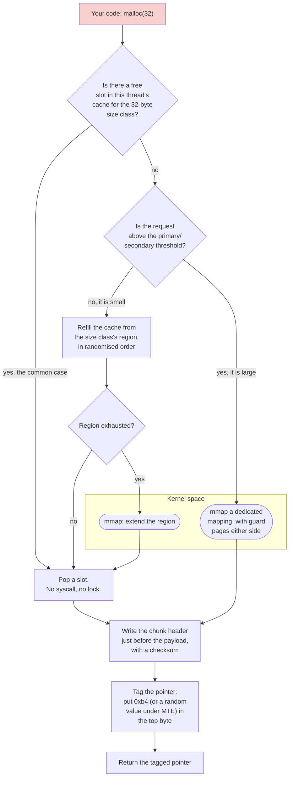
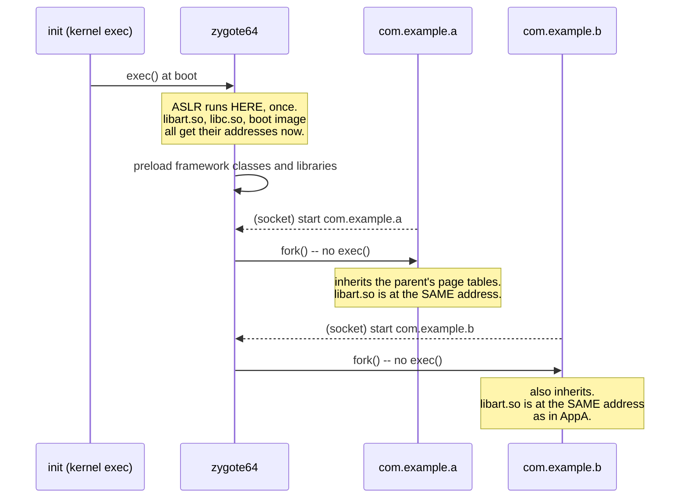
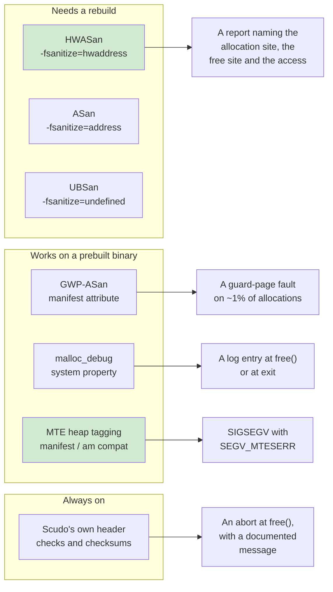
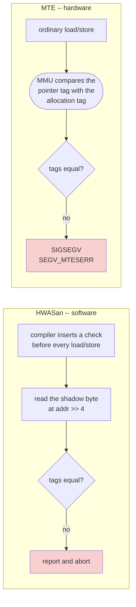
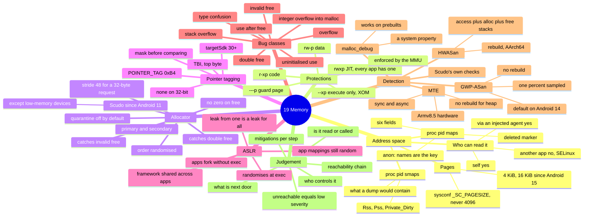

# 19 — Memory

> After this chapter you will be able to open any Android process's address space, say what every
> region is and why it has the permissions it has, name the allocator and the memory checker it is
> running from evidence rather than from a version number, recognise each native memory-safety defect
> class from its symptoms, judge honestly whether one is reachable, and choose and configure the
> detection that would have caught it.

**Prerequisites:** [01-Computer-Science-Basics](../01-Computer-Science-Basics/README.md) (bits,
bytes, processes), [02-Linux-Basics](../02-Linux-Basics/README.md) (`/proc`, `adb shell`),
[15-Native-Code](../15-Native-Code/README.md) (ELF, PT_LOAD, the build-time hardening checklist).
Helpful but not required: [16-JNI](../16-JNI/README.md), [17-Libraries](../17-Libraries/README.md).
18-ARM covers the instruction set this chapter's addresses are eventually fed
into.

**Applies to:** Android 5.0 (API 21) through Android 15 (API 35), with a version matrix in §3.6 for
the allocator and §3.13 for the checkers. Everything about `/proc/<pid>/maps` applies to any Linux.

---

## Table of Contents

1. [Introduction](#1-introduction)
2. [High-Level Architecture](#2-high-level-architecture)
3. [Deep Internal Working](#3-deep-internal-working)
4. [Source Code Walkthrough (AOSP)](#4-source-code-walkthrough-aosp)
5. [Security Perspective](#5-security-perspective)
6. [Reverse Engineering Perspective](#6-reverse-engineering-perspective)
7. [Dynamic Analysis](#7-dynamic-analysis)
8. [Static Analysis](#8-static-analysis)
9. [Examples](#9-examples)
10. [Common Interview Questions](#10-common-interview-questions)
11. [Common Mistakes](#11-common-mistakes)
12. [Hands-on Labs](#12-hands-on-labs)
13. [Summary](#13-summary)
14. [References](#14-references)

---

## 1. Introduction

### 1.1 The problem that memory management exists to solve

Imagine a large office building with no room numbers and no receptionist. Anyone can walk into any
room, move the furniture, and take whatever is on the desk. Two teams are given "the room at the end
of the corridor" and both move in. A team that has moved out leaves the door open and its filing
cabinet full; the next team finds someone else's contracts in it.

That building is a computer without memory management. Every program would see every other program's
data, would overwrite it by accident, and would find the previous program's secrets lying around.

Three separate problems have to be solved, and they are usually confused with each other.

**Isolation.** Program A must not be able to read or write program B's data. On a phone this is not
an abstract nicety: your banking app and a free torch app run on the same hardware.

**Allocation.** Within one program, code that needs 200 bytes has to be given 200 bytes that nothing
else is using, and has to be able to give them back. Somebody has to keep the books.

**Protection.** Some memory holds instructions, some holds data. If the machine cannot tell them
apart, then anything that can write data can write instructions, and a bug that overwrites a buffer
becomes a bug that runs whatever the attacker typed.

The mechanisms are, in order: **virtual memory**, the **allocator**, and **page protections**. Every
one of them can be got wrong, and this chapter is about how, and about how you find out.

### 1.2 What breaks without each of them

> **📖 Definition — virtual memory**
> Every process is given its own private map of addresses. When your code uses address
> `0x7bd3e7e000`, the hardware translates that to some physical location using a table the kernel
> maintains for your process alone. Another process using the same number gets somewhere completely
> different. The number in your program is a *virtual* address, and it means nothing outside your
> process.

**Without virtual memory**, addresses would be physical, every process could reach every other, and
`adb shell` could read your banking session by guessing an address. The sandbox in
[21-App-Sandbox](../21-App-Sandbox/README.md) is built on top of this; without it there is nothing
to build on.

**Without an allocator**, every program would have to manage raw memory by hand. In practice they
would each write their own, badly, and the bugs would be in a thousand places instead of one.

**Without page protections**, the classic 1990s attack works forever: overflow a buffer with machine
code, jump to it, done. It was ended not by better programming but by marking data pages
non-executable — a hardware bit.

### 1.3 The one-paragraph version of the whole chapter

A process's memory is a list of **regions**. Each region is a run of pages with the same
permissions and the same origin, and you can read that list from `/proc/<pid>/maps`. Some regions
hold libraries mapped from files; some are anonymous, handed out by the kernel and then subdivided
by an **allocator** which keeps its own bookkeeping in them. Native code in C and C++ can address
memory outside the block it was given, or after the block was handed back, and nothing stops it —
the language has no bounds and no lifetimes. Whether that is a nuisance or a catastrophe depends on
*what is next door* and *whether an attacker controls what goes there*. Everything else in this
chapter is detail supporting those two questions.

### 1.4 What this chapter owns, and what it does not

The native layer is split across several chapters on purpose. Getting the boundary right saves hours.

| Question | Chapter |
|---|---|
| What is in the `.so` file, byte by byte? Is it built with RELRO and canaries? | [15-Native-Code](../15-Native-Code/README.md) |
| **Where is it in memory at run time? What are the page protections? Where did `malloc` put this?** | **19 — this chapter** |
| How does Java call into it? What is `JNIEnv`? | [16-JNI](../16-JNI/README.md) |
| *Which* third-party library is it, and is that version vulnerable? | [17-Libraries](../17-Libraries/README.md) |
| What do these AArch64 instructions do? | 18-ARM |
| What does this function do, in C? | [57-Ghidra](../57-Ghidra/README.md) |
| How do I hook it? | [53-Frida](../53-Frida/README.md) |
| What is on the **Java** heap? Where do `ArtMethod` and GC live? | [13-ART](../13-ART/README.md) |
| Why does every app start as a copy of the Zygote? | [06-Android-Architecture](../06-Android-Architecture/README.md) |
| What stops app A reading app B's files? | [21-App-Sandbox](../21-App-Sandbox/README.md) |

A quick test: if the answer comes from `readelf`, it is chapter 15. If it comes from
`/proc/<pid>/maps` or from a `malloc` return value, it is here. If it comes from a heap dump of Java
objects, it is chapter 13.

### 1.5 A warning about tone, which is also an engineering position

This chapter teaches how to *recognise*, *locate* and *detect* memory-safety defects, and how to
judge reachability. It does not teach exploitation, and it ships no exploit.

That is not squeamishness. On an authorised engagement the deliverable is "this defect exists, here
is the chain of conditions that makes it reachable, and here is which links we confirmed" — not a
working weapon. A finding that says "reachable, control-flow hijack primitive, final step not
demonstrated" is more useful and more defensible than one that says "critical" with nothing behind
it. The repository's standing rule applies here more than anywhere: **evidence, not verdict.**

And the corollary is worth stating early, because it is the one testers get wrong in both
directions: **a memory-safety bug that cannot be reached from attacker-influenced input is a
low-severity finding, and you should say so plainly.** Padding a report with unreachable
`strcpy` calls trains the client to ignore you.

### 1.6 Seven questions this chapter answers

1. What does one line of `/proc/<pid>/maps` mean, field by field, and why does one library appear
   four times?
2. Why is a `malloc` return value on Android sometimes `0xb400007cbeeee2e0` when the region it lives
   in starts at `0x7cbeeee000`?
3. Which allocator is this device using, and how would I know rather than guess?
4. If an overflow writes 20 bytes past a 32-byte allocation, what does it hit?
5. Android forks apps from the Zygote without `exec`. What exactly does that cost ASLR?
6. What is the difference between HWASan, MTE, GWP-ASan and malloc_debug, and which one should this
   client turn on?
7. How do I tell an RWX page that is ART's JIT from one that is not?

---

## 2. High-Level Architecture

### 2.1 The shape of a 64-bit Android process

Mermaid cannot draw a memory layout to scale, so this one is fenced ASCII. The addresses are real —
they come from an `mem-landmarks landmarks -v` run on an Android 13 arm64 device — but they are one
sample from a randomised layout, not constants.

```
   higher addresses
   0x7fffffffffff   +---------------------------------------------+
                    |  (unmapped)                                 |
   0x7fe7abb000     +---------------------------------------------+  rw-p
                    |  [stack]              136 KiB, grows down   |
                    +---------------------------------------------+
                    |  (unmapped, huge)                           |
   0x7bd64d6000     +---------------------------------------------+
                    |  linker64            r--p r-xp r--p rw-p    |
   0x7bd5393000     +---------------------------------------------+
                    |  the executable      r--p r-xp r--p rw-p    |
   0x7bd3e7e000     +---------------------------------------------+
                    |  libc.so             r--p r-xp r--p rw-p    |
                    |  ... every other mapped library ...         |
                    +---------------------------------------------+
                    |  (unmapped, huge)                           |
   0x7a03e82000     +---------------------------------------------+  rw-p
                    |  [anon:scudo:primary]   the native heap     |
                    +---------------------------------------------+
                    |  [anon:scudo:secondary] large allocations   |
                    +---------------------------------------------+
                    |  [anon:dalvik-main space]  the JAVA heap    |
                    |  [anon:dalvik-zygote space]  (shared, COW)  |
                    |  [anon:dalvik-jit-code-cache]  rwxp         |
                    +---------------------------------------------+
                    |  boot.art / boot.oat  the framework image   |
   0x0000000000     +---------------------------------------------+
   lower addresses     (page 0 is never mapped: that is why a NULL
                        dereference is a clean, reliable crash)
```

Five things in that picture matter and none of them is obvious.

**The regions are not adjacent.** There are enormous unmapped gaps between them — tens of gigabytes.
That is deliberate: `mmap` picks a random address within a gap, and the size of the gaps is what
ASLR randomises within. It is also why an overflow that walks far enough eventually hits nothing and
faults.

**Every mapped file occupies several regions, not one.** Four is typical, because a shared object's
segments need different permissions. This is the single most common source of the question "why does
`maps` list libc three times".

**The native heap and the Java heap are different things in different places.** `malloc` gives you
`[anon:scudo:primary]`. `new byte[1024]` in Java gives you `[anon:dalvik-main space]`. They are
managed by different code, have different bug classes, and are dumped by different tools. Confusing
them is the most common conceptual error in this whole area.

**`[heap]` is nearly irrelevant on Android.** The classic Unix `brk` heap barely gets used; bionic
allocates by `mmap`. If you go looking for the heap under the label `[heap]` you will find a small
region that is not where the interesting data is.

**There is an `rwxp` region in every app.** ART's JIT writes machine code and then runs it. Any
triage rule of the form "RWX means compromise" will fire on every Android device ever made.

### 2.2 What happens when you call `malloc(32)`



Read the diagram for its **shape**, not its detail. The overwhelmingly common path is the left-hand
one: pop a slot from a thread-local cache, with no lock and no system call. That is why `malloc` is
fast, and it is also why the allocator's bookkeeping lives *in the same memory it hands out* — there
is nowhere else cheap enough to put it.

That last point is the entire reason heap corruption is dangerous. Overflow past the end of your
block and you are not writing into empty space; you are writing into the allocator's notes about the
next block, or into the next block itself.

Two branches produce genuinely different security properties. Small allocations come from a crowded
region where blocks are neighbours. Large allocations get their own mapping flanked by unmapped
pages, so an overflow there usually faults immediately and reaches nothing. Same bug, very different
consequence — §3.8 measures where the threshold is.

### 2.3 The Zygote's consequence for address-space layout



This is the diagram that [06-Android-Architecture](../06-Android-Architecture/README.md) and
[21-App-Sandbox](../21-App-Sandbox/README.md) both point here to have explained in exploitation
terms.

**Why Android does it.** `fork()` without `exec()` means the child shares the parent's pages
copy-on-write. Every framework class the Zygote preloaded, every library it loaded, every JIT-warmed
page, is already there and costs the child nothing. App startup goes from seconds to milliseconds
and the whole device saves hundreds of megabytes. That is a very large win and Android is not going
to give it up.

**What it costs.** ASLR randomises at `exec`. Apps do not `exec`. Therefore:

> **⚠️ Warning — the Zygote ASLR consequence, stated plainly**
> For the portion of an app's address space inherited from the Zygote — `libart.so`, `libc.so`, the
> boot image, the framework — there is effectively **one layout per boot**, shared by **every app on
> the device**.
>
> 1. An address leak from *any* app on the device discloses the framework layout for *every* app on
>    that device, until the Zygote restarts, which in practice means until reboot.
> 2. An attacker who can run their own unprivileged app can read their own `/proc/self/maps` to
>    learn where the framework libraries are in a *target* app, without attacking the target at all.
> 3. "The attacker would need an information leak to defeat ASLR" is therefore a much weaker
>    counter-argument on Android than on a desktop.

**What it does not mean.** It is not a vulnerability in any particular app, and reporting it as one
against an app is a category error. It is an architectural property to *use correctly* in an
exploitability analysis. And it is only the inherited part: the app's own APK, its `.odex`, its
bundled `.so` files, and everything the allocator maps after the fork are randomised per process.
[Lab 02](labs/lab-02-allocator-behaviour.md) Part 4 measures both halves.

Academic work has proposed replacing the model with `fork()` plus `exec()` per app to restore full
ASLR; the memory cost is why Android has not.

### 2.4 The detection landscape



The two columns are the decision. **If you can rebuild, HWASan is the answer** and everything else
is a compromise. **If you cannot rebuild — which is the normal situation in a black-box pentest of a
release APK — your options are malloc_debug, GWP-ASan and, with the right hardware, MTE.** §3.13 and
[Lab 03](labs/lab-03-detection-hwasan-mte.md) go through each properly, and §5.8 turns the choice
into a recommendation you can give a client.

Note the third box. Scudo checks its own chunk headers on every `free()` with no configuration at
all, which is why a double-free and an invalid-free abort on a stock device while an overflow and a
use-after-free do not.

---

## 3. Deep Internal Working

### 3.1 Pages: the unit everything is measured in

> **📖 Definition — page**
> The smallest block of memory the hardware can map, protect or account for independently. On almost
> every Android device it is 4096 bytes; since Android 15, AOSP supports devices configured for
> 16384.

**Why pages exist at all.** The translation table that turns virtual addresses into physical ones has
to have an entry per unit. Per byte, the table would be larger than the memory it describes. Per
page, a 4 KiB granule means one entry covers 4096 bytes and the table is manageable. Everything else
about memory — protections, accounting, swapping, sharing — inherits that granularity because it is
where the hardware bits live.

**The consequences you will actually meet:**

- **You cannot protect one variable.** `mprotect` takes a page-aligned address and a length rounded
  up to pages. "Make this pointer read-only" is not a request the hardware can satisfy; you can only
  make the *page it happens to live in* read-only, along with everything else on that page.
- **A 1-byte `mmap` gives you 4096 bytes.** `examples/mem-landmarks.c pagesize` demonstrates it:

  ```
  mmap of ONE byte returned 0x7e4c00d000. Its mapping:
      7e4c00d000-7e4c00e000 rw-p 00000000 00:00 0
  ```

- **Every address in `/proc/<pid>/maps` is page-aligned.** If one is not, you are misreading the
  file.

**Never hard-code 4096.** The Android developer documentation is explicit:

> "Remove any hard-coded dependencies that reference the `PAGE_SIZE` constant or instances in your
> code logic that assume that a device's page size is 4 KB (`4096`). Use `getpagesize()` or
> `sysconf(_SC_PAGESIZE)` instead."

On NDK r27 and higher, `PAGE_SIZE` is *undefined* when 16 KiB mode is enabled, specifically so the
assumption cannot compile.

#### The 16 KiB page transition

| Aspect | Detail |
|---|---|
| First supported | Android 15 — "Beginning with Android 15, AOSP supports devices that are configured to use a page size of 16 KB" |
| Play requirement | Apps targeting Android 15+ must support 16 KB pages on 64-bit devices; from **1 February 2027** updates that do not will be rejected |
| What breaks | A native library whose `PT_LOAD` segments are aligned to 4 KiB **will not load at all** |
| The build fix | `-Wl,-z,max-page-size=16384` and `-Wl,-z,common-page-size=16384` on NDK r27 and lower |
| How to check a `.so` | `llvm-readelf -l lib.so` and confirm no `LOAD` alignment is below `2**14` |

> **🔍 Pentester's Note**
> A hard-coded 4096 in native code that computes a page base for `mprotect` does not fail cleanly on
> a 16 KiB device — it computes the wrong base and either fails the syscall or protects the wrong
> memory. The symptoms look exactly like memory corruption. If you are triaging weird crashes on a
> Pixel with 16 KiB pages, `grep -rn '4096\|PAGE_SIZE' ` the native source before anything else.

### 3.2 Page protections, and what enforcement means

Each page carries three permission bits plus a sharing mode. In `/proc/<pid>/maps` they are the
four-character string.

| String | Meaning | Where you see it |
|---|---|---|
| `r--p` | read-only, private | `.rodata`, ELF headers, the RELRO region after locking |
| `r-xp` | read + execute, private | `.text` — code |
| `rw-p` | read + write, private | `.data`, `.bss`, the heap, stacks |
| `rwxp` | read + write + execute | JIT caches. Rare and worth explaining elsewhere |
| `--xp` | **execute only** | a hardening feature: the CPU may run it, nothing may read it |
| `---p` | no access at all | a guard page. Mapped, but every access faults |
| `r--s` | read-only, **shared** | ashmem, `/dev/__properties__`, mapped files shared between processes |
| `rw-s` | read + write, shared | shared memory. Another process can change these bytes under you |

Two of those deserve more than a row.

**`---p` is a guard page.** It is not "unmapped"; it appears in `maps` and occupies address space.
It exists so that a linear overflow crossing it faults immediately rather than corrupting something.
`examples/mem-landmarks.c guard` builds one and walks into it:

```
    7087874000-7087875000 rw-p 00000000 00:00 0
    7087875000-7087876000 ---p 00000000 00:00 0     <- the guard
    7087876000-7087877000 rw-p 00000000 00:00 0

  now writing forward from the first page, one byte at a time:
  faulted with signal 11 (si_code 2)
```

That is the entire mechanism behind GWP-ASan (§3.12) and behind why large allocations are safer than
small ones.

**`--xp` is execute-only memory (XOM).** Removing read permission from code defeats the "read the
binary out of memory to find ROP gadgets" step of an exploit chain. A real capture from an Android 13
device shows `libcrypto.so` with segments `r--p r-xp --xp rw-p` — one of its code segments is
execute-only. `maps-analyse.py` reports it under the tag `XOM` and explicitly says it is a good
thing, because the alternative is a reader panicking at an unfamiliar permission string.

> **🔬 Under the Hood — enforced, not checked**
> When a page loses its write permission, nothing in your program starts checking anything. The
> permission bit in the page table entry changes, and the MMU refuses the store in hardware. There
> is no code path to bypass, no flag to flip in userspace, no function to hook. That is what makes
> page protections qualitatively different from a bounds check written in C.
>
> `mem-landmarks wx` demonstrates it: create an `rwxp` page, write to it (fine), `mprotect` to
> `r-xp`, write again — `faulted with signal 11 (si_code 2)`. Nothing in the program checked.

### 3.3 `/proc/<pid>/maps`, field by field

One real line:

```
7bd3ebb000-7bd3f4c000 r-xp 0003d000 fc:04 618    /apex/com.android.runtime/lib64/bionic/libc.so
```

| # | Field | Value | Notes |
|---|---|---|---|
| 1 | address range | `7bd3ebb000-7bd3f4c000` | start inclusive, end **exclusive**, hex, no `0x`. Size = end − start |
| 2 | permissions | `r-xp` | `r`/`w`/`x` or `-`, then `p` (MAP_PRIVATE) or `s` (MAP_SHARED) |
| 3 | file offset | `0003d000` | where in the backing file this mapping starts. `0` for anonymous |
| 4 | device | `fc:04` | major:minor of the device holding the file. `00:00` for anonymous |
| 5 | inode | `618` | the file's inode. `0` for anonymous. **Two mappings with the same inode are the same file** |
| 6 | path | `/apex/…/libc.so` | the file, a `[bracketed]` special region, or empty |

**Field 6 has four possible shapes, and each means something different.**

| Shape | Example | Meaning |
|---|---|---|
| A filesystem path | `/system/lib64/libc.so` | mapped from that file |
| A path ending `(deleted)` | `/data/…/.tmp7712 (deleted)` | the file was unlinked but the mapping survives. Legitimate for temp files; also how a dropper removes its evidence |
| A `[bracket]` name | `[stack]`, `[heap]`, `[vdso]`, `[vvar]` | a kernel-provided special region |
| `[anon:NAME]` | `[anon:scudo:primary]` | anonymous memory that userspace **named itself** |
| Empty | | plain anonymous memory that nobody named |

#### The `[anon:NAME]` labels are the most informative field in the file

Linux lets a process name its own anonymous mappings with
`prctl(PR_SET_VMA, PR_SET_VMA_ANON_NAME, start, len, name)`. Android uses this heavily, and the
result is that the allocators and the runtime *tell you what they are*. Every name in the table
below was observed in real output, not recalled.

| Name | What it is |
|---|---|
| `[anon:scudo:primary]` | Scudo's small/medium allocation regions — the native heap |
| `[anon:scudo:secondary]` | Scudo's large allocations, individually mapped |
| `[anon:libc_malloc]` | the name bionic used before Scudo, and for the generic path |
| `[anon:GWP-ASan guard]`, `[anon:GWP-ASan alive slot]` | GWP-ASan's sampled allocations and their guard pages |
| `[anon:SizeClassAllocator: region data]`, `[anon:LargeMmapAllocator]` | **sanitizer_common's** allocator — this process is running under HWASan or ASan |
| `[anon:dalvik-main space (region space)]` | the ART managed heap — the **Java** heap |
| `[anon:dalvik-zygote space]` | the Zygote's heap, shared copy-on-write with every app |
| `[anon:dalvik-jit-code-cache]` | ART's JIT output. Expect `rwxp` |
| `[anon:dalvik-large object space allocation]` | ART's large-object space |
| `[anon:dalvik-indirect ref table]` | JNI global and weak-global references |
| `[anon:stack_and_tls:NNN]` | a thread's stack plus its thread-local storage |
| `[anon:thread signal stack]` | the alternate stack a signal handler runs on |
| `[anon:linker_alloc]`, `[anon:bionic_alloc_small_objects]` | the linker's and bionic's internal allocations, **not** the app heap |
| `[anon:.bss]` | zero-initialised data that outgrew its file-backed segment |
| `[anon:cfi shadow]` | Control Flow Integrity's shadow table |

> **🧠 Mental Model**
> Read the `[anon:]` names first and everything else second. They answer "which allocator", "is a
> sanitiser running", "is this the Java heap or the native heap" and "is this a thread stack" in one
> glance. `scripts/maps-analyse.py` does nothing cleverer than look them up in a table — the
> cleverness is that the names exist.

#### `smaps`: the same list, with accounting

`/proc/<pid>/smaps` repeats every `maps` line and follows it with about twenty counters. The ones
that matter:

| Counter | Meaning | Use it for |
|---|---|---|
| `Size` | the mapping's virtual size | nothing much; it is `end − start` |
| `Rss` | **resident**: pages actually in physical memory now | which regions have content worth dumping |
| `Pss` | **proportional**: shared pages divided by the number of sharers | fair attribution across processes |
| `Shared_Clean` | shared, unmodified — can be re-read from the file | pages inherited from the Zygote |
| `Shared_Dirty` | shared, modified | |
| `Private_Clean` | yours alone, unmodified | |
| `Private_Dirty` | **yours alone, modified** | the true memory cost of this process |
| `Referenced` | touched recently enough that the kernel noticed | |
| `Anonymous` | not backed by any file | heap and stack |
| `Swap`, `SwapPss` | paged out | on Android, usually zram |
| `Locked` | pinned with `mlock`, never swappable | key material, sometimes |
| `VmFlags` | two-letter flags: `rd wr ex sh mr mw me ac` and others | `lo` means locked, `dd` means do-not-dump |

Two practical uses.

**`Private_Dirty` is the number to quote** when someone asks how much memory a process costs. `Rss`
double-counts every page shared with the Zygote, and on Android that is most of the framework.

**`Rss` tells you what a memory dump would actually contain.** A region with `Rss` 0 is reserved
address space with nothing behind it; dumping it yields zeros or a read error, not data. This is why
"the process has 10 GiB of address space" and "the dump is 40 MiB" are both true.

```bash
# adb shell
cat /proc/self/smaps > /data/local/tmp/s.txt
# host
adb pull /data/local/tmp/s.txt && python3 scripts/maps-analyse.py s.txt --smaps
```

There is also `/proc/<pid>/smaps_rollup`, which gives the same totals in one short block without the
per-region detail — far cheaper to read and enough when you only want the numbers.

### 3.4 Who can read whose maps

This surprises everyone, and getting it wrong wastes an afternoon.

| Situation | Can you read `/proc/<pid>/maps`? | Can you read `/proc/<pid>/mem`? |
|---|---|---|
| Your own process | yes | yes |
| A child you spawned, same uid | yes | needs `ptrace` attach, and `ptrace_scope` may forbid it |
| Another app, from `adb shell` on stock Android 13 | **no — SELinux denies it** | no |
| Another app, as root | yes | yes |
| From inside the app, via an injected agent | yes — it is `/proc/self` | yes |

Verified on an Android 13 device:

```
$ adb shell head -3 /proc/$(pidof zygote64)/maps
head: /proc/541/maps: Permission denied

$ adb shell cat /proc/sys/kernel/randomize_va_space
cat: /proc/sys/kernel/randomize_va_space: Permission denied
```

> **🔍 Pentester's Note**
> This is why every maps-reading technique in this repository that targets a *real app* goes through
> Frida rather than through `adb shell`. An agent injected into the app is running **as** the app, so
> `/proc/self/maps` is its own file. `scripts/enumerate-ranges.js` exists for exactly this, and its
> `dumpMapsTo()` export writes the file out so you can `adb pull` it and run the analyser on it.
>
> Note the difference between the two columns above, because it answers a frequently asked question:
> reading *maps* is a directory-listing operation and needs only permission to look at the `/proc`
> entry; reading *mem* is reading another process's memory and needs `ptrace` capability over it.
> Even on a permissive system, the first is far easier than the second.

### 3.5 ASLR on Android: what is randomised, and what is not

> **📖 Definition — ASLR**
> Address Space Layout Randomisation. The kernel places the stack, the heap, the loaded libraries
> and (for a PIE binary) the executable itself at addresses chosen randomly at `exec` time, so that
> an attacker cannot know in advance where anything is.

#### Version matrix

| Android | What arrived |
|---|---|
| 2.3 | Hardware NX (no-execute) for stack and heap |
| 4.0 | ASLR — "randomize key locations in memory" |
| 4.1 | PIE support in the dynamic linker; RELRO and immediate binding |
| 4.2 | `FORTIFY_SOURCE` |
| 5.0 | PIE required for dynamically linked executables |
| 11 | Heap pointer tagging on 64-bit, for apps targeting API 30+ |

ASLR needs the binary to be relocatable: a **PIE** (position-independent executable) or a shared
object. A fixed-address `ET_EXEC` binary cannot be moved, which is why PIE became mandatory. Whether
a given `.so` is PIE is a build-time property and belongs to
[15-Native-Code](../15-Native-Code/README.md) §5; whether it *ended up* randomised is what you read
here.

#### Measuring it

For an `exec`'d process, honestly:

```bash
# adb shell
for i in $(seq 1 50); do
  /data/local/tmp/ch19/mem-landmarks landmarks
done | tr ' ' '\n' | grep '^libc=' | sort -u | wc -l
```

Fifty distinct values means fifty distinct layouts.

#### And then the part that undoes it

Everything above applies to processes the kernel `exec`s. **Android app processes are forked from
the Zygote and never `exec`.** §2.3 draws it; the consequence bears restating because it is the
thing this chapter is cited for:

- the framework libraries are at the same address in **every app on the device**, until reboot;
- a leak from one app is a leak for all of them;
- an attacker's own app can read the layout without touching the target.

**What is still randomised per app:** the app's own APK mapping, its `base.odex`, its bundled `.so`
files, ART regions created after the fork, Scudo's regions for that process, and thread stacks
created after the fork.

So the correct sentence in a report is never "ASLR is enabled" or "ASLR is broken". It is: *"the
framework portion of the address space is shared across apps and fixed until reboot; the
app-specific portion is randomised per process."* [Lab 02](labs/lab-02-allocator-behaviour.md) Part 4
walks through measuring both.

### 3.6 The native heap: which allocator, by version

This is the section other chapters cite. It must be right, so every claim below is sourced.

#### The version matrix

| Android | Native allocator for apps | Source |
|---|---|---|
| ≤ 4.x | dlmalloc | historical |
| 5.0 – 9 | jemalloc | historical |
| 10 | jemalloc remains the default; **Scudo is introduced** and described in the platform security enhancements as "a dynamic user-mode memory allocator designed to be more resilient against heap-related vulnerabilities" | AOSP security enhancements |
| **11 and later** | **Scudo**, for all native code — **except on low-memory devices, where jemalloc is still used** | AOSP: *"Since the Android 11 release, scudo is used for all native code (except on low-memory devices, where jemalloc is still used)."* |

> **⚠️ Warning — do not state the boundary more simply than that**
> "Scudo since Android 11, jemalloc before" is the summary and it is what
> [15-Native-Code](../15-Native-Code/README.md) says. The exception matters in practice: a low-RAM
> device running Android 12 may still be on jemalloc, and jemalloc's layout, its bin structure and
> its grooming behaviour are different. **Do not infer the allocator from the version number.**
> Measure it — §7.2 and `maps-analyse.py`'s ALLOCATOR block read it straight out of the `[anon:]`
> names, which is evidence rather than inference.

#### Observing it

Real output from an Android 13 arm64 device, via `maps-analyse.py`:

```
==============================================================================
ALLOCATOR AND CHECKER
==============================================================================
  Scudo                                  1.5 MiB across 6 mapping(s)
      small and medium allocations, carved from per-size-class regions
      evidence: [anon:scudo:primary]
```

and under HWASan, the same fixture:

```
  small[0]  0xb9000053efff0020  in 0053efff0000-0053f0000000 rw-p
            [anon:SizeClassAllocator: region data]
```

The region name changed because the *allocator* changed. That is the fingerprint.

### 3.7 Pointer tagging: why `malloc` returns `0xb400007cbeeee2e0`

Run `heap-bugs layout` on any Android 11+ 64-bit device and every heap pointer starts `0xb4`:

```
  [0] 0xb400007cbeeee2e0
  small[0]  0xb400007cbeeee2e0  tagged; searching maps for 007cbeeee2e0
  small[0]  0xb400007cbeeee2e0  in 007cbeeee000-007cbef2e000 rw-p [anon:scudo:primary]
```

> **📖 Definition — Top-Byte-Ignore (TBI)**
> An Arm AArch64 feature: the hardware ignores the top byte of a 64-bit address when dereferencing
> it. A 64-bit pointer only needs 48 or 52 bits for a real address, so the top byte is free for
> software to use as metadata.

Android uses it. AOSP states it directly:

> "Starting in Android 11, for 64-bit processes, all heap allocations have an implementation defined
> tag set in the top byte of the pointer."

and

> "Any app that modifies this tag is terminated when the tag is checked during deallocation."

The constant lives in `bionic/libc/bionic/malloc_tagged_pointers.h` as `POINTER_TAG`, with the value
`0xB4`, and the file also defines the shifts the implementation uses (`TAG_SHIFT` 56, `CHECK_SHIFT`
48, `UNTAG_SHIFT` 40).

| Aspect | Detail |
|---|---|
| Applies to | 64-bit processes, Android 11+, on kernels that support TBI |
| Default for apps | **on** for `targetSdkVersion` ≥ 30; off below |
| The tag value | constant `0xB4` with plain Scudo; **random per allocation** under HWASan or MTE |
| Disable | `<application android:allowNativeHeapPointerTagging="false">` — documented as a temporary escape hatch that "will disappear in future versions of Android" |
| 32-bit | **no tagging at all** — there is no spare byte |

#### Why this bites you, three times

**1. Comparing a pointer with a maps address fails.** `maps` prints untagged addresses. A naive
`addr >= lo && addr < hi` matches nothing. `heap-bugs.c` prints the failure and then the fix:

```
  small[0]  0xb400007cbeeee2e0  tagged; searching maps for 007cbeeee2e0
```

**2. Subtracting two tagged pointers gives nonsense.** The tags cancel only if they are equal, which
they are under plain Scudo and are not under HWASan. `heap-bugs.c`'s `delta()` untags first, for
exactly this reason.

**3. `==` between two pointers to the same memory can be false.** Under HWASan, freeing and
reallocating gives you the same address with a **new tag**:

```
Free small[3] (0x7000053efff0080), then malloc(32) again:
  new allocation: 0x1d000053efff0080  SAME ADDRESS (immediate reuse)
                  same memory, DIFFERENT TAG (07 -> 1d) -- this is HWASan or MTE at work
```

A tool that compares raw pointer values would report "different address" and conclude, wrongly, that
the sanitiser build does not reuse memory.

The mask is one line, and every script in this chapter has it:

```c
/* 64-bit only; ULL not UL, because `unsigned long` is 32 bits on armeabi-v7a */
uintptr_t untagged = (uintptr_t)p & (uintptr_t)0x00ffffffffffffffULL;
```

> **⚠️ Warning — a real bug this caught**
> Writing that mask as `0x00ffffffffffffffUL` compiles clean on arm64 and **silently truncates** on
> armeabi-v7a, where `unsigned long` is 32 bits. Building `examples/heap-bugs.c` for both ABIs with
> `-Wall -Wextra` is what surfaced it, along with a `volatile unsigned long` initialised from a
> 64-bit constant. If you write memory code, build it for both ABIs even if you only ship one.

### 3.8 Scudo, in enough detail to reason about

Scudo is upstream LLVM's hardened allocator, configured by Android through `scudo::AndroidConfig`.
You can see that class name in a real crash backtrace:

```
scudo::Allocator<scudo::AndroidConfig, &(scudo_malloc_postinit)>::deallocate(...)
```

#### The structure

| Part | What it is | Seen in maps as |
|---|---|---|
| **Primary** | per-size-class regions, pre-reserved, carved into fixed-size slots | `[anon:scudo:primary]` |
| **Secondary** | allocations above a threshold get their own `mmap`, with guard pages | `[anon:scudo:secondary]` |
| **Thread-local cache** | a small per-thread stash of free slots, so the common path takes no lock | inside the primary regions |
| **Chunk header** | 16 bytes immediately before every payload, holding size class, state, origin and a **checksum** | inside the primary regions |
| **Quarantine** | optional delay before a freed block can be reused | configurable, **off by default on Android** |

#### The behaviours you can measure, and the ones you must not assume

**Allocation order within a size class is randomised.** Real output, eight consecutive `malloc(32)`
calls:

```
  [0] 0xb400007337882060
  [1] 0xb4000073378829a0   delta from previous: +2304 bytes
  [2] 0xb400007337882670   delta from previous: -816 bytes
  [3] 0xb4000073378824c0   delta from previous: -432 bytes
```

Not monotonic. That is deliberate anti-grooming: an attacker who wants object B directly after
object A cannot get it by simply allocating them in order.

**Every delta is a multiple of 48.** A 32-byte request occupies a 48-byte slot: 32 bytes of payload
plus a 16-byte header. **48 is the stride for this size class**, and it is the number that decides
what a given overflow reaches.

**The quarantine is off by default on Android.** The textbook claim is that a freed block goes into
quarantine and cannot be handed straight back. Measured:

```
Free small[3] (0xb4000073378824c0), then malloc(32) again:
  new allocation: 0xb4000073378824c0  SAME ADDRESS (immediate reuse)
```

`QuarantineSizeKb` is a real, documented Scudo option — upstream defaults are 256 KB on 64-bit and
64 KB on 32-bit — and Android sets it to zero to save memory. You can turn it on for a process you
control:

```bash
# adb shell
SCUDO_OPTIONS=QuarantineSizeKb=256:ThreadLocalQuarantineSizeKb=64 ./your-binary
```

but an app cannot set its own environment, so this is a platform lever, not an app-level fix.

**Freed memory is not zeroed by default.** Also measured:

```
Contents, before and after:
  small[0] now   41 41 41 41 41 41 41 41 41 41 41 41 41 41 41 41
  after free     41 41 41 41 41 41 41 41 41 41 41 41 41 41 41 41
```

`ZeroContents` is another Scudo option and it is not on. This is the mechanism behind every "we
found the token in a heap dump" finding, and §5.9 gives the remediation, which is to scrub the
buffer yourself rather than hope.

#### What Scudo does catch, with no configuration

| Defect | Caught? | Message |
|---|---|---|
| double free | **yes**, at the second `free()` | `Scudo ERROR: invalid chunk state when deallocating address 0x…` |
| free of an interior pointer | **yes**, at `free()` | `Scudo ERROR: corrupted chunk header at address 0x…` |
| heap overflow, 1 byte | no | — |
| heap overflow, 64 bytes | no | — |
| use-after-free read | no | — |
| use-after-free write | no | — |

The full documented message set is: *corrupted chunk header*, *race on chunk header*, *invalid chunk
state*, *misaligned pointer*, *allocation type mismatch*, *invalid sized delete*, *RSS limit
exhausted*.

> **🔬 Under the Hood — why overflows survive and double-frees do not**
> Scudo's header sits *before* the payload and is checksummed. Overflowing **forward** past your
> block damages the *next* chunk's header, and that damage is only noticed when that chunk is freed
> — which may be never. Freeing the same pointer twice, or freeing an interior pointer, makes Scudo
> read a header that is in the wrong state or fails its checksum **immediately**, so it aborts on the
> spot.
>
> That is the whole explanation for the table above, and it generalises: an allocator can only catch
> what it looks at, and it looks at a chunk when you free it.

### 3.9 The native memory-safety defect classes

Every one of these is a bug the C and C++ languages permit and do not diagnose.

#### 3.9.1 Buffer overflow (CWE-787 out-of-bounds write, CWE-125 out-of-bounds read)

Writing past the end (or before the start) of an allocation.

```c
char *buf = malloc(32);
for (int i = 0; i <= 32; i++) {   /* <= should be < */
    buf[i] = data[i];
}
```

**Why developers write it.** Off-by-one in a loop bound; `strcpy` with an attacker-controlled source;
`memcpy` with a length from the network; a `sizeof` applied to a pointer rather than an array.

**What it costs, on Android.** Small overflow into the crowded primary: you damage a neighbouring
chunk's header or payload, and nothing is said until that chunk is freed. Overflow of a large
allocation in the secondary: you hit a guard page and fault at once.

**Detection:** HWASan (`Cause: heap-buffer-overflow`, exact line), GWP-ASan (if sampled),
malloc_debug `rear_guard`, ASan.

#### 3.9.2 Integer overflow leading to an undersized allocation

The bug hiding inside most "bounds-checked" code.

```c
uint32_t n = read_be32(input);        /* attacker-controlled */
if (n > MAX) return -1;               /* looks like a bounds check */
buf = malloc(n * sizeof(item_t));     /* n * 16 can wrap */
for (uint32_t i = 0; i < n; i++) ...  /* writes n items into a wrapped-size buffer */
```

and the subtler form, which is why `heap-bugs-fixed.c` writes its check the way it does:

```c
if (len + n > cap) return -1;         /* len + n can wrap to a small number */
if (n > cap - len) return -1;         /* cannot wrap; cap >= len always */
```

**Detection:** UBSan with `-fsanitize=unsigned-integer-overflow` (note it is *not* undefined
behaviour for unsigned types, so plain UBSan will not flag it), or by reading the arithmetic.

#### 3.9.3 Use-after-free (CWE-416)

Using memory after it has been released.

```c
free(session);
...
session->callback(session->ctx);   /* the pointer is unchanged; the memory is not yours */
```

**Why developers write it.** Two owners and no ownership model; an object freed on one thread while
another still holds a pointer; an error path that frees and then falls through to the normal path.

**What makes it dangerous** is reuse. On Android, measured, reuse is immediate. `heap-bugs uaf`
shows the consequence with no ambiguity:

```
  malloc(64) again -> 0xb400007369a46650 == the freed block. The hole has been reclaimed.
  writing through the dangling pointer:
  other[0..15]   41 77 77 77 77 77 77 77 77 77 77 77 77 77 77 77
```

`other` was filled with `0x77`. Its first byte is now `0x41`, written by code that thought it owned a
different object. If the first field had been a function pointer, it would now be attacker data.

**Detection:** HWASan (`Cause: use-after-free`, with *both* the allocation and the free stacks), MTE,
GWP-ASan if sampled, malloc_debug `free_track` plus `fill_on_free`.

#### 3.9.4 Double free (CWE-415)

```c
free(p);
...
free(p);
```

Caught by Scudo on a stock device. Note it is only caught because Scudo validates the chunk state;
on an allocator that does not, the block ends up on a free list twice and two future `malloc` calls
receive the same address.

#### 3.9.5 Invalid free

Freeing a pointer the allocator never returned — an interior pointer, a stack address, a static.
Caught by Scudo (`corrupted chunk header`), because the allocator reads its bookkeeping from just
before the pointer you gave it, and there is no bookkeeping there.

#### 3.9.6 Uninitialised memory use (CWE-457, CWE-908)

`malloc` does not zero. Whatever the previous owner left is what you read. Two consequences: your
logic behaves unpredictably, and you may *disclose* the previous owner's data — a struct with
padding, memcpy'd wholesale into a network buffer, leaks whatever was in the padding.

**Detection:** MSan (not available for Android app builds in practice), malloc_debug `fill_on_alloc`,
or `-ftrivial-auto-var-init=zero` at build time.

#### 3.9.7 Type confusion (CWE-843)

A pointer to one type used as another, usually via an unchecked cast or a union. In C++ with virtual
functions this is directly a control-flow problem, because the vtable pointer is the first field.
CFI (§3.11) exists specifically to make this harder.

#### 3.9.8 Stack buffer overflow

```c
char buf[16];
strcpy(buf, attacker_controlled);
```

Real behaviour, from `heap-bugs stack` writing 40 bytes into a 16-byte array:

```
F libc  : Fatal signal 7 (SIGBUS), code 1 (BUS_ADRALN), fault addr 0x42424242424242
```

`0x42` is the byte the program wrote. The fault address is made entirely of attacker data — the
clearest possible demonstration that an out-of-bounds stack write reaches something that gets
dereferenced, without writing a single line of exploit.

**Mitigations that apply here specifically:** stack canaries (`-fstack-protector-strong`, on by
default in the NDK), `_FORTIFY_SOURCE`, and Shadow Call Stack.

### 3.10 What makes a corruption primitive useful — and what does not

This is the section that decides your severity rating, so it is worth being precise.

A memory-safety bug becomes an exploitation primitive when you can answer all five of these. The
value of the exercise is that you will usually find you cannot.

| # | Question | Where the answer comes from |
|---|---|---|
| 1 | **Can attacker-influenced input reach the bug?** | reading the code, or fuzzing, or the crash's stack |
| 2 | **What is next door?** | the measured stride and size class (§3.8, `malloc-trace.js` `neighbours()`) |
| 3 | **Can the attacker control what goes next door?** | is there an allocation of the same size class whose *contents* the attacker chooses? |
| 4 | **Does anything read or call the corrupted value?** | is there a function pointer, a vtable, a length, an index? |
| 5 | **Do the mitigations still stop it?** | §3.11 |

**Why "what is next door" is a measurement, not a guess.** Chapter 15's hardening checklist tells
you whether RELRO is on. It cannot tell you that a 32-byte allocation on this device occupies a
48-byte slot, so a 20-byte overflow lands 16 bytes in a chunk header and 4 bytes in the next
payload. That number is device- and version-specific and you get it by running
`rpc.exports.neighbours(32)` from `scripts/malloc-trace.js`.

**Why question 3 is the one people skip.** A use-after-free that is always reclaimed by an internal
buffer whose contents the attacker cannot influence is a crash, not a hijack. A use-after-free
reclaimed by a buffer the attacker fills with network bytes is a different thing entirely. The
difference is often one function call away in the source and is invisible from the crash.

> **🔍 Pentester's Note — the honest sentence**
> The finding you can defend reads like: *"Attacker-supplied frame content reaches a `memcpy` bounded
> against the wrong size (confirmed from source). The overflow lands in the adjacent chunk of the
> same size class, whose contents are also attacker-supplied (measured stride 48, confirmed by
> instrumenting the allocator). The corrupted field is a function pointer that is subsequently
> called (confirmed by the HWASan free/use stacks). We did not demonstrate control-flow hijack; PAC
> and BTI apply on this hardware and defeating them was out of scope."*
>
> Five sentences, four of them with an experiment attached, and one honest limit. That is worth more
> to a client than a working exploit with no explanation.

### 3.11 Runtime mitigations: what each actually costs an attacker

[15-Native-Code](../15-Native-Code/README.md) §5 owns the checklist — how to detect each of these in
an ELF file, and what build flags produce them. This section is the other half: what they *do* at run
time, and how much harder they make each step.

| Mitigation | What it stops | What it does **not** stop | Visible at run time as |
|---|---|---|---|
| **NX / W^X** | writing shellcode into a buffer and jumping to it | ROP/JOP, which reuses existing code; and any JIT, which legitimately needs RWX | no `rwx` in `maps` except JIT caches |
| **ASLR** | hard-coding an address | an information leak; and on Android, the Zygote-inherited layout is shared (§3.5) | different bases across `exec`s |
| **PIE** | a fixed load address for the executable | nothing by itself; it is a prerequisite for ASLR | `ET_DYN` executable with a randomised base |
| **Full RELRO + BIND_NOW** | overwriting a GOT entry to redirect a library call | overwriting a function pointer the program stores in its own `.data` | a `r--p` segment where the GOT lives |
| **Stack canary** | a *linear* stack overflow reaching the return address undetected | an overflow that writes a *specific* offset and skips the canary; heap bugs entirely | `__stack_chk_fail` on a crash |
| **`_FORTIFY_SOURCE`** | `strcpy`/`memcpy` overflows the compiler can size at compile time | anything with a runtime-computed size | `__memcpy_chk` in the imports |
| **CFI** | calling an indirect target that is not a valid function of the right type | corrupting *data* rather than a call target | `[anon:cfi shadow]` in `maps` |
| **Shadow Call Stack** | overwriting a saved return address | forward-edge attacks | reserves `x18`; no reliable import |
| **PAC** (Armv8.3+) | using a corrupted pointer, because the signature will not verify | a signing gadget, or corrupting non-pointer data | `pacia`/`autia` instructions |
| **BTI** (Armv8.5+) | jumping into the middle of a function | gadgets that begin at a valid `bti` landing pad | `bti` instructions at function entries |
| **XOM** | reading code out of memory to find gadgets | gadgets found from the file on disk | `--xp` in `maps` |
| **Pointer tagging** | using a pointer whose tag no longer matches (deallocation check) | nothing, on its own — it is a correctness check, not a mitigation until MTE | top byte `0xb4` |
| **MTE** | use-after-free and overflow, at the access | a 1-in-16 tag collision; and it needs the hardware | `SEGV_MTESERR` on a crash |

> **🧠 Mental Model — mitigations are a toll, not a wall**
> Each row above raises the cost of one *step* in a chain. None of them prevents the bug. A report
> that says "the library has full RELRO so the overflow is not exploitable" is making an argument it
> has not done the work for: RELRO protects the GOT, and the overflow may not need the GOT.
>
> The useful way to use this table is per-step: *"the corrupted value is a function pointer in
> `.data`, so RELRO does not apply; it is called indirectly, so CFI does; the target hardware has
> PAC, so a naive overwrite fails signature verification."* That is three specific claims a
> developer can check.

### 3.12 GWP-ASan: guard pages, sampled

The cheapest detector, and the one that is probably already running on your target.

**The mechanism.** Place a small fraction of allocations in their own page, immediately adjacent to a
`PROT_NONE` guard page, and let the MMU do the checking. An overflow past the end hits the guard and
faults at the first out-of-bounds byte. A use-after-free is caught by unmapping the page on `free`.
`examples/mem-landmarks.c guard` builds exactly this by hand in twenty lines.

| Aspect | Detail |
|---|---|
| Needs a rebuild? | **No** — AOSP: *"does not require source or recompilation (that is, works with prebuilts), and works on both 32- and 64-bit processes"* |
| Available for | apps targeting Android 11 (API 30) or higher |
| Default, Android ≤ 13 | **disabled** for non-system apps |
| Default, Android 14+ | **Recoverable GWP-ASan enabled** for all apps, sampled at roughly 1% of app launches |
| Manifest control | `android:gwpAsanMode` — `never`, `default`, `always` |
| Catches | use-after-free and heap-buffer-overflow |
| Visible in maps as | `[anon:GWP-ASan …]` regions, with `---p` guards between them |

> **⚠️ Warning — what sampling means for a tester**
> At roughly 1%, a bug on a path you trigger once will almost certainly be missed. GWP-ASan is a
> *fleet* tool: across a million installs, 1% finds what matters. For a two-week engagement it is
> free and occasionally lucky, and **"we ran with GWP-ASan and found nothing" is not evidence of
> anything.** Say that in the report rather than letting the absence imply a clean result.

### 3.13 HWASan and MTE, in depth

These are the two that other chapters point here for, so they get the space.

#### 3.13.1 The shared idea: tagged memory

Both work the same way conceptually.

1. Divide memory into small **granules** — 16 bytes.
2. Give each granule a **tag**.
3. Give each pointer a **tag**, in its top byte, using TBI.
4. On every access, check that the pointer's tag matches the granule's tag.
5. On `free`, change the granule's tag. Every existing pointer now mismatches.
6. On `malloc`, pick a fresh tag. The neighbouring allocation has a different one.

Use-after-free and buffer overflow both become tag mismatches, caught **at the access**, not later.

The difference is where the check happens. **HWASan** stores tags in a shadow region and the
*compiler* emits an explicit check before every load and store. **MTE** stores tags in hardware and
the *CPU* checks them, for free.



The consequences of that one difference are large. HWASan needs a rebuild and roughly doubles memory
use, so it is a test-build tool; MTE needs no rebuild for heap tagging and is cheap enough to ship,
so it catches bugs on real users' devices. HWASan uses a full byte — 256 tags — and can carry
allocation and free stack traces in its runtime; MTE uses 4 bits — 16 tags — so about 1 in 16
mismatches collide and go undetected, and the hardware alone gives you no history.

#### 3.13.2 HWAddressSanitizer

**Availability.** AOSP: *"HWASan is only available on Android 10 and higher, and only on AArch64
hardware"*, with *"Userspace support for HWASan is available starting with Android 11."*

| Aspect | Detail |
|---|---|
| Architecture | **AArch64 only.** No 32-bit, no x86 |
| Build flags | `-fsanitize=hwaddress -fno-omit-frame-pointer -g` |
| Runtime needed | `libclang_rt.hwasan-aarch64-android.so` — a `DT_NEEDED` entry, must be alongside the binary |
| Platform-wide | `SANITIZE_TARGET := hwaddress` in a product definition, on a `-userdebug` build |
| On a non-HWASan device | *"Until Android 14, running HWASan apps on a non-HWASan device was not supported"*; from Android 14, a `wrap.sh` setting `LD_HWASAN=1` |
| Overhead | roughly 2× memory; significant CPU. A test-build tool |
| Catches | heap and stack overflow, use-after-free, use-after-return, double free, invalid free |

**Verified build**, NDK r25c on a Windows host, and the dependency it creates:

```bash
# host
aarch64-linux-android29-clang -O1 -g -fno-omit-frame-pointer \
    -fsanitize=hwaddress -o heap-bugs-hwasan heap-bugs.c

llvm-readelf -d heap-bugs-hwasan | head -3
#  0x...0001 (NEEDED)  Shared library: [libclang_rt.hwasan-aarch64-android.so]
```

**Reading a report.** Real output from an Android 13 arm64 device:

```
==16035==ERROR: HWAddressSanitizer: tag-mismatch on address 0x0049efff0080 at pc 0x0073185ce0d4
READ of size 1 at 0x0049efff0080 tags: e3/a7 (ptr/mem) in thread T0
    #0 0x73185ce0d4  (/data/local/tmp/ch19/heap-bugs-hwasan+0x30d4)

[0x0049efff0080,0x0049efff00c0) is a small unallocated heap chunk; size: 64 offset: 0

Cause: use-after-free
0x0049efff0080 is located 0 bytes inside of 64-byte region [0x0049efff0080,0x0049efff00c0)
freed by thread T0 here:
    #1 0x73185ce048  (heap-bugs-hwasan+0x3048)

previously allocated here:
    #1 0x73185cdf84  (heap-bugs-hwasan+0x2f84)

Memory tags around the buggy address (one tag corresponds to 16 bytes):
=>0x006f9efff000: 76  76  76  00  64  64  64  00 [a7] a7  a7  a7  00  00  00  00
```

| Line | What it tells you |
|---|---|
| `tag-mismatch on address 0x…` | the **untagged** address accessed — the number to compare with `maps` |
| `at pc 0x…` | the faulting instruction. Subtract the module base for a decompiler |
| `READ of size 1` | the access. One byte is enough; there is no minimum |
| `tags: e3/a7 (ptr/mem)` | pointer tag vs memory tag. Unequal, and *that* is the bug |
| `Cause: use-after-free` | HWASan's own classification. Compare `Cause: heap-buffer-overflow` |
| `0 bytes inside of` | offset within the allocation. `0 bytes to the right of` means an overflow |
| `freed by thread T0 here` | **the free stack** — the line that released it |
| `previously allocated here` | **the allocation stack** — the line that created it |
| the tag map | one byte per 16-byte granule. `[a7]` is what you touched; `00` is unallocated |

Those two extra stack traces are why HWASan is worth its cost. A conventional crash says where the
program died. HWASan says where the object was born, where it was killed, and where the ghost was
touched — three locations, usually in three different files.

**The overflow report differs in three ways**, which is how you tell the classes apart at a glance:
`Cause: heap-buffer-overflow`, `0 bytes to the right of` instead of `inside of`, memory tag `00`
instead of a live tag, and **no free stack**, because nothing was freed.

**The control that makes it trustworthy.** Run the *fixed* source under the same instrumentation:

```bash
# adb shell
LD_LIBRARY_PATH=. ./heap-bugs-fixed-hwasan selftest; echo "exit=$?"
# -> prints its four cases, exit=0, no sanitiser output
```

Verified. A checker that fires on the buggy build and is silent on the fixed one is a checker whose
verdict on unknown code means something. Silent on both means it is not switched on.

#### 3.13.3 Arm Memory Tagging Extension

**Availability.** AOSP: *"In Android 12 the kernel and userspace heap memory allocator can augment
each allocation with metadata"*, and *"Starting from Android 13, select devices have support for
MTE."* Arm introduced MTE in Armv8.5-A; Google's Pixel 8 generation and later ship it.

| Mode | Behaviour | Signal | Use |
|---|---|---|---|
| `off` | no checking | — | default on most devices |
| `sync` | every access checked immediately, precise report | `SIGSEGV` code `SEGV_MTESERR` | debugging: *"optimized for correctness of bug detection over performance"* |
| `async` | checks deferred to the next kernel entry | `SIGSEGV` code `SEGV_MTEAERR` | production: *"optimized for performance over accuracy of bug reports"* |
| `asymm` | sync on reads, async on writes (Armv8.7-A) | — | a middle point |

**Four ways to turn it on**, none of which is a compiler flag:

```xml
<!-- 1. manifest, on <application> or <process> -->
<application android:memtagMode="sync" />
```

```bash
# 2. app compatibility change -- no rebuild, no manifest edit
adb shell am compat enable NATIVE_MEMTAG_SYNC com.example.target
adb shell am compat enable NATIVE_MEMTAG_ASYNC com.example.target

# 3. system property, per process basename
adb shell setprop arm64.memtag.process.<basename> sync

# 4. environment variable for native processes; takes precedence over the property
MEMTAG_OPTIONS=sync ./native-binary
```

There is also *Settings → Developer options → Memory Tagging Extension*.

**Heap tagging needs no rebuild.** Stack tagging does:

```
APP_CFLAGS  := -fsanitize=memtag -fno-omit-frame-pointer -march=armv8-a+memtag
APP_LDFLAGS := -fsanitize=memtag -fsanitize-memtag-mode=sync -march=armv8-a+memtag
```

and requires Android 14 QPR3 or later.

> **⚠️ Warning — a verified toolchain limitation, not a guess**
> On NDK r25c (clang 14.0.7), running the compiler produces:
>
> ```
> $ aarch64-linux-android29-clang -fsanitize-memtag-mode=sync ...
> clang: error: unknown argument: '-fsanitize-memtag-mode=sync'
>
> $ aarch64-linux-android29-clang -fsanitize=memtag-stack ...
> clang: error: unsupported argument 'memtag-stack' to option 'fsanitize='
> ```
>
> `-fsanitize=memtag` alone *is* accepted and produces a larger binary, but `llvm-readelf -n` shows
> no `.note.android.memtag` section — the ELF note Android's loader reads. Stack tagging needs a
> newer NDK. `examples/build-memory-fixtures.sh` therefore ships no MTE fixture and says why, rather
> than shipping one that silently does nothing.

**And the note that keeps this honest:** the developer documentation says apps built with MTE
instrumentation are *"for debugging purposes only"*.

#### 3.13.4 Choosing between them

| | HWASan | MTE sync | MTE async | GWP-ASan | malloc_debug |
|---|---|---|---|---|---|
| Rebuild needed | **yes** | no (heap) | no (heap) | **no** | **no** |
| Hardware needed | AArch64 | Armv8.5+ | Armv8.5+ | any | any |
| Detects at the access | yes | yes | approximately | yes | at `free()` |
| Allocation + free stacks | **yes** | no | no | yes | with `backtrace` |
| Coverage | all instrumented accesses | all heap accesses | all heap accesses | **~1% sampled** | all heap ops |
| Overhead | ~2× memory, high CPU | moderate | **low** | negligible | high |
| Shippable | no | marginal | **yes** | **yes** | no |

### 3.14 malloc_debug: the one that needs nothing but a property

bionic ships a debug allocator switched on by a system property. No rebuild, no sanitiser runtime —
which makes it the only option for a prebuilt third-party `.so` you cannot rebuild.

```bash
# adb shell, root or a debuggable app
setprop libc.debug.malloc.options "guard fill free_track backtrace leak_track"
setprop libc.debug.malloc.program my-binary

# for an app, API 26 and later
setprop wrap.com.example.target '"LIBC_DEBUG_MALLOC_OPTIONS=backtrace logwrapper"'

# for a plain native process
export LIBC_DEBUG_MALLOC_OPTIONS=backtrace
```

| Option | Default | What it does |
|---|---|---|
| `front_guard[=N]` | 32 bytes | a pattern before each allocation, checked on free |
| `rear_guard[=N]` | 32 bytes | a pattern after each allocation, checked on free |
| `guard[=N]` | 32 bytes | both |
| `backtrace[=N]` | 16 frames | record the allocation stack |
| `backtrace_enable_on_signal[=N]` | 16 frames | start recording on a signal, not from process start |
| `backtrace_dump_on_exit`, `backtrace_dump_prefix` | | where the dump goes |
| `backtrace_min_size`, `backtrace_max_size`, `backtrace_size` | | only track a size range |
| `fill_on_alloc[=N]` | | fill new allocations, so uninitialised use is visible |
| `fill_on_free[=N]` | | fill freed allocations, so a UAF read gets garbage rather than stale data |
| `fill[=N]` | | both |
| `expand_alloc[=N]` | 16 bytes | make every allocation larger, so small overflows land in slack |
| `free_track[=N]` | 100 | quarantine N freed allocations and check them for later writes |
| `free_track_backtrace_num_frames[=N]` | 16 | stack depth for the above |
| `leak_track` | | report allocations still live at exit |
| `record_allocs[=N]`, `record_allocs_file`, `record_allocs_on_exit` | 8,000,000 | log every allocation for offline analysis |
| `verify_pointers` | | check that a pointer passed to `free` came from `malloc` |
| `check_unreachable_on_signal` | | run the leak checker on demand |
| `abort_on_error` | | abort on detection rather than logging |
| `verbose` | | more logging |

> **🔍 Pentester's Note**
> `fill_on_free` is the option to reach for when chasing a use-after-free by hand: it turns the
> residue in a freed block into a recognisable pattern, so a stale read produces obviously wrong
> data instead of plausibly correct data. Pair it with `free_track` and you get "this freed block was
> written to after it was freed, and here is where it was allocated".

### 3.15 Heap dumps and memory dumps are different things

This confusion causes real reporting errors, so it gets its own section.

| | Java heap dump | Native memory dump |
|---|---|---|
| What it contains | **objects**, with classes, fields and references | **bytes**, with addresses |
| Produced by | `am dumpheap`, `Debug.dumpHprofData()`, Android Studio Profiler | `gcore`, a Frida `Memory.readByteArray` loop, a tombstone, `/proc/<pid>/mem` |
| Format | HPROF | raw, or ELF core |
| Read with | Android Studio, Eclipse MAT, `hprof-conv` | a hex editor, `strings`, Ghidra, a script |
| Answers | "which object holds this string, and what keeps it alive" | "what bytes are at this address" |
| Covers | the **ART** heap only | whatever regions you dumped, including the native heap |
| Chapter | [13-ART](../13-ART/README.md) | this one |

**Capturing a Java heap dump:**

```bash
# adb shell -- needs a debuggable app or root
am dumpheap com.example.target /data/local/tmp/dump.hprof
# host
adb pull /data/local/tmp/dump.hprof
hprof-conv dump.hprof dump-std.hprof     # for Eclipse MAT; Android Studio takes the raw form
```

**Capturing native memory** is a different job with no single tool. The practical routes:

```javascript
// Frida: dump one region you have identified
var r = Process.findRangeByAddress(ptr('0x7300000000'));
var f = new File('/data/local/tmp/region.bin', 'wb');
f.write(Memory.readByteArray(r.base, r.size));
f.close();
```

```bash
# root only: read a region straight out of /proc/<pid>/mem using maps for the offsets
dd if=/proc/1234/mem bs=1 skip=$((0x7300000000)) count=$((0x40000)) of=/data/local/tmp/r.bin
```

> **⚠️ Warning**
> Do not write "we dumped the heap and found the token" without saying **which** heap. A finding
> that says "found in the Java heap dump" is checkable by the developer with Android Studio and has
> an obvious remediation direction (stop holding it in a `String`). A finding that says "found in
> native memory at `0x73…`" has neither. And an `Rss` of 0 for a region means dumping it yields
> nothing, which is why §3.3's `smaps` numbers come before this section.

### 3.16 Stacks: one per thread, and each with a guard

The heap gets all the attention. Stacks are where a large share of real bugs land, and their layout
is different enough to be worth its own section.

**The main thread's stack is `[stack]`.** It is created by the kernel at `exec`, grows downwards, and
the kernel extends it automatically when a fault lands just below it. On the device measured, it was
136 KiB at the time of reading:

```
7fe7abb000-7fe7add000 rw-p 00000000 00:00 0     [stack]
```

**Every other thread's stack is an ordinary `mmap`, made by pthreads.** They appear as
`[anon:stack_and_tls:NNN]`, where the number is the thread id, and they carry the thread's
thread-local storage in the same mapping. They do **not** grow: the size is fixed at
`pthread_create` time. Android's default for an app thread is around 1 MiB, and
`pthread_attr_setstacksize` changes it.

That difference matters twice.

**A guard page sits below each thread stack.** pthreads maps one `PROT_NONE` page (bionic uses more
in some configurations) immediately below the stack, so that a stack overflow faults instead of
walking into whatever was mapped underneath. Without it, a deep recursion in one thread would
silently corrupt another thread's stack — and the crash would appear in innocent code.

**A `SIGSEGV` handler needs its own stack.** If the stack is what overflowed, there is no room to run
a handler on it. That is what `[anon:thread signal stack]` is: an alternate stack installed with
`sigaltstack`, so the crash handler can run and produce a tombstone even when the normal stack is
exhausted. This is why you get a useful crash report from a stack overflow at all.

| Region | Created by | Grows? | Guard |
|---|---|---|---|
| `[stack]` | the kernel at `exec` | yes, downwards, automatically | yes, a gap the kernel enforces |
| `[anon:stack_and_tls:NNN]` | `pthread_create` via `mmap` | **no**, fixed at creation | yes, a `PROT_NONE` page below it |
| `[anon:thread signal stack]` | `sigaltstack` | no | — |

> **🔍 Pentester's Note**
> Two practical consequences. First, `heap-bugs stack` demonstrates that a bounded 40-byte overflow
> of a 16-byte array reached far enough to produce
> `SIGBUS BUS_ADRALN, fault addr 0x42424242424242` — the fault address is made of the bytes the
> program wrote. You do not need a large overflow to reach something that gets dereferenced.
>
> Second, a **stack** overflow and a **stack-buffer** overflow are different things and the words get
> used interchangeably. The first is running out of stack (recursion), and the guard page turns it
> into a clean crash. The second is writing past a local array, and the guard page is nowhere near it
> — the canary and `_FORTIFY_SOURCE` are the relevant mitigations there.

### 3.17 Shared memory: where a bug stops being yours alone

Everything so far assumed `MAP_PRIVATE` — your writes are yours. The fourth permission character
being `s` changes that, and changes the security reasoning with it.

| Mechanism | Appears as | Who else can write it |
|---|---|---|
| ashmem / `memfd` | `/dev/ashmem/name` or `/memfd:name`, often `rw-s` | whoever holds the file descriptor, which travels over Binder |
| Graphics buffers | `/dev/dma_heap/…`, `/dev/ion` | the compositor, the GPU driver |
| Property pages | `/dev/__properties__/…`, `r--s` | the property service (read-only to you) |
| A file mapped `MAP_SHARED` | the file path, `rw-s` | any process mapping the same file |

Why it matters here: a memory-safety bug in a region **another process can also write** is not
bounded by your process. "Only our code touches this buffer" is a claim that a `rw-s` mapping
falsifies. And in the other direction, a buffer you receive over Binder as shared memory is *input*,
even though it arrives as a pointer rather than as bytes — the sending process can change it after
you have validated it, which is a time-of-check-to-time-of-use problem that no bounds check fixes.

`maps-analyse.py` reports these under the `SHARED-RW` tag and, correctly, notes that ashmem and
graphics buffers are shared and writable by design. [24-IPC](../24-IPC/README.md) owns the transport;
this chapter owns the observation that the memory is not exclusively yours.

### 3.18 The kernel side, briefly

Everything above is userspace. Three kernel-side facts are worth knowing because they explain
behaviour you will see.

**`/proc/sys/kernel/randomize_va_space`** controls ASLR: `0` off, `1` stack and mmap, `2` also the
brk heap. On Android it is `2`, and on a stock device an unprivileged shell **cannot read it**:

```
$ adb shell cat /proc/sys/kernel/randomize_va_space
cat: /proc/sys/kernel/randomize_va_space: Permission denied
```

**`kptr_restrict`** hides kernel pointers from unprivileged readers, which is why `/proc/kallsyms`
shows zeros. Kernel memory is out of scope for this chapter entirely.

**The low-memory killer (`lmkd`)** terminates background apps under memory pressure. It matters here
for one reason: a process that vanishes mid-test may have been killed rather than crashed, and the
distinction is visible in logcat. Do not spend an hour looking for a memory-corruption crash that
was actually an eviction.

---

## 4. Source Code Walkthrough (AOSP)

Real paths from the AOSP tree. File paths are stable and safe to cite; line numbers are not, and are
not given.

### 4.1 The map

| Path | What is in it |
|---|---|
| `bionic/libc/bionic/malloc_common.cpp` | the `malloc`/`free`/`realloc` entry points and the dispatch table |
| `bionic/libc/private/bionic_malloc_dispatch.h` | the dispatch table structure that lets malloc_debug, HWASan and the default allocator be swapped |
| `bionic/libc/bionic/malloc_tagged_pointers.h` | **`POINTER_TAG`, `TAG_SHIFT`, `CHECK_SHIFT`, `UNTAG_SHIFT`** — the pointer-tagging implementation |
| `bionic/libc/bionic/heap_tagging.cpp` | selecting the heap tagging level at process start |
| `bionic/libc/malloc_debug/README.md` | **the authoritative option list for §3.14** |
| `bionic/libc/malloc_debug/README_api.md` | the `malloc_iterate` callback API used by heap profilers |
| `bionic/libc/malloc_debug/malloc_debug.cpp` | the debug allocator itself |
| `external/scudo/` | the Scudo allocator, imported from LLVM |
| `bionic/linker/linker_phdr.cpp` | **`ElfReader::LoadSegments`** — the code that turns `PT_LOAD` into `mmap` calls |
| `bionic/linker/linker.cpp` | `find_library`, `soinfo`, namespaces |
| `bionic/libc/bionic/mmap.cpp` | the `mmap` wrapper |
| `art/runtime/gc/heap.cc` | the ART heap and its spaces — chapter 13's territory, listed so you can see the boundary |
| `art/runtime/base/mem_map.cc` | how ART names its own mappings, which is where the `[anon:dalvik-…]` strings come from |
| `system/core/libmemunreachable/` | the unreachable-memory (leak) checker behind `check_unreachable_on_signal` |

### 4.2 One complete path: from `System.loadLibrary` to a mapping in `maps`

This is the trace worth having in your head, because it explains every line the module table prints.

**Step 1 — Java.** `System.loadLibrary("nimbus")` in
`libcore/ojluni/src/main/java/java/lang/System.java` calls into `Runtime.loadLibrary0`, which asks
the app's `ClassLoader` for the library search path and ends in a native call.

**Step 2 — ART.** `art/runtime/jni/java_vm_ext.cc` resolves the name to a path and calls `dlopen`.
Chapter 16 covers what happens to `JNI_OnLoad` afterwards.

**Step 3 — the linker.** `bionic/linker/dlfcn.cpp` → `bionic/linker/linker.cpp` `find_library`. The
linker checks its namespaces (which is why `dlopen` of a platform library can fail even when the
file is readable — see [17-Libraries](../17-Libraries/README.md)).

**Step 4 — reading the headers.** `bionic/linker/linker_phdr.cpp`, `ElfReader::ReadElfHeader` and
`ReadProgramHeaders`. The program header table is what says how many `PT_LOAD` segments there are and
what permissions each needs. Chapter 15 §3 is the byte-level description.

**Step 5 — reserving the address space.** `ElfReader::ReserveAddressSpace` performs **one**
`mmap(PROT_NONE)` of the total span. This is the step that matters for this chapter: the whole
library gets a single contiguous, randomly-placed reservation, and the kernel picks the address. That
one call is where ASLR happens for this library.

**Step 6 — mapping the segments.** `ElfReader::LoadSegments` loops over the `PT_LOAD` entries and
`mmap`s each one over part of the reservation, with `MAP_FIXED` and the permissions the segment asks
for. **This loop is why one file becomes four lines in `maps`.**

**Step 7 — relocations, then RELRO.** The linker applies relocations, which requires the GOT to be
writable. Then, if the library was built with `-z relro -z now`, it calls `mprotect` on the
`PT_GNU_RELRO` range to make it read-only. **That `mprotect` is why the third segment reads `r--p`
and not `rw-p`.**

**Step 8 — what you see.**

```
7bd3e7e000-7bd3ebb000 r--p 00000000 fc:04 618   libc.so    <- step 6, segment 1
7bd3ebb000-7bd3f4c000 r-xp 0003d000 fc:04 618   libc.so    <- step 6, segment 2
7bd3f4c000-7bd3f50000 r--p 000ce000 fc:04 618   libc.so    <- step 6 + step 7's mprotect
7bd3f50000-7bd3f52000 rw-p 000d1000 fc:04 618   libc.so    <- step 6, segment 4
```

> **🔬 Under the Hood**
> Two facts follow from step 5 that nothing else explains. First, the load base is the reservation's
> base, which is the first segment's address — and that segment has file offset 0, which is why
> "lowest mapping at file offset 0" is the correct definition and "lowest mapping" is not. Second,
> the segments are contiguous because they are carved from one reservation, which is why you can
> compute a library's total span by subtracting the first start from the last end.

### 4.3 The malloc dispatch table

`bionic/libc/private/bionic_malloc_dispatch.h` defines a structure of function pointers — `malloc`,
`free`, `calloc`, `realloc`, `malloc_usable_size` and the rest. `bionic/libc/bionic/malloc_common.cpp`
either calls the default implementation directly or, if a debug or sanitiser allocator has been
installed, goes through the table.

That indirection is the mechanism behind three things in this chapter:

- **malloc_debug** installs itself in the table when `libc.debug.malloc.options` is set;
- **HWASan** replaces the allocator entirely, which is why the region names change from
  `[anon:scudo:primary]` to `[anon:SizeClassAllocator: region data]`;
- **`malloc_iterate`** (documented in `malloc_debug/README_api.md`) lets a profiler walk every live
  allocation, which is how native heap profilers work without instrumenting the app.

It is also why hooking `malloc` with Frida works reliably: you are attaching to the exported symbol,
and whichever implementation is behind the table is what runs afterwards.

### 4.4 Where the `[anon:…]` names come from

`art/runtime/base/mem_map.cc` builds the names for ART's spaces and passes them to
`prctl(PR_SET_VMA, PR_SET_VMA_ANON_NAME, …)`. Scudo does the same for its regions, and GWP-ASan for
its slots and guards. bionic itself checks for mappings named `"[anon:libc_malloc]"`,
`"[anon:scudo:"` and `"[anon:GWP-ASan"` when it accounts for memory usage.

That is the entire basis of `scripts/maps-analyse.py`'s allocator fingerprinting: the allocators
label their own memory, and the labels are in the source.

---

## 5. Security Perspective

### 5.1 How attackers abuse this

| Technique | What it needs | Where the chapter covers it |
|---|---|---|
| **Heap grooming** | knowledge of the stride, the size class and the reuse policy | §3.8, `malloc-trace.js` `neighbours()` |
| **Use-after-free into a function pointer** | immediate reuse, and control of the reclaiming allocation's contents | §3.9.3, Lab 04 |
| **Overflow into an adjacent length field** | a neighbour whose length is read later | §3.10 question 4 |
| **Information disclosure to defeat ASLR** | any address leak; on Android, from *any* app | §3.5 |
| **Reading secrets from process memory** | debugging access, root, or a heap dump that leaves the device | §3.15, `mem-search.js` |
| **Injecting code into an RWX region** | an existing RWX mapping — every app has one | §3.2, §5.4 |
| **Reusing the JIT cache** | code execution already; this is a persistence and evasion step | §6.4 |

### 5.2 How developers create the problem

**Writing new native code with no memory-safety story.** The most common root cause is not a
sophisticated bug; it is a `memcpy` whose length came from a network frame.

**Keeping a pointer in two places with no ownership model.** Every use-after-free in shipped code is
this. The C++ answer is `unique_ptr`/`shared_ptr`; the C answer is discipline, which does not scale.

**Assuming the allocator will protect them.** "Scudo is hardened" is true and does not catch
overflows or use-after-free.

**Assuming `free()` erases.** Measured in §3.8: it does not. A token in a freed buffer is still
there.

**Shipping a 32-bit-only ABI.** Silently gives up pointer tagging, HWASan and MTE.

**Hard-coding 4096.** Breaks on 16 KiB-page devices in ways that present as corruption (§3.1).

**Turning off a mitigation to make a bug go away.** `android:allowNativeHeapPointerTagging="false"`
exists to unblock apps with pointer-mangling bugs; the documentation is blunt that it "does not
address the underlying code health problem" and "will disappear in future versions of Android".
Seeing it in a manifest is worth a question.

### 5.3 Common mistakes, briefly

Covered at length in §11. In one line each: confusing the Java heap with the native heap; treating
every RWX page as a compromise; treating a `strcpy` as a finding without checking reachability;
comparing tagged pointers; concluding "not exploitable" from a mitigation that does not apply;
concluding "no memory bugs" from a run with no detector switched on.

### 5.4 Real vulnerability classes on Android

Rather than cite identifiers from memory and risk getting one wrong, here are the classes and where
to go and read the real ones.

| Class | Typical shape | Where to read real examples |
|---|---|---|
| Media parsing | a malformed frame reaching a codec's native parser; length taken from the container | Android Security Bulletin, "Media framework" section, any month |
| Image and font parsing | a crafted image decoded by a native library, often third-party | bulletin, "System" and "Framework" |
| Third-party library bugs | a bundled `.so` several versions behind, with a known CVE | [17-Libraries](../17-Libraries/README.md), and the library's own advisories |
| JNI boundary errors | a length or index crossing from Java to C without revalidation | [16-JNI](../16-JNI/README.md) |
| Race-condition UAF | an object freed on one thread while another uses it | Lab 04 |
| Binder and parcel handling | a size read from a `Parcel` and trusted | [24-IPC](../24-IPC/README.md), [25-Binder](../25-Binder/) |

> **⚠️ Warning — do not invent identifiers**
> This repository's rule is absolute: never fabricate a CVE number. If you want a real example to
> cite, open the Android Security Bulletin for a specific month and read the "Media framework" and
> "System" tables; count how many entries are `EoP` or `RCE` with a use-after-free or out-of-bounds
> write description. The proportion is the useful fact, and it is one you can check rather than one
> you have to trust.

### 5.4a Two worked vulnerabilities, end to end

The repository's rule is that every vulnerability gets the full treatment: vulnerable code, why
developers write it, static and dynamic detection, the exploitation *reasoning*, the secure fix as
code, and an honest severity. Here are two, done properly. They are the two shapes you will meet
most often.

---

#### Vulnerability A — length taken from the input, bounded against a constant

**The vulnerable code.**

```c
/* parse a length-prefixed record out of a network frame */
int record_parse(record_ctx *ctx, const uint8_t *frame, size_t frame_len)
{
    uint32_t declared;

    if (frame_len < 4) {
        return -1;
    }
    declared = ((uint32_t)frame[0] << 24) | ((uint32_t)frame[1] << 16) |
               ((uint32_t)frame[2] << 8)  |  (uint32_t)frame[3];

    if (declared > MAX_RECORD) {          /* [1] bounded against a CONSTANT */
        return -1;
    }
    memcpy(ctx->buf, frame + 4, declared); /* [2] ctx->buf is 512 bytes */
    ctx->len = declared;
    return 0;
}
```

**Why developers write it.** Three reasons, all sympathetic. `MAX_RECORD` *looks* like a bounds
check and passes code review. The buffer size (512) and the constant (`MAX_RECORD`) are declared in
different files, so nothing puts them side by side. And `frame_len` is checked — just not against
the thing that matters. The author checked *an* input and believed they had checked *the* input.

Note also what is **not** checked: `declared` against `frame_len`. Even with a correct destination
bound, this reads past the end of the source.

**Static detection.**

```bash
# host -- memcpy whose length is a variable, not a sizeof
grep -rn --include='*.c' --include='*.cpp' -E \
  'memcpy\s*\([^,]+,[^,]+,\s*[a-z_][a-z0-9_]*\s*\)' .

# and then, for each hit, the question the grep cannot answer:
#   what is the destination's size, and is the length checked against IT?
```

In a decompiler the shape is unmistakable once you know it:

```c
uVar1 = *(uint *)param_2;                  /* length read from input */
if (uVar1 < 0x10000) {                     /* compared with a CONSTANT */
    memcpy(param_1 + 8, param_2 + 4, (ulong)uVar1);
}
```

**Dynamic detection.** HWASan names the line:

```
WRITE of size 1 at 0x004eefff0240 tags: a0/00 (ptr/mem) in thread T3
Cause: heap-buffer-overflow
0x004eefff0240 is located 0 bytes to the right of 512-byte region [...]
allocated here:
    #1 record_ctx_new+48
```

Without a rebuild: `malloc_debug` with `rear_guard` catches it at the next `free()` of that block,
which is later and less precise but requires nothing but a `setprop`.

**The exploitation reasoning — not an exploit.** Work the chain from §5.6:

1. *Input reaches it.* Yes — `frame` is the network frame. Confirmed from the call site.
2. *The access happens.* Yes — HWASan report.
3. *What is next door.* Measured: `ctx->buf` is 512 bytes; on this device a 512-byte request occupies
   a 528-byte slot, so the first 16 bytes past the end are the next chunk's checksummed Scudo
   header, and everything beyond that is the next chunk's payload.
4. *Does the attacker control the neighbour's contents?* This is the question that decides
   everything, and it is answered by reading the code, not the crash. If the same size class is used
   for another network-derived buffer, yes. If the neighbour is always an internal structure the
   attacker never fills, the primitive is much weaker.
5. *Is the corrupted value used?* Depends on 4.
6. *Mitigations.* The corrupted chunk header is checksummed, so freeing that chunk aborts the
   process. An attacker who wants the payload without the abort must overflow into a chunk that is
   never freed.

**The secure fix, as code.**

```c
int record_parse(record_ctx *ctx, const uint8_t *frame, size_t frame_len)
{
    uint32_t declared;

    if (frame_len < 4) {
        return -1;
    }
    declared = ((uint32_t)frame[0] << 24) | ((uint32_t)frame[1] << 16) |
               ((uint32_t)frame[2] << 8)  |  (uint32_t)frame[3];

    /* 1. against the SOURCE: is the frame even long enough? */
    if (declared > frame_len - 4) {
        return -1;
    }
    /* 2. against the DESTINATION's own capacity, not a constant elsewhere */
    if (declared > sizeof(ctx->buf)) {
        return -1;
    }
    memcpy(ctx->buf, frame + 4, declared);
    ctx->len = declared;
    return 0;
}
```

Note `declared > frame_len - 4` and not `declared + 4 > frame_len`: the second can wrap. And note
that `frame_len < 4` is checked *first*, so `frame_len - 4` cannot underflow. Order matters, and the
two checks are not interchangeable.

The structural version is `heap-bugs-fixed.c`'s `buf_t`: keep the capacity next to the pointer so
that no future caller can forget where it is.

**Honest severity.** **High** if links 1–5 all confirm and the neighbour is attacker-filled;
**Medium** if the overflow reliably hits a chunk header and aborts, because then it is a remote
denial of service; **Low** if `record_parse` turns out to be reachable only from a trusted local
source. The evidence for which of the three you are in is entirely in step 4, and step 4 is source
reading, not fuzzing.

---

#### Vulnerability B — an object freed on one thread, used on another

**The vulnerable code.**

```c
/* UI thread */
void session_close(session_t *s)
{
    free(s->outbuf);
    free(s);
}

/* worker thread */
void session_flush(session_t *s)
{
    if (s->on_flush != NULL) {
        s->on_flush(s->ctx, s->outbuf, s->outlen);
    }
}
```

**Why developers write it.** Because each function is correct in isolation, and nothing in C makes
the *relationship* visible. The bug is not in either function; it is in the absence of a rule about
who may call them and when. Code review looks at functions.

**Static detection.** Hard, and worth saying so. The greps that help are structural rather than
lexical:

```bash
# every free() whose argument is a struct field -- i.e. shared, not local
grep -rn --include='*.c' -E 'free\s*\(\s*[a-z_]+->' .

# every function-pointer field, because that is what makes a UAF a hijack
grep -rn --include='*.h' -E '\(\s*\*\s*[a-z_]+\s*\)\s*\(' .

# and the absence that matters: does anything lock?
grep -rn --include='*.c' -E 'pthread_mutex|std::mutex|AutoLock' .
```

If the third grep returns nothing for a file that spawns threads, you have found the class of bug
before finding the instance.

**Dynamic detection.** This is what HWASan is *for*, and its report is decisive because it names
**two** threads:

```
READ of size 8 at 0x0071320104a80 tags: 3f/9c (ptr/mem) in thread T4
Cause: use-after-free
freed by thread T1 here:
    #1 session_close+112
previously allocated here:
    #1 session_open+64
```

Freed by T1, read by T4. That single pair of lines is the whole diagnosis, and no amount of staring
at a conventional crash dump would have produced it.

MTE in `sync` mode catches the same access on hardware that supports it, with a `SEGV_MTESERR` but
without the two stacks.

**The forensic tell, when you have neither.** A cluster of crashes with the **same stack** and
**different fault addresses** — `0x0`, `0x41`, `0x4141414141414141` — is the signature. The value
depends on whatever reclaimed the memory, so it varies. A null dereference crashes at `0x0` every
time. That observation alone separates "device-specific noise" from "one bug", and it is the premise
of [Lab 04](labs/lab-04-ctf-the-quiet-corruption.md).

**The exploitation reasoning.** The chain differs from A in one important way: step 3 is free.
Measured on Android 13, a freed block is handed straight back on the very next `malloc` of that size
class, because Android ships Scudo with the quarantine at zero. So the attacker does not need to
groom the heap; they need only cause an allocation of the right size between the free and the use.
Step 4 — controlling the *contents* of that allocation — is again the deciding question, and step 5
is answered by the `on_flush` field being a function pointer that is called.

**The secure fix, in three layers.** A macro is not enough here and it is dishonest to pretend
otherwise.

```c
/* Layer 1: make the local dangling pointer impossible. */
#define OWNED_FREE(p) do { free(p); (p) = NULL; } while (0)

/* Layer 2: an ownership model, because layer 1 only clears the copy you can see.
   Refcounting is the smallest thing that actually works across threads. */
typedef struct {
    _Atomic int refs;
    /* ... */
} session_t;

static session_t *session_get(session_t *s)
{
    atomic_fetch_add(&s->refs, 1);
    return s;
}

static void session_put(session_t *s)
{
    if (atomic_fetch_sub(&s->refs, 1) == 1) {
        OWNED_FREE(s->outbuf);
        free(s);
    }
}

/* Layer 3: the worker takes a reference for the duration of its use. */
void session_flush(session_t *s)
{
    session_get(s);
    if (s->on_flush != NULL) {
        s->on_flush(s->ctx, s->outbuf, s->outlen);
    }
    session_put(s);
}
```

In C++ this is `std::shared_ptr` and the whole discussion disappears, which is the honest argument
for using it. In Rust it does not compile in the first place, which is the honest argument for the
platform's direction of travel.

> **⚠️ Warning — the fix that is not a fix**
> "We added a null check before using `s->on_flush`" fixes nothing. The pointer is not null; it is
> stale. A check for `NULL` passes and the call proceeds into freed memory. This is the single most
> common wrong remediation for a use-after-free, and if a developer proposes it, the demonstration is
> to show them the HWASan report with the free stack in it.

**Honest severity.** **High**, phrased as: attacker-influenced content can be placed in a freed
object whose function pointer is subsequently called; the free is triggered by an ordinary user
action and the timing window is controlled by the attacker; control-flow hijack was not demonstrated
and would have to defeat PAC and BTI on this hardware. Not Critical without that last step, and the
reasoning for why is in §5.7.

### 5.5 Bug bounty patterns

What actually gets paid, in this area:

- **A reachable memory-safety bug in a native parser with a proof-of-concept input.** The input is
  the deliverable. A crash file plus the stack is usually enough.
- **An information leak that discloses addresses**, because of the Zygote consequence (§3.5) — it is
  worth more on Android than the equivalent leak elsewhere.
- **Secrets recoverable from a heap dump that leaves the device**, particularly when a crash
  reporter uploads them. This is the case where "a secret in memory" *is* a finding, because the
  memory goes somewhere.

What generally does not:

- "The library has no stack canaries." A missing mitigation is not a vulnerability. Chapter 15's
  checker deliberately prints `MISSING`, never `VULNERABLE`.
- "There is an RWX page." Every app has one.
- "We found the session token in memory with Frida on a rooted device." The threat model already
  includes an attacker who can run code in the process.

### 5.6 Reachability: the section that decides your severity

A memory-safety defect is a **finding** when you can name the path from attacker-influenced input to
the bad access. It is an **observation** when you cannot.

The chain, in order, with what confirms each link:

| # | Link | Confirmed by |
|---|---|---|
| 1 | Attacker-influenced data reaches the function | source reading, a fuzzer, or the crash's own stack |
| 2 | The bad access happens on that path | a sanitiser report naming the access |
| 3 | The corrupted memory is adjacent to something useful | the measured stride and size class |
| 4 | The attacker influences what is in that adjacent memory | source reading — is there a same-size-class allocation whose contents they choose? |
| 5 | The corrupted value is subsequently used | a sanitiser report, or the crash register state |
| 6 | The mitigations do not stop the final step | §3.11, per-step |

**State which links you confirmed and which you did not.** A finding that says "links 1–5 confirmed,
6 not attempted" is honest, checkable, and more persuasive than a confident "critical".

> **🔍 Pentester's Note — the two failure modes**
> **Over-claiming** turns an unreachable `sprintf` into a critical, the client's developers check it,
> find it unreachable, and discount everything else you wrote.
>
> **Under-claiming** is the quieter and more common failure: a genuine, reachable use-after-free
> reported as "informational — we could not demonstrate exploitation". You do not need to
> demonstrate exploitation. You need to demonstrate reachability, and say clearly that the last step
> was out of scope.

### 5.7 Writing the severity honestly

A template that survives a hostile meeting:

> **What.** [defect class] in [function], reached from [input source].
> **Evidence.** [sanitiser output / crash / source line], with [which links of §5.6 were confirmed].
> **Primitive.** [what the attacker gets: an N-byte overflow into a chunk header; a controlled
> function pointer; an information leak of M bytes].
> **Preconditions.** [what the attacker must already have: a hostile server, a user action, a local
> app].
> **What we did not do.** [the links you did not confirm, and why].
> **Rating.** [rating], because [the one sentence that ties primitive to precondition].

And the sentence that belongs in almost every one of these, because it is almost always true and
almost always omitted:

> A memory-safety defect that cannot be reached from attacker-influenced input is a correctness bug,
> not a security finding, and we have rated it accordingly.

### 5.8 What to recommend, per engagement type

| Situation | Recommend | Why |
|---|---|---|
| The client's own CI | **HWASan**, plus UBSan | rebuild is already happening; overhead does not matter; catches the most and gives three stack traces |
| Pre-release testing on real devices | **MTE `sync`** where the hardware allows, otherwise HWASan on a test build | catches at the access with a manageable cost |
| Production fleet | **MTE `async`** where available, **GWP-ASan** everywhere else | both are shippable; at fleet scale, 1% sampling is a lot of samples |
| Black-box pentest of a release APK | **malloc_debug**, then GWP-ASan | the only options that work on a prebuilt binary |
| A third-party `.so` you cannot rebuild | **malloc_debug** — and upgrading or removing the library | you cannot instrument what you cannot compile |

> **⚠️ Warning**
> In the black-box case, say in the report that your detection coverage was weak. "No memory-safety
> findings" after a fortnight with malloc_debug and no source is a statement about your tooling, not
> about the app.

### 5.9 Remediation, as code

The repository rule is that every vulnerability gets a secure fix written out. All four of these are
in `examples/heap-bugs-fixed.c` and build and run clean under HWASan.

**Bounds — carry the capacity with the pointer.**

```c
typedef struct { unsigned char *data; size_t len; size_t cap; } buf_t;

static int buf_append(buf_t *b, const void *src, size_t n)
{
    if (b->data == NULL) return -1;
    if (n > b->cap - b->len) return -1;   /* NOT b->len + n > b->cap: that can wrap */
    memcpy(b->data + b->len, src, n);
    b->len += n;
    return 0;
}
```

**Ownership — free and clear, in one operation.**

```c
#define OWNED_FREE(p) do { free(p); (p) = NULL; } while (0)
```

This eliminates two classes at once: the dangling pointer becomes `NULL`, so a stale use is an
immediate obvious crash instead of silent corruption; and `free(NULL)` is a defined no-op, so a
double free cannot happen. It does **not** fix a second copy of the pointer held elsewhere — that
needs refcounting, a `unique_ptr`, or an arena.

**Secrets — scrub before releasing, and verify the scrub survived the optimiser.**

```c
static void scrub(void *p, size_t n)
{
    volatile unsigned char *v = (volatile unsigned char *)p;
    while (n--) *v++ = 0;
}
```

> **⚠️ Warning — check the advice against your toolchain**
> Every guide says "use `explicit_bzero()`". Grepping the **NDK r25c** sysroot finds no
> `explicit_bzero` and no `memset_s` at all, and a build that calls it fails with
> `undefined symbol: explicit_bzero`. A plain `memset` before `free` is legal C that the optimiser
> is *allowed to delete*, because the memory is dead. The `volatile` loop is the portable answer on
> Android. Verify, do not assume — and note that this exact check is why the shipped example does
> not use `explicit_bzero`.

**Bounded string copy — and treat truncation as an error.**

```c
char dst[16];
int would_be = snprintf(dst, sizeof(dst), "%s", src);
if (would_be >= (int)sizeof(dst)) {
    return -1;      /* a truncated path, host or signature is a DIFFERENT value */
}
```

**And the structural recommendation.** All four of the above are disciplines, one careless edit from
being undone. The two things that actually change the trajectory are: **HWASan in CI**, so the next
one is caught before it ships; and **writing new native code in a memory-safe language**, which is
why Android has been moving new native components to Rust. Say both, alongside the specific fixes.

### 5.10 OWASP MASVS / MASTG mapping

| Identifier | Relevance |
|---|---|
| **MASVS-CODE-4** | *"The app validates and sanitizes all untrusted inputs."* The reachability question in §5.6 is this control, applied to native code. |
| **MASVS-CODE-3** | Secure compiler and toolchain settings — the build-time half lives in [15-Native-Code](../15-Native-Code/README.md) §5; the runtime observation of those settings is §3.11 here. |
| **MASVS-STORAGE-2** | Sensitive data not exposed unintentionally — §3.15's heap-dump case and `mem-search.js`'s `scrubTest`. |
| **MASVS-RESILIENCE-4** | Integrity and anti-tamper — the RWX and injected-code observations in §6.4. |
| **MASTG-TEST** memory-analysis tests | The MASTG's memory-analysis material is the procedural counterpart to §7 here. |

[71-OWASP-Mobile](../71-OWASP-Mobile/README.md) is the chapter that holds the full mapping; check the
current MASVS version there before quoting a control ID in a report, because the identifiers were
renumbered between MASVS v1 and v2.

### 5.11 How malware uses this

Not to exploit, usually — to **hide**.

| Behaviour | What it looks like in `maps` | Why |
|---|---|---|
| Decrypt a payload in memory and run it | an unnamed `rwxp` or `r-xp` anonymous region | no file on disk for a scanner to find |
| Map from a `memfd` | `/memfd:something (deleted)`, executable | the file never existed on any filesystem |
| Unlink after mapping | a path ending `(deleted)` | the bytes are recoverable only from the process |
| Load a `.so` from app-writable storage | executable mapping under `/data/data/<pkg>/files/` | the library was downloaded at run time, not shipped in the APK |
| Reuse the JIT cache | writes into `[anon:dalvik-jit-code-cache]` | blends into a region that is legitimately RWX |

`scripts/maps-analyse.py` tags every one of these — `ANON-EXEC`, `MEMFD-EXEC`, `DELETED`,
`DATA-EXEC`, `RWX` — and, correctly, refuses to call any of them malicious.

### 5.12 How forensic analysts investigate

The artefacts, in the order they usually arrive:

1. **The tombstone**, in `/data/tombstones/`. Contains the signal, the fault address, the register
   state, the backtrace, and the abort message — which for a Scudo detection is the whole diagnosis
   in one string.
2. **logcat**, for the `libc`, `DEBUG` and `scudo` tags around the crash.
3. **A `maps` capture**, if anyone thought to take one. This is what says whether there was
   unexplained executable memory at the time.
4. **A Java heap dump**, if the crash was on the managed side or if secrets are the question.
5. **`smaps`**, to know which regions had content worth dumping.

> **🔍 Pentester's Note — the fault address is evidence**
> A cluster of crashes with the *same stack* but *different fault addresses* — `0x0`, `0x41`,
> `0x4141414141414141` — is the signature of a use-after-free, because the value depends on whatever
> reclaimed the memory. A null-pointer dereference crashes at `0x0` every time. That single
> observation separates "device-specific weirdness" from "one bug", and it is the premise of
> [Lab 04](labs/lab-04-ctf-the-quiet-corruption.md).

---

## 6. Reverse Engineering Perspective

### 6.1 What memory operations look like in a decompiler

The patterns to recognise in Ghidra or IDA output. [57-Ghidra](../57-Ghidra/README.md) covers the
tooling; this is what to look for.

```c
/* the classic unbounded copy */
strcpy(local_buf, param_1);

/* the length-from-input pattern -- the one that matters */
uVar1 = *(uint *)param_1;              /* read a length from the input */
if (uVar1 < 0x10000) {                 /* a bound, but against a CONSTANT */
    memcpy(local_buf, param_1 + 4, uVar1);   /* not against sizeof(local_buf) */
}

/* the allocate-once, copy-many pattern */
if (*(long *)(param_1 + 8) == 0) {
    *(long *)(param_1 + 8) = malloc((ulong)uVar1);
}
memcpy(*(void **)(param_1 + 8), param_2, (ulong)uVar1);   /* uVar1 from THIS call */
```

The third is the shape in Lab 04, and it is common because it looks like a caching optimisation.

### 6.2 Recognising an allocation site

Decompiled `malloc` calls are easy; the useful skill is spotting the *size*.

| What you see | What it means |
|---|---|
| `malloc(0x20)` | a constant size. Bounded, uninteresting unless the copy is not |
| `malloc(uVar1)` where `uVar1` came from input | attacker-influenced size — check for integer overflow before it |
| `malloc(uVar1 * 0x10)` | **multiplication before allocation.** Check whether it can wrap |
| `calloc(n, size)` | `calloc` checks the multiplication for overflow. Safer than `malloc(n * size)` |
| `realloc(p, n)` | the block may **move**; every other copy of `p` is now dangling |

### 6.3 Smali and the JNI boundary

Native memory bugs are usually reached through JNI. In Smali the call site is unremarkable:

```smali
.method public parseFrame([B)I
    .locals 2
    .param p1, "frame"    # [B

    # p1 is a Java byte[] whose length Java knows and C does not.
    invoke-static {p1}, Lcom/nimbus/notes/Native;->syncRecv([B)I
    move-result v0
    return v0
.end method
```

```smali
.method public static native syncRecv([B)I
.end method
```

> **🔍 Pentester's Note**
> The `native` keyword in Smali is where your static analysis of the Java side stops and the native
> side begins. Every `native` method is a boundary at which Java's bounds checking is handed to code
> that has none. [16-JNI](../16-JNI/README.md) covers `GetArrayLength`, and the failure mode is
> always the same: the C side takes a length from somewhere other than the array it was given.
>
> Grep for it: `grep -rn '\.method.*native' smali/` gives you the complete list of places where the
> memory-safe world ends.

### 6.4 Telling ART's JIT from injected code

You will meet an `rwxp` region in every app. The questions, in order:

| Question | How to answer it |
|---|---|
| Is it named? | `[anon:dalvik-jit-code-cache]` is ART's. An unnamed one is not |
| How big is it? | ART's grows to megabytes. A 16 KiB one is not a JIT cache |
| What is at the start of it? | an ELF header (`\x7fELF`) means a library was loaded from memory. AArch64 function prologues (`stp x29, x30, [sp, #-N]!`) mean code |
| Who created it? | hook `mmap` and `mprotect` with Frida and watch for `PROT_EXEC` |
| Is it in a target app or is it yours? | **your own agent maps RWX regions too.** `enumerate-ranges.js` labels Frida's own footprint for exactly this reason |

That last row is the one people forget. An anti-tamper check that counts RWX regions will count
yours, which is how instrumentation gets detected — see
[37-RootDetection](../37-RootDetection/README.md).

### 6.5 Rebasing a static address

The calculation, and the two ways it goes wrong.

```
runtime address = load base + static address
static address  = runtime address - load base
```

**Wrong way 1: using the lowest mapping as the load base.** For a library mapped straight out of an
APK, the lowest mapping is at a non-zero file offset and the base is wrong by that much. The
definition is *the lowest mapping whose file offset is `00000000`*. `maps-analyse.py` prints a `?`
when it cannot find one, precisely so you notice.

**Wrong way 2: forgetting the tag.** Subtracting a module base from a tagged heap pointer gives a
number in the quintillions. But the deeper mistake there is conceptual — a `malloc` return value is
not inside a module at all.

```javascript
// Frida REPL -- the honest version
var m = Process.findModuleByAddress(ptr('0x73a1c60000'));
if (m === null) {
    console.log('not inside any module; a module offset is meaningless here');
} else {
    console.log(m.name + '+0x' + ptr('0x73a1c60000').sub(m.base).toString(16));
}
```

---

## 7. Dynamic Analysis

### 7.1 The tools, and what each is for

| Tool | Use it for | Not for |
|---|---|---|
| `adb shell cat /proc/self/maps` | your own shell processes | another app's — SELinux denies it |
| [`scripts/maps-analyse.py`](scripts/maps-analyse.py) | triaging any capture, offline | knowing what is *in* a region |
| [`scripts/enumerate-ranges.js`](scripts/enumerate-ranges.js) | reading a **real app's** maps, from inside it | processes you cannot attach to |
| [`scripts/malloc-trace.js`](scripts/malloc-trace.js) | measuring stride, size classes, reuse | allocations that do not go through `malloc` |
| [`scripts/mem-search.js`](scripts/mem-search.js) | finding a value, and explaining the hit | proving a value is *absent* |
| [`scripts/watch-exec-memory.js`](scripts/watch-exec-memory.js) | **who** created an executable region | regions mapped before you attached |
| `am dumpheap` + Android Studio | the **Java** heap | native memory |
| logcat, `-s DEBUG,libc,scudo` | allocator aborts and sanitiser reports | anything not logged |
| `gdbserver` / `lldb-server` | single-stepping | quick triage |
| Chapter 15's `elf-harden-check.py` | build-time mitigations | runtime layout |

### 7.2 Fingerprinting a device in five minutes

Do this before anything else on an unfamiliar target.

```bash
# adb shell
getprop ro.build.version.release        # Android version
getprop ro.build.version.sdk            # API level
getprop ro.product.cpu.abi              # arm64-v8a or armeabi-v7a
getprop ro.config.low_ram               # 'true' means jemalloc may still be in use
getconf PAGESIZE                        # 4096 or 16384
grep -o mte /proc/cpuinfo | head -1     # MTE hardware?
```

Then the allocator, from evidence rather than inference:

```bash
# adb shell
cat /proc/self/maps > /data/local/tmp/m.txt
# host
adb pull /data/local/tmp/m.txt && python3 scripts/maps-analyse.py m.txt | sed -n '/ALLOCATOR/,/^$/p'
```

Real output from an Android 13 arm64 device:

```
  Scudo                                  1.5 MiB across 6 mapping(s)
      evidence: [anon:scudo:primary]
```

### 7.3 Reading a real app's address space

The route that works without root on a debuggable app, and with root otherwise:

```bash
# host
frida -U -n com.example.target -l scripts/enumerate-ranges.js
```

```javascript
rpc.exports.summary()                                  // counts, totals, Frida's own footprint
rpc.exports.diff()                                     // enumerateRanges vs maps, and what Frida drops
rpc.exports.rwx()                                      // writable+executable, with the caveat attached
rpc.exports.find('libnative-lib')                      // one module, segment by segment, with the base
rpc.exports.dumpMapsTo('/data/local/tmp/t-maps.txt')   // then pull it and run the analyser
```

**What `diff()` is for.** `Process.enumerateRanges()` is a parse of the same file plus tidying, and
the tidying loses three things you sometimes need:

| Lost | Consequence |
|---|---|
| the `p`/`s` sharing bit | a shared writable mapping looks identical to a private one |
| device and inode | you cannot tell whether two mappings of the same path are the same file |
| the ` (deleted)` marker | **a mapping whose file has been unlinked looks exactly like one whose file is still there** |

That third one matters most: it is the single most important omission for anyone hunting dropped
payloads, and it is why the script reads `maps` directly rather than trusting the API.

### 7.4 Measuring the allocator

```bash
# host
frida -U -n com.example.target -l scripts/malloc-trace.js
```

```javascript
rpc.exports.probe()          // start here: a size ladder, with the region each landed in,
                             // plus an immediate-reuse test per size
rpc.exports.start()          // record the app's own allocations (the app will slow down)
// ... drive the feature you care about ...
rpc.exports.stop()
rpc.exports.stats()          // which sizes it actually uses
rpc.exports.neighbours(64)   // the stride for one size class -- the number §3.10 needs
rpc.exports.reuse()          // did freed blocks come back, and did the tag change?
```

> **⚠️ Warning**
> An `Interceptor` callback on `malloc` runs thousands of times per second. `malloc-trace.js` records
> into a fixed ring buffer, stays off until you call `start()`, and carries a re-entrancy guard —
> because `console.log` itself allocates, and an unguarded hook on `malloc` recurses until the stack
> dies. If the app trips a watchdog while recording, record for a shorter window rather than trying
> to make the hook cheaper.

### 7.5 Searching memory for a value

```bash
# host
frida -U -n com.example.target -l scripts/mem-search.js
```

```javascript
rpc.exports.regions()                 // what a scan covers -- and, importantly, what it skips
rpc.exports.text('Bearer ')           // ASCII
rpc.exports.utf16('Bearer ')          // the same string as a Java String stores it
rpc.exports.where('0x73…')            // which region, which module, which offset
rpc.exports.context('0x73…', 128)     // a hexdump around it
```

Three things that make the difference between a screenshot and a finding:

**Search both encodings.** A Java `String` is UTF-16, so an ASCII search misses it entirely. Since
Android 6, ART also compresses Latin-1 strings to one byte per character, so sometimes ASCII *does*
hit. Try both, always.

**Explain the hit.** A hit in a read-only page of a system library is a constant compiled into a
shipped file. A hit in `[anon:dalvik-main space]` is inside some Java object. A hit in
`[anon:scudo:primary]` is a native allocation. These have completely different remediations.

**Use the before-and-after test.**

```javascript
rpc.exports.scrubTest('the-token')    // baseline, while it is legitimately in use
// log out in the app
rpc.exports.scrubTest('the-token')    // after
```

The count *not dropping* is the finding. The count being non-zero the first time is not.

### 7.6 Running the checkers

Covered in depth in [Lab 03](labs/lab-03-detection-hwasan-mte.md). The commands:

```bash
# HWASan -- needs a rebuild and the runtime library pushed alongside
LD_LIBRARY_PATH=. ./your-binary-hwasan

# GWP-ASan -- manifest only
#   <application android:gwpAsanMode="always">

# MTE -- no rebuild needed for heap tagging
adb shell am compat enable NATIVE_MEMTAG_SYNC com.example.target
adb logcat | grep -E 'SEGV_MTESERR|SEGV_MTEAERR'

# malloc_debug -- no rebuild, works on prebuilts
adb shell setprop wrap.com.example.target '"LIBC_DEBUG_MALLOC_OPTIONS=backtrace logwrapper"'
adb shell setprop libc.debug.malloc.options "guard fill free_track backtrace"
```

### 7.6a A complete Frida script, inline

This is the thing you will actually want first on an unfamiliar target: *who is creating executable
memory, and where did the bytes come from?* The abridged version is printed here so you can read it
in one sitting; the full version, with a per-module summary and an ELF-detecting `look()` helper,
ships as [`scripts/watch-exec-memory.js`](scripts/watch-exec-memory.js).

```javascript
// frida -U -n com.example.target -l scripts/watch-exec-memory.js
//
// WHAT IT DOES
//     Hooks mmap and mprotect and reports every request for PROT_EXEC, with a
//     backtrace. This answers the one question a bare "there is an RWX region"
//     observation cannot: WHO made it.
//
// WHAT IT WILL NOT TELL YOU
//     - Whether the region is malicious. ART's JIT will be the loudest caller
//       by far, and it is supposed to be.
//     - Anything about regions created BEFORE you attached. Spawn with
//       `frida -U -f <pkg> --no-pause` if the early ones matter.
//     - What was written into the memory afterwards. Use hexdump() on the
//       address it prints.

'use strict';

var PROT_EXEC = 4, PROT_WRITE = 2;

function describe(prot) {
    return ((prot & 1) ? 'r' : '-') +
           ((prot & 2) ? 'w' : '-') +
           ((prot & 4) ? 'x' : '-');
}

// Frida's own agent maps executable memory too. Reporting it as a finding
// about the app would be reporting your own footprint, so label it.
function isOurs(bt) {
    return bt.some(function (a) {
        var m = Process.findModuleByAddress(a);
        return m !== null && /frida|gum/i.test(m.name);
    });
}

function report(what, addr, len, prot, ctx) {
    if ((prot & PROT_EXEC) === 0) {
        return;                     // only executable requests are interesting
    }
    var bt = Thread.backtrace(ctx, Backtracer.ACCURATE);
    var tag = isOurs(bt) ? '  [Frida itself -- ignore]' : '';
    var wx = ((prot & PROT_WRITE) !== 0) ? '  <-- W AND X' : '';

    console.log('\n=== ' + what + ' ' + describe(prot) + ' ' +
                len + ' bytes @ ' + addr + wx + tag);
    console.log(bt.map(DebugSymbol.fromAddress).join('\n  '));
}

Interceptor.attach(Module.getExportByName('libc.so', 'mmap'), {
    onEnter: function (args) {
        this.len = args[1].toInt32();
        this.prot = args[2].toInt32();
        this.ctx = this.context;
    },
    onLeave: function (retval) {
        if (!retval.equals(ptr(-1))) {
            report('mmap', retval, this.len, this.prot, this.ctx);
        }
    }
});

Interceptor.attach(Module.getExportByName('libc.so', 'mprotect'), {
    onEnter: function (args) {
        // mprotect is the more interesting of the two: making EXISTING memory
        // executable is what a runtime unpacker does after it has finished
        // decrypting. mmap'ing it executable up front is what a JIT does.
        report('mprotect', args[0], args[1].toInt32(), args[2].toInt32(),
               this.context);
    }
});

console.log('watching mmap/mprotect for PROT_EXEC. Drive the app now.');
```

**How to read the output.** ART's JIT will dominate, and its frames will name `libart.so`. What you
are looking for is a caller that is *not* `libart.so` and *not* the linker: a request from the app's
own native library, or from something with no symbols at all. Take the address it prints and look at
the first bytes:

```javascript
// Frida REPL
console.log(hexdump(ptr('0x7360000000'), { length: 64 }));
```

`\x7fELF` means a shared object was loaded from memory rather than from a file — nothing on disk
will explain it. A run of AArch64 function prologues (`stp x29, x30, [sp, #-N]!`) means raw code.
Neither is a finding by itself; both are the start of one.

### 7.7 Reading a crash

```bash
# host
adb logcat -d -s DEBUG,libc,scudo | tail -60
adb shell ls /data/tombstones/          # root, or a debuggable app
```

What to extract, in order:

| Field | What it tells you |
|---|---|
| `signal 11 (SIGSEGV), code 1 (SEGV_MAPERR)` | an access to unmapped memory |
| `signal 11 … SEGV_ACCERR` | mapped, but the wrong permission — an NX or RELRO violation |
| `signal 11 … SEGV_MTESERR` / `SEGV_MTEAERR` | **MTE caught it** |
| `signal 6 (SIGABRT)` + `Abort message: 'Scudo ERROR: …'` | the allocator caught it |
| `signal 6` + `stack corruption detected` | a stack canary fired |
| `signal 7 (SIGBUS), BUS_ADRALN` | an unaligned access, usually through a corrupted pointer |
| `fault addr` | if it is made of ASCII bytes (`0x41414141…`), it is data being used as a pointer |
| the backtrace | where it died — **not** necessarily where the bug is |

---

## 8. Static Analysis

Runtime memory is a runtime subject, but several of its questions have static answers.

### 8.1 In native source

```bash
# host -- the unbounded copies
grep -rn --include='*.c' --include='*.cpp' -E '\b(strcpy|strcat|sprintf|gets|vsprintf)\s*\(' .

# lengths that came from somewhere else
grep -rn --include='*.c' --include='*.cpp' -E 'memcpy\s*\([^,]+,[^,]+,\s*[a-z_][a-z0-9_]*\s*\)' .

# multiplication inside an allocation -- integer overflow candidates
grep -rn --include='*.c' --include='*.cpp' -E '(malloc|alloca)\s*\([^)]*\*' .

# the 4096 assumption
grep -rn --include='*.c' --include='*.cpp' -E '\b(4096|PAGE_SIZE)\b' .

# free without clearing, in the same function
grep -rn -A2 --include='*.c' 'free(' . | grep -B1 -v '= NULL'
```

### 8.2 In the APK

```bash
# which ABIs ship -- and therefore whether tagging, HWASan and MTE are even possible
unzip -l base.apk | grep 'lib/'

# 16 KiB readiness: no LOAD alignment below 2**14
llvm-readelf -l lib/arm64-v8a/libnative.so | grep -A1 LOAD

# build-time mitigations -- chapter 15's checker
python3 ../15-Native-Code/scripts/elf-harden-check.py --apk base.apk

# dangerous imports
llvm-nm -D --undefined-only lib/arm64-v8a/libnative.so | grep -E 'strcpy|strcat|sprintf|gets|system|exec'
```

### 8.3 In the manifest

These four attributes are the app's entire declarative surface for the subject of this chapter.

```bash
# host
apktool d -f -o out base.apk
grep -nE 'memtagMode|gwpAsanMode|allowNativeHeapPointerTagging|extractNativeLibs' \
     out/AndroidManifest.xml
```

| Attribute | Values | What it means for you |
|---|---|---|
| `android:memtagMode` | `off`, `default`, `sync`, `async` | MTE. Present and `sync` in a release build is unusual and worth asking about |
| `android:gwpAsanMode` | `never`, `default`, `always` | `never` disables a free detector. Ask why |
| `android:allowNativeHeapPointerTagging` | `true`, `false` | **`false` is a red flag.** It exists to unblock apps with pointer-mangling bugs, and the documentation says it does not fix the underlying problem |
| `android:extractNativeLibs` | `true`, `false` | `false` means libraries are mapped straight out of the APK, so their maps entries have non-zero file offsets — which changes how you compute a load base |

### 8.4 What static analysis cannot tell you here

- **Where anything will be at run time.** Addresses do not exist until the process does.
- **Which allocator.** That is the device's property, not the APK's.
- **Whether a bug is reachable.** Which is why §5.6 is a runtime argument.
- **What is in an RWX region.** It is empty until something writes to it.

---

## 9. Examples

Five, graded. All the code below is in `examples/` and all of it has been built and run.

### 9.1 Simple — read your own maps, in twenty lines of C

```c
/* examples/mem-landmarks.c, the containing_start() helper, abridged */
static unsigned long containing_start(unsigned long addr)
{
    FILE *f = fopen("/proc/self/maps", "r");
    char line[512];
    unsigned long lo, hi;

    if (f == NULL) return 0;
    while (fgets(line, sizeof(line), f) != NULL) {
        if (sscanf(line, "%lx-%lx", &lo, &hi) == 2 && addr >= lo && addr < hi) {
            fclose(f);
            return lo;
        }
    }
    fclose(f);
    return 0;
}
```

That is the whole of "find the region containing this address". Two `%lx` conversions and a
comparison. Everything Frida's `Process.findRangeByAddress` does is this plus bookkeeping.

**Build and run:**

```bash
# host
aarch64-linux-android29-clang -Wall -Wextra -O1 -o mem-landmarks examples/mem-landmarks.c
adb push mem-landmarks /data/local/tmp/
# adb shell
/data/local/tmp/mem-landmarks landmarks -v
```

### 9.2 Intermediate — prove that page protections are enforced by hardware

```c
/* examples/mem-landmarks.c, mode_wx(), abridged */
p = mmap(NULL, ps, PROT_READ | PROT_WRITE | PROT_EXEC,
         MAP_PRIVATE | MAP_ANONYMOUS, -1, 0);
p[0] = 0xc0;                                   /* fine */

mprotect(p, ps, PROT_READ | PROT_EXEC);        /* take write away */

if (sigsetjmp(g_jump, 1) == 0) {
    p[0] = 0x41;                               /* must fault */
    printf("NO FAULT -- investigate\n");
} else {
    printf("faulted with signal %d (si_code %d)\n", g_caught, g_code);
}
```

Real output:

```
  mmap(PROT_READ|PROT_WRITE|PROT_EXEC) -> 0x7bc7afe000
    7bc7afe000-7bc7aff000 rwxp 00000000 00:00 0

  mprotect(PROT_READ|PROT_EXEC) done. Now:
    7bc7afe000-7bc7aff000 r-xp 00000000 00:00 0

  now writing to it again, which must fault:
  faulted with signal 11 (si_code 2) -- exactly as intended.
```

Note what did **not** happen: no code in the program checked anything. The page table entry lost its
write bit and the MMU refused the store.

### 9.3 Advanced — measure the allocator instead of quoting it

```c
/* examples/heap-bugs.c, mode_layout(), abridged */
for (i = 0; i < 8; i++) {
    small[i] = malloc(32);
    printf("  [%d] %p   delta from previous: %+ld bytes\n",
           i, small[i], delta(small[i - 1], small[i]));
}

free(small[3]);
reused = malloc(32);
printf("  new allocation: %p  %s\n", reused,
       untag(reused) == untag(small[3]) ? "SAME ADDRESS" : "different address");
```

Real output on Android 13, arm64:

```
  [1] 0xb4000073378829a0   delta from previous: +2304 bytes
  [2] 0xb400007337882670   delta from previous: -816 bytes

Free small[3] (0xb4000073378824c0), then malloc(32) again:
  new allocation: 0xb4000073378824c0  SAME ADDRESS (immediate reuse)
```

Three measured facts in six lines of output: the order is randomised, the stride is 48 bytes, and
the quarantine is off. Not one of them is guessable from the Android version.

**And the same binary built with `-fsanitize=hwaddress`, on the same device:**

```
  [1] 0xd7000053efff0040   delta from previous: +32 bytes
  new allocation: 0x1d000053efff0080  SAME ADDRESS (immediate reuse)
                  same memory, DIFFERENT TAG (07 -> 1d) -- this is HWASan or MTE at work
```

Different allocator, different stride, different tag behaviour — same source file.

### 9.4 Real application — the pattern that ships

The shape from [Lab 04](labs/lab-04-ctf-the-quiet-corruption.md), which is drawn from what real
native code looks like: a session object with a function pointer, freed on one thread, used on
another.

```c
typedef struct {
    uint8_t  key[32];
    uint8_t *outbuf;
    size_t   outlen;
    void   (*on_flush)(void *ctx, const uint8_t *data, size_t len);
    void    *ctx;
} nimbus_session;

/* sync thread */
int nimbus_sync_recv(nimbus_session *s, const uint8_t *frame, size_t frame_len)
{
    uint32_t declared = read_be32(frame);
    if (declared > MAX_FRAME) return -1;         /* bounded against a CONSTANT */
    if (s->outbuf == NULL) {
        s->outbuf = malloc(declared);            /* sized by frame 1 */
        s->outlen = declared;
    }
    memcpy(s->outbuf, frame + 4, declared);      /* filled by frame N */
    return 0;
}

/* UI thread */
void nimbus_session_close(nimbus_session *s)
{
    free(s->outbuf);
    memset(s->key, 0, sizeof(s->key));
    free(s);                                     /* while the sync thread may still hold s */
}
```

Three defects in twenty lines, and all three are the kind that pass code review: a bound against a
constant rather than a capacity; an allocation sized once and filled many times; and an object freed
without any synchronisation against the thread using it. The `memset` of the key is the only
security-conscious line in the function, and it is the one that does not matter.

**The fixed version** is `examples/heap-bugs-fixed.c` in full, and the specific corrections are in
§5.9.

### 9.5 Enterprise — the assessment, not the exploit

The output of all of the above, on a real engagement, is a table like this. Every row has a command
next to it, and that is what makes the conclusion defensible.

| Question | Command | Answer |
|---|---|---|
| Allocator | `maps-analyse.py m.txt` ALLOCATOR block | Scudo |
| Pointers tagged? | top byte of a `malloc` return | yes, `0xb4` |
| Stride for the affected size class | `malloc-trace.js` `neighbours(32)` | 48 bytes |
| Header size | stride − request | 16 bytes |
| Immediate reuse? | `probe()` reuse test | yes |
| Primary/secondary threshold | `probe()` ladder | between 64 KiB and 4 MiB |
| GWP-ASan on? | `[anon:GWP-ASan …]` in maps | yes (Android 14 default) |
| ABIs shipped | `unzip -l base.apk \| grep lib/` | arm64-v8a only |
| MTE hardware? | `grep -o mte /proc/cpuinfo` | no |
| Framework layout shared across apps? | compare `libart.so` base in two apps | yes |
| RWX regions | `enumerate-ranges.js` `rwx()` | 2: JIT cache, plus one unexplained |
| Detection available to the client | §5.8 | HWASan in CI; GWP-ASan already on |

And the sentence it produces:

> An 18-byte overflow of a 32-byte allocation writes 16 bytes into the following chunk's Scudo header
> and 2 bytes into its payload (stride measured at 48). The header is checksummed, so the corruption
> aborts the process when that chunk is freed, which limits the primitive to a denial of service
> unless the attacker can arrange for the corrupted chunk never to be freed. We did not demonstrate
> that arrangement.

That is a paragraph a developer can check, argue with, and act on.

---

## 10. Common Interview Questions

### Beginner

**Q. What is a page, and why does it exist?**
The smallest unit of memory the hardware can map or protect independently, 4096 bytes on almost every
Android device. It exists because the address-translation table needs one entry per unit; per byte it
would be larger than the memory it describes. Every protection decision is therefore per page — you
cannot make a single variable read-only.

**Q. Why does `/proc/<pid>/maps` list the same library several times?**
Because a shared object is loaded segment by segment, and the segments need different permissions:
read-only data, read+execute code, the RELRO region, and read+write data. One file, one inode, one
load base, four mappings.

**Q. What is the difference between `rw-p` and `r-xp`?**
`rw-p` is readable and writable but not executable — data. `r-xp` is readable and executable but not
writable — code. That they are never both writable and executable is W^X, and it is why writing
shellcode into a buffer and jumping to it stopped working.

**Q. Where does `malloc` get its memory?**
From anonymous mappings the allocator obtained with `mmap`, which it subdivides. On Android 11+ those
appear in `maps` as `[anon:scudo:primary]` and `[anon:scudo:secondary]`. Not from `[heap]`, which is
the old `brk` region and barely used.

### Intermediate

**Q. Why does a `malloc` return value on Android sometimes start with `0xb4`?**
Pointer tagging. Since Android 11, 64-bit processes whose apps target API 30+ get a tag in the top
byte of every heap pointer, using Arm's Top-Byte-Ignore. The constant is `POINTER_TAG` = `0xB4` in
`bionic/libc/bionic/malloc_tagged_pointers.h`. The hardware ignores it when dereferencing; `maps`
prints untagged addresses, so you must mask it before any comparison or subtraction.

**Q. Scudo or jemalloc — how do you know?**
Not from the version number. Read `/proc/<pid>/maps` and look at the `[anon:]` names: `scudo:primary`
means Scudo, `libc_malloc` means the older path. The version rule is "Scudo for all native code since
Android 11, except on low-memory devices where jemalloc is still used", and the exception is the
reason you check rather than infer.

**Q. Which memory-safety bugs does a stock Android device catch, and why those?**
Double free and invalid free, both with an abort at `free()` and a documented Scudo message.
Overflows and use-after-free are not caught. The reason is structural: Scudo validates a chunk's
checksummed header when you free that chunk. A double free or an interior free makes it read a bad
header immediately. An overflow damages the *next* chunk's header, which is only noticed when *that*
chunk is freed, which may be never.

**Q. What is the difference between a heap dump and a memory dump?**
A heap dump (HPROF, from `am dumpheap`) contains Java **objects** with classes, fields and
references, and covers the ART heap only. A memory dump contains **bytes** at addresses, covers
whatever regions you dumped, and includes native memory. They are read with different tools and
produce findings with different remediations.

### Senior

**Q. Explain the Zygote's consequence for ASLR.**
ASLR randomises at `exec`. Android app processes are `fork`ed from the Zygote and never `exec`, so
the child inherits the parent's page tables. Every library the Zygote loaded — `libart.so`,
`libc.so`, the boot image — is at the same address in every app on the device, until the Zygote
restarts, in practice until reboot. Consequences: an address leak from any app discloses the
framework layout for all of them, and an attacker's own app can read the layout without touching the
target. It is not a bug in any app; it is an architectural trade Android makes for startup speed and
memory sharing. What *is* still randomised per app: the APK mapping, the `.odex`, bundled `.so`
files, and everything mapped after the fork.

**Q. An overflow writes 20 bytes past a 32-byte allocation. What does it hit?**
On the device I measured, the stride for that size class is 48 bytes: 32 payload plus a 16-byte
header. So 16 of those bytes land in the next chunk's Scudo header and 4 land in its payload. The
header is checksummed, so the corruption is detected when that chunk is freed. But the number 48 is
device- and version-specific and I got it by instrumenting the allocator, not by looking it up.

**Q. HWASan versus MTE — when would you recommend each?**
HWASan for CI and test builds: it needs a rebuild and roughly doubles memory, but it uses a full byte
of tag and its runtime records the allocation and free stacks, so a report names three source
locations. MTE for production: heap tagging needs no rebuild, `async` mode is cheap enough to ship,
so it catches bugs on real devices. MTE has only 4 bits of tag, so about 1 in 16 mismatches collide,
and it needs Armv8.5-A hardware. In practice: HWASan in CI, MTE `async` in production where the
hardware allows, GWP-ASan everywhere else.

### Staff Engineer

**Q. A client's black-box pentest found no memory-safety issues in two weeks. What does that mean?**
Almost nothing, and the report should say so. Without source you cannot build with HWASan, so the
detection available is malloc_debug and whatever GWP-ASan samples — roughly 1% of allocations. A
negative result under those conditions is a statement about the tooling, not about the app. The
useful deliverable is the *coverage* statement plus a recommendation: HWASan in their CI, which will
find in a week what a black-box test cannot find in a year.

**Q. Design a memory-safety programme for a codebase with 400k lines of C++ you cannot rewrite.**
Three layers. **Prevent:** new code in a memory-safe language, and where that is impossible, ban the
unbounded APIs and require capacity to travel with pointers. **Detect before shipping:** HWASan and
UBSan in CI, on the test suite, gated. **Detect after shipping:** MTE `async` where the hardware
allows and GWP-ASan everywhere else, with crash reports triaged by fault-address pattern rather than
by stack. Then: measure. The metric is not "bugs fixed" but "proportion of native crashes with an
identified allocation site", because that is what tells you whether the detection is working.

**Q. When is "we found the auth token in memory" a finding?**
When the memory goes somewhere. A process using a token must hold it; an attacker who can read that
process has already won by other means. It becomes a finding when the token is still present long
after the code claims to have cleared it (the before/after test), when it outlives the session in a
background process, when a crash reporter uploads heap dumps off-device, or when the threat model
explicitly includes a local attacker with debugging access. Otherwise it is informational, and
saying so preserves your credibility for the findings that matter.

### Principal Engineer

**Q. Argue for and against Android adopting `fork` + `exec` for app startup.**
**For:** it restores full per-process ASLR. Today an address leak in any app discloses the framework
layout for every app until reboot, which weakens every exploitability argument on the platform.
**Against:** the Zygote's copy-on-write sharing is why app startup is milliseconds rather than seconds
and why the device saves hundreds of megabytes; published work on the alternative measured a
per-process cost in the megabytes. **The honest position:** the trade was correct when memory was
scarce, and the newer mitigations — MTE, CFI, PAC, BTI — attack the *use* of a leaked address rather
than the leak, which is a better return on the same engineering effort. Reopening it would need a
demonstration that leaked layout is the binding constraint on real exploit chains, and it usually is
not.

**Q. Your organisation must choose one investment: MTE rollout, HWASan in CI, or rewriting the
highest-risk parser in Rust. Which, and why?**
It depends on where the bugs come from, and that is measurable before deciding. If most native
crashes cluster in one component, rewrite it — you remove the class permanently rather than detecting
instances forever. If they are spread across the codebase, HWASan in CI, because it is the cheapest
per bug found and it works on code you already have. MTE is the one to choose *last* of the three,
not because it is weak — it is the only one that works on real users' devices — but because it
depends on hardware you do not control and its `async` mode tells you *that* something is wrong
without telling you *where*. The answer that fails an interview is picking one without asking for the
crash data first.

**Q. A memory-safety bug is reported as critical. It requires a hostile server and a concurrent user
action. How do you rate it, and how do you defend that rating to both a developer who says it is
unrealistic and a security lead who says it is critical?**
Rate it High, and rate it on the primitive plus the preconditions rather than on either alone. To the
developer: the "user action" is closing a note, which happens dozens of times a day, and the timing
window is as wide as the attacker chooses because they control the frame rate — and separately,
there is a second defect on the same path that needs no race at all. To the security lead: an
attacker-controlled function pointer is a primitive, not an outcome; we did not show that the call
survives PAC and BTI and we did not try, so rating it Critical would rest the rating on an
assumption that the first competent developer will notice. High is defensible, and if we are given a
week and succeed at the last step, we raise it — with evidence.

---

## 11. Common Mistakes

### 11.1 Developer mistakes

| Mistake | Why it happens | What to do instead |
|---|---|---|
| A bound checked against a constant, not a capacity | `if (n > MAX_FRAME)` looks like a bounds check | check against the buffer's own capacity, and keep the capacity next to the pointer |
| `len + n > cap` | it reads naturally | `n > cap - len`; the additive form can wrap `size_t` |
| `free(p)` without `p = NULL` | `free` takes the pointer by value and cannot clear the caller's copy | `OWNED_FREE(p)` — see §5.9 |
| Assuming `free` erases the contents | it seems like it should | scrub explicitly, with a `volatile` loop |
| `memset` before `free` to clear a secret | it looks correct | the optimiser may delete it as a dead store; use the `volatile` loop |
| Reaching for `explicit_bzero()` | every guide recommends it | **verify it exists in your NDK.** It is absent from r25c's sysroot and the build fails at link time |
| `malloc(n * size)` | natural to write | `calloc(n, size)`, which checks the multiplication |
| Hard-coding 4096 | it has always been 4096 | `sysconf(_SC_PAGESIZE)` |
| Shipping only `armeabi-v7a` | "it works everywhere" | it silently forfeits pointer tagging, HWASan and MTE |
| `android:allowNativeHeapPointerTagging="false"` | it makes a crash go away | fix the pointer-mangling bug; the attribute is documented as temporary |
| Ignoring GWP-ASan reports from the field | they look like device-specific noise | they are the free detector already running on your users' devices |

### 11.2 Pentester mistakes

| Mistake | Why it is wrong | The correction |
|---|---|---|
| "RWX region found" as a finding | every Android app has ART's JIT cache | say whether it is named, how big, and what is in it |
| Reporting a `strcpy` without checking reachability | the grep is easy; the analysis is not | §5.6's chain, with the confirmed links marked |
| "Not exploitable, the library has full RELRO" | RELRO protects the GOT; the bug may not need the GOT | argue per step, per §3.11 |
| Comparing a tagged pointer with a maps address | it looks like a plain number | mask the top byte first |
| "No memory bugs found" after a black-box test | no detector was switched on | state your detection coverage |
| Concluding a secret is absent from one ASCII search | Java `String`s are UTF-16 | search both encodings, and say the scan's limits |
| "The token is in memory" as a finding | a process using a token must hold it | use the before/after scrub test |
| Reporting the Zygote ASLR consequence against an app | it is platform architecture | use it in the exploitability analysis instead |
| Trusting `Process.enumerateRanges` for deleted mappings | Frida drops the ` (deleted)` marker | read `maps` directly |
| Forgetting your own agent's footprint | Frida maps RWX regions too | `enumerate-ranges.js` labels them |

### 11.3 Reverse engineer mistakes

| Mistake | Consequence | The correction |
|---|---|---|
| Using the lowest mapping as a load base | every computed address is wrong by one segment, silently | the lowest mapping **at file offset 0** |
| Subtracting a module base from a heap pointer | a meaningless number | a `malloc` return is not inside any module |
| Assuming one Frida range is one kernel VMA | Frida coalesces adjacent ranges with the same protection | `diff()` in `enumerate-ranges.js` shows where |
| Assuming `[heap]` is the heap | on Android it is the barely-used `brk` region | the heap is `[anon:scudo:*]` |
| Confusing the ART heap with the native heap | wrong tool, wrong dump, wrong remediation | `[anon:dalvik-*]` is chapter 13 |
| Dumping a region with `Rss` 0 | you get zeros or an error | check `smaps` first |
| Reading `maps` from `adb shell` for a target app | permission denied on Android 13 | inject and read `/proc/self/maps` |
| Assuming the crash backtrace points at the bug | it points at the *symptom* | HWASan's allocation and free stacks point at the bug |

---

## 12. Hands-on Labs

| Lab | What it builds | Time |
|---|---|---|
| [Lab 01 — Reading `/proc/<pid>/maps`](labs/lab-01-reading-proc-maps.md) | field-by-field reading, load bases, tagged pointers, triaging a capture, and locating a known value in a live process | 60–90 min |
| [Lab 02 — The allocator, measured](labs/lab-02-allocator-behaviour.md) | stride, size classes, reuse, the 32-bit difference, and ASLR entropy including the Zygote consequence | 90–120 min |
| [Lab 03 — Detection](labs/lab-03-detection-hwasan-mte.md) | one buggy source under every checker Android offers, and how to read each report | 2–3 h |
| [Lab 04 — CTF: The Quiet Corruption](labs/lab-04-ctf-the-quiet-corruption.md) | six flags: name the bug, read the registers, build the reachability chain, find the second bug, read the maps, write the severity | 2–4 h |

Supporting material:

| File | What it is |
|---|---|
| [`examples/heap-bugs.c`](examples/heap-bugs.c) | six defects, one per mode, plus a no-bug `layout` mode |
| [`examples/heap-bugs-fixed.c`](examples/heap-bugs-fixed.c) | the remediated counterpart; silent under HWASan |
| [`examples/mem-landmarks.c`](examples/mem-landmarks.c) | address space, page size, `mprotect`, guard pages |
| [`examples/build-memory-fixtures.sh`](examples/build-memory-fixtures.sh) | builds all of the above, seven ways, and copies the sanitiser runtimes |
| [`examples/fixture-app-maps.txt`](examples/fixture-app-maps.txt) | a synthetic but structurally faithful app-process capture, for Labs 01 and 04 |
| [`scripts/maps-analyse.py`](scripts/maps-analyse.py) | address-space triage, allocator fingerprinting, findings |
| [`scripts/enumerate-ranges.js`](scripts/enumerate-ranges.js) | Frida: what `enumerateRanges` sees, correlated with `maps` |
| [`scripts/malloc-trace.js`](scripts/malloc-trace.js) | Frida: measure stride, size classes and reuse |
| [`scripts/mem-search.js`](scripts/mem-search.js) | Frida: find a value, and explain the hit |
| [`scripts/watch-exec-memory.js`](scripts/watch-exec-memory.js) | Frida: hook `mmap`/`mprotect` and blame the caller for every `PROT_EXEC` request |

---

## 13. Summary

### 13.1 Key points

- Memory management solves three separate problems — **isolation** (virtual memory), **allocation**
  (the allocator) and **protection** (page permissions). Confusing them is the root of most
  confusion in this area.
- A process's memory is a list of **regions**, readable from `/proc/<pid>/maps`. Six fields per line,
  and the most informative is the `[anon:NAME]` label that userspace gives its own mappings.
- **One library occupies four mappings**, because its segments need different permissions. The load
  base is the lowest mapping **at file offset 0** — not simply the lowest.
- **Scudo is the default native allocator since Android 11**, for all native code *except on
  low-memory devices, where jemalloc is still used*. Measure it from the `[anon:]` names rather than
  inferring it from a version number.
- Measured on a real Android 13 device: allocation order within a size class is **randomised**, the
  stride for a 32-byte request is **48 bytes**, the **quarantine is off** so a freed block comes
  straight back, and **freed memory is not zeroed**.
- Scudo catches **double free** and **invalid free** with a documented abort message. It does not
  catch overflows or use-after-free, because it validates a chunk's header when *that* chunk is
  freed.
- **Heap pointers are tagged** on 64-bit Android 11+ — `POINTER_TAG` is `0xB4`. Mask the top byte
  before comparing with `maps` or subtracting.
- **The Zygote forks without `exec`**, so the framework portion of every app's address space is
  identical across apps and fixed until reboot. A leak from one app is a leak for all. App-specific
  mappings are still randomised.
- **HWASan** (Android 10+, AArch64, needs a rebuild) reports the access, the allocation site and the
  free site. **MTE** (Android 12+, Armv8.5+ hardware) needs no rebuild for heap tagging and is cheap
  enough to ship. **GWP-ASan** is free, needs no rebuild, and samples ~1% — so a negative result
  means nothing. **malloc_debug** needs only a system property and is the only option for a prebuilt
  `.so`.
- Page protections are **enforced by the MMU**, not checked by code. There is no path to hook.
- A memory-safety defect is a **finding** when you can name the path from attacker-influenced input
  to the bad access, and an **observation** when you cannot. Say which links you confirmed.
- **A bug that cannot be reached is a low-severity finding, and you should say so plainly.**

### 13.2 Mind map



### 13.3 Condensed cheat sheet

| Thing | Answer |
|---|---|
| Page size | `getconf PAGESIZE` — 4096, or 16384 since Android 15 |
| Read your own maps | `cat /proc/self/maps` |
| Read an app's maps | inject; `adb shell` is denied by SELinux |
| Load base | lowest mapping of the file **at file offset 0** |
| Native heap | `[anon:scudo:primary]` / `[anon:scudo:secondary]` |
| Java heap | `[anon:dalvik-main space]` — chapter 13 |
| Allocator, Android 11+ | Scudo, except low-memory devices |
| Heap pointer tag | `0xB4`, top byte, 64-bit, targetSdk ≥ 30 |
| Untag | `p & 0x00ffffffffffffffULL` |
| Scudo catches | double free, invalid free |
| Scudo misses | overflow, use-after-free |
| HWASan flags | `-fsanitize=hwaddress -fno-omit-frame-pointer -g` |
| HWASan runtime | `libclang_rt.hwasan-aarch64-android.so`, push it too |
| MTE, no rebuild | `am compat enable NATIVE_MEMTAG_SYNC <pkg>` |
| GWP-ASan | `android:gwpAsanMode="always"` |
| malloc_debug | `setprop libc.debug.malloc.options "guard fill free_track backtrace"` |
| Java heap dump | `am dumpheap <pkg> /data/local/tmp/d.hprof` |
| Triage a capture | `python3 scripts/maps-analyse.py maps.txt` |

### 13.4 Quick revision

- What are the six fields of a `maps` line?
- Why does one library appear four times?
- What is the load base, precisely?
- Which allocator, on Android 12, on a low-RAM device?
- What is `0xb4` doing in a `malloc` return value?
- What is the stride for a 32-byte request, and how would you find out?
- Does Scudo hand a freed block straight back on Android?
- Which two defects does a stock device catch, and why those two?
- Name the ASLR consequence of the Zygote in one sentence.
- Which parts of an app's address space are still randomised?
- HWASan versus MTE: one advantage each way.
- What does GWP-ASan's 1% sampling mean for a negative result?
- What is the difference between a heap dump and a memory dump?
- What are the five questions that decide whether a corruption primitive is useful?
- When is "the token is in memory" a finding?
- Why is an unreachable memory-safety bug a low-severity finding?

---

## 14. References

Full annotations, with a related-chapters table, in [`references/README.md`](references/README.md).

### AOSP source

- `bionic/libc/bionic/malloc_tagged_pointers.h` — `POINTER_TAG`, `TAG_SHIFT`, `CHECK_SHIFT`
- `bionic/libc/bionic/malloc_common.cpp` — the `malloc`/`free` entry points and dispatch
- `bionic/libc/private/bionic_malloc_dispatch.h` — the dispatch table
- `bionic/libc/malloc_debug/README.md` — the authoritative malloc_debug option list
- `bionic/libc/malloc_debug/README_api.md` — `malloc_iterate` and the profiler callbacks
- `bionic/linker/linker_phdr.cpp` — `ReserveAddressSpace` and `LoadSegments`
- `external/scudo/` — the allocator itself
- `art/runtime/base/mem_map.cc` — where the `[anon:dalvik-…]` names come from

### Official documentation

- Android Open Source Project — **Scudo**: the Android 11 default statement, the option list, and the
  error-message set
- Android Open Source Project — **HWAddressSanitizer**: version support and build instructions
- Android Open Source Project — **Arm MTE**: modes, properties and enablement
- Android Open Source Project — **Tagged pointers**: TBI, `targetSdkVersion` behaviour,
  `allowNativeHeapPointerTagging`
- Android Open Source Project — **Security enhancements** index: the NX/ASLR/PIE/FORTIFY timeline
- Android Developers — **GWP-ASan**: `android:gwpAsanMode`, the Android 14 default, Recoverable mode
- Android Developers — **MTE guide**: `android:memtagMode`, `am compat`, the instrumentation flags
- Android Developers — **Support 16 KB page sizes**: the Android 15 statement, the Play deadline, and
  the linker flags

### Standards and classifications

- CWE-119, CWE-120, CWE-121, CWE-122 — buffer errors
- CWE-125 out-of-bounds read, CWE-787 out-of-bounds write
- CWE-415 double free, CWE-416 use-after-free
- CWE-457 use of uninitialised variable, CWE-908 use of uninitialised resource
- CWE-190 integer overflow, CWE-843 type confusion, CWE-362 race condition
- OWASP MASVS — MASVS-CODE-3, MASVS-CODE-4, MASVS-STORAGE-2, MASVS-RESILIENCE-4
- OWASP MASTG — the memory-analysis tests

### Research

- *From Zygote to Morula: Fortifying Weakened ASLR on Android* — the paper that quantified the Zygote
  ASLR consequence and proposed `fork` + `exec` with a measured memory cost
- LLVM — *Hardware-assisted AddressSanitizer Design Documentation*, including the short-granule
  scheme the HWASan reports refer to
- Arm — *Memory Tagging Extension* architecture material

### Related chapters

| Chapter | Boundary |
|---|---|
| [01-Computer-Science-Basics](../01-Computer-Science-Basics/README.md) | processes, stack frames, hex |
| [02-Linux-Basics](../02-Linux-Basics/README.md) | `/proc`, `adb shell`, permissions |
| [06-Android-Architecture](../06-Android-Architecture/README.md) | the Zygote and the boot chain — **why** it forks |
| [11-Android-Runtime](../11-Android-Runtime/README.md) | the runtime |
| [13-ART](../13-ART/README.md) | the **managed** heap, GC, `ArtMethod`, heap dumps |
| [15-Native-Code](../15-Native-Code/README.md) | ELF, and the **build-time** hardening checklist |
| [16-JNI](../16-JNI/README.md) | the boundary where Java's bounds checking ends |
| [17-Libraries](../17-Libraries/README.md) | *which* library, and whether that version is vulnerable |
| [21-App-Sandbox](../21-App-Sandbox/README.md) | per-app isolation built on virtual memory |
| [40-Obfuscation](../40-Obfuscation/README.md) | in-memory DEX carving, which enumerates what §3.3 describes |
| [53-Frida](../53-Frida/README.md) | the instrumentation; §7 here is what it is looking at |
| [57-Ghidra](../57-Ghidra/README.md) | rebasing a static address with §6.5's arithmetic |
| [71-OWASP-Mobile](../71-OWASP-Mobile/README.md) | the MASVS/MASTG mapping in §5.10 |
| 18-ARM | the instruction set behind the addresses |
