# 19 — Memory — Mind Map

One map of the whole chapter. Read it after [README.md](README.md), as a check on what stuck; or
before, as a table of contents with the relationships drawn in.

```mermaid
mindmap
  root((19 Memory))
    Why it exists
      Isolation
        virtual memory
        one map per process
        the sandbox is built on this
      Allocation
        somebody keeps the books
        malloc and free
        the books live in the memory handed out
      Protection
        code versus data
        NX ended shellcode-in-a-buffer
        enforced by the MMU not by code
    The address space
      Pages
        smallest mappable protectable unit
        4096 bytes, 16384 since Android 15
        sysconf _SC_PAGESIZE, never hard-code
        one-byte mmap gives a whole page
        Play deadline 2027-02-01
      proc pid maps
        six fields
          address range, end exclusive
          permissions, four characters
          file offset
          device major:minor
          inode, same inode same file
          path, five shapes
        one library four mappings
          r--p rodata and headers
          r-xp code
          r--p RELRO after mprotect
          rw-p data and bss
        load base
          lowest mapping at file offset ZERO
          not the lowest
          wrong by one segment, silently
        anon names are the fingerprint
          scudo primary and secondary
          libc_malloc, pre-Scudo
          GWP-ASan guard and alive slot
          SizeClassAllocator, a sanitizer
          dalvik-main space, the JAVA heap
          dalvik-jit-code-cache, expect rwxp
          stack_and_tls
          linker_alloc, bionic_alloc
          cfi shadow
        deleted marker
          file unlinked, mapping survives
          Frida drops this
      proc pid smaps
        Rss, what a dump would find
        Pss, proportional
        Private_Dirty, the true cost
        Swap, Locked, VmFlags
        smaps_rollup for totals only
      Who can read it
        self, always
        another app from adb shell, DENIED by SELinux
        via an injected agent, yes, it is proc self
        proc pid mem needs ptrace, harder still
      Landmarks
        stack, grows down
        heap, the brk region, barely used
        vdso and vvar, kernel pseudo-mappings
        page zero never mapped, NULL crashes cleanly
    Page protections
      rw-p data
      r-xp code
      rwxp JIT, present in every app
      ---p guard page, mapped with no permissions
      --xp execute-only XOM, a hardening feature
      r--s and rw-s shared, another process can change it
      p private copy-on-write, s shared
      Frida drops the share bit
    The allocator
      Version matrix
        dlmalloc to Android 4
        jemalloc 5 to 9
        Scudo introduced in 10
        Scudo default from 11
        EXCEPT low-memory devices, still jemalloc
        never infer from the version, read the names
      Scudo structure
        primary, per size class regions
        secondary, individual mmap with guards
        thread-local cache, no lock on the fast path
        chunk header 16 bytes, checksummed, BEFORE the payload
      Measured on Android 13 arm64
        stride 48 for a 32-byte request
        allocation order randomised
        quarantine OFF, immediate reuse
        no zero on free, residue remains
        64 KiB still primary, 4 MiB secondary
      What it catches
        double free, invalid chunk state
        invalid free, corrupted chunk header
        NOT overflow
        NOT use-after-free
        because it validates a chunk when THAT chunk is freed
      SCUDO_OPTIONS
        QuarantineSizeKb
        ZeroContents
        an app cannot set its own environment
    Pointer tagging
      Arm TBI, top byte ignored
      Android 11, 64-bit, targetSdk 30+
      POINTER_TAG 0xB4
      random per allocation under HWASan and MTE
      none on 32-bit, no spare byte
      allowNativeHeapPointerTagging false is a red flag
      Three places it bites
        comparing with maps
        subtracting two pointers
        equality between pointers to the same memory
      ULL not UL, unsigned long is 32 bits on arm32
    ASLR
      randomises at exec
      NX 2.3, ASLR 4.0, PIE 4.1, FORTIFY 4.2, PIE required 5.0
      The Zygote consequence
        fork without exec
        child inherits page tables
        framework at the same address in EVERY app
        fixed until reboot
        a leak from one app is a leak for all
        an attacker's own app can read the layout
        NOT a bug in any app
        use it in exploitability, not in findings
      Still randomised per app
        the APK mapping
        base.odex
        bundled .so files
        ART regions after the fork
        Scudo regions
        threads created after the fork
    Bug classes
      Heap overflow
        CWE-122, CWE-787
        off-by-one, memcpy with an input length
        small goes into a crowded region
        large hits a guard page
      Integer overflow into malloc
        CWE-190
        bound against a constant not a capacity
        len plus n can wrap; n greater than cap minus len cannot
      Use after free
        CWE-416
        dangerous because reuse is immediate
        two objects one address
        a function pointer in the first field
      Double free
        CWE-415, caught by Scudo
      Invalid free
        interior pointer, caught by Scudo
      Uninitialised use
        CWE-457, CWE-908
        malloc does not zero
        padding leaks previous contents
      Type confusion
        CWE-843, vtable is the first field
      Stack overflow
        CWE-121
        canary, FORTIFY, Shadow Call Stack
        fault addr made of your own bytes
    Detection
      HWASan
        Android 10+, AArch64 ONLY, userspace 11+
        needs a rebuild
        -fsanitize=hwaddress -fno-omit-frame-pointer -g
        runtime .so is a DT_NEEDED, push it
        report gives access plus ALLOC plus FREE stacks
        Cause use-after-free versus heap-buffer-overflow
        inside of versus to the right of
        tag map, one byte per 16-byte granule
        control, the FIXED build must be silent
        about 2x memory, test builds only
      MTE
        Armv8.5-A, Android 12 support, devices from 13
        NO rebuild for heap tagging
        sync, async, asymm
        SEGV_MTESERR and SEGV_MTEAERR
        4 bits of tag, 1 in 16 collide
        manifest, am compat, setprop, MEMTAG_OPTIONS
        stack tagging needs Android 14 QPR3 and a newer NDK
      GWP-ASan
        NO rebuild, works on prebuilts
        32- and 64-bit
        guard pages, the MMU does the checking
        default ON from Android 14, about 1 percent
        gwpAsanMode never default always
        a negative result means NOTHING
      malloc_debug
        a system property, no rebuild
        guard, fill_on_alloc, fill_on_free
        free_track, leak_track, backtrace
        expand_alloc, verify_pointers
        the only option for a prebuilt .so
      Choosing
        CI, HWASan
        pre-release, MTE sync
        production, MTE async plus GWP-ASan
        black box, malloc_debug and say so
    Dumps
      Java heap dump
        HPROF, am dumpheap
        OBJECTS with classes and references
        ART heap only, chapter 13
        MAT or Android Studio
      Memory dump
        BYTES at addresses
        Frida, proc pid mem, a tombstone
        includes native memory
        check Rss first, zero means nothing there
      Never write heap dump without saying WHICH heap
    Judgement
      Reachability chain
        input reaches the bug
        the bad access happens
        what is next door
        who controls what goes there
        is the corrupted value read or called
        do the mitigations stop the last step
      Mitigations are a toll not a wall
        argue per step
        RELRO protects the GOT, not .data
      Severity
        say which links you confirmed
        say what you did not attempt
        UNREACHABLE equals LOW, plainly
      Two failure modes
        over-claiming loses your credibility
        under-claiming buries a real bug
      When a secret in memory is a finding
        still there after the app cleared it
        outlives the session
        leaves the device in a crash report
        otherwise informational
    Tooling
      maps-analyse.py
        summary, allocator, modules, findings
        RWX, ANON-EXEC, DELETED, DATA-EXEC, MEMFD-EXEC, SHARED-RW, XOM
        evidence not verdict
      enumerate-ranges.js
        what enumerateRanges sees
        diffed against proc self maps
        labels Frida's own footprint
      malloc-trace.js
        probe, the size ladder
        neighbours, the stride
        reuse, did the tag change
      mem-search.js
        ASCII and UTF-16
        explain the hit
        scrubTest, before and after
      heap-bugs.c and heap-bugs-fixed.c
        six defects and their fixes
        built and run on a real device
    Boundaries
      15 Native Code, ELF and build-time hardening
      13 ART, the managed heap and GC
      16 JNI, where bounds checking ends
      17 Libraries, which library and which version
      06 Architecture, why the Zygote forks
      21 App Sandbox, isolation on top of virtual memory
      53 Frida, the instrumentation
      57 Ghidra, rebasing with the load base
      40 Obfuscation, the in-memory DEX sweep
      18 ARM, the instruction set
```

---

## How to use this map

**Before the chapter.** Read the top three branches — *Why it exists*, *The address space*,
*Page protections*. Everything else assumes them.

**After the chapter.** Cover the leaves and try to produce them from the branch names. The ones you
cannot produce are the sections to re-read.

**During an engagement.** Two branches are the working ones. *The allocator → Measured* is the set
of numbers you must obtain from the target rather than quote; *Judgement → Reachability chain* is the
argument you must be able to make before you write a severity.

**The three claims most often got wrong**, all of them in this map:

1. "Scudo since Android 11" — **except on low-memory devices, where jemalloc is still used.**
2. "The quarantine stops immediate reuse" — **it is off by default on Android; reuse is immediate.**
3. "ASLR protects Android apps" — **the framework portion is shared across every app until reboot.**
