# 20 — Android Security Architecture

> After this chapter you can draw Android's entire security model from memory, explain what each layer defends against and what it does not, assess a device's integrity posture from a shell prompt, and decide — with reasons — which parts of a target are worth attacking during an engagement.

**Prerequisites:** [01 — Computer Science Basics](../01-Computer-Science-Basics/README.md), [02 — Linux Basics](../02-Linux-Basics/README.md), [06 — Android Architecture](../06-Android-Architecture/README.md), [09 — Android App Internals](../09-Android-App-Internals/README.md), [10 — APK Internals](../10-APK-Internals/README.md)

**Applies to:** Android 4.4 (API 19) through Android 16 (API 36), with the baseline being Android 13–16 (API 33–36). Historical behaviour is flagged where it still appears on real-world targets.

---

## Table of Contents

1. [Introduction](#1-introduction)
2. [High-Level Architecture](#2-high-level-architecture)
3. [Deep Internal Working](#3-deep-internal-working)
4. [Source Code Walkthrough (AOSP)](#4-source-code-walkthrough-aosp)
5. [Security Perspective](#5-security-perspective)
6. [Reverse Engineering Perspective](#6-reverse-engineering-perspective)
7. [Dynamic Analysis](#7-dynamic-analysis)
8. [Static Analysis](#8-static-analysis)
9. [Examples](#9-examples)
10. [Common Interview Questions](#10-common-interview-questions)
11. [Common Mistakes](#11-common-mistakes)
12. [Hands-on Labs](#12-hands-on-labs)
13. [Summary](#13-summary)
14. [References](#14-references)

---

## 1. Introduction

### 1.1 The problem that existed before Android's security model

Imagine a building where every tenant has a key that opens every door. It works fine as long as everybody is honest. The moment one dishonest tenant moves in, every flat in the building is compromised, and there is no way to tell which tenant did the damage.

That is exactly what a personal computer looked like in 2005, and it is what the first smartphones inherited. On a desktop operating system of that era, every program you ran executed as *you*. If you double-clicked a game, that game could read your tax documents, your saved passwords, and your email, because the operating system had no way to distinguish "the human being sitting at the keyboard" from "the code that human being happened to launch". The only defence was the user's judgement about what to install, and human judgement scales badly to a hundred thousand applications.

Android was designed at a moment when three things were simultaneously true:

1. **The device would hold a person's entire private life.** Not documents, but location history, photographs, contacts, banking sessions, and a microphone and camera pointed at the owner.
2. **Software would be installed constantly, casually, and from strangers.** The whole premise of an app store is that installing an application from someone you have never met is a normal, low-ceremony act.
3. **The device would be lost, stolen, seized, and repaired.** Unlike a server in a data centre, a phone regularly falls into the physical possession of someone who is not its owner.

No single mechanism can address all three. A permission prompt does nothing for a stolen phone. Disk encryption does nothing against a malicious app that the user willingly granted access to their photographs. A signature check on an app does nothing if the operating system underneath it has been replaced. Android's answer was therefore not a mechanism but an *architecture*: a stack of independent mechanisms, each one assuming that the layer above it may have already failed.

> **🧠 Mental Model**
> Android's security model is not a wall. It is a set of nested boxes. Each box assumes the box outside it has already been opened by an attacker, and asks: *what can I still guarantee?* Verified Boot assumes the flash chip is attacker-writable. The sandbox assumes the app is malicious. SELinux assumes the process running as root has been hijacked. Encryption assumes the device is in someone else's hands. You attack the model by finding the place where two boxes were assumed to protect each other and neither actually does.

### 1.2 What would break if this did not exist

It is worth being concrete about what each layer buys, because a pentester's job is largely to notice when a layer is *absent* and to reason about the consequence.

If **Verified Boot** did not exist, anyone with five minutes of physical access and a USB cable could flash a modified system image that logs your PIN, and you would never know, because the phone would look and behave exactly as before. The screen would show the same lock screen. The bank app would show the same login page. That is the entire attack: a phone that lies about what software it is running.

If the **application sandbox** did not exist, the free torch app would read your banking app's session token out of `/data/data/com.bank.app/shared_prefs/` and post it to a server in a jurisdiction you cannot sue in. This is not hypothetical; it is precisely what mobile malware families attempt, and the sandbox is the only reason they fail.

If **SELinux** did not exist, a single memory-corruption bug in any process running as root — the media server, the Wi-Fi daemon, the vendor's fingerprint HAL — would give the attacker the whole device. With SELinux, that same bug gives the attacker the powers of *that one daemon's domain*, which is usually a great deal less than everything.

If **file-based encryption** did not exist, "locked phone" would mean nothing more than "the screen is showing a lock screen". Pulling the flash chip off the board, or booting a custom recovery, would yield plaintext.

If **the permission model** did not exist, the entire concept of asking the user before recording audio would not exist either, and every app would have a microphone.

### 1.3 The four questions this chapter answers

By the end of this chapter you should be able to answer, for any Android device handed to you:

1. **Is this device running the software its manufacturer shipped?** (Verified Boot, dm-verity, boot state)
2. **If someone steals it while it is locked, what can they get?** (File-Based Encryption, Gatekeeper, TEE)
3. **If a malicious app is installed on it, what can it reach?** (sandbox, SELinux, permissions)
4. **Given all of the above, where should I spend my testing time?** (the synthesis in §5.9 — and the answer is almost always "the app", not "the platform")

> **📖 Definition — threat model**
> A *threat model* is a written statement of who you are defending against, what they are assumed to be able to do, and what you are trying to protect. A control is only meaningful relative to a threat model. "Is Android secure?" is an unanswerable question. "Does Android's file-based encryption protect a powered-off device against an attacker with physical possession and chip-off capability, assuming a strong user credential?" is answerable — and the answer is *largely yes*.

### 1.4 The adversaries

Android's design documents and, more importantly, the real world, recognise six distinct adversaries. They want different things, they have different capabilities, and — this is the part beginners get wrong — **a control that stops one may be completely irrelevant to another.**

| # | Adversary | Capability assumed | Wants | Primary controls against them |
|---|---|---|---|---|
| 1 | **Malicious application** | Can be installed by the user; runs as an unprivileged app; can request permissions and talk to any exported component | Other apps' data, credentials, the user's sensors, persistence | Sandbox (UID/DAC), SELinux (MAC), permissions, package visibility, Play Protect |
| 2 | **Network attacker** | Controls or observes the network path: hostile Wi-Fi, rogue base station, compromised upstream, corporate proxy | Credentials and session tokens in transit, the ability to inject responses | TLS, certificate validation, Network Security Config, certificate pinning, cleartext-blocking defaults |
| 3 | **Physical attacker (device off or locked)** | Has the hardware; can open it, attach a debugger, desolder flash, use forensic tooling | Everything stored on the device | FBE/metadata encryption, Gatekeeper/Weaver throttling, Verified Boot, locked bootloader, factory reset protection |
| 4 | **The device owner attacking their own device** | Full physical possession, may unlock the bootloader, root, hook, patch | To defeat the app's client-side controls — this is **you**, during a pentest, and also a fraudster | Play Integrity, key attestation, server-side validation. *Note the app cannot win this fight locally.* |
| 5 | **Supply chain** | Ships code inside the app (an SDK), inside the ROM, or inside a build pipeline | Whatever the compromised component's privileges allow | App signing, Verified Boot, APEX/Mainline signing, Play's SDK policies, dependency review |
| 6 | **Compromised or careless OEM** | Signs the platform key; writes vendor HALs, system apps, and SELinux policy | (Usually not malicious — just wrong.) Effect: privileged code with weak checks | AOSP baseline policy, `neverallow` rules, CTS/VTS/GTS, Treble separation, monthly bulletins |

> **🔍 Pentester's Note**
> Adversary #4 is the one clients rarely think about and the one you almost always *are*. When you root a device to test an app, you are not "cheating" — you are modelling the fraudster who roots their own phone to abuse a promotion, forge a location, or extract a hardcoded API key. If the client says "but the user would have to root their phone", the correct reply is: "yes, and roughly one in every few hundred of your users has, and the ones who have are disproportionately the ones committing fraud." Then quantify the impact.

### 1.5 A note on where trust actually lives

Everything in this chapter ultimately reduces to one question: **who is asserting this, and can I verify the assertion without trusting the thing being measured?**

A phone cannot honestly tell you it is not rooted, for the same reason a witness cannot honestly tell you they are not lying — if they *were* lying, they would say the same thing. This is why hardware-backed attestation exists, why Play Integrity's verdict must be checked on a server, and why every client-side root check ever written is, in the end, a speed bump. Hold on to this idea; it recurs in §3.9 and §5.9, and it is the single most valuable thing in this chapter.

---

## 2. High-Level Architecture

### 2.1 Defence in depth, drawn once

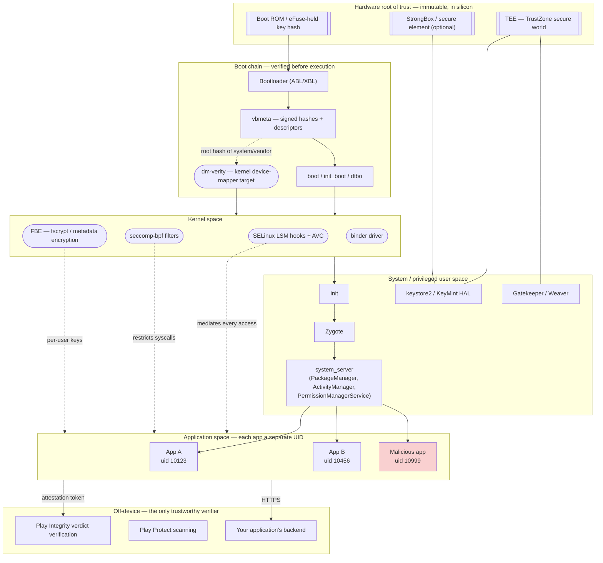

Read this from the bottom of the hardware block upward. The **only** thing in the diagram that an attacker with software access can never modify is the hardware block: the boot ROM's verification routine and the key (or key hash) burned into one-time-programmable fuses. Everything above it is bytes on flash, and bytes on flash can be rewritten by anybody who can talk to the flash controller. The purpose of the boot chain is therefore to extend the trustworthiness of that immutable silicon upward, one signed step at a time, until it reaches the kernel — and then to hand off to `dm-verity`, which extends it *lazily* across the enormous read-only partitions that would take too long to hash all at once.

Once the kernel is running and trusted, three kernel-resident mechanisms enforce isolation between the mutually distrusting processes above: SELinux decides whether a subject may act on an object, seccomp-bpf decides which system calls a process may issue at all, and fscrypt decides whether the bytes on disk are even readable. The `binder` driver is drawn here because it is the one legitimate hole between sandboxes, and therefore the single most important attack surface inside the device — see [25 — Binder](../25-Binder/README.md).

Finally, note the cloud block. It is drawn *outside* every trust boundary on the device on purpose. It is the only participant that an attacker with root on the phone cannot control, and that fact is the whole basis of §3.9.

### 2.2 Trust boundaries, named explicitly

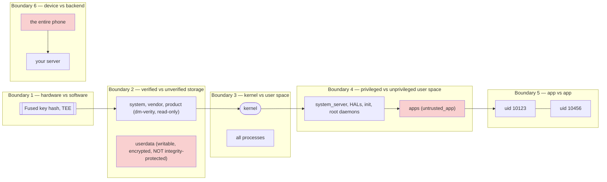

Six boundaries, and each one is crossed by a different class of vulnerability. Boundary 1 is crossed by fault injection and boot ROM bugs, which are the domain of hardware research labs, not application pentests. Boundary 2 is why `/data` is *encrypted but not verified*: nothing stops root from writing to `/data`, so nothing stored there may be trusted for integrity decisions. Boundary 3 is crossed by kernel exploits. Boundary 4 is crossed by privilege escalation through a privileged service — the classic Android local privilege escalation chain. Boundary 5 is the sandbox, covered in [21 — App Sandbox](../21-App-Sandbox/README.md). Boundary 6 is the one that matters commercially, because it is where money moves, and it is the only boundary whose defence does not depend on the phone being honest.

> **⚠️ Warning**
> Note carefully that `/data` (the userdata partition) sits inside the red-shaded box. It is encrypted, so a physical attacker cannot read it, but it is **not** integrity-protected by dm-verity, because it must be writable. Any security decision that relies on a file under `/data` being unmodified is therefore only as strong as the process permissions on that file — which root ignores. This single fact explains why Magisk works, why root detection based on files fails, and why an app's own "integrity flag" stored in SharedPreferences is worthless.

### 2.3 The boot-time sequence

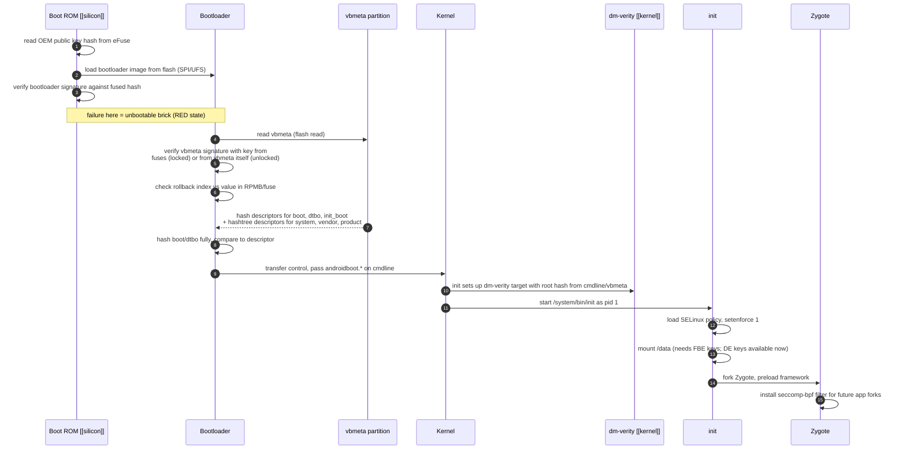

The sequence shows the essential property of a chain of trust: **each stage verifies the next before executing it, and the verification key for stage N+1 is contained in the already-verified stage N.** The chain is anchored in the boot ROM because the boot ROM cannot be rewritten — it is mask ROM, fixed at fabrication — and the key hash lives in electrically-programmable fuses that can be burned once and never unburned.

Two details in this diagram matter enormously to a tester. First, step 6: when the bootloader is *unlocked*, it verifies vbmeta against a key that vbmeta itself carries, which is circular and therefore meaningless as a security control — it becomes a corruption check, not an authenticity check. That is the entire technical content of "unlocking the bootloader breaks Verified Boot". Second, step 8: `dm-verity` verifies the huge read-only partitions *lazily*, block by block, at read time, rather than hashing gigabytes at boot. That design decision is what makes Magisk's systemless approach both possible and necessary, as §3.4 explains.

### 2.4 Where each control lives in the stack

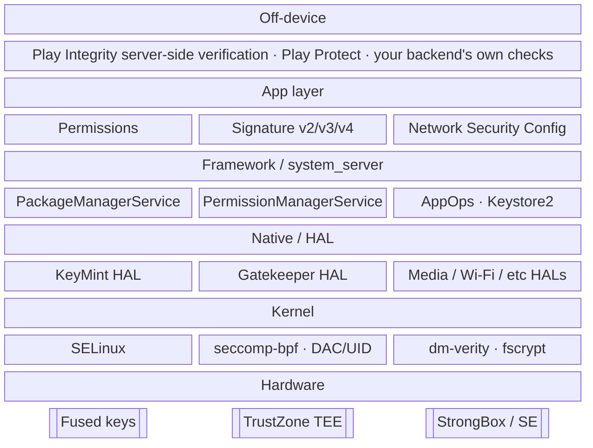

This is the same picture as §2.1, arranged as a layer cake so that you can see which controls are *enforced by* which layer. The rule of thumb is that a control is only as strong as the lowest layer that enforces it. An app's own root detection is enforced at the app layer, so root — which sits below it — defeats it trivially. Key attestation is enforced in hardware, so root cannot forge it. Everything between those two extremes is a judgement call about how much work an attacker must do.

---

## 3. Deep Internal Working

### 3.1 Verified Boot and Android Verified Boot 2.0 (AVB)

#### What problem it solves

Suppose an attacker has your phone for ten minutes — a hotel safe, a border crossing, a repair shop, a colleague's desk. They boot it into the bootloader and flash a system image containing a modified `system_server` that logs every keystroke to a hidden file. They hand the phone back. Nothing on the screen has changed.

This is called an **evil maid attack**, and it defeats every software control on the device simultaneously, because every software control is *part of the software that was replaced*. No app-level check can detect it, because the check runs on top of the compromised platform.

The only defence is to verify software *before* it runs, using a key the attacker cannot substitute. That is Verified Boot.

> **📖 Definition — chain of trust**
> A *chain of trust* is a sequence of stages in which each stage cryptographically verifies the next before transferring control to it. The first link — the *root of trust* — cannot itself be verified by anything earlier, so it must be immutable. On Android that root is the SoC's boot ROM plus a public key (or a hash of one) burned into one-time-programmable fuses at manufacture.

#### AVB 2.0 structure

Android Verified Boot 2.0, usually just called AVB, is the current implementation, present from Android 8.0 onwards on devices launching with it. Its central artefact is the **vbmeta** partition.

`vbmeta` is a small, signed blob. It contains a header, a set of *descriptors*, and a signature over all of it. The descriptors are the interesting part:

| Descriptor type | Purpose | Typical target |
|---|---|---|
| `AvbHashDescriptor` | Full hash of a whole partition, verified in one shot at boot | `boot`, `init_boot`, `dtbo`, `vendor_boot` — small partitions |
| `AvbHashtreeDescriptor` | Root hash and salt of a Merkle hash tree, verified lazily at read time | `system`, `vendor`, `product`, `system_ext` — large partitions |
| `AvbChainPartitionDescriptor` | Delegates verification of another vbmeta to a different public key | `vbmeta_system` (Google-signed) vs `vbmeta_vendor` (OEM-signed) |
| `AvbKernelCmdlineDescriptor` | Kernel command-line fragments to append, notably the dm-verity mapping | `dm="1 vroot none ro 1,0 ... verity ..."` |
| `AvbPropertyDescriptor` | Arbitrary key/value metadata carried in vbmeta | fingerprint, security patch level |

The chain-partition descriptor is worth dwelling on. Project Treble split the Android system into a Google-maintained *system* half and an OEM-maintained *vendor* half so that the system half could be updated independently. AVB mirrors that split: the top-level `vbmeta` can delegate `vbmeta_system` to a key that Google controls and `vbmeta_vendor` to a key the OEM controls. Each half is independently signed and independently updatable, and neither can silently alter the other.

> **🔬 Under the Hood**
> The reference implementation lives in `external/avb/` in AOSP. `libavb` is deliberately written to be embeddable in a bootloader: freestanding C, no libc dependency, with all platform interaction funnelled through an `AvbOps` structure of function pointers (`read_from_partition`, `validate_vbmeta_public_key`, `read_rollback_index`, `write_rollback_index`, `read_is_device_unlocked`). The host-side tool is `external/avb/avbtool.py`, which you can run yourself to inspect an image: `avbtool info_image --image vbmeta.img`. Reading `avbtool.py` is one of the fastest ways to genuinely understand AVB, because the format and the verification logic are both expressed in one readable Python file.

#### Rollback protection

Verifying a signature proves the image is *authentic*. It does not prove the image is *current*. An attacker who obtains a genuine, properly signed old image containing a patched-since vulnerability could flash it and exploit the known bug. This is a **downgrade attack**, and it is one of the most practical attacks against otherwise well-designed verified boot schemes.

AVB defeats it with **rollback indexes**. Each vbmeta carries a `rollback_index` integer, and each signing "location" has a slot in tamper-evident storage. The rule is:

1. At boot, read the stored rollback index for that location from protected storage.
2. If the image's `rollback_index` is *less than* the stored value, refuse to boot.
3. Once the system has booted successfully and marked the slot good, write the image's (higher) index back to protected storage.

The stored value must live somewhere an attacker cannot rewind. In practice that is the **RPMB** (Replay Protected Memory Block) partition of the eMMC/UFS device — a small region that only accepts writes accompanied by an HMAC using a key known to the TEE and the storage controller, with a monotonically increasing write counter to prevent replay — or dedicated fuses, or TEE-owned secure storage.

> **⚠️ Warning**
> Rollback indexes are burned monotonically. On many devices, once the index advances, downgrading to an older firmware becomes permanently impossible even for the legitimate owner with an unlocked bootloader, because the *stored* index is now higher than the old image's. This is the mechanism behind "anti-rollback fuse blown" bricks. If you are building a test device fleet, check the anti-rollback version before you accept an OTA on a device you intend to downgrade later. Getting this wrong destroys the device's usefulness as a research target.

#### The four boot states

The bootloader classifies each boot into one of four states, and this classification is the single most useful piece of information a tester can extract about a device's integrity posture.

| State | Bootloader | Image signed by | User warning | `ro.boot.verifiedbootstate` | What it means to you |
|---|---|---|---|---|---|
| **GREEN** | Locked | OEM key in fuses | None | `green` | Stock, unmodified, fully verified. Key attestation is fully trustworthy. Hardest target. |
| **YELLOW** | Locked | A user-supplied key that the user embedded in the device's key store (`avb_custom_key`) | Warning screen showing the key's SHA-256 fingerprint, several seconds | `yellow` | A custom OS the user explicitly trusted — e.g. GrapheneOS on a Pixel with the bootloader relocked. Verified, but not by the OEM. |
| **ORANGE** | Unlocked | Nothing enforced | "Your device software can't be checked for corruption" warning | `orange` | The normal state of a research device. Verification is informational only. |
| **RED** | Locked | Verification failed | "Your device is corrupt" | `red` | Boot is refused or the device enters a limited recovery. You see this after a botched flash. |

The state is exposed to user space in several places:

```bash
# adb shell — the canonical source, set by the bootloader on the kernel cmdline
getprop ro.boot.verifiedbootstate
getprop ro.boot.flash.locked
getprop ro.boot.veritymode
getprop ro.boot.vbmeta.device_state
getprop ro.boot.vbmeta.digest
getprop ro.boot.vbmeta.invalidate_on_error

# adb shell — the framework-visible derived properties
getprop ro.secure
getprop ro.debuggable
getprop ro.build.type
```

```bash
# adb shell — the raw kernel command line the bootloader handed over
cat /proc/cmdline | tr ' ' '\n' | grep -i -E 'verifiedboot|veritymode|vbmeta|androidboot'
```

> **🔍 Pentester's Note**
> `ro.boot.verifiedbootstate` is set from the kernel command line, which is set by the bootloader. On a device where you control the boot chain — which is exactly a rooted research device — you can also control that property. Magisk's `resetprop` will happily set it to `green`. Therefore: **an app reading this property learns nothing an attacker cannot fake.** It is useful to *you* as an honest observer of your own test device, and useless to a *defender* as an integrity signal. When you find an app whose root detection reads `ro.boot.verifiedbootstate`, that is a finding: the check is trivially defeated and creates a false sense of assurance. The only non-forgeable equivalent is the `deviceLocked` and `verifiedBootState` fields inside a hardware key attestation certificate, because those are populated by the TEE and signed with a key the normal world never sees. See [49 — KeyStore](../49-KeyStore/README.md) and [50 — Hardware-Backed Security](../50-HardwareBackedSecurity/README.md).

#### What unlocking the bootloader actually breaks

Unlocking is not a single switch; it triggers a cascade, and being precise about the cascade is what separates a senior tester from someone repeating folklore.

1. **User data is wiped.** This is mandatory and enforced by the bootloader itself. The rationale is that unlocking removes the protection on data, so the data must not survive the transition. Without this, "unlock, dump `/data`, relock" would be a complete bypass of device encryption.
2. **Verification becomes advisory.** The bootloader still parses vbmeta, but on failure it continues instead of halting, and it accepts the key embedded in vbmeta itself.
3. **The class-3 (hardware) attestation record changes.** `deviceLocked` becomes `false` and `verifiedBootState` becomes `ORANGE` inside every attestation certificate the TEE issues from that point on. The TEE knows the lock state because the bootloader tells it over a channel the normal world cannot forge. **This is the part that cannot be faked in software**, and it is why Play Integrity's `MEETS_STRONG_INTEGRITY` cannot be spoofed on an unlocked device without a TEE compromise or leaked keybox.
4. **Keys bound to the boot state are invalidated.** Keys generated in the Keystore with certain authorisation tags become unusable across the lock-state transition, because the TEE derives key material partly from state that changes.
5. **Some hardware-backed features degrade or disable themselves.** Payment apps, DRM at Widevine L1 (on some devices the provisioning is untouched, on others it drops to L3), and enterprise management may all refuse to operate.

> **🧠 Mental Model**
> Locking the bootloader is a statement by the device owner: "I delegate the decision about what software may run to whoever holds this key." Unlocking withdraws that delegation: "I decide." Verified Boot never stops working — it just stops having an authority to appeal to. This is why the ORANGE warning screen says the software *cannot be checked*, not that it is *bad*.

### 3.2 dm-verity — integrity for partitions too large to hash at boot

#### The problem

The `system` partition is measured in gigabytes. Hashing all of it before handing control to `init` would add tens of seconds to every boot, and a phone that takes forty seconds to boot is a phone nobody buys. Worse, the check would only cover boot time: nothing would stop a runtime modification of a block that has already been read.

#### The mechanism: a Merkle tree

> **📖 Definition — Merkle tree (hash tree)**
> A *Merkle tree* is a tree in which every leaf node is the hash of a data block and every internal node is the hash of its children's hashes concatenated. The single hash at the top — the *root hash* — therefore depends on every byte of the underlying data. Changing one byte anywhere changes the root hash. Crucially, verifying that one specific block is authentic requires only that block plus the sibling hashes along the path to the root: `log(n)` work rather than `n`.

`dm-verity` is a Linux kernel *device-mapper* target. Device-mapper is the kernel framework that lets a virtual block device be constructed from a mapping over a real one — it is the same machinery behind LVM and dm-crypt. The `verity` target presents a read-only virtual block device that, on every block read, walks the hash tree and compares.

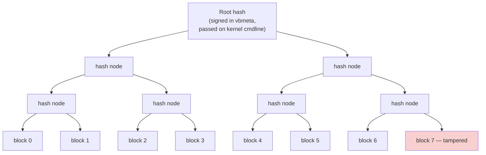

If an attacker modifies block 7, the hash of block 7 changes, so node `L2D` no longer matches, so `L1B` no longer matches, so the root hash no longer matches — and the root hash is inside the signed vbmeta, which the attacker cannot re-sign. The read of block 7 fails. Blocks 0 through 6 still read fine, because their verification paths do not touch the corrupted subtree. Verification is thus **on-demand, per-block, and permanent for the life of the mount**, not a one-time boot check.

The hash tree itself is stored on the device, immediately after the filesystem data, in the same partition or an adjacent one. It costs roughly 0.8% of the partition size for SHA-256 with 4 KiB blocks.

#### Error handling modes

The `dm-verity` target is configured with a policy for what to do when a hash mismatch occurs. Android surfaces this via `ro.boot.veritymode`.

| Mode | Kernel behaviour on mismatch | Android use |
|---|---|---|
| `eio` | The read returns `-EIO`. The process reading gets an I/O error. | Historically used; the process crashes, the device may or may not survive. |
| `restart` (`enforcing`) | The kernel immediately reboots the device, setting a persistent flag so that the next boot enters a corrupted state. | The default for user builds on many devices — a corrupted system reliably fails rather than half-working. |
| `logging` | The mismatch is logged and the read is allowed to succeed. | Used on `userdebug`/`eng` builds, and set by `adb disable-verity`. **No integrity guarantee at all.** |
| `panic` | Kernel panic. | Some vendor configurations. |
| `restart_on_corruption` / `ignore_zero_blocks` / `check_at_most_once` | Tuning options; `check_at_most_once` trades security for performance by caching per-block verification results. | Note that `check_at_most_once` weakens the guarantee for a block that is read twice. |

```bash
# adb shell — what mode is this device in?
getprop ro.boot.veritymode
getprop ro.boot.veritymode.managed
dmesg | grep -i verity
ls -l /dev/block/mapper/
```

```bash
# host — on a userdebug/eng build with an unlocked bootloader only
adb root
adb disable-verity      # sets logging mode; requires a reboot
adb reboot
adb remount             # now /system can be mounted read-write
```

> **⚠️ Warning**
> `adb disable-verity` followed by `adb remount` is the classic way to get a writable `/system` on an engineering device, and it is also a complete removal of the integrity guarantee for that partition. It requires an unlocked bootloader and a build that permits it. On a production, locked device it simply fails — and that failure is the control working as designed. If you are asked to test "whether the system partition can be modified", the honest answer for a GREEN-state device is that it cannot be, without first unlocking, which wipes the device.

#### Why dm-verity forced Magisk to be "systemless"

Before dm-verity, rooting meant copying an `su` binary to `/system/xbin/su` and setting the setuid bit. That is a write to a dm-verity-protected partition, so on any modern device it produces exactly one of two outcomes: the write fails because the partition is mounted read-only, or — if the attacker somehow wrote directly to the underlying block device — the device refuses to boot or throws I/O errors the moment that block is read.

Magisk's answer is to **never modify a verified partition**. Instead it patches the `boot` image (or `init_boot` on newer devices), which contains the ramdisk and thus `init`, and from there uses **bind mounts** and, on modern versions, an OverlayFS-like arrangement to make modified files *appear* at paths under `/system` without a single byte of the `system` partition changing. The underlying blocks still hash correctly. dm-verity is perfectly satisfied, because dm-verity's job is to protect the *partition*, and the partition is untouched — what changed is the *mount namespace* that processes see.

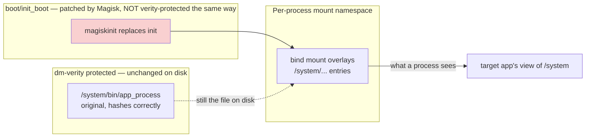

The consequence for a tester is precise and important: **on a Magisk-rooted device, hashing a file under `/system` from user space and comparing to a known-good value may or may not detect the modification, depending on which mount namespace the checking process is in.** This is exactly why MagiskHide (historically) and DenyList (currently) work by *unmounting* the overlays in the target process's namespace before the app starts. See [62 — Magisk](../62-Magisk/README.md).

### 3.3 fs-verity — the same idea, applied to individual files

dm-verity protects whole read-only partitions. It cannot protect a file in `/data`, because `/data` must be writable and its contents differ per device.

**fs-verity** is a kernel feature (in ext4 and f2fs) that applies the Merkle-tree idea to a *single file*. Once fs-verity is enabled on a file, the file becomes immutable, the kernel builds and stores a hash tree for it, and every subsequent read is verified against the tree's root. The root hash can be signed, and the kernel can be configured to require a valid signature from a key in a dedicated keyring.

Android uses this for APKs and their associated files. From Android 11 onwards, installed APKs — particularly those installed from Google Play with an accompanying signature — can have fs-verity enabled so that a later modification of the APK bytes on disk is detected by the kernel at read time rather than by an application-level check that root could skip. It is also the mechanism behind **APK Signature Scheme v4**, where a `.apk.idsig` file carries the Merkle tree root and signature separately from the APK, enabling incremental installation: the system can start running an app before the whole APK has downloaded, verifying each block as it arrives.

```bash
# adb shell — check whether fs-verity is enabled on a file (needs a recent toybox/util)
# The 'V' attribute in lsattr output indicates fs-verity
lsattr /data/app/~~*/com.example.app-*/base.apk 2>/dev/null

# adb shell — the v4 signature file lives next to the APK
ls -la /data/app/~~*/com.example.app-*/
```

> **🔬 Under the Hood**
> The relevant AOSP and kernel pieces are `fs/verity/` in the kernel tree, `system/security/fsverity_init/` and `system/apex/apexd/` for APEX verification, and the framework side in `frameworks/base/services/core/java/com/android/server/security/` for the verity job. APK Signature Scheme v4 is documented in `tools/apksig/` and implemented alongside v2/v3 in the same library. See [10 — APK Internals](../10-APK-Internals/README.md) for the full signature scheme comparison.

**How it actually works, step by step.** The mechanism is worth knowing in detail, because its properties are unusual and testers routinely mis-state them.

1. A process opens the file and issues the `FS_IOC_ENABLE_VERITY` ioctl, optionally supplying a signature over the file's Merkle-tree root.
2. The kernel reads the whole file **once**, builds a Merkle tree over it (SHA-256 over 4 KiB blocks by default, same shape as dm-verity), and stores the tree in filesystem metadata past the end of the visible file — invisible to `read()`, counted in the block usage, absent from `stat()`'s size.
3. From that moment the file is **permanently immutable**. Not "read-only by permission" — immutable. `chmod`, `chown` and `O_TRUNC` cannot restore writability, and even root cannot open it for writing. The only way back is to delete it.
4. Every subsequent `read()` is verified against the tree, lazily, block by block, in the page-cache fault path. A modified block returns `EIO` to the reader.

Three consequences a tester should be able to state:

- **The verification is in the kernel, so it survives the attacker being in userspace.** An app-level "hash my own APK" check runs in a process the adversary controls and can be hooked; the fs-verity check runs in the read path itself. That is a real difference in kind, and it is the reason APK Signature Scheme v4 exists.
- **It does not survive the attacker being in the kernel.** Root that can load a module, or a rooting stack that patched the kernel, is above this control entirely. fs-verity raises the bar from "hook a Java method" to "modify the kernel", which is a meaningful jump and not an absolute.
- **It protects integrity, never confidentiality.** The bytes are readable; they simply cannot be changed. This is the same distinction as dm-verity and the same one people get wrong about app signing.

The `deny_list` cases matter too. Because enabling verity makes the file immutable, Android only enables it where immutability is acceptable — installed APKs and their split/asset files, and APEX payloads. It is not used for app-writable data in `/data/data`, and no app API exposes it for arbitrary files.

```bash
# adb shell — is the runtime capable of it at all? (needs root to read sysfs here)
su -c 'cat /sys/fs/f2fs/*/features' 2>/dev/null | tr ',' '\n' | grep -i verity
su -c 'ls /proc/sys/fs/verity/' 2>/dev/null      # require_signatures, if the kernel exposes it

# adb shell — the v4 signature file, if the app was installed with one
ls -la /data/app/~~*/com.example.app-*/ | grep idsig
```

> **🔍 Pentester's Note**
> If an APK carries a `.apk.idsig` and fs-verity is enabled on it, the classic repackaging workflow — pull `base.apk`, patch, push it back over the original — fails at the *filesystem* layer rather than at the signature-check layer, and the error you get (`EIO`, or a refusal to write at all) looks nothing like a signature failure. Recognise the symptom. The workaround is the ordinary one: uninstall and install your rebuilt APK as a new file, which loses the app's data and its v4 signature and is therefore *visible* to any server-side check the app performs. That visibility is exactly the point of the control.

### 3.4 File-Based Encryption, Direct Boot, and the credential chain

#### From FDE to FBE

The first Android disk encryption, introduced in 3.0 and made viable in 4.4, was **Full Disk Encryption (FDE)**: a single dm-crypt layer over the entire `userdata` partition with a single key, derived from the user's PIN or password (via `scrypt`) and further bound to hardware via a signature from the TEE.

FDE had one architectural flaw that eventually killed it. Because there is exactly one key and it is derived from the user credential, **nothing on `/data` is readable until the user has typed their credential.** After a reboot — say, at 3 a.m. because of an OTA — the phone could not decrypt anything, so it could not show the user's alarm clock, could not accept incoming calls with the caller's name, could not run accessibility services, and could not deliver messages. The device was a brick until unlocked. Android worked around this with a "default password" mode when no lock screen was set, which is exactly as weak as it sounds.

**File-Based Encryption (FBE)**, introduced in Android 7.0 and mandatory for devices launching with Android 10 and later, solves this by using *multiple* keys with different availability, encrypting file *contents* and file *names* individually rather than encrypting the block device.

| Class | Full name | Key available | Typical contents | Path |
|---|---|---|---|---|
| **DE** | Device Encrypted | From boot, before first unlock | Alarm clock data, telephony, accessibility services, the launcher's minimal state, anything Direct Boot aware | `/data/user_de/<userId>/<pkg>/` |
| **CE** | Credential Encrypted | Only after the user has unlocked at least once since boot | Everything else — the app's real data directory | `/data/user/<userId>/<pkg>/` (symlinked from `/data/data/<pkg>` for user 0) |

> **📖 Definition — Direct Boot**
> *Direct Boot* is the mode a device is in after booting but before the user has entered their credential for the first time. In this mode only device-encrypted storage is available. An app declares itself able to run in this state with `android:directBootAware="true"` on its components, and it must then confine itself to `Context.createDeviceProtectedStorageContext()` for any storage access.

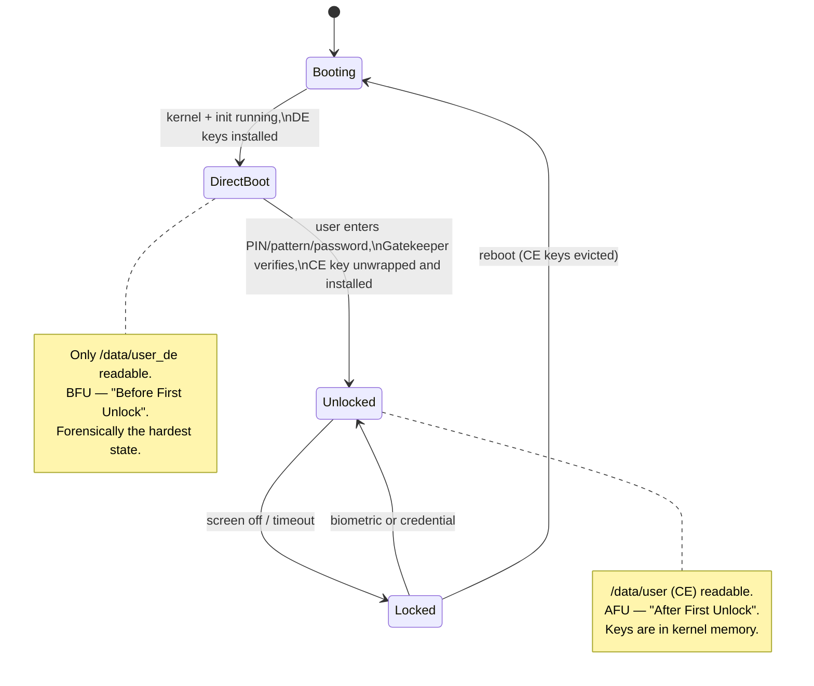

The two acronyms in that diagram — **BFU** (Before First Unlock) and **AFU** (After First Unlock) — are the vocabulary of mobile forensics, and they describe the single most important variable in how much data can be recovered from a seized device. In BFU, the CE keys do not exist anywhere in RAM; recovering user data requires breaking the credential, which is throttled by hardware. In AFU, the keys are resident in kernel memory, so any kernel-level compromise yields plaintext. This is why forensic labs keep seized phones charged and powered on, and why "reboot the phone before it is seized" is meaningful advice.

#### How the key is actually derived

This is the part most write-ups skip, and it is where the real security lives.

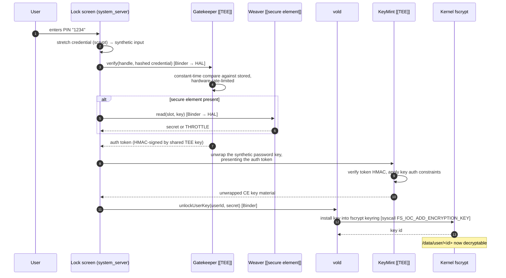

The essential properties are:

- **The credential never becomes the key directly.** It is stretched and then used to *authorise* the TEE to release or unwrap key material that is itself bound to hardware. This means a brute-force attempt cannot be done offline on a copy of the flash — the attacker must go through the TEE, which enforces rate limiting.
- **Gatekeeper** runs in the TEE, stores a password handle, and implements exponentially increasing throttling on failed attempts. Because the throttling state lives in secure storage, rebooting does not reset it.
- **Weaver**, present on devices with a discrete secure element such as the Pixel's Titan M, goes further: it stores a high-entropy secret in the secure element, keyed by the credential, and the secure element enforces the throttling with its own independent timer and its own tamper-resistant storage. Weaver's throttling cannot be bypassed even by a full TEE compromise, which is why it exists.
- **Metadata encryption** covers the parts of `/data` that FBE cannot: directory structure, file sizes, and everything outside per-file encryption. It is a dm-crypt layer under the whole partition using a key available at boot (device-bound, not credential-bound), so it protects against an offline attacker reading structure but does not protect against an attacker who can boot the device.

> **🔬 Under the Hood**
> The relevant AOSP paths are `system/vold/` (the volume daemon that owns encryption operations), `system/gatekeeper/` (the Gatekeeper reference implementation and HAL interface), `hardware/interfaces/gatekeeper/` and `hardware/interfaces/weaver/` (the HAL definitions), `frameworks/base/services/core/java/com/android/server/locksettings/` (LockSettingsService, the synthetic password implementation, and the SP-based key hierarchy), and `fs/crypto/` in the kernel for fscrypt itself. The *synthetic password* design — where the user credential protects a randomly generated synthetic password which in turn protects everything else — is what makes it possible to change the PIN without re-encrypting all data, and it is worth reading `LockSettingsService` and `SyntheticPasswordManager` to see it done properly.

> **🔍 Pentester's Note**
> During an application test you will rarely attack FBE itself. What you *will* do is check whether the app's threat model assumes it. An app that stores a long-lived refresh token in `SharedPreferences` is relying entirely on FBE plus the sandbox. That is a defensible position on a locked, non-rooted device and an indefensible one if the device is rooted or the token has no server-side binding. Say so in those terms — cite the assumption, not just the storage location. See [33 — Storage](../33-Storage/README.md) and [46 — Tokens](../46-Tokens/README.md).

### 3.5 The Trusted Execution Environment, in outline

> **📖 Definition — Trusted Execution Environment (TEE)**
> A *TEE* is a second, isolated execution environment on the same physical processor, with its own memory that the main ("normal world") operating system cannot read or write, even from kernel mode. On ARM this is implemented by **TrustZone**, which adds an "NS" (non-secure) bit propagated through the bus fabric so that memory and peripherals can be partitioned in hardware. Code in the secure world runs a small trusted OS — Qualcomm's QSEE, Trusty (AOSP's own), Kinibi, and others.

The TEE matters to this chapter for four reasons, each covered in depth in [50 — Hardware-Backed Security](../50-HardwareBackedSecurity/README.md):

1. **It holds keys the normal world can never see.** A Keystore key marked as hardware-backed exists only inside the TEE; the app receives an opaque handle and asks the TEE to perform operations with it.
2. **It performs key attestation.** The TEE signs a certificate describing a key and the device state — including `verifiedBootState`, `deviceLocked`, and the OS patch level — using a key provisioned at manufacture whose chain terminates at a Google root. Root on the phone cannot forge this.
3. **It runs Gatekeeper and the biometric matcher**, so that credential verification and fingerprint template matching cannot be observed or bypassed by the normal-world kernel.
4. **It is the anchor for Play Integrity's strongest verdict.**

**StrongBox** is a step further: a physically separate secure element with its own CPU, RAM, and flash, with hardened defences against side-channel and fault-injection attacks. On a Pixel this is the Titan M chip. A key generated with `setIsStrongBoxBacked(true)` lives there.

#### 3.5.1 How the world switch actually happens

The word "isolated" does a lot of work above, so here is the mechanism, because it explains what the isolation can and cannot do.

TrustZone adds a single bit — **NS**, non-secure — to every bus transaction. The CPU is in one of two states, and the bit is asserted on memory and peripheral accesses accordingly. A memory controller configured to refuse NS=1 access to a physical range makes that range invisible to the normal world **including its kernel**, because the enforcement is in the bus fabric rather than in a page table the kernel owns.

Crossing between worlds is a deliberate, narrow act:

1. Normal-world code executes the **`SMC`** (Secure Monitor Call) instruction with arguments in registers.
2. The CPU traps to EL3, the **Secure Monitor**, which is the only code that can change the NS bit. It saves normal-world state and switches.
3. The secure OS (Trusty, QSEE, Kinibi, TEEGRIS) dispatches to a trusted application — the KeyMint TA, the Gatekeeper TA, the biometric matcher.
4. Results come back through shared, non-secure memory; the secure world reads normal-world memory freely, and the normal world cannot read back.

Note the asymmetry in step 4. **The TEE can read your memory; you cannot read its.** That asymmetry is what lets it validate a request without trusting the requester, and it is also why the attack surface a TEE presents is its *parsing of normal-world input* — which is where TEE vulnerability research overwhelmingly concentrates.

#### 3.5.2 Four things measured on real devices that contradict the documentation

The TEE is where the gap between what is documented and what is shipped is widest, because the implementation is the SoC vendor's and the documentation is Google's. Each of the following was measured on hardware while writing [50 — Hardware-Backed Security](../50-HardwareBackedSecurity/README.md) and [49 — KeyStore](../49-KeyStore/README.md):

| Expectation | What a device actually did |
|---|---|
| Android 13 implies KeyMint | An Android 13 device ran `keymaster@4.1-service.beanpod` — **legacy HIDL Keymaster** — behind `keystore2` via the `android.security.compat` shim. **Do not infer the KeyMint version from the OS version;** read the HAL |
| The hardware rejects RSA-1024 as too weak | It was accepted. [49 §3.5.1](../49-KeyStore/README.md) had hedged this as "should be rejected, but check". It was checked; it is not rejected |
| `setMaxUsageCount` works at its documented API level | Threw `NoSuchMethodError` on an API 30 device at exactly its documented level, confirmed independently by Frida method enumeration |
| A verifying attestation chain proves hardware backing | On an emulator, every key is `SOFTWARE`, `hardwareEnforced` is empty — **and the chain still verifies perfectly.** A valid chain proves the chain, not the hardware. You must read the security level out of the extension, not infer it from validity |

> **🔬 Under the Hood — the measurement that anchors this whole chapter**
> On the rooted Redmi this repository tests against, `ro.boot.verifiedbootstate` reads `green`. Seconds later, on the same device, a TEE-signed key attestation reported `verifiedBootState=Unverified`, `deviceLocked=false` and an all-zero `verifiedBootKey`.
>
> **The property lies; the hardware does not.** That is not an argument, it is two readings a minute apart, and it is the entire practical case for attestation over property inspection. Any integrity check reading `getprop` is reading attacker-controlled data — §4.5 shows exactly why, by tracing where the value physically lives at read time.

#### 3.5.3 What the TEE does *not* give you

Testers over-credit the TEE almost as often as they under-credit it, so be precise:

- **It does not prove an app is unmodified.** Attestation describes the *key* and the *device*, not the caller. A repackaged app on a clean device produces a perfect attestation. Binding the app's identity requires app signing plus a server-side check of the attestation's package fields where the KeyMint version populates them.
- **It does not stop the key being *used* by an attacker with root**, unless the key requires user authentication. Root cannot extract the key; it can absolutely ask the TEE to sign whatever it likes with it. `setUserAuthenticationRequired(true)` is what changes that, and it is the single most under-used flag in `KeyGenParameterSpec`.
- **It is not uniformly implemented.** StrongBox is absent on most non-Pixel devices; `isInsideSecureHardware()` and the `securityLevel` field in the attestation extension are the only honest way to find out, and they must be read on the server.
- **It is not invulnerable.** Trusted OS implementations are large C codebases parsing attacker-shaped input across a privilege boundary, and the research record reflects that. Treat it as the strongest thing available on the device, not as an axiom.

### 3.6 Play Integrity API — what it is and where the trust sits

#### History and the problem

Android has always had the problem that an app cannot trust the device it runs on. Google's first answer, **SafetyNet Attestation**, launched in 2015 and produced a JWS-signed response with two booleans: `basicIntegrity` and `ctsProfileMatch`. It was deprecated and, in 2024–2025, fully retired in favour of the **Play Integrity API**.

Play Integrity produces a token that, when decoded server-side, contains several verdicts.

| Verdict field | Values | Meaning |
|---|---|---|
| `deviceIntegrity.deviceRecognitionVerdict` | `MEETS_BASIC_INTEGRITY` | The device passes basic checks — it looks like an Android device and is not obviously tampered — but may be uncertified, unlocked, or emulated. |
| | `MEETS_DEVICE_INTEGRITY` | The app is running on a genuine Play-certified Android device that passes integrity checks. |
| | `MEETS_STRONG_INTEGRITY` | As above, plus a strong hardware-backed guarantee and a recent boot, based on hardware attestation. |
| | `MEETS_VIRTUAL_INTEGRITY` | Running on a Google-run Android emulator that passes integrity checks (opt-in, useful for testing). |
| | *(empty array)* | None of the above — rooted, unlocked, emulated, or otherwise failing. **An empty set is a signal, not an error.** |
| `appIntegrity.appRecognitionVerdict` | `PLAY_RECOGNIZED` / `UNRECOGNIZED_VERSION` / `UNEVALUATED` | Whether the running APK is a binary Play distributed for this package, matched by certificate and version. |
| `accountDetails.appLicensingVerdict` | `LICENSED` / `UNLICENSED` / `UNEVALUATED` | Whether the Play account has an entitlement to this app. |
| `environmentDetails.playProtectVerdict` | `NO_ISSUES` / `NO_DATA` / `POSSIBLE_RISK` / `MEDIUM_RISK` / `HIGH_RISK` | Play Protect's view of the device's installed apps. |
| `environmentDetails.appAccessRiskVerdict` | `KNOWN_INSTALLED` / `UNKNOWN_INSTALLED` / `UNKNOWN_CAPTURING` / `UNKNOWN_OVERLAYS` | Whether apps capable of screen capture or overlay are running — the accessibility/overlay abuse signal. |
| `requestDetails` | `requestPackageName`, `timestampMillis`, `nonce` / `requestHash` | Binding of the token to *your* request. |

#### Hardware-backed versus basic evaluation

`MEETS_DEVICE_INTEGRITY` on a modern device is backed by hardware key attestation: Play services asks the TEE to sign a statement, and Google's servers verify the certificate chain against the manufacturer's provisioned keys. On older devices without adequate hardware support it falls back to a software evaluation, which is weaker.

`MEETS_STRONG_INTEGRITY` additionally requires a hardware-backed proof of boot integrity and a device that has booted recently with a valid, current security state. This is the verdict that an unlocked bootloader cannot produce, because — as established in §3.1 — the attestation record's `deviceLocked` field is populated by the TEE.

#### Where the trust actually sits — the only paragraph that matters

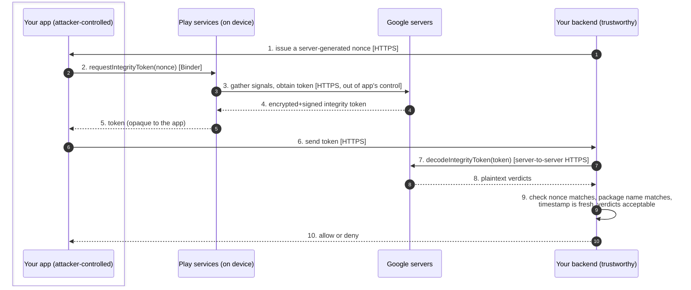

Every arrow that touches the app is attacker-controlled. The app cannot be trusted to *interpret* the token, to *check* it, or to *act* on the result. An attacker with Frida simply changes what step 10's response is treated as, or removes the call entirely.

The three steps that carry actual security weight are 1, 7, and 9:

- **Step 1 — the nonce must come from your server.** If the app generates the nonce, an attacker replays a token captured from a clean device forever. The nonce must be unpredictable, single-use, and tied to the specific operation being authorised.
- **Step 7 — decoding must happen server-side.** Google offers on-device "classic" decryption using keys you hold; do not use it for security decisions, because the decryption then happens inside the attacker's process.
- **Step 9 — your server must check the bindings.** `requestPackageName` must equal your package. The nonce must be the one you issued. The timestamp must be recent (minutes, not hours). If you skip these, an attacker takes a valid token from *their own* legitimate installation and replays it into *your* flow.

> **🔍 Pentester's Note**
> This produces one of the most reliable findings you will ever write. Test it in this order. (a) Hook the app's integrity code with Frida and force the "success" path — if the app proceeds, the check is client-side only, which is a high-severity finding. (b) Capture a valid token and replay it twice — if both succeed, the nonce is not single-use. (c) Capture a token from a *different* app that uses Play Integrity and submit it — if the backend accepts it, `requestPackageName` is unchecked, which is critical. (d) Wait an hour and replay — if it still works, there is no freshness window. Each of these is a separate, demonstrable finding with a clean remediation, and together they are worth more to a client than a hundred lines of "the app can be rooted".

> **⚠️ Warning**
> Do not write in a report that Play Integrity "cannot be bypassed". On devices with leaked or stolen TEE keyboxes, and through hardware attestation spoofing modules, `MEETS_DEVICE_INTEGRITY` has been produced on modified devices. Google revokes known-abused keyboxes, which turns it into a cat-and-mouse game. The accurate statement is: *Play Integrity substantially raises the cost of running on a modified device, and correctly implemented server-side verification makes casual bypass impractical; it is not a guarantee, and it must never be the only control protecting a security decision.*

### 3.7 Google Play Protect

Play Protect is the on-device and cloud malware defence built into Play services. It has three distinct functions that are often conflated:

1. **Scanning at install time and periodically thereafter**, including apps sideloaded from outside Play. It computes hashes and behavioural signals and checks them against Google's classification service.
2. **Real-time scanning** of never-before-seen sideloaded apps, added in recent versions, where an unrecognised APK is uploaded for analysis before the install is allowed to proceed.
3. **Remote disable and removal** of applications classified as Potentially Harmful Applications (PHAs), a capability that reaches devices even outside Play.

For a tester, Play Protect matters in two ways. It will flag and sometimes block your deliberately-vulnerable test apps and your Frida gadget-injected APKs, which is an operational nuisance solved by disabling it on the test device. And its verdict is surfaced in Play Integrity's `environmentDetails.playProtectVerdict`, so an app may make decisions based on it.

```bash
# adb shell — check Play Protect state (verify-apps)
settings get global package_verifier_user_consent
settings get global verifier_verify_adb_installs

# adb shell — on a research device, disable verification of adb installs
settings put global verifier_verify_adb_installs 0
```

### 3.8 The updateability story — Mainline, APEX, and patch level

#### The problem Android had

Android's original update model required every fix to travel from AOSP, to the silicon vendor, to the OEM, to the carrier, and finally to the device. Each hop added weeks or months, and each hop could drop the update entirely. A serious vulnerability could remain exploitable on the majority of devices a year after it was patched in AOSP. This — not any particular bug — was Android's biggest security weakness for most of its life.

#### Monthly security bulletins

Google publishes an Android Security Bulletin on the first Tuesday of each month, listing CVEs with severity ratings and the affected components, and defines two patch level strings: one covering framework and system fixes (`YYYY-MM-01`) and one additionally covering kernel and vendor fixes (`YYYY-MM-05`). A device claiming a given patch level asserts it has all fixes published up to that date.

```bash
# adb shell — the single most useful device-posture command
getprop ro.build.version.security_patch
getprop ro.vendor.build.security_patch
getprop ro.build.version.release
getprop ro.build.version.sdk
getprop ro.build.fingerprint
```

> **🔍 Pentester's Note**
> Report the patch level as a *date delta*, not a date. "The device under test reports a security patch level of 2023-08-01, meaning it is missing approximately 24 months of published Android security fixes, including *n* critical-severity remote code execution issues" is a finding a client can act on. "Patch level 2023-08-01" is a fact nobody will read. When the target is a corporate-managed fleet, this single line often has more real-world impact than anything you find in the app.

#### Project Mainline and APEX

From Android 10, Google made about two dozen core components updatable directly through Google Play, bypassing the OEM entirely. The delivery format is **APEX** (Android Pony EXpress), a container similar in spirit to an APK but designed to hold native libraries, HAL implementations, and system services, mounted as a loopback filesystem at `/apex/<name>/`.

| Mainline module (examples) | Why it matters to security |
|---|---|
| `com.android.media` / `com.android.media.swcodec` | The media parsers — historically the single richest source of remote code execution bugs on Android. |
| `com.android.conscrypt` | The TLS stack. A TLS bug can now be fixed in days rather than a year. |
| `com.android.runtime` | ART itself. |
| `com.android.tethering` | Network stack components. |
| `com.android.permission` | The permission controller UI and logic. |
| `com.android.wifi` | Wi-Fi stack. |
| `com.android.adbd` | The adb daemon. |

Each APEX is signed, verified with AVB-style hashtree descriptors at mount time, and rolled back automatically if the device fails to boot after an update.

```bash
# adb shell — enumerate installed mainline modules and their versions
ls /apex/
cmd package list packages --apex-only
pm list packages --apex-only -f
```

> **⚠️ Warning**
> Because Mainline modules update independently, `ro.build.version.security_patch` no longer tells the whole story. A device may report an old vendor patch level while having a fully current media stack, or the reverse. When assessing a device, check both the property *and* the APEX module versions, and note in your report which components are covered by which update path.

### 3.9 Synthesis — what is actually attackable in a typical engagement

Everything above describes a platform that is, by the standards of consumer computing, extraordinarily well defended. So where does the work actually happen?

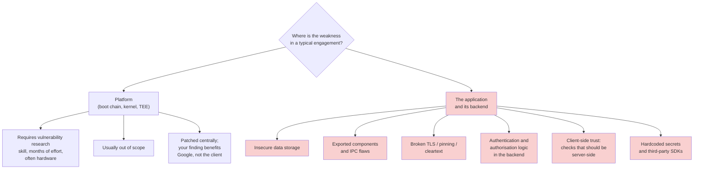

The reason is structural, not accidental. **Google spends enormous resources hardening the platform, and every platform fix ships to a billion devices. Nobody but the app's own team hardens the app.** The platform is a shared, heavily-audited, centrally-patched artefact. The app is a bespoke artefact written under commercial deadline pressure by developers whose primary objective was shipping a feature.

Concretely, in a typical two-week mobile application engagement:

| Where you will find issues | Roughly how often | Why the platform does not save the app |
|---|---|---|
| Server-side authorisation flaws reached through the app's API | Very often | The sandbox protects apps from each other; it says nothing about whether the server checks that user A may read user B's record. |
| Sensitive data in local storage without adequate binding | Very often | FBE protects a locked device. It does nothing on a rooted or AFU device. |
| Insecure IPC — exported activities, services, providers, broadcast receivers | Often | These are holes the developer deliberately punched in the sandbox. See [24 — IPC](../24-IPC/README.md) onwards. |
| Client-side-only security decisions (root/jailbreak checks, feature flags, price calculations, entitlement checks) | Often | Nothing in the platform prevents an app from trusting its own process, which the user controls. |
| Certificate validation and pinning weaknesses | Often | Network Security Config helps, but a custom `TrustManager` overrides it. See [35 — SSL](../35-SSL/README.md), [36 — Certificate Pinning](../36-CertificatePinning/README.md). |
| Hardcoded API keys and secrets in the APK or `.so` | Often | Signature verification proves the APK is unmodified; it does not hide its contents. |
| Third-party SDK behaviour — data exfiltration, weak crypto, extra permissions | Often | The SDK runs with the app's UID and all of its permissions. |
| Platform vulnerabilities | Rarely, and usually out of scope | Requires different skills and a different engagement type. See [70 — Vulnerability Research](../70-VulnerabilityResearch/README.md). |

> **🧠 Mental Model**
> The platform's job is to make sure that *the app's mistakes hurt only the app's users*. It succeeds at that. It was never designed to prevent the app from making mistakes. Your job on an application engagement is to find the mistakes; your job when you are asked "is Android secure" is to explain that the question has six different answers depending on which adversary from §1.4 is being asked about.

### 3.10 Establishing ground truth — verifying the boot chain from outside the app

§3.9 concludes that an application cannot establish the truth about its own environment. That is a statement about the *app*, and it is often mis-generalised into "nobody can know without a TEE". **You can know.** As the tester, you hold a privilege the app does not — root on the device you are testing — and the manufacturer has already published, in signed form, exactly what every partition should contain. This section is the technique, and it is the backbone of [Lab 02](labs/lab-02-vbmeta-and-verified-boot.md).

The insight is small and easy to miss: **`vbmeta` is a signed manifest that stays on the device after the bootloader has finished with it.** The bootloader's job was to compare the partitions against that manifest at boot. On an unlocked device it skipped the comparison — but the manifest is still sitting in the `vbmeta` partition, and the partitions are still readable block devices. Nothing stops you from doing the comparison the bootloader declined to do.

**Three independent routes to the same answer, in increasing order of what they cost you.**

| # | Route | What you need | What it proves | Defeatable by a root module? |
|---|---|---|---|---|
| 1 | Compare `/proc/cmdline` against the `ro.boot.*` properties | Root, or membership of group `radio` | That some component rewrote a property after `init` read it | Yes, in principle — a module that also patches the kernel's cmdline presentation. In practice, no module bothers |
| 2 | Hash a partition and compare against its vbmeta hash descriptor | Root | That a partition's *bytes* differ from the signed manifest | Only by also re-signing vbmeta, which requires the OEM key |
| 3 | Read `verifiedBootState` out of a hardware key attestation | **Nothing** — any app can ask | That the TEE, which the normal world cannot write, saw an unverified boot | No |

Route 3 is the strongest and is covered in [50 — Hardware-Backed Security](../50-HardwareBackedSecurity/README.md). Routes 1 and 2 matter because they are things you can *demonstrate on a client's own hardware in front of them*, with no cryptography lecture and no dependency on Google's infrastructure.

#### 3.10.1 Route 1 — the property and its own origin, side by side

Every `ro.boot.*` property was copied by `init` from the kernel command line. So the same claim exists twice, and a root module that rewrites one and not the other leaves a visible seam.

```bash
# adb shell — the property, as any app sees it
getprop ro.boot.verifiedbootstate
getprop ro.boot.vbmeta.device_state

# adb shell — the origin, as the bootloader wrote it (needs root or group radio)
su -c 'cat /proc/cmdline' | tr ' ' '\n' | grep -E 'androidboot\.(verifiedbootstate|vbmeta)'
```

Measured on the rooted Redmi `M2101K6P` this repository tests against:

```text
getprop ro.boot.verifiedbootstate     ->  green
getprop ro.boot.vbmeta.device_state   ->  locked
getprop ro.boot.flash.locked          ->  1

androidboot.verifiedbootstate=orange
androidboot.vbmeta.device_state=unlocked
androidboot.vbmeta.digest=e8ff1960b98291b6a5ee5ffba80da2be5cdde2594a5a79966871675a47abe7d3
androidboot.veritymode=enforcing
```

The bootloader said **`orange`** — unlocked, nothing verified. The property says **`green`**. `resetprop` (Magisk) or its APatch equivalent rewrote the shared property region after `init` had populated it, and every app on the device now reads the rewritten value.

Two details in that output are worth more than the headline.

- **The forgery is targeted.** `vbmeta.digest` and `veritymode` came through untouched. Whoever built the module changed exactly the three fields detection code reads and left the rest, because every extra edit is another chance to be caught in an inconsistency. Expect this. Do not conclude that a device failing one check has failed them all.
- **An ordinary app cannot perform this cross-check at all.** `/proc/cmdline` on this device is `-r--r----- root radio`, and an app is neither. So the seam is visible to *you* and invisible to the app that most needs to see it — which is a compact statement of why client-side integrity checking is structurally lost.

> **⚠️ Common Confusion — there is a fifth value, and it is the empty string.**
> The table in §3.1 lists `green`, `yellow`, `orange`, `red`. On an emulator there is a **fifth
> case: no value at all.** Measured on `sdk_gphone16k_x86_64` (Android 15 / API 35), independently
> re-verified:
>
> ```text
> getprop ro.boot.verifiedbootstate   ->  (empty string)
> getprop ro.boot.flash.locked        ->  (empty string)
> getprop ro.boot.veritymode          ->  enforcing
> ```
>
> The cause is structural rather than accidental: the emulator has no bootloader, so nothing ever
> sets `androidboot.verifiedbootstate` on the kernel command line, and `init` has nothing to
> populate the property from. [61-Fastboot](../61-Fastboot/README.md) demonstrates the absence three
> independent ways — no `misc` partition, no `boot`/`recovery` partition, no boot control HAL.
>
> **This inverts the most common way the check is written.** A detector that reasons *"not orange,
> therefore fine"* —
>
> ```java
> String state = SystemProperties.get("ro.boot.verifiedbootstate", "");
> if (!"orange".equals(state)) { /* treated as trustworthy */ }
> ```
>
> — evaluates `!"orange".equals("")`, which is **`true`**. The device with the *least* verified boot
> in existence passes. Note also that `veritymode` still reads `enforcing`, so a check reading that
> property instead is misled in the same direction.
>
> Compare the three states this repo has now measured for one property: **`green` on a rooted phone
> whose TEE simultaneously attested `Unverified`** (§3.5.2), **`orange` on the kernel command line
> while the property said `green`** (immediately above), and **empty on an emulator**. In all three
> the property is the least trustworthy of the available sources. Allow-list the good values —
> `"green".equals(state)` — never deny-list the bad ones.

#### 3.10.2 Route 2 — hash the partition against its own signed manifest

`vbmeta`'s hash descriptors state, for each small partition, the exact digest of its first *Image Size* bytes, computed as `H(salt ‖ data)`. Read the descriptor, read the partition, hash, compare.

```bash
# adb shell — dump vbmeta (non-destructive: block device is the INPUT)
su -c 'dd if=/dev/block/by-name/vbmeta of=/data/local/tmp/vbmeta.img bs=4096 count=32'
```
```bash
# host — parse it with the chapter's own parser; no avbtool, no network
adb pull /data/local/tmp/vbmeta.img
python3 -B scripts/parse-vbmeta.py vbmeta.img
```

The `boot` hash descriptor from that device:

```text
  [12] Hash descriptor   (tag 2, at file offset 0x948)
      Partition Name          : boot
      Image Size              : 21880832 bytes
      Hash Algorithm          : sha256
      Salt                    : 4d6bf69daa8e967133b5cc96e9d62415b1e09b7bd7ca2ba7ccf97533b47021b8
      Digest                  : 9895a0e21db8565ddd295e125b6613f62de390c22e9063748487f6e0c01b7b70
```

`21880832 / 4096 = 5342` exactly, so the check is one command. Hash on the device — only the 32-byte answer needs to cross the cable:

```bash
# adb shell — salt.bin holds the 32 RAW bytes of the salt, not its hex text
su -c '(cat /data/local/tmp/salt.bin;
        dd if=/dev/block/by-name/boot bs=4096 count=5342 2>/dev/null) | sha256sum'
```
```text
expected : 9895a0e21db8565ddd295e125b6613f62de390c22e9063748487f6e0c01b7b70
actual   : c63c859f91ba6e8225bf14e4d48270f38e3ecc85fb2e91e436f3fe9e49ea44cb
```

The boot partition is **not** the boot partition its own signed vbmeta describes — which is what a Magisk- or APatch-patched device has, because injecting the root daemon into the ramdisk is how that root was installed. Meanwhile the device reports `verifiedbootstate=green`.

> **⚠️ Warning — a mismatch is not a finding until you have run the control.**
> "Digest does not match" is equally consistent with *the image was modified* and with *you hashed it wrong*, and only one of those goes in a report. Repeat the identical procedure on a partition you have no reason to suspect. On the same device, `dtbo` (image size 6,384,882 — not a multiple of 4096, so read whole blocks and trim with `head -c`):
>
> ```text
> expected : d55683f396142fc350a25eda2a261ee255285a57dbecadbd877aa4bfe9170c7c
> actual   : d55683f396142fc350a25eda2a261ee255285a57dbecadbd877aa4bfe9170c7c
> ```
>
> Exact match. **The control is what converts the `boot` mismatch from a suspicion into evidence**, and running it costs ninety seconds. Chapter 52's measured funnel — 16,836 raw hits reduced to 168 leads, of which 15 of the top 17 were rejected by hand — is the same discipline applied at scale: a sweep produces leads, and a control turns a lead into a finding.

#### 3.10.3 What this technique does and does not establish

It is easy to over-claim here, so be precise about the boundary.

| Claim | Supported by routes 1–2? |
|---|---|
| "A partition on this device differs from what the OEM signed" | **Yes** — directly, and with the control, conclusively |
| "This device's bootloader is unlocked" | **Yes** — route 1, with the caveat that the cmdline is itself normal-world-visible data |
| "This device is rooted" | Strongly implied, not proven. Verify separately (`su -c id`) and record both |
| "This app is running on a compromised device" | **No.** The app cannot run any of this. Routes 1–2 are *tester* techniques; only route 3 is available to software shipping to users |
| "The vbmeta signature is valid" | **No.** Parsing is not verifying, and verifying against the key *inside the image* proves nothing. Only the bootloader, holding the OEM key in fuses, can settle authenticity — see [Lab 02 Step 8](labs/lab-02-vbmeta-and-verified-boot.md) |

That last row is the circularity that runs through this whole chapter. A signed structure can always be checked against the key it carries, and that check always passes, because whoever made the structure chose the key. Trust requires a key you obtained *from somewhere else* — burned into silicon, or pinned in your server. Everything in [50 — Hardware-Backed Security](../50-HardwareBackedSecurity/README.md) is an answer to that one problem.

---

## 4. Source Code Walkthrough (AOSP)

This section traces real paths in the AOSP tree. Every path given is a directory or file that exists in AOSP; no line numbers are quoted, because line numbers change with every release and quoting them would be fabrication.

### 4.1 The AVB implementation

| Path | What lives there |
|---|---|
| `external/avb/libavb/avb_slot_verify.c` | The core `avb_slot_verify()` entry point that a bootloader calls. Walks partitions, loads vbmeta, validates descriptors, and returns a result plus the kernel command line to append. |
| `external/avb/libavb/avb_vbmeta_image.c` | Parsing and signature validation of the vbmeta structure itself. |
| `external/avb/libavb/avb_hashtree_descriptor.c` | Handling of hashtree descriptors — the ones that configure dm-verity. |
| `external/avb/libavb/avb_ops.h` | The `AvbOps` structure: the function-pointer table the bootloader supplies for flash reads, rollback index storage, and the unlock-state query. |
| `external/avb/avbtool.py` | The host tool. `make_vbmeta_image`, `add_hash_footer`, `add_hashtree_footer`, `info_image`, `verify_image`. |
| `external/avb/README.md` | The authoritative design document; genuinely worth reading end to end. |

The call flow a bootloader follows is:

1. The bootloader calls `avb_slot_verify()` with the list of partitions to verify and the current slot suffix (`_a` or `_b` for A/B devices).
2. `avb_slot_verify()` loads the top-level `vbmeta` partition through `AvbOps::read_from_partition`.
3. It validates the vbmeta signature by calling back into `AvbOps::validate_vbmeta_public_key`, which is where the bootloader compares against the fused key hash — and where, on an unlocked device, the bootloader is permitted to say "yes" unconditionally.
4. It reads the stored rollback index via `AvbOps::read_rollback_index` and compares.
5. For each `AvbHashDescriptor` it loads the whole named partition and hashes it.
6. For each `AvbHashtreeDescriptor` it *does not* hash the partition; instead it emits a `dm-verity` table into the kernel command line so the kernel can verify lazily.
7. It follows `AvbChainPartitionDescriptor` entries recursively, using the embedded public key for the chained vbmeta.
8. It returns `AVB_SLOT_VERIFY_RESULT_OK` or one of the specific error codes, and the bootloader maps that to a boot state colour.

### 4.2 dm-verity in the kernel and its Android glue

| Path | What lives there |
|---|---|
| `drivers/md/dm-verity-target.c` (kernel) | The device-mapper target: `verity_map()`, `verity_verify_io()`, the hash tree walk, and the corruption handler that implements the `eio`/`restart`/`panic` modes. |
| `drivers/md/dm-verity-verify-sig.c` (kernel) | Optional signature verification of the root hash against a kernel keyring. |
| `system/core/fs_mgr/` | `fs_mgr_verity.cpp` and related files: the Android glue that reads the verity metadata and sets up the dm device during early mount. |
| `system/core/fs_mgr/libfs_avb/` | The AVB-based path used by first-stage `init` on modern devices to configure dm-verity from the vbmeta descriptors. |
| `system/core/init/first_stage_mount.cpp` | Where the early mount happens, before `/system` is available. |

### 4.3 Encryption

| Path | What lives there |
|---|---|
| `system/vold/` | The volume daemon. `FsCrypt.cpp`, `KeyStorage.cpp`, `MetadataCrypt.cpp` — creation, wrapping, and installation of FBE keys. |
| `fs/crypto/` (kernel) | fscrypt: per-file key derivation, filename encryption, the `FS_IOC_ADD_ENCRYPTION_KEY` ioctl family. |
| `frameworks/base/services/core/java/com/android/server/locksettings/LockSettingsService.java` | The framework side of credential verification and the synthetic password hierarchy. |
| `frameworks/base/services/core/java/com/android/server/locksettings/SyntheticPasswordManager.java` | The synthetic password design — the indirection that lets the credential change without re-encrypting data. |
| `system/gatekeeper/` | The Gatekeeper reference implementation, including the throttling logic. |
| `hardware/interfaces/gatekeeper/` and `hardware/interfaces/weaver/` | The HAL interface definitions (AIDL/HIDL). |
| `system/security/keystore2/` | The modern Keystore daemon (Rust), which brokers all app access to hardware-backed keys. |

### 4.4 The framework's view of device state

| Path | What lives there |
|---|---|
| `frameworks/base/core/java/android/os/Build.java` | `Build.VERSION.SECURITY_PATCH`, `Build.FINGERPRINT`, `Build.TAGS` — the Java-visible build identity, all read from system properties. |
| `frameworks/base/core/java/android/os/SystemProperties.java` | The `getprop` equivalent from Java, backed by the shared property area. |
| `frameworks/base/core/java/android/security/keystore/KeyGenParameterSpec.java` | Where `setAttestationChallenge`, `setIsStrongBoxBacked`, and `setUserAuthenticationRequired` are declared — the API surface of hardware-backed guarantees. |
| `frameworks/base/services/core/java/com/android/server/pm/` | PackageManagerService and the install/verification pipeline. |
| `system/apex/apexd/` | The APEX daemon: verification and mounting of Mainline modules at `/apex/`. |

### 4.5 Tracing one complete path: "is this device's boot verified?" from Java to silicon

Consider an application calling `Build.VERSION.SECURITY_PATCH` and reading `ro.boot.verifiedbootstate`. The full path is:

1. **Java**: `android.os.Build` static initialiser calls `SystemProperties.get("ro.build.version.security_patch")` — `frameworks/base/core/java/android/os/Build.java`.
2. **JNI**: `SystemProperties.native_get` in `frameworks/base/core/jni/android_os_SystemProperties.cpp` calls into `libcutils`.
3. **Native**: `__system_property_get` in Bionic (`bionic/libc/bionic/system_properties.cpp`) reads from a read-only shared memory region mapped from `/dev/__properties__`.
4. **Property origin**: that region was populated by `init` (`system/core/init/property_service.cpp`), which imported `ro.boot.*` properties from the kernel command line at `/proc/cmdline` and from the bootconfig.
5. **Kernel command line origin**: the bootloader wrote it, based on the result of `avb_slot_verify()` from `external/avb/libavb/avb_slot_verify.c`.
6. **Silicon**: the bootloader's own verification came from the boot ROM comparing a signature against a hash held in eFuses.

Now note where an attacker can intervene. From step 4 upward, everything is normal-world state that root can rewrite — `resetprop` modifies exactly the shared memory region in step 3. Steps 5 and 6 are outside the reach of software running on the booted system. **The dividing line between "forgeable" and "not forgeable" sits precisely between step 4 and step 5.** That single observation is the technical justification for every "do not trust client-side integrity signals" statement in this repository.

For the equivalent path that is *not* forgeable, the app must ask the TEE:

1. **Java**: `KeyPairGenerator.getInstance("EC", "AndroidKeyStore")` with a `KeyGenParameterSpec` carrying `setAttestationChallenge(nonce)`.
2. **Framework**: `android.security.keystore2.AndroidKeyStoreKeyPairGeneratorSpi` marshals the request over Binder to `keystore2`.
3. **Daemon**: `system/security/keystore2/` forwards to the KeyMint HAL.
4. **HAL → TEE**: the request crosses into the secure world (SMC instruction), where the trusted OS generates the key and builds an X.509 certificate with the attestation extension, populating `verifiedBootState`, `deviceLocked`, `verifiedBootHash`, and the patch levels from state the normal world cannot write.
5. **Back to the app**: the app receives a certificate chain and forwards it to *its server*, which verifies the chain to a Google root and reads the extension.

Only step 5 done *on the server* yields a trustworthy answer. See [49 — KeyStore](../49-KeyStore/README.md) for the certificate extension's exact ASN.1 layout.

### 4.6 The other direction: how a property gets *written*, and why `resetprop` works

§4.5 traced a property from the app back to silicon and located the forgeable/unforgeable line between steps 4 and 5. That claim deserves the write path too, because "root can rewrite it" is repeated everywhere in this repository and is usually asserted rather than explained.

| Path | What lives there |
|---|---|
| `system/core/init/property_service.cpp` | The property service. Owns the writable mapping, serves the property-set socket, enforces `property_contexts` |
| `system/core/init/property_service.h` | The `PropertySet` entry points used by `init` itself during early boot |
| `bionic/libc/system_properties/system_properties.cpp` | `__system_property_find`, `__system_property_read_callback` — the *read* side, in every process |
| `bionic/libc/system_properties/prop_area.cpp` | The on-disk/in-memory layout: a trie of property names in a memory-mapped region |
| `system/core/init/README.md` | The authoritative description of property namespaces and `ro.` semantics |
| `/dev/__properties__/` (runtime) | One file per SELinux property context, each `mmap`ed **read-only** into every process |

The normal, sanctioned write path is deliberately narrow:

1. A process calls `__system_property_set("name", "value")` in Bionic.
2. Bionic does **not** write the region. It connects to the `property_service` UNIX socket at `/dev/socket/property_service` and sends the name and value.
3. `init` receives it, looks up the property's SELinux context in `property_contexts`, and asks the kernel whether the *caller's* domain has `property_service:service_manager set` permission for that context. Most app domains have almost none.
4. If permitted, `init` — the only process holding the mapping writable — updates the trie.
5. Properties beginning `ro.` are **read-only by convention enforced in `init`**: a second set of an existing `ro.` property is rejected. This is a check in `init`'s code, not a hardware property, and it is important to be clear about which.

Now the forgery. `resetprop` does not use that path at all. Running as root, it opens the property area **read-write** and edits the trie directly, driving a private copy of Bionic's property implementation rather than talking to `init` — so steps 2 through 5 never happen, including the `ro.` immutability rule, which lives in a process it never contacts. That is why `resetprop` can change `ro.boot.verifiedbootstate` after boot, and why the change is invisible to every reader: readers `mmap` the same region and see whatever is currently in it. There is no version counter an app could check, no notification, and no audit trail. See [62 — Magisk](../62-Magisk/README.md) for the tool itself.

Two consequences worth stating explicitly:

- **The `ro.` prefix is a convention, not a guarantee.** It means "`init` will refuse a second set through the socket". It does not mean "immutable", and an integrity check written on the assumption that it does is checking nothing.
- **The seam this leaves is the one §3.10.1 exploits.** `resetprop` edits the property region; it does not edit `/proc/cmdline`, which is presented by the kernel from its saved boot arguments. So the two disagree — and comparing them is a free, root-only detection with no cryptography in it.

### 4.7 The AVB structures, as the parser reads them

[`scripts/parse-vbmeta.py`](scripts/parse-vbmeta.py) implements a subset of `external/avb` in Python so that [Lab 02](labs/lab-02-vbmeta-and-verified-boot.md) can be done offline. Every structure it decodes has an AOSP header, and reading the two side by side is the fastest way to make the format stick:

| AOSP header | Structure | Notes for a reader |
|---|---|---|
| `external/avb/libavb/avb_vbmeta_image.h` | `AvbVBMetaImageHeader` | 256 bytes, **big-endian**, `AVB_ATTR_PACKED`. Carries the sizes and offsets of the two blocks that follow it, so a parser never has to guess |
| `external/avb/libavb/avb_descriptor.h` | `AvbDescriptor` | The 16-byte prefix on every descriptor: an 8-byte tag and an 8-byte `num_bytes_following`. This uniform prefix is why an old bootloader can *skip* a descriptor type invented after it shipped, rather than failing |
| `external/avb/libavb/avb_hash_descriptor.h` | `AvbHashDescriptor` | `image_size`, `hash_algorithm[32]`, three lengths, `flags`, then **`reserved[60]`**, then the variable-length name, salt and digest |
| `external/avb/libavb/avb_hashtree_descriptor.h` | `AvbHashtreeDescriptor` | The dm-verity table in structured form: block sizes, tree offset and size, FEC parameters, root digest |
| `external/avb/libavb/avb_chain_partition_descriptor.h` | `AvbChainPartitionDescriptor` | `rollback_index_location`, two lengths, **`reserved[64]`**, then the name and the *public key* of the vbmeta being delegated to |
| `external/avb/libavb/avb_kernel_cmdline_descriptor.h` | `AvbKernelCmdlineDescriptor` | `flags` + length + text. No reserved block |
| `external/avb/libavb/avb_property_descriptor.h` | `AvbPropertyDescriptor` | Two `uint64` lengths, then `key\0value\0`. Where the signed build fingerprints and patch levels live |

> **⚠️ Warning — the `reserved[N]` blocks are where every hand-written AVB parser goes wrong.**
> Two of the descriptor types put a fixed reserved block *between* their length fields and the variable-length data those lengths describe. Skip it and the partition name comes out empty, the salt comes out as the name's bytes, and nothing errors — the parser just prints a blank partition name and quietly continues. `parse-vbmeta.py` funnels all four variable-length descriptors through one helper for exactly this reason, with the trap recorded in a comment so it cannot be reintroduced. If your own parse produces a descriptor with a blank name, this is the bug, every time.

---

## 5. Security Perspective

### 5.1 How attackers abuse the architecture

Attackers do not usually break these mechanisms; they find the seams between them.

**Seam 1 — the writable partition.** `/data` is encrypted but not integrity-protected. Anything an app stores there for security purposes is modifiable by root and by any process that can reach it. Attack: modify the app's own stored state — a "trial expired" flag, a cached entitlement, a pinned certificate set — rather than attacking the code that reads it.

**Seam 2 — properties as evidence.** As established in §4.5, system properties are normal-world state. Attack: `resetprop` to change `ro.debuggable`, `ro.build.tags`, `ro.boot.verifiedbootstate`, and `ro.build.fingerprint` so that every property-based check reports a clean device.

**Seam 3 — the mount namespace.** Because Magisk modifies what a process *sees* rather than what is *on disk*, and because Linux mount namespaces are per-process, integrity checks and the modifications can be made to disagree. Attack: DenyList, which enters the target process's namespace and unmounts the overlays before the app's code runs.

**Seam 4 — client-side verdict handling.** Play Integrity, root checks, tamper checks, and pinning all ultimately produce a boolean inside the app's own process. Attack: hook the function that produces the boolean, or the branch that consumes it. See [67 — Bypassing Protections](../67-BypassingProtections/README.md).

**Seam 5 — the boundary between GREEN devices and the software running on them.** A GREEN device with a vulnerable, out-of-date patch level is fully verified *and* fully exploitable. Verified Boot guarantees authenticity, not absence of bugs.

**Seam 6 — the OEM's additions.** The AOSP baseline is heavily reviewed; a vendor's system apps and HALs frequently are not. Historically, a substantial share of Android privilege-escalation issues have originated in vendor code rather than AOSP.

### 5.2 How developers misuse it

| Misuse | Why it fails | Correct approach |
|---|---|---|
| Reading `ro.boot.verifiedbootstate` or `ro.debuggable` to decide whether the device is safe | Normal-world properties; trivially forged | Hardware key attestation verified server-side, and Play Integrity verified server-side |
| Checking Play Integrity on the device and branching locally | The branch is in attacker-controlled code | Send the token to the server; the server decides and the server enforces |
| Generating the Play Integrity nonce on the device | Enables replay | Server-issued, single-use, operation-bound nonce |
| Assuming FBE protects data at runtime | FBE protects a locked or powered-off device only | Bind sensitive material to a Keystore key with `setUserAuthenticationRequired(true)`; keep the real secret server-side |
| Storing a secret in `res/raw`, `assets/`, `BuildConfig`, or a `.so` and calling it "protected by app signing" | Signing proves integrity, never confidentiality | Do not ship secrets in the client; use short-lived server-issued tokens |
| Treating "the bootloader is locked" as "the user is honest" | The device owner can be the adversary (§1.4 #4) | Assume the client is hostile and design the server accordingly |
| Relying on a `system` partition check to detect root | Systemless root does not modify `system` | Multiple orthogonal signals, all evaluated server-side, with risk-based responses rather than a hard block |

### 5.3 Real vulnerability classes (described as classes, not invented identifiers)

- **Bootloader command injection and unlock-state confusion.** Bugs in a vendor bootloader's fastboot command handling, or in how the unlock state is read, that allow booting an unsigned image while the device reports as locked. These are the highest-value platform bugs because they break the root of the whole chain.
- **Rollback index handling errors.** Implementations that fail to write the index back, that store it somewhere replayable, or that compare it incorrectly, re-enabling downgrade attacks.
- **dm-verity bypass through mode misconfiguration.** Shipping a production image with `veritymode=logging`, or with `check_at_most_once` in a context where it is exploitable, converts an integrity guarantee into a log line.
- **TEE trusted-application vulnerabilities.** Memory corruption inside a trustlet gives an attacker code execution in the secure world, defeating attestation, Gatekeeper, and key confidentiality simultaneously. These have been found repeatedly across multiple vendors' TEE implementations.
- **Keybox and attestation key compromise.** Attestation keys extracted from devices and re-used in software to produce valid-looking attestations on modified devices. Mitigated by revocation lists, but the pattern recurs.
- **Media and codec parsing bugs.** The historical mainstay of remote Android compromise; largely mitigated by process isolation, seccomp, and Mainline updatability, but still the richest parsing attack surface.
- **Privileged system app confused-deputy issues.** A vendor system app holding `signature|privileged` permissions that exposes an unguarded component, letting an ordinary app inherit its privileges. This is the single most common OEM-introduced flaw class. See [23 — Permissions](../23-Permissions/README.md) §on re-delegation.
- **Insufficient binding of encryption keys to the credential**, allowing data recovery from a locked device.

> **⚠️ Warning**
> When writing a report, cite CVEs only when you have verified the identifier against the Android Security Bulletin or the NVD entry. An invented or mis-remembered CVE number destroys a report's credibility faster than a missed finding. If you know the class but not the identifier, describe the class — that is what this section models.

### 5.4 OWASP MASVS and MASTG mapping

| Control area in this chapter | MASVS category | Notes |
|---|---|---|
| Verified Boot, dm-verity, device integrity signals | **MASVS-RESILIENCE** | Specifically the anti-tampering and device-binding requirements. Note MASVS explicitly frames RESILIENCE as defence-in-depth, not a primary control — which matches §3.6. |
| FBE, Keystore, credential-bound keys | **MASVS-STORAGE**, **MASVS-CRYPTO** | Sensitive data must not be recoverable from device storage; keys must be hardware-backed where available. |
| Play Integrity server-side verification | **MASVS-RESILIENCE**, **MASVS-AUTH** | The token is an authentication input; treat it as such. |
| Patch level and platform currency | **MASVS-PLATFORM** | Minimum supported API level and platform hardening. |
| Sandbox, permissions, IPC | **MASVS-PLATFORM** | Covered in chapters [21](../21-App-Sandbox/README.md) and [23](../23-Permissions/README.md). |

Relevant MASTG test areas include the tests for testing root detection, testing anti-tampering, testing device binding, and testing the security of key material — see [71 — OWASP Mobile](../71-OWASP-Mobile/README.md) for the current identifier scheme, which OWASP has revised (MASVS v2 replaced the older V1–V8 numbering).

### 5.5 How pentesters test the architecture

A repeatable device-posture checklist, before you look at the app at all:

```bash
# adb shell — device posture in one pass
echo "--- identity ---"
getprop ro.product.manufacturer; getprop ro.product.model
getprop ro.build.fingerprint; getprop ro.build.type; getprop ro.build.tags
echo "--- versions ---"
getprop ro.build.version.release; getprop ro.build.version.sdk
getprop ro.build.version.security_patch; getprop ro.vendor.build.security_patch
echo "--- boot integrity ---"
getprop ro.boot.verifiedbootstate; getprop ro.boot.flash.locked
getprop ro.boot.veritymode; getprop ro.boot.vbmeta.digest
echo "--- debug posture ---"
getprop ro.debuggable; getprop ro.secure; getprop service.adb.root
echo "--- SELinux ---"
getenforce; id -Z
echo "--- encryption ---"
getprop ro.crypto.state; getprop ro.crypto.type
echo "--- mainline ---"
ls /apex/ | head -40
```

Then, for the app under test:

1. Determine whether the app makes any integrity or root-detection decision at all (static: search for `SafetyNet`, `IntegrityManager`, `/su`, `Build.TAGS`, `test-keys`, native `.so` string scans).
2. Determine where the decision is *consumed*: locally, or sent to a server.
3. If sent to a server, test nonce freshness, package binding, and replay as described in §3.6.
4. Establish what the app stores locally and under what protection, and whether any of it is a bearer credential.
5. Establish whether any security-relevant computation happens only on the client.

### 5.6 How malware abuses the architecture

Android malware overwhelmingly does *not* attack the platform. It attacks the human. The dominant patterns are:

- **Sideloading via social engineering**, then abusing `REQUEST_INSTALL_PACKAGES` to become a dropper for a second stage.
- **Accessibility service abuse**: the user is talked through enabling an accessibility service, after which the malware can read screen content, click buttons, and grant itself further permissions — defeating the permission model entirely with the user's own consent. This is the single most damaging capability on Android today.
- **Overlay attacks** using `SYSTEM_ALERT_WINDOW` to draw a fake credential prompt on top of a real banking app.
- **Notification listener abuse** to intercept one-time passcodes.
- **Abusing device admin / device owner** to resist uninstallation.

Note that every one of these operates entirely *within* the security model, using capabilities the user granted. The architecture is not bypassed; it is *used*. This is why Play Protect, `appAccessRiskVerdict`, and the increasing friction Android puts on sideloaded apps requesting accessibility exist. See [69 — Malware Analysis](../69-MalwareAnalysis/README.md).

### 5.7 How forensic analysts investigate

Forensics cares about exactly one axis first: **BFU or AFU**, as established in §3.4.

| Device state | What is obtainable | Typical technique |
|---|---|---|
| Powered off / BFU, locked bootloader, modern device | Almost nothing beyond DE storage and metadata | Credential attack through the TEE, rate-limited; often infeasible |
| AFU, locked | Considerably more — CE keys are in RAM | Exploit-based extraction, vendor tooling, ADB if authorised |
| Unlocked bootloader | Everything, after unlocking wipes — so only useful if already unlocked | Custom recovery, full image acquisition |
| Rooted device | Full filesystem acquisition | `dd` of partitions, `tar` of `/data` |

Forensic significance of this chapter's mechanisms: the vbmeta digest and boot state establish whether a device's software can be trusted as evidence; the patch level establishes what exploits were available; APEX versions establish the actual state of updatable components; and `/data/system/packages.xml` plus `packages.list` record every installed package with its UID and granted permissions.

### 5.8 Bug bounty patterns for the platform

Google's Android and Google Devices Security Reward Program pays for platform issues, with the highest tiers reserved for exploit chains achieving remote code execution or persistent compromise, and specifically for issues that break the Verified Boot chain or compromise the TEE/secure element. OEMs run parallel programmes. The realistic entry points for a newcomer are vendor system apps with exposed components, misconfigured SELinux domains in vendor policy, and vendor HALs — not the AOSP core, which is heavily fuzzed and audited. See [70 — Vulnerability Research](../70-VulnerabilityResearch/README.md).

### 5.9 Synthesis restated as report language

When a client asks "how secure is the platform our app runs on", the honest, senior answer has this shape:

> The Android platform provides strong guarantees against three of the six adversaries in scope: a malicious co-installed application, a network attacker, and a physical attacker holding a locked device. It provides *no* guarantee against the fourth: the device's own user, acting deliberately, on hardware they control. Any security control implemented in the mobile client is therefore an obstacle to that adversary, never a barrier. The controls that matter are the ones enforced on your servers, and the ones anchored in hardware attestation *and verified on your servers*. Our findings are prioritised accordingly.

---

## 6. Reverse Engineering Perspective

### 6.1 What integrity checks look like in JADX

An app that consumes Play Integrity will contain references to the Play Core / Integrity library. In decompiled output you will see class and method names from `com.google.android.play.core.integrity`:

```java
// JADX output — typical Play Integrity usage inside an app
IntegrityManager integrityManager =
        IntegrityManagerFactory.create(this.getApplicationContext());
Task<IntegrityTokenResponse> integrityTokenResponse =
        integrityManager.requestIntegrityToken(
                IntegrityTokenRequest.builder()
                        .setNonce(this.nonce)          // ← where did this come from?
                        .setCloudProjectNumber(1234567890L)
                        .build());
integrityTokenResponse
        .addOnSuccessListener(new C0000a(this))
        .addOnFailureListener(new C0001b(this));
```

The single most valuable thing to determine from this listing is the origin of `this.nonce`. Trace it backwards. If it is derived from `UUID.randomUUID()`, `System.currentTimeMillis()`, or a hash of local data, the app generated it and replay is possible. If it arrived in an HTTP response, the server issued it and you must test freshness instead.

The `OnSuccessListener` implementation is where the token is handled. If it feeds into a local `if` that gates functionality, the check is client-side. If it is added to a request body or header, it is server-verified.

### 6.2 Property-based checks in Smali

A check reading `ro.build.tags` compiles to a reflective `SystemProperties.get` call or, more commonly, to `android.os.Build` field access. Here is the recognisable Smali for the classic `test-keys` check:

```smali
# Smali — classic "test-keys" root indicator check
.method private static isTestKeyBuild()Z
    .locals 2

    sget-object v0, Landroid/os/Build;->TAGS:Ljava/lang/String;

    if-nez v0, :cond_0

    const/4 v1, 0x0
    return v1

    :cond_0
    const-string v1, "test-keys"

    invoke-virtual {v0, v1}, Ljava/lang/String;->contains(Ljava/lang/CharSequence;)Z

    move-result v1

    return v1
.end method
```

The pattern to recognise is `sget-object` on a `Landroid/os/Build;` static field followed by a `String.contains` or `String.equals` against a literal. Patching this to always return false is a one-instruction change (`const/4 v1, 0x0` before `return v1`), which is exactly why it is not a security control.

The reflective form, which obfuscators favour, looks like this:

```smali
# Smali — reflective SystemProperties.get, the obfuscation-friendly form
    const-string v0, "android.os.SystemProperties"

    invoke-static {v0}, Ljava/lang/Class;->forName(Ljava/lang/String;)Ljava/lang/Class;

    move-result-object v0

    const-string v1, "get"

    const/4 v2, 0x1
    new-array v3, v2, [Ljava/lang/Class;
    const/4 v4, 0x0
    const-class v5, Ljava/lang/String;
    aput-object v5, v3, v4

    invoke-virtual {v0, v1, v3}, Ljava/lang/Class;->getMethod(Ljava/lang/String;[Ljava/lang/Class;)Ljava/lang/reflect/Method;

    move-result-object v0
    # ... invoke with "ro.boot.verifiedbootstate"
```

When you see `Class.forName("android.os.SystemProperties")`, the app is reading a property it is not supposed to read from the public API, and the property name is nearly always a security check. Grep the string pool for `ro.` prefixed strings.

### 6.3 Native-side checks

Native integrity checks appear in `.so` files and are found by string scanning plus cross-referencing. The tell-tale strings are:

```bash
# host — find likely native integrity checks in an extracted APK
for so in $(find ./extracted/lib -name '*.so'); do
  echo "=== $so"
  strings -a "$so" | grep -a -E '^(ro\.|/su|/system/bin/su|/system/xbin/su|magisk|superuser|frida|xposed|/proc/self/maps|test-keys|verifiedbootstate)' | sort -u
done
```

In Ghidra or IDA, look for calls to `__system_property_get` (Bionic), `access()`/`stat()` on paths under `/system/bin`, `fopen("/proc/self/maps")`, and `popen("getprop ...")`. See [57 — Ghidra](../57-Ghidra/README.md).

### 6.4 What obfuscation does to all of this

R8/ProGuard renames classes and methods but cannot rename framework API names or string literals that are used as reflection targets or property names. String encryption (a commercial obfuscator feature) hides the literals, but the decrypted string must exist in memory at the moment of the call — which is precisely why hooking `System.getProperty`, `SystemProperties.get`, `Runtime.exec`, and `File.exists` at runtime and logging the arguments is far more productive than static string search on a hardened app. See [40 — Obfuscation](../40-Obfuscation/README.md) and §7.2 below.

### 6.5 Reading the platform's own artefacts

| Artefact | How to read it | What you learn |
|---|---|---|
| `vbmeta.img` from a factory image | `avbtool info_image --image vbmeta.img` | Signing key, rollback index, every descriptor, the dm-verity table |
| `boot.img` | `unpack_bootimg` / `magiskboot unpack boot.img` | Kernel version, cmdline, ramdisk contents, whether it has been patched |
| `payload.bin` from an OTA | `payload_dumper` | Individual partition images from an incremental or full OTA |
| `/apex/*/apex_manifest.pb` | `cat` on device | Which Mainline modules and versions are installed |
| `/data/system/packages.xml` | root read, XML | Every package, its UID, signing certificate, and granted permissions |

---

## 7. Dynamic Analysis

### 7.1 ADB: reading the device's own account of itself

```bash
# adb shell — verity, encryption and dm state
dmesg | grep -iE 'verity|dm-|fscrypt|selinux'
cat /proc/cmdline | tr ' ' '\n'
mount | grep -E 'system|vendor|data'
ls -l /dev/block/mapper/
```

```bash
# adb shell — what does the framework think about encryption
getprop ro.crypto.state       # "encrypted" / "unencrypted" / "unsupported"
getprop ro.crypto.type        # "file" (FBE) or "block" (FDE)
getprop ro.crypto.metadata.enabled
```

```bash
# adb shell — is this device eligible for hardware attestation?
getprop ro.hardware.keystore_desede
getprop ro.boot.hardware
dumpsys android.security.keystore 2>/dev/null | head -40
```

### 7.2 A complete Frida script: observing every integrity signal the app reads

This script hooks every common source of device-state information and prints the caller's stack, so that within thirty seconds of app launch you know exactly what the app is checking and from where. Save as `scripts/integrity-observer.js`.

```javascript
// Frida — integrity-observer.js
// Run: frida -U -f com.target.app -l scripts/integrity-observer.js --no-pause
// Purpose: log every device-state / integrity signal the app reads, with stack traces.

'use strict';

function stack() {
    return Java.use('android.util.Log')
        .getStackTraceString(Java.use('java.lang.Exception').$new());
}

Java.perform(function () {
    console.log('[*] integrity-observer attached');

    // ---- 1. System properties, the most common check ----
    try {
        const SP = Java.use('android.os.SystemProperties');
        SP.get.overload('java.lang.String').implementation = function (k) {
            const v = this.get(k);
            console.log('[prop] ' + k + ' = ' + v);
            if (/verifiedboot|debuggable|secure|tags|fingerprint|veritymode|crypto/.test(k)) {
                console.log(stack());
            }
            return v;
        };
        SP.get.overload('java.lang.String', 'java.lang.String').implementation = function (k, d) {
            const v = this.get(k, d);
            console.log('[prop] ' + k + ' = ' + v + '  (default ' + d + ')');
            return v;
        };
    } catch (e) { console.log('[!] SystemProperties hook failed: ' + e); }

    // ---- 2. Build fields are read directly; log who reads them via Build.getRadioVersion etc.
    //         Instead we log the values once so you can compare with getprop output.
    try {
        const B = Java.use('android.os.Build');
        console.log('[build] FINGERPRINT = ' + B.FINGERPRINT.value);
        console.log('[build] TAGS        = ' + B.TAGS.value);
        console.log('[build] TYPE        = ' + B.TYPE.value);
        console.log('[build] MANUFACTURER= ' + B.MANUFACTURER.value);
    } catch (e) { console.log('[!] Build read failed: ' + e); }

    // ---- 3. File existence checks — the classic su/magisk hunt ----
    try {
        const F = Java.use('java.io.File');
        F.exists.implementation = function () {
            const p = this.getAbsolutePath();
            const r = this.exists();
            if (/su$|magisk|supersu|busybox|frida|xposed|\/system\/|\/sbin\//i.test(p)) {
                console.log('[file] exists("' + p + '") -> ' + r);
                console.log(stack());
            }
            return r;
        };
        F.canRead.implementation = function () {
            const p = this.getAbsolutePath();
            const r = this.canRead();
            if (/su$|magisk|\/proc\/self\/maps/i.test(p)) {
                console.log('[file] canRead("' + p + '") -> ' + r);
            }
            return r;
        };
    } catch (e) { console.log('[!] File hook failed: ' + e); }

    // ---- 4. Process execution — "which su", "getprop", "mount" ----
    try {
        const RT = Java.use('java.lang.Runtime');
        RT.exec.overload('java.lang.String').implementation = function (c) {
            console.log('[exec] ' + c);
            console.log(stack());
            return this.exec(c);
        };
        RT.exec.overload('[Ljava.lang.String;').implementation = function (c) {
            console.log('[exec] ' + c.join(' '));
            console.log(stack());
            return this.exec(c);
        };
    } catch (e) { console.log('[!] Runtime hook failed: ' + e); }

    // ---- 5. Play Integrity ----
    try {
        const IMF = Java.use('com.google.android.play.core.integrity.IntegrityManagerFactory');
        IMF.create.implementation = function (ctx) {
            console.log('[integrity] IntegrityManagerFactory.create() called');
            console.log(stack());
            return this.create(ctx);
        };
    } catch (e) { /* library not present — normal */ }

    try {
        const ITRB = Java.use('com.google.android.play.core.integrity.IntegrityTokenRequest$Builder');
        ITRB.setNonce.implementation = function (n) {
            console.log('[integrity] nonce = ' + n);
            console.log('[integrity] ^ trace this backwards: server-issued or locally generated?');
            console.log(stack());
            return this.setNonce(n);
        };
    } catch (e) { /* not present */ }

    // ---- 6. Package manager queries — signature and installer checks ----
    try {
        const PM = Java.use('android.app.ApplicationPackageManager');
        PM.getInstallerPackageName.implementation = function (p) {
            const r = this.getInstallerPackageName(p);
            console.log('[pm] getInstallerPackageName(' + p + ') -> ' + r);
            return r;
        };
    } catch (e) { console.log('[!] PM hook failed: ' + e); }

    // ---- 7. Native property reads, for apps that check from C ----
    try {
        const spg = Module.findExportByName('libc.so', '__system_property_get');
        if (spg !== null) {
            Interceptor.attach(spg, {
                onEnter: function (args) { this.key = args[0].readCString(); },
                onLeave: function (retval) {
                    console.log('[native prop] ' + this.key);
                }
            });
        }
    } catch (e) { console.log('[!] native prop hook failed: ' + e); }
});
```

Run it and read the output before you touch anything else. It answers, in one pass, the questions "does this app check integrity at all", "what does it check", and "where in the code does the check live" — which is the entire reconnaissance phase of a resilience assessment.

### 7.3 Objection

```bash
# host — quick posture and a look at what the app stores
objection -g com.target.app explore
```

```
# objection REPL
android hooking list classes | grep -i integrity
android hooking search methods checkSelfPermission
env
android root disable
android keystore list
```

`android root disable` applies a set of stock root-detection bypasses. Use it to *save time*, never to *understand* — if it works you still do not know what the app checked, which means you cannot write a useful finding. Run the Frida script above first, then use objection. See [54 — Objection](../54-Objection/README.md).

### 7.4 Watching the boot chain and encryption from logcat

```bash
# host — capture boot-time security events
adb logcat -b all -c && adb reboot && adb wait-for-device && \
  adb logcat -b all | grep -iE 'vold|fscrypt|keystore|gatekeeper|verity|avb|apexd|selinux'
```

### 7.5 strace on a rooted device

```bash
# device root — see what a process actually touches
strace -f -e trace=openat,statx,newfstatat,execve -p $(pidof com.target.app) 2>&1 \
  | grep -E 'su|magisk|proc/self|getprop|__properties__'
```

This catches property reads and file probes that a Java-level hook misses because they were made from native code. See [15 — Native Code](../15-Native-Code/README.md).

---

## 8. Static Analysis

### 8.1 Finding integrity and device-state logic in an APK

```bash
# host — decode and search
apktool d target.apk -o target_out
jadx -d target_jadx target.apk

# property names and root indicators in smali
grep -rn --include='*.smali' -E 'ro\.(build|boot|debuggable|secure|crypto)' target_out/smali*/ | head -50
grep -rn --include='*.smali' -E '"/system/(bin|xbin)/su"|magisk|supersu|test-keys|frida' target_out/smali*/ | head -50

# Play Integrity / SafetyNet usage
grep -rn --include='*.java' -E 'IntegrityManager|requestIntegrityToken|SafetyNet|attest' target_jadx/sources/ | head -50

# key attestation
grep -rn --include='*.java' -E 'setAttestationChallenge|setIsStrongBoxBacked|KeyGenParameterSpec' target_jadx/sources/ | head -50
```

### 8.2 The manifest

```bash
# host — the security-relevant manifest attributes in one look
aapt2 dump xmltree target.apk --file AndroidManifest.xml | \
  grep -E 'debuggable|allowBackup|usesCleartextTraffic|networkSecurityConfig|testOnly|sharedUserId|minSdkVersion|targetSdkVersion'
```

| Attribute | Why it matters here |
|---|---|
| `android:debuggable="true"` | Allows `run-as` and JDWP attachment on a production device — a complete loss of the app-side sandbox. See [21 — App Sandbox](../21-App-Sandbox/README.md). |
| `android:allowBackup="true"` | Permits `adb backup` extraction on older API levels and cloud backup of app data. See [33 — Storage](../33-Storage/README.md). |
| `android:usesCleartextTraffic="true"` | Disables the cleartext block that has been the default since API 28. |
| `android:networkSecurityConfig` | Points at the XML that decides whether your proxy works. See [44 — Network Security Config](../44-NetworkSecurityConfig/README.md). |
| `android:targetSdkVersion` | Determines which platform hardening applies — scoped storage, package visibility, `PendingIntent` mutability, and the SELinux `untrusted_app_<n>` domain the app runs in. |
| `android:sharedUserId` | Deprecated; two apps sharing a UID share a sandbox entirely. |

> **⚠️ Warning**
> `targetSdkVersion` is a security control, not a compatibility knob. An app targeting API 28 on an Android 15 device runs in the `untrusted_app_27`-family SELinux domain and is exempted from scoped storage, package visibility restrictions, and several other hardening measures. A low `targetSdkVersion` on a current app is a finding in its own right. See [22 — SELinux](../22-SELinux/README.md).

### 8.3 Native libraries

```bash
# host — enumerate native libs and their hardening
unzip -o target.apk -d extracted > /dev/null
find extracted/lib -name '*.so' -exec sh -c '
  echo "=== $1";
  file "$1";
  readelf -d "$1" | grep -E "BIND_NOW|RELRO|RPATH|RUNPATH";
  checksec --file="$1" 2>/dev/null
' _ {} \;
```

See [15 — Native Code](../15-Native-Code/README.md) for what each hardening flag means.

### 8.4 Gradle and build configuration

```bash
# host — when you have source access
grep -rn -E 'minifyEnabled|shrinkResources|debuggable|signingConfig|buildConfigField|storePassword' app/build.gradle*
grep -rn -E 'BuildConfig\.[A-Z_]+' app/src/main/java/ | head -30
```

`buildConfigField` entries are a common home for API keys, which end up as plain string constants in the DEX. See [40 — Obfuscation](../40-Obfuscation/README.md).

### 8.5 Analysing a firmware image rather than an app

```bash
# host — inspect a factory image's verified boot metadata
avbtool info_image --image vbmeta.img
avbtool info_image --image boot.img
avbtool verify_image --image vbmeta.img --key pubkey.pem

# host — unpack a boot image
magiskboot unpack boot.img
cat cmdline 2>/dev/null
```

---

## 9. Examples

### 9.1 Simple — reading and reporting device posture from an app

```kotlin
// Kotlin — app source. Reads the posture signals discussed in this chapter.
// NOTE: everything here is FORGEABLE on a rooted device. This is a diagnostic,
// not a security control. See section 3.6 for what a real control looks like.
package com.example.posture

import android.os.Build
import java.io.BufferedReader
import java.io.InputStreamReader

object DevicePosture {

    /** Reads a system property using the hidden SystemProperties API via reflection. */
    private fun prop(key: String): String = try {
        val cls = Class.forName("android.os.SystemProperties")
        val get = cls.getMethod("get", String::class.java, String::class.java)
        get.invoke(null, key, "") as String
    } catch (t: Throwable) {
        ""
    }

    data class Posture(
        val fingerprint: String,
        val securityPatch: String,
        val verifiedBootState: String,
        val bootloaderLocked: String,
        val verityMode: String,
        val cryptoType: String,
        val debuggable: String,
        val buildTags: String
    )

    fun collect(): Posture = Posture(
        fingerprint       = Build.FINGERPRINT,
        securityPatch     = Build.VERSION.SECURITY_PATCH,
        verifiedBootState = prop("ro.boot.verifiedbootstate"),
        bootloaderLocked  = prop("ro.boot.flash.locked"),
        verityMode        = prop("ro.boot.veritymode"),
        cryptoType        = prop("ro.crypto.type"),
        debuggable        = prop("ro.debuggable"),
        buildTags         = Build.TAGS
    )

    /** Renders the posture for a diagnostics screen or a bug report. */
    fun describe(): String = with(collect()) {
        buildString {
            appendLine("fingerprint       : $fingerprint")
            appendLine("security patch    : $securityPatch")
            appendLine("verified boot     : $verifiedBootState")
            appendLine("bootloader locked : $bootloaderLocked")
            appendLine("verity mode       : $verityMode")
            appendLine("encryption type   : $cryptoType")
            appendLine("ro.debuggable     : $debuggable")
            appendLine("build tags        : $buildTags")
        }
    }
}
```

### 9.2 Intermediate — requesting a Play Integrity token correctly

```kotlin
// Kotlin — app source. The CLIENT half only. The client's only job is to
// fetch a server-issued nonce, obtain a token, and forward it. It makes no decisions.
package com.example.integrity

import android.content.Context
import com.google.android.play.core.integrity.IntegrityManagerFactory
import com.google.android.play.core.integrity.IntegrityTokenRequest
import kotlinx.coroutines.suspendCancellableCoroutine
import kotlin.coroutines.resume
import kotlin.coroutines.resumeWithException

class IntegrityClient(
    private val context: Context,
    private val cloudProjectNumber: Long,
    private val api: BackendApi
) {

    /**
     * 1. Ask the server for a nonce. The server records it against this session,
     *    marks it single-use, and remembers the operation it authorises.
     * 2. Ask Play for a token bound to that nonce.
     * 3. Send the token back. The SERVER decides what it means.
     */
    suspend fun proveIntegrityFor(operation: String): BackendDecision {
        val nonce = api.requestNonce(operation)          // server-issued, single-use

        val token = suspendCancellableCoroutine<String> { cont ->
            val manager = IntegrityManagerFactory.create(context.applicationContext)
            manager.requestIntegrityToken(
                IntegrityTokenRequest.builder()
                    .setNonce(nonce)
                    .setCloudProjectNumber(cloudProjectNumber)
                    .build()
            )
                .addOnSuccessListener { resp -> cont.resume(resp.token()) }
                .addOnFailureListener { e -> cont.resumeWithException(e) }
        }

        // No local branching on the verdict. None. The server enforces.
        return api.submitIntegrityToken(operation = operation, token = token)
    }
}

interface BackendApi {
    suspend fun requestNonce(operation: String): String
    suspend fun submitIntegrityToken(operation: String, token: String): BackendDecision
}

data class BackendDecision(val allowed: Boolean, val reason: String)
```

### 9.3 Advanced — the server-side verification that actually enforces

```java
// Java — SERVER side, not on the device. This is where the security lives.
// Pseudocode for the Google API call is marked; everything else is real logic.
package com.example.backend.integrity;

import java.time.Duration;
import java.time.Instant;
import java.util.Set;

public final class IntegrityVerifier {

    private static final String EXPECTED_PACKAGE = "com.example.app";
    private static final Duration MAX_TOKEN_AGE  = Duration.ofMinutes(5);
    private static final Set<String> ACCEPTABLE_DEVICE_VERDICTS =
            Set.of("MEETS_DEVICE_INTEGRITY", "MEETS_STRONG_INTEGRITY");

    private final NonceStore nonceStore;      // single-use nonce storage
    private final PlayIntegrityApi playApi;   // wraps decodeIntegrityToken

    public IntegrityVerifier(NonceStore nonceStore, PlayIntegrityApi playApi) {
        this.nonceStore = nonceStore;
        this.playApi = playApi;
    }

    public Decision verify(String sessionId, String operation, String token) {

        // 1. Decode SERVER-SIDE. Never on the device.
        DecodedIntegrityToken decoded = playApi.decodeIntegrityToken(token);

        // 2. Bind to OUR package. Without this, a token from any other app is accepted.
        if (!EXPECTED_PACKAGE.equals(decoded.requestPackageName())) {
            return Decision.deny("package mismatch: " + decoded.requestPackageName());
        }

        // 3. Freshness. Without this, an old clean-device token is replayable forever.
        Instant issued = Instant.ofEpochMilli(decoded.timestampMillis());
        if (Duration.between(issued, Instant.now()).compareTo(MAX_TOKEN_AGE) > 0) {
            return Decision.deny("token too old");
        }

        // 4. Nonce must be one WE issued, for THIS operation, and not yet consumed.
        NonceRecord record = nonceStore.consume(decoded.nonce());
        if (record == null) {
            return Decision.deny("unknown or already-used nonce");
        }
        if (!record.sessionId().equals(sessionId) || !record.operation().equals(operation)) {
            return Decision.deny("nonce bound to a different session/operation");
        }

        // 5. Only now look at the verdicts.
        if (decoded.deviceRecognitionVerdict().stream()
                   .noneMatch(ACCEPTABLE_DEVICE_VERDICTS::contains)) {
            // Risk-based, not binary: a failing device may still be allowed to
            // browse, but not to move money.
            return Decision.stepUp("device integrity not met: "
                    + decoded.deviceRecognitionVerdict());
        }

        if (!"PLAY_RECOGNIZED".equals(decoded.appRecognitionVerdict())) {
            return Decision.deny("app binary not recognised by Play");
        }

        return Decision.allow();
    }
}
```

The comments are the lesson. Steps 2, 3 and 4 are the ones implementations omit, and each omission is a distinct, demonstrable finding.

### 9.4 Real application — binding a secret to hardware and to the user's credential

```kotlin
// Kotlin — app source. Encrypt a locally-cached token so that it is unreadable
// unless the user has authenticated within the last 30 seconds, using a key that
// exists only inside the TEE and is destroyed if biometrics are re-enrolled.
package com.example.secure

import android.security.keystore.KeyGenParameterSpec
import android.security.keystore.KeyProperties
import java.security.KeyStore
import javax.crypto.Cipher
import javax.crypto.KeyGenerator
import javax.crypto.SecretKey
import javax.crypto.spec.GCMParameterSpec

object HardwareBoundStore {

    private const val ALIAS = "com.example.secure.session"
    private const val TRANSFORM = "AES/GCM/NoPadding"

    fun createKey(requireStrongBox: Boolean) {
        val spec = KeyGenParameterSpec.Builder(
            ALIAS,
            KeyProperties.PURPOSE_ENCRYPT or KeyProperties.PURPOSE_DECRYPT
        )
            .setBlockModes(KeyProperties.BLOCK_MODE_GCM)
            .setEncryptionPaddings(KeyProperties.ENCRYPTION_PADDING_NONE)
            // The key cannot be used unless the user authenticated recently.
            .setUserAuthenticationRequired(true)
            .setUserAuthenticationParameters(
                30, KeyProperties.AUTH_BIOMETRIC_STRONG or KeyProperties.AUTH_DEVICE_CREDENTIAL
            )
            // Re-enrolling a fingerprint destroys the key: an attacker who
            // adds their own fingerprint cannot decrypt existing data.
            .setInvalidatedByBiometricEnrollment(true)
            // Ask for the discrete secure element where available.
            .setIsStrongBoxBacked(requireStrongBox)
            .build()

        KeyGenerator.getInstance(KeyProperties.KEY_ALGORITHM_AES, "AndroidKeyStore")
            .apply { init(spec) }
            .generateKey()
    }

    private fun key(): SecretKey {
        val ks = KeyStore.getInstance("AndroidKeyStore").apply { load(null) }
        return ks.getKey(ALIAS, null) as SecretKey
    }

    /** Returns iv||ciphertext. Requires an authenticated user. */
    fun encrypt(plaintext: ByteArray): ByteArray {
        val c = Cipher.getInstance(TRANSFORM).apply { init(Cipher.ENCRYPT_MODE, key()) }
        return c.iv + c.doFinal(plaintext)
    }

    fun decrypt(blob: ByteArray): ByteArray {
        val iv = blob.copyOfRange(0, 12)
        val ct = blob.copyOfRange(12, blob.size)
        val c = Cipher.getInstance(TRANSFORM).apply {
            init(Cipher.DECRYPT_MODE, key(), GCMParameterSpec(128, iv))
        }
        return c.doFinal(ct)
    }
}
```

> **🔍 Pentester's Note**
> When you find code like this in a target, the interesting question is not whether the key is hardware-backed — it is what happens on the *failure* path. Many apps fall back to a software key, or to plaintext storage, when `setIsStrongBoxBacked(true)` throws `StrongBoxUnavailableException` or when key generation fails on an old device. Find the `catch` block. That is where the finding is.

### 9.5 Enterprise — a device attestation and posture gate

```kotlin
// Kotlin — app source. Enterprise pattern: combine hardware key attestation with
// Play Integrity, send BOTH to the backend, and let the backend apply policy.
package com.example.enterprise

import android.security.keystore.KeyGenParameterSpec
import android.security.keystore.KeyProperties
import java.security.KeyPairGenerator
import java.security.KeyStore
import java.security.cert.Certificate

class AttestationGate(private val api: EnterpriseApi) {

    /**
     * Generate a fresh key whose attestation certificate chain encodes, in a form
     * signed by the TEE and rooted at a Google CA:
     *   - verifiedBootState  (GREEN / YELLOW / ORANGE / RED)
     *   - deviceLocked       (true / false)
     *   - osVersion, osPatchLevel, vendorPatchLevel, bootPatchLevel
     *   - the attestation challenge we supplied
     * None of these can be forged from the normal world.
     */
    fun attest(challengeFromServer: ByteArray): List<Certificate> {
        val alias = "attest-" + System.nanoTime()
        val spec = KeyGenParameterSpec.Builder(alias, KeyProperties.PURPOSE_SIGN)
            .setDigests(KeyProperties.DIGEST_SHA256)
            .setAlgorithmParameterSpec(java.security.spec.ECGenParameterSpec("secp256r1"))
            .setAttestationChallenge(challengeFromServer)   // server nonce, again
            .build()

        KeyPairGenerator.getInstance(KeyProperties.KEY_ALGORITHM_EC, "AndroidKeyStore")
            .apply { initialize(spec) }
            .generateKeyPair()

        val ks = KeyStore.getInstance("AndroidKeyStore").apply { load(null) }
        return ks.getCertificateChain(alias).toList()
    }

    suspend fun enforcePosture(): PolicyDecision {
        val challenge = api.attestationChallenge()             // server-issued
        val chain = attest(challenge).map { it.encoded }

        // The SERVER parses the attestation extension, verifies the chain to a
        // Google root, checks revocation, and compares against policy.
        return api.submitAttestation(chain)
    }
}

interface EnterpriseApi {
    suspend fun attestationChallenge(): ByteArray
    suspend fun submitAttestation(derChain: List<ByteArray>): PolicyDecision
}

data class PolicyDecision(val allowed: Boolean, val requiredAction: String?)
```

---

## 10. Common Interview Questions

### Beginner

**Q. What is the Android application sandbox, in one sentence?**
Every installed application receives its own Linux user ID, so the kernel's ordinary file-permission machinery prevents one app from reading another's files; SELinux then adds a second, mandatory layer on top.

**Q. What does Verified Boot do?**
It ensures that every stage of the boot process is cryptographically verified by the previous stage before it is executed, anchored in a key burned into hardware, so that a modified operating system either fails to boot or announces itself.

**Q. Where does an app store data privately?**
Under `/data/data/<package>` (equivalently `/data/user/<userId>/<package>`), owned by the app's UID with permissions that exclude other apps.

**Q. What is a security patch level?**
A date string, exposed as `ro.build.version.security_patch`, asserting that all fixes published in Android Security Bulletins up to that date are present on the device.

### Intermediate

**Q. Explain the difference between Full Disk Encryption and File-Based Encryption, and why Android moved.**
FDE encrypts the whole userdata block device with a single credential-derived key, meaning nothing is readable before first unlock, so features such as alarms, calls, and accessibility services could not function after a reboot. FBE encrypts individual files with per-file keys derived from one of two class keys — Device Encrypted, available at boot, and Credential Encrypted, available only after the user's first unlock — which enables Direct Boot while giving stronger, finer-grained protection.

**Q. Why does dm-verity use a hash tree rather than a single hash of the partition?**
A single hash would require reading and hashing the entire multi-gigabyte partition before any of it could be used, adding unacceptable boot time and giving no protection against modification after that check. A Merkle tree lets the kernel verify any individual 4 KiB block with a logarithmic number of hash computations, at the moment the block is read, for the entire lifetime of the mount.

**Q. What are the four Verified Boot states?**
GREEN: locked bootloader, OEM-signed image, no warning. YELLOW: locked bootloader, image signed by a user-provided key that the user embedded, warning showing the key fingerprint. ORANGE: unlocked bootloader, no verification enforced, warning shown. RED: verification failed on a locked device; boot is refused.

**Q. Why does unlocking the bootloader wipe user data?**
Because unlocking removes the guarantee that only authorised software runs. Without the wipe, an attacker could unlock, flash a data-extraction image, and read the previous owner's decrypted data — turning the unlock operation itself into a complete bypass of device encryption.

### Senior

**Q. An app reads `ro.boot.verifiedbootstate` and refuses to run unless it is `green`. Assess this control.**
It is ineffective against any capable adversary. That property originates on the kernel command line, is imported into the property area by `init`, and lives in normal-world shared memory that root can rewrite — `resetprop` does exactly that. It also produces false positives on legitimately custom but verified devices in YELLOW state. The equivalent non-forgeable signal is the `verifiedBootState` and `deviceLocked` field inside a hardware key attestation certificate, because those are populated inside the TEE and signed with a key the normal world never holds; and that certificate must be validated on the server, not on the device.

**Q. Explain precisely why Magisk does not break dm-verity.**
dm-verity protects the *contents of a partition* against modification, verifying each block against a Merkle tree whose root is signed in vbmeta. Magisk never writes to those partitions. It patches the boot image so that its own `init` runs first, and then uses per-process mount namespaces and bind mounts to make modified files appear at paths under `/system` while the underlying blocks remain byte-identical. Verification therefore continues to succeed. The consequence is that root detection based on hashing `/system` files is unreliable, because the answer depends on which mount namespace the reader is in — and that is precisely the property DenyList manipulates.

**Q. Where should Play Integrity's verdict be evaluated, and what exactly goes wrong if it is evaluated on the device?**
On your server, after `decodeIntegrityToken`. If it is evaluated on the device, the evaluation happens in a process the adversary fully controls, so the branch can be inverted with a single Frida hook or a one-instruction patch. Even server-side evaluation is insufficient without three bindings: the nonce must have been issued by your server, be single-use, and be tied to the specific operation; `requestPackageName` must match your package, otherwise a token from any other application is accepted; and the timestamp must be recent, otherwise a token captured once from a clean device is replayable indefinitely.

**Q. Why is `targetSdkVersion` a security control?**
Android gates a large amount of hardening on the target SDK level in order to preserve compatibility: scoped storage, package visibility filtering, `PendingIntent` mutability requirements, background start restrictions, and — importantly — which `untrusted_app_<n>` SELinux domain the app's process is assigned by `seapp_contexts`. An application targeting an old API level therefore runs under materially weaker platform enforcement on a modern device, regardless of what device it is installed on.

### Staff Engineer

**Q. Design the integrity strategy for a banking application. What do you rely on, and what do you deliberately not rely on?**
Rely on: server-side authorisation for every operation, with the client treated as fully hostile; hardware key attestation performed at enrolment and periodically, verified server-side against a Google root with revocation checking, binding the installation to a specific device; Play Integrity tokens with server-issued single-use nonces, package binding, and a freshness window, used as a *risk input* rather than a binary gate; keys held in the Keystore with `setUserAuthenticationRequired`, `setInvalidatedByBiometricEnrollment`, and StrongBox where available; and short-lived, narrowly-scoped session tokens. Do not rely on: any client-side root, emulator, hook, or debugger check as a gate; any locally-stored flag; certificate pinning as a confidentiality control against the device owner; obfuscation as anything other than a delay. The strategy is risk-based: a device failing integrity may still browse balances but must step up to an out-of-band confirmation for a payment.

**Q. A vendor ships a device with `ro.boot.veritymode=logging` on a production build. Explain the impact and how you would demonstrate it.**
In logging mode, `dm-verity` records hash mismatches and permits the read to succeed, so modifications to the verified partitions have no enforcement consequence. Combined with any primitive that can write to the block device — an unlocked bootloader, a vendor flashing tool, an exploitable HAL — this permits persistent, undetectable system modification that survives reboot, which is the exact outcome Verified Boot exists to prevent. Demonstration: confirm the property and the dm table, modify a single byte of a known file on the verified partition through the block device, reboot, read the file back and show the modified content alongside `dmesg` entries recording the corruption that was not acted upon.

**Q. How would you assess the security of an OEM's Android fork for a client purchasing a large fleet?**
Establish the boot state and whether the bootloader can be unlocked and relocked with a custom key. Enumerate patch levels for system, vendor, boot, and Mainline modules, and quantify the delta against current bulletins. Extract and analyse the SELinux policy for over-permissive vendor domains and `neverallow` violations. Enumerate pre-installed applications, their signatures, their permissions, and their exported components — this is historically where OEM-introduced privilege escalation lives. Check whether the device passes CTS/GTS. Assess the OTA mechanism's authentication. Finally, check for debug interfaces left enabled: `ro.debuggable`, engineering menus, diagnostic HALs, and serial/JTAG availability.

### Principal Engineer

**Q. Android's security architecture assumes the device may be compromised. Given that, what is the theoretical maximum a mobile application can guarantee about its own execution?**
Nothing, locally. Any property the application can observe about its environment is observed through code that a sufficiently privileged adversary on the same device controls, so any such observation can be falsified. The only assertions that survive are those produced by a component the adversary does not control and verified by another such component: concretely, a statement generated inside the TEE or secure element, signed with a key the normal world never possesses, transmitted to and verified by a remote party. Everything else — root detection, tamper detection, obfuscation, emulator detection, pinning — increases the adversary's cost and provides telemetry, and should be designed and reported as such. The correct architectural consequence is that all authority lives on the server and the client is a rendering surface with a hardware-anchored identity.

**Q. Critique the Verified Boot model. Where are its real limits?**
It guarantees authenticity, not correctness: a fully verified device running vulnerable software is fully verified and fully exploitable, so Verified Boot must be paired with an update mechanism that actually reaches devices — which is why Project Mainline is arguably a larger security improvement than Verified Boot itself. It protects the read-only partitions but cannot protect `/data`, which must be writable, so any state persisted there is outside the guarantee. Its root of trust is a single OEM key whose compromise is catastrophic and whose rotation is essentially impossible on fielded devices. Rollback protection depends on tamper-evident storage whose implementation quality varies by vendor. And the entire model terminates at the bootloader's honest reporting of lock state to the TEE — a link that is implementation-specific and has been a productive target for hardware research. Finally, it explicitly does not defend against the device owner, which is correct as a design choice and routinely misunderstood as a weakness.

**Q. Where would you invest to improve Android's security posture across the ecosystem, and why?**
In update reach rather than new mechanisms. The mechanisms described in this chapter are, on a current Pixel, close to the state of the art for consumer devices; the ecosystem's actual risk is concentrated in the long tail of devices running years-old vendor code with no update path. Extending Mainline coverage, lengthening guaranteed support windows, and enforcing them through Play and GMS licensing addresses more real-world compromise than any new isolation primitive. The second investment is in reducing the privileged attack surface that vendors add: stronger `neverallow` coverage, mandatory review of pre-installed applications, and pushing more vendor functionality into isolated, updatable APEX modules.

---

## 11. Common Mistakes

### 11.1 Developer mistakes

- **Treating a client-side integrity verdict as an authorisation decision.** The verdict is evidence; authorisation must happen where the adversary is not.
- **Generating the Play Integrity nonce on the device**, which makes tokens replayable and defeats the entire mechanism.
- **Omitting the `requestPackageName` check server-side**, which allows a token from any other application to be accepted.
- **Assuming a locked bootloader implies an honest user.** The owner is a legitimate adversary in the threat model.
- **Storing security state under `/data` and trusting it.** `/data` is encrypted, never integrity-protected.
- **Falling back to weaker crypto silently** when StrongBox or hardware-backed key generation fails.
- **Shipping with a low `targetSdkVersion`** to avoid compatibility work, thereby opting out of platform hardening.
- **Confusing signing with secrecy.** App signing proves the APK is unmodified. It does nothing to hide the strings inside it.
- **Leaving `android:debuggable="true"` or a debug `networkSecurityConfig` in a release build.**

### 11.2 Pentester mistakes

- **Reporting "the device can be rooted" as a finding.** That is a property of Android, not of the client's app. The finding is what the app *does* on a rooted device, expressed as impact.
- **Testing only on a rooted device and never on a stock one.** Some controls only manifest on a clean device; you will miss behaviour and misjudge severity.
- **Running `objection android root disable` first.** You then cannot describe what the app checked, which makes the finding unwritable and the remediation advice generic.
- **Fabricating CVE identifiers** to make a report look authoritative. Verify every identifier against the Android Security Bulletin or NVD, or describe the class instead.
- **Assuming `getprop` output is ground truth on a modified device.** You may be reading values your own tooling set.
- **Ignoring the patch level.** On a corporate fleet engagement this single data point is frequently the highest-impact finding.
- **Confusing the sandbox with a defence against the user.** It never was one.
- **Testing Play Integrity by only checking that the app fails on a rooted device**, without testing nonce reuse, package binding, or token replay — which is where the real weaknesses are.

### 11.3 Reverse engineer mistakes

- **Searching only the DEX.** Integrity logic migrates to native code precisely to avoid DEX-level discovery. Always scan the `.so` files.
- **Trusting decompiled control flow on obfuscated code.** Control-flow flattening makes JADX output misleading; verify dynamically.
- **Patching a check and declaring victory** without determining whether the result is also sent to a server. A locally-patched check on a server-verified control produces a client that lies to itself and is still rejected.
- **Ignoring the mount namespace.** A file hash computed by your shell may differ from the one the app computes, on a Magisk device.
- **Forgetting that string literals may be decrypted at runtime**, so a static grep finding nothing is not evidence of absence — hook and observe instead.

---

## 12. Hands-on Labs

Full lab material lives in [`labs/`](labs/). Each lab states its objective, setup, steps, hints, and success criteria.

| Lab | Title | Difficulty | What you will learn |
|---|---|---|---|
| 1 | [Device posture, and the device that lies about it](labs/lab-01-device-posture.md) | Beginner | Extract and interpret every integrity-relevant property; build a reusable posture script; classify each signal as forgeable or not **by tracing where it lives at read time**; and watch a real device report `green`/`locked`/`release-keys` while rooted, patched and carrying an interception CA. Needs only `adb`. |
| 2 | [Dissecting vbmeta, and catching a phone in a lie](labs/lab-02-vbmeta-and-verified-boot.md) | Intermediate | Parse a real `vbmeta` with [`scripts/parse-vbmeta.py`](scripts/parse-vbmeta.py) — no `avbtool`, no network — enumerate every descriptor, follow the chain to `vbmeta_system`, extract dm-verity root digests, correlate them one-for-one against `/dev/block/mapper/`, then hash the `boot` partition by hand and **run a control** so the mismatch you find is evidence rather than a suspicion. |
| 3 | [Breaking a client-side integrity gate](labs/lab-03-integrity-gate-bypass.md) | Intermediate | Take an app that gates a feature on a locally-evaluated integrity result, discover the check with Frida, bypass it, and write the finding and remediation. |
| 4 | [CTF — The Lying Phone](labs/lab-04-ctf-the-lying-phone.md) | Advanced | A multi-stage challenge: a target app checks boot state, verifies a hash of a system file, and validates a Play-Integrity-style token. Defeat all three, then identify which one *could not* have been defeated had it been implemented correctly, and explain why. |

---

## 13. Summary

### 13.1 Key points

- Android's security model is a **stack of independent layers**, each of which assumes the layer above it has already failed. There is no single mechanism to point at.
- There are **six adversaries** and a control is only meaningful relative to one of them. The device owner is a legitimate adversary and the platform explicitly does not defend against them.
- **Verified Boot** extends trust from an immutable hardware root through the bootloader, vbmeta, and the boot image, using signature checks and rollback indexes. The four boot states — GREEN, YELLOW, ORANGE, RED — describe the outcome, and `ro.boot.verifiedbootstate` reports it in a *forgeable* way.
- **dm-verity** protects large read-only partitions with a Merkle tree, verified lazily per block. Its error modes matter: `logging` mode is no protection at all.
- **Magisk does not break dm-verity**; it avoids it by patching the boot image and using mount namespaces, which is why file-hash-based root detection is unreliable.
- **fs-verity** applies the same idea to individual files, underpinning APK Signature Scheme v4 and incremental installation.
- **File-Based Encryption** splits storage into Device Encrypted (available at boot, enabling Direct Boot) and Credential Encrypted (available after first unlock), with keys derived through Gatekeeper or Weaver in hardware, rate-limited so offline brute force is impossible.
- **BFU versus AFU** is the single most important variable in what a physical attacker or forensic examiner can recover.
- **Play Integrity** replaced SafetyNet Attestation. Its verdicts are only meaningful when the token is decoded **server-side**, with a **server-issued single-use nonce**, a **package-name check**, and a **freshness window**.
- **Mainline/APEX** decoupled critical component updates from OEMs, so `ro.build.version.security_patch` alone no longer describes a device's true patch state.
- **In a typical engagement, the app is the target, not the platform** — because the platform is centrally hardened and centrally patched, and the app is not.

### 13.2 Mind map

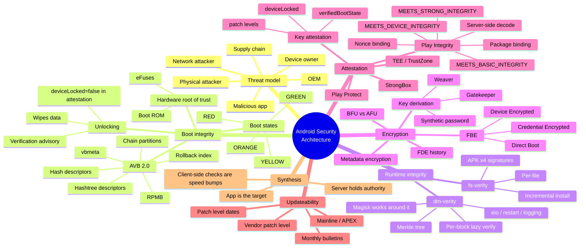

### 13.3 Condensed cheat sheet

| Question | Command / artefact | Interpretation |
|---|---|---|
| Is the bootloader locked? | `getprop ro.boot.flash.locked` | `1` locked, `0` unlocked. Forgeable on a rooted device. |
| What is the boot state? | `getprop ro.boot.verifiedbootstate` | `green` / `yellow` / `orange` / `red`. Forgeable. |
| Non-forgeable boot state? | Key attestation certificate extension | `verifiedBootState`, `deviceLocked`. Verify server-side. |
| Is verity enforcing? | `getprop ro.boot.veritymode` | `enforcing` good, `logging` means no protection. |
| Encryption type? | `getprop ro.crypto.type` | `file` = FBE, `block` = FDE, absent = unencrypted. |
| Patch level? | `getprop ro.build.version.security_patch` | Compare to today; report the delta in months. |
| Vendor patch level? | `getprop ro.vendor.build.security_patch` | Often lags the system one. |
| Mainline modules? | `ls /apex/` | Updatable components and their versions. |
| SELinux mode? | `getenforce` | `Enforcing` expected on production. |
| Debug posture? | `getprop ro.debuggable` `ro.secure` `ro.build.type` | `1`/`0`/`userdebug` indicates a non-production build. |
| Inspect vbmeta | `avbtool info_image --image vbmeta.img` | Descriptors, rollback index, dm-verity root hash. |
| Inspect boot image | `magiskboot unpack boot.img` | Detect Magisk patching, read cmdline. |

### 13.4 Quick revision prompts

- Name the six adversaries in Android's threat model and one control against each.
- What is the hardware root of trust, physically?
- Which vbmeta descriptor type configures dm-verity, and why is it different from the one used for `boot`?
- What stops a downgrade attack, and where is the state stored?
- List the four boot states and what each means for a locked device.
- Why does unlocking wipe `/data`?
- Draw a Merkle tree and explain why verifying one block is cheap.
- Name the three dm-verity error modes and which one is dangerous in production.
- Explain in one sentence why Magisk does not trip dm-verity.
- What is the difference between DE and CE storage, and which one is available in Direct Boot?
- What do BFU and AFU mean, and why do forensic examiners care?
- What does Weaver add over Gatekeeper?
- Name the four `deviceRecognitionVerdict` values.
- State the three server-side checks a Play Integrity token needs beyond the verdict itself.
- Why is `ro.build.version.security_patch` no longer a complete answer?
- In one sentence: where is the boundary between forgeable and non-forgeable device state?

---

## 14. References

Full annotated list in [`references/README.md`](references/README.md).

### AOSP source

- `external/avb/` — AVB reference implementation and `avbtool.py`; `external/avb/README.md` is the authoritative design document.
- `system/core/fs_mgr/` and `system/core/fs_mgr/libfs_avb/` — Android's dm-verity and AVB integration during early mount.
- `system/core/init/` — property service, first-stage init, SELinux policy loading.
- `system/vold/` — FBE, metadata encryption, key storage.
- `system/gatekeeper/`, `hardware/interfaces/gatekeeper/`, `hardware/interfaces/weaver/` — credential verification and throttling.
- `system/security/keystore2/` — the Keystore daemon.
- `system/apex/apexd/` — APEX verification and mounting.
- `frameworks/base/services/core/java/com/android/server/locksettings/` — LockSettingsService and the synthetic password design.
- `drivers/md/dm-verity-target.c` and `fs/crypto/`, `fs/verity/` in the Linux kernel tree.

### Official documentation

- Android Open Source Project — Security: Verified Boot, dm-verity, File-Based Encryption, Trusty, SELinux (`source.android.com/docs/security/`).
- Android Developers — Play Integrity API, Keystore, Key Attestation, Direct Boot, Network Security Config.
- Android Security Bulletins — the monthly CVE lists and patch level definitions.
- Android Compatibility Definition Document (CDD) — the security requirements a device must meet to ship with GMS.

### OWASP

- OWASP MASVS v2 — MASVS-STORAGE, MASVS-CRYPTO, MASVS-AUTH, MASVS-NETWORK, MASVS-PLATFORM, MASVS-CODE, MASVS-RESILIENCE.
- OWASP MASTG — tests covering device binding, anti-tampering, root detection, and key material protection.

### Related chapters

[06 — Android Architecture](../06-Android-Architecture/README.md) ·
[10 — APK Internals](../10-APK-Internals/README.md) ·
[21 — App Sandbox](../21-App-Sandbox/README.md) ·
[22 — SELinux](../22-SELinux/README.md) ·
[23 — Permissions](../23-Permissions/README.md) ·
[33 — Storage](../33-Storage/README.md) ·
[37 — Root Detection](../37-RootDetection/README.md) ·
[38 — Tamper Detection](../38-TamperDetection/README.md) ·
[49 — KeyStore](../49-KeyStore/README.md) ·
[50 — Hardware-Backed Security](../50-HardwareBackedSecurity/README.md) ·
[61 — Fastboot](../61-Fastboot/README.md) ·
[62 — Magisk](../62-Magisk/README.md) ·
[67 — Bypassing Protections](../67-BypassingProtections/README.md) ·
[70 — Vulnerability Research](../70-VulnerabilityResearch/README.md) ·
[71 — OWASP Mobile](../71-OWASP-Mobile/README.md)
