# 21 — The Android Application Sandbox

> After this chapter you can explain, from the kernel upward, exactly what keeps one app out of another app's data; you can enumerate every mechanism that composes the sandbox and state precisely what each one does and does not stop; you can write an app that probes the boundary from the inside; and you can describe the six classes of sandbox escape without inventing a single CVE number.

**Prerequisites:** [01 — Computer Science Basics](../01-Computer-Science-Basics/README.md), [02 — Linux Basics](../02-Linux-Basics/README.md), [06 — Android Architecture](../06-Android-Architecture/README.md), [09 — Android App Internals](../09-Android-App-Internals/README.md), [20 — Security Architecture](../20-Security-Architecture/README.md)

**Applies to:** Android 4.4 (API 19) through Android 16 (API 36). The baseline described is Android 13–16 (API 33–36); behaviour that differs on older releases is flagged in Version Matrix tables, because you will meet Android 8–12 devices in the field for years yet.

---

## Table of Contents

1. [Introduction](#1-introduction)
2. [High-Level Architecture](#2-high-level-architecture)
3. [Deep Internal Working](#3-deep-internal-working)
4. [Source Code Walkthrough (AOSP)](#4-source-code-walkthrough-aosp)
5. [Security Perspective](#5-security-perspective)
6. [Reverse Engineering Perspective](#6-reverse-engineering-perspective)
7. [Dynamic Analysis](#7-dynamic-analysis)
8. [Static Analysis](#8-static-analysis)
9. [Examples](#9-examples)
10. [Common Interview Questions](#10-common-interview-questions)
11. [Common Mistakes](#11-common-mistakes)
12. [Hands-on Labs](#12-hands-on-labs)
13. [Summary](#13-summary)
14. [References](#14-references)

---

## 1. Introduction

### 1.1 The problem that existed before the sandbox

Think about a shared office building in the 1990s. There is one filing cabinet in the corridor, it has no lock, and every tenant has been told politely to only open their own drawer. For a while this works, because everybody is busy and nobody is curious. Then one tenant decides they would quite like to read a competitor's client list, and there is nothing at all — no mechanism, no alarm, no record — standing between them and it. The only thing that was ever protecting the filing cabinet was the good manners of the people in the building.

That is a precise description of how a desktop operating system treated applications for the first thirty years of personal computing, and it is what the first generation of smartphones inherited. When you double-clicked a program on Windows XP or on a Mac of that era, the program ran **as you**. It carried your identity. Every file you could read, it could read. Every file you could delete, it could delete. The operating system had no way to express the sentence "this program may open my photographs but not my tax return", because from the kernel's point of view there was no *program* — there was only *you*, doing things.

For a desktop with five installed applications, all bought in shrink-wrapped boxes from named companies, this was survivable. For a phone, it is catastrophic, and the reason is arithmetic. A typical phone has between sixty and a hundred and twenty applications installed. Their authors are mostly strangers. Many of them are free, which means the user paid with something other than money. Every one of them sits a couple of centimetres away from the owner's messages, their photographs, their location history, their banking session, and a microphone. If any single one of those hundred applications is malicious — or merely compromised, or merely careless with a third-party advertising SDK it embedded without reading — the "everything runs as you" model hands that application the entire contents of the owner's life.

So Android's designers made a decision that looks obvious in hindsight and was genuinely radical in 2007:

> **Mental Model**
> **Every application is a different *user* of the operating system.** Not a different program run by the same user — a different *user*, in the full Unix sense, with its own numeric user ID, its own home directory, and no more right to read another app's files than your colleague has to read yours on a shared Linux server. The phone has one human owner and a hundred operating-system users, and the human owner is not any of them.

Everything else in this chapter is either an implementation detail of that sentence or a patch over a place where that sentence turned out not to be enough.

### 1.2 What would break if the sandbox did not exist

It is worth being concrete, because "isolation" is an abstract word and the consequences are not abstract at all.

If the sandbox did not exist, a free torch application — one of the genuinely enormous category of apps that do one trivial thing and are supported by advertising — could do all of the following, silently, with no permission prompt of any kind, because none of it would require a permission:

- Open `/data/data/com.yourbank.app/shared_prefs/session.xml` and read the OAuth refresh token, then use it from a server to impersonate the user indefinitely.
- Open the WhatsApp message database and upload it.
- Replace the shortcut icon and launch activity of another installed app so that tapping the banking app launched a credential-harvesting clone.
- Read the private key that a password manager stored on disk.
- Modify another app's code on disk so that the modification persisted across reboots and survived the malicious app's own uninstallation.

None of that is hypothetical. Each is a documented behaviour of desktop malware, and each is exactly what mobile banking trojans attempt today. The reason they instead resort to elaborate social-engineering campaigns to get the user to enable an accessibility service is that the direct approach — just read the other app's files — does not work. The sandbox is why.

> **Definition — sandbox**
> A *sandbox* is an enforced restriction on what a piece of running code can reach, applied by a component that the code itself cannot modify. The two halves of that definition both matter. "Restriction" without enforcement is a coding convention. Enforcement by something the code *can* modify — for example, a check inside the app's own process — is not a sandbox, it is a speed bump. Android's app sandbox is enforced entirely by the Linux kernel, which application code cannot modify, and that is what makes it real.

### 1.3 The sandbox is not one mechanism

The single most common misconception, and the thing that separates someone who has read a blog post from someone who has read the source, is the belief that "the Android sandbox" is one thing. It is not. It is at least seven independent mechanisms, layered, each covering a gap the others leave:

| # | Mechanism | Enforced by | What it stops | Covered in |
|---|---|---|---|---|
| 1 | **Unique UID per app** + Unix DAC | Linux kernel, on every `open()`, `stat()`, `kill()`, and so on | App A reading app B's files or signalling app B's processes | §3.1–§3.3 |
| 2 | **SELinux mandatory access control** | Linux kernel LSM hooks | Everything DAC allows but policy forbids — including things `root` would otherwise be permitted | §3.4, and in full in [22 — SELinux](../22-SELinux/README.md) |
| 3 | **seccomp-bpf syscall filtering** | Linux kernel, at syscall entry | An app issuing system calls no app has any business issuing, shrinking the kernel attack surface | §3.5 |
| 4 | **Capability dropping** | Zygote, before the app's first instruction | An app holding any Linux capability at all — apps run with an empty capability set | §3.6 |
| 5 | **`isolatedProcess` / SDK sandbox** | Zygote + SELinux + a special UID range | Even the app's *own* risky code from touching the app's data or the network | §3.7–§3.8 |
| 6 | **Network access as a group membership** | Kernel (historically a patch, now eBPF) | An app without `INTERNET` creating a socket at all | §3.9 |
| 7 | **Package visibility filtering** | `system_server` (`AppsFilter`) | An app *enumerating* what else is installed — a metadata sandbox, not a data one | §3.10 |

Each of these can be defeated independently, and none of them individually is "the sandbox". When you write a finding, be specific about which one is at issue, because the remediation is different for each.

### 1.4 A worked intuition: what actually happens when app A tries to read app B's file

Before any diagrams, walk through it in plain language.

The banking app is installed. The package manager gives it the user ID `10247`. It creates the directory `/data/data/com.yourbank.app`, owned by user `10247` and group `10247`, with permission bits `rwx------` — meaning the owner may read, write and traverse it, and *nobody else* may do anything with it.

The torch app is installed. It gets user ID `10388`.

The torch app's code executes `new FileInputStream("/data/data/com.yourbank.app/shared_prefs/session.xml")`. That becomes, eventually, an `openat()` system call. Control passes into the kernel. The kernel walks the path. To reach `session.xml` it must first traverse the directory `/data/data/com.yourbank.app`, which requires the *execute* bit on that directory for the calling process. The calling process's effective UID is `10388`. The directory's owner is `10247`, its group is `10247`, and the "other" permission bits are `---`. `10388` is not the owner, is not in the group, and therefore falls into "other", which has no execute bit. The kernel returns `-EACCES`. The Java layer turns that into a `FileNotFoundException` with the message `Permission denied`.

The torch app learns nothing. It cannot even confirm the file exists — on modern Android it cannot list `/data/data` at all, so it cannot confirm the *bank* exists by that route either.

That is the whole sandbox, in its original 2008 form, and it is still the load-bearing 80% of it today. Everything since has been about closing the gaps: what about `root`? (SELinux.) What about the kernel itself? (seccomp.) What about data the app deliberately shares? (IPC and permissions.) What about places outside `/data/data`? (scoped storage.) What about *knowing* the bank is installed at all? (package visibility.)

> **Pentester's Note**
> The single most useful sentence you can carry into an engagement is this: **the sandbox protects app data from other apps, and nothing else.** It does not protect app data from the user. It does not protect app data from root. It does not protect data the app hands out over IPC. It does not protect data the app writes to shared storage. Most "insecure data storage" findings you will ever write are not sandbox failures — they are cases where the developer relied on the sandbox against an adversary the sandbox was never designed to stop, usually adversary #4 from [20 §1.4](../20-Security-Architecture/README.md#14-the-adversaries): the device's own user.

### 1.5 What this chapter will let you do

By the end you will be able to:

1. Read a device's `/data/system/packages.list` and reconstruct the entire UID map from memory.
2. Explain the difference between `android:process`, `android:isolatedProcess`, and `android:sharedUserId`, and say which of the three is a security boundary. (Exactly one is.)
3. Write and run an "attacker app" that systematically probes what it can reach on a real device, and interpret every `EACCES` and every unexpected success.
4. Explain why `run-as` works on your test build and fails on the user's phone, at the level of the file's capability bits.
5. Name six classes of sandbox escape and describe the mechanism of each without needing to cite a specific bug.
6. Tell a developer, in one sentence each, which of their assumptions about the sandbox are wrong.

---

## 2. High-Level Architecture

### 2.1 The sandbox as nested enforcement layers

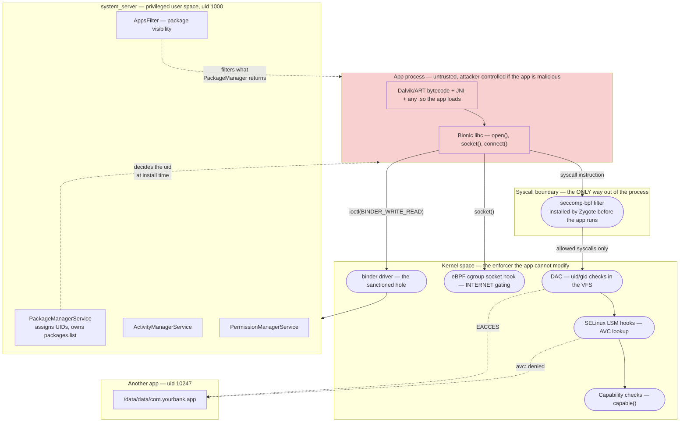

Read this diagram as a funnel. Everything the app wants to do that has any effect outside its own memory has to become a **system call**, because that is the only interface a Linux process has to the rest of the machine. There is no second door. An app can compute whatever it likes in its own address space and nobody cares; the moment it wants a byte from disk, a packet on the network, or a message to another process, it must ask the kernel, and the kernel is running code the app cannot change.

The funnel narrows three times. First, `seccomp-bpf` asks *"is this app allowed to make this kind of call at all?"* — a question about the syscall number and, sometimes, its arguments, decided before any of the syscall's logic runs. Second, classic Unix **DAC** asks *"does this UID own, or belong to the group of, the object being touched, and do the permission bits allow it?"* Third, **SELinux** asks *"does the policy permit a process in this security domain to perform this operation on an object with that security label?"* — and, critically, SELinux asks this *even when DAC already said yes, and even when the process is root*.

The `binder` driver is drawn deliberately at the same level as the other kernel objects, because it is the one legitimate, designed-in hole through the wall. Everything an app is *allowed* to do that touches the rest of the system — start an activity, query a content provider, ask for the location, request a permission — travels through Binder to `system_server` or to another app. That makes Binder both the reason Android is usable and the richest attack surface inside the device. See [25 — Binder](../25-Binder/README.md).

Finally,`system_server` sits *outside* the kernel box. It is a normal Linux process running as UID 1000 (`AID_SYSTEM`). It is enormously privileged, but it is privileged because the kernel gives its UID privileges — not because it is magic. A memory-corruption bug in `system_server` gives an attacker UID 1000 and the `system_server` SELinux domain, which is very nearly game over, and that is precisely why so much hardening effort goes into it.

### 2.2 The trust boundaries, named

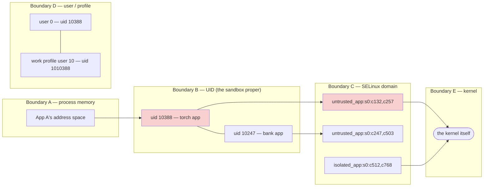

Five boundaries, and it matters a great deal which one a given finding is about.

**Boundary A**, process memory, is the weakest and the one people over-trust. Two components of the *same app* — the app's own code and an advertising SDK it embedded — share an address space completely. The SDK can read every field of every object the app holds, including decrypted secrets, and there is no mechanism in Android that prevents it. If you have ever wondered why a third-party SDK's data-collection behaviour is a real finding and not a theoretical one, this is why.

**Boundary B**, the UID, is the classical sandbox. It is enforced by DAC. It is very strong for filesystem objects and process signalling, and it is completely irrelevant to anything the app chooses to hand out.

**Boundary C**, the SELinux domain, is a *finer* boundary than the UID in one direction and a *coarser* one in another. Coarser, because every ordinary third-party app on the device shares the same base domain, `untrusted_app`. Finer, because the MCS categories appended to that domain (`c132,c257` in the diagram) differ per app and are what actually prevents `untrusted_app` A from being permitted, by type enforcement alone, to touch `untrusted_app` B's files. This is explained fully in [22 — SELinux §3.6](../22-SELinux/README.md).

**Boundary D**, the Android user or work profile, is a boundary most testers forget exists. A work profile is a whole separate Android user with its own UID space (`1010388` rather than `10388` for the same package), its own `/data/user/10/` tree, and its own encryption key. Cross-profile data flow is a real and frequently-tested area on managed devices.

**Boundary E** is the kernel. Everything above it depends on the kernel being correct. A kernel bug reachable from an app collapses A through D simultaneously, which is why kernel bugs are the top of the payout tables.

### 2.3 UID assignment at install time

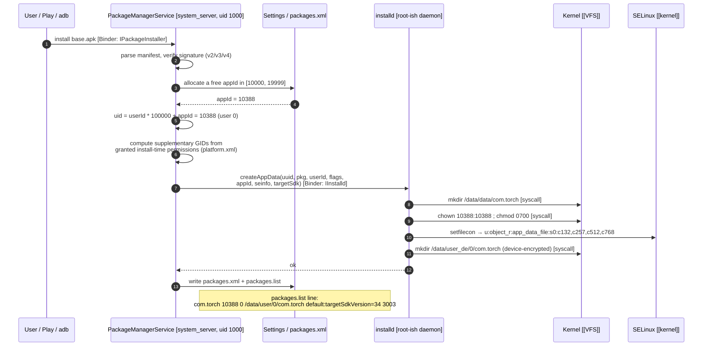

This is the moment the sandbox is created, and every property of the sandbox is decided here. Three things are worth stopping on.

Step 5 is where the **appId** is allocated. Android maintains a bitmap of used app IDs in the range 10000–19999 (`Process.FIRST_APPLICATION_UID` to `Process.LAST_APPLICATION_UID`) and hands out the lowest free one. This is a *reused* resource: uninstall an app and its appId returns to the pool, so a later-installed app can inherit the number. That is why `installd` wipes the data directory on uninstall — otherwise the new tenant would move into the old tenant's flat.

Step 8 is where the **supplementary group IDs** are attached. Some permissions are not enforced by the framework at all; they are enforced by the kernel, because the permission maps to a Linux GID. `INTERNET` maps to GID 3003 (`AID_INET`). You can see it at the end of the `packages.list` line in the note. This is covered in §3.9 and, from the permission side, in [23 — Permissions §3.5](../23-Permissions/README.md).

Step 12 is where the **SELinux label** is applied, including the MCS categories that make one `untrusted_app` distinguishable from another. The `seinfo` string passed at step 9 comes from `seapp_contexts` matching, which is the subject of [22 §3.5](../22-SELinux/README.md).

### 2.4 Process creation — where the sandbox is actually installed

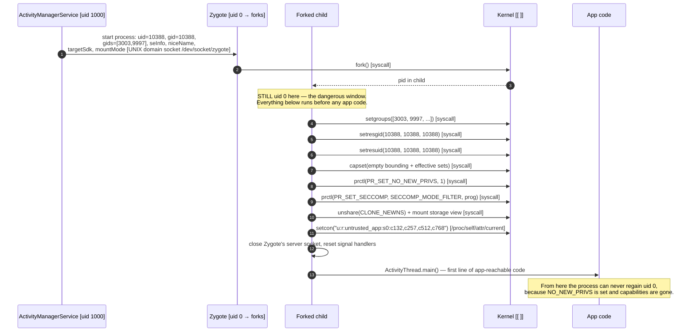

This diagram is the single most important one in the chapter. **The sandbox is not applied to a running app; the sandbox is applied to a process, and then the app is loaded into it.** By the time any line of code that an attacker could have written begins to execute, the UID has already changed, the capability sets are already empty, `PR_SET_NO_NEW_PRIVS` is already set, the seccomp filter is already installed, and the SELinux domain transition has already happened. There is no window in which app code runs privileged.

The ordering in steps 5 through 11 is not arbitrary and getting it wrong has historically been a real bug class in other systems:

- `setgroups()` **must** come before `setresuid()`, because dropping the UID first would lose the privilege needed to change the group list.
- `setresgid()` must come before `setresuid()` for the same reason.
- Capabilities must be dropped *after* the UID change, because on Linux a UID transition away from 0 already clears most capabilities, and the explicit `capset` then clears the bounding set so they can never be regained.
- `PR_SET_NO_NEW_PRIVS` must be set before the seccomp filter, because an unprivileged process is only permitted to install a seccomp filter if `no_new_privs` is set — otherwise a filter could be used to trick a setuid binary.

> **Under the Hood**
> The `fork()` at step 2 is a plain `fork()`, not `clone()` with new namespaces, and that is intentional: the child inherits the Zygote's already-warmed, already-JIT-touched framework classes through copy-on-write shared memory, which is why Android app startup is fast. The security consequence is that **every app process on the device starts life as a memory-identical copy of the same parent**, which is excellent for memory usage and unhelpful for ASLR — the same library is at the same address in every app. Android mitigates this partially by re-randomising some regions per fork, but Zygote-inherited layout remains a known weakening of ASLR and is a documented consideration in exploit development. See [19 — Memory](../19-Memory/README.md).

### 2.5 The filesystem, drawn

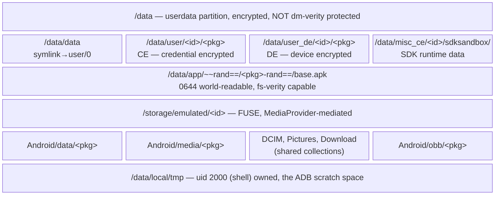

Four regions, four completely different security stories, and confusing them is the source of a great many bad findings.

`/data/user/<id>/<pkg>` is the app's private, credential-encrypted home. Mode `0700`, owned by the app. Nothing else can read it (subject to root and to SELinux, discussed later). `/data/data/<pkg>` is, for user 0 only, a path that resolves to the same place — historically the real location, now effectively an alias.

`/data/user_de/<id>/<pkg>` is the *device-encrypted* counterpart, readable from boot before the user has entered their PIN. Same DAC and SELinux protections, weaker at-rest protection. Apps that are `directBootAware` use it. A finding worth watching for: an app storing a credential in DE storage "because it needs it at boot" has just moved that credential outside the credential-bound key hierarchy.

`/data/app/.../base.apk` is **world-readable, mode 0644**, and this surprises people. Any app on the device can read any other app's APK bytes if it can construct the path — and `PackageManager.getApplicationInfo().sourceDir` hands over the path. This is by design: APK contents are not secret. It is also why "we obfuscated the API key in the APK" is never a confidentiality control. See [10 — APK Internals](../10-APK-Internals/README.md).

`/storage/emulated/<id>` is **not a real filesystem in the normal sense**. On Android 11 and later it is a FUSE mount serviced by the `MediaProvider` app in userspace, which applies its own permission logic per file operation on top of whatever the underlying `/data/media` permissions say. That indirection is what makes scoped storage enforceable. See §3.11.

`/data/local/tmp` is owned by UID 2000 (`shell`) and is the only place a normal app-side tester can reliably drop a file over ADB. It is *not* readable by apps by default on modern Android — a common cause of "why can't my app load the frida gadget from /data/local/tmp" confusion.

---

## 3. Deep Internal Working

### 3.1 The UID: what it is, where the numbers come from, and what they mean

#### What a UID actually is

> **Definition — UID (user ID)**
> A *UID* is a 32-bit unsigned integer that the Linux kernel stores in the credential structure (`struct cred`) attached to every process. It is not a name; names live only in userspace configuration files. Every access check the kernel performs on a file, a process, or a SysV/POSIX IPC object compares numbers from this structure against numbers stored in the object's metadata. When we say "the app runs as its own user", we mean literally that the `uid` field in that process's `struct cred` contains a number no other app has.

Android does not use `/etc/passwd`. There is no such file in the traditional sense. Instead, the numeric ranges are compiled into the platform and documented in a header.

#### The number ranges

| Range | Symbolic name | Meaning |
|---|---|---|
| `0` | `AID_ROOT` | The superuser. `init`, `ueventd`, `vold`, and a handful of daemons. |
| `1000` | `AID_SYSTEM` | `system_server` and other core system components. Not root, but holds most of the interesting privileges via SELinux and capabilities. |
| `1001` | `AID_RADIO` | Telephony stack. |
| `1002` | `AID_BLUETOOTH` | Bluetooth. |
| `1013` | `AID_MEDIA` | Media server family. |
| `1019` | `AID_DRM` | DRM server. |
| `2000` | `AID_SHELL` | The `adb shell` user. **This is the UID you are when you type `adb shell` on a production device.** |
| `1023` | `AID_MEDIA_RW` | Media read/write group for storage. |
| `3001`–`3011` | `AID_NET_*`, `AID_READPROC`, `AID_WAKELOCK`, `AID_UHID` | Capability-like **groups**, granted as supplementary GIDs to confer specific kernel-enforced abilities. |
| `9997` | `AID_EVERYBODY` | A group every app is in, used for a small number of world-shared resources. |
| `9998` | `AID_MISC` | Miscellaneous. |
| `9999` | `AID_NOBODY` | The classic "no privileges" account. |
| `10000`–`19999` | `AID_APP_START` – `AID_APP_END` | **Ordinary installed applications.** `Process.FIRST_APPLICATION_UID` / `LAST_APPLICATION_UID`. |
| `20000`–`29999` | SDK sandbox range | `Process.FIRST_SDK_SANDBOX_UID` – `LAST_SDK_SANDBOX_UID`. The Privacy Sandbox SDK Runtime, §3.8. |
| `90000`–`98999` | App-Zygote isolated range | `FIRST_APP_ZYGOTE_ISOLATED_UID` – `LAST_APP_ZYGOTE_ISOLATED_UID`. Isolated processes spawned from a per-app Zygote. |
| `99000`–`99999` | Isolated range | `FIRST_ISOLATED_UID` – `LAST_ISOLATED_UID`. Ordinary `isolatedProcess` services, §3.7. |
| `+100000` per user | `AID_USER_OFFSET` | Multi-user / work-profile offset. |

The arithmetic that ties this together is worth memorising because you will do it by hand constantly:

```
uid    = userId * 100000 + appId
userId = uid / 100000
appId  = uid % 100000
```

So UID `1010388` is app ID `10388` running as Android user `10` — which on a corporate device is almost always the work profile. UID `10388` is the same package for the primary user. They are different Unix users, they have different data directories (`/data/user/10/com.torch` versus `/data/user/0/com.torch`), and they are encrypted with different keys.

> **Under the Hood**
> These constants live in two places that must agree. The native side is `system/core/libcutils/include/private/android_filesystem_config.h`, which defines the `AID_*` macros and is consumed by `init`, `installd`, and the whole native stack. The Java side is `frameworks/base/core/java/android/os/Process.java`, which declares `FIRST_APPLICATION_UID`, `LAST_APPLICATION_UID`, `FIRST_ISOLATED_UID`, `LAST_ISOLATED_UID`, `FIRST_APP_ZYGOTE_ISOLATED_UID`, `LAST_APP_ZYGOTE_ISOLATED_UID`, `FIRST_SDK_SANDBOX_UID`, `LAST_SDK_SANDBOX_UID`, `SHELL_UID`, `SYSTEM_UID`, and the helper `UserHandle.getAppId()`/`getUserId()`. The generated list of names is also emitted into `/system/etc/passwd`-style data consumed by Bionic's `getpwnam` implementation in `bionic/libc/bionic/grp_pwd.cpp`, which is why `id` prints `u0_a288` rather than a raw number.

#### Reading the UID map on a live device

The authoritative runtime record is `/data/system/packages.list`. It is a flat text file, one line per installed package per user, written by `PackageManagerService`:

```bash
# adb shell — needs root to read, it is 0640 system:package_info
su -c 'cat /data/system/packages.list' | head -5
```

Each line has this shape:

```
com.example.torch 10388 0 /data/user/0/com.example.torch default:targetSdkVersion=34 3003,9997 0 1
```

| Field | Meaning |
|---|---|
| 1 | Package name |
| 2 | UID (appId for user 0) |
| 3 | Debuggable flag — `1` if `android:debuggable="true"`. **This is the field `run-as` reads.** |
| 4 | Data directory |
| 5 | `seinfo` string used for `seapp_contexts` matching |
| 6 | Comma-separated supplementary GIDs from install-time permissions |
| 7 | Profileable-from-shell flag |
| 8 | Long version code |

Without root you can still recover most of the map from the framework:

```bash
# adb shell — works without root
pm list packages -U | head -20            # package:com.foo uid:10388
dumpsys package com.example.torch | grep -E 'userId|gids|dataDir|flags'
ps -A -o USER,PID,NAME | grep u0_a        # every running app process
```

The `u0_aNNN` naming is a Bionic convention: `u<userId>_a<appId - 10000>`. So `u0_a288` is UID `10288`, and `u10_a288` is UID `1010288`. Isolated processes appear as `u0_i9`, meaning UID `99009`.

#### Why UID reuse is safe, and the one place it is not

Because appIds are recycled, package `com.evil` installed tomorrow may receive the appId that `com.bank` had yesterday. Three things prevent this from being a vulnerability:

1. `installd` recursively deletes the old data directory at uninstall, so there are no leftover files owned by that UID in `/data`.
2. The SELinux MCS categories are derived from the appId *and* — on modern releases — additional per-install randomness, so labels do not silently collide.
3. Anything the old app registered with the framework (permissions, providers, accounts) is torn down at uninstall.

The place where it *is* a live concern is **files the old app wrote outside its data directory** — on shared storage, in a world-readable location, or in a directory belonging to another app that granted access. Those files keep their numeric owner. A new app that inherits the UID inherits ownership of them. This is one of several good reasons the platform has been steadily closing off world-writable and cross-app-writable locations.

### 3.2 DAC — what discretionary access control actually enforces

> **Definition — DAC (Discretionary Access Control)**
> *Discretionary* access control means the **owner of an object decides who may access it**. Classic Unix permissions are DAC: the owner of a file may `chmod 777` it and hand it to the world, and the system will allow that, because the policy is at the owner's discretion. The contrast is *Mandatory* Access Control (MAC), where a system-wide policy decides and the owner cannot override it — which is SELinux, and is [chapter 22](../22-SELinux/README.md).

DAC on Android is ordinary Linux DAC, with no Android-specific modifications to the algorithm. The checks the kernel performs are:

| Operation | Check performed |
|---|---|
| `open()` a file for reading | Read bit for the matching class (owner / group / other), *plus* execute (search) bit on every directory in the path |
| `open()` for writing | Write bit, plus search on the path |
| `unlink()`, `rename()` | Write + execute on the **containing directory**, not the file. This is why a read-only file in a writable directory can still be deleted. |
| `readdir()` | Read bit on the directory |
| `stat()` a path | Execute (search) on every parent directory; the file's own bits are irrelevant |
| `kill()` / signal | Sender's real or effective UID must equal the target's real or saved UID, or the sender must have `CAP_KILL` |
| `ptrace()` | Same UID plus the Yama LSM's `ptrace_scope` setting, plus SELinux |

The classes are checked in strict order and **the first matching class wins**. If you are the owner, only the owner bits are consulted — being in the file's group as well does not add permissions. This trips people up when they see a file mode `0477` owned by their own UID and cannot read it.

#### The permissions actually on an app data directory

```bash
# adb shell as root on a test device
ls -ldZ /data/data/com.example.torch
# drwx------ 4 u0_a288 u0_a288 u:object_r:app_data_file:s0:c32,c257,c512,c768 4096 ... /data/data/com.example.torch

ls -lZ /data/data/com.example.torch/shared_prefs/
# -rw------- 1 u0_a288 u0_a288 u:object_r:app_data_file:s0:c32,c257,c512,c768 231 ... prefs.xml
```

Three separate facts are visible in that output and each is load-bearing:

1. **`drwx------`** on the directory. Mode `0700`. No group access, no other access. Because the *execute* bit is absent for others, no other app can even traverse into the directory to `stat()` a file inside it, regardless of that file's own mode. Even if a careless developer creates a file with mode `0666`, no other app can reach it, because the path is blocked one level up. That is a genuinely important defence-in-depth property.
2. **`u0_a288 u0_a288`** — the owner and group are both the app's own UID/GID. There is no shared group with other apps.
3. **`u:object_r:app_data_file:s0:c32,c257,c512,c768`** — the SELinux label, whose category set is per-app. Even root, or a process that has somehow acquired the right DAC access, is stopped here unless policy grants it.

#### The Version Matrix for data directory modes

| Android version | Data dir mode | Notes |
|---|---|---|
| ≤ 8.1 (API 27) | `0751` for apps with `targetSdkVersion < 24`, `0700` otherwise | The `0751` mode allowed *traversal* by other apps, so a world-readable file inside was reachable. This is the origin of a whole genre of legacy "world-readable SharedPreferences" findings. |
| 9 (API 28) onwards | `0700` unconditionally | `MODE_WORLD_READABLE` and `MODE_WORLD_WRITEABLE` throw `SecurityException` for apps targeting API 24+; the directory mode change closed the traversal path for the rest. |
| 10 (API 29) onwards | `0700`, plus hardened `/proc` | `hidepid=2`-equivalent behaviour: an app can no longer see other apps' processes in `/proc`. |
| 11 (API 30) onwards | `0700`, plus FUSE-mediated external storage | Direct filesystem access to another app's `Android/data` blocked. |

> **Warning**
> `Context.MODE_WORLD_READABLE` and `MODE_WORLD_WRITEABLE` are deprecated and throw `SecurityException` for apps targeting API 24 or above — but the constants still exist and the JADX output of an old app will still contain them. If you find `openFileOutput(name, 1)` (the numeric value of `MODE_WORLD_READABLE`) in a decompiled app, check the `targetSdkVersion` before writing the finding: on a modern target it is dead code that would crash, not an exploitable hole. Reporting it without that check is exactly the kind of false positive that damages a report's credibility.

#### `sharedUserId` — deliberately merging two sandboxes

An app may declare `android:sharedUserId="com.example.suite"` in its manifest. If a second app declares the same value **and is signed with the same key**, the two apps receive the *same* UID, share a data directory tree, run in the same SELinux domain with the same MCS categories, and can freely read each other's files and run in the same process.

This was designed for suites of apps by the same vendor, and it is now strongly discouraged:

| API level | Status |
|---|---|
| ≤ 28 | Fully supported, widely used |
| 29 (Android 10) | Deprecated in documentation |
| 32 (Android 12L) | `android:sharedUserMaxSdkVersion` added, letting an app "graduate" out of a shared UID for new installs while preserving it for upgrades |
| Current | Strongly discouraged; Play policy pressure against it |

> **Pentester's Note**
> `sharedUserId` is worth checking on every engagement and is routinely missed. Grep the manifest. If present, your sandbox analysis must be done at the granularity of the *shared UID group*, not the individual app — because the weakest app in the group defines the security of all of them. A concrete finding shape: "the main banking app shares a UID with `com.vendor.updater`, a rarely-updated helper with an exported, unprotected `ContentProvider`; compromise of the helper yields full read access to the banking app's credential store, because the two are the same Unix user." That is a much stronger finding than the exported provider on its own. Removing `sharedUserId` from an already-shipped app **changes its UID**, which orphans its data — which is exactly why `sharedUserMaxSdkVersion` exists, and why you will see it stuck in place in legacy apps.

### 3.3 Filesystem isolation in depth

#### The three storage trees an app owns

| Path | Encryption class | Created by | Typical use | Backed up? |
|---|---|---|---|---|
| `/data/user/<userId>/<pkg>` (alias `/data/data/<pkg>` for user 0) | CE — credential encrypted | `installd` at install | `databases/`, `shared_prefs/`, `files/`, `cache/`, `code_cache/`, `no_backup/` | Yes, except `no_backup/` and `cache/` |
| `/data/user_de/<userId>/<pkg>` | DE — device encrypted | `installd` at install | Direct Boot-aware state only | No |
| `/data/media/<userId>/Android/data/<pkg>` surfaced at `/storage/emulated/<userId>/Android/data/<pkg>` | CE (via the underlying `/data`) | `MediaProvider`/FUSE on demand | Large files, caches, app-specific media | Configurable |

Inside the CE directory the layout is fixed by the framework:

```
/data/user/0/com.example.torch/
├── cache/           # Context.getCacheDir()      — deletable by the system under pressure
├── code_cache/      # Context.getCodeCacheDir()  — cleared on app update; JIT/oat artefacts
├── databases/       # SQLiteOpenHelper default
├── files/           # Context.getFilesDir()
├── no_backup/       # Context.getNoBackupFilesDir() — excluded from cloud/adb backup
└── shared_prefs/    # SharedPreferences XML
```

> **Mental Model**
> Think of the app's data directory as a house with exactly one door, and the door's lock is the execute bit on the directory. DAC checks the lock once, at the door. Everything inside is then governed by the file's own bits — but nobody who cannot get through the door ever gets to ask. This is why "the file inside was mode 666" is usually not exploitable *by another app*, and always exploitable *by root or by the user with a backup*.

#### What `installd` actually does

`installd` is the daemon that performs privileged filesystem operations on behalf of `PackageManagerService`. It runs as root but in a tightly constrained SELinux domain, and it is the only component that creates, relabels, or destroys app data directories. When `PackageManagerService` calls `IInstalld.createAppData`, `installd`:

1. Creates the CE and DE directories.
2. `chown`s them to the app's UID and GID.
3. `chmod`s them to `0700`.
4. Calls `selabel_lookup` against `file_contexts` and `seapp_contexts` to compute the label, then `lsetfilecon` to apply it — including the per-app MCS categories.
5. Applies a project quota ID so per-app disk usage can be accounted without a full directory walk.
6. Creates the `lib/` symlink pointing into `/data/app/<...>/lib/<abi>`.

At uninstall it does the reverse, and crucially it *recursively deletes* the tree so a recycled appId cannot inherit files.

> **Under the Hood**
> `frameworks/native/cmds/installd/` contains `InstalldNativeService.cpp` (the Binder interface implementation), `utils.cpp` (path construction — read `create_data_user_ce_package_path` and friends to see exactly how the paths above are built), and `dexopt.cpp` (the AOT/JIT compilation entry points). The Binder interface itself is declared in `frameworks/native/cmds/installd/binder/android/os/IInstalld.aidl`. Reading `IInstalld.aidl` is the fastest way to see the complete list of privileged filesystem operations the platform is willing to perform on an app's behalf.

#### The APK is world-readable, and that is deliberate

```bash
# adb shell — no root needed
pm path com.example.torch
# package:/data/app/~~kZ0m.../com.example.torch-9Qb.../base.apk

ls -l /data/app/~~kZ0m*/com.example.torch-*/base.apk
# -rw-r--r-- 1 system system 8421376 ... base.apk
```

Mode `0644`, owner `system`. Any process on the device can read it. The directory names contain random base64 segments (the `~~` prefix directory and the package directory suffix), added in Android 11, but this is *anti-fingerprinting*, not access control — `PackageManager.getApplicationInfo(pkg, 0).sourceDir` returns the exact path to any app you are permitted to see.

The consequence for you as a tester is that **any app can dump any other visible app's DEX and native libraries**. That is not a vulnerability; it is the design. It is also why an app that ships a secret in `assets/`, in `BuildConfig`, in a string resource, or in a `.so` has shipped that secret to every user and every app on the device.

### 3.4 SELinux as the second layer — the short version

Full treatment is in [22 — SELinux](../22-SELinux/README.md). What you need here is the *shape* of the second layer and why DAC alone is not enough.

DAC has a fatal structural weakness: **root ignores it**. The kernel's permission check short-circuits for a process with `CAP_DAC_OVERRIDE`, which root has by default. Since Android must run some things as root — `init`, `vold`, `ueventd`, parts of the boot sequence — a memory-corruption bug in any of them historically yielded the whole device.

SELinux answers this with **Mandatory Access Control**: a system-wide policy, loaded by `init` from the boot image before almost anything else runs, that labels every process (a *domain*) and every object (a *type*), and permits an operation only if the policy contains an explicit `allow` rule for the (domain, type, class, permission) tuple. There is no root exemption. A process running as UID 0 in a domain with no rule permitting it to read `app_data_file` cannot read app data, full stop.

For the sandbox specifically, three SELinux facts matter:

| Fact | Consequence |
|---|---|
| Every ordinary third-party app runs in the domain `untrusted_app` (or a version-suffixed variant like `untrusted_app_29`, `untrusted_app_30`, `untrusted_app_32`) | Type enforcement alone does not distinguish app A from app B — they are the same domain |
| Each app's process and files carry **MCS categories** (`s0:c32,c257,c512,c768`) derived from its appId and userId | Two `untrusted_app` processes with different category sets cannot touch each other's `app_data_file`, because MLS/MCS constraints require the source's category set to dominate the target's |
| `isolated_app` is a distinct, far more restricted domain | The strongest sandbox the platform offers to app developers — §3.7 |

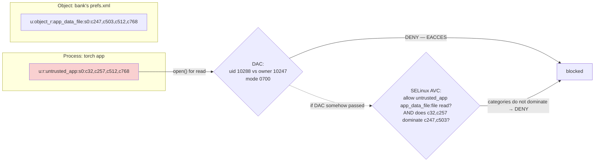

The critical property is that **both checks must pass**. They are not alternatives; they are serial. DAC runs first (in the VFS), SELinux second (in the LSM hook). A bug that defeats one still leaves the other standing. That is the entire argument for defence in depth, made concrete.

> **Pentester's Note**
> On a rooted device, `su` gives you `uid 0`, which defeats DAC. It does *not* automatically give you a permissive SELinux domain. Magisk's `su` deliberately transitions you into a context (historically `u:r:magisk:s0`, and configurable) that policy has been patched to allow almost everything, precisely because `uid 0` alone is no longer sufficient on Android. When your root shell gets "Permission denied" reading something and `id` says `uid=0`, the answer is virtually always SELinux, and `dmesg | grep avc` will tell you exactly which rule was missing. This confusion costs beginners hours; recognising it instantly is a small but real mark of experience.

### 3.5 seccomp-bpf — shrinking the kernel attack surface

#### Why this exists

The UID and SELinux both answer the question *"may this process touch that object?"*. Neither answers a different and equally important question: *"how much of the kernel is this process even able to reach?"*

The Linux kernel exposes roughly 350 to 400 system calls on a 64-bit ARM Android device. A normal Android app uses perhaps 60 of them. The other 300 are attack surface: each is thousands of lines of kernel C, much of it rarely exercised, some of it maintained by nobody in particular. Historically a substantial fraction of Android local privilege escalation came from bugs in syscalls no app had any legitimate reason to call.

> **Definition — seccomp-bpf**
> *seccomp* ("secure computing mode") is a Linux facility that attaches a filter program to a process. On every system call the kernel runs the filter, which is written in a restricted BPF (Berkeley Packet Filter) bytecode, over a structure containing the syscall number, the instruction pointer, the architecture, and the first six arguments. The filter returns a verdict: `SECCOMP_RET_ALLOW`, `SECCOMP_RET_ERRNO` (fail with a chosen errno), `SECCOMP_RET_KILL_PROCESS`, `SECCOMP_RET_TRAP`, `SECCOMP_RET_TRACE`, or `SECCOMP_RET_LOG`. The filter is **inherited across `fork()` and preserved across `execve()`**, and once installed it can never be removed or loosened — only further restricted.

That last property is what makes it usable here: Zygote installs the filter *before* forking off the app, and no amount of subsequent app code can undo it.

#### How Android installs it

The sequence, visible in §2.4 steps 9–10, is:

1. `prctl(PR_SET_NO_NEW_PRIVS, 1, 0, 0, 0)` — mandatory before an unprivileged process may install a filter, and itself irreversible.
2. `prctl(PR_SET_SECCOMP, SECCOMP_MODE_FILTER, &prog)` (or the `seccomp()` syscall) with the compiled BPF program.

Android maintains several distinct policies:

| Policy | Applied to | Source of truth |
|---|---|---|
| App policy | Every `untrusted_app` process forked from Zygote | `bionic/libc/seccomp/` generated tables, driven by `SECCOMP_ALLOWLIST_APP.TXT` and `SECCOMP_BLOCKLIST_APP.TXT` |
| App-Zygote policy | The per-app Zygote used for isolated processes | Same directory, separate table |
| System policy | System processes forked from Zygote (`system_server` and friends) | `SECCOMP_ALLOWLIST_SYSTEM.TXT` / `SECCOMP_BLOCKLIST_SYSTEM.TXT` |
| Per-daemon policies | `mediaextractor`, `mediacodec`, `mediaswcodec`, and other hardened media processes | `.policy` files under `frameworks/av/services/.../seccomp_policy/`, compiled by `minijail` |

The app policy is constructed as an **allowlist derived from the set of syscalls Bionic actually exposes**, minus an explicit blocklist. That is an important design detail: rather than someone hand-writing "allow these 60", the build generates the filter from `bionic/libc/SYSCALLS.TXT` — the list of syscalls libc has wrappers for — and then subtracts the blocklist. Anything the kernel supports but libc does not wrap is denied by default.

#### What is blocked, and why each matters

The precise contents of the blocklist change between releases; read `bionic/libc/seccomp/SECCOMP_BLOCKLIST_APP.TXT` in the AOSP branch matching your target rather than trusting any written list, including this one. The *categories* are stable and worth understanding:

| Category | Representative syscalls | Why an app must not have them |
|---|---|---|
| **Identity change** | `setuid`, `setgid`, `setreuid`, `setregid`, `setresuid`, `setresgid`, `setfsuid`, `setfsgid`, `setgroups` | Defence in depth against a capability leak. Even if a bug somehow granted `CAP_SETUID`, the syscall itself is unreachable, so the process cannot become another user. This is the single most valuable entry in the blocklist. |
| **Capability manipulation** | `capset` | Same reasoning applied to capabilities. |
| **Namespace and root changes** | `chroot`, `pivot_root`, `mount`, `umount2`, `unshare` (restricted) | Escaping or reshaping the filesystem view. |
| **Kernel keyring** | `add_key`, `request_key`, `keyctl` | The keyring is used for fscrypt keys and has had its own bug history; apps have no legitimate use for it. |
| **Swap** | `swapon`, `swapoff` | No app use; a privileged, historically fragile path. |
| **Performance and tracing subsystems** | `perf_event_open` | A large, complex, historically bug-rich subsystem and a well-known local privilege escalation surface. Also a side-channel primitive. |
| **Accounting and misc admin** | `acct`, `quotactl`, `reboot`, `kexec_load`, `init_module`, `delete_module`, `finit_module` | Administrative operations with no app relevance; module loading is an obvious total compromise. |
| **Obsolete or exotic ABI** | `uselib`, `personality` (restricted values), various legacy 32-bit compat entries | Rarely-tested code paths. |

> **Warning**
> Do not write in a report that "seccomp blocks `ptrace`". It does not, and the reason is instructive: an app is permitted to `ptrace` its own processes and threads, which is what makes in-process debugging, crash handlers, and — inconveniently for defenders — some anti-debugging and self-hooking techniques work. What stops *cross-app* `ptrace` is the combination of DAC (different UID), SELinux (`untrusted_app` has no `ptrace` allow rule to another app domain), and the Yama LSM's `ptrace_scope`. Naming the wrong mechanism in a finding is the fastest way to have a developer dismiss it.

#### Observing the filter on a live process

```bash
# adb shell — Seccomp mode: 0 = disabled, 1 = strict, 2 = filter
grep Seccomp /proc/$(pidof com.example.torch)/status
# Seccomp:	2
# Seccomp_filters:	1

# compare with a shell process
grep Seccomp /proc/$$/status
# Seccomp:	0
```

`Seccomp: 2` means `SECCOMP_MODE_FILTER` is active. A shell you get from `adb shell` normally shows `0`, which is one of several reasons that testing "can an app do X" from an `adb shell` is **not a valid experiment** — the shell is not sandboxed like an app. This is one of the most common methodological errors in mobile testing, and §11.2 returns to it.

To see a denial in action:

```bash
# adb shell as root
dmesg -w | grep -i seccomp
# audit: type=1326 audit(...): auid=... uid=10388 ... comm="torch" ... syscall=224 compat=0 ...
```

`syscall=224` is a number, not a name; map it with the kernel's syscall table for the architecture (`arch/arm64/include/asm/unistd32.h` and the generic `include/uapi/asm-generic/unistd.h`) or with `ausyscall 224` on a host with `auditd` tools installed.

### 3.6 Capabilities — the empty set

> **Definition — Linux capabilities**
> Historically, Linux had a binary distinction: you were root (UID 0), and could do everything, or you were not, and could do almost nothing security-relevant. *Capabilities* split root's power into around 40 independent bits — `CAP_NET_RAW` (open raw sockets), `CAP_SYS_ADMIN` (a grab-bag of very powerful operations), `CAP_DAC_OVERRIDE` (ignore file permission bits), `CAP_KILL` (signal any process), `CAP_SETUID`, and so on. A process has four capability sets: *permitted*, *effective*, *inheritable*, and *bounding*, plus an *ambient* set on modern kernels.

Android app processes hold **no capabilities at all**. Not a reduced set — an empty one, including an empty *bounding* set, which means they cannot ever acquire one.

```bash
# adb shell
grep Cap /proc/$(pidof com.example.torch)/status
# CapInh:	0000000000000000
# CapPrm:	0000000000000000
# CapEff:	0000000000000000
# CapBnd:	0000000000000000
# CapAmb:	0000000000000000
```

All zeros in all five. Compare with `system_server`:

```bash
# adb shell as root
grep Cap /proc/$(pidof system_server)/status
# CapPrm:	0000001fffffffff  (or similar — a large but not complete set)
```

The empty bounding set is the important one. `CapBnd` is an upper bound on what the process, or anything it `execve()`s, may ever hold. A setuid-root binary executed by an app process would gain UID 0 but still no capabilities, which neuters most of what UID 0 is useful for — and in any case Android mounts `/data` with `nosuid`, so the setuid bit is ignored there entirely.

```bash
# adb shell — confirm nosuid on the writable partitions
mount | grep -E ' /data | /storage '
# /dev/block/dm-5 on /data type f2fs (rw,...,nosuid,nodev,noatime,...)
```

> **Mental Model**
> There are three independent reasons an app cannot become root by dropping a setuid binary somewhere and running it: `/data` and `/storage` are mounted `nosuid` so the bit is ignored; the capability bounding set is empty so UID 0 would be toothless; and `PR_SET_NO_NEW_PRIVS` is set so the kernel refuses privilege-raising `execve` outright. Any one of the three would suffice. All three are present. This is what "defence in depth" looks like when it is done properly, and it is a good example to give in an interview.

### 3.7 `isolatedProcess` — the strongest sandbox available to a developer

#### The problem it solves

Suppose your app must parse an untrusted file — a video, a PDF, a font, an arbitrary URL's HTML. Parsers are where memory-corruption bugs live. If the parser runs in your app's main process and it is compromised, the attacker gets *your app's* UID: your data directory, your granted permissions, your network access, your signed-in session.

The ordinary sandbox does not help, because the ordinary sandbox is a boundary between apps, and this attacker is *inside* your app.

#### What `isolatedProcess` gives you

```xml
<!-- AndroidManifest.xml -->
<service
    android:name=".RiskyParserService"
    android:isolatedProcess="true"
    android:exported="false" />
```

That one attribute causes the platform to run the service in a process that has:

| Property | Value | Consequence |
|---|---|---|
| UID | A throwaway ID in 99000–99999 (or 90000–98999 when spawned from an app Zygote) | **Not the app's UID.** It has no access to the app's data directory at all. |
| Granted permissions | None. Every permission check returns denied. | It cannot read contacts, use the camera, or use the location, even if the host app holds those permissions. |
| SELinux domain | `isolated_app` (and, on newer releases, the `isolated_app_all` attribute covering `isolated_app` and `isolated_compute_app`) | Drastically narrower policy than `untrusted_app`. |
| Network | None. It is not in `AID_INET`, and policy forbids socket creation. | It cannot exfiltrate anything itself. |
| Filesystem | Essentially nothing. No app data dir, no external storage. | Data must be handed in via file descriptors over Binder. |
| Binder access | A very small allowlist of services (`activity`, and little else) | It cannot reach `PackageManager`, `LocationManager`, `ClipboardManager`, and so on. |
| Data directory | None is created | Nothing persists. |

The isolated process communicates with its host **only** through the Binder connection established by `bindService`, plus any file descriptors the host explicitly passes across it. That is a tiny, auditable interface.

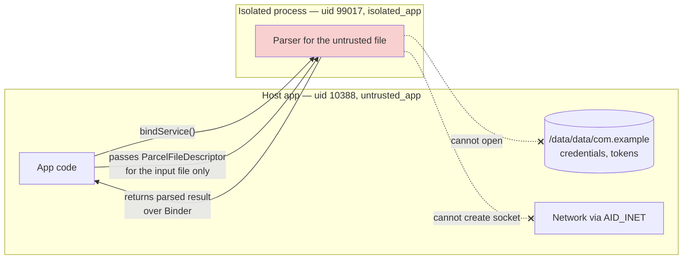

Read the two crossed-out arrows as the entire value proposition. An attacker who achieves arbitrary code execution inside the isolated process has achieved code execution *in a process with no data, no permissions, and no network*. To do anything useful they must then find a second bug — in the host app's handling of the parsed result, or in Binder, or in the kernel.

#### Where the platform uses it

Android does not merely offer this to developers; it relies on it heavily itself, and the two flagship users are worth knowing because they show what "correct use" looks like.

**WebView renderers.** Chromium's multi-process architecture splits the browser into a privileged browser process and unprivileged renderer processes that do the actual HTML/CSS/JS parsing and execution. On Android, WebView implements the renderer as a set of services declared in the WebView provider APK:

```xml
<!-- Conceptually, as declared by the WebView provider APK -->
<service
    android:name="org.chromium.content.app.SandboxedProcessService0"
    android:isolatedProcess="true"
    android:externalService="true"
    android:process=":sandboxed_process0"
    android:exported="false" />
```

Two attributes together do something subtle here. `isolatedProcess="true"` gives the renderer the isolated sandbox. `android:externalService="true"` means the process is charged to — and its lifetime tied to — the *client* app that binds it, not the WebView provider. So when your app shows a WebView, the renderer that executes the page's JavaScript runs in an isolated process associated with your app, with none of your app's privileges. A remote code execution bug in the JavaScript engine therefore lands in `isolated_app`, not in your app's UID. See [43 — WebView](../43-WebView/README.md).

**Media extraction and software codecs.** Media parsing is historically the richest source of remote code execution on Android — an attacker sends a crafted video and the parser mis-handles it. The platform's response was to split media handling into several separate, minimally-privileged processes: `mediaextractor` (container parsing), `mediacodec`/`mediaswcodec` (software decoding), `mediaserver`, and `mediadrm`, each with its own UID, its own SELinux domain, and its own tight seccomp policy built with `minijail`. These are not literally `isolatedProcess` app services — they are native daemons — but the design principle is identical, and `mediaextractor`'s seccomp policy is a good example to read because it is much smaller than the app policy.

#### The App Zygote

Forking every isolated process from the main Zygote means each one starts with only the framework preloaded. If a host app needs *many* isolated processes that all need the same large native library — a browser, a media app — that is wasteful. Android 10 added the **App Zygote**:

```xml
<service
    android:name=".RiskyParserService"
    android:isolatedProcess="true"
    android:useAppZygote="true"
    android:exported="false" />
```

With `useAppZygote="true"`, the platform creates a per-app Zygote (which itself runs isolated), lets the app preload shared state into it by implementing `android.app.ZygotePreload`, and then forks all of that app's isolated processes from it. They then share the preloaded pages copy-on-write. Those processes take UIDs from the 90000–98999 range rather than 99000–99999, which is how you tell them apart in `ps`.

> **Pentester's Note**
> `android:isolatedProcess="true"` in a target's manifest is a **positive** finding, and you should say so. Reports that only ever list problems train clients to treat the report as an adversarial document. When you see an app that parses untrusted input in an isolated process, write it up in a "controls observed" section: it demonstrates the developer understood the threat model, and it makes your negative findings land harder. The inverse is a genuine finding: an app that runs a bundled native parser for user-supplied files directly in the main process, where a memory-safety bug yields the app's full identity, when the platform offered a one-attribute mitigation.

### 3.8 The SDK Runtime — Privacy Sandbox on Android

#### The problem

An advertising SDK compiled into your app is *your app*. Same process, same UID, same data directory, same permissions, same network access, same address space. It can read every field of every object you hold, including the decrypted contents of your credential store. It inherits `INTERNET` and can send anything anywhere. From the platform's point of view there is no SDK — there is only your app, doing whatever the SDK does. Historically this has been the source of a very large amount of unexpected data collection, and it is not something the classic sandbox model can express at all, because the classic model's unit of isolation is the app.

#### What the SDK Runtime does

The **SDK Runtime**, part of the Privacy Sandbox on Android and available from Android 14 (API 34) with developer-preview support earlier, moves participating SDKs out of the app's process into a *separate process with a separate UID*.

| Property | Value |
|---|---|
| Process | `com.android.sdksandbox` hosting the SDK's code, one sandbox process per app |
| UID | `appUid + 10000`, landing in the 20000–29999 range (`Process.FIRST_SDK_SANDBOX_UID` = 20000). So an app at 10388 gets a sandbox at 20388, and `Process.toSdkSandboxUid()` performs exactly this arithmetic. |
| SELinux domain | `sdk_sandbox` (with the `sdk_sandbox_all` attribute and per-target-version variants such as `sdk_sandbox_34`, `sdk_sandbox_next`) |
| Data | `/data/misc_ce/<userId>/sdksandbox/<pkg>/<sdkName>@<random>` and the DE equivalent under `/data/misc_de/`. The app cannot read it, and the SDK cannot read the app's. |
| Permissions | A narrow, fixed set. Not the host app's permissions. |
| Network | Restricted; the roadmap constrains it further over time. |
| UI | The SDK renders through `SurfaceControlViewHost` into a `SurfacePackage` that the app composites — so the SDK draws on screen without either side being able to read the other's view hierarchy. |

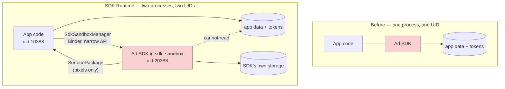

The API surface is `android.app.sdksandbox.SdkSandboxManager`, with `loadSdk()`, `requestSurfacePackage()`, and `unloadSdk()`; SDKs implement `SandboxedSdkProvider`. The `<uses-sdk-library>` manifest element declares the dependency, which is resolved at install time much like a shared library.

> **Warning**
> The SDK Runtime is opt-in and adoption is partial. Do not assume a target app's advertising SDKs are sandboxed. Check for `<uses-sdk-library>` in the manifest and for a `com.android.sdksandbox` process at runtime. If they are absent — which is the common case today — every third-party SDK in the APK runs with the app's full identity, and that fact belongs in your report's discussion of third-party risk. Conversely, if the app *does* use the SDK Runtime, your analysis has to cover an extra process and an extra IPC surface.

### 3.9 Network isolation — `INTERNET` as a group membership

#### Why this is unusual and worth understanding

Almost every Android permission is checked in the framework, in Java, inside `system_server`. `INTERNET` is different: it is enforced by the **kernel**, and the mechanism is Unix group membership.

The `platform.xml` file maps certain permissions to Linux GIDs:

```xml
<!-- /system/etc/permissions/platform.xml (excerpt, illustrative) -->
<permissions>
    <permission name="android.permission.INTERNET">
        <group gid="inet" />
    </permission>
    <permission name="android.permission.BLUETOOTH">
        <group gid="net_bt" />
    </permission>
    <permission name="android.permission.BLUETOOTH_ADMIN">
        <group gid="net_bt_admin" />
    </permission>
    <permission name="android.permission.NET_ADMIN">
        <group gid="net_admin" />
    </permission>
    ...
</permissions>
```

When `PackageManagerService` computes an app's supplementary GID list at install time, it walks the granted install-time permissions and appends the mapped GIDs. Zygote then passes those to `setgroups()` before dropping the UID, as shown in §2.4 step 5.

| GID | Symbolic name | Confers |
|---|---|---|
| 3001 | `AID_NET_BT_ADMIN` | Bluetooth administration |
| 3002 | `AID_NET_BT` | Bluetooth sockets |
| **3003** | **`AID_INET`** | **Creating `AF_INET`/`AF_INET6` sockets — i.e. the whole of networking** |
| 3004 | `AID_NET_RAW` | Raw sockets (`SOCK_RAW`) — ping, packet crafting |
| 3005 | `AID_NET_ADMIN` | Network configuration |
| 3006 | `AID_NET_BW_STATS` | Read bandwidth statistics |
| 3007 | `AID_NET_BW_ACCT` | Change bandwidth accounting |
| 3009 | `AID_READPROC` | Read other processes' `/proc` entries |
| 3010 | `AID_WAKELOCK` | Take kernel wakelocks |

#### The enforcement mechanism, then and now

**Historically** (and still on many older kernels in the field), Android carried an out-of-tree kernel patch enabled by `CONFIG_ANDROID_PARANOID_NETWORK`. It inserted a check into the socket-creation path: creating an `AF_INET` socket required membership of `AID_INET`; creating a `SOCK_RAW` socket required `AID_NET_RAW`; and so on. The name "paranoid networking" is the actual name of the config option, and you will see it in kernel sources and in older write-ups.

**Currently**, mainline and GKI (Generic Kernel Image) kernels refused to carry that patch, so Android moved the enforcement to **eBPF cgroup hooks**. A BPF program attached to the `cgroup/inet_create_socket` (and related) attach points consults a map of permitted UIDs, maintained by the networking stack in the Connectivity Mainline module, and rejects socket creation for UIDs that lack `INTERNET`. The same eBPF machinery also implements per-UID traffic accounting, data-saver, firewall chains, and VPN routing.

The practical consequence is identical either way:

```java
// Java — inside an app WITHOUT android.permission.INTERNET
Socket s = new Socket("example.com", 80);
// java.net.SocketException: socket failed: EACCES (Permission denied)
```

The exception surfaces from the `socket()` syscall itself with `EACCES`, *before* any DNS lookup or connection attempt. It is not a framework check that could be hooked away inside the app's own process.

> **Pentester's Note**
> This is the one permission you genuinely cannot bypass with Frida from inside the app's own process, because the check is in the kernel against the process's group list, and the group list was fixed at fork time by a privileged parent. You can hook `Socket`'s constructor all you like; the syscall will still fail. What you *can* do — and this is the actual attack path, covered in §5 — is get another app that *does* have `INTERNET` to send the data for you. That is permission re-delegation, and it is why the platform's answer to it is not "block the syscall harder" but "audit exported components". See [23 — Permissions §3.9](../23-Permissions/README.md).

> **Mental Model**
> `INTERNET` is a *normal*-protection-level permission, granted automatically at install with no prompt, which people take to mean it is unimportant. Invert that. It is the permission with the strongest enforcement mechanism in the entire system — kernel-level, unhookable, un-revocable at runtime — and it is granted to essentially every app without the user ever seeing it. The strength of the mechanism and the strength of the *policy* are completely independent variables. Keep them separate in your head, and in your reports.

### 3.10 Package visibility — the metadata sandbox

#### What problem this solves

Until Android 11, any app could call `PackageManager.getInstalledPackages()` and receive the complete list of every application on the device. That list is intensely revealing: it tells you which bank the user banks with, whether they use a dating app, which messaging apps they trust, whether a competitor's product is installed, whether security tooling is present, and often enough about the person to be used for fingerprinting and profiling.

None of this is a *data* leak in the classic sandbox sense. No app's files were read. It is a *metadata* leak, and the classic sandbox has nothing to say about it.

#### The Android 11 change

From Android 11 (API 30), an app that targets API 30 or above sees a **filtered** view of the package universe. By default it can see:

- Itself.
- Packages that are visible to everyone (a small set the platform declares).
- Packages it has interacted with — for example, one it is bound to, or that it has been launched by.
- Packages that share its UID.
- Packages matching a declaration in its own manifest.

To see anything else, the app must declare it up front:

```xml
<!-- AndroidManifest.xml -->
<manifest ...>
    <!-- Option 1: name a specific package -->
    <queries>
        <package android:name="com.example.partnerapp" />
    </queries>

    <!-- Option 2: name an intent shape you need to resolve -->
    <queries>
        <intent>
            <action android:name="android.intent.action.SEND" />
            <data android:mimeType="image/*" />
        </intent>
    </queries>

    <!-- Option 3: name a provider authority -->
    <queries>
        <provider android:authorities="com.example.partner.provider" />
    </queries>
</manifest>

<!-- Option 4: the blunt instrument — see everything -->
<uses-permission android:name="android.permission.QUERY_ALL_PACKAGES" />
```

`QUERY_ALL_PACKAGES` is a normal-protection-level permission but Google Play imposes a policy restriction on it: apps must justify it against a narrow list of acceptable use cases (antivirus, device management, file managers, banking anti-fraud in some jurisdictions), and Play rejects apps that request it without justification.

#### Where the filtering happens

The enforcement lives in `system_server`, in `AppsFilter`, which is consulted on the return path of essentially every `PackageManager` query. It is not a permission check in the usual sense; it is a *filter* applied to results.

| API level | Behaviour |
|---|---|
| ≤ 29 | No filtering. `getInstalledPackages()` returns everything. |
| 30+, app targets ≤ 29 | No filtering (legacy compatibility). |
| 30+, app targets 30+ | Filtered unless `<queries>` or `QUERY_ALL_PACKAGES` says otherwise. |

> **Warning**
> Package visibility filtering is a *privacy* control, not a security boundary, and the distinction matters when you write it up. There have been repeated demonstrations that the filtered view leaks through side channels — timing differences, error-message differences between "not installed" and "not visible", `Intent` resolution behaviour, and observable side effects of `bindService`. Do not tell a client that an app is *unable* to determine what else is installed. Tell them it is *not permitted to enumerate*, that enumeration is now visible in the manifest and therefore auditable, and that determined fingerprinting remains feasible. The honest framing is "raises the cost and creates an audit trail", exactly as with most privacy controls. Full treatment in [23 — Permissions §3.11](../23-Permissions/README.md).

### 3.11 Scoped storage — the sandbox extended to shared files

#### The pre-Android-10 situation

Shared external storage (`/sdcard`, `/storage/emulated/0`) was, for most of Android's life, a free-for-all. An app with `READ_EXTERNAL_STORAGE` could read every file every other app had ever written there; with `WRITE_EXTERNAL_STORAGE` it could modify or delete them. Since a very large number of apps wrote caches, downloads, exported documents, and sometimes credentials to shared storage, "grant storage permission" effectively meant "grant access to everything anyone has ever put on the SD card".

That is a sandbox hole by construction: the sandbox governs `/data/data`, and developers were putting sensitive data outside it.

#### What scoped storage changes

| Concept | Behaviour from Android 11 (API 30) |
|---|---|
| **App-specific external directory** | `/storage/emulated/0/Android/data/<pkg>/`. No permission required for your own. **Other apps cannot access it**, including via direct file paths — this is enforced by the FUSE daemon. Removed on uninstall. |
| **Media collections** | Images, video, audio in `MediaStore`. An app can read its *own* contributions with no permission; reading others' requires `READ_MEDIA_IMAGES` / `READ_MEDIA_VIDEO` / `READ_MEDIA_AUDIO` (API 33+) or `READ_EXTERNAL_STORAGE` (earlier). |
| **Downloads and documents** | Reached through the Storage Access Framework (`ACTION_OPEN_DOCUMENT`, `ACTION_CREATE_DOCUMENT`), where the *user* picks the file and the app receives a URI grant. No blanket permission at all. |
| **`MANAGE_EXTERNAL_STORAGE`** | The "all files access" special permission. Requires a Settings toggle, a separate user journey, and Play policy justification. Grants near-total access to shared storage. |
| **`requestLegacyExternalStorage`** | An opt-out that worked on Android 10 and is ignored from Android 11 for apps targeting 30+. |
| **FUSE** | From Android 11, `/storage/emulated/<user>` is a FUSE filesystem serviced by the `MediaProvider` app, so every open/read/write can be policy-checked in userspace. It replaced the older `sdcardfs` kernel shim. |

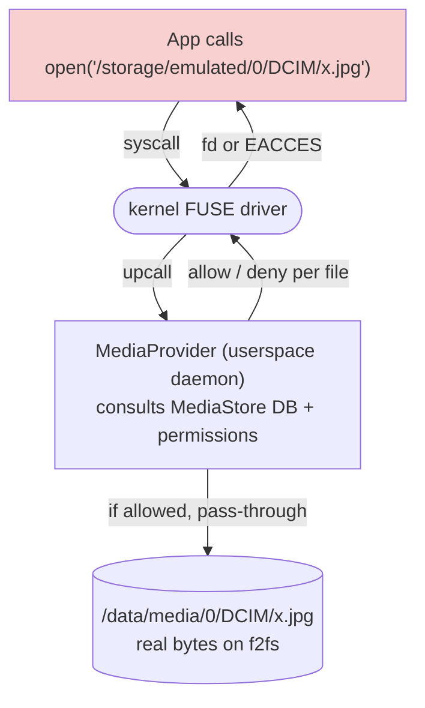

The essential architectural point is that a *userspace* process now sits in the path of every file operation on shared storage and can apply arbitrarily rich policy — "is this file one you created?", "do you hold `READ_MEDIA_IMAGES`?", "is this another app's `Android/data`?" — which a plain Unix permission bit could never express. The cost is performance, which is why Android added FUSE passthrough to shortcut the data path once a file has been authorised.

> **Pentester's Note**
> Scoped storage changed what "insecure data storage on external storage" means, and your testing must reflect the target's `targetSdkVersion`. On a target below 30 with legacy storage, a file in `/sdcard/Download/token.txt` is readable by every app with storage permission — a straightforward finding. On a target at 30+, the same file is in a shared collection and reachable through `MediaStore` by an app with the right media permission, or by anything with `MANAGE_EXTERNAL_STORAGE`, or by the user with a file manager, or over ADB — still a finding, but a differently-scoped one. Meanwhile a file in `Android/data/<pkg>/` is now genuinely protected from other apps but remains fully accessible to the user and to root. Write the finding with the right adversary named. See [33 — Storage](../33-Storage/README.md).

### 3.12 `android:process` — the thing that looks like a boundary and is not

A developer may split their app across multiple processes:

```xml
<service android:name=".SyncService" android:process=":sync" />
<provider android:name=".DataProvider" android:process="com.example.shared" />
```

A leading colon means "private to this app"; a fully-qualified name means the process can be shared with another app that has the same `sharedUserId` and signature.

What this **does** give you:

| Benefit | Explanation |
|---|---|
| Separate address spaces | A native memory-corruption bug in one process does not directly corrupt the other's heap. |
| Crash isolation | One process crashing does not necessarily kill the other. |
| Independent memory limits and lifecycle | The `:sync` process can be killed under memory pressure without taking the UI down. |
| Independent `ART` heaps | Useful for large-heap workloads. |

What this **does not** give you, and this is the part that gets written up wrongly:

| Non-benefit | Why |
|---|---|
| A different UID | Both processes run as the same UID. `getuid()` returns the same number. |
| A different data directory | Both open `/data/data/<pkg>/` freely. |
| A different SELinux domain | Both are `untrusted_app` with the *same* MCS categories. |
| Different permissions | Permission checks are per-UID, not per-process. Both hold every granted permission. |
| Protection from each other | Either can `ptrace` the other (same UID, `ptrace_scope` permitting), read `/proc/<pid>/mem`, connect to its abstract sockets, and open its files. |

> **Warning**
> Never write "the app isolates its parsing code in a separate process" as a mitigating control when the manifest says `android:process` and not `android:isolatedProcess`. They are one word apart in XML and an entire security boundary apart in effect. An attacker with code execution in a `:sync` process is, from the kernel's point of view, the app. The correct sentence is: "the app splits into multiple processes, which limits crash blast radius but provides no security isolation, because all processes share the UID and SELinux context; `android:isolatedProcess` would provide isolation and is not used."

### 3.13 `run-as` — and exactly why it only works on debuggable apps

`/system/bin/run-as` is the tool that lets a developer execute a command *as their own app's UID*, which is how `adb shell run-as com.example.app ls files/` works.

```bash
# adb shell — on a debuggable app
run-as com.example.debugapp id
# uid=10388(u0_a288) gid=10388(u0_a288) groups=...,3003(inet) context=u:r:runas_app:s0:c32,c257,...

run-as com.example.debugapp cat shared_prefs/settings.xml

# on a release app
run-as com.example.releaseapp id
# run-as: package not debuggable: com.example.releaseapp
```

#### How it works, step by step

`run-as` is a small setuid-capable native binary. It is **not** setuid-root in the classic sense on modern Android; instead it carries **file capabilities** — specifically `CAP_SETUID` and `CAP_SETGID` in its permitted and effective file capability sets, assigned by the platform's filesystem config so that `init` applies them when building `/system`. This is a narrower grant than setuid-root, which is the modern preference.

Its logic is:

1. **Check the caller.** The real UID must be `AID_SHELL` (2000) or `AID_ROOT` (0). An ordinary app calling `run-as` is rejected immediately. This is the first and most important gate — `run-as` is a *developer* tool reachable from ADB, not an app-reachable API.
2. **Look up the package.** It queries the package's record — historically by parsing `/data/system/packages.list`, and on modern releases through a small helper interface to `PackageManager` — to obtain the UID, the data directory, the `seinfo`, and the **debuggable flag** (field 3 of `packages.list`).
3. **Require debuggable.** If the `FLAG_DEBUGGABLE` bit is not set, it prints `package not debuggable` and exits. On `userdebug`/`eng` builds where `ro.debuggable=1`, this check is relaxed so that all apps are treated as debuggable.
4. **Change identity.** `setgid()` then `setuid()` to the package's UID/GID, and set the supplementary groups.
5. **Change SELinux context.** Transition into the `runas_app` domain with the package's MCS categories, so that the resulting shell is constrained the same way the app is.
6. **`chdir()`** into the app's data directory.
7. **`execve()`** the requested command, or `/system/bin/sh` if none was given.

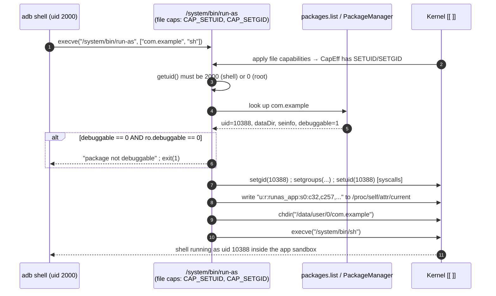

#### Why the debuggable check exists

Without it, anybody with ADB access — which includes anybody who can get the user to enable USB debugging and tap "allow", and anybody who steals an already-authorised device — could read every app's private data on any device. The debuggable flag is the app developer's explicit statement that this particular build is a development artefact whose data is not real. Release builds set `android:debuggable="false"` (which is also the default, and which the Play build pipeline enforces), so `run-as` refuses.

> **Pentester's Note**
> Three practical consequences you will use constantly.
> **First**, if `run-as` works on a production app you downloaded from Play, that is a finding in itself: the developer shipped a debuggable build. It means the app is also attachable with `jdb` and the Android Studio debugger, which is a far bigger problem than the file access. Check with `aapt dump badging base.apk | grep debuggable` or by reading the manifest.
> **Second**, on a `userdebug` emulator image, `ro.debuggable=1`, so `run-as` works on *every* app. That is why your emulator experiments succeed and the same command fails on the client's Pixel. Do not build a methodology around emulator behaviour without checking it on a `user` build.
> **Third**, `run-as` gives you the app's UID *and* the app's SELinux constraints. It is not root. It is the cleanest way to inspect an app's data directory without rooting the device at all, and on engagements where you are given a debuggable build it should be the first thing you reach for — it is far less invasive than rooting and produces cleaner evidence.

#### Repackaging to make an app debuggable

The standard technique when `run-as` is refused is to decompile, add `android:debuggable="true"`, rebuild, and re-sign:

```bash
# host
apktool d target.apk -o target_src
# edit target_src/AndroidManifest.xml: add android:debuggable="true" to <application>
apktool b target_src -o target_patched.apk
apksigner sign --ks debug.keystore --ks-pass pass:android target_patched.apch
adb install -r target_patched.apk
adb shell run-as com.target.app ls -la
```

This works, and it also **changes the signing certificate**, which breaks anything that depends on signature identity: signature-level permissions shared with the vendor's other apps, `signingInfo` checks the app performs on itself, certificate pinning keyed to the app's own signature, Play Integrity's `appIntegrity` verdict, and any server-side attestation of the APK. Expect the repackaged app to behave differently and account for that in your findings. See [67 — Bypassing Protections](../67-BypassingProtections/README.md) and [38 — Tamper Detection](../38-TamperDetection/README.md).

---
### 3.14 What the sandbox does NOT protect against

This is the most important section in the chapter. Almost every bad mobile security finding, and almost every bad developer assumption, comes from believing the sandbox covers something it does not. Be ruthless and honest here.

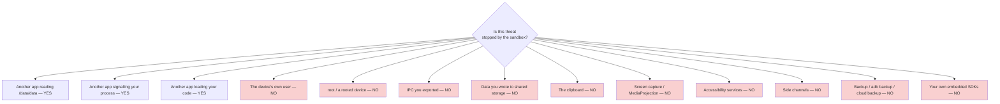

#### 3.14.1 The user themselves

The sandbox is a boundary between *applications*. It was never a boundary between the application and the **person holding the phone**. That person owns the hardware, can enable developer options, can connect a cable, can install a file manager, can take a photograph of the screen, and — with an unlocked bootloader — can replace the operating system.

Concretely, without any root at all, a user can:

- Read every byte the app displays, by looking at it.
- Enable USB debugging and pull anything `adb backup` will give them (if `android:allowBackup="true"`, which is the default below API 31 and still common).
- Use `adb shell run-as` if the build is debuggable.
- Install an instrumented copy of the app after repackaging it.
- Run the app in an emulator they fully control.
- Intercept every network request with a proxy and a user-installed CA (subject to the Network Security Config — see [44 — NetworkSecurityConfig](../44-NetworkSecurityConfig/README.md)).

> **Mental Model**
> The correct question is never "can the user get at this data?" — the answer is always yes, given enough motivation. The correct question is "**what does the user gain by getting at it, and does that gain come at anyone else's expense?**" If a user extracts their own session token, they have learned their own secret, which costs nobody anything. If a user extracts a *global* API key that lets them query other users' records, or a client-side price calculation they can rewrite, or a feature flag that unlocks a paid tier, the sandbox's irrelevance suddenly matters enormously. That distinction — *whose* secret is it — is the single most useful triage question in mobile security.

#### 3.14.2 Root

Root is not one thing; it is a *set* of powers, and it is worth being precise because the naïve statement "root sees everything" is not quite right on modern Android.

| Power | Does root have it? | Notes |
|---|---|---|
| Ignore file permission bits | Yes, via `CAP_DAC_OVERRIDE` | DAC is completely defeated |
| Read any process's memory | Yes, via `/proc/<pid>/mem` and `ptrace` | Subject to SELinux and Yama |
| Bypass SELinux | **No, not automatically** | SELinux is MAC. Root in a confined domain is still confined. Root tooling therefore ships a policy patcher. |
| Install a kernel module | Only if the kernel permits it and the module is signed appropriately | Modern Android generally does not |
| Read `/data/data` of any app | Yes, in practice, because root tooling patches policy to allow it | The DAC part is free; the SELinux part is the work |

The reason root *effectively* sees everything on a Magisk-rooted device is that Magisk uses `magiskpolicy` to inject `allow` rules into the loaded policy at boot, creating a domain (`magisk`) that policy permits to do essentially anything, and then transitions `su` sessions into it. Without that step, `su` would give you UID 0 in a domain that could not read `app_data_file`. See [22 §5.4](../22-SELinux/README.md) and [62 — Magisk](../62-Magisk/README.md).

> **Warning**
> An app cannot reliably detect root, and a report that says "add root detection" as the remediation for an insecure-storage finding is a bad report. Root detection is a *signal*, evaluated server-side, that raises the cost of automated abuse. It is not a control. The remediation for "the session token is readable from the data directory" is not "detect root"; it is "bind the token to a hardware-backed key requiring user authentication, shorten its lifetime, and enforce the real authorisation decision on the server". See [37 — Root Detection](../37-RootDetection/README.md).

#### 3.14.3 IPC you voluntarily exposed

The sandbox has exactly the holes the developer punched in it. An exported `Activity`, `Service`, `BroadcastReceiver`, or `ContentProvider` is a doorway through the wall that the developer built on purpose, and the kernel will happily let any app walk through it, because the developer said so in the manifest.

```xml
<!-- The sandbox is intact. This is a door in it. -->
<provider
    android:name=".NotesProvider"
    android:authorities="com.example.notes.provider"
    android:exported="true" />
```

The file `/data/data/com.example/databases/notes.db` is still mode `0600`, still owned by UID 10388, still labelled with per-app MCS categories. No other app can `open()` it. And it does not matter at all, because any app can call `content://com.example.notes.provider/notes` and be handed the rows over Binder by the app itself.

> **Mental Model**
> Think of Binder IPC as a *courier service*. The sandbox is a locked room; the courier is allowed in and out. The kernel checks that the courier is a legitimate courier. It has no opinion whatsoever about what is in the parcel, or whether the person who handed it over should have. That check is entirely the app's responsibility, expressed through `android:exported`, `android:permission`, and explicit `checkCallingPermission()` calls. This is why chapters [24](../24-IPC/README.md) through [29](../29-BroadcastReceivers/README.md) exist and why they are where most real findings come from.

An easily-missed sub-case: a `ContentProvider` with `android:exported="false"` but `android:grantUriPermissions="true"` can still hand out *temporary* access to specific URIs via `Intent.FLAG_GRANT_READ_URI_PERMISSION`. That is a deliberate, scoped hole, and it is the correct pattern — but a badly-configured `<grant-uri-permission android:pathPattern=".*" />` turns a scoped hole into an open one. See [27 — ContentProviders](../27-ContentProviders/README.md).

#### 3.14.4 Shared storage

Everything the app writes to a shared collection — `DCIM`, `Pictures`, `Downloads`, `Documents`, `Music` — leaves the sandbox by definition. Scoped storage (§3.11) restricts *who* can read it, but the file is no longer in the app's private tree and its protection now depends on media permissions, on the user's file manager, on cloud photo backup, and on whether any app on the device holds `MANAGE_EXTERNAL_STORAGE`.

The classic finding shapes are:

| Pattern | Why developers do it | Consequence |
|---|---|---|
| Writing an exported PDF/CSV report to `Downloads` | The user asked to "download" it | Any app with media/all-files access, and every cloud backup service, now has the document |
| Caching decrypted attachments on external storage | External storage is bigger and does not count against the app's quota | Decrypted sensitive content outside the sandbox, often left behind after logout |
| Logging to `/sdcard/appname/debug.log` | Easy to retrieve during development | Ships to production surprisingly often; frequently contains tokens |
| Storing an app database on external storage | Historical advice for large data | Fully readable by any storage-permitted app on pre-scoped-storage targets |

#### 3.14.5 The clipboard

The clipboard is, architecturally, a **global shared buffer with no per-app partitioning**. When your app calls `ClipboardManager.setPrimaryClip()`, the data goes into `system_server` and is retrievable by other apps.

Android has hardened this substantially, and you need to know the version matrix precisely, because the answer to "can another app read my clipboard" has changed three times:

| API level | Clipboard read access |
|---|---|
| ≤ 28 | Any app, at any time, including from a background service — the classic clipboard-sniffing malware primitive |
| 29 (Android 10) | Only the app with input focus, or the current default input method (IME). Background reads return null. |
| 31 (Android 12) | As above, plus a system toast ("App pasted from your clipboard") shown to the user on every read, plus `ClipDescription.EXTRA_IS_SENSITIVE` so an app can mark content as sensitive and have it hidden from the clipboard preview UI |
| 33 (Android 13) | Clipboard content is automatically cleared after a timeout |

```java
// Kotlin — the correct way to put a password on the clipboard, if you must
val clip = ClipData.newPlainText("password", secret)
clip.description.extras = PersistableBundle().apply {
    putBoolean(ClipDescription.EXTRA_IS_SENSITIVE, true)
}
clipboardManager.setPrimaryClip(clip)
```

> **Pentester's Note**
> Password managers copying credentials to the clipboard is still a real finding, but on Android 12+ you must test it rather than assume it. Write a probe app that tries to read the clipboard from the background and confirm it gets `null`; then test with the probe app in the foreground; then test with the probe app installed as the default IME, which is the case that still works and is precisely why malicious keyboards are a category. Report what you actually observed on the target's minimum supported API level, not the historical behaviour.

#### 3.14.6 Screen capture, overlays, and MediaProjection

The screen is a shared resource. Three separate mechanisms let one app observe or manipulate another app's screen, and the sandbox governs none of them because none of them touch the other app's files or memory.

| Mechanism | Gate | What it gives the attacker |
|---|---|---|
| `MediaProjection` | The user must approve a system dialog (`createScreenCaptureIntent()`), and from Android 14 the dialog offers "single app" versus "entire screen" | A live video stream of the screen, including other apps. Legitimate for screen recorders and remote-support tools. |
| `SYSTEM_ALERT_WINDOW` (draw over other apps) | A special permission requiring a Settings toggle via `ACTION_MANAGE_OVERLAY_PERMISSION` | Draw arbitrary UI on top of other apps — the tapjacking and fake-login-overlay primitive |
| Accessibility services | The user must enable it in Settings, behind increasing friction | Read the full view hierarchy of every app, including text, and inject clicks |

The app's own defence is `WindowManager.LayoutParams.FLAG_SECURE`, which marks a window as non-capturable — it will appear black in screenshots, in `MediaProjection` output, and on external displays:

```kotlin
// Kotlin — in Activity.onCreate, before setContentView
window.setFlags(
    WindowManager.LayoutParams.FLAG_SECURE,
    WindowManager.LayoutParams.FLAG_SECURE
)
```

It also prevents the window from being placed in the recent-apps thumbnail, which is a related and frequently-missed leak: the system screenshots your app when it goes to the background, and that thumbnail is stored on disk.

> **Warning**
> `FLAG_SECURE` is a real control against screenshots and `MediaProjection`, and it is **not** a control against accessibility services, which read the view hierarchy rather than the pixels, nor against an overlay drawn on top of your window, nor against root, nor against someone with a second phone and a camera. It is worth recommending; it is not worth describing as protection against a determined attacker. From Android 15 there is also additional platform hardening around apps detecting when they are being recorded, but that is detection, not prevention.

#### 3.14.7 Accessibility services — the sanctioned bypass

An enabled accessibility service can, for every app on the device:

- Read the entire view hierarchy, including all text and content descriptions, via `AccessibilityNodeInfo`.
- Receive an event for every window change, every text change, every click.
- Perform actions: click, scroll, type text, press Back, press Home.
- On some configurations, read notification content.

That is a complete defeat of the user-interface layer of the security model, and it is achieved *without violating the sandbox at all*, because the accessibility framework is a legitimate, designed IPC path through `system_server`. The user granted it. Android's answer is friction: increasingly explicit warning dialogs, restrictions on sideloaded apps requesting the setting, and Play policy that restricts the accessibility API to apps that genuinely serve users with disabilities.

This is the single most abused mechanism in Android banking malware. See [23 §3.12](../23-Permissions/README.md) and [69 — Malware Analysis](../69-MalwareAnalysis/README.md).

#### 3.14.8 Side channels

A *side channel* is information that leaks not through a permitted read of the data itself but through an observable side effect: timing, resource usage, the existence of a file, the size of a response, the pattern of network traffic, or an error message that differs between two cases.

The sandbox is a **direct access** control. It has nothing to say about side channels, and Android's history is a long series of individually-patched side channels:

| Channel | Historic leak | Current state |
|---|---|---|
| `/proc/<pid>/` of other processes | Process names, memory usage, and network statistics of other apps | From Android 10, apps see only their own processes; `/proc` is mounted with `hidepid`-equivalent semantics |
| `/proc/net/tcp`, `/proc/net/udp` | Every socket on the device, allowing an app to infer what other apps were connecting to | Restricted from Android 10; readable only with `AID_READPROC`-class privilege |
| `/proc/net/arp` | Local network neighbours | Restricted |
| Package installation state | Whether a specific app is installed | Partially closed by package visibility (§3.10), but timing and error-shape differences remain |
| Broadcast timing and `Intent` resolution | Inference about installed apps and their state | Mitigated by visibility filtering |
| Sensor sampling without permission | Motion sensors sampled at high rate can recover keystrokes and PINs | Rate-limited above 200 Hz without `HIGH_SAMPLING_RATE_SENSORS` from Android 12; still an active research area |
| `getRunningTasks` / `getRecentTasks` | Which app is in the foreground — the classic activity-hijacking primitive | Restricted since Android 5.0; now requires `REAL_GET_TASKS` (signature-level) |
| Shared memory and CPU cache | Cross-process microarchitectural attacks | Fundamentally hard; largely out of scope for app testing |
| Storage usage (`StorageStatsManager`) | Per-app disk usage can reveal user behaviour | Requires `PACKAGE_USAGE_STATS`, a special permission |

> **Pentester's Note**
> Side channels are usually low-severity in an app engagement and are usually the wrong place to spend your time — but there is one genre worth checking every single time: **does the app leak sensitive data into a globally-observable place?** Logcat (see [51 — Dynamic Analysis](../51-DynamicAnalysis/README.md)), which was globally readable before Android 4.1 and is still readable by any app holding `READ_LOGS` on some builds and by anyone with ADB; crash reports sent to a third party; the recents thumbnail; and the notification shade. Those are not exotic microarchitectural channels — they are ordinary carelessness, and they are findable in an afternoon.

#### 3.14.9 Backup

If `android:allowBackup` is `true` — the default for apps targeting below API 31, and still explicitly set true in a great many apps — the app's data directory is eligible for:

- `adb backup` (deprecated and removed as a default path on newer versions, but present on many devices in the field).
- Auto Backup to Google Drive, up to a size quota.
- Device-to-device transfer.

`android:fullBackupContent` and `android:dataExtractionRules` (API 31+) let the developer include or exclude specific paths, and `Context.getNoBackupFilesDir()` is excluded by definition.

```xml
<!-- The right shape for an app with real secrets -->
<application
    android:allowBackup="false"
    android:dataExtractionRules="@xml/data_extraction_rules">
```

```xml
<!-- res/xml/data_extraction_rules.xml (API 31+) -->
<data-extraction-rules>
    <cloud-backup>
        <exclude domain="sharedpref" path="auth.xml" />
        <exclude domain="database" path="secrets.db" />
    </cloud-backup>
    <device-transfer>
        <exclude domain="sharedpref" path="auth.xml" />
    </device-transfer>
</data-extraction-rules>
```

#### 3.14.10 Your own dependencies

Every library the app links — every Gradle dependency, every `.aar`, every `.so`, every advertising or analytics SDK — runs **inside the sandbox, as the app**. There is no intra-app boundary. The SDK holds all the app's permissions, can read all its files, can read its memory, can register its own components in the merged manifest, and can make network requests indistinguishable from the app's own.

The SDK Runtime (§3.8) is the platform's first structural answer to this, and its adoption is partial. Until then, the only real controls are dependency review, network monitoring, and manifest-merge inspection.

```bash
# host — see what the merged manifest actually contains, including SDK contributions
./gradlew :app:assembleRelease
cat app/build/intermediates/merged_manifests/release/AndroidManifest.xml

# host — see what an SDK contributed, from the APK side
apktool d target.apk -o out && grep -n 'provider\|receiver\|service' out/AndroidManifest.xml
```

> **Pentester's Note**
> A `ContentProvider` you did not write, contributed by an SDK, running at app startup with your app's UID, is one of the most reliably interesting things in a modern APK. Many SDKs use a no-op `ContentProvider` purely as an initialisation hook (because providers are created before `Application.onCreate`). Enumerate every provider in the merged manifest and identify which are yours and which are not. Anything unexpected is worth ten minutes.

### 3.15 Sandbox escape — the six classes

"Sandbox escape" means: code running as an ordinary app obtains a capability the sandbox was supposed to deny — most usefully, another app's data, the `system` UID, or kernel code execution.

These are described as **classes** with their mechanisms. Specific CVE identifiers are deliberately not given; if you need to cite one in a report, look it up in the Android Security Bulletin for the relevant month and verify it. Fabricating one destroys a report.

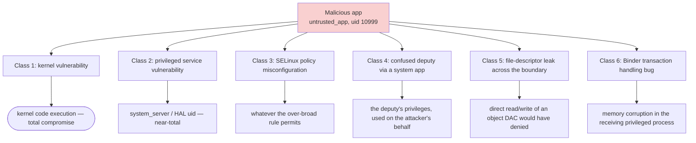

#### Class 1 — Kernel vulnerabilities

The app calls into the kernel through a syscall, an `ioctl`, a `/dev` node, a socket family, or a filesystem, and triggers a memory-safety bug — a use-after-free, an out-of-bounds write, a race causing a double free, an integer overflow in a size calculation. Successful exploitation gives kernel code execution, which defeats DAC, SELinux, seccomp, and capabilities in one step, because all of them are enforced *by* the kernel.

The historically productive surfaces reachable from `untrusted_app` are the `binder` driver itself, GPU drivers (which apps must reach to render anything and which are large, vendor-specific, and less audited than core kernel code), the `ashmem`/`dmabuf` memory-sharing paths, socket families, and vendor-specific `/dev` nodes that policy permits apps to open.

Mitigations that made this substantially harder: seccomp shrinking the reachable syscall set, SELinux restricting which `/dev` nodes an app may open at all, `PAN`/`PXN` and KASLR, Control Flow Integrity in the kernel, the shadow call stack, memory tagging on ARMv9 hardware, and moving increasing amounts of driver logic into userspace HALs.

#### Class 2 — Privileged service vulnerabilities

Rather than attacking the kernel, attack something that runs with a privileged UID and is reachable from an app: `system_server` (UID 1000), a media daemon, a vendor HAL, `installd`, `netd`, or a vendor-specific service registered with `servicemanager`.

The attack pattern is: find a service the app is allowed to talk to (SELinux policy decides which), send it malformed input through its Binder interface, and trigger memory corruption or a logic flaw. Success yields that daemon's UID and SELinux domain — which for `system_server` is very nearly everything, and for a narrow HAL may be only a little.

This is exactly why the platform split `mediaserver` into several minimally-privileged pieces: the value of compromising `mediaextractor` is now much lower than the value of compromising the old monolithic `mediaserver` was.

> **Pentester's Note**
> If you are doing vulnerability research rather than app testing, the highest-yield version of this class is **vendor** services, not AOSP ones. Enumerate them with `service list` and `dumpsys -l` on the target device, diff against a Pixel running the same Android version, and investigate the difference. Vendor-added services are written under the same deadline pressure as apps, reviewed by far fewer eyes, and often reachable from `untrusted_app` because the vendor's policy was written permissively to make things work. See [70 — Vulnerability Research](../70-VulnerabilityResearch/README.md).

#### Class 3 — SELinux policy misconfiguration

The policy is a large, hand-written artefact, and OEMs extend it. A single over-broad rule can hand an app a capability AOSP never intended.

Concrete shapes this takes:

- A vendor `allow` rule granting `untrusted_app` access to a vendor `/dev` node, exposing a driver `ioctl` surface.
- A vendor domain left `permissive` in shipped policy, so that anything that reaches it is unconstrained.
- A vendor service labelled with a type that `untrusted_app` may `find` via `servicemanager`, exposing an interface intended for system use.
- A world-accessible file type on a directory containing something sensitive.
- Missing MCS category constraints on a vendor-defined app-data type, so two apps can reach each other's files.

These are found by dumping the device's policy and analysing it, which is covered in [22 §7](../22-SELinux/README.md).

#### Class 4 — Confused deputy via a system app

> **Definition — confused deputy**
> A *confused deputy* is a program that holds a privilege and can be tricked, by a less-privileged caller, into using that privilege on the caller's behalf. The deputy is not compromised; it is merely obedient. The classic example is a compiler with write access to a billing file being asked to write its output there.

On Android the deputy is typically a preinstalled system or privileged app holding `signature` or `signatureOrSystem` permissions. If such an app exposes an unprotected component that performs a privileged action based on caller-supplied data, any app can invoke it:

- An exported `Activity` that takes a file path and copies it, running as `system` — arbitrary file read/write with system privileges.
- An exported `BroadcastReceiver` that reconfigures a setting based on an extra in the `Intent`.
- A privileged `ContentProvider` proxying arbitrary URIs, letting a caller read content it could not read directly.
- A `Service` that starts an `Intent` supplied by the caller — the "`Intent` redirection" or "`PendingIntent` hijacking" pattern — so that the privileged app performs the caller's `Intent` with the privileged app's identity.

This is the single most common OEM-introduced vulnerability class on Android, and it is also the most accessible to a newcomer, because finding it requires only manifest analysis and `am`/`drozer`, not exploit development. It is covered end to end from the permission side in [23 §3.9](../23-Permissions/README.md) and from the IPC side in [26 — Intent](../26-Intent/README.md).

#### Class 5 — File-descriptor leaks across the boundary

> **Definition — file descriptor passing**
> A Unix file descriptor is a per-process integer handle to a kernel object. A descriptor may be *passed* to another process — over a Unix domain socket with `SCM_RIGHTS`, or over Binder as a `ParcelFileDescriptor`. The receiving process gets a working handle to the same kernel object. **Crucially, the permission check happened at `open()` time, in the sending process. The receiver never has to pass a check.**

That last sentence is the vulnerability. If a privileged process opens a sensitive file and passes the descriptor to an app — deliberately or accidentally, for example by not closing it before `fork`/`exec`, or by handing over a descriptor to a directory rather than a file — the app now has access it could never have obtained itself.

Classic shapes:

- A privileged service opens a file the caller named, checks nothing, and returns a `ParcelFileDescriptor`. Path traversal in the caller-supplied name (`../../`) yields arbitrary file read as the service.
- A descriptor to a **directory** is passed; the receiver uses `openat()` relative to it and escapes the intended subtree.
- A writable descriptor is passed where a read-only one was intended, because `ParcelFileDescriptor.MODE_READ_WRITE` was used out of habit.
- A descriptor is left open across `exec` because `FD_CLOEXEC` was not set, and a child process inherits it. This is why Zygote explicitly closes its server socket in the child (§2.4 step 11).
- An `ashmem`/`memfd` region shared read-write when read-only was intended, letting the receiver modify data the sender is still using — a time-of-check-to-time-of-use primitive against the privileged process.

> **Warning**
> When you review an app's `ContentProvider` that implements `openFile()` or `openAssetFile()`, this is *the* thing to look for. `openFile()` returns a `ParcelFileDescriptor`, and the provider is the one performing the `open()`. If the URI's path segment is concatenated into a filesystem path without canonicalisation, a caller supplying `content://authority/../../databases/secrets.db` gets a descriptor to a file the provider never meant to share, opened with the provider's identity. Use `File.getCanonicalPath()` and verify the result is inside the intended directory, or better, use `FileProvider` with a declared `<paths>` configuration. See [27 — ContentProviders](../27-ContentProviders/README.md).

#### Class 6 — Binder transaction handling bugs

Binder is the transport for essentially all Android IPC, and the marshalling and unmarshalling of `Parcel` data is a serialisation boundary — historically a fertile source of bugs in every system that has one.

The shapes:

- **Parcel mismatch / "Parcel serialization mismatch"**: a class whose `writeToParcel` and `createFromParcel` do not read and write the same number of bytes. A malicious `Parcelable` can then cause the reader to consume a different amount than the writer wrote, so that subsequent fields in a bundle are interpreted from attacker-chosen offsets. When the reader is `system_server` unbundling an `Intent`'s extras, this becomes a way to smuggle a different `Intent` past a check — the "bundle mismatch" / "launch anywhere" family.
- **Type confusion in `Bundle`**: a `Bundle` is lazily unparcelled; a component that reads a key expecting one type and receives another can be induced to misbehave.
- **Integer overflow in size fields** read from a `Parcel` and used to allocate or index.
- **Use-after-free on `binder_node` / reference-counting errors** in the driver, driven by a crafted transaction sequence — this is really Class 1 reached through Binder.
- **`PendingIntent` with an empty base `Intent`**: a privileged app creates a `PendingIntent` whose wrapped `Intent` has no explicit component and no action, and hands it to another app. The recipient can fill in the blanks with `Intent.fillIn()` and cause the *creating* app to perform an arbitrary action with the creator's identity. From Android 12 (API 31), `PendingIntent` must be created with `FLAG_IMMUTABLE` or `FLAG_MUTABLE` explicitly, precisely to force developers to think about this.

```java
// Vulnerable — a mutable PendingIntent with an unspecified target
PendingIntent pi = PendingIntent.getService(
        context, 0, new Intent(),                     // empty base Intent!
        PendingIntent.FLAG_UPDATE_CURRENT);           // pre-API-31: implicitly mutable
otherApp.send(pi);
```

```java
// Fixed — explicit component, and immutable
Intent target = new Intent(context, MyService.class);
target.setAction("com.example.ACTION_SYNC");
PendingIntent pi = PendingIntent.getService(
        context, 0, target,
        PendingIntent.FLAG_UPDATE_CURRENT | PendingIntent.FLAG_IMMUTABLE);
```

---

## 4. Source Code Walkthrough (AOSP)

Every path below is a real directory or file in the AOSP tree. No line numbers are given, because they change with every release and quoting them would be fabrication. Where a function name is given, it is the name you should search for within that file.

### 4.1 UID and GID definitions

| Path | What lives there |
|---|---|
| `system/core/libcutils/include/private/android_filesystem_config.h` | The `AID_*` constants — `AID_ROOT`, `AID_SYSTEM`, `AID_SHELL`, `AID_INET`, `AID_APP_START`, `AID_ISOLATED_START`, `AID_USER_OFFSET`. The single most useful header in the platform for a security person. |
| `system/core/libcutils/canned_fs_config.cpp`, `fs_config.cpp` | The table mapping filesystem paths to owner, group, mode, and **file capabilities** — this is where `/system/bin/run-as` gets `CAP_SETUID`/`CAP_SETGID`. |
| `frameworks/base/core/java/android/os/Process.java` | The Java-side mirror: `FIRST_APPLICATION_UID`, `LAST_APPLICATION_UID`, `FIRST_ISOLATED_UID`, `LAST_ISOLATED_UID`, `FIRST_APP_ZYGOTE_ISOLATED_UID`, `LAST_APP_ZYGOTE_ISOLATED_UID`, `FIRST_SDK_SANDBOX_UID`, `LAST_SDK_SANDBOX_UID`, `SHELL_UID`, `SYSTEM_UID`, `isApplicationUid()`, `isIsolated()`, `isSdkSandboxUid()`, `toSdkSandboxUid()`. |
| `frameworks/base/core/java/android/os/UserHandle.java` | `getUserId(uid)`, `getAppId(uid)`, `getUid(userId, appId)`, `PER_USER_RANGE` — the arithmetic from §3.1 expressed as code. |
| `bionic/libc/bionic/grp_pwd.cpp` | Bionic's synthetic `getpwuid`/`getgrgid`, which is what turns 10388 into the string `u0_a288`. Read `android_id_to_...` and the OEM/app range handling to see the naming scheme exactly. |

### 4.2 The install path — where the sandbox is created

| Path | What lives there |
|---|---|
| `frameworks/base/services/core/java/com/android/server/pm/PackageManagerService.java` | The orchestrator. Look for the install session handling and the calls into `Settings` for UID allocation. |
| `frameworks/base/services/core/java/com/android/server/pm/Settings.java` | Owns `packages.xml` and `packages.list`. `writeLPr()` is where the `packages.list` line documented in §3.1 is emitted. The appId allocation bitmap lives here. |
| `frameworks/base/services/core/java/com/android/server/pm/InstallPackageHelper.java` | The modern install flow, including data directory preparation. |
| `frameworks/base/services/core/java/com/android/server/pm/AppDataHelper.java` | Calls `installd` to create, restore, and destroy app data directories. |
| `frameworks/native/cmds/installd/InstalldNativeService.cpp` | The privileged implementation: `createAppData`, `destroyAppData`, `restoreconAppData`, `getAppSize`. |
| `frameworks/native/cmds/installd/utils.cpp` | `create_data_user_ce_package_path`, `create_data_user_de_package_path`, and every other path constructor. If you ever need to know exactly where a file for a given package and user lives, read this. |
| `frameworks/native/cmds/installd/binder/android/os/IInstalld.aidl` | The complete list of privileged filesystem operations exposed to `system_server`. |
| `system/sepolicy/private/seapp_contexts` | The rules that decide which SELinux domain and file type a package receives, based on `user=`, `seinfo=`, `name=`, `isPrivApp=`, `targetSdkVersion=`, and more. Detailed in [22 §3.5](../22-SELinux/README.md). |

The install call flow, traced:

1. `PackageInstallerSession.commit()` hands the staged APK to `PackageManagerService`.
2. The APK is parsed (`frameworks/base/core/java/android/content/pm/parsing/`) and its signature verified by `apksig` (`tools/apksig/`).
3. `Settings.addPackageLPw()` allocates a `SharedUserSetting` or a fresh appId from the free bitmap.
4. Install-time permissions are granted and `PermissionManagerService` computes the supplementary GID array via `PermissionManagerService`'s mapping of permission → GID, sourced from `/system/etc/permissions/platform.xml` parsed by `SystemConfig` (`frameworks/base/core/java/com/android/server/SystemConfig.java`).
5. `AppDataHelper.prepareAppDataAfterInstallLIF()` calls `IInstalld.createAppData`.
6. `InstalldNativeService::createAppData` creates directories, sets ownership and mode, then calls `restorecon_app_data_lot`/`selabel_lookup` to apply the SELinux label including the MCS categories.
7. `Settings.writeLPr()` persists `packages.xml` and `packages.list`.

### 4.3 Zygote — where the sandbox is applied to a process

| Path | What lives there |
|---|---|
| `frameworks/base/core/java/com/android/internal/os/ZygoteInit.java` | Zygote's `main()`: preloading, socket creation, and the fork loop. |
| `frameworks/base/core/java/com/android/internal/os/ZygoteConnection.java` | Parses the argument list sent over the Zygote socket (`--setuid`, `--setgid`, `--setgroups`, `--seinfo`, `--nice-name`, `--mount-external`, `--runtime-flags`) and calls into the fork path. |
| `frameworks/base/core/java/com/android/internal/os/Zygote.java` | The Java wrapper for `forkAndSpecialize()`, `forkSystemServer()`, `forkUsapt`/USAP pool handling, and `forkSimpleApps`. |
| `frameworks/base/core/jni/com_android_internal_os_Zygote.cpp` | **The heart of the sandbox.** `SpecializeCommon()` performs, in order: `SetGids`, `SetRLimits`, `setresgid`, `setresuid`, `SetCapabilities`, `SetSchedulerPolicy`, `SetUpSeccompFilter`, `selinux_android_setcontext`, mount-namespace setup, and finally the callback into managed code. Read this function top to bottom; it is perhaps 300 lines and it *is* the sandbox. |
| `frameworks/base/core/jni/com_android_internal_os_Zygote.cpp` — `isolateAppData`, `BindMountAppDataDirs`, `CreateProcessGroup` | The per-process mount namespace work that gives each app its own view of `/storage` and, on modern releases, its own bind-mounted view of app data. |
| `bionic/libc/seccomp/` | The generated seccomp filter tables and the `SECCOMP_ALLOWLIST_*.TXT` / `SECCOMP_BLOCKLIST_*.TXT` inputs. `seccomp_policy.cpp` exposes `set_app_seccomp_filter()`, `set_app_zygote_seccomp_filter()`, and `set_system_seccomp_filter()`. |
| `system/core/libcutils/include/cutils/multiuser.h` | `multiuser_get_user_id`, `multiuser_get_app_id`, `multiuser_get_uid` — the native version of the UID arithmetic. |

The complete path from "the user taps an icon" to "the app's first instruction runs in a sandbox":

1. `ActivityTaskManagerService` decides a process is needed for the component.
2. `ProcessList.startProcessLocked()` (`frameworks/base/services/core/java/com/android/server/am/ProcessList.java`) assembles the UID, GID array, `seInfo`, target SDK, ABI, mount mode, and runtime flags.
3. `ZygoteProcess.start()` (`frameworks/base/core/java/android/os/ZygoteProcess.java`) writes the argument list to `/dev/socket/zygote` (or `zygote_secondary` for the other ABI).
4. `ZygoteConnection.processCommand()` parses it into a `ZygoteArguments`.
5. `Zygote.forkAndSpecialize()` → JNI → `com_android_internal_os_Zygote_nativeForkAndSpecialize` → `fork()` → in the child, `SpecializeCommon()`.
6. `SpecializeCommon()` drops privileges in the order described in §2.4 and calls `selinux_android_setcontext(uid, is_system_server, seinfo, nice_name)` from `system/security/libselinux/src/android/android_platform.c`, which consults `seapp_contexts` and writes the resulting context to `/proc/self/attr/current`.
7. Control returns to managed code at `ZygoteInit.zygoteInit()`, which calls `RuntimeInit.applicationInit()` and then `ActivityThread.main()`.
8. `ActivityThread` binds to `ActivityManagerService`, receives the application info, creates the `Application` object, and finally calls the app's own `Application.onCreate()` — the first line of code the app's developer wrote.

Everything security-relevant happened at step 6, two steps before any developer-written or attacker-written code existed in the process.

### 4.4 `run-as`

| Path | What lives there |
|---|---|
| `system/core/run-as/run-as.cpp` | The whole implementation. Read `main()`: the `AID_SHELL`/`AID_ROOT` check, the package lookup, the `FLAG_DEBUGGABLE` test, the `setresgid`/`setresuid` sequence, and the `selinux_android_setcontext` call. |
| `system/core/libpackagelistparser/` | The parser for `/data/system/packages.list` used by `run-as` and other native tools. It defines the field order documented in §3.1. |
| `system/core/libcutils/fs_config.cpp` and the device's `android_filesystem_config.h` | Where `run-as` is assigned its file capabilities rather than the setuid bit. |

### 4.5 Isolated processes and the SDK sandbox

| Path | What lives there |
|---|---|
| `frameworks/base/services/core/java/com/android/server/am/ActiveServices.java` | Where `isolatedProcess` is honoured: the isolated UID is allocated here, from the isolated ranges, when a service with the flag is bound. |
| `frameworks/base/services/core/java/com/android/server/am/ProcessList.java` | Isolated UID allocation and recycling. |
| `frameworks/base/core/java/android/content/pm/ServiceInfo.java` | `FLAG_ISOLATED_PROCESS`, `FLAG_EXTERNAL_SERVICE`, `FLAG_USE_APP_ZYGOTE` — the manifest attributes as parsed flags. |
| `system/sepolicy/private/isolated_app.te`, `system/sepolicy/public/isolated_app.te` | The `isolated_app` domain's policy. Read the `neverallow` rules in particular; they encode exactly what the platform guarantees an isolated process can never do. |
| `packages/modules/AdServices/sdksandbox/` | The SDK Runtime implementation: `SdkSandboxManagerService`, the sandbox process, and the `SandboxedSdkProvider` contract. |
| `system/sepolicy/private/sdk_sandbox*.te` | The `sdk_sandbox` domain policy. |
| `frameworks/base/core/java/android/app/ZygotePreload.java` | The App Zygote preload interface. |

### 4.6 Networking and package visibility

| Path | What lives there |
|---|---|
| `frameworks/base/data/etc/platform.xml` (installed at `/system/etc/permissions/platform.xml`) | The permission → GID mapping, including `INTERNET` → `inet`. |
| `frameworks/base/services/core/java/com/android/server/SystemConfig.java` | Parses `platform.xml` and builds the in-memory permission-to-GID table. |
| `packages/modules/Connectivity/` (and historically `system/netd/`) | The eBPF programs and maps that implement per-UID socket and traffic policy on modern kernels. |
| `frameworks/base/services/core/java/com/android/server/pm/AppsFilter.java` | Package visibility. `shouldFilterApplication()` is the decision function; read it to see exactly which relationships grant visibility. |
| `frameworks/base/core/java/android/content/pm/PackageManager.java` | The public API surface whose results `AppsFilter` filters. |

### 4.7 One complete trace: `new File("/data/data/other/x").canRead()` from Java to kernel

1. **Java**: `java.io.File.canRead()` → `FileSystem.checkAccess(file, ACCESS_READ)` in `libcore/ojluni/src/main/java/java/io/`.
2. **libcore native**: `UnixFileSystem_md.c` / `libcore/luni/src/main/native/` → `access()` or `faccessat()`.
3. **Bionic**: `faccessat()` wrapper in `bionic/libc/bionic/faccessat.cpp` issues the `syscall` instruction with the syscall number for `faccessat`.
4. **seccomp**: the kernel's syscall entry path runs the installed BPF filter over the syscall number and arguments. `faccessat` is on the app allowlist, so `SECCOMP_RET_ALLOW`.
5. **VFS path walk**: `fs/namei.c` walks each component. For each directory it calls `inode_permission()` → `do_inode_permission()` → the filesystem's `permission` operation → `generic_permission()`, which performs the DAC check described in §3.2.
6. **LSM hook**: `inode_permission()` also calls `security_inode_permission()`, which dispatches to SELinux's `selinux_inode_permission()` in `security/selinux/hooks.c`. That builds an AVC query from the task's security context and the inode's, and calls `avc_has_perm()`.
7. **AVC**: `security/selinux/avc.c` looks the decision up in the access vector cache; on a miss it consults the loaded policy in `security/selinux/ss/services.c`.
8. **Result**: on denial, `avc_has_perm()` returns `-EACCES` and logs an AVC message to the audit subsystem, which surfaces in `dmesg` and in `logcat` via `auditd`. `faccessat` returns `-1` with `errno = EACCES`. Java sees `false`.

The DAC check at step 5 will already have failed for a different app's data directory, so in practice step 6 is never reached for that particular path. But both are there, in series, on every single file operation the system performs.

---
## 5. Security Perspective

### 5.1 How attackers abuse the sandbox

Attackers do not usually break the sandbox. They use the doors.

| Approach | What it actually is | Where it is covered |
|---|---|---|
| Walk through an exported component | The app punched a hole; use it | §5.3, [24 — IPC](../24-IPC/README.md) |
| Read data the app put outside the sandbox | Shared storage, logs, the clipboard, backups | §5.4, §5.5 |
| Get the user to grant a capability that transcends the sandbox | Accessibility, overlay, `MANAGE_EXTERNAL_STORAGE`, `QUERY_ALL_PACKAGES` | [23 §3.12](../23-Permissions/README.md) |
| Become the same UID | `sharedUserId` with a weaker sibling app | §5.2 |
| Be inside the app already | A malicious or compromised SDK | §3.14.10 |
| Attack the platform | Kernel, privileged service, policy, Binder | §3.15 |
| Attack the user's device state | Root the device, or wait for a device that is already rooted | §3.14.2 |

The ordering is deliberate: it is roughly the order of decreasing frequency and increasing cost. In an app engagement you will spend most of your time on rows one and two.

### 5.2 Vulnerability class — `sharedUserId` widening the sandbox

**Vulnerable code:**

```xml
<!-- com.vendor.banking/AndroidManifest.xml -->
<manifest xmlns:android="http://schemas.android.com/apk/res/android"
    package="com.vendor.banking"
    android:sharedUserId="com.vendor.shared">
    ...
</manifest>
```

```xml
<!-- com.vendor.updater/AndroidManifest.xml — same signing key -->
<manifest xmlns:android="http://schemas.android.com/apk/res/android"
    package="com.vendor.updater"
    android:sharedUserId="com.vendor.shared">
    <application>
        <provider
            android:name=".ConfigProvider"
            android:authorities="com.vendor.updater.config"
            android:exported="true" />          <!-- no permission -->
    </application>
</manifest>
```

**Why developers do it:** `sharedUserId` was the documented, supported way to let a suite of apps share data and a login session, and for years it was the *only* way to share a process. Splitting a monolith into a main app plus helpers, while keeping one data store, is a natural refactor. Once shipped, removing it orphans user data, so it becomes permanent.

**Detection — static:**

```bash
# host
apktool d target.apk -o out
grep -n 'sharedUserId' out/AndroidManifest.xml
# or without unpacking:
aapt2 dump xmltree target.apk --file AndroidManifest.xml | grep -i shareduserid
```

Then enumerate every other package on the device declaring the same value:

```bash
# adb shell
pm list packages -U
# then for each: dumpsys package <pkg> | grep -i 'sharedUser\|userId='
```

**Detection — dynamic:**

```bash
# adb shell — two packages, one UID is the tell
pm list packages -U | grep -E 'com.vendor'
# package:com.vendor.banking uid:10412
# package:com.vendor.updater uid:10412      <-- same number
```

**Exploit:** Compromise the weaker sibling — here, via the unprotected exported provider — and you are executing as UID 10412, which *is* the banking app for every purpose the kernel cares about. Read `/data/data/com.vendor.banking/` directly:

```bash
# from a foothold in com.vendor.updater's process
cat /data/data/com.vendor.banking/shared_prefs/session.xml
```

**Secure fix:**

```xml
<!-- New installs get their own UID; existing installs keep the shared one -->
<manifest ...
    android:sharedUserId="com.vendor.shared"
    android:sharedUserMaxSdkVersion="32">
```

plus, immediately and independently of the migration:

```xml
<provider
    android:name=".ConfigProvider"
    android:authorities="com.vendor.updater.config"
    android:exported="false" />
```

and, for cross-app data that genuinely must be shared, a `ContentProvider` protected by a `signature`-level custom permission rather than a shared UID.

**Honest severity:** The `sharedUserId` itself is **Informational to Low** on its own — it is a design weakness, not an exploitable one. Combined with a demonstrated compromise path in any sibling, it converts that sibling's severity to the *most sensitive* app in the group. That escalation is the finding. Write it as one finding with the chain shown, not two unconnected ones.

### 5.3 Vulnerability class — data hand-out through exported IPC

**Vulnerable code:**

```java
// NotesProvider.java — the sandbox is fine; this is a hole in it
public class NotesProvider extends ContentProvider {
    private SQLiteDatabase db;

    @Override
    public Cursor query(Uri uri, String[] projection, String selection,
                        String[] selectionArgs, String sortOrder) {
        // No permission check. No caller identity check.
        return db.query("notes", projection, selection, selectionArgs,
                        null, null, sortOrder);
    }
}
```

```xml
<provider
    android:name=".NotesProvider"
    android:authorities="com.example.notes"
    android:exported="true" />
```

**Why developers do it:** Before API 17, `android:exported` defaulted to `true` for providers, so a provider written without the attribute was exported by accident. Developers also export deliberately during development to test with `adb shell content query`, and forget to remove it. And genuinely, some providers must be exported — the mistake is exporting without a permission.

**Detection — static:**

```bash
# host — every exported component with no permission attribute
apktool d target.apk -o out
python3 - <<'PY'
import xml.etree.ElementTree as ET
ns='{http://schemas.android.com/apk/res/android}'
t=ET.parse('out/AndroidManifest.xml'); r=t.getroot()
app=r.find('application')
for tag in ('activity','activity-alias','service','receiver','provider'):
    for c in app.findall(tag):
        exp=c.get(ns+'exported'); perm=c.get(ns+'permission')
        if exp=='true' and not perm:
            print(tag, c.get(ns+'name'), 'EXPORTED, NO PERMISSION')
PY
```

(That is a host-side script; it is also provided as `scripts/manifest-exposure.py` in this chapter.)

**Detection — dynamic:**

```bash
# adb shell — the fastest possible confirmation
content query --uri content://com.example.notes/notes

# or with drozer
run app.provider.info -a com.example
run app.provider.query content://com.example.notes/notes
run scanner.provider.finduris -a com.example
run scanner.provider.injection -a com.example
run scanner.provider.traversal -a com.example
```

**Exploit:** Any app with no permissions at all reads the table:

```kotlin
// Kotlin — inside an attacker app with zero permissions declared
val c = contentResolver.query(
    Uri.parse("content://com.example.notes/notes"), null, null, null, null)
c?.use {
    while (it.moveToNext()) {
        Log.i("attacker", (0 until it.columnCount).joinToString("|") { i -> it.getString(i) })
    }
}
```

**Secure fix:**

```xml
<!-- If nothing outside the app needs it: -->
<provider
    android:name=".NotesProvider"
    android:authorities="com.example.notes"
    android:exported="false" />
```

```xml
<!-- If a partner app genuinely needs it, gate on signature: -->
<permission
    android:name="com.example.permission.READ_NOTES"
    android:protectionLevel="signature" />

<provider
    android:name=".NotesProvider"
    android:authorities="com.example.notes"
    android:exported="true"
    android:readPermission="com.example.permission.READ_NOTES"
    android:grantUriPermissions="true">
    <grant-uri-permission android:pathPrefix="/notes/shared/" />
</provider>
```

```java
// And belt-and-braces in code, for the paths that matter:
@Override
public Cursor query(Uri uri, ...) {
    getContext().enforceCallingOrSelfPermission(
            "com.example.permission.READ_NOTES", "read notes");
    ...
}
```

**Honest severity:** Depends entirely on the data. An exported provider serving public reference data is **Informational**. One serving user notes is **High**. One serving authentication material or allowing writes that change security state is **Critical**. Always demonstrate with a real query and paste the output — an exported provider that returns nothing useful is a **Low** hygiene issue and should be reported as such.

### 5.4 Vulnerability class — sensitive data written outside the sandbox

**Vulnerable code:**

```java
// Writing a decrypted export to shared storage
File out = new File(Environment.getExternalStoragePublicDirectory(
        Environment.DIRECTORY_DOWNLOADS), "statement.pdf");
try (FileOutputStream fos = new FileOutputStream(out)) {
    fos.write(decryptedPdfBytes);
}
```

```java
// Logging a token
Log.d(TAG, "auth response: " + response.body().string());
```

**Why developers do it:** The user asked to download the statement, and `Downloads` is where downloads go. The log line was added during an outage at 2 a.m. and never removed. Both are entirely reasonable local decisions with an unreasonable aggregate effect.

**Detection — static:**

```bash
# host — after jadx -d out target.apk
grep -rn "getExternalStorage\|Environment.DIRECTORY_\|/sdcard/\|/storage/emulated" out/sources/ | head -50
grep -rn "Log\.\(d\|v\|i\|w\|e\)\s*(" out/sources/ | grep -i "token\|password\|secret\|auth\|cookie\|session" | head -50
grep -rn "printStackTrace\|System.out.println" out/sources/ | head
```

**Detection — dynamic:**

```bash
# adb shell — watch the filesystem while exercising the app
# (root, or run-as on a debuggable build)
ls -laR /storage/emulated/0/Download /storage/emulated/0/Android/data/com.example

# adb — capture logs while driving the app
adb logcat -c && adb logcat -v time > run.log
# then
grep -iE 'token|bearer|password|authorization|set-cookie' run.log
```

With Frida, catch every file write regardless of path:

```javascript
// frida — trace every FileOutputStream target
Java.perform(function () {
  var FOS = Java.use('java.io.FileOutputStream');
  FOS.$init.overload('java.io.File').implementation = function (f) {
    console.log('[write] ' + f.getAbsolutePath());
    return this.$init(f);
  };
});
```

**Exploit:** On a target below API 30, another app with `READ_EXTERNAL_STORAGE` opens the file. On a modern target, the file is in a shared media collection reachable via `MediaStore`, or reachable by anything with `MANAGE_EXTERNAL_STORAGE`, or by the user with a file manager, or over ADB with no root at all:

```bash
# host — no root, no debuggable flag needed
adb pull /storage/emulated/0/Download/statement.pdf
```

**Secure fix:**

```kotlin
// Keep it inside the sandbox unless the user explicitly exports it,
// and when they do, use the Storage Access Framework so the USER picks the destination.
private val createDoc = registerForActivityResult(
    ActivityResultContracts.CreateDocument("application/pdf")
) { uri: Uri? ->
    uri ?: return@registerForActivityResult
    contentResolver.openOutputStream(uri)?.use { it.write(decryptedPdfBytes) }
}
// caller: createDoc.launch("statement.pdf")
```

```kotlin
// And for logging: strip in release with a no-op tree, or use a lint rule.
if (BuildConfig.DEBUG) Log.d(TAG, "auth response: ${response.code}")
```

plus a ProGuard/R8 rule that removes verbose and debug logging from release builds:

```
# proguard-rules.pro
-assumenosideeffects class android.util.Log {
    public static int v(...);
    public static int d(...);
}
```

**Honest severity:** **Medium** for an exported document the user asked for and that stays on their own device. **High** for a decrypted cache the user did not ask for, especially if it persists after logout. **High to Critical** for a bearer token in logs, because logs are collected by crash reporters and shipped to third parties. Always check whether the artefact survives logout and uninstall — persistence raises severity.

### 5.5 Vulnerability class — `allowBackup` leaving the sandbox through the backup channel

**Vulnerable code:**

```xml
<application
    android:allowBackup="true"
    android:label="@string/app_name">
```

(or the absence of the attribute on an app targeting below API 31.)

**Why developers do it:** It is the default, and the benefit — users keep their data when they change phones — is real and user-visible. Turning it off is a product decision with a support cost, so nobody turns it off.

**Detection — static:**

```bash
# host
aapt2 dump badging target.apk | grep -i backup
apktool d target.apk -o out && grep -n 'allowBackup\|fullBackupContent\|dataExtractionRules' out/AndroidManifest.xml
```

**Detection — dynamic:**

```bash
# host — on devices/versions where adb backup still functions
adb backup -f out.ab -noapk com.example.app
# then unpack (the .ab is a 24-byte header + zlib stream + tar)
dd if=out.ab bs=1 skip=24 | zlib-flate -uncompress > out.tar 2>/dev/null || \
  python3 -c "import zlib,sys;sys.stdout.buffer.write(zlib.decompress(open('out.ab','rb').read()[24:]))" > out.tar
tar tvf out.tar
```

```bash
# adb shell — the modern equivalent: force a transport-based backup and inspect
bmgr list transports
bmgr backupnow com.example.app
```

**Exploit:** Any user with a cable and thirty seconds obtains the app's private data directory without root and without a debuggable build. On a device-to-device transfer or a cloud restore, the data lands on a second device.

**Secure fix:**

```xml
<application
    android:allowBackup="false"
    android:dataExtractionRules="@xml/data_extraction_rules"
    android:fullBackupContent="@xml/backup_rules">
```

If backup must remain enabled for product reasons, exclude the sensitive parts explicitly (see the XML in §3.14.9) and put anything genuinely sensitive in `Context.getNoBackupFilesDir()` or behind a hardware-backed Keystore key that will not exist on the restoring device.

**Honest severity:** **Medium** on its own — it requires physical access and, on modern Android, an increasingly narrow set of circumstances for `adb backup` specifically. **High** when the extracted data contains a long-lived bearer credential, because the credential then works from anywhere. Test it and report what you actually got, since the behaviour varies by Android version and by whether a backup transport is configured.

### 5.6 Vulnerability class — trusting the sandbox for integrity, not just confidentiality

**Vulnerable code:**

```java
// A licence check that reads its own state from the sandbox
SharedPreferences prefs = getSharedPreferences("licence", MODE_PRIVATE);
boolean isPro = prefs.getBoolean("pro_unlocked", false);
if (isPro) { enableProFeatures(); }
```

```java
// A "trial expired" check based on a locally stored timestamp
long firstRun = prefs.getLong("first_run", 0);
if (System.currentTimeMillis() - firstRun > 14L * 24 * 3600 * 1000) { lockApp(); }
```

**Why developers do it:** The data directory is genuinely private *from other apps*, so it feels like a safe place for state. The developer is thinking about adversary #1 (a malicious co-installed app) and the actual adversary is #4 (the user). It is a threat-model error, not a coding error.

**Detection — static:**

```bash
# host
grep -rn "getSharedPreferences\|getBoolean(\"\|getLong(\"" out/sources/ \
  | grep -iE "pro|premium|licen|trial|paid|unlock|subscri|entitle"
```

**Detection — dynamic:** flip the value and see if the app believes it.

```bash
# adb shell, rooted or run-as on a debuggable build
run-as com.example.app cat shared_prefs/licence.xml
run-as com.example.app sh -c 'sed -i "s/pro_unlocked\" value=\"false\"/pro_unlocked\" value=\"true\"/" shared_prefs/licence.xml'
```

```javascript
// frida — same thing without touching disk
Java.perform(function () {
  var SP = Java.use('android.app.SharedPreferencesImpl');
  SP.getBoolean.implementation = function (k, d) {
    var r = this.getBoolean(k, d);
    if (k === 'pro_unlocked') { console.log('[hook] pro_unlocked ' + r + ' -> true'); return true; }
    return r;
  };
});
```

**Secure fix:** There is no client-side fix, and saying so plainly is the valuable part of the finding. The entitlement decision must be made by a server that the user does not control:

```kotlin
// The client asks; it does not decide.
suspend fun refreshEntitlements(): Entitlements =
    api.getEntitlements(authToken)      // server-side decision, short-lived response
        .also { cache.put(it, ttl = 15.minutes) }

// Features are gated on the server's answer, and the server independently
// re-checks entitlement on every privileged API call — never trusting the client's claim.
```

If a local cache is needed for offline use, it must be signed by the server and verified with a public key pinned in the app, and the offline window must be short and bounded. That raises the cost of forgery from "edit an XML file" to "forge a signature", which is a real improvement even though a determined attacker with Frida can still patch the verification.

**Honest severity:** This is a business-logic finding and its severity is a business number, not a technical one. State it that way: "any user can enable the paid tier in under a minute with freely available tooling; revenue impact is the number of users motivated to do so." Technically it is **Medium**; commercially it is often the finding the client cares most about. If the same pattern gates something with a *security* consequence — a feature flag that disables certificate pinning, a debug toggle, an admin mode — it is **High** or **Critical**.

### 5.7 Vulnerability class — `ContentProvider.openFile` path traversal (an FD leak)

**Vulnerable code:**

```java
@Override
public ParcelFileDescriptor openFile(Uri uri, String mode) throws FileNotFoundException {
    // "give me whatever file the caller names, under our files dir"
    File f = new File(getContext().getFilesDir(), uri.getLastPathSegment());
    return ParcelFileDescriptor.open(f, ParcelFileDescriptor.MODE_READ_ONLY);
}
```

**Why developers do it:** It is the shortest code that satisfies "let another app read files we've made available". `getLastPathSegment()` looks safe because it sounds like it returns a single segment — but a URI-encoded `%2e%2e%2f` survives it, and on many implementations so do multi-segment paths depending on how the URI was constructed.

**Detection — static:**

```bash
# host
grep -rn "openFile\|openAssetFile\|ParcelFileDescriptor.open" out/sources/
# then look for: getLastPathSegment, getPath, getPathSegments used in a File constructor
# without getCanonicalPath / startsWith validation
```

**Detection — dynamic:**

```bash
# adb shell
content read --uri "content://com.example.files/..%2F..%2Fshared_prefs%2Fsession.xml"
content read --uri "content://com.example.files/%2e%2e%2f%2e%2e%2fdatabases%2Fapp.db"
```

```bash
# drozer
run scanner.provider.traversal -a com.example
run app.provider.download content://com.example.files/../../databases/app.db /tmp/app.db
```

**Exploit:** The provider performs the `open()` *with the app's own UID*, then hands the descriptor to the caller. The caller never has to pass a DAC check. Any app on the device reads any file the target app can read — including its own private database.

**Secure fix:**

```java
@Override
public ParcelFileDescriptor openFile(Uri uri, String mode) throws FileNotFoundException {
    File root = new File(getContext().getFilesDir(), "public");
    File f = new File(root, uri.getLastPathSegment());
    try {
        String canonical = f.getCanonicalPath();
        String rootCanonical = root.getCanonicalPath() + File.separator;
        if (!canonical.startsWith(rootCanonical)) {
            throw new SecurityException("path escapes the public directory");
        }
    } catch (IOException e) {
        throw new FileNotFoundException("bad path");
    }
    return ParcelFileDescriptor.open(f, ParcelFileDescriptor.MODE_READ_ONLY);
}
```

Better still, do not write the provider at all — use `androidx.core.content.FileProvider` with a declared allowlist:

```xml
<provider
    android:name="androidx.core.content.FileProvider"
    android:authorities="${applicationId}.fileprovider"
    android:exported="false"
    android:grantUriPermissions="true">
    <meta-data
        android:name="android.support.FILE_PROVIDER_PATHS"
        android:resource="@xml/file_paths" />
</provider>
```

```xml
<!-- res/xml/file_paths.xml -->
<paths>
    <files-path name="public" path="public/" />
</paths>
```

`FileProvider` performs canonicalisation and allowlist checking itself and only issues access via temporary per-URI grants, which is exactly the right shape.

**Honest severity:** **High** by default, **Critical** if the traversal also permits writes (`MODE_READ_WRITE`), because arbitrary write into the app's data directory usually leads to code execution as the app through a modified DEX, a modified SharedPreferences flag, or a poisoned database.

### 5.8 How pentesters test the sandbox

A repeatable checklist. Run it in this order; each step informs the next.

```bash
# 1. Establish the app's identity
adb shell pm list packages -U | grep com.target
adb shell dumpsys package com.target | sed -n '1,80p'

# 2. Is it debuggable? Does it share a UID? Does it allow backup?
adb shell dumpsys package com.target | grep -E 'flags=|pkgFlags=|sharedUser|dataDir'
aapt2 dump badging base.apk | grep -Ei 'debuggable|application-label|sdkVersion'

# 3. What does its manifest expose?
apktool d base.apk -o out && grep -nE 'exported="true"|<permission|sharedUserId|allowBackup' out/AndroidManifest.xml

# 4. What is actually on disk, and with what labels?
adb shell run-as com.target ls -laZ .          # debuggable build
adb shell "su -c 'ls -laZ /data/data/com.target'"  # rooted device; note the OUTER quotes

# 5. What processes does it run, and in which domains?
adb shell ps -A -Z | grep com.target

# 6. What has it written outside the sandbox?
adb shell ls -laR /storage/emulated/0/Android/data/com.target
adb shell ls -la /storage/emulated/0/Download /storage/emulated/0/DCIM | grep -i target

# 7. Confirm the sandbox from the outside — the attacker-app probe (Lab 3)
adb shell am start -n com.probe/.MainActivity
adb logcat -s SANDBOXPROBE
```

### 5.9 How malware abuses the sandbox model

Android malware is, with rare exceptions, not in the business of breaking the sandbox. It is in the business of persuading the user to hand it capabilities that make the sandbox irrelevant:

1. **Dropper pattern.** A benign-looking app obtains `REQUEST_INSTALL_PACKAGES` and installs a second-stage payload, which requests the dangerous capabilities.
2. **Accessibility escalation.** The user is walked through enabling an accessibility service with a plausible pretext ("enable this to let the app work in the background"). The service then reads other apps' screens, auto-grants further permissions by clicking the dialogs, and resists uninstallation by pressing Back on the uninstall screen.
3. **Overlay credential harvesting.** `SYSTEM_ALERT_WINDOW` plus foreground-app detection (historically `getRunningTasks`, now usually accessibility or `UsageStats`) to draw a fake login over the real banking app.
4. **Notification listener** to intercept one-time passcodes without ever holding `READ_SMS`.
5. **`MANAGE_EXTERNAL_STORAGE`** to harvest documents and photographs wholesale.
6. **Sideloading outside Play** so that Play policy restrictions on the above do not apply — which is why Android has added increasing friction to sideloaded apps requesting these specific settings.

Notice that not one of those requires a single kernel bug. The sandbox is intact throughout. See [69 — Malware Analysis](../69-MalwareAnalysis/README.md).

### 5.10 How forensic analysts use the sandbox

The sandbox's structure is what makes Android forensics tractable, because it means data is *where it is supposed to be*:

| Artefact | Location | Value |
|---|---|---|
| Per-app private data | `/data/data/<pkg>` or `/data/user/<id>/<pkg>` | The bulk of user-generated evidence |
| Device-encrypted data | `/data/user_de/<id>/<pkg>` | Available in a BFU acquisition |
| UID ↔ package mapping | `/data/system/packages.list` | Attributes any file's numeric owner to a package |
| Full install records, permissions, signatures, install source | `/data/system/packages.xml` | Establishes what was installed, when, by whom, and with what permissions |
| App install times, update times | `dumpsys package`, `packages.xml` | Timeline construction |
| Shared storage | `/data/media/<id>` | Photos, downloads, exported documents |
| APKs | `/data/app/~~*/<pkg>-*/` | Recovering the exact binary for analysis |

The multi-user offset matters here too: an examiner who forgets that work-profile data lives under `/data/user/10/` and is encrypted with a different key will miss half the device.

### 5.11 OWASP MASVS / MASTG mapping

| Topic in this chapter | MASVS category | Notes |
|---|---|---|
| Private data in the app sandbox; not writing to shared storage; backup exclusion | **MASVS-STORAGE** | The core mapping. Includes logs, backups, and the clipboard. |
| Exported components, IPC exposure, provider traversal | **MASVS-PLATFORM** | Together with [24 — IPC](../24-IPC/README.md) onwards. |
| `FLAG_SECURE`, overlay and accessibility exposure | **MASVS-PLATFORM** | Screen-overlay and screenshot protections. |
| Debuggable builds, `run-as` availability | **MASVS-RESILIENCE** | Also a **MASVS-CODE** issue for release-build hygiene. |
| Third-party SDKs running with the app's identity | **MASVS-CODE** | Dependency management and supply chain. |
| WebView renderer isolation | **MASVS-PLATFORM** | Together with [43 — WebView](../43-WebView/README.md). |

See [71 — OWASP Mobile](../71-OWASP-Mobile/README.md) for the current MASTG test identifiers, which OWASP renumbered when MASVS v2 replaced the older V1–V8 scheme.

### 5.12 Bug bounty patterns

For app-level programmes, the sandbox-adjacent findings that reliably pay are: exported components that expose user data or perform privileged actions; `ContentProvider` traversal and SQL injection; `PendingIntent` mutability leading to identity confusion; `Intent` redirection through a privileged app; and `WebView` configurations that let remote content reach a JavaScript interface. Each of these is a hole in the sandbox that the app itself created.

For platform programmes, the accessible entry points are vendor system apps with exported components (Class 4 above) and vendor SELinux policy that is more permissive than AOSP's (Class 3). Both are found with manifest analysis and policy diffing rather than exploit development, which makes them the realistic starting point. See [70 — Vulnerability Research](../70-VulnerabilityResearch/README.md).

---

## 6. Reverse Engineering Perspective

### 6.1 What the sandbox looks like in an APK

The sandbox is configured almost entirely in `AndroidManifest.xml`, so that is where you look. After `apktool d`, the relevant attributes are:

```xml
<manifest xmlns:android="http://schemas.android.com/apk/res/android"
    package="com.example.target"
    android:sharedUserId="com.example.shared"          <!-- widens the sandbox -->
    android:sharedUserMaxSdkVersion="32">              <!-- migration in progress -->

    <uses-permission android:name="android.permission.INTERNET" />   <!-- → GID 3003 -->
    <queries>                                                        <!-- visibility -->
        <package android:name="com.example.partner" />
    </queries>

    <application
        android:allowBackup="true"                     <!-- data leaves the sandbox -->
        android:debuggable="true"                      <!-- run-as works! -->
        android:dataExtractionRules="@xml/rules"
        android:requestLegacyExternalStorage="true">   <!-- pre-11 storage semantics -->

        <service android:name=".Parser"
                 android:isolatedProcess="true"        <!-- REAL isolation -->
                 android:useAppZygote="true" />

        <service android:name=".Sync"
                 android:process=":sync" />            <!-- NOT isolation -->

        <provider android:name=".Files"
                  android:authorities="com.example.files"
                  android:exported="true"              <!-- a hole -->
                  android:grantUriPermissions="true" />
    </application>
</manifest>
```

Reading that block correctly — knowing which lines matter and which are noise — is most of the reverse-engineering work for this chapter.

### 6.2 In JADX

The sandbox does not appear as code, but its *consequences* do. The patterns to recognise:

```java
// JADX — the app discovering its own UID and data directory
int myUid = Process.myUid();
int appId = myUid % 100000;
String dataDir = getApplicationInfo().dataDir;   // /data/user/0/com.example
File files   = getFilesDir();                    // dataDir + "/files"
```

```java
// JADX — an app checking whether another package shares its UID
PackageManager pm = getPackageManager();
int otherUid = pm.getPackageUid("com.example.helper", 0);
boolean sameSandbox = (otherUid == Process.myUid());
```

```java
// JADX — a root/debug check that is really a sandbox-assumption check
if ((getApplicationInfo().flags & ApplicationInfo.FLAG_DEBUGGABLE) != 0) {
    // the app knows run-as will work against it
}
```

```java
// JADX — an isolated-process service implementation. The tell is that it
// carefully avoids touching Context storage APIs, because they would fail.
public class ParserService extends Service {
    private final IParser.Stub binder = new IParser.Stub() {
        @Override public ParseResult parse(ParcelFileDescriptor pfd) {
            // reads ONLY from the passed fd; no getFilesDir(), no network
            try (FileInputStream in = new FileInputStream(pfd.getFileDescriptor())) {
                return NativeParser.parse(in);
            }
        }
    };
    @Override public IBinder onBind(Intent i) { return binder; }
}
```

### 6.3 In Smali

The identity checks compile to recognisable sequences. Here is the classic "am I the same UID as the caller" pattern:

```smali
# Smali — Binder.getCallingUid() compared against Process.myUid()
.method private isCallerSelf()Z
    .locals 2

    invoke-static {}, Landroid/os/Binder;->getCallingUid()I
    move-result v0

    invoke-static {}, Landroid/os/Process;->myUid()I
    move-result v1

    if-ne v0, v1, :cond_0

    const/4 v0, 0x1
    return v0

    :cond_0
    const/4 v0, 0x0
    return v0
.end method
```

And the appId extraction that tells you an app is reasoning about the multi-user offset:

```smali
# Smali — appId = uid % 100000, i.e. UserHandle.getAppId()
    invoke-static {}, Landroid/os/Process;->myUid()I
    move-result v0

    const v1, 0x186a0          # 100000 decimal

    rem-int v0, v0, v1         # v0 = uid % 100000
```

A `sharedUserId` does not appear in Smali at all — it exists only in the manifest — which is exactly why manifest review is not optional.

Here is a data-directory read, which is the shape you will see in an app that is doing something with another package's files (legitimately or not):

```smali
# Smali — new File("/data/data/" + pkg + "/shared_prefs/x.xml")
    new-instance v0, Ljava/lang/StringBuilder;
    invoke-direct {v0}, Ljava/lang/StringBuilder;-><init>()V

    const-string v1, "/data/data/"
    invoke-virtual {v0, v1}, Ljava/lang/StringBuilder;->append(Ljava/lang/String;)Ljava/lang/StringBuilder;

    invoke-virtual {v0, p1}, Ljava/lang/StringBuilder;->append(Ljava/lang/String;)Ljava/lang/StringBuilder;

    const-string v1, "/shared_prefs/x.xml"
    invoke-virtual {v0, v1}, Ljava/lang/StringBuilder;->append(Ljava/lang/String;)Ljava/lang/StringBuilder;

    invoke-virtual {v0}, Ljava/lang/StringBuilder;->toString()Ljava/lang/String;
    move-result-object v1

    new-instance v2, Ljava/io/File;
    invoke-direct {v2, v1}, Ljava/io/File;-><init>(Ljava/lang/String;)V
```

A hardcoded `/data/data/` prefix concatenated with a variable package name is worth investigating every time you see it.

### 6.4 In native code

Native libraries interact with the sandbox through libc. In Ghidra or IDA, look for:

| Symbol | Meaning |
|---|---|
| `getuid`, `geteuid` | The library is checking identity — often part of a root or sandbox check |
| `getpwuid`, `getgrgid` | Resolving the `u0_aNNN` name |
| `open`, `openat`, `access`, `stat` on `/data/data/...` or `/system/bin/su` | Filesystem probing |
| `socket`, `connect` | Network use — remember `INTERNET` is a GID, so a library without it fails at `socket()` |
| `prctl` with `PR_SET_DUMPABLE` | Anti-debugging: setting dumpable to 0 blocks `ptrace` from a same-UID process |
| `ptrace(PTRACE_TRACEME, ...)` | The classic self-trace anti-debug: a process may only have one tracer |
| `/proc/self/status` reads looking for `TracerPid` | Debugger detection |
| `/proc/self/maps` reads | Looking for injected libraries such as `frida-agent`, or for the app's own load base |

```c
// A recognisable native sandbox/self-check, decompiled shape
int check(void) {
    uid_t u = getuid();
    if (u < 10000 || u > 19999) return 1;   // not a normal app UID — emulator/root/system?
    char path[256];
    snprintf(path, sizeof path, "/proc/%d/status", getpid());
    // ... parse TracerPid ...
}
```

### 6.5 What obfuscation does to all of this

R8/ProGuard renames classes and methods but **cannot rename**:

- Manifest component names that are referenced by the system (they are renamed consistently in the manifest too, but the *structure* — `exported`, `permission`, `authorities`, `isolatedProcess` — is untouched and fully readable).
- Framework API calls: `Process.myUid()`, `getFilesDir()`, `ContentResolver.query()` are platform methods and keep their names.
- String literals, unless string encryption is applied by a commercial obfuscator.
- Native symbol names in `.so` files, unless stripped — and even stripped, `libc` imports remain visible in the PLT.

So the sandbox-relevant surface is essentially **obfuscation-proof**. The manifest is plaintext XML (binary XML, trivially decoded), the permission list is plaintext, the exported flags are plaintext, and the framework calls keep their names. This is why manifest-first analysis is so productive against even heavily obfuscated apps: the parts that define the attack surface are the parts obfuscation cannot touch.

String encryption does hide hardcoded paths and authorities, and packers can defer DEX loading. In those cases, dump the manifest at runtime instead:

```javascript
// frida — recover the app's real component list at runtime, defeating packers
Java.perform(function () {
  var ctx = Java.use('android.app.ActivityThread').currentApplication().getApplicationContext();
  var pm = ctx.getPackageManager();
  var GET_ALL = 0x1 | 0x2 | 0x4 | 0x8 | 0x1000;  // ACTIVITIES|RECEIVERS|SERVICES|PROVIDERS|PERMISSIONS
  var pi = pm.getPackageInfo(ctx.getPackageName(), GET_ALL);
  console.log('uid=' + ctx.getApplicationInfo().uid.value +
              ' dataDir=' + ctx.getApplicationInfo().dataDir.value);
  ['activities','receivers','services','providers'].forEach(function (f) {
    var arr = pi[f].value;
    if (!arr) return;
    for (var i = 0; i < arr.length; i++) {
      console.log(f + ': ' + arr[i].name.value + ' exported=' + arr[i].exported.value);
    }
  });
});
```

---

## 7. Dynamic Analysis

### 7.1 ADB — establishing the ground truth

```bash
# adb shell — who am I when I type this?
id
# uid=2000(shell) gid=2000(shell) groups=... context=u:r:shell:s0
```

Internalise that output. **`adb shell` is UID 2000 in the `shell` SELinux domain with no seccomp filter.** It is not an app. Any experiment you run from a bare `adb shell` tells you what the *shell* can do, which is both more (it can read `/data/local/tmp`, it holds several GIDs apps do not) and less (it cannot read app data directories) than what an app can do. This is the single biggest source of wrong conclusions in mobile testing.

```bash
# adb shell — the app's real identity and constraints
PKG=com.example.target
PID=$(pidof $PKG)
cat /proc/$PID/status | grep -E '^(Name|Uid|Gid|Groups|CapPrm|CapEff|CapBnd|Seccomp|NoNewPrivs)'
cat /proc/$PID/attr/current ; echo
ls -l /proc/$PID/ns/          # namespace identities — compare with another app's
```

```bash
# adb shell — every app process with its SELinux context, in one view
ps -A -Z -o LABEL,USER,PID,PPID,NAME | grep -E 'untrusted_app|isolated_app|sdk_sandbox'
```

```bash
# adb shell — the isolated processes currently alive
ps -A -o USER,PID,NAME | grep -E 'u[0-9]+_i[0-9]+'
```

The `u0_i7` naming means an isolated process; `u0_a288` an ordinary app; `u0_s0`-style names appear for SDK sandbox processes on releases that support them.

### 7.2 Proving the boundary exists — the two-app experiment

The only convincing demonstration is to try it. Install two apps and have one attempt to read the other.

```bash
# adb shell — from app A's own context, using run-as on a debuggable build
run-as com.example.appA sh -c 'cat /data/data/com.example.appB/shared_prefs/secret.xml'
# cat: /data/data/com.example.appB/shared_prefs/secret.xml: Permission denied

# and confirm what the kernel said
dmesg | tail -5 | grep -i avc     # if SELinux was the denier
```

On a rooted device you can watch the DAC denial directly:

```bash
# adb shell as root — strace the attempt
su -c 'strace -f -e trace=openat -p '$(pidof com.example.appA) &
# then trigger the read from the app
# openat(AT_FDCWD, "/data/data/com.example.appB/shared_prefs/secret.xml", O_RDONLY) = -1 EACCES
```

### 7.3 Frida — a complete sandbox probe script

This is the workhorse script for this chapter. It reports the process's full sandbox identity and then systematically probes what it can reach.

```javascript
// sandbox-probe.js
// Run:  frida -U -f com.example.target -l sandbox-probe.js
// What: dumps the process's sandbox identity and probes the boundary from inside.

Java.perform(function () {
    var Process_  = Java.use('android.os.Process');
    var ActivityThread = Java.use('android.app.ActivityThread');
    var File      = Java.use('java.io.File');
    var Context   = ActivityThread.currentApplication().getApplicationContext();
    var ai        = Context.getApplicationInfo();

    function line(k, v) { console.log(('' + k).padEnd(26) + ': ' + v); }

    console.log('\n=== IDENTITY ===');
    var uid = Process_.myUid();
    line('uid', uid);
    line('userId (uid / 100000)', Math.floor(uid / 100000));
    line('appId (uid % 100000)',  uid % 100000);
    line('pid', Process_.myPid());
    line('package', Context.getPackageName());
    line('dataDir', ai.dataDir.value);
    line('sourceDir (APK)', ai.sourceDir.value);
    line('nativeLibraryDir', ai.nativeLibraryDir.value);
    line('targetSdkVersion', ai.targetSdkVersion.value);
    line('FLAG_DEBUGGABLE', (ai.flags.value & 2) !== 0);

    console.log('\n=== KERNEL VIEW (/proc/self) ===');
    ['status', 'attr/current'].forEach(function (p) {
        try {
            var f = Java.use('java.nio.file.Files');
            var paths = Java.use('java.nio.file.Paths');
            var content = Java.use('java.lang.String').$new(
                f.readAllBytes(paths.get('/proc/self/' + p, [])));
            if (p === 'status') {
                content.split('\n').forEach(function (l) {
                    if (/^(Uid|Gid|Groups|CapPrm|CapEff|CapBnd|Seccomp|NoNewPrivs)/.test(l))
                        console.log('  ' + l.trim());
                });
            } else {
                console.log('  selinux context: ' + content.trim());
            }
        } catch (e) { console.log('  ' + p + ': ' + e); }
    });

    console.log('\n=== FILESYSTEM PROBE ===');
    var probes = [
        '/data',
        '/data/data',
        '/data/data/' + Context.getPackageName(),
        '/data/system/packages.list',
        '/data/local/tmp',
        '/sdcard',
        '/storage/emulated/0/Download',
        '/storage/emulated/0/Android/data',
        '/proc/1/status',
        '/system/bin/su',
        '/system/etc/permissions/platform.xml',
        ai.sourceDir.value
    ];
    probes.forEach(function (p) {
        var f = File.$new(p);
        console.log(('  ' + p).padEnd(52) +
            ' exists=' + f.exists() +
            ' read=' + f.canRead() +
            ' write=' + f.canWrite() +
            (f.isDirectory() ? ' [dir]' : ''));
    });

    console.log('\n=== OTHER APPS\' DATA DIRECTORIES ===');
    var pm = Context.getPackageManager();
    var apps = pm.getInstalledApplications(0);
    var n = 0;
    for (var i = 0; i < apps.size() && n < 12; i++) {
        var other = Java.cast(apps.get(i), Java.use('android.content.pm.ApplicationInfo'));
        if (other.packageName.value === Context.getPackageName()) continue;
        var d = File.$new(other.dataDir.value);
        var apk = File.$new(other.sourceDir.value);
        console.log('  ' + other.packageName.value.padEnd(40) +
            ' uid=' + other.uid.value +
            ' dataDirRead=' + d.canRead() +
            ' apkRead=' + apk.canRead());
        n++;
    }

    console.log('\n=== NETWORK (INTERNET / AID_INET) ===');
    try {
        var Socket = Java.use('java.net.Socket');
        var s = Socket.$new();
        console.log('  raw Socket() construction: OK (process likely holds GID 3003)');
        s.close();
    } catch (e) {
        console.log('  socket creation failed: ' + e);
    }
    console.log('');
});
```

Typical output on an ordinary third-party app makes several things immediately obvious: the app's own data directory reads `true`, every other app's reads `false`, but every other app's **APK** reads `true` — which is the world-readable-APK fact from §3.3 demonstrated rather than asserted.

### 7.4 Frida — proving `INTERNET` is unhookable

A good teaching demonstration, and a useful check on a target that you suspect is trying to fake network access.

```javascript
// internet-gid.js
// Run: frida -U -f com.example.nointernet -l internet-gid.js
// What: shows that hooking the Java layer does not defeat a kernel-level GID check.
Java.perform(function () {
    // Try to defeat the check at the Java layer — this will NOT work.
    var Socket = Java.use('java.net.Socket');
    Socket.$init.overload('java.lang.String', 'int').implementation = function (h, p) {
        console.log('[hook] Socket(' + h + ',' + p + ') — calling through');
        try {
            return this.$init(h, p);
        } catch (e) {
            console.log('[hook] still failed: ' + e);   // EACCES from the syscall
            throw e;
        }
    };
});

// And observe the syscall itself
var socketPtr = Module.getExportByName('libc.so', 'socket');
Interceptor.attach(socketPtr, {
    onEnter: function (args) {
        this.domain = args[0].toInt32();
        this.type   = args[1].toInt32();
    },
    onLeave: function (retval) {
        if (this.domain === 2 /* AF_INET */ || this.domain === 10 /* AF_INET6 */) {
            console.log('[syscall] socket(AF_INET' + (this.domain === 10 ? '6' : '') +
                        ', type=' + this.type + ') = ' + retval.toInt32());
        }
    }
});
```

On an app without `INTERNET`, `socket()` returns `-13` (`-EACCES`) no matter what the Java layer does. That is the difference between a framework check and a kernel check, demonstrated in ten lines.

### 7.5 Objection

```bash
# host
objection -g com.example.target explore

# inside objection
env                                    # dataDir, filesDir, cacheDir, external dirs
android hooking list activities        # exported surface, at runtime
android hooking list services
android hooking list receivers
ls /data/data/com.example.target
file download /data/data/com.example.target/shared_prefs/settings.xml
android sslpinning disable
android root disable
memory list modules                    # which .so are loaded — SDK identification
```

`env` is the fastest way to get the app's real directory layout without any manual path construction, and it is worth running first on every engagement.

### 7.6 `strace` — watching the syscall boundary

```bash
# adb shell as root
PID=$(pidof com.example.target)

# every file the app opens
strace -f -p $PID -e trace=openat,open,access,stat,faccessat -s 200 2>&1 | grep -v ENOENT

# every denial
strace -f -p $PID 2>&1 | grep -E 'EACCES|EPERM'

# network syscalls
strace -f -p $PID -e trace=network
```

If `strace` is not present, `frida-trace` covers the same ground from userspace:

```bash
# host
frida-trace -U -f com.example.target -i 'open*' -i 'socket' -i 'connect' -i 'stat*'
```

### 7.7 Watching SELinux and seccomp denials

```bash
# adb shell as root — live AVC denials
dmesg -w | grep -i 'avc:'

# adb shell — via logcat, if auditd is forwarding
logcat -b all | grep -i 'avc:'

# adb shell as root — seccomp kills and traps
dmesg -w | grep -iE 'seccomp|audit.*type=1326'
```

An AVC line is decoded field by field in [22 §5.1](../22-SELinux/README.md). For now, the fields you need are `scontext` (who tried), `tcontext` (what they touched), `tclass` (what kind of thing it was), and the permission in braces.

### 7.8 Testing isolated processes

```bash
# adb shell — find the isolated process and confirm its constraints
ps -A -Z -o LABEL,USER,PID,NAME | grep isolated
# u:r:isolated_app:s0:c512,c768,c17,c256 u0_i17 9412 com.example:parser

PID=9412
cat /proc/$PID/status | grep -E '^(Uid|Gid|Groups|CapBnd|Seccomp)'
cat /proc/$PID/attr/current; echo
ls -l /proc/$PID/fd/            # exactly which fds were passed in — the whole interface
```

That last command is the most valuable one. **The complete data interface of an isolated process is the set of file descriptors it holds plus its Binder connection.** Listing `/proc/<pid>/fd/` tells you precisely what the host app decided to share, and any surprise there — a descriptor to a directory, a writable descriptor, a descriptor to the app's database — is a finding.

### 7.9 Testing the clipboard, screen capture, and accessibility exposure

```bash
# adb shell — read the clipboard from the shell (shell has privileges an app does not)
cmd clipboard get-primary 2>/dev/null || service call clipboard 1

# adb shell — which apps hold overlay permission
dumpsys package | grep -A2 SYSTEM_ALERT_WINDOW
appops query-op --uid all SYSTEM_ALERT_WINDOW allow

# adb shell — which accessibility services are enabled
settings get secure enabled_accessibility_services
dumpsys accessibility | head -40

# adb shell — does the target set FLAG_SECURE? (window flag 0x2000)
dumpsys window windows | grep -A6 'com.example.target' | grep -i 'fl=\|flags'
```

An easier empirical test for `FLAG_SECURE`: navigate to the sensitive screen and run `adb shell screencap -p /sdcard/s.png`. If the resulting image is black where the content should be, `FLAG_SECURE` is set.

### 7.10 MobSF and automated tooling

MobSF will flag `allowBackup`, `debuggable`, `sharedUserId`, exported components, and legacy storage flags automatically, and it is worth running for coverage. Its weakness is context: it cannot tell you whether an exported provider actually returns anything sensitive, and it will not know that a `sharedUserId` sibling has a compromise path. Treat its output as a to-do list of things to verify manually, and be prepared to explain to a client why a given MobSF finding is a false positive — which, per the style guide's definition of senior, you should be able to do for every item it reports. See [55 — MobSF](../55-MobSF/README.md).

---

## 8. Static Analysis

### 8.1 The manifest — the highest-yield file in the APK

```bash
# host — decode the binary manifest
apktool d target.apk -o out
# or, without a full unpack:
aapt2 dump xmltree target.apk --file AndroidManifest.xml > manifest.txt
# or with jadx, which also decodes it:
jadx -d out target.apk && cat out/resources/AndroidManifest.xml
```

The grep set worth running every time:

```bash
# host
M=out/AndroidManifest.xml
grep -n 'sharedUserId'              $M   # sandbox widening
grep -n 'sharedUserMaxSdkVersion'   $M   # migration in progress
grep -n 'allowBackup'               $M   # data exits via backup
grep -n 'debuggable'                $M   # run-as works, jdb attaches
grep -n 'isolatedProcess'           $M   # real isolation — a positive finding
grep -n 'android:process='          $M   # NOT isolation
grep -n 'externalService'           $M   # runs in the client's UID space
grep -n 'exported="true"'           $M   # every hole
grep -n 'grantUriPermissions'       $M   # scoped holes
grep -n 'requestLegacyExternalStorage' $M
grep -n 'MANAGE_EXTERNAL_STORAGE\|QUERY_ALL_PACKAGES' $M
grep -n '<queries>' -A20            $M   # what it wants to see
grep -n 'usesCleartextTraffic\|networkSecurityConfig' $M
grep -n 'protectionLevel'           $M   # custom permissions — see ch 23
```

A structured version that produces a table rather than a wall of text is provided as `scripts/manifest-exposure.py` in this chapter.

### 8.2 Source and DEX

```bash
# host
jadx -d out --show-bad-code target.apk

# storage outside the sandbox
grep -rn "getExternalStorage\|getExternalFilesDir\|Environment.DIRECTORY\|/sdcard\|/storage/emulated" out/sources/

# world-readable/writable legacy modes (numeric 1 and 2 in openFileOutput / getSharedPreferences)
grep -rn "MODE_WORLD_READABLE\|MODE_WORLD_WRITEABLE" out/sources/
grep -rnE "openFileOutput\([^,]+,\s*[12]\)" out/sources/
grep -rnE "getSharedPreferences\([^,]+,\s*[12]\)" out/sources/

# file descriptor hand-out
grep -rn "ParcelFileDescriptor.open\|openFile(\|openAssetFile(" out/sources/

# PendingIntent mutability
grep -rn "PendingIntent.get" out/sources/ | grep -v FLAG_IMMUTABLE

# clipboard
grep -rn "ClipboardManager\|setPrimaryClip\|getPrimaryClip" out/sources/

# screenshots
grep -rn "FLAG_SECURE" out/sources/

# process/UID reasoning
grep -rn "Process.myUid()\|Binder.getCallingUid()\|getPackageUid\|checkCallingPermission" out/sources/
```

### 8.3 Native libraries

```bash
# host
unzip -o target.apk 'lib/*' -d libs
ls -R libs

for so in $(find libs -name '*.so'); do
  echo "== $so"
  # dynamic imports — what libc functions does it use?
  readelf --dyn-syms "$so" 2>/dev/null | grep -E ' UND ' | \
     grep -E 'open|socket|ptrace|prctl|getuid|fork|exec|dlopen|system' 
  # embedded paths and suspicious strings
  strings -a -n 6 "$so" | grep -E '^/(data|system|proc|sdcard|storage)/' | sort -u | head -20
  strings -a -n 6 "$so" | grep -iE 'su$|magisk|frida|xposed|/su/|busybox' | head
done
```

`ptrace`, `prctl`, `/proc/self/status`, and `/proc/self/maps` together are the anti-debugging fingerprint. `getuid` plus a comparison against 10000/19999 is the "am I a normal app" check. `dlopen` plus a path under `/data` is a dynamic-loading pattern worth following.

### 8.4 Gradle and build configuration

```bash
# host — if source is available
grep -rn "debuggable\|minifyEnabled\|shrinkResources\|signingConfig" app/build.gradle*
grep -rn "targetSdk\|compileSdk\|minSdk" app/build.gradle*
cat app/src/main/AndroidManifest.xml
ls app/src/*/AndroidManifest.xml            # per-flavour manifests can differ!
```

Per-flavour and per-build-type manifests are a real source of surprises: a `debug` manifest may add `android:debuggable`, an exported test component, or a cleartext-traffic exception that the reviewer never sees in the main manifest. Always check whether the manifest that ships is the one you read.

### 8.5 What the merged manifest reveals about SDKs

```bash
# host — with source
./gradlew :app:processReleaseManifest
find app/build -name AndroidManifest.xml -path '*merged*' -exec cat {} \;
```

```bash
# host — without source, diff the APK's manifest components against your own code
grep -oE 'android:name="[^"]+"' out/AndroidManifest.xml | sort -u > all_components.txt
# anything not under the app's own package prefix came from a dependency
grep -v 'com\.example\.' all_components.txt
```

Every `ContentProvider` in that "not ours" list runs at app startup with the app's full identity, before `Application.onCreate()`. That is the supply-chain surface of the app, in one command.

### 8.6 Network security config and resources

```bash
# host
cat out/res/xml/network_security_config.xml 2>/dev/null
grep -rn "cleartextTrafficPermitted\|trust-anchors\|certificates src" out/res/xml/ 2>/dev/null
# secrets left in resources
grep -rniE 'api[_-]?key|secret|password|token|bearer' out/res/values/strings.xml | head -30
strings -n 8 out/assets/* 2>/dev/null | grep -iE 'BEGIN (RSA|EC|PRIVATE)' | head
```

Remember the sandbox point from §3.3: none of this is hidden from anybody. Every string in `res/` and `assets/` is readable by any app on the device and by anyone who downloads the APK.

---
## 9. Examples

Five graded examples. All code is real and compiles; nothing here is pseudocode. The runnable versions live in [`examples/`](examples/).

### 9.1 Simple — printing your own sandbox identity

The starting point for everything else. Drop this into any activity.

```kotlin
// examples/SandboxIdentity.kt
package com.example.sandboxlab

import android.content.Context
import android.os.Process
import android.util.Log
import java.io.File

object SandboxIdentity {

    private const val TAG = "SANDBOXPROBE"

    fun dump(ctx: Context) {
        val uid = Process.myUid()
        val ai = ctx.applicationInfo

        Log.i(TAG, "package          = ${ctx.packageName}")
        Log.i(TAG, "uid              = $uid")
        Log.i(TAG, "userId           = ${uid / 100_000}")
        Log.i(TAG, "appId            = ${uid % 100_000}")
        Log.i(TAG, "pid              = ${Process.myPid()}")
        Log.i(TAG, "dataDir          = ${ai.dataDir}")
        Log.i(TAG, "filesDir         = ${ctx.filesDir}")
        Log.i(TAG, "cacheDir         = ${ctx.cacheDir}")
        Log.i(TAG, "noBackupFilesDir = ${ctx.noBackupFilesDir}")
        Log.i(TAG, "codeCacheDir     = ${ctx.codeCacheDir}")
        Log.i(TAG, "apk (sourceDir)  = ${ai.sourceDir}")
        Log.i(TAG, "nativeLibraryDir = ${ai.nativeLibraryDir}")
        Log.i(TAG, "targetSdkVersion = ${ai.targetSdkVersion}")
        Log.i(TAG, "debuggable       = ${(ai.flags and android.content.pm.ApplicationInfo.FLAG_DEBUGGABLE) != 0}")
        Log.i(TAG, "externalFilesDir = ${ctx.getExternalFilesDir(null)}")

        // The kernel's own view — this is the authoritative answer, not the framework's.
        listOf("Uid", "Gid", "Groups", "CapPrm", "CapEff", "CapBnd", "Seccomp", "NoNewPrivs")
            .let { keys ->
                File("/proc/self/status").readLines()
                    .filter { line -> keys.any { line.startsWith("$it:") } }
                    .forEach { Log.i(TAG, "proc: ${it.trim()}") }
            }

        Log.i(TAG, "selinux          = ${File("/proc/self/attr/current").readText().trim('\u0000', '\n')}")
    }
}
```

Run it and read the output alongside §3.1. The `Groups:` line is where you see `3003` if the app holds `INTERNET`. The `CapBnd: 0000000000000000` is §3.6 in one line. The `Seccomp: 2` is §3.5.

### 9.2 Intermediate — a service that runs in a genuinely isolated process

This demonstrates the difference between `android:process` and `android:isolatedProcess` in code you can run.

```xml
<!-- AndroidManifest.xml -->
<service
    android:name=".RiskyParserService"
    android:isolatedProcess="true"
    android:exported="false" />
```

```aidl
// src/main/aidl/com/example/sandboxlab/IRiskyParser.aidl
package com.example.sandboxlab;

interface IRiskyParser {
    /** Returns a human-readable report of what this isolated process can reach. */
    String probeSandbox();

    /** Parses whatever the caller hands us, via a descriptor we did not open ourselves. */
    int countLines(in ParcelFileDescriptor pfd);
}
```

```kotlin
// examples/RiskyParserService.kt
package com.example.sandboxlab

import android.app.Service
import android.content.Intent
import android.os.IBinder
import android.os.ParcelFileDescriptor
import android.os.Process
import java.io.File
import java.io.FileInputStream

class RiskyParserService : Service() {

    private val binder = object : IRiskyParser.Stub() {

        override fun probeSandbox(): String = buildString {
            val uid = Process.myUid()
            appendLine("uid            = $uid")
            appendLine("isIsolated     = ${uid in 99_000..99_999 || uid in 90_000..98_999}")
            appendLine("selinux        = ${File("/proc/self/attr/current").readText().trim('\u0000', '\n')}")

            // Can we reach our host app's data? (Expected: no — different UID.)
            val hostData = File("/data/data/com.example.sandboxlab")
            appendLine("hostDataExists = ${hostData.exists()}  read=${hostData.canRead()}")

            // Can we open a network socket? (Expected: no — not in AID_INET, and policy denies.)
            appendLine("network        = " + runCatching {
                java.net.Socket().use { "socket created" }
            }.getOrElse { "DENIED: ${it.javaClass.simpleName}: ${it.message}" })

            // Do we have a data directory of our own? (Expected: no.)
            appendLine("filesDir       = " + runCatching { filesDir.absolutePath }
                .getOrElse { "DENIED: ${it.message}" })

            // Can we see other packages? (Expected: PackageManager is largely unreachable.)
            appendLine("packages       = " + runCatching {
                packageManager.getInstalledPackages(0).size.toString()
            }.getOrElse { "DENIED: ${it.javaClass.simpleName}" })
        }

        override fun countLines(pfd: ParcelFileDescriptor): Int =
            // The ONLY data this process ever sees is what came in on this descriptor.
            FileInputStream(pfd.fileDescriptor).bufferedReader().useLines { it.count() }
    }

    override fun onBind(intent: Intent): IBinder = binder
}
```

```kotlin
// examples/IsolatedProbeActivity.kt — the host side
package com.example.sandboxlab

import android.app.Activity
import android.content.ComponentName
import android.content.Context
import android.content.Intent
import android.content.ServiceConnection
import android.os.Bundle
import android.os.IBinder
import android.os.ParcelFileDescriptor
import android.util.Log
import java.io.File

class IsolatedProbeActivity : Activity() {

    private var parser: IRiskyParser? = null

    private val conn = object : ServiceConnection {
        override fun onServiceConnected(name: ComponentName, service: IBinder) {
            parser = IRiskyParser.Stub.asInterface(service)

            Log.i("SANDBOXPROBE", "--- isolated process reports ---")
            parser!!.probeSandbox().lines().forEach { Log.i("SANDBOXPROBE", it) }

            // Hand it exactly one file, read-only, and nothing else.
            val input = File(filesDir, "input.txt").apply {
                if (!exists()) writeText("alpha\nbeta\ngamma\n")
            }
            ParcelFileDescriptor.open(input, ParcelFileDescriptor.MODE_READ_ONLY).use { pfd ->
                Log.i("SANDBOXPROBE", "lines counted by isolated process = ${parser!!.countLines(pfd)}")
            }
        }
        override fun onServiceDisconnected(name: ComponentName) { parser = null }
    }

    override fun onCreate(savedInstanceState: Bundle?) {
        super.onCreate(savedInstanceState)
        SandboxIdentity.dump(this)
        bindService(Intent(this, RiskyParserService::class.java), conn, Context.BIND_AUTO_CREATE)
    }

    override fun onDestroy() {
        super.onDestroy()
        runCatching { unbindService(conn) }
    }
}
```

Run this and compare the two `SANDBOXPROBE` blocks in logcat. The host reports UID 10xxx, a data directory it can read, and a working socket. The isolated process reports UID 99xxx, `isolated_app` as its SELinux context, no data directory, no network, and yet it successfully counts the lines of the file whose descriptor it was handed. That contrast *is* the value of `isolatedProcess`, demonstrated rather than asserted.

### 9.3 Advanced — the attacker app, and what it can actually reach

This is the code behind [Lab 3](labs/lab-03-attacker-app.md). It declares **no permissions at all** and systematically enumerates what the sandbox lets it touch.

```kotlin
// examples/AttackerProbe.kt
package com.example.attacker

import android.content.Context
import android.content.pm.ApplicationInfo
import android.content.pm.PackageManager
import android.net.Uri
import android.os.Process
import android.util.Log
import java.io.File

/**
 * A deliberately nosy app. Declares no permissions. Reports exactly what it can reach.
 * Every "DENIED" line is the sandbox doing its job; every "OK" line is something
 * that the sandbox was never designed to stop — read those carefully.
 */
object AttackerProbe {

    private const val TAG = "ATTACKER"

    fun run(ctx: Context) {
        Log.w(TAG, "attacker uid = ${Process.myUid()}  pkg = ${ctx.packageName}")

        probeDirectAccess(ctx)
        probeApkReadability(ctx)
        probeExportedProviders(ctx)
        probeSharedStorage(ctx)
        probeProcFs()
        probePackageVisibility(ctx)
    }

    /** 1. The classic: can we open another app's private files? */
    private fun probeDirectAccess(ctx: Context) {
        Log.w(TAG, "=== 1. direct filesystem access to other apps ===")
        val pm = ctx.packageManager
        for (app in pm.getInstalledApplications(0).take(25)) {
            if (app.packageName == ctx.packageName) continue
            val dir = File(app.dataDir)
            val prefs = File(app.dataDir, "shared_prefs")
            Log.w(TAG, "%-42s uid=%-8d dir.exists=%-5s dir.read=%-5s prefs.list=%s".format(
                app.packageName, app.uid, dir.exists(), dir.canRead(),
                prefs.list()?.size?.toString() ?: "null"))
        }
    }

    /** 2. The surprise: APKs are world-readable. */
    private fun probeApkReadability(ctx: Context) {
        Log.w(TAG, "=== 2. other apps' APKs ===")
        val pm = ctx.packageManager
        for (app in pm.getInstalledApplications(0).take(10)) {
            if (app.packageName == ctx.packageName) continue
            val apk = File(app.sourceDir)
            Log.w(TAG, "%-42s apk.read=%-5s size=%d".format(
                app.packageName, apk.canRead(), if (apk.canRead()) apk.length() else -1))
        }
    }

    /** 3. The real attack path: doors the developers opened. */
    private fun probeExportedProviders(ctx: Context) {
        Log.w(TAG, "=== 3. exported content providers, queried with no permissions ===")
        val pm = ctx.packageManager
        val pkgs = pm.getInstalledPackages(PackageManager.GET_PROVIDERS)
        for (pkg in pkgs) {
            val providers = pkg.providers ?: continue
            for (p in providers) {
                if (!p.exported) continue
                if (p.readPermission != null) {
                    Log.i(TAG, "guarded  ${p.authority}  (needs ${p.readPermission})")
                    continue
                }
                val uri = Uri.parse("content://${p.authority}")
                val result = runCatching {
                    ctx.contentResolver.query(uri, null, null, null, null)?.use { c ->
                        "rows=${c.count} cols=${c.columnNames.joinToString(",")}"
                    } ?: "null cursor"
                }.getOrElse { "DENIED: ${it.javaClass.simpleName}" }
                Log.w(TAG, "OPEN     ${p.authority}  ->  $result")
            }
        }
    }

    /** 4. Data other apps put outside their own sandbox. */
    private fun probeSharedStorage(ctx: Context) {
        Log.w(TAG, "=== 4. shared storage ===")
        listOf(
            "/storage/emulated/0",
            "/storage/emulated/0/Download",
            "/storage/emulated/0/DCIM",
            "/storage/emulated/0/Android/data",
            "/storage/emulated/0/Android/obb"
        ).forEach { path ->
            val f = File(path)
            Log.w(TAG, "%-40s exists=%-5s read=%-5s entries=%s".format(
                path, f.exists(), f.canRead(), f.list()?.size?.toString() ?: "null"))
        }
        // Our own app-specific external dir needs no permission at all.
        Log.w(TAG, "own external files dir = ${ctx.getExternalFilesDir(null)}")
    }

    /** 5. /proc — historically a rich side channel, now largely closed. */
    private fun probeProcFs() {
        Log.w(TAG, "=== 5. /proc visibility ===")
        val visible = File("/proc").list { _, n -> n.all(Char::isDigit) }?.size ?: -1
        Log.w(TAG, "numeric entries visible in /proc = $visible  (own threads only on API 29+)")
        listOf("/proc/net/tcp", "/proc/net/arp", "/proc/1/status", "/proc/self/status").forEach {
            val f = File(it)
            Log.w(TAG, "%-24s exists=%-5s read=%-5s".format(it, f.exists(), f.canRead()))
        }
    }

    /** 6. Package visibility — what can we even see? */
    private fun probePackageVisibility(ctx: Context) {
        Log.w(TAG, "=== 6. package visibility ===")
        val all = ctx.packageManager.getInstalledApplications(0)
        val third = all.count { (it.flags and ApplicationInfo.FLAG_SYSTEM) == 0 }
        Log.w(TAG, "packages visible = ${all.size}  (third-party: $third)")
        Log.w(TAG, "targetSdk = ${ctx.applicationInfo.targetSdkVersion} " +
                "— on 30+ without <queries> or QUERY_ALL_PACKAGES this list is FILTERED")
    }
}
```

The expected shape of the result on a modern device:

| Probe | Expected result | What it teaches |
|---|---|---|
| 1. Direct filesystem access | `dir.read=false` for every other app | The sandbox works |
| 2. APK readability | `apk.read=true` for everything visible | The sandbox does not hide code or resources |
| 3. Exported providers | A handful of `OPEN` lines, mostly harmless system ones — and occasionally something that should not be there | This is where real findings come from |
| 4. Shared storage | `Android/data` unreadable on API 30+; the root of `/storage/emulated/0` readable but its useful subdirectories permission-gated | Scoped storage in action |
| 5. `/proc` | Only your own processes visible | A side channel that was closed |
| 6. Package visibility | A short list on API 30+ targets, a very long one on legacy targets | The metadata sandbox |

> **Warning**
> Build and install this app only on a device you own or are explicitly authorised to test. Running code that enumerates other applications' data on someone else's device is, depending on jurisdiction, a criminal offence regardless of your intent. Keep it off the Play Store; it will be flagged, correctly, as a Potentially Harmful Application.

### 9.4 Real application — a secure file-sharing provider

What a well-built app that must share files with other apps actually looks like. This is the shape you should be recommending in remediation text.

```xml
<!-- AndroidManifest.xml -->
<application
    android:allowBackup="false"
    android:dataExtractionRules="@xml/data_extraction_rules">

    <provider
        android:name="androidx.core.content.FileProvider"
        android:authorities="${applicationId}.fileprovider"
        android:exported="false"
        android:grantUriPermissions="true">
        <meta-data
            android:name="android.support.FILE_PROVIDER_PATHS"
            android:resource="@xml/file_paths" />
    </provider>
</application>
```

```xml
<!-- res/xml/file_paths.xml — an explicit allowlist, nothing else is shareable -->
<paths>
    <cache-path  name="shared_exports" path="exports/" />
    <files-path  name="shared_docs"    path="public/"  />
</paths>
```

```kotlin
// examples/SecureSharing.kt
package com.example.realapp

import android.content.Context
import android.content.Intent
import android.net.Uri
import androidx.core.content.FileProvider
import java.io.File

object SecureSharing {

    /**
     * Share a single generated file with whatever app the user picks.
     *
     * Security properties, each deliberate:
     *  - The file is written inside the app sandbox (cacheDir/exports), never to shared storage.
     *  - FileProvider only serves paths declared in file_paths.xml, and it canonicalises,
     *    so ../ traversal cannot escape the declared subtree.
     *  - The grant is per-URI, read-only, and revoked when the receiving activity finishes.
     *  - The provider itself is exported="false"; access exists ONLY through the grant.
     */
    fun shareReport(ctx: Context, pdfBytes: ByteArray): Intent {
        val dir = File(ctx.cacheDir, "exports").apply { mkdirs() }
        val file = File(dir, "report-${System.currentTimeMillis()}.pdf")
        file.writeBytes(pdfBytes)

        val uri: Uri = FileProvider.getUriForFile(
            ctx, "${ctx.packageName}.fileprovider", file)

        return Intent(Intent.ACTION_SEND).apply {
            type = "application/pdf"
            putExtra(Intent.EXTRA_STREAM, uri)
            addFlags(Intent.FLAG_GRANT_READ_URI_PERMISSION)   // read only, temporary
            // Deliberately NOT: FLAG_GRANT_WRITE_URI_PERMISSION
            // Deliberately NOT: FLAG_GRANT_PERSISTABLE_URI_PERMISSION
        }.let { Intent.createChooser(it, "Share report") }
    }

    /** Called on logout — the sandbox does not clean up after you. */
    fun purgeExports(ctx: Context) {
        File(ctx.cacheDir, "exports").listFiles()?.forEach { it.delete() }
    }
}
```

Four properties are worth naming explicitly when you write this into a report as a recommendation: the data never leaves the sandbox on disk; the provider is not exported; the grant is read-only, per-URI, and temporary; and there is an explicit cleanup path for logout. Any one of those missing is a finding in its own right.

### 9.5 Enterprise — parsing untrusted input inside an isolated process, end to end

An enterprise document app that must render user-supplied files with a bundled native parser. The parser is the risky component; the design confines it.

```xml
<!-- AndroidManifest.xml -->
<service
    android:name=".render.DocumentRenderService"
    android:isolatedProcess="true"
    android:useAppZygote="true"
    android:exported="false" />
```

```kotlin
// examples/RenderZygotePreload.kt
package com.example.enterprise.render

import android.app.ZygotePreload
import android.content.pm.ApplicationInfo

/**
 * Runs once, in the app's own Zygote (which is itself isolated).
 * Everything loaded here is shared copy-on-write by every render process,
 * so N isolated renderers cost roughly the memory of one.
 */
class RenderZygotePreload : ZygotePreload {
    override fun doPreload(appInfo: ApplicationInfo) {
        System.loadLibrary("docparser")     // the risky native code, loaded once
        NativeParser.warmTables()           // any expensive read-only setup
    }
}
```

```kotlin
// examples/DocumentRenderService.kt
package com.example.enterprise.render

import android.app.Service
import android.content.Intent
import android.os.IBinder
import android.os.ParcelFileDescriptor
import android.os.SharedMemory
import java.io.FileInputStream

class DocumentRenderService : Service() {

    private val binder = object : IDocumentRenderer.Stub() {

        /**
         * Contract, and why each clause exists:
         *  - input  : a READ-ONLY descriptor to exactly one document. We never open a path
         *             ourselves, so path traversal in this process is structurally impossible.
         *  - output : a SharedMemory region the host created and will seal read-only after
         *             we write, so we cannot mutate it behind the host's back later.
         *  - return : a small struct of primitives. No file paths, no URIs, no Parcelables
         *             with custom writeToParcel — nothing that could confuse the host's reader.
         */
        override fun render(
            input: ParcelFileDescriptor,
            output: SharedMemory,
            maxPages: Int
        ): RenderResult {
            require(maxPages in 1..512) { "implausible page count" }

            val bytes = FileInputStream(input.fileDescriptor).use { it.readBytes() }
            val buffer = output.mapReadWrite()
            return try {
                val pages = NativeParser.renderInto(bytes, buffer, maxPages)
                RenderResult(pages, buffer.position(), null)
            } catch (t: Throwable) {
                // Never propagate parser internals — an exception message is an
                // information channel out of the sandbox.
                RenderResult(0, 0, "render failed")
            } finally {
                SharedMemory.unmap(buffer)
            }
        }
    }

    override fun onBind(intent: Intent): IBinder = binder
}
```

```kotlin
// examples/DocumentRenderClient.kt — the host side
package com.example.enterprise.render

import android.content.ComponentName
import android.content.Context
import android.content.Intent
import android.content.ServiceConnection
import android.os.IBinder
import android.os.ParcelFileDescriptor
import android.os.SharedMemory
import android.system.OsConstants
import java.io.File
import java.util.concurrent.CompletableFuture

class DocumentRenderClient(private val ctx: Context) {

    fun render(doc: File, pages: Int): CompletableFuture<RenderResult> {
        val future = CompletableFuture<RenderResult>()

        val conn = object : ServiceConnection {
            override fun onServiceConnected(name: ComponentName, service: IBinder) {
                val renderer = IDocumentRenderer.Stub.asInterface(service)

                // Read-only descriptor: the isolated process cannot modify the source.
                val pfd = ParcelFileDescriptor.open(doc, ParcelFileDescriptor.MODE_READ_ONLY)

                // A bounded output region. The isolated process cannot allocate our memory.
                val shm = SharedMemory.create("render-out", 8 * 1024 * 1024)

                try {
                    val result = renderer.render(pfd, shm, pages)
                    // Seal AFTER the render: from here the region is immutable for everyone.
                    shm.setProtect(OsConstants.PROT_READ)
                    future.complete(result)
                } catch (t: Throwable) {
                    future.completeExceptionally(t)
                } finally {
                    pfd.close()
                    ctx.unbindService(this)
                }
            }
            override fun onServiceDisconnected(name: ComponentName) {
                future.completeExceptionally(IllegalStateException("renderer died"))
            }
        }

        ctx.bindService(
            Intent(ctx, DocumentRenderService::class.java),
            conn,
            Context.BIND_AUTO_CREATE or Context.BIND_NOT_FOREGROUND
        )
        return future
    }
}
```

The threat model this design defends, stated plainly: an attacker sends the user a malicious document; the bundled native parser has a heap overflow; the attacker gets code execution. **In the isolated process, that code execution is worth almost nothing** — no app data, no permissions, no network, no persistent storage, and a read-only input descriptor. To monetise it the attacker must chain a second bug in the host's handling of `RenderResult`, in Binder, or in the kernel. That is the difference between a one-bug compromise and a three-bug chain, and it is achieved with two manifest attributes and a disciplined interface.

> **Pentester's Note**
> When you review a design like this, the interface is the attack surface. Ask: is the returned type a plain struct or a `Parcelable` with a custom `writeToParcel`? (Custom parcelling is where mismatch bugs live — §3.15 Class 6.) Does the host validate every field of the result before use, or does it trust `pages` and index an array with it? Are descriptors passed read-only? Is the shared memory sealed? Is anything other than the one input descriptor handed across? Those five questions find real bugs in real code.

---

## 10. Common Interview Questions

### 10.1 Beginner

**Q: What is the Android application sandbox?**
Every installed application is assigned its own Linux user ID at install time and its private files are owned by that user with mode `0700`. The Linux kernel therefore prevents one app from reading another's data using the same ordinary Unix permission checks it has always used. SELinux adds a second, mandatory layer on top, and several other mechanisms — seccomp, capability dropping, network GIDs — narrow the process further.

**Q: Where does an app's private data live?**
`/data/user/<userId>/<package>` for credential-encrypted data, aliased as `/data/data/<package>` for user 0; `/data/user_de/<userId>/<package>` for device-encrypted data available before first unlock; and `/storage/emulated/<userId>/Android/data/<package>` for app-specific external storage.

**Q: Can another app read my APK?**
Yes. The APK is mode `0644` and world-readable by design. Anything shipped inside it — strings, resources, assets, native libraries, DEX — is readable by anybody who has the file, which includes every app on the device and anyone who downloads it from a store. The sandbox protects your *runtime data*, never your *code*.

**Q: What does `android:sharedUserId` do?**
It causes two or more apps signed with the same key to be assigned the *same* UID, which merges their sandboxes completely. It is deprecated. Its security consequence is that the whole group is only as strong as its weakest member.

**Q: What is the difference between `android:process` and `android:isolatedProcess`?**
`android:process` puts a component in a second process with the *same* UID, data directory, permissions, and SELinux context — a crash and memory boundary, not a security boundary. `android:isolatedProcess` puts it in a process with a throwaway UID in the 99000 range, no permissions, no data directory, no network, and the far more restricted `isolated_app` SELinux domain. Only the second is a security boundary.

### 10.2 Intermediate

**Q: Walk me through what happens between `fork()` in Zygote and the first line of app code.**
The child, still UID 0, calls `setgroups()` with the supplementary GIDs derived from install-time permissions, then `setresgid()`, then `setresuid()` to the app's UID — in that order, because each step needs the privilege the next one drops. It then clears all capability sets including the bounding set, sets `PR_SET_NO_NEW_PRIVS`, installs the seccomp-bpf filter, sets up the mount namespace for the storage view, and writes the SELinux context to `/proc/self/attr/current`. Only then does control reach `ActivityThread.main()`. Every restriction is in place before any app-controlled code exists in the process.

**Q: Why must `setgroups()` come before `setresuid()`?**
Changing the supplementary group list requires `CAP_SETGID`, which the process loses when it drops from UID 0. Doing it in the other order would fail, and if the failure were unchecked the process would run with the wrong group list — for instance without `AID_INET`, or worse, with a privileged group it should not have.

**Q: How is `android.permission.INTERNET` enforced, and why is that unusual?**
It maps to Linux GID 3003 (`AID_INET`) via `/system/etc/permissions/platform.xml`. `PackageManagerService` adds the GID to the app's supplementary group list at install; Zygote applies it at fork. The check happens in the kernel at socket creation — historically via the `CONFIG_ANDROID_PARANOID_NETWORK` patch, now via an eBPF cgroup hook. It is unusual because almost every other permission is checked in Java inside `system_server`, which means almost every other permission can in principle be hooked inside the app's own process, and this one cannot.

**Q: Why is `run-as` restricted to debuggable apps?**
`run-as` carries `CAP_SETUID`/`CAP_SETGID` as file capabilities and can therefore become any app's UID. If it were unrestricted, anyone with ADB access — including anyone who steals an authorised device — could read every app's private data. Restricting it to apps whose manifest sets `android:debuggable="true"` means it only works on builds the developer explicitly marked as development artefacts. On `userdebug`/`eng` builds where `ro.debuggable=1`, the restriction is relaxed, which is why it appears to work on everything on an emulator.

**Q: An app has no `INTERNET` permission. Can it still exfiltrate data?**
Not directly — the `socket()` syscall fails with `EACCES`. But it can ask another app to do it: launch a browser with a URL, send an implicit `Intent` to a component that will make the request, write to a `ContentProvider` belonging to an app that syncs, or abuse any exported component of an app that has network access. That is permission re-delegation, and it is why "the app has no INTERNET permission" is a weak assurance on its own.

### 10.3 Senior

**Q: A client says "our data is safe because the sandbox protects it." What is your response?**
That the sandbox protects it from *other applications*, and only from other applications. It does not protect it from the device's own user, who can enable ADB, use `run-as` on a debuggable build, take a backup, root the device, or run the app in an emulator. It does not protect data handed out over exported IPC, written to shared storage, placed on the clipboard, or logged. It does not protect against an accessibility service the user was tricked into enabling. Then I would ask which of those adversaries they are actually worried about, because the correct control is different for each, and if the answer is "the user themselves", the only real control is server-side.

**Q: Explain how an isolated process communicates with its host and why that interface is the whole attack surface.**
Exclusively through the Binder connection returned by `onBind`, plus any file descriptors passed across it. The isolated process has no data directory, no network, no filesystem access to speak of, and a Binder allowlist that excludes almost every system service. So the complete set of data the isolated process can influence is: the Binder replies it sends, and any shared memory or descriptors it was given. If the host validates the replies properly and passes only read-only descriptors to exactly the intended objects, code execution in the isolated process is nearly worthless. If the host trusts a length field in a reply and indexes an array with it, the isolation bought nothing.

**Q: Why does seccomp block `setuid` when the process already has no capabilities?**
Defence in depth against a specific failure mode: a bug elsewhere that leaks a capability, or a future platform change that inadvertently grants one. With `setuid` unreachable at the syscall layer, even a process that somehow obtained `CAP_SETUID` cannot use it. It is the same reasoning as `nosuid` on `/data` and the empty bounding set — three independent mechanisms, any one of which would suffice, arranged so that a single mistake is not fatal.

**Q: How do MCS categories relate to the UID sandbox?**
Every third-party app runs in the same SELinux domain, `untrusted_app`, so type enforcement alone cannot distinguish them. Android appends per-app MLS categories to both the process context and the file context — `u:r:untrusted_app:s0:c32,c257,c512,c768` — derived from the app ID and user ID. The MLS constraint requires the subject's category set to dominate the object's, so app A cannot access app B's `app_data_file` even though both are `untrusted_app`. It is the SELinux-side mirror of the UID separation, and it is what makes SELinux a *complete* second layer rather than a partial one.

**Q: A pentester reports "the app stores a session token in SharedPreferences — critical". Critique that finding.**
The observation is correct but the severity and the framing probably are not. SharedPreferences is inside the sandbox, mode `0600`, unreadable by other apps, and encrypted at rest by FBE when the device is locked. The real questions are: is the token a long-lived bearer credential that works from any device, or is it bound to something? Is `allowBackup` on, letting it out over ADB? Is the build debuggable, letting `run-as` at it? Does it survive logout? What is the impact if the *user* extracts their own token — nothing, if it only grants access to their own account. The finding should be about the token's *properties* — lifetime, binding, revocability — not about the storage location, and the severity follows from those.

### 10.4 Staff Engineer

**Q: You are designing an app that must run a third-party analytics SDK you do not trust. What are your options, in order of strength?**
Strongest available today is the SDK Runtime (Privacy Sandbox), if the SDK supports it: a separate process with UID `appUid + 10000`, its own storage, its own restricted permission set, and UI delivered as a `SurfacePackage` so neither side reads the other's view hierarchy. Failing that, keep the SDK in a separate module behind a narrow internal interface so its blast radius is at least auditable, run it in an isolated process if it does not need permissions or network (rarely true for analytics), monitor its network traffic in CI with a pinned proxy, and gate it behind a runtime kill switch. The honest answer is that without the SDK Runtime there is no *technical* boundary — the SDK is the app — so the remaining controls are contractual, procedural, and detective rather than preventive.

**Q: How would you decide whether a given piece of app functionality belongs in an isolated process?**
Three questions. Does it process input from a source you do not control? Does it need any of the app's permissions, data, or network? Is the interface between it and the rest of the app expressible as a small number of primitive-typed calls? If the answers are yes, no, and yes, isolate it. Parsers, decoders, renderers, and interpreters almost always qualify. Anything that needs to read the app's database or make network calls almost always does not, and trying to force it produces a wide, chatty interface that reintroduces the risk.

**Q: Your app must share data with a partner app. Compare the options.**
A shared UID merges the sandboxes entirely and makes both apps as weak as the weaker one — reject. A `ContentProvider` exported with a `signature`-level permission works only if both apps are signed by the same key, which is usually false for a genuine partner. A `ContentProvider` with a `knownSigner` protection level (API 31+) allows a named third-party certificate, which is the right primitive for exactly this case. Per-URI grants via `FLAG_GRANT_READ_URI_PERMISSION` give the narrowest possible sharing and should be preferred whenever the sharing is transactional rather than continuous. And if the data is sensitive, consider not sharing it on-device at all — have both apps talk to a backend that performs the authorisation.

**Q: What would you monitor in production to detect sandbox-relevant abuse?**
On the client, nothing you can trust — but you can *signal*. Report to the server: whether the app is debuggable, whether the signing certificate matches, the Play Integrity token, the install source (`getInstallSourceInfo`), and whether unexpected packages hold accessibility or overlay permissions. On the server, treat all of it as risk input rather than as a gate: unusual token reuse across device fingerprints, impossible-travel patterns, and API call sequences that no real UI can produce. The last of those is the most valuable and the least commonly implemented, because it does not depend on the client being honest about anything.

### 10.5 Principal Engineer

**Q: The sandbox has held for eighteen years with essentially no changes to its core idea. Why, and what would you change if you were designing it today?**
It held because it reused an existing, extremely well-tested kernel mechanism rather than inventing one, because the unit of isolation matched the unit of distribution and the unit of user consent, and because it fails closed by default. What I would change: the unit is too coarse. The app is one principal, so every library inside it inherits everything, which is why the SDK Runtime had to be retrofitted. A design starting today would make the *dependency* a principal, with the application declaring what each dependency may reach — closer to a capability system than to a Unix user. The second change would be making IPC exposure explicit and typed at the platform level rather than a boolean attribute in XML, because `exported="true"` with no permission is a foot-gun that has produced more Android vulnerabilities than any kernel bug.

**Q: Argue against defence in depth here. Is seccomp actually worth its complexity?**
The argument against: each layer costs maintenance, generates compatibility breakage — seccomp has repeatedly broken legitimate apps using unusual syscalls — and creates a false sense of completeness. The argument for, which I think wins: the layers fail *independently*. A kernel bug in an obscure syscall is a total compromise if the syscall is reachable and a non-event if it is not, and the cost of not having it is measured in complete device compromises. The empirical evidence is that the mitigation stack — seccomp, SELinux, media process splitting, Mainline updatability — turned remote Android compromise from a routine occurrence into an expensive chain. Complexity that measurably converts one-bug compromises into three-bug chains is complexity worth paying for. Complexity that only makes a bypass slightly more annoying is not, and that is the line I would apply to any proposed new layer.

**Q: How do you reason about a mitigation's value when you cannot measure the bugs it prevented?**
By measuring the *chains* instead of the bugs. Track, for each publicly documented exploit chain against the platform, how many distinct vulnerabilities it required and which mitigation forced each additional link. That is observable, it is comparable across time, and it directly measures attacker cost. It also exposes mitigations that sound good and add no links, which are the ones to cut. The complementary measure is compatibility cost: how many legitimate apps broke, how much developer time was spent, how many workarounds shipped. A mitigation that adds a link to every chain and breaks nothing is free; one that adds no link and breaks a thousand apps should be removed regardless of how good it sounds in a slide.

**Q: A regulator asks whether Android's sandbox is sufficient protection for health data. How do you answer?**
By refusing the question as posed and reframing it. "Sufficient" is only meaningful against a named adversary. Against another installed application, the sandbox is a strong control and I would say so without hedging. Against the device's owner, it provides nothing, so any requirement that the owner not read their own data cannot be met on-device at all. Against a physical attacker holding a locked device, the relevant control is file-based encryption and the hardware-backed credential chain, not the sandbox. Against a compromised device, nothing on the device helps and the control must be server-side. So the answer is a table with one row per adversary, and the honest bottom line: the sandbox is a necessary and effective part of the answer for exactly one of those rows, and treating it as the whole answer is the mistake the question invites.

---

## 11. Common Mistakes

### 11.1 Developer mistakes

| Mistake | Why it happens | Consequence | Fix |
|---|---|---|---|
| Treating the data directory as tamper-proof | It is genuinely private from other apps, so it *feels* safe | Licence flags, trial timers, and feature toggles are editable by the user in seconds | Server-side decisions; signed, short-lived offline caches at best |
| `android:process` mistaken for isolation | The names are one word apart | No isolation at all; the finding says "isolated" and is wrong | `android:isolatedProcess="true"` when isolation is the goal |
| Leaving `android:exported="true"` on components that need not be | Pre-API-17 defaults, plus development convenience | Any app can invoke the component | Explicit `exported="false"`; permissions on the ones that must be exported |
| Keeping `android:sharedUserId` because removing it orphans data | Genuine migration difficulty | The whole group inherits the weakest member's security | `android:sharedUserMaxSdkVersion` and a planned migration |
| Writing caches, exports, or logs to shared storage | Bigger, easier to retrieve, does not count against quota | Data leaves the sandbox permanently | App-specific directories; Storage Access Framework for user-initiated exports |
| Leaving `allowBackup` at the default | It is the default and users like backups | Private data extractable over ADB or restored to another device | `allowBackup="false"`, or `dataExtractionRules` exclusions plus `noBackupFilesDir` |
| Shipping a debuggable build | A CI misconfiguration, or a "just this once" release | `run-as` works, `jdb` attaches, everything is readable | Enforce in CI: fail the build if `debuggable` is set in a release variant |
| `ContentProvider.openFile` concatenating a caller-supplied path | Shortest code that works | Arbitrary file read (and sometimes write) as the app | `FileProvider` with declared `<paths>`, or canonicalisation plus a prefix check |
| Mutable `PendingIntent` with an unspecified target | Copied from a pre-API-31 sample | The recipient acts with the creator's identity | `FLAG_IMMUTABLE`, explicit component, explicit action |
| Assuming an SDK is confined | "It's just an analytics library" | The SDK has the app's UID, permissions, memory, and network | SDK Runtime where available; dependency review and traffic monitoring otherwise |
| No `FLAG_SECURE` on sensitive screens | Nobody asked for it | Screenshots, recents thumbnails, and `MediaProjection` capture the content | `FLAG_SECURE` on any screen showing credentials, tokens, or financial data |
| Assuming `INTERNET`'s absence prevents exfiltration | It does prevent *direct* exfiltration | Re-delegation through another app still works | Do not rely on it as a control; treat data handling, not network capability, as the boundary |

### 11.2 Pentester mistakes

| Mistake | Why it is wrong | Do this instead |
|---|---|---|
| Testing "can an app do X" from `adb shell` | The shell is UID 2000 in the `shell` domain with no seccomp filter and a different group list. It is not an app. | Write an actual probe app, or use `run-as`, or use Frida inside the target process |
| Reporting "data stored in SharedPreferences" as a finding without impact analysis | It is the *correct* place to store data; the question is what the data is and how long it lives | Report the credential's properties: lifetime, binding, revocability, blast radius |
| Concluding the sandbox is broken because root can read everything | Root is outside the sandbox's threat model | Name the adversary. If the finding requires root, say so and price it accordingly |
| Testing on a `userdebug` emulator and generalising | `ro.debuggable=1` makes `run-as` work on everything and changes several other behaviours | Confirm every finding on a `user` build, ideally on the target's real hardware |
| Reporting an exported component without demonstrating impact | Half of them are inert | Actually invoke it; paste the output; if it returns nothing useful, report it as hygiene |
| Assuming pre-Android-11 storage semantics | Scoped storage changed who can read what | Check `targetSdkVersion` first, then test on a device at the app's minimum and target API levels |
| Claiming an app "cannot detect what else is installed" because of package visibility | Visibility filtering is a privacy control with known side channels | Say "not permitted to enumerate", and confirm that fingerprinting remains feasible |
| Blaming SELinux for a DAC denial, or vice versa | They produce different evidence | `dmesg \| grep avc` distinguishes them in one command. Get it right; it is a credibility marker |
| Ignoring the work profile | Different UID, different data directory, different key | Enumerate all users with `pm list users` and test each relevant one |
| Reporting `sharedUserId` alone as High | It is a design weakness, not an exploit | Chain it to a demonstrated compromise of a sibling, then report the chain |

### 11.3 Reverse engineer mistakes

| Mistake | Why it is wrong | Do this instead |
|---|---|---|
| Reading only the app's own package in JADX | SDK-contributed components run at startup with the app's identity | Enumerate the whole merged component list; flag anything outside the app's package prefix |
| Trusting the manifest in a packed APK | The real component set may be registered dynamically or the DEX decrypted at runtime | Recover it at runtime with the Frida snippet in §6.5 |
| Confusing `uid` with `appId` on a multi-user device | `1010388` and `10388` are the same app, different users | Always divide and take the remainder by 100000 |
| Assuming `Process.myUid()` in a decompiled listing means the code runs as that UID | It may be a library running in a different process, or in the SDK sandbox | Confirm at runtime with `ps -A -Z` |
| Missing per-flavour manifests | The shipped manifest may differ from `src/main` | Read the merged manifest, or the one inside the actual APK |
| Treating obfuscation as a barrier to sandbox analysis | The manifest, permissions, exported flags, and framework API names survive obfuscation intact | Do manifest-first analysis; it works on almost everything |
| Skipping native libraries | Sandbox-relevant behaviour — `ptrace`, `prctl`, direct `open()` on absolute paths — often lives only in `.so` files | `readelf --dyn-syms` plus `strings` on every `.so`, every time |

---

## 12. Hands-on Labs

Full lab material is in [`labs/`](labs/). Summaries and success criteria follow.

### Lab 1 — [Mapping the sandbox on a real device](labs/lab-01-mapping-the-sandbox.md)

**Difficulty:** Beginner · **Time:** 45–60 minutes

**Objective:** Reconstruct the complete UID map of a device and connect every number to a package, a data directory, a set of GIDs, and an SELinux context.

**Success criteria:** You can state, for any running app on the device, its UID, appId, Android user, data directory, supplementary groups, capability sets, seccomp mode, and SELinux context — and explain what each one prevents.

### Lab 2 — [Isolated versus non-isolated processes](labs/lab-02-isolated-process.md)

**Difficulty:** Intermediate · **Time:** 90 minutes

**Objective:** Build one app with three services — one in the main process, one with `android:process`, one with `android:isolatedProcess` — and empirically prove which of them is a security boundary.

**Success criteria:** You produce a table of what each of the three can reach (own data, other apps' data, network, `PackageManager`, `/proc`, SELinux context) and can explain each row from first principles.

### Lab 3 — [Write an attacker app and probe the boundary](labs/lab-03-attacker-app.md)

**Difficulty:** Intermediate · **Time:** 2–3 hours

**Objective:** Build a zero-permission "attacker" app that systematically enumerates what it can reach from another app on the same device, and a deliberately careless "victim" app that leaks in several distinct ways. Then close each leak and re-run.

**Success criteria:** Your attacker app finds every deliberate leak in the victim; after you apply the fixes it finds none; and you can explain, for each leak, which layer of the sandbox was or was not involved.

### Lab 4 — [Sandbox escape by the front door: exported components](labs/lab-04-exported-components.md)

**Difficulty:** Intermediate · **Time:** 2 hours

**Objective:** Take a target app with an exported `ContentProvider` and a `openFile` implementation, find and exploit a path traversal, then remediate with `FileProvider` and verify the fix.

**Success criteria:** You extract a file the provider never intended to share, explain why the file-descriptor mechanism made the DAC check irrelevant to you, and demonstrate that the `FileProvider` version rejects the same input.

### Lab 5 — [CTF: "Escape the Torch"](labs/lab-05-ctf-escape-the-torch.md)

**Difficulty:** Advanced · **Time:** 3–4 hours

**Objective:** A deliberately vulnerable pair of apps. `com.ctf.vault` holds a flag in its private storage and is correctly sandboxed. `com.ctf.torch` — the app you control — must obtain the flag. Four independent solution paths exist, of increasing subtlety: a `sharedUserId` sibling, an exported provider with traversal, a mutable `PendingIntent`, and a world-readable artefact the vault wrote to shared storage. Find at least two.

**Success criteria:** The flag, plus a written explanation of which sandbox property each path did *not* violate — because in every case the sandbox held and the app's own configuration was the failure.

---

## 13. Summary

### 13.1 Key points

- **Each app is a separate Linux user.** UID `userId * 100000 + appId`, with app IDs from 10000 to 19999. This one sentence is 80% of the sandbox.
- **The sandbox is applied to the process before any app code runs.** Zygote drops groups, then GID, then UID, clears all capability sets including the bounding set, sets `NO_NEW_PRIVS`, installs seccomp, sets up the mount namespace, and performs the SELinux domain transition — all before `ActivityThread.main()`.
- **It is at least seven mechanisms, not one:** UID/DAC, SELinux MAC with per-app MCS categories, seccomp-bpf, empty capabilities, `isolatedProcess`/SDK sandbox, network GIDs, and package visibility filtering.
- **DAC and SELinux run in series on every access.** Defeating one leaves the other. Root defeats DAC and not SELinux, which is why root tooling must patch policy.
- **`INTERNET` is a GID, not a framework check.** It is the one permission you cannot hook away inside the app's process.
- **`android:process` is not isolation. `android:isolatedProcess` is.** One word, one entire security boundary.
- **The APK is world-readable.** The sandbox protects runtime data, never shipped code or resources.
- **`run-as` works only on debuggable apps** because it holds `CAP_SETUID`/`CAP_SETGID` as file capabilities and gates on the `FLAG_DEBUGGABLE` bit in `packages.list`.
- **The sandbox does not protect against:** the user, root, IPC you exported, shared storage, the clipboard, screen capture, accessibility services, side channels, backup, or your own SDKs.
- **Sandbox escape has six classes:** kernel vulnerability, privileged service vulnerability, SELinux policy misconfiguration, confused deputy via a system app, file-descriptor leak, and Binder transaction handling bug.
- **Most real findings are not sandbox failures.** They are cases where a developer relied on the sandbox against an adversary it was never designed to stop.

### 13.2 Mindmap

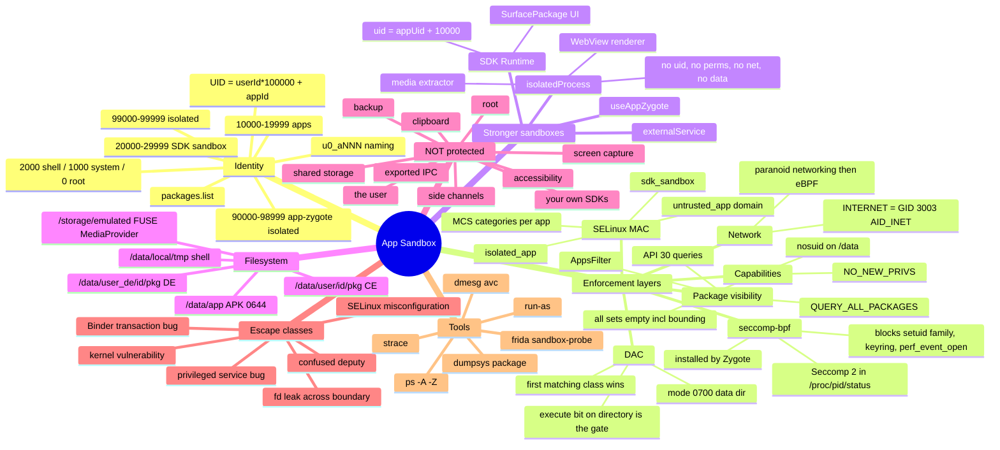

### 13.3 Condensed cheat-sheet

| Thing | Value / command |
|---|---|
| App UID range | 10000–19999 |
| Isolated UID range | 99000–99999 (app-Zygote: 90000–98999) |
| SDK sandbox UID | `appUid + 10000` → 20000–29999 |
| User offset | 100000 |
| `uid` → `userId` | `uid / 100000` |
| `uid` → `appId` | `uid % 100000` |
| Shell UID | 2000 (`AID_SHELL`) |
| System UID | 1000 (`AID_SYSTEM`) |
| `INTERNET` GID | 3003 (`AID_INET`) |
| Data dir mode | `0700` |
| APK mode | `0644` (world-readable) |
| CE data | `/data/user/<u>/<pkg>` |
| DE data | `/data/user_de/<u>/<pkg>` |
| UID map file | `/data/system/packages.list` |
| App SELinux domain | `untrusted_app[_<sdk>]:s0:c<cats>` |
| Isolated domain | `isolated_app` |
| Check UID/caps/seccomp | `cat /proc/<pid>/status` |
| Check SELinux context | `cat /proc/<pid>/attr/current` or `ps -A -Z` |
| Check seccomp | `grep Seccomp /proc/<pid>/status` → `2` |
| Denials | `dmesg \| grep avc` (SELinux), `strace \| grep EACCES` (DAC) |
| Become an app | `run-as <pkg>` (debuggable only) |
| List UIDs | `pm list packages -U` |
| Isolated processes | `ps -A -o USER,PID,NAME \| grep _i` |

### 13.4 Quick revision prompts

Answer each in one sentence without looking back.

1. What is the formula relating UID, user ID, and app ID?
2. In what order does Zygote drop groups, GID, UID, and capabilities, and why that order?
3. Which permission is enforced by the kernel as a group membership?
4. What is the difference between `android:process` and `android:isolatedProcess`?
5. What mode is an app's data directory, and which bit actually blocks other apps?
6. Why can any app read any other app's APK?
7. What two conditions must hold for `run-as` to succeed?
8. Name the six classes of sandbox escape.
9. Why does root not automatically defeat SELinux?
10. What is the UID of an SDK Runtime process for an app at UID 10412?
11. Which `/proc/<pid>/status` field proves seccomp is active, and what value do you expect?
12. Name five things the sandbox does not protect against.
13. What does an empty `CapBnd` guarantee?
14. Why is `adb shell` a bad place to test what an app can do?
15. What is the complete data interface of an isolated process?

---

## 14. References

Grouped, annotated links. AOSP paths are directories or files in the AOSP tree; no line numbers are quoted because they change every release.

### AOSP source

- `system/core/libcutils/include/private/android_filesystem_config.h` — the `AID_*` constants; the single most useful header for this chapter.
- `frameworks/base/core/java/android/os/Process.java` — the Java-side UID range constants and helpers.
- `frameworks/base/core/java/android/os/UserHandle.java` — `getUserId`, `getAppId`, `getUid`, `PER_USER_RANGE`.
- `frameworks/base/core/jni/com_android_internal_os_Zygote.cpp` — `SpecializeCommon()`; the sandbox, as code.
- `frameworks/base/core/java/com/android/internal/os/ZygoteConnection.java` — argument parsing for the fork request.
- `bionic/libc/seccomp/` — generated seccomp policies plus `SECCOMP_ALLOWLIST_APP.TXT` and `SECCOMP_BLOCKLIST_APP.TXT`.
- `system/core/run-as/run-as.cpp` — the whole of `run-as`, including the debuggable check.
- `system/core/libpackagelistparser/` — the `packages.list` parser and its field order.
- `frameworks/native/cmds/installd/` — `InstalldNativeService.cpp` and `utils.cpp`: app data directory creation and every path constructor.
- `frameworks/native/cmds/installd/binder/android/os/IInstalld.aidl` — the complete privileged filesystem interface.
- `frameworks/base/services/core/java/com/android/server/pm/Settings.java` — appId allocation and `packages.list` emission.
- `frameworks/base/services/core/java/com/android/server/pm/AppsFilter.java` — package visibility filtering.
- `frameworks/base/services/core/java/com/android/server/am/ProcessList.java` — process start arguments and isolated UID allocation.
- `frameworks/base/data/etc/platform.xml` — the permission → GID mapping including `INTERNET` → `inet`.
- `frameworks/base/core/java/com/android/server/SystemConfig.java` — parses `platform.xml`.
- `system/sepolicy/private/seapp_contexts` — the rules that assign an app's SELinux domain and file type.
- `system/sepolicy/public/isolated_app.te`, `system/sepolicy/private/isolated_app.te` — the isolated domain, including its `neverallow` guarantees.
- `system/sepolicy/private/sdk_sandbox*.te` — the SDK Runtime domain.
- `packages/modules/AdServices/sdksandbox/` — the SDK Runtime implementation.
- `packages/providers/MediaProvider/` — the FUSE daemon and scoped storage enforcement.
- `bionic/libc/bionic/grp_pwd.cpp` — where `10388` becomes `u0_a288`.

### Official Android documentation

- Android Open Source Project — *Application Sandbox* (Security section). The canonical overview.
- Android Open Source Project — *Security-Enhanced Linux in Android*. The MAC layer.
- Android Open Source Project — *Seccomp filter in Android O*. The rationale for the syscall filter.
- Android Developers — *App sandbox* and *Data and file storage overview*.
- Android Developers — *Storage updates in Android 11* and *Scoped storage*.
- Android Developers — *Package visibility filtering on Android* and the `<queries>` reference.
- Android Developers — *`android:isolatedProcess`* in the `<service>` manifest reference.
- Android Developers — *SDK Runtime* (Privacy Sandbox on Android).
- Android Developers — *Back up user data with Auto Backup* and the `dataExtractionRules` reference.
- Android Developers — *`FileProvider`* and *Sharing files*.
- Android Developers — *Changes to clipboard access* (Android 10, 12, 13 behaviour changes).
- Android Developers — *`FLAG_SECURE`* in `WindowManager.LayoutParams`.

### Kernel documentation

- `Documentation/userspace-api/seccomp_filter.rst` — the seccomp-bpf interface and return values.
- `Documentation/admin-guide/LSM/` — the Linux Security Module framework.
- `man 7 capabilities` — the capability model and the four (now five) sets.
- `man 2 prctl` — `PR_SET_NO_NEW_PRIVS`, `PR_SET_SECCOMP`, `PR_SET_DUMPABLE`.
- `man 7 unix` and `man 3 cmsg` — `SCM_RIGHTS` file descriptor passing, the mechanism behind escape Class 5.

### OWASP

- **MASVS-STORAGE** — private data storage, backups, logs, and the clipboard.
- **MASVS-PLATFORM** — IPC exposure, WebView, screen overlays and capture.
- **MASVS-CODE** — third-party dependencies and release-build hygiene.
- **MASVS-RESILIENCE** — debuggable builds and tamper resistance.
- MASTG — the testing guide's chapters on data storage, platform interaction, and reverse engineering. See [71 — OWASP Mobile](../71-OWASP-Mobile/README.md) for the current identifier scheme.

### Related chapters

- [20 — Security Architecture](../20-Security-Architecture/README.md) — where the sandbox sits in the whole model.
- [22 — SELinux](../22-SELinux/README.md) — the second enforcement layer, in full.
- [23 — Permissions](../23-Permissions/README.md) — what the sandbox lets through, and why.
- [24 — IPC](../24-IPC/README.md), [25 — Binder](../25-Binder/README.md), [26 — Intent](../26-Intent/README.md), [27 — ContentProviders](../27-ContentProviders/README.md) — the doors in the wall.
- [33 — Storage](../33-Storage/README.md) — scoped storage and data-at-rest in detail.
- [37 — Root Detection](../37-RootDetection/README.md) — what happens when the sandbox's assumptions are gone.
- [43 — WebView](../43-WebView/README.md) — the platform's flagship user of `isolatedProcess`.
- [62 — Magisk](../62-Magisk/README.md) — how root tooling coexists with SELinux.
- [69 — Malware Analysis](../69-MalwareAnalysis/README.md) — how real malware works around the sandbox rather than through it.


