# 21 — App Sandbox · Mind Map

One picture of the whole chapter. Read it outward from the centre.

The sandbox is not a feature of Android's runtime — it is a set of **kernel** mechanisms that a
privileged parent process applies to a child *before that child runs a single line of application
code*. Everything in the left half of this map is enforcement (identity, DAC, MAC, seccomp,
capabilities, network groups). Everything in the right half is the part people get wrong: what the
sandbox never claimed to protect, the doors developers open in it themselves, and the difference
between an experiment run from `adb shell` and an experiment run from an installed app.

Every branch corresponds to a section of [the chapter README](README.md). Use it as a revision map
before an engagement or an interview.

```mermaid
mindmap
  root((App Sandbox))
    Why it exists
      Desktop model failed
        one user runs everything
        every program has the user's authority
        a game can read the mail client's files
      Android inverted it
        the user is not the security principal
        the APP is the principal
        one Linux user per application
      What breaks without it
        any app reads any app's tokens
        any app rewrites any app's code
        permissions become advisory
        uninstall stops meaning anything
      It is not one mechanism
        seven enforcement layers
        all in the kernel
        none in ART
        the runtime is not a boundary
    Identity
      UID is a number in struct cred
        no /etc/passwd on Android
        AID constants compiled in
        android_filesystem_config.h
        Process.java mirrors them
      Arithmetic
        uid = userId times 100000 plus appId
        userId = uid divided by 100000
        appId = uid modulo 100000
        do it by hand every time
      Ranges
        0 AID_ROOT
        1000 AID_SYSTEM
        2000 AID_SHELL what adb shell is
        3001 to 3011 capability-like groups
        9997 AID_EVERYBODY
        10000 to 19999 ordinary apps
        20000 to 29999 SDK sandbox
        90000 to 98999 app zygote isolated
        99000 to 99999 isolated
        plus 100000 per Android user
      Names
        u0_a288 means uid 10288
        u10_a288 means work profile
        u0_i9 means uid 99009
        bionic grp_pwd.cpp synthesises them
      packages.list
        the authoritative runtime map
        0640 system package_info
        field 3 is the debuggable flag
        field 6 is the supplementary GIDs
      appId reuse
        installd deletes the tree at uninstall
        MCS categories do not silently collide
        framework registrations torn down
        the risk is files written OUTSIDE the sandbox
    Where the sandbox is installed
      Zygote fork
        app code has not started yet
        specialisation happens in the child
      Order matters
        setgroups supplementary GIDs
        setresgid
        setresuid last
        capabilities cleared including bounding set
        PR_SET_NO_NEW_PRIVS
        seccomp filter installed
        mount namespace set up
        SELinux domain transition
        only then ActivityThread.main
      Why UID last
        dropping UID first would forbid the rest
        privilege is spent in a fixed order
      Irreversible by design
        no_new_privs cannot be unset
        seccomp can only be tightened
        empty CapBnd is permanent
    DAC layer
      Discretionary means owner decides
        chmod 777 is allowed
        contrast with MAC
      Kernel checks
        first matching class wins
        owner then group then other
        execute bit on a directory is search
        unlink needs the DIRECTORY's write bit
        stat needs search on every parent
      Data directory is 0700
        the missing execute bit is the real gate
        a 0666 file inside is still unreachable
        because the door is locked one level up
      Version history
        0751 for old targetSdk before Android 9
        legacy world readable prefs findings
        0700 unconditionally from Android 9
      APK is 0644 world readable
        by design not by accident
        any app can dump any app's DEX
        random path segments are anti fingerprinting
        secrets in assets are shipped to everyone
      sharedUserId
        same UID same data tree same domain
        requires the same signing key
        deprecated at API 29
        sharedUserMaxSdkVersion at API 32
        weakest member defines the group's security
        removing it orphans the data
    SELinux layer
      Mandatory access control
        system wide policy
        loaded by init before almost anything
        no root exemption
      Domains
        untrusted_app and version suffixed variants
        platform_app priv_app system_app
        isolated_app
        sdk_sandbox
        shell
        runas_app
      MCS categories
        derived from appId and userId
        two apps share a DOMAIN
        categories are what separates them
        source must dominate target
      Serial with DAC
        DAC runs in the VFS
        SELinux runs in the LSM hook
        both must pass
        defeating one leaves the other
      Root and SELinux
        uid 0 defeats DAC
        uid 0 does NOT defeat SELinux
        Magisk transitions into a permitted context
        dmesg grep avc answers it in one command
    seccomp-bpf
      Different question
        not may I touch that object
        how much kernel can I even reach
      About 350 to 400 syscalls
        an app uses about 60
        the rest is attack surface
      Mechanism
        BPF program over syscall number and args
        ALLOW ERRNO KILL_PROCESS TRAP TRACE LOG
        inherited across fork
        preserved across execve
        can only ever be tightened
      Policies
        app policy from Zygote
        app zygote policy
        system policy
        per daemon minijail policies
      Built as allowlist minus blocklist
        generated from bionic SYSCALLS.TXT
        anything libc does not wrap is denied
      Blocked categories
        setuid family the most valuable entry
        capset
        chroot pivot_root mount unshare
        add_key request_key keyctl
        swapon swapoff
        perf_event_open
        init_module kexec_load reboot quotactl
        obsolete ABI
      It does NOT block ptrace
        an app may ptrace itself
        cross app ptrace stopped by DAC SELinux Yama
        naming the wrong mechanism kills a finding
      Observation
        Seccomp 2 in proc status
        Seccomp 0 in your shell
        dmesg grep seccomp for kills
    Capabilities
      About 40 bits splitting root
        CAP_DAC_OVERRIDE
        CAP_SYS_ADMIN
        CAP_NET_RAW
        CAP_SETUID CAP_KILL
      Apps hold NONE
        CapInh CapPrm CapEff CapBnd CapAmb all zero
        empty bounding set is the important one
        can never acquire one later
      Three independent reasons no setuid escape
        data and storage mounted nosuid
        empty bounding set makes uid 0 toothless
        NO_NEW_PRIVS refuses privilege raising execve
    Network isolation
      INTERNET is a GID not a framework check
        platform.xml maps permission to gid inet
        PackageManagerService computes the GID list
        Zygote setgroups before dropping UID
      GID 3003 AID_INET
        3004 net_raw
        3005 net_admin
        3009 readproc
        3010 wakelock
      Enforcement then and now
        CONFIG_ANDROID_PARANOID_NETWORK out of tree patch
        mainline and GKI refused it
        now eBPF cgroup inet_create_socket hooks
        same machinery does accounting firewall VPN
      Consequence
        socket returns EACCES before DNS
        cannot be hooked away in process
        the attack path is re delegation via another app
      Mental model
        normal protection level granted silently
        strongest enforcement in the system
        mechanism strength and policy strength are independent
    Stronger sandboxes
      isolatedProcess
        one manifest attribute
        throwaway UID 99000 to 99999
        every permission check denied
        isolated_app domain
        no network
        no data directory
        tiny Binder allowlist
        only interface is Binder plus passed FDs
      Platform's own users
        WebView renderer services
        externalService charges lifetime to the client
        JS engine RCE lands in isolated_app
        mediaextractor mediacodec mediaswcodec via minijail
      useAppZygote
        per app zygote itself isolated
        ZygotePreload shares native pages
        UID range 90000 to 98999
      SDK Runtime Privacy Sandbox
        an ad SDK IS your app today
        moves the SDK to uid appUid plus 10000
        sdk_sandbox domain
        separate storage under misc_ce sdksandbox
        SurfaceControlViewHost renders pixels only
        opt in and adoption is partial
      android:process is NOT this
        same UID same permissions same data
        one word apart one entire boundary
    Package visibility
      Android 11 targetSdk 30
        no full package list by default
        queries element declares what you see
        QUERY_ALL_PACKAGES is restricted on Play
      AppsFilter does the filtering
      A privacy control not a boundary
        never makes an exported component unreachable
        forgetting queries in YOUR probe is a false negative
        NameNotFound looks exactly like not installed
    Scoped storage
      Before Android 10
        READ EXTERNAL STORAGE read everything
        one grant exposed every app's files
      After
        app specific directories need no permission
        MediaStore for media by ownership
        Storage Access Framework for anything else
        FUSE mediates and enforces
        Android data of other apps unreachable from API 30
      requestLegacyExternalStorage was a transition only
    run-as
      Needs the debuggable flag in packages.list
        setuid and setgid FILE capabilities on the binary
        reads packages.list itself
        refuses on a release build
      Why the check exists
        debuggable already means jdb can attach
        so run-as grants nothing new
      userdebug builds set ro.debuggable 1
        run-as then works on everything
        never generalise from such a device
      Repackaging to add debuggable
        changes the signature
        breaks signature checks and pinning
        say so in the report
    What the sandbox does NOT protect against
      The user themselves
        they own the device
        backups emulator images root
      Root
        outside the threat model
        name the adversary in the finding
      IPC you exported
        you opened the door
        activities services receivers providers
      Shared storage
        data written there has left permanently
      The clipboard
        a system wide buffer by design
        Android 10 restricted background reads
        Android 13 auto clears
      Screen capture overlays MediaProjection
        pixels are outside the filesystem model
        FLAG_SECURE is the control
      Accessibility services
        a sanctioned user granted read of every window
        malware's favourite legitimate API
      Side channels
        timing memory pressure power sensors
        no UID check applies to physics
      Backup
        allowBackup moves data off device
        dataExtractionRules and noBackupFilesDir
      Your own dependencies
        an SDK is your UID your memory your permissions
        check the MERGED manifest not just your code
    Escape classes
      Kernel vulnerability
        the only true escape
        drivers are the usual source
      Privileged service vulnerability
        system_server installd vendor HALs
      SELinux policy misconfiguration
        usually vendor added rules
      Confused deputy via a system app
        the deputy holds the authority
      File descriptor leak
        SCM_RIGHTS over a socket
        ContentProvider openFile
        the FD carries access already granted
        the receiving process's UID is never rechecked
      Binder transaction bug
        parsing untrusted parcels in a privileged process
    Vulnerability classes to test
      sharedUserId widening the boundary
      data handed out through exported IPC
      sensitive data written outside the sandbox
      allowBackup exfiltration channel
      trusting the sandbox for INTEGRITY not just secrecy
      ContentProvider openFile path traversal
      mutable PendingIntent
      no FLAG_SECURE on credential screens
    Testing methodology
      Establish identity first
        id pm list packages -U dumpsys package
      Check the three manifest flags
        debuggable sharedUserId allowBackup
      Enumerate exported components
      Look at what is on disk and with what labels
      Look at what processes exist and in which domains
      Look at what was written OUTSIDE the sandbox
      Confirm from the OUTSIDE with a probe APK
      Reachability discipline
        adb shell is uid 2000 in domain shell
        run-as is the app but debuggable only
        Frida is code already inside
        a probe APK is the only proof about apps
        run both experiments record both results
    Tools
      cat proc pid status
      cat proc pid attr current
      ps -A -Z
      dumpsys package
      pm list packages -U and pm list users
      run-as
      strace for DAC denials
      dmesg grep avc for SELinux
      dmesg grep seccomp
      Frida sandbox probe
      a purpose built probe APK
      apktool jadx for the manifest first pass
```

