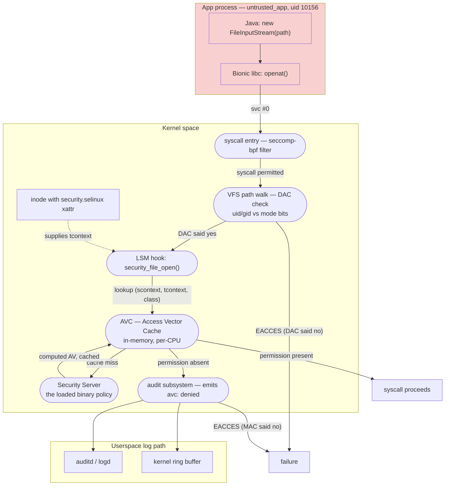
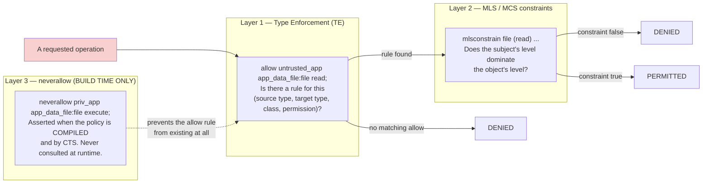
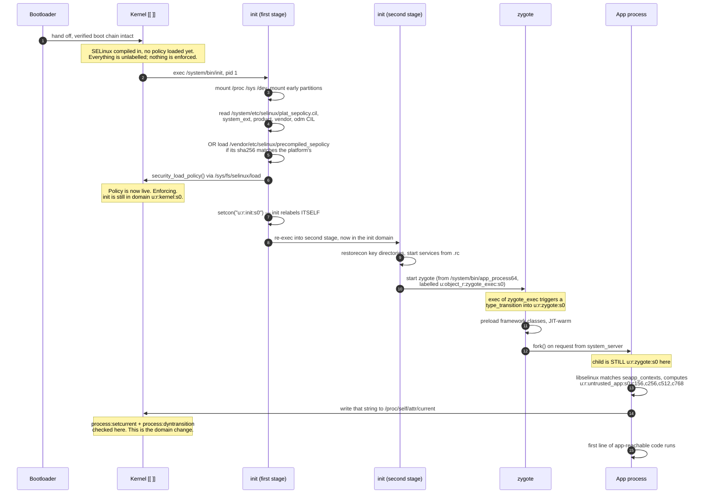
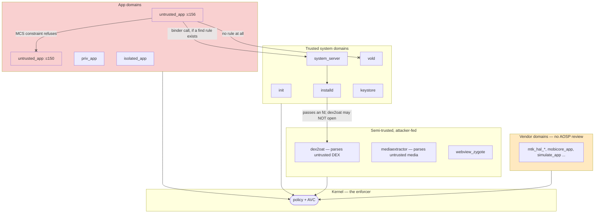
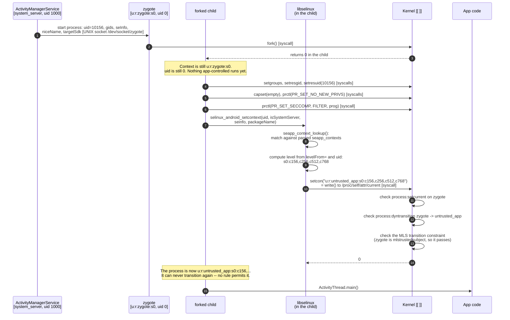
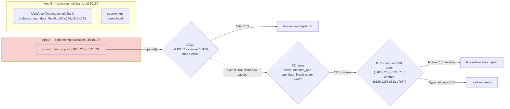
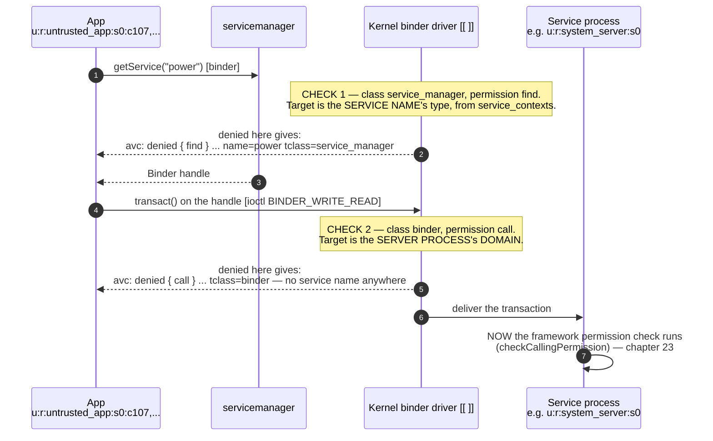
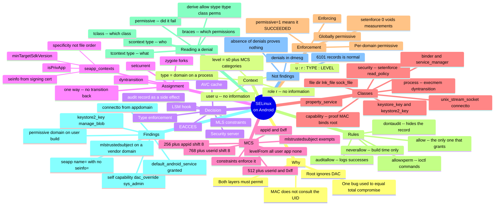

# 22 — SELinux on Android: the MAC layer that constrains even root

> After this chapter you can read any `avc: denied` line field by field and write the exact `allow` rule it is asking for; you can explain why a root shell still gets "Permission denied" and name the mechanism; you can decode an MCS category set back into the app's UID and say precisely what those four numbers enforce; you can trace how `zygote` becomes `untrusted_app` and point at the file where that decision is made; and you can tell a client, honestly, why the six thousand denials in their `dmesg` are not a finding.

**Prerequisites:** [01 — Computer Science Basics](../01-Computer-Science-Basics/README.md), [02 — Linux Basics](../02-Linux-Basics/README.md), [06 — Android Architecture](../06-Android-Architecture/README.md), [20 — Security Architecture](../20-Security-Architecture/README.md), [21 — App Sandbox](../21-App-Sandbox/README.md)

**Applies to:** Android 4.3 (API 18) through Android 16 (API 36). The baseline described and measured is **Android 13 / API 33 on a physical arm64 device**; behaviour that differs on other releases is flagged in a Version Matrix. Every context, policy rule and audit record quoted as *measured* in this chapter came off that device and is labelled as such. Everything else is labelled as documentation or as synthetic.

---

## Table of Contents

1. [Introduction](#1-introduction)
2. [High-Level Architecture](#2-high-level-architecture)
3. [Deep Internal Working](#3-deep-internal-working)
4. [Source Code Walkthrough (AOSP)](#4-source-code-walkthrough-aosp)
5. [Security Perspective](#5-security-perspective)
6. [Reverse Engineering Perspective](#6-reverse-engineering-perspective)
7. [Dynamic Analysis](#7-dynamic-analysis)
8. [Static Analysis](#8-static-analysis)
9. [Examples](#9-examples)
10. [Common Interview Questions](#10-common-interview-questions)
11. [Common Mistakes](#11-common-mistakes)
12. [Hands-on Labs](#12-hands-on-labs)
13. [Summary](#13-summary)
14. [References](#14-references)

---

## 1. Introduction

### 1.1 A locksmith, a landlord, and the problem with owning the key

Imagine an office building where every tenant has a key to their own suite. That is the arrangement [chapter 21](../21-App-Sandbox/README.md) describes: each application is a separate Unix user, each has its own locked door, and no tenant can open another's.

Now consider the caretaker. The caretaker has a master key, because somebody has to be able to get into a flooded basement at two in the morning. The master key is not a privilege the caretaker earned by being trustworthy; it is a *mechanical property of the lock system*. Every lock in the building is built to yield to that one key. And the moment somebody steals the caretaker's key — or impersonates the caretaker, or finds a bug in the caretaker's own front door — the entire building is open. There is no second mechanism. The locks were the whole story.

That caretaker is `root`, and until 2013 the sentence above was a complete and accurate description of Android's security model. Every Android privilege-escalation exploit of that era had the same shape: find a memory-corruption bug in *anything* running as UID 0 — `vold`, `init`, a vendor daemon, the `adb` daemon before it dropped privileges — and you were done. Not "you had a foothold": *done*. UID 0 could read every file, kill every process, write to every device node, and load a kernel module. The sandbox described in chapter 21 was built entirely out of Unix permission bits, and Unix permission bits do not apply to UID 0.

So Android's designers added something that had no equivalent in the Unix model at all. They added a **second, independent set of locks, keyed to what a program *is* rather than to who is running it, that the caretaker's master key does not open.** A rule saying "the `vold` program may write to block devices" does not become "the `vold` program may read your photographs" just because `vold` happens to run as root. The two facts are unrelated, because the second lock system does not consult the UID at all.

That second lock system is **SELinux**, and this chapter is about it.

> **Mental Model**
> **Root is a DAC concept. SELinux is orthogonal to it.** When people say "SELinux constrains root", they usually imagine SELinux checking whether you are root and then deciding to be strict. That is not what happens. SELinux *never looks at the UID*. It looks at the process's **security context** — a label the kernel attached to the process — and at the **label on the object** being touched, and consults a policy table for that pair. A process running as UID 0 in a domain with no matching rule is refused, and a process running as UID 10156 in a domain with a matching rule is permitted. The UID is not an input to the decision. This is why root and SELinux are not on a spectrum: they are two different questions, asked by two different pieces of kernel code, and **both must answer yes**.

### 1.2 What would break if SELinux did not exist

It is worth being specific, because "defence in depth" is a phrase that has been drained of meaning by overuse.

If SELinux were removed from a modern Android device tomorrow, and nothing else changed:

- A bug in the Wi-Fi HAL — a userspace daemon parsing packets from the air, running as a non-root system UID — would give an attacker the ability to read `/data/misc/keystore`, because DAC on that directory only checks whether you are the `keystore` UID, and there are dozens of paths to becoming *some* system UID.
- `adbd` on a userdebug build would be able to read any app's private data, because on such builds `adbd` runs as root and root ignores permission bits. On the measured Android 13 device, `adbd` in domain `u:r:adbd:s0` was refused even a *directory search* on `/oem` — a denial that is in the fixture file for this chapter.
- The `mediaextractor` process — a large C++ parser fed arbitrary video from the internet, historically the source of the Stagefright family of bugs — would, on compromise, be able to reach the network, open other apps' files, and talk to any Binder service. Today its domain permits almost none of that, which is why a `mediaextractor` bug is now a serious-but-contained problem rather than a device compromise.
- `dex2oat` — the ahead-of-time compiler, fed bytecode from arbitrary APKs — would run with `installd`'s power. Today, as [§3.12](#312-dex2oat-in-its-own-domain-a-real-trust-property-not-a-slogan) shows with measured policy rules, it is forbidden from even *opening* an app data file; it can only touch descriptors handed to it.
- Two apps in the same domain would be separated only by their UIDs. That is not nothing — it is the whole of chapter 21 — but it means one kernel bug in the VFS permission path, or one `chmod` mistake, collapses app-vs-app isolation entirely. Today the MCS categories described in [§3.7](#37-mcs-the-category-encoding-and-what-it-actually-enforces) provide a second, independent barrier that a DAC bug does not touch.

None of that is hypothetical. Each corresponds to a class of bug that was routinely exploited on Android 4.x and is now routinely *contained*.

### 1.3 The two words you must not confuse: discretionary and mandatory

> **Definition — DAC (Discretionary Access Control)**
> Access control where **the owner of an object decides who may access it**. Classic Unix permissions are DAC: if you own a file you may `chmod 777` it and give it to the world, and the system will let you, because the policy is at your discretion. Chapter 21 covers Android's DAC layer in full.

> **Definition — MAC (Mandatory Access Control)**
> Access control where **a system-wide policy decides, and no participant can override it** — not the object's owner, not the process doing the access, not root. The policy is loaded once, early in boot, from a file the running system cannot rewrite, and it applies uniformly. "Mandatory" means exactly that: it is not a default that can be relaxed by whoever holds the object.

The distinction has a consequence people find genuinely surprising the first time they meet it. Under DAC, an app that wants to share a file with the world can do so. Under MAC it *cannot*, even by giving the file mode `0777`, if policy does not allow the other domain to read that file's type. The permission bits become a necessary condition rather than a sufficient one.

Both checks run, in a fixed order, on the same system call. This is the single most important sentence in the chapter:

> **Mental Model**
> **DAC and MAC are serial, not alternative. An operation succeeds only if BOTH permit it.** The kernel's VFS layer checks the permission bits first and returns `EACCES` if they fail. If they pass, control reaches an **LSM hook**, where SELinux consults its policy and returns `EACCES` if *that* fails. Two independent mechanisms, two independent chances to say no, one indistinguishable error code. A bug that defeats one leaves the other standing — which is the entire argument for defence in depth, made concrete and checkable.

That shared error code is why the practical skill this chapter teaches matters so much. `EACCES` from a DAC failure and `EACCES` from a MAC failure look identical to the calling program, to `strace`, and to your Java exception handler. The **only** way to tell them apart is to go and look at the audit log. If there is an `avc: denied` record with a matching timestamp, it was MAC. If there is not, it was DAC. Guessing which one it was, and writing the guess into a report, is how a finding gets dismissed by a developer in one sentence.

### 1.4 A worked intuition: what happens when a rooted shell reads app data

Walk through it in plain language, because this is the scenario that generates the most confusion in the field.

You have a rooted phone. You type `su`, and `id` prints `uid=0(root)`. You then run `cat /data/data/com.example.bank/shared_prefs/session.xml`, and you get **Permission denied**. Everything you know about Unix says this is impossible.

Here is what actually happened.

The `cat` process has UID 0. It also has a **security context** — say `u:r:shell:s0`, or on some Magisk setups `u:r:magisk:s0`. The file `session.xml` has a context too: `u:object_r:app_data_file:s0:c150,c256,c512,c768`.

The `openat()` syscall enters the kernel. The VFS checks DAC: the file is mode `0600` owned by UID 10150, and the caller is UID 0. Root has `CAP_DAC_OVERRIDE`, so the VFS check **short-circuits and passes**. DAC has said yes.

Control now reaches `security_file_permission()`, an LSM hook. SELinux asks a completely different question: *does the policy contain a rule permitting a process of type `shell` to perform `read` on an object of class `file` with type `app_data_file`?* It looks this up in the **AVC** (Access Vector Cache), and on a miss, in the compiled policy. If there is no such rule, the answer is no, and the syscall returns `-EACCES`.

The UID never entered that second calculation. Not once. Being root did not help, because being root is not a fact SELinux consults.

> **Pentester's Note**
> This is the single highest-value diagnostic reflex in Android work. **A root shell that gets "Permission denied" is almost always SELinux, and the log will tell you exactly which rule was missing.** Run `dmesg | grep avc` (needs root) or `logcat -b all | grep avc` (usually does not), find the record whose timestamp matches, and read the `scontext`, `tcontext`, `tclass` and `{ }` fields. Thirty seconds of looking beats an hour of guessing, and being the person in the room who does this instantly is a small but genuine mark of experience. [§3.11](#311-reading-an-avc-denial-field-by-field-and-deriving-the-rule) teaches the read; `scripts/avc-decode.py` automates it.

### 1.5 What SELinux is *not*

Four things it is not, listed early because each is a live misconception that produces bad reports.

**It is not the app sandbox.** [Chapter 21](../21-App-Sandbox/README.md) owns the UID sandbox and DAC. SELinux is a *second*, independent layer that happens to also separate apps. If you write "the app sandbox failed" when what you mean is "policy permitted a cross-domain read", a developer will correct you and stop reading.

**It is not the permission model.** Android's runtime permissions (`CAMERA`, `READ_CONTACTS`) are enforced by `system_server` in Java, checked at Binder call time, and are entirely separate from SELinux. [Chapter 23](../23-Permissions/README.md) owns those. SELinux decides whether the app may *reach* the service that performs the permission check; the permission check itself is not SELinux's business.

**It is not a sandbox you can configure as an app developer.** An app cannot request a domain, cannot write policy, and cannot read the policy. `android:isolatedProcess="true"` gets you the `isolated_app` domain, and that is the entire developer-facing surface. Everything else is a platform decision.

**It is not proof of anything when it is quiet.** No denials means either that nothing tried anything unusual or that a `dontaudit` rule is suppressing the records. Both are common. Absence of denials is not evidence of correctness.

### 1.6 What this chapter will let you do

By the end you will be able to:

1. Read `u:r:untrusted_app:s0:c218,c256,c512,c768` aloud and say what each of the four colon-separated fields means, which one carries information, and what appId the categories encode.
2. Take a raw `avc: denied` line and write, from it alone, the `allow` rule that would permit the operation — in both `.te` and CIL syntax — and say what the rule would *also* permit that you did not intend.
3. Explain why `setenforce 0` is a far bigger event than it looks, and why a per-domain `permissive` line is a finding on a production build while a thousand denials are not.
4. Trace the path from `zygote` forking to `untrusted_app` running, name the file where the domain is chosen, and name the two `process` permissions that make the transition legal.
5. Say precisely which code-execution permissions an app has and does not have, and give the honest version of the causal story behind `InMemoryDexClassLoader`.
6. Look at a vendor's `seapp_contexts` and `vendor_sepolicy.cil` and know what to grep for.
7. Tell a client that the denials in their log are noise, and be *right*, and be able to show the arithmetic.

---

## 2. High-Level Architecture

### 2.1 Where SELinux sits in a system call



Read this as a gauntlet with three gates, all inside the kernel, all before the operation happens.

The first gate is **seccomp-bpf**, which asks whether this process may make *this kind of system call at all*. That is chapter 21's territory and is mentioned here only so you can tell its failure mode apart: seccomp failures produce `type=1326` audit records and often kill the process outright, not `avc: denied`.

The second gate is **DAC**, performed by the VFS during the path walk. It compares the caller's UID and GID against the inode's owner, group and mode bits. Root short-circuits it. This is the layer that chapter 21 describes in full, and it runs *first*.

The third gate is the **LSM hook**. LSM (Linux Security Modules) is a kernel framework of function pointers placed at security-relevant decision points — opening a file, sending a signal, binding a socket, creating a process. SELinux registers implementations for those hooks. When `security_file_open()` is called, SELinux extracts the **subject context** from the calling process's credentials and the **object context** from the inode's `security.selinux` extended attribute, and asks whether policy permits the operation.

That lookup goes first to the **AVC**, the Access Vector Cache: an in-kernel, per-CPU hash table of recently computed decisions. A hit costs a few dozen nanoseconds. On a miss, the **security server** — the loaded, compiled binary policy — computes the full access vector for that (source type, target type, class) triple, caches it, and returns it.

If the requested permission is absent from that vector, two things happen, and it is worth separating them because people conflate them constantly. **First**, an audit record is emitted, which is the `avc: denied` line you eventually read. **Second**, the hook returns `-EACCES`, which becomes the syscall's return value. The audit record is a *side effect of the decision*, not the decision itself — which is why a `dontaudit` rule can suppress the record while the denial still happens, and why `permissive` mode can emit the record while the operation still succeeds. Keeping those two facts separate is the difference between reading a log correctly and reading it backwards.

Finally, note the direction of the dotted arrow from the inode. **The object's label lives on the object**, in an extended attribute on disk (or, for pseudo-filesystems and sockets, in kernel memory). It is not computed at access time. It was applied when the file was created, or by `restorecon`, or at mount time by a `genfscon` rule. That is why relabelling a file changes what may touch it, and why a file created in the wrong place gets the wrong label and mysteriously stops working.

### 2.2 The three layers of enforcement, drawn



Three layers, and only two of them run on the device.

**Type enforcement** is the main event. Every process has a type (called a **domain** when it labels a process), every object has a type, and policy is a very large set of `allow` rules naming (source type, target type, object class, permission set). The device's compiled policy on the measured Android 13 handset was 1,981,460 bytes of platform CIL plus 1,072,684 bytes of vendor CIL — call it forty thousand rules. If no rule matches, the answer is no. **The default is deny**, always, with no exceptions, which is why adding a new device or daemon to an Android build always begins with a flood of denials.

**MLS/MCS constraints** are a separate mechanism layered on top, and this is the part people skip. A **constraint** is not a rule that grants; it is a predicate that must *also* be true. Even when an `allow` rule matches perfectly, the operation is refused if a constraint covering that class and permission evaluates false. This is how Android separates two apps that share a domain: `untrusted_app` A and `untrusted_app` B match exactly the same `allow` rules, because they have the same type. What separates them is a constraint requiring the subject's category set to contain the object's. [§3.7](#37-mcs-the-category-encoding-and-what-it-actually-enforces) does this in full.

**neverallow** runs at *build time only*. It is an assertion: "no rule matching this pattern may exist anywhere in the compiled policy." If a vendor adds a rule that violates one, `secilc` refuses to build the policy, and Android's CTS re-checks a subset on the shipped device. It is a governance mechanism, not a runtime control. A `neverallow` in a device's CIL file is a *record of an assertion that passed*, and a common beginner error is to read one and believe the kernel is enforcing it at runtime. It is not. The kernel has never heard of it.

> **Warning**
> Because `neverallow` is compile-time, **a device whose policy was patched after the build — by Magisk, by an exploit, or by a modified boot image — is not constrained by any `neverallow` at all.** `magiskpolicy` injects rules directly into the loaded binary policy and no assertion re-runs. This is one reason a rooted device is a bad place to conclude anything about the security of a stock one. [62 — Magisk](../62-Magisk/README.md) owns that mechanism.

### 2.3 Boot: how the policy gets loaded, and why the order matters



Four things in that sequence are worth stopping on, because each is a place where an incorrect mental model is common.

**Steps 3 to 6: the policy is compiled on the device, at every boot, unless a precompiled copy matches.** Android's Treble architecture splits policy across up to five partitions — `/system`, `/system_ext`, `/product`, `/vendor`, `/odm` — each shipping its own CIL fragment so that a platform update and a vendor image can be updated independently. `init` links them together with `secilc` into one binary policy. That is expensive, so the build also ships `/vendor/etc/selinux/precompiled_sepolicy` along with a SHA-256 of the platform CIL it was compiled against; if the hashes still match, `init` loads the precompiled blob and skips the work. On the measured device both were present: `precompiled_sepolicy` at 1,047,781 bytes alongside `precompiled_sepolicy.plat_sepolicy_and_mapping.sha256`. **If you change the platform policy and not the hash, the device silently recompiles** — which is a useful thing to know when a policy change appears not to have taken effect.

**Step 8: `init` relabels itself.** It does not `execve` anything to change domain; it writes to `/proc/self/attr/current`. This is the same mechanism zygote uses later, and it is the first hint that Android's SELinux usage is unusual: on a conventional Linux system, essentially all domain changes happen through `execve`.

**Step 12: the exec of `app_process64` is a genuine, classical `type_transition`.** The binary is labelled `u:object_r:zygote_exec:s0` — measured on the device with `ls -Zd /system/bin/app_process64` — and policy contains a transition rule that moves a process from the `init` domain into `u:r:zygote:s0` when it executes a file of that type. This is the textbook SELinux mechanism, and it is the *only* place in the app-startup path where it is used.

**Steps 14 to 17: the app's domain change is NOT an exec.** The zygote forks; the child is a copy of the zygote in every respect, including its security context. There is no `execve`, so there is no `type_transition` to hang the change on. Instead, the child computes its target context in userspace, from `seapp_contexts`, and *writes it to itself*. [§3.5](#35-domain-transitions-how-zygote-becomes-untrusted_app) covers this in detail, with the two measured policy rules that make it legal.

> **Under the Hood**
> There is a window, between the kernel booting and `init` loading policy, in which SELinux is present but has no policy. During that window nothing is labelled and nothing is enforced. It is short, it is before any code from the data partition runs, and it is protected by Verified Boot — the boot image containing `init` and the policy is signature-checked before the kernel starts, which is [20 — Security Architecture](../20-Security-Architecture/README.md)'s subject. The security of the MAC layer therefore *rests on* the security of the verified boot chain: an attacker who can modify the boot image can ship a policy that allows everything, and no runtime check will notice.

### 2.4 The trust boundaries SELinux draws



Five groupings, and the interesting boundaries are the ones *inside* a group rather than between groups.

The boundary between `untrusted_app` at categories `c156` and `untrusted_app` at `c150` is drawn with a crossed arrow because those two processes have **the same domain**. Type enforcement cannot distinguish them; every `allow` rule that names `untrusted_app` names both. The only thing separating them is the MLS constraint on their category sets. That is not a footnote — it is the mechanism behind app-vs-app isolation at the MAC layer, and if MLS were not compiled into the kernel it would be absent.

The boundary between `installd` and `dex2oat` is drawn as a one-way arrow carrying a file descriptor, because that is literally what policy permits and nothing more. Measured on the device: `dex2oat` may `read` and `write` `app_data_file`, and a `neverallow` forbids it to `open` one. The only way it gets a descriptor is `(allow dex2oat installd (fd (use)))`. A compromised `dex2oat` cannot go looking for anything; it can only act on the exact descriptors it was given. [§3.12](#312-dex2oat-in-its-own-domain-a-real-trust-property-not-a-slogan) unpacks this.

The vendor grouping is shaded differently on purpose. On the measured device, `vendor_sepolicy.cil` was 1,072,684 bytes — comparable in size to the entire platform policy — and defined domains such as `mobicore_app`, `emcamera_app`, `sensorhub_app` and `simulate_app`, none of which exist in AOSP and none of which has been through AOSP review. **Vendor policy is where local privilege escalation lives on OEM builds**, and it is the first thing to pull and read on an engagement.

---

## 3. Deep Internal Working

This is the longest section. It answers *what*, *why*, *when*, *where* and *how* for every part of the mechanism, and every measured claim states the device it came from.

### 3.1 The security context: four fields, one of which matters

Everything in SELinux is a label. Processes have them, files have them, sockets have them, Binder services have them, system properties have them, Keystore namespaces have them. The label is called a **security context** and it is written as a colon-separated string.

```bash
# adb shell — measured, Android 13 / API 33, physical arm64 device
id -Z
# u:r:shell:s0

ps -A -Z | grep com.android.chrome
# u:r:untrusted_app:s0:c107,c256,c512,c768  u0_a107  14028  541  ... com.android.chrome

ls -Zd /system/bin/app_process64
# u:object_r:zygote_exec:s0  /system/bin/app_process64
```

Four fields, separated by colons:

| Position | Name | Example (process) | Example (object) | Does it carry information on Android? |
|---|---|---|---|---|
| 1 | **SELinux user** | `u` | `u` | **No.** Android defines exactly one SELinux user, `u`. Full SELinux supports many, mapped to Linux users; Android does not use the feature. If you ever see anything other than `u` here on a stock device, something is very unusual. |
| 2 | **Role** | `r` | `object_r` | **No.** Roles are part of RBAC in the SELinux model. Android uses exactly two: `r` for processes and `object_r` for objects, and both are fixed. |
| 3 | **Type** | `untrusted_app` | `zygote_exec` | **Yes. This is the entire game.** Every `allow` rule in policy is written about types. When a type labels a process it is conventionally called a **domain**; when it labels an object it is just called a type. Same namespace, same mechanism, different word by convention. |
| 4 | **Level** | `s0:c107,c256,c512,c768` | `s0` | **Yes, on Android, for apps.** Sensitivity plus an optional category set. Android uses exactly one sensitivity, `s0`, and uses the *categories* for per-app isolation. See [§3.7](#37-mcs-the-category-encoding-and-what-it-actually-enforces). |

> **Definition — domain**
> A *domain* is a type that labels a process. There is no separate "domain" concept in the policy language; `untrusted_app` is a type, and the word "domain" is what people say when that type is being used on a process. AOSP formalises the distinction with an attribute: types intended for processes are given the `domain` attribute, and a large body of policy is written about that attribute rather than about individual types.

> **Mental Model**
> When you read a context aloud, say only the third and fourth fields. `u:r:untrusted_app:s0:c107,c256,c512,c768` is "untrusted_app, categories one-oh-seven and two-five-six for the app, five-one-two and seven-six-eight for user zero". The `u:` and `r:` are decoration. Beginners spend time trying to interpret them and there is nothing there to interpret.

#### Where the context physically lives

| Object kind | Where the label is stored | How to read it | How it is set |
|---|---|---|---|
| Process | `struct cred` → `task_security_struct` in kernel memory | `/proc/<pid>/attr/current`, or `ps -Z`, or `id -Z` | inherited on `fork`, changed by `type_transition` on `execve` or by writing to `/proc/self/attr/current` |
| File on a real filesystem | `security.selinux` extended attribute on the inode, on disk | `ls -Z`, or `getfattr -n security.selinux`, or `lgetxattr()` | at creation by `type_transition`, or by `setfilecon`/`restorecon`, or from `file_contexts` |
| File on a pseudo-filesystem (`/proc`, `/sys`) | in kernel memory only | `ls -Z` | `genfscon` statements in policy; cannot be changed at runtime |
| Filesystem mounted without xattr support (vfat, exfat) | one label for the whole mount | `ls -Z` shows the same label everywhere | `context=` mount option, or `fs_use_mntpoint` |
| Socket | in kernel memory, on the socket structure | `ss -Z`, `netstat -Z` | inherited from the creating process |
| Binder service name | in `servicemanager`'s memory, from `service_contexts` | `dumpsys -l` plus the contexts file | `service_contexts`, read by `servicemanager` at start |
| System property | in the properties `tmpfs`, from `property_contexts` | `getprop -Z <name>` | `property_contexts`, read by `init` |
| Keystore namespace | in `keystore2`'s memory, from `keystore2_key_contexts` | not directly readable | `keystore2_key_contexts` |

```bash
# adb shell — measured. Properties carry a context too.
getprop -Z ro.build.version.sdk
# u:object_r:build_prop:s0

# The properties tmpfs is unusual: each property node is a FILE whose NAME
# is its own context string. This confuses people reading avc records.
# Measured denial from the device fixture:
#   avc: denied { read } for comm="mnld" name="u:object_r:default_prop:s0" \
#        dev="tmpfs" scontext=u:r:mnld:s0 tcontext=u:object_r:default_prop:s0 \
#        tclass=file
```

### 3.2 Types, attributes, and why policy is written about `appdomain` rather than `untrusted_app`

A policy with forty thousand rules cannot be maintained if every rule names an individual type. SELinux therefore has **attributes**: named sets of types, which a rule may name instead of a type.

```
# .te syntax — what an AOSP policy author writes
type untrusted_app, domain, coredomain, appdomain, untrusted_app_all;
allow appdomain self:process execmem;
```

That last rule grants `execmem` to *every* type carrying the `appdomain` attribute. On the measured device, the compiled CIL spells out which types those are:

```lisp
;; measured, verbatim from /system/etc/selinux/plat_sepolicy.cil, line 864
(typeattributeset appdomain (bluetooth ephemeral_app gmscore_app isolated_app
  mediaprovider network_stack nfc platform_app priv_app radio runas_app
  secure_element shared_relro shell simpleperf system_app traceur_app
  untrusted_app untrusted_app_29 untrusted_app_27 untrusted_app_25
  mediaprovider_app permissioncontroller_app remote_prov_app sdk_sandbox
  vzwomatrigger_app ))

;; line 866
(typeattributeset untrusted_app_all (runas_app simpleperf untrusted_app
  untrusted_app_29 untrusted_app_27 untrusted_app_25 ))
```

Read those two lines carefully, because they answer a question that comes up constantly: *when a rule says `appdomain`, does it apply to my adb shell?*

**Yes.** `shell` is in the `appdomain` set. Every rule written about `appdomain` also governs your `adb shell`. That is one of several reasons an `adb shell` *resembles* an app closely enough to mislead. It is **not** in `untrusted_app_all`, so rules written about that attribute do not apply to it — and `untrusted_app_all` is where most of the app-specific tightening lives. This is exactly the gap that makes "I tested it from `adb shell` and it worked" an invalid experiment.

The attributes you will meet most often:

| Attribute | Members, roughly | Why it exists |
|---|---|---|
| `domain` | every process type on the device | The root of process policy. Global neverallows are written about it. |
| `appdomain` | every app-ish process, including `shell` | Rules every app needs: talk to `logd`, use Binder, `execmem`. |
| `untrusted_app_all` | `untrusted_app`, the versioned variants, `runas_app`, `simpleperf` | Third-party app rules specifically, excluding `shell` and privileged apps. |
| `coredomain` | everything on `/system` | Treble: core domains may not talk to vendor domains except through allowed interfaces. |
| `app_data_file_type` | `app_data_file`, `privapp_data_file`, and friends | Written into MLS constraints, so all app data gets the same category treatment. |
| `mlstrustedsubject` | `init`, `zygote`, `system_server`, `installd`, ... | Exempt from MLS constraints. A very short list, and a very powerful one. |
| `mlstrustedobject` | a handful of objects | Objects exempt from MLS constraints. |
| `binderservicedomain` | processes that publish Binder services | Lets apps `binder call` them as a group. |
| `halserverdomain` / `halclientdomain` | HAL implementations and their clients | The Treble HAL boundary. |

> **Pentester's Note**
> `mlstrustedsubject` is worth memorising as a phrase to grep for. A domain carrying it is **exempt from every MLS constraint**, which means MCS categories stop protecting anything from it. If a vendor adds one of its own domains to `mlstrustedsubject`, that domain can read every app's private data despite having different categories, and the only remaining barrier is DAC. Grep the vendor CIL:
> ```bash
> # host, against a pulled policy
> grep -n 'typeattributeset mlstrustedsubject' vendor_sepolicy.cil plat_sepolicy.cil
> ```

### 3.3 The access decision: what the kernel actually computes

> **Definition — access vector**
> An *access vector* is a bitmask, one bit per permission, for a given (source type, target type, object class) triple. `read` might be bit 1, `write` bit 2, `open` bit 15, and so on. The security server computes the whole vector once and the AVC caches it, so a subsequent check of a *different* permission on the same triple is also a cache hit. This is why SELinux's per-syscall cost is small enough to leave on by default on a phone.

The decision procedure, in order:

1. **Extract the subject context** from the calling task's credentials. This is a pointer chase in kernel memory; it costs nothing.
2. **Extract the object context.** For a file this comes from the in-memory inode, which cached the `security.selinux` xattr when the inode was read. For a socket, from the socket structure. For a Binder or service_manager check, from a table `servicemanager` built at start.
3. **Determine the object class.** `file`, `dir`, `unix_stream_socket`, `keystore2_key` — 103 classes on the measured device (`ls /sys/fs/selinux/class | wc -l`).
4. **Look up (source type, target type, class) in the AVC.** Hit: use the cached vector. Miss: ask the security server, which walks the policy's access-vector table, applies any type transitions and constraints structure, and returns a vector plus the set of permissions that would be *audited* if denied or if granted.
5. **Test the requested permission bit.** Present: continue to step 6. Absent: the operation is denied.
6. **Evaluate the constraints** for that class and permission. A constraint is a boolean expression over `l1`, `l2`, `h1`, `h2`, `t1`, `t2`, `u1`, `u2`, `r1`, `r2`. If any applicable constraint is false, the operation is denied even though step 5 passed.
7. **Emit an audit record if warranted.** Denied and not suppressed by `dontaudit`: emit `avc: denied`. Granted and covered by `auditallow`: emit `avc: granted`. Otherwise emit nothing.
8. **Return.** `0` to proceed, `-EACCES` to fail — *unless the domain is permissive or the system is globally permissive*, in which case the record is emitted and `0` is returned anyway.

> **Warning**
> Step 6 is the one that gets skipped in mental models, and it produces the single most confusing class of denial. **An `avc: denied` record does not tell you whether type enforcement or a constraint refused the operation.** The fields are identical either way. If you look up the policy, find a perfectly good `allow` rule, and conclude the log is lying — it is not; you have hit a constraint. The tell is the category sets: if the subject's categories do not contain the object's, suspect a constraint. `scripts/avc-decode.py` flags exactly this case and says explicitly that it cannot be certain, because the record genuinely does not carry the information.

#### The AVC is observable

```bash
# adb shell — measured. The AVC's own statistics.
cat /sys/fs/selinux/avc/cache_stats
# lookups hits misses allocations reclaims frees
# (one line per CPU)

cat /sys/fs/selinux/avc/hash_stats
```

A high miss rate means policy is being consulted often, which on a phone usually means something is thrashing through many distinct type pairs. It is a performance signal, not a security one, but it is occasionally the fastest way to notice that a process is enumerating the filesystem.

### 3.4 Object classes and permissions: the vocabulary

An **object class** is what kind of thing is being touched. It decides which permission names are meaningful. `read` on a `file` means read bytes; `read` on a `dir` means list entries; `find` on a `service_manager` means look up a Binder handle. The same word, three different operations.

The device is authoritative about the class list and about each class's permissions:

```bash
# adb shell — measured. 103 classes on this Android 13 device.
ls /sys/fs/selinux/class | wc -l
# 103

ls /sys/fs/selinux/class/keystore2_key/perms
# convert_storage_key_to_ephemeral delete gen_unique_id get_info grant
# manage_blob rebind req_forced_op update use use_dev_id
```

The classes that matter most for Android work:

| Class | The object is | Key permissions | Where you meet it |
|---|---|---|---|
| `file` | a regular file | `read write open getattr setattr execute execute_no_trans execmod map ioctl` | Everywhere. The `open` permission is separate from `read`/`write` and is checked *in addition*. |
| `dir` | a directory | `search read write add_name remove_name getattr rmdir` | `search` is the one that matters: you cannot reach a file without traversing its directory. Most "cannot read app data" denials are `dir search`, not `file read`. |
| `lnk_file` | a symlink | `read getattr` | Following a symlink needs `read` on the link itself. A frequent source of surprising denials. |
| `sock_file` | a socket *node* in the filesystem | `write read getattr` | `write` on a `sock_file` is how you connect to a filesystem-named UNIX socket. |
| `process` | a process, often itself | `transition dyntransition setcurrent execmem execstack execheap ptrace signal sigkill getattr` | Domain transitions and code execution. |
| `capability` / `capability2` | a Linux capability | `dac_override sys_admin sys_module setuid net_raw ...` | **The proof that MAC constrains root.** Even a UID 0 process must have `allow <domain> self:capability dac_override;` to use the capability. |
| `security` | the SELinux server itself | `setenforce load_policy read_policy setbool compute_av` | `setenforce` is the crown jewel. `read_policy` is why you cannot dump the policy from a stock shell. |
| `binder` | a Binder transaction | `call transfer impersonate set_context_mgr` | Stage 2 of reaching a service. |
| `service_manager` | a *name* in servicemanager's registry | `add find list` | Stage 1 of reaching a service. |
| `property_service` | a system property | `set` | Setting a property. Note there is no `get`: reading a property is a `file` read on the property tmpfs. |
| `keystore2_key` | a Keystore key **namespace** | `use get_info delete grant rebind update use_dev_id gen_unique_id manage_blob` | [§3.13](#313-the-keystore_key-and-keystore2_key-classes). |
| `unix_stream_socket` | a UNIX stream socket | `connectto create bind listen accept name_bind` | `connectto` targets the **listener's domain**. [§3.14](#314-sockets-where-mac-is-the-only-control-there-is). |
| `fd` | a file descriptor being passed | `use` | The mechanism behind `dex2oat`'s confinement. |
| `anon_inode` | userfaultfd, memfd, eventfd | `create read write ioctl` | Newer, and increasingly where exploit primitives live. |

Measured permission sets for the classes you will use most:

```bash
# adb shell — measured, verbatim
ls /sys/fs/selinux/class/file/perms
# append audit_access create execmod execute execute_no_trans entrypoint getattr
# ioctl link lock map mounton open quotaon read relabelfrom relabelto rename
# setattr unlink watch watch_mount watch_reads watch_sb watch_with_perm write

ls /sys/fs/selinux/class/process/perms
# dyntransition execheap execmem execstack fork getattr getcap getpgid getrlimit
# getsched getsession noatsecure ptrace rlimitinh setcap setcurrent setexec
# setfscreate setkeycreate setpgid setrlimit setsched setsockcreate share sigchld
# siginh sigkill signal signull sigstop transition

ls /sys/fs/selinux/class/service_manager/perms
# add find list

ls /sys/fs/selinux/class/binder/perms
# call impersonate set_context_mgr transfer
```

> **Under the Hood**
> The `file` class does not declare most of those permissions itself. They come from `common file`, a shared declaration inherited by `file`, `dir`, `lnk_file`, `chr_file`, `blk_file`, `sock_file` and `fifo_file`. That is why `execmod` — a permission about executable mappings — appears on `lnk_file` and `sock_file`, where it is meaningless. Measured from the device's CIL, line 476:
> ```lisp
> (common file (ioctl read write create getattr setattr lock relabelfrom
>   relabelto append map unlink link rename execute quotaon mounton
>   audit_access open execmod watch watch_mount watch_sb watch_with_perm
>   watch_reads ))
> ```
> Do not read meaning into a permission's presence on a class where the operation cannot occur. Inheritance, not intent.

#### The `capability` class: the concrete proof that MAC constrains root

This deserves its own paragraph, because it is the mechanism behind the chapter's thesis and it is easy to state abstractly and hard to picture.

Linux capabilities split root's power into about forty bits: `CAP_DAC_OVERRIDE` (ignore permission bits), `CAP_SYS_MODULE` (load a kernel module), `CAP_SETUID`, and so on. A process holding a capability may perform the corresponding operation. Chapter 21 covers which capabilities Android processes hold.

SELinux adds a second check on top. When the kernel's `capable()` function is asked whether a process may use `CAP_SYS_MODULE`, it checks the capability bit **and then calls an LSM hook**. SELinux's implementation asks: does policy contain `allow <this domain> self:capability sys_module;`? If not, the answer is no — *even though the process holds the capability*.

```
# A synthetic record showing the shape. See examples/avc-denials-measured.log.
avc: denied { sys_module } for pid=3050 comm="rootshell" capability=16
    scontext=u:r:shell:s0 tcontext=u:r:shell:s0 tclass=capability permissive=0
```

`scontext` and `tcontext` are identical, and there is no file, no path, no inode. The subject is asking to use a capability *over itself*. DAC would have permitted it: the process is root and holds the bit. MAC refused it. That single record is the entire argument of this chapter compressed into one line.

### 3.5 Domain transitions: how `zygote` becomes `untrusted_app`

#### The problem

On a conventional Linux system, a process changes domain by executing a program. The mechanism is a `type_transition` rule: "when a process in domain A executes a file of type B, the resulting process is in domain C". The kernel applies it during `execve`, which is a natural boundary — the old program's memory is gone, the new program starts clean, and there is no window in which the old code runs with the new privileges.

Android's app startup does not work that way, and it cannot. The **zygote** exists precisely to *avoid* `execve`: it preloads the framework classes, warms the JIT, and then `fork()`s, so each new app process inherits hundreds of megabytes of already-initialised, copy-on-write-shared runtime. `execve` would throw all of that away, and Android app startup would become several seconds slower. [Chapter 06](../06-Android-Architecture/README.md) covers why the zygote exists; [chapter 11](../11-Android-Runtime/README.md) covers what it preloads.

So Android needs a domain transition **without an `execve` to hang it on**.

#### The mechanism

The forked child changes its own domain by **writing a context string to `/proc/self/attr/current`**. This is called a *dynamic transition*, and SELinux gates it with two distinct permissions on the `process` class:

- **`setcurrent`** — may this process write to `/proc/self/attr/current` at all?
- **`dyntransition`** — may this process end up in *that specific target domain*?

Both are measured, verbatim, in the device's compiled policy:

```lisp
;; measured, /system/etc/selinux/plat_sepolicy.cil, line 28381
(allow zygote self (process (setcurrent)))

;; measured, line 28383
(allow zygote appdomain (process (dyntransition)))
```

The second rule is the whole of Android's app-domain assignment, expressed in one line. `appdomain` is the attribute enumerated in [§3.2](#32-types-attributes-and-why-policy-is-written-about-appdomain-rather-than-untrusted_app): it contains `untrusted_app`, `priv_app`, `platform_app`, `isolated_app`, `gmscore_app`, `sdk_sandbox` and the rest. Zygote may become any of them, and nothing else.

There is one further gate, an MLS constraint:

```lisp
;; measured, line 483
(mlsconstrain (process (transition dyntransition))
  (or (and (eq h1 h2) (eq l1 l2)) (eq t1 mlstrustedsubject)))
```

In English: a transition may not change the process's level, *unless* the subject carries the `mlstrustedsubject` attribute. The zygote does carry it — which is exactly what allows it to hand the child a level (`s0:c156,c256,c512,c768`) that the zygote itself does not have (`s0`). Without that exemption, per-app MCS categories would be impossible: a process at `s0` could only produce children at `s0`.

#### The full sequence, with the syscalls named



Two things about the ordering matter and are worth being precise about.

**The UID drop happens before the context change.** By the time `setcon` runs, the process is already UID 10156 with an empty capability set and a seccomp filter installed. So the `dyntransition` check is performed on a process that has already lost all its DAC privilege. This is belt-and-braces: even if the transition failed, the process would not be dangerous; it would just be a `zygote`-domain process with no privilege, which policy also heavily restricts.

**The transition is one-way.** After the child is `untrusted_app`, there is no rule permitting `untrusted_app` to `dyntransition` anywhere. Search the policy and you will not find `(allow untrusted_app <anything> (process (dyntransition)))`. An app process is stuck in its domain for its entire life. That is why "the app changed its SELinux context" is not a thing that happens, and why claims to that effect should be treated with suspicion.

> **Under the Hood**
> `setcon()` is not a system call. It is a libselinux function that opens `/proc/self/attr/current` and `write()`s the context string to it, with the trailing NUL. The kernel's `proc_pid_attr_write()` handler parses the string, validates it against the loaded policy, performs the `setcurrent` and `dyntransition` checks, and installs the new context on the task's credentials. That is why the operation shows up in `strace` as an ordinary `openat` and `write`, and why the audit records for a failed transition name `tclass=process` and not anything file-shaped. If you want to see it, `strace -f -e trace=write` a zygote fork on a userdebug build and look for the write to fd pointing at `attr/current`.

#### The other two zygotes

Android has three zygotes, and each has the same pair of rules:

| Zygote | Forks | Measured rules |
|---|---|---|
| `zygote` (`app_process64`) | every ordinary app, and `system_server` | `(allow zygote self (process (setcurrent)))`, `(allow zygote appdomain (process (dyntransition)))` |
| `webview_zygote` | the WebView renderer processes | `(allow webview_zygote self (process (setcurrent)))` — measured, line 28181 |
| `app_zygote` | per-app zygotes for isolated processes | `(allow app_zygote self (process (setcurrent)))` — measured, line 18243 |

On the measured device, `ps -A -Z` showed `u:r:zygote:s0` (two processes, 32- and 64-bit) and `u:r:webview_zygote:s0` (one), with no `app_zygote` running because no app had requested one at that moment.

### 3.6 `seapp_contexts`: where the domain is actually decided

The `dyntransition` rule says zygote *may* become any `appdomain` type. It does not say *which one*. That decision is made entirely in userspace, by libselinux, reading a text file.

> **Definition — `seapp_contexts`**
> A plain-text configuration file that maps app properties (signing certificate, package name, privileged status, target SDK, isolated status) to an SELinux domain, a data-file type, and an MCS level scheme. It ships at `/system/etc/selinux/plat_seapp_contexts` from AOSP's `system/sepolicy/private/seapp_contexts`, with vendor and other-partition additions alongside. **This file is where an app's domain is decided.** Not the policy, not the manifest, not PackageManager.

The complete, unedited file from the measured device is in [`examples/seapp_contexts-measured.txt`](examples/seapp_contexts-measured.txt), annotated line by line. Here is the shape.

#### Input keys — what a line may match on

| Key | Meaning | Can a third-party app control it? |
|---|---|---|
| `isSystemServer=true` | matches only the `system_server` fork | No |
| `user=` | `_app`, `_isolated`, `_sdksandbox`, or a named AID like `system`, `radio`, `nfc` | No — determined by the assigned UID |
| `seinfo=` | a string from `mac_permissions.xml`, keyed on the APK's **signing certificate** | **No** — this is the important one. `seinfo=platform` means signed with the device's platform key. |
| `name=` | package name, with `*` as a suffix wildcard | Partly — an app chooses its package name, but every `name=` line on the measured device is combined with `seinfo=` or `isPrivApp=` |
| `isPrivApp=true` | installed under a `priv-app/` directory | No — requires being in the system image |
| `isEphemeralApp=true` | an instant app | No |
| `minTargetSdkVersion=` | the app's `targetSdkVersion` is at least this | **Yes.** An app author chooses their target SDK. |
| `fromRunAs=true` | the process was created by `run-as` | Only on debuggable builds |

#### Output keys — what a matching line assigns

| Key | Assigns | Notes |
|---|---|---|
| `domain=` | the **process** type | The thing policy rules are written about |
| `type=` | the **file** type for the app's data directory | `app_data_file`, `privapp_data_file`, `system_app_data_file`, ... |
| `levelFrom=` | which MCS categories to compute | `none` (default), `app`, `user`, or `all` |
| `level=` | a fixed level string | Used instead of `levelFrom` in rare cases |

#### Matching is by specificity, not by file order

This trips up everyone, including people who have read the file before. libselinux parses every line, sorts the parsed rules by specificity, and the **most specific match wins**. A line with `name=` and `seinfo=` and `isPrivApp=` beats a line with only `user=_app`. You cannot read the file top to bottom and take the first match.

The practical consequence: **never reason forward from `seapp_contexts` alone.** Predict, then measure. `ps -A -Z` is ground truth; the file is an explanation.

#### The four lines that decide what most apps get

Measured, verbatim, from the device:

```
user=_app minTargetSdkVersion=30 domain=untrusted_app     type=app_data_file levelFrom=all
user=_app minTargetSdkVersion=29 domain=untrusted_app_29  type=app_data_file levelFrom=all
user=_app minTargetSdkVersion=28 domain=untrusted_app_27  type=app_data_file levelFrom=all
user=_app minTargetSdkVersion=26 domain=untrusted_app_27  type=app_data_file levelFrom=user
user=_app                        domain=untrusted_app_25  type=app_data_file levelFrom=user
```

Read as a ladder: an app matches the **highest** `minTargetSdkVersion` that is less than or equal to its own `targetSdkVersion`.

| App's `targetSdkVersion` | Domain on this device | `levelFrom` | Consequence |
|---|---|---|---|
| ≥ 30 | `untrusted_app` | `all` | Full per-app MCS categories |
| 29 | `untrusted_app_29` | `all` | Full per-app MCS categories |
| 28 | `untrusted_app_27` | `all` | Full per-app MCS categories |
| 26–27 | `untrusted_app_27` | **`user`** | **No per-app categories at all** |
| ≤ 25 | `untrusted_app_25` | **`user`** | **No per-app categories, plus `execute_no_trans` and `execmod` on its own data** |

> **Warning**
> That table contains a real, measurable security difference and it is routinely missed. An app targeting API 26 or 27 receives `levelFrom=user`, which means its context is `u:r:untrusted_app_27:s0:c512,c768` — **the same context as every other such app on the device**. The MLS constraint that separates modern apps from each other does not separate them, because their category sets are identical. They are still separated by DAC (different UIDs), but an entire layer is gone. If you are assessing an app with a low `targetSdkVersion`, "this app is measurably less isolated than a modern one at the MAC layer, and here is the `seapp_contexts` line that proves it" is a legitimate finding with a one-line remediation.

#### `levelFrom=user` on privileged apps: an asymmetry worth knowing

Also measured:

```
user=_app seinfo=platform domain=platform_app type=app_data_file  levelFrom=user
user=_app isPrivApp=true  domain=priv_app     type=privapp_data_file levelFrom=user
user=_app isPrivApp=true name=com.google.android.gms domain=gmscore_app type=privapp_data_file levelFrom=user
```

All three use `levelFrom=user`. Confirmed by `ps -A -Z` on the device:

```
u:r:platform_app:s0:c512,c768   u0_a119  com.android.systemui
u:r:platform_app:s0:c512,c768   u0_a40   com.android.externalstorage
u:r:platform_app:s0:c512,c768   u0_a48   com.android.documentsui
u:r:priv_app:s0:c512,c768       u0_a95   com.android.vending
u:r:priv_app:s0:c512,c768       u0_a109  com.android.launcher3
```

Five different apps, three identical contexts and two identical contexts. **MCS does not separate privileged apps from each other.** What separates them is the distinct file *type* — `privapp_data_file` rather than `app_data_file` — plus DAC. That is a deliberate trade: privileged apps frequently need to share state, and the platform accepts a weaker MAC boundary between them in exchange, on the grounds that they are all system components signed by the same authority. It is worth knowing because "priv_app A can read priv_app B's data if DAC permits" is true and surprises people.

And `system_app` has no `levelFrom` at all:

```
user=system seinfo=platform domain=system_app type=system_app_data_file
```

which produces `u:r:system_app:s0` — measured — with no categories whatsoever.

#### Vendor additions

The measured device's `/vendor/etc/selinux/vendor_seapp_contexts`, verbatim and complete:

```
user=_app seinfo=platform name=com.trustonic.tuiservice domain=mobicore_app type=app_data_file levelFrom=user
user=_app seinfo=platform name=com.mediatek.emcamera domain=emcamera_app type=app_data_file levelFrom=user
user=_app seinfo=platform name=com.mediatek.sensorhub.ui domain=sensorhub_app type=app_data_file levelFrom=user
user=_app seinfo=platform name=com.android.simulate.printer.server domain=simulate_app type=simulate_app_data_file levelFrom=user
```

All four require `seinfo=platform`, so no third-party app can claim them. That is the right shape. **The dangerous shape is a vendor line that matches on `name=` alone**, with no signature requirement — because then any app that installs itself under that package name lands in the vendor's domain. Check for it on every OEM build:

```bash
# adb shell — a vendor line with name= and no seinfo= or isPrivApp= is worth a hard look
cat /vendor/etc/selinux/vendor_seapp_contexts | grep 'name=' | grep -v 'seinfo=' | grep -v 'isPrivApp='
```

### 3.7 MCS: the category encoding, and what it actually enforces

This is the section that [21 — App Sandbox](../21-App-Sandbox/README.md) and [09 — Android App Internals](../09-Android-App-Internals/README.md) send readers here for. Both print contexts like `u:r:untrusted_app:s0:c218,c256,c512,c768` and defer the decoding.

#### The problem MCS solves

Every ordinary third-party app on a device runs in the domain `untrusted_app`. Not "a domain like `untrusted_app`" — *the same type*, byte for byte. Type enforcement therefore cannot distinguish them. Every rule that says `allow untrusted_app app_data_file:file read;` grants that permission to *every* app, over *every* app's data.

If type enforcement were the whole story, one app could read another's private files as far as SELinux is concerned, and only DAC would stop it. That is a real weakening: it means app-vs-app isolation would rest on a single mechanism again, which is exactly the situation SELinux was added to fix.

#### The solution: MLS categories, repurposed

> **Definition — MLS, MCS, sensitivity, category**
> *MLS* (Multi-Level Security) is the Bell–LaPadula model built into SELinux: every subject and object has a **level**, consisting of a **sensitivity** (`s0`, `s1`, ... an ordered scale) and a set of **categories** (`c0`–`c1023`, unordered compartments). *MCS* (Multi-Category Security) is the degenerate case where there is only one sensitivity and only the categories are used. Android uses MCS: exactly one sensitivity `s0`, and up to 1024 categories.

> **Definition — dominance**
> Level A *dominates* level B when A's sensitivity is at least B's **and** A's category set is a **superset** of B's. Written `dom l1 l2` in constraint syntax. With one sensitivity, dominance reduces to set containment.

Android assigns each app a category set derived arithmetically from its UID. Two different apps get two different sets, neither of which contains the other, so neither dominates the other, so the constraints refuse the operation in both directions.

#### The encoding, exactly

From AOSP's `external/selinux/libselinux/src/android/android_platform.c`, in `seapp_context_lookup`:

First the UID is decomposed:

```
userid = uid / AID_USER_OFFSET                  # AID_USER_OFFSET = 100000
appid  = uid % AID_USER_OFFSET

if appid >= AID_ISOLATED_START (90000):              appid -= AID_ISOLATED_START
elif appid >= AID_SDK_SANDBOX_PROCESS_START (20000): appid -= AID_SDK_SANDBOX_PROCESS_START
elif appid >= AID_APP_START (10000):                 appid -= AID_APP_START
else:                                                appid unchanged
```

Then the level is built according to `levelFrom`:

| `levelFrom` | Level produced |
|---|---|
| (absent) | `s0` |
| `app` | `s0:c(appid & 0xff),c(256 + (appid >> 8))` |
| `user` | `s0:c(512 + (userid & 0xff)),c(768 + (userid >> 8))` |
| `all` | both pairs, app pair first: `s0:c(appid & 0xff),c(256 + (appid >> 8)),c(512 + (userid & 0xff)),c(768 + (userid >> 8))` |

So the 1024 categories are divided into four blocks of 256, each block holding one byte of one number:

```
c0    – c255    low byte of appid
c256  – c511    high byte of appid
c512  – c767    low byte of Android user id
c768  – c1023   high byte of Android user id
```

#### Worked examples, measured on the device

**Example 1 — Chrome, uid 10107.**

```
userid = 10107 / 100000        = 0
appid  = 10107 % 100000        = 10107, which is >= 10000, so 10107 - 10000 = 107
c(107 & 0xff)      = c107
c(256 + (107 >> 8)) = c(256 + 0) = c256
c(512 + (0 & 0xff)) = c512
c(768 + (0 >> 8))   = c768
predicted: s0:c107,c256,c512,c768
```

Measured:

```
# adb shell ps -A -Z | grep com.android.chrome
u:r:untrusted_app:s0:c107,c256,c512,c768  u0_a107  ... com.android.chrome
```

**Exact match.**

**Example 2 — two more apps on the same device, confirming the pattern.**

| Package | uid | appid | Predicted | Measured |
|---|---|---|---|---|
| `com.synergyenfmanager` | 10150 | 150 | `s0:c150,c256,c512,c768` | `u:r:untrusted_app:s0:c150,c256,c512,c768` |
| `com.synergyenf` | 10156 | 156 | `s0:c156,c256,c512,c768` | `u:r:untrusted_app:s0:c156,c256,c512,c768` |
| `com.android.traceur` | 10077 | 77 | `s0:c77,c256,c512,c768` | `u:r:traceur_app:s0:c77,c256,c512,c768` |
| `com.android.permissioncontroller` | 10130 | 130 | `s0:c130,c256,c512,c768` | `u:r:permissioncontroller_app:s0:c130,c256,c512,c768` |

**Example 3 — the one that proves the shift, because `appid > 255`.**

The device's `secure_element` process runs as uid **1068**, and its `seapp_contexts` line is `user=secure_element seinfo=platform domain=secure_element levelFrom=all`. Because 1068 is below `AID_APP_START`, no subtraction happens:

```
userid = 1068 / 100000 = 0
appid  = 1068          (below 10000, unchanged)
c(1068 & 0xff)       = c(1068 - 4*256) = c44
c(256 + (1068 >> 8)) = c(256 + 4)      = c260
predicted: s0:c44,c260,c512,c768
```

Measured, from a real `avc` record captured on that device:

```
avc: denied { find } for pid=1672 uid=1068 name=nfc
  scontext=u:r:secure_element:s0:c44,c260,c512,c768
  tcontext=u:object_r:nfc_service:s0 tclass=service_manager permissive=0
```

**Exact match, including the high-byte category `c260`.** This is the measurement that settles the encoding, because every app on the device happened to have an appid below 256 and therefore could not distinguish `c(appid & 0xff)` from `c(appid)`.

> **Warning — a diagnostic that catches fabricated contexts**
> **The first category is always in the range `c0`–`c255`, and the second is always in `c256`–`c511`.** That follows directly from the encoding: the first is a masked byte, the second is `256 +` a byte. A context whose *first* category is greater than 255 — `s0:c288,c256,...` — is arithmetically impossible and has been made up or mistyped. The same applies to the user pair: third category in `c512`–`c767`, fourth in `c768`–`c1023`. If you are checking someone's write-up (or your own), this takes two seconds and catches a real class of error. `scripts/avc-decode.py` reports a malformed pair explicitly rather than producing a confident wrong number.

#### What the categories actually enforce

Categories on their own do nothing. What enforces them is the set of **MLS constraints** in policy. Measured, verbatim, from the device's CIL:

```lisp
;; line 491 -- reading a file
(mlsconstrain (file (read getattr execute))
  (or (or (or (or (eq t2 app_data_file_type) (eq t2 appdomain_tmpfs))
              (dom l1 l2))
          (eq t1 mlstrustedsubject))
      (eq t2 mlstrustedobject)))

;; line 490 -- writing a file
(mlsconstrain (file (write setattr append unlink link rename))
  (or (or (or (or (eq t2 app_data_file_type) (eq t2 appdomain_tmpfs))
              (eq l1 l2))
          (eq t1 mlstrustedsubject))
      (eq t2 mlstrustedobject)))

;; line 500 -- searching a directory. THIS is the load-bearing one.
(mlsconstrain (dir (read getattr search))
  (or (or (or (or (eq t2 app_data_file_type) (dom l1 l2))
              (eq t1 mlstrustedsubject))
          (eq t2 mlstrustedobject))
      (and (eq t1 mlsvendorcompat)
           (or (eq t2 system_data_file) (eq t2 user_profile_root_file)))))

;; line 501 -- the second dir constraint, the one that actually bites
(mlsconstrain (dir (getattr setattr rename open add_name remove_name reparent search rmdir))
  (or (or (neq t2 app_data_file_type) (dom l1 l2)) (eq t1 mlstrustedsubject)))
```

Read constraint 501 in English: *for directory operations, either the target is not an app data file type, or the subject's level dominates the object's, or the subject is `mlstrustedsubject`.* For one `untrusted_app` traversing another's data directory: the target **is** `app_data_file_type`, so the first clause is false; `{c107,c256,c512,c768}` does **not** contain `{c150,c256,c512,c768}` (it is missing `c150`), so the second is false; `untrusted_app` is not `mlstrustedsubject`. All three false, so the operation is refused — **even though `(allow untrusted_app_all app_data_file (file (... read ...)))` exists and matches perfectly.**

That is the answer to "why can't app A read app B's file when policy allows `untrusted_app` to read `app_data_file`?" The allow rule is there. The constraint is what stops it.

#### The read/write asymmetry

Notice that the *read* constraint uses `dom l1 l2` (containment) while the *write* constraint uses `eq l1 l2` (exact equality). That is the classic MLS "no write down" rule, and it has a practical consequence: a process holding many categories may *read* an object with fewer, but may not *write* to it. A highly-categorised process cannot silently corrupt a lower one's files. This is not decoration; it is why granting a domain a broad category set is less dangerous than it sounds for integrity, and just as dangerous as it sounds for confidentiality.

#### `mlstrustedsubject`: the exemption

Every constraint above ends with `(eq t1 mlstrustedsubject)`. Any domain carrying that attribute bypasses the entire MLS layer. On AOSP the list is short and deliberate — `init`, `zygote`, `system_server`, `installd`, `vold` and a handful of others that genuinely must touch every app's data.

**Auditing the `mlstrustedsubject` set on a vendor build is a high-yield check.** A vendor domain added to it can read every app's private data with different categories, and nothing but DAC remains. On the measured device:

```bash
# host, against the pulled policy
grep -n 'typeattributeset mlstrustedsubject' plat_sepolicy.cil vendor_sepolicy.cil
```

#### Diagram: the two apps



The diagram makes the layering explicit: DAC stops it first, and MAC would stop it anyway. Two independent mechanisms, and — importantly — **the MAC one is not defeated by `chmod`**. If app B foolishly ran `chmod 777` on its own file, DAC would permit the read and MAC would still refuse it. That is the concrete, everyday value of the MCS layer.

### 3.8 Labelling: how files, properties and services get their types

Type enforcement is only as good as the labels. Four separate mechanisms apply them, and each has a different failure mode.

#### `file_contexts` — the regex map for the filesystem

A plain-text file of `regex  context` pairs, applied at image build time and at runtime by `restorecon`.

```bash
# adb shell — measured sizes on the Android 13 device
ls -l /system/etc/selinux/plat_file_contexts            # 50261 bytes
ls -l /vendor/etc/selinux/vendor_file_contexts          # 87774 bytes
ls -l /system_ext/etc/selinux/system_ext_file_contexts  # 4444 bytes
```

The AOSP sources are `system/sepolicy/private/file_contexts` and `system/sepolicy/public/file_contexts`, plus per-partition additions. The format is a regular expression and a context:

```
/system/bin/app_process(32|64)?    u:object_r:zygote_exec:s0
/data/misc/keystore(/.*)?          u:object_r:keystore_data_file:s0
```

Verified on the device:

```bash
# adb shell — measured
ls -Zd /system/bin/app_process64
# u:object_r:zygote_exec:s0  /system/bin/app_process64

ls -Zd /data/local/tmp
# u:object_r:shell_data_file:s0  /data/local/tmp
```

**Failure mode:** a file created in a directory whose `file_contexts` entry does not cover it inherits the *parent directory's* type by default, and then nothing can touch it as intended. This is the most common cause of "my new daemon's data directory does not work" during platform bring-up, and the fix is a `file_contexts` line plus `restorecon -R`, not a policy rule. Writing a policy rule to work around a labelling mistake is how over-permissive vendor policy starts.

#### `type_transition` — labels for files created at runtime

App data directories are not in `file_contexts` at all; there is one per package and they are created at install time. `installd` computes the label from `seapp_contexts` (the `type=` and `levelFrom=` keys) and applies it with `lsetfilecon`. For files created *inside* an already-labelled directory, the kernel's default is to inherit the parent directory's type, unless a `type_transition` rule overrides it:

```
# .te syntax
type_transition installd system_data_file:dir apk_data_file "app";
```

#### `property_contexts` — labels for system properties

```bash
# adb shell — measured. 85,457 bytes, the largest contexts file on the device.
ls -l /system/etc/selinux/plat_property_contexts

getprop -Z ro.build.version.sdk
# u:object_r:build_prop:s0
```

Properties live in a `tmpfs` at `/dev/__properties__`, one file per property, and — as noted in [§3.1](#31-the-security-context-four-fields-one-of-which-matters) — **each file's name is its own context string**. Reading a property is therefore a `file:read` on that node. *Setting* one is a different mechanism entirely: the caller writes a request to `/dev/socket/property_service`, `init` receives it, and **`init` performs the `property_service:set` check on the caller's behalf**. That is why property denials arrive wrapped inside an `init` audit record. Measured:

```
type=1107 audit(0.0:78): uid=0 auid=4294967295 ses=4294967295 subj=u:r:init:s0
  msg='avc: denied { set } for property=vendor.sms.md.ready pid=1113 uid=1001
  gid=1001 scontext=u:r:rild:s0 tcontext=u:object_r:vendor_default_prop:s0
  tclass=property_service permissive=0'
```

There are **two different contexts on that line**. The outer `subj=u:r:init:s0` is *init*, the reporter. The inner `scontext=u:r:rild:s0` is the process that was actually refused. A parser that reads the outer one attributes every property denial to `init` and is wrong every single time. `scripts/avc-decode.py` unwraps the nesting and relabels the outer context `_reporter_context` so it cannot be mistaken for the subject.

#### `service_contexts` and `keystore2_key_contexts`

```bash
# adb shell — measured
ls -l /system/etc/selinux/plat_service_contexts        # 31346 bytes
ls -l /system/etc/selinux/plat_keystore2_key_contexts  # 1152 bytes
```

`servicemanager` reads `service_contexts` at start and uses it to label each registered Binder service name; `keystore2` reads `keystore2_key_contexts` for key namespaces. Both are covered in [§3.13](#313-the-keystore_key-and-keystore2_key-classes) and [§3.15](#315-binder-and-service_manager-a-two-stage-mac-decision).

#### The default-label trap

When a name is not covered by any line in the relevant contexts file, it gets a **default** label. For Binder services that is `default_android_service`. Measured on the device:

```
avc: denied { find } for pid=2396 uid=10028 name=USDKPlus
  scontext=u:r:priv_app:s0:c512,c768
  tcontext=u:object_r:default_android_service:s0
  tclass=service_manager permissive=0
```

A vendor registered a Binder service named `USDKPlus`, forgot to add it to `service_contexts`, and it landed on the default type — for which no `find` rule exists, so even a **privileged** app cannot reach it. The vendor's own app is now silently broken and retrying in a loop. That is the benign direction of the trap.

The dangerous direction is a vendor "fixing" it by granting `find` on `default_android_service`, which exposes **every unlabelled service on the device** to that domain at once. Grep for it:

```bash
# host, against a pulled policy
grep -n 'default_android_service' vendor_sepolicy.cil | grep allow
grep -nE 'allow .* (default_prop|vendor_default_prop)' vendor_sepolicy.cil
```

### 3.9 Enforcing, permissive, and why `setenforce 0` is a bigger deal than it looks

#### Three states, not two

| State | What the kernel does | How to see it |
|---|---|---|
| **Enforcing** | computes decisions, logs denials, **and refuses** | `getenforce` says `Enforcing`; `/sys/fs/selinux/enforce` is `1` |
| **Globally permissive** | computes decisions, logs denials, **and allows anyway** | `getenforce` says `Permissive`; `/sys/fs/selinux/enforce` is `0` |
| **Per-domain permissive** | as above, but only for domains marked `permissive` in policy. Everything else is enforcing. | `/sys/fs/selinux/enforce` **still says `1`.** The only signal is `permissive=1` on that domain's audit records. |

Measured on the test device:

```bash
# adb shell
getenforce                        # Enforcing
cat /sys/fs/selinux/enforce       # 1
cat /sys/fs/selinux/mls           # 1
cat /sys/fs/selinux/policyvers    # 31
cat /sys/fs/selinux/deny_unknown  # 1
cat /sys/fs/selinux/checkreqprot  # 0
```

Two of those deserve a note.

`deny_unknown=1` controls what happens when a *newer kernel* offers a class or permission the *loaded policy* does not know about. `1` means deny it, which is the safe setting and the Android default. It is why running an older policy on a newer kernel produces denials for permissions that did not exist when the policy was written.

`checkreqprot=0` means the kernel checks the protection flags it will *actually apply* to a mapping rather than the ones userspace *requested*. The insecure setting (`1`) has been the mechanism behind real exploit techniques, because a program could request `PROT_READ` and receive an executable mapping through the kernel's own upgrade rules while SELinux only ever saw the request. `0` is correct; if you ever see `1` on a modern device, that is worth a line in the report.

#### Per-domain permissive

Policy may contain `permissive <domain>;`. The kernel then treats every decision for that domain as permissive while enforcing everything else. AOSP forbids permissive domains on `user` builds — there is a build-time check in `system/sepolicy` and CTS re-tests it — but **vendor policy on a shipped device is exactly where you find them anyway**.

You cannot enumerate them from a stock shell, because that needs `security:read_policy`. Measured, live:

```bash
# adb shell
cat /sys/fs/selinux/policy > /dev/null; echo $?
# 1
```

and the corresponding record, measured:

```
avc: denied { read_policy } for comm="cat" scontext=u:r:shell:s0
  tcontext=u:object_r:kernel:s0 tclass=security permissive=0
```

The reliable indirect method is the `permissive=` field, which **every** audit record carries:

```bash
# host — the single highest-value grep on a production device
adb logcat -d -b all | grep -a "permissive=1"
```

Empty output is evidence, not proof: a permissive domain that has never been exercised logs nothing. A non-empty result is a finding you can write immediately, and `scripts/selinux-posture.sh` runs exactly this check.

#### `setenforce 0` — why it is a bigger deal than it looks

```bash
# adb shell as root on a rooted device
setenforce 0
getenforce
# Permissive
```

It requires `security:setenforce`, which almost nothing has. Four reasons it matters more than "it turns off a check":

**1. It is global and instantaneous.** Every domain on the device — `init`, `system_server`, every HAL, every app — stops being confined at the same moment. There is no partial state and no gradual rollback.

**2. Every denial in the log becomes a success.** This is the part that misleads people most. After `setenforce 0` the log fills with `avc: denied ... permissive=1` records, and each one is an operation that **happened**. Reading that log as "look at all the things being blocked" is exactly backwards. If you are triaging a device and see `permissive=1`, check `getenforce` before drawing any conclusion at all.

**3. It voids every measurement taken afterwards.** A test performed on a permissive device tells you what the software *tries* to do, not what the platform *permits*. Any finding of the form "app X can reach Y" measured under `setenforce 0` is worthless, and a competent developer will say so in one sentence. This is a genuine and common defect in pentest reports.

**4. It is often *why* your tooling works.** Frida gadget injection, several hooking frameworks and a great deal of ad-hoc root tooling work because somebody ran `setenforce 0`. If your bypass only reproduces on a permissive device, you have demonstrated nothing about a stock one. Say so in the report; it is a stronger document for admitting it.

> **Pentester's Note**
> The first three commands of every Android engagement should be `getenforce`, `getprop ro.build.type` and `getprop ro.debuggable`. All three change what your subsequent measurements *mean*, and all three take a second. `scripts/selinux-posture.sh` runs them plus the twenty other things worth checking before you write a sentence about a device.

#### Why "just turn it off" is not an answer for developers either

Developers hitting denials during bring-up sometimes ask whether they can ship permissive. The answers, in escalating order of finality:

- CTS contains tests that fail on a permissive `user` build, and a device failing CTS cannot ship with Google Mobile Services.
- The build system rejects `permissive` domains in `user` builds for platform policy.
- Play Integrity's device-integrity verdict takes SELinux state into account; a permissive device fails it, which breaks banking and payment apps on that device.
- And the substantive reason: it removes the only layer that constrains a compromised *root* process. Everything else in the device's security story assumes that layer is present.

### 3.10 Code execution: `execmem`, `execmod`, `execute`, `execute_no_trans`

[40 — Obfuscation](../40-Obfuscation/README.md) cites this chapter for the claim that SELinux shaped the move to `InMemoryDexClassLoader`. The claim is true, and it is routinely stated wrongly. Here is what the measured policy says, followed by the honest causal story.

#### Six permissions, six different questions

| Permission | Class | The question it answers |
|---|---|---|
| `execmem` | `process` | May this process map **anonymous** memory writable *and* executable, or make existing anonymous memory executable? |
| `execstack` | `process` | May its **stack** be executable? |
| `execheap` | `process` | May its **heap** be executable? |
| `execute` | `file` | May it `mmap` **this file** with `PROT_EXEC`? This is what `dlopen`/`System.load` needs and what ART needs to map an `.odex`. |
| `execute_no_trans` | `file` | May it `execve` **this file** and keep running in the same domain? |
| `execmod` | `file` | May it execute a **private, modified** mapping of this file — one the dynamic linker had to write into because the library contains text relocations? |
| `entrypoint` | `file` | May a domain transition *into* some domain happen by executing this file? |

#### First: apps DO have `execmem`

This is the part that gets stated backwards. Measured, verbatim:

```lisp
;; /system/etc/selinux/plat_sepolicy.cil, line 16858
(allow appdomain self (process (execmem)))
```

`appdomain` covers `untrusted_app` and every other app type ([§3.2](#32-types-attributes-and-why-policy-is-written-about-appdomain-rather-than-untrusted_app)). **Every app on the device may create writable-executable anonymous memory.** It has to be that way: ART's JIT writes AArch64 machine code into anonymous memory and jumps to it whenever a method becomes warm. Deny `execmem` to apps and Android has no JIT.

The domains explicitly *forbidden* it show what the permission is really for:

```lisp
;; line 26890
(neverallow system_server self (process (execmem)))
;; line 23262
(neverallow perfetto self (process (execmem)))
;; line 27215
(neverallow traced self (process (execmem)))
;; line 27398
(neverallow traced_probes self (process (execmem)))
```

Privileged, long-lived, or parser-heavy processes. In those, a memory-corruption bug that lets an attacker write bytes is far harder to turn into code execution when there is no way to make those bytes executable. `execmem` is a W^X policy expressed as a MAC permission, and apps are exempted because they need a compiler.

You can verify it from inside an app: `scripts/selinux-probe.js` calls `Memory.protect(p, size, 'rwx')` and reports the result.

#### Second: what actually changed for apps

Compare these measured rules carefully.

```lisp
;; line 27666 — what MODERN apps get on their own data directory
(allow untrusted_app_all app_data_file
  (file (ioctl read getattr lock map execute open watch watch_reads)))
```

```lisp
;; lines 27578, 27580, 27621, 27623 — what LEGACY domains get IN ADDITION
(allow untrusted_app_25 app_data_file (file (execmod)))
(allow untrusted_app_25 app_data_file (file (execute_no_trans)))
(allow untrusted_app_27 app_data_file (file (execmod)))
(allow untrusted_app_27 app_data_file (file (execute_no_trans)))
```

The difference is exactly two permissions:

| On `app_data_file` | Modern `untrusted_app` | `untrusted_app_25` / `_27` |
|---|---|---|
| `file:execute` | **yes** | yes |
| `file:execute_no_trans` | **no** | yes |
| `file:execmod` | **no** | yes |

Consequences, in order of how often you meet them:

- **`System.loadLibrary` / `dlopen` of a `.so` in the app's own data directory still works** on a modern app, because that needs `file:execute` — an `mmap` with `PROT_EXEC` — which *is* granted. Anyone who tells you SELinux stopped apps loading native libraries from their data directory is wrong, and this measured rule is how you show it.
- **`chmod +x ./payload && ./payload` fails** on a modern app, because `execve` with no domain change needs `file:execute_no_trans`, which is not granted. It **succeeds** on an app with `targetSdkVersion` ≤ 27. Both `examples/SelinuxProbe.java` and `scripts/selinux-probe.js` perform exactly this test and report which side of the line the target falls on.
- **A native library containing text relocations fails to load**, because patching a TEXTREL means the linker writes into a mapping it then executes, which is `file:execmod`. That is why the NDK made text relocations a hard error; [15 — Native Code](../15-Native-Code/README.md) covers TEXTRELs from the ELF side.

The platform's intent, asserted at build time:

```lisp
;; line 17182
(neverallow base_typeattr_578 app_data_file (file (execute_no_trans)))
;; line 20326
(neverallow ephemeral_app app_data_file (file (execute_no_trans)))
;; line 23809
(neverallow priv_app app_data_file (file (execute execute_no_trans)))
```

Note the last one: a **privileged** app may not even `execute` its own data files. Privileged apps are held to a stricter standard here than third-party ones, which surprises people.

#### The honest causal story about `InMemoryDexClassLoader`

Here is the version that survives contact with a knowledgeable developer.

`InMemoryDexClassLoader` (API 26) loads DEX from a `ByteBuffer` rather than from a file. It became the standard technique for dynamic code loading — used by commercial packers, by legitimate plugin frameworks, and by malware — and SELinux is one of several reasons. But the chain is **not** "SELinux took away `execmem`". It is:

1. **You cannot drop a native binary and run it.** `file:execute_no_trans` is denied on `app_data_file` for modern app domains, measured above. The "write an ELF and exec it" style of dynamic loading is closed.
2. **You cannot ship a library needing text relocations.** `file:execmod` is denied, so the linker cannot patch-and-execute.
3. **A file-backed DEX has a labelling problem, and its optimised form has a producer problem.** ART will not AOT-compile a file the app can write, and `dex2oat` is walled off from app data files entirely ([§3.12](#312-dex2oat-in-its-own-domain-a-real-trust-property-not-a-slogan)). A DEX loaded from a file in the app's own directory therefore runs interpreted or JIT-only, and any `oat` artefact has to live somewhere the app does not control.
4. **Anonymous memory has none of those problems.** No label to get wrong, no `execute_no_trans` question, no `dex2oat` involvement — and `execmem` is granted, so the JIT can compile from it.

So SELinux did not *force* the move. It closed the simpler alternatives and left the in-memory path as the only one with no labelling problem. Combined with the framework's own hardening and Play policy against dynamic code loading from untrusted sources, the result is that a modern packer loads DEX from memory.

> **Warning**
> Be precise when you write this up. "SELinux prevents apps from executing code" is wrong and a developer will dismiss it on sight. "On this device, `untrusted_app` has `file:execute` but not `file:execute_no_trans` on `app_data_file`, so the app can `dlopen` a library from its data directory but cannot `execve` a dropped binary — here is the measured rule" is correct, checkable, and taken seriously.

### 3.11 Reading an `avc` denial field by field, and deriving the rule

This is the single most practical skill in the chapter. Everything else is context for it.

#### The anatomy of a record

Take one that was **measured, and whose cause is known exactly**, because the author ran the command that produced it:

```
# The command:  adb shell 'cat /proc/sys/kernel/kptr_restrict'
# What you see:  cat: /proc/sys/kernel/kptr_restrict: Permission denied

08-06 05:34:14.904 17892 17892 I auditd  : type=1400 audit(0.0:7170): avc: denied
  { read } for comm="cat" name="kptr_restrict" dev="proc" ino=1872582
  scontext=u:r:shell:s0 tcontext=u:object_r:proc_security:s0 tclass=file
  permissive=0
```

Field by field:

| Field | Value | What it means |
|---|---|---|
| `08-06 05:34:14.904` | timestamp | logcat wall-clock. **Correlate it with the operation you performed.** Without correlation you are guessing which denial belongs to which action, and that guess is where bad findings come from. |
| `17892 17892` | pid, tid | logcat columns, not audit fields |
| `I auditd` | tag | `auditd` forwards kernel audit records into logcat. The same record usually *also* appears under the offending process's own tag (`W cat :`), which is why naive counts double. |
| `type=1400` | audit record type | `1400` = `AVC`. `1107` = `USER_AVC` (init-wrapped property denials). `1326` = `SECCOMP` — **not SELinux at all**, and a common misattribution. |
| `audit(0.0:7170)` | audit timestamp : serial | The `0.0` means the kernel did not stamp a wall-clock time. The `7170` is a **monotonically increasing serial**, useful for ordering and for seeing how many audit events the device has produced since boot. |
| `avc: denied` | the verdict | Can also be `avc: granted` — a *successful* operation logged because of an `auditallow` rule. **Grepping for "denied" misses those entirely.** |
| `{ read }` | **the permission set** | One or more permissions from that class's vector. This is the `{ }` that goes into your rule. Multiple can appear: `{ read write open }`. |
| `comm="cat"` | the process's `comm` | Truncated to 15 characters by the kernel. **Hex-encoded when it contains whitespace** — a measured example from this device is `comm=73796E6320737663203238`, which decodes to `sync svc 28`. |
| `name="kptr_restrict"` | the object's **basename** | Only the last path component. `path=` carries the full path, but the kernel emits it only when it has one. |
| `dev="proc"` | device or filesystem | `proc`, `tmpfs`, `dm-4`, `mmcblk0p7`. Tells you which filesystem, which sometimes disambiguates a name. |
| `ino=1872582` | inode number | With `dev=`, uniquely identifies the object. |
| `scontext=u:r:shell:s0` | **the SUBJECT** | Who was refused. The third field, `shell`, goes on the left of your rule. |
| `tcontext=u:object_r:proc_security:s0` | **the TARGET** | What they were refused. The third field, `proc_security`, goes in the middle. |
| `tclass=file` | **the object class** | Decides which permission names are meaningful, and goes after the colon. |
| `permissive=0` | enforcement state **for this domain** | `0` = the operation FAILED. `1` = the operation SUCCEEDED and this record is informational only. |

#### The derivation, mechanically

The rule is assembled from exactly four fields:

```
allow  <scontext type>  <tcontext type> : <tclass>  <permission set> ;
```

For the record above:

```
allow shell proc_security:file read;
```

and in CIL, which is what you would find in the compiled policy on the device:

```lisp
(allow shell proc_security (file (read)))
```

Four fields in, one rule out. That is the whole mechanism.

#### Three more measured records, derived

**Record 2.** Command: `adb shell 'ls -l /data/misc/keystore'`. Visible: `ls: /data/misc/keystore: Permission denied`.

```
avc: denied { getattr } for comm="ls" path="/data/misc/keystore" dev="dm-7"
  ino=2342914 scontext=u:r:shell:s0 tcontext=u:object_r:keystore_data_file:s0
  tclass=dir permissive=0
```

```
allow shell keystore_data_file:dir getattr;
```

Note `tclass=dir` and `getattr`, not `read`. `ls -l` on a path `stat()`s it first; the *listing* would be a separate `dir read`, and reaching a file inside would be a `dir search`. Getting class and permission right is what makes the derived rule minimal instead of a guess.

**Record 3.** Command: `adb shell 'cat /sys/fs/selinux/policy > /dev/null'`.

```
avc: denied { read_policy } for comm="cat" scontext=u:r:shell:s0
  tcontext=u:object_r:kernel:s0 tclass=security permissive=0
```

```
allow shell kernel:security read_policy;
```

Notice what is **absent**: no `name=`, no `path=`, no `dev=`, no `ino=`. The class is `security` and the object is the SELinux security server itself, which is not a file. A parser that insists on a path field falls over here; an analyst who expects one gets confused. Different classes name their objects in different fields, and [§3.4](#34-object-classes-and-permissions-the-vocabulary) has the map.

**Record 4.** Command: `adb shell 'ls -l /system/etc/selinux/'`. Visible: three rows printed as `-?????????  ?  ?  ?  ?  ?  plat_mac_permissions.xml`.

```
avc: denied { getattr } for comm="ls" path="/system/etc/selinux/plat_mac_permissions.xml"
  dev="dm-4" ino=2037 scontext=u:r:shell:s0
  tcontext=u:object_r:mac_perms_file:s0 tclass=file permissive=0
```

```
allow shell mac_perms_file:file getattr;
```

This one is worth dwelling on for its *visible symptom*. `ls` could `search` the directory and `read` its entries, so it printed the filenames — but it could not `getattr` those three specific files, so every metadata column came out as `?`. **A row of question marks in `ls -l` output is a `getattr` denial you have not gone and read yet.** Carry that around; it saves time.

#### Now do it automatically

```bash
# host — decode a whole log
adb logcat -d -b all | python3 scripts/avc-decode.py - --group

# just the rules, deduplicated and counted
adb logcat -d -b all | python3 scripts/avc-decode.py - --group --rules-only
```

Run against the measured device, that second command read **21,161 lines, found 5,993 avc records, and collapsed them into 33 distinct rules.** The top of the list:

```
# 33 distinct rules from 5993 records in 21161 lines.
allow gmscore_app traced_producer_socket:sock_file write;                # x4885
allow system_suspend sysfs:dir read;                                     # x551
allow system_suspend sysfs_batteryinfo:dir read;                         # x429
allow vold persist_data_file:dir read;                                   # x51
allow dexoptanalyzer privapp_data_file:dir search;                       # x14
allow shell mnt_vendor_file:dir search;                                  # x12
```

Which is the perfect segue to the next point.

#### What the rule you derived would *also* permit

Deriving the rule is half the skill. Knowing what you just wrote is the other half.

`allow shell keystore_data_file:dir getattr;` permits `getattr` on **every** object of type `keystore_data_file`, not just `/data/misc/keystore`. Types are coarse. A rule written from a single denial routinely grants far more than the denial implied, and that is exactly how over-permissive vendor policy accumulates: somebody hits a denial during bring-up, runs `audit2allow`, pastes the output, ships it, and nobody ever looks again.

Three habits that prevent it:

1. **Read the type name, not the path.** If the type is `system_file`, your rule covers all of `/system`. If it is `vendor_file`, all of `/vendor`. Ask whether that is what you meant.
2. **Prefer a narrower type to a broader rule.** The correct fix for "my daemon needs one file in `/vendor/etc`" is usually a new type for that file plus a rule for the new type — not a rule against `vendor_configs_file`.
3. **Ask whether the denial should be `dontaudit`ed rather than allowed.** Most denials on a healthy device are probes that the caller handles perfectly well. AOSP's answer to those is `dontaudit`, which silences the record without granting anything. See [§3.16](#316-neverallow-dontaudit-auditallow-and-the-rules-that-are-not-rules).

> **Warning — `audit2allow` is a suggestion engine, not an oracle**
> `audit2allow`, and this chapter's `avc-decode.py --rules-only`, mechanically convert denials into rules. Neither has **any idea** whether the operation *should* be permitted. Feed either one a malware sample's denials and you get a policy that permits the malware. Feed either one a bring-up log and you get `sys_admin` and `dac_override`. Both tools' documentation says so; this script's header says so in the "what this will NOT tell you" block. Use the output to understand; write the shipped rule by hand.

### 3.12 `dex2oat` in its own domain: a real trust property, not a slogan

"Component X runs in its own SELinux domain" is said about a great many things and usually means very little. `dex2oat` is the case where it means something precise and checkable, and it is the best example in AOSP of a domain being valuable for what it is **denied**.

#### The threat

`dex2oat` is the ahead-of-time compiler. It reads DEX bytecode out of an APK and produces `.odex`/`.vdex` output. The DEX comes from an arbitrary APK — Play, a sideload, anywhere. `dex2oat` is a large C++ program doing complex parsing and code generation over that input. Structurally, it is exactly the kind of program that has memory-safety bugs.

If it ran inside `installd` (root, and the component that creates and destroys every app's data directory) or inside `system_server` (UID 1000, the heart of the framework), a malicious APK that corrupted memory in the compiler would yield those privileges — a full device compromise reachable by installing an app.

#### The confinement, measured

```lisp
;; It may READ and WRITE app data files:
;; line 19563
(allow dex2oat app_data_file (file (read write getattr lock map)))
;; line 19564
(allow dex2oat privapp_data_file (file (read write getattr lock map)))

;; ... but it may NEVER OPEN one:
;; line 19591
(neverallow dex2oat app_data_file (file (open)))
;; line 19595
(neverallow dex2oat privapp_data_file (file (open)))

;; The only way it gets a descriptor at all:
;; line 19554
(allow dex2oat installd (fd (use)))
```

#### Why that combination is the interesting part

`read` and `write` apply to a **descriptor you already hold**. `open` is how you *obtain* a descriptor by naming a path. Granting the first and forbidding the second means:

- `dex2oat` **cannot enumerate** app data directories — it has no `dir search` on them.
- `dex2oat` **cannot open** any app's database, preferences file or private key, even by exact path.
- `dex2oat` **can only act on the exact descriptors `installd` chose to pass** across the `exec`.

A compromised `dex2oat` therefore has the file access `installd` deliberately delegated for this one compilation job, and nothing else. It cannot go looking. In capability-system terms `installd` is a *powerbox*: it holds the authority, it decides which specific objects to delegate, and the delegate cannot amplify what it was given.

That is a genuine, checkable trust property, and it is checkable in four ways:

- It is **asserted**, by a `neverallow`, so it cannot be silently eroded by a later policy change without breaking the build.
- It is **re-tested** on shipped devices by CTS.
- Its **mechanism is visible**: file-descriptor passing, which is what makes the restriction workable rather than crippling.
- It **changes the blast radius** of a real bug class in a way you can state precisely.

Compare that with the usual formulation — "`dex2oat` runs in its own domain, so a bug in it is contained". That sentence is not checkable and would be equally true of a domain that had been granted everything.

> **Pentester's Note**
> This is the shape to look for whenever you evaluate a vendor component that parses untrusted input: a media parser, a firmware updater, a proprietary DRM daemon. Does it have `open` on the data it processes, or only `read`/`write` on passed descriptors? Does it have `dir search` on directories it should never enumerate? Does its domain carry `mlstrustedsubject`? Three greps against `vendor_sepolicy.cil` tell you whether the vendor understood the pattern or merely copied the domain name.

### 3.13 The `keystore_key` and `keystore2_key` classes

[49 — KeyStore](../49-KeyStore/README.md) owns Keystore itself: key generation, attestation, hardware backing, the KeyMint HAL. This section owns the SELinux object classes that govern who may do what to which key namespace.

#### Both classes exist

```bash
# adb shell — measured, Android 13
ls /sys/fs/selinux/class | grep -i keystore
# keystore2
# keystore2_key
# keystore_key
```

- **`keystore_key`** — the legacy class. Permissions measured on the device: `add_auth clear_uid delete duplicate exist gen_unique_id get get_state grant insert is_empty list lock password reset sign unlock user_changed verify`.
- **`keystore2_key`** — Keystore 2.0, from Android 12. Permissions measured: `convert_storage_key_to_ephemeral delete gen_unique_id get_info grant manage_blob rebind req_forced_op update use use_dev_id`.
- **`keystore2`** — the *service*, distinct from keys, for operations that are not about a specific key.

You will meet both. Devices upgraded from Android 11 or earlier may still have legacy consumers; new code uses `keystore2_key`.

#### The object is a NAMESPACE, not a key

This trips people up. The `tcontext` on a `keystore2_key` denial is not a per-key label; it labels a **namespace**, and the namespaces are enumerated in a contexts file. Measured verbatim from `/system/etc/selinux/plat_keystore2_key_contexts` —the file carries its own AOSP provenance on line 1:

```
#line 1 "system/sepolicy/private/keystore2_key_contexts"
# Keystore 2.0 key contexts.
# This file defines Keystore 2.0 namespaces and maps them to labels.
# Format:
# <namespace> <label>
#
# <namespace> must be an integer in the interval [0 ...  2^31)
# su_key is a keystore_key namespace for the su domain intended for native tests.
0              u:object_r:su_key:s0

# shell_key is a keystore_key namespace for the shell domain intended for native tests.
1              u:object_r:shell_key:s0

# vold_key is a keystore2_key namespace for vold. It allows using raw Keymint blobs.
100            u:object_r:vold_key:s0

# odsign_key is a keystore2_key namespace for the on-device signing daemon.
101            u:object_r:odsign_key:s0

# wifi_key is a keystore2_key namespace for the WI-FI subsystem. It replaces the WIFI_UID
# namespace in keystore.
102            u:object_r:wifi_key:s0

# locksettings_key is a keystore2_key namespace for the LockSettingsService.
103            u:object_r:locksettings_key:s0

# resume_on_reboot_key is a keystore2_key namespace intended for resume on reboot.
120            u:object_r:resume_on_reboot_key:s0
```

Seven namespaces on this device, each with its own type. **An ordinary app's keys are in none of them.** App keys live in a per-UID namespace reached through the generic `keystore` type, and an app's access to its *own* keys is mediated by UID inside `keystore2`, not by a per-app SELinux type. SELinux governs the system namespaces and the privileged operations; it does not give each app a key type of its own.

#### Who may do what — measured

```lisp
;; line 28053 — vold owns disk-encryption keys, and is the only domain
;; permitted to hand raw KeyMint blobs in and out (manage_blob)
(allow vold vold_key (keystore2_key (convert_storage_key_to_ephemeral delete
  get_info manage_blob rebind req_forced_op update use)))

;; line 23076
(allow odsign odsign_key (keystore2_key (delete get_info rebind use)))
;; line 16381
(allow wificond wifi_key (keystore2_key (get_info use)))
;; line 11899
(allow hal_wifi_supplicant wifi_key (keystore2_key (get_info use)))
;; line 26695
(allow system_server locksettings_key (keystore2_key (delete get_info rebind update use)))
;; line 26694
(allow system_server resume_on_reboot_key (keystore2_key (delete get_info rebind update use)))
;; line 25232
(allow shell shell_key (keystore2_key (delete get_info rebind update use)))
;; line 18654 — the generic namespace, for ordinary Binder services
(allow binderservicedomain keystore (keystore2_key (delete get_info rebind use)))
```

Read that as a capability list. `vold` can touch disk-encryption keys and nothing else. `wificond` can *use* Wi-Fi keys but not delete them. `shell` gets a sandbox namespace of its own for native tests, which is why Keystore CLI experiments on a device do not disturb anything real.

#### The two permissions worth memorising

```lisp
;; line 26692 — device ID attestation. EXACTLY ONE domain has use_dev_id.
(allow system_server keystore (keystore2_key (delete get_info grant rebind
  update use use_dev_id)))

;; line 20628 — the attestation unique ID. EXACTLY ONE domain has it,
;; and it is not system_server.
(allow gmscore_app keystore (keystore2_key (gen_unique_id)))
```

**`use_dev_id`** permits an attestation certificate to include the device's IMEI, MEID and serial number — hard identifiers, tightly restricted. On this device only `system_server` has it.

**`gen_unique_id`** permits requesting the attestation *unique ID*: a rotating identifier derived from the device key and the calling app, designed to let a backend recognise a returning device without exposing a permanent serial. Only `gmscore_app` has it.

This is the mechanism-level answer to a question that comes up constantly: *why can't my app request device ID attestation?* It is not a framework permission check you could hook, and not a Play Services restriction you could work around. It is a MAC rule. An app that forces the framework call to be attempted — by Frida, by reflection, by anything — still produces a `keystore2_key` denial, and the operation fails in the kernel rather than in Java. **There is no app-side bypass on a stock device**, and a report claiming one should be checked very carefully before it goes out.

> **Pentester's Note**
> Two checks on any device where Keystore matters. First, whether a **vendor** domain has been granted `manage_blob` on a key namespace: that permission lets the holder extract and inject raw KeyMint blobs, and on stock AOSP exactly one domain (`vold`) has it. Second, whether any app domain has `use_dev_id` or `gen_unique_id`. Both are one grep:
> ```bash
> # host, against a pulled policy
> grep -nE 'keystore2_key.*(manage_blob|use_dev_id|gen_unique_id)' \
>     plat_sepolicy.cil vendor_sepolicy.cil
> ```
> A vendor grant of `manage_blob` is a strong finding, because it is one of the few permissions in the class that touches key *material* rather than key *use*.

### 3.14 Sockets: where MAC is the only control there is

[24 — IPC](../24-IPC/README.md) owns the IPC surface: what channels exist, what travels over them, how they are attacked. This section owns the narrower question — *does MAC permit reaching the channel at all?* For one specific channel, MAC is the **only** control that exists.

#### The abstract namespace

> **Definition — abstract-namespace UNIX socket**
> A UNIX-domain socket whose address begins with a **NUL byte** instead of a `/`. The rest is a name in a flat, kernel-managed namespace. There is **no filesystem entry**: no inode, no directory, no owner, no group, no permission bits. The socket exists only in kernel memory and disappears when the last reference closes. The convention is to render the leading NUL as `@` when printing, so `@myservice` in `/proc/net/unix` is a NUL followed by `myservice`.

> **Warning**
> **An abstract-namespace socket has no DAC protection whatsoever.** There is nothing to `chmod`, nothing to `chown`, no directory to lock down. Any process on the device that knows the name can `connect()` to it. The **only** access control is SELinux. If policy does not stop you, nothing does.

This is not a theoretical gap. Abstract sockets are used widely on Android by daemons and by vendor code, precisely because they are convenient: no path to create, no cleanup, no permission fiddling. Every one of them is protected by exactly one mechanism.

#### What policy permits

The permission is `connectto` on the `unix_stream_socket` class, and its **target is the listening process's domain**, not an object type — because the thing you are reaching is the listening process itself. Measured, verbatim:

```lisp
;; line 16920
(allow appdomain tombstoned (unix_stream_socket (connectto)))
;; line 16974
(allow appdomain logd (unix_stream_socket (connectto)))
;; line 16997
(allow appdomain adbd (unix_stream_socket (connectto)))
;; line 27726
(allow untrusted_app_all traced (unix_stream_socket (connectto)))
;; line 27730
(allow untrusted_app_all heapprofd (unix_stream_socket (connectto)))
;; line 27740
(allow untrusted_app_all traced_perf (unix_stream_socket (connectto)))
;; line 27713
(allow untrusted_app_all runas_app (unix_stream_socket (connectto)))
```

Seven rules. **That is the complete list of listeners an ordinary app may connect to on this device.** Its shortness is the point: `tombstoned` for crash reports, `logd` for logging, `adbd`, and the Perfetto tracing daemons. Nothing else.

The datagram equivalents:

```lisp
;; line 16931
(allow appdomain statsd (unix_dgram_socket (sendto)))
;; line 16975
(allow appdomain zygote (unix_dgram_socket (write)))
```

#### The finding shape

A vendor daemon opens an abstract socket, exposes a command interface on it, and relies on "nobody knows the name" or on a check it performs itself. Whether an app can reach it is decided **entirely** by whether policy contains a `connectto` rule. If the vendor added one broadly — `allow appdomain my_vendor_daemon:unix_stream_socket connectto;` — then every app on the device can talk to that daemon, and the daemon's own input handling is the whole security boundary.

How to find them:

```bash
# adb shell — every UNIX socket currently open. The @ is the rendered NUL.
cat /proc/net/unix | grep '@'

# listening ones specifically (state 01 = LISTENING in this table)
cat /proc/net/unix | awk '$6 ~ /01/ && $8 ~ /@/ {print $8}'
```

Then, against a pulled policy:

```bash
# host
grep -nE 'unix_stream_socket .*connectto' vendor_sepolicy.cil
```

Any rule whose *source* is `appdomain`, `untrusted_app` or `untrusted_app_all` and whose *target* is a vendor daemon deserves investigation. The write-up is: "policy permits any third-party app to connect to `<daemon>` over an abstract-namespace socket, which carries no filesystem permissions; the daemon's own input handling is therefore the only boundary between an untrusted app and `<whatever the daemon can do>`."

#### Filesystem-named sockets are different

A socket bound to a path *does* have DAC — an inode, an owner, mode bits — and also a MAC label, of class `sock_file`. Connecting to it needs `sock_file:write` on the node **and** `unix_stream_socket:connectto` on the listener's domain. Measured example:

```
avc: denied { write } for comm="ThreadPoolForeg" name="traced_producer"
  dev="tmpfs" ino=11111 scontext=u:r:gmscore_app:s0:c512,c768
  tcontext=u:object_r:traced_producer_socket:s0 tclass=sock_file
  permissive=0 app=com.google.android.gms
```

That is Google Play Services being refused `write` on the socket *node* — the first of the two checks. It fired **4,885 times in one uptime** on the measured device, which leads directly to [§5.9](#59-honest-severity-an-avc-denial-is-not-a-finding).

### 3.15 Binder and `service_manager`: a two-stage MAC decision

Reaching a Binder service is **two** MAC checks, in two different classes. Conflating them is a common analysis error.



| | Check 1 | Check 2 |
|---|---|---|
| Class | `service_manager` | `binder` |
| Permission | `find` | `call` |
| Target | the **service name's** type, from `service_contexts` | the **server process's** domain |
| Names the service? | **Yes**, in `name=` | **No** |
| Typical denial | `avc: denied { find } for name=power ... tclass=service_manager` | `avc: denied { call } for ... tclass=binder` |

Measured rules:

```lisp
;; Check 2 is granted broadly — apps may call servicemanager, any
;; binderservicedomain, each other, and the SDK sandbox:
;; line 16938
(allow appdomain servicemanager (binder (call transfer)))
;; line 16943
(allow appdomain binderservicedomain (binder (call transfer)))
;; line 16946
(allow appdomain appdomain (binder (call transfer)))
;; line 16786
(allow appdomain sdk_sandbox (binder (call transfer)))

;; Check 1 is granted per-service, and is the real gate:
;; line 27700
(allow untrusted_app_all servicemanager (service_manager (list)))
;; line 27701
(allow untrusted_app_all audioserver_service (service_manager (find)))
;; line 27702
(allow untrusted_app_all cameraserver_service (service_manager (find)))
;; line 27703
(allow untrusted_app_all drmserver_service (service_manager (find)))
;; line 27704
(allow untrusted_app_all mediaserver_service (service_manager (find)))
```

Two consequences worth internalising.

**A service with no `find` rule for your domain is unreachable, full stop.** No framework permission check runs, no Binder transaction is sent, and the app gets a null handle back from `getService`. MAC is a coarse gate *in front of* the fine-grained permission model, and it fails closed — so a newly-added or unlabelled service is inaccessible by default rather than accessible by default. That is a good property and it is the reason the `USDKPlus` denial in [§3.8](#38-labelling-how-files-properties-and-services-get-their-types) is the mechanism working, not failing.

**MAC does not replace the permission check.** Passing both checks gets your transaction *delivered*. What the service does with it — `checkCallingPermission`, UID comparison, signature checks — is [23 — Permissions](../23-Permissions/README.md)'s subject and entirely separate. An exported service that performs no permission check is a finding regardless of SELinux; SELinux only decided you were allowed to knock.

### 3.16 `neverallow`, `dontaudit`, `auditallow`, and the rules that are not rules

Four rule types beyond `allow`, each with a distinct lifetime. Mixing them up produces confident wrong statements.

| Rule | When it acts | What it does | In the shipped CIL? |
|---|---|---|---|
| `allow` | runtime | grants a permission. **The only rule that grants.** | yes |
| `neverallow` | **compile time and CTS only** | asserts that no matching `allow` may exist; breaks the build if violated | yes, as a record — **the kernel never reads it** |
| `dontaudit` | runtime | suppresses the **audit record** for a denial. Grants nothing. | yes |
| `auditallow` | runtime | emits `avc: granted` when a permitted operation happens | yes |
| `allowxperm` / `auditallowxperm` / `neverallowxperm` | runtime / compile | extended permissions, currently used for `ioctl` command numbers | yes |

#### `neverallow` is not a runtime control

This bears repeating because it is a durable misconception. When the policy is compiled, `secilc` checks every `neverallow` against every `allow` in the whole linked policy and refuses to produce output if any matches. CTS re-checks a subset on the shipped device by reading the policy. **At runtime the kernel has no concept of `neverallow` at all.** A `neverallow` line in `plat_sepolicy.cil` is a record that an assertion passed at build time, nothing more.

The consequence: a device whose loaded policy was modified after boot — by `magiskpolicy`, by an exploit that reached `security:load_policy`, or by a patched boot image — is bound by no `neverallow` whatsoever, because nothing re-checks. [62 — Magisk](../62-Magisk/README.md) covers that mechanism.

#### `dontaudit` and the silence problem

`dontaudit` exists because a healthy device generates enormous numbers of harmless denials, and a log full of them hides the ones that matter. AOSP therefore silences known-benign probes.

The cost is that **absence of a denial is not evidence that the operation succeeded**. If you probe something and see no `avc` record, there are three explanations: it succeeded; it failed on DAC (which produces no `avc` record at all); or it failed on MAC with a `dontaudit` in place. Distinguishing them needs either `setenforce 0` — which changes what you are measuring — or `sesearch -d` against the actual policy, which needs the policy.

> **Warning**
> Never conclude "this operation is permitted" from the absence of a denial. It is one of three explanations and it is not the most likely one. This is the most common way an SELinux analysis goes quietly wrong, and it is quiet precisely because nothing appears in any log.

#### `auditallow` and the `granted` records

`auditallow` makes the kernel log *successful* operations. AOSP uses it sparingly, on operations sensitive enough to want a record even when legitimate.

```
avc: granted { setenforce } for pid=3001 comm="magiskd" scontext=u:r:magisk:s0
  tcontext=u:object_r:kernel:s0 tclass=security
```

Note the word `granted`. **`grep avc | grep denied` misses these entirely**, and they are exactly the records you want when trying to prove that a sensitive operation *did* happen. Grep for `avc:` and filter afterwards, never for `denied`.

#### Extended permissions and `ioctl`

A plain `allow ... :file ioctl;` permits *every* ioctl command on that type — thousands of them, many effectively separate syscalls. Extended permissions narrow it to specific command numbers.

A measured denial showing the mechanism:

```
avc: denied { ioctl } for comm="PackageManagerB"
  path="/system/priv-app/MtkMms/MtkMms.apk" dev="dm-4" ino=4089
  ioctlcmd=0x6686 scontext=u:r:system_server:s0
  tcontext=u:object_r:system_file:s0 tclass=file permissive=0
```

`0x6686` is `FS_IOC_ENABLE_VERITY` — `system_server` trying to turn on fs-verity for a system APK that lives on a read-only partition. The rule this asks for is **two** rules, not one:

```
allow system_server system_file:file ioctl;
allowxperm system_server system_file:file ioctl { 0x6686 };
```

`scripts/avc-decode.py` emits both whenever it sees an `ioctlcmd=` field. Writing only the first is a common mistake and produces a rule that still does not work, which then gets "fixed" by adding something much broader.

### 3.17 Version matrix

| Android | API | What changed for SELinux |
|---|---|---|
| 4.3 | 18 | SELinux present, **globally permissive**. Denials logged, nothing enforced. Effectively a data-collection release. |
| 4.4 | 19 | Enforcing for four root daemons only — `installd`, `netd`, `vold`, `zygote`. Everything else permissive. |
| 5.0 | 21 | **Full enforcement for all domains.** The release where SELinux became load-bearing. |
| 6.0 | 23 | `untrusted_app` tightened; `/proc` and `/sys` heavily relabelled; `execmod` effectively withdrawn for new targets, which is what made TEXTRELs a build error in the NDK. |
| 7.0 | 24 | `mediaserver` split into `mediaextractor`, `mediacodec`, `mediadrmserver`, each in its own domain — the direct structural answer to Stagefright. `ioctl` extended permissions (`allowxperm`) introduced. |
| 8.0 | 26 | **Treble.** Policy split across `/system` and `/vendor` with compatibility mapping files; `plat_sepolicy.cil`, `vendor_sepolicy.cil` and `mapping/` appear. `hwservice_manager` class added for HIDL. |
| 9 | 28 | Versioned app domains (`untrusted_app_25`, `untrusted_app_27`) formalised, so legacy apps keep old permissions without loosening modern ones. |
| 10 | 29 | `untrusted_app_29`; further `/proc` hardening; `apex` types; dynamic-code-loading tightening. |
| 11 | 30 | `/system_ext` and `/product` gain their own policy fragments; the move from `sdcardfs` to FUSE changes the external-storage labelling story. |
| 12 | 31 | **Keystore 2.0**: `keystore2` and `keystore2_key` classes added alongside the legacy `keystore_key`. |
| 13 | 33 | **The measured baseline for this chapter.** Policy version 31, MLS enabled, 103 object classes, `deny_unknown=1`, `checkreqprot=0`. `sdk_sandbox` domain for the Privacy Sandbox SDK Runtime. |
| 14 | 34 | More `sdk_sandbox` work; more `anon_inode` labelling as userfaultfd and memfd usage grows. |
| 15–16 | 35–36 | Continued tightening and more vendor-interface restriction under Treble. Rather than trusting any written list, diff the device's own `plat_sepolicy.cil` against the previous release — see [§8](#8-static-analysis). |

> **Pentester's Note**
> The most useful row in that table for field work is Android 8 / Treble. Before it, a device had one policy. After it, a device has a *platform* policy that Google reviews and a *vendor* policy that nobody outside the OEM reviews, of comparable size. Measured on the test device: 1,981,460 bytes of platform CIL against 1,072,684 bytes of vendor CIL. **Roughly a third of the policy on your target has had no external review, and it is the third written under schedule pressure by the team least likely to have an SELinux specialist.** That is where to look.

---

## 4. Source Code Walkthrough (AOSP)

Every path below is a real path in the AOSP tree. Line numbers are deliberately omitted throughout — they change every release, and citing one that has drifted is worse than citing none.

### 4.1 The map: where SELinux lives in AOSP

| Path | What is there |
|---|---|
| `system/sepolicy/` | **The policy itself.** Everything Google writes. |
| `system/sepolicy/public/` | Types and attributes that vendor policy is allowed to reference. This is the stable API surface between platform and vendor. |
| `system/sepolicy/private/` | Platform-internal types and rules. Vendors may not reference these. |
| `system/sepolicy/vendor/` | Rules for domains that live on `/vendor` but ship in AOSP. |
| `system/sepolicy/prebuilts/api/<ver>/` | Frozen snapshots of the public API for each release, used to build the compatibility mapping. |
| `system/sepolicy/private/seapp_contexts` | **The file that assigns an app's domain.** [§3.6](#36-seapp_contexts-where-the-domain-is-actually-decided) |
| `system/sepolicy/private/file_contexts` | The regex-to-label map for the filesystem |
| `system/sepolicy/private/property_contexts` | Labels for system properties |
| `system/sepolicy/private/service_contexts` | Labels for Binder service names |
| `system/sepolicy/private/keystore2_key_contexts` | Labels for Keystore 2.0 namespaces |
| `system/sepolicy/private/mac_permissions.xml` | Maps signing certificates to `seinfo` strings |
| `system/sepolicy/private/access_vectors` | **The definitive list of object classes and their permissions.** When you need to know what `execmod` means, read this file, not a blog post. |
| `system/sepolicy/private/security_classes` | The class list |
| `system/sepolicy/private/mls` and `mls_macros` | The MLS constraint definitions — the source of the `mlsconstrain` lines in [§3.7](#37-mcs-the-category-encoding-and-what-it-actually-enforces) |
| `system/sepolicy/Android.bp` / `Android.mk` | The build rules that turn `.te` files into `plat_sepolicy.cil` |
| `external/selinux/` | Upstream libselinux, libsepol, checkpolicy, secilc, and the `sepolicy-analyze` tooling |
| `external/selinux/libselinux/src/android/android_platform.c` | **`seapp_context_lookup`, `selinux_android_setcontext`, and the MCS arithmetic.** The single most important source file for this chapter. |
| `system/core/init/selinux.cpp` | How `init` loads (or compiles) the policy at boot |
| `system/core/init/property_service.cpp` | Where the `property_service:set` check is performed |
| `frameworks/base/core/jni/android_os_SELinux.cpp` | The JNI bridge behind `android.os.SELinux` |
| `frameworks/native/cmds/servicemanager/Access.cpp` | Where `service_manager:find` and `:add` are checked |
| `security/selinux/` (kernel tree) | The LSM implementation: `hooks.c`, `avc.c`, `ss/services.c` |

### 4.2 From `.te` source to `plat_sepolicy.cil` on the device

A policy author writes `.te` files. The device runs CIL. Here is the path between them, and why it matters that they are different.

**Step 1 — the `.te` sources.** Human-written, one file per domain, using macros from `te_macros`:

```
# system/sepolicy/private/untrusted_app.te  (illustrative shape, not a quote)
type untrusted_app, domain;
app_domain(untrusted_app)
allow untrusted_app app_data_file:file rw_file_perms;
neverallow untrusted_app app_data_file:file execute_no_trans;
```

`app_domain()` and `rw_file_perms` are M4 macros. They expand into dozens of rules each, which is why a two-hundred-line `.te` file becomes thousands of CIL statements.

**Step 2 — M4 expansion and `checkpolicy`/`secilc`.** The build runs the `.te` files through `m4`, then compiles the result. Modern AOSP emits **CIL** (Common Intermediate Language) rather than going straight to binary, because CIL can be *linked*: platform CIL, `system_ext` CIL, product CIL, vendor CIL and odm CIL are separate compilation units that are combined later.

**Step 3 — the compatibility mapping.** This is the Treble mechanism and it is the reason a 2019 vendor image still works on a 2023 platform. Each release freezes its public type set under `prebuilts/api/<ver>/`, and a generated mapping file translates the old names into current ones. On the measured device:

```bash
# adb shell — measured
ls /system/etc/selinux/mapping/
ls /vendor/etc/selinux/plat_sepolicy_vers.txt
cat /vendor/etc/selinux/plat_sepolicy_vers.txt
# 31.0
```

That `31.0` is the platform policy version the vendor image was built against.

**Step 4 — link at boot, or load a precompiled blob.** `system/core/init/selinux.cpp` decides. It compares the SHA-256 of the platform CIL plus mapping against `precompiled_sepolicy.plat_sepolicy_and_mapping.sha256`; if they match, it loads `/vendor/etc/selinux/precompiled_sepolicy` directly. Otherwise it runs `secilc` on the device and links the fragments itself, which costs a noticeable fraction of a second at every boot.

Measured on the device, both artefacts present:

```
/vendor/etc/selinux/precompiled_sepolicy                                    1047781 bytes
/vendor/etc/selinux/precompiled_sepolicy.plat_sepolicy_and_mapping.sha256        65 bytes
/vendor/etc/selinux/precompiled_sepolicy.system_ext_sepolicy_and_mapping.sha256  65 bytes
/system/etc/selinux/plat_sepolicy.cil                                       1981460 bytes
/system/etc/selinux/plat_sepolicy_and_mapping.sha256                             65 bytes
/vendor/etc/selinux/vendor_sepolicy.cil                                     1072684 bytes
/vendor/etc/selinux/plat_pub_versioned.cil                                   930005 bytes
/system_ext/etc/selinux/system_ext_sepolicy.cil                              328536 bytes
```

**Step 5 — `security_load_policy()`.** `init` writes the linked binary policy to `/sys/fs/selinux/load`. The kernel parses it, builds the type/class/permission tables, and switches on. From this instant the device is enforcing.

> **Under the Hood**
> Why does the device ship both a compiled CIL *and* a precompiled binary of the same policy? Because they can go out of sync. A platform OTA replaces `plat_sepolicy.cil` and its hash but cannot replace `/vendor`, so the precompiled blob's recorded hash no longer matches and `init` falls back to on-device compilation. That fallback is what makes a platform-only OTA possible at all on a Treble device. It also means **you can tell whether a device has had a platform update since its vendor image was built** by comparing the hashes — a small forensic signal.

### 4.3 `seapp_context_lookup` — where an app's domain is chosen

`external/selinux/libselinux/src/android/android_platform.c`.

The flow, function by function:

1. **`selinux_android_seapp_context_reload()`** parses `plat_seapp_contexts` and the other partitions' copies into an array of `struct seapp_context`, each holding the input keys (`user`, `seinfo`, `name`, `isPrivApp`, `minTargetSdkVersion`, `fromRunAs`, `isEphemeralApp`, `isSystemServer`) and the outputs (`domain`, `type`, `level`, `levelFrom`).

2. **`seapp_context_cmp()`** defines the sort order. This is where "most specific wins" is implemented: a rule with more input keys set sorts before one with fewer, and within that, `name=` beats `seinfo=` beats `user=`. **The file's own line order is irrelevant.** If you take one thing from this section, take that.

3. **`seapp_context_lookup()`** decomposes the UID exactly as [§3.7](#37-mcs-the-category-encoding-and-what-it-actually-enforces) describes:

   ```c
   /* shape of the code, not a verbatim quote */
   userid = uid / AID_USER_OFFSET;
   appid  = uid % AID_USER_OFFSET;
   if (appid >= AID_ISOLATED_START)                  appid -= AID_ISOLATED_START;
   else if (appid >= AID_SDK_SANDBOX_PROCESS_START)  appid -= AID_SDK_SANDBOX_PROCESS_START;
   else if (appid >= AID_APP_START)                  appid -= AID_APP_START;
   ```

   then walks the sorted array, skipping any rule whose keys do not match, and on the first match builds the level from `levelFrom`:

   ```c
   /* shape of the code */
   case LEVELFROM_ALL:
       snprintf(level, sizeof level, "s0:c%u,c%u,c%u,c%u",
                appid & 0xff, 256 + (appid >> 8),
                512 + (userid & 0xff), 768 + (userid >> 8));
   ```

   This is the arithmetic verified in [§3.7](#37-mcs-the-category-encoding-and-what-it-actually-enforces) against two independent observations on a physical device.

4. **`selinux_android_setcontext()`** assembles `u:r:<domain>:<level>` and calls `setcon()`, which opens `/proc/self/attr/current` and writes it. That write is where the kernel performs the `process:setcurrent` and `process:dyntransition` checks from [§3.5](#35-domain-transitions-how-zygote-becomes-untrusted_app).

The `seinfo` string used at step 3 does not come from the app. It comes from `mac_permissions.xml`, which maps **signing certificates** to `seinfo` values. `frameworks/base/services/core/java/com/android/server/pm/SELinuxMMAC.java` parses that file at boot and assigns each installed package its `seinfo` at scan time. That is why `seinfo=platform` cannot be forged: it is a statement about a signature, checked by `PackageManagerService`, not a string the app supplies.

### 4.4 The kernel side: LSM hooks and the AVC

`security/selinux/hooks.c` in the kernel tree registers SELinux's implementation for every LSM hook. Representative examples:

| Hook | Called when | SELinux implementation checks |
|---|---|---|
| `selinux_file_open` | a file is opened | `file:open` plus the read/write permissions implied by the flags |
| `selinux_inode_permission` | any access to an inode | `file:read` / `file:write` / `dir:search` etc. |
| `selinux_bprm_creds_for_exec` | `execve` | `file:execute`, `file:execute_no_trans` or `file:entrypoint` plus `process:transition` |
| `selinux_task_kill` | a signal is sent | `process:signal` / `sigkill` / `sigstop` |
| `selinux_socket_connect` | `connect()` | class-specific `connectto` / `name_connect` |
| `selinux_capable` | any `capable()` call in the kernel | `capability:<name>` — [§3.4](#34-object-classes-and-permissions-the-vocabulary) |
| `selinux_binder_transaction` | a Binder transaction | `binder:call` |
| `selinux_setprocattr` | write to `/proc/self/attr/current` | `process:setcurrent` and `process:dyntransition` |

Each of these eventually calls `avc_has_perm()` in `security/selinux/avc.c`, which:

1. hashes `(ssid, tsid, tclass)` and probes the per-CPU AVC;
2. on a miss, calls `security_compute_av()` in `security/selinux/ss/services.c`, which walks the policy database, applies type transitions and evaluates constraints, and returns an `av_decision` containing the allowed vector, the audit-allow vector and the audit-deny vector;
3. tests the requested permission bit;
4. calls `avc_audit()` if the bit is absent and the audit-deny vector says to log — **this is where the `avc: denied` string is formatted**;
5. returns `0` or `-EACCES`, unless the domain is permissive, in which case it returns `0` regardless.

> **Under the Hood**
> The exact text of the `avc: denied { read } for ...` line is produced by `avc_audit_pre_callback` and `dump_common_audit_data` in the kernel. That is why the field set differs by class: `dump_common_audit_data` has a `switch` on the audit data type, and emits `path=` for `LSM_AUDIT_DATA_PATH`, `name=` for `LSM_AUDIT_DATA_DENTRY`, `capability=` for `LSM_AUDIT_DATA_CAP`, and nothing object-shaped at all for `LSM_AUDIT_DATA_NONE`. **The format is not a convention you can rely on being uniform** — it is a switch statement, and a parser has to handle every branch. `scripts/avc-decode.py` does, which is why it selects the object field by class rather than assuming `path=`.

### 4.5 One complete trace: `new FileInputStream("/data/user/0/other.app/x")` from Java to a policy rule

Follow one call all the way down, naming every layer.

**1. Java.** `java.io.FileInputStream.<init>(String)` → `libcore.io.IoBridge.open(String, int)`.
`libcore/luni/src/main/java/libcore/io/IoBridge.java`.

**2. libcore's syscall wrapper.** `IoBridge.open` calls `Libcore.os.open(path, flags, mode)`, which is `Posix.open`, a native method.
`libcore/luni/src/main/java/libcore/io/Posix.java` and its JNI implementation in `libcore/luni/src/main/native/libcore_io_Posix.cpp`.

**3. Bionic.** `Posix_open` calls `open()`, which in Bionic is a thin wrapper emitting the `openat` syscall.
`bionic/libc/bionic/open.cpp`.

**4. Syscall entry.** The `svc #0` instruction traps into the kernel. `seccomp-bpf` runs first; `openat` is on the app allowlist, so it passes. (Chapter 21.)

**5. VFS path walk — DAC.** `do_filp_open` → `link_path_walk`. To reach `x` the kernel must traverse `/data/user/0/other.app`, which is mode `0700` owned by the *other* app's UID. Our UID differs, so `inode_permission` returns `-EACCES`. **On a normal device the call fails here, in the DAC layer, and there is no `avc` record at all.**

**6. If DAC had passed** — because we are root, or because the directory was misconfigured — `inode_permission` calls `security_inode_permission`, which is `selinux_inode_permission` in `security/selinux/hooks.c`.

**7. Contexts extracted.** Subject: `u:r:untrusted_app:s0:c107,c256,c512,c768` from our task credentials. Object: `u:object_r:app_data_file:s0:c150,c256,c512,c768` from the inode's `security.selinux` xattr, cached in the `inode_security_struct`.

**8. `avc_has_perm(ssid, tsid, SECCLASS_DIR, DIR__SEARCH, ...)`.** AVC probe. On a miss, `security_compute_av`.

**9. Type enforcement.** Policy contains `(allow untrusted_app_all app_data_file (dir (search ...)))` and `untrusted_app` is in `untrusted_app_all`. **Type enforcement says yes.**

**10. Constraints.** `mlsconstrain (dir (getattr setattr rename open add_name remove_name reparent search rmdir)) (or (or (neq t2 app_data_file_type) (dom l1 l2)) (eq t1 mlstrustedsubject))` — measured, line 501. Target *is* `app_data_file_type`; `{c107,c256,c512,c768}` does not contain `c150`; `untrusted_app` is not `mlstrustedsubject`. **All three clauses false. The constraint refuses.**

**11. Audit.** `avc_audit()` formats and emits:

```
avc: denied { search } for pid=... comm="..." name="other.app" dev="dm-7" ino=...
  scontext=u:r:untrusted_app:s0:c107,c256,c512,c768
  tcontext=u:object_r:app_data_file:s0:c150,c256,c512,c768
  tclass=dir permissive=0
```

**12. Return.** `-EACCES` back up through the VFS, through Bionic, through JNI. `Posix_open` throws `ErrnoException`, `IoBridge` converts it to `FileNotFoundException("... Permission denied")`, and the app catches a `FileNotFoundException` that says nothing about which of two completely different mechanisms refused it.

> **Mental Model**
> Step 12 is why this chapter exists. **The app, the developer, `strace`, and your exception handler all see the same thing whether DAC or MAC refused the operation.** The `avc` record is the only place the difference is written down. Everything in [§3.11](#311-reading-an-avc-denial-field-by-field-and-deriving-the-rule) is about reading that one place correctly.

### 4.6 `android.os.SELinux` — the tiny Java surface

`frameworks/base/core/java/android/os/SELinux.java`, with JNI in `frameworks/base/core/jni/android_os_SELinux.cpp`. It is `@hide`, so an app reaches it only by reflection, and it exposes almost nothing:

| Method | What it does |
|---|---|
| `isSELinuxEnabled()` | is SELinux present |
| `isSELinuxEnforcing()` | is the global flag set |
| `getContext()` | this process's own context |
| `getPidContext(int)` | another process's context, subject to `process:getattr` |
| `getFileContext(String)` | a file's label, subject to `file:getattr` |
| `checkSELinuxAccess(...)` | ask the security server for a decision, subject to `security:compute_av` |

There is deliberately **no API to enumerate policy, to change a context, or to query which rules exist.** An app can observe the effects of policy and nothing more, and that is by design: an app that could read the policy could enumerate exactly which attacks were worth attempting.

`examples/SelinuxProbe.java` avoids reflection entirely and reads `/proc/self/attr/current` directly, which is more portable across releases and is what the platform does internally anyway.

### 4.7 `servicemanager` — where `service_manager:find` is checked

`frameworks/native/cmds/servicemanager/Access.cpp` and `ServiceManager.cpp`.

`Access::canFind(ctx, name)` and `Access::canAdd(ctx, name)` call `selinux_check_access()` with the caller's context (obtained from the Binder driver, not claimed by the caller), the *service name's* context (looked up in the table built from `service_contexts`), the class `service_manager`, and the permission `find` or `add`.

Two details matter for analysis. First, **the caller's context comes from the kernel**, via `IPCThreadState::self()->getCallingSid()`, so it cannot be spoofed by the caller. Second, the check happens in **userspace**, inside `servicemanager` — but the *decision* is computed by the kernel security server via `selinux_check_access`, so a compromised `servicemanager` could skip the check while a compromised app could not. That asymmetry is why `servicemanager`'s own domain is so tightly written.

---

## 5. Security Perspective

### 5.1 How attackers abuse SELinux

Attackers do not usually "bypass SELinux". They do one of six things.

**1. Find an operation policy already permits.** By far the most common. Policy is forty thousand rules written by many people over a decade; some of those rules are broader than their authors intended. The attack is not a bypass, it is *reading the policy carefully*. `sesearch`/`sepolicy-analyze` against a pulled policy, looking for what your foothold domain may reach.

**2. Land in a better domain.** If you compromise a process, you get that process's domain, not root's. So the target is not "get root" but "get into a domain that can do what I want". A bug in a `platform_app` is worth more than the same bug in an `untrusted_app`, and a bug in `vold` is worth more than either — not because of UID, but because of the rule set attached to the domain.

**3. Exploit a permissive domain.** If a vendor shipped one, everything in it is unconfined. [§5.4](#54-vulnerability-class--a-permissive-domain-on-a-production-build).

**4. Reach `security:setenforce` or `security:load_policy`.** The two operations that end the game. Nothing on a stock device outside `init` has them; a kernel bug that lets you write to the policy structures in memory achieves the same thing without needing the permission at all.

**5. Attack the kernel directly.** SELinux is kernel code. A kernel memory-corruption bug lets an attacker patch `selinux_state.enforcing` or the AVC itself, which is precisely what several public Android root exploits have done. This is why kernel bugs sit at the top of the payout tables: they collapse every layer at once.

**6. Attack the boot chain.** Ship a policy that allows everything. Requires defeating Verified Boot, which is [20 — Security Architecture](../20-Security-Architecture/README.md).

> **Mental Model**
> **SELinux does not stop exploitation; it constrains what a successful exploit is worth.** An exploit against `mediaextractor` still gives code execution in `mediaextractor`. What SELinux changes is that `mediaextractor`'s domain can reach almost nothing, so the attacker's next step is a second exploit rather than a data grab. Chaining is what modern Android attacks look like, and the chain lengths are set by policy.

### 5.2 How developers misuse it

| Misuse | Why it happens | What it causes |
|---|---|---|
| `audit2allow` output pasted directly into vendor policy | it makes the denial stop | rules far broader than the denial implied; this is the main mechanism by which vendor policy becomes over-permissive |
| Fixing a *labelling* problem with a *policy* rule | labelling is unfamiliar; adding an `allow` is one line | the correct fix was a `file_contexts` entry; instead a whole type gains an unnecessary permission |
| Marking a domain `permissive` "temporarily" | bring-up pressure | ships |
| Registering a Binder service without a `service_contexts` entry | easy to forget, and it only fails at runtime | the service lands on `default_android_service` and is either unreachable or, once "fixed" broadly, over-exposed |
| Using an abstract socket for a privileged interface | convenient, no path management | no DAC at all; policy is the only control, and the developer usually did not write a policy rule either |
| Assuming `dontaudit` fixed something | the denial stopped appearing | the denial still happens; only the record was suppressed |
| Believing `neverallow` protects the shipped device | the word says "never" | it is a build-time assertion; a patched policy is bound by nothing |

### 5.3 Vulnerability class — an over-permissive vendor domain

**The vulnerable pattern.** A vendor writes a daemon, hits denials, and grants broadly:

```
# vendor .te — the shape of the mistake
allow my_vendor_daemon self:capability { dac_override sys_admin };
allow my_vendor_daemon app_data_file:dir { search read };
allow my_vendor_daemon app_data_file:file { open read };
typeattribute my_vendor_daemon mlstrustedsubject;
```

**Why a developer writes it.** The daemon needed to read one file in one app's directory for a legitimate feature. `audit2allow` produced these lines. `dac_override` was added because the file's mode bits were also wrong. `mlstrustedsubject` was added because the MCS categories were refusing it and this was the first suggestion found online.

**What it actually grants.** Read access to *every* app's private data on the device, with DAC bypassed and MCS bypassed. Compromise of this one daemon yields every app's files.

**Static detection.**

```bash
# host, against a pulled vendor policy
grep -nE 'typeattributeset mlstrustedsubject' vendor_sepolicy.cil
grep -nE '\(allow [a-z_]+ self \(capability \(.*(dac_override|dac_read_search|sys_admin)' vendor_sepolicy.cil
grep -nE '\(allow [a-z_]+ (app_data_file|privapp_data_file) ' vendor_sepolicy.cil
```

**Dynamic detection.** Find what the daemon reaches at runtime:

```bash
# adb shell as root
strace -f -e trace=openat -p $(pidof my_vendor_daemon) 2>&1 | grep /data/
```

**Exploit.** Ordinary memory-corruption or command-injection work against the daemon. The SELinux part is only the *impact* calculation, and that is what makes the finding severe rather than moderate.

**Secure fix, as policy.**

```
# Define a narrow type for exactly the file the daemon needs.
type my_vendor_shared_file, file_type, data_file_type;
# file_contexts:
#   /data/vendor/myfeature/shared(/.*)?  u:object_r:my_vendor_shared_file:s0
allow my_vendor_daemon my_vendor_shared_file:dir search;
allow my_vendor_daemon my_vendor_shared_file:file { open read getattr };
# And have the app write there, rather than having the daemon read the app's dir.
```

Plus: remove `mlstrustedsubject`, remove `dac_override`, and fix the mode bits that made it seem necessary.

**Honest severity.** *Medium on its own; High to Critical when chained.* The policy rule is not itself a vulnerability — nothing is exploitable until someone finds a bug in the daemon. What it does is convert a moderate daemon bug into total app-data disclosure. Write it as an *impact amplifier*, and say so: "this policy does not create a vulnerability, it removes the containment that would have limited one."

### 5.4 Vulnerability class — a permissive domain on a production build

**The vulnerable pattern.** `permissive my_vendor_domain;` survives into a `user` build.

**Why it happens.** Bring-up. The domain was made permissive to unblock a release, and nobody removed it. AOSP's build check covers platform policy; vendor policy is the vendor's own responsibility.

**Detection — the only reliable method from a stock shell.**

```bash
# host
adb logcat -d -b all | grep -a "permissive=1"
```

Every audit record carries `permissive=`. A record with `permissive=1` means **that record's domain is permissive and the operation succeeded**. `scripts/selinux-posture.sh` runs this and reports it prominently. On the measured device the result was empty, which is the correct outcome for a stock build.

If you have the policy (root, or an OTA image):

```bash
# host, with the AOSP host tools built
sepolicy-analyze policy.bin permissive
```

**Exploit.** There is nothing to exploit directly — the finding is that containment is absent. What you demonstrate is the *consequence*: pick an operation policy would have refused, show it succeeding, and show the `permissive=1` record proving why.

**Secure fix.** Remove the `permissive` statement; fix the denials properly with narrow rules and correct labels.

**Honest severity.** *Medium to High, and always worth reporting.* Unlike a denial, this is a genuine, verifiable absence of a control on a shipped device. It also fails CTS and Play Integrity, so it usually has commercial consequences the vendor cares about, which makes it a finding that actually gets fixed.

### 5.5 Vulnerability class — the default-label trap, in the dangerous direction

**The vulnerable pattern.** A vendor grants access to a *default* type to make an unlabelled object work:

```
allow untrusted_app default_android_service:service_manager find;
```

or, for properties:

```
allow untrusted_app default_prop:property_service set;
```

**Why a developer writes it.** Their own service or property was not in `service_contexts` / `property_contexts`, so it fell to the default type. The denial named `default_android_service`, `audit2allow` suggested this rule, and it made the denial stop.

**What it actually grants.** Access to **every** object on the device that fell to that default type — including any future one, and including any that a *different* team forgot to label. It is a rule that grows more permissive over time without anyone editing it.

**Detection.**

```bash
# host, against a pulled policy
grep -nE 'allow .* default_android_service' vendor_sepolicy.cil
grep -nE 'allow .* (default_prop|vendor_default_prop)' vendor_sepolicy.cil
grep -nE 'allow .* (device|unlabeled|system_file) ' vendor_sepolicy.cil | grep -v neverallow
```

`unlabeled` is worth its own look. A rule granting anything on `unlabeled` means "anything whose label the system could not determine", which is precisely the set an attacker can sometimes influence by creating files in unexpected places.

**Secure fix.** Add the missing `service_contexts` / `property_contexts` entry with a dedicated type, and write the rule against that type.

**Honest severity.** *Low to High depending on what is unlabelled on that specific device.* Enumerate what actually falls to the default type before assigning severity — on some devices it is nothing, on others it is a vendor service with a command interface. This is a finding that requires the enumeration to be credible.

### 5.6 Vulnerability class — an abstract socket reachable by any app

**The vulnerable pattern.** A vendor daemon binds an abstract-namespace socket and policy contains `allow appdomain my_vendor_daemon:unix_stream_socket connectto;`.

**Why it happens.** Abstract sockets avoid path and permission management, which is exactly why they are attractive and exactly why they have no DAC. The vendor's own app needs to reach the daemon, the vendor's app is an ordinary app, and `appdomain` is the easiest thing to write.

**What it grants.** Every third-party app on the device can open a connection to the daemon. The daemon's own protocol handling is now the entire boundary, and it was written on the assumption that only the vendor's app would call it.

**Detection.**

```bash
# adb shell — enumerate abstract sockets
cat /proc/net/unix | grep '@'

# host — check policy for who may reach them
grep -nE 'unix_stream_socket .*connectto' vendor_sepolicy.cil
grep -nE 'unix_dgram_socket .*sendto' vendor_sepolicy.cil
```

**Exploit.** Write a throwaway app that connects to `@<name>` and speaks the protocol. There is no permission to request and no user prompt. If the daemon parses attacker input, ordinary memory-safety work applies, in a domain that is usually far more privileged than `untrusted_app`.

**Secure fix.** Three options, in order of preference: expose the interface as a Binder service with a `service_contexts` label and a proper permission check; or use a *filesystem-named* socket with restrictive mode bits and a dedicated `sock_file` type; or, at minimum, narrow the `connectto` rule to the specific vendor app domain rather than `appdomain`.

**Honest severity.** *High when the daemon is privileged and parses structured input.* This is one of the more productive classes on OEM builds, precisely because the "no DAC at all" property is not widely appreciated by the people writing the daemons. [24 — IPC](../24-IPC/README.md) covers what to do once you are connected.

### 5.7 Vulnerability class — relying on SELinux for something it does not do

**The vulnerable pattern.** A developer argues that a weakness is mitigated because "SELinux prevents that". Common forms:

- "Other apps cannot read our config file because SELinux stops them." — True of `app_data_file`, and the developer then writes the file to shared external storage, which is a *different* type with a *different* rule set.
- "SELinux prevents tampering with our APK." — SELinux is not an integrity mechanism. APK integrity is signature verification and fs-verity; [10 — APK Internals](../10-APK-Internals/README.md) and [20 — Security Architecture](../20-Security-Architecture/README.md).
- "SELinux stops root." — It constrains *domains*. A user who unlocks their own bootloader controls the boot image and therefore the policy. On a device with an unlocked bootloader, SELinux is not an adversary model at all.
- "Our secret is safe in the app's data directory because MCS isolates us." — True against other apps; irrelevant against the device owner, against a backup, and against the app's own embedded third-party SDKs, which share the process and therefore the context.

**Detection.** This one is found by reading a threat model, not by grepping. When you see SELinux cited as a mitigation, ask: *against which adversary, and which specific rule?* If the answer is not a rule you can name, the mitigation is not real.

**Secure fix.** State the adversary explicitly. SELinux mitigates a *compromised process on the device*. It does not mitigate the device's owner, and it does not mitigate code running inside your own process.

**Honest severity.** Not a finding in itself — it is a *reasoning* error that hides real findings. The correct write-up is to identify what the developer actually relied on and assess that.

### 5.8 How pentesters test it

A repeatable sequence. Steps 1 to 4 need no root.

```bash
# 1. Establish state before anything else. All three change what your
#    later measurements MEAN.
adb shell getenforce
adb shell getprop ro.build.type
adb shell getprop ro.debuggable

# 2. Full posture, in one command
bash scripts/selinux-posture.sh com.target.app

# 3. What domains are running, and which app is in which
adb shell 'ps -A -Z' | grep -E '_app|zygote|sandbox'

# 4. Pull every policy artefact you can read without root
adb pull /system/etc/selinux/plat_seapp_contexts
adb pull /system/etc/selinux/plat_sepolicy.cil
adb pull /system/etc/selinux/plat_service_contexts
adb pull /system/etc/selinux/plat_property_contexts
adb pull /system/etc/selinux/plat_keystore2_key_contexts
adb pull /vendor/etc/selinux/vendor_seapp_contexts
adb pull /vendor/etc/selinux/vendor_sepolicy.cil
adb pull /vendor/etc/selinux/vendor_property_contexts
adb pull /vendor/etc/selinux/vendor_service_contexts

# 5. Triage every denial the device has produced
adb logcat -d -b all | python3 scripts/avc-decode.py - --group

# 6. The single highest-value grep
adb logcat -d -b all | grep -a "permissive=1"

# 7. Vendor policy review — the part nobody else has reviewed
grep -nE 'typeattributeset mlstrustedsubject' vendor_sepolicy.cil
grep -nE '\(allow [a-z_]+ self \(capability' vendor_sepolicy.cil
grep -nE '\(allow (appdomain|untrusted_app[a-z0-9_]*) ' vendor_sepolicy.cil
grep -nE 'unix_stream_socket .*connectto' vendor_sepolicy.cil
grep -nE 'keystore2_key.*(manage_blob|use_dev_id|gen_unique_id)' vendor_sepolicy.cil

# 8. Vendor seapp_contexts — can any third-party app claim a vendor domain?
grep 'name=' vendor_seapp_contexts | grep -v 'seinfo=' | grep -v 'isPrivApp='

# 9. Abstract sockets with no DAC
adb shell 'cat /proc/net/unix' | grep '@'

# 10. From inside the target app, if you can instrument it
frida -U -f com.target.app -l scripts/selinux-probe.js
```

Steps 7 and 8 are where findings come from. Steps 5 and 6 are where you avoid writing a bad one.

### 5.9 Honest severity: an `avc` denial is not a finding

This is the most important subsection in this chapter for anyone who writes reports.

**The measurement.** During the writing of this chapter, a stock, unrooted, healthy Android 13 device that had been running normally for a few hours produced:

```
6,101 avc records in one uptime.
```

Decoded with `scripts/avc-decode.py --group --rules-only`, those 6,101 records collapsed into **33 distinct rules**, of which the top five accounted for over 97% of the volume:

```
allow gmscore_app traced_producer_socket:sock_file write;   # x4885
allow system_suspend sysfs:dir read;                        # x551
allow system_suspend sysfs_batteryinfo:dir read;            # x429
allow vold persist_data_file:dir read;                      # x51
allow dexoptanalyzer privapp_data_file:dir search;          # x14
```

Every single one is benign, and it is worth saying why, because "trust me, it's noise" is not an argument:

- **`gmscore_app` → `traced_producer_socket`, 4,885 times.** Google Play Services probes for a Perfetto tracing producer socket roughly every thirty seconds. Policy does not permit it. GMS handles the failure and carries on. It has done this on every Android device for years.
- **`system_suspend` → `sysfs`, 980 times combined.** The suspend HAL enumerates wakeup sources under `/sys`, and some of them are labelled with types it has no rule for. It reads the ones it can and ignores the rest.
- **`vold` → `persist_data_file`, 51 times.** `vold` checks the root of a vendor persist partition it does not have rules for. The platform copes.
- **`dexoptanalyzer` → `privapp_data_file`, 14 times.** `dexoptanalyzer` walking app data directories for which it has no MCS categories. Expected: it is supposed to receive descriptors from `installd`, exactly as [§3.12](#312-dex2oat-in-its-own-domain-a-real-trust-property-not-a-slogan) describes. The denial is the *containment working*.

**The principle.** A denial is an operation the platform *refused*. In almost every case it is:

- a component probing for an optional capability and handling its absence,
- a fingerprinting or feature-detection routine walking paths it does not expect to reach,
- a legacy code path that was never cleaned up,
- or — most usefully — **the confinement doing exactly what it was designed to do**.

**When a denial IS worth writing up.** Four cases, and only four:

| Case | Why it matters | How to establish it |
|---|---|---|
| `permissive=1` | the operation **succeeded** despite policy | grep for it; check `getenforce` to distinguish a permissive domain from a permissive device |
| The denial names a **security-critical operation** — `setenforce`, `load_policy`, `sys_module`, `manage_blob`, `use_dev_id` | something is *trying* the operation, which is interesting regardless of the outcome | read the `{ }` set and the class |
| A denial you can **causally link** to a security-relevant action you performed | it tells you which mechanism blocked your attack, which is how you find the next one | correlate timestamps; run the action in isolation on a cleared log |
| The **volume or timing changed** after installing or exercising a specific app | denial patterns are behavioural evidence, especially in malware analysis | baseline first, then diff |

**How to word it when it is not a finding.** Clients often ask about the denials because a scanner flagged them. The correct answer:

> "The device logged 6,101 SELinux audit records during the assessment. All 6,101 resolve to 33 distinct denial shapes, every one of which is a platform component being refused an operation it probes for optionally and handles gracefully. The largest single group (4,885 records) is Google Play Services probing for a Perfetto tracing socket. None of these records indicates a compromise, a misconfiguration, or an exploitable condition. Denial records are evidence that the mandatory access control layer is *operating*; a device producing none would be more concerning, not less."

That paragraph is worth memorising. It saves an argument on most engagements, and it is true.

> **Warning**
> The corresponding error in the other direction is just as bad: **reporting the absence of denials as evidence of correctness.** `dontaudit` rules suppress records for known-benign probes, and DAC failures produce no `avc` record at all. Silence means nothing. See [§3.16](#316-neverallow-dontaudit-auditallow-and-the-rules-that-are-not-rules).

### 5.10 How malware abuses and evades it

Malware's relationship with SELinux is mostly one of *avoidance* rather than defeat.

**Detecting root by SELinux state.** Reading `getenforce` or `/sys/fs/selinux/enforce` and refusing to run on a permissive device is a cheap, effective anti-analysis check — because analysts frequently run `setenforce 0`. It also catches many older rooting methods. [37 — Root Detection](../37-RootDetection/README.md) covers the family.

**Detecting the analysis environment by context.** An app can read `/proc/self/attr/current`. If the domain is not `untrusted_app` — if it is `shell`, or `su`, or a Magisk domain, or a domain the malware does not recognise — it is not running the way a real installation would.

```java
// The check, as malware writes it
String ctx = new String(Files.readAllBytes(Paths.get("/proc/self/attr/current")));
if (!ctx.contains(":untrusted_app")) { /* behave innocently */ }
```

**Probing `oem_unlock_prop`.** Measured on the device, from Google Play Services rather than from malware:

```
avc: denied { read } for comm="CTION_IDLE_MODE" name="u:object_r:oem_unlock_prop:s0"
  scontext=u:r:gmscore_app:s0:c512,c768 tcontext=u:object_r:oem_unlock_prop:s0
  tclass=file permissive=0 app=com.google.android.gms
```

That is a read of the bootloader-unlock state — a device-integrity signal. The denial is benign; the *behaviour* is a tamper check, and seeing the same shape from an app under analysis tells you what it is doing.

**Living within the domain.** Sophisticated Android malware mostly does not try to escape `untrusted_app`. It uses accessibility services, overlays, and social engineering — none of which SELinux constrains, because all of them are *permitted* operations performed by a legitimately-installed app. This is worth stating plainly: **SELinux is not an anti-malware mechanism.** It limits post-compromise lateral movement; it does nothing about an app the user installed and granted permissions to.

**Escaping, when it does.** Requires a kernel bug or a policy weakness, which is why it is rare in commodity malware and present in targeted implants.

### 5.11 How forensic analysts use it

SELinux is unusually good forensic material, for three reasons.

**Contexts identify processes precisely.** A `/proc` snapshot or a memory image contains every process's context. `u:r:untrusted_app:s0:c150,c256,c512,c768` tells you, without any package database, that this was an ordinary third-party app with appId 150 on Android user 0 — and [§3.7](#37-mcs-the-category-encoding-and-what-it-actually-enforces)'s arithmetic converts that to uid 10150, which the package database then names.

**Denial records are behavioural evidence.** A `getattr` denial on `oem_unlock_prop` from an app is a tamper check. A `find` denial on a service the app should have no interest in is reconnaissance. A `connectto` denial to a vendor daemon is an attempted lateral move. These are *attempts*, recorded, with timestamps, even though they failed — which is exactly the evidence class that is otherwise hardest to obtain.

**Absence is informative in one direction only.** If the audit log shows an app never attempted anything unusual, that is weak evidence — `dontaudit` and DAC failures both produce silence. But if it shows an attempt, the attempt definitely happened.

Practical collection:

```bash
# adb shell as root — the kernel ring buffer, richest and shortest-lived
dmesg | grep -i avc > avc-dmesg.txt

# adb shell — the logcat copy, longer-lived and usually available without root
adb logcat -d -b all > logcat-all.txt
grep -a "avc:" logcat-all.txt > avc-logcat.txt

# host — triage
python3 scripts/avc-decode.py avc-logcat.txt --group
python3 scripts/avc-decode.py avc-logcat.txt --json > avc.json
```

Preserve the `audit(...:NNNN)` serial numbers: they are monotonic, so gaps indicate log rotation or truncation, which is itself worth noting in a report.

### 5.12 OWASP MASVS / MASTG mapping

SELinux is a *platform* control, so most MASVS controls touch it indirectly. The honest mapping:

| MASVS control | Relationship to this chapter |
|---|---|
| **MASVS-STORAGE-1** — sensitive data stored securely | The app data directory's confidentiality against other apps rests on DAC *and* on the MCS constraints in [§3.7](#37-mcs-the-category-encoding-and-what-it-actually-enforces). When you verify "data is stored in private storage", MCS is half of why that means anything. |
| **MASVS-STORAGE-2** — no sensitive data outside app storage | Data written outside the app's own tree lands on a *different type* with a *different* rule set. The move from `app_data_file` to a shared-storage type is a MAC-visible boundary crossing. |
| **MASVS-PLATFORM-1** — IPC secured | [§3.14](#314-sockets-where-mac-is-the-only-control-there-is) and [§3.15](#315-binder-and-service_manager-a-two-stage-mac-decision). Whether MAC permits reaching an IPC endpoint is a prerequisite to every IPC finding. |
| **MASVS-CODE-4** — no dynamic code loading from untrusted sources | [§3.10](#310-code-execution-execmem-execmod-execute-execute_no_trans). The platform's `execute_no_trans` and `execmod` restrictions are part of why this control is enforceable. |
| **MASVS-RESILIENCE-1** — platform integrity validated | SELinux state (`getenforce`) is one of the signals apps use, and it is one of the signals Play Integrity uses. [37 — Root Detection](../37-RootDetection/README.md). |
| **MASVS-CRYPTO-2** — proven key management | [§3.13](#313-the-keystore_key-and-keystore2_key-classes). Which domains may perform which Keystore operations on which namespaces. |

MASTG test cases that touch SELinux directly are thin, because MASTG is app-focused and SELinux is platform-focused. The honest statement in a report is: *SELinux is a platform control that MASVS assumes rather than tests; its state was verified and is recorded in the environment section.*

### 5.13 Bug bounty patterns

What actually pays, in rough order of frequency:

1. **A vendor domain with `dac_override`, `sys_admin`, or `mlstrustedsubject` that a lower-privileged component can reach.** The bug is in the component; the payout is set by what its domain can do.
2. **A `permissive` domain on a shipped `user` build.** Straightforward to demonstrate, straightforward to fix, and it fails CTS, so vendors take it seriously.
3. **An abstract socket reachable by `appdomain` leading to a privileged daemon.** [§5.6](#56-vulnerability-class--an-abstract-socket-reachable-by-any-app).
4. **A vendor `seapp_contexts` line matching on `name=` alone**, letting any app claim a vendor domain by package name.
5. **A service or property that fell to a default type, plus a broad rule granting access to that default type.** [§5.5](#55-vulnerability-class--the-default-label-trap-in-the-dangerous-direction).
6. **A policy rule permitting an app domain to reach something it plainly should not** — a HAL, a debug interface, a factory-test service.

> **Warning**
> Do not submit "the device logs SELinux denials" as a bug bounty report. It is the single most common invalid submission in this area, and [§5.9](#59-honest-severity-an-avc-denial-is-not-a-finding) explains why. Every serious triage team has a canned rejection for it.

---

## 6. Reverse Engineering Perspective

SELinux is a *platform* mechanism, so it does not appear in an APK the way a crypto call does. What you find instead are the app's *reactions* to it, and those have very recognisable shapes.

### 6.1 What SELinux looks like in an APK

There is nothing in `AndroidManifest.xml`, no permission to request, no `<uses-feature>`. The only manifest attribute that touches SELinux at all is:

```xml
<service android:name=".ParserService" android:isolatedProcess="true" />
```

which puts the service in `isolated_app` — the one domain an app developer can choose. Everything else is decided by the platform from the app's UID, signature, privileged status and `targetSdkVersion`.

`targetSdkVersion` is therefore, indirectly, an SELinux-relevant manifest value:

```xml
<uses-sdk android:targetSdkVersion="26" />
```

An app targeting 26 or 27 lands in `untrusted_app_27` with `levelFrom=user` and gains `execute_no_trans` and `execmod` on its own data ([§3.6](#36-seapp_contexts-where-the-domain-is-actually-decided), [§3.10](#310-code-execution-execmem-execmod-execute-execute_no_trans)). **A low `targetSdkVersion` is an SELinux finding, not just a compatibility one**, and that is not obvious from the manifest alone.

### 6.2 In JADX

Three patterns dominate.

**Pattern 1 — reading the enforcing state.**

```java
// JADX output, deobfuscated
public static boolean m1247a() {
    try {
        Process exec = Runtime.getRuntime().exec("getenforce");
        BufferedReader r = new BufferedReader(new InputStreamReader(exec.getInputStream()));
        String line = r.readLine();
        return line != null && line.trim().equalsIgnoreCase("Enforcing");
    } catch (Exception unused) {
        return false;
    }
}
```

Or the file-read form, which is faster and harder to spot because it has no distinctive string:

```java
byte[] b = Files.readAllBytes(Paths.get("/sys/fs/selinux/enforce"));
boolean enforcing = b.length > 0 && b[0] == '1';
```

**Pattern 2 — reading the app's own context, for anti-analysis.**

```java
String ctx = readFile("/proc/self/attr/current");
if (!ctx.startsWith("u:r:untrusted_app")) {
    // running under run-as (runas_app), under a shell, or on a rooted device
    return false;
}
```

This is a genuinely good check from the malware author's point of view: it is cheap, it has no false positives on real devices, and it catches an analyst working through `run-as` — because `run-as` produces `runas_app`, not the app's own domain ([§3.6](#36-seapp_contexts-where-the-domain-is-actually-decided)).

**Pattern 3 — reflection onto `android.os.SELinux`.**

```java
Class<?> c = Class.forName("android.os.SELinux");
Method m = c.getMethod("isSELinuxEnforcing");
boolean enforcing = (Boolean) m.invoke(null);
```

`android.os.SELinux` is `@hide`, so reflection is the only route. Since Android 9's non-SDK interface restrictions it may also be *blocked*, which is why the direct file read is more common in current samples.

### 6.3 In Smali

The distinguishing feature is the string constant. Contexts and paths do not obfuscate away unless the author deliberately encrypts them, because they must reach the filesystem as plaintext eventually.

```smali
# Smali — reading /sys/fs/selinux/enforce
.method private static isEnforcing()Z
    .locals 4

    new-instance v0, Ljava/io/File;
    const-string v1, "/sys/fs/selinux/enforce"
    invoke-direct {v0, v1}, Ljava/io/File;-><init>(Ljava/lang/String;)V

    new-instance v2, Ljava/io/FileInputStream;
    invoke-direct {v2, v0}, Ljava/io/FileInputStream;-><init>(Ljava/io/File;)V

    invoke-virtual {v2}, Ljava/io/FileInputStream;->read()I
    move-result v3

    const/16 v1, 0x31          # ASCII '1'
    if-ne v3, v1, :not_enforcing

    const/4 v0, 0x1
    return v0

    :not_enforcing
    const/4 v0, 0x0
    return v0
.end method
```

```smali
# Smali — reading the process context and comparing the domain
    const-string v0, "/proc/self/attr/current"
    invoke-static {v0}, Lcom/x/Util;->readFile(Ljava/lang/String;)Ljava/lang/String;
    move-result-object v1

    const-string v2, "u:r:untrusted_app"
    invoke-virtual {v1, v2}, Ljava/lang/String;->startsWith(Ljava/lang/String;)Z
    move-result v3

    if-nez v3, :normal
    # not a normally-launched app: abort, or behave innocently
```

```smali
# Smali — reflection onto the hidden API
    const-string v0, "android.os.SELinux"
    invoke-static {v0}, Ljava/lang/Class;->forName(Ljava/lang/String;)Ljava/lang/Class;
    move-result-object v1

    const-string v2, "isSELinuxEnforcing"
    const/4 v3, 0x0
    new-array v3, v3, [Ljava/lang/Class;
    invoke-virtual {v1, v2, v3}, Ljava/lang/Class;->getMethod(Ljava/lang/String;[Ljava/lang/Class;)Ljava/lang/reflect/Method;
    move-result-object v4
```

### 6.4 In native code

Native root-detection and anti-analysis libraries do the same reads without touching the Java layer, which is harder to hook and harder to find.

```c
/* The shape of what you will decompile in Ghidra or IDA */
int selinux_enforcing(void) {
    int fd = open("/sys/fs/selinux/enforce", O_RDONLY);
    if (fd < 0) return -1;
    char b = 0;
    read(fd, &b, 1);
    close(fd);
    return b == '1';
}

int in_expected_domain(void) {
    char buf[128] = {0};
    int fd = open("/proc/self/attr/current", O_RDONLY);
    if (fd < 0) return 0;
    read(fd, buf, sizeof(buf) - 1);
    close(fd);
    return strstr(buf, ":untrusted_app") != NULL;
}
```

Finding it statically:

```bash
# host — strings in every shipped native library
unzip -o target.apk 'lib/*' -d out/
for so in out/lib/*/*.so; do
  echo "== $so"
  strings -a "$so" | grep -nE 'selinux|attr/current|getenforce|enforce|u:r:|object_r'
done

# and the imports that do the reading
llvm-readelf --dyn-syms out/lib/arm64-v8a/libnative.so | grep -E ' (open|openat|read|getcon|is_selinux_enabled)$'
```

`libselinux` itself is present on the device (`/system/lib64/libselinux.so`) and an app *can* `dlopen` it and call `getcon()`, `is_selinux_enabled()` and `security_getenforce()` — but it is not part of the NDK's stable API surface, so an app that links against it is doing something unusual and worth noting.

### 6.5 What obfuscation does to all of this

| Element | Survives obfuscation? | Why |
|---|---|---|
| The path string `/sys/fs/selinux/enforce` | **Yes, unless deliberately encrypted.** | It must reach `open()` as plaintext. String encryption pushes it to runtime, where Frida sees it. |
| The context prefix `u:r:untrusted_app` | Same | Same |
| Method and class names | No — ProGuard/R8 rename them | `isEnforcing()` becomes `a()` |
| The *control flow* — read a file, compare a byte, branch | **Yes**, though flattening obscures it | The syscall pattern is invariant |
| The `getenforce` string in an `exec()` | Yes | Same reason as the path |

The reliable approach against an obfuscated target is dynamic, not static:

```javascript
// frida -U -f com.target.app -l /dev/stdin
// Catch every open of an SELinux-related path, whatever the code around it looks like.
const openat = Module.getExportByName(null, 'openat');
Interceptor.attach(openat, {
    onEnter(args) {
        const p = args[1].readUtf8String();
        if (p && (p.indexOf('selinux') >= 0 || p.indexOf('attr/current') >= 0)) {
            console.log('[selinux probe] ' + p);
            console.log(Java.use('android.util.Log')
                .getStackTraceString(Java.use('java.lang.Exception').$new()));
        }
    }
});
```

That prints the Java stack trace for every SELinux-related probe regardless of naming, string encryption or control-flow flattening — because the path has to be plaintext at the syscall. [40 — Obfuscation](../40-Obfuscation/README.md) covers the general technique; this is one of its cleanest applications.

---

## 7. Dynamic Analysis

### 7.1 ADB — establishing ground truth

```bash
# adb shell — who am I, in both models at once
id
# uid=2000(shell) gid=2000(shell) groups=2000(shell),1004(input),1007(log),... context=u:r:shell:s0

id -Z
# u:r:shell:s0
```

`id` prints both the DAC identity and the MAC context on one line, which is a good habit: the two are independent and you want both in your notes.

```bash
# adb shell — global state, all measured on the Android 13 test device
getenforce                        # Enforcing
cat /sys/fs/selinux/enforce       # 1
cat /sys/fs/selinux/policyvers    # 31
cat /sys/fs/selinux/mls           # 1
cat /sys/fs/selinux/deny_unknown  # 1
cat /sys/fs/selinux/checkreqprot  # 0
ls /sys/fs/selinux/class | wc -l  # 103
```

```bash
# adb shell — every running process with its context
ps -A -Z

# every distinct domain, with a process count
ps -A -Z | awk 'NR>1 {split($1,a,":"); print a[3]}' | sort | uniq -c | sort -rn

# just the app domains
ps -A -Z | grep -E '_app|zygote|sandbox'
```

Measured output from the test device, abridged:

```
u:r:untrusted_app:s0:c107,c256,c512,c768     u0_a107  com.android.chrome
u:r:untrusted_app:s0:c150,c256,c512,c768     u0_a150  com.synergyenfmanager
u:r:untrusted_app:s0:c156,c256,c512,c768     u0_a156  com.synergyenf
u:r:gmscore_app:s0:c512,c768                 u0_a96   com.google.android.gms
u:r:priv_app:s0:c512,c768                    u0_a95   com.android.vending
u:r:platform_app:s0:c512,c768                u0_a119  com.android.systemui
u:r:system_app:s0                            system   com.android.keychain
u:r:traceur_app:s0:c77,c256,c512,c768        u0_a77   com.android.traceur
u:r:zygote:s0                                root     zygote64
u:r:webview_zygote:s0                        webview_zygote  webview_zygote
```

Every one of those contexts is predicted exactly by a `seapp_contexts` line ([§3.6](#36-seapp_contexts-where-the-domain-is-actually-decided)) and by the MCS arithmetic ([§3.7](#37-mcs-the-category-encoding-and-what-it-actually-enforces)). That is the exercise in `labs/lab-01`.

```bash
# adb shell — labels on files
ls -Z /system/etc/selinux/
ls -Zd /data/local/tmp
ls -ldZ /data/data/com.target.app        # will be refused from a stock shell
adb shell run-as com.target.app ls -Z .  # debuggable builds only, and note the
                                          # domain is runas_app, not the app's own
```

```bash
# adb shell — labels on properties and services
getprop -Z ro.build.version.sdk
dumpsys -l | head -40                    # service names; cross-reference service_contexts
```

### 7.2 Reading denials, on device and off

```bash
# adb shell as root — the kernel ring buffer. Richest, but needs root.
dmesg | grep -i 'avc:'
dmesg -w | grep -i 'avc:'                # live

# adb, usually WITHOUT root — auditd forwards records into logcat
adb logcat -d -b all | grep -a 'avc:'
adb logcat -b all | grep -a 'avc:'       # live

# clear first, then act, then read — the only way to get clean correlation
adb logcat -c
# ... perform exactly one action ...
adb logcat -d -b all | grep -a 'avc:'
```

> **Warning**
> Use `grep -a`. Logcat output on some devices contains bytes that make `grep` treat the stream as binary and print only "Binary file matches" — which looks exactly like "no denials found". This has cost people hours. Also use `-b all`: denials often land in the `events` or `kernel` buffer rather than `main`, and the default `-b main` misses them entirely.

Decode with the chapter's tool:

```bash
# host
adb logcat -d -b all | python3 scripts/avc-decode.py - --group
adb logcat -d -b all | python3 scripts/avc-decode.py - --group --rules-only
adb logcat -d -b all | python3 scripts/avc-decode.py - --scontext untrusted_app
adb logcat -d -b all | python3 scripts/avc-decode.py - --tclass keystore2_key
adb logcat -d -b all | python3 scripts/avc-decode.py - --json > avc.json
```

And on a device with the AOSP host tools available:

```bash
# host — the traditional tool, if you have python-sepolicy installed
audit2allow -i avc-logcat.txt
audit2why -i avc-logcat.txt -p policy.bin    # needs the binary policy
```

`audit2why` is the one worth having, because *with the policy* it can distinguish a missing `allow` rule from a constraint violation — the distinction [§3.3](#33-the-access-decision-what-the-kernel-actually-computes) says the audit record itself cannot express.

### 7.3 A complete Frida script

`scripts/selinux-probe.js` is the full version and is documented in its own header. What it does:

- reads `/proc/self/attr/current` and splits the four fields,
- decodes the MCS categories and checks them against `getuid()`,
- reads the `security.selinux` xattr of the app's own directories via `lgetxattr`,
- probes a labelled set of paths and reports `OK` / `REFUSED` / `ABSENT` with `errno`,
- tests `process:execmem` by calling `Memory.protect(p, size, 'rwx')`,
- tests `file:execute_no_trans` by writing a script into the app's data directory and trying to run it,
- and hooks `openat` to print a Java stack trace for every refusal, so a denial can be attributed to a line of app code.

```bash
# host
frida -U -f com.target.app -l scripts/selinux-probe.js
```

The minimal version, if you want to paste something into a REPL:

```javascript
// Frida REPL — the four things worth knowing immediately
const fs = require('fs');   // not available; use the native path below instead

const _open  = new NativeFunction(Module.getExportByName(null,'open'),  'int',['pointer','int']);
const _read  = new NativeFunction(Module.getExportByName(null,'read'),  'long',['int','pointer','ulong']);
const _close = new NativeFunction(Module.getExportByName(null,'close'), 'int',['int']);

function slurp(path) {
    const fd = _open(Memory.allocUtf8String(path), 0);
    if (fd < 0) return null;
    const buf = Memory.alloc(4096);
    const n = _read(fd, buf, 4095);
    _close(fd);
    return n.toNumber() > 0 ? Memory.readUtf8String(buf, n.toNumber()) : null;
}

console.log('context : ' + slurp('/proc/self/attr/current'));
console.log('enforce : ' + slurp('/sys/fs/selinux/enforce'));
console.log('uid     : ' + Process.getCurrentThreadId());   // see the full script for getuid()

// Can this domain make RWX memory? (process:execmem)
try {
    const p = Memory.alloc(Process.pageSize);
    Memory.protect(p, Process.pageSize, 'rwx');
    console.log('execmem : GRANTED — normal for an app domain on AOSP');
} catch (e) {
    console.log('execmem : REFUSED — ' + e.message);
}
```

> **Pentester's Note**
> Running `frida-server` requires root, and root usually means a modified boot image, which usually means a patched policy. **Anything you measure with Frida on a rooted device may not hold on a stock one.** The way to keep the measurement honest is to note the device's `getenforce`, note whether Magisk's policy patches are active, and — where the finding matters — reproduce it with `examples/SelinuxProbe.java` compiled into an ordinary app on a stock device, where no policy has been patched.

### 7.4 `strace` — watching the syscall boundary

```bash
# adb shell as root
strace -f -e trace=openat,connect,execve -p $(pidof com.target.app)
```

Every `-1 EACCES` is a refusal — **but `strace` cannot tell you whether it was DAC or MAC**. Pair it with a cleared logcat:

```bash
# terminal 1
adb logcat -c && adb logcat -b all | grep -a 'avc:'
# terminal 2
adb shell strace -f -e trace=openat -p $(pidof com.target.app) 2>&1 | grep EACCES
```

An `EACCES` with a matching `avc` record was MAC. An `EACCES` with **no** record was DAC — or MAC with a `dontaudit`, which is the ambiguity [§3.16](#316-neverallow-dontaudit-auditallow-and-the-rules-that-are-not-rules) warns about.

### 7.5 Objection, MobSF, Drozer

None of the three has meaningful SELinux support, and it is worth knowing that rather than looking for a feature that is not there.

- **Objection** exposes `android hooking` and filesystem helpers; nothing SELinux-specific. Use `scripts/selinux-probe.js` alongside it.
- **MobSF** reports the app's `targetSdkVersion`, which is SELinux-relevant ([§6.1](#61-what-selinux-looks-like-in-an-apk)), but does not connect the two. If MobSF flags a low `targetSdkVersion` as a compatibility issue, upgrade the finding: on this platform it also means a weaker MAC domain.
- **Drozer** tests exported components and IPC. Every Drozer finding implicitly passed the MAC checks in [§3.15](#315-binder-and-service_manager-a-two-stage-mac-decision) — which is worth saying in the report, because it means the exposure is real rather than theoretical.

### 7.6 `sepolicy-analyze` and searching the policy

You need the binary policy. Three ways to get one:

```bash
# 1. rooted device — the OUTER quotes matter: without them the device sees
#    `su -c cat /sys/fs/selinux/policy`, su runs `cat` with no argument, and
#    policy.bin is silently created empty
adb shell "su -c 'cat /sys/fs/selinux/policy'" > policy.bin

# 2. from the device's own CIL, compiled on the host (needs secilc from AOSP)
adb pull /system/etc/selinux/plat_sepolicy.cil
adb pull /vendor/etc/selinux/vendor_sepolicy.cil
adb pull /system_ext/etc/selinux/system_ext_sepolicy.cil
secilc -m -M true -c 31 -o policy.bin -f /dev/null \
    plat_sepolicy.cil system_ext_sepolicy.cil vendor_sepolicy.cil

# 3. from an OTA or factory image: unpack, then read the same files
```

Then, with AOSP host tools built (`m sepolicy-analyze` in an AOSP checkout) or with `setools` installed:

```bash
# host — every permissive domain
sepolicy-analyze policy.bin permissive

# every type that is exactly equivalent to another (a policy smell)
sepolicy-analyze policy.bin dups

# type attribute membership
sepolicy-analyze policy.bin attribute mlstrustedsubject
sepolicy-analyze policy.bin attribute appdomain

# with setools: search rules directly
sesearch --allow -s untrusted_app -t app_data_file policy.bin
sesearch --allow -s untrusted_app -c keystore2_key policy.bin
sesearch --neverallow -s dex2oat policy.bin
sesearch --dontaudit -s untrusted_app policy.bin
```

`sesearch --dontaudit` is the one that answers the silence question from [§3.16](#316-neverallow-dontaudit-auditallow-and-the-rules-that-are-not-rules): it tells you which denials are being suppressed, which is the only way to distinguish "permitted" from "silently refused" without changing the device's state.

**If you cannot get a binary policy**, you can still do a great deal with plain `grep` against the CIL, which is what [§8](#8-static-analysis) covers and what every measured rule in this chapter was found with.

---

## 8. Static Analysis

Everything here works from files, with no device attached beyond the initial `adb pull`, and much of it works from an OTA image with no device at all.

### 8.1 What to pull, and what each file answers

```bash
# host — the complete set, none of which needs root
adb pull /system/etc/selinux/plat_sepolicy.cil
adb pull /system/etc/selinux/plat_seapp_contexts
adb pull /system/etc/selinux/plat_file_contexts
adb pull /system/etc/selinux/plat_property_contexts
adb pull /system/etc/selinux/plat_service_contexts
adb pull /system/etc/selinux/plat_keystore2_key_contexts
adb pull /system_ext/etc/selinux/system_ext_sepolicy.cil
adb pull /system_ext/etc/selinux/system_ext_seapp_contexts
adb pull /vendor/etc/selinux/vendor_sepolicy.cil
adb pull /vendor/etc/selinux/vendor_seapp_contexts
adb pull /vendor/etc/selinux/vendor_file_contexts
adb pull /vendor/etc/selinux/vendor_property_contexts
adb pull /vendor/etc/selinux/vendor_service_contexts
adb pull /vendor/etc/selinux/plat_pub_versioned.cil
```

| File | The question it answers |
|---|---|
| `*_sepolicy.cil` | what every domain may do |
| `*_seapp_contexts` | which domain each app gets |
| `*_file_contexts` | what every path is labelled |
| `*_property_contexts` | what every property is labelled |
| `*_service_contexts` | what every Binder service name is labelled |
| `plat_keystore2_key_contexts` | which key namespaces exist |
| `plat_pub_versioned.cil` | the Treble compatibility surface the vendor was built against |

> **Warning**
> On a stock device some of these are **unreadable from a shell**, and `adb pull` fails quietly. Measured on the test device, `plat_hwservice_contexts`, `plat_mac_permissions.xml`, `system_ext_hwservice_contexts`, `system_ext_mac_permissions.xml` and `vendor_service_contexts` all appeared in `ls -l` as `-?????????` — the `getattr` denial pattern from [§3.11](#311-reading-an-avc-denial-field-by-field-and-deriving-the-rule). If a pull produces nothing, check for the denial rather than assuming the file is absent.

### 8.2 Grepping the CIL — the queries that find things

Every measured rule quoted in this chapter was found with one of these.

```bash
# host — what may a given domain do?
grep -nE '^\(allow untrusted_app ' plat_sepolicy.cil
grep -nE '^\(allow untrusted_app_all ' plat_sepolicy.cil

# what may reach a given TYPE?
grep -nE '\(allow [a-z_0-9]+ app_data_file ' plat_sepolicy.cil

# which domains hold a dangerous capability?
grep -nE '\(allow [a-z_0-9]+ self \(capability \(.*(dac_override|dac_read_search|sys_admin|sys_module|setuid|net_raw)' \
    plat_sepolicy.cil vendor_sepolicy.cil

# who may change enforcement or load policy? (should be almost nobody)
grep -nE '\(allow [a-z_0-9]+ kernel \(security \(.*(setenforce|load_policy|setbool)' \
    plat_sepolicy.cil vendor_sepolicy.cil

# who is exempt from MLS entirely?
grep -n 'typeattributeset mlstrustedsubject' plat_sepolicy.cil vendor_sepolicy.cil
grep -n 'typeattributeset mlstrustedobject'  plat_sepolicy.cil vendor_sepolicy.cil

# the code-execution permissions
grep -nE 'process \(.*execmem'                     plat_sepolicy.cil vendor_sepolicy.cil
grep -nE 'file \(.*(execute_no_trans|execmod)'     plat_sepolicy.cil vendor_sepolicy.cil

# abstract sockets and who may reach them
grep -nE 'unix_stream_socket \(.*connectto'        plat_sepolicy.cil vendor_sepolicy.cil
grep -nE 'unix_dgram_socket \(.*sendto'            plat_sepolicy.cil vendor_sepolicy.cil

# Keystore
grep -nE 'keystore2_key \(' plat_sepolicy.cil vendor_sepolicy.cil
grep -nE 'keystore2_key \(.*(manage_blob|use_dev_id|gen_unique_id)' \
    plat_sepolicy.cil vendor_sepolicy.cil

# the default-label traps
grep -nE 'allow .* (default_android_service|default_prop|vendor_default_prop|unlabeled) ' \
    vendor_sepolicy.cil

# what does an attribute actually contain?
grep -n 'typeattributeset appdomain '        plat_sepolicy.cil
grep -n 'typeattributeset untrusted_app_all ' plat_sepolicy.cil
grep -n 'typeattributeset coredomain '        plat_sepolicy.cil

# every MLS constraint, which is where MCS enforcement actually lives
grep -n 'mlsconstrain' plat_sepolicy.cil
```

### 8.3 Reading `seapp_contexts` for findings

```bash
# host
# 1. Can any third-party app claim a vendor domain by package name alone?
grep 'name=' vendor_seapp_contexts | grep -v 'seinfo=' | grep -v 'isPrivApp='

# 2. Which domains does the platform assign, and with what MCS scheme?
grep '^user=_app' plat_seapp_contexts

# 3. Which app domains get levelFrom=user (no per-app isolation)?
grep 'levelFrom=user' plat_seapp_contexts vendor_seapp_contexts

# 4. Which get no levelFrom at all (no categories whatsoever)?
grep -v 'levelFrom=' plat_seapp_contexts | grep '^user='
```

Query 1 is the highest-yield line in this section. Queries 3 and 4 tell you which domains are *not* separated by MCS, which is the input to any claim about app-vs-app isolation on that device.

### 8.4 Checking a specific app, statically

```bash
# host — the manifest facts that determine the app's domain
apktool d -f -o out target.apk
grep -oE 'targetSdkVersion="[0-9]+"' out/AndroidManifest.xml
grep -oE 'android:isolatedProcess="[a-z]+"' out/AndroidManifest.xml
grep -oE 'sharedUserId="[^"]+"' out/AndroidManifest.xml

# or without a full unpack
aapt dump badging target.apk | grep -E 'targetSdkVersion|sdkVersion'

# Is the app signed with the platform key? (i.e. would it get seinfo=platform)
apksigner verify --print-certs target.apk | grep -i 'SHA-256 digest'
# then compare against the platform certificate digest in mac_permissions.xml
```

Then map it:

| Finding | SELinux consequence |
|---|---|
| `targetSdkVersion` ≤ 25 | `untrusted_app_25`, `levelFrom=user` — no per-app MCS, plus `execute_no_trans` and `execmod` on its own data |
| `targetSdkVersion` 26–27 | `untrusted_app_27`, `levelFrom=user` — no per-app MCS |
| `targetSdkVersion` 28 | `untrusted_app_27`, `levelFrom=all` |
| `targetSdkVersion` 29 | `untrusted_app_29`, `levelFrom=all` |
| `targetSdkVersion` ≥ 30 | `untrusted_app`, `levelFrom=all` |
| Signed with the platform key | may match a `seinfo=platform` line — `platform_app` or a vendor domain |
| Installed under `priv-app/` | `priv_app`, `privapp_data_file`, `levelFrom=user` |
| `android:isolatedProcess="true"` on a service | that service's process is `isolated_app` |

### 8.5 Finding SELinux awareness in app code

```bash
# host — after jadx -d out target.apk
grep -rn 'sys/fs/selinux' out/sources/
grep -rn 'proc/self/attr' out/sources/
grep -rn 'getenforce' out/sources/
grep -rn 'android.os.SELinux' out/sources/
grep -rn 'isSELinuxEnforcing\|isSELinuxEnabled\|getFileContext\|getPidContext' out/sources/
grep -rnE '"u:r:|"u:object_r:' out/sources/

# native
for so in out/lib/*/*.so; do
  strings -a "$so" | grep -nE 'selinux|attr/current|getenforce|u:r:|object_r' \
    | sed "s|^|$so: |"
done

# smali, if you did not decompile to Java
grep -rn 'sys/fs/selinux' out/smali*/
grep -rn 'attr/current' out/smali*/
```

Every hit is an app that *cares* about SELinux state, which almost always means root or tamper detection. [37 — Root Detection](../37-RootDetection/README.md) covers what to do about it.

### 8.6 Diffing policies between builds

This is the highest-value static technique and the least used.

```bash
# host — two devices, or two firmware versions of the same device
adb pull /system/etc/selinux/plat_sepolicy.cil plat-A.cil       # device A
adb pull /vendor/etc/selinux/vendor_sepolicy.cil vendor-A.cil

# ... then device B ...

# Normalise (sort) before diffing: CIL statement order is not meaningful
sort plat-A.cil > a.sorted
sort plat-B.cil > b.sorted
diff a.sorted b.sorted | grep '^[<>].*(allow ' | sort | uniq -c | sort -rn | head -50
```

What this finds:

- rules a vendor **added** relative to AOSP, which is the entire unreviewed surface,
- rules a security patch **removed**, which tells you what was being fixed,
- new **domains** and new **types** between releases,
- and, when comparing an OEM build against the AOSP build of the same version, an exact list of the vendor's modifications.

To compare against clean AOSP you need an AOSP build of the same release. That is a real amount of work, and it is also the difference between "the vendor policy looks broad" and "the vendor added these 412 rules, of which these 6 grant an app domain access to a privileged daemon."

---

## 9. Examples

Five graded examples: simple, intermediate, advanced, real application, enterprise. Every one is real code or real policy that runs.

### 9.1 Simple — print your own context and decode it

The smallest useful thing: read the kernel's answer about your own process, and turn the categories back into a UID.

```bash
#!/usr/bin/env bash
# examples/whoami-selinux.sh — run on the device, or via adb shell
#
# Prints the calling process's SELinux context and decodes the MCS categories.
# Works from adb shell, from a terminal app, or from inside `run-as`.

CTX=$(cat /proc/self/attr/current | tr -d '\0')
echo "context : $CTX"

TYPE=$(echo "$CTX" | cut -d: -f3)
LEVEL=$(echo "$CTX" | cut -d: -f4-)
echo "domain  : $TYPE"
echo "level   : ${LEVEL:-none}"

MYUID=$(id -u)
USERID=$(( MYUID / 100000 ))
RAW=$(( MYUID % 100000 ))
if   [ "$RAW" -ge 90000 ]; then APPID=$(( RAW - 90000 ))
elif [ "$RAW" -ge 20000 ]; then APPID=$(( RAW - 20000 ))
elif [ "$RAW" -ge 10000 ]; then APPID=$(( RAW - 10000 ))
else APPID=$RAW
fi

echo "uid     : $MYUID  ->  android user $USERID, appid $APPID"
echo "predicted levelFrom=all : s0:c$(( APPID & 255 )),c$(( 256 + (APPID >> 8) )),c$(( 512 + (USERID & 255) )),c$(( 768 + (USERID >> 8) ))"
```

Measured output, from running this exact file on the test device via `adb push` and `sh`:

```
context : u:r:shell:s0
domain  : shell
level   : s0
uid     : 2000  ->  android user 0, appid 2000
predicted levelFrom=all : s0:c208,c263,c512,c768
```

Two things are worth stopping on.

**The prediction does not match the observed level, and that is the *correct* result.** `shell`'s `seapp_contexts` line — `user=shell seinfo=platform domain=shell name=com.android.shell type=shell_data_file` — has no `levelFrom=` at all, so the process gets a bare `s0` with no categories. This example is worth running precisely because it shows that the arithmetic alone is not enough: you also need to know which `levelFrom` applies. Predict, then measure.

**The prediction itself exercises the shift.** uid 2000 is below `AID_APP_START`, so no subtraction happens and the appId is 2000 — which is larger than 255. `2000 & 0xff` is 208 (2000 = 7·256 + 208) and `256 + (2000 >> 8)` is 263. Those are the two numbers the script printed, computed independently by shell arithmetic, and they agree with the encoding in [§3.7](#37-mcs-the-category-encoding-and-what-it-actually-enforces).

### 9.2 Intermediate — decode a denial by hand, then check yourself

Take this record, which was measured on the test device:

```
avc: denied { search } for comm="main" name="com.google.android.gms" dev="dm-7"
  ino=999764 scontext=u:r:dexoptanalyzer:s0
  tcontext=u:object_r:privapp_data_file:s0:c512,c768 tclass=dir
  permissive=0 app=com.google.android.gms
```

Work it through before reading on.

- **Who:** `dexoptanalyzer`. Note it has **no categories** — `s0` and nothing else.
- **What:** a directory labelled `privapp_data_file` with categories `c512,c768`. Decoding those: `c512` and `c768` are the *user* pair, so `userid = (512-512) | ((768-768) << 8) = 0`. There is no app pair, so this is `levelFrom=user` — which matches `priv_app`'s `seapp_contexts` line exactly ([§3.6](#36-seapp_contexts-where-the-domain-is-actually-decided)).
- **Class:** `dir`. **Permission:** `search` — traversing the directory as a path component.
- **The rule:** `allow dexoptanalyzer privapp_data_file:dir search;`
- **The subtlety:** `dexoptanalyzer`'s level is `s0`, with an empty category set. The object's is `{c512, c768}`. The empty set does **not** contain `{c512, c768}`, so `dom l1 l2` is false, and the constraint at line 501 refuses it — regardless of whether a matching `allow` rule exists. **This denial may well be a constraint denial rather than a missing rule, and the record cannot tell you which.**

Check yourself:

```bash
# host
python3 scripts/avc-decode.py examples/avc-denials-measured.log --scontext dexoptanalyzer
```

which prints, among other things:

```
RULE   source policy (.te, what you write in system/sepolicy):
           allow dexoptanalyzer privapp_data_file:dir search;
       compiled policy (CIL, what you read in plat_sepolicy.cil):
           (allow dexoptanalyzer privapp_data_file (dir (search)))
       WARNING the subject's categories do NOT contain the object's.
               Even with the allow rule above this may still be refused by
               an MLS constraint. The audit record cannot tell you which
               of the two refused it. See README section 3.7.
```

The warning is the point. A tool that printed only the rule would have taught you a wrong lesson.

### 9.3 Advanced — an in-app probe you can compile and run

[`examples/SelinuxProbe.java`](examples/SelinuxProbe.java) is a complete, self-contained class that reports an app's SELinux position from inside the app: its context, its decoded categories checked against the arithmetic, the global state, the labels on its own directories, a labelled access probe, and a live test of `file:execute_no_trans`.

It needs no permissions, no root, and no Frida. Drop it into any Android project and call `SelinuxProbe.report(this)`.

**It has been compiled** against `android.jar` from SDK 35 with `javac -source 8 -target 8`, clean, during the writing of this chapter — so it is a verified example rather than an illustrative one.

The core of it, abridged:

```java
private static String readContext() {
    String raw = readSmallFile("/proc/self/attr/current");
    if (raw == null) return null;
    // The kernel appends a NUL byte. Written as the escape \u0000 and not
    // as a raw byte: a raw NUL in a Java char literal is not valid source,
    // makes the file register as binary to grep, and is silently lost when
    // a reader copies the snippet off a rendered page.
    int nul = raw.indexOf('\u0000');
    if (nul >= 0) raw = raw.substring(0, nul);
    return raw.trim();
}
```

and the part that matters most, the `execute_no_trans` test:

```java
File target = new File(ctx.getFilesDir(), "selinux_exec_probe.sh");
try (FileOutputStream out = new FileOutputStream(target)) {
    out.write("#!/system/bin/sh\nexit 42\n".getBytes(Charset.forName("UTF-8")));
}
target.setExecutable(true, true);

try {
    java.lang.Process p = new ProcessBuilder(target.getAbsolutePath())
            .redirectErrorStream(true).start();
    int rc = p.waitFor();
    line("EXECUTED. exit code " + rc);
    line("  This domain HAS file:execute_no_trans on app_data_file.");
} catch (IOException e) {
    line("REFUSED: " + e.getMessage());
    line("  Expected on a modern targetSdk. Confirm the mechanism:");
    line("    adb logcat -d -b all | grep -a execute_no_trans");
    line("  If no such record exists, the refusal was DAC or noexec,");
    line("  not MAC, and your finding would have named the wrong mechanism.");
}
```

Note the last three lines. **The example refuses to assert that MAC caused the refusal without the corresponding audit record.** That is the habit the whole chapter is trying to build.

### 9.4 Real application — auditing a device end to end

[`scripts/selinux-posture.sh`](scripts/selinux-posture.sh) is what you actually run at the start of an engagement. It answers, in one pass:

```bash
# host
bash scripts/selinux-posture.sh com.target.app
```

Measured output from the test device, abridged to the parts that carry findings:

```
========================================================================
2. ENFORCEMENT STATE
========================================================================
getenforce                   Enforcing
/sys/fs/selinux/enforce      1
policy version               31
MLS compiled in              1
deny_unknown                 1
checkreqprot                 0
object classes               103
------------------------------------------------------------------------
Enforcing. Every denial below FAILED. This is the only state a
production device should ever be in.

========================================================================
5. PERMISSIVE DOMAINS
========================================================================
    No permissive=1 records in the current log buffer.
    That is evidence, not proof: a permissive domain that has
    not been exercised logs nothing.

========================================================================
6. DENIAL SUMMARY
========================================================================
Total avc records in the log buffers: 6051
------------------------------------------------------------------------
    4895     gmscore_app -> traced_producer_socket : sock_file
    557      system_suspend -> sysfs : dir
    433      system_suspend -> sysfs_batteryinfo : dir
    51       vold -> persist_data_file : dir
    14       dexoptanalyzer -> privapp_data_file : dir
    ...

========================================================================
7. PACKAGE: com.android.chrome
========================================================================
package                      com.android.chrome
uid                          10107
------------------------------------------------------------------------
MCS ARITHMETIC -- predicted from the uid alone
------------------------------------------------------------------------
    uid                                10107
    userid = uid / 100000              0
    raw appid = uid % 100000           10107
    range                              application (AID_APP_START)
    appid after subtraction            107

    appid & 0xff                       c107
    256 + (appid >> 8)                 c256
    512 + (userid & 0xff)              c512
    768 + (userid >> 8)                c768

    levelFrom=all  predicts  s0:c107,c256,c512,c768
------------------------------------------------------------------------
OBSERVED PROCESS CONTEXTS
------------------------------------------------------------------------
    u:r:untrusted_app:s0:c107,c256,c512,c768   u0_a107  com.android.chrome

    domain (type)          untrusted_app
    observed level         s0:c107,c256,c512,c768
    MATCH: levelFrom=all. Both pairs present; per-app isolation is on.
```

The script **predicts and then measures**, and reports the comparison. That is a better shape than either alone: a prediction that matches confirms your model of the platform, and a prediction that does not match is the interesting case.

Two implementation details in that script are worth reading for their own sake, because both are bugs that were found by running it and both survive review easily:

- It uses `APP_UID`, not `UID`, because `UID` is **readonly in bash** — assigning to it fails while leaving the shell's own UID in place, so the arithmetic would run on the host user's ID and print a confident, completely wrong category set.
- Its `sh_()` helper joins its arguments into one string before calling `adb shell`, because on Git Bash under Windows a bare `/sys/fs/selinux/enforce` argument is rewritten into a Windows path before `adb` ever sees it, and the command silently returns nothing.

### 9.5 Enterprise — writing the policy for a new vendor daemon, correctly

The realistic enterprise task is not "analyse a policy" but "add a component without weakening the device". Here is the whole shape, with the wrong version first.

**The requirement.** A vendor daemon, `licensed`, must read a licence file that a companion app writes, and must expose a status interface to that app.

**The wrong version** — what `audit2allow` produces after a bring-up session:

```
# DO NOT SHIP THIS
allow licensed self:capability { dac_override sys_admin };
allow licensed app_data_file:dir { search read };
allow licensed app_data_file:file { open read getattr };
typeattribute licensed mlstrustedsubject;
allow appdomain licensed:unix_stream_socket connectto;
allow untrusted_app default_android_service:service_manager find;
```

Six lines, and every one of them is a finding:

| Line | What it actually grants |
|---|---|
| `dac_override` | ignore every file permission bit on the device |
| `sys_admin` | mount, and a long list of other privileged operations |
| `app_data_file:dir search` + `file:open read` | read **every** app's private data |
| `mlstrustedsubject` | exempt from every MLS constraint, so MCS stops protecting anything from it |
| `appdomain ... connectto` | **every app** on the device may connect to the daemon's socket |
| `default_android_service:service_manager find` | every unlabelled service on the device becomes reachable by every app |

**The right version.** Six pieces, each narrow.

*1. A dedicated type for the shared file, and a label rule.*

```
# vendor/etc/selinux/... -> file_contexts
/data/vendor/licensing(/.*)?    u:object_r:licensed_data_file:s0
```

```
# licensed.te
type licensed, domain;
type licensed_exec, exec_type, vendor_file_type, file_type;
type licensed_data_file, file_type, data_file_type;

init_daemon_domain(licensed)
```

*2. Read only that type, and only the operations actually needed.*

```
allow licensed licensed_data_file:dir  search;
allow licensed licensed_data_file:file { open read getattr };
```

*3. Let the app write there, instead of letting the daemon read the app's directory.* This is the key inversion: **move the file to a shared, dedicated location rather than granting the daemon access to app storage.**

```
allow my_vendor_app licensed_data_file:dir  { search write add_name };
allow my_vendor_app licensed_data_file:file { create open write getattr };
```

*4. A Binder service with a real label, not an abstract socket.*

```
# service_contexts
licensing    u:object_r:licensing_service:s0
```

```
allow licensed licensing_service:service_manager add;
allow my_vendor_app licensing_service:service_manager find;
allow my_vendor_app licensed:binder call;
allow licensed my_vendor_app:binder { call transfer };
```

`find` is granted to the **specific vendor app domain**, not to `appdomain` or `untrusted_app`. If the companion app is an ordinary third-party app, it will be in `untrusted_app` and cannot have its own domain — in which case the right answer is to give the app a `seapp_contexts` line keyed on `seinfo=`, so that only the correctly-signed app lands in a domain that can reach the service.

*5. No capabilities at all, unless proven necessary.*

```
# If the daemon genuinely needs to write a file owned by another uid,
# the fix is to get the ownership right, not to grant dac_override.
```

*6. Assertions, so a later change cannot quietly undo this.*

```
neverallow licensed app_data_file:file *;
neverallow licensed privapp_data_file:file *;
neverallow licensed self:capability *;
neverallow { appdomain -my_vendor_app } licensed:unix_stream_socket connectto;
```

Those four `neverallow` lines are the enterprise part. They are checked at build time, they will break the build if somebody later pastes `audit2allow` output, and they document the intent in a form that a compiler enforces. **Writing the `neverallow` is what separates a policy that is correct today from one that stays correct.**

*7. And the review checklist for whoever approves it:*

| Check | Why |
|---|---|
| Does any new rule name `app_data_file` or `privapp_data_file`? | app data should be reached by fd-passing or a shared type, not directly |
| Does any new domain carry `mlstrustedsubject`? | it should not, unless it genuinely must touch every app's data |
| Does any new rule grant `self:capability`? | each capability needs a written justification |
| Is any new service registered without a `service_contexts` entry? | it will land on `default_android_service` |
| Does any `connectto` rule name `appdomain` or `untrusted_app`? | that means every app on the device |
| Is any domain marked `permissive`? | it must not ship |
| Are there `neverallow` assertions covering the intent? | without them, the next person will widen it |

---

## 10. Common Interview Questions

### Beginner

**Q. What is SELinux, in one sentence?**
A mandatory access control system built into the Linux kernel that labels every process and every object and permits an operation only when a system-wide policy contains an explicit rule for that (source label, target label, object class, permission) combination — with no exemption for root.

**Q. What is the difference between DAC and MAC?**
DAC is discretionary: the owner of an object decides who may access it, and root bypasses it. MAC is mandatory: a system-wide policy decides, no participant can override it, and root is not special. On Android both run, in that order, on every relevant system call, and **both must permit an operation** for it to succeed.

**Q. Read this context aloud and tell me what each field means: `u:r:untrusted_app:s0:c107,c256,c512,c768`.**
SELinux user `u` (Android has exactly one, so it carries no information); role `r` (also fixed); **type `untrusted_app`, called the domain when it labels a process — this is the field policy rules are written about**; and level `s0` with four MCS categories. `c107,c256` encode appId 107, so uid 10107; `c512,c768` encode Android user 0.

**Q. My root shell gets "Permission denied". Why?**
Almost certainly SELinux. Root defeats DAC but SELinux never consults the UID; it consults the process's domain. Check with `dmesg | grep avc` or `logcat -b all | grep avc` and read the record — it names the exact rule that was missing.

**Q. What does `getenforce` tell you, and what does it not?**
It tells you the **global** enforcing flag. It does **not** tell you whether a specific domain is permissive: a device can report `Enforcing` while individual domains are marked `permissive` in policy. The only signal for that is `permissive=1` on an audit record.

### Intermediate

**Q. Walk me through an `avc: denied` line and write the rule it is asking for.**
Take `scontext`'s third field as the source type, `tcontext`'s third field as the target type, `tclass` as the object class, and the `{ }` set as the permissions:
`allow <stype> <ttype>:<tclass> { perms };`
Then say what the rule would *also* permit — it covers every object of that type, not just the one in the record.

**Q. Two apps both run as `untrusted_app`. What stops one reading the other's files?**
Two independent things. DAC, because they have different UIDs and the data directory is `0700`. And MAC, because their **MCS category sets differ** and the MLS constraint on `dir search` and `file read` requires the subject's category set to contain the object's. Type enforcement alone does *not* stop it — both processes have the same type, so the same `allow` rules match both.

**Q. Where does an app's SELinux domain come from?**
`seapp_contexts`, read by libselinux inside the forked zygote child. It matches the app on signing certificate (`seinfo`), package name, privileged status, `targetSdkVersion` and isolated status, and yields a domain, a data-file type and an MCS scheme. Matching is by **specificity**, not file order.

**Q. Why is a domain transition on Android a `dyntransition` rather than a `type_transition`?**
Because there is no `execve`. The zygote forks to preserve its preloaded, copy-on-write-shared runtime, so there is no exec for a `type_transition` to attach to. The child writes its target context to `/proc/self/attr/current` instead, which needs `process:setcurrent` and `process:dyntransition`.

**Q. What is the difference between `file:execute` and `file:execute_no_trans`?**
`execute` permits `mmap` with `PROT_EXEC` — what `dlopen`/`System.load` needs. `execute_no_trans` permits `execve` of the file with no domain change. Modern `untrusted_app` has the first and not the second on `app_data_file`, which is why an app can load a `.so` from its data directory but cannot run a dropped binary.

**Q. Why is `neverallow` not a runtime protection?**
It is a compile-time assertion checked by the policy compiler and re-checked by CTS. The kernel has no concept of it. A device whose loaded policy was patched after boot — by Magisk, or by an exploit — is bound by no `neverallow` at all.

### Senior

**Q. A client shows you 6,000 SELinux denials in `dmesg` and asks how bad it is. What do you say?**
That it is normal. A healthy stock device produces thousands per uptime — a measured Android 13 handset produced 6,101, of which 4,885 were a single shape: Google Play Services probing for a Perfetto socket every thirty seconds. Denials are the MAC layer *operating*. I would decode them, group them, and report the four cases that would change the answer: any record with `permissive=1`; any denial naming `setenforce`, `load_policy`, `sys_module`, `manage_blob` or `use_dev_id`; any denial causally linked to a security-relevant action; and any change in volume or pattern after installing a specific app.

**Q. You have shell on a device but not root. What can you still learn about its SELinux posture?**
A great deal. `getenforce`, `policyvers`, `mls`, `deny_unknown`, `checkreqprot` and the class list from `/sys/fs/selinux`. Every process's domain from `ps -A -Z`. The complete `seapp_contexts` for every partition, the CIL policy files, `file_contexts`, `property_contexts`, `service_contexts` and `keystore2_key_contexts` — all world-readable. Every denial the device has logged, via `logcat -b all`. What you *cannot* do is read the binary policy, which needs `security:read_policy` — and the attempt itself produces a denial you can point at.

**Q. Explain why `dex2oat` having its own domain is a real trust property.**
Because of what it is denied, not what it is granted. Policy permits `dex2oat` to `read` and `write` `app_data_file`, and a `neverallow` forbids it to `open` one. `read`/`write` apply to a descriptor you already hold; `open` is how you obtain one by naming a path. The only way `dex2oat` gets a descriptor is `allow dex2oat installd:fd use`. So a compromised `dex2oat` — and it parses untrusted DEX, so it is a plausible target — can act only on the exact descriptors `installd` chose to pass. It cannot enumerate, cannot go looking, cannot amplify. That is capability-style confinement expressed in a MAC policy, and it is asserted by a `neverallow` so it cannot erode silently.

**Q. Where would you look first for a privilege-escalation path on an OEM build?**
Vendor policy, because it is comparable in size to platform policy and has had no external review. Specifically: domains carrying `mlstrustedsubject`; `self:capability` grants of `dac_override` or `sys_admin`; `connectto` rules whose source is `appdomain` or `untrusted_app`; `vendor_seapp_contexts` lines matching on `name=` with no `seinfo=` or `isPrivApp=`; and any rule granting access to a default type like `default_android_service` or `unlabeled`.

**Q. How does SELinux relate to the app sandbox in chapter 21?**
They are independent layers that both must permit an operation. Chapter 21's sandbox is UID-based DAC plus seccomp plus capability dropping; SELinux is a separate policy consulted at LSM hooks after DAC passes. The practical consequence is that a DAC bug — a bad `chmod`, a `sharedUserId`, a kernel VFS bug — leaves MAC standing, and vice versa. The practical annoyance is that both produce `EACCES`, so the only way to tell them apart is to look for an `avc` record.

### Staff Engineer

**Q. A vendor wants to ship a domain marked `permissive` because they ran out of time. Make the case against it, and offer them something.**
Against: it fails CTS on a `user` build, which blocks GMS certification; it fails Play Integrity's device verdict, which breaks banking and payment apps on that device; and it removes the containment that limits any bug in that component, so a moderate bug becomes a device-level one. The offer: keep the domain enforcing and use `dontaudit` for the denials that are genuinely benign probes, which silences the log without granting anything; and for the operations that are actually needed, write narrow rules against dedicated types rather than broad ones against existing types. That is usually a day of work rather than a release slip.

**Q. Design the SELinux story for a new privileged daemon that parses untrusted input.**
Model it on `dex2oat`. Give it its own domain and its own `exec_type`. Grant it **no capabilities**. Do not grant it `open` on the data it processes — have a more privileged, simpler component open the file and pass the descriptor, and grant only `fd:use` plus `read`/`write`. Give it no network unless it demonstrably needs it. Deny `execmem` so a memory bug cannot become code execution directly. Register any interface as a labelled Binder service, not an abstract socket. And write `neverallow` assertions for every one of those decisions so the next engineer cannot quietly undo them with `audit2allow`.

**Q. What is the security argument for and against `levelFrom=user` on `priv_app`?**
For: privileged apps are all signed by the same authority, frequently need to share state, and are separated by having their own file type (`privapp_data_file`) distinct from ordinary apps. Adding per-app categories would break legitimate sharing and add little, since a compromise of one privileged app is already serious. Against: it means MCS does not separate `priv_app` A from `priv_app` B at all, so the boundary between two privileged apps is DAC alone — and DAC is exactly the layer SELinux exists to back up. Measured on a real device, five different privileged apps had identical contexts. My view is that the trade is defensible but should be *stated*, because people assume MCS separates everything and it does not.

**Q. How do you keep a policy from rotting over five years of releases?**
Three mechanisms, in order of effectiveness. `neverallow` assertions, because they are checked by the compiler and break the build rather than producing a warning nobody reads. A policy diff in code review — sorted CIL diff between the previous release and this one, with every added `allow` requiring a named justification. And a hard rule that `audit2allow` output may never be committed unedited, enforced by review rather than tooling because tooling cannot tell the difference.

### Principal Engineer

**Q. SELinux on Android has been enforcing for a decade. What has it actually bought, and what has it cost?**
Bought: it converted a large class of "one bug equals total compromise" into "one bug equals a foothold in a confined domain". The clearest evidence is structural rather than statistical — the `mediaserver` split after Stagefright, and the `dex2oat` fd-passing design, are architectures that only make sense if you have a MAC layer to express them in. It also gave the platform a *vocabulary* for confinement that HAL authors and vendors are obliged to use, which changed how components are designed rather than just how they are permitted.
Cost: forty thousand rules that nobody fully understands; a vendor surface of comparable size with no external review; a compile-time-only assertion mechanism that a patched device ignores entirely; and a reasoning hazard, because "SELinux prevents that" gets used as a mitigation for threats it does not address. On balance strongly positive, but the vendor-policy problem is real and structural, not a matter of individual vendors being careless.

**Q. Where is the MAC model on Android genuinely weak?**
Four places. First, **vendor policy has no external review** and is roughly a third of the total. Second, **`neverallow` is build-time only**, so the assertions that encode the platform's intent are worth nothing on a device whose policy has been patched — which is every rooted device and every device with a boot-image compromise. Third, **the audit record cannot distinguish a missing `allow` from a constraint violation**, which means the primary diagnostic surface is ambiguous in a way that leads people to wrong conclusions. Fourth, and most fundamentally, **MAC does not constrain code inside a process**: an advertising SDK linked into an app shares the app's domain and its categories completely, and there is no mechanism in this model that can separate them.

**Q. If you were designing Android's MAC layer today, what would you change?**
I would make the assertion mechanism runtime-checkable rather than build-time-only, so that a patched policy could be detected rather than merely disallowed. I would make the audit record state *which* mechanism refused an operation — type enforcement or constraint — because the ambiguity has a real cost in every incident investigation. I would look hard at whether the per-app category scheme should extend to `priv_app` and `platform_app` rather than stopping at third-party apps. And I would want a way to express intra-process confinement, because that is where the model has no answer at all and where the third-party-SDK problem lives.

**Q. How would you evaluate whether a device's SELinux configuration is *good*, as opposed to merely present?**
Not by counting denials, and not by checking `getenforce`. I would ask five questions. How large is the vendor policy relative to platform, and how many of its rules grant an app domain access to something privileged? How many domains carry `mlstrustedsubject`, and is each justified? How many `self:capability` grants exist outside AOSP's set? Are any domains permissive? And — the one that separates a considered policy from a copied one — does the vendor policy contain `neverallow` assertions of its own, or only `allow` rules? A vendor that writes assertions has thought about the design; a vendor with forty thousand `allow` lines and no assertions has run `audit2allow` until the denials stopped.

---

## 11. Common Mistakes

### 11.1 Developer mistakes

| Mistake | Why it happens | Consequence | Fix |
|---|---|---|---|
| Pasting `audit2allow` output into policy | it makes the denial stop, immediately | rules far broader than the denial implied; over time the policy becomes meaningless | read the *type* in the rule, not the path in the denial, and write the narrow rule by hand |
| Fixing a labelling problem with a policy rule | labelling is unfamiliar; `allow` is one line | a whole type gains a permission it does not need | add a `file_contexts` entry and `restorecon`; do not touch policy |
| Marking a domain `permissive` "for now" | release pressure | ships; fails CTS and Play Integrity; removes the containment entirely | fix the denials with narrow rules and `dontaudit` for the benign probes |
| Registering a Binder service with no `service_contexts` entry | easy to forget; fails only at runtime | lands on `default_android_service`; either unreachable or, once broadly "fixed", over-exposed | add the entry with a dedicated type |
| Using an abstract-namespace socket for a privileged interface | convenient; no path, no cleanup, no permissions | **no DAC at all**; policy is the only control, and the developer usually did not write a policy rule either | use a labelled Binder service, or a filesystem socket with a dedicated `sock_file` type |
| Adding a domain to `mlstrustedsubject` to make an MCS denial stop | it is the first search result | that domain can now read every app's private data | fix the data-flow instead: use a shared, dedicated type |
| Believing `dontaudit` fixed the problem | the denial stopped appearing | the denial still happens; only the record was suppressed | `dontaudit` is for *benign* denials; if the operation must succeed, write the rule |
| Believing `neverallow` protects the shipped device | the word says "never" | a patched policy is bound by nothing | treat it as a build-time assertion, which is what it is |
| Keeping a low `targetSdkVersion` | compatibility inertia | `untrusted_app_25`/`_27`, `levelFrom=user`, **no per-app MCS categories**, plus `execute_no_trans` and `execmod` on the app's own data | raise it; this is a security change, not only a compatibility one |
| Citing SELinux as a mitigation without naming a rule | it sounds authoritative | hides a real weakness behind a control that does not apply | name the adversary and name the rule, or drop the claim |

### 11.2 Pentester mistakes

| Mistake | Why it happens | Consequence | Fix |
|---|---|---|---|
| **Reporting denials as findings** | a scanner flagged them; there are thousands | the single most common invalid SELinux submission; damages report credibility | [§5.9](#59-honest-severity-an-avc-denial-is-not-a-finding). A denial is the control working. |
| Testing from `adb shell` and generalising to apps | the shell is convenient and looks app-like | `shell` is in `appdomain` but **not** in `untrusted_app_all`, has UID 2000, has no seccomp filter and has a non-empty capability bounding set. Conclusions do not transfer. | measure from inside the app: `examples/SelinuxProbe.java` or `scripts/selinux-probe.js` |
| Measuring on a device where somebody ran `setenforce 0` | tooling works better that way | every measurement is void; every `permissive=1` record is an operation that *succeeded* | run `getenforce` first, every time |
| Reading `permissive=1` as "blocked" | the word "denied" is right there in the line | exactly backwards — the operation succeeded | check the `permissive=` field on every record you quote |
| Grepping for `denied` instead of `avc:` | it seems more specific | misses every `avc: granted` record, which is where `auditallow` puts the sensitive successes | grep for `avc:` and filter afterwards |
| Using `grep` without `-a` on logcat | habit | logcat can contain bytes that make grep report "Binary file matches" and print nothing, which looks like "no denials" | always `grep -a` |
| Using `logcat` without `-b all` | the default is `main` | denials often land in `events` or `kernel` and are invisible | always `-b all` |
| Concluding "permitted" from the absence of a denial | silence looks like success | it is one of three explanations, and the least likely: it could be DAC (no record at all) or MAC with `dontaudit` | check with `sesearch --dontaudit`, or accept the ambiguity in writing |
| Attributing an `EACCES` to SELinux without an audit record | SELinux is the interesting answer | DAC produces the same errno and no record; naming the wrong mechanism gets the finding dismissed in one sentence | correlate timestamps on a cleared log before asserting |
| Only reading platform policy | it is the one people write about | vendor policy is comparable in size and has had no external review — it is where the findings are | pull and grep `vendor_sepolicy.cil` and `vendor_seapp_contexts` first |
| Reporting a bypass that only reproduces on a rooted device | that is the device you have | a rooted device usually has a patched policy; nothing you show transfers | reproduce on stock, or state the limitation explicitly |

### 11.3 Reverse engineer mistakes

| Mistake | Why it happens | Consequence | Fix |
|---|---|---|---|
| Looking for SELinux in the manifest | that is where app-level security usually lives | there is nothing there except `isolatedProcess` and, indirectly, `targetSdkVersion` | the domain comes from `seapp_contexts` plus the app's UID, signature and target SDK |
| Missing that `run-as` gives you `runas_app`, not the app's domain | `run-as` feels like "become the app" | anything you measure under `run-as` is measured in a *different domain* with a different rule set — and apps check for exactly this as an anti-analysis signal | note the domain; use Frida or an in-app probe when the domain matters |
| Assuming a first category above `c255` is possible | the numbers look arbitrary | the encoding makes it impossible; a context with `c288` in the first slot has been fabricated or mistyped | [§3.7](#37-mcs-the-category-encoding-and-what-it-actually-enforces) — first category is `c0`–`c255`, second is `c256`–`c511` |
| Reading `u:` and `r:` as meaningful | they are right there in the string | Android uses one SELinux user and two fixed roles; those fields carry no information | read fields 3 and 4 only |
| Expecting `path=` in every audit record | most file denials have it | `security`, `capability`, `process` and `keystore2_key` denials have no path at all, and `service_manager` uses `name=` for a *service* name | select the object field by class |
| Treating a hex `comm=` field as corruption | it looks like garbage | the audit subsystem hex-encodes any value containing whitespace; `73796E6320737663203238` is `sync svc 28` | decode it; `scripts/avc-decode.py` does this automatically |
| Reading the outer `subj=` on a property denial as the offender | it is the first context on the line | that is `init`, the reporter. The offender is the inner `scontext=` inside the quoted `msg=` | unwrap the `type=1107` record |
| Confusing `type=1326` with an SELinux denial | it appears in the same log | `1326` is a **seccomp** record, not SELinux at all; the mechanism, the fix and the chapter are all different | `1400` is `AVC`; `1107` is `USER_AVC`; `1326` is chapter 21 |
| Assuming string obfuscation hides SELinux probes | it hides everything else | the path must reach `open()` as plaintext, so a syscall hook always sees it | hook `openat` and print a Java stack trace — [§6.5](#65-what-obfuscation-does-to-all-of-this) |

---

## 12. Hands-on Labs

Five labs of increasing difficulty. The last is a CTF, following the repository convention. Every lab states plainly which steps need root and what to do when you do not have it.

| Lab | Focus | Difficulty | Root needed? |
|---|---|---|---|
| [Lab 01 — Reading contexts on a real device](labs/lab-01-reading-contexts.md) | Contexts, domains, `ps -Z`, `ls -Z`, `seapp_contexts` | Beginner | No |
| [Lab 02 — From a denial to the rule that would allow it](labs/lab-02-denial-to-rule.md) | **The core skill.** Provoke real denials, read them field by field, derive the rules | Intermediate | No |
| [Lab 03 — MCS and app-vs-app isolation](labs/lab-03-mcs-and-app-isolation.md) | The category encoding, predicted then measured; the constraints that enforce it | Intermediate | No |
| [Lab 04 — Reviewing a vendor policy](labs/lab-04-vendor-policy-review.md) | Pull the CIL, run the finding-shaped greps, write up what you find | Advanced | No |
| [Lab 05 — CTF: The Quiet Domain](labs/lab-05-ctf-the-quiet-domain.md) | A complete policy-analysis challenge with a flag | CTF | No |

**Lab 02 is the one to do if you only do one.** It is built entirely on denials that were measured on a real device, with the exact command that produced each one recorded, so you can reproduce them and check your derivation against ground truth.

Supporting material used by the labs:

- [`examples/avc-denials-measured.log`](examples/avc-denials-measured.log) — the denial corpus, with provenance
- [`examples/seapp_contexts-measured.txt`](examples/seapp_contexts-measured.txt) — the real device's `seapp_contexts`, annotated
- [`examples/policy-rules-measured.cil`](examples/policy-rules-measured.cil) — measured policy rules, annotated
- [`examples/SelinuxProbe.java`](examples/SelinuxProbe.java) — the in-app probe, compiled clean
- [`scripts/avc-decode.py`](scripts/avc-decode.py) — the denial decoder
- [`scripts/selinux-posture.sh`](scripts/selinux-posture.sh) — the device posture reporter
- [`scripts/selinux-probe.js`](scripts/selinux-probe.js) — the Frida probe

---

## 13. Summary

### 13.1 Key points

- **SELinux is orthogonal to root.** It never consults the UID. It consults the process's *domain* and the object's *type*, and looks up a rule. A UID 0 process with no matching rule is refused; that is the whole thesis.
- **DAC and MAC are serial, and both must permit an operation.** They produce the same `EACCES`. The only place the difference is written down is the audit record.
- **A context has four fields and only two matter.** `u:` and `r:` are fixed on Android. The *type* (third field) is what policy rules are written about; the *level* (fourth) carries the MCS categories.
- **Every third-party app shares the domain `untrusted_app`.** Type enforcement cannot tell them apart. What separates them is the MCS category set plus the MLS constraints that require containment.
- **The categories are arithmetic on the UID.** `c(appid & 0xff)`, `c(256 + (appid >> 8))`, `c(512 + (userid & 0xff))`, `c(768 + (userid >> 8))`. Verified against two independent observations on a physical device, including one with `appid > 255`.
- **The domain is chosen in `seapp_contexts`**, in userspace, by libselinux inside the forked zygote child — matched by specificity, not file order.
- **The transition is a `dyntransition`, not a `type_transition`**, because the zygote forks rather than execs. It needs `process:setcurrent` and `process:dyntransition`, both measured in the device's policy.
- **`permissive` has two forms.** Global (`setenforce 0`) and per-domain. `getenforce` sees only the first. The `permissive=1` field on an audit record is the only signal for the second, and it means the operation **succeeded**.
- **Apps have `execmem`.** They need it for the JIT. What modern apps lost is `file:execute_no_trans` and `file:execmod` on their own data — which is the accurate version of the `InMemoryDexClassLoader` story.
- **`neverallow` is build-time only.** The kernel never reads it. A patched policy is bound by nothing.
- **A denial is not a finding.** A measured, healthy Android 13 device produced 6,101 records in one uptime, collapsing to 33 shapes, all benign. Denials are the control operating.
- **Vendor policy is where the findings are.** Roughly a third of the policy, no external review, written under schedule pressure.

### 13.2 Mind map



### 13.3 Condensed cheat sheet

| Question | Answer |
|---|---|
| My own context | `id -Z` or `cat /proc/self/attr/current` |
| Every process's context | `ps -A -Z` |
| A file's label | `ls -Z` / `ls -ldZ` |
| A property's label | `getprop -Z <name>` |
| Global enforcing state | `getenforce` or `cat /sys/fs/selinux/enforce` |
| Is MLS compiled in | `cat /sys/fs/selinux/mls` |
| Policy version | `cat /sys/fs/selinux/policyvers` |
| Object classes | `ls /sys/fs/selinux/class` |
| A class's permissions | `ls /sys/fs/selinux/class/<c>/perms` |
| Denials, with root | `dmesg \| grep -i avc` |
| Denials, without root | `adb logcat -d -b all \| grep -a 'avc:'` |
| Decode denials | `python3 scripts/avc-decode.py - --group` |
| Just the rules | `python3 scripts/avc-decode.py - --rules-only` |
| Permissive domains | `adb logcat -d -b all \| grep -a 'permissive=1'` |
| Full posture | `bash scripts/selinux-posture.sh <pkg>` |
| Where the domain is decided | `/system/etc/selinux/plat_seapp_contexts` |
| The compiled policy | `/system/etc/selinux/plat_sepolicy.cil` |
| Vendor policy | `/vendor/etc/selinux/vendor_sepolicy.cil` |
| The rule shape | `allow <stype> <ttype>:<tclass> { perms };` |
| The CIL shape | `(allow <stype> <ttype> (<tclass> (perms)))` |
| MCS, app pair | `c(appid & 0xff)`, `c(256 + (appid >> 8))` |
| MCS, user pair | `c(512 + (userid & 0xff))`, `c(768 + (userid >> 8))` |
| appid from uid | `uid % 100000`, minus 10000 / 20000 / 90000 by range |

### 13.4 Quick revision

One line each. If you can answer all of them without looking, you have the chapter.

1. Why does a root shell get "Permission denied"?
2. Which two of the four context fields carry information?
3. What is the difference between a *type* and a *domain*?
4. What separates two `untrusted_app` processes from each other?
5. Write the MCS encoding for uid 10156, Android user 0.
6. What is the first category's maximum possible value, and why?
7. Which file decides an app's domain, and what does it match on?
8. Why is the zygote's domain change a `dyntransition` and not a `type_transition`?
9. Which two `process` permissions does that transition need?
10. What does `permissive=1` on an audit record mean about the operation?
11. Name the four fields of an `avc` line that become the `allow` rule.
12. What does the rule you just derived *also* permit?
13. Does an app have `process:execmem`? Why?
14. Which permission does a modern app lack that `untrusted_app_25` has?
15. When is `neverallow` checked?
16. What does `dontaudit` change, and what does it not change?
17. Why does `grep denied` miss records you want?
18. Which class has no filesystem object at all and proves MAC binds root?
19. What is the *only* access control on an abstract-namespace socket?
20. Which two checks must pass to reach a Binder service, and in which classes?
21. Which domain has `keystore2_key:use_dev_id`, and which has `gen_unique_id`?
22. How many avc records does a healthy device produce, and what does that mean?
23. Name three things that are true when there is no denial in the log.
24. What is the first grep you run against a vendor policy?
25. Why is a low `targetSdkVersion` an SELinux finding?

---

## 14. References

A fuller, annotated list with a related-chapters table is in [`references/README.md`](references/README.md). This section gives the primary sources, grouped.

### 14.1 AOSP source — policy

| Path | What it is |
|---|---|
| `system/sepolicy/` | The whole platform policy tree. Start here. |
| `system/sepolicy/public/` | Types and attributes vendor policy may reference — the stable platform/vendor API surface |
| `system/sepolicy/private/` | Platform-internal types and rules |
| `system/sepolicy/private/seapp_contexts` | **Where an app's domain is decided.** [§3.6](#36-seapp_contexts-where-the-domain-is-actually-decided) |
| `system/sepolicy/private/access_vectors` | **The definitive list of object classes and their permissions.** Read this rather than a blog post when you need to know what a permission means. |
| `system/sepolicy/private/security_classes` | The class list |
| `system/sepolicy/private/mls` and `private/mls_macros` | The MLS constraint definitions behind [§3.7](#37-mcs-the-category-encoding-and-what-it-actually-enforces) |
| `system/sepolicy/private/file_contexts` | The filesystem label map |
| `system/sepolicy/private/property_contexts` | Property labels |
| `system/sepolicy/private/service_contexts` | Binder service-name labels |
| `system/sepolicy/private/keystore2_key_contexts` | Keystore 2.0 namespace labels — [§3.13](#313-the-keystore_key-and-keystore2_key-classes) |
| `system/sepolicy/private/mac_permissions.xml` | Signing certificate to `seinfo` mapping |
| `system/sepolicy/prebuilts/api/<ver>/` | Frozen public API per release, for Treble compatibility mapping |
| `system/sepolicy/tools/` | Build-time checkers, including the permissive-domain check |

### 14.2 AOSP source — implementation

| Path | What it is |
|---|---|
| `external/selinux/libselinux/src/android/android_platform.c` | **`seapp_context_lookup`, `selinux_android_setcontext`, and the MCS arithmetic.** The most important single file for this chapter. |
| `external/selinux/libselinux/src/` | `getcon`, `setcon`, `security_compute_av`, `selinux_check_access` |
| `external/selinux/libsepol/` | Policy manipulation library; the basis of `sepolicy-analyze` |
| `external/selinux/secilc/` | The CIL compiler `init` runs on device when the precompiled hash does not match |
| `external/selinux/checkpolicy/` | The classic `.te` compiler |
| `system/core/init/selinux.cpp` | How `init` loads or compiles policy at boot — [§4.2](#42-from-te-source-to-plat_sepolicycil-on-the-device) |
| `system/core/init/property_service.cpp` | Where `property_service:set` is checked |
| `frameworks/base/core/java/android/os/SELinux.java` | The `@hide` Java surface |
| `frameworks/base/core/jni/android_os_SELinux.cpp` | Its JNI implementation |
| `frameworks/base/services/core/java/com/android/server/pm/SELinuxMMAC.java` | Parses `mac_permissions.xml` and assigns each package its `seinfo` |
| `frameworks/native/cmds/servicemanager/Access.cpp` | Where `service_manager:find` and `:add` are checked |
| `frameworks/native/cmds/installd/` | `installd`, which labels app data directories and passes descriptors to `dex2oat` |
| `bionic/libc/` | Where the syscalls that get checked actually originate |

### 14.3 Kernel source

| Path | What it is |
|---|---|
| `security/selinux/hooks.c` | Every LSM hook SELinux implements |
| `security/selinux/avc.c` | The Access Vector Cache, and `avc_audit()` — where the `avc: denied` text is formatted |
| `security/selinux/ss/services.c` | `security_compute_av`, constraint evaluation, the security server |
| `security/selinux/selinuxfs.c` | `/sys/fs/selinux` — `enforce`, `policy`, `class/`, `avc/` |
| `security/lsm_audit.c` | `dump_common_audit_data` — the `switch` that decides which fields appear in an audit record, and therefore why the format varies by class |
| `Documentation/admin-guide/LSM/SELinux.rst` | Upstream kernel documentation |

### 14.4 Official Android documentation

- **Android Open Source Project — Security-Enhanced Linux in Android**: `https://source.android.com/docs/security/features/selinux` — the canonical overview, including the implementation and customisation guides.
- **AOSP — Validating SELinux**: `https://source.android.com/docs/security/features/selinux/validate` — how Google expects vendors to test policy, including the CTS requirements.
- **AOSP — Writing SELinux policy**: `https://source.android.com/docs/security/features/selinux/device-policy` — the vendor-facing guide, and worth reading precisely because it is what OEM engineers read.
- **AOSP — Implementing SELinux**: `https://source.android.com/docs/security/features/selinux/implement` — build integration, Treble policy splitting.
- **AOSP — Vendor Init**: `https://source.android.com/docs/security/features/selinux/vendor-init` — why `vendor_init` exists as a separate domain.
- **AOSP — Compatibility Definition Document (CDD)**, section 9.7 "Kernel Security Features": the normative requirement that devices ship SELinux enforcing.

### 14.5 SELinux reference material outside Android

- **The SELinux Notebook**, Richard Haines — the standard free reference for the SELinux model itself: types, attributes, constraints, MLS, the policy languages, and CIL. Chapters on MLS and on constraints are directly applicable to [§3.7](#37-mcs-the-category-encoding-and-what-it-actually-enforces), and the CIL chapter is the best explanation of the syntax you will read on a device. Available from the SELinux project.
- **SELinux Project wiki**: `https://github.com/SELinuxProject/selinux/wiki` — upstream tooling, `sesearch`, `sepolicy-analyze`, `setools`.
- **`setools`** (`https://github.com/SELinuxProject/setools`) — `sesearch`, `seinfo`, `sediff`. `sediff` in particular is what you want for [§8.6](#86-diffing-policies-between-builds) if you can get two binary policies.
- **`SELinux by Example`**, Mayer, MacMillan and Caplan — the standard book on the model. Pre-Android, so the examples are Red Hat, but the model chapters are the model.
- **NSA's original SELinux papers** on Type Enforcement and the Flask architecture — worth reading once for the design rationale, particularly the separation of policy from enforcement mechanism that makes the AVC possible.

### 14.6 Conference talks and research

Rather than cite a URL that may have rotted, here are the *search terms* that find the material worth reading, with a note on what each covers:

- **"Android SELinux" + Stephen Smalley** — Smalley led the Android SELinux work at NSA; his USENIX and Linux Security Summit talks are the primary source on why the design is the way it is, including the decision to use MCS for app isolation.
- **"SEAndroid" USENIX Security** — the original academic presentation of the Android port.
- **"Android SELinux bypass" + Black Hat / DEF CON** — several talks on policy weaknesses and on kernel-level defeats. Read them for the *technique classes* rather than for specific bugs, which are long fixed.
- **"magiskpolicy" / "Magisk sepolicy"** — how root frameworks patch the loaded policy, which is the practical demonstration that `neverallow` is build-time only. [62 — Magisk](../62-Magisk/README.md).
- **Project Zero's Android posts on kernel privilege escalation** — the clearest public writing on what it takes to defeat SELinux from the kernel side.

### 14.7 CVEs and vulnerability classes

> **On CVE identifiers**
> This chapter deliberately cites **no specific CVE numbers**. SELinux-related Android vulnerabilities are almost always reported against the *component* that was compromised, not against SELinux, and the SELinux relevance appears only in the severity assessment. Quoting a specific ID and attributing it to SELinux would misrepresent the record. The *classes* below are stable, checkable, and what you should actually look for. If you need identifiers, search the Android Security Bulletins for the component and read the assessment.

| Class | Shape | Where this chapter covers it |
|---|---|---|
| Over-permissive vendor domain | a vendor grants `dac_override`, `sys_admin` or `mlstrustedsubject` to a reachable domain | [§5.3](#53-vulnerability-class--an-over-permissive-vendor-domain) |
| Permissive domain on a production build | `permissive <domain>;` survives into a `user` build | [§5.4](#54-vulnerability-class--a-permissive-domain-on-a-production-build) |
| Default-label over-grant | access granted to `default_android_service`, `default_prop` or `unlabeled` | [§5.5](#55-vulnerability-class--the-default-label-trap-in-the-dangerous-direction) |
| Abstract socket reachable by any app | `connectto` granted to `appdomain` for a privileged daemon | [§5.6](#56-vulnerability-class--an-abstract-socket-reachable-by-any-app) |
| Vendor `seapp_contexts` matching on `name=` alone | any app can claim a vendor domain by package name | [§3.6](#36-seapp_contexts-where-the-domain-is-actually-decided) |
| Kernel defeat of the MAC layer | memory corruption used to patch enforcement state or the AVC | [§5.1](#51-how-attackers-abuse-selinux) |
| Boot-chain defeat | a modified boot image ships a permissive or over-permissive policy | [20 — Security Architecture](../20-Security-Architecture/README.md) |

**Android Security Bulletins**: `https://source.android.com/docs/security/bulletin` — the authoritative record, published monthly. When you need an identifier, this is where it comes from.

### 14.8 OWASP MASVS / MASTG

- **MASVS**: `https://mas.owasp.org/MASVS/` — the controls this chapter touches are mapped in [§5.12](#512-owasp-masvs--mastg-mapping).
- **MASTG**: `https://mas.owasp.org/MASTG/` — the testing guide. SELinux appears mostly as an environmental precondition rather than as a test in itself, which is worth knowing before you go looking for a test case that does not exist.

### 14.9 This chapter's own artefacts

| File | What it is | Provenance |
|---|---|---|
| [`examples/avc-denials-measured.log`](examples/avc-denials-measured.log) | denial corpus | measured on a physical Android 13 device, plus a labelled synthetic section |
| [`examples/seapp_contexts-measured.txt`](examples/seapp_contexts-measured.txt) | the device's `seapp_contexts`, annotated line by line | measured, verbatim, both platform and vendor |
| [`examples/policy-rules-measured.cil`](examples/policy-rules-measured.cil) | ~40 policy rules with commentary | measured, verbatim, from the device's `plat_sepolicy.cil` |
| [`examples/SelinuxProbe.java`](examples/SelinuxProbe.java) | in-app probe | compiled clean against `android.jar` SDK 35 |
| [`scripts/avc-decode.py`](scripts/avc-decode.py) | denial decoder and rule deriver | run against 5,993 real records from the device |
| [`scripts/selinux-posture.sh`](scripts/selinux-posture.sh) | device posture reporter | run end to end against the device |
| [`scripts/selinux-probe.js`](scripts/selinux-probe.js) | Frida in-process probe | syntax-verified; requires a rooted device to run |
| [`cheatsheet.md`](cheatsheet.md) | dense tables and commands | — |
| [`mindmap.md`](mindmap.md) | one large Mermaid mind map | — |
| [`faq.md`](faq.md) | the questions learners actually ask | — |
| [`references/README.md`](references/README.md) | the annotated reference list, with a related-chapters table | — |

### 14.10 Related chapters

| Chapter | Relationship |
|---|---|
| [21 — App Sandbox](../21-App-Sandbox/README.md) | **The other half of the pair.** Owns the UID sandbox, DAC, seccomp and capability dropping. Both layers must permit an operation; this chapter owns the MAC one. |
| [06 — Android Architecture](../06-Android-Architecture/README.md) | Owns boot and the layered architecture. Where the zygote comes from. |
| [20 — Security Architecture](../20-Security-Architecture/README.md) | Owns Verified Boot and attestation. The MAC layer's integrity rests on the verified boot chain. |
| [24 — IPC](../24-IPC/README.md) | Owns the IPC surface. This chapter owns whether MAC permits reaching it — particularly abstract sockets, which have no DAC at all. |
| [23 — Permissions](../23-Permissions/README.md) | Owns the runtime permission model, which is enforced in `system_server` and is entirely separate from SELinux. |
| [25 — Binder](../25-Binder/README.md) | Owns Binder. This chapter owns the two-stage `service_manager:find` plus `binder:call` decision. |
| [49 — KeyStore](../49-KeyStore/README.md) | Owns Keystore. This chapter owns the `keystore_key` and `keystore2_key` classes and the namespace labels. |
| [40 — Obfuscation](../40-Obfuscation/README.md) | Cites this chapter for the code-execution permissions behind `InMemoryDexClassLoader`. |
| [62 — Magisk](../62-Magisk/README.md) | Owns rooting and `magiskpolicy` — the practical demonstration that `neverallow` is build-time only. |
| [37 — Root Detection](../37-RootDetection/README.md) | Owns detection techniques; SELinux state and the process context are two of the signals. |
| [15 — Native Code](../15-Native-Code/README.md) | Owns ELF hardening, including text relocations, which `file:execmod` is about. |
| [19 — Memory](../19-Memory/README.md) | Owns memory internals; `process:execmem` is the MAC expression of W^X. |
| [11 — Android Runtime](../11-Android-Runtime/README.md) | Owns ART, the JIT and `dex2oat` from the runtime side. |
| [07 — AOSP](../07-AOSP/README.md) | Owns navigating the AOSP tree, which is how you check every path in [§14.1](#141-aosp-source--policy). |
| [02 — Linux Basics](../02-Linux-Basics/README.md) | Owns Unix permissions, processes and syscalls — the substrate everything here sits on. |
