# 22 — SELinux: Chapter Mind Map

One map covering the whole chapter. Read it outward from the centre: the *why* first, then the label model, then the decision procedure, then everything that hangs off those.

```mermaid
mindmap
  root((SELinux<br/>on Android<br/>MAC that binds root))
    1. WHY IT EXISTS
      Before 2013
        One bug in any root process equalled total compromise
        DAC has no answer to root
        CAP_DAC_OVERRIDE short-circuits every permission bit
      The insight
        Label what a program IS
        Not who is running it
        UID is never an input to the decision
      Relationship to DAC
        Serial not alternative
        BOTH must permit
        Same EACCES from either
        Only the audit record distinguishes them
        Chapter 21 owns DAC
      What it is NOT
        Not the app sandbox
        Not the permission model
        Not configurable by an app developer
        Not anti-malware
        Not proof of anything when silent
    2. THE LABEL MODEL
      Security context
        u : r : TYPE : LEVEL
        field 1 user always u -- no information
        field 2 role r or object_r -- no information
        field 3 TYPE -- the whole game
        field 4 level -- s0 plus MCS categories
      Type vs domain
        Same namespace
        Domain is the word used on a process
        domain attribute marks process types
      Attributes
        domain -- every process type
        appdomain -- includes shell
        untrusted_app_all -- excludes shell
        coredomain -- everything on /system
        mlstrustedsubject -- exempt from all MLS
        app_data_file_type
        binderservicedomain
      Where labels live
        process -- struct cred, /proc/pid/attr/current
        file -- security.selinux xattr on the inode
        procfs sysfs -- genfscon, kernel memory only
        socket -- inherited from the creator
        service name -- service_contexts
        property -- property_contexts
        keystore namespace -- keystore2_key_contexts
    3. THE DECISION
      Order of gates
        seccomp-bpf at syscall entry -- chapter 21
        DAC in the VFS -- chapter 21
        LSM hook -- this chapter
      Inside the LSM hook
        extract subject context from cred
        extract object context from inode
        determine object class
        probe the AVC
        miss goes to the security server
        test the permission bit
        evaluate MLS constraints
        emit audit record as a SIDE EFFECT
        return 0 or EACCES
      Critical
        The record cannot say whether TE or a constraint refused
        Only audit2why with the policy can
      Observable
        /sys/fs/selinux/avc/cache_stats
    4. OBJECT CLASSES
      103 on Android 13
      file
        read write open getattr setattr
        execute
        execute_no_trans
        execmod
        entrypoint
        map ioctl
      dir
        search -- the load-bearing one
        read write add_name remove_name
      process
        transition dyntransition setcurrent
        execmem execstack execheap
        ptrace signal sigkill
      capability
        dac_override sys_admin sys_module
        THE PROOF THAT MAC BINDS ROOT
        scontext equals tcontext, no file at all
      security
        setenforce load_policy read_policy
        why you cannot dump the policy
      binder -- call transfer
      service_manager -- add find list
      property_service -- set only, no get
      keystore_key and keystore2_key
      unix_stream_socket -- connectto
      fd -- use
      anon_inode -- userfaultfd memfd
    5. HOW A DOMAIN IS ASSIGNED
      Boot
        kernel starts, nothing labelled
        init reads CIL from up to five partitions
        or loads precompiled_sepolicy if the sha256 matches
        security_load_policy
        init relabels ITSELF with setcon
        zygote via a real type_transition on zygote_exec
      App startup
        zygote forks -- child is still zygote domain
        setgroups setresgid setresuid capset
        PR_SET_NO_NEW_PRIVS then seccomp
        libselinux matches seapp_contexts
        computes the level from levelFrom
        setcon writes /proc/self/attr/current
        process:setcurrent checked
        process:dyntransition checked
        MLS transition constraint checked
        ONE WAY -- no rule lets an app transition again
      seapp_contexts
        input seinfo from the SIGNING CERT
        input isPrivApp isEphemeralApp
        input name with wildcards
        input minTargetSdkVersion
        input fromRunAs
        output domain type levelFrom
        MATCHED BY SPECIFICITY NOT FILE ORDER
        predict then measure with ps -A -Z
      The ladder
        targetSdk 30+ -- untrusted_app levelFrom all
        targetSdk 29 -- untrusted_app_29 levelFrom all
        targetSdk 28 -- untrusted_app_27 levelFrom all
        targetSdk 26-27 -- untrusted_app_27 levelFrom USER
        targetSdk 25 or less -- untrusted_app_25 levelFrom USER
        Low targetSdk is an SELinux finding
    6. MCS
      Why
        Every third-party app shares untrusted_app
        Type enforcement cannot tell them apart
      The arithmetic
        userid equals uid divided by 100000
        appid equals uid mod 100000 minus the range base
        c of appid and 0xff
        c of 256 plus appid shifted right 8
        c of 512 plus userid and 0xff
        c of 768 plus userid shifted right 8
      Invariant
        first category always c0 to c255
        second always c256 to c511
        a first category above c255 is fabricated
      levelFrom variants
        all -- both pairs
        user -- user pair only, NO per-app isolation
        app -- app pair only
        absent -- bare s0
      What enforces it
        mlsconstrain on file dir lnk_file process
        dom means categories CONTAIN
        reads use dom, writes use eq
        no write down
        mlstrustedsubject bypasses all of it
      Measured proof
        uid 10107 gives c107 c256 c512 c768
        uid 1068 gives c44 c260 -- proves the shift
    7. ENFORCEMENT STATE
      Enforcing
      Globally permissive -- setenforce 0
        global and instantaneous
        every logged denial SUCCEEDED
        voids every later measurement
        often why your tooling works
      Per-domain permissive
        getenforce still says Enforcing
        only signal is permissive=1 on a record
        forbidden on user builds by AOSP and CTS
        vendors ship them anyway
      Reading it
        permissive=0 means it FAILED
        permissive=1 means it SUCCEEDED
    8. CODE EXECUTION
      process execmem
        apps DO have it
        allow appdomain self process execmem
        the JIT requires it
        neverallow for system_server perfetto traced
      file execute
        mmap PROT_EXEC
        dlopen System.load
        modern apps HAVE it
      file execute_no_trans
        execve without a domain change
        modern apps do NOT have it
        untrusted_app_25 and _27 DO
      file execmod
        text relocations
        modern apps do NOT have it
        why the NDK banned TEXTRELs
      InMemoryDexClassLoader
        NOT because execmem was removed
        because dropping and exec-ing a binary is closed
        because TEXTRELs are closed
        because a file-backed dex has a labelling problem
        because dex2oat is walled off
        anonymous memory has none of those problems
    9. TRUST PROPERTIES
      dex2oat
        read and write on app_data_file
        NEVERALLOW open
        only allow dex2oat installd fd use
        installd as a powerbox
        cannot enumerate, cannot go looking
        asserted by neverallow, re-checked by CTS
      keystore2_key
        the object is a NAMESPACE not a key
        seven namespaces on the measured device
        vold_key wifi_key locksettings_key etc
        use_dev_id -- only system_server
        gen_unique_id -- only gmscore_app
        manage_blob -- only vold
        no app-side bypass
      Abstract sockets
        NO filesystem entry
        NO inode, owner, or mode bits
        NO DAC AT ALL
        connectto is the only control
        seven rules on the measured device
      Binder
        TWO checks
        service_manager find on the SERVICE NAME type
        binder call on the SERVER PROCESS domain
        fails closed
        the framework permission check is separate
    10. RULE TYPES
      allow -- the only one that grants
      neverallow
        COMPILE TIME AND CTS ONLY
        the kernel never reads it
        a patched policy is bound by nothing
      dontaudit
        hides the RECORD
        grants nothing
        why silence proves nothing
      auditallow
        emits avc granted
        grep denied misses it
      allowxperm
        ioctl command numbers
        needed alongside the plain allow
      mlsconstrain
        a predicate that must ALSO be true
    11. READING A DENIAL
      The four fields that become the rule
        scontext field 3
        tcontext field 3
        tclass
        the braces set
      allow stype ttype colon class perms semicolon
      CIL form for the device
      Special cases
        tcontext equals scontext -- write self
        ioctlcmd present -- add allowxperm
        type 1107 -- unwrap the init msg
        hex comm -- audit encodes whitespace
        no path field -- normal for security process capability
      What the rule ALSO permits
        every object of that TYPE
        how vendor policy rots
      Tools
        avc-decode.py
        audit2allow -- a suggestion engine not an oracle
        audit2why -- distinguishes rule from constraint
    12. FINDINGS
      Real
        permissive domain on a user build
        mlstrustedsubject on a vendor domain
        self capability dac_override or sys_admin
        connectto from appdomain to a privileged daemon
        default_android_service or unlabeled granted
        vendor seapp name= with no seinfo=
        keystore2_key manage_blob to a vendor domain
        low targetSdk -- no per-app MCS
      Not findings
        denials in dmesg
        6101 records in one uptime is NORMAL
        5993 records collapse to 33 rules
        4885 of them are one GMS Perfetto probe
        absence of denials proves nothing
      Impact framing
        policy is rarely the vulnerability
        it is the CONTAINMENT that a bug would have hit
        write it as an impact amplifier
    13. WHERE TO LOOK
      Vendor policy first
        comparable in size to platform
        no external review
        1072684 vs 1981460 bytes measured
      The greps
        typeattributeset mlstrustedsubject
        allow X self capability
        allow appdomain or untrusted_app
        unix_stream_socket connectto
        default_android_service default_prop unlabeled
        keystore2_key manage_blob use_dev_id gen_unique_id
        vendor_seapp name= without seinfo=
      Diffing builds
        sort the CIL then diff
        added allow rules are the unreviewed surface
    14. TRAPS
      grep without -a on logcat
      logcat without -b all
      grepping denied not avc
      testing from adb shell
      testing under run-as -- that is runas_app
      measuring after setenforce 0
      type 1326 is seccomp not SELinux
      outer subj on a 1107 record is init
      hex comm is not corruption
      first category above c255 is impossible
      neverallow treated as runtime
      silence read as success
      pasting audit2allow output
      UID is readonly in bash
      MSYS rewrites paths in adb shell
```

---

## How to use this map

**Learning the chapter.** Read branches 1 to 4 in order — they are the model. Branch 5 is how it is applied to apps, branch 6 is the part every other chapter defers here for, and branch 11 is the skill you will actually use.

**Preparing for an interview.** Branches 2, 5, 6, 8 and 9 are where the interesting questions come from. Branch 9's `dex2oat` node is the one that separates a memorised answer from an understood one.

**On an engagement.** Start at branch 13, then branch 12 to decide what is a finding, then branch 14 to avoid saying something wrong. Branch 11 is the loop you will run dozens of times.

**Reviewing someone's report.** Branch 12's "Not findings" node and branch 14 catch most of what goes wrong.
