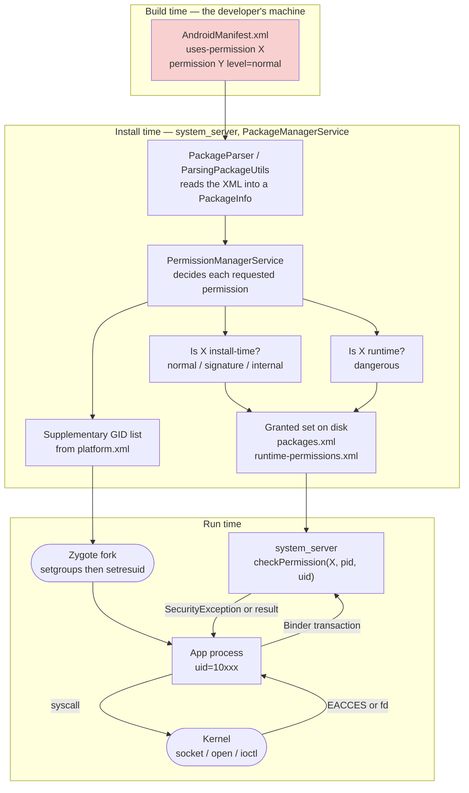
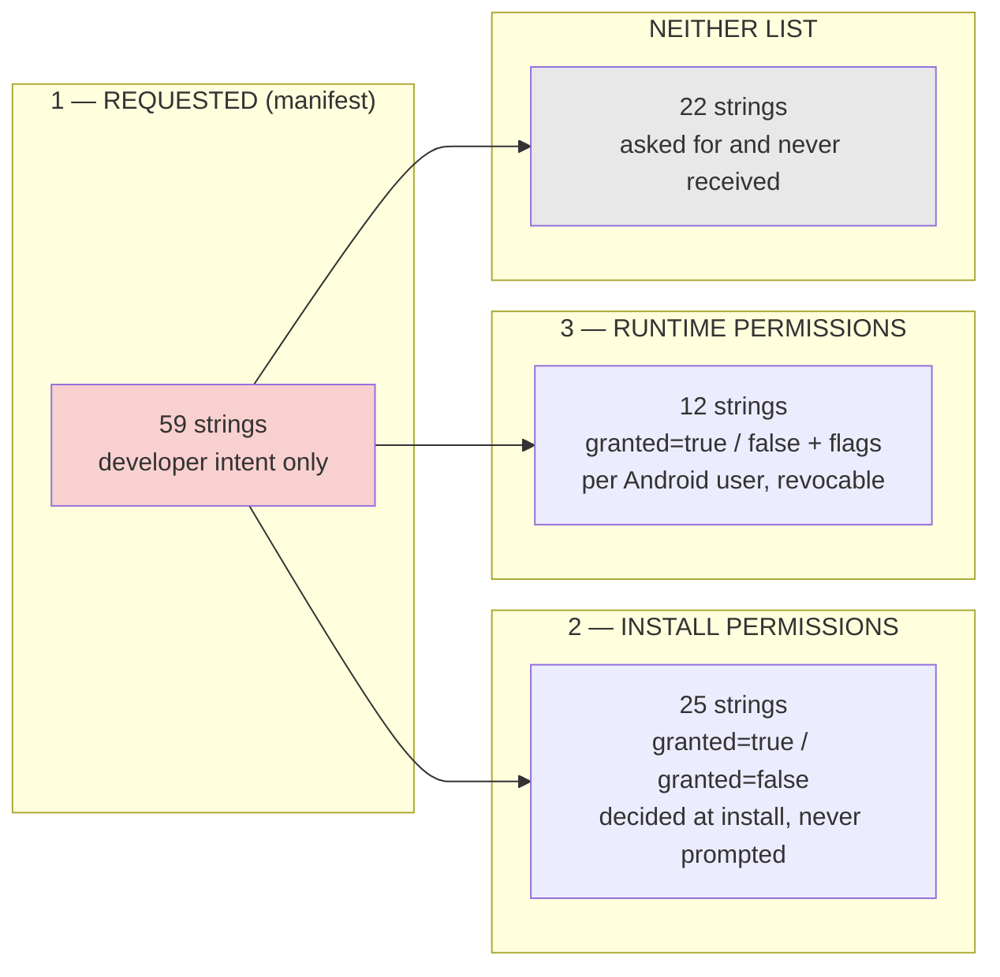
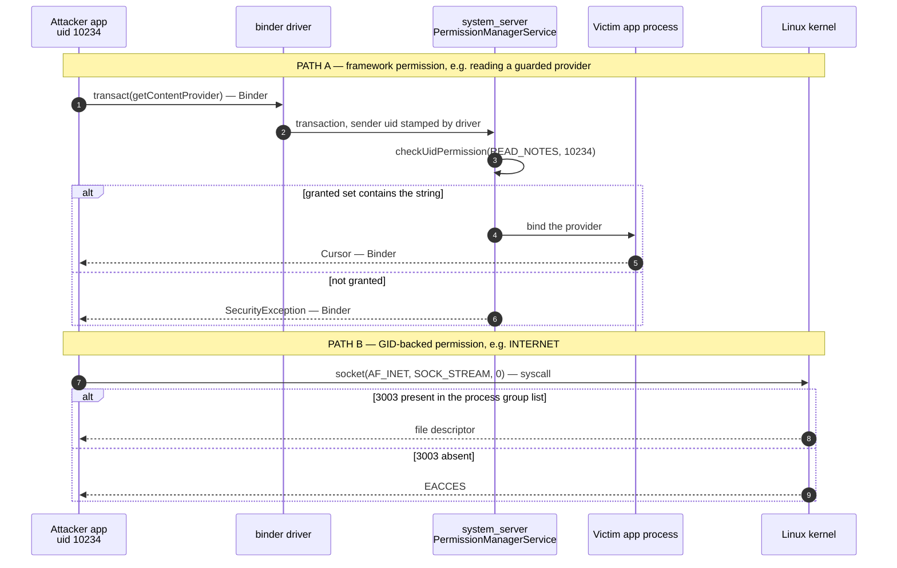
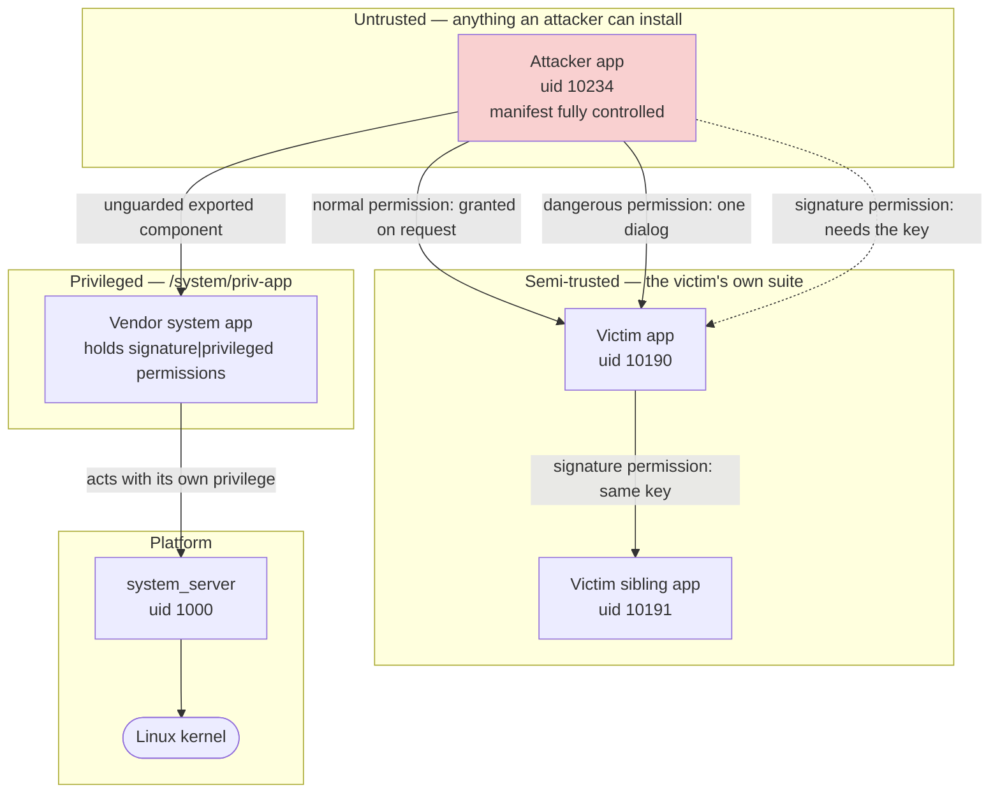
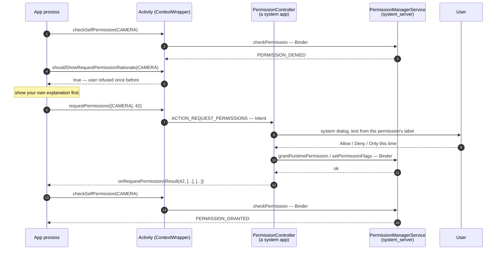
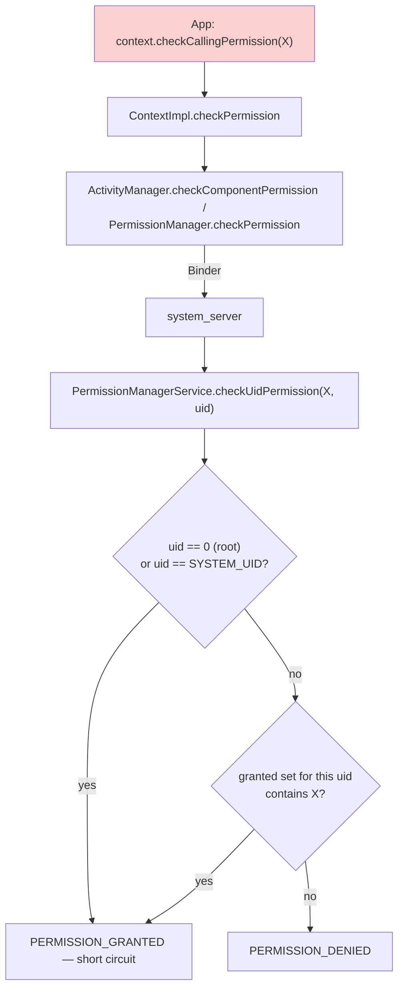
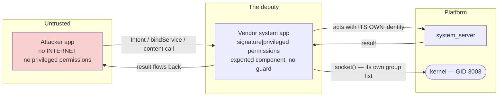
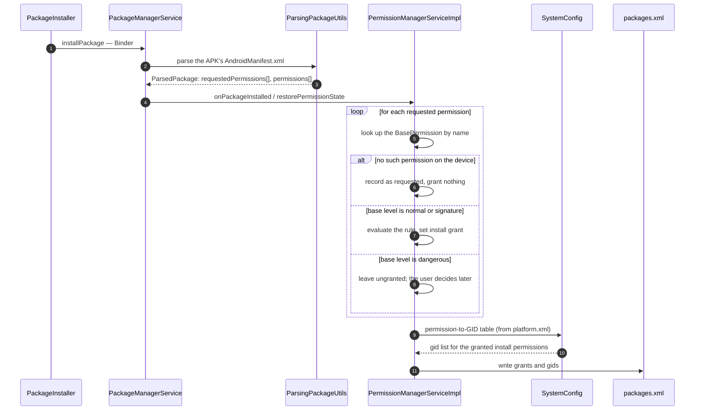
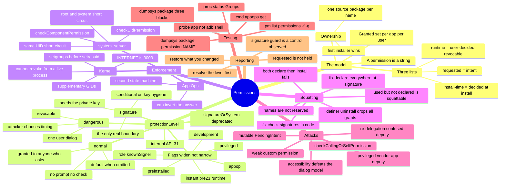

# 23 — Permissions

> After this chapter you can look at any Android app and say, with evidence, exactly which
> permissions it *holds* (not which it asked for), which of its own permissions are *real
> boundaries* (almost none of them), and which of its exposed components an attacker's app can
> reach by writing one line in a manifest.

**Prerequisites:** [09-Android-App-Internals](../09-Android-App-Internals/README.md),
[20-Security-Architecture](../20-Security-Architecture/README.md),
[21-App-Sandbox](../21-App-Sandbox/README.md)

**Useful alongside:** [32-Manifest](../32-Manifest/README.md) — this chapter owns how a grant is
*decided* at runtime; 32 owns how it is *declared*. The split is drawn explicitly in §1 below.
Read them in either order: 32 names this chapter a prerequisite, this one does not name 32.

**Applies to:** API 1 through API 35. The runtime-permission model begins at API 23; everything
before that is install-time only. Every measured claim in this chapter was taken on a physical
arm64 device running **Android 13 / API 33**, and is labelled as measured where that is so.

---

## Table of Contents

- [1. Introduction](#1-introduction)
- [2. High-Level Architecture](#2-high-level-architecture)
- [3. Deep Internal Working](#3-deep-internal-working)
  - [3.1 The three lists — requested, install-time, runtime](#31-the-three-lists--requested-install-time-runtime)
  - [3.2 protectionLevel — the base levels](#32-protectionlevel--the-base-levels)
  - [3.3 protectionLevel — the flags](#33-protectionlevel--the-flags)
  - [3.4 Custom permissions, groups and trees](#34-custom-permissions-groups-and-trees)
  - [3.5 Permission-to-GID mapping — the kernel enforcement point](#35-permission-to-gid-mapping--the-kernel-enforcement-point)
  - [3.6 Permission squatting — the first-installer race](#36-permission-squatting--the-first-installer-race)
  - [3.7 The runtime permission model (API 23+)](#37-the-runtime-permission-model-api-23)
  - [3.8 Where the check happens — the checkPermission family](#38-where-the-check-happens--the-checkpermission-family)
  - [3.9 Permission re-delegation and the confused deputy](#39-permission-re-delegation-and-the-confused-deputy)
  - [3.10 Where grant state lives on disk](#310-where-grant-state-lives-on-disk)
  - [3.11 Package visibility — the filter that is not a permission](#311-package-visibility--the-filter-that-is-not-a-permission)
  - [3.12 Special app access and appop permissions](#312-special-app-access-and-appop-permissions)
  - [3.13 Version matrix — the grant-model timeline](#313-version-matrix--the-grant-model-timeline)
- [4. Source Code Walkthrough (AOSP)](#4-source-code-walkthrough-aosp)
- [5. Security Perspective](#5-security-perspective)
- [6. Reverse Engineering Perspective](#6-reverse-engineering-perspective)
- [7. Dynamic Analysis](#7-dynamic-analysis)
- [8. Static Analysis](#8-static-analysis)
- [9. Examples](#9-examples)
- [10. Common Interview Questions](#10-common-interview-questions)
- [11. Common Mistakes](#11-common-mistakes)
- [12. Hands-on Labs](#12-hands-on-labs)
- [13. Summary](#13-summary)
- [14. References](#14-references)

Supporting material in this folder:

| File | What it is for |
|---|---|
| [cheatsheet.md](cheatsheet.md) | Every `protectionLevel` value and flag, the permission-to-GID map, the `adb` command set, and an "is this a finding?" decision table |
| [mindmap.md](mindmap.md) | The whole chapter as one Mermaid mind map |
| [faq.md](faq.md) | The questions people actually ask, including the ones they are embarrassed to ask |
| [labs/](labs/) | Four labs, ending in a CTF |
| [examples/](examples/) | The squatting pair, and a `signature`-protected component done correctly |
| [scripts/](scripts/) | A grant-state reporter and a custom-permission auditor |
| [references/](references/README.md) | Annotated sources, ending in a Related-chapters table |

---

## 1. Introduction

### 1.1 The problem that existed before permissions

Imagine a block of flats. Every flat has its own lock, and the locks are all different. A resident
in flat 12 physically cannot get into flat 7. That is the whole of the Android sandbox — chapter
[21-App-Sandbox](../21-App-Sandbox/README.md) is the story of those locks, and the lock is the
Linux user ID.

Now imagine the building also has a boiler room, a roof terrace, a post room, and a door out onto
the street. Those are not anybody's flat. They belong to the building. If the flat locks were the
only mechanism the building had, then either everybody could walk into the boiler room or nobody
could, and neither answer is usable.

That is the problem permissions exist to solve. The sandbox answers "can app A touch app B's
files?" — always no. It has nothing at all to say about "can app A open a network socket?", "can
app A read the address book?", "can app A take a photograph?". Those resources are not owned by
any app. They are owned by the *device*, and they are reached by asking the operating system.

Before Android, the mobile answer to this was one of two extremes. On a feature phone, the
platform did not let third-party code near the camera or the address book at all. On a
desktop operating system of the same era, any program you ran had every privilege you had, which
is why a single bad download could read every document you owned. Android's designers wanted the
third answer: let a program declare *in advance* the small set of device-owned resources it
intends to touch, refuse it everything else, and — for the resources a reasonable person would
care about — ask the person.

> **Definition — permission**
> A **permission** in Android is a *string*. That is not a simplification; it is the literal
> truth. `android.permission.CAMERA` is a name. The platform maintains, for every installed
> application, a set of permission strings that application has been *granted*. Every guarded
> operation in the system is implemented as "look up whether the calling application's granted set
> contains this string; if not, throw". Everything else in this chapter is detail about how a
> string gets into that set, and who is allowed to define new strings.

### 1.2 What would break if permissions did not exist

Delete the permission model and keep the sandbox, and the following becomes true immediately:

- Every app can open network sockets. A torch app can exfiltrate anything it can read.
- Every app can read the contact list, the call log, the SMS database and the calendar, because
  those live behind system content providers whose only gate is a permission string.
- Every app can turn on the microphone. There is no other lock on `/dev/audio`; the media server
  guards it with a permission check.
- No app can safely expose *anything* to another app, because there is no way to say "only my own
  sibling app may call this". The only tool left would be `sharedUserId`, which dissolves the
  sandbox entirely between the apps that use it.

That last point is the one testers underrate. Permissions are not only a user-facing privacy
control. They are the *only* selective, non-destructive way for one app to open a door to another
app. Take them away and inter-app integration collapses into all-or-nothing.

### 1.3 The one sentence this chapter is built around

Here is the claim that the rest of the chapter argues, and that several other chapters in this
repository quote:

> **Of everything a developer can write in `android:protectionLevel`, only `signature` is a real
> security boundary. Everything else is a speed bump.**

The reason is a single asymmetry. `normal` and `dangerous` permissions are granted based on
something the attacker controls: the contents of the attacker's own manifest, and — for
`dangerous` — the attacker's ability to write a persuasive sentence in a dialog box. `signature`
permissions are granted based on something the attacker does *not* control: possession of the
victim's private signing key.

That is the whole argument, and you should be suspicious of it until you have seen it done. In
[§3.6](#36-permission-squatting--the-first-installer-race) and
[labs/lab-02-squatting.md](labs/lab-02-squatting.md) you will build two apps and watch a
third, unrelated app be handed the victim's permission at install time with no prompt, no
signature relationship, and no user involvement of any kind. The measurement is in this chapter.

### 1.4 Why this chapter is separate from the manifest chapter

Permissions appear in `AndroidManifest.xml`, so it is fair to ask why they are not part of
[32-Manifest](../32-Manifest/README.md). The split is deliberate and it maps onto a real
distinction that costs testers findings when they blur it.

| Question | Owner |
|---|---|
| Which attribute do I write, what is its default, and does this manifest pass a checklist? | [32-Manifest](../32-Manifest/README.md) |
| What does the manifest do to the UID boundary? | [21-App-Sandbox](../21-App-Sandbox/README.md) |
| What is actually *granted*, by what mechanism, to whom, and can an attacker obtain it? | **This chapter** |
| Once a permission gates a provider, how is the provider exploited? | [27-ContentProviders](../27-ContentProviders/README.md) |

A manifest is a *request*. Grant state is a *fact about a device*. The distance between the two is
where most bad permission findings live, and closing that distance is the practical skill this
chapter teaches.

### 1.5 The vocabulary, up front

Three words get used interchangeably in conversation and must never be used interchangeably in a
report.

> **Definition — requested**
> The app's manifest contains `<uses-permission android:name="X" />`. This is a statement of
> intent by the developer. It has no effect on what the app can do.

> **Definition — granted**
> The platform's permission state for this package, on this device, for this Android user,
> contains `X`. This is what determines whether a call succeeds.

> **Definition — declared (or defined)**
> The app's manifest contains `<permission android:name="X" android:protectionLevel="…" />`. The
> app is the *author* of the permission — it is bringing a new string into existence on the device
> and stating the rule by which other apps may obtain it.

A single app can do all three with the same string, and in [§3.6](#36-permission-squatting--the-first-installer-race)
that is exactly what the attacker does.

> **Mental Model**
> A permission is a **claim about the caller**, checked at the **callee's** boundary, using an
> identity the **kernel** vouched for. Every part of that sentence matters. The claim is a string.
> The boundary is inside `system_server` or inside the target app's process, never inside the
> caller. And the identity is `Binder.getCallingUid()`, which the binder driver stamps into the
> transaction and which no amount of user-space cleverness can forge. A permission check you can
> reach with Frida in your *own* process is not a permission check; it is a UI hint.

### 1.6 Where permissions sit among Android's defences

Android has several overlapping access-control mechanisms, and they are not alternatives to each
other. Reporting confidently requires knowing which one actually stopped you.

| Mechanism | Enforced by | Granularity | Bypassable from inside an app? | Chapter |
|---|---|---|---|---|
| UID sandbox (DAC) | Linux kernel | Per file, per process | No | [21-App-Sandbox](../21-App-Sandbox/README.md) |
| SELinux (MAC) | Linux kernel | Per domain, per object class | No | 22-SELinux |
| Supplementary GIDs | Linux kernel | Per resource group | No — fixed at process fork | **This chapter, §3.5** |
| Framework permissions | `system_server`, Java | Per API, per string | Not from the caller's process | **This chapter, §3.8** |
| App ops | `system_server`, Java | Per app, per operation, mutable at runtime | Not from the caller's process | **This chapter, §3.12** |
| In-app authorisation | The target app's own code | Whatever the developer wrote | Only if the developer put it in the wrong process | [27-ContentProviders](../27-ContentProviders/README.md) |

Two of those six rows belong to this chapter, and they are the two that a developer can get wrong
in a single line of XML.

---

## 2. High-Level Architecture

### 2.1 The life of one permission, end to end



Read this as three tenses. **Build time** produces nothing but text — the manifest is a wish list
and the wish list is fully attacker-controlled, which is why it is shaded. **Install time** is
where every real decision is taken: `PackageManagerService` hands each requested permission to
`PermissionManagerService`, which either records a grant, records a denial, or leaves the
permission to be decided later by the user. That same step computes a completely separate artefact
— the list of Linux supplementary group IDs the app's processes will carry — and that list is
frozen into the app's install record.

**Run time** then has two entirely independent enforcement paths, and this is the fact that most
often surprises people. Most permission checks are a Java method call inside `system_server`,
reached over Binder, that consults the granted set and throws `SecurityException`. A small number
of permissions are never checked in Java at all: they were converted into group memberships at
install, handed to `setgroups()` by Zygote before the process dropped privileges, and are enforced
by the kernel on the `socket()` or `open()` syscall itself. The second path is the one you cannot
hook.

### 2.2 The three lists, and why conflating them produces wrong findings



Those numbers are not illustrative. They are a measurement, produced by
[scripts/grant-state.py](scripts/grant-state.py) from
`adb shell dumpsys package com.android.chrome` on the test device: **59** permissions requested,
**25** resolved as install-time permissions (24 granted, 1 refused), **12** resolved as runtime
permissions (all granted), **36** held in total, and **22 requested permissions that appear in no
grant list at all**. Those twenty-two include `com.sec.enterprise.knox.MDM_CONTENT_PROVIDER` and
`com.google.android.apps.now.CURRENT_ACCOUNT_ACCESS` — permissions belonging to other vendors'
apps that this build of Chrome asks for and does not receive.

A tester who reads only the `requested permissions:` block reports a browser holding Knox MDM
provider access. That report is wrong, it is checkable in ten seconds by whoever receives it, and
it costs you the rest of the engagement's credibility.

> **Warning**
> `dumpsys package` prints the three blocks one after another with almost no visual separation.
> The `requested permissions:` block has no `granted=` suffix on its lines; the other two do. If a
> line has no `granted=`, you are looking at intent, not fact. This single character of
> punctuation is the difference between a finding and a fabrication.

### 2.3 The two enforcement points



The two halves of this diagram never meet. Path A is a Java comparison of strings, performed by a
different process, reached over Binder, and the caller's identity is the UID the binder driver
wrote into the transaction — see 25-Binder for why that stamp cannot be forged. Path B has no Java
in it at all. The kernel compares the process's supplementary group list against the group that
owns the resource, exactly as it would on any Linux box.

The practical consequence for a tester: a Frida script running inside the target app can defeat
nothing on either path, because on path A the check is in another process and on path B it is in
the kernel. What a Frida script *can* do is defeat the app's own defensive `checkSelfPermission()`
calls, which are not security checks at all — they are the app asking itself whether it should
bother making a request that would fail anyway.

### 2.4 The trust boundary drawn properly



Three arrows into the victim, and only one of them is dotted. The dotted arrow is the only one
that stops. That picture is the chapter's thesis rendered as a diagram, and the bottom-left path
— attacker to privileged system app to `system_server` — is the confused-deputy pattern this
chapter owns and covers in [§3.9](#39-permission-re-delegation-and-the-confused-deputy). Note what
makes it dangerous: the attacker never obtains the privileged permission. The attacker borrows a
process that already has it.

---

## 3. Deep Internal Working

This is the longest section in the chapter. It is organised so that each subsection answers, in
order: what the thing is, why it exists, when it applies, where the state lives, and how it fails.

### 3.1 The three lists — requested, install-time, runtime

#### What they are

`dumpsys package <pkg>` prints three separate blocks. They are not three views of one list; they
are three genuinely different data structures with different lifetimes, different storage, and
different revocation semantics.

| Block | Source of truth | Lifetime | Can it change without a reinstall? | Where it is stored |
|---|---|---|---|---|
| `requested permissions:` | The merged `AndroidManifest.xml` | Fixed until the app is updated | No | The package record, derived from the APK |
| `install permissions:` | Decided by `PermissionManagerService` at install | Fixed until reinstall or an upgrade that changes the manifest | Essentially no | `/data/system/packages.xml` |
| `runtime permissions:` | Decided by the user, or by `pm grant` | Mutable at any moment | Yes — that is the point | `/data/system/users/<n>/runtime-permissions.xml` |

#### Why there are three

Before API 23, there were two: what you asked for, and what you got, and you got all of it at
install after one combined dialog. The user's only choice was to install the app or not, which is
not a choice. API 23 split the second list in two: permissions the user could plausibly have an
opinion about (`dangerous`) moved to a per-permission, revocable, prompted model; permissions the
user could not plausibly have an opinion about (`normal`) stayed at install time and stopped being
shown at all.

#### A measured example

This is real output from the test device, trimmed. Note the punctuation difference between the
first block and the other two.

```text
# adb shell dumpsys package com.android.chrome
    requested permissions:
      android.permission.CAMERA
      android.permission.INTERNET
      android.permission.REQUEST_INSTALL_PACKAGES
      com.sec.enterprise.knox.MDM_CONTENT_PROVIDER
      ...
    install permissions:
      android.permission.INTERNET: granted=true
      android.permission.QUERY_ALL_PACKAGES: granted=true
      android.permission.REQUEST_INSTALL_PACKAGES: granted=false
      ...
      gids=[3002, 3003]
      runtime permissions:
        android.permission.CAMERA: granted=true, flags=[ USER_SENSITIVE_WHEN_GRANTED|...|AUTO_REVOKED]
        android.permission.POST_NOTIFICATIONS: granted=true, flags=[ ... ]
```

Four things to take from it, in ascending order of how often they are missed.

1. **`com.sec.enterprise.knox.MDM_CONTENT_PROVIDER` is requested and appears in no grant list.**
   It was asked for and refused. Reporting it as held is a fabrication.
2. **`REQUEST_INSTALL_PACKAGES` sits in the install block with `granted=false`.** An install
   permission that is present but not granted. The row exists because the platform tracked the
   request and reached a decision; the decision was no.
3. **`gids=[3002, 3003]` is printed inside the per-user block, above the runtime list.** It is
   part of the grant state, not a separate thing — see [§3.5](#35-permission-to-gid-mapping--the-kernel-enforcement-point).
4. **The runtime block is nested one level deeper than the other two**, under `User 0:`. Runtime
   permissions are per Android user. Install permissions are not.

> **Pentester's Note**
> The honest severity ladder for a permission observation, from nothing to something:
> **requested only** — not a finding, it is a line of XML;
> **requested and in a grant block with `granted=false`** — not a finding, and worth a sentence in
> the report saying the platform refused it;
> **granted, no code path uses it** — over-privilege, low severity, a supply-chain and Play-policy
> question rather than an exploitable one;
> **granted and reachable by code you can trigger** — now write it up.
> Automated scanners emit the first row and call it `HIGH`. Your job is to be the person who
> reduces it.

#### The trap: a fourth, invisible list

There is a category of permission held by an app that appears in *none* of the three blocks:
permissions the platform assigns to a UID by name rather than to a package. `platform.xml` on the
test device contains, verbatim:

```xml
<!-- /system/etc/permissions/platform.xml, measured on Android 13 -->
<assign-permission name="android.permission.INTERNET" uid="shell" />
```

That is why `adb shell` can open sockets. It is also a compressed statement of why `adb shell` is
not an attacker simulation: the shell UID is handed permissions by platform policy that no
installed package could ever request. Chapter [21-App-Sandbox](../21-App-Sandbox/README.md) makes
the same point from the sandbox side; this is the file that implements it.

### 3.2 `protectionLevel` — the base levels

#### What it is

`android:protectionLevel` is an attribute on `<permission>`. It does not describe how *dangerous*
the permission is. It describes **the rule the platform applies when deciding whether to grant
it**. That distinction is the entire subject.

The value is a single integer. Its low four bits are the *base level*; the remaining bits are
*flags*. AOSP exposes them as constants on
`frameworks/base/core/java/android/content/pm/PermissionInfo.java`, with
`PROTECTION_MASK_BASE = 0xf` and `PROTECTION_MASK_FLAGS = 0xfff0`. The XML form is the base level
name, then zero or more flag names, separated by `|` with no spaces.

#### The base levels in full

| XML keyword | Constant | Base value | Who receives it | User sees a prompt? | Revocable at runtime? |
|---|---|---|---|---|---|
| `normal` | `PROTECTION_NORMAL` | `0` | **Any app that requests it.** Granted silently at install. | No | No |
| `dangerous` | `PROTECTION_DANGEROUS` | `1` | Any app, *if the user says yes* to a runtime dialog (API 23+) or at install (below 23) | Yes | Yes |
| `signature` | `PROTECTION_SIGNATURE` | `2` | Only apps signed with the **same certificate** as the app that declared the permission | No | No |
| `signatureOrSystem` | `PROTECTION_SIGNATURE_OR_SYSTEM` | `3` | Same signature, **or** an app on the system image. Deprecated since API 23; the modern spelling is `signature|privileged` | No | No |
| `internal` | `PROTECTION_INTERNAL` | `4` | **Nobody, on the base level alone.** Grantable only through whichever flags are combined with it (API 31+) | No | Depends on flags |

#### Why `normal` provides zero protection — the argument, not the assertion

Take the definition literally. `normal` means "granted to any app that requests it, at install,
with no prompt". An attacker's app is an app. The attacker writes the app's manifest. Therefore
the attacker requests the permission and receives it.

There is no step in that chain where anything about the attacker is checked. Not the signature,
not the installer, not the user, not the package name. The only input is a string the attacker
typed into their own manifest.

So a component declared like this:

```xml
<!-- AndroidManifest.xml — the victim's, and this protects nothing -->
<permission android:name="com.victim.permission.SYNC" />   <!-- level omitted → normal -->

<service android:name=".SyncService"
         android:exported="true"
         android:permission="com.victim.permission.SYNC" />
```

is reachable by any app on the device that adds one line:

```xml
<!-- AndroidManifest.xml — the attacker's -->
<uses-permission android:name="com.victim.permission.SYNC" />
```

That is not a theoretical claim; it is
[labs/lab-01-grant-state.md](labs/lab-01-grant-state.md), and the measurement is in
[§3.6](#36-permission-squatting--the-first-installer-race).

> **Warning**
> **The default is `normal`.** Omitting `android:protectionLevel` does not mean "undefined" or
> "most restrictive". It means the weakest possible value. A developer who writes
> `<permission android:name="com.example.permission.ADMIN" />` and stops has written access
> control that grants itself.

#### Why `dangerous` is a speed bump rather than a boundary

`dangerous` is stronger than `normal` in exactly one respect: it costs the attacker a dialog. The
dialog says something the *declaring app* wrote, in the declaring app's own words, and the user
sees it in the middle of using the attacker's app, at a moment the attacker chose.

Everything about that interaction favours the attacker:

- The attacker chooses **when** the prompt appears — immediately after a screen that makes it look
  necessary.
- The attacker chooses the surrounding **narrative**. Users grant permissions to apps they have
  just chosen to install.
- The permission's own text is written by the **victim's** developer, for a legitimate use case,
  and is therefore reassuring.
- The attacker can ask again. Two refusals are needed to trigger "don't ask again" on modern
  Android, and the attacker can re-prompt across sessions until then.

Published research on permission-dialog comprehension has consistently found that most users
cannot correctly state what a permission they just granted allows. Treat a custom `dangerous`
permission as a control that raises effort, produces an audit trail, and stops nobody who is
trying.

> **Mental Model**
> Grade a protection level by asking: **what does the attacker have to obtain that they do not
> already have?** `normal`: nothing. `dangerous`: one tap from a user who wants your app to work.
> `signature`: the victim's private key. Only the third answer describes something outside the
> attacker's reach, and that is the entire basis for the claim that only `signature` counts.

#### Why `signature` is different in kind

A `signature` permission is granted when the requesting app's signing certificate matches the
declaring app's. The comparison happens inside `system_server` at install, using the certificates
recorded during APK verification — see [10-APK-Internals](../10-APK-Internals/README.md) for the
signature-scheme detail and [34-Cryptography](../34-Cryptography/README.md) for why forging a
match is not on the table.

To obtain one, an attacker needs the victim's private key. Not a copy of the APK, which is public;
the key. That is a genuinely different class of requirement, and it is the reason this chapter
claims `signature` is the only real boundary a manifest can express.

Three caveats, each of which has produced real findings:

1. **Shared keys dissolve it.** Vendors who sign twenty apps with one key have made a `signature`
   permission a boundary around twenty apps, not one. If any of the twenty is weak, the permission
   is worth what that app is worth. Enumerate the signing key's population before treating a
   `signature` permission as strong: `adb shell dumpsys package <pkg> | grep signatures=` and
   compare across the suite.
2. **A leaked or shipped debug key destroys it.** An app signed with the AOSP public test keys
   (`testkey`, `platform`, `shared`, `media`) has no boundary at all, because those private keys
   are in the public AOSP tree. This still happens on vendor builds.
3. **`knownSigner` (API 31+) deliberately widens it.** With the `knownSigner` flag, the permission
   is grantable to apps signed by *any* certificate listed in the declaring app's
   `android:knownCerts` resource. That is a useful feature — it lets two organisations share a
   permission without sharing a key — but it means "signature-level" no longer implies "same key".
   Read the `knownCerts` array before concluding.

#### `internal` — the level people misread

`internal` (API 31+) exists because the older base levels bundled two ideas: *who* may hold the
permission, and *what mechanism* grants it. `signature|privileged` says "same key OR privileged",
which is an OR the platform did not always want. `internal` means "the base level grants this to
nobody; only the flags decide". It is used for permissions that should be reachable only through,
say, the `role` or `installer` mechanism, with no signature fallback at all.

For a tester, an `internal` permission on a third-party app is unusual enough to be worth reading
carefully; on platform permissions it is routine.

### 3.3 `protectionLevel` — the flags

Flags are ORed onto a base level and each one adds an **additional, independent way to obtain the
permission**. This is the single most misread fact about protection levels: flags do not narrow
the base level, they widen it. `signature|privileged` is grantable to same-signature apps **or**
to privileged apps. It is weaker than plain `signature`, not stronger.

> **Warning**
> Every `|` in a `protectionLevel` is an OR that adds a population. When you see a long
> `protectionLevel`, count the populations, not the words. `signature|privileged|appop` names
> three routes in.

| Flag | Constant | What it adds | Why it matters to you |
|---|---|---|---|
| `privileged` | `PROTECTION_FLAG_PRIVILEGED` | Grantable to apps in `/system/priv-app` (and the other privileged partitions) that are allow-listed for it | The population is "whatever the OEM shipped". Vendor builds carry dozens of privileged apps you did not audit. Every one is a candidate confused deputy — see [§3.9](#39-permission-re-delegation-and-the-confused-deputy) |
| `preinstalled` | `PROTECTION_FLAG_PREINSTALLED` | Grantable to **any** app on the system image, privileged or not | Weaker than `privileged`. On a device with a bloated system partition this is a large population |
| `appop` | `PROTECTION_FLAG_APPOP` | The permission's effective state is governed by an **App Op**, a separate per-app switch, not by the permission grant alone | The permission and the op are two different state machines. `dumpsys package` will lie to you here — see [§3.12](#312-special-app-access-and-appop-permissions) |
| `development` | `PROTECTION_FLAG_DEVELOPMENT` | Grantable from the shell with `pm grant`, even though no app could obtain it | **The largest single source of false positives in this chapter.** You granted it during testing; a real attacker cannot |
| `instant` | `PROTECTION_FLAG_INSTANT` | Grantable to Instant Apps, which run without a full install | Instant Apps are a smaller sandbox with an even smaller permission surface. Its presence tells you the developer targeted that surface |
| `pre23` | `PROTECTION_FLAG_PRE23` | Grantable at install to apps whose `targetSdkVersion` is below 23 | A `dangerous|pre23` permission is install-granted, silently, to any legacy-targeting app. Check the target |
| `runtime` | `PROTECTION_FLAG_RUNTIME_ONLY` | The permission is *only* granted at runtime, never at install, regardless of target | The counterpart to `pre23` |
| `installer` | `PROTECTION_FLAG_INSTALLER` | Grantable to the app holding the installer role | Population of roughly one |
| `verifier` | `PROTECTION_FLAG_VERIFIER` | Grantable to the package verifier | Population of roughly one |
| `setup` | `PROTECTION_FLAG_SETUP` | Grantable to the setup wizard | Population of one |
| `oem` | `PROTECTION_FLAG_OEM` | Grantable to OEM apps allow-listed in the OEM partition | OEM-specific; read the device's `etc/permissions/` allow-lists |
| `vendorPrivileged` | `PROTECTION_FLAG_VENDOR_PRIVILEGED` | Grantable to privileged apps on the vendor partition | As above |
| `role` | `PROTECTION_FLAG_ROLE` | Grantable to whichever app currently holds a platform Role (default browser, default dialer, default SMS app…) | The population is **user-changeable at runtime**. An app the user promotes to default SMS handler acquires permissions it did not have a moment ago |
| `knownSigner` | `PROTECTION_FLAG_KNOWN_SIGNER` | Grantable to apps signed by any certificate in the declaring app's `knownCerts` resource (API 31+) | Turns "same key" into "one of this list of keys". Read the list |
| `companion` | `PROTECTION_FLAG_COMPANION` | Grantable to a companion-device manager app | |
| `recents` | `PROTECTION_FLAG_RECENTS` | Grantable to the recents/launcher component | |
| `module` | `PROTECTION_FLAG_MODULE` | Grantable to an APEX/mainline module | |
| `retailDemo` | `PROTECTION_FLAG_RETAIL_DEMO` | Grantable to the retail demo app | |
| `incidentReportApprover` | `PROTECTION_FLAG_INCIDENT_REPORT_APPROVER` | Grantable to the incident-report approver | |
| `appPredictor` | `PROTECTION_FLAG_APP_PREDICTOR` | Grantable to the app predictor | |
| `textClassifier` | `PROTECTION_FLAG_SYSTEM_TEXT_CLASSIFIER` | Grantable to the system text classifier | |
| `wellbeing` | `PROTECTION_FLAG_WELLBEING` | Grantable to the digital wellbeing app | |
| `documenter` | `PROTECTION_FLAG_DOCUMENTER` | Grantable to the documenter | |
| `configurator` | `PROTECTION_FLAG_CONFIGURATOR` | Grantable to the device configurator | |

> **Under the Hood**
> The numeric values live in `PermissionInfo.java` as `PROTECTION_FLAG_*` constants. Read them
> from the AOSP branch you are testing against rather than memorising them — the flag set has
> grown at almost every release, and a hard-coded table in a tool is how a scanner starts
> mis-parsing a level it has never seen. The two masks (`0xf` for base, `0xfff0` for flags) are
> stable and are what your own parser should use.

#### The `development` flag deserves its own warning

```text
# host — this succeeds. It proves nothing.
adb shell pm grant com.target.app android.permission.WRITE_SECURE_SETTINGS
```

If the permission carries `development`, the shell can grant it and your subsequent test will
succeed. You have demonstrated that a user with a USB cable and developer options enabled can do
something. You have **not** demonstrated that a malicious app can. Write it up as the former or
not at all.

The mirror-image mistake is just as common: a tester grants a permission with `pm grant` to make a
test work, forgets, and then reports the resulting behaviour as reachable. Always re-check grant
state on a *clean* install before writing a finding.

### 3.4 Custom permissions, groups and trees

#### Declaring one

```xml
<!-- AndroidManifest.xml — how a custom permission is declared -->
<permission
    android:name="com.example.notes.permission.READ_NOTES"
    android:protectionLevel="signature"
    android:label="@string/perm_read_notes_label"
    android:description="@string/perm_read_notes_desc"
    android:permissionGroup="android.permission-group.UNDEFINED" />
```

| Attribute | Required? | Notes |
|---|---|---|
| `android:name` | Yes | The string. Convention is `<your.package>.permission.NAME`. The convention is not enforced and that is the root of [§3.6](#36-permission-squatting--the-first-installer-race) |
| `android:protectionLevel` | **No, and that is the problem** | Defaults to `normal` |
| `android:label` | For `dangerous` | Shown in the runtime dialog and in Settings |
| `android:description` | For `dangerous` | Shown in Settings. Must be a string resource |
| `android:permissionGroup` | No | Presentation only on modern Android |
| `android:icon` | No | Presentation only |

#### The rule nobody states plainly

> **Definition — permission ownership**
> A permission string on a device has exactly **one** owning package at a time — its
> *source package*. That package's declaration is the one the platform enforces. Every other app
> that mentions the string is merely *using* it. `adb shell dumpsys package permission <name>`
> prints the owner as `sourcePackage=`.

Measured on the test device, for a permission declared by a two-file app with no code in it:

```text
# adb shell dumpsys package permission com.victim.notes.permission.READ_NOTES
  Permission [com.victim.notes.permission.READ_NOTES] (8b8d463):
    sourcePackage=com.squat.first
    uid=10139 gids=[] type=0 prot=normal
    perm=PermissionInfo{efac860 com.victim.notes.permission.READ_NOTES}
```

Read `sourcePackage=com.squat.first` against the permission's own name. The name says
`com.victim.notes`. The owner is `com.squat.first`. That is the whole of
[§3.6](#36-permission-squatting--the-first-installer-race) in one line of output, and it is why
this command belongs in your muscle memory.

Note also `gids=[]`. A custom permission can never map to a Linux group — only
`/system/etc/permissions/*.xml` can create that mapping, and an app cannot write there. **No
custom permission is ever kernel-enforced.** See [§3.5](#35-permission-to-gid-mapping--the-kernel-enforcement-point).

#### Permission groups

```xml
<permission-group
    android:name="com.example.permission-group.NOTES"
    android:label="@string/group_notes"
    android:description="@string/group_notes_desc" />
```

A permission group is a **presentation** construct. Historically it was much more than that: on
Android 6 through 9, granting one `dangerous` permission in a group caused the others in that
group, if requested, to be granted without a further prompt. That behaviour was the reason an app
that legitimately needed `READ_CONTACTS` silently acquired `WRITE_CONTACTS`.

Modern Android grants per permission. The group survives as the thing Settings uses to organise
the list, and as the unit some UI surfaces summarise by.

Measured evidence that groups are largely vestigial for third-party permissions — the output of
`pm list permissions -d -g` on the test device:

```text
# adb shell pm list permissions -d -g
group:android.permission-group.CONTACTS

group:android.permission-group.CAMERA

group:android.permission-group.UNDEFINED
  permission:android.permission.READ_SMS
  permission:android.permission.READ_CALENDAR
  permission:android.permission.POST_NOTIFICATIONS
  permission:android.permission.READ_CALL_LOG
  permission:android.permission.ACCESS_FINE_LOCATION
  permission:android.permission.ANSWER_PHONE_CALLS
```

The named groups are empty and `UNDEFINED` holds the real permissions. Do not build analysis on
group membership.

#### Permission trees — the manifest under-describes the app

```xml
<permission-tree
    android:name="com.example.notes.permission"
    android:label="@string/tree_notes" />
```

A `<permission-tree>` reserves a **namespace**. It does not create any permission. What it does is
authorise the declaring app to add permissions under that prefix *at runtime*, through
`PackageManager.addPermission(PermissionInfo)`.

This matters to a static analyst for one reason: **an app with a permission tree has a permission
surface that the manifest does not describe.** Permissions can appear after installation, with
protection levels chosen by code rather than by XML.

```java
// Called at runtime by the app that declared the tree.
PermissionInfo info = new PermissionInfo();
info.name            = "com.example.notes.permission.DYNAMIC_READ";
info.protectionLevel = PermissionInfo.PROTECTION_NORMAL;   // chosen in code, not XML
info.labelRes        = R.string.perm_dynamic_label;
info.packageName     = getPackageName();
getPackageManager().addPermission(info);
```

Rules the platform enforces on `addPermission`:

- The new permission's name must be a **strict sub-name** of a tree the calling app declared. It
  must start with the tree name plus a `.` and must not itself be the tree name.
- The calling app must own the tree.
- The protection level is limited to `normal` and `dangerous`. **You cannot add a `signature`
  permission dynamically**, which means every dynamically added permission is, by construction,
  obtainable by an attacker.
- `removePermission()` exists, and a permission added dynamically is not durable in the way a
  manifest one is.

> **Pentester's Note**
> `<permission-tree>` in a manifest is a prompt to go looking in the DEX, not a finding on its own.
> `grep -rn "addPermission" out/sources/` after decompiling. If you find one,the level
> can only be `normal` or `dangerous`, so anything it protects is by definition reachable — and
> then find out what it protects. This is a small class of bug but it is invisible to every
> manifest-only scanner, including [32-Manifest](../32-Manifest/README.md)'s
> `manifest-audit.py`, which says so explicitly in its own output.

### 3.5 Permission-to-GID mapping — the kernel enforcement point

This section is the permission-side counterpart to
[21-App-Sandbox §3.9](../21-App-Sandbox/README.md) and
[09-Android-App-Internals §3.3](../09-Android-App-Internals/README.md). Those chapters establish
*that* the mapping exists and list the group numbers. This section covers what they do not: how
the mapping is defined, why it exists at all, and — the part that produces real findings — the
three ways it behaves differently from every other permission.

#### Why a permission would be a Unix group

Almost every Android permission is a Java string comparison inside `system_server`. That works
because almost every guarded resource is reached through a Binder call to `system_server` in the
first place: you cannot take a photograph without going through the camera service.

Networking is not like that. `socket(AF_INET, SOCK_STREAM, 0)` is a raw syscall. There is no
Binder call, no `system_server`, no Java, and therefore nowhere to put a framework check that
native code, JNI, or a forked `Runtime.exec()` child could not skip.

So Android reused a mechanism the kernel already had. Unix has always let a process belong to
supplementary groups, and the kernel already consults them on every permission decision. Android
made "holding `android.permission.INTERNET`" mean "being in group `inet`", and let the kernel do
the enforcing.

> **Definition — supplementary group**
> Beyond its primary group, a Unix process carries a list of additional group IDs. The kernel
> checks the whole list when deciding file, device and — with Android's networking hooks — socket
> access. The list is set with `setgroups()`, which requires `CAP_SETGID`, and is inherited across
> `fork()`.

#### Where the mapping is defined

It is **data, not code**. The file is
`frameworks/base/data/etc/platform.xml` in the AOSP tree, and it lands on the device at
`/system/etc/permissions/platform.xml`. It is parsed by
`frameworks/base/core/java/com/android/server/SystemConfig.java` at boot.

Here is the shape, quoted from the test device's own copy, including its own comments:

```xml
<!-- /system/etc/permissions/platform.xml — measured, Android 13 / API 33 -->

<!-- The following tags are associating low-level group IDs with
     permission names.  By specifying such a mapping, you are saying
     that any application process granted the given permission will
     also be running with the given group ID attached to its process,
     so it can perform any filesystem (read, write, execute) operations
     allowed for that group. -->

<permission name="android.permission.INTERNET" >
    <group gid="inet" />
</permission>

<permission name="android.permission.BLUETOOTH" >
    <group gid="net_bt" />
</permission>

<permission name="android.permission.BLUETOOTH_STACK" >
    <group gid="bluetooth" />
    <group gid="wakelock" />
    <group gid="uhid" />
</permission>

<permission name="android.permission.READ_LOGS" >
    <group gid="log" />
</permission>
```

Two structural points from that excerpt that neither neighbouring chapter states:

- **One permission may map to several groups.** `BLUETOOTH_STACK` grants three. A tool that models
  the mapping as one-to-one is wrong.
- **The `gid` attribute is a *name*, not a number.** `SystemConfig` resolves the name against the
  platform's AID table, which lives in
  `system/core/libcutils/include/private/android_filesystem_config.h`. That is where the numbers
  come from, and it is why a vendor build can introduce group names your reference table does not
  contain.

The file has two further element types that matter and that are usually skipped over.

**`<assign-permission>` — permissions given to a UID, not a package.**

```xml
<!-- measured, same file -->
<assign-permission name="android.permission.INTERNET" uid="shell" />
<assign-permission name="android.permission.INTERNET" uid="media" />
<assign-permission name="android.permission.MODIFY_AUDIO_SETTINGS" uid="cameraserver" />
<assign-permission name="android.permission.WATCH_APPOPS" uid="cameraserver" />
```

These grants attach to a *system UID*, so they belong to no package and appear in no
`dumpsys package` block. This is the mechanism behind the claim, repeated throughout this
repository, that `adb shell` is not an app. On the test device the shell UID is handed `INTERNET`
by policy in this file.

**`<split-permission>` — one permission that becomes several.**

```xml
<!-- measured, same file -->
<split-permission name="android.permission.ACCESS_FINE_LOCATION">
    <new-permission name="android.permission.ACCESS_COARSE_LOCATION" />
</split-permission>

<split-permission name="android.permission.ACCESS_FINE_LOCATION" targetSdk="29">
    <new-permission name="android.permission.ACCESS_BACKGROUND_LOCATION" />
</split-permission>

<split-permission name="android.permission.READ_EXTERNAL_STORAGE" targetSdk="33">
    <new-permission name="android.permission.READ_MEDIA_AUDIO" />
</split-permission>
<split-permission name="android.permission.READ_EXTERNAL_STORAGE" targetSdk="33">
    <new-permission name="android.permission.READ_MEDIA_VIDEO" />
</split-permission>
<split-permission name="android.permission.READ_EXTERNAL_STORAGE" targetSdk="33">
    <new-permission name="android.permission.READ_MEDIA_IMAGES" />
</split-permission>
```

Read the `targetSdk` attribute carefully, because its meaning is the opposite of what most people
assume on first reading. A split with `targetSdk="N"` applies to apps targeting **below** N — it
is a backwards-compatibility shim that hands a legacy app the newer, narrower permissions it never
knew to request. An app targeting API 28 that asks for `ACCESS_FINE_LOCATION` is *also* given
`ACCESS_BACKGROUND_LOCATION`, because when it was written there was no such distinction.

A split with **no** `targetSdk` applies always: any app requesting `ACCESS_FINE_LOCATION` also
receives `ACCESS_COARSE_LOCATION`, on every version.

> **Pentester's Note**
> This file is the answer to "why does this app hold a permission its manifest never asked for?".
> Before you write that up as a platform bug, `adb pull /system/etc/permissions/platform.xml` and
> grep for the permission in a `<new-permission>` element. On the test device, sixteen distinct
> `<split-permission>` blocks were present. A low `targetSdkVersion` is not just a
> defaults question ([32-Manifest](../32-Manifest/README.md) owns that); it materially changes the
> permission set the app receives.

#### The full mapping as measured

Every `<permission>` element carrying a `<group>` child on the test device, with the numeric AID:

| Permission | Group name | AID | What the kernel then allows |
|---|---|---|---|
| `android.permission.INTERNET` | `inet` | 3003 | Creating `AF_INET` / `AF_INET6` sockets — the whole of networking |
| `android.permission.BLUETOOTH` | `net_bt` | 3002 | The Bluetooth socket family |
| `android.permission.BLUETOOTH_ADMIN` | `net_bt_admin` | 3001 | Bluetooth administration |
| `android.permission.BLUETOOTH_STACK` | `bluetooth`, `wakelock`, `uhid` | 1002, 3010, 3011 | The Bluetooth stack's own device nodes |
| `android.permission.NET_ADMIN` | `net_admin` | 3005 | Network configuration |
| `android.permission.NET_TUNNELING` | `vpn` | 1016 | The TUN device |
| `android.permission.MAINLINE_NETWORK_STACK` | `net_admin`, `net_raw` | 3005, 3004 | Raw sockets and network configuration |
| `android.permission.READ_LOGS` | `log` | 1007 | The log device |
| `android.permission.ACCESS_MTP` | `mtp` | 1024 | The MTP device node |
| `android.permission.DIAGNOSTIC` | `input`, `diag` | 1004, 2002 | Diagnostic device nodes |
| `android.permission.ACCESS_CACHE_FILESYSTEM` | `cache` | 2001 | `/cache` |
| `android.permission.READ_NETWORK_USAGE_HISTORY` | `net_bw_stats` | 3006 | Detailed network accounting |
| `android.permission.UPDATE_DEVICE_STATS` | `net_bw_acct` | 3007 | Modifying network accounting |
| `android.permission.VIRTUAL_INPUT_DEVICE` | `uhid` | 3011 | `/dev/uhid` |
| `android.permission.MANAGE_VOICE_KEYPHRASES` | `audio` | 1005 | Audio device nodes |
| `android.permission.ACCESS_BROADCAST_RADIO` | `media` | 1013 | `/dev/fm` |
| `android.permission.USE_RESERVED_DISK` | `reserved_disk` | 1065 | Reserved disk quota |
| `android.permission.WRITE_SECURITY_LOG` | `security_log_writer` | — | The security log |
| `android.permission.LOOP_RADIO` | `loop_radio` | — | Loop radio device |

Cross-check the numeric column against your own device rather than trusting it; group *names* are
stable in `platform.xml`, but the AID numbering for less-common groups varies with platform version
and vendor. `adb shell cat /system/etc/permissions/platform.xml` is authoritative for the device in
front of you, and it takes three seconds.

#### A measured correction to the storage GIDs

Both [09-Android-App-Internals](../09-Android-App-Internals/README.md) and general Android
folklore associate `READ_EXTERNAL_STORAGE` and `WRITE_EXTERNAL_STORAGE` with AIDs 1028
(`sdcard_r`) and 1015 (`sdcard_rw`). On the Android 13 test device that association **no longer
exists in `platform.xml`**. The two permissions are declared there with no `<group>` child at all,
under a comment explaining exactly why the empty declarations survive:

```xml
<!-- /system/etc/permissions/platform.xml — measured, Android 13 -->
<!-- These are permissions that were mapped to gids but we need
     to keep them here until an upgrade from L to the current
     version is to be supported. ... -->
<permission name="android.permission.READ_EXTERNAL_STORAGE" />
<permission name="android.permission.WRITE_EXTERNAL_STORAGE" />
```

The behavioural confirmation is in the grant state. Chrome on the test device holds both storage
permissions as granted runtime permissions, and its permission-derived GID list is:

```text
# adb shell dumpsys package com.android.chrome | grep gids=
      gids=[3002, 3003]
```

`3002` for `BLUETOOTH` and `3003` for `INTERNET`. No 1015, no 1028, despite both storage
permissions being granted. Scoped storage moved shared-storage enforcement to a FUSE layer and to
MediaProvider, and the group-based mechanism was retired with it. **Do not test for
shared-storage access by looking at group membership on a modern device.**

#### The three ways GID-backed permissions behave differently

This is the part that produces findings, and none of it follows from "a permission is a string".

**1. They are fixed at process creation and cannot be revoked from a running process.**

The group list is installed by `setgroups()` inside the Zygote child, immediately before it drops
to the app's UID — and it must be in that order, because after `setresuid()` the process has lost
`CAP_SETGID` and can no longer change its own groups.
[21-App-Sandbox §2.4](../21-App-Sandbox/README.md) walks that sequence.

The consequence is that there is **no mechanism to remove a group from a live process**. If the
platform wanted to revoke `INTERNET` from a running app, it would have to kill the app. Compare
that with `CAMERA`, which can be revoked while the app is in the foreground and takes effect on the
very next call.

This is why GID-backed permissions are all install-time permissions and none of them is ever
`dangerous`. The model does not support it.

**2. They are the only permissions a Frida script in the app's process cannot touch.**

```javascript
// frida -U -f com.target.app -l illustrative.js
// This is the trap, written out so you recognise it.
Java.perform(function () {
    var Ctx = Java.use('android.content.ContextWrapper');
    Ctx.checkSelfPermission.overload('java.lang.String').implementation = function (p) {
        console.log('[*] app asked itself about ' + p + ' — returning GRANTED');
        return 0;   // PackageManager.PERMISSION_GRANTED
    };
});
```

Run that against an app that lacks `INTERNET` and its own checks will now say it has networking.
Then watch every socket call return `EACCES` anyway. You changed the app's *belief*; the kernel was
never consulting the app's belief. This is worth doing once, deliberately, because it teaches the
difference between defeating a check and defeating a control better than any amount of prose.

**3. A newly granted permission does not produce the group until the process restarts.**

The permission-to-GID computation happens at install and on permission-state change, and the
result is written into the package record; the *process* only picks it up at fork. An app whose
GID set changes must be restarted for the change to take effect.

> **Under the Hood**
> This is why `dumpsys package` and `/proc/<pid>/status` can legitimately disagree, and why you
> should read both. `dumpsys` shows the *stored* list computed from the current grant state.
> `/proc/<pid>/status` shows the *live* list this process was forked with. If they differ, the
> grant state changed after the process started.

#### `dumpsys` gids and `/proc` Groups are not the same list

Measured, same device, same app, same moment:

```text
# adb shell dumpsys package com.android.chrome | grep gids=
      gids=[3002, 3003]

# adb shell cat /proc/18665/status | grep -E '^(Uid|Gid|Groups)'
Uid:    10107   10107   10107   10107
Gid:    10107   10107   10107   10107
Groups: 1079 3002 3003 9997 20107 50107
```

The `dumpsys` list has two entries; the live process has six. The extra four are not permission
grants at all:

| GID | Where it comes from |
|---|---|
| `9997` | `AID_EVERYBODY` — every app process is in it, unconditionally |
| `20107` | The per-app **cache** GID, `20000 + appId'`, used for cache quota accounting |
| `50107` | The per-app **shared** GID, `50000 + appId'` |
| `1079` | Not a permission GID and not in the AID ranges this chapter can name with confidence — a platform or vendor group attached by the device's own configuration |

That last row is deliberately left unresolved, and you should get comfortable doing the same. The
honest procedure when you meet a group you cannot name is to read the device's own
`/system/etc/permissions/*.xml` set and its AID configuration, not to guess from a table written
against a different build.

The practical rule:

> **Pentester's Note**
> `dumpsys package … | grep gids=` answers "which permissions produced groups?".
> `grep Groups /proc/<pid>/status` answers "what is this process actually able to do?". They are
> different questions and the second one is the one that decides whether a socket opens. For the
> single most common question — can this process reach the network — look for `3003` in
> `/proc/<pid>/status`, not in `dumpsys`.

### 3.6 Permission squatting — the first-installer race

#### The mechanism

A permission string has exactly one owning package. Nothing in the platform reserves a namespace
for you. `com.victim.notes.permission.READ_NOTES` looks like it belongs to `com.victim.notes`
because of a naming *convention*, and a convention is not a check.

The rule the platform actually applies is:

> **Definition — permission squatting**
> If two installed packages declare the same permission name, the package installed **first** owns
> the definition, and its `protectionLevel` is the one the platform enforces. An attacker who
> defines a victim's permission name at `normal` before the victim's own definition exists has
> made that permission grantable to any app on the device.

#### Why this does not look like a problem, and then is one

The naive objection is: surely if App A declares `com.victim.permission.X` at `normal` and App B
declares it at `signature`, the platform notices the conflict? It does — and what it does about
the conflict is the measured half of this section.

The subtler and more important case is the one where **there is no conflict at all**, because the
victim's app never declares the permission. That is not a contrived setup; it is the standard
multi-app suite pattern:

- `com.vendor.core` declares `com.vendor.permission.SYNC` at `signature`.
- `com.vendor.reader` guards a provider with `android:readPermission="com.vendor.permission.SYNC"`
  and does **not** declare it, because its sibling does.
- The user installs `com.vendor.reader` from the store but never installs `com.vendor.core`.

Now nobody owns `com.vendor.permission.SYNC`, and the reader's provider is guarded by a permission
that does not exist. An attacker who declares it at `normal` becomes its owner and thereby sets
the rule for a component in someone else's app.

#### Measured on a device — the experiment and its result

Two APKs with no code in them at all — manifest and one string resource each — signed with
**different** keys.

`squatter` (`com.squat.first`):

```xml
<permission
    android:name="com.victim.notes.permission.READ_NOTES"
    android:protectionLevel="normal"
    android:label="Read notes"
    android:description="@string/perm_desc" />
<uses-permission android:name="com.victim.notes.permission.READ_NOTES" />
```

`victim` (`com.victim.notes`), signed with a different key:

```xml
<permission
    android:name="com.victim.notes.permission.READ_NOTES"
    android:protectionLevel="signature"
    android:label="Read notes"
    android:description="@string/perm_desc" />
```

Install the squatter first, then the victim:

```text
# host — measured, Android 13 / API 33
$ adb install -r squatter.apk
Success

$ adb shell pm list permissions -f -g | grep -A4 READ_NOTES
  + permission:com.victim.notes.permission.READ_NOTES
    package:com.squat.first
    label:Read notes
    description:Squatter definition of READ_NOTES
    protectionLevel:normal

$ adb install -r victim.apk
Failure [INSTALL_FAILED_DUPLICATE_PERMISSION: Package com.victim.notes attempting to
redeclare permission com.victim.notes.permission.READ_NOTES already owned by com.squat.first]
```

And the reverse order, on the same device, after uninstalling both:

```text
$ adb install -r victim.apk
Success
$ adb shell pm list permissions -f -g | grep -A4 READ_NOTES
  + permission:com.victim.notes.permission.READ_NOTES
    package:com.victim.notes
    protectionLevel:signature

$ adb install -r squatter.apk
Failure [INSTALL_FAILED_DUPLICATE_PERMISSION: Package com.squat.first attempting to
redeclare permission com.victim.notes.permission.READ_NOTES already owned by com.victim.notes]
```

> **Warning — this measurement corrects a widely repeated claim**
> The textbook version of permission squatting says the squatter's weaker definition silently
> *governs* the victim's component. **On Android 13 that is not what happens when both apps declare
> the name.** The second installer is refused outright with
> `INSTALL_FAILED_DUPLICATE_PERMISSION`, and the refusal is symmetric: whoever is second loses,
> regardless of which one is malicious and regardless of protection level.
>
> That does not make squatting harmless. It changes what it *is*. When both apps declare the name,
> squatting is an **install-denial primitive**: a malicious app on the device can make a specific
> victim app permanently uninstallable, with no user-visible explanation beyond a generic install
> failure. When only the victim *uses* the name — the suite case above — squatting is exactly the
> access-control bypass the textbook describes, and it still works.

#### The suite case, measured

Third app, `com.victim.suite`, which **uses** the permission on a provider but does not declare
it — the sibling that would have declared it is absent:

```xml
<provider
    android:name="com.victim.suite.NotesProvider"
    android:authorities="com.victim.suite.notes"
    android:exported="true"
    android:readPermission="com.victim.notes.permission.READ_NOTES"
    android:writePermission="com.victim.notes.permission.READ_NOTES" />
```

```text
# host — measured, in this order
$ adb install -r squatter.apk       # attacker installs first, defines at normal
Success
$ adb install -r suite.apk          # victim installs happily: no duplicate declaration
Success

$ adb shell dumpsys package permission com.victim.notes.permission.READ_NOTES
  Permission [com.victim.notes.permission.READ_NOTES] (8b8d463):
    sourcePackage=com.squat.first
    uid=10139 gids=[] type=0 prot=normal
```

The victim's exported provider is now guarded by a `normal` permission owned by the attacker. To
close the loop, a fourth app — unrelated to both, signed with a **third** key, containing nothing
but a `<uses-permission>` line:

```text
$ adb install -r probe.apk
Success
$ adb shell dumpsys package com.third.probe
    signatures=PackageSignatures{c528c09 version:4, signatures:[dc86461d], past signatures:[]}
    requested permissions:
      com.victim.notes.permission.READ_NOTES
    install permissions:
      com.victim.notes.permission.READ_NOTES: granted=true
```

`granted=true`. No prompt. No signature relationship with anybody. No user interaction of any
kind. That is the claim from [§1.3](#13-the-one-sentence-this-chapter-is-built-around),
demonstrated end to end on a current device.

#### What happens when the definer is uninstalled

```text
# host — measured, continuing from above
$ adb uninstall com.squat.first
Success

$ adb shell pm list permissions -f -g | grep READ_NOTES
(nothing)

$ adb shell dumpsys package com.third.probe
    requested permissions:
      com.victim.notes.permission.READ_NOTES
    (no install permissions block containing it)
```

The definition vanishes and every grant of it evaporates with it. The probe app still *requests*
the permission — that is in its manifest and cannot change — but no longer holds it.

This is the answer to a question in [faq.md](faq.md) that sounds naive and is not: **"why did the
permission disappear after a reinstall?"** Because the app that owned the definition was
uninstalled, or was reinstalled in a different order, and permission grants are anchored to a
definition that can cease to exist.

#### An app granting itself a permission

The squatter's own record, measured:

```text
    declared permissions:
      com.victim.notes.permission.READ_NOTES: prot=normal, INSTALLED
    requested permissions:
      com.victim.notes.permission.READ_NOTES
    install permissions:
      com.victim.notes.permission.READ_NOTES: granted=true
```

An app can declare a permission and request it in the same manifest, and it will be granted at
install. There is nothing clever about it — the app is an app that requested a `normal`
permission — but seeing all three blocks agree on one string in one package record makes the model
concrete.

#### The hardening timeline, stated honestly

| Behaviour | Where it stands |
|---|---|
| First installer owns the definition | **True on every version tested, including API 33.** Measured |
| A second app declaring the same name is refused installation | **Measured on API 33** (`INSTALL_FAILED_DUPLICATE_PERMISSION`). Older releases were more permissive here; treat the exact version at which this tightened as something to measure on the target rather than to assert |
| A different-signature app cannot silently downgrade an existing `signature` permission | Consistent with the measurement above — the redeclaration is refused, not accepted at a lower level |
| Squatting an *undeclared* name that another app merely uses | **Still fully effective on API 33.** Measured |
| Uninstalling the definer removes the permission and all its grants | **Measured on API 33** |

> **Pentester's Note**
> The mitigation advice that follows from this is not "namespace your permission properly" — the
> attacker can type your namespace too. It is two things. First,
> **every app in a suite that *uses* a custom permission should also *declare* it**, identically
> and at `signature`, so that no window exists in which the name is unowned. Second, and more
> importantly, **do not rely on the permission alone**: re-check the caller in code with
> `PackageManager.checkSignatures(Process.myUid(), Binder.getCallingUid())`, which consults the
> signing certificates directly and cannot be squatted at all. See
> [examples/SignatureGuardedService.java](examples/SignatureGuardedService.java).

### 3.7 The runtime permission model (API 23+)

#### The problem it solved

Before API 23, install was an ultimatum. The user saw one screen listing everything the app wanted
and had two buttons: install, or do not. Nobody read it, because reading it changed nothing —
there was no partial acceptance. The permission list functioned as a legal disclosure, not as a
control.

API 23 changed three things at once, and it is worth separating them because people run them
together:

1. `dangerous` permissions moved from install time to **first use**, so the request arrives with
   context.
2. They became **per permission**, so a user can say yes to camera and no to contacts.
3. They became **revocable**, so a decision is not permanent.

#### The flow



The step people miss is the fourth participant. **The dialog is not drawn by the framework and it
is not drawn by the app.** It is drawn by `PermissionController`, a separate, updatable system
app. That is why the dialog's appearance and wording change between devices from different
vendors, and why the grant flow can be updated without a platform release.

For a tester this has a concrete consequence: hooking `requestPermissions` in the app's process
shows you the *request*, never the decision. The decision is made in another process and arrives
back as an `onRequestPermissionsResult` callback whose contents you should also hook if you want
the truth.

#### The API surface, precisely

| Call | Class | Returns | What it actually asks |
|---|---|---|---|
| `checkSelfPermission(String)` | `Context` | `PERMISSION_GRANTED` (0) or `PERMISSION_DENIED` (-1) | Do *I* hold this? Convenience wrapper for `checkPermission(perm, Process.myPid(), Process.myUid())` |
| `requestPermissions(String[], int)` | `Activity` | void | Start the grant UI. Result arrives asynchronously |
| `onRequestPermissionsResult(int, String[], int[])` | `Activity` | — | The callback. **The `int[]` is the truth; nothing else is** |
| `shouldShowRequestPermissionRationale(String)` | `Activity` | boolean | Has the user refused before *without* selecting "don't ask again"? |

> **Warning**
> `shouldShowRequestPermissionRationale` is not "should I show a rationale". It is a
> three-state variable compressed into a boolean, and the compression is lossy. It returns
> `false` both when the user has **never** been asked and when the user has **permanently
> refused**. The only way to distinguish those two is to combine it with the grant state:
> not granted, rationale `false`, and the app has requested before implies permanent refusal.
> Apps get this wrong constantly and the symptom is a permission request that silently does
> nothing.

#### The states a runtime permission can be in

| State | `checkSelfPermission` | `shouldShowRationale` | How you get out |
|---|---|---|---|
| Never asked | DENIED | false | Ask |
| Granted | GRANTED | false | — |
| Refused once | DENIED | true | Ask again, with an explanation first |
| Permanently refused | DENIED | false | **Cannot ask again.** Only Settings |
| Granted "only this time" (API 30+) | GRANTED, until the app leaves the foreground | false | Ask again next session |
| Auto-revoked for disuse (API 30+) | DENIED | varies | Ask again |

The last two are the ones that break naive test methodology. A one-time grant expires when the
app's last visible activity goes away and a short timer elapses; a tester who grants location
"only this time", backgrounds the app to look at something, and comes back to a permission denial
will waste twenty minutes concluding the app is broken.

#### One-time permissions

API 30 added a third button: **Only this time**. It applies to the location, microphone and camera
groups. The grant behaves exactly like a normal grant while the app is in use, and is revoked once
the app is no longer in use and a grace period has passed. The process is then killed if it still
holds the capability, because — as
[§3.5](#35-permission-to-gid-mapping--the-kernel-enforcement-point) explains for the GID case —
some capabilities cannot be withdrawn from a live process cleanly.

#### Auto-revocation of unused permissions

Also API 30: if an app is not used for a few months, the system revokes its runtime permissions
and notifies the user. Two things follow for a tester.

- **A permission you observe as denied may have been granted and reclaimed.** The `AUTO_REVOKED`
  flag in `dumpsys` output records it. On the test device, Chrome's `CAMERA` entry carries
  `AUTO_REVOKED` in its flag list even while currently granted — the flag records that the
  permission is *eligible for and has been through* the auto-revoke machinery, not that it is
  revoked right now.
- **An app can ask to be exempted**, via `REQUEST_IGNORE_BATTERY_OPTIMIZATIONS`-style user-facing
  flows or `setAutoRevokeWhitelisted`. An app that opts out of permission hygiene is making a
  statement worth a sentence in the report.

#### The runtime permission flags, as measured

```text
android.permission.READ_EXTERNAL_STORAGE: granted=true, flags=[ USER_SENSITIVE_WHEN_GRANTED|
USER_SENSITIVE_WHEN_DENIED|RESTRICTION_INSTALLER_EXEMPT|RESTRICTION_SYSTEM_EXEMPT|
RESTRICTION_UPGRADE_EXEMPT|AUTO_REVOKED]
```

| Flag | Meaning |
|---|---|
| `GRANTED_BY_DEFAULT` | Pre-granted by the platform, not by the user. Seen on Chrome's location permissions on the test device |
| `USER_SENSITIVE_WHEN_GRANTED` / `..._WHEN_DENIED` | Whether this grant state should be surfaced to the user in the privacy dashboard |
| `RESTRICTION_INSTALLER_EXEMPT` | Exempt from a hard restriction, by decision of the installer |
| `RESTRICTION_SYSTEM_EXEMPT` | Exempt by system policy |
| `RESTRICTION_UPGRADE_EXEMPT` | Exempt because the app was already granted it before the restriction existed |
| `AUTO_REVOKED` | The permission has been through the auto-revoke path |
| `USER_FIXED` | The user made an explicit decision that the app may not override — this is "don't ask again" |
| `POLICY_FIXED` | A device policy controller (MDM) fixed this state; the user cannot change it |
| `REVOKE_WHEN_REQUESTED` | Marked for revocation on next request |

> **Pentester's Note**
> `USER_FIXED` and `POLICY_FIXED` are the two flags that change your test plan. `USER_FIXED` means
> the app cannot prompt again, so any behaviour that requires the permission is unreachable through
> the UI until the user goes to Settings. `POLICY_FIXED` means an MDM is in play and your findings
> need a sentence about the managed configuration, because the client's real fleet may not match
> your test device.

### 3.8 Where the check happens — the `checkPermission` family

#### The two enforcement points, named

Every permission decision in Android happens in one of exactly two places.

1. **Inside `system_server`**, in Java, comparing strings, using the UID the binder driver stamped
   into the transaction. This covers the overwhelming majority.
2. **Inside the Linux kernel**, comparing group membership, on a syscall. This covers the
   GID-backed set from [§3.5](#35-permission-to-gid-mapping--the-kernel-enforcement-point).

There is no third. In particular, a check that runs inside the *calling* app's process is not an
enforcement point, and a check that runs inside the *target* app's process is one only insofar as
that process is a different UID from the caller.

#### The API family, and what each one actually asks

This is where developers introduce vulnerabilities by picking the wrong method name, so read the
subject of each question carefully.

| Method | Class | Subject of the question | Safe to use for authorisation? |
|---|---|---|---|
| `checkPermission(perm, pid, uid)` | `Context` | Does the process identified by `pid`/`uid` hold `perm`? | Yes, if you pass `Binder.getCallingPid/Uid()` |
| `checkCallingPermission(perm)` | `Context` | Does the **current Binder caller** hold `perm`? Returns `PERMISSION_DENIED` if there is no Binder call in progress | **Yes** |
| `checkCallingOrSelfPermission(perm)` | `Context` | Does the caller hold it — **or, if there is no caller, do I?** | **No.** See below |
| `enforceCallingPermission(perm, msg)` | `Context` | Same as `checkCallingPermission`, but throws `SecurityException` | **Yes** |
| `enforceCallingOrSelfPermission(perm, msg)` | `Context` | Same as `checkCallingOrSelfPermission`, but throws | **No** |
| `checkSelfPermission(perm)` | `Context` | Do **I** hold it? | Not an authorisation check at all — it is the app asking about itself |
| `PackageManager.checkPermission(perm, pkg)` | `PackageManager` | Does that *package* hold it? | Only for reporting. A package name is a weaker identity than a UID |

> **Warning — the `OrSelf` family is a vulnerability pattern**
> `checkCallingOrSelfPermission` falls back to checking **the caller's own process** when there is
> no incoming Binder transaction. That sounds harmless until you notice how easily a service can
> end up with no Binder transaction in progress: post the work to a `Handler`, hand it to an
> `Executor`, do it on a background thread, or call it from your own `onCreate`. The moment the
> code leaves the Binder thread, `Binder.getCallingUid()` returns *your own* UID, and
> `checkCallingOrSelfPermission` returns `GRANTED` because you, the privileged app, do hold the
> permission.
>
> The result is a privileged app that authorises every caller. Grep for `OrSelf` in decompiled
> output. When you find it, look at what thread the check runs on. This is one of the
> highest-value greps in this chapter and it is in
> [scripts/permission-audit.py](scripts/permission-audit.py)'s source-hint output.

#### `clearCallingIdentity` — the same trap, deliberately

```java
long token = Binder.clearCallingIdentity();
try {
    // Everything in here runs as US, not as the caller.
    doPrivilegedThing();
} finally {
    Binder.restoreCallingIdentity(token);
}
```

`clearCallingIdentity()` exists for a legitimate reason: a system service often needs to do work on
the caller's behalf that the caller could not do itself. It is also, straightforwardly, a way to
convert "the caller asked for it" into "we did it", and any permission check placed *after* the
clear is checking the wrong subject.

The correct pattern is: authorise the caller **first**, capture whatever you need from the caller's
identity into local variables, and only then clear. Any `checkCalling*` after a
`clearCallingIdentity()` and before the matching `restore` is a bug.

#### Where the framework check physically lives



Two short circuits in that flow are worth internalising, because they are the reason a shell test
lies to you.

- **Root and the system UID pass everything.** A check for uid 0 or uid 1000 returns granted
  without consulting any list.
- **Same-UID callers bypass component permission checks entirely.** Chapter
  [27-ContentProviders §4.2](../27-ContentProviders/README.md) covers this for providers, and the
  same is true for the other component types: `checkComponentPermission` grants unconditionally
  when the caller's UID equals the component's owner UID. Two apps sharing `sharedUserId` are one
  app for this purpose.

> **Pentester's Note**
> `adb shell` is UID 2000 with a permission set assigned by `platform.xml`'s
> `<assign-permission>` blocks. It is neither root nor system, so it does not hit the first short
> circuit — but it holds permissions no app can request. Every `am start`, `content query` and
> `service call` you run from a shell is therefore a *reachability upper bound*, not a
> demonstration. The only demonstration is an unprivileged app, which is why
> [examples/](examples/) ships the sources for one and every lab in this chapter makes you use it.

### 3.9 Permission re-delegation and the confused deputy

This is the section chapter [21-App-Sandbox](../21-App-Sandbox/README.md) forward-references twice,
and it is the attack pattern this chapter owns.

#### The idea

> **Definition — confused deputy**
> A *deputy* is a program that holds authority and acts on requests. It becomes *confused* when it
> uses **its own** authority to perform an action requested by someone who does not have that
> authority, without checking whether the requester should be allowed to ask.

Permission re-delegation is the Android instance. App A holds `INTERNET`. App B does not. App A
exposes an exported component that takes a URL and fetches it. App B is now on the network.
No permission was stolen, no check was bypassed, no exploit was written. App A did exactly what it
was built to do, on behalf of the wrong party.



The arrow that matters is the middle one. The attacker's UID never appears anywhere past the first
hop. From `system_server`'s point of view, the vendor system app made the request, and the vendor
system app is entitled to make it.

#### Why this is the dominant real-world pattern on shipped devices

The generic version — one third-party app deputising for another — is common but low-impact,
because the deputy usually holds only permissions the attacker could have requested anyway. The
version that produces serious findings is:

> **A pre-installed vendor system app holding `signature|privileged` permissions that exposes an
> unguarded component, letting an ordinary app reach a capability it could never be granted.**

Three properties make this class disproportionately productive:

1. **The permission population is a set of one.** The deputy holds permissions with
   `signature|privileged`, `signature|preinstalled`, or vendor-specific flags. No third-party app
   can obtain them. So the deputy is the *only* route, which means finding it is finding the whole
   attack.
2. **The deputy was written under a false assumption.** Its developers believed it lived on a
   closed system image among trusted peers, so the internal interface between "our launcher" and
   "our settings app" was never designed to resist a hostile caller. An exported activity with no
   permission attribute looks fine when your mental model is "only our apps are here".
3. **Nobody audits it.** The app is not on the store, it did not go through store review, it is
   often written by a contractor, and it is updated on the OEM's schedule. It ships with the device
   and is not removable.

#### The concrete shapes it takes

| Shape | What the deputy exposes | What the attacker gets |
|---|---|---|
| Broadcast-triggered settings write | Exported `BroadcastReceiver` that reads extras and calls `Settings.Global.putInt` | Arbitrary secure-settings write, using the deputy's `WRITE_SECURE_SETTINGS` |
| Intent-forwarding activity | Exported activity that reads a `Parcelable` extra of type `Intent` and calls `startActivity` on it | The deputy's identity applied to any component the attacker names, including the deputy's own non-exported ones |
| Unguarded `call()` on a provider | Exported provider, no permission, `call()` with method names that touch privileged APIs | Whatever those methods do — see [27-ContentProviders §5.5](../27-ContentProviders/README.md) |
| Exported service with a `Messenger` | `bindService`-able, dispatches messages to privileged operations | Arbitrary invocation of the deputy's privileged surface |
| `PendingIntent` handed out mutably | Deputy creates a `PendingIntent` without `FLAG_IMMUTABLE` and gives it away | The attacker fills in the blanks and the deputy sends it, as itself |
| Content-URI grant laundering | Deputy resolves an attacker-supplied URI and grants access to the result | Read of files under the deputy's authority |

The second and last rows are shared with 26-Intent and
[27-ContentProviders](../27-ContentProviders/README.md) respectively. This chapter's contribution
is the permission arithmetic: for each shape, the question to answer is
**"which permission did the deputy hold that I could not have obtained?"** If the answer is "none —
I could have requested it myself at `normal`", the re-delegation is real but the impact is zero,
and saying so in the report is what separates a good tester from a scanner.

#### The triage procedure

```text
# host — 1. what does the deputy hold that I cannot?
adb shell dumpsys package com.vendor.systemapp | sed -n '/install permissions/,/runtime permissions/p'

# host — 2. for each, resolve the level. Anything signature|privileged is interesting.
adb shell pm list permissions -f -g | grep -A4 com.vendor.permission.PRIVILEGED_THING

# host — 3. what does it expose?
adb shell dumpsys package com.vendor.systemapp | sed -n '/Activity Resolver Table/,/Service Resolver Table/p'

# host — 4. is the exposed thing guarded?
#    Pull the APK and read the merged manifest. adb shell pm path <pkg> gives the APK path.
adb shell pm path com.vendor.systemapp
adb pull /system/priv-app/VendorApp/VendorApp.apk .
apktool d -f VendorApp.apk -o out/
python3 ../../32-Manifest/scripts/manifest-audit.py out/AndroidManifest.xml
python3 ../../21-App-Sandbox/scripts/manifest-exposure.py out/AndroidManifest.xml
python3 scripts/permission-audit.py --manifest out/AndroidManifest.xml
```

Steps 1 and 2 are this chapter's. Steps 3 and 4 hand off deliberately: the exported-component
inventory is [21-App-Sandbox](../21-App-Sandbox/README.md)'s, the declaration audit is
[32-Manifest](../32-Manifest/README.md)'s, and this chapter's script adds the piece neither of
them does — which of the app's permissions are *enforceable* and which are decorative.

#### The remediation, as code

The deputy's fix is never "add a permission attribute" alone, because the permission it adds is
usually a custom one, and a custom one is squattable. The fix is layered:

```java
// The deputy's exported entry point, done properly.
@Override
public IBinder onBind(Intent intent) {
    // 1. Authorise the caller by an identity the attacker cannot supply.
    enforceCallerIsSameSignature();
    return mBinder;
}

private void enforceCallerIsSameSignature() {
    final int callingUid = Binder.getCallingUid();
    if (callingUid == Process.myUid()) return;                 // ourselves
    // checkSignatures compares signing certificates by UID. It cannot be squatted,
    // cannot be spoofed by package name, and is unambiguous under sharedUserId.
    if (getPackageManager().checkSignatures(Process.myUid(), callingUid)
            != PackageManager.SIGNATURE_MATCH) {
        throw new SecurityException("uid " + callingUid + " is not same-signature");
    }
}
```

plus `android:permission="…"` at `signature` in the manifest, plus `android:exported="false"` if
the component genuinely has no cross-app callers. Belt, braces, and a check the manifest cannot
express. See [examples/SignatureGuardedService.java](examples/SignatureGuardedService.java) for the
complete version with the manifest beside it.

### 3.10 Where grant state lives on disk

Grant state is not held only in memory. It is serialised, and on a rooted device or an emulator it
is directly readable — which makes it a forensic artefact as well as a debugging aid.

| Path | Contents | Notes |
|---|---|---|
| `/data/system/packages.xml` | The package database: for each package, its UID, signing certificates, declared permissions and **install-time** grants | The `<perms>` block under each `<package>` is the install-permission list |
| `/data/system/packages.list` | One line per package: name, UID, debuggable flag, data dir, seinfo, **GID list** | Field 6 is the permission-derived GID list. Covered in [09-Android-App-Internals §3.4](../09-Android-App-Internals/README.md) |
| `/data/system/users/<n>/runtime-permissions.xml` | Runtime grants and their flags, **per Android user** | The reason a runtime permission can differ between the primary user and a work profile |
| `/data/system/appops.xml` | App-op modes | The other half of the picture for `appop` permissions — [§3.12](#312-special-app-access-and-appop-permissions) |
| `/data/system/urigrants.xml` | Persisted URI permission grants | Owned by [27-ContentProviders §3.6](../27-ContentProviders/README.md) |
| `/system/etc/permissions/*.xml` | Platform policy: permission-to-GID, UID assignments, splits, privileged allow-lists | World-readable. **You do not need root for this one** |

The last row is the one to remember when you have no root. `/system/etc/permissions/` is readable
by the shell, and it is where the OEM's privileged-permission allow-lists live — files named
`privapp-permissions-*.xml` that enumerate exactly which privileged permissions each
pre-installed app is allowed to hold. On a device you are assessing, that directory is a map of
the vendor's own trust decisions.

```text
# host — no root needed
adb shell ls /system/etc/permissions/ /vendor/etc/permissions/ /product/etc/permissions/ 2>/dev/null
adb shell cat /system/etc/permissions/privapp-permissions-platform.xml | head -40
```

#### `pm grant` and `pm revoke` — and what they refuse to do

```text
# host — measured, Android 13
$ adb shell pm grant com.third.probe com.victim.notes.permission.READ_NOTES
Exception occurred while executing 'grant':
java.lang.SecurityException: Permission com.victim.notes.permission.READ_NOTES requested by
com.third.probe is not a changeable permission type
    at com.android.server.pm.permission.PermissionManagerServiceImpl.grantRuntimePermissionInternal(...)
    at com.android.server.pm.permission.PermissionManagerServiceImpl.grantRuntimePermission(...)
    at com.android.server.pm.permission.PermissionManagerService.grantRuntimePermission(...)
    at com.android.server.pm.PackageManagerShellCommand.runGrantRevokePermission(...)
```

`pm grant` operates on **runtime** permissions and on permissions carrying the `development` flag.
It cannot grant a `normal` permission, because there is no per-app runtime state for one to write
into — the grant was decided at install and lives in `packages.xml`.

The measured stack trace is a free map of the code path, and every class in it is a real AOSP file:

- `frameworks/base/services/core/java/com/android/server/pm/PackageManagerShellCommand.java`
- `frameworks/base/services/core/java/com/android/server/pm/permission/PermissionManagerService.java`
- `frameworks/base/services/core/java/com/android/server/pm/permission/PermissionManagerServiceImpl.java`

The same call sequence, in the other direction, is what the `PermissionController` app invokes when
the user taps Allow.

```text
# host — the runtime cycle, which does work
adb shell pm revoke com.android.chrome android.permission.CAMERA
adb shell dumpsys package com.android.chrome | grep 'permission.CAMERA: granted'
#   android.permission.CAMERA: granted=false, flags=[ ... ]
adb shell pm grant  com.android.chrome android.permission.CAMERA
#   android.permission.CAMERA: granted=true,  flags=[ ... ]
```

> **Warning**
> `pm revoke` on a permission the app is currently using will usually kill the app's process, by
> design — see the one-time-permission discussion in [§3.7](#37-the-runtime-permission-model-api-23).
> If you are mid-way through a dynamic test and the app vanishes, that is why. Restore the state
> you changed before you finish; leaving a client's device with permissions you revoked is sloppy
> and occasionally consequential.

### 3.11 Package visibility — the filter that is not a permission

Chapter [21-App-Sandbox](../21-App-Sandbox/README.md) forward-references this section for the full
treatment, and the reason it belongs here rather than there is that package visibility is
frequently mistaken for a permission and behaves like one in almost no respect.

#### What changed at API 30

Before Android 11, `getInstalledPackages()` returned everything. That was a privacy problem — the
installed app list is a startlingly good fingerprint and a startlingly good targeting signal for
malware looking for banking apps — and a fingerprinting problem for advertising SDKs.

From `targetSdkVersion` 30, an app sees only:

- itself;
- packages it named in a `<queries>` block;
- packages matching an `<intent>` or `<provider>` filter inside `<queries>`;
- a small always-visible set (the installer, packages that interact with it, some system
  components);
- everything, if it holds `android.permission.QUERY_ALL_PACKAGES`.

#### Why it is not a permission

| Property | A permission | Package visibility |
|---|---|---|
| What it controls | Whether an operation succeeds | Whether a package **appears in a result set** |
| Failure mode | `SecurityException` | Silent absence, or `NameNotFoundException` |
| Where declared | `<uses-permission>` | `<queries>` |
| User-visible | Sometimes | Never |
| Revocable | Sometimes | No |

That second row is the operational point. A filtered package does not produce an error; it produces
an *empty list*. Code that asks "is the root manager installed?" gets "no" whether the answer is
genuinely no or the app did not declare an interest.

> **Pentester's Note**
> This bites *you*, not just the target. A probe app you write to test something — including the
> ones in [examples/](examples/) — cannot see the victim package unless you mirror the victim's
> package name into your own `<queries>` block, or set `targetSdkVersion` below 30, or hold
> `QUERY_ALL_PACKAGES`. A probe that silently sees nothing looks exactly like a probe that proved
> the target is unreachable. Every example manifest in this chapter carries the `<queries>` entry
> for this reason.

#### `QUERY_ALL_PACKAGES` as a signal

It is `normal` protection level, so any app that asks receives it silently — measured on the test
device, where Chrome holds it as `granted=true` in the install block. Its presence in a manifest
therefore tells you nothing about the platform's opinion of the app and everything about the
developer's intent.

The `<queries>` block, when present, is far more informative than the permission. It is a written
list of exactly which other apps this one wants to see. A list of root-manager package names is
root detection declared in XML (see [37-RootDetection](../37-RootDetection/README.md)). A list of
banking apps inside a non-banking app is something worse.

### 3.12 Special app access and appop permissions

#### The third grant model

The two grant models covered so far — install-time and runtime — do not cover everything. There is
a third class, reached through Settings under headings like "Special app access", and implemented
by pairing a permission with an **App Op**.

> **Definition — App Op**
> An *App Op* is a per-application, per-operation mode value held by `AppOpsService` in
> `system_server`. Each op has a mode: `allow`, `ignore`, `deny`, `default`, or `foreground`.
> App Ops are a completely separate state machine from permissions. They can be changed at
> runtime, they are stored in `/data/system/appops.xml`, and — crucially — the *effective* answer
> for an `appop` permission is a function of **both** the permission grant and the op mode.

When a permission's `protectionLevel` carries the `appop` flag, the framework's check for it is not
"is the permission granted" but roughly "is the permission granted **and** is the op mode
permissive". The permission establishes eligibility; the op is the switch.

#### The measured demonstration that `dumpsys package` alone lies

On the test device, for `REQUEST_INSTALL_PACKAGES` — a `signature|appop` permission — Chrome shows:

```text
# adb shell dumpsys package com.android.chrome
    install permissions:
      android.permission.REQUEST_INSTALL_PACKAGES: granted=false
```

and simultaneously:

```text
# adb shell cmd appops get com.android.chrome REQUEST_INSTALL_PACKAGES
Uid mode: REQUEST_INSTALL_PACKAGES: allow
REQUEST_INSTALL_PACKAGES: allow
```

Permission: not granted. Op: allow. Those are not contradictory outputs; they are two halves of one
answer, and reading only the first gives you the wrong conclusion about whether this browser can
launch a package installer.

> **Warning**
> For any permission whose level contains `appop`, **`dumpsys package` is not sufficient**. You
> must also read `cmd appops get <pkg> <OP>`. This is the single most reliable way to produce a
> confidently wrong finding in this chapter, in either direction: reporting a capability the app
> does not have, or clearing one it does.

#### The full appops view of one app, measured

```text
# adb shell cmd appops get com.android.chrome
Uid mode: REQUEST_INSTALL_PACKAGES: allow
LEGACY_STORAGE: ignore
COARSE_LOCATION: allow
FINE_LOCATION: allow
READ_CONTACTS: allow
SYSTEM_ALERT_WINDOW: default; rejectTime=+215d1h22m53s81ms ago
CAMERA: allow
RECORD_AUDIO: allow
READ_EXTERNAL_STORAGE: allow
WRITE_EXTERNAL_STORAGE: allow
GET_ACCOUNTS: allow
MANAGE_EXTERNAL_STORAGE: default; rejectTime=+215d1h23m23s436ms ago
NO_ISOLATED_STORAGE: deny; rejectTime=+215d1h23m23s432ms ago
```

Three things to read out of that.

- **Every granted runtime permission has a shadowing op.** `CAMERA: allow` mirrors the runtime
  grant. The platform tracks both, and an MDM or a privacy tool can set the op to `ignore` to
  neuter a permission the user granted — the API then silently returns empty data rather than
  throwing.
- **`default` is not `deny`.** It means "no explicit decision; fall back to whatever the permission
  says". `SYSTEM_ALERT_WINDOW: default` on an app that never requested overlay is the normal state.
- **`rejectTime` is a timestamp of the last denial.** Useful in a forensic context: it tells you
  the app *attempted* the operation, and when.

#### The special-access permissions worth flagging on sight

| Permission | Settings surface | Why it transcends the sandbox |
|---|---|---|
| `BIND_ACCESSIBILITY_SERVICE` | Accessibility | Read every window's content and inject events into any app. The single most abused capability in Android banking malware |
| `BIND_NOTIFICATION_LISTENER_SERVICE` | Notification access | Read every notification, including one-time codes |
| `SYSTEM_ALERT_WINDOW` | Display over other apps | Draw on top of any app — the tapjacking and overlay-phishing primitive |
| `MANAGE_EXTERNAL_STORAGE` | All files access | Read and write every other app's shared-storage files |
| `PACKAGE_USAGE_STATS` | Usage access | Which apps the user opens, and when |
| `REQUEST_INSTALL_PACKAGES` | Install unknown apps | Dropper capability — the app can create new sandboxes |
| `BIND_DEVICE_ADMIN` | Device admin apps | Lock, wipe, and resist uninstall |
| `WRITE_SETTINGS` | Modify system settings | Change system configuration |
| `SCHEDULE_EXACT_ALARM` | Alarms and reminders | Wake the device on a precise schedule; persistence |

Every one of these is granted through a *Settings screen*, not through a runtime dialog. That is a
meaningfully different threat model: the user must be led into Settings and talked through a
multi-step flow. Malware does this by drawing an overlay that narrates the steps, which is why
`SYSTEM_ALERT_WINDOW` plus `BIND_ACCESSIBILITY_SERVICE` is the combination to look for.

> **Pentester's Note**
> An app requesting `BIND_ACCESSIBILITY_SERVICE` is not a finding by itself — accessibility
> services are a legitimate and important feature. The finding is the combination: an app whose
> stated function has nothing to do with accessibility, which also requests overlay, and whose
> accessibility service config (`res/xml/accessibility_service_config.xml`) claims
> `canRetrieveWindowContent="true"` with `accessibilityEventTypes="typeAllMask"` and no package
> restriction. Read that XML file. It is the accessibility service's real permission declaration
> and it is not in the manifest.

### 3.13 Version matrix — the grant-model timeline

Chapter [32-Manifest](../32-Manifest/README.md) owns the general `targetSdkVersion` matrix — which
defaults flip, when `exported` became mandatory, when cleartext turned off. This table is the
narrower, permission-specific one: **how the grant model itself changed**. Where a row overlaps
32's, it is because that row is genuinely about grants rather than about declaration defaults.

| API | Android | Change to the grant model | What it means when you test an app targeting *below* this |
|---|---|---|---|
| 1–22 | 1.0–5.1 | All permissions granted at install, after one combined dialog | Nothing is revocable. There are no runtime permissions to check |
| 19 | 4.4 | `android:maxSdkVersion` on `<uses-permission>` | A permission can be requested only on old platforms |
| 23 | 6.0 | **Runtime permissions.** `dangerous` moves to first-use, per-permission, revocable. `normal` becomes silent at install | An app below 23 gets its `dangerous` permissions at install with no runtime prompt. `pre23`-flagged permissions behave the same way |
| 23 | 6.0 | `signatureOrSystem` deprecated in favour of `signature|privileged` | Legacy spelling in a modern manifest is a code-age signal |
| 26 | 8.0 | Permission group auto-grant tightened; requesting one permission no longer implies its group siblings on newer targets | Below 26, granting one contacts permission could imply another |
| 29 | 10 | Background location split out (`ACCESS_BACKGROUND_LOCATION`), delivered to older targets via `<split-permission>` | A pre-29 target asking for fine location also receives background location |
| 29 | 10 | Device identifiers (IMEI, serial) require a privileged permission | Legacy targets could read them with `READ_PHONE_STATE` |
| 30 | 11 | **One-time permissions** for location, microphone, camera | Not available below 30 |
| 30 | 11 | **Auto-reset of unused app permissions** | Applies by target and by platform; check `AUTO_REVOKED` flags |
| 30 | 11 | **Package visibility filtering**, unless `<queries>` or `QUERY_ALL_PACKAGES` | Below 30 the app sees every package |
| 30 | 11 | `MANAGE_EXTERNAL_STORAGE` introduced as a special access | The scoped-storage escape hatch |
| 31 | 12 | `internal` base level and the `knownSigner` flag introduced | Not expressible below 31 |
| 31 | 12 | Bluetooth split into `BLUETOOTH_SCAN` / `_CONNECT` / `_ADVERTISE`, delivered to older targets by `<split-permission>` | A pre-31 target asking for `BLUETOOTH` receives all three |
| 31 | 12 | `usesPermissionFlags="neverForLocation"` on `BLUETOOTH_SCAN` | An assertion the app makes about its own behaviour, testable |
| 33 | 13 | **`POST_NOTIFICATIONS` becomes a runtime permission** | Below 33, notifications need no permission |
| 33 | 13 | `READ_EXTERNAL_STORAGE` split into `READ_MEDIA_IMAGES` / `_VIDEO` / `_AUDIO`, delivered to older targets by `<split-permission>` | Measured on the test device — three separate split blocks |
| 33 | 13 | `BODY_SENSORS_BACKGROUND` split out | |
| 34 | 14 | Foreground service types each require their own permission | An FGS without its type permission will not start |
| 34 | 14 | Partial media access ("Select photos") via `READ_MEDIA_VISUAL_USER_SELECTED` | A granted media permission no longer implies access to all media |
| 35 | 15 | Minimum installable `targetSdk` raised; further background restrictions | Very old targets stop installing at all |

> **Warning**
> Every `<split-permission>` row above means **an app can hold a permission its manifest never
> names**. Do not diff the manifest's `<uses-permission>` list against the granted list and treat
> the difference as an anomaly. Check `platform.xml` first. This is the single most common
> false positive produced by home-grown permission tooling, including — until this was added —
> the first draft of [scripts/grant-state.py](scripts/grant-state.py).

---

## 4. Source Code Walkthrough (AOSP)

Every path below is a real file in the AOSP tree. Line numbers are deliberately omitted — they
change with every release and citing them is how a document becomes wrong without anyone noticing.
The class and method names are stable enough to search for.

### 4.1 The files that matter

| File | What it holds |
|---|---|
| `frameworks/base/core/res/AndroidManifest.xml` | **The declaration of every platform permission.** This is where `android.permission.CAMERA` and its `protectionLevel` physically live. If you want to know a platform permission's real level, this is the source, and the device's `pm list permissions -f` is the confirmation |
| `frameworks/base/core/java/android/content/pm/PermissionInfo.java` | The `PROTECTION_*` and `PROTECTION_FLAG_*` constants, and the two masks |
| `frameworks/base/data/etc/platform.xml` | Permission-to-GID mapping, `<assign-permission>` UID grants, `<split-permission>` compatibility splits |
| `frameworks/base/core/java/com/android/server/SystemConfig.java` | Parses `platform.xml` and the other files in `etc/permissions/`, and builds the in-memory tables |
| `frameworks/base/services/core/java/com/android/server/pm/permission/PermissionManagerService.java` | The Binder-facing permission service |
| `frameworks/base/services/core/java/com/android/server/pm/permission/PermissionManagerServiceImpl.java` | The implementation: grant, revoke, level checks, GID computation |
| `frameworks/base/services/core/java/com/android/server/pm/PackageManagerShellCommand.java` | `pm grant`, `pm revoke`, `pm list permissions` |
| `frameworks/base/core/java/android/content/ContextWrapper.java` and `frameworks/base/core/java/android/app/ContextImpl.java` | The `checkPermission` / `enforcePermission` family the app calls |
| `frameworks/base/services/core/java/com/android/server/am/ActivityManagerService.java` | `checkComponentPermission` — the component-level gate |
| `frameworks/base/services/core/java/com/android/server/appop/AppOpsService.java` | The App Ops state machine |
| `frameworks/base/core/java/android/app/AppOpsManager.java` | The op constants and the client API |
| `frameworks/base/core/java/android/os/Binder.java` | `getCallingUid`, `clearCallingIdentity`, `restoreCallingIdentity` |
| `system/core/libcutils/include/private/android_filesystem_config.h` | The AID table: group names to numbers |

The first row is the one people never look at, and it is the most useful. Every argument about
whether a platform permission is really `signature` is settled by reading its declaration in
`frameworks/base/core/res/AndroidManifest.xml`.

### 4.2 How the protection level is stored and read

`PermissionInfo` keeps the level as a single `int`. The base and the flags share it:

```java
// frameworks/base/core/java/android/content/pm/PermissionInfo.java — shape, abridged
public static final int PROTECTION_NORMAL              = 0;
public static final int PROTECTION_DANGEROUS           = 1;
public static final int PROTECTION_SIGNATURE           = 2;
@Deprecated
public static final int PROTECTION_SIGNATURE_OR_SYSTEM = 3;
public static final int PROTECTION_INTERNAL            = 4;

public static final int PROTECTION_FLAG_PRIVILEGED   = 0x10;
public static final int PROTECTION_FLAG_DEVELOPMENT  = 0x20;
public static final int PROTECTION_FLAG_APPOP        = 0x40;
public static final int PROTECTION_FLAG_PRE23        = 0x80;
// ... and roughly twenty more, each one bit higher

public static final int PROTECTION_MASK_BASE  = 0xf;
public static final int PROTECTION_MASK_FLAGS = 0xfff0;

public int protectionLevel;

public int getProtection()      { return protectionLevel & PROTECTION_MASK_BASE;  }
public int getProtectionFlags() { return protectionLevel & PROTECTION_MASK_FLAGS; }
```

The two accessors are what your own parser should imitate. A tool that string-matches
`"signature"` against the XML keyword will happily classify `signature|privileged|appop` as strong
and miss that it names three separate populations. A tool that masks and then enumerates the flags
cannot make that mistake, which is why
[scripts/permission-audit.py](scripts/permission-audit.py) works on the keyword *set* rather than
on the string.

> **Under the Hood**
> `PROTECTION_MASK_FLAGS = 0xfff0` is only sixteen bits wide, but the flag constants have long
> since grown past `0x10000`. Read that as a historical artefact rather than a bound: use
> `~PROTECTION_MASK_BASE` if you are writing your own extractor, and read the constant list from
> the branch you are analysing rather than from memory.

### 4.3 From `<permission>` in XML to a decision at install

The call flow, in order, for a single requested permission:



Three details in that flow that matter operationally:

- **"No such permission on the device" is a silent no-op.** The app requested a string nobody
  defines. It is recorded in `requested permissions:` and appears nowhere else. This is exactly
  what the thirty-four unaccounted-for Chrome permissions in [§2.2](#22-the-three-lists-and-why-conflating-them-produces-wrong-findings)
  are, and it is why the same manifest yields a different grant set on a Samsung device (which has
  Knox) than on a Pixel (which does not).
- **The GID computation runs after the grant decisions**, over the granted install permissions
  only. A `dangerous` permission that maps to a GID could not work, and none do.
- **A permission requested but not defined at install time does not get granted later** if the
  defining app is installed afterwards, unless the requesting app is also reinstalled or updated.
  That asymmetry is another route to "why did this stop working?".

### 4.4 The check path, traced from public API to the decision

Start where an app starts.

```java
// frameworks/base/core/java/android/content/ContextWrapper.java — shape
@Override
public int checkCallingPermission(String permission) {
    return mBase.checkCallingPermission(permission);
}
```

`ContextWrapper` is a pass-through; `ContextImpl` is where it becomes real.

```java
// frameworks/base/core/java/android/app/ContextImpl.java — shape, abridged
@Override
public int checkCallingPermission(String permission) {
    if (permission == null) throw new IllegalArgumentException("permission is null");
    int pid = Binder.getCallingPid();
    if (pid != Process.myPid()) {
        return checkPermission(permission, pid, Binder.getCallingUid());
    }
    // No Binder transaction in progress: there is no "caller".
    return PackageManager.PERMISSION_DENIED;
}

@Override
public int checkCallingOrSelfPermission(String permission) {
    if (permission == null) throw new IllegalArgumentException("permission is null");
    return checkPermission(permission, Binder.getCallingPid(), Binder.getCallingUid());
}
```

Put those two side by side and the vulnerability in
[§3.8](#38-where-the-check-happens--the-checkpermission-family) becomes obvious rather than
theoretical. `checkCallingPermission` explicitly tests `pid != Process.myPid()` and returns
`PERMISSION_DENIED` when there is no caller — a fail-closed design. `checkCallingOrSelfPermission`
does not test, so when there is no Binder transaction in progress `Binder.getCallingUid()` returns
the current process's own UID and the check becomes "do I hold this permission", which for a
privileged app is always yes.

The chain continues into `system_server`:

```java
// frameworks/base/services/core/java/com/android/server/am/ActivityManagerService.java — shape
public static int checkComponentPermission(String permission, int uid, int owningUid,
        boolean exported) {
    if (uid == 0 || uid == Process.SYSTEM_UID) {
        return PackageManager.PERMISSION_GRANTED;      // root and system pass everything
    }
    if (UserHandle.isSameApp(uid, owningUid)) {
        return PackageManager.PERMISSION_GRANTED;      // same UID: no check at all
    }
    if (!exported) {
        return PackageManager.PERMISSION_DENIED;       // not exported: denied regardless
    }
    if (permission == null) {
        return PackageManager.PERMISSION_GRANTED;      // exported, unguarded: everyone in
    }
    return checkUidPermission(permission, uid);        // finally, the string comparison
}
```

Read the ordering of those five conditions carefully; it is the entire component access-control
model in one method.

1. Root and system short-circuit.
2. **Same-app short-circuits before anything else.** `sharedUserId` siblings never reach a
   permission check.
3. Non-exported denies before the permission is even looked at, which is why "not exported" is a
   stronger statement than "permission-protected".
4. **Exported with a null permission grants unconditionally.** This is the single most common
   finding in Android and it is one `if` statement.
5. Only then does the string comparison happen.

### 4.5 Tracing `INTERNET` all the way to the kernel

This is the one path in the chapter that leaves Java entirely.

**Step 1 — the mapping is read at boot.** `SystemConfig` parses
`/system/etc/permissions/platform.xml`, sees
`<permission name="android.permission.INTERNET"><group gid="inet"/></permission>`, resolves `inet`
against the AID table in `android_filesystem_config.h`, and stores the pair.

**Step 2 — the app is installed.** `PermissionManagerServiceImpl` grants `INTERNET` (it is
`normal`, so anybody who asks gets it), then walks the granted install permissions through the
mapping and produces a GID array. It writes it into the package record and into
`/data/system/packages.list`.

**Step 3 — the app is started.** `ActivityManagerService` asks Zygote to fork, passing the UID,
the primary GID and the supplementary GID array. In the forked child, before anything else:

```c
/* Conceptual order in the Zygote child — see 21-App-Sandbox §2.4 for the full sequence */
setgroups(n, gids);          /* requires CAP_SETGID — must come first  */
setresgid(gid, gid, gid);    /* drop group privilege                    */
setresuid(uid, uid, uid);    /* drop user privilege — CAP_SETGID is now gone */
```

The ordering is not stylistic. After `setresuid()` the process cannot call `setgroups()` again,
which is precisely the property that makes the group list unforgeable from inside the app.

**Step 4 — the app calls `socket()`.** No framework, no Binder. The kernel checks the process's
group list against the network policy. Historically this was an out-of-tree patch gated on
`CONFIG_ANDROID_PARANOID_NETWORK`; on modern GKI kernels the same policy is implemented as an eBPF
program attached to the cgroup socket-creation hook. Chapter
[21-App-Sandbox §3.9](../21-App-Sandbox/README.md) covers that transition.

**Step 5 — the result.** A file descriptor, or `EACCES` from the kernel with no Java exception
anywhere. An app without 3003 that catches `SecurityException` around its network code will not
catch this; it will get an `IOException` from the socket layer instead. That difference in
exception type is a usable fingerprint when you are working out *why* a network call failed.

### 4.6 Where the runtime dialog is really implemented

`Activity.requestPermissions` does not draw anything.

```java
// frameworks/base/core/java/android/app/Activity.java — shape
public final void requestPermissions(@NonNull String[] permissions, int requestCode) {
    if (requestCode < 0) throw new IllegalArgumentException("requestCode should be >= 0");
    if (mHasCurrentPermissionsRequest) {
        // A second concurrent request is DROPPED, not queued.
        return;
    }
    Intent intent = getPackageManager().buildRequestPermissionsIntent(permissions);
    startActivityForResult(REQUEST_PERMISSIONS_WHO_PREFIX, intent, requestCode, null);
    mHasCurrentPermissionsRequest = true;
}
```

Two things fall out of that shape.

- **The request is an `Intent` to another app.** `buildRequestPermissionsIntent` produces
  `ACTION_REQUEST_PERMISSIONS` targeted at the `PermissionController` package. The grant UI is a
  separate, updatable APK, which is why its behaviour differs across vendors.
- **Concurrent requests are silently dropped.** An app that fires two `requestPermissions` calls
  before the first returns loses the second with no error. This is a real source of "the app never
  asks for microphone" bugs, and worth knowing when a dynamic test seems to skip a prompt.

### 4.7 A complete path: `context.checkCallingPermission` to a `SecurityException`

Putting §4.4 together into one traced call, for a provider guarded by a custom permission:

1. Attacker app calls `getContentResolver().query(uri, …)`.
2. `ContentResolver` asks `ActivityManagerService` for the provider over Binder. The binder driver
   stamps the attacker's UID into the transaction.
3. `ContentProviderHelper.getContentProviderImpl` calls `checkContentProviderPermission`, which
   calls `checkComponentPermission` with the provider's `readPermission` and `exported` state.
4. The five-condition ladder from §4.4 runs. Suppose the provider is exported and declares a
   custom `readPermission`.
5. `checkUidPermission(perm, attackerUid)` consults the granted set built at install.
6. If the permission's `protectionLevel` was `normal`, the attacker's app requested it and it is
   in the set. **Granted.** The provider is bound and the `Cursor` comes back.
7. If it was `signature` and the keys differ, it is not in the set. `PERMISSION_DENIED` propagates
   back up and `ActivityManagerService` builds the message:
   `Permission Denial: opening provider … requires <perm>`, which arrives in the attacker's
   process as a `SecurityException` when the Binder reply is unparcelled.

Step 6 is the whole chapter. The difference between a bound provider and a `SecurityException` is
one keyword in someone else's manifest. Chapter
[27-ContentProviders §7.3](../27-ContentProviders/README.md) covers how to read the resulting error
messages as an oracle.

---

## 5. Security Perspective

### 5.1 How attackers abuse permissions

| Primitive | Manifest cost to the attacker | What it yields |
|---|---|---|
| Request a `normal` custom permission | one `<uses-permission>` line | Access to any component guarded by it |
| Request a `dangerous` custom permission | one line, plus one dialog | The same, at the cost of a tap |
| Define a victim's *unowned* permission name at `normal` before it is claimed | one `<permission>` line, install first | Ownership of the rule that governs someone else's component |
| Redeclare an owned permission name | one line | **Install denial** against the owner (measured, API 33) — a nuisance and availability primitive |
| Reach an unguarded exported component of a privileged app | nothing at all | The privileged app's capabilities, indirectly ([§3.9](#39-permission-re-delegation-and-the-confused-deputy)) |
| Talk a user through Settings for a special access | an overlay and a script | Accessibility, overlay, all-files, usage stats |
| Exploit a `checkCallingOrSelfPermission` on a non-Binder thread | a normal IPC call | The target's own permission set applied to your request |
| Fill in a mutable `PendingIntent` | receive one | The issuer's identity applied to a component you choose |

Read the middle column. In five of eight rows the attacker's entire investment is one line of XML.
That is why permission findings are worth triaging carefully — the cost of exploitation is
essentially zero, so the only question that matters is whether the route exists.

### 5.2 How developers create the exposure

Six patterns, in descending order of how often they appear.

**1. They omit `protectionLevel` and believe the permission protects something.**

```xml
<!-- WRONG. This is access control that grants itself. -->
<permission android:name="com.example.permission.INTERNAL_API" />

<service android:name=".InternalApiService"
         android:exported="true"
         android:permission="com.example.permission.INTERNAL_API" />
```

The developer's mental model is "I invented a permission, so only I have it". The platform's model
is "you invented a `normal` permission, so everyone has it".

**2. They use `dangerous` for an internal API because `signature` "didn't work in debug".**

Debug and release builds are signed with different keys. A developer testing a two-app suite where
one app is a debug build and the other is a release build will find the `signature` permission not
granted, conclude the mechanism is broken, and downgrade to `dangerous`. The downgrade ships.

The fix is to sign both apps with the same key in the build variant being tested, not to change the
protection level. See [08-Build-System](../08-Build-System/README.md) for signing-config
management.

**3. They guard reads and forget writes.**

Provider-specific, and covered from the provider side in
[27-ContentProviders](../27-ContentProviders/README.md). From the permission side the observation
is that `android:readPermission` and `android:writePermission` are two independent gates and
`android:permission` sets both. Setting only `readPermission` leaves `insert`, `update` and
`delete` completely open.

**4. They use `checkCallingOrSelfPermission` because it is the first autocomplete hit.**

Covered in [§3.8](#38-where-the-check-happens--the-checkpermission-family). The method name is
longer and reads as more thorough, which is exactly backwards.

**5. They rely on the permission and never check the caller in code.**

A manifest permission is checked once, at entry. Everything after that has no idea who called.
For anything that matters, `Binder.getCallingUid()` plus `checkSignatures` is the belt to the
manifest's braces, and it is not squattable.

**6. They request permissions they do not use.**

Over-privilege. Low severity on its own, but it is a real MASVS-PLATFORM finding, a Play policy
issue for several permissions, and — on a malware assessment — the most informative single signal
you have about what the developer *intended*, as opposed to what the code currently does. An app
that requests `RECORD_AUDIO` and never calls `AudioRecord` is worth reading carefully.

### 5.3 Vulnerability classes, with honest severity

| Class | Vulnerable shape | Detection | Exploit | Fix | Honest severity |
|---|---|---|---|---|---|
| Weak custom permission | `<permission>` with no level or `normal`, guarding an exported component | `pm list permissions -f` resolves the level | One `<uses-permission>` line in a probe app | `protectionLevel="signature"` **and** an in-code `checkSignatures` | **High** if the component does something; **Informational** if it returns nothing useful |
| `dangerous` custom permission on an internal API | `protectionLevel="dangerous"` on a suite-internal interface | Same | Probe app plus one tap | Same fix | **Medium** — the user is the only control |
| Permission squatting (unowned name) | Component guarded by a permission no installed app declares | `pm list permissions` shows no owner | Define it at `normal`, install first | Every suite member declares it identically at `signature` | **High** where the suite ships that way |
| Permission squatting (install denial) | Two apps declare the same name | `INSTALL_FAILED_DUPLICATE_PERMISSION` on install | Publish first | Namespacing helps only against accidents | **Low–Medium** — availability, not confidentiality |
| Privileged confused deputy | Pre-installed app with `signature\|privileged` permissions and an unguarded exported component | Enumerate privileged apps, diff their permissions against what an app can request, then audit exports | Intent / bind / `call()` from an unprivileged app | Guard the component; verify the caller by signature | **High to Critical** depending on the borrowed capability |
| `OrSelf` check off the Binder thread | `checkCallingOrSelfPermission` inside a `Handler` or `Executor` | grep for `OrSelf`, then read the threading | Any IPC that lands on the wrong thread | `checkCallingPermission`, or capture the UID on the Binder thread first | **High** |
| Permission re-delegation between third-party apps | Exported component that performs a permission-requiring action on request | Inventory exports, then read what each does | Call it | Guard, or drop the privilege before acting | **Depends entirely on the borrowed permission** |
| Over-privilege | Granted permission with no corresponding API call | Cross-reference the granted list against DEX API usage | None — this is not exploitable | Remove the request | **Low** |
| Dynamic permission surface | `<permission-tree>` plus `addPermission` at runtime | grep the DEX | Whatever the added permission guards; it can only be `normal` or `dangerous` | Do not add permissions at runtime | **Medium** |

> **Warning — the two findings that should never appear in a report**
> **"The app requests `READ_CONTACTS`."** That is a manifest line. Unless you have shown it
> granted, shown code that uses it, and shown why that use is inappropriate, there is no finding.
> **"An exported component is protected by a permission."** Resolve the level first. If it is
> `signature`, this is a *control observed*, and writing it up as a vulnerability tells the client
> you did not check.

### 5.4 CVE and disclosure patterns

This chapter deliberately names no CVE identifiers, in line with the repository's accuracy rule.
What it can give you is the *shape* of the recurring classes, which is what you actually search
for:

- **Android Security Bulletin, "Elevation of Privilege in System UI / Settings / Telephony".**
  A very large share of these are the confused-deputy pattern from
  [§3.9](#39-permission-re-delegation-and-the-confused-deputy): a platform component with
  privileged permissions accepting an unvalidated request from an ordinary app. Read a few months
  of bulletins with that lens and the pattern becomes obvious.
- **`PendingIntent` mutability issues.** A privileged app hands out a `PendingIntent` without
  `FLAG_IMMUTABLE`; the recipient fills in the component and the issuer sends it as itself. This
  is why API 31 made mutability explicit — see [32-Manifest](../32-Manifest/README.md)'s version
  matrix.
- **Vendor-specific privileged app exposure.** OEM system apps with exported components and no
  guard. These are typically reported through the OEM's own programme rather than to Google, and
  they are the highest-yield target class for a researcher with a physical device.
- **Permission-group over-grant, historical.** The pre-Android-10 group auto-grant behaviour
  produced a family of issues where granting one permission implied a sibling.

To find the actual identifiers, search the Android Security Bulletins by component and by the
phrase "local escalation of privilege ... with no additional execution privileges needed". That
phrase is the bulletin's way of saying "an ordinary app could reach this", which is exactly this
chapter's threat model.

### 5.5 Bug bounty patterns

| Pattern | Where to look | Why programmes pay for it |
|---|---|---|
| Custom permission at `normal` guarding a data-bearing provider | Any app with a sibling app | Direct data access from an unprivileged app |
| Suite permission declared by only one member | Multi-app vendor suites where one member is optional | Squattable; measured to work on API 33 |
| Privileged vendor app with an unguarded receiver | `/system/priv-app` on a physical device | Capability the reporter demonstrably could not otherwise obtain |
| `checkCallingOrSelfPermission` in an exported service | Decompiled system and vendor apps | Complete authorisation bypass, trivially demonstrable |
| Accessibility service with `typeAllMask` in a non-accessibility app | `res/xml/accessibility_service_config.xml` | Privacy and abuse potential |
| An app that pre-grants itself a permission through an installer relationship | `GRANTED_BY_DEFAULT` flags in `dumpsys` | Grants that bypass the user entirely |

The report that gets paid always contains three things: the permission's resolved
`protectionLevel` from the device, the probe app's manifest, and the observed result of calling
the component from that probe app. Two of those three are output from
[scripts/](scripts/); the third is [examples/probe-app/](examples/probe-app/).

### 5.6 OWASP MASVS / MASTG mapping

| Identifier | Relationship to this chapter |
|---|---|
| **MASVS-PRIVACY-1** | *"The app minimizes access to sensitive data and resources."* This is the chapter's primary control. Requesting a permission you do not use, or a broader permission than you need, is a direct MASVS-PRIVACY-1 failure — and the evidence is the granted list cross-referenced against DEX API usage |
| **MASVS-PLATFORM-1** | *"The app uses IPC mechanisms securely."* Custom permission protection levels and the confused-deputy pattern land here |
| **MASVS-PLATFORM-3** | User-facing surfaces, including overlay and accessibility abuse — [§3.12](#312-special-app-access-and-appop-permissions) |
| **MASVS-CODE-4** | Manual review of the permission surface as part of secure development |
| **MASTG-TEST — "Testing App Permissions"** | The procedure this chapter's [§7](#7-dynamic-analysis) implements, with the addition of the requested/granted separation MASTG does not emphasise enough |
| **MASTG-TEST — "Testing for Sensitive Functionality Exposure Through IPC"** | The confused-deputy work in [§3.9](#39-permission-re-delegation-and-the-confused-deputy) |

See [71-OWASP-Mobile](../71-OWASP-Mobile/README.md) for the full MASVS structure and how to cite
it in a report without overstating what a control ID means.

> **Pentester's Note**
> MASVS-PRIVACY-1 is the control most often failed and least often *reported*, because failing it
> is boring — an app with three unused permissions is not a story. Report it anyway, with the
> evidence, in a low-severity section. It is the finding a privacy-conscious client acts on
> fastest, because the fix is deleting three lines.

### 5.7 How pentesters test permissions — the procedure

```text
# host — 1. what does the manifest ASK for? (declaration side; see 32-Manifest)
apktool d -f target.apk -o out/
grep -n 'uses-permission\|<permission ' out/AndroidManifest.xml

# host — 2. what does the app HOLD, on this device, right now?
adb shell dumpsys package com.target.app > dump.txt
python3 scripts/grant-state.py dump.txt

# host — 3. which of the app's OWN permissions are actually enforceable?
python3 scripts/permission-audit.py --manifest out/AndroidManifest.xml --dumpsys dump.txt

# host — 4. resolve every level the app relies on, from the device
adb shell pm list permissions -f -g > perms.txt
python3 scripts/permission-audit.py --manifest out/AndroidManifest.xml --pm-list perms.txt

# host — 5. for any appop-flagged permission, read the other state machine
adb shell cmd appops get com.target.app

# host — 6. build the probe app and prove reachability from an UNPRIVILEGED UID
#           (adb shell is UID 2000 and proves nothing)
#           see examples/probe-app/
```

Steps 2 through 5 are this chapter's contribution and are not covered by any other chapter's
tooling. Step 1 hands off to [32-Manifest](../32-Manifest/README.md); step 6's exported-component
inventory hands off to [21-App-Sandbox](../21-App-Sandbox/README.md).

### 5.8 How malware abuses permissions

Android malware's permission strategy is remarkably consistent, and knowing the shape lets you
triage a sample in minutes.

**The minimal manifest.** Modern droppers request almost nothing: `INTERNET`,
`RECEIVE_BOOT_COMPLETED`, `REQUEST_INSTALL_PACKAGES`, and `QUERY_ALL_PACKAGES`. Everything else is
acquired *after* installation, by the second-stage payload or by talking the user through
Settings. A sample with a short permission list is not a benign sample; it may be a more
sophisticated one.

**The accessibility pivot.** The dominant pattern in banking trojans. The app requests
`BIND_ACCESSIBILITY_SERVICE`, then uses an overlay (`SYSTEM_ALERT_WINDOW`) to guide the user
through the Settings flow that enables it. Once enabled, the accessibility service can read every
window and inject events — so it can grant itself every remaining permission by *tapping the
dialogs*, without the user seeing them.

That last point is worth stating explicitly because it inverts the model: **an accessibility
service can defeat the runtime permission model entirely**, because the runtime permission model's
only control is a dialog and an accessibility service can operate dialogs. Chapter 69-Malware
Analysis covers the sample-level detail; the permission-side conclusion is that
`BIND_ACCESSIBILITY_SERVICE` should be treated as equivalent to holding every `dangerous`
permission.

**Notification listening for one-time codes.** `BIND_NOTIFICATION_LISTENER_SERVICE` reads
notification text, which is where SMS and authenticator codes surface. It is a cleaner route than
`READ_SMS`, which the Play Store restricts heavily.

**Permission-set fingerprinting for triage.** The granted permission set of a sample is a compact
and durable signature. Two samples with identical permission sets and different code are usually
the same family repackaged.

### 5.9 How forensic analysts use permission state

Grant state is a timeline. Several artefacts carry timestamps or ordering information.

| Artefact | What it tells an investigator |
|---|---|
| `/data/system/users/<n>/runtime-permissions.xml` | Which runtime permissions were granted, and the flags — including `USER_FIXED`, which records a deliberate refusal |
| `/data/system/appops.xml` with `rejectTime` | The last time the app *attempted* an operation it was not allowed. Attempt evidence, not just capability evidence |
| `dumpsys appops` live output | Op access timestamps and durations — when the microphone was actually used |
| `GRANTED_BY_DEFAULT` flags | Permissions the platform or an installer pre-granted, rather than the user |
| `POLICY_FIXED` flags | An MDM decided this; the device was managed |
| `/data/system/packages.xml` install and update times | When a squatting app arrived relative to its victim — the ordering *is* the evidence |
| `AUTO_REVOKED` flags | The app was unused for months, then possibly used again |

The `rejectTime` field is the underrated one. In the measured output in
[§3.12](#312-special-app-access-and-appop-permissions), `SYSTEM_ALERT_WINDOW` and
`MANAGE_EXTERNAL_STORAGE` both carry a `rejectTime` for an app that holds neither — meaning
something in that app *asked*, was refused, and the platform recorded when.

---

## 6. Reverse Engineering Perspective

### 6.1 Where permissions appear in an APK

| Layer | What you see | How to read it |
|---|---|---|
| `AndroidManifest.xml` (binary AXML) | `<uses-permission>`, `<permission>`, `android:permission` on components | `apktool d` or `aapt2 dump xmltree`. See [10-APK-Internals](../10-APK-Internals/README.md) for the AXML format |
| `resources.arsc` | The `label` and `description` strings of custom permissions | `aapt2 dump resources`. The description text is what the user reads and is worth quoting in a report |
| `classes.dex` | `checkSelfPermission`, `requestPermissions`, `checkCallingPermission`, `enforce*`, `addPermission`, and the permission strings themselves | JADX, or `strings` on the DEX. Permission strings are string-pool entries and survive obfuscation |
| `res/xml/accessibility_service_config.xml` | The accessibility service's real capabilities | Read it whenever `BIND_ACCESSIBILITY_SERVICE` appears |
| `res/xml/device_admin.xml` | The device-admin policies requested | Read it whenever `BIND_DEVICE_ADMIN` appears |
| Native libraries | Rarely anything — permission checks are a Java-layer concept | The exception is a library that shells out and relies on the process's GIDs |

> **Under the Hood**
> Permission name strings **cannot be obfuscated**. They are matched by exact string against the
> platform's table, so ProGuard and R8 must leave them intact. That makes them one of the most
> reliable anchors in a stripped, heavily-obfuscated DEX: find
> `android.permission.RECORD_AUDIO` in the string pool and every cross-reference to it is
> unobfuscated ground truth about what the code does. See
> [40-Obfuscation](../40-Obfuscation/README.md) for what obfuscation does and does not reach.

### 6.2 Recognising the patterns in JADX

**The correct runtime request:**

```java
// JADX output, lightly cleaned
if (ContextCompat.checkSelfPermission(this, "android.permission.CAMERA") != 0) {
    if (ActivityCompat.shouldShowRequestPermissionRationale(this, "android.permission.CAMERA")) {
        showRationaleDialog();
    } else {
        ActivityCompat.requestPermissions(this, new String[]{"android.permission.CAMERA"}, 1001);
    }
} else {
    openCamera();
}
```

The shape to recognise: a `!= 0` comparison (because `PERMISSION_GRANTED` is `0`), a string
literal, and a numeric request code that will reappear in `onRequestPermissionsResult`.

**The vulnerable authorisation check:**

```java
// JADX output — this is the finding
public void onReceive(Context context, Intent intent) {
    if (context.checkCallingOrSelfPermission("com.vendor.permission.ADMIN") != 0) {
        return;
    }
    Settings.Global.putInt(context.getContentResolver(),
                           intent.getStringExtra("key"),
                           intent.getIntExtra("value", 0));
}
```

Two defects in six lines, and they compound. First, `checkCallingOrSelfPermission` in a
`BroadcastReceiver`'s `onReceive` — broadcast delivery does not always run on a Binder thread with
the sender's identity intact, so this check can evaluate against the receiver's own UID. Second,
the permission is a vendor custom one whose level you must resolve; if it is `normal`, the check
was decorative even when it worked.

**The check that is not a check:**

```java
// JADX output — this protects nothing
if (getPackageManager().checkPermission("android.permission.INTERNET", getPackageName()) == 0) {
    uploadEverything();
}
```

The app is asking whether *it* holds `INTERNET`. That is a feature-detection call. Hooking it to
return `0` changes nothing, because the kernel is the one enforcing.

**The permission-driven feature flag, which is a Frida target:**

```java
if (checkSelfPermission("android.permission.ACCESS_FINE_LOCATION") == 0) {
    enablePreciseTracking();
} else {
    enableCoarseTracking();
}
```

Here hooking *does* change behaviour, because the app's own belief drives the branch. What it does
not do is grant the permission — the subsequent location API call will still fail. Hooking
feature-detection to explore code paths is legitimate and useful; presenting it as a permission
bypass is not.

### 6.3 Smali patterns

The permission check compiles to a recognisable shape. This is the `checkSelfPermission` form:

```smali
# From a decompiled app: if (checkSelfPermission(CAMERA) != PERMISSION_GRANTED) { ... }
.method private ensureCamera()V
    .locals 3

    const-string v0, "android.permission.CAMERA"

    invoke-virtual {p0, v0}, Lcom/example/MainActivity;->checkSelfPermission(Ljava/lang/String;)I
    move-result v1

    .line 42
    if-eqz v1, :granted            # 0 == PERMISSION_GRANTED

    const/16 v2, 0x3e9             # request code 1001
    filled-new-array {v0}, [Ljava/lang/String;
    move-result-object v0
    invoke-virtual {p0, v0, v2}, Lcom/example/MainActivity;->requestPermissions([Ljava/lang/String;I)V
    return-void

    :granted
    invoke-direct {p0}, Lcom/example/MainActivity;->openCamera()V
    return-void
.end method
```

The three anchors, in order of reliability:

1. **`const-string vN, "android.permission.…"`** — cannot be obfuscated, always present.
2. **`invoke-virtual … ->checkSelfPermission(Ljava/lang/String;)I`** — a framework method, so its
   name survives obfuscation of the app's own code.
3. **`if-eqz`** immediately after `move-result` — the `== 0` comparison against
   `PERMISSION_GRANTED`.

The authorisation-check form looks similar but calls a different method and usually throws:

```smali
# enforceCallingPermission — the fail-closed form
const-string v0, "com.vendor.permission.ADMIN"
const-string v1, "caller must hold ADMIN"
invoke-virtual {p0, v0, v1}, Landroid/content/Context;->enforceCallingPermission(Ljava/lang/String;Ljava/lang/String;)V
```

```smali
# checkCallingOrSelfPermission — the form to flag
const-string v0, "com.vendor.permission.ADMIN"
invoke-virtual {p0, v0}, Landroid/content/Context;->checkCallingOrSelfPermission(Ljava/lang/String;)I
move-result v1
if-eqz v1, :authorised
```

If you are patching Smali to explore behaviour, the `checkSelfPermission` case is a one-instruction
change (`if-eqz` to `goto`), and it is worth doing once to confirm for yourself that the underlying
API still refuses. See [40-Obfuscation](../40-Obfuscation/README.md) and
[12-DEX-Internals](../12-DEX-Internals/README.md) for the mechanics of rewriting and reassembling.

### 6.4 What obfuscation does — and does not do

| Element | Survives obfuscation? | Why |
|---|---|---|
| Permission name strings | **Always** | Matched by exact string against the platform table |
| `checkSelfPermission`, `requestPermissions`, `enforceCallingPermission` | **Always** | Framework method names cannot be renamed |
| The app's own method that wraps the check | No | Renamed to `a()`, `b()` |
| The request code integer | Yes, as a literal | Numbers are not renamed |
| Custom permission names in the manifest | **Always** | The manifest is not obfuscated in any meaningful way |
| The `label` / `description` resource strings | Usually | Resource shrinking may rename the resource *id*, not the string |
| String encryption applied to permission names | **Would break the app** | The string must reach the framework verbatim |

That last row deserves emphasis. Aggressive string-encryption tooling sometimes encrypts every
string literal in the DEX, including permission names, and then decrypts at runtime before the
call. In that case the string is not in the pool, but the *decryption* call sits immediately before
the `checkSelfPermission` invocation and the decrypted value is trivially recoverable with a Frida
hook on the check itself — which is exactly what
[scripts/hook-permission-checks.js](scripts/hook-permission-checks.js) prints.

### 6.5 Reading the manifest of a system app you cannot download

Privileged vendor apps are on the device, not in any store. The workflow:

```text
# host
adb shell pm list packages -s -f | grep -i vendor
#   package:/system/priv-app/VendorSettings/VendorSettings.apk=com.vendor.settings

adb pull /system/priv-app/VendorSettings/VendorSettings.apk .
apktool d -f VendorSettings.apk -o out/
```

The APK on the system partition is the *shipped* artefact, which makes it a better analysis target
than anything you could download. Then run all three tools on it — they answer different questions
and their outputs sit side by side:

```text
python3 ../../32-Manifest/scripts/manifest-audit.py    out/AndroidManifest.xml
python3 ../../21-App-Sandbox/scripts/manifest-exposure.py out/AndroidManifest.xml
python3 scripts/permission-audit.py --manifest out/AndroidManifest.xml
```

---

## 7. Dynamic Analysis

### 7.1 `dumpsys package` — the ground truth, read correctly

```text
# host — the whole record
adb shell dumpsys package com.target.app

# host — just the three grant blocks, without the 3,000 lines around them
adb shell dumpsys package com.target.app | sed -n '/declared permissions/,/disabledComponents/p'

# host — the permission-derived GIDs
adb shell dumpsys package com.target.app | grep 'gids='

# host — one permission's definition and owner, anywhere on the device
adb shell dumpsys package permission com.vendor.permission.ADMIN
```

That last command is the one worth memorising. Its output is short and it answers the two questions
that decide a finding:

```text
Permission [com.victim.notes.permission.READ_NOTES] (8b8d463):
  sourcePackage=com.squat.first          <- WHO owns the definition
  uid=10139 gids=[] type=0 prot=normal   <- WHAT level is enforced
```

### 7.2 `pm list permissions` — resolving a level in three seconds

```text
# host — full records, grouped, for every permission on the device
adb shell pm list permissions -f -g

# host — one permission
adb shell pm list permissions -f -g | grep -A5 'com.vendor.permission.ADMIN'

# host — only dangerous ones
adb shell pm list permissions -d -g

# host — only the permissions declared by third-party apps (a useful shortlist)
adb shell pm list permissions -f -g | grep -B1 -A4 'package:com\.' | grep -v 'package:android$'
```

| Flag | Effect |
|---|---|
| `-g` | Organise by permission group |
| `-f` | Print the **full** record, including `protectionLevel` and the declaring package |
| `-d` | Only `dangerous` permissions |
| `-u` | Only permissions users will see |
| `-s` | Short summary form |

> **Warning**
> Without `-f` you get names only, and names tell you nothing. A tester who runs
> `pm list permissions | grep VENDOR` and reports "the app uses a custom permission" has learned
> that a string exists. `-f` is the flag that turns the command into evidence.

### 7.3 App Ops from the shell

```text
# host — everything for one package
adb shell cmd appops get com.target.app

# host — one op
adb shell cmd appops get com.target.app SYSTEM_ALERT_WINDOW

# host — set one (test devices only; restore it afterwards)
adb shell cmd appops set com.target.app SYSTEM_ALERT_WINDOW allow
adb shell cmd appops set com.target.app SYSTEM_ALERT_WINDOW default

# host — live access timestamps, which permissions dumps do not give you
adb shell dumpsys appops | sed -n '/Uid 10234:/,/^  Uid /p'
```

`dumpsys appops` is where you find out *when* an app used a capability, not merely whether it
could. For a privacy assessment that distinction is the whole assessment.

### 7.4 The complete Frida script for permission observation

```javascript
// scripts/hook-permission-checks.js
// frida -U -f com.target.app -l scripts/hook-permission-checks.js --no-pause
//
// Prints every permission question the app asks, what answer it got, and where
// it asked from. See the file itself for the full header and options.
Java.perform(function () {
    var CW  = Java.use('android.content.ContextWrapper');
    var Act = Java.use('android.app.Activity');
    var Log = Java.use('android.util.Log');

    function stack() {
        return Log.getStackTraceString(Java.use('java.lang.Exception').$new());
    }

    ['checkSelfPermission', 'checkCallingPermission',
     'checkCallingOrSelfPermission'].forEach(function (m) {
        CW[m].overload('java.lang.String').implementation = function (perm) {
            var r = this[m](perm);
            console.log('[' + m + '] ' + perm + ' -> ' +
                        (r === 0 ? 'GRANTED' : 'DENIED'));
            if (m === 'checkCallingOrSelfPermission') {
                console.log('    !! OrSelf variant -- check which thread this ran on:');
                console.log(stack().split('\n').slice(1, 6).join('\n'));
            }
            return r;
        };
    });

    Act.requestPermissions.overload('[Ljava.lang.String;', 'int')
       .implementation = function (perms, code) {
        console.log('[requestPermissions] code=' + code + ' ' + perms.join(', '));
        return this.requestPermissions(perms, code);
    };

    Act.onRequestPermissionsResult
       .overload('int', '[Ljava.lang.String;', '[I')
       .implementation = function (code, perms, results) {
        for (var i = 0; i < perms.length; i++) {
            console.log('[result] ' + perms[i] + ' -> ' +
                        (results[i] === 0 ? 'GRANTED' : 'DENIED'));
        }
        return this.onRequestPermissionsResult(code, perms, results);
    };
});
```

Run it and you get, for free, three things that are otherwise tedious: the complete list of
permissions the app cares about (including any that string-encryption hid from static analysis),
the exact moment each request fires, and — flagged loudly — every use of the `OrSelf` variant with
a stack trace showing which thread it ran on.

> **Pentester's Note**
> This script observes. It deliberately does **not** force `GRANTED`, because forcing it produces
> a misleading transcript: the app proceeds, the underlying API throws, and you spend an hour
> debugging your own hook. If you want to explore a gated code path, force the return in a
> *separate* run and label the transcript as modified. The script's `--force` mode does exactly
> that and prints a banner saying so.

### 7.5 Proving reachability from an unprivileged app

Everything above runs from `adb shell`, which is UID 2000 holding permissions assigned by
`platform.xml`. The only thing that proves an attacker can reach a component is an app.

[examples/probe-app/](examples/probe-app/) is a minimal probe: a manifest, one activity, and no
dependencies. Build it with the command in its README, install it, and call the target.

```text
# host — build and install the probe
cd examples/probe-app/ && ./build-probe.sh && adb install -r out/probe.apk

# host — then, from the probe's own UID, not the shell's
adb shell am start -n com.probe.unprivileged/.ProbeActivity \
    --es target 'content://com.target.app.provider/items'
adb logcat -s PROBE:V
```

The distinction to write down in the report is not subtle and clients notice when you get it right:

| Result | What it means |
|---|---|
| Works from `adb shell`, works from the probe | Reachable by any app. **Finding.** |
| Works from `adb shell`, fails from the probe | Reachable only by a privileged UID. **Not a finding** against an app attacker |
| Fails from both | Not reachable |
| Fails from `adb shell`, works from the probe | Rare, but happens when the shell UID is *excluded* by an allow-list. Investigate |

### 7.6 Objection and Drozer

Objection wraps several of these into one command set. Its permission surface is thin but the
`android hooking` commands are convenient for finding the check sites quickly. Drozer's
`app.package.info` module prints the permission lists in a readable form and its
`app.package.attacksurface` module gives you the exported-component inventory to test them against.
Both are covered in 54-Objection and their limitations in
[71-OWASP-Mobile](../71-OWASP-Mobile/README.md).

Neither tool resolves protection levels from the device by default. That is the gap
[scripts/permission-audit.py](scripts/permission-audit.py) fills.

### 7.7 A complete dynamic workflow

```text
# 1. baseline the grant state BEFORE you touch anything
adb shell dumpsys package com.target.app > before.txt
python3 scripts/grant-state.py before.txt --markdown > before.md

# 2. observe what the app asks for, in normal use
frida -U -f com.target.app -l scripts/hook-permission-checks.js --no-pause

# 3. exercise the app fully; grant everything it asks for
# 4. re-baseline
adb shell dumpsys package com.target.app > after.txt
python3 scripts/grant-state.py after.txt --markdown > after.md
diff before.md after.md

# 5. resolve every custom permission the app relies on
adb shell pm list permissions -f -g > perms.txt
python3 scripts/permission-audit.py --manifest out/AndroidManifest.xml --pm-list perms.txt

# 6. check the appop half for anything appop-flagged
adb shell cmd appops get com.target.app

# 7. prove reachability from the probe app, not the shell
# 8. RESTORE the state you changed
adb shell pm revoke com.target.app android.permission.CAMERA   # etc.
```

Step 8 is not optional courtesy. A client device left with permissions you granted is a change you
made to the environment, and if anything goes wrong afterwards it will be attributed to you.

---

## 8. Static Analysis

### 8.1 The extraction sequence

```text
# host
apktool d -f target.apk -o out/                 # manifest and resources as text
jadx -d jadx-out/ target.apk                    # Java-ish sources
aapt2 dump permissions target.apk               # the quick list, straight from the APK
aapt2 dump badging  target.apk | grep -i perm   # the same, plus other badging data
```

`aapt2 dump permissions` is the fastest path and it is often enough:

```text
# host
$ aapt2 dump permissions target.apk
package: com.target.app
uses-permission: name='android.permission.INTERNET'
uses-permission: name='android.permission.CAMERA'
permission: name='com.target.app.permission.SYNC'
```

Note what it does **not** print: the `protectionLevel`. For that you need the decoded manifest or
the device.

### 8.2 The greps that matter

| Question | Command |
|---|---|
| What does it request? | `grep -n 'uses-permission' out/AndroidManifest.xml` |
| What does it define, and at what level? | `grep -n '<permission ' -A3 out/AndroidManifest.xml` |
| Any permission with no explicit level? (defaults to `normal`) | `grep -n '<permission ' out/AndroidManifest.xml \| grep -v protectionLevel` |
| Any component guarded by a permission? | `grep -nE 'android:(permission\|readPermission\|writePermission)=' out/AndroidManifest.xml` |
| A dynamic permission surface? | `grep -n 'permission-tree' out/AndroidManifest.xml; grep -rn 'addPermission' jadx-out/` |
| The `OrSelf` vulnerability pattern | `grep -rn 'checkCallingOrSelfPermission\|enforceCallingOrSelfPermission' jadx-out/` |
| Correct caller verification (a good sign) | `grep -rn 'Binder.getCallingUid\|checkSignatures\|getPackagesForUid' jadx-out/` |
| Identity clearing | `grep -rn 'clearCallingIdentity' jadx-out/` |
| Runtime request sites | `grep -rn 'requestPermissions\|checkSelfPermission' jadx-out/` |
| Which permissions the code actually uses | `grep -rn 'android.permission.' jadx-out/ \| sort -u` |
| Accessibility service capabilities | `cat out/res/xml/accessibility_service_config.xml` |
| Device admin policies | `cat out/res/xml/device_admin*.xml` |

> **Pentester's Note**
> The single highest-value line in that table is the third one — permissions declared with no
> `protectionLevel`. It is one grep, it produces zero false positives (the attribute is either
> there or it is not), and every hit is a permission that grants itself. Run it first.

### 8.3 Cross-referencing requested against used

Over-privilege is found by intersecting two sets: what the manifest asks for, and what the code
calls.

```text
# host — 1. what does it ask for?
grep -o 'android.permission.[A-Z_]*' out/AndroidManifest.xml | sort -u > requested.txt

# host — 2. what does the code mention?
grep -rho 'android.permission.[A-Z_]*' jadx-out/ | sort -u > mentioned.txt

# host — 3. requested but never mentioned anywhere in the code
comm -23 requested.txt mentioned.txt
```

Step 3 is a *lead*, not a finding, and the reason is worth stating: a permission can be used
without its name appearing in the code. `CAMERA` is enforced by the camera service when you call
`CameraManager.openCamera`, and nothing in the app has to name the string. The reliable version of
this analysis maps permissions to the *APIs* they gate, which is what
[scripts/permission-audit.py](scripts/permission-audit.py) does for the common cases, and which no
tool does completely.

### 8.4 Gradle and build-level signals

```text
# host — signing configs decide whether signature permissions work between your suite's apps
grep -rn 'signingConfig\|storeFile\|keyAlias' app/build.gradle*

# host — the target that decides which grant model applies
grep -rn 'targetSdk\|compileSdk\|minSdk' app/build.gradle*

# host — permissions injected by libraries, which the app's own manifest never shows
grep -rn 'uses-permission' */src/main/AndroidManifest.xml
```

The last one matters more than it looks. Manifest merging pulls permissions in from every library,
and the app's own `AndroidManifest.xml` may contain none of the permissions the shipped APK
requests. **Always analyse the merged manifest from the built APK**, not the source manifest.
[08-Build-System](../08-Build-System/README.md) covers merging; the permission-side consequence is
that a source-only review systematically under-reports the permission surface.

### 8.5 Where this chapter's tooling sits relative to 21's and 32's

Three scripts, three questions, no overlap. Run all three on the same manifest.

| Script | Chapter | Question it answers | What it deliberately does not do |
|---|---|---|---|
| `manifest-audit.py` | [32-Manifest](../32-Manifest/README.md) | Does this manifest pass a severity-rated declaration checklist, given its `targetSdk`? | It has no device input and cannot resolve a permission it does not have hard-coded |
| `manifest-exposure.py` | [21-App-Sandbox](../21-App-Sandbox/README.md) | What does this manifest do to the **UID boundary**? | It has no severity ladder, no version matrix, and prints `NOT-A-BOUNDARY` for weak custom permissions without explaining the grant model behind that verdict |
| `grant-state.py` | **This chapter** | On **this device**, what does the app actually hold, and what is the gap between requested and granted? | It does not read a manifest at all. It is a `dumpsys` reader |
| `permission-audit.py` | **This chapter** | Which of the app's **own** permissions are enforceable, and which are decorative? | It is not a third manifest scanner. It reports only on `<permission>` declarations and the components that rely on them, and it prefers device-resolved levels over anything it can infer from XML |

`manifest-exposure.py` already prints `NOT-A-BOUNDARY` for a weak custom permission and says, in
its own output, "there is also a first-installer race on custom permissions". This chapter is the
reason that sentence is true, and [§3.6](#36-permission-squatting--the-first-installer-race) is the
measurement behind it.

---

## 9. Examples

Five graded examples. Every one is real, runnable code, and the files referenced here ship in
[examples/](examples/).

### 9.1 Simple — a permission that protects nothing, and the one-line fix

The wrong version. This is not a straw man; it is the single most common permission defect in
shipped Android apps.

```xml
<!-- AndroidManifest.xml — WRONG -->
<manifest xmlns:android="http://schemas.android.com/apk/res/android"
    package="com.example.notes">

    <!-- No protectionLevel. The default is "normal". Anyone who asks, receives. -->
    <permission android:name="com.example.notes.permission.READ_NOTES" />

    <application android:label="Notes">
        <provider
            android:name=".NotesProvider"
            android:authorities="com.example.notes.provider"
            android:exported="true"
            android:readPermission="com.example.notes.permission.READ_NOTES" />
    </application>
</manifest>
```

The attacker's entire exploit:

```xml
<!-- AndroidManifest.xml — the attacker's app, complete -->
<manifest xmlns:android="http://schemas.android.com/apk/res/android"
    package="com.attacker.probe">
    <uses-permission android:name="com.example.notes.permission.READ_NOTES" />
    <queries>
        <package android:name="com.example.notes" />
    </queries>
    <application android:label="Probe" />
</manifest>
```

The fix is one attribute, plus the recognition that the fix is not sufficient on its own:

```xml
<!-- AndroidManifest.xml — RIGHT -->
<permission
    android:name="com.example.notes.permission.READ_NOTES"
    android:protectionLevel="signature"
    android:label="@string/perm_read_notes"
    android:description="@string/perm_read_notes_desc" />
```

> **Warning**
> `signature` closes the grant route. It does **not** close the squatting route for a permission
> the app *uses* but does not *declare*, and it does not verify the caller inside the component.
> The complete answer is §9.3.

### 9.2 Intermediate — the squatting pair, buildable

[examples/squat-pair/](examples/squat-pair/) ships three manifests and a build script. All three
apps contain no code at all — `android:hasCode="false"` — which is enough to prove the permission
model's behaviour and keeps the example to files you can read in a minute.

```xml
<!-- examples/squat-pair/squatter-AndroidManifest.xml — the attacker -->
<permission
    android:name="com.victim.notes.permission.READ_NOTES"
    android:protectionLevel="normal"
    android:label="Read notes"
    android:description="@string/perm_desc" />
<uses-permission android:name="com.victim.notes.permission.READ_NOTES" />
```

```xml
<!-- examples/squat-pair/victim-suite-AndroidManifest.xml — the victim that USES but does not DECLARE -->
<provider
    android:name="com.victim.suite.NotesProvider"
    android:authorities="com.victim.suite.notes"
    android:exported="true"
    android:readPermission="com.victim.notes.permission.READ_NOTES"
    android:writePermission="com.victim.notes.permission.READ_NOTES" />
```

Build both, install the squatter first, install the suite app second, then:

```text
# host — measured output from exactly this pair on Android 13
$ adb shell dumpsys package permission com.victim.notes.permission.READ_NOTES
  Permission [com.victim.notes.permission.READ_NOTES] (8b8d463):
    sourcePackage=com.squat.first
    uid=10139 gids=[] type=0 prot=normal
```

The victim's provider is guarded by a permission the attacker owns, at a level the attacker chose.
[labs/lab-02-squatting.md](labs/lab-02-squatting.md) walks the full sequence including the
`INSTALL_FAILED_DUPLICATE_PERMISSION` case.

### 9.3 Advanced — a `signature`-protected component done properly

Manifest permission at `signature` is the outer layer. The inner layer is a caller check the
manifest cannot express and squatting cannot touch. The complete file is
[examples/SignatureGuardedService.java](examples/SignatureGuardedService.java); the essential shape:

```java
// examples/SignatureGuardedService.java (abridged)
public class SignatureGuardedService extends Service {

    private final IVaultService.Stub mBinder = new IVaultService.Stub() {
        @Override
        public String readSecret(String key) {
            // Layer 2: the manifest permission was checked before we got here.
            // Check the caller's SIGNATURE as well, because the permission is squattable
            // and the manifest check happens exactly once, at entry.
            enforceSameSignatureCaller();
            return mVault.get(key);
        }
    };

    @Override
    public IBinder onBind(Intent intent) {
        enforceSameSignatureCaller();
        return mBinder;
    }

    private void enforceSameSignatureCaller() {
        final int callingUid = Binder.getCallingUid();
        if (callingUid == Process.myUid()) {
            return;                                  // ourselves; no Binder call in flight
        }
        // checkSignatures compares certificates by UID. Not by package name, which is
        // ambiguous under sharedUserId, and not by a permission string, which can be squatted.
        if (getPackageManager().checkSignatures(Process.myUid(), callingUid)
                != PackageManager.SIGNATURE_MATCH) {
            throw new SecurityException("uid " + callingUid + " is not same-signature");
        }
    }
}
```

and the manifest beside it:

```xml
<!-- examples/signature-guarded-AndroidManifest.xml -->
<permission
    android:name="com.example.vault.permission.READ_VAULT"
    android:protectionLevel="signature"
    android:label="@string/perm_vault"
    android:description="@string/perm_vault_desc" />

<!-- The suite's OTHER apps declare this identically, so no window exists
     in which the name is unowned. See README section 3.6. -->

<service
    android:name=".SignatureGuardedService"
    android:exported="true"
    android:permission="com.example.vault.permission.READ_VAULT" />
```

Four controls, layered, and each one covers a different failure of the others:

| Control | Covers |
|---|---|
| `protectionLevel="signature"` | An attacker requesting the permission |
| Declared identically by every suite member | The unowned-name squatting window |
| `checkSignatures` at `onBind` | A squatted or mis-resolved permission |
| `checkSignatures` again inside each method | A `Binder` object that outlives the bind check, or a caller reached by a route that skipped `onBind` |

The fourth row is the one that gets omitted. A permission and an `onBind` check are both
*entry-time* checks; a long-lived `IBinder` handed to a caller is used many times afterwards, and
`Binder.getCallingUid()` inside the method is the only thing that re-establishes who is asking on
each call.

### 9.4 Real application — auditing a shipped browser's permission posture

This is the measured Chrome example from earlier, worked as an assessment would work it.

**Step 1 — capture and separate the three lists.**

```text
adb shell dumpsys package com.android.chrome > chrome.txt
python3 scripts/grant-state.py chrome.txt
```

Result: 59 requested, 25 install-time (24 granted, 1 refused), 12 runtime (all granted), 36 held,
**22 requested and never granted**.

**Step 2 — classify the 22.**

They fall into three groups. Permissions belonging to other vendors' apps that are not installed
or that refuse the grant — `com.sec.enterprise.knox.MDM_CONTENT_PROVIDER`,
`com.google.android.apps.now.CURRENT_ACCOUNT_ACCESS`,
`com.google.android.googlequicksearchbox.permission.LENS_SERVICE`. Platform permissions this build
does not qualify for — `android.permission.CAPTURE_KEYBOARD`,
`android.permission.REPOSITION_SELF_WINDOWS`. And permissions that exist only on a platform newer
than the device — the `FOREGROUND_SERVICE_*` family and the `CREDENTIAL_MANAGER_*` family, which
this Chrome build requests because it targets API 36 while the device runs API 33.

**None of them is a finding.** The correct report sentence is: "the app requests 59 permissions
and holds 36; the 22-permission gap consists of other vendors' permissions, platform permissions
it does not qualify for, and permissions that do not exist on the tested platform version."

That last group is worth noticing as a technique. An app targeting a newer API than the device
carries permission requests the device has never heard of, and they land silently in the
unaccounted set. That is a reliable way to read an app's *intended* platform from its grant state
alone.

**Step 3 — check the appop-flagged permissions separately.**

`REQUEST_INSTALL_PACKAGES` shows `granted=false` in `dumpsys package` and `allow` in
`cmd appops get`. The two must be reported together; either alone is misleading.

**Step 4 — examine the app's own declared permissions.**

```text
    declared permissions:
      com.android.chrome.permission.CHILD_SERVICE: prot=signature, INSTALLED
      com.android.chrome.permission.READ_WRITE_BOOKMARK_FOLDERS: prot=signature|privileged, INSTALLED
      com.android.chrome.TOS_ACKED: prot=signature|privileged, INSTALLED
      com.android.chrome.permission.C2D_MESSAGE: prot=signature, INSTALLED
      com.android.chrome.permission.DEBUG: prot=signature, INSTALLED
      com.android.chrome.permission.SHOW_COMPLIANCE_SCREEN: prot=signature|privileged, INSTALLED
```

Every one is `signature` or `signature|privileged`. **This is a controls-observed section, not a
findings section**, and saying so is what makes the rest of the report credible.the
three `signature|privileged` entries name two populations rather than one — same-key apps *or*
privileged apps — which on a vendor build with a large privileged app set is a materially wider
population than plain `signature`.

**Step 5 — the GID check.**

`gids=[3002, 3003]` from `dumpsys`, `Groups: 1079 3002 3003 9997 20107 50107` from
`/proc/<pid>/status`. Network access confirmed at the kernel level. Note the absence of any
storage GID despite both storage permissions being granted — the mechanism moved, as
[§3.5](#35-permission-to-gid-mapping--the-kernel-enforcement-point) explains.

### 9.5 Enterprise application — an MDM-managed app's permission model

Enterprise apps have a fourth grant mechanism that consumer apps do not: a Device Policy Controller
can grant and fix runtime permissions on the user's behalf.

```java
// Called by the DPC (device owner or profile owner), not by the app itself.
DevicePolicyManager dpm = ctx.getSystemService(DevicePolicyManager.class);
ComponentName admin = new ComponentName(ctx, MyDeviceAdminReceiver.class);

// Grant, and prevent the user from changing it.
dpm.setPermissionGrantState(admin, "com.enterprise.app",
        Manifest.permission.ACCESS_FINE_LOCATION,
        DevicePolicyManager.PERMISSION_GRANT_STATE_GRANTED);

// Or set the default for every future request.
dpm.setPermissionPolicy(admin, DevicePolicyManager.PERMISSION_POLICY_AUTO_GRANT);
```

What this produces on the device is the `POLICY_FIXED` flag:

```text
    runtime permissions:
      android.permission.ACCESS_FINE_LOCATION: granted=true, flags=[ POLICY_FIXED|USER_SENSITIVE_WHEN_GRANTED ]
```

Three consequences for a tester assessing a managed app.

1. **The permission model you observe on your test device may not be the model on the fleet.** A
   permission you see denied may be auto-granted in production by policy. Ask for the managed
   configuration, and if you cannot get it, say in the report which model you tested against.
2. **`PERMISSION_POLICY_AUTO_GRANT` disables the user's control entirely** for that app. Every
   `dangerous` permission it requests is granted silently. In that environment the runtime
   permission model provides no protection and the only remaining controls are the app's own.
3. **The DPC is itself a very high-value confused-deputy target.** It holds `BIND_DEVICE_ADMIN`
   and typically several `signature|privileged` permissions. An exported component on the DPC is
   the most valuable single finding available in an enterprise assessment. Apply
   [§3.9](#39-permission-re-delegation-and-the-confused-deputy) to it first.

The enterprise-correct pattern for the app's own inter-app surface is the same as §9.3, with one
addition: a package allow-list checked alongside the signature, so that a compromised sibling in
the suite still cannot reach the most sensitive interface.

```java
private static final Set<String> ALLOWED = new HashSet<>(Arrays.asList(
        "com.enterprise.launcher", "com.enterprise.vault"));

private void enforceAllowedCaller() {
    final int uid = Binder.getCallingUid();
    if (uid == Process.myUid()) return;
    if (getPackageManager().checkSignatures(Process.myUid(), uid)
            != PackageManager.SIGNATURE_MATCH) {
        throw new SecurityException("not same-signature");
    }
    String[] pkgs = getPackageManager().getPackagesForUid(uid);
    if (pkgs == null) throw new SecurityException("unknown uid " + uid);
    for (String p : pkgs) {
        if (ALLOWED.contains(p)) return;
    }
    throw new SecurityException("uid " + uid + " not in the allow-list");
}
```

Note `getPackagesForUid` returns an **array**. Under `sharedUserId` a UID maps to several packages,
and checking only the first — which is what `getCallingPackage()` effectively gives you — is a
real bug. Loop over all of them.

---

## 10. Common Interview Questions

### Beginner

**Q: What is an Android permission?**
A string that the platform tracks per application. Guarded operations check whether the calling
application's granted set contains the string. It is not a capability object, not a key, and not
a file mode — it is a name in a set.

**Q: What is the difference between requesting a permission and holding one?**
Requesting is a line in the manifest — developer intent. Holding is a fact about a specific
device, for a specific Android user, at a specific moment. `dumpsys package` prints them in
separate blocks. Conflating them is the most common reporting error in this area.

**Q: What is the default `protectionLevel` when the attribute is omitted?**
`normal`, which is the weakest possible value. Any app that requests the permission receives it
silently at install.

**Q: Name the three base protection levels you will see in practice.**
`normal`, `dangerous`, `signature`. There are also `signatureOrSystem` (deprecated) and `internal`
(API 31+).

**Q: Why does an app need `INTERNET` if it is only making an HTTPS call?**
Because `INTERNET` gates socket creation itself, at the kernel, through Linux group membership.
Without group 3003 the `socket()` call returns `EACCES` before any TLS code runs.

### Intermediate

**Q: An app declares a custom permission and uses it to protect a service. What do you check?**
Three things, in order. First the `protectionLevel` — if it is absent or `normal`, the control is
worthless and the finding is immediate. Second, *who owns the definition on the device*, using
`adb shell dumpsys package permission <name>`; if the source package is not the app you are
testing, you have found squatting. Third, whether the service also verifies the caller in code,
because a manifest permission is checked once at entry and cannot survive a squatted definition.

**Q: What is the difference between `checkCallingPermission` and `checkCallingOrSelfPermission`?**
`checkCallingPermission` tests whether there is an incoming Binder transaction and returns
`PERMISSION_DENIED` if there is not — fail-closed. `checkCallingOrSelfPermission` does not test,
so when there is no Binder call in progress it evaluates against the current process's own UID and
returns granted for any permission the current app holds. In a privileged app that turns an
authorisation check into an unconditional yes.

**Q: Why can you not revoke `INTERNET` from a running app?**
Because it is not a framework permission at runtime; it is a supplementary Linux group installed
by `setgroups()` in the Zygote child before the process dropped to the app's UID. After
`setresuid()` the process has lost `CAP_SETGID`, and there is no mechanism to change another
process's group list. Removing it would require killing the process.

**Q: What does `pm grant` refuse to do, and why?**
It refuses `normal` permissions, with `SecurityException: … is not a changeable permission type`.
`normal` grants are decided at install and stored in `packages.xml`; there is no per-app runtime
grant state to write. `pm grant` works on runtime permissions and on permissions carrying the
`development` flag.

**Q: An exported activity is protected by `android:permission="com.vendor.permission.X"`. Is that
a finding?**
Unknown until you resolve the level. If `X` is `signature` and the vendor's key is not shared with
anything weak, it is a control observed. If `X` is `normal`, it is exactly as exposed as an
unguarded component. If nothing on the device declares `X` at all, the component is unreachable
today and squattable tomorrow.

### Senior

**Q: Explain permission squatting, and state what actually happens on a modern device.**
A permission string has one owning package, and ownership goes to whoever installs first — the
naming convention reserves nothing. On Android 13, measured: if a second app tries to declare a
name already owned, its installation is **refused** with `INSTALL_FAILED_DUPLICATE_PERMISSION`,
symmetrically, regardless of which is malicious. That makes the both-declare case an
install-denial primitive rather than a downgrade. The case that still works as a bypass is the
suite pattern: an app that *uses* a permission its sibling declares, installed on a device where
the sibling is absent. An attacker declares that name at `normal`, becomes its owner, and any app
on the device can then be granted it — measured, with an unrelated third-key app receiving
`granted=true` at install.

**Q: Why is `signature|privileged` weaker than `signature`?**
Because every flag in a `protectionLevel` adds an independent route to obtaining the permission.
`signature|privileged` means "same signing key **or** an allow-listed privileged app". On a vendor
build the privileged app set may be dozens of apps written by several contractors, so the
permission's real trust boundary is the weakest of them.

**Q: How would you find a confused-deputy issue on an OEM device?**
Enumerate system and privileged packages, dump each one's granted permissions, and subtract the
set an ordinary app could obtain — what remains is the capability worth borrowing. Then, for the
apps with the most interesting remainder, pull the APK from `/system/priv-app`, decode the
manifest, and inventory exported components with no permission or a weak one. Finally, prove
reachability from an unprivileged probe app, never from `adb shell`, and state in the report which
specific privileged permission the deputy lent you.

**Q: An app holds `RECORD_AUDIO` as a granted runtime permission but the microphone never
activates. What are the possibilities?**
The app-op is `ignore`, so the API returns silence rather than throwing. The permission was
granted "only this time" and has expired. The permission was auto-revoked and the `dumpsys`
snapshot you are reading is stale. The app never calls the API. Or a privacy toggle (the Android
12+ microphone kill switch) is off, which suppresses input system-wide regardless of permissions.
Check `cmd appops get` and `dumpsys appops` for the access timestamps before concluding.

### Staff Engineer

**Q: Design the permission model for a suite of four apps that must share data, where one app may
be installed without the others. Justify each choice.**
Declare the permission at `signature` **in all four manifests, identically** — that closes the
unowned-name window in every install order, and because all four are same-key the duplicate
declaration does not conflict. Do not rely on the permission alone: each exposed component
verifies the caller with `PackageManager.checkSignatures(Process.myUid(), Binder.getCallingUid())`
and, for the most sensitive interfaces, an explicit package allow-list checked against every entry
of `getPackagesForUid()`. Keep components `exported="false"` where the caller is same-UID or where
a URI grant will do. If a fifth-party integration is ever needed, do not downgrade the permission
to `dangerous`; add `knownSigner` with the partner's certificate, which widens the population
deliberately and auditably rather than universally.

**Q: You need to expose data to a partner organisation's app. Compare the mechanisms.**
`signature` alone is impossible without sharing a key, which is unacceptable. `knownSigner` (API
31+) is the modern correct answer: list the partner's certificate in `android:knownCerts` and keep
the level signature-anchored. Below API 31 the options are a `dangerous` custom permission with a
clear description plus in-code `checkSignatures` against the specific partner certificate, or
per-URI grants issued to the partner's package, which give access to specific data rather than to
a component. A `normal` permission is never an answer.

**Q: How do App Ops change your threat model relative to permissions alone?**
They add a second, independently mutable state machine whose value can override a granted
permission, usually by making the API return empty data rather than throw. That means: a granted
permission is not sufficient evidence of capability; a capability failure is not evidence of a
missing permission; and an MDM or privacy tool can neuter a permission without revoking it. Any
assessment of an `appop`-flagged permission that reads only `dumpsys package` is incomplete.

### Principal Engineer

**Q: Argue against the claim that "only `signature` is a real boundary".**
The strongest counter-argument has three parts. First, `signature` is only as strong as key
hygiene; a vendor with one key across twenty apps has a boundary around twenty apps, and a shipped
AOSP test key has no boundary at all. Second, `dangerous` is not nothing — it produces a user
decision, a revocable state, an audit trail in `runtime-permissions.xml`, and a `USER_FIXED` flag
that a malicious app cannot clear; against an opportunistic rather than targeted adversary that is
meaningful. Third, on a modern device the both-declare squatting case is an install failure rather
than a silent downgrade, which is a genuine hardening of the mechanism.
The claim survives all three, because the question a boundary must answer is "can the adversary
obtain this by acting alone?", and for `normal` and `dangerous` the answer remains yes. The honest
formulation is: `signature` is the only level whose grant condition is outside the attacker's
control, *conditional on key hygiene*, and key hygiene is therefore the thing to verify rather than
assume.

**Q: What is the residual risk after a suite migrates every custom permission to `signature`?**
Squatting of names the suite uses but does not declare, if any remain. Confused-deputy exposure
through components that are exported for legitimate reasons and guarded only at entry. The
`signature` boundary collapsing to the weakest app sharing the key. `permission-tree` surfaces
added at runtime, which can only be `normal` or `dangerous`. App-op state set by an MDM diverging
from the permission state. And, structurally, the fact that a manifest permission is checked once
per entry while an `IBinder` handed out at that entry is used many times afterwards.

**Q: If you were designing Android's permission model today, what would you change?**
The single highest-value change is to make custom permission names *ownership-verified* — bind a
permission's namespace to the declaring app's signing identity or to a verified domain, so that
`com.victim.permission.X` can only be declared by an app that can prove a relationship to
`com.victim`. That eliminates squatting entirely rather than converting it into an install failure.
Second, make `normal` opt-in rather than the default, so an omitted `protectionLevel` fails closed.
Third, unify permissions and App Ops into one queryable state, because the current split guarantees
that some tools read only half of it.

---

## 11. Common Mistakes

### Developer mistakes

| Mistake | What it produces | Fix |
|---|---|---|
| Omitting `protectionLevel` | A permission that grants itself | Always write it explicitly, and default to `signature` |
| Using `dangerous` for an internal API | A control the user is expected to enforce | `signature`, and fix the debug-vs-release signing that made it seem broken |
| Using a permission the app does not declare | A squattable name | Declare it identically in every suite member |
| `checkCallingOrSelfPermission` | Authorisation that passes for everyone when off the Binder thread | `checkCallingPermission` / `enforceCallingPermission` |
| A permission check after `clearCallingIdentity()` | Checking yourself instead of the caller | Authorise first, capture what you need, then clear |
| `readPermission` without `writePermission` | A world-writable provider | Set both, or use `android:permission` |
| Trusting `getCallingPackage()` | Ambiguity under `sharedUserId` | `getPackagesForUid(Binder.getCallingUid())` and check every entry |
| Requesting permissions the app never uses | Over-privilege; MASVS-PRIVACY-1 failure | Delete the lines |
| Checking `shouldShowRequestPermissionRationale` as a two-state boolean | A request that silently does nothing after permanent refusal | Combine it with the grant state to distinguish "never asked" from "permanently refused" |
| Two concurrent `requestPermissions` calls | The second is silently dropped | Serialise them |
| Assuming a permission group grants its siblings | Behaviour that changed at API 26+ | Request each permission explicitly |

### Pentester mistakes

| Mistake | Why it is wrong |
|---|---|
| Reporting from `requested permissions:` | That block is intent. Nothing in it is held until it appears in a grant block |
| Reporting an exported component guarded by `signature` as a vulnerability | It is a control observed. Resolving the level takes three seconds and not doing it is visible |
| Proving reachability from `adb shell` | UID 2000 holds permissions assigned by `platform.xml` that no app can request. It is an upper bound, not a demonstration |
| Granting a `development` permission with `pm grant`, then reporting the resulting behaviour | You demonstrated what a user with a USB cable can do |
| Forgetting to restore state you changed | A device left with permissions you granted or revoked is a change you made to the client's environment |
| Reading `dumpsys package` alone for an `appop` permission | The op is a separate state machine and can invert the answer |
| Diffing the manifest's permission list against the granted list and calling the difference an anomaly | `<split-permission>` legitimately grants permissions the manifest never named |
| Hooking `checkSelfPermission` and claiming a permission bypass | You changed the app's belief. The enforcing code is in another process or in the kernel |
| Treating `QUERY_ALL_PACKAGES` as a high-severity finding | It is `normal` level and granted on request. It is a privacy signal, not an escalation |
| Testing a probe app without a `<queries>` block on API 30+ | Your probe cannot see the target and the negative result is meaningless |

### Reverse engineer mistakes

| Mistake | Why it is wrong |
|---|---|
| Looking for permission logic in native code | Permission checks are a Java-layer and kernel concept. Native code inherits, it does not check |
| Assuming an obfuscated app hides its permissions | Permission strings cannot be renamed. They are the most reliable anchors in a stripped DEX |
| Reading only the source `AndroidManifest.xml` | Manifest merging pulls in permissions from every library. Analyse the merged manifest from the built APK |
| Concluding a permission is unused because its string does not appear in the DEX | `CAMERA` is enforced by the camera service; the app never names it |
| Patching `checkSelfPermission` to return `0` and expecting the API to work | The app now believes it has the permission. The service still refuses |
| Ignoring `res/xml/accessibility_service_config.xml` | That file, not the manifest, declares what an accessibility service can actually do |

---

## 12. Hands-on Labs

Four labs, increasing in difficulty, ending in a CTF. Each is self-contained and each says up front
what hardware it needs.

| Lab | Title | Level | Time | Needs a device? |
|---|---|---|---|---|
| [lab-01-grant-state.md](labs/lab-01-grant-state.md) | Reading grant state without lying to yourself | Beginner | 60–90 min | Yes (or the shipped fixture) |
| [lab-02-squatting.md](labs/lab-02-squatting.md) | **Permission squatting with two installable apps** | Intermediate | 2–3 h | Yes |
| [lab-03-confused-deputy.md](labs/lab-03-confused-deputy.md) | Borrowing a privileged app's permissions | Advanced | 2–4 h | Yes |
| [lab-04-ctf-the-borrowed-key.md](labs/lab-04-ctf-the-borrowed-key.md) | **CTF — The Borrowed Key** | Advanced | 3–4 h | Yes |

Lab 02 is this chapter's signature exercise. You build two APKs with different signing keys, watch
the first installer take ownership of a permission name, watch the second installer be refused, and
then watch an entirely unrelated third app be handed the victim's permission at install with no
prompt. Every output in that lab was measured on a physical Android 13 device before it was
written down, and the lab tells you which of its expectations are measured and which you should
verify on your own platform.

---

## 13. Summary

### 13.1 Key points

- **A permission is a string in a set.** The whole model is: the platform maintains a granted set
  per app, and guarded operations check membership. Everything else is detail about how strings
  get into the set.
- **Three lists, not one.** Requested, install-time, runtime. `dumpsys package` prints them
  separately and the lines without `granted=` are intent, not fact. Chrome on the test device
  requested 59 and held 36.
- **`normal` is the default and it protects nothing.** An omitted `protectionLevel` is the weakest
  possible value, and an attacker obtains the permission by typing one line into their own
  manifest.
- **`dangerous` costs the attacker one dialog** that the attacker chooses the timing and framing
  of, and whose text the victim's own developer wrote.
- **Only `signature` requires the attacker to obtain something they do not control** — the
  victim's private key. That is the argument for the claim that it is the only real boundary, and
  it is conditional on key hygiene.
- **Every `|` in a `protectionLevel` is an OR that adds a population.** `signature|privileged` is
  weaker than `signature`.
- **Permission ownership goes to the first installer.** Measured on Android 13: the second app to
  declare a name is refused installation entirely. But a name that an app merely *uses* and never
  declares is unowned and fully squattable — measured, with a third-key app receiving
  `granted=true`.
- **A custom permission can never be kernel-enforced.** Only `/system/etc/permissions/*.xml` can
  map a permission to a Linux group, and an app cannot write there. `gids=[]` on every custom
  permission record.
- **A small set of permissions are Linux groups, not framework checks.** `INTERNET` is group 3003.
  They are fixed at process fork, cannot be revoked from a running process, and cannot be defeated
  by any hook inside the app.
- **`dumpsys` gids and `/proc/<pid>/status` Groups are different lists.** The first is
  permission-derived; the second is what the process actually has, including the automatic cache
  and shared GIDs.
- **`<split-permission>` grants permissions the manifest never names.** Sixteen split blocks on
  the test device. Check `platform.xml` before calling an unexpected grant an anomaly.
- **App Ops are a second state machine.** For any `appop`-flagged permission, `dumpsys package`
  alone will give you the wrong answer — measured on `REQUEST_INSTALL_PACKAGES`, which is
  `granted=false` and `allow` at the same time.
- **`checkCallingOrSelfPermission` off the Binder thread authorises everyone.** One of the
  highest-value greps in Android security review.
- **The confused deputy is where the serious findings are.** A privileged vendor app with an
  unguarded exported component lends its permissions to any app on the device, and the attacker
  never obtains the permission at all.
- **`adb shell` is not an app.** It is UID 2000 holding permissions assigned by `platform.xml`.
  Reachability is proven with a probe app or it is not proven.
- **Honest severity.** A requested permission is not a finding. An ungranted one is not access. A
  granted one with no code path is over-privilege, not exposure.

### 13.2 Mind map



### 13.3 Condensed cheat sheet

| Question | Command or fact |
|---|---|
| What does it hold, really? | `adb shell dumpsys package <pkg>` — three blocks, only two have `granted=` |
| Who owns this permission name? | `adb shell dumpsys package permission <name>` — read `sourcePackage=` |
| What level is this permission? | `adb shell pm list permissions -f -g \| grep -A4 <name>` |
| Is the appop half permissive? | `adb shell cmd appops get <pkg> <OP>` |
| Can this process reach the network? | `adb shell grep Groups /proc/<pid>/status` — look for `3003` |
| Which permissions became groups? | `adb shell dumpsys package <pkg> \| grep gids=` |
| Where is the permission-to-GID map? | `/system/etc/permissions/platform.xml`; AOSP `frameworks/base/data/etc/platform.xml` |
| Default `protectionLevel` | `normal` |
| Only real boundary | `signature` |
| Squatting rule | First installer owns the name; a used-but-undeclared name is unowned |
| The vulnerable check | `checkCallingOrSelfPermission` |
| The safe check | `enforceCallingPermission`, plus `checkSignatures` in code |
| `pm grant` refuses | `normal` permissions — "not a changeable permission type" |
| Proof of reachability | A probe app. Never `adb shell` |

### 13.4 Quick revision

- A permission is a ______ in a per-app ______.
- The three `dumpsys` blocks are ______, ______, ______, and only the last two carry `granted=`.
- The default `protectionLevel` is ______.
- `signature|privileged` is ______ than `signature` because every flag ______.
- The permission that is a Linux group is ______, group number ______.
- You cannot revoke a GID-backed permission from a running process because ______.
- Permission ownership goes to the ______ installer; the second gets ______.
- The squatting case that still works on Android 13 is the one where the victim ______ the
  permission but does not ______ it.
- The dangerous check API is ______ and it fails ______ when there is no Binder transaction.
- `adb shell` runs as UID ______ and holds permissions assigned by ______.
- For an `appop`-flagged permission you must also read ______.
- A `<split-permission>` with `targetSdk="29"` applies to apps targeting ______ 29.
- A custom permission's `gids` field is always ______, because ______.

---

## 14. References

Full annotated list, with a Related-chapters table, in
[references/README.md](references/README.md). The essentials:

### AOSP source

| Path | Why |
|---|---|
| `frameworks/base/data/etc/platform.xml` | The permission-to-GID mapping, `<assign-permission>`, and `<split-permission>` |
| `frameworks/base/core/res/AndroidManifest.xml` | Where every platform permission and its `protectionLevel` is declared |
| `frameworks/base/core/java/android/content/pm/PermissionInfo.java` | The `PROTECTION_*` constants and the two masks |
| `frameworks/base/core/java/com/android/server/SystemConfig.java` | Parses `platform.xml` into the in-memory tables |
| `frameworks/base/services/core/java/com/android/server/pm/permission/PermissionManagerServiceImpl.java` | Grant, revoke, and GID computation |
| `frameworks/base/services/core/java/com/android/server/am/ActivityManagerService.java` | `checkComponentPermission` — the five-condition ladder |
| `system/core/libcutils/include/private/android_filesystem_config.h` | The AID table: group names to numbers |

### Official documentation

| Resource | Why |
|---|---|
| Android developer guide — Permissions on Android | The model as the platform team describes it |
| Android developer guide — Request runtime permissions | The API 23+ flow, rationale handling, one-time grants |
| Android developer reference — `<permission>` and `protectionLevel` | The authoritative attribute list |
| Android developer guide — Package visibility filtering | `<queries>` and `QUERY_ALL_PACKAGES` |
| Android Security Bulletins | Where the confused-deputy class actually shows up, month after month |

### OWASP

`MASVS-PRIVACY-1`, `MASVS-PLATFORM-1`, `MASVS-PLATFORM-3`, `MASVS-CODE-4`, and the MASTG tests for
app permissions and IPC exposure. See [71-OWASP-Mobile](../71-OWASP-Mobile/README.md).

### Research

"Android Permissions Demystified" (Felt, Chin, Hanna, Song, Wagner, ACM CCS 2011) established the
permission-to-API mapping and quantified over-privilege in real apps. "Permission Re-Delegation:
Attacks and Defenses" (Felt, Wang, Moshchuk, Hanna, Chin, USENIX Security 2011) is the original
statement of the confused-deputy problem in exactly the form
[§3.9](#39-permission-re-delegation-and-the-confused-deputy) describes. Both remain accurate about
the mechanism even where the platform has moved on.

### Related chapters

| Chapter | Relationship |
|---|---|
| [09-Android-App-Internals](../09-Android-App-Internals/README.md) | UID assignment and the supplementary-GID table. This chapter owns what is granted on top |
| [21-App-Sandbox](../21-App-Sandbox/README.md) | The UID boundary permissions punch holes in, and `manifest-exposure.py` |
| [27-ContentProviders](../27-ContentProviders/README.md) | Provider exploitation. This chapter owns the permission that guards it |
| [32-Manifest](../32-Manifest/README.md) | The declaration audit and the `targetSdk` version matrix |
| [71-OWASP-Mobile](../71-OWASP-Mobile/README.md) | MASVS structure and how to cite it |

