# 23 — Permissions · Mind Map

One map for the whole chapter. Read it as five arms: **what a permission is**, **how strong it
is**, **where it is enforced**, **how it is attacked**, and **how you test and report it**.

Every branch marked `M` was measured on a physical device, Android 13 / API 33.

```mermaid
mindmap
  root((Android<br/>Permissions))
    THE MODEL
      A permission is a STRING
        platform keeps a granted SET per app
        guarded ops check set membership
        not a capability, not a key, not a file mode
      Three lists in dumpsys package
        requested = manifest INTENT
          no granted= suffix
          NOT held
        install permissions
          decided at install
          never prompted, not revocable
          packages.xml
        runtime permissions
          user decided, per Android user
          revocable at any moment
          users/n/runtime-permissions.xml
        computed FOURTH set
          UNACCOUNTED = requested minus both
          M Chrome 59 req, 36 held, 22 unaccounted
      Ownership
        one sourcePackage per name
        first installer wins
        namespacing is a convention not a check
        dumpsys package permission NAME
      Declared vs requested vs granted
        declared = I author the rule
        requested = I would like it
        granted = I have it, here, now
    STRENGTH
      Base levels
        normal = 0
          DEFAULT when attribute omitted
          granted to anyone who asks
          silent, at install
          protects NOTHING
        dangerous = 1
          one user dialog
          attacker picks the timing and framing
          victim's own developer wrote the text
          revocable
        signature = 2
          needs the private key
          THE ONLY REAL BOUNDARY
          conditional on key hygiene
        signatureOrSystem = 3
          deprecated at API 23
        internal = 4
          API 31, flags only
      Flags WIDEN never narrow
        every pipe is an OR that ADDS a population
        signature|privileged is WEAKER than signature
        privileged = allow-listed priv-app
        preinstalled = ANY system-image app
        appop = second state machine
        development = pm grant from shell
          largest false-positive source
        pre23 = install-granted below targetSdk 23
        role = user-changeable at runtime
        knownSigner = read android:knownCerts
        instant, runtime, installer, verifier, setup
        oem, vendorPrivileged, module, companion
        recents, retailDemo, textClassifier, wellbeing
      Key hygiene is the precondition
        one key across twenty apps
          boundary around twenty apps
        AOSP test keys
          private half is public
        knownSigner widens deliberately
      Custom permissions
        declare, group, tree
        permission-group is presentation only
          M dangerous perms land in UNDEFINED group
        permission-tree
          addPermission at RUNTIME
          only normal or dangerous
          manifest under-describes the app
        gids is ALWAYS empty
          no custom permission is kernel-enforced
    ENFORCEMENT
      Point 1 system_server
        Java string comparison
        reached over Binder
        identity = Binder.getCallingUid
          stamped by the driver, unforgeable
        checkComponentPermission ladder
          root or system pass everything
          same UID short-circuits
          not exported denies first
          exported plus null permission grants
          only then the string compare
        PermissionManagerServiceImpl
      Point 2 the Linux kernel
        supplementary GIDs
        platform.xml maps permission to group
          SystemConfig parses it
          android_filesystem_config.h has the numbers
        INTERNET is inet 3003
        setgroups BEFORE setresuid
          CAP_SETGID is gone afterwards
          cannot revoke from a live process
          therefore never dangerous
        M storage GIDs are GONE on API 33
          1015 and 1028 no longer mapped
          scoped storage moved it to FUSE
        M dumpsys gids not equal proc Groups
          Zygote adds 9997, cache, shared
      App Ops third model
        separate mutable state machine
        allow ignore deny default foreground
        ignore returns empty, does not throw
        M REQUEST_INSTALL_PACKAGES
          granted=false AND allow, together
        rejectTime records an ATTEMPT
        appops.xml
      platform.xml other elements
        assign-permission to a UID not a package
          M shell gets INTERNET this way
        split-permission
          targetSdk N applies BELOW N
          M 16 split blocks on the device
          grants perms the manifest never names
      The check API family
        checkCallingPermission FAIL CLOSED
        enforceCallingPermission
        checkCallingOrSelfPermission FAIL OPEN
          off the Binder thread it is 'do I hold it'
          a privileged app always does
        checkSelfPermission is feature detection
        clearCallingIdentity
          authorise BEFORE clearing
        checkSignatures is the unsquattable check
    ATTACKS
      Weak custom permission
        one uses-permission line
        the whole exploit
      Squatting
        M nobody owns it, first declarer wins
        M both declare
          INSTALL_FAILED_DUPLICATE_PERMISSION
          symmetric, second always loses
          this is INSTALL DENIAL not downgrade
        M used but not declared
          still fully effective
          third-key app gets granted=true
        M uninstall the definer
          definition and all grants vanish
        fix is TWO things
          declare identically across the suite
          checkSignatures in code
      Re-delegation / confused deputy
        attacker NEVER obtains the permission
        borrows a process that has it
        privileged vendor app is the prize
          population of one
          written for a closed system image
          nobody audits it
        shapes
          broadcast to settings write
          intent-forwarding activity
          unguarded provider call
          Messenger service
          mutable PendingIntent
          URI grant laundering
        the arithmetic
          which permission did the deputy hold
          that I could NOT have obtained
      Special app access
        accessibility DEFEATS the dialog model
          it can operate the dialogs
        overlay plus accessibility = the combo
        notification listener reads OTP codes
        MANAGE_EXTERNAL_STORAGE
        REQUEST_INSTALL_PACKAGES is dropper
      Package visibility
        not a permission
        failure is SILENT ABSENCE not an exception
        QUERY_ALL_PACKAGES is normal level
        your PROBE needs queries too
    TESTING AND REPORTING
      Commands
        dumpsys package PKG
        dumpsys package permission NAME
        pm list permissions -f -g
        cmd appops get PKG
        proc pid status Groups
        cat system etc permissions platform.xml
      Chapter tooling
        grant-state.py
          the four sets, from a device capture
        permission-audit.py
          populations per level
          UNOWNED SQUATTED EXTERNAL ENFORCEABLE
        hook-permission-checks.js
          flags OrSelf with a stack trace
          observes, does not force
      Neighbouring tooling
        21 manifest-exposure.py
          the UID boundary view
        32 manifest-audit.py
          declaration checklist plus targetSdk matrix
      Proof of reachability
        adb shell is UID 2000
          holds INTERNET by platform policy
          reachability UPPER BOUND only
        probe app or it is not proven
          M probe uid 10146, no permissions
      Honest severity
        requested is not a finding
        granted=false is not a finding
        granted plus no code path is over-privilege
        signature guard is a CONTROL OBSERVED
        NOT-A-BOUNDARY is a lead, not a finding
        restore what you changed
      Exception type is the finding
        SecurityException = the gate refused you
        IllegalArgumentException = you got THROUGH
        ActivityNotFound = check queries first
        EACCES from socket = no GID 3003
      MASVS
        PRIVACY-1 minimise access
        PLATFORM-1 IPC
        PLATFORM-3 user-facing surfaces
        CODE-4 review
```

---

## How to use this map

Read it as a diagnostic tree, not a summary.

**You are looking at a manifest.** Start at STRENGTH. Resolve every `protectionLevel`, count the
populations, and note anything declared without one.

**You are looking at a device.** Start at TESTING. The four sets, then the owner and level of every
custom permission the app relies on, then the appop half for anything flagged.

**You have found an exported component.** Go to ATTACKS. Ask the two questions in order: can I
obtain the permission that guards it, and if not, is there a deputy who already has it?

**Something behaves oddly.** Go to ENFORCEMENT. A permission that is granted but does not work is
usually an app-op, a one-time grant that expired, or a GID that the process has not been restarted
to pick up.

**You are about to write a finding.** Go to the honest-severity branch and check that the sentence
you are about to write is not one of the ones listed there as not-a-finding.

---

## Related

- [README.md](README.md) — the argument behind every branch
- [cheatsheet.md](cheatsheet.md) — the same content as lookup tables
- [faq.md](faq.md) — the questions this map does not answer in words
- [labs/](labs/) — four labs, ending in a CTF
