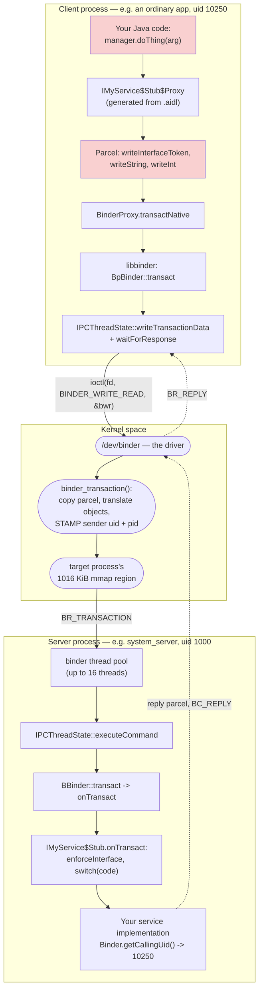
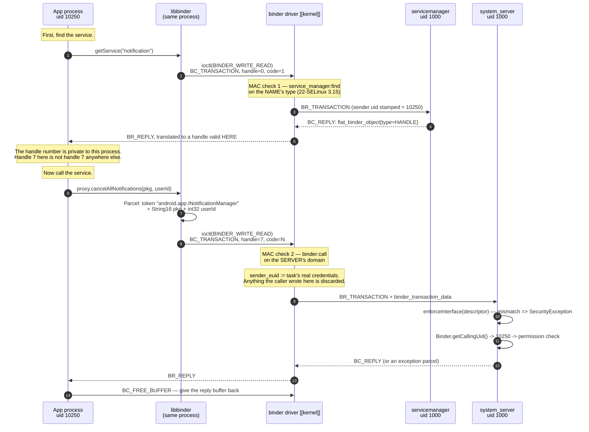
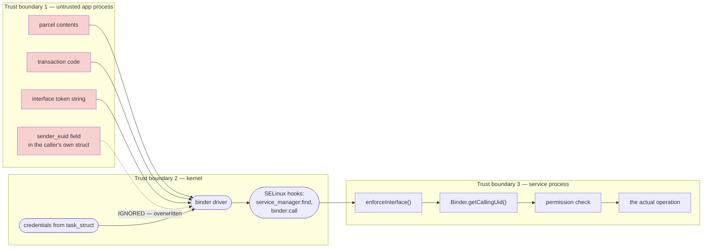
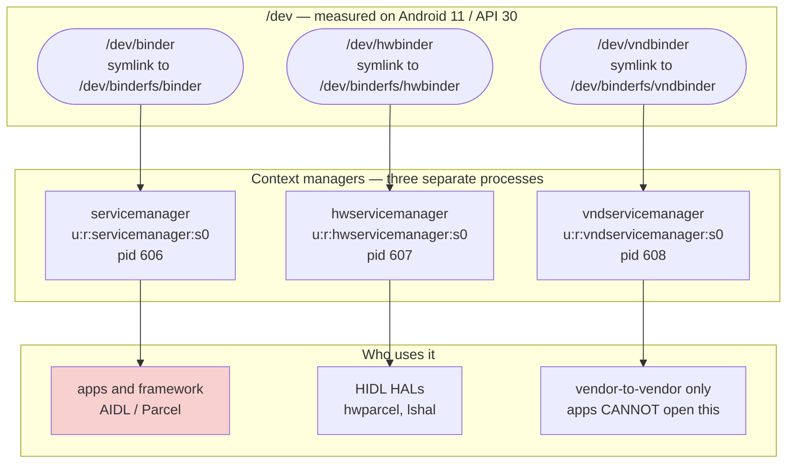
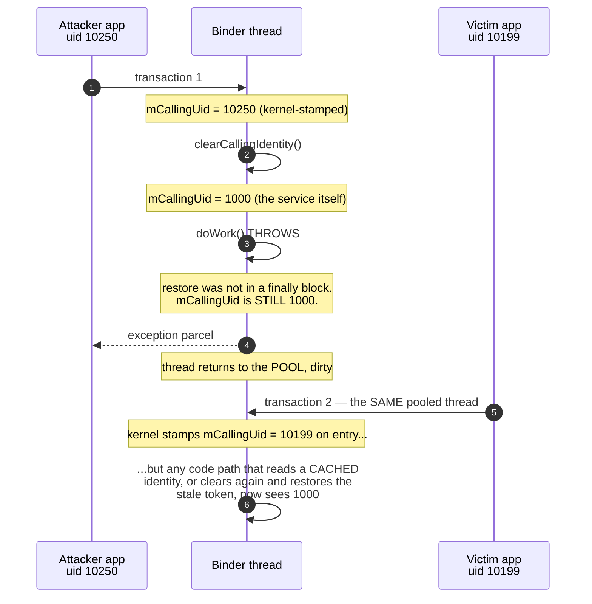
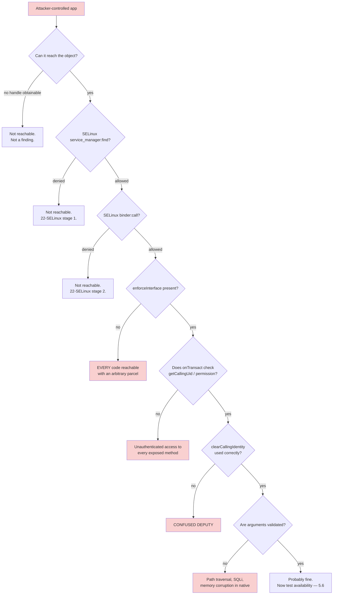
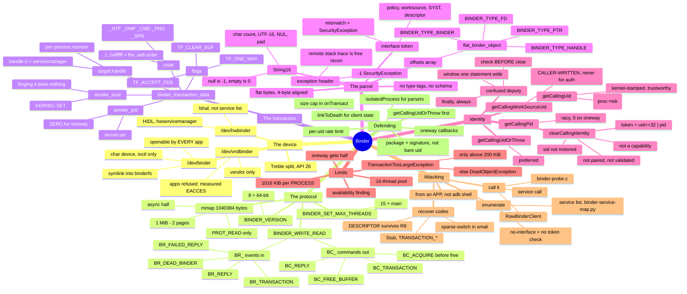

# 25 — Binder

> After this chapter you can open `/dev/binder` yourself, build a transaction by hand, read a
> parcel byte by byte, explain exactly why `Binder.getCallingUid()` cannot be forged — and prove
> it on a device rather than asserting it.

**Prerequisites:** [02 — Linux Basics](../02-Linux-Basics/README.md) (processes, file descriptors,
`ioctl`), [21 — App Sandbox](../21-App-Sandbox/README.md) (UIDs), [24 — IPC](../24-IPC/README.md)
(where Binder sits among the alternatives), [22 — SELinux](../22-SELinux/README.md) (the MAC gate in
front of every service)

**Applies to:** Android 1.0 through Android 15 (API 1–35). The driver's user-space ABI has been
stable since Android 5.0; the changes since are additive. Everything measured in this chapter was
measured on **Android 11 / API 30, arm64, kernel 4.14.180**, and every measured claim says so.

---

## Table of Contents

1. [Introduction](#1-introduction)
2. [High-Level Architecture](#2-high-level-architecture)
3. [Deep Internal Working](#3-deep-internal-working)
4. [Source Code Walkthrough (AOSP)](#4-source-code-walkthrough-aosp)
5. [Security Perspective](#5-security-perspective)
6. [Reverse Engineering Perspective](#6-reverse-engineering-perspective)
7. [Dynamic Analysis](#7-dynamic-analysis)
8. [Static Analysis](#8-static-analysis)
9. [Examples](#9-examples)
10. [Common Interview Questions](#10-common-interview-questions)
11. [Common Mistakes](#11-common-mistakes)
12. [Hands-on Labs](#12-hands-on-labs)
13. [Summary](#13-summary)
14. [References](#14-references)

---

## 1. Introduction

### 1.1 A building with no internal post

Imagine an office building where every department is locked in its own room, with no phone, no
internal post, and no corridor. Accounts cannot ask Payroll for a figure. Reception cannot tell
Security that a visitor has arrived. Each room is perfectly safe and perfectly useless.

That is what an Android device would be without Binder. Every app runs in its own **process** — its
own private slice of memory, with its own copy of the runtime, unable to read or write a single byte
belonging to any other process. That isolation is the whole security model, and it is not
negotiable. But an app that cannot ask anyone for anything cannot show you a screen, play a sound,
take a photo, or know what time it is, because it owns none of those things. The screen belongs to
`SurfaceFlinger`. The camera belongs to `cameraserver`. The clock, the app list, the permission
records and the ability to start another app all belong to a process called `system_server`.

So we need a corridor. And the moment we build one, we have a problem: **anyone can walk down a
corridor.** If Accounts receives a note saying "this is Payroll, wipe the ledger", how does Accounts
know it really came from Payroll? A note can say anything. The sender writes it.

Binder is Android's answer to both halves of that problem at once. It is the corridor, and it is
also the receptionist who walks with every message and states, truthfully and unalterably, who sent
it. The sender does not get to write that part of the note.

> **📖 Definition — Binder**
> The kernel driver, and the user-space libraries around it, that Android uses for almost all
> inter-process communication. A driver is a piece of code inside the operating system kernel that
> presents itself to programs as a file; Binder's file is `/dev/binder`. Programs do not read or
> write that file in the ordinary way. They send it a control command called an `ioctl`, and the
> kernel copies a message from one process into another, stamping the sender's identity on the way
> through.

### 1.2 What existed before, and why it was not enough

Binder was not the first attempt at getting two processes to talk. Unix has had answers since the
1970s, and Android still supports every one of them — they are surveyed in
[24 — IPC](../24-IPC/README.md). Understanding why none of them was chosen tells you exactly what
Binder is *for*.

| Mechanism | What it gives you | Why it was not enough for Android |
|---|---|---|
| **Pipe** (`pipe()`) | A byte stream between a parent and its child | Only between related processes. No identity. No structure — just bytes. |
| **UNIX domain socket** | A byte stream between any two processes that can name the same socket | Identity is *available* (`SO_PEERCRED`) but optional, and almost nobody checks it. Data is copied twice. No object references. |
| **System V shared memory / semaphores** | Fast shared pages | No identity at all, permissions are a separate global namespace, and leaked segments survive process death. Android deliberately disables most of it. |
| **Signals** | A one-bit notification | Cannot carry data. Cannot carry identity beyond a UID check. |
| **Files** | Persistent shared state | No notification, no identity of the writer, no atomicity, and the filesystem permission model is the wrong shape. |
| **Network sockets on `127.0.0.1`** | Full duplex, structured protocols on top | **Every app on the device can connect**, there is no caller identity whatsoever, and it burns a port. A genuine and recurring source of findings — see [24 §3.11](../24-IPC/README.md#311-localhost-network-sockets--an-app-listening-on-127001). |

Four things are missing from that whole table, and Binder was built to supply all four.

**1. Unforgeable caller identity.** With a socket, the receiver *can* ask the kernel who connected,
using `SO_PEERCRED`. But it is opt-in, it is easy to forget, and it tells you about the process that
called `connect()`, not necessarily about the process sending this particular message. Binder makes
identity **mandatory and per-transaction**: every single message arrives with the sender's UID and
PID attached by the kernel, whether the receiver wants them or not.

**2. Object references that cross processes.** If Payroll wants to hand Accounts a *thing* — "here,
talk to this ledger directly from now on" — a socket can only carry the bytes of a description.
Binder can carry the object itself, or rather a reference to it, and the kernel translates that
reference into something meaningful in the receiving process. This is what makes
`bindService()` return a usable object rather than a string.

**3. Real file descriptors.** A UNIX socket can pass a file descriptor using an obscure feature
called `SCM_RIGHTS`, and Binder can do the same thing as an ordinary part of a message. When
`ContentProvider.openFile()` hands your app a `ParcelFileDescriptor`, a genuine open file in another
process has been duplicated into yours by the kernel. No path, no permission re-check, no race.

**4. Lifetime management.** If the process you are talking to dies, a socket gives you an error the
next time you write. Binder tells you *proactively*, through a mechanism called death notification,
and it reference-counts the objects on both sides so that neither leaks nor dangles.

> **🧠 Mental Model**
> A socket is a **hosepipe**: it carries bytes, and bytes are all it knows about. Binder is a
> **courier service**: it carries typed objects, it will hand over keys as well as letters, it
> records who sent each parcel in a ledger the sender cannot edit, and it phones you if the
> recipient's building burns down.

### 1.3 Where Binder came from

Binder is older than Android. It began at **Be Incorporated** as part of BeOS, moved to **Palm** as
OpenBinder, and came to Google with the engineers who wrote it. That history explains its shape: it
is an *object-oriented* RPC system that happens to be implemented in a Unix kernel, which is why its
vocabulary — objects, references, reference counts, interfaces — is unlike anything else in
`/dev`.

It also explains a design decision that puzzles people. Binder does not have "connections". There is
no `bind`, `listen`, `accept`, or `connect`. There are only **objects** and **calls on objects**. A
process publishes an object; another process gets a reference to it; calls happen. The kernel keeps
the map from references to objects and refuses to let anyone forge an entry.

### 1.4 What breaks without it — concretely

Not "the system would not work". Specifically:

- Your app's `Application` object would never be constructed, because the message that tells your
  process to construct it — `bindApplication` — is a Binder transaction sent by `system_server` to
  the empty process `zygote` just forked. See [09 — Android App Internals](../09-Android-App-Internals/README.md).
- `startActivity()` would do nothing. It is a Binder call to `ActivityTaskManagerService`.
- Every `Toast`, every notification, every vibration, every `getSystemService()` result.
- Every key operation in [49 — KeyStore](../49-KeyStore/README.md). Generating a key, signing with
  it, checking whether it is hardware-backed — each is a transaction on `/dev/binder` delivered to
  the `keystore2` process, which alone can talk to the secure hardware.
- `adb shell dumpsys`, `adb shell am`, `adb shell pm`, `adb shell cmd`. All Binder.
- The permission model itself. `checkSelfPermission()` asks `system_server`, over Binder, and the
  answer is trustworthy only because the question arrived with a kernel-stamped UID on it.

### 1.5 The thesis of this chapter

Everything else here elaborates one sentence, and it is worth reading twice:

> **Binder tells the receiver, truthfully and unforgeably, who is calling — and then does nothing
> else whatsoever. Every decision about whether that caller is *allowed* belongs to the receiver.**

The transport is sound. The failures are all at the two ends. A service that never checks the
identity Binder handed it is wide open; a service that checks it, and then *throws the answer away*
by calling `clearCallingIdentity()` at the wrong moment, is worse than open, because it has been
turned into a weapon pointed at itself. Both failures are examined in detail in section 5, and the
mechanism that makes them possible is section 3.12.

> **🔍 Pentester's Note**
> Chapter [24 — IPC](../24-IPC/README.md) is about **what is reachable**: which components are
> exported, which sockets are listening, which providers answer. This chapter is about **the
> transport itself**: what a transaction is made of, what the kernel guarantees, and what it
> deliberately does not. When 24 tells you a service is reachable, come here to work out what to
> send it, and what the reply is telling you.

---

## 2. High-Level Architecture

### 2.1 The whole stack in one picture



Read it as three territories separated by two hard walls.

On the **left**, in the client, everything is ordinary user-space code that the client controls
completely. The Java proxy, the parcel it builds, the bytes it puts in that parcel — all attacker
territory if the client is the attacker. Nothing here can be trusted by anyone else.

In the **middle**, in the kernel, one function does the work that matters. `binder_transaction()`
copies the parcel out of the sender's memory and into a region of memory that the *receiver* mapped
in advance. On the way through it walks a list of embedded objects and rewrites each one so that it
means something in the destination process. And it writes two fields the sender does not get to
influence: the sender's PID and the sender's effective UID, taken from the kernel's own record of
which task made the `ioctl` call.

On the **right**, in the server, a pooled thread wakes up holding that transaction. It checks the
interface token, switches on the transaction code, and calls the service's method. When that method
calls `Binder.getCallingUid()`, it is reading the value the kernel wrote, not anything from the
parcel.

The single most important structural fact is this: **the sender's parcel and the sender's claimed
identity travel by completely different routes.** The parcel is data the sender authored. The
identity is metadata the kernel authored. They arrive together and are never confusable, because
they are stored in different fields of different structures.

### 2.2 One transaction, as a sequence



Two things in that diagram routinely surprise people.

**A single visible call is at least two transactions.** Resolving a name to a handle is itself a
Binder call, to `servicemanager` at the fixed handle 0. This is why `strace` on a one-line
`service call` shows four `ioctl(BINDER_WRITE_READ)` invocations, which is exactly what was measured
on the test device — see `examples/measured-strace-binder.txt`.

**The reply buffer must be handed back.** `BC_FREE_BUFFER` is not optional bookkeeping. The reply
was written into the *client's* mapped region, and until the client says it is finished with it, that
memory is unavailable for any other transaction. Section 3.14 shows what happens when a process
forgets.

### 2.3 The trust boundaries, drawn explicitly



The red boxes are everything the caller authors, and the caller authors nearly everything. Parcel
bytes, transaction code, even the interface token string — all of it is chosen by whoever is making
the call, and a hostile caller will choose values you did not anticipate.

`sender_euid` is red **and** dotted, because that is the trap. The field is right there in the
structure the caller fills in. It is writable. A caller can absolutely put a zero in it. It simply
never arrives — the driver overwrites it from `K3`, the kernel's own record of the calling task's
credentials, before the receiving side is woken. Section 3.11 measures this rather than asserting it.

Everything past `K1` is defence, and note the order: the *kernel's* mandatory access control runs
first and decides whether the transaction is delivered at all; only then does the service's own code
get a say. If SELinux refuses, the service never learns the call was attempted. That two-stage MAC
decision belongs to [22 — SELinux §3.15](../22-SELinux/README.md#315-binder-and-service_manager-a-two-stage-mac-decision)
and is not restaged here.

### 2.4 Four device nodes, four separate worlds



These are not three views of one thing. They are **three independent instances of the same driver**,
each with its own object namespace, its own context manager process, and its own SELinux label. An
object registered on `hwbinder` is invisible from `binder`. A handle number means nothing across
them.

Why three? **Project Treble**, in Android 8.0. Before Treble, vendor code and framework code shared
one Binder domain, which meant a vendor HAL and a framework service could accidentally depend on
each other, and updating one without the other broke the device. Splitting the namespaces made the
dependency impossible to express rather than merely discouraged. `vndbinder` carries vendor-to-vendor
traffic; `hwbinder` carries the HIDL interfaces between framework and vendor; `binder` carries
everything an app ever sees.

**Measured on the test device**, from `adb shell` as uid 2000:

```
lrwxrwxrwx  u:object_r:binder_device:s0      /dev/binder     -> /dev/binderfs/binder
lrwxrwxrwx  u:object_r:hwbinder_device:s0    /dev/hwbinder   -> /dev/binderfs/hwbinder
lrwxrwxrwx  u:object_r:vndbinder_device:s0   /dev/vndbinder  -> /dev/binderfs/vndbinder
ls: /dev/binderfs: Permission denied
```

and, from `examples/binder-probe.c` running as the same uid:

```
/dev/binder              present=yes openable=yes
/dev/hwbinder            present=yes openable=yes
/dev/vndbinder           present=yes openable=no  reason=Permission denied
/dev/binderfs/binder     present=yes openable=yes
```

Three facts fall out of that, and all three matter.

**`/dev/binder` is a symlink, not a device node.** On this device it points into **binderfs**, a
small in-kernel filesystem introduced in Linux 5.0 and backported widely, which lets each container
or each Android instance have its own private set of binder devices. The `ls -Z` output shows the
*symlink's* label. The real device inode inside `binderfs` carries its own. If you go looking for a
character device at `/dev/binder` and find a symlink, nothing is wrong.

**`vndbinder` is closed to us and `hwbinder` is not.** The `shell` domain has no SELinux permission
to open `vndservice_manager`'s device, and got `EACCES`. That is the Treble split working as
designed. An ordinary app is even more restricted than `shell` is.

**The directory is unreadable but the symlink targets are.** `/dev/binderfs` itself denies a
directory listing to uid 2000, yet opening `/dev/binderfs/binder` by name succeeds. Search
permission on a directory and read permission on it are different things, and this is a good
reminder that "permission denied on `ls`" is not the same as "inaccessible".

### 2.5 Where a parcel lives, physically

Mermaid cannot draw memory, so here it is as text. This is the layout inside one process after
`ProcessState` has initialised:

```
  CLIENT PROCESS                          KERNEL                    SERVER PROCESS
  ==============                          ======                    ==============

  ordinary heap
  +----------------------+
  | Parcel mData         |  ---- copy_from_user() ---->  binder_alloc_new_buf()
  | (malloc'd, writable) |                                       |
  |  00 00 00 00         |                                       |  writes ONCE into
  |  ff ff ff ff         |                                       |  the SERVER's
  |  53 59 53 54  'SYST' |                                       |  mapped region
  |  1c 00 00 00         |                                       v
  |  61 00 6e 00 ...     |                          +--------------------------+
  +----------------------+                          | mmap'd 1040384 bytes     |
                                                    | PROT_READ  (no write!)   |
  mmap'd region (ours)                              | MAP_PRIVATE|MAP_NORESERVE|
  +----------------------+                          |                          |
  | 1040384 bytes        |  <---- replies land      |  [buffer for txn A]      |
  | PROT_READ            |        here, same way    |  [buffer for txn B]      |
  | = 1 MiB - 2 pages    |                          |  [free]                  |
  +----------------------+                          +--------------------------+
                                                       ^
                                                       |  the SERVER reads the
                                                       |  parcel straight out of
                                                       |  here -- no second copy
```

The phrase you will hear is **"Binder is single-copy"**, and this diagram is what it means. A socket
would copy the message from the sender's memory into a kernel buffer, and then again from that
kernel buffer into the receiver's memory: two copies. Binder copies once, from the sender's memory
directly into a region the receiver has *already mapped*, and then tells the receiver where in that
region to look. The receiver reads the bytes in place.

Two consequences the reader should hold on to.

**The receiving mapping is read-only.** The kernel wrote it; the receiver may look but not touch.
That is why a receiver that wants to modify a parcel must copy it first, and why a malicious
receiver cannot corrupt a buffer another transaction is still using.

**The region is small and shared.** 1040384 bytes for *every simultaneous incoming transaction in
the whole process*. Not per call, not per thread — per process. Section 3.14 is about what happens
when it fills up, and the answer is the single most misdiagnosed exception in Android development.

---
## 3. Deep Internal Working

This is the long section. It goes from the device node up to the Java API, and every claim marked
**measured** was produced on the test device by a command printed alongside it.

### 3.1 What `/dev/binder` actually *is*

> **📖 Definition — character device**
> A file in `/dev` that is not a file. Reading and writing it does not touch storage; instead the
> kernel runs driver code. A *character* device transfers data as a stream of bytes with no block
> structure, as opposed to a *block* device like a disk partition.

`/dev/binder` is a character device whose driver is `drivers/android/binder.c` in the kernel tree.
Unusually for a device, almost nothing is done with `read()` or `write()`. Everything goes through
`ioctl()`.

> **📖 Definition — `ioctl`**
> "Input/output control": the system call for operations that do not fit read-and-write. It takes a
> file descriptor, a command number, and a pointer to a structure. `ioctl(fd, CMD, &arg)` means
> roughly "driver, do CMD, and here is where the arguments and the results live." Because the
> argument is a bare pointer, the driver must validate everything behind it — which is why `ioctl`
> handlers are a classic source of kernel vulnerabilities.

**Measured** — the eight syscalls that constitute one Binder call, from `strace` on the test device
(full capture in `examples/measured-strace-binder.txt`):

```
# adb shell strace -f service call activity 1598968902
openat(AT_FDCWD, "/dev/binder", O_RDWR|O_CLOEXEC) = 3
ioctl(3, BINDER_VERSION, 0x7fdcc57744)  = 0
ioctl(3, BINDER_SET_MAX_THREADS, 0x7fdcc57738) = 0
mmap(NULL, 1040384, PROT_READ, MAP_PRIVATE|MAP_NORESERVE, 3, 0) = 0x6f98ec5000
ioctl(3, BINDER_WRITE_READ, 0x7fdcc574f0) = 0
ioctl(3, BINDER_WRITE_READ, 0x7fdcc57460) = 0
ioctl(3, BINDER_WRITE_READ, 0x7fdcc57500) = 0
ioctl(3, BINDER_WRITE_READ, 0x7fdcc57630) = 0
```

That is the whole of Binder as far as the kernel interface is concerned: open it, agree on a version,
declare a thread budget, map a receive buffer, and then `BINDER_WRITE_READ` forever.

#### 3.1.1 binderfs

On the test device `/dev/binder` is a **symlink** into a filesystem called **binderfs**:

```
# adb shell ls -lZ /dev/binder /dev/hwbinder /dev/vndbinder
lrwxrwxrwx 1 root root u:object_r:binder_device:s0     20 /dev/binder     -> /dev/binderfs/binder
lrwxrwxrwx 1 root root u:object_r:hwbinder_device:s0   22 /dev/hwbinder   -> /dev/binderfs/hwbinder
lrwxrwxrwx 1 root root u:object_r:vndbinder_device:s0  23 /dev/vndbinder  -> /dev/binderfs/vndbinder
```

Binderfs is a small in-kernel filesystem (`drivers/android/binderfs.c`) that can be mounted more than
once, giving each mount its own private set of binder devices. It exists so that containers — and
Android-in-a-container products in particular — can each have an isolated Binder world instead of
sharing the host's. On a phone the practical effects are two:

- The `binder_logs` debug interface moved from `/sys/kernel/debug/binder/` to
  `/dev/binderfs/binder_logs/`. On the test device the old path does not exist at all
  (`ls: /sys/kernel/debug/binder: No such file or directory`), and the new one is readable only to
  root (`cat /dev/binderfs/binder_logs/stats` gave `Permission denied` to uid 2000). **Measured.**
- Tools and tutorials that stat `/dev/binder` expecting a character device get a symlink. Follow it.

#### 3.1.2 The three domains and their SELinux labels

| Node | Context manager | Registry | Who may open it | Serialisation |
|---|---|---|---|---|
| `/dev/binder` | `servicemanager` | `*_service_contexts` | framework, apps, `shell` | `Parcel` (AIDL) |
| `/dev/hwbinder` | `hwservicemanager` | `*_hwservice_contexts` | framework and vendor HALs | `hwparcel` (HIDL) |
| `/dev/vndbinder` | `vndservicemanager` | `vndservice_contexts` | **vendor processes only** | `Parcel` (AIDL) |

**Measured** — the three managers are three distinct processes with three distinct SELinux domains:

```
# adb shell ps -A -o PID,USER,LABEL,NAME | grep servicemanager
606 system  u:r:servicemanager:s0     servicemanager
607 system  u:r:hwservicemanager:s0   hwservicemanager
608 system  u:r:vndservicemanager:s0  vndservicemanager
```

**Measured** — `shell` (uid 2000) can open `binder` and `hwbinder` but is refused `vndbinder`:

```
/dev/binder      openable=yes
/dev/hwbinder    openable=yes
/dev/vndbinder   openable=no   reason=Permission denied
```

An unprivileged app is more restricted still. When you enumerate a device's attack surface, the
`vndbinder` namespace is normally out of reach entirely, and `hwbinder` is reachable in principle but
speaks a different serialisation — `lshal` is the tool for it, not `service`.

> **🔍 Pentester's Note**
> `service list` shows you **only `/dev/binder`**. It is not "all the Binder services on the
> device". `lshal` lists the `hwbinder` ones. There is no equally convenient tool for `vndbinder`,
> and from an app context it does not matter, because you cannot open the node.

### 3.2 `ProcessState` and `IPCThreadState`

Two C++ singletons in `libbinder` hold everything. Knowing which is which explains a great deal of
otherwise puzzling behaviour.

| | `ProcessState` | `IPCThreadState` |
|---|---|---|
| Scope | one per **process** | one per **thread** |
| Owns | the `/dev/binder` file descriptor, the `mmap` region, the thread pool, the handle→`BpBinder` table | the current transaction's caller UID/PID, the command buffers, strict-mode state |
| Created | first time anything touches Binder in the process | first time a thread touches Binder |
| Source | `frameworks/native/libs/binder/ProcessState.cpp` | `frameworks/native/libs/binder/IPCThreadState.cpp` |

The security-relevant half is `IPCThreadState`. It holds `mCallingUid` and `mCallingPid` — **thread
local state**, refreshed by the kernel at the start of every incoming transaction and read by
`Binder.getCallingUid()`. Three consequences follow, and each is a bug class:

1. Calling `getCallingUid()` **outside** a transaction returns *your own* UID, because that is what
   the field was last set to. This is why `getCallingUidOrThrow()` exists.
2. The value is per-thread, so handing work to a background thread or an executor **loses the
   caller's identity**. Code that captures `getCallingUid()` into a local variable before dispatching
   is correct; code that calls it from inside the worker is not.
3. `clearCallingIdentity()` mutates this thread-local state, and the thread comes from a **pool**.
   A leaked identity does not die with the request — it is inherited by whatever transaction that
   thread handles next. Section 3.12.

### 3.3 The receive buffer, and the number behind every "transaction too large"

`ProcessState`'s constructor maps a region of the binder device:

```cpp
// frameworks/native/libs/binder/ProcessState.cpp
#define BINDER_VM_SIZE ((1 * 1024 * 1024) - sysconf(_SC_PAGE_SIZE) * 2)
```

**Measured** — on the test device, page size 4096:

```
mmap(NULL, 1040384, PROT_READ, MAP_PRIVATE|MAP_NORESERVE, 3, 0) = 0x6f98ec5000

  1 MiB           = 1048576
  2 x page size   =    8192
  BINDER_VM_SIZE  = 1040384 bytes = 1016 KiB
```

`examples/binder-probe.c` computes the same constant independently and mmaps the same size, and the
kernel accepted it, which is a second confirmation.

Five things about this region:

| Property | Value | Why it matters |
|---|---|---|
| Size | 1016 KiB | Per **process**, not per call and not per thread |
| Protection | `PROT_READ` | The kernel writes; you only read. You cannot corrupt a parcel you were handed |
| Sharing | `MAP_PRIVATE` | It is yours; no other process sees it |
| Backing | `MAP_NORESERVE` | Pages are faulted in as used, so an idle process does not really cost 1 MiB |
| Async share | **half** of it | One-way transactions may occupy at most `buffer_size / 2` — see 3.14 |

> **🔬 Under the Hood**
> The kernel side is `binder_alloc_mmap_handler()` in `drivers/android/binder_alloc.c`. It records
> the mapping, builds a free-list of buffers inside it, and sets `free_async_space` to half the
> region. Allocation for an incoming transaction is `binder_alloc_new_buf()`, which is a best-fit
> allocator over that free list. When it cannot satisfy a request it fails the transaction with
> `BR_FAILED_REPLY`, and the *client* is the one that gets the error — even though the exhaustion is
> in the *server*.

### 3.4 The `BINDER_WRITE_READ` protocol

Almost every ioctl is `BINDER_WRITE_READ`, and it does two things at once: it hands the driver a
stream of commands to execute, and it collects a stream of events the driver has for you.

```c
struct binder_write_read {
    binder_size_t    write_size;      /* bytes of command stream to execute */
    binder_size_t    write_consumed;  /* driver reports how many it took    */
    binder_uintptr_t write_buffer;    /* pointer to the BC_ stream          */
    binder_size_t    read_size;       /* space available for events         */
    binder_size_t    read_consumed;   /* driver reports how many it wrote   */
    binder_uintptr_t read_buffer;     /* pointer to the BR_ stream          */
};
```

**Measured** — `sizeof(struct binder_write_read)` is **48** bytes on arm64
(`examples/binder-probe.c` prints it), and the resulting ioctl number is `0xc0306201`. Decoding that
number is a good sanity exercise: `0xc0` is read-write direction, `0x30` = 48 is the argument size,
`0x62` is the ASCII letter `b`, and `0x01` is command 1. Every binder ioctl uses the magic letter
`b`.

Both buffers are **streams**, not single structures. A write buffer might contain three commands
back to back. A read buffer commonly contains `BR_NOOP`, then `BR_TRANSACTION_COMPLETE`, then
`BR_REPLY` — which is exactly what was measured:

```
ioctl round 1: write_consumed=68 read_consumed=76
  <- BR_NOOP (0x0000720c)
  <- BR_TRANSACTION_COMPLETE (0x00007206)
  <- BR_REPLY (0x80407203)
```

`write_consumed=68` is `4 + 64`: a 4-byte command word (`BC_TRANSACTION`) followed by the 64-byte
`binder_transaction_data`. `read_consumed=76` is `4 + 4 + (4 + 64)`: two bare event words and then
`BR_REPLY` with its own transaction descriptor.

#### 3.4.1 Commands you send — `BC_*`

| Command | Argument | Meaning |
|---|---|---|
| `BC_TRANSACTION` | `binder_transaction_data` | Make a call |
| `BC_REPLY` | `binder_transaction_data` | Answer a call you received |
| `BC_FREE_BUFFER` | pointer | Hand a received buffer back. **Not optional** |
| `BC_INCREFS` / `BC_DECREFS` | handle | Weak reference count on a remote object |
| `BC_ACQUIRE` / `BC_RELEASE` | handle | Strong reference count on a remote object |
| `BC_INCREFS_DONE` / `BC_ACQUIRE_DONE` | ptr + cookie | Acknowledge the driver's request to raise a local object's count |
| `BC_REGISTER_LOOPER` | — | "I am a new pool thread, spawned because you asked" |
| `BC_ENTER_LOOPER` | — | "I am the main thread and I am joining the pool" |
| `BC_EXIT_LOOPER` | — | "I am leaving the pool" |
| `BC_REQUEST_DEATH_NOTIFICATION` | handle + cookie | `linkToDeath` |
| `BC_CLEAR_DEATH_NOTIFICATION` | handle + cookie | `unlinkToDeath` |
| `BC_DEAD_BINDER_DONE` | cookie | "I have finished handling that death" |
| `BC_TRANSACTION_SG` / `BC_REPLY_SG` | `binder_transaction_data_sg` | Scatter-gather variant, used for large `BINDER_TYPE_PTR` buffers |

#### 3.4.2 Events you receive — `BR_*`

| Event | Payload | Meaning |
|---|---|---|
| `BR_NOOP` | — | Padding. Ignore it. Present in almost every read |
| `BR_TRANSACTION` | `binder_transaction_data` | Somebody is calling you. **Sender UID and PID are in here** |
| `BR_TRANSACTION_SEC_CTX` | `binder_transaction_data_secctx` | The same, plus the sender's SELinux context, if the node asked for it |
| `BR_REPLY` | `binder_transaction_data` | Your call returned |
| `BR_TRANSACTION_COMPLETE` | — | The driver accepted your transaction. For `oneway`, this is all you ever get |
| `BR_DEAD_REPLY` | — | The target is gone |
| `BR_FAILED_REPLY` | — | The transaction could not be delivered. **Ambiguous by design** — see 3.14 |
| `BR_FROZEN_REPLY` | — | Target process is frozen (cached apps, Android 12+) |
| `BR_INCREFS` / `BR_ACQUIRE` / `BR_RELEASE` / `BR_DECREFS` | ptr + cookie | The driver telling you to adjust a local object's counts |
| `BR_SPAWN_LOOPER` | — | "Start another pool thread, you are running out" |
| `BR_DEAD_BINDER` | cookie | A death notification you registered has fired |
| `BR_ONEWAY_SPAM_SUSPECT` | — | Android 12+: this process is flooding a target with `oneway` calls |
| `BR_ERROR` | int32 | Driver-level error |

### 3.5 `binder_transaction_data`, field by field

This is the structure at the centre of everything. **Measured**: `sizeof` is **64** bytes on arm64.

```c
struct binder_transaction_data {
    union {
        __u32            handle;   /* outgoing: WHICH remote object       */
        binder_uintptr_t ptr;      /* incoming: WHICH local object        */
    } target;
    binder_uintptr_t cookie;       /* incoming: the receiver's own pointer */
    __u32            code;         /* THE METHOD NUMBER                    */
    __u32            flags;        /* TF_* — one-way, accept-fds, ...      */
    pid_t            sender_pid;   /* filled by the KERNEL on delivery     */
    uid_t            sender_euid;  /* filled by the KERNEL on delivery     */
    binder_size_t    data_size;    /* parcel payload length                */
    binder_size_t    offsets_size; /* object-offset array length           */
    union {
        struct {
            binder_uintptr_t buffer;   /* the parcel bytes                 */
            binder_uintptr_t offsets;  /* array of offsets into buffer     */
        } ptr;
        __u8 buf[8];
    } data;
};
```

| Field | Who writes it going out | Who writes it coming in | Notes |
|---|---|---|---|
| `target.handle` | caller | — | A **per-process** number. Handle 7 in your process and handle 7 in mine refer to different objects. Handle **0** is always the context manager |
| `target.ptr` | — | kernel | The receiver's own `BBinder*`, translated from the caller's handle |
| `cookie` | — | kernel | Receiver-supplied opaque value, returned with the object. libbinder stores the `BBinder*` here |
| `code` | caller | copied | The method number. `1..0x00ffffff` is the interface's own range; the `_XXX` codes above it are universal |
| `flags` | caller | copied | See 3.5.1 |
| `sender_pid` | **ignored** | kernel | **Zero for one-way transactions** — see 3.11.3 |
| `sender_euid` | **ignored** | kernel | The entire security model of Android rests on this line |
| `data_size` | caller | kernel | Parcel length in bytes |
| `offsets_size` | caller | kernel | `n_objects * sizeof(binder_size_t)` |
| `data.ptr.buffer` | caller | kernel | Outgoing: a pointer in *your* heap. Incoming: a pointer into *your mmap region* |
| `data.ptr.offsets` | caller | kernel | Where the embedded objects are |

#### 3.5.1 Transaction flags

| Flag | Value | Meaning |
|---|---|---|
| `TF_ONE_WAY` | `0x01` | Do not wait for a reply. The caller returns as soon as the driver has queued it |
| `TF_ROOT_OBJECT` | `0x04` | Contents are the component's root object (legacy) |
| `TF_STATUS_CODE` | `0x08` | The payload is a bare 32-bit status, not a parcel |
| `TF_ACCEPT_FDS` | `0x10` | The receiver is willing to accept file descriptors in this parcel |
| `TF_CLEAR_BUF` | `0x20` | **Android 11+.** Zero the transaction buffer when it is freed. Set by `IBinder.FLAG_CLEAR_BUF` |
| `TF_UPDATE_TXN` | `0x40` | Newer kernels: replace a pending identical one-way transaction rather than queueing another |

`TF_CLEAR_BUF` is worth pausing on. Without it, a parcel that carried a password or a key sits in the
receiver's mapped region after the buffer is freed, until some later transaction happens to reuse
that space. `keystore2` and the biometric stack set it. Most application AIDL does not, and cannot
easily — the flag is `@hide`. This matters for the [19 — Memory](../19-Memory/README.md) style of
attack, where an attacker who can read a process's memory finds secrets in freed binder buffers.

#### 3.5.2 What `TF_ACCEPT_FDS` really controls

If the receiving object was registered without `FLAT_BINDER_FLAG_ACCEPTS_FDS`, the driver refuses any
transaction containing a `BINDER_TYPE_FD` object. This is a genuine hardening control: a service that
never needs to receive file descriptors can declare so, and the kernel enforces it rather than the
service having to notice and reject them. `ContentProvider` and `ParcelFileDescriptor` paths keep it
on; a lot of hand-written native services turn it off.

**Measured** — the `flat_binder_object` that `servicemanager` returned for the `activity` service had
flags `0x113`:

```
type   : 0x73682a85  BINDER_TYPE_HANDLE
flags  : 0x00000113  min-priority=19  ACCEPTS_FDS
```

`0x100` is `FLAT_BINDER_FLAG_ACCEPTS_FDS`; the low byte `0x13` = 19 is the minimum scheduling
priority the node requests, which sits in `FLAT_BINDER_FLAG_PRIORITY_MASK` (`0xff`).

### 3.6 The single copy, and why it is safe

The classic description is "Binder copies data once, other IPC copies twice". Precisely:

1. The caller builds a `Parcel` on its ordinary heap. Writable, caller-owned, caller-controlled.
2. `binder_transaction()` asks `binder_alloc_new_buf()` for space **inside the target's mapped
   region**, and `copy_from_user()`s the parcel straight into it. One copy.
3. The driver walks the offsets array and fixes up every embedded object *in place*, in the target's
   buffer.
4. The target is handed a pointer into its own mapping and reads the parcel there.

The property that makes this safe is that step 4's mapping is **`PROT_READ`**. The receiver cannot
modify the buffer, so it cannot corrupt the driver's bookkeeping, and it cannot race another thread
that is reading the same buffer. If the receiver wants a mutable copy it must make one, which is
exactly what `Parcel::ipcSetDataReference` arranges at the Java layer.

> **⚠️ Warning**
> "Single copy" is often misremembered as "zero copy" or "shared memory". It is neither. The bytes
> *are* copied, once, and the two processes never share writable pages. Genuine shared memory in
> Android is `ashmem`/`memfd`, which Binder can carry a descriptor *to* — but that is a different
> mechanism with a different threat model, covered in
> [24 §3.13](../24-IPC/README.md#313-shared-memory--ashmem-and-memfd).

### 3.7 Parcels — the serialisation format

> **📖 Definition — Parcel**
> A flat, self-contained byte buffer with 4-byte alignment, plus a side array recording where any
> embedded kernel objects live. It is **not** a general-purpose serialisation format. There are no
> type tags, no field names, no length prefix on the whole message, and no versioning. It is fast
> precisely because it is dumb.

The absence of type tags is the single most important thing to understand about parcels, because it
is the root of both the interface-token control and a whole vulnerability class. A parcel is just
bytes. Whether the four bytes at offset 12 are an `int`, the length of a string, or half of a
`long` depends entirely on **the order in which the reader chooses to read**. Writer and reader must
agree, and nothing in the data enforces the agreement.

#### 3.7.1 The primitives

| Type | Wire format | Bytes |
|---|---|---|
| `int32` / `boolean` | little-endian int32 (`true` = 1) | 4 |
| `int64` / `double` | little-endian, **aligned to 8** | 8 |
| `float` | little-endian IEEE-754 | 4 |
| `byte` | written as an int32 | 4 |
| `String16` (native `String`) | int32 **character** count, then UTF-16LE, then a UTF-16 NUL, padded to 4 | `4 + 2n + 2`, rounded up |
| `String8` | int32 byte count, then bytes, then a NUL, padded to 4 | `4 + n + 1`, rounded up |
| **null** `String` | the single int32 `-1`, and nothing else | 4 |
| byte array | int32 length, then the raw bytes, padded to 4 | `4 + n`, rounded up |
| null array | the single int32 `-1` | 4 |
| `IBinder` | a 24-byte `flat_binder_object`, **plus an entry in the offsets array** | 24 (+8 in offsets) |
| file descriptor | a `flat_binder_object` with `type = BINDER_TYPE_FD` | 24 (+8 in offsets) |
| `Parcelable` | whatever the class's `writeToParcel` wrote — no framing at all | varies |

> **⚠️ Warning**
> An **empty** string and a **null** string are different on the wire: `0` versus `-1`. Hand-rolled
> parcel builders get this wrong constantly, and the failure mode is not an error — it is the reader
> consuming the next field as a string length and everything after it being garbage.

#### 3.7.2 A real string, decoded

**Measured** — the reply to `INTERFACE_TRANSACTION` on the `activity` service, straight off the
device:

```
# adb shell service call activity 1598968902
Result: Parcel(
  0x00000000: 0000001c 006e0061 00720064 0069006f '....a.n.d.r.o.i.'
  0x00000010: 002e0064 00700061 002e0070 00410049 'd...a.p.p...I.A.'
  0x00000020: 00740063 00760069 00740069 004d0079 'c.t.i.v.i.t.y.M.'
  0x00000030: 006e0061 00670061 00720065 00000000 'a.n.a.g.e.r.....')
```

Sixty-four bytes, and every one is accounted for:

| Offset | Bytes | Meaning |
|---|---|---|
| `0x00` | `1c 00 00 00` | int32 = 28. The **character** count of `android.app.IActivityManager` |
| `0x04`–`0x3b` | `61 00 6e 00 …` | 28 UTF-16LE code units = 56 bytes |
| `0x3c` | `00 00` | the UTF-16 NUL terminator |
| `0x3e` | `00 00` | padding to the next 4-byte boundary |

`4 + 56 + 2 = 62`, rounded up to 64. Count the characters of
`android.app.IActivityManager` yourself: twenty-eight. That is the entire `String16` wire format,
visible in one dump.

Note the display quirk: `service` prints 32-bit **words**, so `0000001c` is the length and
`006e0061` is the two characters `a` and `n` in that order — the word is little-endian but the ASCII
column reads left to right. Reading these dumps fluently is a skill worth ten minutes of practice;
`scripts/parcel-decode.py` will do it for you once you have understood it.

#### 3.7.3 The offsets array, and embedded objects

A parcel that contains an `IBinder` or a file descriptor is not self-contained, because those things
mean nothing outside the process that created them. Binder handles this with a **second array**,
delivered alongside the parcel, listing the byte offsets at which objects appear. The driver walks
that list and rewrites each object for the destination.

**Measured** — the reply to `checkService("activity")`, produced by `examples/binder-probe.c` from a
hand-built request with no libbinder involved at all:

```
REPLY PARCEL
  data_size    : 32 bytes
  offsets_size : 8 bytes  (1 embedded object)

  00000000: 00000000 852a6873 13010000 01000000  |.....*hs........|
  00000010: 00000000 00000000 00000000 0c000000  |................|

  object[0] at parcel offset 4:
    type   : 0x73682a85  BINDER_TYPE_HANDLE (remote ref)
    flags  : 0x00000113  min-priority=19  ACCEPTS_FDS
    handle : 1
```

Byte for byte:

| Offset | Bytes | Meaning |
|---|---|---|
| `0x00` | `00 00 00 00` | int32 0 — the status/exception header. No exception |
| `0x04` | `85 2a 68 73` | `flat_binder_object.type` = `0x73682a85`, the ASCII `'s' 'h' '*' 0x85` — "strong handle" |
| `0x08` | `13 01 00 00` | `flags` = `0x113` |
| `0x0c` | `01 00 00 00` | `handle` = 1 (the union field; 8 bytes wide, upper half zero) |
| `0x14` | `00 …` | `cookie` = 0 |
| `0x1c` | `0c 00 00 00` | **stability** = 12. Not part of `flat_binder_object` — `Parcel::writeStrongBinder` appends it |

And the offsets array, all 8 bytes of it, holds the single value **4** — telling the driver "there is
an object at byte 4 of this parcel, go and translate it."

The four object types you will meet:

| `type` | Packed ASCII | What the driver does with it |
|---|---|---|
| `BINDER_TYPE_BINDER` `0x73622a85` | `sb*` | A **local** object in the sender. Becomes a `HANDLE` in the receiver |
| `BINDER_TYPE_HANDLE` `0x73682a85` | `sh*` | A **remote** reference. Re-mapped to the receiver's own handle number, or to the local object if the receiver *is* the owner |
| `BINDER_TYPE_FD` `0x66642a85` | `fd*` | A real file descriptor. The kernel `dup()`s it into the receiver |
| `BINDER_TYPE_PTR` `0x70742a85` | `pt*` | A scatter-gather buffer, used by AIDL for large arrays |

The `0x85` low byte is `B_TYPE_LARGE`, marking the 64-bit structure layout.

> **🧠 Mental Model**
> The parcel is the letter. The offsets array is a list saying "there is a *key* taped to page 3,
> and a *door pass* taped to page 7". The postal service (the driver) has to re-cut the key so it
> works in the recipient's building, because your key is meaningless in their locks. That re-cutting
> is why a Binder handle number is private to one process and why `handle: 1` in the dump above is
> only meaningful inside `binder-probe`'s process.

#### 3.7.4 File descriptors — Binder's `SCM_RIGHTS`

On a UNIX domain socket, passing a file descriptor requires the arcane `sendmsg()` ancillary-data
mechanism called **`SCM_RIGHTS`**. You construct a `struct msghdr`, attach a control message of type
`SCM_RIGHTS`, and the kernel installs a *duplicate* of your descriptor in the receiver's descriptor
table. The receiver ends up with a genuinely open file — same inode, same offset-sharing file
description — that it may never have had permission to open by path.

`BINDER_TYPE_FD` is precisely the same trick, with a much better ergonomic wrapper. Compare:

| | `SCM_RIGHTS` on a socket | `BINDER_TYPE_FD` in a parcel |
|---|---|---|
| API | `sendmsg` + `cmsghdr` boilerplate | `parcel.writeFileDescriptor(fd)` |
| Caller identity attached? | Only if you also send `SCM_CREDENTIALS`, or call `getsockopt(SO_PEERCRED)` | **Always** |
| Receiver can refuse the class? | No — must inspect and close | Yes, `TF_ACCEPT_FDS` / `FLAT_BINDER_FLAG_ACCEPTS_FDS`, enforced by the kernel |
| Permission re-checked on use? | **No** | **No** |
| Typical Android use | `zygote`, `logd`, `installd` | `ContentProvider.openFile`, `ashmem`, `MediaPlayer`, `ParcelFileDescriptor` |

The row that matters is "permission re-checked on use": **no**, in both cases. Once a descriptor has
crossed, the receiver holds an open file. Revoking a `content://` URI permission does not close a
descriptor already handed out. Deleting the file does not either. This is the mechanism behind a
recurring finding class:

> **🔍 Pentester's Note**
> When a provider hands you a `ParcelFileDescriptor`, check what it actually opened. A provider that
> resolves `content://…/file?name=../../databases/secrets.db` and then opens the result is handing
> you a live descriptor to a file you could never open yourself, and no amount of later revocation
> takes it back. Test with `openFileDescriptor()` and then `readlink /proc/self/fd/N` to see what you
> got. Provider exploitation itself is [27 — ContentProviders](../27-ContentProviders/README.md);
> the transport is here.

#### 3.7.5 The exception header

Almost every AIDL reply begins with an int32 status word. `Parcel.writeNoException()` writes `0`;
`Parcel.writeException(e)` writes a negative code and then a message string.

| Code | Java exception |
|---|---|
| `0` | none |
| `-1` | `SecurityException` |
| `-2` | `BadParcelableException` |
| `-3` | `IllegalArgumentException` |
| `-4` | `NullPointerException` |
| `-5` | `IllegalStateException` |
| `-6` | `NetworkOnMainThreadException` |
| `-7` | `UnsupportedOperationException` |
| `-8` | `ServiceSpecificException` (the service's own error code follows) |
| `-9` | a `Parcelable` exception |
| `-129` | the transaction itself failed |

**Measured** — calling `notification` transaction 2 from `shell`:

```
raw bytes:
  00000000: ffffffff 1c000000 44006900 73006100  |........D.i.s.a.|
  00000010: 6c006c00 6f007700 65006400 20006300  |l.l.o.w.e.d. .c.|
  00000020: 61006c00 6c002000 66006f00 72002000  |a.l.l. .f.o.r. .|
  00000030: 75006900 64002000 32003000 30003000  |u.i.d. .2.0.0.0.|
  00000040: 00000000 e4030000 ed010000 09006100  |..............a.|

exception code : -1  (SecurityException)
message        : "Disallowed call for uid 2000"
```

`ffffffff` is `-1`, then `1c000000` = 28 characters, then `Disallowed call for uid 2000` in UTF-16.
Then two more int32s and a much longer string: `e4030000` = 996 and `ed010000` = 493, followed by
the **remote stack trace**, which `Parcel.writeStackTrace()` appends when stack-trace parcelling is
enabled. 996 is the header size — `4 + 4 + (493 × 2) + 2` — and 493 is the character count of the
trace itself. The arithmetic closes exactly, which is a good way to confirm you have understood the
format.

> **🔍 Pentester's Note**
> That stack trace is free reconnaissance. The measured reply above named
> `NotificationManagerService.checkCallerIsSystem(NotificationManagerService.java:8683)` and
> `INotificationManager$Stub.onTransact(INotificationManager.java:1132)`. You now know the class, the
> method, the guard and the AIDL stub line — from a call you were *refused*. Denials are more
> informative than successes surprisingly often.

### 3.8 Transaction codes

The `code` field is a bare 32-bit integer. It carries no name and no schema.

| Range | Name | Meaning |
|---|---|---|
| `0x00000001`–`0x00ffffff` | `FIRST_CALL_TRANSACTION` … `LAST_CALL_TRANSACTION` | The interface's own methods, numbered **in declaration order in the `.aidl` file, starting at 1** |
| `0x5f4e5446` `'_NTF'` | `INTERFACE_TRANSACTION` | "What interface are you?" Returns the descriptor `String16` |
| `0x5f444d50` `'_DMP'` | `DUMP_TRANSACTION` | What `dumpsys` sends |
| `0x5f434d44` `'_CMD'` | `SHELL_COMMAND_TRANSACTION` | What `cmd` sends |
| `0x5f504e47` `'_PNG'` | `PING_TRANSACTION` | Liveness check. What `service check` uses |
| `0x5f535052` `'_SPR'` | `SYSPROPS_TRANSACTION` | "Reload your cached system properties" |
| `0x5f545754` `'_TWT'` | `TWEET_TRANSACTION` | Real, and unused. AOSP humour |
| `0x5f4c494b` `'_LIK'` | `LIKE_TRANSACTION` | The same |

The `_XXX` codes are four ASCII bytes packed big-endian, which is why they look like huge random
numbers in decimal. `examples/binder-probe.c` computes them from the characters so you never have to
trust a table:

```
INTERFACE_TRANSACTION     '_NTF' = 1598968902 (0x5f4e5446)
DUMP_TRANSACTION          '_DMP' = 1598311760 (0x5f444d50)
SHELL_COMMAND_TRANSACTION '_CMD' = 1598246212 (0x5f434d44)
PING_TRANSACTION          '_PNG' = 1599098439 (0x5f504e47)
SYSPROPS_TRANSACTION      '_SPR' = 1599295570 (0x5f535052)
```

**That the numbering starts at 1 and follows declaration order is the single most useful fact for
attacking a Binder service.** Given the `.aidl` file — from AOSP, or reconstructed from the
decompiled `Stub` class — you can call any method by number without any generated code at all.
Section 6 shows how to recover the mapping from a `Stub` in JADX.

#### 3.8.1 `SHELL_COMMAND_TRANSACTION`, and where `cmd` comes from

The `cmd` binary is a thin client that resolves a service name, then sends `'_CMD'` with a parcel
containing three file descriptors (stdin, stdout, stderr), the argument array, and a
`ShellCallback` plus a `ResultReceiver` binder. The service's `onShellCommand()` runs **inside the
service's process**, writing to descriptors that belong to your shell.

**Measured** — `cmd -l` listed 217 services on the test device, the same count `service list`
reported.

That design has an obvious security consequence and one non-obvious one.

The obvious one: `Binder#onShellCommand` in AOSP refuses callers that are not `shell` or `root`. Any
service overriding `onShellCommand` without calling `super` — or without its own UID check — has
handed an arbitrary command interface to any app that can reach it.

The non-obvious one: **the descriptors are real.** The service writes into *your* pipe. A service
that echoes attacker-controlled data into stdout is writing into a descriptor an attacker supplied,
which is why the AOSP implementation is careful about what it will accept there.

```bash
# adb shell — what a shell-command service exposes
cmd -l | head
cmd package list packages | head -3
cmd notification --help 2>&1 | head
```

#### 3.8.2 `DUMP_TRANSACTION` — what `dumpsys` really is

`dumpsys` is not a special channel. It is `'_DMP'` sent to a service handle, with a parcel containing
one file descriptor and a string array of arguments. `Binder.dump()` runs in the service's process
and writes to your descriptor.

```bash
# adb shell
dumpsys -l                  # every service that answers '_DMP'
dumpsys activity services   # arguments are passed straight through
dumpsys notification --noredact   # some services accept flags that reduce redaction
```

**Measured** — `dumpsys -l` reported 211 entries against `service list`'s 217. The difference is
services that do not implement `dump()`.

> **🔍 Pentester's Note**
> `dumpsys` output is the fastest reconnaissance on any Android device, and it is available to
> `shell` without root. It is *not* generally available to an app: `android.permission.DUMP` is
> `signature|privileged`. If you find a third-party app whose exported service forwards a
> descriptor into `dumpsys`, you have found a privilege bridge.

### 3.9 The interface token — a security control, not a formality

Every AIDL-generated `onTransact` begins with the same line:

```java
data.enforceInterface(DESCRIPTOR);   // e.g. "android.app.INotificationManager"
```

and every generated proxy begins with the matching:

```java
_data.writeInterfaceToken(DESCRIPTOR);
```

It looks like ceremony. It is not.

**Why it exists.** Recall 3.7: a parcel has no type information. If interface `IAlpha` declares
`method 1 = deleteFile(String path)` and interface `IBravo` declares `method 1 = setAdmin(boolean
enabled)`, then a parcel built for `IAlpha.deleteFile("x")` is *also* a syntactically perfect parcel
for `IBravo.setAdmin(...)` — the reader will interpret the string's length field as the boolean and
carry on. Without a token, any object that happens to be reachable can be driven using another
interface's calling convention. The token forces the caller to *name the contract it believes it is
using*, and the receiver rejects a mismatch.

**Measured** — send transaction 2 to `notification` with the correct handle and the correct code,
but claim to be `android.os.IServiceManager`:

```
# adb shell /data/local/tmp/binder-probe --call notification 2 \
#     --token android.os.IServiceManager
the object says its interface is : "android.app.INotificationManager"
we are claiming                  : "android.os.IServiceManager"
...
exception code : -1  (SecurityException)
message        : "Binder invocation to an incorrect interface"
```

Not an `IllegalArgumentException` and not a silent misparse — a **`SecurityException`**, which tells
you what the framework authors thought this was for.

**What the token does and does not protect.**

| | |
|---|---|
| Stops a parcel built for interface A being read as interface B | **Yes** |
| Stops an attacker who knows the descriptor string | **No.** The descriptor is public. It is in the AIDL file, in the DEX, and any object will hand it over on request via `'_NTF'` |
| Acts as authentication | **No.** It is a type tag, not a secret |
| Is present on every service | **No.** A hand-written `BBinder`/`Binder` subclass with a raw `onTransact` and no `enforceInterface` has none |

That last row is the finding. A service whose `INTERFACE_TRANSACTION` reply is empty is very likely a
raw `Binder` subclass with no token check — meaning every transaction code is reachable with an empty
parcel and nothing at all enforces argument shape.

**Measured** — `scripts/binder-service-map.py --no-interface` found **35 of 217** services on the
test device with an empty descriptor, including `DockObserver`, `SchedBoostService`, `battery`,
`app_binding`, `cacheinfo` and the AIDL HALs. Most are native services that never had an AIDL
interface in the first place; that is normal, not a bug. But it is exactly the set worth reading.

> **⚠️ Warning**
> Do not "test" a raw-`onTransact` service by sweeping transaction codes on a device you care about.
> A service with no token check and no argument validation will read whatever is at the current
> parcel position, and a native service doing that with a length field it did not check will
> segfault. If it is `system_server`, the device reboots. Use an emulator or a spare device, and see
> `labs/lab-04-transaction-limits.md` for how to do it responsibly.

### 3.10 One-way versus synchronous

| | Synchronous (default) | One-way (`oneway` in AIDL, `FLAG_ONEWAY`) |
|---|---|---|
| Caller blocks? | Yes, until the reply | No, returns as soon as the driver queues it |
| Return value | Any type | **Must be `void`** |
| Exceptions propagate? | Yes, in the exception header | **No.** The caller never learns |
| `getCallingPid()` on the receiving side | The real PID | **0** |
| Buffer budget | The full 1016 KiB | **Half** the region |
| Ordering | One at a time per caller thread | Preserved per (sender, target) pair, but interleaved with other senders |
| Failure signal | `BR_REPLY` or an exception | `BR_TRANSACTION_COMPLETE` only, which means "queued", not "handled" |

The blocking behaviour is the reason `oneway` exists: a service must never be able to hang its
callers, and a caller must never be able to hold a service's thread hostage. Any callback *from* a
service back *into* an app is almost always `oneway` for that reason.

Three consequences that produce real bugs:

**`oneway` swallows exceptions.** A `SecurityException` thrown by a `oneway` method is logged in the
*service* and never reaches the caller. If a developer converts a method to `oneway` for
performance, every caller that was relying on the exception silently stops noticing failures.

**`oneway` delivers `getCallingPid() == 0`.** The driver sets `t->from = NULL` for one-way
transactions — there is no thread to reply to — and the delivery path reports `sender_pid` as 0 when
`from` is null. `sender_euid` is unaffected and remains correct. *(This is read from
`drivers/android/binder.c`; it was not measured on the test device, because observing it requires a
receiving service under instrumentation.)* Any authorisation that compares `getCallingPid()` against
something therefore behaves differently on `oneway` methods, which is one more reason 24 §3.21 says
never to authorise on the PID.

**`oneway` has half the buffer.** `free_async_space` starts at `buffer_size / 2`, so asynchronous
traffic can exhaust its share while synchronous calls still work. A process flooded with `oneway`
calls starts failing them while looking perfectly healthy.

Android 12 added `BR_ONEWAY_SPAM_SUSPECT` and `BINDER_ENABLE_ONEWAY_SPAM_DETECTION` for exactly
that: the driver warns a process when one sender is monopolising its async space.

### 3.11 Identity — the chapter's thesis, measured

#### 3.11.1 The claim

`Binder.getCallingUid()` returns the UID of the process that made the current transaction, and the
caller cannot influence it.

This is repeated in every Android security document. It is also almost never demonstrated, which
matters, because the structure the caller fills in **contains a `sender_euid` field**. It is right
there. It is writable. It is in the caller's own memory. Every instinct says it must be forgeable.

#### 3.11.2 The experiment

`examples/binder-probe.c` builds a transaction by hand — no libbinder, no Java, no AIDL — and sets
`sender_euid` to whatever you ask for immediately before the `ioctl`:

```c
tr.sender_euid = forged_uid;   /* we are the sender; this struct is ours */
tr.sender_pid  = 1;
```

The target is transaction 2 of `INotificationManager`, chosen because it refuses the `shell` UID and
**states the UID it saw in the exception message**. That makes the receiving side's opinion directly
observable without root and without instrumentation.

**Measured**, three runs on the test device from `adb shell` (real uid 2000):

| Run | We claimed | Service replied |
|---|---|---|
| `--call notification 2` | nothing | `SecurityException: "Disallowed call for uid 2000"` |
| `--call notification 2 --forge-uid 0` | uid 0 (root) | `SecurityException: "Disallowed call for uid 2000"` |
| `--call notification 2 --forge-uid 1000` | uid 1000 (system) | `SecurityException: "Disallowed call for uid 2000"` |

Three different claims, one answer, and the answer is our real UID. The full capture, including the
raw parcels, is `examples/measured-binder-probe.txt`.

#### 3.11.3 Why — the one line that does it

In `drivers/android/binder.c`, while building the transaction, the driver assigns:

```c
t->sender_euid = task_euid(proc->tsk);
```

`proc->tsk` is the `task_struct` of the process that made the `ioctl`. `task_euid()` reads the
effective UID out of that task's credentials — kernel memory, in the kernel's own bookkeeping, which
no user-space process can write. The value the caller put in `tr.sender_euid` is simply never read on
the way in. The field exists in the structure only because the **same structure** is used for
delivery, where the kernel fills it in for the receiver's benefit.

The delivery path, in `binder_thread_read()`, then reports it to the receiver, converting it into the
receiver's user namespace. `sender_pid` is handled separately: it comes from the sending *thread*
record, and when that record is absent — which is the case for one-way transactions — it is reported
as 0.

Up the stack:

```
kernel:  t->sender_euid = task_euid(proc->tsk)
   |
   v
libbinder: IPCThreadState::executeCommand(), case BR_TRANSACTION:
             mCallingUid = tr.sender_euid;
             mCallingPid = tr.sender_pid;
   |
   v
JNI: android_os_Binder_getCallingUid()          (frameworks/base/core/jni/android_util_Binder.cpp)
             return IPCThreadState::self()->getCallingUid();
   |
   v
Java: Binder.getCallingUid()
```

At no point does a parcel byte enter that chain.

> **🧠 Mental Model**
> Think of a company post room where the franking machine prints the sender's department on every
> envelope automatically, from the machine's own record of who swiped in to use it. You can write
> "From: The CEO" on the envelope in marker pen as well. Everyone reads the franking, and the franking
> is not yours to set.

#### 3.11.4 The identity API set, ranked

| API | Returns | Trustworthy? | Use it for |
|---|---|---|---|
| `Binder.getCallingUid()` | caller's Linux UID | **Yes** | Authorisation |
| `Binder.getCallingUidOrThrow()` | the same, but throws outside a transaction | **Yes** | Authorisation, preferred |
| `Binder.getCallingPid()` | caller's PID | Only for logs | Never for decisions. **0** on `oneway` |
| `Binder.getCallingSid()` | caller's SELinux context, or null | Yes when non-null | Rare; requires the node to have requested `TXN_SECURITY_CTX`, and it is **not restored** by `restoreCallingIdentity` |
| `Binder.getCallingUserHandle()` | derived from the UID | Yes | Multi-user checks |
| `Binder.getCallingWorkSourceUid()` | the *attributed* UID for power accounting | **No, not for security** | Battery attribution only. It is caller-settable by design |
| `Context.checkCallingPermission()` | permission result for the current caller | Yes | Wraps `getCallingUid`/`Pid` |
| `Context.checkCallingOrSelfPermission()` | the same, **or self** | **Dangerous** | Passes when called outside a transaction. See 11.1 |
| anything in the parcel | whatever the caller wrote | **No** | Nothing |

`getCallingWorkSourceUid()` deserves a warning of its own. The work-source UID is the *second* int32
in every interface token (measured: `ffffffff`, i.e. `-1` = unset, in every parcel dumped in this
chapter). It exists so that a service doing work on behalf of an app can bill the battery to that
app. It is **written by the caller**, into the parcel, and is therefore exactly as trustworthy as any
other parcel field: not at all.

> **⚠️ Warning**
> `getCallingWorkSourceUid()` and `getCallingUid()` differ by one word and by the entire security
> model. One is kernel-stamped metadata; the other is caller-authored payload. Code that reaches for
> the wrong one compiles, runs, and is trivially bypassed.

### 3.12 `clearCallingIdentity` — the mechanism, and how a confused deputy is born

[24 §3.21.2](../24-IPC/README.md#3212-clearcallingidentity-and-restorecallingidentity--and-the-vulnerability-pattern)
catalogues the four application-level misuse patterns and how to find them in decompiled code. This
section owns the **mechanism**: what the call actually does, why the token is what it is, and why the
thread pool turns a local mistake into a cross-request one.

#### 3.12.1 What it does

```java
long token = Binder.clearCallingIdentity();
try {
    doPrivilegedWork();
} finally {
    Binder.restoreCallingIdentity(token);
}
```

Down in `IPCThreadState`, that is barely ten lines:

```cpp
// frameworks/native/libs/binder/IPCThreadState.cpp
int64_t IPCThreadState::clearCallingIdentity()
{
    int64_t token = ((int64_t)mCallingUid << 32) | mCallingPid;
    clearCaller();
    return token;
}

void IPCThreadState::clearCaller()
{
    mCallingPid = getpid();
    mCallingUid = getuid();
}

void IPCThreadState::restoreCallingIdentity(int64_t token)
{
    mCallingUid = (int)(token >> 32);
    mCallingPid = (int)token;
}
```

Three things fall straight out of that code, and every one of them is a security property.

**The "token" is not a capability.** It is the old UID in the top 32 bits and the old PID in the
bottom 32 — plain arithmetic, not a random handle. Anyone can construct one. It is not checked, not
registered, and not invalidated. `restoreCallingIdentity(0x0000271000000001L)` sets the thread's
calling identity to uid 10000, pid 1, and nothing objects. It is a *save slot*, not a permission.

**Nothing enforces pairing.** There is no counter, no stack, and no "you are already cleared" check.
Two nested clears followed by one restore leaves the thread cleared. A restore with a stale token
from an earlier request sets the identity to that earlier request's caller. LIFO discipline is a
convention the compiler cannot check.

**The SELinux context is not saved.** `mCallingSid` is cleared but not restored — AOSP's own comment
says the SID is ignored "for legacy reasons". So `getCallingSid()` returns null after any
clear/restore round trip, and a service that authorises on the SELinux context and also uses
`clearCallingIdentity` anywhere in the request path can find its context check silently turning into
a null check. Authorise on the UID.

#### 3.12.2 Why the thread pool makes it dangerous



The kernel re-stamps `mCallingUid` at the start of every `BR_TRANSACTION`, so a leaked clear does not
survive *in that field* — which is a common misunderstanding worth stating plainly. What *does*
survive is any state the service derived from the cleared identity: a cached "is admin" boolean, a
`ThreadLocal`, a connection opened while elevated, or a stale token restored later in the wrong
order. The pool is what makes those cross-request rather than merely wrong.

The genuinely cross-request case is the one where the service holds the token itself:

```java
// VULNERABLE — the token outlives the request
private long mToken;                       // instance field on a service

public void begin() {
    mToken = Binder.clearCallingIdentity();  // thread A clears
}
public void end() {
    Binder.restoreCallingIdentity(mToken);   // thread B restores A's identity
}
```

Two different callers, two different pooled threads, one shared token. Thread B's calling identity is
now whatever thread A's caller was. `mToken` should have been a local, and `begin`/`end` should never
have been separate transactions.

#### 3.12.3 The confused deputy, stated precisely

> **📖 Definition — confused deputy**
> A program with authority that is tricked by a less-privileged caller into using that authority on
> the caller's behalf. The deputy is not compromised; it does exactly what it was told, with its own
> permissions, on a target the attacker chose.

`clearCallingIdentity()` is a *deliberate* switch into deputy mode. That is its purpose: the service
genuinely needs its own identity to write a file only it can write. The vulnerability is never the
call itself; it is the **width of the window** and the **order relative to the check**.

The safe shape has three parts and they must be in this order:

```java
public void deleteUserFile(String name) {
    // 1. CAPTURE the real identity, before anything else can disturb it
    final int callingUid = Binder.getCallingUidOrThrow();

    // 2. DECIDE, using that identity and only that identity
    if (!isAuthorised(callingUid)) {
        throw new SecurityException("uid " + callingUid + " not permitted");
    }
    final File target = resolveWithinSandbox(callingUid, name);   // validate the TARGET too

    // 3. ACT, with the window as narrow as physically possible
    final long token = Binder.clearCallingIdentity();
    try {
        target.delete();          // exactly one privileged operation
    } finally {
        Binder.restoreCallingIdentity(token);
    }
}
```

`examples/VaultService-vulnerable.java` and `examples/VaultService-fixed.java` are a complete,
compilable pair implementing exactly this contrast, with the AIDL in
`examples/IVaultService.aidl`.

> **🔍 Pentester's Note**
> When you find `clearCallingIdentity` in decompiled code, ask three questions in this order.
> **(1)** Was the caller checked *before* the clear, or after? **(2)** How many statements are inside
> the cleared window, and does any of them touch caller-supplied data — a path, a URI, a package
> name? **(3)** Is the restore inside a `finally`? A "no" to any one of them is a finding worth
> writing up; a "no" to (2) is usually exploitable.

### 3.13 Reference counting and death notification

Binder maintains, for every object, a count of how many processes hold references to it. This is not
garbage collection — it is a distributed refcount that the driver arbitrates.

| Operation | Command | Effect |
|---|---|---|
| Take a weak reference | `BC_INCREFS` | The object may still be destroyed; you hold only a promotable ticket |
| Take a strong reference | `BC_ACQUIRE` | The owner must keep the object alive |
| Drop them | `BC_DECREFS` / `BC_RELEASE` | |
| Driver asks the owner to raise its own count | `BR_INCREFS` / `BR_ACQUIRE` | Owner replies `BC_INCREFS_DONE` / `BC_ACQUIRE_DONE` |

There is one rule you will fall over if you write raw Binder code, and it is worth stating because it
looks exactly like a security failure when you get it wrong:

> **⚠️ Warning**
> A `BINDER_TYPE_HANDLE` arriving in a parcel carries a reference **owned by that received buffer**.
> The moment you send `BC_FREE_BUFFER`, that reference is dropped. If nothing else holds one, the
> handle becomes invalid and every subsequent transaction on it returns `BR_FAILED_REPLY` — which is
> indistinguishable, from the outside, from an SELinux `binder:call` denial.
>
> This is not hypothetical. It is the first bug that appeared while writing
> `examples/binder-probe.c` for this chapter: `checkService("notification")` returned handle 1, and
> the very next transaction on handle 1 failed. The fix is to send `BC_ACQUIRE` **before**
> `BC_FREE_BUFFER`, which is precisely what `Parcel::unflattenBinder` does via
> `ProcessState::getStrongProxyForHandle`. The comment in the shipped source says so, because
> somebody will hit it again.

**Death notification** is `linkToDeath`:

```java
binder.linkToDeath(new IBinder.DeathRecipient() {
    @Override public void binderDied() {
        // the remote process is gone; drop caches, stop retrying
    }
}, 0);
```

Underneath, `BC_REQUEST_DEATH_NOTIFICATION` registers a cookie; when the owning process dies the
driver delivers `BR_DEAD_BINDER` with that cookie, and the recipient must answer
`BC_DEAD_BINDER_DONE`.

Two security uses, one on each side:

- **Defensively**, a service that hands out state per client uses `linkToDeath` to reclaim it. A
  service that does not is vulnerable to a trivial resource-exhaustion attack: bind, register, die,
  repeat.
- **Offensively**, `binderDied()` is a signal *you* can watch. Attaching a death recipient to a
  target service tells you exactly when it crashes, which is invaluable while fuzzing transaction
  codes — you learn which input killed it without reading logcat.

### 3.14 Transaction limits and `TransactionTooLargeException`

This is the most misdiagnosed error in Android, and understanding it properly requires everything
above.

**The budget.** 1040384 bytes per **process**, shared by every simultaneous incoming transaction,
with one-way transactions restricted to half of it. It is not per call. It is not per thread. It is
not 1 MB.

**How it fails.** `binder_alloc_new_buf()` cannot find space, the transaction fails, and the driver
sends `BR_FAILED_REPLY` to the **caller**. The caller is told its transaction failed. It is *not*
told why, and in particular it is not told that the exhaustion was in the *callee*.

**How that becomes a Java exception.** `signalExceptionForError()` in
`frameworks/base/core/jni/android_util_Binder.cpp` receives `FAILED_TRANSACTION` and has to guess:

- If the outgoing parcel was **larger than 200 KiB**, it throws `TransactionTooLargeException` with
  the parcel size in the message.
- Otherwise it throws `DeadObjectException`, or `RuntimeException` where a checked exception is not
  allowed, with a message that says the remote process probably died — **and explicitly admits the
  cause could instead be running out of binder buffer space**.

The AOSP source carries a comment saying that transaction-too-large is the most common reason for
`FAILED_TRANSACTION` but not the only one, and that the driver does not currently let userspace tell
the cases apart. That comment is the whole story.

| Symptom | Usual cause | What actually happened |
|---|---|---|
| `TransactionTooLargeException: data parcel size 1234567 bytes` | Honest. You sent too much | Your parcel exceeded what the target could allocate |
| `DeadObjectException` on a tiny call | Usually the target really died | **Or** the target's buffer was full because of *other* traffic |
| `RuntimeException` mentioning a small parcel | The same ambiguity | Read the message: AOSP tells you it might be buffer exhaustion |
| Intermittent failures under load only | Almost always buffer pressure | Some other code path in the target is holding buffers |

**Why buffers stay held.** A receiver that does not send `BC_FREE_BUFFER` keeps its buffer. In Java
this is normally automatic, but a few paths are notorious: a `Cursor` that is never closed holds a
window; a large `Bundle` retained in a static field; `onSaveInstanceState` returning megabytes.

> **🔍 Pentester's Note — this is an availability finding, not just a bug**
> Because the budget is per-process and shared, **anyone who can send transactions to a service can
> consume that service's buffer.** An app that can reach an exported service and sends large one-way
> transactions in a loop can push the target's async space to exhaustion, at which point *other
> apps'* calls to that service start failing. If the target is a system service, that is a
> device-wide denial of service from an unprivileged app. If the target is another app's exported
> service, it is a targeted one.
>
> Test it deliberately, with the size ramp in `labs/lab-04-transaction-limits.md`, and report it as
> availability rather than filing it as "app crashes". The remediation is a size check at the top of
> `onTransact` plus rate limiting per `getCallingUid()` — not a bigger buffer, because there is no
> knob for one.

Practical developer guidance, since you will be writing the remediation:

| Instead of | Do this |
|---|---|
| Passing a large `byte[]` or `Bitmap` through Binder | Pass an `ashmem`/`memfd` file descriptor and let the receiver map it |
| Returning 10,000 rows from a provider | Return a `Cursor`, which pages through a `CursorWindow` |
| A giant `Bundle` in an `Intent` extra | A `content://` URI plus a permission grant |
| Retaining `Cursor`s | `try (Cursor c = …)` |

### 3.15 The thread pool

Every process that serves Binder calls has a pool. `ProcessState` opens the device and calls
`BINDER_SET_MAX_THREADS`; the driver sends `BR_SPAWN_LOOPER` when demand needs another thread, and
the process replies with a new thread issuing `BC_REGISTER_LOOPER`.

| Property | Value |
|---|---|
| libbinder default max | 15, plus the main looper = 16 |
| `system_server` | raised well above the default (31 in recent releases) |
| Thread creation | On demand, driven by `BR_SPAWN_LOOPER`; never shrinks |
| Priority | The driver applies priority inheritance so a high-priority caller is not blocked behind a low-priority one |

Two security-relevant behaviours:

**Pool exhaustion is reachable.** Sixteen callers who each make a slow synchronous call occupy the
whole pool, and the seventeenth waits. If a service performs I/O — a network call, a disk read, an
unbounded regex — inside `onTransact`, any app that can reach it can stall it. This is the same
finding class as 3.14, by a different route.

**Threads are reused.** Covered in 3.12.2, and it is the reason `ThreadLocal` inside a Binder service
is a bug waiting to happen.

### 3.16 `servicemanager` and handle 0

`servicemanager` is an ordinary process that happens to have called `BINDER_SET_CONTEXT_MGR` (or, on
newer builds, `BINDER_SET_CONTEXT_MGR_EXT`) at start-up. The driver allows exactly one such process
per Binder domain, and it becomes reachable at the fixed **handle 0**. That fixed number is the
bootstrap: it is the only handle anyone knows without having been told, and everything else is
discovered through it.

**Measured** — a complete `checkService` request, built by hand and accepted:

```
OUTGOING PARCEL for IServiceManager.checkService("activity")
  00000000: 00000000 ffffffff 54535953 1a000000  |........TSYS....|
  00000010: 61006e00 64007200 6f006900 64002e00  |a.n.d.r.o.i.d...|
  00000020: 6f007300 2e004900 53006500 72007600  |o.s...I.S.e.r.v.|
  00000030: 69006300 65004d00 61006e00 61006700  |i.c.e.M.a.n.a.g.|
  00000040: 65007200 00000000 08000000 61006300  |e.r.........a.c.|
  00000050: 74006900 76006900 74007900 00000000  |t.i.v.i.t.y.....|
```

| Offset | Value | Meaning |
|---|---|---|
| `0x00` | `0` | strict-mode policy — part of the interface token header |
| `0x04` | `-1` | work-source UID, unset |
| `0x08` | `0x53595354` | the literal `'SYST'` header word. Note the ASCII column shows `TSYS` because the word is little-endian |
| `0x0c` | `26` + UTF-16 | `"android.os.IServiceManager"` — 26 characters |
| `0x48` | `8` + UTF-16 | `"activity"` — the argument |

Sent to handle 0 with code 2, it returned a `BINDER_TYPE_HANDLE`. **No libbinder was involved**;
`examples/binder-probe.c` wrote those bytes itself.

The `IServiceManager` methods, in AIDL declaration order:

| Code | Method |
|---|---|
| 1 | `getService(String name)` — blocks and retries briefly if the service is not yet up |
| 2 | `checkService(String name)` — returns null immediately if absent |
| 3 | `addService(String name, IBinder service, …)` |
| 4 | `listServices(int dumpPriority)` — what `service list` uses |

`addService` is guarded twice: `servicemanager` refuses any caller whose app-id is at or above
`AID_APP` (10000) outright, and then asks SELinux for `service_manager:add` on the *name's* type. An
ordinary app therefore cannot register a system-wide service under any circumstances. Where that
check lives is
[22 §4.7](../22-SELinux/README.md#47-servicemanager--where-service_managerfind-is-checked).

### 3.17 What travels over Binder that you already use

#### 3.17.1 `bindApplication` — how your `Application` object comes to exist

When you tap an app icon, `ActivityTaskManagerService` finds no process for that package and asks
`zygote` to fork one. The fork produces a live process running `ActivityThread.main()` — with no
knowledge of which app it is. It has a `Looper` and nothing else.

The process then publishes an `IApplicationThread` binder back to `system_server`, and
`system_server` sends it a transaction called **`bindApplication`**, carrying the package name, the
`ApplicationInfo`, the provider list, the instrumentation, the compatibility settings, and the
initial configuration. `ActivityThread.handleBindApplication()` receives it, sets up the
`LoadedApk`, creates the `ClassLoader`, **constructs your `Application` subclass, and calls
`onCreate()`**.

That is the answer to "when does my `Application` actually run": when a Binder transaction from
another process tells it to. The details of what `handleBindApplication` does are
[09 — Android App Internals](../09-Android-App-Internals/README.md)'s subject; the fact that it is a
transaction, and that its parcel is built in `system_server` and read in your process, is this
chapter's.

The security consequence: `IApplicationThread` is a *reverse* binder — your process is the server and
`system_server` is the client. Its `onTransact` is one of the very few pieces of your process that
accepts transactions, and AOSP guards it by checking that the caller is the system. Instrumentation
frameworks hook here, which is why [53 — Frida](../53-Frida/README.md) and Xposed-style tooling both
have `handleBindApplication` in their earliest-hook lists — it is the first point at which your
app's classes exist but none of your code has run.

#### 3.17.2 Every Keystore call

[49 — KeyStore](../49-KeyStore/README.md) says it plainly: every Keystore operation is a Binder
transaction. Concretely, `KeyGenParameterSpec` and friends serialise into a parcel, and the call goes
to the `keystore2` service (`android.system.keystore2.IKeystoreService` on Android 12+; on the test
device, Android 11, `service list` shows `android.security.keystore:
[android.security.keystore.IKeystoreService]` — **measured**).

Three properties matter for that chapter's threat model, and all three are properties of *this*
chapter's transport:

- The key material never crosses the boundary. What crosses is a **handle** and an *operation*. The
  private key stays in `keystore2` or, for hardware-backed keys, inside the TEE.
- `keystore2` authorises on `Binder.getCallingUid()`. That is what binds a key to an app: the key's
  namespace is the caller's UID, stamped by the kernel, not a package name the caller supplied.
- Keystore's parcels are exactly the attack surface you would expect. If you can make `keystore2`
  perform an operation while it believes you are another UID, you have that app's keys. You cannot,
  because of 3.11 — which is why the Keystore threat model is about *unlocking* and *authorisation
  binding* rather than about impersonation.

#### 3.17.3 Everything else

| What you call | Service | Interface |
|---|---|---|
| `startActivity()` | `activity_task` | `android.app.IActivityTaskManager` |
| `sendBroadcast()` | `activity` | `android.app.IActivityManager` |
| `getContentResolver().query()` | the provider's own binder, found via `activity` | `android.content.IContentProvider` |
| `checkSelfPermission()` | `permissionmgr` / `package` | `android.permission.IPermissionManager` |
| `getSystemService(NOTIFICATION_SERVICE)` | `notification` | `android.app.INotificationManager` |
| Every `dumpsys` | any | `'_DMP'` |
| Every `cmd` | any | `'_CMD'` |

**Measured** — 217 services registered on the test device; `scripts/binder-service-map.py` maps each
to its interface, owner and SELinux type.

### 3.18 Version matrix

| Android | API | Change |
|---|---|---|
| 1.0 | 1 | Binder from the start, derived from OpenBinder |
| 5.0 | 21 | 64-bit ABI settles; `binder_uintptr_t` and protocol version 8 |
| 8.0 | 26 | **Treble.** `/dev/vndbinder` and `vndservicemanager` appear; `hwbinder` gains its own policy classes |
| 9 | 28 | `BINDER_GET_NODE_DEBUG_INFO`; SELinux `binder` class hardening |
| 10 | 29 | `binderfs` support lands; stability categories (`Stability`) added to `writeStrongBinder` |
| 11 | 30 | `TF_CLEAR_BUF` / `IBinder.FLAG_CLEAR_BUF`; `servicemanager` rewritten in C++ on AIDL; `getServiceDebugInfo()` |
| 12 | 31 | `BINDER_FREEZE` and `BR_FROZEN_REPLY` for cached apps; `BINDER_ENABLE_ONEWAY_SPAM_DETECTION` and `BR_ONEWAY_SPAM_SUSPECT` |
| 13 | 33 | AIDL for HALs largely replaces HIDL; `hwbinder` traffic shrinks |
| 14–15 | 34–35 | Further AIDL-HAL migration; `hwservicemanager` deprecated on new devices |

The user-space ABI in the tables above has not changed incompatibly since API 21. Code written
against it in 2015 still works.

---
## 4. Source Code Walkthrough (AOSP)

Every path below is a real location in the AOSP or Linux tree and has been stable for years. **No
line numbers are given anywhere in this chapter**, deliberately: they move every release, and a
confident wrong line number is worse than none.

### 4.1 Where everything lives

| Layer | Path | What is in it |
|---|---|---|
| Kernel driver | `drivers/android/binder.c` | `binder_ioctl`, `binder_thread_write`, `binder_thread_read`, `binder_transaction`. The identity stamp is here |
| Kernel allocator | `drivers/android/binder_alloc.c` | `binder_alloc_mmap_handler`, `binder_alloc_new_buf`. The 1016 KiB budget and the async half |
| Kernel binderfs | `drivers/android/binderfs.c` | The filesystem behind `/dev/binderfs/*` |
| Kernel UAPI | `include/uapi/linux/android/binder.h` | Every structure and constant transcribed in section 3 |
| Native, per process | `frameworks/native/libs/binder/ProcessState.cpp` | `open("/dev/binder")`, `BINDER_VM_SIZE`, the mmap, the handle table |
| Native, per thread | `frameworks/native/libs/binder/IPCThreadState.cpp` | `transact`, `waitForResponse`, `executeCommand`, `mCallingUid`, `clearCallingIdentity` |
| Native serialisation | `frameworks/native/libs/binder/Parcel.cpp` | `writeInterfaceToken`, `enforceInterface`, `writeString16`, `flattenBinder` |
| Native server side | `frameworks/native/libs/binder/Binder.cpp` | `BBinder::transact`, the default `onTransact` handling `'_NTF'`, `'_PNG'`, `'_DMP'`, `'_CMD'` |
| Native client side | `frameworks/native/libs/binder/BpBinder.cpp` | The proxy: handle number, `transact`, death recipients |
| Native stability | `frameworks/native/libs/binder/Stability.cpp` | The trailing int32 after every `writeStrongBinder` |
| servicemanager | `frameworks/native/cmds/servicemanager/ServiceManager.cpp` | `addService`, `getService`, `checkService`, `listServices` |
| servicemanager MAC | `frameworks/native/cmds/servicemanager/Access.cpp` | `canAdd`, `canFind`, `canList` — the `service_manager` class checks |
| The `service` tool | `frameworks/native/cmds/service/service.cpp` | What `service list` and `service call` actually do |
| The AIDL for it | `frameworks/native/libs/binder/aidl/android/os/IServiceManager.aidl` | Method order = transaction codes |
| JNI bridge | `frameworks/base/core/jni/android_util_Binder.cpp` | `getCallingUid`, `execTransact`, `signalExceptionForError` |
| Java, core | `frameworks/base/core/java/android/os/Binder.java` | `Binder`, `BinderProxy`, `execTransactInternal`, identity API |
| Java, parcels | `frameworks/base/core/java/android/os/Parcel.java` | `writeException`, `readException`, `writeStackTrace` |
| Java, contract | `frameworks/base/core/java/android/os/IBinder.java` | `FIRST_CALL_TRANSACTION`, the `_XXX` constants, `FLAG_ONEWAY` |
| AIDL compiler | `system/tools/aidl/` | Generates the `Stub`/`Proxy` classes section 6 teaches you to read |
| App bootstrap | `frameworks/base/core/java/android/app/ActivityThread.java` | `handleBindApplication` |
| Its interface | `frameworks/base/core/java/android/app/IApplicationThread.aidl` | Including `bindApplication` |

### 4.2 One call, traced end to end

Take `NotificationManager.cancelAll()` and follow it all the way down.

**Step 1 — the framework wrapper.** `NotificationManager` holds a lazily-fetched `INotificationManager`
proxy, obtained via `ServiceManager.getService("notification")`. It calls a method on it.

**Step 2 — the generated proxy.** The AIDL compiler produced
`INotificationManager$Stub$Proxy`, and every one of its methods has the same shape:

```java
// generated by system/tools/aidl — the shape is always this
public void cancelAllNotifications(String pkg, int userId) throws RemoteException {
    Parcel _data = Parcel.obtain();
    Parcel _reply = Parcel.obtain();
    try {
        _data.writeInterfaceToken(DESCRIPTOR);   // "android.app.INotificationManager"
        _data.writeString(pkg);
        _data.writeInt(userId);
        mRemote.transact(Stub.TRANSACTION_cancelAllNotifications, _data, _reply, 0);
        _reply.readException();                  // decodes the int32 header of section 3.7.5
    } finally {
        _reply.recycle();
        _data.recycle();
    }
}
```

`TRANSACTION_cancelAllNotifications` is a `static final int` equal to
`IBinder.FIRST_CALL_TRANSACTION + n`, where `n` is the method's zero-based position in the `.aidl`.
This constant is the thing you are hunting when you reverse a service — section 6.

**Step 3 — into native.** `mRemote` is a `BinderProxy`. `BinderProxy.transact()` calls
`transactNative()`, which lands in `android_util_Binder.cpp`, unwraps the two `Parcel` objects into
native `Parcel*`, and calls `IBinder::transact()` on the `BpBinder`.

**Step 4 — `BpBinder`.** `BpBinder::transact()` in `BpBinder.cpp` knows one thing the layers above do
not: its **handle number**. It hands the call to `IPCThreadState::self()->transact(mHandle, code,
data, reply, flags)`.

**Step 5 — `IPCThreadState`.** `IPCThreadState.cpp` does the real work:

```cpp
status_t IPCThreadState::transact(int32_t handle, uint32_t code,
                                  const Parcel& data, Parcel* reply, uint32_t flags)
{
    status_t err = writeTransactionData(BC_TRANSACTION, flags, handle, code, data, nullptr);
    if (err != NO_ERROR) return err;
    if ((flags & TF_ONE_WAY) == 0) {
        err = waitForResponse(reply);          // synchronous: block for BR_REPLY
    } else {
        err = waitForResponse(nullptr, nullptr); // one-way: just BR_TRANSACTION_COMPLETE
    }
    return err;
}
```

`writeTransactionData` fills in the `binder_transaction_data` from section 3.5 — target handle, code,
flags, `data_size`, `offsets_size`, and pointers to the parcel's buffer and offsets array — and
appends `BC_TRANSACTION` plus that structure to the outgoing command stream. It does **not** set
`sender_euid` or `sender_pid`, for the same reason `binder-probe.c`'s setting them changes nothing:
they are the kernel's fields.

`waitForResponse` then loops on `talkWithDriver()`, which is the single place the `ioctl` happens:

```cpp
status_t IPCThreadState::talkWithDriver(bool doReceive)
{
    binder_write_read bwr;
    bwr.write_size    = outAvail;
    bwr.write_buffer  = (uintptr_t)mOut.data();
    bwr.read_size     = doReceive ? mIn.dataCapacity() : 0;
    bwr.read_buffer   = (uintptr_t)mIn.data();
    ...
    if (ioctl(mProcess->mDriverFD, BINDER_WRITE_READ, &bwr) >= 0) err = NO_ERROR;
    ...
}
```

**Step 6 — the kernel.** `binder_ioctl()` dispatches `BINDER_WRITE_READ` to `binder_thread_write()`,
which reads the command stream and, seeing `BC_TRANSACTION`, calls `binder_transaction()`. That
function:

1. Resolves `target.handle` to a `binder_node`, refusing if the handle is not in this process's ref
   table. **A caller cannot address an object it was never given.**
2. Calls the LSM hook that performs the SELinux `binder:call` check against the target's domain.
3. Allocates a buffer in the *target's* mapped region via `binder_alloc_new_buf()`, honouring the
   async half-budget when `TF_ONE_WAY` is set.
4. `copy_from_user()`s the parcel data and the offsets array.
5. Walks the offsets array and translates every object: a local `BINDER_TYPE_BINDER` becomes a
   `BINDER_TYPE_HANDLE`, a `BINDER_TYPE_FD` is `dup()`ed into the target — after checking the target
   node accepts descriptors at all.
6. Sets the identity:

```c
    t->sender_euid = task_euid(proc->tsk);
```

7. For a synchronous call, records `t->from = thread` so a reply can find its way back; for one-way,
   sets it to `NULL`, which is why `sender_pid` arrives as 0 (section 3.10).
8. Queues the work on the target and wakes a thread.

**Step 7 — the server wakes.** A pooled thread in `system_server` is sitting in `talkWithDriver()`.
The read buffer comes back containing `BR_TRANSACTION` and a `binder_transaction_data`.
`IPCThreadState::executeCommand()` handles it:

```cpp
case BR_TRANSACTION:
{
    binder_transaction_data_secctx tr_secctx;
    ...
    mCallingPid = tr.sender_pid;      // <- from the kernel, not the parcel
    mCallingUid = tr.sender_euid;     // <- from the kernel, not the parcel
    mCallingSid = ...;
    ...
    Parcel buffer;
    buffer.ipcSetDataReference(reinterpret_cast<const uint8_t*>(tr.data.ptr.buffer),
                               tr.data_size,
                               reinterpret_cast<const binder_size_t*>(tr.data.ptr.offsets),
                               tr.offsets_size / sizeof(binder_size_t),
                               freeBuffer);
    ...
    error = reinterpret_cast<BBinder*>(tr.cookie)->transact(tr.code, buffer, &reply, tr.flags);
}
```

`ipcSetDataReference` is the "single copy" in action: the `Parcel` object is a *view* over the
kernel-written bytes in the mapped region, not a copy of them. `freeBuffer` is the callback that
eventually sends `BC_FREE_BUFFER`.

**Step 8 — into Java.** `BBinder::transact` calls `onTransact`, which for a Java service is
`JavaBBinder::onTransact` in `android_util_Binder.cpp`. That calls
`Binder.execTransact(code, dataObj, replyObj, flags)`, which calls `execTransactInternal`, which
calls your `onTransact`.

**Step 9 — the generated stub.**

```java
// generated
@Override public boolean onTransact(int code, Parcel data, Parcel reply, int flags)
        throws RemoteException {
    switch (code) {
        case INTERFACE_TRANSACTION: {
            reply.writeString(DESCRIPTOR);       // this is what '_NTF' answers
            return true;
        }
        case TRANSACTION_cancelAllNotifications: {
            data.enforceInterface(DESCRIPTOR);   // <-- section 3.9
            String _arg0 = data.readString();
            int    _arg1 = data.readInt();
            this.cancelAllNotifications(_arg0, _arg1);
            reply.writeNoException();            // the int32 0 of section 3.7.5
            return true;
        }
        ...
    }
    return super.onTransact(code, data, reply, flags);
}
```

The `default` falling through to `super.onTransact` is what makes `'_PNG'`, `'_DMP'` and `'_CMD'`
work on every service without anyone implementing them.

**Step 10 — the service's own code.** Finally, `NotificationManagerService.cancelAllNotifications()`
runs and does the one thing Binder cannot do for it:

```java
// paraphrased from frameworks/base/services/core/java/com/android/server/notification/
//   NotificationManagerService.java
checkCallerIsSystemOrSameApp(pkg);
```

**Measured** — refusing exactly this check is what produced the `SecurityException` in section 3.11,
and its stack trace named `NotificationManagerService.checkCallerIsSystem` and
`INotificationManager$Stub.onTransact`. The whole chain above is observable from a phone with `adb`
and no root.

### 4.3 `Parcel::writeInterfaceToken` and `enforceInterface`

These two functions are three dozen lines between them and they are the whole of section 3.9.

```cpp
// frameworks/native/libs/binder/Parcel.cpp
static constexpr int32_t kHeader = B_PACK_CHARS('S', 'Y', 'S', 'T');

status_t Parcel::writeInterfaceToken(const char16_t* str, size_t len) {
    const IPCThreadState* threadState = IPCThreadState::self();
    writeInt32(threadState->getStrictModePolicy() | STRICT_MODE_PENALTY_GATHER);
    updateWorkSourceRequestHeaderPosition();
    writeInt32(threadState->shouldPropagateWorkSource()
                   ? threadState->getCallingWorkSourceUid()
                   : IPCThreadState::kUnsetWorkSource);
    writeInt32(kHeader);
    return writeString16(str, len);
}
```

Four writes, and section 3.16's measured hex dump shows all four:
`00000000` (strict-mode policy), `ffffffff` (work source, unset = -1), `54535953` (`'SYST'`
little-endian), then the descriptor.

`enforceInterface` reads them back, checks `kHeader` matches, compares the descriptor string, and
returns false on mismatch. The caller — the generated stub — turns that false into the
`SecurityException` measured in 3.9.

> **🔬 Under the Hood**
> `kHeader` was added to catch a specific class of confusion: a parcel that was never a Binder
> transaction at all being fed to `enforceInterface`. Without it, three arbitrary int32s followed by
> a coincidentally-matching string would pass. It is a magic number in the classic file-format
> sense.

### 4.4 `servicemanager`, and why `addService` is closed to apps

```cpp
// frameworks/native/cmds/servicemanager/ServiceManager.cpp — the shape of it
Status ServiceManager::addService(const std::string& name, const sp<IBinder>& binder,
                                  bool allowIsolated, int32_t dumpPriority) {
    auto ctx = mAccess->getCallingContext();
    if (multiuser_get_app_id(ctx.uid) >= AID_APP) {
        return Status::fromExceptionCode(Status::EX_SECURITY);
    }
    if (!mAccess->canAdd(ctx, name)) {
        return Status::fromExceptionCode(Status::EX_SECURITY);
    }
    ...
}
```

Two gates, and note where `ctx.uid` comes from: `Access::getCallingContext()` reads
`IPCThreadState::self()->getCallingUid()` and `getCallingSid()` — the kernel-stamped values, not
anything in the parcel. The first gate is a plain numeric comparison that any app UID (10000 and up)
fails. The second is the SELinux `service_manager:add` check.

`Access.cpp` is where `canFind` lives too, and that is
[22 §4.7](../22-SELinux/README.md#47-servicemanager--where-service_managerfind-is-checked)'s
territory. What matters here is only that the *context* it checks is kernel-supplied, exactly like
the UID.

### 4.5 `frameworks/native/cmds/service/service.cpp` — what `service call` really does

This tool is worth reading, because you will use it constantly and its behaviour surprises people.

```cpp
// frameworks/native/cmds/service/service.cpp — the essential part
sp<IBinder> service = sm->checkService(String16(argv[optind]));
...
Parcel data, reply;
data.writeInterfaceToken(service->getInterfaceDescriptor());
// then one write per "i32 / i64 / f / d / s16 / null / fd / nfd / afd" argument
service->transact(code, data, &reply);
```

**It writes the interface token for you**, and it obtains the descriptor by asking the object —
`getInterfaceDescriptor()` sends `INTERFACE_TRANSACTION`. That is why `service call` works at all
against AIDL services, and it explains the measured result in 3.11: the call was *refused for
identity reasons*, not for a token mismatch, which means the token was right.

The argument vocabulary, **measured** from `service` with no arguments on the test device:

```
service call SERVICE CODE [i32 N | i64 N | f N | d N | s16 STR | null | fd f | nfd n | afd f ] ...
   i32: Write the 32-bit integer N into the send parcel.
   i64: Write the 64-bit integer N into the send parcel.
     f: Write the 32-bit single-precision number N into the send parcel.
     d: Write the 64-bit double-precision number N into the send parcel.
   s16: Write the UTF-16 string STR into the send parcel.
  null: Write a null binder into the send parcel.
    fd: Write a file descriptor for the file f to the send parcel.
   nfd: Write file descriptor n to the send parcel.
   afd: Write an ashmem file descriptor for a region containing the data from file f
```

Note what is **missing**: no `boolean` (use `i32 1`), no byte array, no `Parcelable`, no `List`, no
`Map`, and no way to write a `String` as anything but `String16`. This is why `service call` runs out
of road on most interesting methods and why you eventually reach for
`examples/binder-probe.c`, Frida, or a purpose-built app.

`afd` is the interesting one and is easy to miss: it writes an **ashmem** descriptor containing a
file's contents, which is how you feed a service a large blob without going near the 1 MB budget.

---

## 5. Security Perspective

### 5.1 The one-sentence threat model

Binder guarantees exactly two things: **the message arrived intact**, and **the sender's UID is
true**. It guarantees nothing about whether the message is *sensible*, whether the sender is
*allowed*, or whether the receiver will *check*. Every Binder vulnerability lives in that gap.



Work down that tree on every service you assess. The three terminal boxes on the left are "no
finding, stop"; the four red boxes are findings of descending severity but ascending frequency.

### 5.2 How attackers abuse Binder

#### 5.2.1 Calling an exported service directly, with no client code

The `Stub`/`Proxy` classes are a convenience. An attacker does not need them. Given a handle, a code
and a descriptor string, any parcel can be constructed:

```java
// Attacker app — no AIDL, no generated code, no dependency on the target
IBinder b = ServiceManager.getService("victim_service");        // or bindService()
Parcel data  = Parcel.obtain();
Parcel reply = Parcel.obtain();
try {
    data.writeInterfaceToken("com.victim.IVictimService");      // from the DEX
    data.writeString("../../databases/secrets.db");             // whatever we like
    b.transact(3, data, reply, 0);                              // code 3 = method 3 in the .aidl
    reply.readException();
} finally { data.recycle(); reply.recycle(); }
```

The full worked version is `examples/RawBinderClient.java`. The point of shipping it is that
developers routinely assume their service is only reachable through the client library they wrote,
and design their validation accordingly.

#### 5.2.2 Sweeping transaction codes

A service that overrides `onTransact` by hand often handles codes that were never in the interface —
debug hooks, test entry points, an OEM's "factory mode". Because the code is a bare integer, they are
found by trying them.

```bash
# adb shell — CAREFULLY, and on a device you can afford to reboot
for c in $(seq 1 60); do
  printf 'code %3d: ' "$c"
  service call target_service "$c" 2>&1 | head -1
done
```

Read the replies, not the successes. `SecurityException` means the code exists and you were refused.
`IllegalArgumentException` or `NullPointerException` mean the code exists and your *arguments* were
wrong — keep going. An empty `Parcel(00000000 '....')` means it succeeded and returned nothing.

**Measured** — sweeping `power` codes 1 to 3 on the test device returned the same
`IllegalArgumentException` naming `lock` for each, which is the shape of "the code exists and wants
an argument you did not supply".

#### 5.2.3 Impersonating another app — which does not work, and what does

The direct attack fails, as measured in 3.11. Three indirect ones do not:

| Indirect route | How it works | Where it is covered |
|---|---|---|
| **Shared UID** | Two apps signed by the same key with `android:sharedUserId` have literally the same UID. `getCallingUid()` cannot tell them apart, because there is nothing to tell apart | [21 — App Sandbox](../21-App-Sandbox/README.md) |
| **Confused deputy** | Do not impersonate; persuade a privileged service to act for you | 5.2.4, and [24 §3.20](../24-IPC/README.md#320-the-confused-deputy-problem--worked-properly) |
| **UID reuse after uninstall** | UIDs are recycled. A service that persists an authorisation keyed on a bare UID can grant it to an unrelated app installed later | 5.2.6 |

> **⚠️ Warning**
> `getCallingUid()` identifies an *installation*, not a *package*. `getPackagesForUid()` can return
> several names for one UID. A service that does `getPackagesForUid(uid)[0]` and compares it to an
> allow-list is checking an arbitrary member of a set. Compare the **UID**, or check that the
> expected package is *in* the array, and verify its signature.

#### 5.2.4 The confused deputy over Binder

Vulnerable code, of a kind that appears in OEM and enterprise services constantly:

```java
// VULNERABLE — an exported AIDL service in a system-signed app
@Override
public String readConfig(String path) {
    // No check of who is calling. The service runs as a privileged uid.
    long token = Binder.clearCallingIdentity();
    try {
        return new String(Files.readAllBytes(Paths.get(path)));  // attacker-chosen path
    } finally {
        Binder.restoreCallingIdentity(token);
    }
}
```

**Why a developer writes this.** They needed `clearCallingIdentity` because the file genuinely is
readable only by the service, and they added it to make an error go away. The identity check was
never written because during development the only caller was their own companion app.

**Static detection.** Every `clearCallingIdentity` hit, read with twenty lines of context:

```bash
# host
grep -rn -A20 "clearCallingIdentity" out/sources/
grep -rn "clearCallingIdentity" out/smali*/
```

**Dynamic detection.** `scripts/trace-binder-transactions.js` reports the caller UID for every
transaction and flags a `clearCallingIdentity` that happened before any permission check.

**Exploit.** From an unprivileged app that can bind the service:

```java
IVictim v = IVictim.Stub.asInterface(binder);
String stolen = v.readConfig("/data/data/com.victim/shared_prefs/tokens.xml");
```

**The fix, as code.**

```java
@Override
public String readConfig(String name) {
    final int uid = Binder.getCallingUidOrThrow();
    enforceCallerIsTrusted(uid);                       // 1. decide, on the real identity

    final File f = new File(CONFIG_DIR, name);         // 2. constrain the target
    if (!f.getCanonicalFile().toPath().startsWith(CONFIG_DIR.getCanonicalFile().toPath())) {
        throw new IllegalArgumentException("outside config dir");
    }

    final long token = Binder.clearCallingIdentity();  // 3. narrowest possible window
    try {
        return new String(Files.readAllBytes(f.toPath()), StandardCharsets.UTF_8);
    } finally {
        Binder.restoreCallingIdentity(token);
    }
}
```

**Severity: high to critical.** It is unauthenticated, it is remote-in-the-device-sense, and the
privilege gained is the deputy's. If the deputy is system-signed, it is a full privilege escalation.

#### 5.2.5 Missing `enforceInterface` on a hand-written `onTransact`

```java
// VULNERABLE — a raw Binder with no token check
private final IBinder mBinder = new Binder() {
    @Override
    protected boolean onTransact(int code, Parcel data, Parcel reply, int flags) {
        if (code == 42) {
            String user = data.readString();   // no enforceInterface, no uid check
            reply.writeString(lookupSecret(user));
            return true;
        }
        return super.onTransact(code, data, reply, flags);
    }
};
```

Two failures at once: no interface token, so no contract is enforced on the parcel; and no identity
check, so anyone reaching the object can call code 42. The first also means the *field layout* is
whatever the attacker sends, and in a native service that becomes memory corruption rather than
merely wrong behaviour.

**Fix.**

```java
@Override
protected boolean onTransact(int code, Parcel data, Parcel reply, int flags)
        throws RemoteException {
    if (code == 42) {
        data.enforceInterface(DESCRIPTOR);
        final int uid = Binder.getCallingUidOrThrow();
        if (!isAuthorised(uid)) throw new SecurityException("uid " + uid);
        ...
    }
    return super.onTransact(code, data, reply, flags);
}
```

**Severity: high.** Detection is easy — see 5.2.7 — and this is one of the most common findings in
OEM services.

#### 5.2.6 Persisting authorisation against a bare UID

```java
// VULNERABLE
prefs.edit().putStringSet("trusted_uids", uidSet).apply();
```

UIDs are recycled after an uninstall. `PackageManagerService` reuses the lowest free app-id, so an
app installed after the trusted one is removed can inherit its number and its stored authorisation.
Bind the record to the **package name plus signing certificate**, and re-verify at use:

```java
// CORRECT
PackageManager pm = ctx.getPackageManager();
String[] pkgs = pm.getPackagesForUid(Binder.getCallingUidOrThrow());
boolean ok = pkgs != null && Arrays.asList(pkgs).contains(EXPECTED_PACKAGE)
        && pm.checkSignatures(ctx.getPackageName(), EXPECTED_PACKAGE)
             == PackageManager.SIGNATURE_MATCH;
```

#### 5.2.7 Buffer and thread exhaustion as denial of service

Covered mechanically in 3.14 and 3.15. As an attack it is three lines, and it works against any
reachable service:

```java
// Attacker app — fill the target's async budget
byte[] blob = new byte[200 * 1024];
while (true) {
    Parcel d = Parcel.obtain();
    d.writeInterfaceToken(DESCRIPTOR);
    d.writeByteArray(blob);
    binder.transact(ONEWAY_CODE, d, null, IBinder.FLAG_ONEWAY);   // no reply, no backpressure
    d.recycle();
}
```

Report it as **availability**. The remediation is a size check at the top of `onTransact` and
per-UID rate limiting — there is no buffer-size setting to raise.

### 5.3 How developers misuse it

| Misuse | Why it happens | Consequence |
|---|---|---|
| `checkCallingOrSelfPermission()` where `checkCallingPermission()` was meant | The names are one word apart and the "OrSelf" version never fails during testing | Outside a transaction it checks the *service's own* permissions and always passes |
| `getCallingUid()` read on a worker thread | Identity is thread-local and the work was dispatched | Reads the service's own UID; every check passes |
| `clearCallingIdentity()` before the check | Fixing a permission error by clearing identity | The check evaluates the service against itself |
| No `finally` around `restoreCallingIdentity` | Ordinary omission | Cross-request identity confusion; see 3.12.2 |
| Trusting a package name from a parcel extra | It is right there and it is convenient | Anyone can write any string |
| `getCallingWorkSourceUid()` for authorisation | The name contains "Uid" and "Calling" | It is caller-supplied parcel data |
| Passing bitmaps or large arrays through Binder | It works in testing | `TransactionTooLargeException` in the field |
| `ThreadLocal` inside a Binder service | Feels natural for per-request state | Threads are pooled; state leaks between callers |
| Exporting a service with no `android:permission` | The default before API 31 made it easy | Anyone can bind |
| Registering a `linkToDeath` and never unlinking | Easy to forget | Slow leak; and per-client state never reclaimed |

### 5.4 Vulnerability classes, with real-world grounding

Naming specific CVE identifiers from memory is exactly how errors enter a document, so this section
names **classes** and describes them precisely enough to search for. Android Security Bulletins carry
`system_server`, `servicemanager` and driver entries almost every month; use the bulletin index and
the AOSP commit log rather than a number quoted here.

| Class | Where it lives | What it looks like | How to find it |
|---|---|---|---|
| **Missing caller check in a system service** | `system_server`, OEM system apps | An AIDL method with no `enforce*` and no `getCallingUid` | Decompile `services.jar`; grep for `Stub` subclasses; audit each `onTransact` case |
| **`clearCallingIdentity` misuse** | Privileged apps and OEM services | The four patterns in [24 §3.21.2](../24-IPC/README.md#3212-clearcallingidentity-and-restorecallingidentity--and-the-vulnerability-pattern) | `grep -A20 clearCallingIdentity` |
| **Parcel deserialisation mismatch** | Anywhere a `Parcelable` is read | `writeToParcel` and the `CREATOR` write and read different numbers of fields | Compare the two methods side by side. Any asymmetry is a bug and is often a security bug |
| **Type confusion via a `Bundle`** | Intents and Binder alike | A `Bundle` whose lazily-parsed contents are re-serialised after a partial read | Look for `Bundle` values crossing a privilege boundary and being forwarded |
| **Native `onTransact` memory corruption** | HALs, media, GPU services | `readInt32()` used as a length with no bound check, then `readInplace()` | Reverse the native service; look for reads whose size comes from the parcel |
| **File descriptor leak** | Providers, media | A descriptor to a file the caller could not open, handed out without path validation | `openFile`/`openAssetFile` implementations; `readlink /proc/self/fd/N` on what you get |
| **Kernel driver bugs** | `binder.c` itself | Use-after-free on node or buffer lifetime, races in ref counting | Historically the highest-value Android kernel target. Reachable from an app because every app may open `/dev/binder` |
| **Buffer/thread exhaustion** | Any reachable service | See 5.2.7 | Load test with `oneway` |

> **⚠️ Warning — the driver itself is attack surface**
> `/dev/binder` is openable by **every app**, which makes `binder.c` one of the very few kernel
> drivers directly reachable from an unprivileged, untrusted app sandbox with no permission at all.
> That is why binder use-after-free bugs have historically been so valuable: they are a direct route
> from an app to kernel code execution. Keeping the driver simple, and the object-lifetime rules
> strict, is not fussiness — it is the reason the sandbox holds.

### 5.5 OWASP MASVS / MASTG mapping

| Identifier | How this chapter applies |
|---|---|
| **MASVS-PLATFORM-1** — the app uses IPC mechanisms securely | The whole chapter. Specifically: is `enforceInterface` present, is `getCallingUid` checked, is `clearCallingIdentity` scoped |
| **MASVS-PLATFORM-2** — WebView and platform interaction | Where a `JavascriptInterface` is backed by an exported binder |
| **MASVS-CODE-4** — the app validates all input from external sources | A parcel *is* external input. Section 5.2.5 |
| **MASVS-AUTH-1** — authentication is enforced remotely, not locally | A client-supplied identity in a parcel is a local claim. Section 3.11.4 |
| **MASVS-STORAGE-2** — no sensitive data leaked to other apps | `TF_CLEAR_BUF`, and descriptors passed over Binder (3.7.4) |
| **MASTG-TEST-0028** onwards — testing for sensitive functionality exposure through IPC | The methodology in section 7 |

### 5.6 How pentesters test it

1. **Enumerate.** `scripts/binder-service-map.py` for the system surface; `24-IPC`'s methodology for
   an individual app's exported components.
2. **Triage.** Prioritise services with **no interface descriptor** (no token check, raw
   `onTransact`), then OEM-named services, then anything whose SELinux type is the default.
3. **Confirm reachability.** `service check NAME`, then `service call NAME 1598968902` for the
   descriptor. From an app context rather than `adb shell`, because `shell` has permissions apps do
   not — see 11.2.
4. **Recover the interface.** Decompile the owning APK or `services.jar`; find the `Stub`; read the
   `TRANSACTION_*` constants. Section 6.
5. **Call it.** `service call` for simple signatures, `examples/RawBinderClient.java` in an attacker
   app for anything real.
6. **Watch the other side.** `scripts/trace-binder-transactions.js` to see what the service does with
   what you sent, and what UID it thinks you are.
7. **Push the edges.** Oversized parcels, null strings written as length 0 versus -1, negative
   lengths, wrong token, `oneway` on a method expecting a reply.
8. **Availability.** Section 5.2.7, and report it.

### 5.7 How malware abuses it

- **Accessibility abuse.** The single most common Android malware pattern is binding
  `AccessibilityService` and driving the UI. That is Binder end to end — the events and the
  injected gestures are transactions.
- **Persistence via bound services.** A `bindService` from a foreground app keeps a background
  process alive against the low-memory killer.
- **Reconnaissance.** `dumpsys`-style dumps are unavailable to an app, but many services answer
  informative queries without a permission. Enumeration is cheap and silent.
- **Talking to a dropped payload.** Malware that drops a second APK uses an AIDL service between the
  two, keeping the sensitive logic out of the component that gets scanned.

### 5.8 How forensic analysts investigate it

| Source | What it yields | Availability |
|---|---|---|
| `dumpsys binder_calls_stats` | Per-UID and per-process call counts and latencies. Shows *who has been calling what* | `shell`; must be enabled to collect fully |
| `dumpsys activity services` | Currently bound services and their clients | `shell` |
| `/dev/binderfs/binder_logs/state` | Live node, ref and transaction state per process | **root** |
| `/dev/binderfs/binder_logs/transactions` | Recent transactions | **root** |
| `/dev/binderfs/binder_logs/failed_transaction_log` | Transactions the driver refused — including MAC denials | **root** |
| logcat | `SecurityException` stack traces from refused calls, which name the guard and the caller UID | `shell` |
| A bug report | `dumpsys` for everything, at one moment | `shell` |

**Measured** — `binder_calls_stats` was present in `service list` on the test device, and
`/dev/binderfs/binder_logs/stats` returned `Permission denied` to uid 2000, confirming the root
requirement.

---
## 6. Reverse Engineering Perspective

Everything in this section answers one question: **given an APK or a framework jar, how do I recover
the transaction codes and the parcel layout so I can call the service myself?**

### 6.1 The three classes AIDL always generates

One `.aidl` file produces one Java file containing an interface and two nested classes. Recognising
the trio takes about five seconds once you have seen it.

```java
// From IVaultService.aidl. This is what JADX shows you.
public interface IVaultService extends android.os.IInterface {

    public static abstract class Stub extends android.os.Binder implements IVaultService {
        private static final String DESCRIPTOR = "com.example.vault.IVaultService";

        public Stub() { this.attachInterface(this, DESCRIPTOR); }

        public static IVaultService asInterface(android.os.IBinder obj) {
            if (obj == null) return null;
            android.os.IInterface iin = obj.queryLocalInterface(DESCRIPTOR);
            if (iin != null && iin instanceof IVaultService) return (IVaultService) iin;
            return new Stub.Proxy(obj);
        }

        @Override public android.os.IBinder asBinder() { return this; }

        @Override public boolean onTransact(int code, Parcel data, Parcel reply, int flags)
                throws RemoteException {
            switch (code) {
                case INTERFACE_TRANSACTION:
                    reply.writeString(DESCRIPTOR);
                    return true;
                case TRANSACTION_readSecret: {
                    data.enforceInterface(DESCRIPTOR);
                    String _arg0 = data.readString();
                    String _result = this.readSecret(_arg0);
                    reply.writeNoException();
                    reply.writeString(_result);
                    return true;
                }
                ...
            }
            return super.onTransact(code, data, reply, flags);
        }

        static final int TRANSACTION_readSecret  = android.os.IBinder.FIRST_CALL_TRANSACTION + 0;
        static final int TRANSACTION_writeSecret = android.os.IBinder.FIRST_CALL_TRANSACTION + 1;
        static final int TRANSACTION_wipe        = android.os.IBinder.FIRST_CALL_TRANSACTION + 2;

        private static class Proxy implements IVaultService { ... }
    }
}
```

Your checklist, in order of value:

| Look for | Tells you |
|---|---|
| `private static final String DESCRIPTOR = "…"` | **The interface token.** Copy it exactly, including case |
| `static final int TRANSACTION_xxx = FIRST_CALL_TRANSACTION + N` | **The code for every method.** `FIRST_CALL_TRANSACTION` is 1, so `+ 0` means code 1 |
| The `case` body's `data.readXxx()` sequence | **The exact parcel layout**, in order |
| `reply.writeNoException()` present or absent | Whether the reply carries the int32 exception header of 3.7.5 |
| `data.enforceInterface(DESCRIPTOR)` **absent** in any case | A transaction reachable without a valid token — a finding |
| `Binder.getCallingUid()` absent from the method body | No caller check — a finding |
| `super.onTransact(...)` at the end | `'_PNG'`, `'_DMP'`, `'_CMD'` all work |

Read the `Stub`, not the `Proxy`. The `Proxy` tells you what the *authors' own client* sends; the
`Stub` tells you what the service will *accept*, and those are not the same. Any difference between
them is where the interesting bugs live — a `Stub` that reads a field the `Proxy` never writes, or
that handles a code the interface does not declare.

### 6.2 Where the codes are, in the APK on disk

```bash
# host — get readable Java out of an APK
jadx -d out/ target.apk

# every AIDL interface in the app
grep -rn "extends android.os.Binder implements" out/sources/ | head -40

# the descriptors, which are also the interface tokens
grep -rhn 'DESCRIPTOR = "' out/sources/ | sed 's/.*DESCRIPTOR = //' | sort -u

# the codes, per interface
grep -rn "FIRST_CALL_TRANSACTION" out/sources/ | head -40

# and the smoking guns
grep -rn "onTransact" out/sources/ | grep -v "Stub"        # hand-written onTransact
grep -rln "onTransact" out/sources/ | xargs grep -L "enforceInterface"   # no token check
```

That last command is the highest-value single line in this section: it lists every file that
implements `onTransact` and does **not** contain `enforceInterface`.

### 6.3 Smali

`jadx` will occasionally fail on an obfuscated or deliberately-broken class where `apktool` will not.
Learn the smali shape.

```bash
# host
apktool d target.apk -o out_apktool
grep -rn "onTransact" out_apktool/smali*/ | head
```

A generated `onTransact` looks like this. The important lines are marked.

```smali
.method public onTransact(ILandroid/os/Parcel;Landroid/os/Parcel;I)Z
    .registers 8
    .param p1, "code"
    .param p2, "data"
    .param p3, "reply"
    .param p4, "flags"

    const-string v0, "com.example.vault.IVaultService"     # <-- THE DESCRIPTOR

    sparse-switch p1, :sswitch_data_0                      # <-- dispatch on the code

    :sswitch_1                                             # case 1: readSecret
    invoke-virtual {p2, v0}, Landroid/os/Parcel;->enforceInterface(Ljava/lang/String;)V
                                                           # <-- the token check.
                                                           #     ITS ABSENCE IS THE FINDING
    invoke-virtual {p2}, Landroid/os/Parcel;->readString()Ljava/lang/String;
    move-result-object v1                                  # <-- arg 0 is a String

    invoke-virtual {p0, v1}, Lcom/example/vault/IVaultService$Stub;->readSecret(Ljava/lang/String;)Ljava/lang/String;
    move-result-object v2

    invoke-virtual {p3}, Landroid/os/Parcel;->writeNoException()V
    invoke-virtual {p3, v2}, Landroid/os/Parcel;->writeString(Ljava/lang/String;)V
    const/4 v3, 0x1
    return v3

    :sswitch_0                                             # INTERFACE_TRANSACTION
    invoke-virtual {p3, v0}, Landroid/os/Parcel;->writeString(Ljava/lang/String;)V
    const/4 v3, 0x1
    return v3

    nop
    :sswitch_data_0
    .sparse-switch
        0x1 -> :sswitch_1                                  # <-- CODE 1
        0x2 -> :sswitch_2                                  # <-- CODE 2
        0x3 -> :sswitch_3                                  # <-- CODE 3
        0x5f4e5446 -> :sswitch_0                           # <-- '_NTF' = INTERFACE_TRANSACTION
    .end sparse-switch
.end method
```

Three reading rules:

1. **The `.sparse-switch` block is the code table.** Every literal in the left column is a
   transaction code. `0x5f4e5446` is `'_NTF'`; anything from `0x1` upward is an interface method.
   A code that appears here but corresponds to **no method in the declared interface** is
   undocumented and is exactly what you are looking for.
2. **The `readXxx` calls between `enforceInterface` and the real invocation are the parcel layout**,
   in order. `readString`, `readInt`, `readLong`, `createByteArray`, `readStrongBinder`,
   `readFileDescriptor`.
3. **`enforceInterface` immediately after the label** is the token check. A case that jumps straight
   to `readString` without it accepts a parcel with no token at all.

### 6.4 In a native library

Native services (`media.*`, HALs, GPU) do not produce Java. In Ghidra or IDA, the pattern is:

| Symbol or string | Meaning |
|---|---|
| `_ZN7android10BnInterfaceI…E10onTransactE…` | The server-side dispatcher. Demangle it; the template argument names the interface |
| `_ZN7android10BpInterfaceI…E…` | The client-side proxy |
| `android::Parcel::enforceInterface` | The token check, if present |
| `android::Parcel::readInt32`, `readString16`, `readCString` | The parcel layout, in call order |
| `IPCThreadState::self()->getCallingUid()` | The identity check, if present |
| A `switch` on the first integer parameter of `onTransact` | The code table |
| `DECLARE_META_INTERFACE` / `IMPLEMENT_META_INTERFACE` expansions | Generate `descriptor`, `asInterface`, `getInterfaceDescriptor` — the descriptor string is a plain literal and is always visible |

The descriptor string is the anchor. Search the binary's strings for `android.` or the vendor's
package prefix, cross-reference where each is used, and you have found every interface the library
implements.

```bash
# host — a first pass without opening a disassembler at all
llvm-strings libvictim.so | grep -E '^[a-z]+(\.[a-zA-Z0-9_]+){2,}$' | sort -u
llvm-nm -DC libvictim.so | grep -i "onTransact\|BnInterface\|BpInterface"
```

> **🔍 Pentester's Note**
> A native `onTransact` that reads a length from the parcel and uses it without validation is a
> memory-corruption primitive reachable from an app, and it is the classic shape:
> `int32_t n = data.readInt32(); const void* p = data.readInplace(n * sizeof(T));` with no check that
> `n` is sane or that `readInplace` returned non-null. `readInplace` **does** bounds-check against
> the parcel, so the bug is usually in what happens next — a `memcpy` into a fixed buffer, or a
> multiplication that overflows before the check.

### 6.5 What obfuscation does, and does not do

This is the most useful thing in section 6, because it is counter-intuitive.

| Element | Survives R8/ProGuard? | Why |
|---|---|---|
| **The `DESCRIPTOR` string** | **Always** | It is a string literal that both ends compare at runtime. Renaming the class does not rewrite the literal, and rewriting the literal would break every existing client. It is very often the *original, un-obfuscated* class name — a free deobfuscation hint |
| **The transaction codes** | **Always** | They are `int` constants inlined into a switch. There is nothing to rename |
| **The parcel layout** | **Always** | It is a sequence of method calls on a framework class |
| The `Stub` class name | Usually renamed | Unless kept by a rule |
| Method names (`readSecret`) | Usually renamed | Which costs you the *semantics*, not the *interface* |
| `android.os.Parcel` method names | Never | Framework classes are not renamed |

So obfuscation removes the *meaning* and leaves the *protocol* completely intact. You can still call
every method, with correct arguments, in the correct order — you just do not know what they are
called. Recovering meaning is then a matter of calling them and watching, which is section 7.

> **🧠 Mental Model**
> R8 scrambles the labels on the buttons. It does not move the buttons, rewire them, or lock the
> panel. And the panel has its own name printed on it in permanent ink, because the remote control
> checks the name before it will work at all.

Two `-keep` rules you will see, and what they tell you:

```proguard
# The app author knows AIDL stubs must not be stripped
-keep class * extends android.os.Binder { *; }
-keepclassmembers class ** implements android.os.IInterface { *; }
```

Their presence in a `proguard-rules.pro` you recovered is a reliable signal that the app hosts its
own AIDL services. See [40 — Obfuscation](../40-Obfuscation/README.md) and
[41 — ProGuard / 42 — R8] for the wider picture.

---

## 7. Dynamic Analysis

### 7.1 The zero-tooling pass — `service` and `dumpsys`

Everything here runs on a stock device with `adb` and no root.

```bash
# adb shell — what exists
service list                      # 217 on the test device
service list | wc -l
service check notification        # "Service notification: found"

# adb shell — what interface an object claims. 1598968902 = '_NTF'
service call notification 1598968902

# adb shell — is it alive. 1599098439 = '_PNG'
service call notification 1599098439

# adb shell — dump it. This is '_DMP' under the covers
dumpsys notification
dumpsys -l | wc -l                # 211 on the test device

# adb shell — shell commands, which is '_CMD'
cmd -l
cmd notification --help
```

**Measured** — the descriptor query on `activity` returned the 64-byte parcel decoded in 3.7.2, and
`service list` and `cmd -l` agreed on 217 services.

Calling a method with arguments:

```bash
# adb shell — code 2 of INotificationManager, no arguments
service call notification 2
# Result: Parcel(
#   0x00000000: ffffffff 0000001c 00690044 00610073 '........D.i.s.a.'
#   ...  -> SecurityException "Disallowed call for uid 2000"

# adb shell — with arguments: an int and a string
service call package 1 s16 com.android.settings
```

### 7.2 Mapping the whole surface

```bash
# host
python3 -B scripts/binder-service-map.py                    # everything
python3 -B scripts/binder-service-map.py --no-interface     # the raw-onTransact ones
python3 -B scripts/binder-service-map.py --explain notification
python3 -B scripts/binder-service-map.py --capture ./snap   # freeze it
python3 -B scripts/binder-service-map.py --json > snap.json # diff two builds
```

**Measured output** on the test device (abridged):

```
device: M2101K6P  Android 11 (API 30)  arm64-v8a

SERVICE          INTERFACE                              SVC TYPE                OWNER            PID    DOMAIN / HOW
activity         android.app.IActivityManager           activity_service        system_server    30868  system_server (framework?)
android.security.keystore
                 android.security.keystore.IKeystoreService
                                                        keystore_service        keystore         1456   keystore (exact)
SurfaceFlinger   android.ui.ISurfaceComposer            surfaceflinger_service  surfaceflinger   1124   surfaceflinger (exact)
android.hardware.light.ILights/default
                 -                                      hal_light_service       android.hardware.lights-service
                                                                                                 986    hal_light_default (hal)  [NO-INTERFACE]

SUMMARY
  services registered              : 217
  processes seen                   : 802
  with an explicit SELinux label   : 217
  NO-INTERFACE (raw onTransact)    : 35
  vndservice (apps cannot reach)   : 1
  owner attributed by a rule       : 15
  owner GUESSED (verify these)     : 155
  owner unknown                    : 47
```

Note the honesty of that summary. The script reports 155 attributions as guesses, because below root
there is no reliable way to map a service name to a pid. A tool that printed `system_server` for all
155 without saying so would look better and be worse.

### 7.3 Frida — tracing transactions with codes and caller UIDs

The complete script is `scripts/trace-binder-transactions.js`. Here is a self-contained shorter
version you can paste straight into a REPL; it hooks both directions.

```javascript
// frida -U -f com.example.target -l trace-binder-min.js
// Hooks the client side (what we send) and the server side (what we receive),
// printing the transaction code, the interface token and the caller UID.
Java.perform(function () {
    var Binder      = Java.use('android.os.Binder');
    var BinderProxy = Java.use('android.os.BinderProxy');
    var Parcel      = Java.use('android.os.Parcel');

    function codeName(c) {
        if (c === 1598968902) return "INTERFACE_TRANSACTION ('_NTF')";
        if (c === 1598311760) return "DUMP_TRANSACTION ('_DMP')";
        if (c === 1598246212) return "SHELL_COMMAND_TRANSACTION ('_CMD')";
        if (c === 1599098439) return "PING_TRANSACTION ('_PNG')";
        if (c === 1599295570) return "SYSPROPS_TRANSACTION ('_SPR')";
        if (c >= 1 && c <= 0x00ffffff) return "interface method #" + c;
        return "0x" + (c >>> 0).toString(16);
    }

    // Peek at the interface token without disturbing the parcel's read position.
    function peekToken(p) {
        try {
            var pos = p.dataPosition();
            p.setDataPosition(0);
            p.readInt();  p.readInt();  p.readInt();   // policy, worksource, 'SYST'
            var s = p.readString();
            p.setDataPosition(pos);
            return s;
        } catch (e) { return '<none>'; }
    }

    // ---- outgoing: what this process CALLS -------------------------------
    BinderProxy.transact.overload('int', 'android.os.Parcel',
                                  'android.os.Parcel', 'int')
    .implementation = function (code, data, reply, flags) {
        var oneway = (flags & 1) ? ' ONEWAY' : '';
        console.log('[OUT] ' + codeName(code) + oneway +
                    '  iface=' + peekToken(data) +
                    '  bytes=' + data.dataSize());
        return this.transact(code, data, reply, flags);
    };

    // ---- incoming: what this process SERVES ------------------------------
    // execTransact is the single funnel every Java-side onTransact goes through.
    var overloads = Binder.execTransact.overloads;
    overloads.forEach(function (ov) {
        ov.implementation = function () {
            var code = arguments[0];
            var uid  = Binder.getCallingUid();
            var pid  = Binder.getCallingPid();
            console.log('[IN ] ' + codeName(code) +
                        '  from uid=' + uid + ' pid=' + pid +
                        '  on ' + this.$className);
            if (pid === 0) console.log('       pid 0 => this was a ONEWAY transaction');
            return ov.apply(this, arguments);
        };
    });

    // ---- the identity boundary ------------------------------------------
    Binder.clearCallingIdentity.implementation = function () {
        var before = Binder.getCallingUid();
        var token  = this.clearCallingIdentity();
        console.log('[ID ] clearCallingIdentity()  was uid=' + before +
                    '  now uid=' + Binder.getCallingUid() +
                    '  token=0x' + token.toString(16));
        console.log(Java.use('android.util.Log')
                    .getStackTraceString(Java.use('java.lang.Throwable').$new()));
        return token;
    };
    Binder.restoreCallingIdentity.implementation = function (token) {
        this.restoreCallingIdentity(token);
        console.log('[ID ] restoreCallingIdentity(0x' + token.toString(16) +
                    ')  now uid=' + Binder.getCallingUid());
    };

    console.log('[*] binder tracing active');
});
```

Three things this gives you that nothing else does:

- **`[IN]` lines with a UID.** You see who the service thinks is calling, which is the value the
  kernel stamped. Run it while `binder-probe --forge-uid` sends a forged transaction and you will
  watch the forgery fail from the *other* side.
- **`pid=0`** on a line marks a `oneway` transaction — a direct observation of section 3.10.
- **The `[ID]` pair with a stack trace** shows every identity switch. An unmatched `clear` with no
  following `restore` before the next `[IN]` is pattern 3 of
  [24 §3.21.2](../24-IPC/README.md#3212-clearcallingidentity-and-restorecallingidentity--and-the-vulnerability-pattern).

`scripts/trace-binder-transactions.js` adds parcel hex dumps, a service-name resolver, per-code
statistics, filtering, and native-level `ioctl` tracing for processes with no Java at all.

### 7.4 Tracing at the syscall level

```bash
# adb shell — needs strace on the device; present on many userdebug and some user builds
strace -f -e trace=ioctl -s 200 service call activity 1598968902
```

`strace` shows you *that* a transaction happened and nothing about *what*, because the payload sits
behind the pointers in `struct binder_write_read`. **Measured** — the full trace of a single
`service call` is 1,157 syscalls, of which eight are Binder.

To see the contents you must intercept in-process. Frida's `Interceptor` on `ioctl` can read the
structure:

```javascript
// frida -U -n system_server -l ioctl-peek.js
// Decodes struct binder_write_read at the ioctl boundary. 64-bit only.
var BINDER_WRITE_READ = 0xc0306201;
Interceptor.attach(Module.getExportByName('libc.so', 'ioctl'), {
    onEnter: function (args) {
        if (args[1].toInt32() >>> 0 !== BINDER_WRITE_READ) return;
        var bwr = args[2];
        this.bwr = bwr;
        var writeSize = bwr.readU64();
        var writeBuf  = bwr.add(16).readPointer();
        if (writeSize.valueOf() === 0) return;
        var cmd = writeBuf.readU32();
        // BC_TRANSACTION = 0x40406300
        if (cmd === 0x40406300) {
            var tr = writeBuf.add(4);
            console.log('BC_TRANSACTION handle=' + tr.readU32() +
                        ' code=' + tr.add(16).readU32() +
                        ' flags=0x' + tr.add(20).readU32().toString(16) +
                        ' data_size=' + tr.add(32).readU64());
            var dataPtr = tr.add(48).readPointer();
            var dataLen = tr.add(32).readU64().valueOf();
            if (dataLen > 0 && dataLen < 512) {
                console.log(hexdump(dataPtr, { length: dataLen, ansi: false }));
            }
        }
    }
});
```

Use this when the target has no Java layer at all — a HAL, `surfaceflinger`, `mediaserver`. The
offsets (`16` for `code`, `32` for `data_size`, `48` for `data.ptr.buffer`) come straight from the
structure in 3.5 on a 64-bit ABI; `examples/binder-probe.c` prints `sizeof` for each field's type so
you can re-derive them for a 32-bit target.

### 7.5 Watching the identity boundary specifically

```javascript
// frida -U -n system_server -l uid-watch.js
// Print a stack trace at every getCallingUid() that is followed by a
// clearCallingIdentity() in the SAME method. That ordering is fine;
// the reverse is pattern 1.
Java.perform(function () {
    var B = Java.use('android.os.Binder');
    var Log = Java.use('android.util.Log');
    var T   = Java.use('java.lang.Throwable');

    var lastClearAt = {};   // per thread

    B.clearCallingIdentity.implementation = function () {
        var tid = Process.getCurrentThreadId();
        lastClearAt[tid] = Log.getStackTraceString(T.$new());
        return this.clearCallingIdentity();
    };

    B.getCallingUid.implementation = function () {
        var tid = Process.getCurrentThreadId();
        var uid = this.getCallingUid();
        if (lastClearAt[tid]) {
            console.warn('[!] getCallingUid() AFTER clearCallingIdentity() on this thread.\n' +
                         '    It returned ' + uid + ', which is very likely OUR OWN uid.\n' +
                         '    This is pattern 1: the check is checking us against ourselves.\n' +
                         lastClearAt[tid]);
        }
        return uid;
    };
});
```

### 7.6 Other tooling

| Tool | What it gives you here | Limits |
|---|---|---|
| **Objection** | `android hooking watch class android.os.Binder`; quick service enumeration | Wraps Frida; nothing you cannot do above |
| **Drozer** | `app.service.send` builds parcels for you from an app context, which is the *right* context | Old, and its parcel vocabulary is limited |
| **`lshal`** | The `/dev/hwbinder` namespace, **with pids**, which `service list` cannot give you | HIDL only |
| **`dumpsys binder_calls_stats`** | Who has been calling what, per UID | Must be enabled to collect fully |
| **Android Studio profiler** | Method traces including Binder time | Only for debuggable apps |
| **Logcat** | `SecurityException` traces from refused calls, naming the guard | Only when something throws |
| **MobSF** | Flags exported components; will not decode a parcel | Static only |

> **⚠️ Warning — test from an app, not from `adb shell`**
> `shell` (uid 2000) holds a large set of permissions and SELinux rules that no app has. A service
> that answers you happily from `adb shell` may be completely unreachable from an app. Confirm every
> finding from a real, unprivileged app context before you report it. This is 11.2, and it is the
> single most common false positive in Binder assessment.

---

## 8. Static Analysis

### 8.1 In source

```bash
# host — services this codebase publishes
grep -rn "extends .*\.Stub\b"            src/ | head
grep -rn "new Binder()"                  src/
grep -rn "protected boolean onTransact"  src/

# the identity boundary
grep -rn -A20 "clearCallingIdentity"     src/
grep -rn "getCallingUid\|getCallingPid\|getCallingUidOrThrow" src/
grep -rn "checkCallingOrSelfPermission"  src/       # nearly always wrong
grep -rn "getCallingWorkSourceUid"       src/       # never for authorisation

# parcels
grep -rn "writeInterfaceToken\|enforceInterface" src/
grep -rn "writeToParcel\|CREATOR"        src/       # check the two are symmetric
grep -rn "asInterface"                   src/
```

### 8.2 In a compiled APK

```bash
# host
jadx -d out/ target.apk

# 1. every AIDL interface and its descriptor
grep -rhn 'DESCRIPTOR = "' out/sources/ | sed 's/.*= //' | tr -d '";' | sort -u

# 2. every transaction code
grep -rn "FIRST_CALL_TRANSACTION" out/sources/

# 3. onTransact implementations WITHOUT a token check -- the headline query
grep -rln "onTransact" out/sources/ | xargs grep -L "enforceInterface"

# 4. onTransact implementations without ANY caller check
grep -rln "onTransact" out/sources/ | xargs grep -L "getCallingUid\|checkCalling\|enforceCalling"

# 5. identity misuse
grep -rn -B5 -A20 "clearCallingIdentity" out/sources/
```

### 8.3 In the manifest

The manifest does not mention Binder, but it decides who can obtain a handle in the first place.

```bash
# host
apktool d target.apk -o out_apktool
grep -n "<service" -A6 out_apktool/AndroidManifest.xml
```

| Manifest attribute | Effect on Binder reachability |
|---|---|
| `android:exported="true"` on a `<service>` | Any app may `bindService` and obtain the `IBinder` |
| `android:exported` **absent**, with an `<intent-filter>` | Exported by default **below API 31**. From API 31 the attribute is mandatory |
| `android:permission="…"` | The permission is checked by AMS at bind time, before your `onBind` runs |
| `android:protectionLevel="normal"` on that permission | Any app can request and receive it. Effectively unprotected |
| `android:protectionLevel="signature"` | Only your own signing key |
| `android:isolatedProcess="true"` | The service runs with almost no permissions of its own — a useful hardening measure for parsers |
| `android:sharedUserId` | Several packages, one UID. `getCallingUid()` cannot distinguish them |

The permission check at bind time is **not** the same as a check inside `onTransact`. If the
`IBinder` is ever passed on — in an `Intent` extra, through a `Messenger`, or returned from another
service — the recipient can call it without ever having satisfied the manifest permission. Always
check inside `onTransact` as well. This is exactly how an `IBinder` becomes a **capability** that can
be delegated, deliberately or accidentally, and it connects to
[26 — Intent](../26-Intent/README.md)'s treatment of what travels in an extra.

### 8.4 In native libraries

```bash
# host — NDK binutils
NDK=$ANDROID_SDK/ndk/25.2.9519653/toolchains/llvm/prebuilt/<host>/bin
$NDK/llvm-nm -DC libvictim.so | grep -iE "onTransact|BnInterface|BpInterface|getCallingUid"
$NDK/llvm-strings libvictim.so | grep -E "^[a-z][a-z0-9_]*(\.[A-Za-z0-9_]+){2,}$" | sort -u
$NDK/llvm-objdump -d --demangle libvictim.so | grep -A40 "onTransact"
```

The interface descriptor is a plain string in `.rodata` and is the fastest way in.

### 8.5 What static analysis cannot tell you

| Question | Why static analysis fails | What answers it |
|---|---|---|
| Is the service actually registered at runtime? | Registration is a call, often conditional on a build flag or a system property | `service list`, `dumpsys` |
| Which codes does a *native* service really handle? | The switch may be a jump table the decompiler renders poorly | Sweep them, carefully — 5.2.2 |
| Does SELinux permit my domain to reach it? | Policy is not in the APK | Try it and read `dmesg`; [22 — SELinux](../22-SELinux/README.md) |
| Is the `clearCallingIdentity` window actually reachable with attacker data? | Needs the call graph and the caller | Frida — 7.5 |
| Does the parcel layout in the `Stub` match what the service really reads? | It does not, when someone hand-edited the generated file | Send a parcel and watch |

---
## 9. Examples

> **✅ Verified against a compiler.** `examples/binder-probe.c` compiles **clean** with
> `-Wall -Wextra` using `aarch64-linux-android21-clang` from **NDK 25.2.9519653** and links as a
> standalone executable — which matters more here than in most chapters, because the probe's evidence
> value depends on it building without warnings on a reader's machine and producing the same three
> `Disallowed call for uid 2000` results recorded in
> [`examples/measured-binder-probe.txt`](examples/measured-binder-probe.txt).

Five, in increasing order of realism. Every one ships as a file in `examples/`.

### 9.1 Simple — a correct AIDL service

The interface, `examples/IVaultService.aidl`:

```java
// examples/IVaultService.aidl
package com.example.vault;

interface IVaultService {
    String  readSecret(String name);      // transaction code 1
    void    writeSecret(String name, String value);  // 2
    boolean deleteSecret(String name);    // 3
    oneway void notifyChanged(String name);          // 4 — no reply, no exception
}
```

Four methods, so four codes: 1, 2, 3, 4, in declaration order. That mapping is the whole reason
section 6 works.

The correct implementation is the short one:

```java
public class VaultService extends Service {
    private static final String TAG = "VaultService";

    private final IVaultService.Stub mBinder = new IVaultService.Stub() {
        @Override
        public String readSecret(String name) {
            // 1. Identity FIRST, from the kernel, before anything else happens.
            final int uid = Binder.getCallingUidOrThrow();
            enforceTrusted(uid);

            // 2. Validate the argument as hostile input, because it is.
            final File f = resolveInsideVault(name);

            // 3. Only now, and only for the one privileged step.
            final long token = Binder.clearCallingIdentity();
            try {
                return readFile(f);
            } finally {
                Binder.restoreCallingIdentity(token);
            }
        }
        ...
    };

    @Override public IBinder onBind(Intent intent) { return mBinder; }
}
```

And the manifest entry that decides who can ever get that `IBinder`:

```xml
<service
    android:name=".VaultService"
    android:exported="true"
    android:permission="com.example.vault.permission.ACCESS_VAULT" />

<permission
    android:name="com.example.vault.permission.ACCESS_VAULT"
    android:protectionLevel="signature" />
```

`signature` means only an app signed with the same key can hold the permission. Two things to note
even in this "correct" version: the manifest permission is checked **once, at bind time**, and the
`onTransact` check is what protects every transaction after that — including transactions from
someone the `IBinder` was passed on to.

### 9.2 Intermediate — calling a service with no generated code at all

`examples/RawBinderClient.java` is what an attacker writes. It has no dependency on the target app,
no AIDL file, and no `Stub` class — only the descriptor string and the code number, both of which
came out of JADX in five minutes.

```java
// examples/RawBinderClient.java — the core of it
public static String readSecretRaw(IBinder binder, String name) throws RemoteException {
    final Parcel data  = Parcel.obtain();
    final Parcel reply = Parcel.obtain();
    try {
        // Exactly what the generated Proxy would have written.
        data.writeInterfaceToken("com.example.vault.IVaultService");
        data.writeString(name);

        binder.transact(1 /* readSecret */, data, reply, 0);

        reply.readException();          // decodes the int32 header of section 3.7.5
        return reply.readString();
    } finally {
        reply.recycle();
        data.recycle();
    }
}
```

The same file also shows the three probes you run before anything else:

```java
// "What interface do you claim to be?"  ('_NTF')
Parcel r = Parcel.obtain();
binder.transact(IBinder.INTERFACE_TRANSACTION, Parcel.obtain(), r, 0);
Log.i(TAG, "descriptor = " + r.readString());

// "Are you alive?"  ('_PNG')
binder.pingBinder();

// "Tell me when you die."
binder.linkToDeath(() -> Log.w(TAG, "target died — which code did that?"), 0);
```

That third one is the fuzzing harness in one line. Sweep codes with a death recipient attached and
you learn immediately which input killed the service.

### 9.3 Advanced — the same service, wrong and right

`examples/VaultService-vulnerable.java` and `examples/VaultService-fixed.java` are a matched pair.
They implement the same interface, and the vulnerable one contains all four misuse patterns at once
so that each can be found, exploited and fixed in `labs/lab-03-identity-boundary.md`.

The heart of the wrong version:

```java
// examples/VaultService-vulnerable.java — PATTERN 1
@Override
public String readSecret(String name) {
    final long token = Binder.clearCallingIdentity();     // <-- cleared FIRST
    try {
        // getCallingUid() now returns OUR OWN uid, so this always passes.
        if (Binder.getCallingUid() == Process.SYSTEM_UID || isTrusted(Binder.getCallingUid())) {
            return readFile(new File(name));              // <-- and no path validation
        }
        throw new SecurityException("nope");
    } finally {
        Binder.restoreCallingIdentity(token);
    }
}
```

and of the right one:

```java
// examples/VaultService-fixed.java
@Override
public String readSecret(String name) {
    final int uid = Binder.getCallingUidOrThrow();        // 1. capture, unclouded
    enforceTrusted(uid);                                  // 2. decide

    final File target = resolveInsideVault(name);         // 3. constrain the TARGET

    final long token = Binder.clearCallingIdentity();     // 4. narrowest window
    try {
        return readFile(target);
    } finally {
        Binder.restoreCallingIdentity(token);             // 5. always
    }
}

private File resolveInsideVault(String name) {
    if (name == null || name.indexOf('/') >= 0 || "..".equals(name)) {
        throw new IllegalArgumentException("bad name");
    }
    final File f = new File(mVaultDir, name);
    try {
        // Canonicalise and re-check. A symlink inside the vault still escapes it.
        if (!f.getCanonicalPath().startsWith(mVaultDir.getCanonicalPath() + File.separator)) {
            throw new IllegalArgumentException("escapes the vault");
        }
    } catch (IOException e) {
        throw new IllegalArgumentException("unresolvable");
    }
    return f;
}
```

Read `resolveInsideVault` carefully. Rejecting `/` and `..` is not sufficient on its own, because a
**symlink** created inside the vault directory by an earlier legitimate operation points wherever it
likes. Canonicalising and re-checking the prefix is what actually closes it, and the trailing
`File.separator` in the comparison is what stops `/data/vaultevil` matching a prefix of
`/data/vault`.

### 9.4 Real application — auditing a shipping device

This is what an assessment actually looks like. Every number below is **measured** on the test
device.

**Step 1 — enumerate.**

```bash
# host
python3 -B scripts/binder-service-map.py --capture ./target-snapshot
python3 -B scripts/binder-service-map.py --fixture ./target-snapshot | tail -15
```

```
SUMMARY
  services registered              : 217
  processes seen                   : 802
  with an explicit SELinux label   : 217
  UNLABELLED (default type)        : 0
  NO-INTERFACE (raw onTransact)    : 35
  vndservice (apps cannot reach)   : 1
```

**Step 2 — triage.** Two questions decide where the hours go.

*Which services are not AOSP?* The OEM ones, found by name and by which contexts file labelled them:

```
MiuiBackup       miui.app.backup.IBackupManager      miui_backup_service    [system_ext]
MiuiInit         miui.os.IMiuiInit                   miui_init_service      [system_ext]
MiuiWifiService  android.net.wifi.IMiuiWifiManager   miui_wifi_service      [system_ext]
ProcessManager   miui.IProcessManager                miui_process_service   [system_ext]
SlaveWifiService android.net.wifi.ISlaveWifiManager  slave_wifi_service     [system_ext]
xiaomi.joyose    com.xiaomi.joyose.IJoyoseInterface  system_app_service     [system_ext]
```

Six services that no AOSP source covers, each with a public interface name that tells you which APK
to decompile. That list took under a second to produce and is the actual output of the engagement's
first minute.

*Which services have no interface token?* `--no-interface` returned 35, and the ones that are not
HALs are the interesting subset — `DockObserver`, `SchedBoostService`, `app_binding`, `cacheinfo`,
`battery`.

**Step 3 — confirm one.**

```bash
# adb shell
service check xiaomi.joyose
service call xiaomi.joyose 1598968902     # '_NTF' — confirms the descriptor
```

**Step 4 — recover the interface.** Find the APK that owns the interface package, pull it,
decompile, read the `Stub` for `TRANSACTION_*` constants and the `readXxx` sequence per case
(section 6).

**Step 5 — call it from an app, not from `adb shell`.** Build a small APK using
`examples/RawBinderClient.java` and try from uid 10xxx. This is the step everyone skips and it is the
one that separates a finding from a false positive: `shell` has SELinux rules and platform
permissions that an app does not.

**Step 6 — write it up.** For each reachable method: the descriptor, the code, the parcel layout, the
observed check (or its absence), what an unprivileged app can achieve, and the fix as code.

### 9.5 Enterprise — a service designed to survive being attacked

The version you write when the service is genuinely privileged. Every line here answers a specific
section above.

```java
public final class HardenedService extends Service {

    /** 3.14: a transaction that is too big never reaches the business logic. */
    private static final int MAX_PAYLOAD = 64 * 1024;

    /** 5.2.7: per-caller rate limiting, keyed on the one identifier that cannot be forged. */
    private final RateLimiter mLimiter = new RateLimiter(/* perUid */ 50, /* perSecond */ 1);

    /** 3.13: reclaim per-client state when a client dies. */
    private final Map<Integer, ClientState> mClients = new ConcurrentHashMap<>();

    private final IHardened.Stub mBinder = new IHardened.Stub() {

        @Override
        public boolean onTransact(int code, Parcel data, Parcel reply, int flags)
                throws RemoteException {
            // ---- 1. cheap rejections, before any parsing at all ----
            if (data.dataSize() > MAX_PAYLOAD) {
                throw new IllegalArgumentException("payload " + data.dataSize() + " > " + MAX_PAYLOAD);
            }
            final int uid = Binder.getCallingUidOrThrow();   // 3.11 — throws outside a transaction
            if (!mLimiter.allow(uid)) {
                throw new IllegalStateException("rate limited");
            }
            // ---- 2. the generated switch, which does enforceInterface per case (3.9) ----
            return super.onTransact(code, data, reply, flags);
        }

        @Override
        public String read(String name) {
            final int uid = Binder.getCallingUidOrThrow();
            enforceCaller(uid);                              // 5.2.6 — package + signature, not uid alone

            final File f = resolveInside(mDataDir, name);    // 9.3 — canonicalise and re-check

            final long token = Binder.clearCallingIdentity();  // 3.12 — one statement wide
            try {
                return readFile(f);
            } finally {
                Binder.restoreCallingIdentity(token);
            }
        }

        @Override
        public void register(IHardenedCallback cb) {
            final int uid = Binder.getCallingUidOrThrow();
            enforceCaller(uid);
            final IBinder b = cb.asBinder();
            // 3.13 — if the client dies, drop its state. Otherwise this map is a leak
            // and an unauthenticated memory-exhaustion primitive.
            b.linkToDeath(() -> mClients.remove(uid), 0);
            mClients.put(uid, new ClientState(cb));
        }
    };

    /** 5.2.6: a UID alone is recyclable. Bind to package identity and verify the signature. */
    private void enforceCaller(int uid) {
        if (uid == Process.myUid() || uid == Process.SYSTEM_UID) return;
        final PackageManager pm = getPackageManager();
        final String[] pkgs = pm.getPackagesForUid(uid);
        if (pkgs == null) throw new SecurityException("unknown uid " + uid);
        for (String pkg : pkgs) {
            if (ALLOWED_PACKAGES.contains(pkg)
                    && pm.checkSignatures(getPackageName(), pkg) == PackageManager.SIGNATURE_MATCH) {
                return;
            }
        }
        throw new SecurityException("uid " + uid + " not permitted");
    }
}
```

And the callbacks it hands out are `oneway`, so a hostile client cannot hold a service thread:

```java
// IHardenedCallback.aidl
interface IHardenedCallback {
    oneway void onChanged(String name);   // 3.10: the service must never block on a client
}
```

| Line | Defends against | Section |
|---|---|---|
| `data.dataSize() > MAX_PAYLOAD` | Buffer exhaustion, and oversized-parse bugs | 3.14, 5.2.7 |
| `getCallingUidOrThrow()` | Being called outside a transaction and silently self-authorising | 3.11.4 |
| `mLimiter.allow(uid)` | Flooding, thread-pool exhaustion | 3.15, 5.2.7 |
| `super.onTransact` for dispatch | Keeps `enforceInterface` per case | 3.9 |
| `resolveInside(...)` | Path traversal, symlink escape | 9.3 |
| One-statement `clearCallingIdentity` window | Confused deputy | 3.12 |
| `linkToDeath` on every registered callback | Unbounded state growth | 3.13 |
| `oneway` callbacks | A client hanging the service | 3.10 |
| Package + signature, not bare UID | UID recycling, shared UIDs | 5.2.6 |

---

## 10. Common Interview Questions

### Beginner

**What is Binder, in one sentence?**
A kernel driver, reached through `ioctl` on `/dev/binder`, that carries method calls between Android
processes and attaches the caller's UID to every one of them.

**Why does Android need it when Linux already has sockets and pipes?**
Four things those cannot do: attach unforgeable caller identity to every message, carry object
references that the kernel translates for the destination, pass file descriptors as an ordinary part
of a message, and tell you when the other side dies. Also, Binder copies the payload once instead of
twice.

**What is a Parcel?**
A flat byte buffer with 4-byte alignment, plus a side array recording where any embedded kernel
objects are. It carries no type tags and no schema — the reader must read the fields in exactly the
order the writer wrote them.

**What is `getCallingUid()` and when does it lie?**
It returns the caller's Linux UID and it never lies about the caller. It *is* misleading when you
call it outside a transaction, where it returns your own UID — which is why
`getCallingUidOrThrow()` exists — and when it is called on a worker thread, because the value is
thread-local.

**What is `TransactionTooLargeException`?**
The exception thrown when a transaction fails and the outgoing parcel was over 200 KiB. The
underlying limit is a per-process buffer of about 1016 KiB shared by all incoming transactions.

### Intermediate

**Where do transaction codes come from?**
They are the method's position in the `.aidl` file, starting at 1 (`FIRST_CALL_TRANSACTION`).
Reordering methods in an `.aidl` is therefore a breaking ABI change, which is why AOSP interfaces
only ever append.

**What does `enforceInterface` protect against, and what does it not?**
It stops a parcel built for one interface being reinterpreted by another, which matters because a
parcel has no type information. It is not authentication: the descriptor is public and any object
will tell you its own on request.

**Explain `oneway`.**
The caller does not wait for a reply. The method must return `void`, exceptions never reach the
caller, the receiving side sees `getCallingPid() == 0`, and the transaction draws on half the buffer
rather than all of it.

**Why is `getCallingPid()` less useful than `getCallingUid()`?**
Two reasons. PIDs are recycled, so any lookup you do with one is a time-of-check-to-time-of-use race.
And for `oneway` transactions the driver reports 0, because there is no sending thread recorded.

**What is the difference between `checkCallingPermission` and `checkCallingOrSelfPermission`?**
The "OrSelf" variant falls back to checking the *service's own* permissions when there is no active
transaction. Since the service usually holds the permission, it passes. It is almost always a bug.

### Senior

**Walk me from `startActivity()` to the kernel.**
`Activity.startActivity` reaches `ActivityTaskManager.getService()`, a `Stub.Proxy`. That builds a
`Parcel` beginning with `writeInterfaceToken("android.app.IActivityTaskManager")`, writes the
`Intent` as a `Parcelable`, and calls `BinderProxy.transact`. Native code takes it to
`BpBinder::transact`, then `IPCThreadState::transact`, then `writeTransactionData` fills in a
`binder_transaction_data`, then `talkWithDriver` issues `ioctl(BINDER_WRITE_READ)`.
`binder_transaction()` in the kernel allocates in `system_server`'s mapped region, copies the parcel,
translates embedded objects, sets `sender_euid` from the calling task's credentials, and wakes a pool
thread. That thread's `executeCommand` sets `mCallingUid`, builds a `Parcel` view over the mapped
bytes, and calls `onTransact`.

**Precisely why can `sender_euid` not be forged, when the field is in a struct the caller writes?**
Because the driver never reads it on the way in. `binder_transaction()` assigns
`t->sender_euid = task_euid(proc->tsk)`, where `proc->tsk` is the kernel's own `task_struct` for the
calling process. The field exists in the structure only because the same structure is reused for
delivery. You can demonstrate this in ten minutes with a hand-built transaction; see
`examples/binder-probe.c`.

**Describe the confused deputy in Binder terms and how you would find one.**
A privileged service performs an action with its own identity on a target the caller chose. Over
Binder it is almost always `clearCallingIdentity()` used before the caller was checked, or around a
window wide enough to include work on caller-supplied data. Find it statically with
`grep -A20 clearCallingIdentity` and dynamically by hooking `clearCallingIdentity` and
`getCallingUid` and flagging any `getCallingUid` that happens after a clear on the same thread.

**Why is a `ThreadLocal` inside a Binder service dangerous?**
Binder threads are pooled and reused for unrelated callers. Anything stored per-thread outlives the
request and is visible to the next one.

**A team reports intermittent `DeadObjectException` from a service that is definitely alive. What is
your first hypothesis?**
Binder buffer exhaustion in the target. `FAILED_TRANSACTION` is reported as
`TransactionTooLargeException` only when the outgoing parcel is over 200 KiB; below that the JNI
layer throws `DeadObjectException` with a message that admits the cause could be buffer space
instead. Look for retained `Cursor`s and large one-way traffic in the target.

### Staff Engineer

**Design a Binder service that an untrusted app may call, and justify every control.**
Size cap checked in `onTransact` before parsing; `getCallingUidOrThrow` as the first statement of
every method; per-UID rate limiting; authorisation on package plus signature rather than a bare UID,
because UIDs are recycled; `clearCallingIdentity` windows exactly one statement wide, always in a
`finally`; `oneway` for every callback so a client cannot hold a service thread; `linkToDeath` on
every registered client so state is reclaimed; and `isolatedProcess` for any component that parses
untrusted structured data. `examples/` section 9.5 is the code.

**Why did Treble split Binder into three device nodes, and what does that buy security-wise?**
So that vendor code and framework code cannot reach each other's objects at all, rather than being
merely discouraged. It converts an integration convention into a kernel-enforced namespace boundary
with its own SELinux labels, which means a vulnerable vendor HAL is not automatically reachable from
the framework's namespace, and is never reachable from an app.

**What is the security significance of `TF_ACCEPT_FDS`?**
It lets a node declare that it will not receive file descriptors, and the kernel enforces that rather
than the service having to notice and reject them. Since a received descriptor is an *already-open*
file with no further permission check, refusing them wholesale is a meaningful reduction in attack
surface for any service that does not need them.

**How would you assess a device's Binder attack surface at scale, across a fleet of ROM builds?**
Capture `service list`, `ps -Z` and every `*_service_contexts` per build, join them, and **diff**.
New names, names that lost their label, and services whose interface descriptor disappeared between
builds are the candidates. `scripts/binder-service-map.py --capture` plus `--json` exists for exactly
this.

**Where is the boundary between what Binder guarantees and what SELinux guarantees?**
Binder guarantees delivery integrity and caller identity. SELinux decides, before delivery, whether
the caller's domain may look the service up (`service_manager:find`) and whether it may transact with
the owner (`binder:call`). Neither decides whether the *operation* is authorised — that is the
service's own check, and it is the layer where nearly all findings live.

### Principal Engineer

**Argue for and against making `getCallingUid()` the sole basis of authorisation in a system
service.**
For: it is the only identifier in the entire pipeline the caller cannot influence; it is cheap; and
it is stable for the lifetime of an installation. Against: it identifies an installation, not a
package — shared UIDs make several packages indistinguishable; it is recycled after uninstall, so
persisted decisions keyed on it go stale dangerously; and it says nothing about *user* consent,
which is what a permission expresses. The resolution in practice is to authorise on the UID for the
immediate decision, resolve it to package plus signature for anything persisted, and use the
permission model for anything the user should have a say in.

**The 1 MB buffer is a fixed, unconfigurable limit shared per process. Defend that design.**
It is a hard bound on how much kernel-adjacent memory any one process can cause to be pinned, and it
is enforced at the only place that can enforce it. A configurable limit becomes a per-app request,
and every app requests the maximum. The cost is real — it pushes large-payload designs toward shared
memory, which is the correct place for them anyway — and the alternative, an elastic buffer, converts
a predictable failure into an unpredictable system-wide memory-pressure event. The genuine design
flaw is not the size but the **ambiguity of the failure**: `BR_FAILED_REPLY` cannot distinguish
"too large" from "target died", which is why the JNI layer has to guess with a 200 KiB heuristic.

**`/dev/binder` is openable by every app, making the driver directly reachable kernel attack surface.
Was that the right call?**
It is unavoidable given the architecture: an app that cannot open the driver cannot do anything at
all. The mitigation is not access control but attack-surface minimisation inside the driver, plus
the fact that everything *reachable through* it is behind a context manager and two SELinux checks.
The historical record — binder use-after-free bugs being among the most valuable Android kernel
targets — is the cost of that decision being visible, not evidence it was wrong. What it does argue
for is the seccomp filtering of `ioctl` in isolated processes and the continuing move of parsing
work into `isolatedProcess` components.

**Where would you invest to reduce Binder-related vulnerability classes across an ecosystem?**
In generated code, not in review. Every finding class in section 5 is mechanically detectable: an
`onTransact` case without `enforceInterface`, a `clearCallingIdentity` that precedes the first
`getCallingUid` on the same path, a persisted bare UID. A lint rule that fails the build is worth
more than any number of audits, and AIDL's move toward stability annotations and generated
permission enforcement is exactly that bet.

---

## 11. Common Mistakes

### 11.1 Developer mistakes

| Mistake | Why it happens | What to do instead |
|---|---|---|
| `checkCallingOrSelfPermission()` instead of `checkCallingPermission()` | One word apart; never fails in testing | Use `checkCallingPermission()`, or `enforceCallingPermission()` |
| Calling `getCallingUid()` on a worker thread | Identity is thread-local; the work got dispatched | Capture it into a `final int` on the Binder thread and pass it along |
| `clearCallingIdentity()` before the identity check | Added to make a permission error go away | Check first, clear last, one statement wide |
| No `finally` around `restoreCallingIdentity` | Ordinary omission | Always `try`/`finally`. There is no other correct shape |
| Storing the token in a field | Split `begin`/`end` methods | The token must be a local. If it cannot be, redesign |
| Trusting a package name or UID from the parcel | It is right there and convenient | `Binder.getCallingUidOrThrow()`. Nothing else |
| Using `getCallingWorkSourceUid()` for authorisation | The name looks right | It is caller-written parcel data. Never |
| Hand-written `onTransact` with no `enforceInterface` | The generated code was "in the way" | Call `data.enforceInterface(DESCRIPTOR)` in every case, and `super.onTransact` in the default |
| Passing bitmaps or big arrays through Binder | It works with test data | An `ashmem`/`memfd` descriptor, or a `content://` URI |
| Not calling `linkToDeath` for per-client state | Nothing breaks in testing | Link, and remove the state in `binderDied` |
| `ThreadLocal` in a Binder service | Feels like per-request state | Pass state explicitly; the thread is not yours |
| Assuming the manifest permission protects every call | It is checked once, at bind | Check inside `onTransact` too — the `IBinder` can be passed on |
| Persisting a bare UID as an authorisation record | Simple and stable-looking | UIDs are recycled. Store package plus signature, re-verify at use |
| Reordering methods in an `.aidl` | Tidying | The codes change. It is a breaking ABI change. Only append |
| Assuming a `oneway` failure is reported | It compiles and runs | `oneway` swallows exceptions. If you need the result, do not use `oneway` |

### 11.2 Pentester mistakes

| Mistake | Why it is wrong | Do this instead |
|---|---|---|
| **Testing from `adb shell` and reporting the result** | `shell` is uid 2000 with SELinux rules and platform permissions no app has. Half of what answers you is unreachable from an app | Reproduce from an unprivileged APK before writing anything up |
| Reporting "service is exported" as a finding | Exported is a precondition, not an impact | Show what an unprivileged caller can actually *do* |
| Assuming `service list` is the whole surface | It is `/dev/binder` only | `lshal` for `hwbinder`; and an app's own bound services never appear at all |
| Treating an empty interface descriptor as an error | It means a raw `BBinder` with no token check | That is a *lead*, and usually the best one on the device |
| Sweeping transaction codes against `system_server` on a device you need | A malformed parcel to a native `onTransact` reboots the phone | Emulator or spare device, with a death recipient attached |
| Concluding "not vulnerable" because `service call` failed | `service call` cannot write booleans, arrays, `Parcelable`s, or `Bundle`s | Build the parcel properly — `examples/RawBinderClient.java` |
| Believing an argument-shape rejection means the code does not exist | `IllegalArgumentException` means the code *does* exist and you got the parcel wrong | Read the exception; it usually names the parameter |
| Ignoring the exception's stack trace | It names the guard method, the class and the AIDL stub line | Read it. Refusals leak more than successes |
| Reporting `TransactionTooLargeException` as "the app crashes" | It is a per-process shared budget any caller can consume | Report it as availability, with the size ramp that reproduces it |
| Trying to forge `getCallingUid()` | It cannot be done, and the attempt burns hours | Look for a confused deputy instead. That is the real path |

### 11.3 Reverse engineer mistakes

| Mistake | Why it is wrong | Do this instead |
|---|---|---|
| Reading the `Proxy` and assuming it describes the service | The `Proxy` is the authors' client. The `Stub` is what the service accepts | Read the `Stub`. Differences between them are where bugs live |
| Counting `case` labels to get the codes | Cases are not always contiguous, and the switch may be sparse | Read the `TRANSACTION_*` constants, or the `.sparse-switch` table in smali |
| Assuming obfuscation hides the interface | The `DESCRIPTOR` string and the integer codes always survive | Grep for `DESCRIPTOR = "`. It is often the original class name |
| Skipping the `default:` branch | `super.onTransact` is what makes `'_DMP'` and `'_CMD'` work everywhere | Always check what the default does |
| Assuming the `.aidl` ordering from the Java method ordering | JADX may reorder members | Trust only the `TRANSACTION_*` values |
| Ignoring `readStrongBinder()` in the layout | It means an `IBinder` crosses, which is a capability | Follow it. A binder in a parcel is delegation |
| Missing native services because there is no Java | Half the interesting surface is C++ | `llvm-nm -DC | grep onTransact`, and strings for descriptors |
| Treating `writeToParcel`/`CREATOR` asymmetry as a decompiler artefact | It is frequently a real bug, and often a security one | Count the fields on both sides. Any mismatch is worth an hour |

---

## 12. Hands-on Labs

Five labs, increasing in difficulty, the last a CTF. Every one runs against a **real device or the
shipped fixture** — none require root, and none require you to build an Android app until lab 3.

| Lab | Objective | Needs |
|---|---|---|
| [Lab 01 — `service list` and `service call` on a real device](labs/lab-01-service-list-and-call.md) | Enumerate the whole Binder surface, resolve names to interfaces, owners and SELinux types, and make your first hand-built call. Find the services with no interface token | A device **or** `examples/fixture-device-snapshot/` |
| [Lab 02 — Parcel anatomy](labs/lab-02-parcel-anatomy.md) | Decode real parcels byte by byte, including the interface token, a `String16`, an exception header with a remote stack trace, and an embedded `flat_binder_object`. Then break the token deliberately | A device, or the captured dumps |
| [Lab 03 — The identity boundary](labs/lab-03-identity-boundary.md) | Prove `getCallingUid()` cannot be forged, with a hand-built transaction. Then exploit all four `clearCallingIdentity` misuse patterns in the vulnerable vault service and fix each | NDK, device; Frida optional |
| [Lab 04 — Transaction limits and availability](labs/lab-04-transaction-limits.md) | Measure the real buffer budget, reproduce `TransactionTooLargeException`, distinguish it from `DeadObjectException`, and turn the async half-budget into a denial of service you can report | Device |
| [Lab 05 — CTF: The Unmarked Code](labs/lab-05-ctf-the-unmarked-code.md) | A service with no interface descriptor, one undocumented transaction code, and a guard that is *almost* right. Recover the code, defeat the guard, retrieve the flag | Everything above |

Start at lab 01 even if you have used `service call` before — it establishes the fixture and the
vocabulary the others assume.

---

## 13. Summary

### 13.1 Key points

- **Binder is a character device driven entirely by `ioctl`.** Open `/dev/binder`, agree a version,
  map a receive buffer, then `BINDER_WRITE_READ` forever. Eight syscalls is the whole interface.
- **The kernel stamps the sender's UID and it cannot be forged.** The field exists in the caller's
  own struct and is simply never read on the way in — measured three times in this chapter with
  claimed UIDs of 0, 1000 and nothing at all, all producing the same real UID in the reply.
- **`getCallingPid()` is a different story.** Recyclable, racy, and **0** for one-way transactions.
  Log it; never decide on it.
- **A parcel has no schema.** No type tags, no field names. Reader and writer must agree, and the
  **interface token** is the mechanism that forces them to name the contract they think they are
  using. A mismatch is a `SecurityException`, not a parse error.
- **Transaction codes are method positions in the `.aidl`, starting at 1.** That single fact is what
  lets you call any service without its client library.
- **The `_XXX` codes are ASCII.** `'_NTF'` asks an object what it is, `'_DMP'` is `dumpsys`, `'_CMD'`
  is `cmd`, `'_PNG'` is a ping. They work on every service because the generated `default` case falls
  through to `super.onTransact`.
- **1016 KiB per process**, shared by every incoming transaction, half of it for one-way. It is not
  per call, and it cannot be raised. `TransactionTooLargeException` is thrown only above a 200 KiB
  heuristic; below that the same failure appears as `DeadObjectException`.
- **`clearCallingIdentity()` is a save slot, not a capability.** The token is the old UID shifted
  left 32 bits, ORed with the old PID. Nothing enforces pairing, nothing validates it, and the
  SELinux context is not restored.
- **Threads are pooled.** Identity state, `ThreadLocal`s and cached decisions leak between unrelated
  callers.
- **Binder guarantees delivery and identity, and nothing else.** SELinux decides reachability in two
  stages before delivery; the service decides authorisation after. Almost every finding is in that
  last layer.
- **The driver itself is reachable kernel attack surface**, because every app may open `/dev/binder`.

### 13.2 Mind map



### 13.3 Condensed cheat sheet

| Thing | Value |
|---|---|
| Device node | `/dev/binder`, often a symlink to `/dev/binderfs/binder` |
| Protocol version | 8 (64-bit), 7 (32-bit) |
| `BINDER_WRITE_READ` | `0xc0306201` on arm64 (**measured**) |
| `sizeof(binder_write_read)` | 48 |
| `sizeof(binder_transaction_data)` | 64 |
| `sizeof(flat_binder_object)` | 24 |
| Buffer size | 1040384 bytes = 1 MiB − 2 pages (**measured**) |
| Async budget | half the buffer |
| `TransactionTooLargeException` threshold | outgoing parcel > 200 KiB, else `DeadObjectException` |
| servicemanager handle | 0 |
| First interface code | 1 (`FIRST_CALL_TRANSACTION`) |
| `INTERFACE_TRANSACTION` | 1598968902 = `0x5f4e5446` = `'_NTF'` |
| `DUMP_TRANSACTION` | 1598311760 = `0x5f444d50` = `'_DMP'` |
| `SHELL_COMMAND_TRANSACTION` | 1598246212 = `0x5f434d44` = `'_CMD'` |
| `PING_TRANSACTION` | 1599098439 = `0x5f504e47` = `'_PNG'` |
| Token header word | `'SYST'` = `0x53595354` |
| Unset work source | `-1` |
| Exception: security | `-1` |
| `TF_ONE_WAY` / `TF_ACCEPT_FDS` / `TF_CLEAR_BUF` | `0x01` / `0x10` / `0x20` |
| `BINDER_TYPE_HANDLE` | `0x73682a85` (`'sh*'` + `0x85`) |
| `BINDER_TYPE_FD` | `0x66642a85` (`'fd*'` + `0x85`) |
| Identity token | `(uid << 32) \| pid` |
| Enumerate | `service list`, `scripts/binder-service-map.py` |
| Ask an object what it is | `service call NAME 1598968902` |
| Two MAC checks | `service_manager:find` then `binder:call` |

### 13.4 Quick revision

One line each. If you cannot answer without looking, reread the section in brackets.

1. What syscall carries every Binder transaction? [3.1]
2. Why is `/dev/binder` sometimes a symlink? [3.1.1]
3. How many bytes does `ProcessState` map, and why that number? [3.3]
4. Which two fields of `binder_transaction_data` does the caller not get to set? [3.5]
5. What is the offsets array for? [3.7.3]
6. What is written before the descriptor in an interface token, in order? [3.9, 4.3]
7. What exception does a token mismatch produce? [3.9]
8. What does transaction code 1 mean on an arbitrary service? [3.8]
9. What is `0x5f4e5446` in ASCII? [3.8]
10. Why is `getCallingPid()` 0 in a `oneway` call? [3.10]
11. State the one kernel line that makes `getCallingUid()` unforgeable. [3.11.3]
12. What exactly is the value returned by `clearCallingIdentity()`? [3.12.1]
13. Why does the thread pool make a leaked identity worse? [3.12.2]
14. Which is checked first: SELinux `binder:call` or the service's permission check? [2.3]
15. Why must `BC_ACQUIRE` precede `BC_FREE_BUFFER` for a received handle? [3.13]
16. When is `TransactionTooLargeException` thrown, and what is thrown otherwise? [3.14]
17. Which half of the buffer do `oneway` transactions draw on? [3.10, 3.14]
18. Where do you find a service's transaction codes in obfuscated smali? [6.3]
19. Name two things R8 can never obfuscate about an AIDL interface. [6.5]
20. Why must you re-test a `adb shell` finding from an app? [11.2]

---
## 14. References

Full annotations, plus the Related-chapters table, are in
[`references/README.md`](references/README.md). This is the short form.

### AOSP source

| Path | Why you would open it |
|---|---|
| `drivers/android/binder.c` | `binder_transaction()` — the identity stamp and the object translation |
| `drivers/android/binder_alloc.c` | The 1016 KiB budget and the async half |
| `drivers/android/binderfs.c` | Why `/dev/binder` is a symlink |
| `include/uapi/linux/android/binder.h` | Every structure and constant in section 3 |
| `frameworks/native/libs/binder/ProcessState.cpp` | `BINDER_VM_SIZE`, the open, the mmap |
| `frameworks/native/libs/binder/IPCThreadState.cpp` | `transact`, `waitForResponse`, `executeCommand`, `clearCallingIdentity` |
| `frameworks/native/libs/binder/Parcel.cpp` | `writeInterfaceToken`, `enforceInterface`, `flattenBinder` |
| `frameworks/native/libs/binder/Binder.cpp` | The default `onTransact` that answers `'_NTF'`, `'_PNG'`, `'_DMP'`, `'_CMD'` |
| `frameworks/native/libs/binder/BpBinder.cpp` | The proxy and its handle |
| `frameworks/native/cmds/servicemanager/ServiceManager.cpp` | `addService`'s two gates |
| `frameworks/native/cmds/servicemanager/Access.cpp` | The `service_manager` class checks |
| `frameworks/native/cmds/service/service.cpp` | Exactly what `service call` sends |
| `frameworks/native/libs/binder/aidl/android/os/IServiceManager.aidl` | Method order = transaction codes |
| `frameworks/base/core/jni/android_util_Binder.cpp` | `getCallingUid`, `signalExceptionForError` and its 200 KiB heuristic |
| `frameworks/base/core/java/android/os/Binder.java` | The identity API and `execTransactInternal` |
| `frameworks/base/core/java/android/os/Parcel.java` | `writeException`, `writeStackTrace` |
| `frameworks/base/core/java/android/os/IBinder.java` | `FIRST_CALL_TRANSACTION` and the `_XXX` constants |
| `system/tools/aidl/` | The compiler that generates every `Stub` you will read |
| `frameworks/base/core/java/android/app/ActivityThread.java` | `handleBindApplication` |

### Official documentation

- Android Developers — *Android Interface Definition Language (AIDL)*
- Android Developers — *Bound services*
- Android Open Source Project — *Stable AIDL*, *AIDL for HALs*
- Android Open Source Project — *Treble* and the vendor interface
- Linux kernel documentation — `binderfs`

### OWASP

- **MASVS-PLATFORM-1** — IPC mechanisms are used securely
- **MASVS-CODE-4** — all external input is validated
- **MASVS-AUTH-1** — authentication is enforced where it cannot be bypassed
- **MASTG** — the IPC testing chapter, and the tests for exposure of sensitive functionality through IPC

### Related chapters

| Chapter | Relationship |
|---|---|
| [24 — IPC](../24-IPC/README.md) | Owns the IPC **attack surface**: what is reachable, sockets, providers, enumeration methodology. This chapter owns the **transport** |
| [22 — SELinux](../22-SELinux/README.md) | Owns the two-stage `service_manager:find` plus `binder:call` decision. Cited here, not restaged |
| [23 — Permissions](../23-Permissions/README.md) | Owns what happens *after* delivery — `checkCallingPermission` and the permission model |
| [21 — App Sandbox](../21-App-Sandbox/README.md) | Owns UIDs, which are the identity Binder stamps |
| [26 — Intent](../26-Intent/README.md) | Owns Intents and redirection. Every Intent travels inside a Binder transaction |
| [27 — ContentProviders](../27-ContentProviders/README.md) | Owns provider exploitation. Providers are Binder objects, and `openFile` returns a descriptor by the mechanism in 3.7.4 |
| [09 — Android App Internals](../09-Android-App-Internals/README.md) | Owns `handleBindApplication`. The transaction that carries it is 3.17.1 |
| [49 — KeyStore](../49-KeyStore/README.md) | Every Keystore call is a transaction on this transport — 3.17.2 |
| [19 — Memory](../19-Memory/README.md) | Why `TF_CLEAR_BUF` exists |
| [53 — Frida](../53-Frida/README.md) | The instrumentation used in section 7 |
| [02 — Linux Basics](../02-Linux-Basics/README.md) | `ioctl`, file descriptors, `mmap` |
| [11 — Android Runtime](../11-Android-Runtime/README.md) | Where the Java side runs |
| [57 — Ghidra](../57-Ghidra/README.md) | Reversing native `onTransact` — 6.4 |

---

*Every measured claim in this chapter was produced on a Xiaomi M2101K6P, Android 11 / API 30,
arm64-v8a, kernel 4.14.180, from `adb shell` as uid 2000 with no root. The raw captures are in
`examples/measured-binder-probe.txt`, `examples/measured-strace-binder.txt` and
`examples/fixture-device-snapshot/`. Claims read from AOSP or kernel source rather than measured are
labelled as such in the text.*
