# 25 — Binder — Mind Map

One map of the whole chapter. Values marked **M** were measured on a Xiaomi M2101K6P,
Android 11 / API 30, arm64, kernel 4.14.180, from `adb shell` as uid 2000, no root.

```mermaid
mindmap
  root((BINDER<br/>the transport that<br/>stamps identity))

    WHY IT EXISTS
      isolation is the security model
        every app its own process
        no shared memory
      but an app owns nothing
        screen is SurfaceFlinger
        camera is cameraserver
        clock, permissions, app list are system_server
      a corridor needs a receptionist
        anyone can walk down a corridor
        a note can claim any sender
      what sockets and pipes cannot do
        unforgeable caller identity
        object references across processes
        file descriptors as ordinary payload
        death notification and refcounts
      heritage
        BeOS then Palm OpenBinder
        object-oriented, not connection-oriented
        no bind listen accept connect

    THE DEVICE
      /dev/binder
        character device, ioctl only
        M: symlink to /dev/binderfs/binder
        openable by EVERY app
          therefore kernel attack surface
        driver is drivers/android/binder.c
      /dev/hwbinder
        HIDL, hwservicemanager
        enumerate with lshal, not service list
      /dev/vndbinder
        vendor to vendor only
        M: EACCES even to shell
      binderfs
        Linux 5.0, per-container binder sets
        binder_logs moved here
        M: /sys/kernel/debug/binder absent
      three context managers
        M: pids 606 607 608
        three SELinux domains

    THE PROTOCOL
      open, version, max-threads, mmap, loop
        M: 8 syscalls is the whole interface
      BINDER_VERSION
        8 = 64-bit, 7 = 32-bit
      mmap
        M: 1040384 bytes = 1 MiB - 2 pages
        PROT_READ only
          kernel writes, you read
          cannot corrupt a parcel you were handed
        MAP_PRIVATE, MAP_NORESERVE
        async half = buffer_size / 2
      BINDER_WRITE_READ
        M: 0xc0306201 on arm64
        two streams at once
        BC_ commands out
          BC_TRANSACTION
          BC_REPLY
          BC_FREE_BUFFER
            NOT optional
            BC_ACQUIRE must come FIRST
          BC_ENTER_LOOPER, BC_REGISTER_LOOPER
          BC_REQUEST_DEATH_NOTIFICATION
        BR_ events in
          BR_NOOP
          BR_TRANSACTION
          BR_TRANSACTION_COMPLETE
          BR_REPLY
          BR_FAILED_REPLY
            AMBIGUOUS BY DESIGN
          BR_DEAD_BINDER
          BR_SPAWN_LOOPER
          BR_ONEWAY_SPAM_SUSPECT

    THE TRANSACTION
      binder_transaction_data
        M: sizeof 64
        target.handle
          per-PROCESS number
          handle 0 = servicemanager, always
          meaningless in any other process
        code
          1 .. 0x00ffffff = the .aidl order
          THE key fact for attacking
        flags
          TF_ONE_WAY 0x01
          TF_ACCEPT_FDS 0x10
          TF_CLEAR_BUF 0x20, Android 11+
        sender_pid
          KERNEL-SET
          ZERO for oneway
        sender_euid
          KERNEL-SET
          field exists, is writable, is IGNORED
      single copy
        sender heap to receiver's mmap
        not zero copy, not shared memory
      ProcessState
        per process: fd, mmap, handle table
      IPCThreadState
        per THREAD: mCallingUid, mCallingPid
        thread-local identity
          worker threads lose it
          pool reuse leaks state

    THE PARCEL
      flat bytes, 4-byte aligned
      NO type tags, NO schema, NO versioning
        reader and writer must agree
        this is why the token exists
      primitives
        int32, int64 aligned to 8
        String16
          char count, UTF-16LE, NUL, pad
          null is -1, empty is 0
          M: 28 chars of IActivityManager = 64 bytes
        byte array
        Parcelable has NO framing
      offsets array
        where the objects are
        driver TRANSLATES each one
        flat_binder_object
          M: sizeof 24
          BINDER_TYPE_BINDER 'sb*'
          BINDER_TYPE_HANDLE 'sh*'
          BINDER_TYPE_FD 'fd*'
          BINDER_TYPE_PTR 'pt*'
          flags
            PRIORITY_MASK 0xff
            ACCEPTS_FDS 0x100
            TXN_SECURITY_CTX 0x1000
        writeStrongBinder appends stability int32
      file descriptors
        Binder's SCM_RIGHTS
        ["kernel dup()s it in"]
        NO permission recheck on use
        revoking a URI does not close it
      interface token
        policy, worksource, 'SYST', descriptor
        M: mismatch = SecurityException
          "Binder invocation to an incorrect interface"
        a TYPE TAG, not a secret
        descriptor is public, ask with '_NTF'
      exception header
        -1 SecurityException
        -8 ServiceSpecificException
        remote stack trace appended
          FREE RECONNAISSANCE
          names the guard method and line

    TRANSACTION CODES
      FIRST_CALL_TRANSACTION = 1
      position in the .aidl, starting at 1
        reordering methods is a breaking ABI change
      the _XXX space, ASCII packed big-endian
        '_NTF' 1598968902 what interface are you
        '_DMP' 1598311760 dumpsys
        '_CMD' 1598246212 cmd
        '_PNG' 1599098439 ping
        '_SPR' 1599295570 reload properties
        '_TWT' and '_LIK' real and unused
      they all work because
        the generated default falls through
        to super.onTransact

    IDENTITY - THE THESIS
      getCallingUid
        kernel-stamped, unforgeable
        t->sender_euid = task_euid(proc->tsk)
        MEASURED PROOF
          claimed uid 0    -> replied uid 2000
          claimed uid 1000 -> replied uid 2000
          claimed nothing  -> replied uid 2000
      getCallingUidOrThrow
        preferred, throws outside a transaction
      getCallingPid
        recyclable, TOCTOU
        ZERO on oneway
        log only, never decide
      getCallingSid
        needs TXN_SECURITY_CTX
        NOT restored after clear/restore
      getCallingWorkSourceUid
        CALLER-WRITTEN PARCEL DATA
        one word from getCallingUid
        entire security model apart
      clearCallingIdentity
        token = uid<<32 | pid
        a SAVE SLOT, not a capability
          not validated
          not paired
          anyone can construct one
        the confused deputy is born here
          check BEFORE the clear
          window ONE STATEMENT wide
          restore in finally, always
          never store the token in a field
        thread pool makes it cross-request

    LIMITS AND AVAILABILITY
      1016 KiB per PROCESS
        not per call, not per thread
        cannot be raised
      oneway gets HALF
      16-thread pool
        slow onTransact stalls everyone
      TransactionTooLargeException
        only when the parcel exceeds 200 KiB
        otherwise DeadObjectException
          message admits it may be buffer space
        AOSP comment says the driver cannot distinguish
      buffers stay held
        unclosed Cursor
        retained Bundle
      AVAILABILITY FINDING
        any caller can consume a service's budget
        report it as DoS, not as "app crashes"
        fix is a size cap plus per-uid rate limit

    WHAT TRAVELS OVER IT
      bindApplication
        constructs your Application object
        IApplicationThread, a REVERSE binder
        earliest instrumentation hook
      every Keystore call
        key material never crosses
        keystore2 authorises on getCallingUid
      startActivity, sendBroadcast
      every ContentProvider query
      every dumpsys and every cmd
      M: 217 services on the test device

    ATTACKING
      enumerate
        service list, cmd -l, dumpsys -l
        binder-service-map.py
          name, interface, owner, SELinux type
        M: 35 of 217 had NO interface descriptor
      triage
        no descriptor = no token check
        OEM-named services
        default SELinux type
      recover the interface
        Stub not Proxy
        TRANSACTION_* constants
        sparse-switch in smali
        DESCRIPTOR string SURVIVES R8
          often the original class name
      call it
        service call for simple signatures
        RawBinderClient.java for real ones
        binder-probe.c for no libbinder at all
      watch the other side
        trace-binder-transactions.js
        pid 0 means oneway
      push the edges
        wrong token, null vs empty string
        negative lengths, oversized parcels
      FROM AN APP, NOT adb shell
        shell has rules no app has
        the single most common false positive

    DEFENDING
      size cap before parsing
      getCallingUidOrThrow as the first statement
      per-uid rate limiting
      package + signature, not a bare uid
        UIDs are RECYCLED after uninstall
      enforceInterface in every case
      clearCallingIdentity window of one statement
      linkToDeath for every client's state
      oneway callbacks so a client cannot block you
      isolatedProcess for parsers
      lint rules beat audits

    BOUNDARIES
      24-IPC owns the attack SURFACE
        what is reachable, sockets, providers
      22-SELinux owns the two-stage MAC decision
        service_manager:find then binder:call
        fails closed, runs BEFORE delivery
      23-Permissions owns the check AFTER delivery
      26-Intent owns Intents and redirection
      27-ContentProviders owns provider exploitation
      49-KeyStore, 09-App-Internals own their subjects
      THIS chapter owns the transport beneath them
```

## How to read it

Follow **WHY IT EXISTS → THE DEVICE → THE PROTOCOL → THE TRANSACTION → THE PARCEL** for the
mechanism, then **IDENTITY** for the security thesis, then **ATTACKING** and **DEFENDING** for the
practice. **LIMITS AND AVAILABILITY** is the branch most readers skip and most engagements need.

The **BOUNDARIES** branch exists so you do not go looking here for material another chapter owns.
